# Does Every Instance Count Equally? Order Effects in LLM Multi-Instance Processing

Jingxuan ChenMohammad Taher PilehvarJose Camacho-Collados School of Computer Science and Informatics, Cardiff University {ChenJ192,PilehvarMT,CamachoColladosJ}@cardiff.ac.uk

## Abstract

Users increasingly rely on large language models (LLMs) to analyse collections of independent inputs, such as product reviews or social media posts, and return a single aggregated answer. This setting requires multi-instance processing (MIP), where a model combines information from multiple instances into one prediction. We study a task in which the model must infer a binary label for each instance, and identify the most frequent label among the full instance set. The correct answer should be invariant to instance order. By evaluating fifteen LLMs across five datasets and seven instance order patterns, with each instance set held fixed across patterns, we find substantial order sensitivity. Accuracy can differ by about 90 percentage points between the best and worst order patterns, with models generally more accurate when majority-label instances appear at the start than when they appear in the middle or at the end. For subsets of models, available reasoning traces and gradient-based attribution reveal uneven emphasis across positions. Traces disproportionately mention early instances, while attribution scores are generally higher near the beginning and end than in the middle. These results show that instance order can systematically bias aggregated predictions, highlighting the need to evaluate MIP across different input arrangements.1

## 1 Introduction

LLMs are increasingly used to assist users in analysing large collections of independent inputs, such as product reviews, social media posts, user records, or news snippets (Sun et al., 2025; Tang et al., 2025). This scenario requires multi-instance processing (MIP): the model must process each instance and aggregate the information into one prediction (Bertsch et al., 2026; Chen et al., 2026).

Existing work on MIP reports performance degradation as instance count and context length increase (Bertsch et al., 2026; Chen et al., 2026). Instance count and context length are closely related, as increasing the number of instances also lengthens the context, creating a natural overlap between MIP and long-context settings.

However, many long-context evaluations focus on tasks where only a small subset of the input is relevant (Hsieh et al., 2024a; Lewis et al., 2020; Liu et al., 2025). On such tasks, models are sensitive to where the relevant information appears (Liu et al., 2024), and similar order effects have been reported for in-context learning and multiple-choice questions (Cobbina and Zhou, 2025; Pezeshkpour and Hruschka, 2024). Less is known about how the positions of differently labelled instances affect aggregation over the full set of instances.

Because these aggregated predictions often drive downstream decisions, their reliability matters in practice (Zhu et al., 2026). When aggregating over the full, unordered set of instances, omitting even a small fraction of them can change the correct answer, but reordering them cannot. We therefore treat permutation invariance as a necessary, though not sufficient, condition for reliable aggregation.

To test whether LLMs are permutation invariant in MIP, we build a controlled diagnostic probe. Given a set of instances and two possible labels, the model must infer each instance's label and identify the majority label across instances. Figure 1 illustrates this setting with four representative instance order patterns. We evaluate fifteen LLMs across five classification tasks, holding each instance set fixed while varying its order across seven patterns.

Our results suggest that the evaluated LLMs are broadly not robust to instance order. Across models, accuracy can differ by about 90 percentage points between the best and worst order patterns, and the effect is systematic and directional. A majority placed at the start is generally easier to identify than one placed in the middle or at the end. This advantage remains visible across different instance counts and label distributions. For subsets of models, we further examine reasoning traces and gradient-based attribution. We find that reasoning traces often mention only a small fraction of instances (frequently fewer than a quarter), primarily those near the beginning, while gradient-based attribution scores are lower in the middle than at the beginning and end.

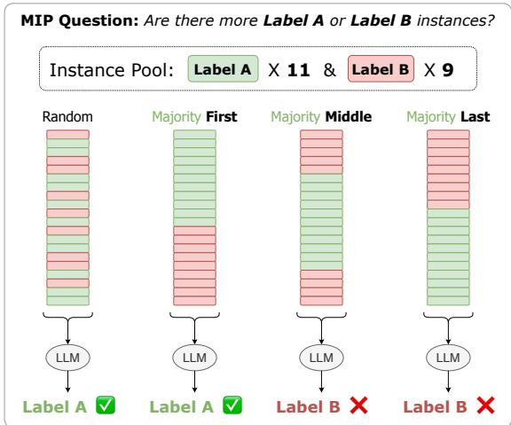  
Figure 1: An illustrative example of our MIP setting, with 20 textual instances and two pre-defined labels, arranged in four order patterns. In this example, the model correctly predicts the majority label when instances are randomly shuffled or majority-label instances are grouped at the beginning, but not when they are grouped in the middle or at the end. Note that while all instances are color-coded for informative purposes, LLMs receive instances without label information.

## 2 Related Work

Multi-Instance Processing. Several lines of work study LLM prompts that contain multiple independent inputs, problems, or evidence units. One line of research studies batch processing and multi-task inference to process multiple items jointly more efficiently while preserving task performance (Cheng et al., 2023; Lin et al., 2024; Kolawole et al., 2025; Son et al., 2024). Another line examines information fusion, aggregation, and deep reasoning in long-context benchmarks (Bai et al., 2025; Hsieh et al., 2024a; Qiu et al., 2024; Shaham et al., 2023). The studies closest to ours measure accuracy degradation as instance count and context length increase (Bertsch et al., 2026; Chen et al., 2026). In our case, we isolate the effect of instance order on aggregation accuracy in MIP.

Position Bias and Lost-in-the-Middle Effects. A substantial body of work shows that LLMs are highly sensitive to where relevant information appears in the input. Liu et al. (2024) established the “lost-in-the-middle" effect, showing that LLMs can struggle to access task-relevant information when it appears in the middle of a long context rather than near the beginning or end. Subsequent work examines absolute position, relative spacing between relevant pieces, and multi-evidence retrieval (Gao et al., 2024; Hsieh et al., 2024b; Song et al., 2025; Tian et al., 2025; Veseli et al., 2025). Related order effects also arise outside retrieval: few-shot incontext learning is sensitive to demonstration order, and multiple-choice reasoning is brittle to option permutations and selection bias (Cobbina and Zhou, 2025; Pezeshkpour and Hruschka, 2024; Zheng et al., 2024). Recent work examines order sensitivity in retrieval and multimodal settings (Paruchuri et al., 2026; Zhang et al., 2026a) and explores training and architectural approaches to order robustness (Egressy and Stühmer, 2025; Chu et al., 2026). Instead, our work focuses on aggregation tasks that require considering information from every instance in the final judgement. Although the correct answer is independent of instance order, we show that the positions of instances with different labels can systematically bias the model's prediction.

## 3 Experimental Setting

To study whether LLMs can perform MIP robustly under instance permutations, we use five heterogeneous classification tasks. The goal in our setting is to find the majority label across a fixed instance pool. Within each pool, we present the instances in different order patterns (cf. Section 3.3).

## 3.1 Individual Tasks

We design five classification tasks from existing datasets: Math (arithmetic reasoning) (Cobbe et al. 2021), NER (named-entity recognition) (Rahimi et al., 2019), Occurrence (target-word counting) (Barbieri et al., 2020), Sentiment (sentiment analysis) (Socher et al., 2013) and WSD (word sense disambiguation) (Loureiro et al., 2021). The tasks and datasets are selected so as to be diverse, relatively simple and solvable by current LLMs when each instance is processed individually. We treat each instance within a given task as an independent binary classification problem. In the MIP setting, we ask the model to identify the majority label across all instances. Table 1 provides an overview of the five tasks, with further details in Appendix A. To reduce individual-instance difficulty as a confound, we keep only instances that both Qwen3.6-35B-A3B and Gemini 3.1 Flash-Lite classify correctly in isolation (see Appendix C.1 for more details on filtering).

<table><tr><td>Name</td><td>Target</td><td>Label A : Label B</td></tr><tr><td>Math</td><td>Answer</td><td>odd_number : even_number</td></tr><tr><td>NER</td><td>Entity</td><td>PER : LOC</td></tr><tr><td>Occurrence</td><td> $\mathfrak { s } _ { \mathrm { t h e } ^ { , * } }$ </td><td>exactly_once : more_than_once</td></tr><tr><td>Sentiment</td><td>Polarity</td><td>positive : negative</td></tr><tr><td>WSD</td><td> $\mathrm { \ddot { J } a v a \vec { \nu } \vec { \mathrm { _ { d } } } }$ </td><td>programming_language : place</td></tr></table>

Table 1: Overview of our binary-labelled tasks. Each instance's target is assigned either Label A or Label B, and the MIP objective is to identify the majority label across all instances.

## 3.2 Models and Prompting

We evaluate fifteen LLMs, including six groups of models from the same family: (DeepSeek-V4- Flash, DeepSeek-V4-Pro), (Gemini 3.1 Flash-Lite, Gemini 3.1 Pro), (Gemma 4 26B A4B, Gemma 4 31B), (gpt-oss-120b, GPT-5.4 nano), (Llama 4 Scout, Llama 4 Maverick), and (Qwen3-4B-Instruct, Qwen3.6-35B-A3B, Qwen3.6-Plus);2 and two other LLMs: Grok 4.1 Fast and MiniMax M2.7 (more details in Appendix C.2).

For generation, we use a temperature of 0 and a maximum output length of 20K tokens,3 including reasoning tokens where applicable. We permit up to three attempts in total, retaining the first valid output. Unless otherwise specified, we use the standard prompts that simply state the task and pre-defined labels, and require models to find the majority label among the input instance set. Full prompts are available in Appendix B.1.

## 3.3 Instance Set Construction and Ordering

Each instance set X is constructed from filtered instances according to: the instance count n (i.e., $n = | \mathcal { X } | )$ , the majority proportion p, the majority label $y _ { \mathrm { m a j } }$ , and the instance selection seed s. Given n and $p ,$ we use s to sample $n _ { \mathrm { m a j } } = p \cdot n$ instances with label $y _ { \mathrm { m a j } }$ and $n _ { \mathrm { m i n } } = ( 1 - p )$ · n instances with the corresponding minority label $y _ { \mathrm { m i n } }$ . We then hold X fixed and vary the order pattern π across seven predefined choices to construct the experimental inputs.

Order patterns. We explore seven order patterns that specifically place labelled instances across different positions in the input. First, the random pattern acts as a baseline and shuffles the full instance set randomly using a separate order seed $s _ { \mathrm { o r d e r } }$ . Four patterns group instances into contiguous blocks by label. Majority-first places all majority instances before the minority ones, and majoritylast reverses this order. Majority-edges splits the majority instances into two halves placed around a central minority block, and majority-middle instead places the majority block between two halves of the minority instances. The remaining two are soft variants that interleave the labels. They form an evenlength alternating sequence of majority-minority pairs and place the surplus majority instances either at both ends of this sequence (soft-majority-edges) or in its middle (soft-majority-middle). Figure 1 provides a visual illustration of four representative patterns (random, majority-frst, majority-last and majority-middle), while Appendix C.3 provides formal definitions of all seven patterns.

## 3.4 Evaluation Metric

For each experiment e, we attempt to parse the model output $o _ { e }$ into a predicted majority label $\hat { y } _ { e }$ . If no label can be parsed within the allowed attempts, the experiment is invalid.4 Otherwise, we compare $\hat { y } _ { e }$ with the ground-truth majority label $y _ { \mathrm { m a j } } ^ { ( e ) }$ and consider the experiment correct if $\hat { y } _ { e } = y _ { \mathrm { m a j } } ^ { ( e ) }$ . We report valid-only accuracy (Acc) as the fraction of valid experiments that produce a correct answer within each selection seed. Overall accuracy pools runs across tasks, majority labels and order patterns. We then report its mean and standard deviation across selection seeds. We select the best and worst order patterns, $\pi ^ { + }$ and $\pi ^ { - }$ using their mean accuracies. We compute their gap as $\Delta _ { b e s t - w o r s t } = \mathrm { m e a n } \big [ \mathrm { A c c } _ { s } ( \pi ^ { + } ) - \mathrm { A c c } _ { s } ( \pi ^ { - } ) \big ]$ where $\operatorname { A c c } _ { s } ( \pi )$ is the accuracy of pattern π at selection seed s. Larger values indicate greater variation in accuracy across order patterns.

## 3.5 Core Setting

Our core setting is based on $n = 2 , 0 0 0$ instances with proportion $p = 0 . 5 5$ . Although this setting is near-balanced in percentage terms, the majority signal is still well-defined. It corresponds to $n _ { \mathrm { m a j } } = 1 1 0 0$ and $n _ { \mathrm { m i n } } = 9 0 0$ , giving an absolute margin of 200 instances. In probabilistic terms, the chance of reversing the majority under a 55/45 distribution, even with a model predicting at only 90% accuracy,⁵ is on the order of one in a billion (assuming independent instance-level predictions with equal accuracy across instances). We provide the calculation in Appendix C.4.

We conduct each experiment twice by swapping which binary label serves as $y _ { \mathrm { m a j } }$ . For each configuration, we test all seven order patterns over three selection seeds $s \in \{ 0 , 1 , 2 \}$ . For the random pattern, we additionally vary the order seed three times with $s _ { \mathrm { o r d e r } } \in \{ 0 , 1 , 2 \}$ to obtain a more robust estimate under random orderings.

## 4 Robustness of LLMs to Instance Order

We examine LLM sensitivity to instance order, focusing on specific order patterns that place instances with different labels at predefined positions within the input, as explained in Section 3.

## 4.1 Core Results

Table 2 reports each model's accuracy averaged across tasks and order patterns, invalid rate, and the corresponding accuracy gap $\Delta$ between its best and worst order patterns. Accuracy varies widely across models. Despite this variation, all models exhibit accuracy gaps at least 40.0 percentage points (pp), with models such as Gemma 4 26B A4B and Llama 4 Maverick reaching around 90.0 pp. Such gaps are substantial across the board, and they exceed the corresponding variation across instance-selection seeds, indicating that the observed order sensitivity is unlikely to be explained by random variation over instance sets alone. DeepSeek-V4-Pro and Mini-Max M2.7 have invalid rates near or above 90%, as they often exhaust the 20K-token output budget. Their accuracy and $\Delta$ are therefore based on relatively few valid experiments.6 In addition, error breakdowns, results treating invalid experiments as incorrect, and per-task accuracies are provided in Appendices D.1, D.2, and D.3.

<table><tr><td>Model</td><td>Acc</td><td> $\Delta _ { b e s t . }$  -worst</td><td>Invalid</td></tr><tr><td>DeepSeek-V4-Flash</td><td> $7 9 . 8 { \pm } 6 . 9$ </td><td> $6 4 . 0 { \pm } 1 6 . 0 $ </td><td> $4 0 . 0 { \pm } 5 . 8 $ </td></tr><tr><td>DeepSeek-V4-Pro</td><td> $7 8 . 6 { \pm } 2 5 . 8 $ </td><td> $5 0 . 0 ^ { \dagger }$ </td><td> $8 8 . 9 { \pm } 4 . 4 $ </td></tr><tr><td>Gemini 3.1 Flash-Lite Gemini 3.1 Pro</td><td> $6 3 . 0 { \pm } 4 . 1$ </td><td> $6 7 . 4 { \pm } 1 2 . 2$ </td><td> $1 0 . 7 { \pm } 3 . 4 $ </td></tr><tr><td></td><td> $8 1 . 7 { \pm } 4 . 2 $ </td><td> $4 0 . 0 { \pm } 0 . 0 \ $ </td><td> $1 . 1 { \pm } 1 . 1$ </td></tr><tr><td>Gemma 4 26B A4B Gemma 4 31B</td><td> $6 4 . 0 { \pm } 6 . 9$ </td><td> $9 1 . 1 { \pm } 7 . 8 $ </td><td> $2 8 . 1 { \pm } 2 . 3 $ </td></tr><tr><td></td><td> $6 8 . 2 { \pm } 0 . 3 $ </td><td> $5 1 . 3 { \pm } 1 2 . 0 $ </td><td> $1 0 . 4 { \pm } 6 . 3 $ </td></tr><tr><td>gpt-oss-120b GPT-5.4 nano</td><td> $6 3 . 0 { \pm } 1 . 5 $ </td><td> $4 3 . 5 { \pm } 9 . 8 $ </td><td> $2 1 . 9 { \pm } 0 . 6 $ </td></tr><tr><td></td><td> $5 8 . 1 \pm 3 . 4$ </td><td> $7 0 . 0 { \pm } 1 0 . 0 $ </td><td> $0 . 0 { \pm } 0 . 0 $ </td></tr><tr><td>Llama 4 Scout Llama 4 Maverick</td><td> $5 5 . 3 { \pm } 2 . 9 $ </td><td> $5 5 . 9 2 5 . 3 $ </td><td> $1 . 5 { \pm } 1 . 7$ </td></tr><tr><td></td><td> $6 1 . 0 { \pm } 2 . 0 $ </td><td> $9 0 . 0 { \pm } 1 0 . 0 $ </td><td> $2 . 2 { \pm } 1 . 1$ </td></tr><tr><td>Qwen3-4B-Instruct</td><td> $5 7 . 4 { \pm } 6 . 1 $ </td><td> $6 6 . 7 { \pm } 5 . 8 $ </td><td> $0 . 0 { \pm } 0 . 0 $ </td></tr><tr><td>Qwen3.6-35B-A3B</td><td> $7 5 . 5 { \pm 3 . 1 }$ </td><td> $6 1 . 7 { \pm } 1 2 . 6 $ </td><td> $3 3 . 7 { \pm } 5 . 3 $ </td></tr><tr><td>Qwen3.6-Plus</td><td> $7 5 . 2 { \pm } 4 . 2 $ </td><td> $5 0 . 0 { \pm } 0 . 0 $ </td><td> $0 . 0 { \pm } 0 . 0 $ </td></tr><tr><td>Grok 4.1 Fast</td><td> $7 2 . 2 { \pm } 2 . 9$ </td><td> $4 6 . 7 { \pm } 1 5 . 3$ </td><td> $0 . 0 { \pm } 0 . 0 $ </td></tr><tr><td>MiniMax M2.7</td><td> $3 6 . 1 { \pm } 1 9 . 6 $ </td><td> $1 0 0 . 0 { \pm } 0 . 0 ^ { \ddagger }$ </td><td> $9 5 . 2 { \pm } 5 . 0 $ </td></tr></table>

Table 2: Accuracy (Acc, %), best-worst order-pattern gap (∆, pp), and invalid rate (%) in the core setting. Values are means ± standard deviations over three instanceselection seeds unless marked. Gaps marked † use one paired seed (no standard deviation), and ‡ use two.

Results by Instance Order Patterns. Figure 2 shows the accuracy of each LLM across four representative order patterns.7 Models generally achieve their highest accuracy under the majority-first pattern, while accuracy under majority-last and particularly majority-middle often falls below the random baseline. This systematic variation shows that the models' predictions are strongly influenced by where the majority signal is placed, rendering them sensitive to order permutations. Although no single pattern yields the lowest accuracy across all plotted LLMs, over half of the models perform worst under majority-middle, suggesting a “lost-inthe-middle" effect (Liu et al., 2024). Full results across tasks and all seven patterns are provided in Appendix D.4.1.

## 4.2 Generalisability Analysis: Instance Count and Label Distribution

Our core setting uses 2,000 instances with a 55/45 label distribution. To investigate whether the observed order effects generalise beyond this specific setting, we vary the instance count (100, 200, 500, 1,000 and 2,000), and the label distribution (majority/minority: 90/10, 70/30, 60/40 and 55/45). The setting otherwise follows that of the core, except that we use a single instance-selection seed (s = 1) to reduce computational cost.

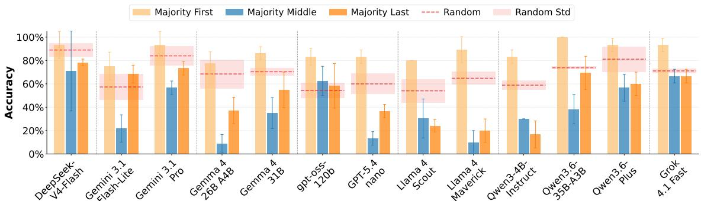  
Figure 2: Per-model accuracy on four representative order patterns in the core setting. Error bars indicate standard deviations over three instance-selection seeds.

Figure 3 shows accuracy across instance counts and label distributions for the four representative order patterns. The order effects observed in Section 4.1 remain visible across these settings, including those with only 100 instances. The majorityfirst pattern generally outperforms majority-middle and majority-last, while its advantage over the random baseline is clearest for more balanced label distributions. As the instance count grows and the label distribution becomes more balanced, accuracy under the majority-middle and majority-last configurations generally declines, whereas majority-frst remains comparatively stable. The performance gap between these patterns therefore tends to widen. The directional nature of this effect suggests that models may rely disproportionately on instances appearing early in the context, motivating the behavioural analysis in Section 5. Full results for all seven patterns are given in Appendix D.4.2.

## 4.3 Prompting Variants

To assess whether prompting can reduce order sensitivity, we compare the standard prompt with three prompting variants for three models and all patterns in the core setting, keeping the input instances and their orderings unchanged: (i) hint prompting, which emphasises processing all instances rather than relying on a subset; (ii) suggested strategy prompting, which additionally suggests processing instances in groups and summing the group-level label counts; (iii) self-prompting, where the model first generates its own task instructions and then uses them to solve the task.8

As shown in Figure 4, these variants yield no consistent improvement in accuracy across models, and substantial gaps $\Delta _ { b e s t - w o r s t }$ remain under all tested prompts. These results indicate that these systematic MIP failures are unlikely to be resolved through simple prompt engineering, suggesting that mitigating instance-level positional biases in LLMs may require more targeted methods.9

## 5 Analysis of Model Behaviour

To further examine these order effects, we perform two complementary analyses: (1) an analysis of reasoning traces to investigate how many instances are mentioned by reasoning models (Section 5.1), and (2) a model interpretability analysis to better understand the contributions of individual input instances to LLM predictions (Section 5.2).

## 5.1 Evidence from Reasoning Traces

We use reasoning traces to investigate whether models selectively engage with particular instance positions in ways that may contribute to their order sensitivity. For this analysis, we focus on four reasoning models:10 DeepSeek-V4-Flash, gpt-oss-120b, Qwen3.6-35B-A3B, and Qwen3.6-Plus.

## 5.1.1 Manual Analysis

We manually examine all 222 reasoning traces from the four reasoning LLMs, each corresponding to a valid but incorrect model prediction in our core setting and collectively covering all seven order patterns. Although our prompts explicitly instruct the models to evaluate every instance before answering, their reasoning traces rarely document such exhaustive evaluation. Instead, 72% of the examined traces primarily mention consecutive instances from the beginning, typically stopping within the first 200, with occasional references to a few instances from the middle or end of the context. These traces accompany order-dependent errors. For example, under majority-last and majoritymiddle, some traces mention only the minority block, while under majority-edges, others identify the transition to the minority block but never mention the second majority block. We provide example reasoning traces in Appendix E.1.

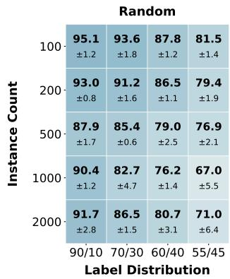

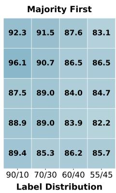

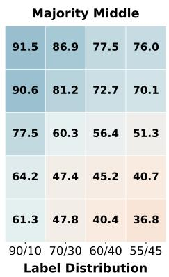

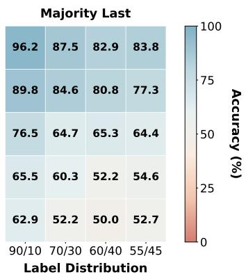  
Figure 3: Accuracy over different instance counts and label distributions, for the four representative patterns. Standard deviation is computed over three order seeds for random only.

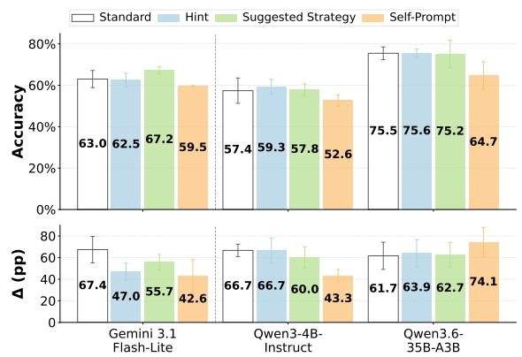  
Figure 4: Accuracy (top) and order-pattern gap ∆ (bottom) under the standard prompt and three prompting variants for three evaluated models. Error bars indicate standard deviations over three instance-selection seeds.

## 5.1.2 Estimated Explicit Instance Coverage

Our manual analysis shows that models commonly refer to instances in their reasoning traces by explicitly stating the corresponding IDs, although discussions of batches may omit individual IDs. We automatically extract these IDs from reasoning traces by using regular expressions to match each instance ID as a standalone number, counting an ID as present if it appears at least once. This allows us to estimate explicit instance coverage, defined as the proportion of instance IDs mentioned in each trace. We apply this heuristic to all available reasoning traces from all valid experiments in Section 4, including both correct and incorrect predictions.

<table><tr><td>Model</td><td></td><td></td><td></td><td>&lt; 25% &lt; 75% &lt; 100% = 100%</td><td></td></tr><tr><td rowspan="2">DeepSeek-V4-Flash (valid rate: 60.0%)</td><td>#</td><td>132</td><td>27</td><td>1</td><td>2</td></tr><tr><td> $\operatorname { A c c } .$ </td><td>78.0</td><td>85.2</td><td>100.0</td><td>100.0</td></tr><tr><td rowspan="2">gpt-oss-120b (valid rate: 78.1%)</td><td>#</td><td>201</td><td>7</td><td>2</td><td>1</td></tr><tr><td>Acc.</td><td>63.2</td><td>57.1</td><td>50.0</td><td>100.0</td></tr><tr><td rowspan="2">Qwen3.6-35B-A3B (valid rate: 66.3%)</td><td>#</td><td>132</td><td>28</td><td>1</td><td>18</td></tr><tr><td>Acc.</td><td>71.2</td><td>82.1</td><td>0.0</td><td>100.0</td></tr><tr><td>Qwen3.6-Plus</td><td>#</td><td>206</td><td>46</td><td>9</td><td>9</td></tr><tr><td>(valid rate: 100.0%)</td><td> $\operatorname { A c c } .$ </td><td>71.4</td><td>89.1</td><td>77.8</td><td>88.9</td></tr></table>

Table 3: Number of valid experiments (#, out of 270 per model) and the corresponding accuracy (Acc., %) across estimated instance-coverage bins in the 2,000- instance core setting across all seven order patterns. For example, the < 75% bin denotes the runs whose traces explicitly specify [25%, 75%) of the 2,000 instance IDs.

Explicit Coverage Overview. Table 3 reports the number of valid experiments (#) and their accuracy (Acc.) within each estimated explicit coverage range. For all models, the largest bin has estimated explicit coverage below 25% (i.e. fewer than 500 of the 2,000 instance IDs). Within models, higher coverage often coincides with higher accuracy, but the relationship is not fully monotonic. Several highercoverage bins contain very few experiments.11

Per-ID Mention Rates. Figure 5 shows the percentage of valid experiments whose reasoning trace mentions a specific instance ID. Per-ID mention rates exhibit a strong primacy effect, with the highest rates observed for the initial ≈ 200 instances, followed by a steady decline with sharp peaks at multiples of 50 or 100 and a slight resurgence in the final ≈ 100 instances. The early emphasis and fixed-interval peaks are consistent with our manual observations (Section 5.1.1). Appendix E.2.1 further disaggregates per-ID mention rates by order pattern. All patterns retain a broadly similar profile, but the block-structured patterns sometimes also exhibit local increases near label-block boundaries. Overall, limited explicit coverage (Table 3) and front-loaded mention rates are consistent with the findings in Section 4.1, where models generally achieve higher accuracy when majority-label instances are placed at the beginning.

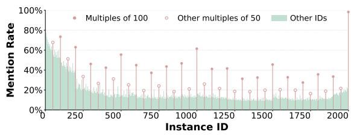  
Figure 5: Per-ID mention rate across valid core-setting experiments. Each bin represents one instance ID, with red markers highlighting IDs that are multiples of 50.

Coverage across instance counts and prompt variants. Finally, we apply the same coverage measure to the generalisability setting in Section 4.2 and the prompt variants for Qwen3.6- 35B-A3B in Section 4.3. For the former (Appendix E.2.2), coverage declines from nearly complete at 100 and 200 instances to below 20% at 2,000 when pooled across models, with the extent of the decline varying by model. For the latter (Appendix E.2.3), most valid traces still mention fewer than a quarter of the instances under each variant.

## 5.2 Evidence from Gradient-Based Attribution

We complement the reasoning-trace analysis with an interpretability analysis on three models. Our analysis covers NER and Sentiment with Gemma 4 26B A4B, Gemma 4 31B, and Qwen3-4B-Instruct.12

## 5.2.1 Input × Gradient

We use Input × Gradient (IxG) as a computationally efficient method for contrastive attribution (Ancona et al., 2018; Yin and Neubig, 2022). It estimates the importance of each input token for the model's final prediction between the two candidate labels. We take the magnitude and aggregate token scores within each instance, using the resulting profile as descriptive rather than causal evidence. Appendix F.1 provides the formal definition and replay details.

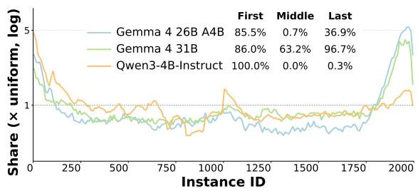  
Figure 6: IxG position profiles pooled over valid replays with available attribution from NER, Sentiment, and the six structured order patterns. Each point averages ten consecutive instances. The dotted line at 1 denotes the uniform reference, and the y-axis is logarithmic. For reference, the inset reports accuracy (%) for each model under three representative patterns.

To mitigate the influence that the local ordering of instances may have and to derive more reliable attribution profiles in the core setting, for each of the six structured patterns (i.e. without random), we independently shuffle the selected majority- and minority-label instances under 50 order seeds $s _ { \mathrm { o r d e r } } \in \{ 1 , 2 , . . . , 5 0 \}$ and then reconstruct the pattern. Together with three instanceselection seeds, this yields 150 generations before validity filtering for each task, majority label, and pattern. All attribution analyses include only valid outputs with the two candidate labels. We also compare performance across these orderings with the original core results. 13

## 5.2.2 Results

Overall Positional Profiles. Figure 6 pools the IxG profiles averaged across both tasks and all six structured patterns. All three models assign below-uniform attribution to substantial portions of the middle, but differ at the boundaries. Both Gemma profiles rise most strongly near the end, whereas Qwen3-4B-Instruct is more strongly frontloaded, with a smaller rise near the end and a narrow interior peak around instance 1,000. The accuracies reported in the same figure show that both Gemma models perform better under majoritylast than majority-middle. Qwen3-4B-Instruct instead achieves near-zero accuracy under both patterns, compared with 100% under majority-irst, consistent with its stronger emphasis on early positions. Overall, these attribution profiles align with the order effects in Section 4.1: models assign less attribution to the middle positions, where majority blocks are hardest to identify, and how strongly each model emphasises the beginning or end tracks its relative accuracy under majority-first and majority-last.

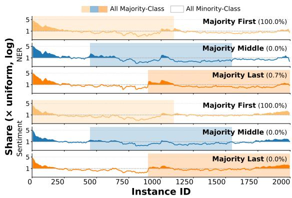  
Figure 7: IxG position profiles for Qwen3-4B-Instruct, separated by NER (top) and Sentiment (bottom), for three structured order patterns. Dotted horizontal lines denote the uniform reference at 1, and shaded backgrounds mark majority-label blocks. Each point averages ten consecutive instances, and the y-axis is logarithmic. Panel labels report accuracy (%) over the same outputs used for attribution.

Profiles by Task and Order Pattern. Figure 7 shows the Qwen3-4B-Instruct profiles separately by task under majority-first, majority-middle and majority-last.14 For NER, besides higher attribution near the beginning and, to a lesser extent, the end of the instance pool, local increases appear near some boundaries between majority and minority blocks, suggesting that the model may be sensitive to label changes but it places less weight on subsequent instances with the same label. Moreover, increases appear at specific instance positions (e.g. instance 1,000), resembling the fixed-interval increases in explicit mention rates in Section 5.1.2. The Sentiment profiles are generally flatter but retain weaker local changes around block boundaries.

Attribution across instance counts and prompt variants. As in Section 5.1.2, we also apply the same IxG attribution method to our generalisability setting (Appendix F.3) and prompting variants for Qwen3-4B-Instruct (Appendix F.4). The positional profiles change with instance count, with differences across models. For both Gemma models, attribution near the end is generally higher at larger instance counts, whereas Qwen3-4B-Instruct shows a stronger emphasis on the beginning. Nevertheless, profiles across label distributions and the prompting variants remain broadly similar.

## 6 Conclusion

Our controlled majority-label probe identifies instance order as a concrete source of aggregation errors in multi-instance processing. Across fifteen LLMs and five tasks, accuracy varies widely across order patterns, with generally higher accuracy when majority-label instances appear first. Since the task is order-independent, these results reveal clear violations of permutation invariance despite the instance sets remaining unchanged, with the bias towards early instances suggesting broader reliability issues in MIP.

Available reasoning traces often mention only a fraction of the input and disproportionately reference early instances, while gradient-based attribution profiles are also non-uniform across instance positions. We also explore prompt variants that explicitly instruct models to check all instances, but these do not consistently improve permutation robustness. Together, these findings suggest that models may rely on shortcuts in MIP, even when the task requires them to consider every instance.

Several takeaways and implications emerge from our findings. First, evaluations of MIP should report both accuracy and variation across input orders. Second, future work should investigate models and workflows that process instances systematically and aggregate verifiable intermediate decisions without sensitivity to presentation order. Such approaches could help ensure that all required instances are considered, regardless of their positions, and give users greater confidence in the results. Finally, future work should investigate mechanisms that enable models to recognise when they cannot fully complete a task and alert users accordingly.

## Limitations

We study LLM reliability in multi-instance processing (MIP) through the lens of permutation invariance. This is a necessary reliability criterion for unordered instance sets, and its violation is already sufficient to show that a model is unreliable in this setting. However, MIP reliability has other important dimensions that we do not fully cover, such as robustness to task formulation, language variations (we study only English), calibration, aggregation faithfulness, and transparency of intermediate decisions. Future work should therefore examine a broader set of reliability criteria and investigate the different mechanisms underlying MIP failures.

Our goal is primarily diagnostic. We design a controlled probe to assess whether the evaluated LLMs satisfy permutation invariance and to characterise behaviours associated with its violations. We therefore do not provide a comprehensive method for improving MIP reliability. Our prompt-based experiments show that the tested prompting approaches do not consistently resolve the failures we observe. More systematic solutions may be needed, such as specialised training, explicit instance-level decomposition, tool-assisted processing, deterministic or verifiable aggregation, or agentic workflows that separate instance processing from aggregation.

Finally, our behavioural analysis relies on indirect evidence from reasoning traces and attribution signals. Some evaluated models do not produce reasoning traces, while others do not reveal them through the API. Even when traces are available, they may be incomplete or may not fully reflect the model's internal computation, and our automatic ID extraction may contain false positives. Thus, they offer observable but potentially unfaithful evidence of how reasoning LLMs approach a task (Turpin et al., 2023; Zhang et al., 2026b). Attribution signals are likewise descriptive rather than causal: Input × Gradient is a local, first-order measure tied to the chosen decision score and the observed input. We therefore treat these analyses as complementary evidence of positional imbalance, rather than direct measurements of the model's internal computation. Developing more faithful and explainable methods for analysing MIP behaviour remains an important direction for future work.

## Ethical Considerations

This study provides an empirical assessment of how LLMs behave in multi-instance processing scenarios, focusing specifically on whether these models can consistently handle every instance irrespective of the order in which they appear. Our work does not entail gathering new data, engaging human participants, or deploying models within realworld decision-making pipelines. Every dataset employed in our experiments is publicly accessible and open-source, and each was obtained and used in line with its original licence, terms of use, and intended scope for research.

Furthermore, we make no assertion that any specific model or provider is fundamentally unsafe or inappropriate for use. Instead, our findings point to broader limitations shared by current LLMs under particular experimental settings. We hope this research supports more responsible deployment of LLM-based systems by encouraging practitioners to consider reliability, aggregation strategies, and potential failure modes when designing real-world applications.

## Acknowledgments

Jose Camacho-Collados is supported by a UKRI Future Leaders Fellowship.

## References

Marco Ancona, Enea Ceolini, Cengiz Öztireli, and Markus Gross. 2018. Towards better understanding of gradient-based attribution methods for deep neural networks. In International Conference on Learning Representations.

Yushi Bai, Shangqing Tu, Jiajie Zhang, Hao Peng, Xiaozhi Wang, Xin Lv, Shulin Cao, Jiazheng Xu, Lei Hou, Yuxiao Dong, Jie Tang, and Juanzi Li. 2025. LongBench v2: Towards deeper understanding and reasoning on realistic long-context multitasks. In Proceedings of the 63rd Annual Meeting of the Association for Computational Linguistics (Volume 1: Long Papers), pages 3639–3664, Vienna, Austria. Association for Computational Linguistics.

Francesco Barbieri, Jose Camacho-Collados, Luis Espinosa Anke, and Leonardo Neves. 2020. TweetEval: Unified benchmark and comparative evaluation for tweet classification. In Findings of the Association for Computational Linguistics: EMNLP 2020, pages 1644–1650, Online. Association for Computational Linguistics.

Amanda Bertsch, Adithya Pratapa, Teruko Mitamura, Graham Neubig, and Matthew R. Gormley. 2026. Oolong: Evaluating long context reasoning and aggregation capabilities. In Third Conference on Language Modeling.

Jingxuan Chen, Mohammad Taher Pilehvar, and Jose Camacho-Collados. 2026. Understanding LLM performance degradation in multi-instance processing: The roles of instance count and context length. In Proceedings of the 64th Annual Meeting of the Association for Computational Linguistics (Volume 1: Long Papers), pages 31851–31884, San Diego, California, United States. Association for Computational Linguistics.

Zhoujun Cheng, Jungo Kasai, and Tao Yu. 2023. Batch prompting: Efficient inference with large language model APIs. In Proceedings of the 2023 Conference on Empirical Methods in Natural Language Processing: Industry Track, pages 792–810, Singapore. Association for Computational Linguistics.

Xu Chu, Guanyu Wang, Zhijie Tan, Xinrong Chen, Ziyu Li, Tong Mo, and Weiping Li. 2026. Towards order fairness: Mitigating LLMs order sensitivity through dual group advantage optimization. In Proceedings of the 64th Annual Meeting of the Association for Computational Linguistics (Volume 1: Long Papers), pages 4790–4805, San Diego, California, United States. Association for Computational Linguistics.

Karl Cobbe, Vineet Kosaraju, Mohammad Bavarian, Mark Chen, Heewoo Jun, Lukasz Kaiser, Matthias Plappert, Jerry Tworek, Jacob Hilton, Reiichiro Nakano, Christopher Hesse, and John Schulman. 2021. Training verifiers to solve math word problems. Preprint, arXiv:2110.14168.

Kwesi Adu Cobbina and Tianyi Zhou. 2025. Where to show demos in your prompt: A positional bias of in-context learning. In Proceedings of the 2025 Conference on Empirical Methods in Natural Language Processing, pages 29560–29593, Suzhou, China. Association for Computational Linguistics.

Beni Egressy and Jan Stühmer. 2025. Set-LLM: A permutation-invariant LLM. In The Thirty-ninth Annual Conference on Neural Information Processing Systems.

Muhan Gao, TaiMing Lu, Kuai Yu, Adam Byerly, and Daniel Khashabi. 2024. Insights into LLM longcontext failures: When transformers know but don't tell. In Findings of the Association for Computational Linguistics: EMNLP 2024, pages 7611–7625, Miami, Florida, USA. Association for Computational Linguistics.

Cheng-Ping Hsieh, Simeng Sun, Samuel Kriman, Shantanu Acharya, Dima Rekesh, Fei Jia, and Boris Ginsburg. 2024a. RULER: What's the real context size of your long-context language models? In First Conference on Language Modeling.

Cheng-Yu Hsieh, Yung-Sung Chuang, Chun-Liang Li, Zifeng Wang, Long Le, Abhishek Kumar, James Glass, Alexander Ratner, Chen-Yu Lee, Ranjay Krishna, and Tomas Pfister. 2024b. Found in the middle: Calibrating positional attention bias improves long context utilization. In Findings of the Association

for Computational Linguistics: ACL 2024, pages 14982–14995, Bangkok, Thailand. Association for Computational Linguistics.

Steven Kolawole, Keshav Santhanam, Virginia Smith, and Pratiksha Thaker. 2025. PARALLELPROMPT: Extracting parallelism from large language model queries. In The Thirty-ninth Annual Conference on Neural Information Processing Systems Datasets and Benchmarks Track.

Patrick Lewis, Ethan Perez, Aleksandra Piktus, Fabio Petroni, Vladimir Karpukhin, Naman Goyal, Heinrich Küttler, Mike Lewis, Wen-tau Yih, Tim Rocktäschel, Sebastian Riedel, and Douwe Kiela. 2020. Retrieval-augmented generation for knowledgeintensive nlp tasks. In Advances in Neural Information Processing Systems.

Jianzhe Lin, Maurice Diesendruck, Liang Du, and Robin Abraham. 2024. Batchprompt: Accomplish more with less. In The Twelfth International Conference on Learning Representations.

Jiaheng Liu, Dawei Zhu, Zhiqi Bai, Yancheng He, Huanxuan Liao, Haoran Que, Zekun Wang, Chenchen Zhang, Ge Zhang, Jiebin Zhang, Yuanxing Zhang, Zhuo Chen, Hangyu Guo, Shilong Li, Ziqiang Liu, Yong Shan, Yifan Song, Jiayi Tian, Wenhao Wu, and 18 others. 2025. A comprehensive survey on long context language modeling. Preprint, arXiv:2503.17407.

Nelson F. Liu, Kevin Lin, John Hewitt, Ashwin Paranjape, Michele Bevilacqua, Fabio Petroni, and Percy Liang. 2024. Lost in the middle: How language models use long contexts. Transactions of the Association for Computational Linguistics, 12:157–173.

Daniel Loureiro, Kiamehr Rezaee, Mohammad Taher Pilehvar, and Jose Camacho-Collados. 2021. Analysis and evaluation of language models for word sense disambiguation. Computational Linguistics, 47(2):387–443.

Akshay Paruchuri, Sanmi Koyejo, and Ehsan Adeli. 2026. Same evidence, different answer: Auditing order sensitivity in multimodal large language models. Preprint, arXiv:2606.26079.

Pouya Pezeshkpour and Estevam Hruschka. 2024. Large language models sensitivity to the order of options in multiple-choice questions. In Findings of the Association for Computational Linguistics: NAACL 2024, pages 2006–2017, Mexico City, Mexico. Association for Computational Linguistics.

Zexuan Qiu, Jingjing Li, Shijue Huang, Xiaoqi Jiao, Wanjun Zhong, and Irwin King. 2024. CLongEval: A Chinese benchmark for evaluating long-context large language models. In Findings of the Association for Computational Linguistics: EMNLP 2024, pages 3985–4004, Miami, Florida, USA. Association for Computational Linguistics.

Afshin Rahimi, Yuan Li, and Trevor Cohn. 2019. Massively multilingual transfer for NER. In Proceedings of the 57th Annual Meeting of the Association for Computational Linguistics, pages 151–164, Florence, Italy. Association for Computational Linguistics.

Uri Shaham, Maor Ivgi, Avia Efrat, Jonathan Berant, and Omer Levy. 2023. ZeroSCROLLS: A zero-shot benchmark for long text understanding. In Findings of the Association for Computational Linguistics: EMNLP 2023, pages 7977–7989, Singapore. Association for Computational Linguistics.

Richard Socher, Alex Perelygin, Jean Wu, Jason Chuang, Christopher D. Manning, Andrew Ng, and Christopher Potts. 2013. Recursive deep models for semantic compositionality over a sentiment treebank. In Proceedings of the 2013 Conference on Empirical Methods in Natural Language Processing, pages 1631–1642, Seattle, Washington, USA. Association for Computational Linguistics.

Guijin Son, SangWon Baek, Sangdae Nam, Ilgyun Jeong, and Seungone Kim. 2024. Multi-task inference: Can large language models follow multiple instructions at once? In Proceedings of the 62nd Annual Meeting of the Association for Computational Linguistics (Volume 1: Long Papers), pages 5606– 5627, Bangkok, Thailand. Association for Computational Linguistics.

Mingyang Song, Mao Zheng, and Xuan Luo. 2025. Counting-stars: A multi-evidence, position-aware, and scalable benchmark for evaluating long-context large language models. In Proceedings of the 31st International Conference on Computational Linguistics, pages 3753–3763, Abu Dhabi, UAE. Association for Computational Linguistics.

Maojun Sun, Ruijian Han, Binyan Jiang, Houduo Qi, Defeng Sun, Yancheng Yuan, and Jian Huang. 2025. A survey on large language model-based agents for statistics and data science. The American Statistician, 0(0):1–14.

Zirui Tang, Weizheng Wang, Zihang Zhou, Yang Jiao, Bangrui Xu, Boyu Niu, Dayou Zhou, Xuanhe Zhou, Guoliang Li, Yeye He, Wei Zhou, Yitong Song, Cheng Tan, Xue Yang, Chunwei Liu, Bin Wang, Conghui He, Xiaoyang Wang, and Fan Wu. 2025. Llm/agent-as-data-analyst: A survey. Preprint, arXiv:2509.23988.

Runchu Tian, Yanghao Li, Yuepeng Fu, Siyang Deng, Qinyu Luo, Cheng Qian, Shuo Wang, Xin Cong, Zhong Zhang, Yesai Wu, Yankai Lin, Huadong Wang, and Xiaojiang Liu. 2025. Distance between relevant information pieces causes bias in long-context LLMs. In Findings of the Association for Computational Linguistics: ACL 2025, pages 521–533, Vienna, Austria. Association for Computational Linguistics.

Miles Turpin, Julian Michael, Ethan Perez, and Samuel Bowman. 2023. Language models don't always say

what they think: Unfaithful explanations in chain-ofthought prompting. In Advances in Neural Information Processing Systems, volume 36, pages 74952– 74965. Curran Associates, Inc.

Blerta Veseli, Julian Chibane, Mariya Toneva, and Alexander Koller. 2025. Positional biases shift as inputs approach context window limits. In Second Conference on Language Modeling.

Kayo Yin and Graham Neubig. 2022. Interpreting language models with contrastive explanations. In Proceedings of the 2022 Conference on Empirical Methods in Natural Language Processing, pages 184–198, Abu Dhabi, United Arab Emirates. Association for Computational Linguistics.

Qianchi Zhang, Hainan Zhang, Liang Pang, Hong-Wei Zheng, and Zhiming Zheng. 2026a. Stable-RAG: Mitigating retrieval-permutation-induced hallucinations in retrieval-augmented generation. In Proceedings of the 64th Annual Meeting of the Association for Computational Linguistics (Volume 1: Long Papers), pages 25907–25926, San Diego, California, United States. Association for Computational Linguistics.

Xinliang Frederick Zhang, Anhad Mohananey, Alexandra Chronopoulou, Pinelopi Papalampidi, Somit Gupta, Tsendsuren Munkhdalai, Lu Wang, and Shyam Upadhyay. 2026b. Do LLMs really need 10+ thoughts for “find the time 1000 days later"? towards structural understanding of LLM overthinking. In Proceedings of the 64th Annual Meeting of the Association for Computational Linguistics (Volume 1: Long Papers), pages 17005–17030, San Diego, California, United States. Association for Computational Linguistics.

Chujie Zheng, Hao Zhou, Fandong Meng, Jie Zhou, and Minlie Huang. 2024. Large language models are not robust multiple choice selectors. In The Twelfth International Conference on Learning Representations.

Yongchao Zhou, Andrei Ioan Muresanu, Ziwen Han, Keiran Paster, Silviu Pitis, Harris Chan, and Jimmy Ba. 2023. Large language models are human-level prompt engineers. In The Eleventh International Conference on Learning Representations.

Yuqi Zhu, Yi Zhong, Jintian Zhang, Ziheng Zhang, Shuofei Qiao, Yujie Luo, Lun Du, Da Zheng, Ningyu Zhang, and Huajun Chen. 2026. Why do open-source llms struggle with data analysis? a systematic empirical study. Proceedings of the AAAI Conference on Artificial Intelligence, 40(41):35239–35247.

## A Task and Data Source

## A.1 Math

The task uses samples from GSM8K (Cobbe et al., 2021).

## Example Input:

1. Jill likes to do small jobs online. She makes \$10 a day for her first month working online, and double that per day in her second month. Her third month she makes the same amount per day as the previous month, but only works every other day. How much did she make over three months, assuming each month is 30 days long?

2. A farmer harvested 250 potatoes. He bundled them in twenty-five's and sold each bundle for \$1.90. He also harvested 320 carrots and bundled them in twenty's and sold each bundle for \$2. If the farmer sold all his harvested crops, how much did he get in all?

3. Haruto has tomato plants in his backyard. This year the plants grew 127 tomatoes. Birds had eaten 19 of the tomatoes. He picked the rest. If Haruto gave half of his tomatoes to his friend, how many tomatoes does he have left?

## Instance-Level Ground Truth Output:

1. 1,200

2.51

3.54

MIP Question: Identify whether odd or even final answers are more frequent.

MIP Ground Truth Output: even\_number

## A.2 NER

The task uses samples from WikiANN (Rahimi et al., 2019).

## Example Input:

1. He died in Cheltenham , aged 53 .

2. Dirk Nowitzki (7)

3. Liberty Township , Carroll County , Arkansas

Instance-Level Ground Truth Output:

1. LOC

2. PER

3. LOC

MIP Question: Identify whether person or location entities are more frequent.

## MIP Ground Truth Output: LOC

## A.3 Occurrence

The task uses samples from TweetEval (Barbieri et al., 2020).

## Example Input:

1. I think I may be the only person that thinks AHS is actually awful..

2. This is like the 3rd time ive seen highlights of the Merseyside Derby today. Very good game it was.

3. @user @user @user I just watched it! Srideviž019s comeback.... U remember her from the 90s?? Sun mornings on NTA ;)

## Instance-Level Ground Truth Output:

1.1

2.2

3.1

MIP Question: Identify whether exactly-once or more-than-once instances are more frequent.

MIP Ground Truth Output: exactly\_once

## A.4 Sentiment

The task uses samples from Sentiment Treebank (Socher et al., 2013).

## Example Input:

1. crude and unrelentingly exploitative

2. understated piece of filmmaking

3. can not engage

## Instance-Level Ground Truth Output:

1. negative

2. positive

3. negative

MIP Question: Identify whether positive or negative sentiment is more frequent.

MIP Ground Truth Output: negative

## A.5 WSD

The task uses samples from CoarseWSD-20 (Loureiro et al., 2021).

↔"even\_number", "odd\_number".

Example response format:   
{"answer": "PER"}

Instance 1: He died ...   
Instance 2: Dirk Nowitzki ...   
Instance 3: Liberty Township ...

## Example Input:

1. the colonial authorities therefore resolved to exile him to java and from thence to ambon island .

2. decimal arithmetic decimal arithmetic , compatible with that used in java , c# , pl/i , cobol , python , rexx , etc. , is also defined in this section .

3. a population irruption occurred in 1978 into indonesia , with australian pelicans reaching sulawesi , java and possibly also sumatra .

## Instance-Level Ground Truth Output:

1. place

2. programming\_language

3. place

MIP Question: Identify whether java-as-place or java-as-programming-language is more frequent.

MIP Ground Truth Output: place

## B Prompt Templates

## B.1 Standard Prompts

Here, all instance examples are the same as those in Appendix A and are replaced with “..." for brevity.

## B.1.1 Math

Task: Determine the majority parity → label among the final answers to all provided math problems.

Instructions:

\- Solve each math problem independently.

\- Determine whether each final answer is

\- Count how many instances belong to each label.

\- Choose exactly one label from:

\- If the counts are tied, answer -1.

\- Return only a JSON object with the field "answer".

Example response format:

```json
{"answer": "odd_number"}
```

End your response with the JSON object containing your final answer.

Instance 1: Jill likes ...

Instance 2: A farmer ...

Instance 3: Haruto has ...

## B.1.2 NER

Task: Determine the majority entity-type label among all provided instances.

Instructions:

\- Classify each instance independently

↔ as containing a person entity (PER)

↔ or a location entity (LOC).

\- Count how many instances belong to → each label.

\- Choose exactly one label from: "LOC", →"PER".

- If the counts are tied, answer -1.

field "answer".

End your response with the JSON object containing your final answer.

## B.1.3 Occurrence

Task: Determine the majority occurrence

## Instructions:

"they", "there", or "other".

\- Classify each instance as exactly once or more than once.

\- Count how many instances belong to → each label.

\- Choose exactly one label from:

"more\_than\_once", "exactly\_once".

↔ as using "java" to mean a place or a

- Choose exactly one label from:

- Return only a JSON object with the   
field "answer".

Example response format:

"place", "programming\_language".

- If the counts are tied, answer -1.   
- Return only a JSON object with the   
field "answer".

Example response format:   
{"answer": "exactly\_once"}

End your response with the JSON object containing your final answer.

Instance 1: I think ...   
Instance 2: This is ...   
Instance 3: @user @user ...

## B.1.4 Sentiment

Task: Determine the majority sentiment label among all provided instances.

as positive or negative.

"negative", "positive".

- If the counts are tied, answer -1.

```json
{"answer": "positive"}
```

End your response with the JSON object   
containing your final answer.

Instance 1: crude and ...   
Instance 2: understated piece ...   
Instance 3: can not ...

## B.1.5 WSD

Task: Determine the majority sense of ↔ the word "java" among all provided instances.

↔ programming language.

\- Count how many instances belong to each label.

\- Choose exactly one label from:

\- If the counts are tied, answer -1.

\- Return only a JSON object with the

Instance 1: the colonial ...   
Instance 2: decimal arithmetic ...   
Instance 3: a population ...

## B.2 Prompt Variants

## B.2.1 Hint Prompting

We use the same hint prompt for all tasks and insert it between the end of Instructions: and the beginning of Example response format:.

## Hints:

\- The input may contain many instances,

↔ and the majority label cannot be

reliably determined from any subset

↔ or by sampling.

\- The final answer should be based on

processing all provided instances,

↔ rather than a partial scan or

estimation.

## B.2.2 Suggested Strategy Prompting

We use the same suggested strategy prompt for all tasks and insert it between the end of Instructions: and the beginning of Example response format:.

Suggested Strategy:

↔ cannot be reliably inferred from a

↔ subset or by sampling.

\- If there are many instances, process

them in batches: solve and count

↔ within each batch, then sum the

per-batch counts and decide the

overall majority from those totals.

## B.2.3 Self-Prompting

First Stage We use a task-specific meta-prompt to ask the model to generate the instruction used in the second stage. For compact presentation, we factor these prompts into a shared template and taskspecific substitutions. The angle-bracketed fields are replaced by the corresponding values below; \$num\_instances denotes the number of instances Set <INPUT\_UNIT> to math problems for Math and instances for all other tasks.

## Shared Template

Write the instruction prompt that

another model will later use to ↔ solve the

following task over \$num\_instances ↔ <INPUT\_UNIT> that are NOT shown to ↔ you now:

## Task: <TASK\_SPEC>

Produce a single, self-contained instruction prompt, written in the → imperative and

addressed to the solver. It must specify ↔ <SOLVE\_AND\_COUNT>, how to decide the majority, and how to handle a tie. ↔ Write the prompt itself only - do → not solve

the task and do not describe yourself.

## Math

## <TASK\_SPEC>:

determine the majority parity label → among the final answers to all the → problems

\- whether "even\_number" or "odd\_number" → is more frequent, or -1 if the two →are

tied.

## <SOLVE\_AND\_COUNT>:

how to solve each problem and decide → whether its final answer is even or → odd,

how to count the two labels

## NER

## <TASK\_SPEC>:

determine the majority entity-type label → among all the instances - whether ↔"PER"

(a person entity) or "LOC" (a location → entity) is more frequent, or -1 if →the

two are tied. Each instance contains exactly one relevant entity.

<SOLVE\_AND\_COUNT>:

how to classify each instance as PER or → LOC, how to count the two labels

## Occurrence

## <TASK\_SPEC>:

determine the majority occurrence label for the exact word "the" among all →the

instances - whether "exactly\_once" or "more\_than\_once" is more frequent, → or -1

if the two are tied.

## <SOLVE\_AND\_COUNT>:

how to count the standalone word "the" → in each instance (case-insensitive - "the", "The", "THE" all count; do NOT → count "the" when it is part of → another

word such as "they", "there", "other"), → how to classify each instance as exactly\_once or more\_than\_once, how to count the two labels

## Sentiment

## <TASK\_SPEC>:

determine the majority sentiment label → among all the instances - whether "positive" or "negative" is more → frequent, or -1 if the two are tied.

## <SOLVE\_AND\_COUNT>:

how to classify each instance as positive or negative, how to count the labels

## WSD

## <TASK\_SPEC>:

determine the majority sense of the word "java" among all the instances - whether "place" or

"programming\_language" is more ↔ frequent, or -1 if the two are tied.

<SOLVE\_AND\_COUNT>:

how to decide, for each instance,

→ whether "java" means a place or a ↔ programming

language, how to count the two labels

Second Stage We combine the instruction generated in the first stage with the complete multiinstance input to form the final prompt. An excerpt illustrating the WSD instance format is shown below:

Instance 1: the colonial authorities   
therefore resolved to exile him to   
java and from thence to ambon island

Instance 2: decimal arithmetic decimal   
arithmetic , compatible with that   
↔ used in java , c# , pl/i , cobol ,   
↔ python , rexx , etc. , is also   
defined in this section .

Instance 3: a population irruption   
↔ occurred in 1978 into indonesia ,   
with australian pelicans reaching   
sulawesi , java and possibly also   
sumatra.

## C Experimental Setting

## C.1 Instance Filtering

We begin with 5,000 instances per task (2,500 per binary label), except for Sentiment, for which we use twice as many instances (10,000). For NER, we sample only instances containing exactly one entity, either PER(son) or LOC(ation). Both filtering models answer each instance separately. For Math, we check the final numerical answer against the ground truth, rather than only its parity. For Occurrence, we check the exact count, rather than only whether the word occurs once or more than once. For the remaining tasks, we check the predicted class label. We retain only instances answered correctly by both models.

Table 4 shows the agreement between Qwen3.6- 35B-A3B and Gemini 3.1 Flash-Lite during the instance filtering process. In every task, over 90% of instances are answered correctly by both models.

## C.2 Model Configuration and Generation

Among all fifteen models we evaluated, except for the Gemini models called via Google Cloud API, and the locally deployed Qwen3-4B-Instruct and Qwen3.6-35B-A3B running on a single H100 GPU, we use the OpenRouter API for all other models unless otherwise specified.

We used the preview versions of the Gemini models (Gemini 3.1 Flash-Lite Preview and Gemini 3.1 Pro Preview), as these were the only versions available when we conducted our experiments (May 2026). Reasoning was not enabled for Gemma 4 26B A4B and Gemma 4 31B.

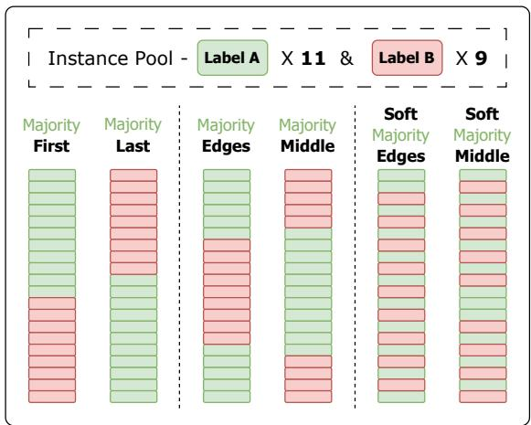  
Figure 8: A toy example with 20 instances illustrating how the order patterns arrange instances with majority (Label A) and minority (Label B) labels.

Regarding the output token budget, for Qwen3.6- Plus, 20K tokens are split into 20 completion tokens and 19,980 reasoning tokens. This reserves room for a final answer when the reasoning budget is exhausted. Such answers are evaluated in the same way as other returned predictions. All other models share a single 20K-token budget for both reasoning (if applicable) and final-answer generation.

## C.3 Order Pattern Formulation

Given n, p, Ymaj and s, we select $n _ { \mathrm { m a j } } = p \cdot n$ majority instances and $n _ { \mathrm { m i n } } ~ = ~ ( 1 - p ) \cdot n$ minority instances from the filtered data. For each label, the filtered instances are first shuffled using s; we then select the first $n _ { \mathrm { m a j } }$ majority-label instances ${ \mathcal { X } } _ { \mathrm { m a j } } ~ = ~ ( x _ { 1 } ^ { \mathrm { m a j } } , x _ { 2 } ^ { \mathrm { m a j } } , \ldots , x _ { n _ { \mathrm { m a j } } } ^ { \mathrm { m a j } } )$ , and the first $n _ { \mathrm { m i n } }$ minority-label instances ${ \mathcal { X } } _ { \operatorname* { m i n } }$ 二 $( x _ { 1 } ^ { \mathrm { m i n } } , x _ { 2 } ^ { \mathrm { m i n } } , \dots , x _ { n _ { \mathrm { m i n } } } ^ { \mathrm { m i n } } )$ The same selected instances are used for every order pattern. Below, denotes list concatenation.

Figure 8 illustrates the order patterns, using 20 instances as an example.

For the random pattern, we concatenate the two selected lists, ${ \mathcal { X } } _ { \mathrm { m a j } } \oplus { \mathcal { X } } _ { \mathrm { m i n } }$ , and shuffle the combined list using a separate order seed $s _ { \mathrm { o r d e r } } .$ The other six patterns form three natural counterpart pairs: (majority-first, majority-last), (majorityedges, majority-middle), and (soft-majority-edges, soft-majority-middle).

<table><tr><td>Task</td><td>Both Correct (%)</td><td>Qwen3.6-35B-A3B Only (%)</td><td>Gemini 3.1 Flash-Lite Only (%)</td><td>Both Incorrect (%)</td></tr><tr><td>Math</td><td>95.52</td><td>1.80</td><td>0.80</td><td>1.88</td></tr><tr><td>NER</td><td>90.44</td><td>3.50</td><td>1.26</td><td>4.80</td></tr><tr><td>Occurrence</td><td>99.16</td><td>0.70</td><td>0.08</td><td>0.06</td></tr><tr><td>Sentiment</td><td>92.10</td><td>1.43</td><td>2.52</td><td>3.95</td></tr><tr><td>WSD</td><td>99.60</td><td>0.06</td><td>0.04</td><td>0.30</td></tr></table>

Table 4: Agreement between the two filtering LLMs across tasks. “Correct" and “Incorrect" denote the proportion of instances correctly and incorrectly classified by both Qwen3.6-35B-A3B and Gemini 3.1 Flash-Lite.

The majority-first and majority-last patterns group instances by label, yielding ${ \mathcal { X } } _ { \mathrm { m a j } } \oplus { \mathcal { X } } _ { \mathrm { m i n } }$ and ${ \mathcal { X } } _ { \operatorname* { m i n } } \oplus { \mathcal { X } } _ { \operatorname* { m a j } } .$ , respectively. The majorityedges pattern places minority instances between two halves of the majority list: ${ \mathcal { X } _ { \mathrm { m a j } } ^ { L } \mathrm { { \oplus } } \mathcal { X } _ { \mathrm { m i n } } \mathrm { { \oplus } } \mathcal { X } _ { \mathrm { m a j } } ^ { R } } ,$ where ${ \mathcal { X } } _ { \mathrm { m a j } } ^ { L }$ contains the first $\lceil n _ { \mathrm { m a j } } / 2 \rceil$ majority instances. Conversely, majority-middle places all majority instances between two halves of the minority list: $\mathcal { X } _ { \operatorname* { m i n } } ^ { L } \oplus \mathcal { X } _ { \operatorname* { m a j } } \oplus \mathcal { X } _ { \operatorname* { m i n } } ^ { R }$ , where $\mathcal { X } _ { \operatorname* { m i n } } ^ { L }$ contains the first $\lceil n _ { \mathrm { m i n } } / 2 \rceil$ minority instances.

Unlike the majority-edges and majority-middle patterns, which group instances into contiguous blocks by label, the soft variants keep the bulk of the instances alternating and only relocate the surplus majority instances. These soft variants test order sensitivity when the two labels are interleaved rather than separated into homogeneous blocks. The soft-majority-edges and soft-majoritymiddle patterns first form an alternating list A = $( x _ { 1 } ^ { \mathrm { m a j } } , x _ { 1 } ^ { \mathrm { m i n } } , \dots , x _ { n _ { \mathrm { m i n } } } ^ { \mathrm { m a j } } , x _ { n _ { \mathrm { m i n } } } ^ { \mathrm { m i n } } )$ , with surplus majority instances $S _ { \mathrm { m a j } } = ( x _ { n _ { \mathrm { m i n } } + 1 } ^ { \mathrm { m a j } } , \ldots , x _ { n _ { \mathrm { m a j } } } ^ { \mathrm { m a j } } )$ . The soft-majority-edges pattern places the surplus majority instances at the two edges, $S _ { \mathrm { m a j } } ^ { L } \oplus { \cal A } \oplus S _ { \mathrm { m a j } } ^ { R } ,$ where $S _ { \mathrm { m a j } } ^ { L }$ contains the first $\lceil \lvert S _ { \mathrm { m a j } } \rvert / 2 \rceil$ surplus majority instances. Similarly, the soft-majoritymiddle pattern instead places the surplus majority instances in the middle of A: $\mathcal { A } ^ { L } \bar { \oplus } \bar { S } _ { \mathrm { m a j } } \bar { \oplus } \mathcal { A } ^ { \dot { R } }$ where $\mathcal { A } ^ { L }$ contains the first $2 \cdot \lceil n _ { \mathrm { m i n } } / 2 \rceil$ alternating instances.

## C.4 Reference Calculation for the 2,000 Instance Set and 55/45 Label Distribution

Our core setting of 2,000 instances with a 55/45 label distribution contains 1,100 majority instances and 900 minority instances. This calculation is intended only as an illustrative reference point. Our actual experiments use filtered instances that are individually solvable by the filtering models. Suppose that a downstream evaluated model makes independent instance-level predictions with the same accuracy $q = 0 . 9$ for every instance, regardless of its label or position, and aggregates these predictions correctly. Let Z be the number of instances predicted as the majority label. Then

$$
Z = Z _ { \mathrm { m a j } } + Z _ { \mathrm { m i n } } ,
$$

where

$$
Z _ { \mathrm { m a j } } \sim \mathrm { B i n o m i a l } ( 1 1 0 0 , q ) ,
$$

$$
Z _ { \mathrm { m i n } } \sim \mathrm { B i n o m i a l } ( 9 0 0 , 1 - q ) .
$$

Here, $Z _ { \mathrm { m a j } }$ counts correctly predicted majoritylabel instances, while $Z _ { \mathrm { m i n } }$ counts minority-label instances incorrectly predicted as the majority label. The predicted majority would be reversed only if $Z < 1 0 0 0$ . The case $Z = 1 0 0 0$ produces a tie, which is also incorrect for this input.

Under $q = 0 . 9$ , the expected predicted-majority count is

$$
\operatorname { E } [ Z ] = 1 1 0 0 \times 0 . 9 + 9 0 0 \times 0 . 1 = 1 0 8 0 .
$$

Its standard deviation is

$$
\operatorname { S D } ( Z ) = { \sqrt { 1 1 0 0 q ( 1 - q ) + 9 0 0 ( 1 - q ) q } } .
$$

With $q = 0 . 9$ , this gives

$$
\operatorname { S D } ( Z ) = { \sqrt { 2 0 0 0 \times 0 . 9 \times 0 . 1 } } \approx 1 3 . 4 .
$$

Therefore, the tie boundary at 1000 is approximately

$$
\frac { 1 0 8 0 - 1 0 0 0 } { 1 3 . 4 } \approx 6 . 0
$$

standard deviations below the expected predictedmajority count.

This calculation does not model the full behaviour of LLMs, whose errors may be correlated or vary across labels and positions, and whose MIP failures may arise from skipping or aggregation errors. Rather, it provides a reference point showing that under this idealised model, the expected predicted-majority count remains well above the tie boundary for the 55/45 label distribution with 2,000 instances. Overall instance-level accuracy alone does not guarantee the same behaviour when these assumptions do not hold.

## C.5 Comparison between 20K and 100K Output Token Budgets

We compare output-token budgets of 20K and 100K for Qwen3.6-35B-A3B in the core and generalisability settings, and under different prompts. All other settings, including instance sets, orderings, seeds and the retry policy, remain unchanged. The selected budget applies to every generation stage, including both stages of self-prompting. We report valid-only metrics alongside all-experiment accuracy and invalid rates. Valid-only comparisons are conditional on obtaining a valid output, and the valid subsets can differ between budgets.

## C.5.1 Core Setting

Table 6 shows that the larger budget substantially lowers the invalid rate and raises all-experiment accuracy, while valid-only accuracy remains similar. The mean valid-only order-pattern gap is smaller but remains large. Figure 9 shows that majority placement continues to matter at 100K.

## C.5.2 Generalisability Setting

Figure 10 shows that accuracy does not consistently improve with the larger budget. Differences are small for the shortest inputs and mixed for larger instance sets. In contrast, Figure 11 shows that invalid outputs become rare across the grid, where they are frequent under 20K.

## C.5.3 Prompt Variants

Table 5 shows fewer invalid outputs and higher all-experiment accuracy at 100K for every prompt. Accuracy changes little for the standard (i.e. core setting), hint and suggested strategy prompts, and increases for self-prompting, which remains the least accurate. All four prompts have smaller mean accuracy gaps at 100K, but substantial differences across order patterns remain.

## C.5.4 Instance Coverage

Figure 12 shows higher per-ID mention rates across much of the input at 100K, including later positions. Early instances nevertheless remain more frequently mentioned.

In the generalisability setting, the 100K budget yields higher estimated explicit coverage, especially at 1,000 and 2,000 instances (Figure 13, compared with Figure 23c). Coverage still decreases as instance counts grow and remains incomplete at 2,000 instances.

Table 7 extends the coverage comparison to all four prompts. Traces mentioning all instances become more frequent at 100K, but full explicit coverage does not ensure a correct prediction. The increased coverage is also not accompanied by consistent gains in overall accuracy (Table 5).

## D Model Performance

## D.1 Error Analysis

When an LLM fails an experiment, the outcome is either a mistake, i.e. a valid but incorrect prediction, or an invalid experiment. We distinguish three types of invalid experiments. The first is invalid input, where the input length exceeds the LLM's context window. The other two arise on the output side: one occurs when the returned response does not contain the required answer, causing a parsing issue; the other occurs when the LLM's response is truncated due to the completion token limit. Figure 14 shows the distribution of error types for each LLM. It shows that Gemma 4 26B A4B has nearly 30% parsing issues, suggesting unstable response formatting. Another representative issue is invalid overlong output, which is the main failure reason for DeepSeek-V4-Pro and MiniMax M2.7. Figure 15 provides a detailed breakdown of invalid experiments across models, tasks, and order patterns. Among the models, invalidity appears to be more specific to particular model-task combinations than to order patterns, with no order pattern consistently producing more invalid outputs.

All Qwen3.6-Plus runs yield valid outputs. When its reasoning-token budget is exhausted, the model is forced to return a final answer using the reserved completion budget. These forced answers remain in the valid-only evaluation, unlike overlimit outputs from other models, which are treated as invalid and excluded. In the core setting, 14% of its runs exhaust the reasoning budget and achieve 56.4% accuracy, compared with 78.4% for the remaining runs.

## D.2 All-Experiment Evaluation

For completeness, we also report all-experiment accuracy $\mathrm { A c c } _ { \mathrm { a l l } }$ , defined as the fraction of all experiments producing a correct answer within each selection seed. Invalid experiments are counted as incorrect.

We follow the same seed-level aggregation procedure as in Section 3.4. We select the best and worst order patterns, $\pi _ { \mathrm { a l l } } ^ { + }$ and $\pi _ { \mathrm { a l l } } ^ { - } ,$ using their mean all-experiment accuracies. We compute their gap as $\Delta _ { \mathrm { a l l } } ~ = ~ \mathrm { m e a n } \big [ \mathrm { A c c } _ { \mathrm { a l l } , s } ( \pi _ { \mathrm { a l l } } ^ { + } ) - \mathrm { A c c } _ { \mathrm { a l l } , s } ( \pi _ { \mathrm { a l l } } ^ { - } ) \big ]$ where $\operatorname { A c c } _ { \mathrm { a l l } , s } \stackrel { s } { ( } \pi )$ is the all-experiment accuracy of pattern π at selection seed s. The standard deviation is computed from the same paired differences.

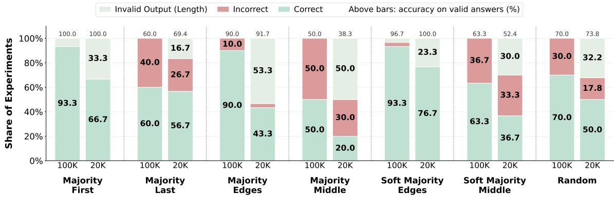  
Figure 9: Outcomes for Qwen3.6-35B-A3B under 20K and 100K output-token budgets across all seven order patterns in the core setting. Bars show the percentages of all experiments with correct, incorrect or invalid outputs. Values above bars give mean accuracy across three instance-selection seeds.

<table><tr><td rowspan="2">Variant</td><td rowspan="2">Budget</td><td colspan="2">Accuracy (%)</td><td colspan="2">∆ Order Pattern (pp)</td><td rowspan="2">Invalid Rate (%)</td></tr><tr><td>All-Experiment Valid-Only</td><td></td><td>All-Experiment Valid-Only</td><td></td></tr><tr><td rowspan="2">Standard</td><td>20K</td><td> $5 0 . 0 { \pm } 4 . 0 $ </td><td> $7 5 . 5 { \pm 3 . 1 }$ </td><td> $5 6 . 7 \pm 5 . 8$ </td><td> $6 1 . 7 { \pm } 1 2 . 6 $ </td><td> $3 3 . 7 \pm 5 . 3$ </td></tr><tr><td>100K</td><td> $7 3 . 3 { \pm } 1 . 9$ </td><td> $7 4 . 2 { \pm } 2 . 1 $ </td><td> $4 3 . 3 { \pm } 1 1 . 5 $ </td><td> $5 0 . 0 { \pm } 1 0 . 0 $ </td><td> $1 . 1 { \pm } 1 . 1$ </td></tr><tr><td rowspan="2">Hint</td><td>20K</td><td> $5 4 . 1 { \pm } 4 . 6 $ </td><td> $7 5 . 6 { \pm } 2 . 0 $ </td><td> $5 0 . 0 { \pm } 1 7 . 3 $ </td><td> $6 3 . 9 { \pm } 1 2 . 7 $ </td><td> $2 8 . 5 { \pm } 4 . 5 $ </td></tr><tr><td>100K</td><td> $7 3 . 7 \pm 3 . 4$ </td><td> $7 3 . 7 { \pm } 3 . 4 $ </td><td> $5 3 . 3 { \pm } 1 5 . 3 $ </td><td> $5 3 . 3 { \pm } 1 5 . 3 $ </td><td> $0 . 0 { \pm } 0 . 0 \ $ </td></tr><tr><td rowspan="2">Suggested Strategy</td><td>20K</td><td> $5 1 . 9 { \pm } 7 . 1 $ </td><td> $7 5 . 2 { \pm } 6 . 7 $ </td><td> $4 3 . 3 { \pm } 1 1 . 5 $ </td><td> $6 2 . 7 { \pm } 1 1 . 3$ </td><td> $3 1 . 1 { \pm } 5 . 6 $ </td></tr><tr><td>100K</td><td> $7 5 . 2 { \pm } 1 . 7 $ </td><td> $7 5 . 8 { \pm } 2 . 5 $ </td><td> $5 6 . 7 \pm 5 . 8$ </td><td> $5 6 . 7 \pm 5 . 8$ </td><td> $0 . 7 \pm 1 . 3$ </td></tr><tr><td rowspan="2">Self-Prompt</td><td>20K</td><td> $5 2 . 6 { \pm } 7 . 2 $ </td><td> $6 4 . 7 { \scriptstyle \pm 6 . 7 }$ </td><td> $6 6 . 7 { \scriptstyle \pm 1 5 . 3 }$ </td><td> $7 4 . 1 { \pm } 1 3 . 8 $ </td><td> $1 8 . 9 { \pm } 2 . 9 $ </td></tr><tr><td>100K</td><td> $6 8 . 9 { \pm } 3 . 3 $ </td><td> $6 8 . 9 { \pm } 3 . 3 $ </td><td> $4 6 . 7 { \pm } 1 1 . 5$ </td><td> $4 6 . 7 { \pm } 1 1 . 5$ </td><td> $0 . 0 { \pm } 0 . 0 \ $ </td></tr></table>

Table 5: Accuracy, order-pattern gaps and invalid rates for Qwen3.6-35B-A3B under four prompts and two outputtoken budgets in the core setting. Values are means ± standard deviations over three instance-selection seeds. Best and worst patterns are selected separately for each prompt, budget and accuracy definition.

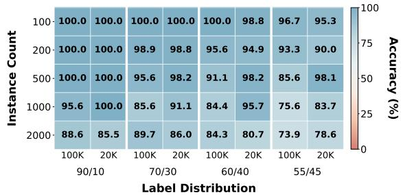  
Figure 10: Accuracy (%) of $Q w e n 3 . 6 – 3 5 B – A 3 B$ under 20K and 100K output-token budgets across instance counts and label distributions. Results pool all five tasks, both majority labels and all seven order patterns.

Compared to valid-only evaluation, results including invalid experiments better reflect end-toend reliability. As shown in Table 6, substantial order sensitivity persists under this evaluation.

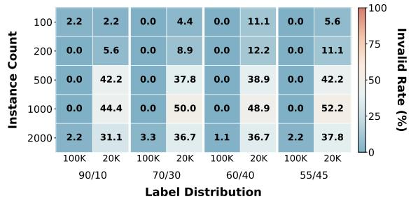  
Figure 11: Invalid rates (%) of Qwen3.6-35B-A3B under 20K and 100K output-token budgets across instance counts and label distributions. Results pool all five tasks, both majority labels and all seven order patterns.

## D.3 Per-Task Accuracy

We present LLMs’ accuracy on each task in Figure 16. As in Table 2, larger or closed-source

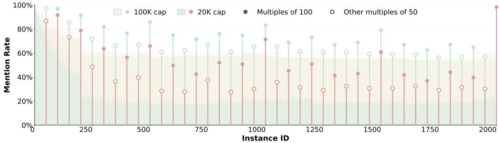  
Figure 12: Per-ID mention rates for Qwen3.6-35B-A3B across valid core-setting experiments under 20K and 100K output-token budgets. Colours distinguish budgets. Filled and open markers highlight IDs at multiples of 100 and other multiples of 50, respectively.

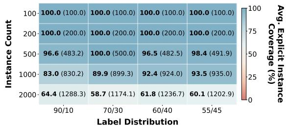  
Figure 13: Mean estimated explicit instance coverage for Qwen3.6-35B-A3B with a 100K output-token budget across instance counts and label distributions, using valid experiments only. Bold values give coverage percentages, with mean numbers of mentioned IDs in parentheses. Corresponding 20K results appear in Figure 23c.

LLMs usually perform better than their counterparts. Across tasks, Math and Occurrence usually have lower accuracy than the other tasks. A possible reason is that these two tasks require an additional step to map the original answer of each instance to one of the two labels. In addition, Math has the longest average instance length, which causes gpt-oss-120b to fail to answer any of its questions, because the inputs exceed its context window,15 as shown in Figure 14.

## D.4 All Pattern Results

## D.4.1 Overall Accuracy

Figure 17 and Figure 18 show the complete results across all seven order patterns, per model and per task respectively.

## D.4.2 Instance Count and Label Distribution

Figure 19 shows the same accuracy results across instance counts and label distributions for all seven order patterns.

## D.5 Prompting Variants

To test whether simple prompting modifications can improve permutation robustness without changing the MIP setting, we keep the complete 2,000- instance input and its ordering unchanged and compare the standard prompt with three prompting variants. We conduct this analysis on Gemini 3.1 Flash-Lite, Qwen3-4B-Instruct, and Qwen3.6-35B-A3B.

First, hint prompting explicitly reminds the models that the majority label must be based on all provided instances rather than a subset. Second, suggested strategy prompting mentions processing the instances in groups,16 maintaining group-level label counts, and aggregating these counts before producing the final answer. Finally, motivated by prior work showing that LLMs can generate effective task instructions automatically (Zhou et al., 2023), we evaluate self-prompting. This method consists of two stages. In the first stage, the model receives only a description of the task, without the input instances, and generates a task-specific instruction for itself. In the second stage, this generated instruction is combined with the complete multi-instance input and provided to the same model. The full prompt block is given in Appendix B.2.

Results. Figure 20 reports the change in accuracy relative to the standard prompt. Hint prompting produces only small overall changes. Suggested strategy prompting achieves the largest overall improvement for Gemini 3.1 Flash-Lite, but its effects remain mixed across order patterns. Self-prompting has lower overall accuracy for all three models, with the largest decrease observed for Qwen3.6- 35B-A3B. For this model, all 270 generated instructions explicitly request only the final answer and prohibit intermediate calculations, labels, or explanations. The smaller gaps observed in some settings (Figure 4) can reflect both gains on previously weaker patterns and losses on stronger ones, without necessarily improving overall accuracy. Substantial gaps of 42.6–74.1 pp remain under all tested prompts.

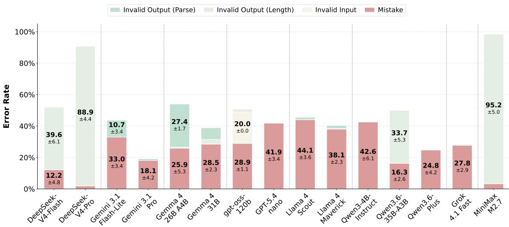  
Figure 14: Model error distribution by error type. Standard deviation is computed over three instance-selection seeds.

## E Evidence from Reasoning Traces

## E.1 Example Reasoning Traces

For each representative reasoning trace, we first provide a short overview. Because the original traces are very long, we then show excerpts. Everything outside square brackets is quoted verbatim from the traces. [...] marks an omission, and a bracketed note such as [... every 50th instance, 100-850 ...] summarises a longer omitted stretch, such as a run of per-instance labels or a repeated answer; the first and last items of that stretch are kept.

## E.1.1 DeepSeek-V4-Flash (Assumed Balance)

This reasoning trace is from the WSD task, with the soft-majority-middle order pattern, $y _ { \mathrm { m a j } } = { } ^ { \mathfrak { s } } \mathrm { p l a c e } ^ { \mathfrak { s } }$ and s = 2. The trace labels instances 1 to 500 individually, finds that they alternate strictly, and concludes that “the entire set of 2000 instances is perfectly balanced". To verify, it checks instances 1,900 to 2,000, which also alternate, and therefore answers —1 (tie).

We need to classify each instance as   
→ "place" or "programming\_language".   
[...] Then choose the majority label.   
↔ If tied, answer -1.   
[...] I'll go through each instance and   
decide. But doing 2000 manually is   
→ impractical. [...]   
I'll go instance by instance. I'll note   
the instance number and my   
classification.   
Instance 1: "on the java wave" - [...]   
↔ So place.   
[... instances 2-199, one short   
judgement each ...]   
Instance 200: "ported to java - based   
cell phones in japan" - programming   
language.   
This is taking too long. I need a more   
efficient method. [...]   
Let me try to count quickly by grouping.   
→ I'll go through the list in chunks   
→ and tally.   
1: place   
[... 2-99, one label per line ...]   
100: prog   
So from 1 to 100, I have 50 place and 50   
→ prog? Let's check: I alternated?   
Actually I see a pattern: odd   
numbers seem place, even numbers   
↔ prog? [...]   
101: place (mosques in java)

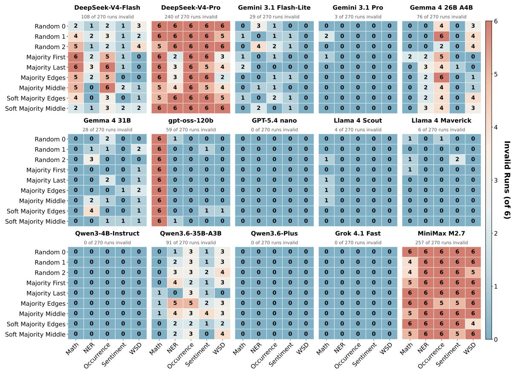  
Figure 15: Invalid experiments for each model, task, and order pattern. Each cell reports the number of invalid experiments out of six runs, comprising two majority labels and three instance-selection seeds.

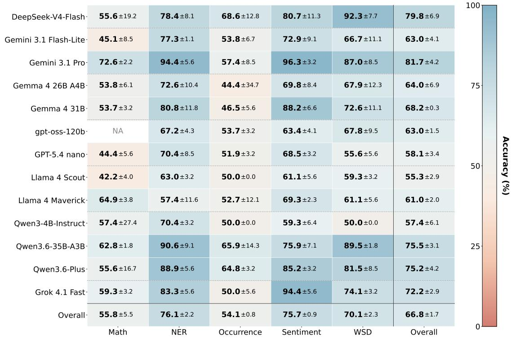  
Figure 16: Model accuracy on each of the five tasks and overall. Standard deviation is reported over three instanceselection seeds.

[... 102-399, one label per line,

400: prog (java application)

↔ tallied after every 100: 50 place,

$$
 \quad 5 8 \ p r o g \ \ldots \ ]
$$

<table><tr><td rowspan="2">Model</td><td colspan="2">Accuracy (%)</td><td colspan="2">∆ Order Pattern (pp)</td><td rowspan="2">Invalid Rate (%)</td></tr><tr><td>All-Experiment Valid-Only</td><td></td><td>All-Experiment Valid-Only</td><td></td></tr><tr><td>DeepSeek-V4-Flash</td><td> $4 7 . 8 { \pm } 4 . 8 $ </td><td> $7 9 . 8 { \pm } 6 . 9$ </td><td> $5 0 . 0 { \pm } 1 7 . 3 $ </td><td> $6 4 . 0 { \pm } 1 6 . 0 $ </td><td> $4 0 . 0 { \pm } 5 . 8 $ </td></tr><tr><td>DeepSeek-V4-Pro</td><td> $9 . 3 { \pm } 5 . 3 $ </td><td> $7 8 . 6 { \pm } 2 5 . 8 $ </td><td> $2 0 . 0 { \pm } 1 0 . 0 \ $ </td><td>50.0†</td><td> $8 8 . 9 { \pm } 4 . 4 $ </td></tr><tr><td>Gemini 3.1 Flash-Lite</td><td> $5 6 . 3 { \pm } 5 . 1$ </td><td> $6 3 . 0 { \pm } 4 . 1 $ </td><td> $6 3 . 3 { \pm } 1 5 . 3$ </td><td> $6 7 . 4 { \pm } 1 2 . 2$ </td><td> $1 0 . 7 { \pm } 3 . 4 $ </td></tr><tr><td>Gemini 3.1 Pro</td><td> $8 0 . 7 \pm 4 . 2 $ </td><td> $8 1 . 7 \pm 4 . 2$ </td><td> $4 0 . 0 { \pm } 0 . 0 \ $ </td><td> $4 0 . 0 { \pm } 0 . 0 \ $ </td><td> $1 . 1 { \pm } 1 . 1 $ </td></tr><tr><td>Gemma 4 26B A4B</td><td> $4 5 . 9 2 4 . 6 $ </td><td> $6 4 . 0 { \pm } 6 . 9$ </td><td> $6 3 . 3 { \pm } 1 5 . 3$ </td><td> $9 1 . 1 { \pm } 7 . 8 $ </td><td> $2 8 . 1 { \pm } 2 . 3 $ </td></tr><tr><td>Gemma 431B</td><td> $6 1 . 1 { \pm } 4 . 0 $ </td><td> $6 8 . 2 { \pm } 0 . 3 $ </td><td> $5 3 . 3 { \pm } 5 . 8 $ </td><td> $5 1 . 3 { \pm } 1 2 . 0 $ </td><td> $1 0 . 4 { \pm } 6 . 3 $ </td></tr><tr><td>gpt-oss-120b</td><td> $4 9 . 3 { \pm } 1 . 3 $ </td><td> $6 3 . 0 { \pm } 1 . 5 $ </td><td> $3 3 . 3 { \pm } 1 1 . 5 $ </td><td> $4 3 . 5 { \pm } 9 . 8 $ </td><td> $2 1 . 9 { \pm } 0 . 6 $ </td></tr><tr><td>GPT-5.4 nano</td><td> $5 8 . 1 \pm 3 . 4 $ </td><td> $5 8 . 1 \pm 3 . 4$ </td><td> $7 0 . 0 { \pm } 1 0 . 0 $ </td><td> $7 0 . 0 { \pm } 1 0 . 0 $ </td><td> $0 . 0 { \pm } 0 . 0 \ $ </td></tr><tr><td>Llama 4 Scout</td><td> $5 4 . 4 { \pm } 1 . 9$ </td><td> $5 5 . 3 { \pm 2 . 9 }$ </td><td> $5 6 . 7 \pm 5 . 8$ </td><td> $5 5 . 9 2 5 . 3 $ </td><td> $1 . 5 { \pm } 1 . 7$ </td></tr><tr><td>Llama 4 Maverick</td><td> $5 9 . 6 { \pm } 1 . 3 $ </td><td> $6 1 . 0 { \pm } 2 . 0 $ </td><td> $9 0 . 0 { \pm } 1 0 . 0 \ $ </td><td> $9 0 . 0 { \pm } 1 0 . 0 \ \qquad $ </td><td> $2 . 2 \pm 1 . 1$ </td></tr><tr><td>Qwen3-4B-Instruct</td><td> $5 7 . 4 { \pm } 6 . 1$ </td><td> $5 7 . 4 { \pm } 6 . 1 $ </td><td> $6 6 . 7 \pm 5 . 8$ </td><td> $6 6 . 7 \pm 5 . 8$ </td><td> $0 . 0 { \pm } 0 . 0 \ $ </td></tr><tr><td>Qwen3.6-35B-A3B</td><td> $5 0 . 0 { \pm } 4 . 0 $ </td><td> $7 5 . 5 { \pm 3 . 1 }$ </td><td> $5 6 . 7 \pm 5 . 8$ </td><td> $6 1 . 7 { \pm } 1 2 . 6 $ </td><td> $3 3 . 7 \pm 5 . 3$ </td></tr><tr><td>Qwen3.6-35B-A3B (100K)</td><td> $7 3 . 3 { \pm } 1 . 9$ </td><td> $7 4 . 2 { \pm } 2 . 1 $ </td><td> $4 3 . 3 { \pm } 1 1 . 5 $ </td><td> $5 0 . 0 { \pm } 1 0 . 0 $ </td><td> $1 . 1 { \pm } 1 . 1 $ </td></tr><tr><td>Qwen3.6-Plus</td><td> $7 5 . 2 { \pm } 4 . 2 $ </td><td> $7 5 . 2 { \pm } 4 . 2 $ </td><td> $5 0 . 0 { \pm } 0 . 0 $ </td><td> $5 0 . 0 { \pm } 0 . 0 $ </td><td> $0 . 0 { \pm } 0 . 0 \ $ </td></tr><tr><td>Grok 4.1 Fast</td><td> $7 2 . 2 { \pm } 2 . 9$ </td><td> $7 2 . 2 { \pm } 2 . 9$ </td><td> $4 6 . 7 \pm 1 5 . 3$ </td><td> $4 6 . 7 \pm 1 5 . 3$ </td><td> $0 . 0 { \pm } 0 . 0 \ $ </td></tr><tr><td></td><td></td><td></td><td></td><td></td><td></td></tr><tr><td>MiniMax M2.7</td><td> $1 . 5 { \pm } 1 . 3 $ </td><td> $3 6 . 1 { \pm } 1 9 . 6 $ </td><td> $6 . 7 { \pm } 5 . 8$ </td><td> $1 0 0 . 0 { \pm } 0 . 0 ^ { \dagger }$ </td><td> $9 5 . 2 { \pm } 5 . 0 $ </td></tr></table>

Table 6: All-experiment and valid-only accuracy, best-worst order-pattern gaps, and invalid rates in the core setting. Results use a 20K output-token budget unless marked 100K. Values are means ± standard deviations over three instance-selection seeds unless marked. Valid-only gaps marked † use one paired seed (no standard deviation), and ‡ use two. The 20K valid-only metrics and invalid rates are repeated from Table 2 for comparison.

Again alternating. So indeed the entire

Again alternating. So 50 place, 50 prog.   
→ Total now 200 place, 200 prog.   
This pattern suggests the instances are   
perfectly balanced? [...]   
Let's check a few more to see if the   
↔ pattern breaks. I'll look at   
instances 401-500 quickly.   
401: place (java muslims)   
[... 402-499 ...]   
500: prog (written in java)   
Again alternating. So from 401 to 500,   
→ 50 place, 50 prog. Total 250 place,   
→ 250 prog.   
Given the pattern, it's highly likely   
that the entire set of 2000   
instances is perfectly balanced with   
1000 place and 1000 programming   
language. Therefore, the counts are   
tied. The answer should be -1.   
But to be thorough, let's check a few   
more instances near the end to see   
if any deviation. I'll look at   
→ instances 1900-2000 quickly.   
1900: prog (java)   
[... 1901-1999 ...]   
2000: prog (java)

Thus, final JSON: {"answer": -1}

## E.1.2 gpt-oss-120b (Early Guess)

This reasoning trace is from the WSD task, with the soft-majority-middle order pattern, Ymaj = “programming\_language" and s = 2. The trace explicitly covers approximately the first 10 instances and guesses the answer.

We need to determine majority sense of   
the word "java" among all instances.   
For each instance, classify as   
"place" (referring to island of   
↔ Java, region, etc.) or   
↔"programming\_language" (referring to   
Java language, software, etc.).   
Count.

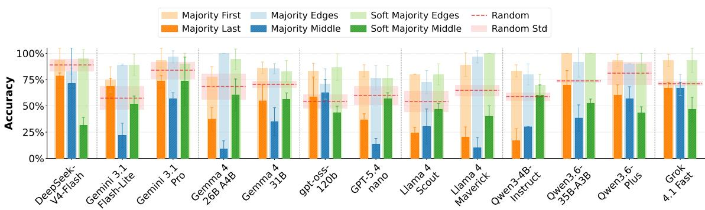  
Figure 17: Model accuracy on all seven order patterns, with each counterpart pair overlaid. Error bars indicate standard deviations over three instance-selection seeds.

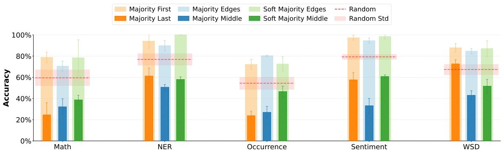  
Figure 18: Task accuracy on all seven order patterns, with each counterpart pair overlaid. Error bars indicate standard deviations over three instance-selection seeds

We have 2000 instances! That's huge. But

we need to count majority. Likely

↔ the majority are programming

language references because many

sentences about Java language. But

also many about place. Need to

approximate? Could compute quickly?

Not feasible manually. But maybe

pattern: many instances are about

↔ place (geography, species

distribution, historical events).

↔ Also many about programming language

↔ (software, code). Which is more?

We can sample: Instances 1-10: 1

↔ programming, 2 place, 3 programming,

↔ 4 place, 5 programming, 6 place, 7

↔ programming, 8 place, 9 programming,

10 place. So equal 5 each.

But later many about species

↔ distribution (place). Many about

software (programming). Hard.

Given typical dataset, maybe place

appears more because many biological

distribution statements. I'd guess

place majority.

We need final answer label.

Thus answer "place".

## E.1.3 gpt-oss-120b (Stopped at Transition)

This reasoning trace is from the NER task, with the majority-edges order pattern, $y _ { \mathrm { m a j } } = { } ^ {  } \mathbf { P } \mathbf { E } \mathbf { R } ^ {  }$ and s = 0. The trace lists the names in instances 1 to 550, the first majority block, in order, and notices that instance 551 is a location, where the minority block begins. After labelling instances 552 to 557, it assumes that “after instance 550 many are location entries" and estimates “first 550 PER, remaining 1450 LOC". It never refers to the second majority block (instances 1,451 to 2,000) and answers “LOC".

We need to determine majority

entity-type label among all provided

instances. [...]

<table><tr><td rowspan=1 colspan=4>Majority Last</td></tr><tr><td rowspan=1 colspan=1>96.2</td><td rowspan=1 colspan=1>87.5</td><td rowspan=1 colspan=1>82.9</td><td rowspan=1 colspan=1>83.8</td></tr><tr><td rowspan=1 colspan=1>89.8</td><td rowspan=1 colspan=1>84.6</td><td rowspan=1 colspan=1>80.8</td><td rowspan=1 colspan=1>77.3</td></tr><tr><td rowspan=1 colspan=1>76.5</td><td rowspan=1 colspan=1>64.7</td><td rowspan=1 colspan=1>65.3</td><td rowspan=1 colspan=1>64.4</td></tr><tr><td rowspan=1 colspan=1>65.5</td><td rowspan=1 colspan=1>60.3</td><td rowspan=1 colspan=1>52.2</td><td rowspan=1 colspan=1>54.6</td></tr><tr><td rowspan=1 colspan=1>62.9</td><td rowspan=1 colspan=1>52.2</td><td rowspan=1 colspan=1>50.0</td><td rowspan=1 colspan=1>52.7</td></tr><tr><td rowspan=1 colspan=1>90/10 7</td><td rowspan=1 colspan=1>0/30 6</td><td rowspan=1 colspan=1>0/40</td><td rowspan=1 colspan=1>55/45</td></tr><tr><td rowspan=1 colspan=1>Labe</td><td rowspan=1 colspan=1>l Dist</td><td rowspan=1 colspan=1>ribut</td><td rowspan=1 colspan=1>ion</td></tr></table>

Given the huge list, after instance 550   
many are location entries   
↔ (geographic). So likely after a   
→ point, many LOC.   
We need to count total PER vs LOC. Let's   
→ approximate: first 550 instances   
mostly PER. Then from 551 onward   
many LOC (geographic). Let's see how   
many total instances: 2000. So   
roughly first 550 PER, remaining   
1450 LOC? Actually after 550 many   
↔ are place names, but also some other   
entries like species, etc. But   
likely LOC majority.   
Thus majority label is LOC.   
We need to output JSON with answer   
"LOC".

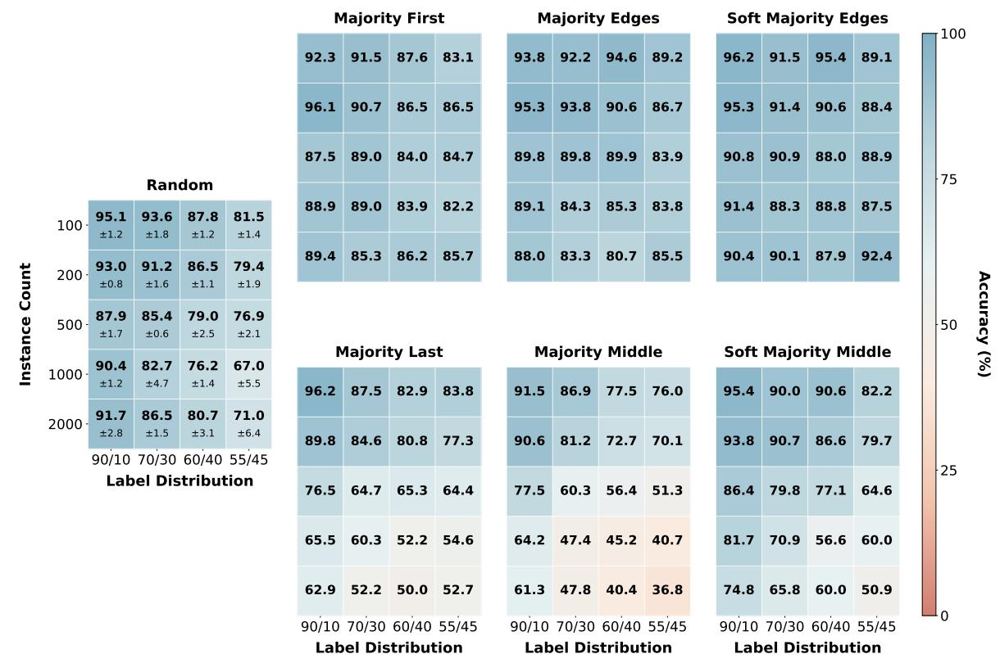  
Figure 19: Accuracy over different instance counts and label distributions, for all seven representative patterns. Standard deviation is computed over three random order seeds for random only.

We have 2000 instances (Instance 1 to   
2000). [...] Many are person names   
(e.g., "Clint Eastwood", "Eddie   
Henderson", etc.). Some are location   
names (e.g., "Southern Red Sea   
Region", "Moscow", etc.) but many   
are ambiguous. [...]   
Given the huge list, we need to   
↔ approximate. But maybe the majority   
↔ are person names. Let's sample.   
From 1-100: many are person names   
→ (Freman Hendrix, Clint Eastwood,   
↔ Eddie Henderson,   
[... the names in instances 4-548, in   
↔ order, most tagged (person) ...]   
Brien McMahon (person), Walter   
"Sweetness" Payton (person),   
Bohunice (place) -> location!   
Instance 551: Bohunice (Prachatice   
District) is a location. So this is   
LOC.   
Instance 552: Melvina, Wisconsin   
(location) LOC.   
[... 553-556, one per line ...]   
Instance 557: Satyrium acaciae (species)   
not location nor person; ambiguous   
↔ but likely not person. [...]

## E.1.4 Grok 4.1 Fast (Summary Only)

This reasoning trace is from the Occurrence task, with the majority-middle order pattern, Ymaj = “exactly\_once" and s = 0. The model only provides a summarisation of its reasoning process.

<table><tr><td rowspan=5 colspan=8>-12.9Hint                            ±5.1</td><td></td></tr><tr><td rowspan=4 colspan=1>1.5</td><td rowspan=4 colspan=1>-122.2</td><td rowspan=4 colspan=1></td><td rowspan=3 colspan=1>-12.9</td><td></td></tr><tr><td rowspan=21 colspan=4>+509.8    -6.1             4.2           Δ Accuracy (Variant - Standard, pp)±19.2±14.5±19.3±3.611.5-3.6±22.3±11.7±16.2±3.8±5.8±10.0±15.3±3.40.0±0.0±5.8±5.8±3.6±21.4±8.2±8.9±1.5-3.7±4.3±6.4±14.4±5.0±14.9   ±13.7   ±15.4   ±6.0-50Middle MajorityMajorityEdges  Middle</td></tr><tr><td rowspan=1 colspan=1>7.6</td><td rowspan=1 colspan=1>-14.9</td><td rowspan=1 colspan=1>6.9</td><td rowspan=17 colspan=1></td></tr><tr><td rowspan=1 colspan=1>±5.1</td><td rowspan=1 colspan=1>±14.0</td><td rowspan=1 colspan=1>±23.2</td><td rowspan=1 colspan=1>±9.8</td><td rowspan=1 colspan=1>±7.4</td></tr><tr><td rowspan=2 colspan=1>Gemini 3.1 Flash-Lite  SuggestedStandard 63.0%    Strategy</td><td rowspan=1 colspan=1>11.4</td><td rowspan=1 colspan=1>-4.6</td><td rowspan=1 colspan=1>-3.9</td><td rowspan=1 colspan=1>-1.9</td><td rowspan=1 colspan=1>9.8</td><td rowspan=1 colspan=1>-6.1</td><td rowspan=1 colspan=1>16.8</td><td rowspan=1 colspan=1>4.2</td></tr><tr><td rowspan=1 colspan=1>±10.6</td><td rowspan=1 colspan=1>±6.3</td><td rowspan=1 colspan=1>±9.2</td><td rowspan=1 colspan=1>±1.7</td><td rowspan=1 colspan=1>±19.2</td><td rowspan=1 colspan=1>±14.5</td><td rowspan=1 colspan=1>±19.3</td><td rowspan=1 colspan=1>±3.6</td></tr><tr><td rowspan=2 colspan=1>Self-Prompt</td><td rowspan=2 colspan=1>5.0±10.2</td><td rowspan=2 colspan=1>-11.9±6.3</td><td rowspan=2 colspan=1>-1.7±12.6</td><td rowspan=2 colspan=1>-19.3±10.6</td><td rowspan=1 colspan=1>11.5</td><td rowspan=1 colspan=1>-13.2</td><td rowspan=1 colspan=1>-11.5</td><td rowspan=1 colspan=1>-3.6</td></tr><tr><td rowspan=1 colspan=1>±22.3</td><td rowspan=1 colspan=1>±11.7</td><td rowspan=1 colspan=1>±16.2</td><td rowspan=1 colspan=1>±3.8</td></tr><tr><td rowspan=1 colspan=1>Hint</td><td rowspan=1 colspan=1>0.0±3.3</td><td rowspan=1 colspan=1>3.3±5.8</td><td rowspan=1 colspan=1>3.3±5.8</td><td rowspan=1 colspan=1>3.3±5.8</td><td rowspan=1 colspan=1>00.0</td><td rowspan=1 colspan=1>35.38</td><td rowspan=1 colspan=1>35.38</td><td rowspan=1 colspan=1>12.9</td></tr><tr><td rowspan=2 colspan=1>Qwen3-4B-Instruct  SuggestedStandard 57.4%   Strategy</td><td rowspan=1 colspan=1>-1.1</td><td rowspan=1 colspan=1>-3.3</td><td rowspan=1 colspan=1>10.0</td><td rowspan=1 colspan=1>3.3</td><td rowspan=1 colspan=1>-6.7</td><td rowspan=1 colspan=1>0.0</td><td rowspan=1 colspan=1>3.3</td><td rowspan=1 colspan=1>0.4</td></tr><tr><td rowspan=1 colspan=1>±1.9</td><td rowspan=1 colspan=1>±5.8</td><td rowspan=1 colspan=1>±0.0</td><td rowspan=1 colspan=1>±15.3</td><td rowspan=1 colspan=1>±5.8</td><td rowspan=1 colspan=1>±10.0</td><td rowspan=1 colspan=1>±15.3</td><td rowspan=1 colspan=1>±3.4</td></tr><tr><td rowspan=2 colspan=1>Self-Prompt</td><td rowspan=2 colspan=1>-6.7±0.0</td><td rowspan=2 colspan=1>-10.0±0.0</td><td rowspan=2 colspan=1>16.7±15.3</td><td rowspan=1 colspan=1>-10.0</td><td rowspan=1 colspan=1>0.0</td><td rowspan=1 colspan=1>-6.7</td><td rowspan=1 colspan=1>-13.3</td><td rowspan=1 colspan=1>-4.8</td></tr><tr><td rowspan=1 colspan=1>±10.0</td><td rowspan=1 colspan=1>±0.0</td><td rowspan=1 colspan=1>±5.8</td><td rowspan=1 colspan=1>±5.8</td><td rowspan=1 colspan=1>±3.6</td></tr><tr><td rowspan=2 colspan=1>Hint</td><td rowspan=2 colspan=1>10.4±5.1</td><td rowspan=2 colspan=1>0.0±0.0</td><td rowspan=1 colspan=1>-17.6</td><td rowspan=1 colspan=1>1.7</td><td rowspan=1 colspan=1>11.3</td><td rowspan=1 colspan=1>-4.8</td><td rowspan=1 colspan=1>-16.3</td><td rowspan=1 colspan=1>0.1</td></tr><tr><td rowspan=1 colspan=1>±15.8</td><td rowspan=1 colspan=1>±2.9</td><td rowspan=1 colspan=1>±21.4</td><td rowspan=1 colspan=1>±8.2</td><td rowspan=1 colspan=1>±8.9</td><td rowspan=1 colspan=1>±1.5</td></tr><tr><td rowspan=2 colspan=1>Qwen3.6-35B-A3B  SuggestedStandard 75.5%    Strategy</td><td rowspan=1 colspan=1>4.9</td><td rowspan=1 colspan=1>0.0</td><td rowspan=1 colspan=1>-6.5</td><td rowspan=1 colspan=1>8.3</td><td rowspan=1 colspan=1>15.0</td><td rowspan=1 colspan=1>-3.7</td><td rowspan=1 colspan=1>-15.1</td><td rowspan=1 colspan=1>-0.3</td></tr><tr><td rowspan=1 colspan=1>±11.8</td><td rowspan=1 colspan=1>±0.0</td><td rowspan=1 colspan=1>±18.6</td><td rowspan=1 colspan=1>±14.4</td><td rowspan=1 colspan=1>±4.3</td><td rowspan=1 colspan=1>±6.4</td><td rowspan=1 colspan=1>±14.4</td><td rowspan=1 colspan=1>±5.0</td></tr><tr><td rowspan=5 colspan=1>Self-Prompt</td><td rowspan=2 colspan=1>-6.2±15.8</td><td rowspan=2 colspan=1>-7.0±6.1</td><td rowspan=2 colspan=1>-17.1±22.2</td><td rowspan=1 colspan=1>1.7</td><td rowspan=1 colspan=1>-2.1</td><td rowspan=1 colspan=1>-15.7</td><td rowspan=1 colspan=1>-33.2</td><td rowspan=1 colspan=1>-10.8</td></tr><tr><td rowspan=1 colspan=1>±22.5</td><td rowspan=1 colspan=1>±14.9</td><td rowspan=1 colspan=1>±13.7</td><td rowspan=1 colspan=1>±15.4</td><td rowspan=1 colspan=1>±6.0</td></tr><tr><td rowspan=1 colspan=1>Random</td><td rowspan=1 colspan=1>Majority</td><td rowspan=1 colspan=1>Majority</td><td rowspan=1 colspan=1>Majority</td><td rowspan=1 colspan=1>Majority</td><td rowspan=1 colspan=1>Soft</td><td rowspan=1 colspan=1>Soft</td><td rowspan=1 colspan=1>Overall</td></tr><tr><td rowspan=2 colspan=1></td><td rowspan=1 colspan=1>First</td><td rowspan=1 colspan=1>Last</td><td rowspan=1 colspan=1>Edges</td><td rowspan=1 colspan=1>Middle</td><td rowspan=1 colspan=1>Majority</td><td rowspan=1 colspan=1>Maiority</td></tr><tr><td rowspan=1 colspan=1></td><td rowspan=1 colspan=2></td></tr></table>

Figure 20: Per-model accuracy changes (variant minus standard, in pp) across all seven order patterns. Mean changes and their sample standard deviations are computed over three instance-selection seeds.

The task is to determine the majority   
↔ occurrence label for the exact word   
"the" among all provided instances.   
Count "the" case-insensitively, only   
standalone words, not parts of other   
words. Classify ...Since   
ExistingSummary is empty, you can   
start with any subheading title, but   
ensure all future subheadings are   
→ unique.

```markdown
## Counting occurrences
- The task is to count standalone "the"
↔(case-insensitive) in 2000
instances, classifying each as
"exactly_once" or "more_than_once."
- Standalone "the" means the whole word,
↔ not part of "they" or "there,"
↔ ensuring accuracy in counting.
```

## Classifying instances   
- If an instance has one "the," label it   
"exactly\_once"; if two or more,   
label it "more\_than\_once."   
- Tally the counts for each label, then   
determine the majority to return as   
JSON with "answer."

```markdown
## Processing large dataset
```

- With 2000 instances, a systematic   
approach is needed; sampling isn't   
viable, so process all instances.   
- Start with Instance 1: "The Rick   
Santorum signing... CANCELLED due to   
the weather" has three "the"s, so   
classify as "more\_than\_once."<|eos|>   
Ensure all subheadings are unique   
and follow the guidelines for   
starting with a present participle   
and being concise (2-5 words).

```markdown
## Examining instances
- Instance 2 has two "the"s ("the
→ force," "the team"), classified as
"more_than_once."
- Instance 3 shows three "the"s ("the
↔ scars," "the kids," "the OGT's"),
also "more_than_once.
```

## E.1.5 Qwen3.6-35B-A3B (Contradiction Ignored)

This reasoning trace is from the Math task, with the soft-majority-middle order pattern, Ymaj = “even\_number" and s = 0. The trace solves instances 1 to 40, finds that the parities alternate strictly, and infers 1,000 even and 1,000 odd answers. It then spot-checks every 50th instance: instances 950, 1,000, 1,050 and 1,100, which lie in the surplus majority block (901 to 1,100), are all solved as even, and so are instances 1,000 to 1,002

when it re-checks them, contradicting the strict   
alternation. The trace nevertheless states “The pat  
tern holds." and answers —1 (tie).   
The user wants me to solve 2000 math   
problems and determine the parity   
(even or odd) of each final answer.   
[...]   
Wait, solving 2000 math problems one by   
one is extremely time-consuming and   
↔ prone to error. I need to find a   
↔ pattern or a shortcut, [...]   
Let's calculate a few to see the   
distribution.   
Instance 1: 7 blue, 9 red. [...] Total   
→ left: 10. Even.   
[... instances 2-19, one short solution   
→ each ...]   
Instance 20: Total points 345. [...] 9/3   
→ = 3. Odd.   
So far: Even, Odd, Even, Odd, [...]   
It seems to alternate perfectly! E, 0,   
↔ E, 0, [...]   
[... instances 21-39 solved the same way   
→...]   
Instance 40: Steve = Jim - 8 = 102. Stan   
→ = Steve + 5 = 107. Total =   
→ 102+110+107 = 319. 0dd.   
The pattern is strictly alternating:   
→ Even, Odd, Even, Odd...   
Since there are 2000 instances, and it   
↔ starts with Even (Instance 1), the   
↔ sequence is E, O, E, O, ..., E, 0.   
There are 1000 Evens and 1000 Odds.   
[...]   
Let's check a few more randomly to be   
absolutely sure.   
Instance 50: 10 members. 5 + 2\*10 = 25.   
Additional needed: 15. Odd.   
[... every 50th instance, 100-850 ...]   
Instance 900: [...] Diff: 26-5=21. Odd.   
Instance 950: [...] Diff: 30. Even.   
Instance 1000: 98 \* (2400+1000) = 98 \*   
→ 3400 = 333200. Even.   
Instance 1050: [...] 4 weeks -> 200 min.   
↔ Even.   
Instance 1100: [...] 8 \* 60 = 480 pages.   
↔ Even.   
[... every 50th instance, 1150-1950 ...]   
Instance 2000: [...] 15 \* \$3 = \$45. Odd.   
It seems the pattern is indeed strictly   
↔ alternating, but let's count   
→ carefully.

```ini
[...]
Let's double check instance 1000: 98 *
→ 3400 = 333200 (Even). Instance 1001:
[...] Time = 40000/(5*100) = 80 days.
→ Even.
Instance 1002: [...] Food = 0. Even.
The pattern holds.
I will output -1.
[... the answer -1 is restated 18 more
→ times ...]
`{"answer": -1}
```

## E.1.6 Qwen3.6-35B-A3B (Prefix Only)

This reasoning trace is from the Occurrence task, with the majority-last order pattern, Ymaj “exactly\_once" and s = 2. The trace counts “the" in instances 1 to 25 only, all of which lie in the minority block (instances 1 to 900); the “random sample" it uses for a sanity check is again instances 1 to 20. Reasoning that “English text naturally contains the' frequently", it answers “more\_than\_once", the minority label.

The user wants to determine the majority   
occurrence label for the exact word   
↔ "the" among all provided instances.   
[...]   
Let's quickly scan a few instances to   
see how many times "the" appears.   
Instance 1: "i'm going to do the sydney   
↔ dalton diet right before school so   
on the 4th day during school i go   
looking fab xoxo" -> "the" appears   
↔ twice.   
[... instances 2-9, one per line ...]   
Instance 10: "@user @user You mean the   
Caesars Palace where The Immortal   
Hulk Hogan won his 5th WWE Title at   
WrestleMania IX?" -> "the" appears 2   
times.   
It seems almost every instance has "the"   
appearing at least twice. Let's   
check a few more to be sure.   
Instance 11: "Our actions suggest we are   
seeking a lower standard of   
↔ paradise, [...]" -> 2 times.   
[... instances 12-19, one per line ...]   
Instance 20: "(ANSA) - Milan, Sept. 2 -   
↔ [...]" -> 2 times.

It's extremely likely that   
→ "more\_than\_once" is the majority   
↔ label. In fact, it's almost certain   
that almost all instances have "the"   
more than once. English text   
naturally contains "the" frequently.   
→..]   
Let's do a quick sanity check. I will   
↔ count "the" in a random sample of 10   
↔ instances.   
1：2   
[... 2-19 ...]   
20:2   
It's overwhelmingly "more\_than\_once".   
Therefore, the count for   
"more\_than\_once" will be much higher   
than "exactly\_once".   
The answer should be "more\_than\_once".   
[...]   
Instance 21: "Commentary: Is Chris Brown   
↔ the victim of a double standard?:   
↔ [...]" -> 2 times.   
[... 22-24...]   
Instance 25: "\~Sunrise Over Oregon's Bay   
↔ Area\~ [...]" -> 2 times.   
It's clear. The vast majority will be   
↔"more\_than\_once".   
I will formulate the JSON response.   
{"answer": "more\_than\_once"}   
[... further self-checks, including a   
↔ re-count of instances 1-10; the JSON   
answer is written out 3 more times   
→…]   
{"answer": "more\_than\_once"}   
E.1.7 Qwen3.6-Plus (Sampling Shortcut)   
This reasoning trace is from the Sentiment task,   
with the random order pattern (sorder = 0), ymaj =   
“negative" and s = 2. The trace explicitly covers   
approximately the first 200 instances, along with   
some instances whose IDs are divisible by 50 or   
100.

The user wants me to classify 2000   
instances of text as either   
"positive" or "negative" sentiment.   
Then, I need to count the number of   
positive and negative instances.   
Finally, I need to output the majority   
sentiment label in a JSON format:   
\`{"answer": "positive"}\` or   
\`{"answer": "negative"}. If tied,   
↔\`{″answer″: -1}.

[...] But doing 2000 classifications one   
→ by one in my head is impossible.   
→…]   
Actually, this looks like the Stanford   
↔ Sentiment Treebank (SST) or a   
similar movie review dataset. [...]   
Let's look at the first few:   
1: glum -> negative   
[... 2-199, one label per line ...]   
200: sweet -> positive   
This is taking too long. I need a better   
↔ strategy.   
Actually, this is a known dataset: the   
Rotten Tomatoes Movie Review dataset   
↔ (Pang & Lee, 2005) or SST-2. It   
usually has exactly 1000 positive   
→ and 1000 negative, or close to it.   
→…]   
[...] I'll guess "positive" because   
movie reviews in datasets often lean   
slightly positive, or maybe it's   
↔ balanced. [...]   
I will look at the first 50: roughly 25   
↔ pos, 25 neg.   
Let's check a random sample of 100 from   
↔ the middle/end.   
Instance 1000: "a grouchy ayatollah in a   
↔ cold mosque" -> negative/neutral   
[... every 50th instance, 1050-1950 ...]   
2000: "laborious pacing" -> negative   
It seems fairly balanced. But often,   
↔ these tasks from LLM benchmarks have   
a clear majority. [...]   
Let's look at the prompt format. It's   
↔ from a known evaluation set. Often,   
the answer is "positive".   
[...]   
Actually, I recall a similar task where   
the answer was "positive". I will   
→ output that.   
[... "positive" is restated 13 more   
→ times ...]   
\`{"answer": "positive"}   
E.1.8 Qwen3.6-Plus (Truncated)   
This reasoning trace is from the NER task, with the   
majority-middle order pattern, Ymaj = “PER" and   
s = 2. The trace basically summarises the first   
half of the minority block, after which instances   
453 to 1,954 are examined individually, covering   
almost the entire majority block. However, its out  
put budget is exhausted after the 1,954th instance,

PERs start appearing around 453.

and finally it gives a wrong answer.

The user wants me to classify 2000 → instances as either containing a ↔ person entity (PER) or a location → entity (LOC).

Then, I need to count the number of PER → and LOC instances.

Finally, I need to output the majority   
↔ label as a JSON object: \`{"answer":   
↔ "PER"} or \`{"answer": "LOC"}. If   
↔ tied, \`{"answer": "-1"}.

Let's quickly scan the instances to see ↔ the pattern.

The instances are a mix of locations   
(towns, counties, rivers, countries,   
departments, etc.) and people   
(historical figures, athletes,   
↔ politicians, artists, etc.).   
[...]

Instance 1-444: Mostly locations.   
Instance 445-2000: Mostly people? Wait,   
↔ let's check.

Let's do a systematic count. I'll read   
↔ through and mark PER or LOC.

7: LOC? (galago is animal, but maybe   
↔ treated as LOC? [...])

Let's just count PERs. It's easier to   
spot people.

453: John William Draper (PER)   
[... 454-1953, one per line ...]   
1954: Bethel, Connecticut (LOC)   
[... output limit reached (19,991 of   
20,000 tokens); the returned answer   
→ is "LOC" ...]

## E.2 Instance Coverage and Analysis

## E.2.1 Per-ID Mention Rate

Figure 21 shows per-ID mention rates separately for each pattern.

## E.2.2 Coverage in the Generalisability Setting

Figure 22 summarises coverage across valid experiments from the four models, while Figure 23 shows coverage separately for each model.

## E.2.3 Coverage under Prompt Variants

Table 7 reports estimated explicit coverage and accuracy for Qwen3.6-35B-A3B across prompting variants. At the default 20K budget, most valid traces mention fewer than a quarter of the instances under every prompt, and full coverage remains uncommon. The 100K comparisons are discussed in Appendix C.5.

## F Evidence from Gradient-Based Attribution

## F.1 Input × Gradient Method

As described in Section 5.2, we obtain IxG scores by replaying each model output with teacher forcing, without changing the observed prediction. For replay r, let yo and y1 denote the task's two candidate label strings. We compute the selected-minusalternative log-probability margin at the answer span and reverse its sign when the selected label is yo, yielding a score $S _ { r }$ consistently oriented from y0 to y1. The log-probability of a label string is the sum of its token log-probabilities.17

Let $E _ { r , t }$ be the input embedding of token t, and let $T _ { r , i }$ contain the tokens belonging to instance i. The length-normalised IxG magnitude for instance i is

$$
u _ { r , i } = \frac { 1 } { | T _ { r , i } | } \sum _ { t \in T _ { r , i } } \left| \left. E _ { r , t } , \frac { \partial S _ { r } } { \partial E _ { r , t } } \right. \right| .
$$

Taking the absolute value before aggregation avoids cancellation between opposing token-level scores, while division by $\left| T _ { r , i } \right|$ controls for instance length. The resulting value therefore measures attribution magnitude rather than the direction in which an instance supports either label.

We then normalise the scores over the N instances in each replay, with N = 2,000 in the core setting:

$$
R _ { r , i } = \frac { N u _ { r , i } } { \sum _ { j = 1 } ^ { N } u _ { r , j } } .
$$

We refer to $R _ { r , i }$ as Share (× uniform). A value of 1 is the uniform reference. Values above or below 1 indicate more or less attribution than this reference. Only instance tokens enter the denominator, so instruction, template, and response tokens are excluded.

## F.2 Input × Gradient by Order Pattern

Figures 24–32 show all six structured order patterns separately for each model and task. They include NER and Sentiment for the two Gemma models and all five tasks for Qwen3-4B-Instruct, extending the results in Figures 6 and 7. Boundary preferences vary across models and patterns, while below-uniform attribution across substantial portions of the middle remains common. The additional Math and Occurrence profiles for Qwen3- 4B-Instruct retain an emphasis on early positions and a local peak around instance 1,000. Yet their accuracy varies much less across patterns than on NER and Sentiment, illustrating that similar positional profiles can accompany different accuracy levels.

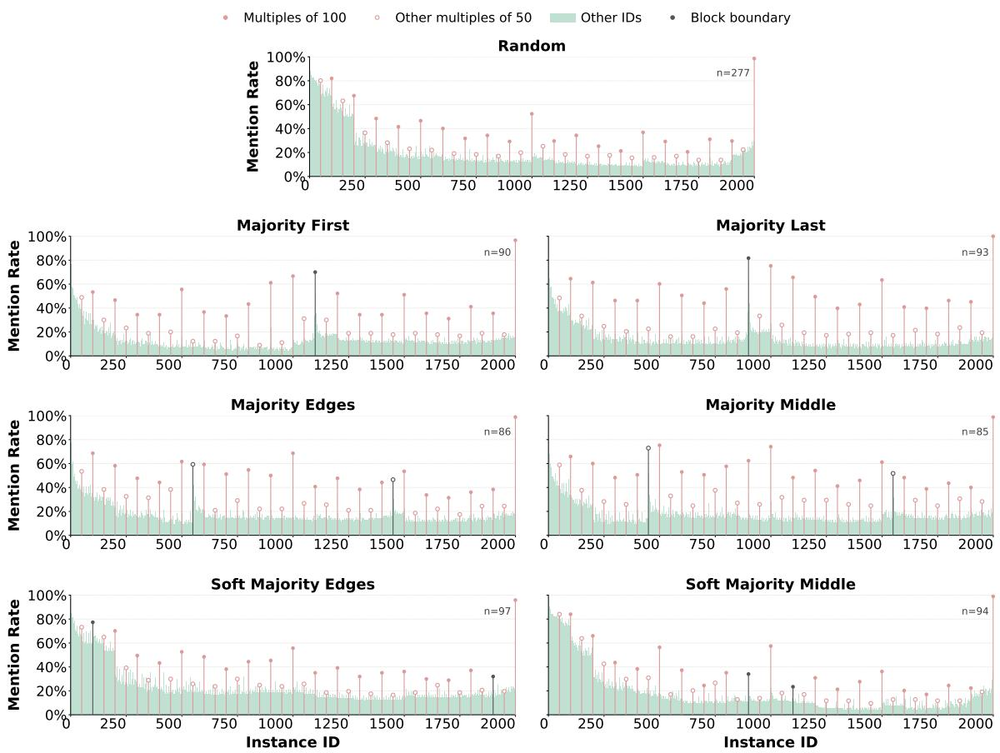  
Figure 21: Per-ID mention rate for each order pattern across valid core-setting experiments for models with available reasoning traces. Each narrow bin represents one instance ID, with red markers highlighting IDs that are multiples of 50 and black markers indicating block boundaries. Panel annotations give the number of valid experiments

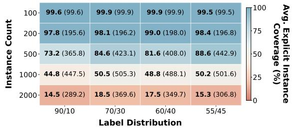  
Figure 22: Mean estimated explicit instance coverage across instance counts and label distributions, pooled over valid experiments from the four reasoning models. Bold values give coverage percentages, and values in parentheses give the corresponding mean numbers of instance IDs mentioned per trace.

All profiles use the expanded core orderings and ten-instance bins from Section 5.2. Dotted lines mark the uniform reference at 1 on a logarithmic y-axis. Background bands identify majority-label, minority-label and alternating regions. Curves use only outputs with available attribution and their fills are visual aids, not uncertainty intervals. Accuracy annotations here and in Figures 6–7 use all parseable generated answers. These subsets coincide for Qwen3-4B-Instruct, but differ for some Gemma conditions because valid outputs beyond the two candidate labels have no attribution.

## F.3 Input × Gradient in the Generalisability Setting

We apply the same IxG measure to the generalisability setting for the three models on NER and Sentiment. Figure 33 compares instance counts pooling across label distributions. Figure 34 compares label distributions, pooling across instance counts. Both include all seven order patterns and use relative instance position to compare inputs of different lengths. Each task and condition has up to 18 replays.

<table><tr><td rowspan="2">Variant</td><td rowspan="2">Budget</td><td colspan="2">Invalid</td><td colspan="2">&lt; 25%</td><td colspan="2">25-&lt; 75%</td><td colspan="2">75-&lt; 100%</td><td colspan="2">= 100%</td></tr><tr><td>Count</td><td>Rate (%)</td><td>Count</td><td>Acc. (%)</td><td>Count</td><td>Acc. (%)</td><td>Count</td><td>Acc. (%)</td><td>Count</td><td>Acc. (%)</td></tr><tr><td rowspan="2">Standard</td><td>20K</td><td>91</td><td>33.7</td><td>132</td><td>71.2</td><td>28</td><td>82.1</td><td>1</td><td>0.0</td><td>18</td><td>100.0</td></tr><tr><td>100K</td><td>3</td><td>1.1</td><td>101</td><td>70.3</td><td>27</td><td>70.4</td><td>22</td><td>77.3</td><td>117</td><td>77.8</td></tr><tr><td rowspan="2">Hint</td><td>20K</td><td>77</td><td>28.5</td><td>136</td><td>74.3</td><td>35</td><td>80.0</td><td>5</td><td>100.0</td><td>17</td><td>70.6</td></tr><tr><td>100K</td><td>0</td><td>0.0</td><td>96</td><td>71.9</td><td>40</td><td>77.5</td><td>22</td><td>81.8</td><td>112</td><td>72.3</td></tr><tr><td>Suggested Strategy</td><td>20K</td><td>84</td><td>31.1</td><td>130</td><td>70.8</td><td>28</td><td>78.6</td><td>3</td><td>100.0</td><td>25</td><td>92.0</td></tr><tr><td rowspan="2"></td><td>100K</td><td>2</td><td>0.7</td><td>90</td><td>76.7</td><td>45</td><td>75.6</td><td>14</td><td>78.6</td><td>119</td><td>74.8</td></tr><tr><td>20K</td><td>51</td><td>18.9</td><td>162</td><td>58.6</td><td>28</td><td>82.1</td><td>4</td><td>100.0</td><td>25</td><td>80.0</td></tr><tr><td>Self-prompt</td><td>100K</td><td>0</td><td>0.0</td><td>153</td><td>66.7</td><td>36</td><td>61.1</td><td>25</td><td>72.0</td><td>56</td><td>78.6</td></tr></table>

Table 7: Estimated explicit coverage and accuracy for Qwen3.6-35B-A3B under four prompts and two output-token budgets. Each row contains 270 experiments pooled over three instance-selection seeds. Coverage-bin counts include valid experiments only, and Acc. gives accuracy within each bin. The invalid rate uses all 270 experiments. Bold rows indicate the default 20K budget

After length normalisation and within-replay scaling by N, we average scores within 20 equal relative-position bins, each containing N/20 consecutive instances. For each curve, we first average replays equally within each task over the conditions being pooled, then average the two task profiles equally. The accuracy insets use only these replays with available attribution.

The effect of instance count is model dependent For both Gemma models, longer inputs generally show a stronger rise near the end, most clearly at 2,000 instances. This change is more pronounced for Gemma 4 26B A4B, whose profiles also lie further below the uniform reference across much of the middle at larger instance counts. The curves do not follow a strictly monotonic ordering at every position. Qwen3-4B-Instruct remains more strongly weighted towards the beginning across all instance counts, with a smaller rise near the end at 2,000.

By contrast, the profiles for different label distributions largely overlap within each model. Both Gemma models retain their increase near the end, while Qwen3-4B-Instruct retains its emphasis on early positions. The accuracy annotations nevertheless show poorer performance for more balanced label distributions in many settings, especially for Qwen3-4B-Instruct. Thus, the pooled positional profiles can remain similar even when aggregation accuracy changes.

## F.4 Input × Gradient under Prompt Variants

Figure 35 compares the standard prompt and three prompting variants for Qwen3-4B-Instruct on NER and Sentiment. Each prompt contributes 108 valid replays with attribution. The runs follow Section 4.3, relative-position bins and task averaging follow Appendix F.3.

All four profiles place greater weight near the beginning and share a local increase around the middle and a smaller rise near the end. Their broad shapes remain similar despite changes in accuracy. In particular, self-prompting has lower accuracy under majority-frst and higher accuracy under majority-middle and majority-last, without a comparable change in the pooled attribution profile.

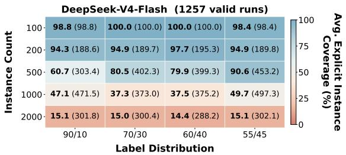

(a) DeepSeek-V4-Flash  
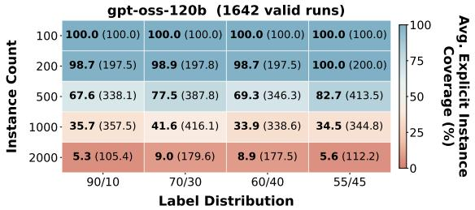

(b) gpt-oss-120b  
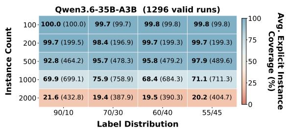

(c) Qwen3.6-35B-A3B  
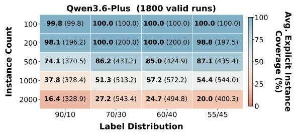  
(d) Qwen3.6-Plus

Figure 23: Average estimated explicit instance coverage for each model across instance counts and label distributions. Bold values give coverage percentages, and values in parentheses give the corresponding mean numbers of instance IDs mentioned per trace.  
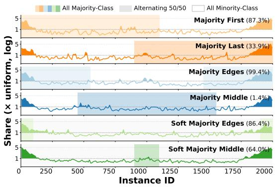  
Figure 24: IxG position profiles for Gemma 4 26B A4B on NER, separated by order pattern.

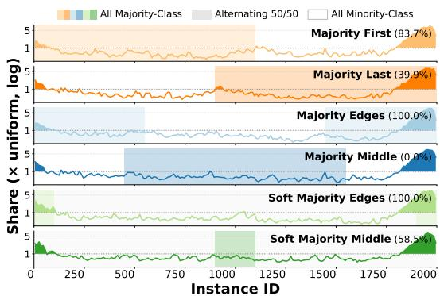  
Figure 25: IxG position profiles for Gemma 4 26B A4B on Sentiment, separated by order pattern.

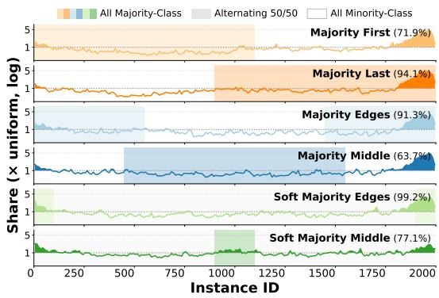  
Figure 26: IxG position profiles for Gemma 4 31B on NER, separated by order pattern.

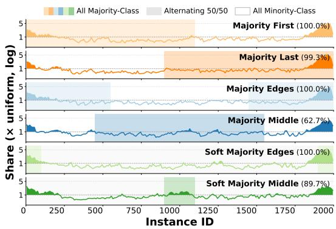  
Figure 27: IxG position profiles for Gemma 4 31B on Sentiment, separated by order pattern.

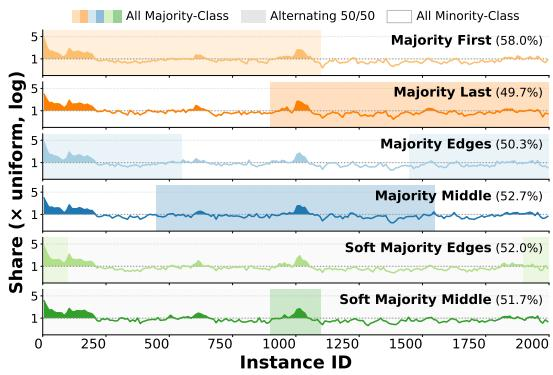  
Figure 28: IxG position profiles for Qwen3-4B-Instruct on Math, separated by order pattern.

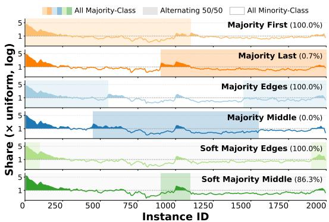  
Figure 29: IxG position profiles for Qwen3-4B-Instruct on NER, separated by order pattern.

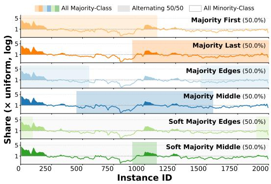  
Figure 30: IxG position profiles for Qwen3-4B-Instruct on Occurrence, separated by order pattern.

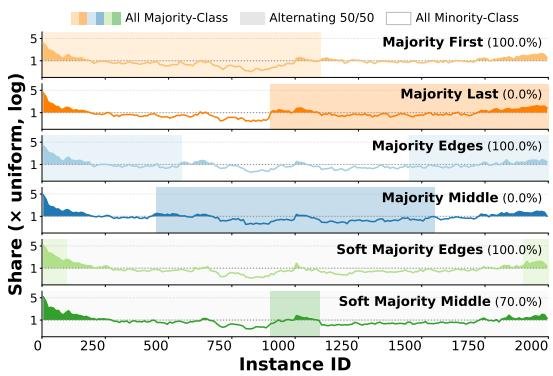  
Figure 31: IxG position profiles for Qwen3-4B-Instruct on Sentiment, separated by order pattern.

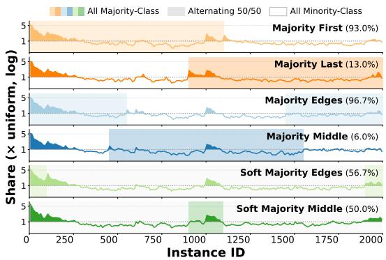  
Figure 32: IxG position profiles for Qwen3-4B-Instruct on WSD, separated by order pattern.

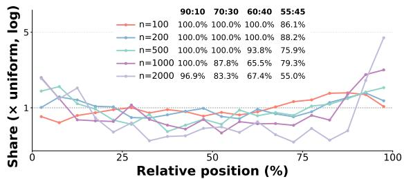

(a) Gemma 4 26B A4B  
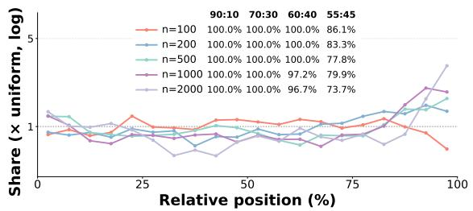

(b) Gemma 4 31B  
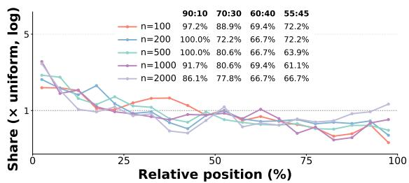  
(c) Qwen3-4B-Instruct  
Figure 33: IxG position profiles by instance count, pooled over valid replays from NER, Sentiment, all seven order patterns, and four label distributions. Each point averages a 5% position bin. The inset reports accuracy (%) on the attribution subset for each count and distribution. The dotted line at 1 is the uniform reference, and the y-axis is logarithmic.

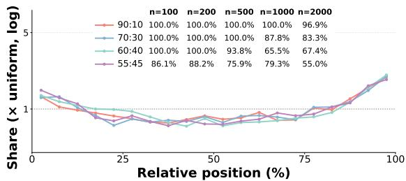

(a) Gemma 4 26B A4B  
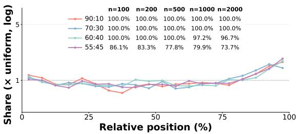

(b) Gemma 4 31B  
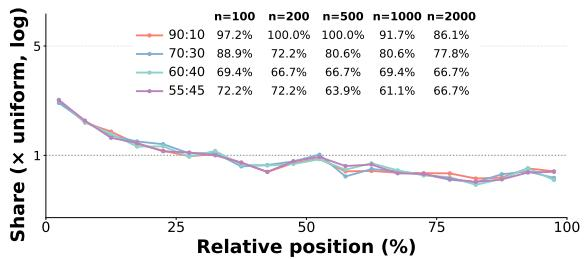  
(c) Qwen3-4B-Instruct  
Figure 34: IxG position profiles by label distribution, pooled over valid replays from NER, Sentiment, all seven order patterns, and five instance counts. The inset reports accuracy (%) on the attribution subset for each distribution and count. Binning, axes and normalisation follow Figure 33.

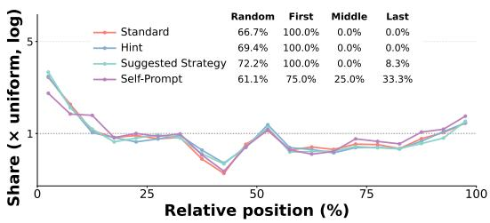  
Figure 35: IxG position profiles for Qwen3-4B-Instruct, pooled over valid replays from NER, Sentiment and all seven order patterns, for the standard prompt and three variants. The inset reports accuracy (%) on the same outputs for four representative patterns. Binning, axes and normalisation follow Figure 33.