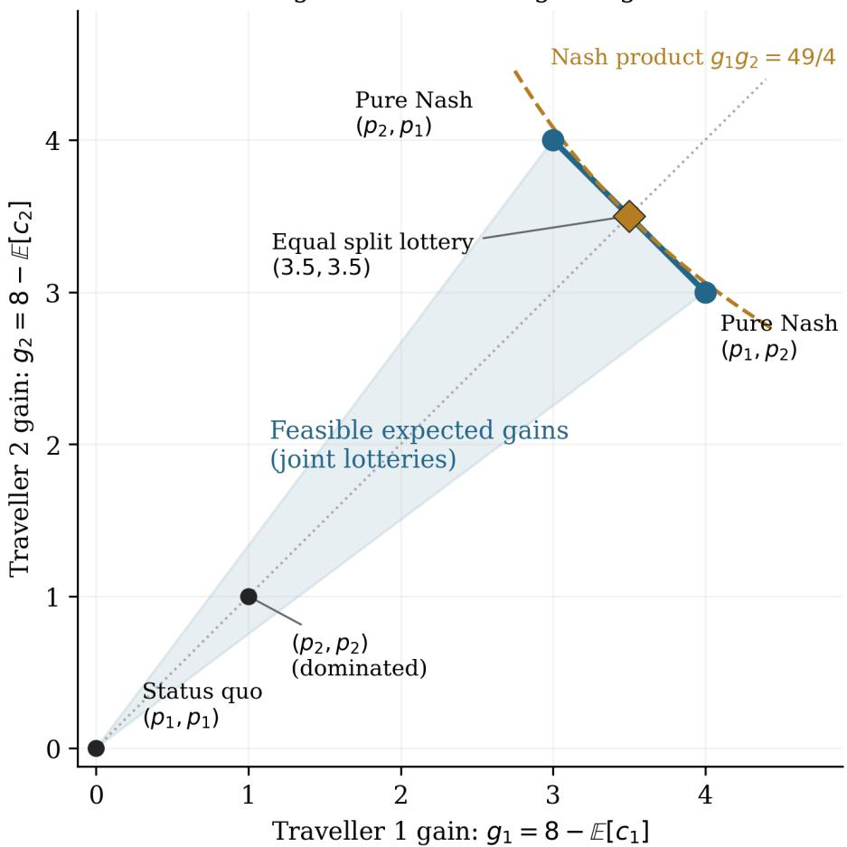
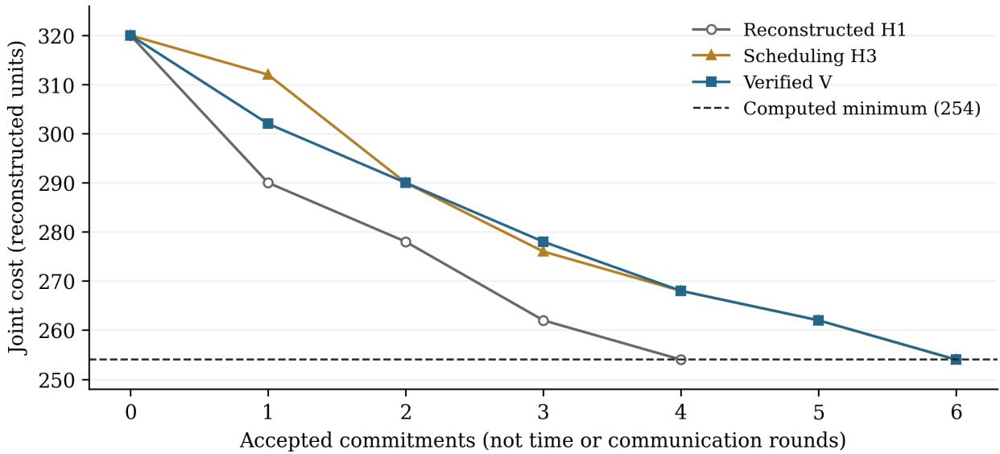
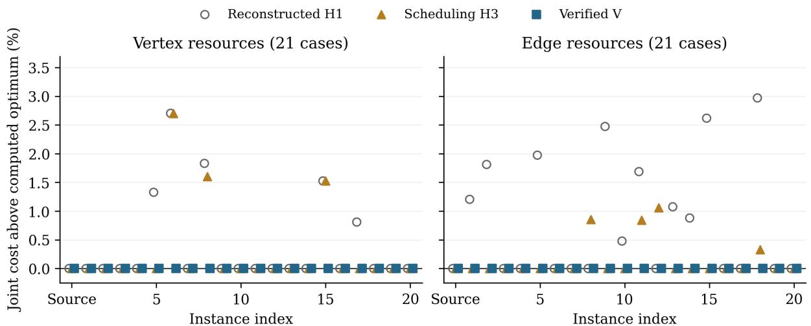
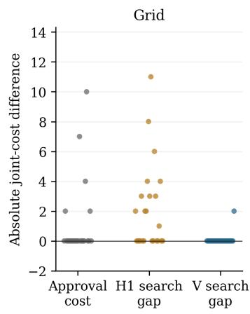
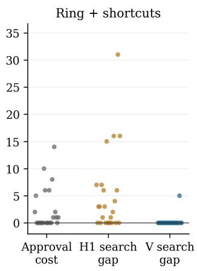
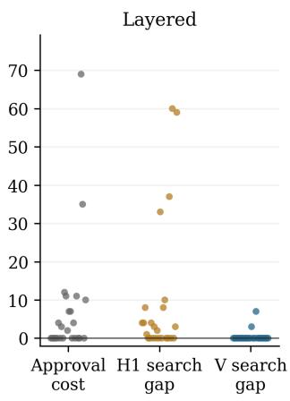
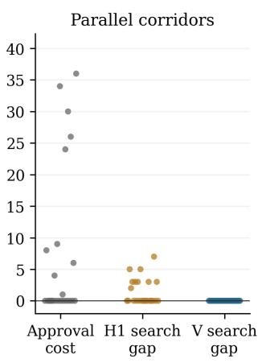

# Formalizing Cooperation and Competition: An AI-Assisted Mathematical Addendum to a 2018 Planning Thesis

Haitham Masaud Amar

21 October 2026 — preprint draft

## Abstract

We present an AI-assisted mathematical addendum to Strategic Trip Planning: Striking a Balance Between Competition and Cooperation (Amar, 2018). We reconstruct selected relationships between strategic choice, cooperative stability, participant approval and enforcement. The thesis’s Nash-to-core proposition is under-specified until outsider opportunities are stated. We verify two-person implications under fixed outsiders and explicit eficiency conditions. Under isolation, the original example has an empty TU core; its funded counterpart uses an explicit external subsidy. For a monotone resource model we characterize the exact financing gap. A finite negotiation procedure implemented in Lean is proved to terminate with participant approval, joint-cost non-worsening and local optimality against permitted approved moves. Supporting formalizations address bargaining geometry and regret-based eficiency. A resource-game counterinstance shows why monotonicity alone provides no uniform price-of-anarchy bound. Reproducible computations compare a documented heuristic reconstruction with the verified procedure on 44 source-based instances and 96 starting cases from four additional synthetic network families. Acceptance-matched heuristic and randomized pairwise-search controls contextualize the optimization results. The mathematical ingredients are established results; the contribution is a traceable reconstruction linking source statements, explicit assumptions, checked proofs, executable code and retained counterinstances. The study illustrates how AI-assisted investigation can turn engineering intuitions from legacy research into precise mathematical claims whose conditions and computational consequences can be inspected and reproduced.

## 1. Introduction

Trip planning is individually motivated but jointly realized. A route that is attractive when considered in isolation may become costly once other travellers select overlapping resources. Conversely, a traveller may accept a less-preferred route because it reduces conflict, improves a joint outcome or forms part of an enforceable agreement. These observations motivated my doctoral framework, Strategic Trip Planning: Striking a Balance Between Competition and Cooperation [1]. Its principal components were personalized route generation, team formation and bargaining, with a later application to territory sharing in social taxi networks.

My decision to revisit the thesis was inspired by OpenAI’s 6 October 2026 release of mathematical manuscripts and supporting proof artifacts, including Lean formalizations for many of the proofs [10]. That release prompted a personal question: could AI-assisted mathematical investigation help me give the engineering intuitions developed in my 2018 doctoral work a fuller and more precise mathematical treatment? The thesis’s mathematics had supported an engineering contribution; it had not been developed as a separate contribution to mathematical theory. I wanted to investigate how far its underlying ideas could be reconstructed as explicit definitions, justified assumptions and checkable theorems, and how the resulting treatment would behave on new synthetic planning instances.

This motivation shapes the present work. Lean substantiates the formal guarantees of the stated models and revised procedure, while new reproducible simulations test their engineering behavior and compare outcomes with exact finite benchmarks. Together, these methods give a concrete route from engineering intuition to a mathematical formulation whose assumptions, proofs and computational consequences can be inspected. The aim is to substantiate the coordination outcomes that motivated the original work and establish the conditions under which they follow. The simulations provide finite-instance evidence; universal guarantees come from the theorems and their explicit assumptions.

This paper is an addendum to my thesis and a case study in AI-assisted reconstruction of legacy engineering mathematics. Its purpose is to show which mathematical statements can be made precise, which assumptions change their meaning, and how the resulting claims can be checked against executable procedures. The principal result of the investigation is the source-to-model-to-proof correspondence, together with the evidence needed to assess its limits.

The starting point remains the observation in the thesis abstract: “Mobility planning as it stands today is an individual decision-making efort that takes place in an environment governed by the collective actions of various competing travellers” [1, p.iv, PDF p.4]. The framework accordingly accommodates “the travellers’ individual behaviours, preferences, and goals in cooperative and competitive scenarios” [1, p.iv, PDF p.4]. These statements motivate the models developed here; they are not ofered as claims about the present state of transportation research.

The engineering objective is coordination among travellers who retain their own agendas, rather than the optimization of a centrally controlled fleet [1, Chapter 1, pp.3–4, PDF pp.23–24]. In the original framework, traveller-centric trip planning supplies personalized strategies, team formation determines who interacts, and bargaining manages conflicts. The present paper develops the mathematical structure underlying that architecture. It does not repeat the original experimental study or require the original engineering contribution to have been a contribution to mathematical theory.

This paper develops those ideas as a collection of compatible mathematical models. Our aim is not to identify cooperation with one equilibrium concept. We instead ask what must be specified for the relationships between competitive choice, cooperative stability and collective eficiency to hold. Four questions guide the treatment: what actions and costs define the strategic game; what opportunities remain available to a departing coalition; what the referee actually enforces; and which costs a repeated-game learner minimizes.

The distinction concerning departing coalitions is decisive. A unilateral Nash deviation holds opponents’ actions fixed. A cooperative opportunity may hold outsiders fixed, remove them, allow them to respond strategically or allow the deviating coalition to escape a pricing mechanism. These conventions cannot be interchanged. Once they are made explicit, several intended connections become provable. Other connections require additional conditions or fail under a diferent, equally well-defined convention.

The treatment connects three contributions. First, it specifies coalition opportunities and financing so that strategic and cooperative stability claims have precise meanings. Second, it implements a finite negotiation procedure and proves acceptance, termination and the resulting local improvement condition. Third, it compares a documented reconstruction of the thesis heuristic with that executable procedure on shared finite instances. The original two-traveller model supplies an end-to-end example whose returned plans also satisfy the stronger equilibrium and cooperative conditions. The enforcement and regret results explain what additional mechanisms can certify about implementation and repeated outcomes.

The new synthetic data are a substantive part of this contribution. The thesis supplies the planning concepts, source examples and heuristic structure; the present treatment makes the relevant assumptions explicit, proves a specified coordination procedure and tests implementations on newly generated inputs. This provides fresh evidence that the coordination logic can operate beyond the original numerical example. Reproducible generators, shared-instance comparisons and exhaustive finite benchmarks allow that evidence to be inspected and rerun. The resulting support concerns the engineering framework under the stated reconstruction and model assumptions; the guarantees of the revised procedure are identified separately from observations about the reconstructed heuristic.

The formal development uses Lean 4.24.0 [8] and Mathlib v4.24.0 [9]. We retain an assumption ledger and an exact correspondence between the planning concepts and formal declarations. The present treatment specifies the counterpart rules and admissible financing explicitly. These specifications are part of the revised model, whose guarantees are proved below; the original thesis is preserved unchanged.

## 2. Strategic actions and cooperative opportunities

Let N be a finite nonempty player set. Player i has a finite nonempty action set $A _ { i } ,$ and $\textstyle A = \prod _ { i } A _ { i }$ is the profile space. Actions may represent routes, territories or explicitly discretized departure choices. We write $c _ { i } ( s )$ for

$$
C ( s ) = \sum _ { i \in N } c _ { i } ( s ) .
$$

Here “physical cost” means the underlying unpriced planning cost, distinguished from referee charges and observed learning scores. Its interpretation may be travel cost or a declared preference score; the formal model does not turn a subjective score into a measured travel time. Summing personalized scores requires a declared common scale and system objective. We assume that scale where aggregate costs or TU payments are used.

The principal notation is:

<table><tr><td>Symbol</td><td>Meaning</td></tr><tr><td> $s , b , s ^ { * }$ </td><td>Current profile, feasible baseline, joint comparator</td></tr><tr><td> $c _ { i } ( s ) , C ( s )$ </td><td>Base player cost and its declared sum</td></tr><tr><td> $v _ { s } ( S ) , v _ { \mathrm { i s o } } ( S )$ </td><td>Fixed-outsider and isolated coalition opportunities</td></tr><tr><td> $h _ { i } , F _ { h }$ </td><td>Participant acceptance ceiling and approved profiles</td></tr><tr><td> $\widehat { c } _ { i } , L _ { i } ^ { t }$ </td><td>Enforced cost and time-dependent observed cost</td></tr><tr><td> $R _ { i } ( T ) , B _ { i } ( T )$ </td><td>All-action regret bound and cumulative cost-distortion bound</td></tr></table>

The full-profile argument records resource externalities. A baseline route score on $A _ { i }$ alone does not specify them. A Nash equilibrium satisfies

$$
c _ { i } ( s ) \leq c _ { i } ( a _ { i } , s _ { - i } ) \qquad ( \forall i , \ a _ { i } \in A _ { i } ) .\tag{1}
$$

A social optimum minimizes C over feasible profiles. Pareto eficiency means that no profile makes every player weakly better and at least one player strictly better. These are separate properties. We do not assume that independently choosing baseline favourites produces a Nash equilibrium.

The source supplies finite nonempty action sets in Chapter $3 , \mathrm { \ p p . 3 9 - 4 2 \ ( P D F \ p p . 5 9 - 6 2 ) }$ , and distinguishes personalized and system utilities in Chapter 5, pp.80–81. Its use of compact convex strategy sets in Chapter 4, pp.55–56 requires a representation beyond a finite list of distinct deterministic routes. Finite probability distributions provide one explicit representation. Independent product distributions describe mixed strategies; arbitrary joint distributions allow correlation. No deterministic trip constraint is silently replaced by an expected constraint.

## 2.1 Transferable and nontransferable stability

For a scalar coalition-cost function $v : 2 ^ { N } \to$ R with $v ( \emptyset ) = 0 , \mathrm { ~ a ~ }$ TU cost-core allocation satisfies

$$
x ( N ) = v ( N ) , \qquad x ( S ) \leq v ( S ) \quad ( \forall S \subseteq N ) ,\tag{2}
$$

where $\textstyle x ( S ) = \sum _ { i \in S } x _ { i }$ . One fixed allocation is used for every coalition. We follow the source’s cost orientation in (4.23), p.65, and (6.3), p.126. Its earlier reward orientation reverses the inequalities. Diferent personalized utilities alone do not justify transferable utility. TU conclusions below concern a declared common cost/payment scale and permit real transfers.

An NTU model instead retains attainable cost vectors. A nonempty coalition blocks an attainable vector if it has another attainable vector that strictly lowers every member’s cost. This formulation uses no interpersonal transfer. A coalition’s aggregate cost may decrease while one member loses; that is a potential TU improvement, but not necessarily an NTU block.

## 2.2 Two explicit outsider conventions

Fix a reference agreement s. The fixed-outsider value is

$$
v _ { s } ( S ) = \operatorname* { m i n } _ { t : \ t _ { - S } = s _ { - S } } \sum _ { i \in S } c _ { i } ( t ) .\tag{3}
$$

The admissible set is nonempty because it contains s, and a minimum exists in the finite game. For NTU opportunities, retain the vectors $( c _ { i } ( t ) ) _ { i \in S }$ under the same constraint. Equation (3) defines a reference-dependent family of cooperative problems; it is not a reference-independent characteristic function.

Under isolation, outsiders are removed from the resource environment and coalition costs are recomputed. We denote the resulting minimum by $v _ { \mathrm { i s o } } ( S )$ . This convention needs an explicit coalition-level resource model, supplied in Section 4. A coalition that leaves the referee’s jurisdiction may have yet another opportunity. Exit rights are therefore part of a mechanism specification.

## 3. A precise equilibrium-to-core bridge

Proposition 4.2.1 of the planning framework [1, p.52, PDF p.72] connects strategic stability with cooperative stability. The source does not uniquely specify the outsider opportunities needed to determine that connection. We formulate two conditional counterparts: fixed-outsider opportunities for two-person agreements, and financed isolation for eficient Nash agreements in the monotone resource model. The following characterization supplies the first proof.

Theorem 1 — Fixed-outsider characterization. Under (3), the realized cost allocation $\left( c _ { i } ( s ) \right)$ i belongs to the TU cost core if and only if

$$
\sum _ { i \in S } c _ { i } ( s ) \leq \sum _ { i \in S } c _ { i } ( t ) \quad { \mathrm { w h e n e v e r ~ } } t _ { - S } = s _ { - S } .\tag{4}
$$

For NTU attainable vectors under the same outsider rule, the realized vector belongs to the NTU core if and only if s is strong Nash: no nonempty coalition can change its actions, holding outsiders fixed, and strictly improve every member.

Proof. A TU core inequality bounds the current coalition cost by its minimum opportunity, and therefore by every admissible deviation. Conversely, (4) bounds the current cost by an attained minimum. The reference profile itself is admissible, giving the opposite inequality. Applying this to N establishes eficiency. For NTU, admissible blocking vectors and improving joint deviations have exactly the same witnesses. The TU and NTU conclusions use diferent improvement tests. □

Theorem 2 (Proposition 4.2.1A) — Two-traveller fixed-outsider counterpart. For two players:

1. Nash equilibrium plus Pareto eficiency implies the fixed-outsider NTU core.

2. Nash equilibrium plus social optimality implies the fixed-outsider TU cost core.

Proof. The only nonempty coalitions are the two singletons and the grand coalition. Nash rules out singleton blocks. Pareto eficiency rules out a grand-coalition strict improvement for both members. For TU, social optimality rules out a reduction of the grand coalition’s sum cost. This establishes the corresponding conditions in Theorem 1. □

The second premise in each statement is essential to the argument. For more than two players there are intermediate coalitions, so this proof does not extend merely because a negotiation procedure uses pairs. The result is a suficient completion of the two-person theory, not a proof that arbitrary pairwise bargaining produces a globally stable agreement.

## 3.1 The original two-traveller instance

Table 4.1, p.59 (PDF p.79), becomes the following positive-cost table after negating the displayed payofs:

<table><tr><td>Traveller 1 / Traveller 2</td><td> $p _ { 1 }$   $p _ { 2 }$ </td></tr><tr><td>p1 (8,8) (4,5)</td></tr><tr><td>(5,4) (7,7)</td></tr></table>

The relevant Figure 4.2 routes have private prefixes of cost 2. The first action uses shared sufix edges $C  B$ and $B  t .$ , with base cost 1 each; the second uses $C  t ,$ of base cost 3. Each shared sufix edge adds 2 per traveller. The formal resource calculation reproduces every table entry. We use the two actions explicitly selected in equations (4.2)–(4.5), rather than adding routes not available in this example.

At $( p _ { 1 } , p _ { 2 } )$ , the unilateral alternatives cost 7 instead of 4 and 8 instead of 5. This profile is Nash. Its total cost is 9, the minimum among all four profiles, and it is Pareto eficient. Thus both conclusions of Theorem 2 apply. The source’s two-person compromise intuition has a rigorous positive realization under fixed-outsider opportunities.

Under isolation, each singleton achieves cost 4, while both travellers together cost at least 9. Equation (2) would require $x _ { 1 } + x _ { 2 } = 9$ and $x _ { 1 } , x _ { 2 } \leq 4$ , which is impossible. Every correlated lottery still has expected total cost at least 9, so randomization does not remove this obstruction. The illustrative example remains valid as an explanation of cooperation; it exposes why the cooperative opportunity convention must also be specified.

The example therefore fixes the engineering interpretation of the two-person result: a jointly eficient strategic compromise is cooperatively stable when departure opportunities retain the other traveller’s reference plan. If departure removes the other traveller entirely, the financing must also be specified. Section 4.2 supplies that specification and its proof.

## 3.2 Bargaining geometry of the two-traveller example

Figure 1 expresses the same example in utility gains relative to the declared status-quo costs $( 8 , 8 ) \colon g _ { i } = 8 - \mathbb { E } [ c _ { i } ]$ The four deterministic gain vectors are (0, 0), (4, 3), (3, 4) and (1, 1). Permitting joint lotteries gives their convex hull. The segment joining (4, 3) and (3, 4) is the eficient expected-payof frontier, on which total expected cost is 9. Its endpoints are the two deterministic pure Nash equilibria; neither equilibrium selects a unique division of the gains. The chosen status quo is an illustrative planning baseline, not a derived noncooperative threat outcome.

For this declared disagreement point and expected-utility representation, the classical Nash bargaining product [7] is $g _ { 1 } g _ { 2 }$ . We verify in Lean that every joint distribution satisfies $g _ { i } \ge 0 , g _ { 1 } + g _ { 2 } \le 7$ and $g _ { 1 } g _ { 2 } \leq 4 9 / 4$ . A half-and-half lottery between the two split profiles has expected costs $( 9 / 2 , 9 / 2 )$ and gains $( 7 / 2 , 7 / 2 )$ , attaining the bound. The dashed product curve is tangent to the eficient segment at that point. This provides a precise geometric interpretation of equal expected gains; it is an explicit bargaining construction, not a claim that Algorithms 1–2 optimize the Nash product. The public joint lottery is distinct from independent mixed strategies and from a deterministic route assignment. No hard constraint is replaced by an expected constraint in the planning procedure.

Feasible gains and the bargaining frontier  
  
Figure 1: Feasible expected gains, the eficient frontier, pure Nash outcomes and an attainable Nash-product maximizer. Gains use the interacting status quo (8, 8), not isolated exit costs. The shaded triangle represents joint lotteries over the displayed deterministic outcomes.

## 3.3 Adopted counterpart rule for the revised proposition

For the revised two-traveller formulation, we adopt fixed-outsider opportunities (3) as the counterpart rule. Travellers retain their personalized feasible actions; a departing coalition may coordinate its members’ actions, but nonmembers continue their reference plans. We use the NTU version when costs cannot be transferred. Under this convention, the replacement for Proposition 4.2.1 is Theorem 2: a Nash agreement that is Pareto eficient has a nonempty fixed-outsider NTU core; a Nash agreement minimizing joint cost has the corresponding TU core. The source example satisfies both conditions. These rules define Proposition 4.2.1A in the present treatment, and both conclusions hold for the original example.

Proposition 4.2.1A is thus resolved under a fully defined counterpart rule and explicit eficiency assumptions. Its scope is two-person agreements; the multi-traveller financed result is given in Proposition 4.2.1B. Core nonemptiness is the cooperative conclusion proved here. The classical balanced-collection characterization is not an additional machine-verified theorem of this paper.

## 4. Congestion, coalition budgets and the cost of stability

We now give isolation a complete resource interpretation. Each action $a _ { i }$ uses a finite set $U _ { i } ( a _ { i } )$ of resources. It has a private cost $b _ { i } ( a _ { i } )$ , and resource e has a common nondecreasing congestion cost $\ell _ { e } ( k )$ . Define

$$
n _ { e } ( S , t ) = | \{ i \in S : e \in U _ { i } ( t _ { i } ) \} | ,
$$

$$
c _ { i } ^ { S } ( t ) = b _ { i } ( t _ { i } ) + \sum _ { e \in U _ { i } ( t _ { i } ) } \ell _ { e } ( n _ { e } ( S , t ) ) , \qquad v ( S ) = \operatorname* { m i n } _ { t \in A } \sum _ { i \in S } c _ { i } ^ { S } ( t ) .\tag{5}
$$

Outside actions do not afect (5), although a full profile conveniently indexes coalition choices. Finite nonempty action sets give attained minima for every coalition. The physical game uses $c _ { i } = c _ { i } ^ { N }$ . Nonnegative private and resource costs match the transportation interpretation; the inequalities below only need monotonicity. Player-specific private costs and asymmetric feasible routes are allowed.

This is a source-supported subclass of the models in Chapters 3, 4 and 6: it retains additive resource conflicts and nondecreasing concentration costs. It does not represent every possible reward map ζ, coalition production benefit, discount or private fare mechanism. Those require a diferent model and may reverse the budget conclusion.

Theorem 3 — Singleton domination from congestion. The isolated values in (5) satisfy

$$
v ( S ) \geq \sum _ { i \in S } v ( \{ i \} ) .\tag{6}
$$

Proof. Whenever $i \in S$ uses resource e, its load is at least one. Monotonicity implies $\ell _ { e } ( n _ { e } ( S , t ) ) \geq \ell _ { e } ( 1 )$ . Thus its coalition cost is at least its solo cost for the same action, which is at least its optimized singleton cost. Summing over S and evaluating at an attained coalition minimum proves (6). The identity between singleton coalition cost and solo action cost is also verified separately. □

Call any cost game satisfying (6) singleton dominated. Set

$$
G = v ( N ) - \sum _ { i } v ( \{ i \} ) \geq 0 .\tag{7}
$$

The gap G measures the additional simultaneous-service cost relative to isolated singleton promises. It is not a Nash ineficiency measure: it may be positive even at a social optimum.

Theorem 4 — Exact isolated-core criterion. For a singleton-dominated cost game,

$$
\operatorname { C o r e } ( v ) \neq \varnothing \quad \iff \quad G = 0 .\tag{8}
$$

Proof. Singleton core inequalities imply $\begin{array} { r } { v ( N ) = x ( N ) \leq \sum _ { i } v ( \{ i \} ) } \end{array}$ . Equation (6) supplies the reverse inequality. If equality holds, $x _ { i } = v ( \{ i \} )$ is eficient and satisfies every coalition bound by (6). □

This result identifies the actual obstruction. In this class, a payment rearrangement cannot cover a positive total gap while guaranteeing every isolated singleton opportunity. A cooperative agreement may still be beneficia relative to an interacting noncooperative baseline. That benchmark difers from removing all other travellers.

## 4.1 Exact budget repair and approximate stability

Allow an external subsidy $\sigma \geq 0$ , so participants pay $x ( N ) = v ( N ) - \sigma$ while the original coalition departure opportunities remain available. This is an explicit financing extension, not a hidden interpretation of binding agreements.

Theorem 5 — Minimum subsidy. The minimum stabilizing subsidy for a singleton-dominated cost game is G. At $\sigma = G$ , the allocation $x _ { i } = v ( \{ i \} )$ is stable. Every stable subsidized allocation requires $\sigma \geq G$

Proof. The proposed allocation satisfies every coalition bound by (6) and has the required subsidized budget. Conversely, summing the singleton bounds gives $\begin{array} { r } { v ( N ) - \sigma \leq \sum _ { i } v ( \{ i \} ) } \end{array}$ . □

Alternatively retain the full budget and permit a per-member relaxation:

$$
x ( N ) = v ( N ) , \qquad x ( S ) \leq v ( S ) + | S | \varepsilon .\tag{9}
$$

Theorem 6 — Optimal uniform relaxation. For $n = \left| N \right| > 0$ , the minimum tolerance in (9) is $G / n$ . The allocation

$$
x _ { i } = v ( \{ i \} ) + G / n\tag{10}
$$

attains it.

Proof. Equation (10) is eficient. Summing it over S and using (6) establishes (9). For any feasible allocation in (9), summing the singleton inequalities gives $G \leq n \varepsilon .$ □

For the thesis table, $G = 1 \colon$ a subsidy of 1 stabilizes payments $( 4 , 4 )$ , or the full budget admits the optimal tolerance $1 / 2$ with allocation (4.5, 4.5). These are TU financing/allocation conclusions. Neither allocation is silently asserted to be a deterministic attainable NTU physical-cost vector.

The cost of stability and weighted/per-capita least-core approaches are established concepts [5,6]. Our relaxation is explicitly nonnegative and includes all coalitions; this avoids ambiguity with conventions that optimize surplus only over proper nontrivial coalitions. The elementary formulas above are verified consequences for the declared class, not claims to invent those concepts.

## 4.2 An admissible financed isolation counterpart

There is also a conditional repair that retains isolated departure opportunities. It changes financing explicitly rather than treating a positive budget gap as removable by redistribution alone. A sponsor commits a subsidy G to full-team service; departing proper coalitions retain their original isolated costs and do not receive that subsidy. Define the participant-budget game

$$
v ^ { G } ( S ) = \left\{ { v ( N ) - G , } \quad S = N , \right.
$$

This game accounts for participants’ net financing; the physical grand-coalition service cost remains $v ( N )$ . The sponsor is external to the player set, with no budget or participation guarantee supplied by the theorem. For nonempty N, the empty-coalition value is unchanged.

Proposition 4.2.1B — Financed isolation counterpart. Consider the monotone resource model (5), with attained coalition minima. Let s be both a Nash equilibrium of the physical game and a physical social optimum. Commit the fixed participation rebates

$$
r _ { i } = c _ { i } ( s ) - v ( \{ i \} ) .
$$

Then $r _ { i } \geq 0 , \sum _ { i } r _ { i } = G$ , the rebated strategic game $\widetilde { c } _ { i } ( t ) = c _ { i } ( t ) - r _ { i }$ retains s as Nash, and its realized net allocation at s belongs to the ordinary TU cost core of $v ^ { G } ,$

Proof. Optimized solo cost is no greater than solo cost on the same route, which by monotone congestion is no greater than its physical cost. Thus $v ( \{ i \} ) \leq c _ { i } ( s )$ . Physical optimality gives $C ( s ) = v ( N )$ , so the rebates sum to G. Each rebate is fixed independently of the eventual action profile, and cancels from both sides of every unilateral Nash comparison. At s, net costs equal $v ( \{ i \} )$ . Singleton domination gives every proper-coalition core inequality, and $\begin{array} { r } { \sum _ { i } \dot { v ( \{ i \} ) } = v ( N ) - G } \end{array}$ gives the funded grand budget. These steps, including the resource-level theorem and conversion from subsidized stability to the funded game’s ordinary core, are machine-verified. □

The rebate is a fixed entitlement for participation within the specified game; it is not recomputed after each deviation or promised after leaving the mechanism. Full-team finance and isolated exit opportunities must be implemented as specified. Truthful reporting and the sponsor’s incentive to pay are separate questions.

For Table 4.1, $s = ( p _ { 1 } , p _ { 2 } )$ has physical costs (4, 5), isolated costs (4, 4) and $G = 1$ . Rebates (0, 1) give net costs (4, 4) and leave the split profile Nash. The funded values are $v ^ { G } ( \{ 1 \} ) = v ^ { G } ( \{ 2 \} ) = 4$ and $v ^ { G } ( N ) = 8$ , so the net allocation is in its core. Physical service still costs $v ( N ) = 9 ;$ participants cover 8 and the sponsor covers 1. The subsidy is minimal by Theorem 5. When $G = 0$ , the construction needs no financing and all rebates vanish, recovering the unfinanced claim only under that restriction.

## 5. Contract enforcement and its limits

The source assumes compliance with binding agreements in Chapter 3, p.48, and permits the app to raise deviation prices in Chapter 6, p.133. We make the required pricing capability explicit. For an announced contrac s, define

$$
p _ { i } ^ { s } ( t ) = \operatorname* { m a x } \{ 0 , c _ { i } ( s ) - c _ { i } ( t ) \} , \qquad \widehat c _ { i } ^ { s } ( t ) = c _ { i } ( t ) + p _ { i } ^ { s } ( t ) .\tag{11}
$$

The charge is nonnegative and is zero at the agreement. It requires observation of the relevant profile costs and authority to impose the charge, without a binding cap below the required amount. It is a proposed completion of the referee mechanism, not a claim that the original code computes this formula.

Theorem 7 — Implemented coalition stability. Every contract s is strong Nash under $\widehat { c } ^ { s }$ . More strongly, no coalition can lower its aggregate implemented cost by a joint deviation. In a finite game, the realized implemented costs therefore belong to a fixed-outsider TU cost core whose opportunities remain subject to (11).

Proof. For every i, t, equation (11) implies ${ \widehat { c } } _ { i } ^ { s } ( t ) \geq c _ { i } ( s ) = { \widehat { c } } _ { i } ^ { s } ( s )$ . Consequently no coalition can strictly improve all coordinates, or lower their sum. The finite fixed-outsider minima exist, and Theorem 1 applies. □

This is not dominant-strategy truthfulness, a credibility theorem for the app, or stability after a coalition escapes its jurisdiction. Nor does it show that s minimizes physical cost. In the original table, the all-preferred contract costs 16 rather than 9, yet (11) strongly implements it. Lean verifies both its ineficiency and its enforceability. Choosing an eficient agreement is therefore a separate task. If s is already a physical social optimum, (11) preserves its on-path costs and implements it; the premise is stated, not inferred from enforcement.

The mechanism also clarifies participation. A traveller may compare the contract with an exit option outside the app. That outside opportunity must enter a separate individual-rationality condition. The theorem does not obtain consent from an absent or unspecified exit-payof model.

## 6. Repeated play, empirical equilibrium and observed costs

For a fixed physical game, define the cumulative cost improvement of a fixed alternative:

$$
D _ { i } ( T , a _ { i } ) = \sum _ { t = 1 } ^ { T } [ c _ { i } ( s ^ { t } ) - c _ { i } ( a _ { i } , s _ { - i } ^ { t } ) ] .\tag{12}
$$

An external-regret bound $R _ { i } ( T )$ satisfies $D _ { i } ( T , a _ { i } ) \leq R _ { i } ( T )$ for every fixed action. It is an upper bound, not necessarily the nonnegative clipping of regret. A calculation for only one preferred alternative is insuficient.

The empirical distribution is

$$
q _ { T } ( s ) = { \frac { 1 } { T } } | \{ t : s ^ { t } = s \} | , \qquad T > 0 .\tag{13}
$$

We formally verify nonnegativity, normalization and the equality between empirical expectation and uniform time average.

Theorem 8 — Empirical CCE certificate. Let $T > 0$ and suppose $D _ { i } ( T , a _ { i } ) \leq R _ { i } ( T )$ for every player and every fixed action. Then

$$
\begin{array} { r } { \mathbb { E } _ { q _ { T } } c _ { i } ( s ) \leq \mathbb { E } _ { q _ { T } } c _ { i } \big ( a _ { i } , s _ { - i } \big ) + R _ { i } ( T ) / T . } \end{array}\tag{14}
$$

Thus $q _ { T }$ satisfies the CCE deviation inequalities with player-specific bounds. Nonnegative $R _ { i } ( T ) / T$ are standard approximate-CCE tolerances; a negative bound certifies a stronger inequality. The distribution is an exact CCE when all fixed-action deviation sums are nonpositive.

Proof. Divide (12) by positive $T$ and apply the empirical expectation identity. The formal statement quantifies over all fixed deviations. □

A CCE compares deviations chosen independently of a recommendation. CE permits recommendation-dependent deviation tests and is stronger. Communication through an app does not supply either set of obedience inequalities by itself. Equation (14) is a finite-time certificate. An asymptotic topological convergence theorem is not part of the present Lean library.

## 6.1 Smoothness and physical eficiency

Assume the physical game is $( \lambda , \mu )$ -smooth:

$$
\sum _ { i } c _ { i } ( s _ { i } ^ { * } , s _ { - i } ) \leq \lambda C ( s ^ { * } ) + \mu C ( s ) \quad ( \forall s , s ^ { * } ) , \qquad \lambda > 0 , \quad \mu < 1 .\tag{15}
$$

Theorem 9 — Finite-time eficiency. Suppose the game satisfies (15), $T > 0$ , and $D _ { i } ( T , a _ { i } ) \leq R _ { i } ( T )$ for every player and every fixed action. For any common joint comparator $s ^ { * }$ ,

$$
\frac { 1 } { T } \sum _ { t } C ( s ^ { t } ) \leq \frac { \lambda } { 1 - \mu } C ( s ^ { * } ) + \frac { \sum _ { i } R _ { i } ( T ) } { T ( 1 - \mu ) } .\tag{16}
$$

Proof. Sum the regret inequalities for alternatives $s _ { i } ^ { * }$ . Apply (15) at each round to obtain

$$
( 1 - \mu ) \sum _ { t } C ( s ^ { t } ) \leq T \lambda C ( s ^ { * } ) + \sum _ { i } R _ { i } ( T ) .
$$

The denominator $T ( 1 - \mu )$ is positive. Division proves (16). The comparator need not be an optimum; using one requires its existence and feasibility. □

This is the established smoothness/regret argument of Roughgarden [4], independently formalized here. It reconstructs the structure suggested by thesis equations (6.5)–(6.13), pp.132–133 (PDF pp.152–153). We use individual costs in (12), preserve one residual sign and retain time sums. We do not label the original overloaded expressions or the displayed equation (6.11) verified unchanged.

## 6.2 Changing referee prices and personalization

The thesis allows personalized/system costs to difer and permits prices to change across rounds. Let $L _ { i } ^ { t } ( s )$ be the observed cost actually optimized. It may include prices or subjective doctrine scores; physical cost remains $c _ { i } ( s )$ . Set $d _ { i } ^ { t } ( s ) = L _ { i } ^ { t } ( s ) - c _ { i } ( s )$ . Suppose observed external regret is at most $\widehat { R } _ { i } ( T )$ , and

$$
\sum _ { t } [ d _ { i } ^ { t } ( a _ { i } , s _ { - i } ^ { t } ) - d _ { i } ^ { t } ( s ^ { t } ) ] \leq B _ { i } ( T ) \quad ( \forall i , a _ { i } ) .\tag{17}
$$

Theorem 10 — Price-distortion bridge. Physical regret is bounded by $\widehat { R } _ { i } ( T ) + B _ { i } ( T )$ . Therefore (16) holds with the remainder

$$
\frac { \sum _ { i } [ \widehat { R } _ { i } ( T ) + B _ { i } ( T ) ] } { T ( 1 - \mu ) } .\tag{18}
$$

A suficient certificate for (17) is $| L _ { i } ^ { t } ( s ) - c _ { i } ( s ) | \leq \delta _ { i } ^ { t }$ for every profile, yielding $\begin{array} { r } { B _ { i } ( T ) = 2 \sum _ { t } \delta _ { i } ^ { t } } \end{array}$ Proof. For each fixed alternative,

$$
c _ { i } ( s ^ { t } ) - c _ { i } ( a _ { i } , s _ { - i } ^ { t } ) = L _ { i } ^ { t } ( s ^ { t } ) - L _ { i } ^ { t } ( a _ { i } , s _ { - i } ^ { t } ) + d _ { i } ^ { t } ( a _ { i } , s _ { - i } ^ { t } ) - d _ { i } ^ { t } ( s ^ { t } ) .
$$

Sum this identity and apply both bounds. The absolute-error certificate bounds each distortion diference by $2 \delta _ { i } ^ { t }$ Apply Theorem 9 to the resulting physical regret bound. □

An action-independent fee cancels in (17). A bounded but persistent action-dependent distortion can instead produce a linear $B _ { i } ( T )$ , leaving a nonvanishing eficiency remainder. Contract enforcement illustrates the issue concretely: at the all-preferred table profile, each traveller has a physical unilateral improvement of 3, while (11) makes the implemented improvement zero. These two numerical statements are machine-verified. Observed obedience or observed no-regret is therefore not interchangeable with physical no-regret.

Theorem 10 allows arbitrary round-dependent observed costs, but retains a fixed player set, action sets and physical base game. Participant turnover or a time-varying physical environment requires an additional comparator model and is not covered by changing notation.

## 6.3 Social cost and pure price of anarchy

Social cost is the declared sum $C ( s )$ , whereas pure price of anarchy compares the worst pure Nash equilibrium with an unrestricted social optimum. For $C ^ { * } = \operatorname* { m i n } _ { s } C ( s ) > 0$ and a nonempty pure-equilibrium set,

$$
\mathrm { P o A } _ { \mathrm { p u r e } } = \operatorname* { m a x } _ { s \in \mathrm { P N E } } \frac { C ( s ) } { C ^ { * } } .\tag{19}
$$

Summing the unilateral Nash inequalities and applying (15) gives $C ( s ) \leq \lambda C ^ { * } / ( 1 - \mu )$ at every pure equilibrium. We verify this direct corollary as nash\_social\_efficiency; it is the zero-regret specialization of the standard argument. Its application requires smoothness of the actual cost model. V’s approved local endpoint in Section 7 need not be Nash, so its ratio to $C ^ { * }$ is an optimization gap rather than a price-of-anarchy statistic.

We enumerated every pure profile and unilateral deviation in the 44 source-based cost tables and the 48 distinct broader-network games. The latter are counted once per game, rather than twice for their two baselines. All 92 games have pure equilibria. Among the 88 games with positive optimum, the largest pure price of anarchy is 5: the four-traveller layered instance with seed 2018101 has optimum 2 and worst-equilibrium cost 10. Within the 44 source-based reconstructions, the largest ratio is $2 3 2 / 2 2 1$ ; the unperturbed coalesced vertex and edge cases have ratios 1 and $7 5 / 7 4$ . These are exact finite computations under the declared costs, not uniform bounds for a model class.

Four broader games have zero optimal cost. In the ring-with-shortcuts instance with four travellers and seed 2018101, profile 9 is Nash with costs $( 3 , 0 , 0 , 0 )$ , while profile 10 has costs $( 0 , 0 , 0 , 0 )$ . Consequently, no finite K can satisfy $C ( s ) \leq K C ^ { * }$ at every pure equilibrium of that game. We kernel-verify this directly from its weighted resource routes and private penalties; the independent checker also matches the literal resource encoding to the saved instance. Zero here means no overlap or preference charge, not zero travel time. In the other three zero-optimum games, every pure equilibrium has zero cost; their $0 / 0$ ratios are left undefined. V reaches profile 10 from both recorded baselines of the counterinstance.

The obstruction persists without a zero denominator. As an explicit model variation, add a fixed private cost $\varepsilon > 0$ to each action of each of the four travellers. Every cost remains nonnegative, unilateral incentives are unchanged, profile 10 is still socially optimal with cost 4ε, and profile 9 remains Nash with cost $3 + 4 \varepsilon$ . Its equilibrium cost ratio is

$$
1 + { \frac { 3 } { 4 \varepsilon } } ,
$$

which is unbounded as ε decreases. Lean verifies the stronger quantified statement: for every $K \geq 0$ , a positive ε yields a nonnegative-cost game with positive optimum and a Nash equilibrium costing more than K times that optimum. Thus monotone overlap costs and private preferences alone provide no uniform finite pure-priceof-anarchy bound in this declared resource class. The positive-base-cost family is an extension of the stored instance, not an alteration of its recorded experimental costs.

Lean also verifies that the unshifted counterinstance cannot satisfy (15) for any real λ and $\mu < 1$ . Theorem 9 remains a valid conditional guarantee; this example identifies a model for which its hypothesis fails. The original territory-sharing formulation requires its own smoothness and regret certificates. The selected counterinstance, shifted-family proof and exhaustive equilibrium results are retained in ThesisLean/EfficiencyCase.lean and research/efficiency/.

## 7. A bounded engineering guarantee and certification interface

## 7.1 Participation-safe finite selection

The engineering objective does not require that every negotiated outcome belong to every possible cooperative core. A more direct guarantee is that coordination preserves each participant’s declared acceptance bound and optimizes joint cost within those bounds. Let b be a feasible interacting baseline, and let $h _ { i }$ be traveller i’s accepted cost ceiling. Require $c _ { i } ( b ) \leq h _ { i }$ , and define

$$
F _ { h } = \{ s \in A : c _ { i } ( s ) \leq h _ { i } { \mathrm { ~ f o r ~ e v e r y ~ } } i \} .
$$

Theorem 11 — Participation-safe selection. In a finite game, $F _ { h }$ is nonempty and contains a minimumtotal-cost profile $s _ { h } .$ , with $C ( s _ { h } ) \leq C ( b )$ . This joint non-worsening holds for every ceiling vector admitting b. In particular, setting $h _ { i } = c _ { i } ( b )$ gives

$$
c _ { i } ( s _ { h } ) \leq c _ { i } ( b ) \quad ( \forall i ) , \qquad C ( s _ { h } ) \leq C ( b ) ,
$$

and no other profile respecting those same bounds has a smaller joint cost.

Proof. The baseline witnesses nonemptiness. A real-valued function on a nonempty finite set attains a minimum. Apply this to $C$ on $F _ { h }$ . Membership gives the individual bounds, and comparison with b gives joint non-worsening. Both the general ceiling result and its baseline-safe specialization are machine-verified. □

This theorem resolves existence of an acceptable coordinated plan for this explicitly bounded engineering task. It does not promise a strict improvement: returning the baseline may be necessary. Nor does it imply unconstrained social optimality, strategic truthfulness or coalition stability. The baseline includes other travellers’ trafic; it is not the inconsistent promise that everyone simultaneously obtains an isolated solo optimum.

Assumption 4.3.1 in the thesis permits a traveller to volunteer a less-preferred choice [1, p.56, PDF $\mathrm { p . 7 6 ] }$ . A declared nonnegative sacrifice budget $\eta _ { i }$ can be represented by $h _ { i } = c _ { i } ( b ) + \eta _ { i }$ . An individual may then incur a higher cost within the accepted allowance. Exact minimum-total-cost selection still guarantees $C ( s _ { h } ) \leq C ( b )$ because b remains an approved candidate. Enlarging the approved set can only weakly lower its minimum joint cost. Approval alone does not give this joint guarantee for an arbitrary heuristic proposal; such a procedure needs its own objective acceptance rule. Theorem 12 supplies that rule through strict descent. Consent is a specification input, not something inferred from a threat score.

A concrete conservative completion is to enumerate feasible profiles, reject those exceeding a declared ceiling, and select a survivor of minimum joint cost. Exhaustive finite enumeration terminates, but its search size is $\textstyle \prod _ { i } | A _ { i } |$ and no scalability claim follows. A reference implementation is supplied separately; it is not a formally verified extraction of the Lean proof. On all four possible baselines of Table 4.1, it selects a split profile with total cost 9 and does not increase either traveller’s cost. A bargaining heuristic can propose candidates to this selection layer, but without exhaustive search or a separate optimality certificate its guarantee is only acceptance of a checked proposal and fallback to the baseline. This completion does not assert termination or optimality of the original Algorithms 1–2.

## 7.2 Reusing the original negotiation results

The original ten-traveller study supplies a concrete participation example [1, Table 4.4, p.70, PDF p.90]. Its displayed total costs progress from 320 to 308, 300 and finally 282. The final cost vector is coordinatewise no greater than the initial vector, with a total reduction of 38 (11.875%). Some provisional rounds exceed individual baseline costs: travellers 8 and 10 in the first round, and 2, 8 and 10 in the second. The example therefore motivates a distinction between provisional negotiation and final acceptance. It illustrates the baseline bounds of Theorem 11, without asserting that the displayed final agreement is the minimum over all approved plans.

The thesis already characterizes the method as heuristic and potentially nonoptimal [1, §4.5.4, pp.74–76, PDF pp.94–96]. In its Table 4.7, all 20 reported bargaining outcomes improve on their selfish baselines; two equal the reported optimum. The displayed bargaining-to-optimum ratios range from 1 to 1.088, with one to four negotiation rounds. We checked these arithmetic statements against transcribed table entries and visually checked the source tables. These are attributed historical observations, not rerun experiments, independently certified optima, or worst-case approximation and runtime guarantees.

The reusable algorithmic structure is the strategy broadcast, conflict-based partner selection, bilateral proposals, joint-cost comparison and coalition updates in Algorithms 1–2 [1, pp.55–57, PDF pp.75–77]. A precise implementation can use that proposal mechanism with a participant acceptance filter and a strict joint-cost descent rule for committed updates. Section 7.3 supplies finite sequential scheduling and explicit tie/no-change rules, together with a termination theorem for that completion. The original permission to reconsider harmful coalitions [1, pp.60–61 and 68–71] supports such checks, while the intermediate cost increases show why a claim of individual improvement at every provisional step would misrepresent the procedure.

## 7.3 An executable finite negotiation procedure

We now specify a conservative completion of the bilateral proposal mechanism. Its inputs are an ordered finite list F of feasible complete plans, a rational-valued joint-cost oracle $^ { J , }$ an approval predicate H and a permitted-move predicate M. A checked entry point rejects an infeasible or unapproved baseline. From the current committed plan s, scan F and accept the first t satisfying

$$
H ( t ) , \qquad M ( s , t ) , \qquad J ( t ) < J ( s ) .
$$

Commit t and restart a full scan. If no candidate passes, stop. List order resolves proposal priority and equal-cost proposals are rejected. Restarting the scan matters: a proposal previously rejected by M can become permitted after another commitment. In the binary-route implementation, M permits one or two travellers to change actions and H checks every traveller’s baseline ceiling. These rules reuse the proposal, joint-cost comparison and acceptance structure of Algorithms 1–2. They explicitly fix sequential scheduling and strict commitment rules; the implementation does not purport to reconstruct the original numerical threat policy or coalition-representative election.

The executable control flow can be summarized as follows:

check that baseline b is listed and approved   
s := b   
for at most |set(F)| iterations:   
scan F for the first approved, permitted t with J(t) < J(s)   
if no such t exists: return s   
s := t   
return s

The final return is safe: the following theorem proves that suficient finite-state fuel cannot leave an eligible improvement unchecked at the returned state.

Theorem 12 — Finite negotiation correctness. Let the baseline belong to F and satisfy H. The procedure terminates with an approved feasible plan $s _ { f } ,$ with $J ( s _ { f } ) \leq J ( s _ { 0 } )$ . At termination,

$$
H ( t ) \ \land \ M ( s _ { f } , t ) \quad \implies \quad J ( s _ { f } ) \leq J ( t ) \qquad ( t \in F ) .
$$

A bound of $| \sec ( F ) |$ iteration positions sufices, including a terminal certificate. The statement does not require distinct costs, integer costs or a positive lower bound on costs.

Proof. Define the rank of s to be the number of distinct listed plans with objective strictly less than $J ( s )$ . For every accepted transition $s  t ,$ the profiles cheaper than t form a proper subset of those cheaper than s: inclusion follows from strict descent, and t belongs only to the second set. Rank therefore strictly decreases. Induction on the supplied finite-state bound proves that the executable result admits no eligible successor; the bound cannot expire at a nonterminal state. A second induction proves feasibility, approval and joint-cost non-worsening. The finite scan’s correctness equates absence of an eligible successor with the displayed terminal inequalities. All these claims are proved for the executable Lean definitions. A semantic bridge transfers approval and cost guarantees to the earlier real-valued planning model when the rational oracle and approval test accurately represent that model. □

The Lean implementation executes directly, and a Lake executable uses the same definitions. Kernel computations verify all four starting profiles of Table 4.1; the cost-oracle encoding is also proved equal to the original formal table. Starting from either diagonal profile it selects a split profile of total cost 9, and a split baseline is retained. A further source-specific theorem proves that every returned plan in these four runs is physically Nash and jointly optimal, independently supplying the stronger premises used by the cooperative counterparts. Combining those premises with the earlier fixed-outsider theorem proves that the actual returned plan admits the corresponding TU core allocation. An independently written exact-arithmetic Python reference checks every baseline of all 6,561 two-player cost tables with individual costs in {0, 1, 2}, totaling 26,244 runs. This operational check supplements the general Lean proof; the Python program is not claimed to be verified extraction.

The endpoint guarantee is deliberately local to approved permitted moves. Two separate synthetic examples are kernel-checked: a three-person change can reach a cheaper approved plan that no pairwise move reaches, and a terminal agreement can admit an individual physical improvement that violates another traveller’s bound. Consequently Theorem 12 is not a global-optimality or Nash theorem. Stronger cooperative conclusions still require the hypotheses of Propositions 4.2.1A–B or an independently checked coalition certificate. The current complete scan can be exponential in the number of travellers; no scalability result is asserted.

## 7.4 Reconstructing the ten-traveller heuristic on common instances

The original raw data and implementation are unavailable. We therefore implement an explicitly documented reconstruction of the thesis heuristic and compare it with the executable verified procedure on identical reconstructed cost tables. This is a new computational study, not a replication of the reported negotiation trace.

We transcribe the twenty routes in (4.24)–(4.43) [1, pp.65–66, PDF pp.85–86]. The primary model treats the primed endpoint labels printed for traveller 6 as aliases of the corresponding unprimed endpoints. Literal-prime sensitivity cases retain them as distinct resources. For each of two resource conventions—route vertices and directed route edges—we use

$$
c _ { i } ( s ) = p _ { i } a _ { i } + \sum _ { e \in U _ { i } ( a _ { i } ) } w _ { e } \big ( n _ { e } ( s ) - 1 \big ) ,
$$

where $a _ { i } \in \{ 0 , 1 \}$ and every used resource has load at least one. The unperturbed cases use $w _ { e } = 1$ and $p _ { i } = 0$ , consistent with sponsored route base costs and participant overlap charges. Unit vertex overlaps with coalesced endpoints reproduce all twenty components of Table 4.2’s all-first and all-second cost columns without estimated numeric weights. Edge overlaps do not. This endpoint agreement is a calibration check, not independent identification of the original model. The later reported negotiation vectors are not recovered by these simple conventions, so we retain both resource choices and disclose the label normalization rather than infer an undocumented original cost oracle.

The primary heuristic H1 selects conflicting coalition partners by shared-resource count, elects a representative by unilateral cost-change risk, and compares ofers for either representative to switch routes. The ofer score uses the minimum of the two representatives’ absolute cost changes, following the structure of (4.1); lower scores are preferred, with the initiator’s ofer retained on a tie. A provisional commitment requires improved combined negotiating-coalition cost and non-increased total cost. Coalitions merge on agreement; individually profitable withdrawals are reconsidered. A visited-profile safeguard prevents cycles and is an explicit reconstruction choice. Participant baseline bounds are checked at the end, with baseline fallback available if approval fails. These rules do not claim a uniquely recovered threat policy or mixed-retaliation distribution. H2 changes the risk score to the switching representative’s own change; H3 reverses scheduling and partner-priority conventions.

For each instance, we enumerate all $2 ^ { 1 0 } = 1 , 0 2 4$ profiles to compute both the global joint-cost minimum and the minimum among baseline-approved profiles. The verified comparator V uses the actual Lean executable on the same integer cost table; its results agree with the instrumented Python reference. An independent checker recomputes costs through pairwise resource intersections and checks approval, all unilateral deviations, every approved one/two-person improvement and the reported exact minima.

On the coalesced vertex instance, the all-first baseline costs 320. H1 and V both attain the computed global and approved minimum 254, through four and six commitments respectively; they select diferent optimal assignments. On the coalesced edge instance, the baseline is 178 and both reach the computed minimum 148 in five commitments. The literal-prime baselines and minima are respectively 302 → 242 for vertices and 174 → 144 for edges. All four unperturbed cases finish with participant approval and physically Nash assignments under their declared models. These numbers are reconstructed results; 254 is not presented as the original experiment’s recovered optimum.

We also retain all twenty fixed-seed perturbations per coalesced resource model, with positive integer resource weights 1–3 and alternative-route preference penalties 0–3. The resulting 42 primary/perturbed cases and two literal-prime cases are a small controlled family, not a representative sample of transport networks. The following counts concern the 21 coalesced cases in each resource model:
<table><tr><td>Resource model</td><td>Procedure</td><td>Approved</td><td>Physical Nash</td><td>Approved pairwise terminal</td><td>Computed global minimum</td></tr><tr><td>Vertex</td><td>H1</td><td>21/21</td><td>21/21</td><td>16/21</td><td>16/21</td></tr><tr><td>Vertex</td><td>H3</td><td>21/21</td><td>21/21</td><td>18/21</td><td>18/21</td></tr><tr><td>Vertex</td><td>V</td><td>21/21</td><td>21/21</td><td>21/21</td><td>21/21</td></tr><tr><td>Edge</td><td>H1</td><td>21/21</td><td>19/21</td><td>11/21</td><td>11/21</td></tr><tr><td>Edge</td><td>H3</td><td>21/21</td><td>21/21</td><td>17/21</td><td>17/21</td></tr><tr><td>Edge</td><td>V</td><td>21/21</td><td>21/21</td><td>21/21</td><td>21/21</td></tr></table>

H2 coincides with H1 throughout this collection. Scheduling sensitivity changes the heuristic outcomes, supporting the need to state reconstruction choices. V’s global optimality and physical Nash status in these runs are observed finite-instance properties, not strengthened conclusions of Theorem 12. All methods improve joint cost in the tested cases, but the stronger terminal certificate distinguishes V from some heuristic endpoints. We count commitments, not the original simulation’s communication rounds. Common exhaustive cost-table construction is excluded from lookup-phase timing, and no distributed speedup or scalability claim follows. All inputs, seeds, code, complete tables for the four unperturbed cases, traces and independent certificate checks accompany the paper. The larger-instance numerical properties are exact computational evidence; they are not additional Lean-kernel theorems.

Figures 2 and 3 show complementary aspects of the reconstructed comparisons. Figure 2 locates each commitment relative to the computed cost minimum on the primary vertex instance; its horizontal axis counts accepted updates rather than elapsed time. Figure 3 plots each instance’s percentage cost gap relative to its exact finite minimum. The zero gaps for V are observations in this collection; Theorem 12 guarantees local terminal acceptance, not universal global optimality.

Negotiation paths on the source-derived vertex instance  
  
Figure 2: Joint-cost paths on the source-derived vertex instance. The paths are newly reconstructed executions, not the published negotiation trace. All shown paths reach the computed minimum 254; accepted-update counts are not communication rounds or runtime.

  
Source case, then fixed-seed perturbations 1-20  
Figure 3: Joint-cost gaps above the computed optimum for the 21 coalesced cases per resource model. Markers are horizontally ofset for readability. Seed indices are discrete case identifiers; no statistical confidence intervals or general approximation guarantee are implied.

## 7.5 Independent network families

To test dependence on the original route skeleton, we fixed a generation protocol before inspecting outcomes and retained all 48 generated graph/route/cost instances. Four graph families cover a bidirectional 4 × 4 grid, a 12-node ring with diameter shortcuts, a directed four-layer network and three parallel corridors. Each has 4, 6 or 8 travellers and four declared seeds. Two starting profiles per instance (all-first and a seeded nonzero profile) give 96 baseline-specific comparisons. These two observations share a cost table and are not independent statistical samples.

Each traveller receives two distinct simple routes between its origin and destination: a shortest path and a shortest alternative obtained by deleting an edge of the first path. Directed edges are resources; weights 1–3 and alternative-route private penalties 0–3 use the same additive overlap-cost model as Section 7.4. Thus topology, route overlap, traveller count and starting plan vary, while the cost class and two-action restriction remain controlled. These newly generated synthetic experiments supply a fresh test of the thesis-inspired coordination logic on inputs independent of the original numerical instances. Their value is the ability to vary network structure and starting conditions while holding the declared cost class and comparison rules fixed. They are a controlled robustness study rather than a representative transport-network sample. The complete protocol graphs, routes, seeds and parameters are retained in research/broader\_networks/.

All methods receive identical tables and baselines, but the original comparison uses diferent acceptance policies: V applies participant ceilings at every committed step, whereas H1 checks them only at the endpoint and may fall back to the baseline. Consequently, the counts compare complete procedures under those policies, rather than isolate algorithmic superiority. The matched controls below address this diference. Exhaustive enumeration separates the unrestricted minimum $C ^ { * }$ from the approved minimum $C _ { A } ^ { * }$ . For a published approved endpoint s, the gap decomposes exactly as

$$
C ( s ) - C ^ { * } = \underbrace { C _ { A } ^ { * } - C ^ { * } } _ { \mathrm { p a r t i c i p a t i o n ~ g a p } } + \underbrace { C ( s ) - C _ { A } ^ { * } } _ { \mathrm { s e a r c h ~ g a p } } .
$$

The first term measures the cost of the declared individual acceptance bounds; the second measures residual suboptimality within those bounds. A raw heuristic outcome violating approval is replaced by the baseline for publication, as specified in Section 7.4. Raw approval and raw Nash flags remain reported separately; no fallback result is relabelled as an achieved negotiated improvement.

<table><tr><td>Family (24 starts each)</td><td>H1 raw approved</td><td>V approved</td><td>V approved minimum</td><td>V unrestricted minimum</td><td>V underlying-cost Nash</td></tr><tr><td>Grid</td><td>19</td><td>24</td><td>23</td><td>18</td><td>22</td></tr><tr><td>Ring with</td><td>12</td><td>24</td><td>23</td><td>13</td><td>17</td></tr><tr><td>shortcuts Layered</td><td>11</td><td>24</td><td>22</td><td>12</td><td>14</td></tr><tr><td>Parallel corridors</td><td>14</td><td>24</td><td>24</td><td>14</td><td>14</td></tr></table>

V preserves approval and reaches an approved pairwise terminal point in all 96 cases, attaining the exact approved minimum in 92 and the unrestricted minimum in 57. It is physically Nash in 67. Joint cost strictly improves in 66 cases and the baseline is retained in 30; the participation gap is positive in 38. H1’s raw outcomes are approved in 56 cases and physically Nash in 80; with baseline fallback, 46 published outcomes attain the approved minimum and 22 the unrestricted minimum. H2 and H3 attain respectively 44 and 46 approved minima after fallback. The higher raw Nash count of H1 concerns a diferent property and includes outcomes some participants would reject. We do not claim that V dominates every criterion or reproduces the original heuristic.

  
Figure 4: Gap decomposition on independent network families. Each group contains 24 baseline-specific cases. Approval cost is the participation gap; H1 and V search gaps compare published outcomes with the exact approved minimum. H1 includes baseline fallback when raw approval fails; matched controls are reported separately below. Vertical scales difer between families; horizontal ofsets only reveal repeated values.

The four non-optimal V endpoints have search gaps 2, 5, 3 and 7 in the declared planning-cost units. The largest relative search gap is 50%, so the high optimum count does not establish a uniform approximation guarantee. One explicit grid case has eight travellers, seed 2018103 and starting profile 214: V stops at profile 2 with cost 16, whereas approved profile 216 costs 14. They difer in five traveller actions, beyond the permitted pairwise move. This is a local-search limitation in the reconstructed model, not a counterexample to Theorem 12.

A separate six-traveller grid case (seed 2018102, starting profile 49) returns profile 33 with costs (8, 0, 0, 0, 0, 5), which is a minimum-cost approved plan of cost 13. Traveller 1 can individually switch to profile 32, reducing its cost to 3 while raising traveller 4’s cost from 0 to 3. The latter exceeds that traveller’s baseline ceiling of zero. Thus approved optimality does not imply individual Nash stability: the referee’s permitted joint commitments and an individual’s unenforced deviation opportunities difer. The retained counterinstances expose this distinction concretely, rather than concealing it behind favorable aggregate results.

An independent checker recomputes all 39,936 player/profile costs by pairwise intersections, validates simple routes and graph edges, and checks 384 method endpoints and traces against exhaustive deviation and minimum tests. The native Lean executable agrees with the reference in all 96 cases. These are computational certificates under the declared inputs; the unchanged generic protocol theorem remains kernel-verified. The broader results add reproducible evidence for the engineering value of coordinating personalized route choices with explicit participant safeguards. They show how the thesis-inspired approach can be carried into new instances through the revised mathematical treatment, with both successful coordination and its limitations exposed by exact benchmarks.

## Retrospective matched controls

Following external feedback, we added acceptance-matched heuristic and generic local-search controls on the same 96 baseline cases. The protocol was fixed before running the new controls, but the instances and old outcomes were already known; this is a retrospective diagnostic, not a fresh validation sample. H1-A adds V’s baseline-ceiling filter to every H1 negotiation and withdrawal. H1-A-strict also requires strict total-cost descent. All other representative, proposal and coalition rules remain unchanged. Their proposal neighborhoods still difer from V’s full one-/two-person neighborhood.

<table><tr><td>Procedure</td><td>Raw approved</td><td>Raw Nash</td><td>Approved optimum</td><td>Mean gap</td></tr><tr><td>H1</td><td>56/96</td><td>80/96</td><td>46/96</td><td>4.5833</td></tr><tr><td>H1-A</td><td>96/96</td><td>53/96</td><td>54/96</td><td>3.3958</td></tr><tr><td>H1-A-strict</td><td>96/96</td><td>52/96</td><td>54/96</td><td>3.4583</td></tr><tr><td>V</td><td>96/96</td><td>67/96</td><td>92/96</td><td>0.1771</td></tr></table>

Only H1 requires endpoint fallback. Adding approval changes the admissible trajectory and can reduce physical Nash incidence; the objectives must therefore be distinguished even when all methods share the filter. V attains more approved minima than these reconstructed proposal mechanisms in this collection, but H1-A also beats V on one instance: the eight-traveller grid case with seed 2018103 and baseline 214, returning cost 14 against V’s 16. The outcomes therefore do not establish pointwise dominance, identify a unique cause, or give a general advantage.

A generic randomized pairwise local search uses exactly V’s fixed acceptance ceilings, objective and one-/twoperson move set, choosing uniformly among approved strictly improving neighbors. Across 256 retained schedules per case, its mean approved-optimum hit fraction from the same baseline is 93.148%, compared with V’s 95.833% (92/96); mean absolute search gaps are respectively 0.3733 and 0.1771. A separate landscape diagnostic, starting uniformly from approved profiles while keeping the original ceilings fixed, has a mean hit fraction of 94.763% and mean gap 0.2535. Random approved initialization may cross a multi-person barrier, so it is not an operational substitute for the same-start control. Both randomized arms attain the approved minimum on every trial in 85/96 cases. No best-of-256 result or independent-trial significance claim is used.

The approved set has median size four, and in 20 cases it contains only the baseline. The baseline already attains the approved minimum in 30 cases. These facts and the generic search controls show why 92/96 should be read as finite implementation evidence rather than a distinctive optimization achievement or strong evidence of general transfer. The proved contribution of V is its explicit acceptance and stopping guarantee. The synthetic study tests how this specification behaves in the declared model class.

All 49,152 randomized traces and 384 deterministic endpoints pass independent direct-cost checks, including approval, descent and neighborhood conditions; randomized endpoints also pass exhaustive local-terminal checks. The original H1/V outcomes are unchanged. Full protocols, traces and certificates are retained in research/review\_controls/.

## 7.6 Certification obligations

The results support a mathematically specified certification layer around personalized planning and negotiation.   
They do not require that every bargaining process be declared convergent.

Stage A: construct the game. Record finite feasible actions, full-profile physical costs, private observed costs and the common social objective. State which hard constraints hold in every action; any lottery or constraint relaxation must be explicit. For the resource subclass, provide nondecreasing resource-price functions and private route costs.

Stage B: choose the opportunity model. Specify fixed outsiders, isolation or another response rule. For a fixed-outsider two-person subgame, certify Nash and Pareto eficiency for an NTU claim, or Nash and minimum joint cost for a TU claim. For larger coalitions, test the actual coalitional condition rather than relying on pairwise agreement. For isolation in the monotone subclass, compute the gap and use Theorems 4–6 to decide the required budget or tolerance.

Stage C: separate selection from enforcement. Negotiation proposes an agreement. A referee may implement it through a declared pricing rule such as (11). This certifies implemented stability under the stated jurisdiction, not physical optimality, voluntary participation or stability after exit. Quality claims must be checked against physical costs and the appropriate outside options.

Stage D: certify repeated outcomes. Maintain the realized history and evaluate every fixed action against actual opponents. Compute upper bounds on observed regret and price distortion. Equations (14) and (18) then certify empirical equilibrium and physical eficiency when the recorded bounds are small. Smoothness must be proved for the actual physical cost class, or checked exhaustively for a finite instance. No smoothness certificate is inferred from the presence of a referee.

This interface is operationally testable and does not encode the desired outcome as an assumption. A regret certificate may be large; a bargaining run may fail to meet a stopping criterion. Such failures cannot be hidden by calling every final agreement an equilibrium. Theorem 12 establishes termination for the specified finite completion. Sublinear regret and guarantees for asynchronous or threat-based variants require further algorithmic analysis. Standard regret-minimizing learners ofer a separate implementation route, with their own information and bounded-loss assumptions [4]; their guarantees are not attributed to Algorithms 1–2 without proof.

## 8. Verification, prior art and research significance

The project kernel-checks the general theorems and declared two-traveller instance results, including existence of finite coalition minima and construction of the empirical distribution. The larger-instance numerical results in Sections 7.4–7.5 use exact finite computation with independent checks and are not additional kernel-proved certificates. Every accepted module is imported by the root Lake target. The verification script runs lake build, explicitly prints the dependencies of every theorem and records source hashes. No admissions, custom mathematical postulates, unsafe proof shortcuts or native decision oracles are used. Reported foundational dependencies are propext, Classical.choice and Quot.sound. Noncomputable definitions over real numbers are mathematical definitions, not executable learning algorithms.

Semantic verification is separate. The source table is reconstructed from its chosen resource sufixes, and both cooperative conventions are identified. The monotone model, penalty formula, subsidy and observed-cost distortion assumptions are declared extensions. General theorem validity does not prove that all fuzzy scores, rewards or territory-sharing prices in the thesis instantiate those assumptions. The original larger numerical experiments have not been replicated. Section 7.4 instead supplies a controlled reconstruction with declared cost, label and heuristic choices; its shared-instance comparisons are computational evidence rather than a recovered original implementation.

The results draw on established theory. The finite-potential minimization principle and congestion-game existence results are established [2]. Fixed-outsider core correspondences express established stability ideas under an explicit opportunity model. Competitive equilibrium/core results for exchange economies, discussed by Serrano [3], do not automatically identify a route-choice Nash equilibrium with a cooperative allocation. The financing and relaxation results belong to the cost-of-stability and weighted least-core frameworks [5,6]. Our particular formulas follow from the declared singleton-dominance structure. The smoothness result is known [4]; the observed-cost extension follows by a perturbation identity. None is presented as a new general solution concept.

The contribution is a formal mathematical treatment of the engineering framework: personalized feasible plans can be coordinated within explicit acceptance bounds, strategic agreements have cooperative stability under the specified counterparts, contractual rules implement the selected agreements, and repeated outcomes admit quantitative eficiency certificates when their hypotheses hold. The original two-traveller example instantiates both cooperative counterparts. The purpose of this preprint is to present these definitions, proofs and implementation obligations as a coherent foundation for coordinated planning. The general mathematical results are attributed to their established frameworks. The formal integration, executable procedure and reproducible source-based comparisons are the contributions claimed here; no new general equilibrium or bargaining solution concept is asserted.

## Relationship to the 2018 engineering framework

The new treatment strengthens the evidential basis of the 2018 thesis in two complementary ways. First, it gives selected relationships between individual choice, cooperative opportunities and enforcement explicit mathematical conditions, together with machine-checked proofs. Second, it turns thesis-inspired negotiation logic into inspectable implementations and evaluates them on new synthetic data. The original engineering idea—balancing personalized objectives with coordinated use of shared resources—therefore receives both a precise formal foundation and additional finite computational support.

The new data are useful precisely because they extend the investigation beyond the original worked example. The

44 source-based reconstructions test sensitivity to resource conventions, endpoint labels and costs. The additional 48 graph/route/cost instances, evaluated from 96 starting profiles across four network families, test whether the specified coordination procedure continues to function when topology, overlap, traveller count and starting conditions change. The generation protocol was fixed before examining these outcomes, and every generated configuration is retained. These experiments demonstrate execution across the declared finite overlap-cost instances; their generators and complete parameters make the evidence reproducible. The matched controls show that the high optimum-hit count is also largely consistent with generic pairwise local search, so it does no identify a distinctive optimization benefit of the coordination mechanism.

The findings support a concrete engineering conclusion. Under the revised procedure, coordination preserves every participant’s baseline cost ceiling and reaches an approved local terminal outcome in all 96 broader-network cases; 66 cases strictly improve joint cost and 30 retain the baseline. The exact approved minimum is attained in 92 cases, with the local-search controls giving the necessary context for that count. The reconstructed heuristic also produces joint improvements in the source-based collection, while the broader comparisons reveal where its provisional outcomes need an explicit acceptance safeguard. Together, these results support the original motivation for combining personal planning with negotiated coordination and show the practical value of specifying the referee’s obligations.

This is additional support for the original work through a new mathematical and computational treatment. It does not retroactively identify the revised procedure with every detail of the original implementation. The new proofs establish the stated models and procedure; the simulations demonstrate their behavior on the retained instances. Four residual search gaps and 29 underlying-cost non-Nash endpoints in the broader V runs delimit the stronger conclusions one can draw. Thus the contribution is both positive and precise: the thesis’s engineering framework supports a rigorous, reproducible realization, with its applicable guarantees and remaining limitations made explicit.

The study also illustrates the methodological opportunity that motivated this return to the thesis. An engineer’s intuition about competition and cooperation can become the starting point for a fuller mathematical investigation: reconstruct the intended model, make its assumptions explicit, prove what follows, and test the resulting procedure on new data. AI assistance makes that investigation accessible in this case; Lean and reproducible experiments supply distinct checks on its results. This is a documented case study of that process, with the mathematical and engineering conclusions stated at the level supported by the evidence.

The next substantive theorem should strengthen the finite negotiation guarantee under realistic resource externalities, private information, bounded referee prices and exit rights, or establish regret guarantees for a specified learning rule. Stronger equilibrium claims cannot be obtained by silently assuming these obligations away.

Status of Proposition 4.2.1. The source proposition does not uniquely determine the required outsider opportunities. This addendum proves two explicit conditional replacements. Proposition 4.2.1A proves cooperative stability of eficient two-person Nash agreements under fixed-outsider opportunities. Proposition 4.2.1B proves cooperative stability under isolated opportunities with the exact external financing, while preserving unilateral Nash incentives. Both are realized by the original two-traveller example. Their Lean statements are VERIFIED; their application to the engineering framework is CONDITIONALLY VERIFIED under the assumptions stated in each proposition. Together with participation-safe selection, these results establish a rigorous coordination guarantee for the stated models. Theorem 12 adds a terminating executable negotiation completion with an approved local outcome. The reconstructed comparisons and new synthetic experiments in Sections 7.4–7.5 add reproducible engineering evidence on shared instances and across diferent network families. General guarantees for heuristic variants, changing participant populations and replication of the original empirical instances require separate algorithmic or experimental evidence.

## Author contributions and AI assistance

Haitham Masaud Amar developed the original planning framework and directed the present investigation.

OpenAI’s Codex [11] assisted with mathematical reconstruction, Lean proof development, experimental software, literature searches, figure preparation, and manuscript drafting and revision. The author takes full responsibility for the manuscript, including its mathematical claims, formalization choices, references, and interpretation of the

computational results.

## Artifact availability and reproduction

The companion REPRODUCIBILITY\_BUNDLE.zip contains the pinned Lake manifest, all project Lean sources, executable entry points, reconstruction inputs, plotting code and finite certificates. This draft has no public archive identifier yet. With the pinned Lean toolchain installed, the principal checks are:

lake build ThesisLean negotiation reconstruction

lake env lean ThesisLean/AxiomAudit.lean

python scripts/reconstruct\_comparison.py --with-lean

python scripts/check\_reconstruction.py

python scripts/broader\_networks.py

python scripts/check\_broader\_networks.py

python scripts/review\_controls.py

python scripts/check\_review\_controls.py

python scripts/equilibrium\_efficiency.py

python scripts/check\_equilibrium\_efficiency.py

The comparison scripts use the Python standard library. Regenerating figures additionally uses Matplotlib and NumPy; manuscript exports use Pandoc and pdfLaTeX. Source correspondence, complete assumption changes and exact build records are retained in the companion research directory.

## References

[1] H. M. Amar. Strategic Trip Planning: Striking a Balance Between Competition and Cooperation. PhD thesis, University of Waterloo, 2018. Oficial PDF: Waterloo repository.

[2] R. W. Rosenthal. A class of games possessing pure-strategy Nash equilibria. International Journal of Game Theory 2, 65–67, 1973. Source thesis reference [63]. The generic resource-potential construction is identified as prior art; this development verifies the general finite-potential implication and an explicit potential for Table 4.1.

[3] R. Serrano. Cooperative Games. In Computational Complexity, pp.666–674, 2012. Publisher record. Related exposition: Cooperative Games: Core and Shapley Value, CEMFI Working Paper 0709, 2007, §§2–3, working paper.

[4] T. Roughgarden. Intrinsic robustness of the price of anarchy. STOC, 2009; extended Journal of the ACM version, 2015. DOI. Author version.

[5] R. Meir, Y. Bachrach and J. S. Rosenschein. Minimal subsidies in expense sharing games. SAGT, 2010. Author-hosted paper.

[6] T. Solymosi. Weighted nucleoli and dually essential coalitions. International Journal of Game Theory 48, 1087–1109, 2019. Open-access article.

[7] J. F. Nash, Jr. The Bargaining Problem. Econometrica 18(2), 155–162, 1950. DOI. The product-maximization interpretation is classical; the paper verifies its specialization to the declared two-traveller lottery model.

[8] L. de Moura and S. Ullrich. The Lean 4 Theorem Prover and Programming Language. Automated Deduction CADE 28, pp.625–635, 2021. DOI.

[9] The mathlib Community. The Lean Mathematical Library. Certified Programs and Proofs (CPP), pp.367–381, 2020. DOI. The development uses the pinned Mathlib 4 version stated above.

[10] OpenAI. Sharing AI progress in mathematics. 6 October 2026. Announcement; mathematical manuscripts and supporting proof artifacts. Accessed 20 October 2026. Cited as the author’s motivation for revisiting the thesis, rather than as evidence for any theorem in this paper.

[11] OpenAI. Codex [AI coding and research assistant]. Used October 2026. Product and documentation. The precise underlying model snapshot was not recorded; the resulting research artifacts and validation records are retained in the companion supplement.

Appendix A. Traceable source and proof correspondence
<table><tr><td>Paper result</td><td>Declarations, source and added scope</td></tr><tr><td>Theorem 1, TU</td><td>fixed_outsider_core_iff; fixed_outsider_minima_exist. Proposition 4.2.1, p.52/PDF72; explicit reference-dependent outsider rule</td></tr><tr><td>Theorem 1, NTU</td><td>strong_iff_fixed_ntu_core. NTU description and core, (3.2)-(3.3), p.41/PDF61; vector opportunities retained</td></tr><tr><td>Theorem 2</td><td>two_player_nash_optimum_core; two_player_nash_pareto_strong.Pairwise bargaining and Pareto example, pp.55–59/PDF75–79;</td></tr><tr><td>Actual source instance</td><td>efficiency condition explicit ExampleOne.fixed_outsider_core_exists; ExampleOne.fixed_outsider_ntu_core. Figure 4.2, equations (4.2)−(4.5), Table 4.1, pp.58–59/PDF78–79</td></tr><tr><td>Theorem 3</td><td>ResourceModel.minima_singleton_dominated; solo_le_member; singleton_total; coalition_minima_exist. Resource costs, §3.2.1 pp.39–42/PDF59–62; §4.5 pp.64–65/PDF84–85; §6.3.2 pp.124–125/PDF144–145; explicit monotone additive</td></tr><tr><td>Theorem 4</td><td>subclass dominated_core_iff. Cost core (4.23), p.65/PDF85; isolation completion</td></tr><tr><td>Theorem 5</td><td>gap_subsidy_sufficient; gap_subsidy_necessary. Explicit financing extension of compensation idea,</td></tr><tr><td>Theorem 6</td><td>p.47/PDF67; not an original subsidy theorem equal_surcharge_core; per_capita_gap_necessary; optimal_per_capita_gap. Explicit</td></tr><tr><td>Theorem 7</td><td>approximate-stability extension; preserves full budget contract_implements_strong; contract_implements_tu; finite_contract_core_exists. Binding assumption</td></tr><tr><td>Enforcement limits</td><td>p.48/PDF68; referee penalties p.133/PDF153; explicit price rule and jurisdiction ExampleOne.inefficient_contract_enforceable; contract_hides_physical_gain. Actual Table 4.1;</td></tr><tr><td>Theorem 8</td><td>distinguishes physical and implemented costs empirical_expected; external_regret_empirical_cce; zero_regret_empirical_cce. Repeated-game</td></tr><tr><td>Pure-equilibrium efficiency</td><td>discussion pp.127-134/PDF147-154; explicit all-action regret nash_social_efficiency. Standard smoothness corollary of the same source equations; actual</td></tr><tr><td>Resource inefficiency counterinstance</td><td>smoothness required EfficiencyCase.raw_certificate; bad_is_nash; endpoint_costs; optimum_is_optimal; no_finite_zero_optimum_bound; positive_optimum_unbounded; not_smooth. New synthetic ring instance n4/seed2018101,</td></tr><tr><td>Theorem 9</td><td>finite_time_efficiency. Equations (6.5)-(6.13), pp.132-133/PDF152-153; standard corrected quantified statement</td></tr><tr><td>Financed isolation proposition</td><td>rebate_preserves_nash; financed_isolation_counterpart; ResourceModel.financed_nash_core; subsidized_core_is_funded_core; ExampleOne.financed_source_example. Proposition 4.2.1 p.52/PDF72; explicit efficiency and</td></tr><tr><td>Figure 1 geometry</td><td>source_gain_constraints; source_nash_product_bound; symmetric_split_expected_costs; symmetric_split_attains_nash_product. Table 4.1 p.59/PDF79; declared status quo and joint-lottery</td></tr><tr><td>Theorem 12</td><td>representation; known Nash-product interpretation Negotiation.Protocol.run_safe; rank_decreases; run_terminal; negotiate_correct; checked_correct; planning_guarantee. Algorithms 1–2 pp.55–57/PDF75–77; explicit sequential scan, acceptance, strict-descent and stopping rules.</td></tr><tr><td>Theorem 11</td><td>threat-based implementation exists_approved_minimum; exists_baseline_safe_plan. Assumption 4.3.1, p.56/PDF76 and personalized strategy generation; explicit finite baseline/consent completion, not a</td></tr><tr><td>Theorem 10</td><td>theorem about the original heuristic transfer_observed_regret; distortion_of_uniform_error; efficiency_with_observed_costs. Personal/system costs p.81/PDF101 and p.125/PDF145; changing</td></tr></table>