# Huayu-Global: Skillful real-time quasi-global precipitation retrieval

Zijiang Song1,2, Shuang Yang1,2, Yuying Li1,2, Zilong Zhu1,2, Xigang Sun3, Ting Liu1,2, Wenye Xiao1,2, Lina Yuan1,2\*, Min Liu1,2\*

1Key Laboratory of Geographic Information Science (Ministry of Education), East China Normal University, Shanghai, 200241, China.

2Key Laboratory of Spatial-temporal Big Data Analysis and   
Application of Natural Resources in Megacities (Ministry of Natural   
Resources), East China Normal University, Shanghai, 200241, China.   
3School of Computer Science and Engineering, Southeast University, Nanjing, 211189, China.

\*Corresponding author(s). E-mail(s): lnyuan@geoai.ecnu.edu.cn; mliu@geo.ecnu.edu.cn; Contributing authors: jacksung1995@gmail.com;

## Abstract

Satellite precipitation products face a persistent trade-of: real-time estimates are timely but less accurate, whereas the most reliable products are often released months after observation. This delay keeps high-quality precipitation information outside the decision window for flood warning and disaster response. Here we report Huayu-Global, a cross-constellation deep-learning system that combines three geostationary sensor streams from five satellites through a common retrieval framework and generates coherent quasi-global precipitation fields every thirty minutes. Across more than a million independent station records from two periods outside the training years, Huayu-Global improves event detection and precipitation-amount estimation relative to the real-time products evaluated and reaches delayed-product-level skill in key metrics. Huayu-Global therefore turns operational geostationary observations into a timely, high-skill precipitation layer for flood forecasting, water management and disaster response. Its cross-constellation design also provides a scalable foundation for incorporating future geostationary missions into hydrological and weather-prediction systems.

## 1 Introduction

Precipitation is a primary driver of the water cycle, flood hazard, agricultural risk, and hydrological extremes. Operational monitoring therefore requires products that are both timely and quantitatively reliable. Ground gauges, weather radar, and gauge– satellite merged analyses provide essential constraints on precipitation fields, but their global operational use is limited by uneven station density, radar-network gaps, terrain blockage, oceanic coverage gaps, and diferences in data-sharing conditions [1–4]. These limitations are most acute when precipitation information is needed rapidly and consistently across continents and ocean-adjacent regions.

Satellite precipitation products have reduced this coverage gap, but operational users still face a hard choice between speed and accuracy. Real-time streams such as Global Satellite Mapping of Precipitation NOW (GSMaP NOW) and Precipitation Estimation from Remotely Sensed Information using Artificial Neural Networks–Cloud Classification System (PERSIANN-CCS) provide prompt coverage but show lower detection and quantitative skill (real-time products achieve critical success index (CSI) values between 0.23 and 0.33 in our evaluation, whereas the gauge-adjusted Final Run of Integrated Multi-satellitE Retrievals for Global Precipitation Measurement (IMERG FR), released 3.5 months after observation, reaches 0.42) [5–7]. More extensively processed products such as the Climate Prediction Center morphing technique (CMORPH) and IMERG can improve accuracy, but their highest-quality streams may arrive months later [8–12]. Global IMERG assessments also show that residual errors remain dependent on region, season, and precipitation regime, even after multisensor merging and gauge adjustment [13, 14]. Information delivered after the decision window cannot support flood warning or other time-critical action. A useful quasiglobal system must therefore combine real-time availability with delayed-product-level precipitation skill.

High-frequency geostationary observations ofer a route to this goal because they continuously sample cloud evolution across broad domains. Decades of geostationary meteorological satellite development, from early operational systems to modern multispectral imagers, have increased the temporal and spectral information available for rainfall inference [15–17]. The dificulty is that cloud-top radiances do not map uniquely to surface rainfall, and the relationship varies with region, season, terrain, storm type, and sensor geometry. The challenge is compounded across satellite platforms: the GOES ABI, Meteosat SEVIRI, and FY-4B AGRI difer in spectral coverage, native spatial resolution, and full-disk scan cadence, yet an operational quasi-global product must seamlessly combine their outputs. Recent studies have shown that nonlinear and multispectral models can improve geostationary precipitation retrieval in regional settings [18–27]. The remaining challenge is to extend this idea from singlesensor or regional retrievals to a cross-constellation system that can operate across the

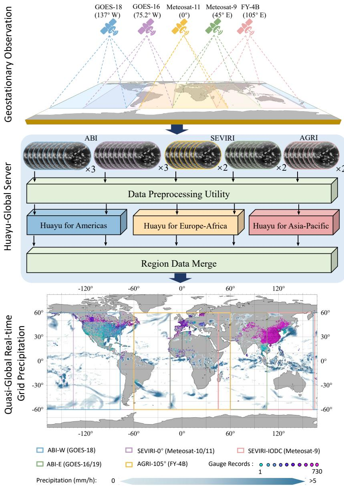  
Fig. 1 Data processing workflow for the Huayu-Global precipitation monitoring framework. Representative Geostationary Operational Environmental Satellite (GOES), Meteosat, and FengYun-4B (FY-4B) sector views are transformed into Advanced Baseline Imager (ABI), Spinning Enhanced Visible and Infrared Imager (SEVIRI), and Advanced Geostationary Radiation Imager (AGRI) cloudfeature sequences, then passed through the Huayu models for the Americas, Europe-Africa, and Asia-Pacific domains. Sector outputs are merged to generate coherent quasi-global grid precipitation products using only satellite inputs available at the inference time.

Americas, Europe-Africa, and Asia-Pacific sectors while preserving a common output grid.

Here we present Huayu-Global, a cross-constellation framework for real-time quasiglobal precipitation retrieval. Extending the earlier regional Huayu framework [18], it coordinates sensor-adapted models for GOES ABI, Meteosat SEVIRI, and FY-4B AGRI within a common architecture and merges their outputs on a unified 0.05◦ grid (Fig. 1). Huayu-Global thereby converts operational geostationary observations into coherent precipitation fields every 30 minutes across most low- and mid-latitude regions. The system is developed from 59.7 TB of satellite data and evaluated against 5,395 independent ground stations contributing 1.85 million matched three-hourly records from July–December 2022 and January–June 2025, both outside the 2023– 2024 training years. It leads the evaluated real-time products in event detection and error magnitude and reaches delayed-product-level skill in key station-based metrics. By moving high-skill precipitation information from retrospective archives into the operational decision window, Huayu-Global establishes a scalable observation layer for flood forecasting, water management, disaster response and future satellite-enabled weather prediction.

## 2 Results

## 2.1 Availability–skill comparison

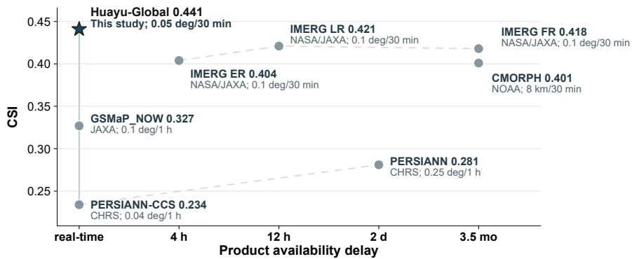  
Fig. 2 Detection skill by product availability class. The vertical axis shows the full-sample CSI from the independent station evaluation, and the horizontal axis shows documented product-release or processing classes rather than measured end-to-end processing time. Huayu-Global and the realtime baseline products are grouped in the real-time class; IMERG Early Run (IMERG ER), IMERG Late Run (IMERG LR), PERSIANN, CMORPH, and IMERG FR are displayed according to their documented release categories. Lines connect product streams within the same product family where applicable.

Huayu-Global was evaluated against seven satellite precipitation products spanning real-time, short-delay, and delayed post-processed streams. Figure 2 summarizes the main availability–skill comparison: within the matched station sample, Huayu-Global is the only real-time product whose critical success index (CSI) is higher than all evaluated baselines, including products released months later.

Table 1 Overall performance comparison over 1,847,967 matched 3-hour station-product records from July–December 2022 and January–June 2025. Huayu-Global is compared with seven satellite precipitation products on the same matched station windows using CSI, ACC, R2, CC, and RMSE. All values in this table are evaluated against independent station observations. Smaller values below each estimate denote ± one-half of the central 95% bootstrap confidence interval from 1,000 station–date-block resamples (Methods). Bold values indicate the best value in each metric column.
<table><tr><td>Product</td><td>Resolution</td><td>Latency</td><td>CSI↑</td><td>ACC↑</td><td> $\mathbf { R } ^ { 2 } \uparrow$ </td><td>CC↑</td><td>RMSE↓ (mm)</td></tr><tr><td>PERSIANN-CCS</td><td>0.04°/1h</td><td>real-time</td><td>0.234 ±0.001</td><td>0.853 ±0.001</td><td>-0.177 ±0.020</td><td>0.334 ±0.008</td><td>2.660 ±0.032</td></tr><tr><td>GSMaP_NOW</td><td>0.1°/1h</td><td>real-time</td><td>0.327 ±0.001</td><td>0.859 ±0.001</td><td>-0.374 ±0.036</td><td>0.387 ±0.008</td><td>2.874 ±0.039</td></tr><tr><td>CMORPH</td><td>8km/30min</td><td>3-4 months</td><td>0.401 ±0.002</td><td>0.904 ±0.000</td><td>0.255 ±0.013</td><td>0.597 ±0.008</td><td>2.118 ±0.035</td></tr><tr><td>PERSIANN</td><td>0.25°/1h</td><td>2 days</td><td>0.281 ±0.001</td><td>0.855 ±0.001</td><td>0.156 ±0.007</td><td>0.421 ±0.007</td><td>2.257 ±0.037</td></tr><tr><td>IMERG ER</td><td>0.1°/30min</td><td>4 hours</td><td>0.404 ±0.002</td><td>0.876 ±0.000</td><td>0.195 ±0.013</td><td>0.553 ±0.008</td><td>2.203 ±0.034</td></tr><tr><td>IMERG LR</td><td>0.1°/30min</td><td>12 hours</td><td>0.421 ±0.002</td><td>0.887 ±0.000</td><td>0.244 ±0.013</td><td>0.590 ±0.007</td><td>2.134 ±0.034</td></tr><tr><td>IMERG FR</td><td>0.1°/30min</td><td>3.5 months</td><td>0.418 ±0.002</td><td>0.885 ±0.000</td><td>0.307 ±0.012</td><td>0.613 ±0.007</td><td>2.042 ±0.035</td></tr><tr><td>Huayu-Global</td><td>0.05°/30min</td><td>real-time</td><td>0.441 ±0.002</td><td>0.896 ±0.000</td><td>0.362 ±0.008</td><td>0.605 ±0.007</td><td>1.961 ±0.038</td></tr></table>

The full-sample metrics in Table 1 show the same pattern across complementary diagnostics. Across 1,847,967 matched 3-hour station-product records, Huayu-Global achieves the highest CSI (0.441) and coeficient of determination (R2, 0.362), and the lowest root-mean-square error (RMSE, 1.961 mm). Huayu-Global also exceeds the 3.5-month IMERG FR product in CSI, R2, and RMSE in this independent station comparison. Its overall accuracy (ACC, 0.896) is close to the highest value from CMORPH (0.904), and its correlation coeficient (CC, 0.605) is close to the highest value from IMERG FR (0.613). Daily-scale diagnostics (Extended Data Fig. 2) show that this aggregate advantage is not confined to a small number of validation dates, while also indicating that the strongest non-Huayu baseline varies by metric and day.

## 2.2 Representative spatial case

The selected case in Fig. 3 illustrates the spatial character of the retrievals. All six products locate the main precipitation systems in broadly similar areas, but Huayu-Global preserves connected rain bands and internal intensity gradients across the mosaic, whereas several baselines produce fragmented, block-like, or isolated features. The four enlarged regions show the same contrast for both elongated rain bands and localized precipitation centres.

The case-specific metrics are consistent with the visual result: Huayu-Global has the highest CSI (0.595), CC (0.686), and $\mathrm { R ^ { 2 } }$ (0.455), together with the lowest RMSE (1.528 mm), among the six displayed products. Because this is a single selected scene and some uncertainty ranges overlap, it illustrates rather than establishes the product wide ranking; that conclusion rests on the full-sample evaluation in Table 1.

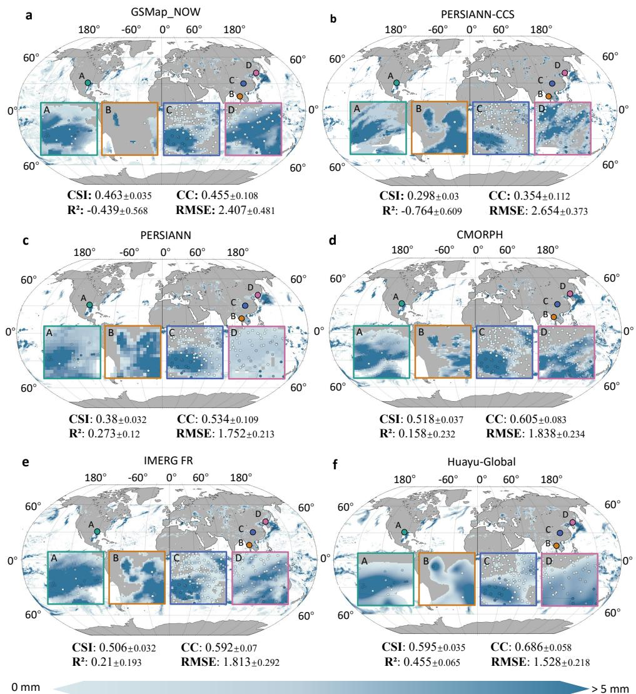  
Fig. 3 Representative spatial comparison of precipitation estimates for one selected evaluation case. Panels show (a) GSMaP NOW, (b) PERSIANN-CCS, (c) PERSIANN, (d) CMORPH, (e) IMERG FR, and (f) Huayu-Global. Each panel presents a quasi-global precipitation field with four enlarged regional views; station markers indicate the validation locations in the zoomed regions. The annotations report case-specific CSI, CC, R2, and RMSE for the displayed case only and should not be interpreted as the full-sample scores in Table 1.

Table 2 Regional performance of Huayu-Global across three operational sectors and the quasiglobal station sample. Metrics are evaluated over July–December 2022 and January–June 2025. Sector entries are record-count-weighted summaries of independently evaluated longitude segments and are not recomputed from pooled sector samples; the quasi-global entry is computed directly over the full evaluation sample. Because $\mathrm { R ^ { 2 } }$ is computed relative to the range of the records being pooled, and the quasi-global $\mathrm { R ^ { 2 } }$ is computed over the full range of the pooled records, it is not a record-count-weighted average of sector $\mathrm { R ^ { 2 } }$ values; between-sector diferences in observed precipitation can therefore make the pooled quasi-global $\mathrm { R ^ { 2 } }$ exceed the individual sector values.
<table><tr><td>Region</td><td>Records</td><td>CSI↑</td><td>ACC↑</td><td> $\mathbf { R } ^ { 2 } \uparrow$ </td><td>RMSE↓ (mm)</td></tr><tr><td>Americas</td><td>302,755</td><td>0.495</td><td>0.814</td><td>0.339</td><td>2.452</td></tr><tr><td rowspan="2">Europe-Africa Asia-Pacific</td><td>135,130</td><td>0.398</td><td>0.888</td><td>0.247</td><td>1.597</td></tr><tr><td>1,410,082</td><td>0.415</td><td>0.914</td><td>0.356</td><td>1.866</td></tr><tr><td>Quasi-global</td><td>1,847,967</td><td>0.441</td><td>0.896</td><td>0.362</td><td>1.961</td></tr></table>

## 2.3 Regional performance

Regional summaries are spatially heterogeneous and mainly correspond to the three sensor domains. The Americas sector (GOES ABI) has the highest CSI (0.495) and the highest RMSE (2.452 mm); the Europe-Africa sector (Meteosat SEVIRI) has the lowest RMSE (1.597 mm) and the lowest sector-level CSI (0.398); and the Asia-Pacific sector (FY-4B AGRI) has the largest validation sample (1,410,082 records), the highest ACC (0.914), and the highest sector-level $\mathrm { R ^ { 2 } }$ (0.356).

Figure 4 provides station-level spatial detail for the Asia validation domain. The corresponding station-level CC maps for the Americas and Europe domains are provided in Extended Data Figs. 3 and 4, respectively. Station-level CSI maps for the Americas, Europe, and Asia domains are provided in Extended Data Figs. 5–7. A paired comparison across common stations and identical precipitation datasets showed that CC exceeded CSI in 70.54% of the station–dataset pairs, and the station-averaged CC was higher than the corresponding station-averaged CSI for all six datasets. These absolute values are not directly comparable, however, because CC and CSI have distinct definitions and difer in their sensitivity to zero-precipitation records, missed events, and false alarms. The comparison therefore characterizes the relationship between the two diagnostics rather than indicating better model performance from the metric with the larger numerical value.

## 2.4 Performance across validation conditions

Figure 5 resolves the aggregate comparison across temporal, geographic, and precipitation regimes. Across validation months, Huayu-Global generally remains close to or exceeds the best-baseline envelope, although the size of the diference varies by metric and month. The 2022 longitude profiles are comparatively stable, whereas the 2025 profiles are more heterogeneous; Huayu-Global nevertheless remains among the leading products across most valid longitude sectors.

Stratification also identifies the most challenging evaluation regimes. CSI and POD generally decrease with station elevation while FAR increases, indicating weaker event detection over high terrain. RMSE rises sharply with observed precipitation amount, identifying heavy precipitation as a prominent regime of increasing magnitude error. Because the strongest baseline is selected separately within each bin and metric, the grey series is an upper-envelope diagnostic rather than a comparison with one fixed product; amount-conditioned categorical metrics likewise describe the selected precipitation bins rather than an independent threshold-sensitivity test.

Station-level CC across Asia  
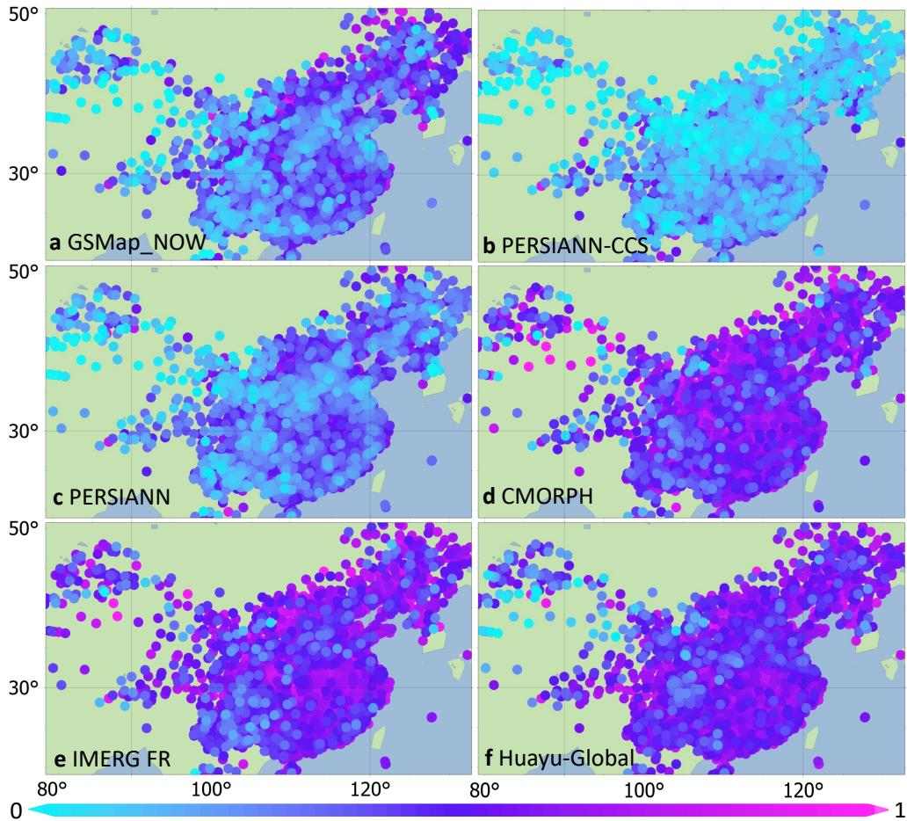  
Fig. 4 Station-level correlation coeficient (CC) across the Asia validation domain, shown for the station network concentrated in East Asia. Panels a–f show GSMaP NOW, PERSIANN-CCS, PER-SIANN, CMORPH, IMERG FR, and Huayu-Global, respectively. Each circle marks a validation station and is coloured by the Pearson CC between the product estimates and station observations, calculated from all available paired 3-hour records in the July–December 2022 and January–June 2025 validation windows. The colour scale ranges from 0 (cyan) to 1 (magenta).

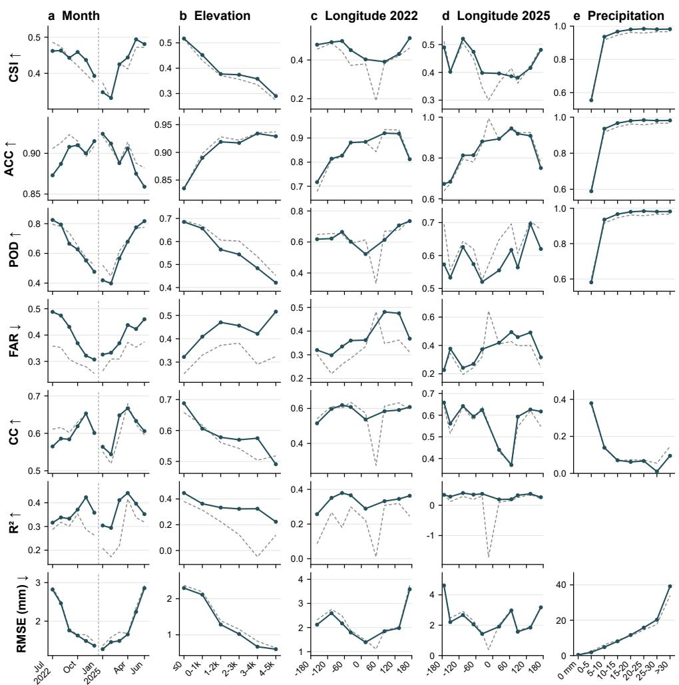  
Fig. 5 Stratified performance across validation conditions. Rows show CSI, ACC, POD, FAR, CC, R2, and RMSE; columns show validation month, station elevation, longitude sector in 2022 and 2025, and observed 3-hour precipitation amount. Solid teal lines denote Huayu-Global, and dashed grey lines denote the strongest non-Huayu baseline selected separately within each bin and metric. Metric– bin combinations that are undefined or uninformative by construction are omitted.

## 3 Discussion

Huayu-Global extends the earlier regional Huayu framework [18] from a single-sensor regional retrieval to a three-sensor quasi-global system covering approximately 85% of Earth’s land surface between $6 0 ^ { \circ } \mathrm { S }$ and 60◦N. It demonstrates that high-frequency geostationary imagery can deliver real-time-input precipitation estimates with skill previously associated with delayed post-processed products. At independent station locations, Huayu-Global achieves the highest CSI and $\mathrm { R ^ { 2 } }$ and the lowest RMSE among the evaluated products. Relative to GSMaP NOW, it increases CSI by 34.9% and reduces RMSE by 31.8%. The central advance is the conversion of continuously avail able cloud-evolution observations into high-skill precipitation information within the operational decision window.

This capability connects satellite retrieval directly to time-critical environmental workflows. Huayu-Global generates a new 0.05◦ precipitation field every 30 minutes, and data loading and inference require less than 5 minutes per timestep after model initialization on a single workstation (Methods). The resulting fields can provide a timely observation layer for flood nowcasting, hydrological forecasting, agricultural monitoring and disaster response. They also complement recent deep-learning nowcasting and weather-prediction systems, which require rapidly updated precipitation information to initialize, constrain and evaluate forecasts [28–31].

The cross-constellation design makes this capability scalable. The three sector models share the same Head–Geographic Attention Block (GeoAB)–Tail architecture while using separate parameters for ABI, SEVIRI, and AGRI streams. This combination applies a consistent representation pathway to cloud evolution while adapting to diferences in spectral coverage, resolution, scan frequency and viewing geometry. All three models achieve useful retrieval skill within their respective domains (Table 2), enabling their outputs to form a coherent quasi-global product. The same design provides a practical path for incorporating Meteosat Third Generation, FY-4C, and Geostationary Extended Observations (GeoXO) missions as the global geostationary constellation evolves.

Training on 2023–2024 data and evaluation in July–December 2022 and January– June 2025 show that the retrieval skill extends beyond the training years. The aggregate advantage persists across these windows, while analyses by month, station elevation, longitude sector and precipitation amount (Fig. 5) identify where that skill varies. The Americas sector (GOES ABI) achieves both the highest CSI (0.495) and highest RMSE (2.452 mm), consistent with strong event detection in a domain containing intense convective rainfall. The Europe-Africa sector (Meteosat SEVIRI) has the lowest CSI (0.398) and lowest RMSE (1.597 mm), indicating more conservative detection and smaller magnitude errors. These regional contrasts connect retrieval performance to sensor characteristics, climate regimes and the uneven distribution of station samples.

Huayu-Global is supervised with IMERG FR yet exceeds it for $\mathrm { C S I } , \mathrm { R } ^ { 2 }$ , and RMSE at independent station locations. This result shows that a gridded supervision product need not define the performance ceiling of a retrieval evaluated at a diferent spatial scale. The 0.05◦ grid, explicit separation of rain occurrence and amount [18], and high-frequency cloud-evolution sequences allow Huayu-Global to sharpen rainfall boundaries, timing and local magnitude relative to the $0 . 1 ^ { \circ }$ training target. Independent radar composites, additional dense gauge networks and oceanic observations would extend this evidence to spatial regimes that remain weakly sampled by the present evaluation.

The remaining limitations define the next scientific targets. Geostationary coverage is restricted to approximately $6 0 ^ { \circ } \mathrm { S - } 6 0 ^ { \circ } \mathrm { N }$ , leaving high latitudes dependent on polarorbiting observations. The Hadley Centre Integrated Surface Database (HadISD) [32– 35] and China Meteorological Administration (CMA) networks provide extensive land validation but sparse coverage over Africa, South America and the oceans. Warm rain, snow, orographic precipitation and intense convection also remain challenging because cloud-top radiances do not uniquely determine surface rainfall [22, 23, 26, 36]. These gaps motivate complementary observations and retrieval constraints rather than further expansion of the same satellite-only formulation.

The diagnostic patterns provide a roadmap for that expansion. Elevationdependent degradation (Fig. 5, column b) makes terrain, wind fields and orographic constraints the first priority, while intensity-dependent RMSE growth (Fig. 5, column e) motivates loss reweighting and passive-microwave fusion for heavy rainfall. Ensemble uncertainty estimates and robustness to missing scans would make the fields more useful for risk-sensitive decisions, and polar-orbiting microwave observations could extend retrieval towards higher latitudes. Combined with the rapid progress of data-driven global weather prediction [37, 38], these developments could turn cross-constellation precipitation retrieval into a continuously updated observation layer linking satellite systems, hydrological models and early-warning services. Huayu-Global provides the present foundation for that transition from delayed precipitation archives to active Earth-system prediction.

## 4 Methods

## 4.1 Preprocessing

The preprocessing stage summarized in Fig. 1 converts satellite observations from different geostationary platforms into georeferenced multispectral cloud-feature tensors and reprojects them to a common $0 . 0 5 ^ { \circ }$ grid. Channel-wise normalization and feature standardization are applied separately for ABI, SEVIRI, and AGRI to reduce cross-sensor heterogeneity while preserving sensor-specific information. Invalid pixels and low-quality retrieval regions are filled by spatial interpolation from valid neighbouring pixels during preprocessing; regions with persistent data gaps spanning the full interpolation window are flagged as missing and excluded from both training and evaluation. Training pairs are generated by collocating geostationary feature tensors with IMERG FR precipitation fields at matching timestamps; at each 30-min interval, one IMERG FR field is paired with two AGRI or SEVIRI scans or three ABI scans according to the native acquisition frequency. At inference time, sector outputs are transformed to the common grid and mosaicked with overlap-aware blending, in which adjacent sector outputs are combined by averaging across overlap zones at mosaic boundaries.

## 4.2 Model framework

Huayu-Global maps multispectral cloud observations to 30-min precipitation estimates through three independently trained sector models. The models share the same Head–GeoAB–Tail architecture, where GeoAB denotes Geographic Attention Block (Extended Data Fig. 1) [18, 39, 40], but have separate parameters for ABI, SEVIRI, and AGRI streams. This design keeps the retrieval framework consistent while allowing each model to adapt to its sensor-domain distribution. The choice of a shared architecture with independent weights reflects the hypothesis that cloud-torainfall relationships share common physical structure across sensors—captured by the common Head–GeoAB–Tail design—but require sensor-specific parameterization of spectral response functions, viewing geometry, and scan cadence—captured by separately trained weights. The GeoAB modules combine attention mechanisms introduced by the Transformer [41], shifted-window attention derived from Swin Transformer and SwinIR designs [42–44], and long-range attention components developed in earlier geographic image-restoration and precipitation-retrieval work [18, 39, 45, 46]. A single unified model would need to internally reconcile conflicting sensor characteristics, while three entirely separate architectures would forgo the modelling eficiency and cross-sensor consistency that a common framework provides. The sector-wise outputs are merged into a spatially continuous quasi-global product after reprojection and overlap blending. Six consecutive 30-min estimates are accumulated for evaluation against 3-hour station records.

## 4.3 Runtime performance

Single-machine runtime was measured on a 64-bit Windows 11 workstation equipped with an Intel Core i7-10700F CPU (8 cores and 16 threads), 48 GB of system memory, and one NVIDIA GeForce RTX 4060 Ti GPU with 8 GB of memory. For a representative single-timestamp Huayu-Global run with the required satellite files stored locally, model initialization and weight loading took 91.5 s, input-data loading took 195.0 s, and retrieval inference took 95.2 s. The complete first run therefore required 381.7 s (6.36 min). Because model loading is a one-time startup cost when the process remains active, the measured data-loading and inference stages for a subsequent timestamp total 290.2 s (4.84 min). These measurements characterize local computational performance and exclude upstream satellite-data delivery, local transfer, quality control, and downstream product dissemination. In this manuscript, “real-time” therefore means that inference uses only observations available for the target time and that local processing is short relative to the 30-min product cycle; it does not claim a measured end-to-end public-release latency. Faster storage or multi-GPU deployment could further reduce data loading time or support concurrent processing.

## 4.4 Training and optimization

The training data cover 2023 and 2024, whereas the independent station validation windows are July–December 2022 and January–June 2025. This temporal separation is used to evaluate generalization outside the training years. Huayu-Global adopts the dual-target loss introduced in the earlier Huayu framework [18]. The objective addresses the imbalance between non-raining and raining pixels by separating precipitation occurrence from precipitation amount. For each training sample i, let $r _ { i }$ be the IMERG FR precipitation target, $\boldsymbol { { \hat { r } } } _ { i }$ the regression output, $z _ { i } = \mathbb { F } ( r _ { i } \ge 0 . 1$ mm) the rain-occurrence label, and $\hat { \mathbf { q } } _ { i }$ the predicted rain–no-rain probability vector. The training loss is

$$
\mathcal { L } = \frac { 1 } { \operatorname* { m a x } ( N _ { + } , 1 ) } \sum _ { i = 1 } ^ { N } z _ { i } \operatorname { S m o o t h L 1 } ( \hat { r } _ { i } , r _ { i } ) + \frac { 1 } { N } \sum _ { i = 1 } ^ { N } \mathrm { C E } ( \hat { \mathbf { q } } _ { i } , z _ { i } ) ,\tag{1}
$$

where N is the number of pixels in a training batch, $\begin{array} { r } { N _ { + } = \sum _ { i } z _ { i } , } \end{array}$ CE denotes cross-entropy loss, and the SmoothL1 term is evaluated only over positive-rainfall pixels. At inference, pixels classified as non-raining are set to zero, while pixels classified as raining retain the regression estimate. Space-time samples are shufled during training, and model checkpoints are selected according to held-out validation performance. Because IMERG FR is the supervision target and is also one of the delayed comparison products, the product-ranking claims are solely based on independent station observations rather than on agreement with the training target.

All three sector models use AdamW optimization [47], a batch size of 16, and 100 training epochs on four NVIDIA RTX 6000 Ada GPUs with 48 GB memory each. The implementation uses PyTorch with Python 3.12 on Linux. The three models share the same architecture and parameter count, while the learning rate and decay schedule are tuned separately for ABI, AGRI, and SEVIRI streams (Extended Data Table 1).

## 4.5 Evaluation metrics

Evaluation is performed on matched station-product records at 3-hour accumulation scale, with each record constructed from six consecutive 30-min precipitation fields. For 3-hour evaluation, hourly and sub-hourly station records are aggregated to the corresponding 3-hour windows. All products are evaluated over the same valid stationtime set after applying common quality-control and missing-data filters, so diferences in record count do not drive the product rankings in Table 1. Product values are extracted from each product’s native grid at the station coordinates before temporal accumulation, avoiding an artificial common-grid resampling step that could smooth or sharpen products diferently. For 30-min products, six consecutive fields are summed to produce the 3-hour accumulation; for products natively delivered at coarser temporal resolution, the accumulation is computed over the number of constituent fields that fall within the 3-hour window. The two validation periods comprise 730 candidate windows: 00:00–03:00 and 12:00–15:00 UTC on each day from 1 July to 31 December 2022 and from 1 January to 30 June 2025. Candidate windows for which missing source satellite imagery prevented consistent generation of the corresponding gridded precipitation fields were excluded before station matching. For the remaining windows, a station-time sample was retained only when a quality-controlled gauge accumulation was available and could be collocated with all seven comparison products (PERSIANN-CCS, GSMaP NOW, CMORPH, PERSIANN, and IMERG ER, LR, and FR). Missing, non-finite, or product-defined invalid precipitation values were excluded from metric calculations, whereas valid zero-precipitation values were retained. Consequently, the record count for an individual station represents the number of valid gauge–grid collocations rather than the 730 theoretical windows; among the 5,395 stations, the largest station-level count was 569. Precipitation occurrence is evaluated at the native subperiods used to build each Huayu-Global 3-hour record using a 0.1 mm threshold before contingency counts are accumulated over the validation sample; the 3-hour intensity threshold is also set to 0.1 mm for all products. Detection skill is assessed by critical success index (CSI), probability of detection (POD), false-alarm ratio (FAR), and accuracy (ACC). Let TP, FN, FP, and TN denote true positives, false negatives, false positives, and true negatives, respectively. The categorical metrics are computed as

$$
\begin{array} { r l r } & { \mathrm { C S I } = \displaystyle \frac { \mathrm { T P } } { \mathrm { T P } + \mathrm { F N } + \mathrm { F P } } , } & { \mathrm { P O D } = \displaystyle \frac { \mathrm { T P } } { \mathrm { T P } + \mathrm { F N } } , } \\ & { \mathrm { F A R } = \displaystyle \frac { \mathrm { F P } } { \mathrm { T P } + \mathrm { F P } } , } & { \mathrm { A C C } = \displaystyle \frac { \mathrm { T P } + \mathrm { T N } } { \mathrm { T P } + \mathrm { F N } + \mathrm { F P } + \mathrm { T N } } . } \end{array}\tag{2}
$$

Quantitative consistency is assessed by $\mathrm { C C } , \mathrm { R ^ { 2 } }$ , and RMSE. For product estimates $p _ { i }$ and station observations $o _ { i } ,$ both expressed as 3-hour accumulated precipitation amounts,

$$
\begin{array} { r l } & { \displaystyle \mathrm { R M S E } = \sqrt { \frac { 1 } { n } \sum _ { i = 1 } ^ { n } ( p _ { i } - o _ { i } ) ^ { 2 } } , } \\ & { \quad \quad \quad R ^ { 2 } = 1 - \frac { \sum _ { i = 1 } ^ { n } ( p _ { i } - o _ { i } ) ^ { 2 } } { \sum _ { i = 1 } ^ { n } ( o _ { i } - \bar { o } ) ^ { 2 } } , } \\ & { \quad \quad \quad \mathrm { C C } = \frac { \displaystyle \sum _ { i = 1 } ^ { n } ( p _ { i } - \bar { p } ) \big ( o _ { i } - \bar { o } \big ) } { \displaystyle \sqrt { \sum _ { i = 1 } ^ { n } ( p _ { i } - \bar { p } ) ^ { 2 } } \sqrt { \sum _ { i = 1 } ^ { n } ( o _ { i } - \bar { o } ) ^ { 2 } } } , } \end{array}\tag{3}
$$

where $\bar { p }$ and o¯ are the mean product estimate and mean station observation.

## 4.6 Statistics and uncertainty

Uncertainty ranges reported with the evaluation metrics are computed from 1,000 bootstrap resamples. A resampling block is defined by each station and UTC period and contains all valid 3-hour records. For each bootstrap iteration, station-time blocks are drawn with replacement and metrics are recomputed on the resampled set. The bootstrap distribution is summarized by the 2.5th and 97.5th percentiles, giving a central 95% confidence interval. Compact tables report this uncertainty as ± onehalf of the central 95% interval. These intervals quantify sampling uncertainty over the matched station network and do not include structural uncertainty from product algorithms, gauge undercatch, representativeness error between point gauges and grid cells, or unobserved oceanic regions.

## 4.7 Data

Huayu-Global uses three operational geostationary satellite systems to cover most lowand mid-latitude regions (60◦S–60◦N): GOES-16/18/19 Advanced Baseline Imager (ABI) for the Americas sector [16, 48], Meteosat-9/10/11 Spinning Enhanced Visible and Infrared Imager (SEVIRI) for the Europe-Africa sector [49], and FY-4B Advanced Geostationary Radiation Imager (AGRI) for the Asia-Pacific sector [50]. GOES-16 and GOES-19 are treated as the same ABI stream, and Meteosat-10 and Meteosat-11 are treated as the same SEVIRI stream, with operational transitions handled through provider data records and sector footprint metadata. All source observations are transformed onto a common 0.05◦ analysis grid and harmonized in time before model inference. Detailed satellite specifications, data volumes, and provider information are given in Extended Data Tables 2 and 3.

Huayu-Global is benchmarked against seven representative satellite precipitation products spanning infrared-based, passive-microwave-informed, morphingbased, multi-sensor, real-time, and delayed post-processed retrieval families: GSMaP NOW [5], PERSIANN-CCS and PERSIANN [6], CMORPH [8], and IMERG ER/LR/FR [9, 11, 12]. This broad selection provides a comparison set for evaluating both event detection and quantitative precipitation estimation.

Independent in situ observations from the HadISD global station dataset [32– 35] and CMA station network provide the validation data, with 5,395 stations and 1,847,967 three-hourly records. IMERG FR fields are used as gridded training targets, whereas ground observations are reserved exclusively for independent validation and cross-product comparison. This separation reduces circularity between model supervision and final performance assessment, but the station network is unevenly distributed and does not directly evaluate open-ocean precipitation.

## References

[1] Shen, Y., Zhao, P., Pan, Y., Yu, J.: A high spatiotemporal gauge-satellite merged precipitation analysis over china. Journal of Geophysical Research: Atmospheres 119(6), 3063–3075 (2014)

[2] Fulton, R.A., Breidenbach, J.P., Seo, D.-J., Miller, D.A., O’Bannon, T.: The wsr-88d rainfall algorithm. Weather and forecasting 13(2), 377–395 (1998)

[3] Sun, Q., Miao, C., Duan, Q., Ashouri, H., Sorooshian, S., Hsu, K.-L.: A review of global precipitation data sets: Data sources, estimation, and intercomparisons. Reviews of Geophysics 56(1), 79–107 (2018)

[4] Kirschbaum, D.B., Hufman, G.J., Adler, R.F., Braun, S., Garrett, K., Jones, E., McNally, A., Skofronick-Jackson, G., Stocker, E., Wu, H., et al.: Nasa’s remotely sensed precipitation: A reservoir for applications users. Bulletin of the American Meteorological Society 98(6), 1169–1184 (2017)

[5] Kubota, T., Aonashi, K., Ushio, T., Shige, S., Takayabu, Y.N., Kachi, M., Arai, Y., Tashima, T., Masaki, T., Kawamoto, N., et al.: Global satellite mapping of precipitation (gsmap) products in the gpm era. In: Satellite Precipitation Measurement: Volume 1, pp. 355–373. Springer, Cham (2020)

[6] Nguyen, P., Ombadi, M., Sorooshian, S., Hsu, K., AghaKouchak, A., Braithwaite,

D., Ashouri, H., Thorstensen, A.R.: The persiann family of global satellite precipitation data: A review and evaluation of products. Hydrology and Earth System Sciences 22(11), 5801–5816 (2018)

[7] Hong, Y., Hsu, K.-L., Sorooshian, S., Gao, X.: Precipitation estimation from remotely sensed imagery using an artificial neural network cloud classification system. Journal of Applied Meteorology 43(12), 1834–1853 (2004)

[8] Joyce, R.J., Janowiak, J.E., Arkin, P.A., Xie, P.: Cmorph: A method that produces global precipitation estimates from passive microwave and infrared data at high spatial and temporal resolution. Journal of hydrometeorology 5(3), 487–503 (2004)

[9] Hufman, G.J., Bolvin, D.T., Braithwaite, D., Hsu, K., Joyce, R., Xie, P., Yoo, S.-H.: Nasa global precipitation measurement (gpm) integrated multi-satellite retrievals for gpm (imerg). Algorithm theoretical basis document (ATBD) version 4(26), 2020–05 (2015)

[10] Kidd, C., Takayabu, Y.N., Skofronick-Jackson, G.M., Hufman, G.J., Braun, S.A., Kubota, T., Turk, F.J.: The global precipitation measurement (gpm) mission. Satellite Precipitation Measurement: Volume 1, 3–23 (2020)

[11] Tan, J., Hufman, G.J., Bolvin, D.T., Nelkin, E.J.: Imerg v06: Changes to the morphing algorithm. Journal of Atmospheric and Oceanic Technology 36(12), 2471–2482 (2019)

[12] Hufman, G.J., Bolvin, D.T., Joyce, R., Kelley, O.A., Nelkin, E.J., Portier, A., Stocker, E.F., Tan, J., Watters, D.C., West, B.J.: Imerg v07 release notes. Goddard Space Flight Center: Greenbelt, MD, USA (2023)

[13] Tan, J., Petersen, W.A., Tokay, A.: A novel approach to identify sources of errors in imerg for gpm ground validation. Journal of Hydrometeorology 17(9), 2477– 2491 (2016)

[14] Pradhan, R.K., Markonis, Y., Godoy, M.R.V., Villalba-Pradas, A., Andreadis, K.M., Nikolopoulos, E.I., Papalexiou, S.M., Rahim, A., Tapiador, F.J., Hanel, M.: Review of gpm imerg performance: A global perspective. Remote Sensing of Environment 268, 112754 (2022)

[15] Blersch, D.J., Probert, T.C.: Geostationary meteorological satellite systems-an overview. Journal of Practical Applications in Space 2(4), 1–13 (1991)

[16] Schmit, T.J., Gunshor, M.M., Menzel, W.P., Gurka, J.J., Li, J., Bachmeier, A.S.: Introducing the next-generation advanced baseline imager on goes-r. Bulletin of the American Meteorological Society 86(8), 1079–1096 (2005)

[17] Bessho, K., Date, K., Hayashi, M., Ikeda, A., Imai, T., Inoue, H., Kumagai,

Y., Miyakawa, T., Murata, H., Ohno, T., et al.: An introduction to himawari-8/9—japan’s new-generation geostationary meteorological satellites. Journal of the Meteorological Society of Japan. Ser. II 94(2), 151–183 (2016)

[18] Song, Z., Liu, T., Yuan, L., Li, Y., Xu, A., Sun, X., Li, Y., Lu, F., Liu, M.: Huayu: Advanced real-time satellite-based precipitation estimation. International Journal of Applied Earth Observation and Geoinformation 149, 105307 (2026)

[19] K¨uhnlein, M., Appelhans, T., Thies, B., Nauss, T.: Improving the accuracy of rainfall rates from optical satellite sensors with machine learning—a random forests-based approach applied to msg seviri. Remote Sensing of Environment 141, 129–143 (2014)

[20] Sehad, M., Lazri, M., Ameur, S.: Novel svm-based technique to improve rainfall estimation over the mediterranean region (north of algeria) using the multispectral msg seviri imagery. Advances in Space Research 59(5), 1381–1394 (2017)

[21] Wang, C., Xu, J., Tang, G., Yang, Y., Hong, Y.: Infrared precipitation estimation using convolutional neural network. IEEE Transactions on Geoscience and Remote Sensing 58(12), 8612–8625 (2020)

[22] Wang, C., Tang, G., Xiong, W., Ma, Z., Zhu, S.: Infrared precipitation estimation using convolutional neural network for fengyun satellites. Journal of Hydrology 603, 127113 (2021)

[23] Ma, Z., Zhu, S., Yang, J.: Fy4qpe-msa: An all-day near-real-time quantitative precipitation estimation framework based on multispectral analysis from agri onboard chinese fy-4 series satellites. IEEE Transactions on Geoscience and Remote Sensing 60, 1–15 (2022)

[24] Ma, G., Zhu, L., Zhang, Y., Huang, J., Sun, Y., Tian, W.: Improvement of a near-real-time precipitation estimation algorithm using deep learning. IEEE Geoscience and Remote Sensing Letters 19, 1–5 (2022)

[25] Zhang, D., He, Y., Li, X., Zhang, L., Xu, N.: Precipgradenet: A new paradigm and model for precipitation retrieval with grading of precipitation intensity. Remote Sensing 15(1), 227 (2022)

[26] Zhu, S., Ma, Z., Yan, S., Xu, J., Li, X.: Pecam-fy4a&b: Precipitation estimation using chromatographic analysis method by merging enhanced multispectral infrared observations from fengyun-4a and 4b. IEEE Transactions on Geoscience and Remote Sensing (2024)

[27] Ji, D., Letu, H., Ri, X., Xu, N., Li, X., Li, X., Zhang, G., Wang, Y., Shi, J.: A new dynamically updated geostationary satellite precipitation estimation algorithm for near real-time condition. IEEE Transactions on Geoscience and Remote

[28] Sønderby, C.K., Espeholt, L., Heek, J., Dehghani, M., Oliver, A., Salimans, T., Agrawal, S., Hickey, J., Kalchbrenner, N.: Metnet: A neural weather model for precipitation forecasting. arXiv preprint arXiv:2003.12140 (2020)

[29] Ravuri, S., Lenc, K., Willson, M., Kangin, D., Lam, R., Mirowski, P., Fitzsimons, M., Athanassiadou, M., Kashem, S., Madge, S., et al.: Skilful precipitation nowcasting using deep generative models of radar. Nature 597(7878), 672–677 (2021)

[30] Espeholt, L., Agrawal, S., Sønderby, C., Kumar, M., Heek, J., Bromberg, C., Gazen, C., Carver, R., Andrychowicz, M., Hickey, J., et al.: Deep learning for twelve hour precipitation forecasts. Nature communications 13(1), 1–10 (2022)

[31] Zhang, Y., Long, M., Chen, K., Xing, L., Jin, R., Jordan, M.I., Wang, J.: Skilful nowcasting of extreme precipitation with nowcastnet. Nature 619(7970), 526–532 (2023)

[32] Dunn, R.J., Willett, K.M., Thorne, P.W., Woolley, E.V., Durre, I., Dai, A., Parker, D.E., Vose, R.: Hadisd: A quality-controlled global synoptic report database for selected variables at long-term stations from 1973–2011. Climate of the Past 8(5), 1649–1679 (2012)

[33] Smith, A., Lott, N., Vose, R.: The integrated surface database: Recent developments and partnerships. Bulletin of the American Meteorological Society 92(6), 704–708 (2011)

[34] Dunn, R., Willett, K., Morice, C., Parker, D.: Pairwise homogeneity assessment of hadisd. Climate of the Past 10(4), 1501–1522 (2014)

[35] Dunn, R.J., Willett, K.M., Parker, D.E., Mitchell, L.: Expanding hadisd: Qualitycontrolled, sub-daily station data from 1931. Geoscientific Instrumentation, Methods and Data Systems 5(2), 473–491 (2016)

[36] Yang, C., Li, H., Zhu, R., Wang, Y., Zhang, F., Gu, M., Jiang, G.-M., Zhang, R., Tang, X.: Snow or rain? hybrid ai deciphers surface precipitation phase from satellite observations. Nature Communications (2026)

[37] Bi, K., Xie, L., Zhang, H., Chen, X., Gu, X., Tian, Q.: Accurate medium-range global weather forecasting with 3d neural networks. Nature 619(7970), 533–538 (2023)

[38] Chen, L., Zhong, X., Zhang, F., Cheng, Y., Xu, Y., Qi, Y., Li, H.: Fuxi: A cascade machine learning forecasting system for 15-day global weather forecast. npj Climate and Atmospheric Science 6(1), 190 (2023)

[39] Song, Z., Cheng, Z., Li, Y., Yu, S., Zhang, X., Yuan, L., Liu, M.: Mdg625: a daily high-resolution meteorological dataset derived by a geopotential-guided attention network in asia (1940–2023). Earth System Science Data 17(4), 1501–1514 (2025)

[40] Song, Z., Yuan, L., Liu, T., Li, Y., Cheng, Z., Wang, Y., Chen, X., Liu, M.: Geoattx: A novel framework for cloud image forecasting using geostationary satellite observations. IEEE Transactions on Geoscience and Remote Sensing (2026)

[41] Vaswani, A., Shazeer, N., Parmar, N., Uszkoreit, J., Jones, L., Gomez, A.N., Kaiser, L., Polosukhin, I.: Attention is all you need. Advances in Neural Information Processing Systems 30 (2017)

[42] Liu, Z., Lin, Y., Cao, Y., Hu, H., Wei, Y., Zhang, Z., Lin, S., Guo, B.: Swin transformer: Hierarchical vision transformer using shifted windows. In: Proceedings of the IEEE/CVF International Conference on Computer Vision, pp. 10012–10022 (2021)

[43] Liu, Z., Hu, H., Lin, Y., Yao, Z., Xie, Z., Wei, Y., Ning, J., Cao, Y., Zhang, Z., Dong, L., et al.: Swin transformer v2: Scaling up capacity and resolution. In: Proceedings of the IEEE Conference on Computer Vision and Pattern Recognition, pp. 12009–12019 (2022)

[44] Liang, J., Cao, J., Sun, G., Zhang, K., Van Gool, L., Timofte, R.: Swinir: Image restoration using swin transformer. In: Proceedings of the IEEE/CVF International Conference on Computer Vision, pp. 1833–1844 (2021)

[45] Song, Z., Zhong, B., Ji, J., Ma, K.-K.: A direction-decoupled non-local attention network for single image super-resolution. IEEE Signal Processing Letters 29, 2218–2222 (2022)

[46] Song, Z., Zhong, B.: A lightweight local-global attention network for single image super-resolution. In: Proceedings of the Asian Conference on Computer Vision, pp. 4395–4410 (2022)

[47] Loshchilov, I.: Decoupled weight decay regularization. arXiv preprint arXiv:1711.05101 (2017)

[48] Schmit, T.J., Grifith, P., Gunshor, M.M., Daniels, J.M., Goodman, S.J., Lebair, W.J.: A closer look at the abi on the goes-r series. Bulletin of the American Meteorological Society 98(4), 681–698 (2017)

[49] Schmetz, J., Pili, P., Tjemkes, S., Just, D., Kerkmann, J., Rota, S., Ratier, A.: An introduction to meteosat second generation (msg). Bulletin of the American Meteorological Society 83(7), 977–992 (2002)

[50] Yang, J., Zhang, Z., Wei, C., Lu, F., Guo, Q.: Introducing the new generation

of chinese geostationary weather satellites, fengyun-4. Bulletin of the American Meteorological Society 98(8), 1637–1658 (2017)

## Data availability

The data products used in this study are listed in Extended Data Table 3. GOES-R ABI Level-1b observations are publicly available from the National Oceanic and Atmospheric Administration National Centers for Environmental Information (NOAA NCEI; https://www.ncei.noaa.gov/products/goes-terrestrial-weather-abi-glm); Meteosat SEVIRI Level-1.5 observations are available through the European Organisation for the Exploitation of Meteorological Satellites (EUMETSAT) Data Store (https://data.eumetsat.int/); and FY-4B AGRI Level-1 observations are available from the National Satellite Meteorological Center (NSMC; https://www.nsmc.org.cn/nsmc/en/home/index.html). Provider registration and acceptance of the applicable data-use terms may be required.

The comparison precipitation products can be obtained from their original archives: GSMaP from JAXA Global Rainfall Watch (https://sharaku. eorc.jaxa.jp/GSMaP/), PERSIANN and PERSIANN-CCS from the Center for Hydrometeorology and Remote Sensing (CHRS) Data Portal (https://chrsdata. eng.uci.edu/), CMORPH from NOAA NCEI (https://www.ncei.noaa.gov/products/ climate-data-records/precipitation-cmorph), and IMERG from the National Aeronautics and Space Administration (NASA) Goddard Earth Sciences Data and Information Services Center (GES DISC; https://disc.gsfc.nasa.gov/datasets?keywords=IMERG). HadISD station observations are publicly available from the Met Ofice Hadley Centre (https://www.metofice.gov.uk/hadobs/hadisd/). CMA station observations are subject to provider access restrictions and cannot be redistributed by the authors. The trained model files, normalization data, coverage masks, and demonstration satellite observations for 00:00 UTC on January 2, 2025 are openly available from the download location documented in the Huayu-Global repository (https://github.com/ songzijiang/Huayu-Global). Processed training tensors and matched station-validation records are not publicly redistributed because of their volume and the licensing conditions of the source datasets.

## Code availability

The Huayu-Global inference and multisatellite mosaicking source code is publicly available at https://github.com/songzijiang/Huayu-Global under the Apache License 2.0. A permanent archived release for the version corresponding to this manuscript will be deposited on Zenodo soon. The repository provides setup instructions, inference scripts, mosaicking scripts, and links to the trained model bundle and demonstration input data, enabling reproduction of the public inference workflow. Training code paths, restricted CMA station data, and the complete station-validation workflow are not redistributed publicly.

## Acknowledgements

We thank the providers of the datasets used in this work, including FengYun, GOES, and Meteosat satellite imagery; HadISD and CMA gauge records; and the PERSIANN, CMORPH, GSMaP, and IMERG precipitation products.

## Funding

This work was supported by the National Natural Science Foundation of China (Grant Nos. W2412140 and 42230505) and the International Research Center of Big Data for Sustainable Development Goals (Grant No. CBAS2022GSP07).

## Author contributions

Z.S. and M.L. conceived the study. Z.S. wrote the original manuscript. Z.S. and X.S. developed the model methodology. S.Y., Y.L., and T.L. conducted experiments, analyzed the results, and generated the figures and tables. Z.S. and Z.Z. developed the Huayu-Global system. Z.Z. and W.X. contributed to satellite, precipitation-product, and station-data processing. L.Y. and M.L. supervised the project. M.L. acquired funding and revised the manuscript. All authors discussed the results and reviewed and approved the final manuscript.

## Competing interests

The authors declare no competing interests.

## Correspondence and requests for materials

Correspondence and requests for materials should be addressed to Min Liu (mliu@ geo.ecnu.edu.cn) or Lina Yuan (lnyuan@geoai.ecnu.edu.cn).

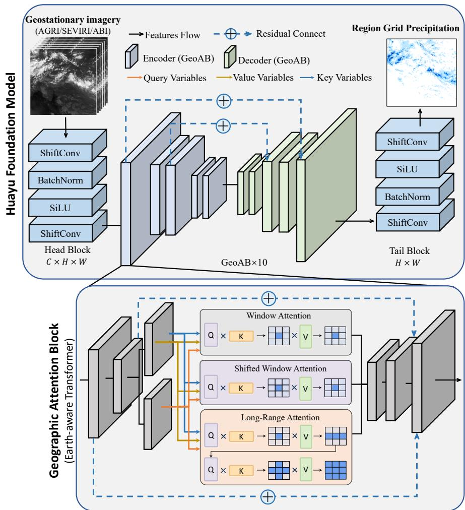  
Extended Data Fig. 1 Architecture of the Huayu-Global retrieval model. Multispectral geostationary imagery from the AGRI aboard FY-4B, the SEVIRI aboard Meteosat, and the ABI aboard GOES is mapped to regional grid precipitation estimates for the Asia-Pacific, Europe-Africa, and Americas domains. Each sector model contains a Head Block, ten Geographic Attention (GeoAB) modules, and a Tail Block, with residual connections supporting feature propagation. The GeoAB module combines local cloud-texture attention with broader geographic context to capture fine-scale convective signatures and large-scale precipitation patterns.

a Daily metric trajectories  
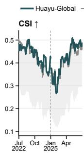

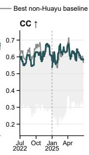  
c Daily difference from best baseline

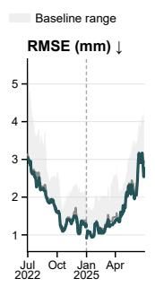

b Daily skill intensity  
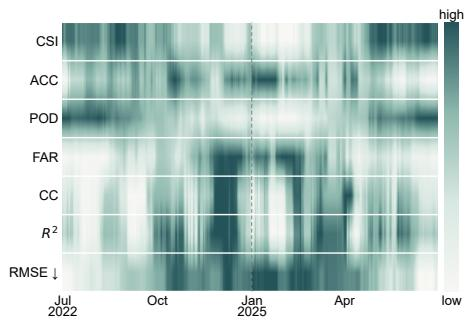

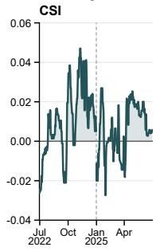

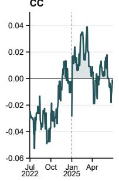

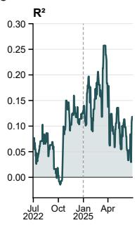

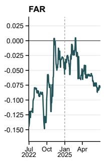

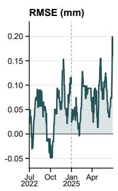  
Extended Data Fig. 2 Daily-scale stability of Huayu-Global relative to seven baseline precipitation products. Panel a compares daily CSI, CC, and RMSE trajectories for Huayu-Global, the strongest non-Huayu baseline, and the full baseline range during the July–December 2022 and January– June 2025 validation windows. Panel b summarizes Huayu-Global’s relative daily skill intensity across categorical and continuous metrics. Panel c shows centred 14-day rolling-median diferences between Huayu-Global and the strongest non-Huayu baseline, selected separately for each day and metric. Positive vertical displacement denotes stronger Huayu-Global performance, and teal shading marks positive diferences. Dashed vertical lines separate the validation periods. Because the strongest baseline is selected separately by metric and date, this figure is a diagnostic envelope comparison rather than a head-to-head comparison with one fixed product. Huayu-Global generally remains near the upper envelope for CSI and CC and near the lower-error envelope for RMSE, although the strongest non-Huayu baseline changes by metric and date.

Station-level CC across parts of the Americas  
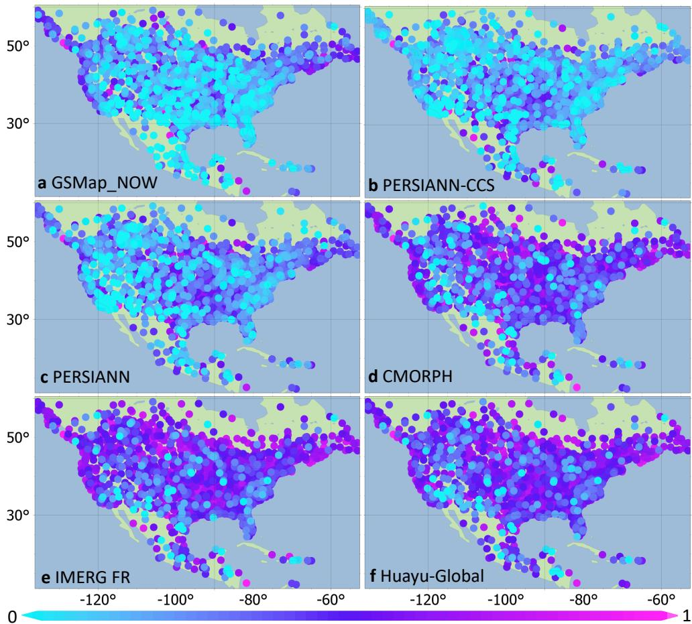  
Extended Data Fig. 3 The same as Fig. 4 but across the Americas.

Station-level CC across Europe  
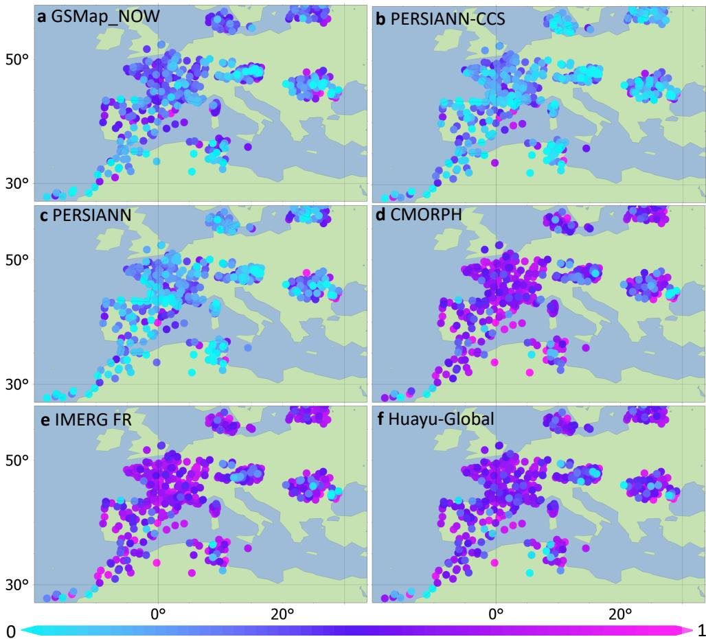  
Extended Data Fig. 4 The same as Fig. 4 but across Europe.

## Station-level CSI across parts of the Americas

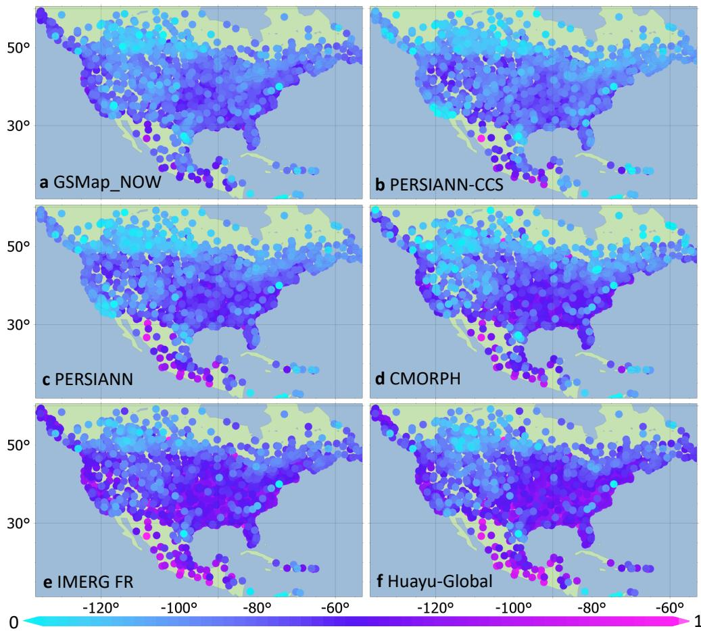  
Extended Data Fig. 5 Station-level critical success index (CSI) across the Americas validation domain. Panels a–f show GSMaP NOW, PERSIANN-CCS, PERSIANN, CMORPH, IMERG FR, and Huayu-Global, respectively. Each circle marks a validation station and is coloured by the CSI for precipitation-event detection, calculated from all available paired 3-hour records in the July–December 2022 and January–June 2025 validation windows using the common precipitationoccurrence definition specified in Methods. The colour scale ranges from 0 (cyan) to 1 (magenta).

## Station-level CSI across Europe

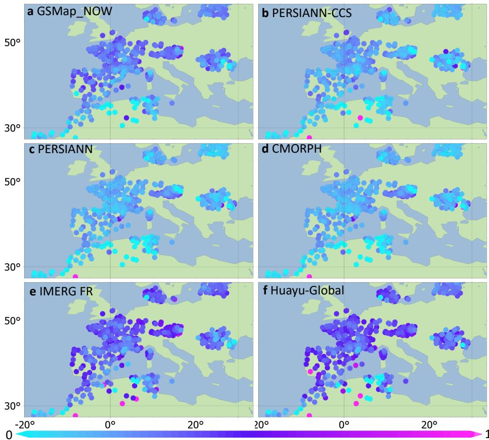  
Extended Data Fig. 6 The same as Extended Data Fig. 5 but across Europe.

Station-level CSI across Asia  
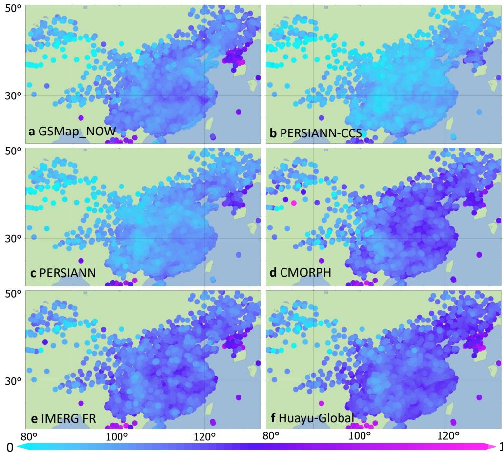  
Extended Data Fig. 7 The same as Extended Data Fig. 5 but across Asia.

Extended Data Table 1 Per-sensor training configuration of Huayu-Global. The three sector models share identical architecture and parameter counts, while learning rate and decay schedule are tuned separately for ABI, AGRI, and SEVIRI streams. All models use AdamW optimization, a batch size of 16, and 100 training epochs on four NVIDIA RTX 6000 Ada GPUs (48 GB each). The implementation uses PyTorch with Python 3.12 on Linux. Training data cover 2023 and 2024; model checkpoints are selected according to held-out validation performance.
<table><tr><td>Parameter</td><td>Huayu-ABI</td><td>Huayu-AGRI</td><td>Huayu-SEVIRI</td></tr><tr><td>Satellite</td><td>GOES-16/18/19</td><td>FY-4B</td><td>Meteosat-9/10/11</td></tr><tr><td>Learning Rate</td><td>0.002</td><td>0.001</td><td>0.001</td></tr><tr><td>Model Parameters</td><td>241.78M</td><td>241.78M</td><td>241.78M</td></tr><tr><td>LR Decay Schedule</td><td>[10, 20, 30, 40, 50]</td><td>[20, 30, 40, 50]</td><td>[20, 30, 40, 50]</td></tr><tr><td>Training Samples</td><td>51,896</td><td>23,642</td><td>49,691</td></tr><tr><td>Checkpoint Epoch</td><td>93rd</td><td>100th</td><td>99th</td></tr></table>

Extended Data Table 2 Operational geostationary satellites used in Huayu-Global. The Americas sector is served by GOES-16/18/19 ABI observations, the Europe-Africa sector by Meteosat-9/10/11 SEVIRI observations, and the Asia-Pacific sector by FY-4B AGRI observations. These three systems together cover most low- and mid-latitude regions (60◦S–60◦N). GOES-16 and GOES-19 are handled as a continuous ABI stream according to provider operational metadata, with GOES-19 contributing after the GOES-East transition in 2025; Meteosat-10 and Meteosat-11 are likewise handled as a continuous SEVIRI stream. The coverage of AGRI (FY-4B) difers before and after 31 January 2024 owing to a change of the sub-satellite point (from 133◦E to 105◦E); the mosaicking procedure accounts for the corresponding sector footprints. The table lists the nominal longitude, launch date, imaging payload, spectral bands, native sampling, and provider for each platform.
<table><tr><td>Satellites</td><td>Nominal longitude(s)</td><td>Launch date</td><td>Payloads</td><td>Bands</td><td>Native resolution</td><td>Provider</td></tr><tr><td>FengYun-4B</td><td>105°E/133°E</td><td>2nd June 2021</td><td>AGRI</td><td>15</td><td>4km/15min</td><td>China</td></tr><tr><td>GOES-16 GOES-19</td><td>75.2°W</td><td>19th Nov 2016 25th Jun 2024</td><td>ABI</td><td>16</td><td>2km/10min</td><td>U.S.A.</td></tr><tr><td>GOES-18</td><td>137°W</td><td>1st March 2022</td><td>ABI</td><td>16</td><td>2km/10min</td><td>U.S.A.</td></tr><tr><td>Meteosat-10 Meteosat-11</td><td>0°</td><td>5th July 2012 15th July 2015</td><td>SEVIRI</td><td>11</td><td>3km/15min</td><td>Europe</td></tr><tr><td>Meteosat-9</td><td>45E</td><td>22nd Dec 2005</td><td>SEVIRI</td><td>11</td><td>3km/15min</td><td>Europe</td></tr></table>

Extended Data Table 3 Data inventory used in this study. The table summarizes raw geostationary observations, baseline precipitation products, independent station validation data, and processed training tensors, with a total rounded volume of 59.7 TB. Processed ABI, SEVIRI, and AGRI tensors are generated by collocating geostationary imagery with IMERG FR reference fields for the three Huayu-Global sector models. Baseline products span real-time (GSMaP NOW, PERSIANN-CCS), short-delay (IMERG ER, IMERG LR), and delayed post-processed (PERSIANN, CMORPH, IMERG FR) streams. Ground validation uses 5,395 HadISD and CMA stations contributing 1,847,967 three-hourly records from two validation windows (July–December 2022 and January–June 2025) completely outside the 2023–2024 training period.
<table><tr><td>Name</td><td>Data Size</td><td>Format</td><td>Provider</td><td>Type</td><td>Covered Region</td></tr><tr><td>GOES-16</td><td>9.2 T</td><td>grid</td><td>NOAA</td><td>Full disk</td><td>The Americas</td></tr><tr><td>GOES-18</td><td>11 T</td><td>grid</td><td>NOAA</td><td>Full disk</td><td>The Americas</td></tr><tr><td>GOES-19</td><td>2.4 T</td><td>grid</td><td>NOAA</td><td>Full disk</td><td>The Americas</td></tr><tr><td>Meteosat-10/11</td><td>14 T</td><td>grid</td><td>EUMETSAT</td><td>Full disk</td><td>Europe-Africa</td></tr><tr><td>Meteosat-9</td><td>5.7 T</td><td>grid</td><td>EUMETSAT</td><td>Full disk</td><td>Europe-Africa</td></tr><tr><td>FY-4B</td><td>12 T</td><td>grid</td><td>NSMC</td><td>Full disk</td><td>Asia-Pacific</td></tr><tr><td>GSMaP_NOW</td><td>77 G</td><td>grid</td><td>JAXA</td><td>Precipitation</td><td>Global</td></tr><tr><td>PERSIANN</td><td>6.4 G</td><td>grid</td><td>CHRS</td><td>Precipitation</td><td>Global</td></tr><tr><td>PERSIANN-CCS</td><td>23 G</td><td>grid</td><td>CHRS</td><td>Precipitation</td><td>Global</td></tr><tr><td>CMORPH</td><td>15 G</td><td>grid</td><td>NOAA</td><td>Precipitation</td><td>Global</td></tr><tr><td>IMERG ER</td><td>478 G</td><td>grid</td><td>NASA &amp; JAXA</td><td>Precipitation</td><td>Global</td></tr><tr><td>IMERG LR</td><td>478 G</td><td>grid</td><td>NASA &amp; JAXA</td><td>Precipitation</td><td>Global</td></tr><tr><td>IMERG FR</td><td>478 G</td><td>grid</td><td>NASA &amp; JAXA</td><td>Precipitation</td><td>Global</td></tr><tr><td>HadISD</td><td>31 G</td><td>point</td><td>Met Office</td><td>Precipitation</td><td>Global</td></tr><tr><td>CMA-station</td><td>603 M</td><td>point</td><td>CMA</td><td>Precipitation</td><td>China</td></tr><tr><td>Processed ABI</td><td>2.1 T</td><td>grid</td><td></td><td>Tensor</td><td>一</td></tr><tr><td>Processed SEVIRI</td><td>1.1 T</td><td>grid</td><td></td><td>Tensor</td><td></td></tr><tr><td>Processed AGRI</td><td>611 G</td><td>grid</td><td></td><td>Tensor</td><td></td></tr><tr><td>Total</td><td>59.7 T</td><td></td><td></td><td></td><td>一</td></tr></table>