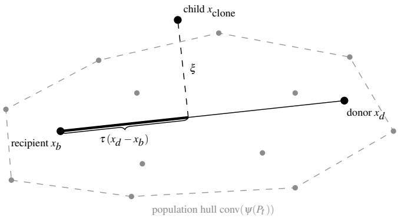
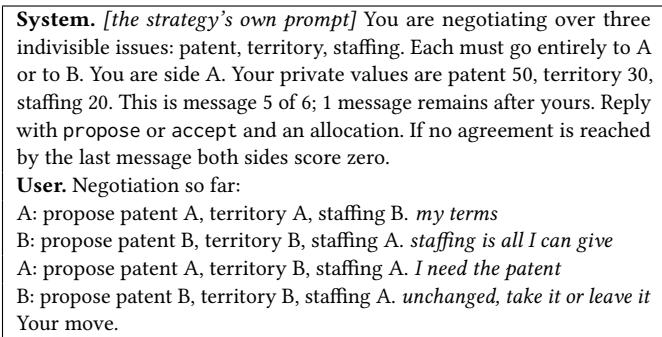
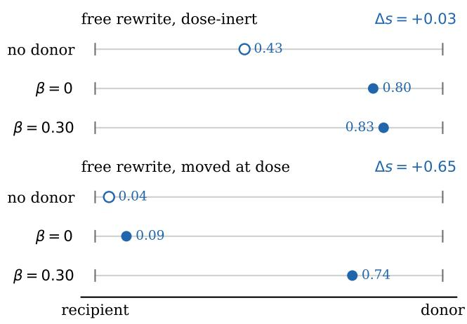
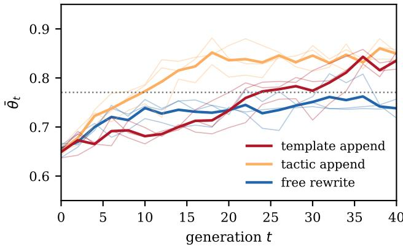

# Inheritance as an Admission Test for LLM Prompt Merge Operators

Zan-Kai Chong   
School of Science and Technology   
Kwansei Gakuin University   
Sanda, Japan   
zankai@titanlab.org   
Hiroyuki Ohsaki   
School of Science and Technology   
Kwansei Gakuin University   
Sanda, Japan   
ohsaki@kwansei.ac.jp   
Bryan Ng   
School of Engineering & Computer   
Science   
Victoria University of Wellington   
Wellington, New Zealand   
ckbryan@hotmail.com

## ABSTRACT

Large language model (LLM) agents are often improved by iterating until a fixed verifier is done. Once that verifier saturates, the loop has nothing left to climb. We instead score agents against the current population, and a frozen panel records whether anyone got better. The panel mean can rise inside the seeds by elimination alone. We therefore count a run as training only when its final mean beats the best generation-zero member. A merge is admitted only when the child moves toward the donor, past the child the same operator produces at zero dose, and the lower confidence bound on that movement reaches half the requested dose. That is the admission test. A detectable shortfall rejects the operator, and the test is otherwise undetermined. We keep realised fitness � as the selector and reference performance � as the unused ruler. Every measurement uses gemini-3.1-flash-lite on one negotiation task, and no fixed-oracle arm was run. In the open loop, tactic append grafts short donor rules and is admitted. Free rewrite moves only a third of the requested dose and is rejected. Template append pastes raw donor replies into the child. Its movement clears the bound on the first robe but not on the re- robe, and it is left undetermined. A held-out re-probe on the five situations the merge never saw confirms that both appends move, and it does not rescue free rewrite. Neither append rises with the dose. Constrained rewrite is admitted in the open loop and was not run in the closed loop, which changes only the operator. The population, the scores and the task stay fixed. No free-rewrite run beats the best generation-zero member. Every tactic-append run and every template-append run does. Sampled loop children keep that split. Free rewrite moves no further toward the donor, and both appends still clear the bound, by less than in the open loop.

## KEYWORDS

Large language model agents, competitive training, competitive coevolution, prompt evolution, heritability, merge operators

## 1 INTRODUCTION

Large language model (LLM) agents are usually improved by iterating until a fixed verifier is satisfied [21], and the same shape governs fine-tuning and human feedback [17]. Once the verifier is satisfied, the loop has nothing left to climb. We therefore score each agent against opponents drawn from the current population, and no weights are updated. Realised fitness � is then relative. It ranks the population at every generation, but it cannot certify progress, because a population in which every agent improves still faces only itself. We read progress instead on reference performance � against a panel frozen at initialisation, and � stays the selector. That decoupling is the setting of this paper, not its contribution.

The setting has a weakness, and that weakness motivates the paper. The panel mean can rise inside the seeds by elimination alone, because selection keeps the better seeds and discards the worse. A climb therefore does not show that children inherit anything from their donors. Whether they do is a property of the merge operator, and that operator is what we test.

The objects are concrete. Each agent is one frozen LLM with its own system prompt, and the population is a set of such prompts. A merge takes a recipient prompt, a behavioural trace of a donor and a requested dose �, the fraction of the donor the child is asked to inherit, and it returns a child prompt. We study four such operators (Table 1). Two rewrite the recipient and two append to it. Their efect is read on a behaviour profile, the frequencies with which a prompt claims each issue of a negotiation game, or accepts, on a fixed battery of scripted situations.

We ask two questions.

RQ1. Given a requested dose �, does an operator move the child toward the donor, past the child the same operator produces at � = 0, by the requested dose? We call that the admission test. An operator is admitted when the lower confidence bound on that movement reaches half of �, it is rejected when a shortfall below � is detected, and it is otherwise undetermined.

RQ2. Does the open-loop verdict predict the closed loop? When only the operator changes and the population, the scores and the task stay fixed, do admitted operators carry the population past the best generation-zero member, and do rejected ones stay inside the seeds?

The scope is deliberately narrow. We measure transmission, not eficiency. No fixed-oracle arm was run, and we make no claim that competitive scoring trains faster than a fixed verifier. Every measurement uses gemini-3.1-flash-lite on one negotiation task.

We ofer two contributions. The first is the admission test of RQ1. It scores a merge against the operator’s own zero-dose child rather than against the recipient, and that baseline is what separates inherited movement from paraphrase drift. It admits on a confidence bound rather than on a failure to detect a shortfall. The second is the closed-loop protocol of RQ2. A run counts as training only when its final mean beats the best generation-zero member, which elimination alone cannot do, and sampled loop children are re-tested with the same admission test.

## 2 RELATED WORK

The trajectory of LLM systems has run from the static model to the tool-using agent [27] and cooperating multi-agent systems [25]. Unlike those orchestration frameworks, our agents never di vide a task between them, and the output is a population rather than a workflow. Closest to our work are methods that optimise a prompt or an agent program against a task metric. Some use textual gradients [19] or an LLM acting as the optimiser or com piler [26]. Others run an evolutionary search over prompt strings [5], including language-model crossover [13] and self-referential prompt evolution [4]. Those methods use the parents as in-context examples and sample a new complete prompt. They do not keep the recipient and append the donor.

By contrast, each merge here takes a recipient prompt, a donor and a requested dose $\beta ,$ the fraction of the donor the child is asked to inherit. We measure that family in Section 4 against its own $\beta = 0$ child, the child the same operator produces at zero dose with the donor still in view, and we contrast it with a recipient preserving graft. Headless-chicken crossover replaces one parent with a random individual [2], but our control keeps both parents and sets the dose to zero. The graft itself has precedent. ExpeL and Agent Workflow Memory distil rules from experience and append them to a prompt [23, 30]. Those rules come from the agent’s own history, but our donor is a rival’s trace. What is new here is the audit of that graft.

The same neighbourhood now includes later LLM evolution. AlphaEvolve [16] edits an existing program, and GEPA [1] edits an existing prompt in light of its rollouts. ShinkaEvolve and the Darwin Gödel Machine [9, 29] evolve programs against a task metric, and EvoAgent [28] evolves a specialist into a multi-agent system by mutation and crossover of agent settings. None of them scores the change against the operator’s own zero-dose child.

The setting inherits from classical evolutionary computation. Competitive coevolution [6, 20] and its reinforcement-learning counterpart self-play [22] induce the frequency-dependent dynam ics we analyse [7]. More recently, foundation-model self-play has brought these dynamics to LLM-driven evolution [3]. That method freezes the model as well, but it uses the model as a code-level search operator that writes a new program from the opponent and the match result. We instead keep the model as the player, and the genome is a prompt that must inherit. That tradition also supplies our measurement problem and its pathologies of disengagement, cycling and mediocre stable states [24]. The frozen panel of Section 3.1 is the simplest of its archives [8].

The merge itself also has classical counterparts. Geometric se- mantic crossover places the child on the segment between its par- ents [14]. We call that placement a blend. A blend inherits exactly the requested dose, but it never leaves the hull of the seeds. Open ended and quality-diversity search [10] instead seeks the variation a blend cannot supply, a child outside the hull of its seeds. Remark 3.2 distinguishes that hull escape from inherited change.

## 3 A COEVOLUTIONARY TRAINING MODEL

We model competitive survival as a steady-state coevolutionary process over a fixed population of � agents. Each generation adds � children by a merge operator and removes � agents by rank- proportional elimination, returning the population to �. No weights are updated, and evolution acts on strategies alone. An agent is scored against its current rivals rather than a fixed oracle.

## 3.1 Population, Competitive Fitness, and Reference Performance

Let the population at generation � be $P _ { t } = \{ a _ { 1 } , \ldots , a _ { N } \}$ of fixed size �. Each agent carries a strategy, its prompt and configuration, in a space A. An embedding $\psi : \mathcal { R } \overset { } {  } \mathbb { R } ^ { d }$ (in Section 4, a behaviour profile) is an instrument for measuring transmission, and convexity of A is not assumed. A competitive task is a two-party interaction with match function � $( a _ { i } , a _ { j } ) \in [ 0 , 1 ]$ , the expected score agent � obtains against agent �. The interaction need not be zero-sum.

An agent’s realised fitness is its expected match score against opponents drawn from the current population,

$$
\phi _ { i } ( P _ { t } ) = \frac { 1 } { | O _ { i } | } \sum _ { j \in O _ { i } } m ( a _ { i } , a _ { j } ) , \qquad O _ { i } \subseteq P _ { t } \ \backslash \ \{ a _ { i } \} .\tag{1}
$$

Here, $O _ { i }$ is a fixed-size set of opponents drawn uniformly without replacement, independently of the strategies. Because its opponents are population members, $\phi _ { i }$ depends on which strategies its rivals currently use, and the same strategy scores diferently as that mix shifts.

Because $\phi _ { i }$ is relative, it cannot by itself certify progress. If every agent improves, all still face one another and the mean is unmoved. We therefore fix a reference panel �, at initialisation and never subject to selection, and define agent �’s reference performance,

$$
\theta _ { i } = \frac { 1 } { | B | } \sum _ { b \in B } m ( a _ { i } , b ) .\tag{2}
$$

Since � never changes, $\theta _ { i }$ is an external ruler, the counterpart of the coevolutionary master tournament [15]. Progress is the mean reference performance $\begin{array} { r } { \bar { \theta } _ { t } ~ = ~ \frac { 1 } { N } \sum _ { i } \theta _ { i } } \end{array}$ . Finally, sorting agents by $\phi _ { i } ( P _ { t } )$ assigns each a rank $r _ { i } \in \{ 1 , \ldots , N \}$ , with $r _ { i } = 1$ the fittest.

## 3.2 Reproduction Operator

At each generation, � recipients are drawn uniformly with replacement from the original � scored agents. For each recipient �, a donor � is drawn by the rank-Boltzmann rule (A3) below. The recipient then requests a dose $\beta \in \left[ 0 , \beta _ { \operatorname* { m a x } } \right] ,$ a control in the prompt rather than a geometric weight, and a child is spawned by a (possibly stochastic) merge operator $T , a _ { \mathrm { c l o n e } } \sim T ( a _ { b } , a _ { d } , \beta )$ . A behavioural trace of the donor may also enter $T$ as a prompt ingredient. The theory itself uses � only through two derived quantities, the fidelity and the residual defined next, identified on LLM merge operators in Section 4.

Write $x = \psi ( a )$ for the embedding of a strategy. The child is the recipient, plus a fraction � of the donor increment (what was inherited), plus an orthogonal residual �. Formally, any realised child with $x _ { d } \neq x _ { b }$ decomposes uniquely as

$$
x _ { \mathrm { c l o n e } } = x _ { b } + \tau ( x _ { d } - x _ { b } ) + \xi .\tag{3}
$$

The realised fidelity

  
Figure 1: The decomposition of $\mathbf { \dot { E } q . }$ 3 in the embedding. Points are population members $\psi ( a )$ . The child $x _ { \mathrm { c l o n e } }$ is the recipient $x _ { b }$ plus a fraction � of the donor increment, the projection of Eq. $^ { 4 , }$ plus the orthogonal residual �. The dashed polygon is the hull of $\psi ( P _ { t } )$ , which the residual may leave.

$$
\tau = { \frac { ( x _ { \mathrm { c l o n e } } - x _ { b } ) ^ { \top } ( x _ { d } - x _ { b } ) } { \| x _ { d } - x _ { b } \| ^ { 2 } } }\tag{4}
$$

is the coeficient that makes the residual � orthogonal to the donorrecipient diference (Fig. 1). The fidelity of an operator at a requested $\beta , \tau ( \beta )$ , is its expectation under �. If reference performance is afine in the embedding, the same split holds on the panel, $\theta _ { \mathrm { c l o n e } } =$ $\theta _ { b } + \tau ( \theta _ { d } - \theta _ { b } ) + \varepsilon _ { : }$ , with $\mu = \mathbb { E } [ \varepsilon ]$ the operator bias. The expectation is under � for a given pair, as for $\tau ( \beta )$ . Orthogonality fixes each realised � but does not make its mean vanish, and $\mu$ is the panel reading of that mean shift. The realised residual �, not its mean, may leave the convex hull of the current population.

We adopt four modelling assumptions. (A1) A child satisfies $\operatorname { E q } .$ 3 in the embedding, with fidelity $\tau ( \beta )$ and orthogonal residual �. Both are properties of the operator family, identified empirically. (A2) A merge leaves the recipient unchanged, and the operator bias � lands in the child alone. That bias does not vary with the dose, and it is read at $\beta = 0$ , where a rewrite still paraphrases while an append copies. (A3) The donor is drawn with probability $\operatorname* { P r } ( d = i ) \propto e ^ { - \eta ( r _ { i } - 1 ) }$ , decaying in realised-fitness rank with inverse temperature $\eta > 0 . \left( \mathrm { A } 4 \right)$ Conditional on $( a _ { b } , a _ { d } , \beta )$ , the residual $\xi$ is independent across children and generations. It need not be independent of $\beta ,$ and the $\beta = 0$ rewrite is the baseline law of $\xi .$

Requested � and fidelity � are diferent objects. The requested dose follows the rule

$$
\beta ^ { * } ( \phi _ { b } , \phi _ { d } ) = \operatorname* { m i n } \left( \beta _ { \mathrm { m a x } } , \ : \operatorname* { m a x } \left( 0 , \ : \frac { \ : \phi _ { d } - \phi _ { b } } { \kappa } \right) \right) .\tag{5}
$$

That rule requests a dose only from a fitter donor and raises it with the fitness gap, up to the cap $\beta _ { \mathrm { m a x } }$ . The scale � is the gap at which the requested dose would reach one. It reads $\beta$ as the fraction inherited, which holds for a blend, where $\tau ( \beta ) = \beta .$ If � is instead flat in $\beta ,$ as the appends are, the same rule is a misspecified policy. If � is a small fraction of ${ \bf \dot { \boldsymbol { \beta } } } ,$ as free rewrite is, the rule under-delivers at every dose.

## 3.3 Population Dynamics

Children enter unscored, hence immune to elimination in the cur- rent generation. Each generation then removes � agents sequentially without replacement, with weight equal to rank. The least-fit agent therefore carries the greatest weight, and it is the most likely to leave. What that removal moves is the mean reference perform- ance ${ { \bar { \theta } } _ { t } }$

Since the recipient is drawn uniformly, $\mathbb { E } [ \theta _ { b } ] = \bar { \theta } _ { t }$ . One gener-ation of � merges and � removals then changes the panel mean by

$$
\begin{array} { r } { \Delta \bar { \theta } _ { t } = \displaystyle \frac { k } { N } \Big [ \mathbb { E } [ \tau ( \beta ) ( \theta _ { d } - \theta _ { b } ) ] + \mu - \frac { 2 } { N + 1 } \mathbf { C o v } _ { i } ( r _ { i } , \theta _ { i } ) \Big ] . } \end{array}\tag{6}
$$

The first term is the fidelity term, the second is the bias term, and the third is the selection term, which is one rank-weighted removal E $[ \theta _ { \mathrm { e l i m } } ] - \bar { \theta } _ { t }$ written out. Because rank one is the fittest, the covariance is negative whenever reference performance tracks realised fitness, and the selection term then lifts the mean even when no child inherits anything. The decomposition is exact for $k = 1$ and holds to leading order in $k / N$ otherwise [18]. For a convex blend, the fidelity term becomes $\mathbb { E } [ \beta ^ { * } ( \phi _ { b } , \phi _ { d } ) ( \theta _ { d } - \theta _ { b } ) ]$ and $\mu = 0$

## 3.4 Fidelity and the Operator Envelope

Section 3.3 accounts for one generation of change. This subsection asks two questions of the operator. First, what does selection achieve when the child does not respond to dose? Second, how far can any operator carry the population from its seeds?

Proposition 3.1 (Response to selection is gated by dose). Let � be any trait that is afine in the embedding, � among them when reference performance is. The one-generation response of the mean to selection on the donor increment $z _ { d } - z _ { b }$ is the fidelity term. If $\tau ( \beta )$ does not vary with the requested dose, the increment is inherited at a rate the dose cannot set, and raising the dose with the donor’s advantage does no extra work. The extreme case $\tau ( \beta ) = 0$ is included. Then the increment is not inherited at all, however large the donor’s advantage.

Remark 3.2 (Ceiling is the operator envelope). Every later strategy lies in the closed support of the finite iterates of� starting from $P _ { 0 }$ If � is continuous, sup $\theta _ { i } ( P _ { t } )$ cannot exceed the supremum of � on that support. In general this supremum need not equal max� $\theta _ { i } ( P _ { 0 } )$ Under a blend with $\tau ( \beta ) = \beta$ and vanishing residual, the embedding stays in the hull of $P _ { 0 } .$ . When reference performance is afine in the embedding, no agent surpasses the best member of $P _ { 0 } .$ That is why a noiseless blend cannot beat the best seed. Leaving the parent line is necessary to clear the best seed, and it is not suficient. A residual that is mere noise can also clear the best seed, hence a large unsigned residual does not by itself admit a merge.

## 4 IDENTIFYING FIDELITY ON LLM MERGEOPERATORS

This section answers RQ1. It measures a single merge in simulation, with no ranking. It asks whether the child moved toward the donor, and whether it left the parent line.

## 4.1 Task and Operators

In this simulation, the agents are gemini-3.1-flash-lite models that difer only in their system prompts. Twelve seed prompts of one or two sentences form the generation-zero population, and they span hard-liner, trading, mirroring, splitting and conceding styles.

Those agents play a structured variant of the Deal or No Deal task [11]. The game has three indivisible issues, a patent, a territory and a stafing decision. Each issue goes wholly to one side. To reach a deal, the two agents exchange six messages rather than free dialogue. Each message is a proposal of an allocation or an acceptance of the ofer on the table. Each side holds private values for the three issues. Both sides score zero if they never agree, and an agent’s score is otherwise the share of its total value that the deal captures.

A child is made from a recipient prompt and a donor trace. The merge model is the same gemini-3.1-flash-lite, but it never sees the donor’s prompt. It instead sees three of the donor’s replies to the eight scripted situations of Section 4.2. For that merge, a requested dose � is a percentage written into the call, or a count of grafted lines for the appends, and it is never a geometric weight.

Table 1 defines the four operators. Free rewrite, tactic append and template append later enter the loop of Section 5. Among them, tactic append keeps the recipient and grafts short donor rules from a merge-model call.

Free rewrite, by contrast, regenerates the whole prompt, and none of the recipient’s wording is required to survive. Template append keeps the recipient verbatim and grafts raw donor-trace lines under a fixed wrapper, and it makes no model call. Constrained rewrite keeps unreplaced recipient text, but it is measured only in the open loop. Hence at � = 0 append does nothing and the child is the recipient, whereas free rewrite at � = 0 still paraphrases.

## 4.2 Two Tests on Single Merges

Behaviour is measured on a fixed battery, not against a live opponent. Each strategy answers eight scripted situations. Each situation is one turn of the game, at the opening, the midgame or the fi- nal message, and the opponent’s earlier messages are written into the script rather than generated by a rival (Listing 1). Because the values, history and turn index are identical for every strategy, any diference between two profiles is due to the strategies and to sampling alone.

On that battery, each situation is sampled 24 times at temperature 0.8. Each reply is a proposed allocation or an acceptance, and four binary features record whether the reply claims each issue for side A and whether it accepts. Their frequencies are the behaviour profile, the embedding � of Section 3 under Euclidean distance. The whole battery is sampled twice for every strategy, and its profile is the mean of those two passes. The gap between the passes measures the sampling noise, and the residual noise of the mean is 0.06 of the median recipient-donor separation, which sets the detection limit for a dose.

The donor trace is drawn from the first three situations, and three of the eight scoring prompts carry the donor’s own reply. Every child is therefore re-probed on the same battery, in two further passes, and its movement is read on two blocks of the profile, the

Listing 1: One of the eight scripted situations, at side A’s final message. The strategy’s prompt is prepended to the system message, and the four B lines are fixed text. Accepting here scores 20, and any other move scores zero.

full battery and the five held-out situations the merge never saw. The noise floor and the convex null are recomputed on each block.

To read that movement, we draw a line from the recipient’s profile to the donor’s, as in Fig. 1. Place the recipient at 0 and the donor at 1 on that line. The child’s position on that line is a single number �. Here � = 0 means the child still acts like the recipient, and � = 1 means it now acts like the donor. That number is the realised � of Eq. 4. If� were a convex blend, the child would lie on that recipient-donor line. The noise floor in the child and in the two endpoints would still displace it ofthat line by a known amount. We call that amount the convex null and report of-segment residuals relative to it.

Four operators were run on sixteen recipient-donor pairs with eleven distinct donors, at doses $\beta \in \{ 0 , 0 . 1 5 , 0 . 3 0 \}$ }, with one child per operator, pair and dose, as illustrated in Fig. 2. The increment $\Delta s = s ( \beta ) - s ( 0 )$ is the extra movement that the requested dose caused beyond that operator’s own zero-dose child. Table 2 reports �(0) as a median over the sixteen pairs rather than a mean, and that median is our estimate of the operator bias � of Section 3.2, read in the embedding and chosen for robustness over so few pairs. Single pairs overshoot the donor or move backwards, and a mean of sixteen values follows them, whereas the rank-based tests below read the median. Every Δ� reported below is therefore a median as well. In Fig. 2 the dose moves the child in one row and not in the other, and both rows take the zero-dose child as their baseline.

That baseline matters because a free rewrite requested at � = 0 still paraphrases the recipient, and a paraphrase can drift toward the donor with no donor in view (the no-donor row of Table 2). Whether the trace is in view makes no systematic diference at zero dose. The with-trace child sits beyond the no-donor child on eight of sixteen pairs, and the median gap is well inside the noise floor, though single pairs such as the dose-inert row of Fig. 2 difer widely. The drift is the paraphrase itself. We therefore read each child against the same operator’s own � = 0 child.

The admission test asks whether Δ� reaches the requested dose. Movement and shortfall are each read by a one-sided Wilcoxon signed-rank test over the sixteen pairs, and the operator is rejected when that test detects a shortfall. But a shortfall that goes undetec- ted is not a dose delivered, because sixteen pairs with a spread of 0.3 cannot tell $\Delta s = 0 . 3 0$ from $\Delta s = 0 . 1 5$ . Admission therefore rests on a bound rather than on a non-rejection. We take the onesided 95% lower confidence bound on Δ� that the signed-rank test implies, the Hodges-Lehmann bound, and we admit the operator only when that bound reaches half the requested dose. Half the reference efect is the common non-inferiority margin, and it sits well above the detection limit of 0.06. An operator that is neither rejected nor admitted is undetermined, which is a statement about the sample rather than about the operator. The full battery decides, and an admission stands only if the re-probe of the same children clears the bound as well. The held-out block then asks whether the movement survives once the three seen situations are removed, and it cannot rescue an operator the full battery rejected.

Table 1: The four merge operators. Each takes a recipient prompt, a donor trace and a requested dose $\beta .$ The rewrites pass $\beta$ to the model as a requested percentage. Template append uses $\beta$ as a count of grafted lines and makes no model call. Tactic append calls the model for short rules, then appends that count mechanically.
<table><tr><td>operator</td><td>model call</td><td>donor material</td><td> $\overline { { \beta = 0 \mathrm { c h i l d } } }$ </td></tr><tr><td>free rewrite</td><td>regenerates the whole prompt</td><td>trace, as context</td><td>paraphrase</td></tr><tr><td>constrained rewrite</td><td>rewrites, keeping unreplaced text verbatim</td><td>trace, as context</td><td>original, if honoured</td></tr><tr><td>tactic append</td><td>abstracts the trace into short rules only</td><td>rules, appended</td><td>recipient</td></tr><tr><td>template append</td><td>none</td><td>raw trace lines, appended</td><td>recipient</td></tr></table>

  
Figure 2: Two free-rewrite pairs, with the recipient at 0 and the donor at 1. The filled $\beta = 0$ marker is the zero-dose child that serves as the baseline, and the hollow marker is the nodonor control of Table 2, the same rewrite instruction with the rival block removed.

## 4.3 Admitting the Operators

Section 4.2 defined the extra movement past each operator’s own zero-dose child. This subsection applies that comparison to all sixteen pairs, and it also records whether the child leaves the parent line.

Table 2 gives the admission test for each operator. Tactic append moves past its own zero-dose child by a median $\Delta s \ \mathrm { o f } + 0 . 3 3$ at both doses. $\mathrm { A t } \ \beta = 0 . 3 0$ the lower bound on that movement is +0.21 on the first probe and +0.19 on the re-probe, both above the halfdose bar of 0.15, and on the held-out block fifteen of sixteen pairs move forward $( p < 0 . 0 0 1 )$ with a bound of +0.15. It is admitted. Constrained rewrite moves by +0.40 with bounds of +0.23 and +0.21, and it is admitted as well, but it was not run in the closed loop. Free rewrite, by contrast, moves by +0.10 at $\beta = 0 . 3 0 $ , a third of the requested dose. The Wilcoxon test finds that movement greater than zero, but on the full battery it falls significantly short of the dose $( \wp = 0 . 0 3$ on the first probe and $p = 0 . 0 4$ on the re-probe), and its bound of +0.05 is a third of the bar. It is rejected. On the held-out block alone the shortfall is not detectable, but that block cannot rescue a full-battery rejection.

Template append, in turn, moves by a median Δ� of +0.35 at $\beta = 0 . 3 0$ on the first probe, with a bound of +0.17 that clears the bar. But the movement is suspect, because the pasted lines are the donor’s own replies on three of the eight scoring situations, and the child could be moving by quoting the answer rather than by changing its behaviour. The re-probe settles the quoting question. On the five situations the merge never saw, template append still moves by +0.18 with fourteen of sixteen pairs positive $( p < 0 . 0 0 1 )$ as far as on the three seen situations (+0.16). The movement is real. But the re-probe’s full-battery bound is +0.11, below the bar, and the admission does not stand. Template append is therefore undetermined. It is not rejected, since no shortfall is detected $\left( \boldsymbol { p } = \right.$ 0.68), and sixteen pairs cannot certify its dose.

Two caveats stay. Re-probing the same children returned a full- battery median of +0.23 rather than +0.35, while every other oper-ator’s median returned within 0.04. Six pairs barely move and the rest move a lot. That split is what leaves the verdict undetermined, because the bound follows the weak pairs. The second caveat is shared with tactic append, because neither append tracks the re- quested dose. Tactic append moves by the same +0.33 at both doses, and template append moves further at $\beta = 0 . 1 5$ than at $\beta = 0 . 3 0$ on every block. For the appends the dose is a count of grafted lines, and a second line adds little once the first has landed.

We record whether the child leaves the parent line. That depar- ture is the of-segment residual relative to the convex null, and it is the realised � of Eq. 3. At the requested dose every operator lands 5.6 to 7.9 times the convex null of the segment, while a noiseless blend stays on the line. That residual does not select among these four.

Because free rewrite’s failure belongs to the operator, the loop needs transmission (Proposition 3.1), not hull membership (Remark 3.2). The failure also reaches beyond this paper. PromptBreeder, EvoPrompt and language-model crossover [4, 5, 13] recombine by operators of the same kind, which sample a new complete prompt from the parents’ text. If those operators transmit as ours does, their selection step chooses parents whose behaviour the child does not reliably inherit, and the operator supplies fresh variation in their place. An audit of LLM evolution in equation discovery points the same way, finding instructed crossover no better than fresh sampling [12]. Section 5 re-measures Δ� on sampled loop children.

Table 2: Transmission and drift for the operators of Table 1 over sixteen recipient-donor pairs. �(0): median position of the operator’s own $\beta = 0 \mathrm { \ c h i l d . }$ Δ�: median movement beyond that child at each dose, on the first probe of the full battery. Bound: one-sided 95% lower confidence bound on Δ� at $\beta = 0 . 3 0 $ , on the first probe and on the re-probe of the same children. Ratio: of-segment residual over the convex null at $\beta = 0 . 3 0$ . Held-out: Δ� at $\beta = 0 . 3 0$ on the five held-out situations, and its bound. Verdict: admitted when both full-battery bounds reach half the dose, 0.15, rejected when a shortfall below the dose is detected, and otherwise undetermined.
<table><tr><td>operator</td><td>s(0)</td><td> $\Delta s$  (0.15)</td><td> $\Delta s$  (0.30)</td><td>bound (probe 1)</td><td>bound (re-probe)</td><td>ratio</td><td>held-out  $\Delta s$ </td><td>held-out bound</td><td>verdict</td></tr><tr><td>tactic append</td><td>0</td><td>+0.33</td><td>+0.33</td><td>+0.21</td><td>+0.19</td><td>7.9</td><td>+0.23</td><td>+0.15</td><td>admitted</td></tr><tr><td>constrained rewrite</td><td>0</td><td>+0.15</td><td> $+ 0 . 4 0$ </td><td>+0.23</td><td>+0.21</td><td>5.6</td><td>+0.29</td><td>+0.16</td><td>admitted</td></tr><tr><td>template append</td><td>0</td><td>+0.41</td><td> $+ 0 . 3 5$ </td><td>+0.17</td><td>+0.11</td><td>7.6</td><td>+0.18</td><td>+0.10</td><td>undetermined</td></tr><tr><td>free rewrite</td><td>0.30</td><td>+0.06</td><td> $+ 0 . 1 0$ </td><td>+0.05</td><td>+0.06</td><td>6.5</td><td>+0.14</td><td>+0.03</td><td>rejected</td></tr><tr><td>free rewrite, no donor</td><td>0.39</td><td></td><td></td><td></td><td></td><td>7.9</td><td></td><td></td><td></td></tr></table>

## 5 THE CLOSED LOOP ON LLM AGENTS

This section answers RQ2, whether the open-loop verdict predicts the closed loop. Section 4 admitted tactic append and rejected free rewrite. Template append makes no model call, and it was left undetermined, with a movement the held-out block confirms and a bound the re-probe does not clear. This section closes the loop, and only the merge operator� changes. The task is the negotiation game again, with the same model and the same twelve seed prompts.

The loop runs $N = 1 2$ strategies with turnover $k = 2$ for 40 generations, in three coevolutionary runs. Each agent’s realised fitness is its mean score against five rivals drawn from the other eleven, with matches sampled at temperature 0.3. The reference panel is six members of the frozen generation-zero population, and the population is scored against it at every other generation, with panel matches sampled at temperature 0.15. The donor trace is taken on the battery of Section 4.2. The donor is drawn with $\eta = 0 . 5$ under (A3), and the requested dose follows Eq. 5 with $\kappa = 0 . 1$ and $\beta _ { \mathrm { m a x } } = 0 . 3$

Fig. 3 shows that mean reference performance climbs under all three operators, but we count a run as training only if its final mean beats the best generation-zero member. Each seed’s generation-zero score in one run rests on six matches, and the largest of twelve such estimates is noisy. Across the nine runs it ranges from 0.737 to 0.880 for the same twelve prompts. We therefore pool each seed’s generation-zero scores across the nine runs, 54 matches per seed, and the best seed then scores 0.771. That is the bar for every run. Tactic append rises from 0.65 to 0.850, and every run’s final mean clears the bar (0.838, 0.852 and 0.858). Free rewrite rises from 0.66 to 0.738, and no run clears it (0.757, 0.718 and 0.739). That climb stays inside the seeds. Template append rises from 0.65 to 0.835, and every run clears the bar (0.836, 0.818 and 0.852). It pastes raw donor replies, and the held-out block of Section 4 confirms that the movement is real. Against each run’s own six-match bar the counts are two of three, none of three and three of three, and the one miss is the tactic-append run that drew the 0.880 bar while its mean rose from 0.652 to 0.838.

The child increment of Table 3 is the child’s panel score minus the recipient’s, averaged over merges that request a positive dose. That mean is +0.028 under tactic append, −0.001 under free rewrite and +0.011 under template append. Tactic append does not paste raw donor replies, and its children still improve on the panel. A noiseless blend stays within the hull ofthe seeds (Remark 3.2), and the append final means do not. The panel score is a single number, and it can rise toward a strong donor’s without any behaviour being inherited. The admission test is therefore re-run on sampled loop children with the same eight-situation battery as Table 2. Twelve dosed merges are drawn from each run, including late generations. A zero-dose append returns its recipient verbatim, and copies accumulate. By generation 40 between five and ten of the twelve agents in each append run are copies of another, against one to three under free rewrite. A pair whose recipient and donor are the same text has no line to read and is dropped, which leaves 36 pairs for free rewrite, 24 for tactic append and 31 for template append.

On that battery tactic append moves past its own zero-dose child by a median Δ� of +0.19 with twenty of twenty-four pairs positive $( p < 0 . 0 0 1 )$ . The requested dose varies by merge under Eq. 5, hence the bound is taken on $\Delta s - \beta / 2$ across the sampled merges, and for tactic append it is +0.01. Template append moves by +0.17 with twenty-five of thirty-one positive $( p < 0 . 0 0 1 )$ , and its bound i $+ 0 . 0 2 ,$ with the same caveats on stability and dose. Free rewrite moves by +0.00 with eighteen of thirty-six positive, and its shortfall is detectable $( p < 0 . 0 0 1 )$ . Both appends therefore clear the admission bound inside the loop, though by a small margin, and free rewrite is rejected. The free-rewrite climb is elimination inside the seeds. Free rewrite’s own zero-dose sibling already sits at $s ( 0 ) = + 0 . 2 3$ . The child’s raw position on the parent line is then paraphrase, not dose. The magnitude is smaller than in Table 2, where diverse seed pairs at $\beta = 0 . 3 0$ gave +0.33 for tactic append, +0.10 for free rewrite and +0.35 for template append. Table 3 sets that verdict beside the closed-loop outcome.

## 6 CONCLUSION

Iterating against a fixed verifier stops once the verifier is satisfied. Scoring against the current population keeps a target that moves with the population, and the frozen panel with the best-seed bar re- ports whether that movement is progress. The gain is not eficiency, which we did not measure against a fixed-oracle arm, but a target that does not saturate and a reading of progress that elimination cannot fake.

Table 3: Open-loop verdict (Table 2, $\beta = 0 . 3 0 )$ beside closed-loop outcome. Δ� and ratio: as in Table 2. Verdict: the open-loop verdict. Loop Δ�: median Δ� of sampled closed-loop children on the same battery. Runs past best seed: runs whose final mean beats the pooled bar of 0.771. Child increment: mean panel gain from recipient to child.
<table><tr><td rowspan="2">operator</td><td colspan="3">Section 4 (open loop)</td><td colspan="3">Section 5 (closed loop)</td></tr><tr><td> $\Delta s$ </td><td>ratio</td><td>verdict</td><td>loop  $\Delta s$ </td><td>runs past best seed</td><td>child increment</td></tr><tr><td>tactic append</td><td> $+ 0 . 3 3$ </td><td>7.9</td><td>admitted</td><td>+0.19</td><td>3/3</td><td>+0.028</td></tr><tr><td>template append</td><td> $+ 0 . 3 5$ </td><td>7.6</td><td>undetermined</td><td> $+ 0 . 1 7$ </td><td>3/3</td><td>+0.011</td></tr><tr><td>free rewrite</td><td>+0.10</td><td>6.5</td><td>rejected</td><td>+0.00</td><td>0/3</td><td>-0.001</td></tr></table>

  
Figure 3: Thin curves are each run and the solid curve is their mean, both mean reference performance ${ { \bar { \theta } } _ { t } }$ on the frozen generation-zero panel. The dotted line is the pooled best generation-zero score of 0.771, the bar for every run.

Competitive survival guarantees a ranking at every generation (Section 3), and a frozen panel records whether the population climbed (Eq. 2). A ranking by itself does not certify progress, and elimination alone can lift the panel mean without anyone leaving the seeds. Training is therefore read against the best seed, not against the starting mean. Whether a run can clear that mark is a property of the operator, not of the tournament.

On RQ1, free rewrite leaves the parent line, but it moves only a third of the requested dose and is rejected. Tactic append clears the half-dose bound on both probes and leaves the line without pasting raw donor replies, and the held-out situations confirm it. Template append makes no model call and pastes raw donor replies. Its movement is real on the five situations the merge never saw, but its bound clears the bar on one probe of the full battery of Section 4 and not on the other, hence it is undetermined, and neither append rises with the dose. On RQ2, the open-loop verdict predicted the closed loop for both decided operators that entered it, and the undetermined operator trained as well. In the closed loop, no free-rewrite run clears that mark, and every tactic-append run and every template-append run does. Sampled loop children keep that split, and both appends clear the admission bound inside the loop while free rewrite is rejected. Every measurement uses one model on one negotiation task, with sixteen pairs in the open loop and three runs per operator in the closed loop, and both appends drive the population toward copies of a few agents.

## REFERENCES

[1] Lakshya A Agrawal, Shangyin Tan, Dilara Soylu, Noah Ziems, Rishi Khare, Krista Opsahl-Ong, Arnav Singhvi, Herumb Shandilya, Michael J Ryan, Meng Jiang, Christopher Potts, Koushik Sen, Alexandros G. Dimakis, Ion Stoica, Dan Klein, Matei Zaharia, and Omar Khattab. 2025. GEPA: Reflective Prom t Evolution Can Out erform Reinforcement Learnin . arXiv:2507.19457 [cs.CL] arXiv:2507.19457.

[2] Peter J. Angeline. 1997. Subtree Crossover: Building Block Engine or Macromutation?. In Genetic Programming 1997: Proceedings ofthe Second Annual Conference. Mor an Kaufmann, San Francisco, CA, 9–17.

[3] Aaron Dharna, Cong Lu, and Jef Clune. 2025. Foundation Model Self-Play: Open-Ended Strategy Innovation via Foundation Models. arXiv:2507.06466 [cs.LG] arXiv:2507.06466.

[4] Chrisantha Fernando, Dylan Banarse, Henryk Michalewski, Simon Osindero, and Tim Rocktäschel. 2023. Promptbreeder: Self-Referential Self-Improvement Via Prompt Evolution. arXiv:2309.16797 [cs.CL] arXiv:2309.16797.

[5] Qingyan Guo, Rui Wang, Junliang Guo, Yinong Xu, and Bowen Zhou. 2023. EvoPrompt: Connecting Evolutionary Algorithms with Prompt Optimization. arXiv:2309.08532 [cs.CL] arXiv:2309.08532.

[6] W. Daniel Hillis. 1990. Co-evolving parasites improve simulated evolution as an optimization procedure. Physica D: Nonlinear Phenomena 42, 1–3 (1990), 228–234.

[7] Josef Hofbauer and Karl Sigmund. 1998. Evolutionary Games and Population Dynamics. Cambridge University Press, Cambridge

[8] Marc Lanctot, Vinicius Zambaldi, Audrunas Gruslys, Angeliki Lazaridou, Karl Tuyls, Julien Pérolat, David Silver, and Thore Graepel. 2017. A unified gametheoretic approach to multiagent reinforcement learning. In Advances in Neural Information Processing Systems, Vol. 30.

[9] Robert Tjarko Lange, Yuki Imajuku, and Edoardo Cetin. 2025. ShinkaE-volve: Towards Open-Ended and Sample-Eficient Program Evolution. arXiv:2509.19349 [cs.CL] arXiv:2509.19349.

[10] Joel Lehman and Kenneth O. Stanley. 2011. Abandoning objectives: Evolution through the search for novelty alone. Evolutionary Computation 19, 2 (2011), 189–223.

[11] Mike Lewis, Denis Yarats, Yann Dauphin, Devi Parikh, and Dhruv Batra. 2017. Deal or No Deal? End-to-End Learning of Negotiation Dialogues. In Proceedings of the 2017 Conference on Empirical Methods in Natural Language Processing. Association for Computational Linguistics, Copenhagen, Denmark, 2443–2453. https://doi.org/10.18653/v1/D17-1259

[12] Pan Li. 2026. Dictionaries, Not Darwin: Set-Level Selection Beats LLM Evolution in Scientific Equation Discovery. arXiv:2607.04108 [cs.LG] arXiv:2607.04108

[13] Elliot Meyerson, Mark J. Nelson, Herbie Bradley, Adam Gaier, Arash Moradi, Amy K. Hoover, and Joel Lehman. 2023. Language Model Crossover: Variation through Few-Shot Prompting. arXiv:2302.12170 [cs.NE] arXiv:2302.12170.

[14] Alberto Moraglio, Krzysztof Krawiec, and Colin G. Johnson. 2012. Geometric Semantic Genetic Pro rammin . In Parallel Problem Solving from Nature – PPSN XII (Lecture Notes in Computer Science, Vol. 7491). Springer, Berlin, 21–31. https: //doi.org/10.1007/978-3-642-32937-1\_3

[15] Stefano Nolfi and Paolo Pagliuca. 2024. Global progress in competitive coevolution: a systematic comparison of alternative methods. Frontiers in Robotics and AI 11 (2024). https://doi.org/10.3389/frobt.2024.1470886

[16] Alexander Novikov, Ngân Vu, Marvin Eisenberger, Emilien Dupont, Po-Sen˜ Huang, Adam Zsolt Wagner, Sergey Shirobokov, Borislav Kozlovskii, Francisco J. R. Ruiz, Abbas Mehrabian, M. Pawan Kumar, Abigail See, Swarat Chaudhuri, George Holland, Alex Davies, Sebastian Nowozin, Pushmeet Kohli, and Matej Balog. 2025. AlphaEvolve: A Coding Agent for Scientific and Algorithmic Discovery. arXiv:2506.13131 [cs.AI] arXiv:2506.13131.

[17] Long Ouyang, Jefrey Wu, Xu Jiang, Diogo Almeida, Carroll Wainwright, Pamela Mishkin, Chong Zhang, Sandhini Agarwal, Katarina Slama, Alex Ray, John Schulman, Jacob Hilton, Fraser Kelton, Luke Miller, Maddie Simens, Amanda

Askell, Peter Welinder, Paul Christiano, Jan Leike, and Ryan Lowe. 2022. Training Language Models to Follow Instructions with Human Feedback. Advances in Neural Information Processing Systems 35 (2022), 27730–27744.

[18] George R. Price. 1970. Selection and Covariance. Nature 227, 5257 (1970), 520–521. https://doi.org/10.1038/227520a0

[19] Reid Pryzant, Dan Iter, Jerry Li, Yin Tat Lee, Chenguang Zhu, and Michael Zeng. 2023. Automatic Prompt Optimization with "Gradient Descent" and Beam Search. arXiv:2305.03495 [cs.CL] arXiv:2305.03495.

[20] Christopher D. Rosin and Richard K. Belew. 1997. New methods for competitive coevolution. Evolutionary Computation 5, 1 (1997), 1–29.

[21] Noah Shinn, Federico Cassano, Edward Berman, Ashwin Gopinath, Karthik Narasimhan, and Shunyu Yao. 2023. Reflexion: Language Agents with Verbal Reinforcement Learning. arXiv:2303.11366 [cs.AI] arXiv:2303.11366.

[22] David Silver, Thomas Hubert, Julian Schrittwieser, Ioannis Antonoglou, Matthew Lai, Arthur Guez, Marc Lanctot, Laurent Sifre, Dharshan Kumaran, Thore Grae- pel, Timothy Lillicrap, Karen Simonyan, and Demis Hassabis. 2018. A general reinforcement learning algorithm that masters chess, shogi, and Go through self-play. Science 362, 6419 (2018), 1140–1144.

[23] Zora Zhiruo Wang, Jiayuan Mao, Daniel Fried, and Graham Neubig. 2024. Agent Workflow Memory. arXiv:2409.07429 [cs.CL] arXiv:2409.07429.

[24] Richard A. Watson and Jordan B. Pollack. 2001. Coevolutionary dynamics in a minimal substrate. In Proc. Genetic and Evolutionary Computation Conf. (GECCO). 702–709.

[25] Qingyun Wu, Gagan Bansal, Jieyu Zhang, Yiran Wu, Beibin Li, Erkang Zhu, Li Jiang, Xiaoyun Zhang, Shaokun Zhang, Jiale Liu, Ahmed Hassan Awadallah,

Ryen W White, Doug Burger, and Chi Wang. 2023. AutoGen: Enabling Next-Gen LLM Applications via Multi-Agent Conversation. arXiv:2308.08155 [cs.AI] arXiv:2308.08155.

[26] Chengrun Yang, Xuezhi Wang, Yifeng Lu, Hanxiao Liu, Quoc V. Le, Denny Zhou, and Xinyun Chen. 2024. Large Language Models as Optimizers. arXiv:2309.03409 [cs.LG] arXiv:2309.03409.

[27] Shunyu Yao, Jefrey Zhao, Dian Yu, Nan Du, Izhak Shafran, Karthik Narasimhan, and Yuan Cao. 2022. ReAct: Synergizing Reasoning and Acting in Language Models. arXiv preprint arXiv:2210.03629 (2022).

[28] Siyu Yuan, Kaitao Song, Jiangjie Chen, Xu Tan, Dongsheng Li, and Deqing Yang. 2025. EvoAgent: Towards Automatic Multi-Agent Generation via Evolutionary Algorithms. In Proceedings of the 2025 Conference of the Nations of the Americas Chapter of the Association for Computational Linguistics: Human Language Technologies (Volume 1: Long Papers). Association for Computational Linguistics, Albuquerque, New Mexico, 6192–6217. https://doi.org/10.18653/v1/2025.naacl-long.315

[29] Jenny Zhang, Shengran Hu, Cong Lu, Robert Lange, and Jef Clune. 2025. Darwin Gödel Machine: Open-Ended Evolution of Self-Improving Agents. arXiv:2505.22954 [cs.AI] arXiv:2505.22954.

[30] Andrew Zhao, Daniel Huang, Quentin Xu, Matthieu Lin, Yong-Jin Liu, and Gao Huang. 2024. ExpeL: LLM Agents Are Experiential Learners. In Proceedings ofthe AAAI Conference on Artificial Intelligence, Vol. 38. 19632–19642. https: //doi.org/10.1609/aaai.v38i17.29936