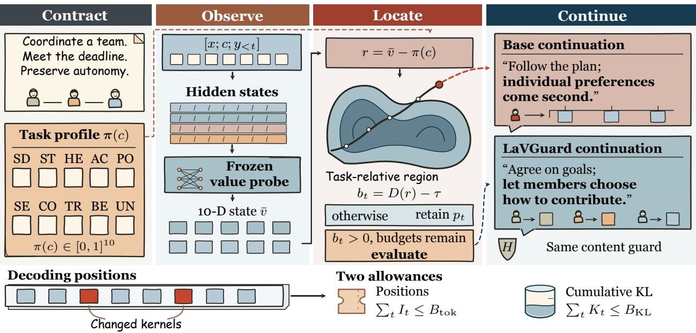
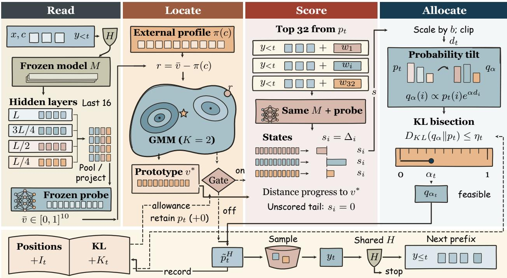
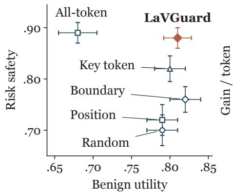
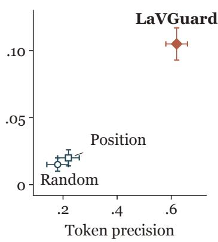
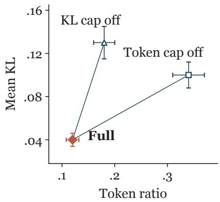
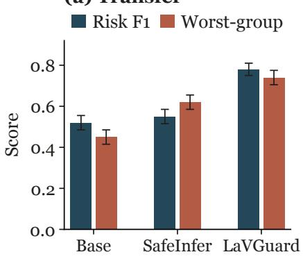
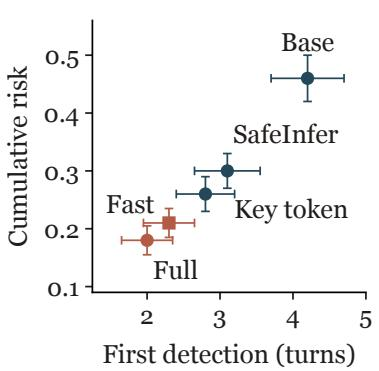
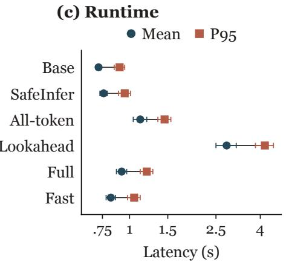
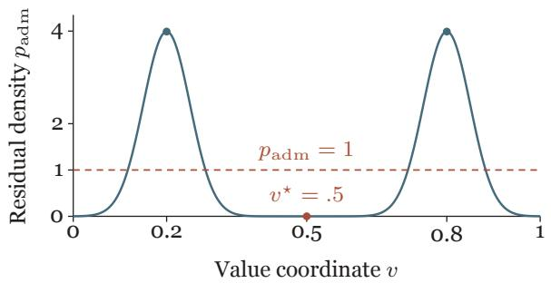
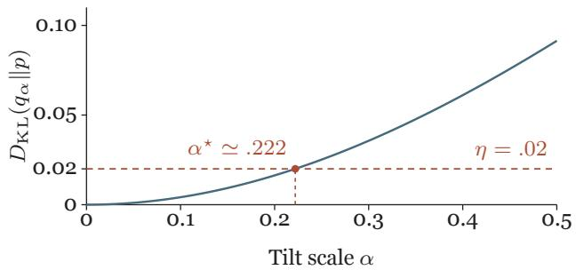

# LaVGuard: Selective Decoding for Contextual Value Drift

Jiale Dai1,\*,#, Liuxian Ma2,\*, Hongcan Deng3, Xiaoke Niu1, Wenjing Zhang4, Zhaoxiang Liu4, Shiguo Lian4, Guojie Song1,†,#

1State Key Laboratory of General Artificial Intelligence, School of Intelligence Science and Technology, Peking University

2College of Artificial Intelligence, Tsinghua University

3University of Chinese Academy of Sciences

4China United Network Communications Group Co., Ltd.

\*Strictly equal contribution; either author order is equally valid.

†Corresponding author.

A content-safe response can still promote priorities that conflict with its task: an assistant may demand compliance when asked to preserve autonomy. We study contextual value drift as a task-relative decoding problem with an explicit allowance for change. LaVGuard separates an authorized tendimensional profile from a frozen estimate of the values expressed in the visible prefix. A profile-relative density gate selects when to evaluate candidate continuations; their signed progress determines a logit tilt constrained by both changed-position and cumulative-KL budgets. We establish local surrogate improvement, pathwise budget feasibility, and a bound on response-distribution change. Profile conditioning raises boundary TPR at 5% FPR from .58 to .72. At the same .12 mean intervention ratio, the selection study reports risk-safety scores of .88 for LaVGuard and .72 for position-matched edits. The resulting interface makes task priorities actionable while keeping the extent of intervention explicit and bounded.

Keywords: Contextual value drift, selective decoding, task-conditioned control, KL budgets Contact: # daijiale26@stu.pku.edu.cn # gjsong@pku.edu.cn

## 1 Introduction

  
Figure 1 : Task-relative selective decoding. The authorized profile and the frozen probe’s visible-prefix state meet in the residual; the two-dimensional region illustrates the fitted geometry. Boundary exceedance and remaining position and KL allowances enable candidate evaluation. The paired continuations express contrasting priorities under a shared content guard. Along the decoding ribbon, cinnabar marks a changed sampling kernel, counted by It; Kt is that step’s conditional KL cost. Unchanged kernels consume neither allowance. The task, trajectory, responses, and ribbon are constructed illustrations; profile and state cells indicate dimensions.

decision these tools motivate: when does the current language depart from this task’s priorities, and how should a finite change allowance shape its continuation?

LaVGuard couples a task-relative trigger with two explicit resources: the number of positions changed and the cumulative divergence from the base decoder. An authorized profile is supplied before generation. A frozen, prefix-causal probe estimates ten value intensities from visible language, without reading the numeric profile. Subtracting the profile translates a learned residual geometry into the task’s activation region. At an active position, the model evaluates likely one-token continuations, favors progress toward a mixture-derived reference, and chooses a feasible tilt by scalar KL search. The content guard is shared with the base decoder.

Changing the authorized profile while holding the language state fixed can change whether intervention is warranted, without retraining the probe. Appendix J follows this decision through candidate scoring, sampling, and budget exhaustion.

Our evaluation tests profile conditioning, position selection, and budget control. Profile conditioning raises boundary TPR at 5% FPR from .58 to .72 (Table 1). At a shared mean intervention ratio of .12, LaVGuard reaches a risk-safety score of .88 versus .72 for position-matched selection (Table 3). Removing the position budget increases the edit ratio to .34, with risk safety of .89 and benign safety of .73, compared with .88 and .81 for the full controller. These comparisons motivate selecting where to spend the allowance, as well as limiting its total size.

## Our contributions are:

• A task-relative control interface. We separate authorized priorities from observed prefix values, making the same language state evaluable under diferent task profiles.

• Selective decoding with two resources. A profile-residual gate, candidate scoring, and a feasible scalar update jointly control changed positions and accumulated conditional KL.

• An analysis of what this control establishes. We connect the local candidate surrogate to the tilt, prove budget and response-distribution bounds, and evaluate the roles of profile conditioning, position selection, and the two allowances.

## 2 Related Work

Values and task context. Schwartz’s values describe co-occurring motivational priorities (Schwartz, 1992). FULCRA and ValueBench evaluate these priorities in language models (Yao et al., 2024; Ren et al., 2024); Social Chemistry and Moral Stories ground normative judgments in context (Forbes et al., 2020; Emelin et al., 2021). Value Alignment Tax studies cross-value efects (Chen and Shen, 2026). More recently, Liscio et al. (2026) track competing value orientations across conversations, showing that early steering efects can fade or reverse. LaVGuard makes the task reference explicit: an authorized profile and the observed prefix state remain separate inputs to a residual-based decision.

Attribute and reward guidance. PPLM, GeDi, DExperts, and FUDGE guide generation using attribute models or auxiliary distributions (Dathathri et al., 2020; Krause et al., 2021; Liu et al., 2021; Yang and Klein, 2021). FUDGE predicts an eventual attribute from a prefix; our probe estimates values expressed in the visible text. DeAL uses reward-guided lookahead, IVG combines token- and chunk-level value functions, and Controlled Decoding trains prefix scorers for KL-regularized reward optimization (Huang et al., 2025; Liu et al., 2024; Mudgal et al., 2024). LaVGuard uses candidate reweighting with a task-relative trigger and a local prototype-progress score.

Value editing and semantic preservation. Representation Engineering, ITI, and CAA expose behavioral directions in hidden states (Zou et al., 2023a; Li et al., 2023; Rimsky et al., 2024). Values as Style learns a semantic–value interface with one-way semantic grounding; editing the value code while holding the semantic code fixed produces a residual-stream update (Dai et al., 2026). Selective Steering uses norm-preserving rotations at discriminatively selected layers (Dang and Ngo, 2026). These designs improve the intervention interface. LaVGuard controls the sampling kernel and accounts for its cumulative change relative to the base decoder.

Selective and adaptive intervention. ConVA gates value-vector activation with query and token classifiers (Jin et al., 2025). MAT-Steer learns token gates and multiple attribute directions with sparsity and orthogonality objectives (Nguyen et al., 2025). AIMES uses intermediate-layer vocabulary readouts to adapt each requested value’s steering strength during generation (Bhattacharjee and Tandon, 2026). These controllers adapt activation edits to the current input or state. LaVGuard combines a profile-translated residual boundary with explicit allowances for changed positions and conditional KL. Appendix L compares the observation, actuation, and accounting interfaces.

Safety and divergence budgets. SIREN detects harmfulness from internal features, while SafeDecoding, SafeInfer, and SaP target content safety (Jiao et al., 2026; Xu et al., 2024; Banerjee et al., 2025; Chen et al., 2025). Anchored Decoding budgets trajectory-wide divergence from a separate safe model for copyright-risk control (He et al., 2026). At the agent level, VoS learns intervention value from counterfactual continuations and calibrates a harm-budgeted trigger (Li et al., 2026). LaVGuard instead accounts for changed token positions and conditional KL against its base decoder along each response, while sharing the content guard with uncontrolled generation.

## 3 Task-Relative Value Control

## 3.1 Profile, language state, and drift

Given prompt x and context $c ,$ a frozen autoregressive model generates $y _ { 1 } , \ldots , y _ { T }$ with next-token distribution

$$
p _ { t } = p _ { M } ( \cdot \mid x , c , y _ { < t } ) = \mathrm { s o f t m a x } ( \mathbf { z } _ { t } ) .\tag{1}
$$

Here $p _ { t }$ is the actual sampling kernel. Context describes the task, afected parties, and stated constraints. Before generation, an authorized user or policy owner supplies a profile $\pi ( c ) \in [ 0 , 1 ] ^ { 1 0 }$ . Each coordinate specifies a value intensity; the coordinates need not sum to one.

  
Figure 2 : One guarded decoding step. Four layer taps and a frozen probe yield the visible-prefix state. The external profile enters the residual; the mixture provides a gate and a posterior residual mean (star), translated and clipped into the scoring prototype. Boundary exceedance and remaining allowances enable evaluation of the top 32 candidate prefixes. Signed progress is scaled and clipped before a KL search selects the feasible tilt. Edited and unchanged kernels share one sampling path. The ledger records the kernel-change indicator $I _ { t }$ and conditional cost $K _ { t } = \hat { D _ { K L } } \big ( \tilde { p } _ { t } ^ { H } \lVert p _ { t } ^ { H } \big )$ before the sampled-prefix guard; a sample that triggers the guard retains its cost. Pre-step balances feed eligibility and KL search. Objects, bars, and geometry are schematic.

Let $\mathbf { q } ( y , c )$ be an independently annotated value vector and $\boldsymbol { \mathcal { A } } ( \boldsymbol { c } )$ the set of value expressions admissible for the task. Contextual drift is the event $\mathbf { q } ( y , c ) \notin { \mathcal { A } } ( c )$ . Online control uses a learned prefix estimate $\bar { \mathbf { v } } _ { < t }$ and a fitted admissible set $\widehat { A } ( c )$ . Evaluation uses independent compatibility judgments, keeping the intended behavior distinct from the controller’s estimate.

Common content-safety policy. A shared guard H checks the empty prefix and each sampled prefix. If it activates, a common safe-completion rule replaces the response and terminates generation. Base and controlled decoders use this same rule. Write their conditional kernels as $p _ { t } ^ { H }$ and $\tilde { p } _ { t } ^ { H }$ ; they coincide on guard-stop transitions and otherwise equal $p _ { t }$ and $\tilde { p } _ { t }$ . This separates explicit content safety from control of priorities among permissible continuations.

## 3.2 An explicit allowance for decoder change

For each generated response, track changed positions and accumulated conditional KL:

$$
\begin{array} { c } { { { \cal I } _ { t } = \displaystyle \mathbb { I } [ \tilde { p } _ { t } ^ { H } \neq p _ { t } ^ { H } ] , \quad { \cal C } _ { t } ^ { t o k } = \sum _ { j \leq t } { \cal I } _ { j } , } } \\ { { { } } } \\ { { { \cal C } _ { t } ^ { K L } = \displaystyle \sum _ { j \leq t } { \cal D } _ { K L } ( \tilde { p } _ { j } ^ { H } \| p _ { j } ^ { H } ) . } } \end{array}\tag{2}
$$

The controller obeys

$$
\begin{array} { c } { { C _ { T } ^ { t o k } \leq B _ { t o k } , \qquad C _ { T } ^ { K L } \leq B _ { K L } , } } \\ { { D _ { K L } ( \tilde { p } _ { t } ^ { H } \| p _ { t } ^ { H } ) \leq \epsilon _ { K L } . } } \end{array}\tag{3}
$$

$B _ { t o k }$ is an integer budget; $C _ { T } ^ { t o k } / T$ is the realized intervention ratio. Common guard-stop transitions cost zero. $\mathrm { A }$ sampled token that triggers the guard retains its incurred cost, including when the output is subsequently replaced. These quantities account for LaVGuard’s changes to the generation process.

## 4 The LaVGuard Controller

## 4.1 Read the visible value trajectory

The probe pools the last W visible positions of $[ x ; c ; y _ { < t } ]$ at four depth-quartile layer taps $\mathcal { L } .$ Afine projections $P _ { \ell }$ produce a shared-width representation:

$$
\begin{array} { l } { \displaystyle \phi _ { < t } = \mathrm { c o n c a t } P _ { \ell } \left( \frac { 1 } { | J _ { t } | } \sum _ { j \in J _ { t } } \mathbf { h } _ { t , j } ^ { ( \ell ) } \right) , } \\ { \displaystyle \bar { \mathbf { v } } _ { < t } = \sigma ( W _ { v } \phi _ { < t } + \mathbf { b } _ { v } ) . } \end{array}\tag{4}
$$

$J _ { t }$ contains the last min $( W , n _ { t } )$ input positions. All features precede the sampling of $y _ { t }$ . Numeric profile coordinates and annotation labels are excluded from the probe input; the probe reads the visible language, while the profile enters through the controller.

Training uses visible-prefix annotations at 25%, 50%, 75%, and 100% of each response. Annotators assign intensities in {0, 1, 2, 3, 4}; their mean divided by four supplies a soft target, with an adjudicated vector taking precedence when present. Soft-label binary cross-entropy fits the probe while the backbone remains frozen. Validation MAE selects the probe, which is then frozen for boundary fitting and decoding (Appendix B).

## 4.2 Locate the state relative to the profile

Let $\mathbf { r } _ { < t } = \bar { \mathbf { v } } _ { < t } - \pi ( c )$ . A K-component diagonal Gaussian mixture fitted to admissible training residuals defines

$$
\begin{array} { l } { { \displaystyle p _ { a d m } ( { \bf r } ) = \sum _ { k = 1 } ^ { K } \omega _ { k } \mathcal { N } ( { \bf r } ; \pmb { \mu } _ { k } , \widetilde { \Sigma } _ { k } ) } , } \\ { { \displaystyle D ( { \bf r } ) = - \log p _ { a d m } ( { \bf r } ) , \quad b _ { < t } = D ( { \bf r } _ { < t } ) - \tau . } } \end{array}\tag{5}
$$

Diagonal variances are shrunk toward the global training variance. A threshold on family-max validation scores is selected under a benign-family FPR constraint, yielding

$$
\widehat { A } ( c ) = \{ \mathbf { v } \in [ 0 , 1 ] ^ { 1 0 } : D ( \mathbf { v } - \pmb { \pi } ( c ) ) \leq \tau \} .\tag{6}
$$

The profile translates a shared residual geometry. Thus the same estimated state can lie inside the boundary for one task and outside it for another. Context enters this decision through the declared profile; the probe continues to measure the visible language. Appendix J gives a complete paired calculation of this contrast.

For candidate scoring, the mixture also defines a prototype reference:

$$
\mathbf { v } _ { < t } ^ { * } = \mathrm { c l i p } _ { [ 0 , 1 ] } \left( \pi ( c ) + \sum _ { k } a _ { k } ( \mathbf { r } _ { < t } ) \pmb { \mu } _ { k } \right) ,\tag{7}
$$

where $a _ { k }$ are posterior responsibilities. The density level set determines when to act; distance to this prototype determines which candidates to favor. These distinct geometric roles are developed in Appendix C.

## 4.3 Evaluate likely next-token continuations

When $b _ { < t } > 0$ and both budgets remain, take the top M tokens $\mathcal { C } _ { t }$ under $p _ { t }$ . Append each candidate $w _ { i }$ to the same prefix, evaluate the extended prefixes in batches, and score

$$
\begin{array} { r l } & { \mathbf { v } _ { t , i } ^ { c a n d } = f _ { \theta } ( x , c , y _ { < t } \oplus w _ { i } ) , } \\ & { \quad \Delta _ { t , i } = \big \| \bar { \mathbf { v } } _ { < t } - \mathbf { v } _ { < t } ^ { * } \big \| _ { 2 } ^ { 2 } - \big \| \mathbf { v } _ { t , i } ^ { c a n d } - \mathbf { v } _ { < t } ^ { * } \big \| _ { 2 } ^ { 2 } , } \\ & { \quad \quad s _ { t , i } = \left\{ \Delta _ { t , i } , \ l \in \mathcal { C } _ { t } , \right. } \\ & { \quad \quad \quad \quad \quad \quad \quad \quad \quad \quad \quad \quad \quad \quad i \notin \mathcal { C } _ { t } . } \end{array}\tag{8}
$$

This score measures one-step progress toward the prototype. Its zero extension defines the surrogate on unscored tokens. With a fixed positive scale $\sigma _ { b }$ and clipping level $c _ { z } ,$ , the proposed logit direction is

$$
d _ { t , i } = \mathrm { c l i p } \bigg ( \frac { [ b _ { < t } ] _ { + } } { \sigma _ { b } } s _ { t , i } , - c _ { z } , c _ { z } \bigg ) .\tag{9}
$$

Boundary exceedance scales the proposal, while candidate progress supplies its direction.

## 4.4 Allocate the remaining change budget

The two budgets regulate distinct decisions. The integer allowance determines whether another position can change; the KL allowance limits how far its sampling distribution can move. For the fixed candidate direction, consider the normalized exponential til

$$
q _ { \alpha } ( i ) = \frac { p _ { t } ( i ) e ^ { \alpha d _ { t , i } } } { Z _ { t } ( \alpha ) } , \quad Z _ { t } ( \alpha ) = \sum _ { j } p _ { t } ( j ) e ^ { \alpha d _ { t , j } } .
$$

For a nonconstant direction with budget available, choose

$$
\begin{array} { r l } & { { \eta _ { t } } = \operatorname* { m i n } \{ \epsilon _ { K L } , B _ { K L } - C _ { t - 1 } ^ { K L } \} , } \\ & { \alpha _ { t } = \operatorname* { m a x } \{ \alpha \in [ 0 , 1 ] : D _ { K L } ( q _ { \alpha } \| p _ { t } ) \leq \eta _ { t } \} . } \end{array}\tag{10}
$$

Otherwise return $p _ { t }$ . The scale searches a one-dimensional family with a fixed direction, rather than recomputing candidate preferences as the budget changes. Sample from $\tilde { p } _ { t } = q _ { \alpha _ { t } }$ and update the counters. Constant directions preserve the distribution and consume no position budget. The implementation uses log-sum-exp normalization and the feasible lower endpoint of a bisection bracket; J iterations bound its width by $2 ^ { - J }$

KL is computed between the actual sampling kernels. The reference configuration uses full-support softmax with unit temperature. Any alternative temperature or support convention must be included in the kernels before budget selection. Tokens outside $\mathcal { C } _ { t }$ retain their relative probabilities and share the tilt’s normalization factor.

## 4.5 What the control rule guarantees

A variational local update. The tilt $q _ { \alpha }$ uniquely maximizes $\alpha \mathbb { E } _ { q } [ d _ { t } ] - D _ { K L } ( q \lVert p _ { t } )$ on the base support. If the KL cap binds at a positive exact scale, it also maximizes $\mathbb { E } _ { q } [ d _ { t } ]$ over that KL ball (Proposition D.1). At an active step without clipping, $d _ { t }$ is a positive multiple of the zero-extended candidate score, so the constrained optimum applies to that score as well. The unit-scale cap and finite bisection define the implemented approximation.

Feasible expenditure. For $K _ { t } ( \alpha ) = D _ { K L } ( q _ { \alpha } \| p _ { t } )$

$$
K _ { t } ^ { \prime } ( \alpha ) = \alpha \operatorname { V a r } _ { q _ { \alpha } } ( d _ { t } ) \geq 0 .\tag{11}
$$

Since $K _ { t } ( 0 ) = 0$ , a feasible step always exists. Checking the integer counter and taking a feasible bisection endpoint enforces Equation (3) on every realized trajectory.

Directed local progress. Because clipping is monotone, $d _ { t , i }$ is nondecreasing in $s _ { t , i } .$ giving

$$
\frac { d } { d \alpha } \mathbb { E } _ { q _ { \alpha } } [ s _ { t } ] = \operatorname { C o v } _ { q _ { \alpha } } ( s _ { t } , d _ { t } ) \geq 0 .\tag{12}
$$

The largest feasible scale therefore achieves the greatest expected surrogate score along this tilt path, both over the vocabulary and conditional on $\mathcal { C } _ { t } .$ This is a local preference guarantee for a fixed prefix and prototype. Appendix D proves it and quantifies how unscored-tail mass afects complete-vocabulary progress.
<table><tr><td>Method</td><td></td><td>AUPRC ↑ AUROC ↑</td><td>Macro-F1 ↑</td><td>Risk recall ↑</td><td>Benign FPR ↓</td><td>TPR@5% ↑</td><td>FPR@95% ↓</td></tr><tr><td>Content/output guard</td><td> $. 8 6 \pm . 0 2 5$ </td><td> $. 8 2 \pm . 0 2 5$ </td><td> $. 6 2 \pm . 0 3$ </td><td> $. 6 8 \pm . 0 3$ </td><td> $. 0 4 \pm . 0 1$ </td><td> $. 4 5 \pm . 0 4$ </td><td> $. 3 8 \pm . 0 4$ </td></tr><tr><td>Global boundary</td><td> $. 9 0 \pm . 0 2$ </td><td> $. 8 7 \pm . 0 2$ </td><td> $. 6 8 \pm . 0 2 5$ </td><td> $. 7 4 \pm . 0 2 5$ </td><td> $. 0 5 \pm . 0 1$ </td><td> $. 5 8 \pm . 0 3 5$ </td><td> $. 2 8 \pm . 0 3 5$ </td></tr><tr><td>Context-conditioned</td><td> $. 9 5 \pm . 0 1 5$ </td><td> $. 9 2 \pm . 0 1 5$ </td><td> $. 7 6 \pm . 0 2 5$ </td><td> $. 8 3 \pm . 0 2$ </td><td> $. 0 4 \pm . 0 1$ </td><td> $. 7 2 \pm . 0 3$ </td><td> $. 1 8 \pm . 0 3$ </td></tr><tr><td>LaVGuard</td><td> $. 9 6 \pm . 0 1 5$ </td><td> $. 9 3 \pm . 0 1 5$ </td><td> $. 7 9 \pm . 0 2$ </td><td> $. 8 6 \pm . 0 2$ </td><td> $. 0 4 \pm . 0 1$ </td><td> $. 7 6 \pm . 0 3$ </td><td> $. 1 5 \pm . 0 2 5$ </td></tr></table>

Table 1 : Profile-relative boundary detection. TPR@5% and FPR@95% are ROC operating points; risk recall and benign FPR use the study’s deployed threshold. Entries are mean s.d.

<table><tr><td>Method</td><td>Single F1 ↑</td><td>Risk F1 ↑</td><td>↑</td><td>↑</td><td>Risk safety Risk pass Benign safety Over-refusal Token ratio ↑</td><td>↓</td><td>↓</td><td>Latency (ms) ↓</td></tr><tr><td>Base</td><td> $. 7 6 \pm . 0 3$ </td><td> $. 5 5 \pm . 0 2 5$ </td><td> $. 5 5 \pm . 0 3$ </td><td> $. 6 2 \pm . 0 3 5$ </td><td> $. 8 4 \pm . 0 1 5$ </td><td> $. 0 3 \pm . 0 0 8$ </td><td> $. 0 0 \pm . 0 0$ </td><td> $7 2 0 \pm 2 0$ </td></tr><tr><td>SafeInfer</td><td> $. 8 2 \pm . 0 2 5$ </td><td> $. 5 8 \pm . 0 2 5$ </td><td> $. 7 6 \pm . 0 2 5$ </td><td> $. 8 2 \pm . 0 2 5$ </td><td> $. 7 9 \pm . 0 2$ </td><td> $. 1 8 \pm . 0 1 5$ </td><td> $. 0 0 \pm . 0 0 ^ { \dagger }$ </td><td> $7 6 0 \pm 3 0$ </td></tr><tr><td>LaVGuard</td><td> $. 8 7 \pm . 0 2$ </td><td> $. 8 4 \pm . 0 2$ </td><td> $. 8 8 \pm . 0 2$ </td><td> $. 9 1 \pm . 0 2$ </td><td> $. 8 1 \pm . 0 1 8$ </td><td> $. 0 8 \pm . 0 1$ </td><td> $. 1 2 \pm . 0 1 2$ </td><td> $8 3 0 \pm 4 0$ </td></tr></table>

Table 2 : Response outcomes and cost within the matched-decoding study $( \mathrm { m e a n } \pm \mathrm { s . d . } )$ . Token ratios retain the source reporting convention; SafeInfer’s zero does not establish an unchanged sampling kernel under Equation (2).

Bounded response-distribution change. Let $P ^ { H } , Q ^ { H }$ be the base and controlled trace laws under the common guard and termination rule. The pathwise budget and KL chain rule imply

$$
\begin{array} { r l } {  { D _ { K L } ( Q ^ { H } \| P ^ { H } ) = \mathbb { E } _ { Q ^ { H } } [ \sum _ { t } D _ { K L } ( \tilde { p } _ { t } ^ { H } \| p _ { t } ^ { H } ) ] } } \\ & { \leq B _ { K L } . } \end{array}\tag{13}
$$

The common output rule maps a trace to its response or safe completion. Data processing and Pinsker’s inequality then bound the probability diference for any returned-response event by $\sqrt { B _ { K L } / 2 }$

Computation. If G steps activate candidate evaluation, at most GM extended prefixes are evaluated. The backend recomputes these prefixes in batches. Active steps can exceed changed positions, since a proposed direction can yield no feasible edit. Latency therefore includes probe execution, candidate batches, guard decisions, and scalar search (Appendix B.2).

## 5 Evaluation

## 5.1 Setup and measurement roles

The evaluation follows three controller decisions: use the task profile to detect a departure, select positions for intervention, and allocate the two change allowances. Tables 1–4 report the complete boundary, response, selection, and component comparisons; Appendix G gives prefix calibration, transfer, dialogue, and eficiency results.

<table><tr><td>Method</td><td>Token prec. ↑</td><td>Token rec. ↑</td><td>Gain/token ↑</td><td>Risk safety ↑</td><td>Benign utility ↑</td><td>Token ratio ↓</td><td>Mean KL ↓</td></tr><tr><td>Random token</td><td> $. 1 8 \pm . 0 4$ </td><td> $. 2 0 \pm . 0 4$ </td><td> $. 0 1 5 \pm . 0 0 5$ </td><td> $. 7 0 \pm . 0 3$ </td><td> $. 7 9 \pm . 0 2$ </td><td> $. 1 2 \pm . 0 1 5$ </td><td> $. 0 4 \pm . 0 0 6$ </td></tr><tr><td>Position-matched</td><td> $. 2 2 \pm . 0 4$ </td><td> $. 2 4 \pm . 0 4$ </td><td> $. 0 2 0 \pm . 0 0 6$ </td><td> $. 7 2 \pm . 0 3$ </td><td> $. 7 9 \pm . 0 2$ </td><td> $. 1 2 \pm . 0 1 5$ </td><td> $. 0 4 \pm . 0 0 6$ </td></tr><tr><td>All-token</td><td> $1 . 0 0 \pm . 0 0$ </td><td> $1 . 0 0 \pm . 0 0$ </td><td> $. 0 3 5 \pm . 0 0 7$ </td><td> $. 8 9 \pm . 0 2$ </td><td> $. 6 8 \pm . 0 2 5$ </td><td> $1 . 0 0 \pm . 0 0$ </td><td> $. 1 8 \pm . 0 1 5$ </td></tr><tr><td>Boundary only</td><td> $. 0 0 \pm . 0 0$ </td><td> $. 0 0 \pm . 0 0$ </td><td> $. 0 0 0 \pm . 0 0 0$ </td><td> $. 7 6 \pm . 0 2 5$ </td><td> $. 8 2 \pm . 0 2$ </td><td> $. 0 0 \pm . 0 0$ </td><td> $. 0 0 \pm . 0 0$ </td></tr><tr><td>Current key token</td><td> $. 4 5 \pm . 0 5$ </td><td> $. 5 2 \pm . 0 5$ </td><td> $. 0 6 0 \pm . 0 1 0$ </td><td> $. 8 2 \pm . 0 2 5$ </td><td> $. 8 0 \pm . 0 2$ </td><td> $. 1 5 \pm . 0 1 5$ </td><td> $. 0 5 \pm . 0 0 8$ </td></tr><tr><td>LaVGuard</td><td> $. 6 2 \pm . 0 4$ </td><td> $. 7 0 \pm . 0 4$ </td><td> $. 1 0 5 \pm . 0 1 2$ </td><td> $. 8 8 \pm . 0 2$ </td><td> $. 8 1 \pm . 0 1 8$ </td><td> $. 1 2 \pm . 0 1 2$ </td><td> $. 0 4 \pm . 0 0 6$ </td></tr></table>

Table 3 : Complete token-selection comparison $( \mathrm { m e a n } \pm \mathrm { s . d . } )$ . Random, position-matched, and LaVGuard share a reported mean token ratio of .12. Benign utility and mean KL expose the cost of all-token intervention alongside risk safety and localization quality.
<table><tr><td>Method</td><td>Risk F1 ↑</td><td>Risk safety ↑</td><td>Benign safety ↑</td><td>Benign FPR ↓</td><td>Token ratio ↓</td><td>Mean KL ↓</td></tr><tr><td>No boundary</td><td> $. 5 8 \pm . 0 3$ </td><td> $. 7 2 \pm . 0 3$ </td><td> $. 7 9 \pm . 0 2$ </td><td> $. 1 2 \pm . 0 1 5$ </td><td> $. 1 6 \pm . 0 1 5$ </td><td> $. 0 6 \pm . 0 0 8$ </td></tr><tr><td>Global boundary</td><td> $. 7 0 \pm . 0 2 5$ </td><td> $. 7 8 \pm . 0 2 5$ </td><td> $. 8 0 \pm . 0 2$ </td><td> $. 0 8 \pm . 0 1 2$ </td><td> $. 1 4 \pm . 0 1 5$ </td><td> $. 0 5 \pm . 0 0 8$ </td></tr><tr><td>No uncertainty</td><td> $. 7 6 \pm . 0 2 5$ </td><td> $. 8 1 \pm . 0 2 5$ </td><td> $. 7 8 \pm . 0 2$ </td><td> $. 0 7 \pm . 0 1 0$ </td><td> $. 1 5 \pm . 0 1 5$ </td><td> $. 0 6 \pm . 0 0 8$ </td></tr><tr><td>No token budget</td><td> $. 8 3 \pm . 0 2$ </td><td> $. 8 9 \pm . 0 2$ </td><td> $. 7 3 \pm . 0 2 5$ </td><td> $. 0 6 \pm . 0 1 0$ </td><td> $. 3 4 \pm . 0 3 0$ </td><td> $. 1 0 \pm . 0 1 2$ </td></tr><tr><td>No KL budget</td><td> $. 8 3 \pm . 0 2$ </td><td> $. 8 8 \pm . 0 2$ </td><td> $. 7 4 \pm . 0 2 5$ </td><td> $. 0 6 \pm . 0 1 0$ </td><td> $. 1 8 \pm . 0 2 0$ </td><td> $. 1 3 \pm . 0 1 5$ </td></tr><tr><td>Fixed target</td><td> $. 7 7 \pm . 0 2 5$ </td><td> $. 8 0 \pm . 0 2 5$ </td><td> $. 7 8 \pm . 0 2$ </td><td> $. 0 8 \pm . 0 1 2$ </td><td> $. 1 4 \pm . 0 1 5$ </td><td> $. 0 6 \pm . 0 0 8$ </td></tr><tr><td>Fast scorer</td><td> $. 8 2 \pm . 0 2 2$ </td><td> $. 8 5 \pm . 0 2 2$ </td><td> $. 8 1 \pm . 0 1 8$ </td><td> $. 0 5 \pm . 0 1 0$ </td><td> $. 1 2 \pm . 0 1 2$ </td><td> $. 0 4 \pm . 0 0 6$ </td></tr><tr><td>Full LaVGuard</td><td> $. 8 4 \pm . 0 2$ </td><td> $. 8 8 \pm . 0 2$ </td><td> $. 8 1 \pm . 0 1 8$ </td><td> $. 0 4 \pm . 0 1 0$ </td><td> $. 1 2 \pm . 0 1 2$ </td><td> $. 0 4 \pm . 0 0 6$ </td></tr></table>

Table 4 : Complete component ablations (mean s.d.). Token ratio and mean KL are study-level readouts. Nouncertainty and fast-scoring rows retain the source evaluation configurations; the reference specification uses a single frozen probe.

Benchmark and configuration. The benchmark protocol contains 200 variants in 100 prompt families: 80 value-migration, 60 content-safe value-risk, 30 hard-safety, and 30 benign-control variants. A family-grouped 140/30/30 split assigns $7 0 / 1 5 / 1 5$ families to training, validation, and testing. The annotation protocol uses three annotators and adjudication of disputed labels. The reference configuration uses frozen Qwen2.5- 7B-Instruct, a four-tap probe with W = 16, K = 2 mixture components, and M = 32 candidates. Its budgets are $\epsilon _ { K L } = . 0 2 , B _ { K L } = . 1 0 .$ , and $B _ { t o k } = 5 1$ over a 256-token horizon; the search uses 20 bisection steps. Appendix B gives fitting and execution details, including the reference sampling kernel. The reference configuration specifies the executable controller; the tables retain the source studies’ reported readouts.

Metrics. Entries report mean ± standard deviation. Risk F1, risk safety, benign safety or utility, refusal, and gain per token have distinct measurement roles (Appendix F). Equal mean token ratios match average reported expenditure, not each response’s edit count. Mean KL is a study readout; Equation (2) defines the reference controller’s per-position and cumulative accounting. The local analysis in Section 4.5 concerns the update objective, while these outcome comparisons evaluate the reported operating points.

## 5.2 The profile improves boundary detection

In Table 1, task conditioning increases TPR at 5% FPR from .58 for the global boundary to .72; the complete controller reaches .76. At 95% TPR, FPR falls from .28 to .18 and .15, respectively. The profile-relative residual makes the task reference explicit: the same intensity can fit one task and depart from another. The curve-derived operating points characterize discrimination; the decoder uses a threshold selected on validation families.

## 5.3 Response outcomes under selective control

Table 2 presents the response readouts and cost together. Relative to SafeInfer, LaVGuard raises risk F1 from .58 to .84 and risk safety from .76 to .88, while reducing over-refusal from .18 to .08. Benign safety is .81,

(a) Safety and utility  

(b) Matched selection  

(c) Budget controls  
  
Figure 3 : Selection and budget comparisons. (a) Safety–utility outcomes for six selection rules. (b) Precision versus gain for Random, Position-matched, and LaVGuard, matched on reported mean token ratio .12 and mean KL .04. (c) Full control versus removal of either budget; lines compare configuration means, not trajectories. Whiskers show each coordinate’s reported standard deviation. Short method names follow Tables 3 and 4.  
(a) Transfer Risk F1 Worst-group

  
(b) Dialogue

  
Figure 4 : Transfer, dialogue, and runtime in their respective studies. (a) Transfer risk F1 and worst-group score. (b) Earlier detection and lower cumulative risk lie toward the lower left; points are five method aggregates, not a trajectory. (c) Mean and P95 latency from the independent eficiency study, in seconds on a logarithmic axis. Lines join the two latency statistics; error bars throughout show reported standard deviations. “Full”/“Fast” denote LaVGuard/LaVGuard-fast; “Key token”/“Lookahead” abbreviate the methods in Tables 14–15.

compared with .79 for SafeInfer and .84 for the base model. Mean latency is 830 ms versus 760 ms within this comparison. These results place contextual-risk control alongside the quality and cost of the resulting answers.

## 5.4 Selection concentrates useful changes

Table 3 retains all six selection rules and seven readouts. At the same reported mean token ratio of .12, LaVGuard reaches .88 risk safety, compared with .72 for position-matched and .70 for random selection. Gain per token is .105, versus .020 and .015; mean KL is .04 in all three conditions. The reported advantage therefore accompanies a diferent selection rule at the same mean token ratio and mean KL.

Figure $\mathrm { { 3 ( a , b ) } }$ relates safety to utility and localization precision to intervention gain. All-token control reaches .89 risk safety at a 1.00 token ratio, with benign utility of .68 and mean KL of .18; LaVGuard reaches .88 risk safety with .81 benign utility and mean KL .04. Current-key-token selection attains .82 risk safety at a .15 ratio. On fixed decision contexts, the advantage of a selective gate over an independent gate at the same activation rate is its covariance with edit benefit (Appendix E); the matched-mean comparison tests this design, with the corresponding estimands distinguished in Appendix K.3.

## 5.5 The two budgets constrain different changes

Table 4 places all eight component configurations side by side. Removing the boundary gives risk F1 .58; using a global boundary gives .70, compared with .84 for the full controller. A fixed target gives risk safety .80, compared with .88 for the profile-relative design.

In Figure 3(c), removing the position budget raises the token ratio from .12 to .34 and mean KL from .04 to .10, with benign safety changing from .81 to .73. Removing the KL budget gives a .18 token ratio and .13 mean KL, with benign safety .74. The full controller combines risk safety .88 and benign safety .81 at a .12 ratio. These comparisons support separate controls on how often the sampling kernel changes and how much its probabilities change.

Transfer, dialogue, and runtime. Figure 4 brings the three separate studies together. Transfer risk F1 and worst-group score are .78 and .74 for LaVGuard, versus .55 and .62 for SafeInfer (Table 13). In dialogue, first detection occurs at 2.0 versus 3.1 turns, with cumulative risk .18 versus .30 (Table 14). The independent eficiency series reports mean/P95 latency of 920/1200 ms for the full controller and 820/1050 ms for the fast configuration (Table 15); these are distinct from the matched-decoding latency in Table 2. An active step evaluates candidate prefixes even when no nonzero edit is accepted, so intervention ratio alone does not determine computation. Appendix H.2 reports equation-level checks separately from language-model outcomes.

## 6 Conclusion

LaVGuard turns an authorized task profile into a selective decoding rule. The profile determines how to interpret an observed value state; candidate progress supplies a local preference; position and KL allowances constrain its efect on generation. The analysis establishes what the local update optimizes and how its expenditure composes into a response-distribution bound. The profile, selection, and budget comparisons support treating where to intervene and how much to change as connected design choices. This yields an explicit interface for task-relative value control while keeping the base decoder and common content guard fixed.

## Limitations

Scope of the value representation. The ten-dimensional profile is an operational representation of task priorities. It does not exhaust the social meaning of an utterance or resolve disagreement about which priorities a task should authorize. Its interpretation depends on the annotation rubric and the context supplied to the model. Applications across languages, communities, or domains require appropriate profile design and evaluation.

Estimation and control objectives. The probe and residual density are learned from annotated prefixes, so their calibration depends on the language distribution encountered during generation. The current boundary translates a shared residual geometry by the task profile; additional contextual distinctions must be represented through that profile. The local improvement result concerns the candidate-score surrogate. Human judgments of task compatibility remain a separate evaluation target, and a mixture prototype need not belong to the density level set that defines activation.

Access and computation. The method requires access to intermediate model states and next-token distributions. Candidate evaluation adds backbone computation at active steps; the current backend evaluates extended prefixes in batches without KV-cache reuse. A small intervention ratio therefore does not by itself imply a proportional reduction in latency. Scaling to longer responses or other backbones requires corresponding probe calibration and computation measurements.

## Ethical Considerations

Task profiles should be supplied by authorized users or accountable policy owners and disclosed when they influence generated outputs. They should not be inferred covertly from sensitive personal attributes. Explicit profiles make the intended priorities inspectable, but also create a channel through which an operator could impose preferences or manipulate a user. Deployment should provide a way to inspect, revise, and contest the profile, with the shared content-safety policy retaining precedence. Evaluation should distinguish task compatibility, task completion, and refusal, including their distribution across afected groups.

AI assistance. Generative AI tools assisted manuscript organization and drafting, literature search, mathematical exposition, figure-source development, and implementation revision and checks. This assistance included suggestions about research framing and technical analysis. The authors retain responsibility for the methods, claims, citations, code, and reported results.

## References

Ron Artstein and Massimo Poesio. 2008. Inter-coder agreement for computational linguistics. Computational Linguistics, 34(4):555–596.

Somnath Banerjee, Sayan Layek, Soham Tripathy, Shanu Kumar, Animesh Mukherjee, and Rima Hazra. 2025. SafeInfer: Context adaptive decoding time safety alignment for large language models. In Proceedings of the AAAI Conference on Artificial Intelligence, volume 39, pages 27188–27196.

Payel Bhattacharjee and Ravi Tandon. 2026. Adaptive multi-value control in LLMs via causal activation steering. Preprint, arXiv:2609.30405.

Jiajun Chen and Hua Shen. 2026. Value alignment tax: Measuring value trade-ofs in LLM alignment. In Findings of the Association for Computational Linguistics: ACL 2026, pages 35046–35069.

Xin Chen, Yarden As, and Andreas Krause. 2025. Learning safety constraints for large language models. In Proceedings of the 42nd International Conference on Machine Learning, volume 267, pages 7664–7685. PMLR.

Jiale Dai, Hongcan Deng, Liuxian Ma, Xiaoke Niu, and Guojie Song. 2026. Values as Style: Disentangling values from semantics with one-way mixing for low-damage LLM steering. Preprint, arXiv:2609.39701.

Quy-Anh Dang and Chris Ngo. 2026. Selective steering: Norm-preserving control through discriminative layer selection. In Findings of the Association for Computational Linguistics: ACL 2026, pages 10887–10910, San Diego, California, United States. Association for Computational Linguistics.

Sumanth Dathathri, Andrea Madotto, Janice Lan, Jane Hung, Eric Frank, Piero Molino, Jason Yosinski, and Rosanne Liu. 2020. Plug and play language models: A simple approach to controlled text generation. In International Conference on Learning Representations.

Denis Emelin, Ronan Le Bras, Jena D. Hwang, Maxwell Forbes, and Yejin Choi. 2021. Moral stories: Situated reasoning about norms, intents, actions, and their consequences. In Proceedings of the 2021 Conference on Empirical Methods in Natural Language Processing, pages 698–718.

Maxwell Forbes, Jena D. Hwang, Vered Shwartz, Maarten Sap, and Yejin Choi. 2020. Social chemistry 101: Learning to reason about social and moral norms. In Proceedings of the 2020 Conference on Empirical Methods in Natural Language Processing, pages 653–670.

Jacqueline He, Jonathan Hayase, Wen-Tau Yih, Sewoong Oh, Luke Zettlemoyer, and Pang Wei Koh. 2026. Anchored decoding: Provably reducing copyright risk for any language model. In Proceedings of the 43rd International Conference on Machine Learning, volume 306 of Proceedings of Machine Learning Research, pages 41290–41342. PMLR.

David M. Howcroft, Anya Belz, Miruna-Adriana Clinciu, Dimitra Gkatzia, Sadid A. Hasan, Saad Mahamood, Simon Mille, Emiel van Miltenburg, Sashank Santhanam, and Verena Rieser. 2020. Twenty years of confusion in human evaluation: NLG needs evaluation sheets and standardised definitions. In Proceedings of the 13th International Conference on Natural Language Generation, pages 169–182.

James Y. Huang, Sailik Sengupta, Daniele Bonadiman, Yi-An Lai, Arshit Gupta, Nikolaos Pappas, Saab Mansour, Katrin Kirchhof, and Dan Roth. 2025. DeAL: Decoding-time alignment for large language models. In Proceedings of the 63rd Annual Meeting of the Association for Computational Linguistics (Volume 1: Long Papers), pages 26280–26300, Vienna, Austria. Association for Computational Linguistics.

Difan Jiao, Yilun Liu, Ye Yuan, Zhenwei Tang, Linfeng Du, Haolun Wu, and Ashton Anderson. 2026. LLM safety from within: Detecting harmful content with internal representations. In Proceedings of the 64th Annual Meeting of the Association for Computational Linguistics, pages 39711–39727.

Haoran Jin, Meng Li, Xiting Wang, Zhihao Xu, Minlie Huang, Yantao Jia, and Defu Lian. 2025. Internal value alignment in large language models through controlled value vector activation. In Proceedings of the 63rd Annual Meeting of the Association for Computational Linguistics, pages 27347–27371.

Ben Krause, Akhilesh Deepak Gotmare, Bryan McCann, Nitish Shirish Keskar, Shafiq Joty, Richard Socher, and Nazneen Fatema Rajani. 2021. GeDi: Generative discriminator guided sequence generation. In Findings of the Association for Computational Linguistics: EMNLP 2021, pages 4929–4952.

Hanwen Li, Jinhao Duan, Guanhua Zhu, Junchi Lu, Bo Shen, Chenxi Yuan, and Kaidi Xu. 2026. From uncertainty to action: Learning to steer LLM agents. Preprint, arXiv:2610.09115.

Kenneth Li, Oam Patel, Fernanda Viégas, Hanspeter Pfister, and Martin Wattenberg. 2023. Inference-time intervention: Eliciting truthful answers from a language model. In Advances in Neural Information Processing Systems, volume 36.

Enrico Liscio, Anne Arzberger, Aditya Shankar, and Pradeep K. Murukannaiah. 2026. Model vs. user: Whose values prevail? inference-time value alignment in multi-turn conversations. Preprint, arXiv:2610.19817.

Alisa Liu, Maarten Sap, Ximing Lu, Swabha Swayamdipta, Chandra Bhagavatula, Noah A. Smith, and Yejin Choi. 2021. DExperts: Decoding-time controlled text generation with experts and anti-experts. In Proceedings of the 59th Annual Meeting of the Association for Computational Linguistics and the 11th International Joint Conference on Natural Language Processing, pages 6691–6706.

Zhixuan Liu, Zhanhui Zhou, Yuanfu Wang, Chao Yang, and Yu Qiao. 2024. Inference-time language model alignment via integrated value guidance. In Findings of the Association for Computational Linguistics: EMNLP 2024, pages 4181–4195, Miami, Florida, USA. Association for Computational Linguistics.

Pascal Massart. 1990. The tight constant in the Dvoretzky–Kiefer–Wolfowitz inequality. The Annals of Probability, 18(3):1269–1283.

Mantas Mazeika, Long Phan, Xuwang Yin, Andy Zou, Zifan Wang, Norman Mu, Elham Sakhaee, Nathaniel Li, Steven Basart, Bo Li, David Forsyth, and Dan Hendrycks. 2024. HarmBench: A standardized evaluation framework for automated red teaming and robust refusal. In Proceedings of the 41st International Conference on Machine Learning, volume 235, pages 35181–35224. PMLR.

Sidharth Mudgal, Jong Lee, Harish Ganapathy, Yaguang Li, Tao Wang, Yanping Huang, Zhifeng Chen, Heng-Tze Cheng, Michael Collins, Trevor Strohman, Jilin Chen, Alex Beutel, and Ahmad Beirami. 2024. Controlled decoding from language models. In Proceedings of the 41st International Conference on Machine Learning, volume 235 of Proceedings of Machine Learning Research, pages 36486–36503. PMLR.

Duy Nguyen, Archiki Prasad, Elias Stengel-Eskin, and Mohit Bansal. 2025. Multi-attribute steering of language models via targeted intervention. In Proceedings of the 63rd Annual Meeting of the Association for Computational Linguistics (Volume 1: Long Papers), pages 20619–20634, Vienna, Austria. Association for Computational Linguistics.

Yuanyi Ren, Haoran Ye, Hanjun Fang, Xin Zhang, and Guojie Song. 2024. ValueBench: Towards comprehensively evaluating value orientations and understanding of large language models. In Proceedings of the 62nd Annual Meeting of the Association for Computational Linguistics, pages 2015–2040.

Nina Rimsky, Nick Gabrieli, Julian Schulz, Meg Tong, Evan Hubinger, and Alexander Turner. 2024. Steering Llama 2 via contrastive activation addition. In Proceedings of the 62nd Annual Meeting of the Association for Computational Linguistics, pages 15504–15522

Shalom H. Schwartz. 1992. Universals in the content and structure of values: Theoretical advances and empirical tests in 20 countries. Advances in Experimental Social Psychology, 25:1–65.

Zhangchen Xu, Fengqing Jiang, Luyao Niu, Jinyuan Jia, Bill Yuchen Lin, and Radha Poovendran. 2024. SafeDecoding: Defending against jailbreak attacks via safety-aware decoding. In Proceedings of the 62nd Annual Meeting of the Association for Computational Linguistics, pages 5587–5605.

Kevin Yang and Dan Klein. 2021. FUDGE: Controlled text generation with future discriminators. In Proceedings of the 2021 Conference of the North American Chapter of the Association for Computational Linguistics: Human Language Technologies, pages 3511–3535.

Jing Yao, Xiaoyuan Yi, Yifan Gong, Xiting Wang, and Xing Xie. 2024. Value FULCRA: Mapping large language models to the multidimensional spectrum of basic human value. In Proceedings of the 2024 Conference of the North American Chapter of the Association for Computational Linguistics: Human Language Technologies, pages 8762–8785.

Andy Zou, Long Phan, Sarah Chen, James Campbell, Phillip Guo, Richard Ren, Alexander Pan, Xuwang Yin, Mantas Mazeika, Ann-Kathrin Dombrowski, et al. 2023a. Representation engineering: A top-down approach to AI transparency. arXiv preprint arXiv:2310.01405.

Andy Zou, Zifan Wang, Nicholas Carlini, Milad Nasr, J. Zico Kolter, and Matt Fredrikson. 2023b. Universal and transferable adversarial attacks on aligned language models. arXiv preprint arXiv:2307.15043.

## Technical Appendix

LaVGuard: Selective Decoding for Contextual Value Drift

A Task interface and symbols 14   
A.1 Profile, state, and annotation 14   
A.2 Information at a decision 14   
B Execution and configuration 15   
B.1 Probe fitting and freezing 15   
B.2 Decoder clock 15   
B.3 Computational accounting 16   
B.4 Execution and data records 16   
C Residual geometry 17   
C.1 Contextual level sets 17   
C.2 Gradient and curvature 17   
C.3 Density improvement 18   
D Tilting and pathwise budgets 18   
D.1 Variational update 18   
D.2 KL search and no-op 19   
D.3 Tail ratios and tail mass 20   
D.4 Candidate-score guarantee 20   
D.5 Budgets and shared guard 21   
E Selection and profile sensitivity 22   
E.1 Gate–benefit covariance 22   
E.2 Profile and probe errors 22   
E.3 Ambiguity band 22   
E.4 Validation FPR 23   
F Data and measurement 23   
F.1 Benchmark construction 23   
F.2 Diagnostic metrics 24   
F.3 Response outcomes 24   
F.4 Intervention and computation 25   
F.5 Transfer and uncertainty 25   
G Complete evaluation results 25   
H Density-progress extension 28   
H.1 Density correction 28   
H.2 Numerical verification 28   
Authorized task profiles 29   
I.1 Contract to profile 29   
I.2 Profile versions 30   
I.3 Dialogue budget composition 30   
J A paired decision trace 31   
J.1 State and task contrast 31   
J.2 Candidates and budget 32   
J.3 Local gain and KL 32   
K Causal measurement 33   
K.1 Prefix information 33   
K.2 Construct separation 34   
K.3 Selection comparisons 35   
L Related control interfaces 36   
M Concept index 37

## A Value contract and symbol index

## A.1 Three objects with distinct roles

The ten-dimensional vocabulary follows the basic-value representation Schwartz (1992). A coordinate measures the intensity of a priority expressed by visible text. Several priorities may be expressed simultaneously, so the state belongs to $[ 0 , 1 ] ^ { 1 0 }$ rather than a probability simplex. The annotated state $\mathbf { q } _ { < t }$ supervises estimation; the predicted state $\bar { \mathbf { v } } _ { < t }$ provides the online signal; the external profile $\pi ( c )$ states the application’s reference. A high coordinate is neither a universal violation nor an authorization to act: compatibility is evaluated against the task contract.

The operational separation is

$$
\begin{array} { r } { \left( x , c _ { o b s } , y _ { < t } \right) \xrightarrow { \mathrm { f r o z e n ~ p r o b e } } \bar { \mathbf { v } } _ { < t } , } \\ { \left( \bar { \mathbf { v } } _ { < t } , \pmb { \pi } ( c ) \right) \longmapsto \mathbf { r } _ { < t } \longmapsto b _ { < t } . } \end{array}
$$

The numerical profile and annotation fields are excluded from the probe input. The profile is fixed before generating a response. In a dialogue, an explicit contract update can authorize a new profile for the next response; changes within one response would define a diferent control problem and must be recorded as such.

An illustrative contract contrast. Consider the advice “make your contribution visible.” A request for help preparing an individual portfolio and a request for a team-credit allocation plan can legitimately assign diferent weights to achievement and shared responsibility. The controller compares the predicted priorities to the declared contract in each case. This is a constructed illustration of the control interface, not a generated test example.

## A.2 Information available at each decision

Let $\mathcal { F } _ { t }$ contain the request, visible context, generated prefix, fixed model parameters, profile, and previous counters immediately before sampling token t. All candidate extensions are hypothetical evaluations of this same prefix. Their computation uses the identity of an enumerated candidate, but does not use the token that will subsequently be sampled. Thus $q _ { t }$ , the controlled sampling distribution, is $\mathcal { F } _ { t }$ -measurable. This is a statement about online availability. Predicting a future response label is a separate statistical task.

<table><tr><td>Symbol</td><td>Definition and role</td></tr><tr><td> $x , c _ { o b s } , c$ </td><td>Request, visible task context, and complete application contract.</td></tr><tr><td> $y _ { < t } , T , \mathcal { V }$ </td><td>Generated prefix, padded generation horizon, and vocabulary.</td></tr><tr><td> $\bar { \pi } ( c ) \in [ 0 , 1 ] ^ { D }$ </td><td>Authorized reference profile;  $D = 1 0$  in the documented configuration.</td></tr><tr><td> $\mathbf { q } _ { < t } , \bar { \mathbf { v } } _ { < t }$ </td><td>Normalized intensity annotation and predicted prefix state.</td></tr><tr><td> $\mathcal { L } , W , P _ { \ell }$ </td><td>Probe tap layers, pooling window, and learned layer projections.</td></tr><tr><td> $\mathbf { r } _ { < t }$ </td><td>Profile-relative residual  $\bar { \mathbf { v } } _ { < t } - \pi ( c ) ,$ </td></tr><tr><td> $\omega _ { k } , \mu _ { k } , \Sigma _ { k }$ </td><td>Mixture weight, residual mean, and positive diagonal covariance.</td></tr><tr><td> $a _ { k } ( { \bf r } )$ </td><td>Posterior responsibility of residual-mixture component  $k .$ </td></tr><tr><td> $\tau , b _ { < t }$ </td><td>Density-score threshold and signed boundary excess.</td></tr><tr><td> $\widehat { A } ( c )$ </td><td>Estimated admissible set defined by the density level.</td></tr><tr><td> $\mathbf { v } _ { < t } ^ { * }$ </td><td>Clipped posterior mean prototype used for candidate scoring.</td></tr><tr><td> $p _ { t } , \mathbf { z } _ { t } , \mathcal { C } _ { t }$ </td><td>Base distribution, logits, and top-M candidate set.</td></tr><tr><td> $r _ { t } ( w ) , s _ { t } ( w )$ </td><td>Candidate prototype progress and its zero-padded vocabulary score.</td></tr><tr><td> $\mathbf { d } _ { t } , \alpha _ { t } , q _ { t }$ </td><td>Clipped logit direction, selected scale, and controlled distribution.</td></tr><tr><td> $\eta _ { t } , \epsilon _ { K L } , B _ { K L }$ </td><td>Available step  $\mathrm { K L , }$  nominal step cap, and response KL budget.</td></tr><tr><td> $I _ { t } , C _ { t } ^ { t o k } , B _ { t o k }$ </td><td>Actual distribution-change indicator, count, and count budget.</td></tr><tr><td> $C _ { t } ^ { K L }$ </td><td>Sum of conditional next-token KL divergences along the realized prefix.</td></tr><tr><td> $\rho _ { t } , \gamma _ { t }$ </td><td>Base and controlled mass outside the candidate set.</td></tr><tr><td> ${ \bf \Gamma } _ { H , P } ^ { H } , Q ^ { H }$ </td><td>Common causal guard and reference/controlled sequence laws using that guard.</td></tr></table>

Table 5 : Symbol index. A state, an annotation, a task profile, and a sampling distribution are separate objects throughout the derivations.

## B Causal execution and configuration

## B.1 Probe fitting and freezing

At a visible-input length $n _ { t }$ , the layer-ℓ representation is the mean of the last min $( W , n _ { t } )$ available states. Four projected representations are concatenated and mapped through a sigmoid to D intensity coordinates. For soft target $q _ { d } \in [ 0 , 1 ]$ , the conditional binary cross-entropy is

$$
\begin{array} { r l } & { \ell ( a ; Z ) = - m _ { d } ( Z ) \log a } \\ & { \qquad - ( 1 - m _ { d } ( Z ) ) \log ( 1 - a ) , } \\ & { m _ { d } ( Z ) = \mathbb { E } [ q _ { d } \mid Z ] . } \end{array}
$$

Its derivative is $( a - m _ { d } ) / ( a ( 1 - a ) )$ ), so its population optimum is the conditional mean intensity. Sigmoid outputs are intensity estimates; their use as calibrated probabilities of response-level drift requires a separately defined readout and evaluation.

The fitting procedure follows this sequence: fit the probe on annotated prefixes; select it by validation MAE and freeze it; fit the diagonal mixture to admissible training residuals; freeze the mixture; then select the threshold on validation families. The EM stopping rule is three consecutive relative log-likelihood improvements below $1 0 ^ { - 4 }$ , or 100 iterations. This ordering prevents threshold selection from changing the learned representation after the evaluation rule is fixed.

<table><tr><td>Component</td><td>Setting</td><td>Execution role</td></tr><tr><td>Backbone</td><td>Qwen2.5-7B-Instruct, frozen</td><td>Base logits and hidden states.</td></tr><tr><td>Probe taps</td><td>25, 50, 75, 100% depth;  $W = 1 6$ </td><td>Pool the visible prefix.</td></tr><tr><td>Probe projections</td><td>Width 64 per tap; sigmoid output</td><td>Ten simultaneous intensity estimates.</td></tr><tr><td>Probe optimization</td><td>AdamW;  $2 \times 1 0 ^ { - 4 } ;$  batch 16; patience 10</td><td>Fit before boundary estimation.</td></tr><tr><td>Boundary</td><td> $K = 2 ;$  diagonal shrinkage .10</td><td>Density of admissible residuals.</td></tr><tr><td>Threshold</td><td>Maximum recall subject to validation benign  $\mathrm { F P R } \le . 0 5$ </td><td>Select the activation rule.</td></tr><tr><td>Candidate step</td><td>Top  $M = 3 2 ;$  clipping  $c _ { z } = 1$ </td><td>Batched local score evaluation.</td></tr><tr><td>Budget</td><td> $\epsilon _ { K L } = . 0 2 ; B _ { K L } = . 1 0 ; B _ { t o k } = 5 1$ </td><td>Cap step and response expenditure.</td></tr><tr><td>Horizon/search</td><td>256 new tokens; 20 bisection iterations</td><td>Stop generation and bound search error.</td></tr></table>

Table 6 : Controller configuration. Probe fitting precedes boundary fitting, and both precede threshold selection and decoding.

Reference implementation configuration. The configuration pins model revision a09a3545 (full hash in configs/lavguard.json) and fixes temperature and top-p to 1. The implementation connects the afine probe, GMM fitting, generation loop, and NumPy controller. Its accounting treats constant directions as no-ops, records incurred KL without clipping the ledger, and uses the full-support sampling convention. Numerical tests exercise these algorithmic invariants; Section H.2 states their scope.

## B.2 A complete decoder clock

The following is the executable specification of the equations. It includes edge-case conventions needed for exact accounting: a zero-variance direction is a no-op; bisection returns its feasible endpoint; and an intervention is counted only when the sampling distribution changes. These conventions make every branch of the control rule explicit.

1. Initialize $C ^ { t o k } = C ^ { K L } = 0$ and an empty response. Fix the backbone, probe, boundary, $\pi ( c )$ , and common guard policy. Check the empty response before backbone evaluation; if the guard activates, return its fallback and stop.

2. Obtain logits and visible hidden states for $y _ { < t }$ . Initialize $\alpha _ { t } = 0 , { \bf d } _ { t } = { \bf 0 }$ , and $q _ { t } = p _ { t }$ . The current prefix has already passed the initial or preceding post-sample guard check.

3. Compute $\bar { \mathbf { v } } _ { < t } .$ , its residual, $b _ { < t } ,$ , and the prototype. If $b _ { < t } \leq 0$ or either budget is exhausted, proceed directly to step 6. The fitted boundary has a validated positive standardizer.

4. Batch the top-M extended prefixes through the frozen model. Compute $\Delta _ { t , i }$ in Equation (8), holding the current prototype fixed for every candidate, and form the zero-padded clipped direction. If it is constant on the sampling support, proceed directly to step 6.

5. Set $\eta _ { t } = \operatorname* { m i n } \{ \epsilon _ { K L } , B _ { K L } - C ^ { K L } \}$ . If $K _ { t } ( 1 ) \le \eta _ { t }$ , set $\alpha _ { t } = 1$ . If $\eta _ { t } = 0$ , retain $\alpha _ { t } = 0$ . Otherwise bisect [0, 1], retaining a feasible lower endpoint and an infeasible upper endpoint, and use the lower endpoint.

6. Retain $q _ { t } = p _ { t }$ for a zero scale or constant direction; otherwise set $q _ { t } = \mathrm { s o f t m a x } ( \mathbf { z } _ { t } + \alpha _ { t } \mathbf { d } _ { t } )$ . Record $K _ { t } = D _ { K L } ( q _ { t } | | p _ { t } )$ and $I _ { t } = \mathbb { I } [ q _ { t } \neq p _ { t } ]$ , then update $C ^ { K L } \gets C ^ { K L } + K _ { t }$ and $C ^ { t o k } \gets C ^ { t o k } + I _ { t }$

7. Sample $y _ { t } \sim q _ { t } .$ append it, and check the common guard once on this new prefix, including at EOS or the horizon. If it activates, return its fallback and stop, retaining the just-incurred budget. Otherwise return the decoded response at EOS or the horizon, or return to step 2.

The direction standardizer $\sigma _ { b }$ is the standard deviation of boundary scores on all training prefixes, frozen after fitting. The supplied GMM applies a $1 0 ^ { - 8 }$ variance floor as well as .10 shrinkage toward the global training variance. The implementation rejects a boundary artifact with a nonpositive standardizer and rejects a fitted score standard deviation at or below $1 0 ^ { - 1 2 }$ . Such an artifact cannot enter the decoder clock; ordinary inactive gates and exhausted budgets remain no-op branches.

Branching is not repeated generation. A one-step candidate batch evaluates M hypothetical next tokens from one prefix. It has M logical branch evaluations even when executed as a single accelerator batch. Batch count, logical branch count, latency, and peak memory therefore describe diferent resources. An accelerator pass can contain several logical branches, so pass count and branch count are reported as distinct computational quantities.

The budget applies to the sampled kernels. The distributions used in the KL calculation must be the distributions actually sampled after temperature and any vocabulary mask or truncation. One consistent implementation first defines a common base support and base sampling kernel, applies the exponential tilt on that support, and samples the resulting $q _ { t }$ directly. An additional top-p or top-k operation after the line search changes the kernel and requires its KL to be recomputed. The controlled support must be contained in the reference support for finite forward KL. Common fallback kernels must likewise be compared at identical prefixes. These are execution conditions of the budget theorem.

## B.3 Computational accounting

With tap dimensions $d _ { \ell } ,$ projection width $m ,$ and L taps, a probe with projection biases has

$$
N _ { p r o b e } = \sum _ { \ell = 1 } ^ { L } ( m d _ { \ell } + m ) + D ( L m + 1 )
$$

parameters. The count includes all projection and readout biases. The diagonal mixture evaluation costs $O ( K D )$ after probing. A full vocabulary KL calculation costs $O ( | \nu | )$ per trial, but the sparse form permits the normalizer and KL to be computed from the candidate entries and their total mass (Section D). The supplied Hugging Face backend evaluates both the observation and candidate branches with use\_cache=False. If G is the set of attempted candidate steps, $n _ { t }$ is the input length, and $C ( n )$ denotes the work of a length-n model forward pass, candidate work is bounded by $\begin{array} { r } { \sum _ { t \in \mathcal { G } } M C ( n _ { t } + 1 ) } \end{array}$ , with batching afecting elapsed time and memory. A KV-cached implementation is an optional optimization, not the execution path of the supplied backend. Its average cost depends on the frequency of attempted candidate batches, which can exceed the frequency of nonzero accepted interventions.

## B.4 Execution and data records

A decoder trace stores a request/profile version, prefix position, guard action, boundary excess, candidate token IDs and probabilities, candidate scores, candidate mass, scale, step KL, and both counters. Training records additionally identify the split manifest, backbone revision, probe checkpoint, fitted mixture, and selected threshold. These fields connect fitting choices to individual decoding decisions. Prefix source must be recorded as model-generated, teacher-forced, or otherwise constructed because these induce diferent state distributions.

## C Residual geometry and prototype analysis

## C.1 The level set and its context dependence

Write $\Sigma _ { k }$ for the positive diagonal covariance after shrinkage. For $\mathbf { r } = \mathbf { v } - \pi ( c )$

$$
\begin{array} { c } { { \displaystyle p _ { a d m } ( { \bf r } ) = \sum _ { k = 1 } ^ { K } \omega _ { k } { \mathcal N } ( { \bf r } ; \pmb { \mu } _ { k } , \Sigma _ { k } ) , } } \\ { { b ( { \bf v } , c ) = - \log p _ { a d m } ( { \bf r } ) - \tau . } } \end{array}
$$

The estimated admissible set is the density superlevel set intersected with the intensity cube. Its dependence on context is exactly through $\pi ( c )$ : translating both state and profile by the same vector leaves the residual score unchanged whenever both remain in the cube. Two contexts with the same numerical profile induce the same estimated boundary. Thus the profile is the explicit contextual interface of this density model.

Mixture-label permutations leave the density, responsibilities, and prototype unchanged. Shrinkage gives a positive covariance when the global variance in each coordinate is positive. A coordinate with zero global variance also requires a positive variance floor; shrinkage alone does not change zero into a positive number.

## C.2 Density gradient and local curvature

For $a _ { k } ( { \bf r } )$ the posterior responsibility, define $\mathbf { u } _ { k } = \Sigma _ { k } ^ { - 1 } ( \mathbf { r } - \pmb { \mu } _ { k } )$ . Direct diferentiation gives

$$
\nabla b ( { \bf r } ) = \sum _ { k } a _ { k } ( { \bf r } ) { \bf u } _ { k } ,\tag{14}
$$

$$
\nabla ^ { 2 } b ( \mathbf { r } ) = \sum _ { k } a _ { k } ( \mathbf { r } ) \Sigma _ { k } ^ { - 1 } - \mathrm { C o v } _ { a ( \mathbf { r } ) } ( \mathbf { u } _ { k } ) .\tag{15}
$$

The covariance term captures multimodality and can make the Hessian indefinite. When all covariances equal $\sigma ^ { 2 } I$ , the negative gradient is $\begin{array} { r } { \sigma ^ { - 2 } ( \sum _ { k } a _ { k } \pmb { \mu } _ { k } - \mathbf { r } ) } \end{array}$ , which points toward the posterior mean residual. Unequal diagonal covariances introduce coordinate-dependent weighting; clipping the resulting prototype introduces another geometric operation.

Proposition C.1 (What prototype progress establishes). Fix the current target $\mathbf { v } ^ { * }$ , let $\mathbf { e } = \bar { \mathbf { v } } - \mathbf { v } ^ { * }$ , and let a candidate change the estimate by $\pmb { \Delta }$ . Then

$$
\begin{array} { r l } & { r = - 2 \mathbf { e } ^ { \top } \pmb { \Delta } - \| \pmb { \Delta } \| _ { 2 } ^ { 2 } , } \\ & { ~ - D \leq r \leq D . } \end{array}
$$

Positive r is equivalent to a strict decrease in squared distance to the fixed prototype.

Proof. Expand $\lVert \mathbf { e } \rVert _ { 2 } ^ { 2 } - \lVert \mathbf { e } + \Delta \rVert _ { 2 } ^ { 2 }$ . Every squared distance between two points of $[ 0 , 1 ] ^ { D }$ lies in $[ 0 , D ]$ □

The posterior-mean map is smooth before clipping. Coordinate clipping produces a bounded, continuous, piecewise-smooth reference. Before clipping, it is a convex combination of component means; this operation difers from projection onto a density superlevel set.

Proposition C.2 (A mixture mean can lie outside the level set). Let $D = 1 , \pi = . 5$ , and

$$
\begin{array} { r } { p _ { a d m } ( r ) = \frac { 1 } { 2 }  { N ( r ; - . 3 , . 0 5 ^ { 2 } ) } } \\ { + \frac { 1 } { 2 }  { N ( r ; . 3 , . 0 5 ^ { 2 } ) } . } \end{array}
$$

(a) A mixture mean can be inadmissible  

(b) KL along a fixed tilt direction  
  
Figure 5 : Two exact mathematical examples. Left: the mixture in Proposition C.2 admits states near .2 and .8 at density threshold 1, while its posterior-mean prototype at .5 lies outside the set. Right: for $p = ( . 4 5 , . 4 0 , . 1 5 )$ and $d = ( 1 , - 1 , . 2 )$ , KL increases with the tilt scale. The marked endpoint is returned by 20 feasible-bracket bisections with cap .02. Curves are analytically computed functions, not empirical fits.

Choose the admissible density level to be $p _ { a d m } ( r ) \geq 1$ . The states $v = . 2$ and $v = . 8$ are admissible, while the posterior mean prototype at $v = . 5$ equals .5 and is inadmissible.

Proof. At $r = \pm . 3$ , the matching component contributes $1 / ( 2 \sqrt { 2 \pi } . 0 5 ) > 3 . 9 8$ . At $r = 0$ , both responsibilities equal $1 / 2 ,$ , the posterior mean residual is zero, and $p _ { a d m } ( 0 ) = \exp ( - 1 8 ) / ( \sqrt { 2 \pi } . 0 5 ) < 1 . 2 2 \times 1 0 ^ { - 7 }$ □

This example fixes the interpretation of the local score: prototype progress and density progress are separate quantities. The density-progress extension in Section H measures the latter directly.

## C.3 A sufficient condition for density improvement

Suppose b has Lb-Lipschitz gradient on the segment from v¯ to $\bar { \mathbf { v } } + \Delta$ . The descent lemma gives

$$
\begin{array} { r l } & { b ( \bar { \mathbf { v } } + \pmb { \Delta } ) - b ( \bar { \mathbf { v } } ) } \\ & { \quad \quad \leq \nabla b ( \bar { \mathbf { v } } ) ^ { \top } \pmb { \Delta } + \frac { L _ { b } } { 2 } \| \pmb { \Delta } \| _ { 2 } ^ { 2 } . } \end{array}\tag{16}
$$

A negative right-hand side is a valid local certificate for that candidate. In the shared isotropic case, before clipping, $\nabla b = \mathbf { e } / \sigma ^ { 2 }$ . Hence the same condition can be written

$$
r > ( L _ { b } \sigma ^ { 2 } - 1 ) \| \Delta \| _ { 2 } ^ { 2 } .
$$

This explicitly states when prototype progress is suficient to decrease the density score, including its dependence on curvature and candidate-step length.

## D Exponential tilting, coverage, and exact budgets

## D.1 The variational meaning of the update

For one step, suppress the time index and assume $p _ { i } > 0$ on the vocabulary support. Set $\begin{array} { r } { A ( \alpha ) = \log \sum _ { i } p _ { i } e ^ { \alpha d _ { i } } } \end{array}$ and $q _ { \alpha } ( i ) = p _ { i } e ^ { \bar { \alpha } \bar { d } _ { i } - A ( \alpha ) }$ . For every distribution q on this support,

$$
\begin{array} { r l } & { \alpha \mathbb { E } _ { q } [ d ] - D _ { K L } ( q \| p ) } \\ & { \quad \quad = A ( \alpha ) - D _ { K L } ( q \| q _ { \alpha } ) . } \end{array}\tag{17}
$$

Thus the exponential tilt uniquely maximizes a linear direction reward regularized by KL. The same identity explains the constrained role of the scalar search when its KL allowance binds

Proposition D.1 (Local optimum at a binding KL allowance). Fix a prefix and a finite base support with $p _ { i } > 0$ . Let d be nonconstant, let $0 < \alpha _ { * } \le 1$ , and set $\eta = D _ { K L } ( q _ { \alpha _ { * } } \| p )$ . Then $q _ { \alpha , \ L }$ uniquely maximizes $\mathbb { E } _ { q } [ d ]$ over distributions on that support satisfying $D _ { K L } ( q \| p ) \leq \eta . \ I f d = \beta s$ with $\beta > 0$ , it also uniquely maximizes $\mathbb { E } _ { q } [ s ]$ over that set.

Proof. For any feasible q, subtract Equation (17) at $q _ { \alpha , \astrosun }$ from the same identity at $q \mathrm { : }$

$$
\begin{array} { r l } & { \alpha _ { * } \big ( \mathbb { E } _ { q } [ d ] - \mathbb { E } _ { q _ { \alpha _ { * } } } [ d ] \big ) = D _ { K L } ( q \| p ) - \eta } \\ & { \qquad - D _ { K L } ( q \| q _ { \alpha _ { * } } ) \leq 0 . } \end{array}
$$

Equality requires $D _ { K L } ( q \| q _ { \alpha _ { * } } ) = 0$ , hence $q = q _ { \alpha _ { * } }$ . Positive scaling preserves the optimizer of $s .$

For the decoder, this statement applies to the exact search endpoint when $0 < \eta \le K ( 1 )$ . If the unit-scale cap binds with $K ( 1 ) < \eta _ { ; }$ the update still solves the displayed regularized objective and is best along the chosen tilt path, but need not maximize the reward over the larger KL ball. A finite bisection returns a feasible approximation to the exact endpoint. Clipping generally makes d a nonlinear function of the candidate score; the KL-ball optimum then concerns $d ,$ while Proposition D.3 gives the monotone guarantee for the original score s. Neither objective is a definition of an unobserved response-level reward.

## D.2 KL monotonicity and a correct no-op test

Proposition D.2 (Monotone KL path). For $K ( \alpha ) = D _ { K L } ( q _ { \alpha } \| p )$ ，

$$
\begin{array} { r } { K ( \alpha ) = \alpha A ^ { \prime } ( \alpha ) - A ( \alpha ) , } \\ { K ^ { \prime } ( \alpha ) = \alpha \operatorname { V a r } _ { q _ { \alpha } } ( d ) \geq 0 . } \end{array}
$$

For $\eta \geq 0$ , the feasible scales in $[ 0 , 1 ]$ form a nonempty closed interval. If d is nonconstant on the support, K is strictly increasing for $\alpha > 0$ . When $0 < \eta < K ( 1 )$ there is a unique interior solution; for a nonconstant direction and $\eta = 0$ , the only feasible scale is zero.

Proof. The log likelihood ratio is $\alpha d _ { i } - A ( \alpha )$ . Diferentiation of A gives its first derivative as $\mathbb { E } _ { q _ { \alpha } } d$ and its second derivative as $\mathrm { V a r } _ { q _ { \alpha } } ( d )$ . The stated derivative and feasibility properties follow. □

A constant nonzero direction shifts every logit equally and changes no probability. The exact intervention indicator is therefore

$$
\begin{array} { r l } & { I _ { t } = \mathbb { I } [ q _ { t } \neq p _ { t } ] } \\ & { \quad = \mathbb { I } [ \alpha _ { t } > 0 , \ \mathrm { V a r } _ { p _ { t } } ( d _ { t } ) > 0 ] } \\ & { \quad = \mathbb { I } [ K _ { t } > 0 ] , } \end{array}\tag{18}
$$

in exact arithmetic. Testing the infinity norm of the direction would also count constant shifts and would not measure actual intervention.

Search precision. After J bisection iterations the bracket length is at most $2 ^ { - J }$ . Returning the feasible endpoint preserves the KL constraint at every finite J. If the direction range is $R _ { d } = \operatorname* { m a x } _ { i } d _ { i } - \operatorname* { m i n } _ { i } d _ { i }$ , then

$$
K ( \alpha ) \leq \frac { \alpha ^ { 2 } R _ { d } ^ { 2 } } { 8 } \leq \frac { \alpha ^ { 2 } c _ { z } ^ { 2 } } { 2 } .\tag{19}
$$

Indeed, the variance of a variable in an interval of width $R _ { d }$ is at most $R _ { d } ^ { 2 } / 4 ;$ integrate $K ^ { \prime } ( \alpha )$ from zero. Consequently the KL diference between the feasible endpoint and the exact maximum is at most $R _ { d } ^ { 2 } 2 ^ { - J } / 4$ on [0, 1].

<table><tr><td>Token</td><td>Base p</td><td>Signed  $q . 2$ </td><td>Positive q.2</td></tr><tr><td>W1</td><td>.400</td><td>.360</td><td>.449</td></tr><tr><td>W2</td><td>.200</td><td>.199</td><td>.184</td></tr><tr><td>W3</td><td>.250</td><td>.275</td><td>.230</td></tr><tr><td>W4</td><td>.150</td><td>.165</td><td>.138</td></tr><tr><td>Tail mass</td><td>.400</td><td>.440</td><td>.367</td></tr><tr><td>Tail odds</td><td>5:3</td><td>5:3</td><td>5:3</td></tr></table>

Table 7 : Constructed tail redistribution with $q _ { i } \propto p _ { i } e ^ { . 2 d _ { i } }$ . Signed: $d = ( - 1 , - { \textstyle \frac { 1 } { 2 } } , 0 , 0 ) ;$ positive: $d = ( 1 , 0 , 0 , 0 )$ as in Appendix H. Tokens w3, w4 are unscored. Values and totals are rounded independently; these are analytical probabilities.

## D.3 Sparse updates preserve tail ratios, not tail probabilities

Let C be the candidate set, $\rho = p ( \mathcal { V } \backslash \mathcal { C } )$ , and $d _ { i } = 0$ outside C. The exact normalizer and KL are

$$
Z ( \alpha ) = \rho + \sum _ { i \in \mathcal { C } } p _ { i } e ^ { \alpha d _ { i } } .\tag{20}
$$

$$
\begin{array} { c } { { \displaystyle K ( \alpha ) = \frac { \alpha } { Z ( \alpha ) } \sum _ { i \in { \mathcal C } } p _ { i } e ^ { \alpha d _ { i } } d _ { i } } } \\ { { \displaystyle - \log Z ( \alpha ) . } } \end{array}\tag{21}
$$

These require $O ( M )$ arithmetic once the candidate probabilities are available. The controlled tail mass is $\gamma = \rho / Z ( \alpha )$ , while the conditional distribution within the tail is exactly preserved. For any two tokens,

$$
\log \frac { q _ { \alpha } ( i ) } { q _ { \alpha } ( j ) } - \log \frac { p _ { i } } { p _ { j } } = \alpha ( d _ { i } - d _ { j } ) .
$$

Its absolute value is at most $2 \alpha c _ { z }$ , and it is zero for two tail tokens. A sparse direction can therefore change the total tail mass while preserving every relative probability within that tail.

Table 7 gives the exact four-token calculation, rounded for display. Both updates preserve the tail-token odds;   
their normalizers move total tail mass in opposite directions.

## D.4 What the clipped candidate score improves

Define the zero-padded score $s _ { i } = r _ { i }$ for $i \in \mathcal { C }$ and $s _ { i } = 0$ otherwise. The controller’s direction is $d _ { i } =$ cli $\mathrm { p } ( \beta s _ { i } , - c _ { z } , c _ { z } )$ with $\beta = [ b / \sigma _ { b } ] _ { + } \geq 0$

Proposition D.3 (Monotone expected truncated progress). For any fixed prefix, fixed prototype, and fixed candidate set,

$$
\frac { d } { d \alpha } \mathbb { E } _ { q _ { \alpha } } [ s ] = \mathrm { C o v } _ { q _ { \alpha } } ( s , d ) \ge 0 .\tag{22}
$$

Hence every nonnegative accepted scale weakly increases the expected zero-padded prototype-progress score relative to the base distribution.

Proof. For independent $S , S ^ { \prime }$ with the score distribution under $q _ { \alpha }$

$$
\begin{array} { r l } & { 2 \operatorname { C o v } ( S , f ( S ) ) = \mathbb { E } [ ( S - S ^ { \prime } ) ( f ( S ) - f ( S ^ { \prime } ) ) ] } \\ & { \qquad \quad \geq 0 } \end{array}
$$

because $f ( s ) = \mathrm { c l i p } ( \beta s , - c _ { z } , c _ { z } )$ is nondecreasing. Diferentiating the tilted expectation yields the covariance identity. □

This result remains valid with signed candidate scores and clipping. It establishes expected improvement of the exact surrogate optimized by the decoder; it does not assert that every sampled token has positive progress.

Proposition D.4 (Exact candidate-coverage decomposition). Let $r _ { i } ^ { a l l }$ be the prototype progress that would be obtained by probing every vocabulary token, and let $\mu _ { t a i l }$ denote its base conditional mean outside C. For $\rho > 0 _ { : }$

$$
\begin{array} { r l } & { \Delta _ { a l l } = \mathbb { E } _ { q _ { \alpha } } [ r ^ { a l l } ] - \mathbb { E } _ { p } [ r ^ { a l l } ] } \\ & { \qquad = \Delta _ { c a n d } + ( \gamma - \rho ) \mu _ { t a i l } , } \\ & { \Delta _ { c a n d } = \mathbb { E } _ { q _ { \alpha } } [ s ] - \mathbb { E } _ { p } [ s ] \geq 0 . } \end{array}\tag{23}
$$

In particular, the complete-vocabulary gain is at least $\Delta _ { c a n d } - D | \gamma - \rho |$ . For $\rho = 0$ , it equals $\Delta _ { c a n d }$

Proof. The candidate contributions equal the zero-padded expectations. Tail conditional probabilities are unchanged, and $| r _ { i } ^ { a l l } | \le D$ by Proposition C.1. □

The coverage term identifies the relevant quantity for a top-M approximation: its probability mass, rather than its vocabulary fraction. Candidate size, captured mass, and accepted KL are therefore complementary diagnostics.

## D.5 Pathwise accounting and the shared guard

Theorem D.5 (Exact response budgets). Assume integer $B _ { t o k } \geq 0$ , nonnegative $B _ { K L }$ , zero initial counters, and the decoder clock in Section B.2. Then on every generated trajectory,

$$
\begin{array} { r } { \displaystyle \sum _ { t = 1 } ^ { T } { I _ { t } } \le B _ { t o k } , } \\ { \displaystyle \sum _ { t = 1 } ^ { T } { D _ { K L } ( q _ { t } \| p _ { t } ) } \le B _ { K L } , } \\ { \displaystyle D _ { K L } ( q _ { t } \| p _ { t } ) \le \epsilon _ { K L } . } \end{array}
$$

Proof. An attempted edit requires the previous token count to be below its integer budget and adds at most one. A nonzero KL step is bounded by both $\epsilon _ { K L }$ and the remaining response KL. An inactive step adds zero to both counters. Induction proves the claims at every prefix. □

Theorem D.6 (Sequence shift with common guard kernels). Let $P ^ { H }$ and $Q ^ { H }$ be the base and controlled generation-trace laws on a fixed EOS- and guard-padded horizon. A guard-triggered stop is an absorbing event; the trace retains the sampled prefix even if the returned answer replaces it. At every identical prefix the two laws apply the same guard predicate and the same fallback kernel. At other prefixes their conditional distributions are $p _ { t }$ and $q _ { t } { _ { ; } }$ , respectively. Write $\kappa _ { t } ( Y _ { < t } )$ for the KL between the two conditional kernels at prefix $Y _ { < t }$ . Then

$$
\begin{array} { r l } {  { D _ { K L } ( Q ^ { H } \| P ^ { H } ) = \mathbb { E } _ { Y \sim Q ^ { H } } [ \sum _ { t } \kappa _ { t } ( Y _ { < t } ) ] } } \\ & { \leq B _ { K L } . } \end{array}\tag{24}
$$

Let R be the common output kernel that returns the decoded response or the guard fallback, and let $P _ { o u t } = P ^ { H } \mathcal { R }$ and $Q _ { o u t } = Q ^ { H } \mathcal { R }$ . Data processing gives $D _ { K L } ( Q _ { o u t } | | P _ { o u t } ) \leq B _ { K L }$ . For any bounded returned-response functional $F \in [ a , b ]$ 2

$$
\begin{array} { r l } {  { \big \vert \mathbb { E } _ { Q _ { o u t } } F - \mathbb { E } _ { P _ { o u t } } F \big \vert } } \\ & { \leq ( b - a ) \operatorname* { m i n } \{ 1 , \sqrt { B _ { K L } / 2 } \} . } \end{array}
$$

Proof. The autoregressive KL chain rule evaluates both kernels at the same controlled prefix. Common guard-stop and padding transitions contribute zero because their kernels agree. The sampled draw that triggers a post-sample guard retains its incurred KL and intervention cost; all sampled positions obey Theorem D.5. Applying a common output kernel contracts KL, including when a guard replaces the entire sampled prefix with fallback text. Pinsker’s inequality and the bounded-function characterization of total variation then give the returned-response bound. □

The theorem uses full guarded sequence laws. Conditioning after generation on the event that the guard never activated changes both laws and does not automatically retain this bound. The bound controls distribution shift; the sign of a change in compatibility or task completion is an empirical or objective-specific question.

## E Selection, ambiguity, and profile sensitivity

## E.1 The quantity a selective gate must concentrate

At a fixed collection of decision contexts, let $A \in \{ 0 , 1 \}$ be a gate, with activation rate $c = \operatorname* { P r } ( A = 1 )$ , and let $\Delta$ be the benefit of applying a specified edit relative to retaining the base distribution. This can be an exactly computed surrogate benefit or a separately measured outcome. The selective average benefit obeys

$$
\mathbb { E } [ A \Delta ] = c \mathbb { E } [ \Delta ] + { \mathrm { C o v } } ( A , \Delta ) .\tag{25}
$$

A random gate independent of benefit with the same activation rate has expected benefit $c \mathbb { E } [ \Delta ]$ . Thus the advantage of selection in this fixed-context comparison is exactly the covariance term. This identity explains the role of random- and position-matched controls without presuming that the boundary is already an optimal gate.

If an edit yields mean benefit $g _ { + }$ on relevant contexts and mean benefit $g _ { - }$ elsewhere, and the gate precision for those contexts is $\pi _ { A }$ , then

$$
\mathbb { E } [ A \Delta ] = c \{ \pi _ { A } g _ { + } + ( 1 - \pi _ { A } ) g _ { - } \} .
$$

When $g _ { + } > 0 > g _ { - }$ , positive benefit requires $\pi _ { A } > - g _ { - } / ( g _ { + } - g _ { - } )$ . The relation makes coverage, useful edits, and collateral efects explicit. The condition makes the assumptions needed for a beneficial gate explicit.

From fixed contexts to generated trajectories. Diferent decoders visit diferent prefixes. For sequence comparisons, one can instead use the base policy’s conditional future reward and its one-step advantage; its occupancy-weighted sum gives the performance diference. The one-step prototype score is directly computable and does not equal this future-reward advantage by definition. Matched-prefix tests assess local selection, whereas independently generated complete responses assess the full trajectory.

## E.2 Profile and probe errors enter through the same residual

Suppose a target state and profile are $( \mathbf { v } , \pi )$ , with available estimates $( \widehat { \mathbf { v } } , \widehat { \pmb { \pi } } )$ satisfying $\begin{array} { r } { \| \widehat { \mathbf { v } } - \mathbf { v } \| _ { 2 } \leq \delta _ { v } } \end{array}$ and $\lVert \widehat { \pmb { \pi } } - \pmb { \pi } \rVert _ { 2 } \leq \delta _ { \pi }$ . If the density score is L-Lipschitz on the residual segment, then

$$
| b ( \widehat { \mathbf { v } } , \widehat { \pmb { \pi } } ) - b ( \mathbf { v } , \pmb { \pi } ) | \leq L ( \delta _ { v } + \delta _ { \pi } ) .\tag{26}
$$

Consequently a boundary sign is stable whenever its absolute margin exceeds the right-hand side. This condition gives a concrete interpretation to ambiguous profiles and uncertain state estimates: each can change the same residual, and suficient margin is needed to preserve the decision.

For the Gaussian mixture, a finite bound on the relevant compact domain is

$$
L \leq \operatorname* { m a x } _ { \mathbf { r } , k } \| \Sigma _ { k } ^ { - 1 } ( \mathbf { r } - \pmb { \mu } _ { k } ) \| _ { 2 } ,
$$

using Equation 14. Smaller variance floors can increase sensitivity even when mixture likelihood fits training residuals closely.

## E.3 An explicit ambiguity band

Given a justified residual error radius $\delta ,$ define the band $| \widehat { b } | \leq L \delta$ . Outside it, the sign is certified under the stated error model; inside it, this bound alone does not certify the sign. This gives an optional abstention or profile-clarification rule under the stated error model. The default decoder uses the boundary rule in Section $_ \mathrm { B . 2 ; }$ the ambiguity band is a separate analytical criterion.

## E.4 Validation FPR and population coverage

The supplied implementation groups labeled validation prefixes by prompt family and uses the maximum score within each family. It selects the threshold with greatest family-level recall subject to empirical benign-family FPR at most .05; ties favor lower FPR and then a more conservative threshold. The default benign set is the benign-control category. The evaluator uses a family only when all its supplied prefixes have drift labels, and records excluded families and prefixes. Filtering unknown labels before taking a maximum would change the monitored event. This specifies a family-level operating rule; a new individual-prefix deployment distribution requires its own evaluation.

For a scoring function fixed independently of an i.i.d. benign calibration sample of size $n ,$ let ${ \widehat { F } } _ { n }$ be the empirical distribution of its score. The Dvoretzky–Kiefer–Wolfowitz–Massart inequality Massart (1990) gives, with probability at least $1 - \delta$

$$
\operatorname* { s u p } _ { z } | \widehat { F } _ { n } ( z ) - F ( z ) | \leq \sqrt { \frac { \log ( 2 / \delta ) } { 2 n } } .
$$

Every data-selected threshold on this fixed score therefore satisfies the same additive population-FPR bound. For grouped prompt variants, the independent unit must be the family, or the within-family dependence must be modeled; substituting the variant count into an independent-unit bound would change its assumptions. This derivation explains why the calibration unit, score freeze, and threshold timing belong in the evaluation record. Applying this bound after validation-based probe selection requires an additional independent calibration split.

## F Data protocol and measurement definitions

Measurement roles. This section specifies the benchmark protocol and reference evaluation interfaces. The tables in Section G retain the source studies’ reported readouts. A reference definition does not retroactively determine a source study’s scoring function, aggregation unit, or implementation configuration. In particular, risk-safety scores remain distinct from binary pass rates, and source-reported Mean KL remains distinct from the cumulative quantity constrained by the decoder.

## F.1 Benchmark construction

The benchmark protocol comprises 200 variants from 100 prompt families: 80 Value Migration, 60 content-safe Value-Risk, 30 Hard-Safety, and 30 Benign Control variants. A family-grouped 140/30/30 variant split assigns 70/15/15 families to training, validation, and testing. The annotation protocol uses three annotators with adjudication of disputed labels.

The Hard-Safety category draws on AdvBench and HarmBench Zou et al. (2023b); Mazeika et al. (2024) to exercise the common guard; content-safe Value-Risk examples target contextual control. Each family is represented by its task, constraint text, visible context, authorized profile, prefix source, and independent outcome annotations. Prefix intensity, appropriateness, drift, severity, completion, refusal, and explicit content harm occupy separate fields.

Annotation normalization. For $M _ { a }$ valid ratings on a visible prefix and coordinate $d ,$

$$
\begin{array} { l } { \displaystyle q _ { < t , d } = \frac { 1 } { 4 M _ { a } } \sum _ { m = 1 } ^ { M _ { a } } a _ { < t , d } ^ { ( m ) } , } \\ { \displaystyle a _ { < t , d } ^ { ( m ) } \in \{ 0 , 1 , 2 , 3 , 4 \} . } \end{array}
$$

An adjudicated intensity vector, when supplied, replaces the pooled target after division by four; individual ratings remain part of the annotation record. A validity mask excludes absent ratings, so missingness does not become zero intensity. The profile comes from the pre-generation task specification, whereas prefix labels describe visible text. Supervision with a completed-response label would instead define a forecasting task.

## F.2 Diagnostic metrics and their units

For binary drift labels $z _ { i } \in \{ 0 , 1 \}$ and predictions $\widehat { z } _ { i } = \mathbb { I } [ s _ { i } > \tau ]$ , let TP, FP, TN, and FN be the confusion counts. The basic rates are

$$
\begin{array} { c } { { \mathrm { R e c a l l } = \displaystyle \frac { T P } { T P + F N } , } } \\ { { \mathrm { F P R } = \displaystyle \frac { F P } { F P + T N } , } } \\ { { \mathrm { P r e c i s i o n } = \displaystyle \frac { T P } { T P + F P } , } } \\ { { F _ { 1 } = \displaystyle \frac { 2 T P } { 2 T P + F P + F N } . } } \end{array}
$$

Accuracy divides correct predictions by all evaluated units. Balanced accuracy averages positive- and negativeclass recalls. Macro-F1 averages the two class-specific F1 values, using a fixed-label convention: a class with zero F1 denominator contributes zero. Unsupported boundary rates and ranking metrics are returned as undefined, together with their confusion counts and class supports. Benign-control FPR and FPR over all non-drift examples have separate denominators. Equal weighting of family-level metrics and pooling variants define diferent aggregation rules.

AUROC integrates TPR against FPR across score thresholds. AUPRC summarizes precision against recall, with the integration or average-precision rule included in the evaluator configuration. TPR@5 is the operatingpoint recall at FPR at most .05; FPR@95 reverses the constraint. These curve-derived summaries difer from recall at the deployed threshold.

For a probability readout $u _ { i } .$ , Brier score is $\begin{array} { r } { N ^ { - 1 } \sum _ { i } ( u _ { i } - z _ { i } ) ^ { 2 } } \end{array}$ . Given predeclared bins $B _ { m }$

$$
\mathrm { E C E } = \sum _ { m } \frac { | B _ { m } | } { N } \left| \overline { { z } } _ { B _ { m } } - \overline { { u } } _ { B _ { m } } \right| .
$$

The two bin means are the positive-event frequency and predicted score. The scored event and binning scheme specify the meaning of this calibration statistic.

Value-state diagnostics. Thresholding the continuous targets and predictions at .5 defines coordinate-wise value presence. The probe interface reports mean positive-class recall, mean negative-class FPR, and two-class macro-F1 across coordinates as value-state diagnostics. Presence ECE uses the thresholded target and 15 equal-width bins. The intensity calibration gap uses the same bins with the continuous target:

$$
\mathrm { I C G } = \sum _ { m } \frac { | B _ { m } | } { N } \left| \overline { { q } } _ { B _ { m } } - \overline { { v } } _ { B _ { m } } \right| .
$$

Here N counts the valid item–coordinate pairs pooled into the bins. MAE directly averages $| \bar { v } _ { i , d } - q _ { i , d } |$ over these pairs. Thus a perfect constant prediction $q = \bar { v } = . 4$ has zero MAE and ICG but presence ECE .4. Spearman correlation ranks the flattened item–coordinate pairs, uses average ranks for ties, and assigns zero to constant inputs. Family-macro reporting computes each diagnostic within each family and then averages families equally. These reference diagnostics are distinct from the study-specific risk readouts in Section G; value presence is not a contextual-drift label.

## F.3 Response outcomes and denominators

The response-evaluation interface separates compatibility, task completion, content harm, and refusal. For binary independent judgments $A _ { i }$ of compatibility, $U _ { i }$ of completion, $H _ { i }$ of explicit harm, and $R _ { i }$ of refusal,

define

$$
\mathrm { V D R } = \frac { 1 } { N } \sum _ { i } ( 1 - A _ { i } ) ,
$$

$$
\mathrm { C o m p l e t i o n } = \frac { 1 } { N } \sum _ { i } U _ { i } ,
$$

$$
\mathrm { O R } = \frac { \sum _ { i \in B } R _ { i } } { | B | } .
$$

B contains requests for which a substantive answer is appropriate. Content safety reports $1 - H _ { i }$ separately from compatibility. Ordinal severity averages retain their declared scale or normalization; a continuous safety score and a binary pass rate are distinct readouts. The result tables similarly distinguish single-score F1, risk F1, risk safety, risk pass rate, benign safety, and benign utility. Their names identify separate study readouts rather than interchangeable proxies for completion or compatibility.

## F.4 Intervention, localization, and computation

For response i with $T _ { i }$ decision positions,

$$
\mathrm { I R } _ { i } = \frac { \sum _ { t } I _ { i t } } { T _ { i } } ,
$$

$$
\mathrm { K L } _ { i } ^ { s u m } = \sum _ { t } D _ { K L } \big ( q _ { i t } \| p _ { i t } \big ) .
$$

Mean response IR and pooled token fraction weight variable-length responses diferently. Cumulative response KL, KL per generated token, and KL per intervened token likewise use diferent denominators. The pathwise budget in Theorem D.5 applies to $\mathrm { K L } _ { i } ^ { s u m }$ ; the study-level “Mean $\mathrm { K L } ^ { \mathfrak { s } }$ readout is retained separately.

Localization scores characterize selected positions; a completed-response judge evaluates the resulting answer. Gain per edited token summarizes improvement relative to expenditure. A pooled ratio of sums and an average of per-response ratios are distinct summaries, and zero-edit responses require an explicit convention. These choices accompany the corresponding localization readout.

Latency is indexed by its measured unit, hardware, warm-up, horizon, and timing boundary. Mean and P95 characterize diferent aspects of that unit. Peak memory distinguishes absolute allocation from increment above the common base. The matched-decoding and eficiency studies retain their own latency columns so that each comparison uses its stated measurement setting.

## F.5 Transfer, dialogue, and uncertainty

A transfer condition specifies its held-out dimensions, such as domain, template family, value pair, or backbone. A worst-group score takes the minimum over a declared partition; OOD drop compares the same metric between the in-domain and transfer conditions.

For dialogue, first detection turn uses an explicit convention for undetected dialogues. Cumulative risk specifies its sum or normalization over turns, and turn-level recall uses the annotated risky-turn set. These choices keep early stopping and variable dialogue length separate from the quantity being measured.

Tables report means and standard deviations. A statistical comparison specifies its independent repetition unit and retains prompt families during paired resampling. Agreement analysis distinguishes ordinal intensity from categorical outcomes Artstein and Poesio (2008); Howcroft et al. (2020). A standard deviation describes dispersion, while an interval or significance test requires its corresponding sampling procedure.

## G Complete evaluation results

The eight tables organize the evaluation by the role of each study in the control loop. Each entry reports the study’s mean and standard deviation; method and metric labels remain consistent within each comparison.

State estimation and boundary detection. Table 8 reports prefix prediction and calibration. Table 9 compares boundary discrimination and operating points, including the role of profile conditioning.

Generation, selection, and components. Table 10 places contextual-risk readouts beside response outcomes and cost. Table 11 examines intervention selection, and Table 12 summarizes controller variants and evaluation variants.

Transfer, dialogue, and eficiency. Table 13 examines transfer conditions and group-level performance. Table 14 reports dialogue outcomes, and Table 15 summarizes latency and resource use.
<table><tr><td>Method</td><td>Accuracy ↑</td><td>Macro-F1 ↑</td><td>Risk recall ↑</td><td>Benign FPR↓</td><td>ECE ↓</td><td>Spearman ↑</td></tr><tr><td>Prompt</td><td>.72 ± .03</td><td> $. 5 8 \pm . 0 3$ </td><td> $. 6 2 \pm . 0 3 5$ </td><td>.18 ±.015</td><td> $. 1 4 \pm . 0 1$ </td><td> $. 7 2 \pm . 0 2 5$ </td></tr><tr><td>SafeDecoding</td><td> $. 7 4 \pm . 0 3$ </td><td> $. 6 0 \pm . 0 3$ </td><td> $. 6 6 \pm . 0 3 5$ </td><td> $. 1 6 \pm . 0 1 5$ </td><td> $. 1 3 \pm . 0 1$ </td><td> $. 7 4 \pm . 0 2 5$ </td></tr><tr><td>Latent detector only</td><td> $. 8 2 \pm . 0 2 5$ </td><td> $. 7 4 \pm . 0 2 5$ </td><td> $. 8 0 \pm . 0 2 5$ </td><td> $. 0 9 \pm . 0 1$ </td><td> $. 0 8 \pm . 0 0 8$ </td><td> $. 8 6 \pm . 0 2$ </td></tr><tr><td>LaVGuard</td><td> $. 8 5 \pm . 0 2$ </td><td> $. 7 8 \pm . 0 2$ </td><td> $. 8 4 \pm . 0 2$ </td><td> $. 0 7 \pm . 0 0 8$ </td><td> $. 0 6 \pm . 0 0 6$ </td><td> $. 8 9 \pm . 0 1 5$ </td></tr></table>

Table 8 : Prefix prediction and calibration. Risk recall, benign FPR, ECE, and ordinal ranking retain their separate readouts. Cells show mean standard deviation.

<table><tr><td>Method</td><td>AUPRC ↑</td><td>AUROC ↑</td><td>Macro-F1 ↑</td><td>Risk recall ↑</td><td>Benign FPR↓</td><td>TPR@5 ↑</td><td>FPR@95 ↓</td></tr><tr><td>Content/output guard</td><td> $. 8 6 \pm . 0 2 5$ </td><td> $. 8 2 \pm . 0 2 5$ </td><td> $. 6 2 \pm . 0 3$ </td><td> $. 6 8 \pm . 0 3$ </td><td> $. 0 4 \pm . 0 1$ </td><td> $. 4 5 \pm . 0 4$ </td><td> $. 3 8 \pm . 0 4$ </td></tr><tr><td>Global boundary</td><td> $. 9 0 \pm . 0 2$ </td><td> $. 8 7 \pm . 0 2$ </td><td> $. 6 8 \pm . 0 2 5$ </td><td> $. 7 4 \pm . 0 2 5$ </td><td> $. 0 5 \pm . 0 1$ </td><td> $. 5 8 \pm . 0 3 5$ </td><td> $. 2 8 \pm . 0 3 5$ </td></tr><tr><td>Context-conditioned boundary</td><td> $. 9 5 \pm . 0 1 5$ </td><td> $. 9 2 \pm . 0 1 5$ </td><td> $. 7 6 \pm . 0 2 5$ </td><td> $. 8 3 \pm . 0 2$ </td><td> $. 0 4 \pm . 0 1$ </td><td> $. 7 2 \pm . 0 3$ </td><td> $. 1 8 \pm . 0 3$ </td></tr><tr><td>LaVGuard</td><td> $. 9 6 \pm . 0 1 5$ </td><td> $. 9 3 \pm . 0 1 5$ </td><td> $. 7 9 \pm . 0 2$ </td><td> $. 8 6 \pm . 0 2$ </td><td> $. 0 4 \pm . 0 1$ </td><td> $. 7 6 \pm . 0 3$ </td><td> $. 1 5 \pm . 0 2 5$ </td></tr></table>

Table 9 : Boundary discrimination and operating points. TPR@5 denotes TPR at 5% FPR; FPR@95 denotes FPR at 95% TPR. These curve-derived values are distinct from the deployed-threshold recall. Cells show mean standard deviation.

<table><tr><td>Method</td><td>Single  $\mathrm { F } 1 \uparrow$ </td><td>Risk F1↑</td><td>Risk  $\mathrm { s a f e t y ~ \uparrow ~ }$ </td><td> $\mathrm { R i s k }$   $\mathrm { p a s s ~ } \uparrow$ </td><td>Benign  $\mathrm { s a f e t y ~ \uparrow ~ }$ </td><td> $\mathrm { O v e r - }$   $\mathrm { r e f u s a l } \downarrow$ </td><td>Token ratio ↓</td><td>Latency  $( \mathrm { m s } ) \downarrow$ </td></tr><tr><td>Base</td><td> $. 7 6 \pm . 0 3$ </td><td> $. 5 5 \pm . 0 2 5$ </td><td> $. 5 5 \pm . 0 3$ </td><td> $. 6 2 \pm . 0 3 5$ </td><td> $. 8 4 \pm . 0 1 5$ </td><td> $. 0 3 \pm . 0 0 8$ </td><td> $. 0 0 \pm . 0 0$ </td><td> $7 2 0 \pm 2 0$ </td></tr><tr><td>SafeInfer</td><td> $. 8 2 \pm . 0 2 5$ </td><td> $. 5 8 \pm . 0 2 5$ </td><td> $. 7 6 \pm . 0 2 5$ </td><td> $. 8 2 \pm . 0 2 5$ </td><td> $. 7 9 \pm . 0 2$ </td><td> $. 1 8 \pm . 0 1 5$ </td><td> $. 0 0 \pm . 0 0 ^ { \dagger }$ </td><td> $7 6 0 \pm 3 0$ </td></tr><tr><td>LaVGuard</td><td> $. 8 7 \pm . 0 2$ </td><td> $. 8 4 \pm . 0 2$ </td><td> $. 8 8 \pm . 0 2$ </td><td> $. 9 1 \pm . 0 2$ </td><td> $. 8 1 \pm . 0 1 8$ </td><td> $. 0 8 \pm . 0 1$ </td><td> $. 1 2 \pm . 0 1 2$ </td><td> $8 3 0 \pm 4 0$ </td></tr></table>

Table 10 : Matched decoding comparison. Response-safety scores, risk pass rate, over-refusal, and intervention ratio retain their study readouts. Cells show mean standard deviation. SafeInfer’s source-reported zero token ratio cannot be interpreted as zero changed-kernel intervention under Equation (2).

<table><tr><td>Method</td><td>Token prec. ↑</td><td> $\mathrm { T o k e n }$   $\operatorname { r e c . } \ \uparrow$ </td><td>Gain/ token ↑</td><td>Risk  $\mathrm { s a f e t y ~ \uparrow ~ }$ </td><td>Benign  $\mathrm { \ u t i l i t y \uparrow }$ </td><td>Token ratio ↓</td><td>Mean KL ↓</td></tr><tr><td>Random token</td><td> $. 1 8 \pm . 0 4$ </td><td> $. 2 0 \pm . 0 4$ </td><td> $. 0 1 5 \pm . 0 0 5$ </td><td> $. 7 0 \pm . 0 3$ </td><td> $. 7 9 \pm . 0 2$ </td><td> $. 1 2 \pm . 0 1 5$ </td><td> $. 0 4 \pm . 0 0 6$ </td></tr><tr><td>Position-matched</td><td> $. 2 2 \pm . 0 4$ </td><td> $. 2 4 \pm . 0 4$ </td><td> $. 0 2 0 \pm . 0 0 6$ </td><td> $. 7 2 \pm . 0 3$ </td><td> $. 7 9 \pm . 0 2$ </td><td> $. 1 2 \pm . 0 1 5$ </td><td> $. 0 4 \pm . 0 0 6$ </td></tr><tr><td>All-token</td><td> $1 . 0 0 \pm . 0 0$ </td><td> $1 . 0 0 \pm . 0 0$ </td><td> $. 0 3 5 \pm . 0 0 7$ </td><td> $. 8 9 \pm . 0 2$ </td><td> $. 6 8 \pm . 0 2 5$ </td><td> $1 . 0 0 \pm . 0 0$ </td><td> $. 1 8 \pm . 0 1 5$ </td></tr><tr><td>Boundary only</td><td> $. 0 0 \pm . 0 0$ </td><td> $. 0 0 \pm . 0 0$ </td><td> $. 0 0 0 \pm . 0 0 0$ </td><td> $. 7 6 \pm . 0 2 5$ </td><td> $. 8 2 \pm . 0 2$ </td><td> $. 0 0 \pm . 0 0$ </td><td> $. 0 0 \pm . 0 0$ </td></tr><tr><td>Current key token</td><td> $. 4 5 \pm . 0 5$ </td><td> $. 5 2 \pm . 0 5$ </td><td> $. 0 6 0 \pm . 0 1 0$ </td><td> $. 8 2 \pm . 0 2 5$ </td><td> $. 8 0 \pm . 0 2$ </td><td> $. 1 5 \pm . 0 1 5$ </td><td> $. 0 5 \pm . 0 0 8$ </td></tr><tr><td>LaVGuard</td><td> $. 6 2 \pm . 0 4$ </td><td> $. 7 0 \pm . 0 4$ </td><td> $. 1 0 5 \pm . 0 1 2$ </td><td> $. 8 8 \pm . 0 2$ </td><td> $. 8 1 \pm . 0 1 8$ </td><td> $. 1 2 \pm . 0 1 2$ </td><td> $. 0 4 \pm . 0 0 6$ </td></tr></table>

Table 11 : Token-localization controls. Token precision/recall and gain per token use the original reporting labels; Section F states the measurement conventions. Cells show mean standard deviation.

<table><tr><td>Method</td><td>Risk F1 ↑</td><td>Risk safety ↑</td><td>Benign  $\mathrm { s a f e t y ~ } \uparrow$ </td><td>Benign FPR↓</td><td>Token ratio ↓</td><td>Mean KL↓</td></tr><tr><td>No boundary</td><td> $. 5 8 \pm . 0 3$ </td><td> $. 7 2 \pm . 0 3$ </td><td> $. 7 9 \pm . 0 2$ </td><td> $. 1 2 \pm . 0 1 5$ </td><td> $. 1 6 \pm . 0 1 5$ </td><td> $. 0 6 \pm . 0 0 8$ </td></tr><tr><td>Global boundary</td><td> $. 7 0 \pm . 0 2 5$ </td><td> $. 7 8 \pm . 0 2 5$ </td><td> $. 8 0 \pm . 0 2$ </td><td> $. 0 8 \pm . 0 1 2$ </td><td> $. 1 4 \pm . 0 1 5$ </td><td> $. 0 5 \pm . 0 0 8$ </td></tr><tr><td>No uncertainty</td><td> $. 7 6 \pm . 0 2 5$ </td><td> $. 8 1 \pm . 0 2 5$ </td><td> $. 7 8 \pm . 0 2$ </td><td> $. 0 7 \pm . 0 1 0$ </td><td> $. 1 5 \pm . 0 1 5$ </td><td> $. 0 6 \pm . 0 0 8$ </td></tr><tr><td>No token budget</td><td> $. 8 3 \pm . 0 2$ </td><td> $. 8 9 \pm . 0 2$ </td><td> $. 7 3 \pm . 0 2 5$ </td><td> $. 0 6 \pm . 0 1 0$ </td><td> $. 3 4 \pm . 0 3 0$ </td><td> $. 1 0 \pm . 0 1 2$ </td></tr><tr><td>No KL budget</td><td> $. 8 3 \pm . 0 2$ </td><td> $. 8 8 \pm . 0 2$ </td><td> $. 7 4 \pm . 0 2 5$ </td><td> $. 0 6 \pm . 0 1 0$ </td><td> $. 1 8 \pm . 0 2 0$ </td><td> $. 1 3 \pm . 0 1 5$ </td></tr><tr><td>Fixed target</td><td> $. 7 7 \pm . 0 2 5$ </td><td> $. 8 0 \pm . 0 2 5$ </td><td> $. 7 8 \pm . 0 2$ </td><td> $. 0 8 \pm . 0 1 2$ </td><td> $. 1 4 \pm . 0 1 5$ </td><td> $. 0 6 \pm . 0 0 8$ </td></tr><tr><td>Fast scorer</td><td> $. 8 2 \pm . 0 2 2$ </td><td> $. 8 5 \pm . 0 2 2$ </td><td> $. 8 1 \pm . 0 1 8$ </td><td> $. 0 5 \pm . 0 1 0$ </td><td> $. 1 2 \pm . 0 1 2$ </td><td> $. 0 4 \pm . 0 0 6$ </td></tr><tr><td>Full LaVGuard</td><td> $. 8 4 \pm . 0 2$ </td><td> $. 8 8 \pm . 0 2$ </td><td> $. 8 1 \pm . 0 1 8$ </td><td> $. 0 4 \pm . 0 1 0$ </td><td> $. 1 2 \pm . 0 1 2$ </td><td> $. 0 4 \pm . 0 0 6$ </td></tr></table>

Table 12 : Component ablations. The uncertainty and fast-scoring variants are evaluation configurations distinct from the single-probe reference specification. Cells show mean  standard deviation.

<table><tr><td>Method</td><td>Single F1 ↑</td><td>Risk F1↑</td><td>Risk safety ↑</td><td>Benign  $\mathrm { s a f e t y ~ \uparrow ~ }$ </td><td>Worst group ↑</td><td>OOD drop ↓</td></tr><tr><td>Base</td><td> $. 7 4 \pm . 0 3$ </td><td> $. 5 2 \pm . 0 3 5$ </td><td> $. 5 0 \pm . 0 3 5$ </td><td> $. 8 2 \pm . 0 2$ </td><td> $. 4 5 \pm . 0 3 5$ </td><td> $. 0 5 \pm . 0 1 0$ </td></tr><tr><td>SafeInfer</td><td> $. 7 8 \pm . 0 3$ </td><td> $. 5 5 \pm . 0 3 5$ </td><td> $. 7 2 \pm . 0 3$ </td><td> $. 7 7 \pm . 0 2 5$ </td><td> $. 6 2 \pm . 0 3 5$ </td><td> $. 0 6 \pm . 0 1 2$ </td></tr><tr><td>LaVGuard</td><td> $. 8 2 \pm . 0 3$ </td><td> $. 7 8 \pm . 0 3$ </td><td> $. 8 3 \pm . 0 3$ </td><td> $. 7 9 \pm . 0 2 5$ </td><td> $. 7 4 \pm . 0 3 5$ </td><td> $. 0 5 \pm . 0 1 2$ </td></tr></table>

Table 13 : Transfer evaluation. OOD drop is the reported in-domain-relative diference; worst-group score preserves the original group-level summary. Cells show mean standard deviation.

<table><tr><td>Method</td><td>First detect. ↓</td><td>Cumul.  $\mathrm { r i s k } \downarrow$ </td><td>Turn recall ↑</td><td>Risk safety ↑</td><td>Benign utility ↑</td><td>Over- refusal ↓</td></tr><tr><td>Base</td><td> $4 . 2 \pm . 5 0$ </td><td> $. 4 6 \pm . 0 4$ </td><td> $. 4 8 \pm . 0 4$ </td><td> $. 5 2 \pm . 0 3 5$ </td><td> $. 8 4 \pm . 0 1 5$ </td><td> $. 0 3 \pm . 0 0 8$ </td></tr><tr><td>SafeInfer</td><td> $3 . 1 \pm . 4 5$ </td><td> $. 3 0 \pm . 0 3$ </td><td> $. 6 8 \pm . 0 3$ </td><td> $. 7 5 \pm . 0 2 5$ </td><td> $. 7 6 \pm . 0 2 5$ </td><td> $. 2 0 \pm . 0 1 5$ </td></tr><tr><td>Current key token</td><td> $2 . 8 \pm . 4 0$ </td><td> $. 2 6 \pm . 0 3$ </td><td> $. 7 2 \pm . 0 3$ </td><td> $. 7 8 \pm . 0 2 5$ </td><td> $. 7 8 \pm . 0 2 5$ </td><td> $. 1 4 \pm . 0 1 5$ </td></tr><tr><td>LaVGuard-fast</td><td> $2 . 3 \pm . 3 5$ </td><td> $. 2 1 \pm . 0 2 5$ </td><td> $. 7 9 \pm . 0 2 5$ </td><td> $. 8 3 \pm . 0 2 2$ </td><td> $. 8 0 \pm . 0 2 0$ </td><td> $. 1 0 \pm . 0 1 0$ </td></tr><tr><td>LaVGuard</td><td> $2 . 0 \pm . 3 5$ </td><td> $. 1 8 \pm . 0 2 5$ </td><td> $. 8 3 \pm . 0 2 2$ </td><td> $. 8 6 \pm . 0 2 0$ </td><td> $. 8 0 \pm . 0 2 0$ </td><td> $. 0 8 \pm . 0 1 0$ </td></tr></table>

Table 14 : Multi-turn dialogue. First detection is expressed in turns; cumulative risk and turn recall retain their source aggregation labels. Cells show mean  standard deviation.

<table><tr><td>Method</td><td>Mean ms ↓</td><td>P95 ms ↓</td><td>∆ MB ↓</td><td>Extra  $\mathrm { p a s s e s } \downarrow$ </td><td>Token ratio ↓</td><td>∆ utility ↑</td></tr><tr><td>Base</td><td> $7 2 0 \pm 2 0$ </td><td> $9 0 0 \pm 5 0$ </td><td> $0 \pm 0$ </td><td> $0 . 0 \pm 0 . 0$ </td><td> $. 0 0 \pm . 0 0$ </td><td> $. 0 0 \pm . 0 0$ </td></tr><tr><td>SafeInfer</td><td> $7 6 0 \pm 3 0$ </td><td> $9 5 0 \pm 6 0$ </td><td> $2 0 0 \pm 5 0$ </td><td> $. 2 \pm . 0 5$ </td><td> $. 0 0 \pm . 0 0 ^ { \dagger }$ </td><td> $- . 0 3 \pm . 0 0 8$ </td></tr><tr><td>All-token</td><td> $1 1 2 0 \pm 8 0$ </td><td> $1 4 5 0 \pm 1 0 0$ </td><td> $1 8 0 0 \pm 2 0 0$ </td><td> $1 . 0 \pm . 0$ </td><td> $1 . 0 0 \pm . 0 0$ </td><td> $- . 1 0 \pm . 0 1 5$ </td></tr><tr><td>One-step lookahead</td><td> $2 8 0 0 \pm 3 0 0$ </td><td> $4 2 0 0 \pm 4 0 0$ </td><td> $2 5 0 0 \pm 2 5 0$ </td><td> $3 . 0 \pm . 2 0$ </td><td> $. 1 2 \pm . 0 1 2$ </td><td> $- . 0 2 \pm . 0 0 8$ </td></tr><tr><td>LaVGuard</td><td> $9 2 0 \pm 5 0$ </td><td> $1 2 0 0 \pm 8 0$ </td><td> $1 2 0 0 \pm 1 5 0$ </td><td> $. 8 \pm . 1 0$ </td><td> $. 1 2 \pm . 0 1 2$ </td><td> $- . 0 2 \pm . 0 0 8$ </td></tr><tr><td>LaVGuard-fast</td><td> $8 2 0 \pm 4 0$ </td><td> $1 0 5 0 \pm 7 0$ </td><td> $8 0 0 \pm 1 2 0$ </td><td> $. 4 \pm . 0 5$ </td><td> $. 1 0 \pm . 0 1 2$ </td><td> $- . 0 1 \pm . 0 0 6$ </td></tr></table>

Table 15 : Runtime and resource eficiency. Memory is reported as a delta. These study-specific latency values are not substituted for those in the matched-decoding comparison. Cells show mean  standard deviation.  The SafeInfer zero is the source-reported token ratio, not a measurement of unchanged sampling kernels under Equation (2).

## H Density-progress extension and verification cases

## H.1 A separately specified correction objective

The default decoder scores prototype progress. This section studies a separate mathematical extension that scores changes in the density boundary itself. Its results are analytical and numerical; the generation experiments evaluate the default controller. At the current prefix, evaluate

$$
g _ { i } = b ( \bar { \mathbf { v } } , c ) - b ( { \mathbf { v } } _ { i } ^ { c a n d } , c ) , \qquad i \in \mathcal { C } .
$$

A positive value means that the candidate decreases the same boundary score used by the trigger. A positive-only direction is

$$
d _ { i } ^ { + } = \left\{ \begin{array} { l l } { \operatorname* { m i n } \{ c _ { z } , \beta [ g _ { i } ] _ { + } \} , } & { i \in \mathcal { C } , } \\ { 0 , } & { i \notin \mathcal { C } . } \end{array} \right.
$$

It boosts the unnormalized weight of candidates with measured density progress and leaves other unnormalized weights unchanged. The normalizer is at least one, so the total probability of the unboosted set weakly decreases. The clipped monotonic-score theorem applies to the zero-padded positive progress $s _ { i } ^ { + } = [ g _ { i } ] _ { + } \mathbb { I } [ i \in \mathcal { C } ]$ The same KL and token-budget machinery applies without alteration.

A tail-aware suficient certificate. For fixed context, positive mixture covariances and compact intensity cube make b continuous and bounded. Let

$$
\begin{array} { c } { G = b _ { m a x } - b _ { m i n } , } \\ { b _ { m a x } = \displaystyle \operatorname* { m a x } _ { v \in [ 0 , 1 ] ^ { D } } b ( v , c ) , } \\ { b _ { m i n } = \displaystyle \operatorname* { m i n } _ { v \in [ 0 , 1 ] ^ { D } } b ( v , c ) . } \end{array}
$$

Any complete-vocabulary density-progress score lies in $[ - G , G ]$ . For a proposed tilted distribution with tail mass γ, define

$$
\begin{array} { c } { { \mathcal { L } ( \alpha ) = \displaystyle \sum _ { i \in \mathcal { C } } ( q _ { \alpha } ( i ) - p _ { i } ) g _ { i } } } \\ { { - G | \gamma - \rho | . } } \end{array}\tag{27}
$$

The same tail decomposition as Proposition D.4 gives

$$
\begin{array} { r } { \mathbb { E } _ { q _ { \alpha } } [ g ^ { a l l } ] - \mathbb { E } _ { p } [ g ^ { a l l } ] \ge \mathcal { L } ( \alpha ) . } \end{array}
$$

Thus a positive certificate establishes expected one-step improvement in the learned boundary score, even when tail tokens were not individually probed. A valid upper bound on G may replace its exact value. Returning the base distribution when the certificate fails preserves feasibility. Certificate feasibility need not be monotone in $\alpha ;$ it must be checked explicitly rather than assumed to follow from monotone KL.

This extension separates three statements cleanly: the trigger identifies a density-level violation; candidate evaluation measures an actual change in that density score; and the tail certificate bounds the unscored mass. An independent response evaluator remains the instrument for measuring task compatibility and completion.

## H.2 Verification cases for an equation-level implementation

Numerical verification tests the decoder’s algebra, finite-precision behavior, and accounting on constructed distributions. The decisive cases are:

1. No-op invariance. Zero directions and constant nonzero directions reproduce p exactly and consume no intervention count.

2. Search feasibility. For nonconstant directions, the KL curve is monotone; the returned lower endpoint satisfies the requested cap, including zero budget and a fully feasible scale of one.

3. Sparse/full agreement. Candidate-only normalization and KL match direct full-vocabulary softmax, while tail conditional ratios remain unchanged.

4. Surrogate improvement. Signed candidate scores and clipping obey Proposition D.3; constant scores attain equality.

5. Coverage identity. Arbitrary assigned tail scores recover Equation 23, including a tail that reverses the sign of the full-vocabulary gain.

6. Pathwise accounting. Sequential synthetic directions, inactive gates, EOS, and exhausted budgets preserve both inequalities in Theorem D.5.

7. Geometry separation. The two-component example in Proposition C.2 distinguishes an admissible mixture mode from an inadmissible posterior mean.

8. Density certificate. When all vocabulary gains are made available for verification, the exact expected density gain is at least the computed bound in Equation 27.

These cases validate algebra, numerical edge handling, and accounting. They are separate from empirical measurements on generated responses.

The accompanying reference controller was checked on 600 constructed distributions for KL monotonicity, surrogate monotonicity, and feasible search, and on horizons from 1 to 256 for pathwise accounting. Constantdirection invariance and the negative-candidate tail case were checked separately; the positive-only density variant was checked as a proposed operator. A further 150 constructed cases checked sparse/full normalization, the candidate-coverage identity, and the tail-aware density-gain lower bound. A further 100 finite probability trees verify the KL chain rule, the shared guard replacement map, and its contraction of returned-response KL. These checks passed and establish equation-level behavior; language-model outcomes are evaluated separately.

## I Authorized task profiles

## I.1 From a task contract to a control input

The profile gives a task owner a direct way to specify which priorities the response should express. Its operational value comes from making that choice inspectable before generation. A contract therefore has two connected parts: a natural-language statement that people can assess, and a complete vector in the coordinate system used by the probe. The vector controls the residual calculation; the statement supplies the criterion for judging whether the resulting language meets the task.

A profile record identifies the task, the afected parties, the scope of the requested answer, the authorized owner, and the profile version. Each coordinate is accompanied by a short rationale tied to a contract clause. For example, a workshop may prioritize exploring alternatives, whereas a replication procedure may prioritize following a specified protocol. These choices concern the requested activity. They do not assign enduring value preferences to the person making the request.

The intensity scale is an interface convention, not a probability normalization. A value of .8 expresses a stronger requested presence than .2 in the same coordinate. It does not mean an 80% probability of compatibility, and it does not allocate 80% of a finite moral budget. Several coordinates can be high together. The profile owner resolves the intended combination in the contract; the decoder uses the resulting vector without renormalizing it to sum to one.

Three specification decisions have direct computational consequences. First, coordinate names and ordering must match the frozen probe. Second, all ten coordinates must have declared values. An unspecified coordinate is not equivalent to zero intensity: assigning zero moves the residual in a particular direction. Completing an underspecified profile therefore requires an explicit owner-approved default or a clarified contract. Third, incompatible clauses require a stated precedence or a revised task. Averaging two conflicting profiles produces another numerical input, but does not by itself settle the conflict between their underlying instructions. These decisions occur before the profile enters the decoder.

The shared content guard retains its own authority. A profile cannot reclassify an explicitly prohibited response as permissible by increasing a value coordinate. Among continuations permitted by the common guard, the profile supplies the task-relative reference. This division lets the application customize priorities while keeping the guard policy fixed across the base and controlled comparisons.

## I.2 Version changes and the fixed statistical interface

A profile version is fixed for one generated response. Between responses, the task owner may approve a change after a new requirement, a corrected interpretation, or a transition to another activity. The new response uses the updated vector with the same probe, residual mixture, threshold, and candidate-scoring rule. If the coordinate system and learned components stay fixed, no retraining is required to evaluate that vector. This is an interface property: the shift acts through subtraction in Equation (5).

The record of a change contains the previous and new vectors, the clauses that changed, and the response boundary at which the update takes efect. Visible dialogue history remains part of the language input. The numeric profile stays on the controller side. Thus a revised task can change both the visible request and the control reference, but those two changes have distinct routes into the computation. A profile-only contrast holds the visible input fixed; an ordinary task change need not do so.

The fixed residual interface defines which distinctions the controller can use. If two tasks supply the same vector and the same estimated prefix state, their density scores and prototypes coincide. Candidate preferences also depend on the extended-prefix estimates, and the final distribution depends on the base logits and remaining budgets. Equality of the current ten-dimensional state alone does not fix those quantities. Conversely, a meaningful profile change can alter activation or candidate ranking without changing the frozen probe. The paired construction in Section J makes this efect numerical. This identifies a concrete criterion for profile design: task distinctions intended to afect this controller must be represented in its authorized coordinates.

An update within an unfinished response can instead be implemented by terminating that response and starting a new response under the revised contract. This retains the response-level execution order of Section B.2. Any generated continuation after the update belongs to the new profile version. Previously incurred computational and intervention costs remain in the application record; a new profile does not retroactively alter the old prefix labels or its budget ledger.

## I.3 Composing budgets across authorized dialogue turns

Response-level budgets can also support an application-level allowance. Let $h _ { r }$ be the execution history before turn r, including sampled prefixes, returned replies, requests, and authorized profiles. Sampled prefixes remain in this mathematical trace even when the guard subsequently replaces the returned reply. A common causal environment kernel $U _ { r } ( \cdot \mid h _ { r } )$ supplies the next request and profile. It may depend on the observed dialogue, so authorized profile updates can be adaptive. The base and controlled systems use the same conditional kernel $U _ { r }$ at a shared history. They need not encounter the same histories in independent rollouts.

Let $\beta _ { r } ( h _ { r } ) \geq 0$ be the conditional KL allowance assigned to the next response. Define $L _ { r - 1 } ( h _ { r } )$ by summing the paired kernels’ conditional KL terms over all preceding response prefixes in that history. This is the same deterministic accounting function under either law; common fallback and padding transitions contribute zero. The allocation rule can reserve allowance for later turns or carry forward unused allowance, subject to the remaining dialogue balance. The following consequence of the sequence budget makes this compositional requirement precise.

Proposition I.1 (Adaptive dialogue budget). Consider a dialogue of at most R turns with a shared initial history, padded with common stop transitions. At each shared history, the two systems use the same environment, guard, and termination kernels, and the controlled response obeys a pathwise conditional-KL budget $\beta _ { r } ( h _ { r } )$ . If the allocator enforces

$$
0 \leq \beta _ { r } ( h _ { r } ) \leq B _ { d i a l o g u e } - L _ { r - 1 }
$$

at every reachable turn, their joint execution-trace laws Q and P satisfy

$$
D _ { K L } ( { \sf Q } | | { \sf P } ) \leq B _ { d i a l o g u e } .
$$

Consequently every fixed event on their commonly rendered dialogue outputs has probability diference at most $\sqrt { B _ { d i a l o g u e } / 2 }$

Proof. Factor each execution-trace law into environment transitions and response-token transitions. Environment terms have zero conditional KL because the two kernels coincide at the same history. Theorem D.6, applied conditionally to each request and profile, bounds the response contribution by its assigned allowance. The remaining-balance rule and the response budget give $L _ { r } \le L _ { r - 1 } + \beta _ { r } ( h _ { r } ) \le B _ { d i a l o g u e }$ by induction. Hence

$$
\begin{array} { r l } { \displaystyle } & { } \\ { \displaystyle { D _ { K L } ( { \sf Q } | | { \sf P } ) } = \mathbb { E } _ { { \sf Q } } \left[ \sum _ { r , t } D _ { K L } ( q _ { r , t } ^ { H } | | p _ { r , t } ^ { H } ) \right] } \\ & { } \\ & { = \mathbb { E } _ { { \sf Q } } [ L _ { R } ] \le B _ { d i a l o g u e } . } \end{array}
$$

Apply data processing to the common output rule and then Pinsker’s inequality.

The same ledger distinction applies to changed positions. If response r has allowance $m _ { r } ,$ then the dialogue uses at most $\textstyle \sum _ { r } m _ { 1 }$ changed positions. Resetting a response counter is compatible with a dialogue-wide cap when the outer allocator subtracts the incurred cost before issuing the next allowance. It does not create a fresh unlimited application budget. The proposition permits an adaptive, common profile-assignment policy; a comparison that changes that policy between systems additionally changes the environment and is a diferent comparison.

## J A paired decision trace

## J.1 One visible state under two authorized contracts

The following construction runs the controller equations through one complete decision. All states, token probabilities, profiles, and density parameters are assigned for illustration. They are not outputs of the backbone or a fitted benchmark model. A small vocabulary and a one-component Gaussian make every quantity directly recomputable while retaining the same residual, prototype, tilt, and budget operations.

The shared visible request is “Propose the next step for this project.” One authorized contract asks for alternatives in a creative workshop; the other asks for adherence to a replication protocol. To isolate the profile interface, hold the visible request and prefix fixed and change only the external numeric reference. In coordinate order, use self-direction, stimulation, hedonism, achievement, power, security, conformity, tradition, benevolence, and universalism. The profiles and current state are

$$
\begin{array} { r } { \pi ^ { w o r k } = ( . 8 , . 3 , . 3 , . 3 , . 3 , . 3 , . 2 , . 3 , . 3 , . 3 ) , } \\ { \pi ^ { r e p l } = ( . 2 , . 3 , . 3 , . 3 , . 3 , . 3 , . 8 , . 3 , . 3 , . 3 ) , } \\ { \bar { \mathbf { v } } = ( . 7 , . 3 , . 3 , . 3 , . 3 , . 3 , . 3 , . 3 , . 3 , . 3 , . 3 ) . } \end{array}
$$

Only self-direction and conformity difer. All remaining residual coordinates vanish. The state is therefore identical in the two arms; its relation to the authorized task is what changes.

Choose $p _ { a d m } ( \mathbf { r } ) = \mathcal { N } ( \mathbf { r } ; \mathbf { 0 } , . 0 4 I _ { 1 0 } )$ . Write $C = 5 \log ( 2 \pi \cdot . 0 4 )$ and set $\tau = C + . 7 8 1 2 5$ . Then

$$
\begin{array} { c } { { D ( \mathbf { r } ) = C + \displaystyle \frac { | | \mathbf { r } | | _ { 2 } ^ { 2 } } { . 0 8 } , } } \\ { { b ( \bar { \mathbf { v } } , \pmb { \pi } ) = \displaystyle \frac { | | \bar { \mathbf { v } } - \pmb { \pi } | | _ { 2 } ^ { 2 } } { . 0 8 } - . 7 8 1 2 5 . } } \end{array}
$$

The accepted residual radius is .25. Under the workshop profile, the two nonzero residuals are $\left( - . 1 , . 1 \right)$ , their squared norm is .02, and $b ^ { w o r k } = - . 5 3 1 2 5$ . Under the replication profile they are $( . 5 , - . 5 )$ , their squared norm is .50, and $b ^ { r e p l } = 5 . 4 6 8 7 5$ . The first arm retains the base distribution. The second activates candidate evaluation. Both decisions follow from the same observed state and the same density model, with no profile coordinates entering the probe.

For this centered one-component mixture the prototype equals the selected profile. This makes the example especially transparent: candidate distances are distances to the declared reference. The multimodal case retains the posterior-weighted prototype in Equation (7) and the geometric analysis in Section C.

<table><tr><td>Decision quantity</td><td>Workshop</td><td>Replication</td></tr><tr><td>Squared residual norm</td><td>.02</td><td>.50</td></tr><tr><td>Boundary excess</td><td>-.53125</td><td>5.46875</td></tr><tr><td>Candidate evaluation</td><td>no</td><td>yes</td></tr><tr><td>Selected scale</td><td>0</td><td>.838114</td></tr><tr><td>Probability of w1</td><td>.450000</td><td>.389721</td></tr><tr><td>Probability of w2</td><td>.400000</td><td>.468422</td></tr><tr><td>Probability of w3</td><td>.150000</td><td>.141857</td></tr><tr><td>Changed-position count</td><td>1</td><td>2</td></tr><tr><td>Cumulative KL</td><td>.020000</td><td>.030000</td></tr></table>

Table 16 : Constructed paired decision trace. All displayed quantities follow from the assigned profiles, states, and probabilities. The final KL entry is rounded; the feasible value before rounding is .0299999848.

## J.2 From candidate branches to a sampled token

Let the illustrative vocabulary have three token IDs with $p = ( . 4 5 , . 4 0 , . 1 5 )$ , and evaluate its top two candidates. Assign the extended prefix states $( v _ { S D } , v _ { C O } ) = ( . 7 5 , . 2 5 )$ to $w _ { 1 }$ and (.55, .45) to $w _ { 2 }$ , keeping the other eight coordinates at .3. The token IDs denote hypothetical branches; the assigned states are the inputs to this numerical example, rather than claims about the meanings of particular tokenizer entries.

Under the replication contract the current squared prototype distance is .50. The candidate distances are .605 and .245, so

$$
s = ( - . 1 0 5 , . 2 5 5 , 0 ) .
$$

The final zero is the stipulated score extension to the unevaluated token, not a measurement of that token’s actual progress. Set the frozen direction standardizer to 5.46875 and the clipping level to 1. Because the boundary excess equals this standardizer and neither candidate saturates, the proposed direction is $d = s$

At this decision, give both arms the ledger $( C ^ { t o k } , C ^ { K L } ) = ( 1 , . 0 2 )$ and budgets $( B _ { t o k } , B _ { K L } ) = ( 2 , . 0 3 )$ , with $\epsilon _ { K L } = . 0 2 $ . The available step allowance is .01. The full proposal has $D _ { K L } ( q _ { 1 } \| p ) \simeq . 0 1 4 2 5 4$ , so line search is active. Twenty feasible-endpoint bisections give

$$
\begin{array} { c } { { \alpha = 0 . 8 3 8 1 1 3 7 8 4 7 9 0 0 3 9 1 , } } \\ { { q _ { \alpha } \simeq ( . 3 8 9 7 2 1 , . 4 6 8 4 2 2 , . 1 4 1 8 5 7 ) , } } \\ { { D _ { K L } ( q _ { \alpha } \| p ) \simeq . 0 0 9 9 9 9 8 4 8 . } } \end{array}
$$

The updated replication ledger is (2, .0299999848). The workshop arm keeps (1, .02) because its gate was inactive. The local expected score changes from .05475 under $p$ to approximately .078527 under $q _ { \alpha }$

Sampling remains stochastic. For an explicit coupling, use the same uniform draw $u = . 4 2$ in the cumulative token order $( w _ { 1 } , w _ { 2 } , w _ { 3 } )$ . The workshop arm samples $w _ { 1 } .$ while the replication arm samples $w _ { 2 }$ . This one draw exposes how a changed kernel can change a continuation. The invariant object is the probability update; a diferent uniform draw can select the same token in both arms.

If the common guard accepts the new prefix in this construction, the replication branch has state (.55, .45) in the two active coordinates. Its next boundary excess is 2.28125. The token budget is now exhausted, so the following step uses the base distribution even though the boundary remains active. The trace thus makes all three decisions visible: the task profile activates the controller, candidate progress determines the preference, and the remaining allowance determines whether another change can occur. If the guard instead stops after the sampled token, the incurred ledger is retained and the common safe completion is returned.

## J.3 How much benefit a selected position can use

A large boundary excess identifies a strong departure under the fitted score. The amount of locally usable correction also depends on the probabilities and progress of the available candidates. The relation can be made precise for the same score and direction used by the controller. For one fixed prefix, write

$$
G ( \eta ) = \mathbb { E } _ { q _ { \alpha _ { \eta } } } [ s ] - \mathbb { E } _ { p } [ s ] ,
$$

where $\alpha _ { \eta } \in [ 0 , 1 ]$ is the exact largest feasible scale at KL allowance η, before numerical bisection. This is the expected gain of the zero-extended candidate surrogate at that prefix. It is a computational quantity available before sampling.

Proposition J.1 (Local gain at a small KL allowance). Let the finite-support distribution p be positive on its support and let $s , d$ be fixed finite vectors with $V _ { d } = \operatorname { V a r } _ { p } ( d ) > 0$ . For the exponential tilt and suficiently small $\eta > 0$

$$
\alpha _ { \eta } = \sqrt { \frac { 2 \eta } { V _ { d } } } + { \cal { O } } ( \eta ) ,
$$

$$
G ( \eta ) = \sqrt { 2 \eta } \frac { \mathrm { C o v } _ { p } ( s , d ) } { \sqrt { V _ { d } } } + { \cal O } ( \eta ) .
$$

For the clipped, nondecreasing direction of Equation (9), the leading gain coeficient is nonnegative.

Proof. The finite log partition function has the expansion

$$
\begin{array} { r } { \log Z ( \alpha ) = \alpha \mathbb { E } _ { p } [ d ] + \frac { 1 } { 2 } \alpha ^ { 2 } V _ { d } + O ( \alpha ^ { 3 } ) . } \end{array}
$$

Using $K ( \alpha ) = \alpha ( \log Z ) ^ { \prime } ( \alpha ) - \log Z ( \alpha )$ gives $\begin{array} { r } { K ( \alpha ) = \frac { 1 } { 2 } \alpha ^ { 2 } V _ { d } + O ( \alpha ^ { 3 } ) } \end{array}$ . For small positive η, the maximizer is an interior positive root of $K ( \alpha ) = \eta ;$ inversion yields the first expansion. Diferentiation at zero gives

$$
\begin{array} { r } { \mathbb { E } _ { q _ { \alpha } } [ s ] - \mathbb { E } _ { p } [ s ] = \alpha { \mathrm { C o v } } _ { p } ( s , d ) + O ( \alpha ^ { 2 } ) . } \end{array}
$$

Substitute the scale expansion. The covariance sign follows from the pairwise monotonicity argument in Proposition D.3. □

The coeficient separates the usefulness of a direction from its raw magnitude. Replacing d by ad for $a > 0$ leaves $\mathrm { C o v } _ { p } ( s , d ) / \sqrt { V _ { d } }$ unchanged. Thus, in the small-budget regime before the unit-scale cap binds, merely scaling an unchanged direction does not improve its leading gain per ${ \sqrt { 2 \eta } } .$ . Clipping can change the direction’s relative entries, and a larger allowance can reach the unit-scale cap; those cases are governed by the exact line search rather than this local expansion.

This result clarifies the role of a selective gate. Two alerted positions can have the same boundary excess and very diferent usable score gains. The score distribution, its alignment with the clipped direction, the remaining KL, and the remaining integer position count all matter. A constant direction has no usable distributional change and is handled by the no-op branch. Unscored-tail behavior remains the separate coverage question in Section D.4; Table 7 reports how signed candidate directions can change tail mass. The default gate uses the residual boundary. The expansion explains what a gate would need to concentrate to achieve a high local gain at a fixed expenditure; it does not replace that gate with a newly evaluated selection algorithm.

## K Causal measurement and construct validation

## K.1 Prefix availability and information isolation

The statistical target of the probe is the intensity expressed by the visible prefix. The runtime control problem is to select a distribution before the next token is drawn. These roles give a concrete separation between the text available for features, the material shown to an annotator, and the later response used for outcome evaluation.

For a training or evaluation item, retain the exact visible token sequence, its source response, its prefix endpoint, the response’s generating policy, and its prompt family. The feature input ends at that endpoint. An intensity annotator sees the same truncated text and legitimate task context, without the hidden sufix or the response’s eventual judgment. A full-response label attached to every prefix would define a forecast of the final outcome; it is not the prefix-intensity target in Equation (4).

The four fractional cutpoints in Section B provide a sampling scheme for annotated responses. Choosing a cutpoint using the completed response length does not expose its future tokens to the probe, but it conditions which prefix lengths enter that ofline sample. Consequently, the generating policy and cutpoint rule belong to the sampling description. Free-running controller states arise from its own prefix distribution. For on-policy measurement, collect states from the actual decoder clock, including prefixes near EOS and prefixes at which no intervention is selected, with an explicit position-sampling rule.

Two direct information-isolation checks follow from this definition. First, replace an unavailable sufix while holding the visible token IDs, attention mask, valid positions, and evaluation mode fixed. The extracted feature and probe output must remain unchanged. Second, alter a numeric profile or an annotation field outside the visible input. The probe output must again remain unchanged, while the controller may change after the profile substitution. These are interface invariance checks, not tests that legitimate task words are statistically independent of value labels. Contextual language can and should afect the probe.

Candidate branches are a third, explicitly authorized information source. The decoder may append each enumerated candidate to the current prefix and read its hypothetical state before sampling. Every branch starts from the same visible history, and the current prototype stays fixed across the candidate batch. The sampled token and its later continuation cannot be used to select which candidates were available at that decision. Padding positions, hidden sufix tokens, and annotation fields do not enter the last-W pooling set. These restrictions make the lookahead a causal local calculation even though it evaluates more than one possible next token.

Family separation complements temporal isolation. Variants, their paraphrases, their annotated cutpoints, and repeated generations from the same family belong to one split. Splitting prefixes from a single response between training and test preserves prefix causality but leaks the underlying task instance. The two checks address diferent information paths and are both required for a family-level generalization statement.

## K.2 Separating the construct from its readouts

The method connects four judgments: what the task authorizes, which values the visible text expresses, whether that expression fits the task, and whether the completed answer is useful. Their agreement is an empirical question. Keeping them separately observable makes the controller’s mechanism testable without defining success by its own internal score.

Task specification. The profile owner sees the task and its constraints before the compared responses are generated. The owner supplies the contract and profile using the fixed coordinate rubric. A profile selected after observing a preferred method’s output would change the comparison target. The versioned record in Section I.1 fixes that target in advance.

Expressed intensity. Raters label the visible prefix on the ordinal intensity scale. Evidence anchors identify words or clauses supporting a coordinate, including an explicit indication that no expression was observed. Absence and unassessability remain distinct. Numerical targets follow the normalization in Section F. Pre-adjudication ratings retain the disagreement that a pooled vector alone would hide.

Task compatibility. A separate assessment uses the natural-language contract and visible text to judge compatibility and its supporting clauses. It does not infer its label from D(r), the candidate prototype, or the controller’s activation flag. Method identity and score displays are concealed from this assessment. Numeric profiles can be assessed separately for their faithfulness to the contract; hiding them from the compatibility judgment prevents that judgment from becoming a manual reconstruction of the same residual test.

Response usefulness. Complete-response assessment retains task completion, refusal, and explicit harm as separate fields. A response can be content-safe yet avoid the task, or complete the requested format while expressing an incompatible priority. The response interface in Section F.3 represents these possibilities without forcing them into one label.

This design supports three informative contract contrasts. A paraphrase contrast changes wording while preserving the task obligation. A priority contrast keeps the project and visible evidence comparable while changing an authorized priority. A scope contrast changes which action or party the contract applies to. The first probes stability; the second probes responsiveness; the third checks whether the judgment attaches to the relevant part of the response. A contrast is valid only after independent checking of its intended invariant and changed clause. A pair created by changing unrelated topic or dificulty does not isolate the profile role.

Agreement is measured on the original independent ratings, before adjudication. Ordinal intensity requires an agreement statistic with an ordinal distance; categorical compatibility requires the corresponding categorical convention Artstein and Poesio (2008); Howcroft et al. (2020). Reports identify the item, coordinate, rater overlap, missingness rule, and scale used. An adjudicated label supplies a final target but is not a replacement for pre-adjudication reliability. Likewise, a strong probe correlation measures intensity estimation; it does not establish agreement between density activation and independent task compatibility.

The profile interface makes misspecification interpretable. For an approved alternative profile, compare the resulting decisions using the same frozen statistical components. For uncertain specification, use a predeclared set of plausible profiles or perturbation radius and the margin analysis in Section E. These answer whether a decision depends on a particular numerical encoding. They do not redefine an incompatible response as compatible merely because a changed profile would accept its estimated state.

## K.3 Local selection and full-response comparisons

A matched-prefix comparison and an independently generated response comparison answer diferent questions. The former holds the decision context fixed and measures which positions or candidate distributions a controller chooses. The latter includes the changed trajectory induced by those decisions. Keeping their estimands explicit connects the selection argument to an operational evaluation.

Let R be a fixed distribution over eligible decision contexts h, chosen before the compared local edits. For a fixed candidate score $g ( h , w )$ , define the local contrast

$$
\begin{array} { l } { \displaystyle \Delta _ { l o c a l } = \mathbb { E } _ { h \sim \mathcal { R } } \Big [ \sum _ { w } q ( w \mid h ) g ( h , w ) } \\ { \displaystyle - \sum _ { w } p ( w \mid h ) g ( h , w ) \Big ] . } \end{array}
$$

With an explicitly specified score on the vocabulary, this expectation can be computed from the distributions without selecting a favorable sampled token. For top-M scores, the zero extension makes the result a surrogate contrast, and coverage is recorded alongside it. Independent judgments on sampled branch continuations define a diferent, measured local outcome. Both retain the same pre-edit context distribution across selection rules.

Random or position-matched selectors operate on a declared eligible set, with the same edit rule and a matched allowance. Record which resource is matched: selected attempts, changed positions, conditional KL, or elapsed computation. These quantities difer when a direction is constant, a proposal is clipped, or a budget is exhausted. Equal mean intervention ratios summarize mean expenditure; they do not imply that every paired response receives the same number of edits. The matched-rate comparison in Table 3 has that stated mean-rate interpretation.

For complete generation, use a fixed response readout $R ( y , c )$ and compare

$$
\Delta _ { r e s p o n s e } = \mathbb { E } _ { Y \sim Q } [ R ( Y , c ) ] - \mathbb { E } _ { Y \sim P } [ R ( Y , c ) ] .
$$

Each decoder follows its own sampled prefixes, with the same initial request, authorized profile, stopping convention, and guard policy. The fixed-context gain is not summed along one decoder’s trace to estimate this response diference unless the required trajectory weighting and future-reward definitions are supplied. Section E explains this occupancy distinction; Proposition J.1 characterizes the local candidate-score component.

The common guard should also have a clear evaluation role. At a matched prefix, restricting to contexts where the common guard is inactive defines a shared pre-decision stratum. For full responses, conditioning separately on each method’s eventual guard-inactive outputs can select diferent populations, because the controller changes the path that reaches the guard. Report the unconditional paired task comparison and guard activity on the common request set. A guard-conditioned summary is descriptive of its declared subset, rather than automatically a controlled estimate of the value mechanism alone.

Finally, uncertainty follows the sampling unit. A family-level response comparison first aggregates the declared variants within each family and then forms a paired method diference for that family. Resampling preserves all linked variants and responses in a sampled family. Repeated decoding seeds form an additional source of variation; treating every seed–prefix pair as an independent task would multiply the apparent sample size without creating new families. Standard deviations across seeds, uncertainty over families, and rater disagreement describe diferent quantities and retain their respective units. These rules supply a complete evaluation protocol for the controller’s selection claim without equating diagnostic state accuracy, local surrogate progress, and final task success.

## L Related control interfaces and preservation objectives

The comparisons below distinguish what a controller observes, what it changes, and which quantity limits intervention. These distinctions connect the literature in Section 2 to the profile, probe, and budget definitions used here.

An editable value representation. Values as Style learns semantic and value codes from a frozen model’s hidden state (Dai et al., 2026). Its one-way mixing bridge passes a stop-gradient semantic code to the value branch, so semantic context can ground value recognition without receiving value-loss feedback through that bridge. At inference, the semantic code is held fixed while the value code is edited; the diference between target and original reconstructions supplies a residual-stream update. The paper separately specifies an optional value-relatedness inference gate. The mixing gate and the activation gate therefore have diferent roles. In its reported intervention setting, the edit is applied at the last prompt token before regenerating the completion. This design targets preservation through the representation being edited. LaVGuard instead reads an evolving visible prefix and uses the declared profile to determine whether its current value state warrants a decoder change. Its budgets constrain the resulting sampling kernels. Holding a learned semantic code fixed and bounding conditional KL are distinct preservation mechanisms; neither definition alone establishes exact semantic invariance.

Three meanings of selective activation. ConVA uses query relevance and token classifiers to activate value directions, with an activation magnitude chosen to meet its classifier criterion (Jin et al., 2025). MAT-Steer learns token-dependent gates and attribute directions, using representation alignment, sparsity, and orthogonality objectives to manage competing attributes (Nguyen et al., 2025). Selective Steering identifies layers with opposite-signed class alignment and applies norm-preserving rotations there (Dang and Ngo, 2026). These approaches select relevant values, token representations, or intervention layers. In LaVGuard, the selected unit is a next-token sampling position: an unchanged kernel is a no-op, while a changed kernel consumes one unit of the integer allowance. The comparison concerns the decision interface; a sparse activation objective or a preserved hidden-state norm is not the same quantity as this pathwise count or output-distribution KL.

Feedback and conversational value drift. AIMES constructs bipolar directions for Moral Foundations values and obtains online value observations from intermediate-layer vocabulary readouts (Bhattacharjee and Tandon, 2026). Its observer changes each requested direction’s activation strength at each decoding step without training a separate value-state estimator. LaVGuard uses a trained, frozen prefix probe and subtracts an independently authorized intensity profile before applying a fitted residual boundary. Thus both controllers use current-state information, with diferent observation spaces, targets, and actuators. At the dialogue scale, Liscio et al. (2026) compare prompting and activation steering under aligned or opposing user–assistant value orientations. Their ten-dimensional Schwartz probe tracks alignment across responses; their adaptive methods include judge-based prompt reminders and projection-scaled activation addition. Their emphasis is the evolution of value orientation across conversational turns. Here the task profile specifies the reference for each prefix decision, and Appendix I.2 specifies how authorized profile changes interact with the fixed statistical interface.

Intervention benefit and budget units. VoS learns where agent-level corrections help from measured counterfactual continuations (Li et al., 2026). Its harm-budgeted trigger calibrates how often otherwise successful trajectories are selected for intervention. This connects risk detection to the separate question of intervention benefit, also distinguished by the gate–benefit analysis in Appendix E. The resource being controlled difers: VoS calibrates trajectory selection, whereas LaVGuard enforces changed-position and cumulative conditional-KL allowances on each generated response. Anchored Decoding supplies another distinct reference: it budgets divergence from a separate safe model to control copyright risk (He et al., 2026). Our reference is the base sampling kernel on the same prefix, under a shared content guard. The resulting bounds concern decoder and response-distribution change; behavioral compatibility is evaluated with independent judgments.

## M Concept index

Entries link to the defining statement or section.

Activation . . . 15   
Admissible set . . . 17   
Ambiguity . . . . . 22   
Annotation target. . .23   
Authorized profile . 29   
Candidate coverage . . . 21   
Candidate progress . . 17   
Causal availability. . .14   
Common content guard . . 21   
Construct validity. .34   
Context dependence . . . 17   
Density correction . . 28   
Dialogue budget . . . 30   
Distribution shift . . . 21   
Evaluation studies . . . 25   
Intervention count . . . 19   
KL search . . 18   
Local gain . . 33   
Metric denominators. . . .23   
No-op. . .15   
Paired trace . . 31   
Posterior mean prototype . . . . . 17   
Prefix isolation . 33   
Profile sensitivity . . 22   
Profile versions . . . 30   
Related control interfaces . . . . 36   
Selection benefit . . 22   
Selection estimands . . 35   
Sparse direction . . . 18   
Surrogate guarantee . . . 20   
Token/KL budgets . . 21   
Validation FPR . 22   
Verification scope. . .28