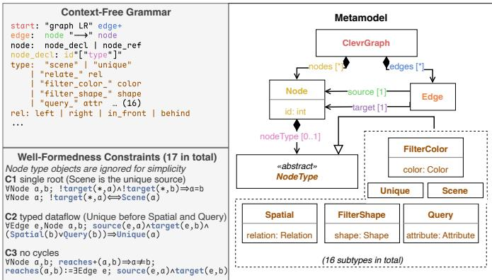
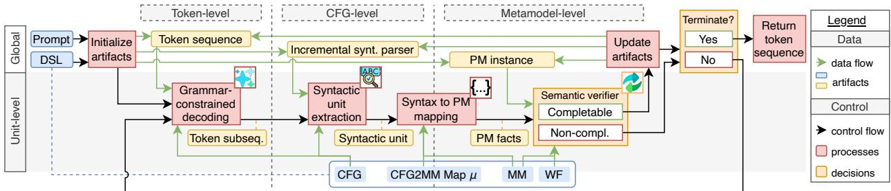
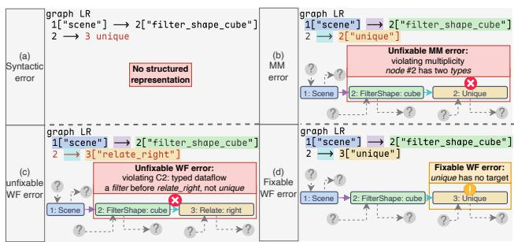
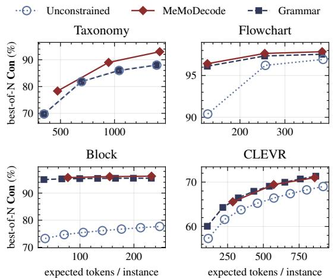
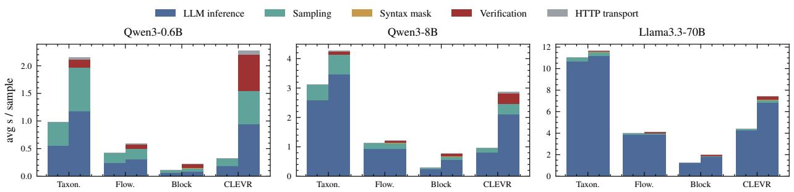

# Metamodel-Guided LLM Decoding for Consistent DSL Generation

Boqi Chen , Aren A. Babikian , Jose Antonio Hern´ andez L´ opez´

Abstract—Large language models (LLMs) are increasingly used to generate software engineering artifacts written in domainspecific languages (DSLs). Correct DSL instances usually must comply with not only the concrete syntax but also the abstract syntax defined by a metamodel augmented with semantic well-formedness constraints. Existing constrained decoding approaches typically guarantee compliance only with concrete syntax or with a limited set of semantic constraints expressed over the generated text, making metamodel-level constraint consistency difficult to enforce during generation. We present MeMoDecode: a decoding framework that enforces a DSL’s concrete syntax, abstract syntax, and well-formedness constraints jointly. Specifically, whenever the LLM generates a complete metamodel concept, MeMoDecode incrementally maps the current output to a partial model and verifies whether it can still be completed into a consistent instance. We combine MeMoDecode with a simple retry mechanism that resumes decoding from the most recent completable snapshot whenever an inconsistency is detected. Under a sound backend verifier, MeMoDecode never performs worse than grammar-constrained decoding on alignment metrics satisfying natural assumptions. Across four DSLs and six open-weight LLMs ranging from 0.6B to 70B parameters, MeMoDecode achieves the highest consistency, improving consistency by 23% on average over unconstrained decoding and by 8% on average over grammar-constrained decoding. It also improves benchmark performance while incurring only modest runtime overhead. These results show that metamodel-guided decoding is an effective approach for enforcing DSL consistency during decoding across diverse DSLs and LLM scales.

Index Terms—constrained decoding, domain-specific lan guages, large language models, metamodels

## I. INTRODUCTION

Context. Modern software engineering (SE) relies on a wide range of artifacts, from architecture design and configuration to query languages and flowcharts, many of which are expressed in domain-specific languages (DSLs) tailored to a particular task or domain [1]. As large language models (LLMs) are increasingly used to automate SE activities, a growing portion of these artifacts is generated, either fully or partially, by LLMs, from natural language specifications [2], [3]. Beyond traditional SE workflows, DSL artifacts also serve as structured interfaces in LLM-based agentic systems, supporting multiagent communication [4]–[6] and tool use [7]–[9].

In SE, especially in model-driven engineering, DSL instances are often used as machine-processable artifacts for downstream automation, analysis, model transformation, and code generation [10]–[12]. As a result, a DSL is typically characterized by three complementary aspects: its concrete syntax, usually defined by a grammar; its abstract syntax, captured by a metamodel; and a set of semantic well-formedness constraints over that metamodel, with execution semantics defined on top of them [13]–[15]. These aspects form a hierarchy of correctness. A generated instance may satisfy the grammar while still violating the metamodel or its constraints, preventing meaningful analysis, transformation, or execution. A DSL instance is consistent if it conforms to both the metamodel and the well-formedness constraints [16]. However, LLMs provide no guarantee that generated DSL instances satisfy these specifications. They may produce outputs that violate the grammar, the metamodel, or the well-formedness constraints, motivating the need for verification techniques [17]–[19].

A natural way to improve the reliability of generated DSL instances is post-hoc verification, where a complete instance is first generated and then checked or repaired [20]–[23]. However, these approaches discover violations only after a full generation. As a result, they may waste substantial decoding effort and require additional repair steps. Moreover, as LLM generation is conditioned on existing prefixes, when the generated instance contains early structural errors, subsequent parts of the output are generated from an already invalid context, potentially hurting the overall quality [24], [25].

These limitations motivate decoding-time approaches that prevent invalid outputs before they are completed. Grammarconstrained decoding masks, at each decoding step, tokens that would violate the grammar, thereby guaranteeing syntactic validity [26]–[31]. However, operating only on concrete syntax, it provides no guarantee that the generated DSL instance conforms to the metamodel or the associated constraints.

Recent approaches further incorporate semantic constraint verification into the decoding process [32]–[34]. For example, IterGen [35] augments grammar-constrained decoding with semantic checks. However, these checks are typically expressed over the generated text rather than the underlying structured model. Consequently, verification remains tied to a particular textual representation. More importantly, it limits the ability to reason about properties that are naturally defined over objects and references in the metamodel, such as multiplicity constraints, referential integrity, and transitive relationships. As a result, decoding-time verification and guidance of metamodellevel constraint consistency over the underlying structured representation remain underexplored [19].

Approach. In this paper, we present MeMoDecode (MetaModel-guided Decoding), a decoding framework that simultaneously enforces a DSL’s concrete syntax, abstract syntax, and semantic well-formedness constraints. The key idea is to lift verification from the generated text to the underlying model representation. As decoding proceeds, MeMoDecode incrementally maps the generated text to a partial model and, whenever the LLM completes a metamodel concept, verifies whether that partial model remains satisfiable with respect to the metamodel and its well-formedness constraints, that is, whether it can still be completed into a consistent instance. If not, the violation is irreparable, and MeMoDecode can immediately backtrack and retry during decoding rather than relying on post-hoc regeneration of the entire output.

Contribution. Because verification is performed over the model representation rather than the concrete-syntax text, MeMoDecode can enforce structured metamodel-level properties that are difficult or impossible to express using grammarbased approaches. Furthermore, since constraints are specified directly over the metamodel, the verification process is independent of the concrete syntax of the DSL and can be applied across different textual representations. More specifically, this paper makes the following contributions:

• We present MeMoDecode, a decoding framework that simultaneously enforces a DSL’s concrete syntax, abstract syntax, and semantic well-formedness constraints by verifying whether partially generated outputs can still be completed into consistent instances and retrying otherwise.

• We establish a worst-case guarantee: under a sound verifier and natural assumptions on the alignment metric, MeMoDecode never produces an output that is less aligned than the one generated by grammar-constrained decoding under identical decoding conditions.

• We implement MeMoDecode by combining grammarconstrained decoding [27] with the Refinery verifier [36] and a lightweight decoding-time retry mechanism.

• We conduct a systematic evaluation across four DSLs and six open-weight LLMs ranging from 0.6B to 70B parameters. The results show that MeMoDecode consistently improves DSL consistency, increases alignment with the ground truth, and incurs only modest runtime overhead.

Added value. MeMoDecode demonstrates that reasoning over the underlying model representation is key to ensuring consistency of a DSL instance. By lifting verification to the metamodel level, it enables the use of established partial modeling and constraint-solving techniques within the decoding process, yielding consistency guarantees independent of the textual representation. Since verification is decoupled from the underlying LLM, MeMoDecode can benefit directly from future advances in both LLMs and backend verifiers.

## II. BACKGROUND AND RELATED WORK

1) Domain-Specific Languages: A domain-specific language (DSL) is tailored to express the concepts of a particular application domain [1]. By focusing on a specific domain, DSLs can provide substantially higher ease of use than general-purpose programming languages for the tasks they are designed to support [11]. For instance, Listing 1 shows a CLEVR program specified using a DSL. A CLEVR program is a structured, machine-executable representation of a natural-language question about an image [37]. The listing illustrates a minimal program to answer the question “What color is the cube?”. The program begins with a scene node that returns the full set of objects in the scene, which is then passed to $\mathtt { f i l t e r \_ i }$ shape to retain only cube-shaped objects. The unique function asserts that exactly one such object exists, promoting the set of objects to a single object. Finally, query\_color is applied to retrieve the color of that object.

## Listing 1 A CLEVR DSL for “What color is the cube?” using the DSL definition of Figure 1

graph LR   
1["scene"] --> 2["filter\_shape\_cube"]   
2 --> 3["unique"]   
$\begin{array} { r l r } { 3 } & { { } \mathrm { -- } > } & { 4 [ { \ " } \mathrm { q u e r y \mathrm { \underline { { \mathrm { c o l o r } } } { \ " } } } ] } \end{array}$

2) DSL specifications: In SE, and especially in modeldriven engineering, a DSL is characterized by three aspects: a concrete syntax, an abstract syntax, and a set of semantic wellformedness constraints [13]–[15] (see Figure 1). Formally, a DSL specification can be defined as $\mathcal { D } = ( G , M , \mathcal { C } )$ , where G is a context-free grammar (CFG) defining the concrete syntax, M is a metamodel defining the abstract syntax, and C is a set of semantic well-formedness constraints over M.

The concrete syntax specifies the notation through which users interact with DSL instances. This paper focuses on textual DSLs whose concrete syntax is defined by a CFG G. In the CLEVR case, a language engineer could define the CFG shown in Figure 1. The non-terminals of G define textual forms for different syntactic categories of the language, such as edge, program node, and the type of a node. We refer to these completed derivations of selected non-terminals as syntactic units. A text sequence y is syntactically valid if it belongs to the language generated by G, i.e., ${ \pmb y } \in L ( G )$

The abstract syntax defines a structural representation of DSL instances and is commonly specified through a metamodel [15]. A metamodel M defines the types of elements that may appear in an instance model, including classes, attributes, references, containment references, multiplicities, and inheritance relations, often using a metamodeling language such as EMF Ecore [38]. The right side of Figure 1 shows the metamodel of the CLEVR DSL. We use $I \models M$ to denote that an instance model I conforms to the metamodel M.

A set of semantic well-formedness constraints C complements the metamodel by specifying semantic rules that cannot be expressed by the grammar or the metamodel alone [16]. These constraints are commonly specified using a constraint language [14], [39]. Formally, a constraint $c \in \mathcal { C }$ is a predicate over an instance model: $c : \mathcal { T } _ { M } \to \{ \mathrm { t r u e } .$ , false}. $\mathcal { T } _ { M }$ represents the set of instance models conforming to M and the output shows whether the constraint is satisfied. Figure 1 shows three out of the 17 constraints (single-root structure, type-correct dataflow, and acyclicity) of the CLEVR DSL.

To connect a text sequence to an instance model, language engineers typically define transformation rules from concrete syntax constructs, such as selected grammar non-terminals, to metamodel elements. Given such rules, a DSL instance written in the concrete syntax can be transformed into an instance model, for example, through parsing and model transformation techniques [40], [41]. The coloring in Figure 1 illustrates an example of such a correspondence between the grammar and the metamodel. A DSL instance is valid only if the resulting instance model I is consistent with respect to (M, C), i.e., it conforms to the metamodel and satisfies all well-formedness constraints: $I \left| = ( M , { \mathcal { C } } ) \iff I \right| = M \land \forall c \in { \mathcal { C } } ,$ c(I) = true.

  
Fig. 1: Example DSL for CLEVR programs [37]

3) Partial models: Partial models represent incomplete instances of a metamodel [42]. Instead of fully specifying all elements, a partial model records what is currently known and leaves the remaining information unspecified [16], [39], [43]. Following prior work, we view a partial model as an interpretation of metamodel-level facts, represented as predicates whose truth values may be known, unknown, or inconsistent. In the CLEVR DSL, a partial model may already contain facts such as NODE(n1), NODE(n2), $\mathrm { E D G E } ( e _ { 1 } )$ ${ \mathrm { S O U R C E } } ( e _ { 1 } , n _ { 1 } )$ , and TARGET(e , n ), while other facts, such as the node type of n2 or the remaining outgoing edges of n1, remain unknown. A complete instance model can be obtained by refining the partial model, i.e., by adding new facts until the objects, references, and attribute values are fully determined.

Refinery is a graph solver for generating and analyzing domain-specific graph models from partial specifications [36]. In this paper, we use Refinery as the backend solver for reasoning about the partial models constructed during decoding. The design of MeMoDecode is compatible with any backend that can reason soundly about partial models.

4) Large language models: LLMs are deep neural networks that typically follow the decoder-only Transformer architecture [44]. They are trained on massive collections of textual data using the language modeling task, which consists of predicting the next token given a sequence of preceding tokens. In practice, the generation follows an autoregressive process: an LLM receives as input a prompt x and produces a probability distribution over all tokens in its vocabulary, $\mathrm { L L M } ( { \pmb x } ) = P ( \cdot | { \pmb x } )$ . Based on this distribution and a chosen decoding strategy, the next token $t \sim P ( \cdot | \pmb { x } )$ is selected by a sampler and appended to the prompt. The updated sequence flis fed back into the LLM, and the process repeats until a predefined termination condition is reached, such as generating an end-of-sequence token, to create an output sequence y.

5) Decoding strategies for LLMs: A decoding strategy determines how the next token is selected from the probability distribution P(·|x) predicted by an LLM from a prompt x. Unconstrained decoding strategies select tokens from the probability distribution produced by the LLM directly, without considering DSL-specific validity constraints. For example, temperature sampling adjusts the sharpness of this distribution by scaling the next-token logits before normalization. Other commonly used strategies include greedy decoding, beam search [45], top-k sampling [46], and top-p sampling [47]. Constrained decoding. In many applications, the generated sequence is required to satisfy constraints beyond those captured by the language model distribution. Constrained decoding refers to decoding methods that restrict token selection using an external constraint specification. Given a set of constraints $\Phi = \{ \phi _ { 1 } , \ldots , \phi _ { k } \}$ , the goal is to generate an output sequence y such that y satisfies every constraint in Φ, while still using the LLM probabilities to guide token selection.

When the constraint specification is a CFG G, the constraint is that the final output must belong to the language generated by the grammar, i.e., $y \in L ( G )$ . Such methods are commonly referred to as grammar-constrained decoding [26]–[31]. The core idea is to maintain a parser state induced by the output and, at each decoding step, mask tokens that would make the output impossible to extend into a syntactically valid sequence [26], [28]. As a result, these approaches enforce concrete-syntax validity during generation, but do not by themselves ensure that the resulting instance model is consistent. Beyond grammar-constrained decoding. Several approaches augment grammar-constrained decoding with additional semantic reasoning mechanisms. These approaches typically refine the token mask by incorporating complementary information, such as semantic pruners or static analyzers, thereby restricting generation with additional constraints [32]–[34]. However, they either lack sufficient expressive power to capture complex structured semantic properties [32] or focus on a narrow class of constraints [33], [34]. For example, ChopChop [32] employs semantic pruners. Given a program space, a semantic pruner returns the subspace of programs that satisfy a particular constraint, such as type consistency. Such pruners cannot fully express all types of constraints. Other approaches [33], [34], [48] focus only on specific language semantic properties rather than general DSL specifications.

IterGen [35] takes a different approach by building on SynCode [29] with an iterative backtracking mechanism that revises previously generated tokens upon constraint violations. It introduces three operations: forward (generate until a syntactic unit is reached), backward (rewind to a previously generated syntactic unit), and view (retrieve the strings associated with a syntactic unit), enabling programmatic inspection and enforcement of semantic constraints during decoding.

However, IterGen exposes intermediate fragments at the concrete-syntax level. In particular, view returns raw strings, so constraint checks must be implemented through string processing or pattern matching. This conflates concrete and abstract syntax, tying constraints to surface details such as delimiters, keywords, and whitespace rather than to the underlying objects, attributes, and references. Users need to reimplement parsing and structural analysis that a proper abstract syntax representation provides directly, making constraints harder to maintain and reason about as the DSL evolves.

6) LLMs for DSL Generation: LLMs are increasingly used to automate the creation of software artifacts, many of which are expressed in DSLs [2], [3]. Early work has primarily used unconstrained decoding to study the ability of LLMs to generate DSL instances, including software models [49]– [51] and executable queries [52], [53]. More recent approaches introduce explicit checking mechanisms, either during decoding through grammar-constrained generation [17], [54], or after generation through post-hoc verification and repair [20]– [23]. These techniques improve the validity of generated DSL instances, but they either focus mainly on concrete syntax or check validity only after a complete artifact is produced.

Existing work typically evaluates the generated artifact with a reference artifact or its expected execution result. We refer to such a measure as an alignment score s(y), which quantifies how well a generated output y aligns with the intended output. Depending on the DSL, s can be instantiated as a structural similarity metric, such as an F1 score over generated elements, or as an execution-based metric, such as result accuracy.

7) Positioning: MeMoDecode complements existing LLM-based DSL generation approaches by augmenting LLM decoding with metamodel-level verification. Unlike unconstrained approaches, which may introduce syntactic or semantic violations during generation, and post-hoc repair approaches, which detect such violations only after a complete artifact has been produced, MeMoDecode rejects inconsistent structural decisions before they become part of the accepted generation context. Compared with constrained generation approaches, MeMoDecode is closest to IterGen, but lifts the corresponding checks from concrete-syntax fragments to the metamodel level. As a result, MeMoDecode performs semantic pruning during decoding while keeping verification independent of a particular textual representation.

## III. APPROACH

1) Problem definition: Given a natural language prompt x and a DSL specification $\mathcal { D } = ( G , M , \mathcal { C } )$ , MeMoDecode guides the generation process of an LLM toward an output y that is valid with respect to both the concrete and abstract definitions. Formally, the goal is to generate a syntactically valid DSL instance $y \in L ( G )$ whose induced instance model $I _ { y }$ is consistent with the metamodel M and well-formedness constraints C: $I _ { \pmb { y } } \equiv ( M , \mathcal { C } )$ . By enforcing these consistency properties during decoding, MeMoDecode also aims to improve the alignment score $s ( \pmb { y } )$ as a secondary effect.

2) Overview: Figure 2 summarizes the MeMoDecode framework. Decoding begins by initializing the artifacts maintained by MeMoDecode: an empty generated token sequence, a syntactic parser in its initial grammar state, and an empty partial model. MeMoDecode maintains these artifacts during generation. During decoding, a grammar-constrained decoding approach ensures token-level conformance to the concrete syntax. The generated tokens are then appended to the sequence and consumed by the syntactic unit extraction module.

Whenever a completed syntactic unit is generated, the syntax to partial model mapping maps this unit to metamodel-level facts over M. These facts are tentatively added to a partial model, and a backend semantic verifier checks whether the partial model remains completable with respect to $( M , \mathcal { C } )$ . The artifacts are updated with the unit only if this check succeeds; otherwise, it is rejected and the decoding retries. This process continues until the termination condition is reached.

3) Grammar-constrained decoding: At each decoding step, MeMoDecode uses a grammar-guided decoding module, implemented with LLGUIDANCE [27], to ensure that the generated sequence remains syntactically valid by assigning zero probability to tokens leading to syntactic violations. Such an example for the CLEVR DSL is shown in Figure 3.

4) Syntactic unit extraction: As tokens are generated, the syntactic unit extraction module uses an incremental parser to detect when the output completes a selected syntactic unit. A syntactic unit is a completed derivation of a configured grammar non-terminal whose text encodes information relevant to the metamodel. These non-terminals are DSL-specific and are configured by the language engineer. Whenever such a unit is completed, the parser extracts the corresponding grammar fragment and passes it to the mapping module. For example, the highlighted text fragments in Figure 3.b, c, and d correspond to information such as node and edge declarations.

5) Mapping syntax to partial models: MeMoDecode aims to verify generation at the metamodel level rather than directly over the concrete syntax. To bridge these two levels, MeMoDecode relies on a mapping µ from completed syntactic units to metamodel-level facts. In this paper, we focus on mapping units that directly correspond to either an instance of a metamodel class or a reference between metamodel classes.

In Figure 3, the highlight colors indicate which metamodel elements each syntactic unit induces facts for. Given a completed syntactic unit u, $\mu ( u )$ returns the set of facts induced by u. These facts may introduce objects, assign attribute values, or create references between objects. For example, as shown in Figure 3.b, a node declaration 1["scene"] is mapped to facts $\mathrm { { N o D E } } ( n _ { 1 } )$ $\mathrm { S C E N E } ( t _ { 1 } )$ $\mathrm { N O D E T Y P E } \left( n _ { 1 } , t _ { 1 } \right)$ and $\mathrm { I D } ( n _ { 1 } , 1 )$ Similarly, 2["filter\_shape\_cube"] introduces facts on a filter and its shape parameter: $\mathrm { { N o D E } } ( n _ { 2 } )$ FILTERSHAPE $\mathbf { \rho } ( t _ { 2 } )$ , NODE $\Gamma \mathrm { Y P E } ( n _ { 2 } , t _ { 2 } )$ SH $\mathsf { A P E } ( t _ { 2 } , \mathsf { C U B E } )$ and $\mathrm { I D } ( n _ { 2 } , 2 )$ . Edge declarations induce reference facts. For instance, the completed edge $\begin{array} { r l } { { 1 } \left[ \begin{array} { l l l } { \mathfrak { \ " } _ { \mathbf { S } } \subset \joinrel \in \mathfrak { n } \ominus \mathfrak { \ " } } \end{array} \right] } & { { } \to } \end{array}$ 2["filter\_shape\_cube"] maps to an edge object whose source is the node with ID 1 and whose target is the node with ID 2: EDGE(e1), SOURCE(e1, n1), $\mathrm { T A R G E T } \left( e _ { 1 } , n _ { 2 } \right)$

During decoding, MeMoDecode accumulates the facts produced by $\mu$ into a partial model. The partial model aggregates metamodel-level facts while leaving unspecified elements open for future refinement. For example, Figure 3.b-d visualize the structured representation of the partial model as a graph after successive facts have been aggregated, with grey question marks denoting unknown elements and connections.

The mapping $\mu$ can be obtained in different ways depending on the language engineering framework. In Xtext [55], the relationship between grammar rules and Ecore classes is made explicit through grammar actions and assignments, which makes it possible to derive the mapping automatically. In other settings, µ is defined, for example, using a Lark transformer [56], or derived from framework-specific annotations. MeMoDecode is independent of how µ is obtained and supports both manually specified and automatically generated mappings. Once facts are added to the partial model, verification is performed over metamodel facts rather than over surface tokens, enabling MeMoDecode to enforce structured semantic constraints such as multiplicities and acyclicity.

  
Fig. 2: Overview of MeMoDecode decoding process; MM: metamodel, WF: well-formedness constraints; PM: partial mode

  
Fig. 3: Different partial models, their verification results (boxed), and color-coded correspondence with syntactic units

6) Semantic verification and retry: After metamodel-level facts are created, MeMoDecode verifies the resulting candidate at the level of the partial model. Let P denote the partial model induced by the accepted prefix, and let $\mu ( u )$ denote the facts induced by a newly completed syntactic unit u. Adding u yields a new candidate partial model $P ^ { \prime } = P \cup \mu ( u )$

The verification determines whether facts in the partial model $P ^ { \prime } ,$ , either individually or in combination, are inconsistent with the metamodel and well-formedness constraints. Since some violations may still be fixed by subsequent tokens, the verifier focuses on identifying facts that make the partial model impossible to complete into a valid instance.

We formalize this check using the notion of refinement. A refinement operation adds information to a partial model by resolving previously unknown facts, such as introducing missing objects, assigning attribute values, or creating references. We write $P \subseteq I$ when a complete instance model I refines a partial model P, i.e., when I preserves all facts already fixed in P and resolves the remaining unknowns. A partial model P is completable with respect to $( M , \mathcal { C } )$ if there exists at least flone complete consistent refinement: ∃I $P \subseteq I \wedge I \left| = ( M , C ) \right.$ fiAccordingly, a violation is unfixable if the newly added facts make the candidate partial model not completable. In that case, no continuation of the current prefix can produce a consistent instance without revising previously accepted decisions.

MeMoDecode uses Refinery as a sound backend verifier [36] to determine whether the current partial model is completable. If the candidate partial model $P ^ { \prime }$ is completable, MeMoDecode commits the syntactic unit u, updates the accepted partial model to $P ^ { \prime }$ , and stores a snapshot of the current decoding state. This snapshot includes the accepted tokens, the parser state, and the partial model, so that decoding can later resume from this point if needed.

If $P ^ { \prime }$ is not completable, MeMoDecode retries with a simple strategy. The decoder rejects both the unit from the token sequence and its induced facts from the partial model. Decoding continues from the most recent completable snapshot using temperature sampling. Since the sampling is stochastic, the regenerated sequence may create a different syntactic unit. This retry strategy is intentionally lightweight, allowing us to focus mainly on the effect of metamodel-level verification.

Figure 3.b and c show two partial models rejected by the semantic verifier because they are no longer completable. The two cases violate multiplicity and typed dataflow constraints, respectively, and these violations are unfixable. In contrast, the partial model in Figure 3.d remains acceptable. While it is incomplete, given that Unique does not yet have a target node, this incompleteness can be fixed by extending the output with more tokens. This verification step ensures that unfixable violations are rejected before they are committed, guiding generation toward a valid DSL instance shown in Listing 1.

7) Termination conditions: The decoding process terminates when either the LLM produces an end-of-sequence token or the parser state indicates no further tokens are required to complete the DSL instance. As a safeguard against nontermination, decoding also stops once the output reaches a fimaximum number of tokens. Finally, if semantic verification repeatedly rejects candidates and the retry budget is exhausted, MeMoDecode falls back to using only the grammar-guided decoding module from the most recent completable snapshot. This fallback ensures that decoding can still terminate with a syntactically valid output when the lightweight retry strategy cannot find a completable continuation within the budget.

8) Worst-case alignment score guarantee: The semantic verification rejects only unfixable violations. Thus, if the figrammar-constrained decoding module eventually produces a consistent instance, MeMoDecode follows the same generation path and performs no rejection. If a rejection occurs, then the corresponding grammar-based continuation is not completable without revising previously generated tokens. This property yields the following worst-case guarantee.

Theorem 1 (Worst-case alignment score of MeMoDecode). Consider grammar-guided decoding and MeMoDecode operating under identical decoding conditions, i.e., using the same prompt, LLM, sampler, and random seed. Let $\mathcal { D } = ( G , M , \mathcal { C } )$ be the DSL specification, and let s be an alignment scorer that maps each generated output y to a numerical score. Assume that s satisfies the following properties: (non-negativity) $s ( \pmb { y } ) \geq 0 ;$ and (precondition) $s ( \pmb { y } ) = 0$ whenever the instance model induced from y is inconsistent with (M, C).

Assume that the backend verifier used by MeMoDecode is sound, $\mathrm { i . e . , }$ it rejects a completed syntactic unit only when adding the corresponding facts makes the partial model not completable with respect to $( M , \mathcal { C } )$ . Let ${ \pmb y } _ { \mathrm { g } }$ and ${ \pmb y } _ { \mathrm { m e m o } }$ denote the outputs generated by a grammar-constrained decoding approach and by MeMoDecode, respectively. Then, for every input, under the previously stated assumptions, ${ \pmb y } _ { \mathrm { m e m o } }$ achieves an equal or better alignment score than ${ \pmb y } _ { \mathrm { g } }$ by ensuring semantic consistency on top of syntactic validity. Formally, $s ( \pmb { y } _ { \mathrm { m e m o } } ) \geq s ( \pmb { y } _ { \mathrm { g } } )$ , with equality whenever no rejection fires. Proof. There are two possible cases: (1) ${ \pmb y } _ { \mathrm { g } }$ does not violate (M, C). Since the verification is sound, it follows that $\begin{array} { r } { \pmb { y } _ { \mathrm { g } } ^ { } \ = \ \pmb { y } _ { \mathrm { m e m o } } . } \end{array}$ . Assume, for the sake of contradiction, that ${ \pmb y } _ { \mathrm { g } } \ne { \pmb y } _ { \mathrm { m e m o } }$ . Then, during the execution of MeMoDecode, at least one element must have been rejected. This implies that the corresponding partial solution could not be extended into a valid output satisfying $( M , \mathcal { C } )$ . Since ${ \pmb y } _ { \mathrm { g } }$ itself satisfies $( M , \mathcal { C } )$ such a rejection cannot occur, yielding a contradiction; thus, ${ \pmb y } _ { \mathrm { g } } = { \pmb y } _ { \mathrm { m e m o . } } \ ( 2 ) \ { \pmb y } _ { \mathrm { g } }$ violates $( M , \mathcal { C } )$ . By the precondition and the non-negativity property of $\mathrm { ~ s ~ } , s ( \pmb { y } _ { \mathrm { g } } ) = 0 \leq s ( \pmb { y } _ { \mathrm { m e m o } } )$

## IV. EVALUATION

We evaluate the impact of MeMoDecode on syntactic validity, consistency, token efficiency, alignment, and runtime. Specifically, we investigate the following research questions:

• RQ1: How does MeMoDecode influence the syntactic validity and consistency of generated DSL instances with respect to the metamodel and well-formedness constraints?

• RQ2: How token-efficient is MeMoDecode in producing consistent instances compared with grammar-guided and unconstrained decoding under post-hoc verification?

• RQ3: How does MeMoDecode affect the alignment scores of the generated instances?

• RQ4: What runtime overhead does MeMoDecode introduce compared with other decoding components?

## A. Setup

a) Benchmarks: The experiments are conducted on four popular DSL generation benchmarks grouped into two categories, as summarized in Table I. The first category consists of non-executable DSLs, which represent structured artifacts such as graph models without execution semantics. In SE, these DSLs are commonly used to describe system architectures, configurations, and taxonomies.

TABLE I: Summary of evaluation benchmarks.
<table><tr><td>Benchmark</td><td>Samples</td><td>Constraints</td><td>Example well-formedness constraints</td></tr><tr><td colspan="4">Non-executable (structural)</td></tr><tr><td>Taxonomy</td><td>100</td><td>6</td><td>one root; acyclic; ≤ 1 parent/term 2</td></tr><tr><td>Flowchart</td><td>326</td><td>5</td><td>reachability; decisions have ≥ guarded out-edges; no self-loops</td></tr><tr><td colspan="4">Executable (operational)</td></tr><tr><td>CLEVR</td><td>300</td><td>17</td><td>one source and one sink; acyclic; type consistency; referential integrity</td></tr><tr><td>Block</td><td>399</td><td>11</td><td>value type matches property, e.g., height→integer; type consistency</td></tr></table>

Taxonomy. We use the WordNet taxonomy construction benchmark [57], which constructs a hypernym graph from a given set of concepts and has been widely used to evaluate LLM-based taxonomy generation [58], [59]. Following prior work, we randomly sample 100 taxonomies, each containing between 11 and 50 terms.

Flowchart. We use the PAGED benchmark [60], containing procedure graphs from natural language descriptions. We retain only samples that can be represented as flowcharts and exclude trivial graphs without branches or forks [20].

The second category consists of executable DSLs, where each generated program can be executed to produce an output. In SE, this type of DSLs is used to represent executable queries or data-processing pipeline configurations.

CLEVR. The CLEVR benchmark [37] generates executable programs over the CLEVR DSL introduced in Figure 1 from natural language questions. We use a subset evenly divided among query, count, and judge questions [20].

Block. We use the test split of the Overnight Block dataset [61], where natural language descriptions of colored blocks are translated into logical forms expressed in a closed lambda function with 29 prefix operators. Each program executes over a simulated block world to produce an end state.

b) Baselines: We compare MeMoDecode with two baseline decoding approaches. To control potential variability, we use the same LLM, prompt, sampler, and random seed, differing only in the constraints enforced during decoding.

Unconstrained decoding (Unc) performs standard autoregressive sampling without any constraints, measuring how often the LLM produces valid DSL instances by itself.

Grammar-constrained decoding (Grammar) masks, at each decoding step, tokens that would violate the DSL context-free grammar. This ensures that the generated output is syntactically valid with respect to the concrete syntax, following prior grammar-constrained decoding approaches [26]–[30].

c) LLMs: We evaluate six open-weight, instruction-tuned LLMs from three families: Qwen3 (0.6B, 8B, and 32B parameters) [62], Gemma-4 (E2B and 26B) [63], and Llama3.3- 70B [64]. These LLMs span different capacities, allowing us to evaluate whether the effects of MeMoDecode are limited to smaller LLMs that frequently generate inconsistent outputs or persist for stronger LLMs that already exhibit high capability. We additionally report GPT-5.5 [65] under unconstrained decoding as a state-of-the-art reference.

Although MeMoDecode is LLM-agnostic, we evaluate it only on open-weight LLMs because it requires direct access to the decoding process, including next-token logits, token-level masking, and the ability to reject generated tokens. Current proprietary APIs typically expose only sampled outputs or limited constrained decoding interfaces. For example, while the GPT-5.5 API supports constrained decoding, its constraints are limited to JSON schemas and therefore cannot express either grammar-constrained decoding or the partial-model verification performed by MeMoDecode. Consequently, GPT-5.5 is evaluated only under unconstrained decoding.

d) Metrics: For RQ1, we report two metrics that measure the correctness of the generated DSL instances. Syntactic validity (Syn) is the fraction of outputs that parse according to the DSL’s concrete syntax. Consistency (Con) is the fraction of outputs that are additionally consistent with the metamodel and its well-formedness constraints (M, C). Note that every consistent instance must also be syntactically valid.

For RQ3, we evaluate how closely the generated instance aligns with the ground truth. For the structural DSLs (Taxonomy and Flowchart), we compute an element-wise Soft F1 [66] by matching nodes and relations between the generated and ground truth instances, regardless of validity. Since it assigns partial credit to inconsistent outputs, it does not satisfy the precondition assumptions of Theorem 1 and is reported only as a reference metric. To check the theorem empirically on structural DSLs, we also report Hard-0 F1∗, which assigns a score of 0 to inconsistent instances and otherwise equals the corresponding Soft F1 score, forcing the precondition property.

For the executable DSLs, we report execution accuracy: denotation accuracy (Block), measuring whether the generated program evaluates to the intended state, and answer accuracy (CLEVR), measuring whether executing the program produces the correct answer. Execution accuracy satisfies both nonnegativity and precondition properties of Theorem 1 naturally.

For the efficiency metrics (RQ2 and RQ4), we compute the average number of generated tokens per instance (RQ2) and the average runtime per sample, broken down by the different components of MeMoDecode (RQ4).

e) Experiment configurations: Unless otherwise stated, each experiment is repeated with three random seeds, and we report the average performance. A sampling temperature of 0.7 is used to enable effective retry. All experiments are performed with few-shot prompting. To ensure a consistent evaluation across LLMs, we disable the reasoning (thinking) mode and evaluate only the generation capability. We set the maximum number of tokens to be generated to 5096, and the maximum retry attempts to 50. All experiments with local LLMs are conducted with a single NVIDIA RTX Pro 6000 GPU, an Intel Xeon Platinum 8470Q CPU, and 110 GB of system memory.

## B. RQ1: Impact on consistency

Rationale and setup. In RQ1, we evaluate the effect of decoding-time verification during generation. Specifically, we investigate how MeMoDecode affects syntactic validity and consistency with respect to (M, C) compared with the Unc and Grammar baselines, and whether these improvements generalize across different LLM families and LLM scales.

Results. Table II reports the syntactic validity and consistency of the generated instances. Grammar achieves near-perfect syntactic validity in almost all cases, and MeMoDecode largely preserves this property. The largest reduction is only 2% (92.7% vs. 90.7% for Gemma4-E2B on Taxonomy), while the remaining differences are within 0.5%. In contrast, Unc decoding is substantially less reliable. For example, Gemma4-E2B and Gemma4-26B output almost no syntactically valid Flowcharts (0.0% and 1.1%), showing that smaller LLMs cannot follow the syntactic structure on their own.

MeMoDecode achieves the highest consistency for every LLM and benchmark combination, outperforming Grammar throughout. The only exception is Flowchart with Qwen3-32B, where both approaches achieve 97.2%. The improvements are often substantial, especially for smaller LLMs. For example, MeMoDecode increases the consistency of Qwen3-0.6B from 36.0% to 66.7% on Taxonomy (+30.7%) and from 5.6% to 31.2% on CLEVR (+25.6%). Grammar constraints alone are therefore insufficient and can even sometimes reduce consistency. On CLEVR, Grammar decreases the consistency of Llama3.3-70B from 64.8% under Unc decoding to 58.2%, whereas MeMoDecode increases it to 77.0%, demonstrating the importance of enforcing metamodel and well-formedness constraints in addition to the syntax.

Although the largest improvements are observed for smaller LLMs, they persist for larger ones. Compared with Grammar, MeMoDecode improves the consistency of Llama3.3-70B by 18.8% on CLEVR and by 4.5% on Block. Even the unconstrained GPT-5.5 reference does not achieve perfect consistency, reaching 95.5% on Block and 82.9% on CLEVR. This result indicates that metamodel-based verification remains beneficial even for highly capable LLMs.

Answer to RQ1: MeMoDecode preserves the near-perfect syntactic validity of Grammar (within 2%) while achieving the highest consistency across all LLMs and benchmarks, never performing worse than Grammar. Although the largest gains are observed for smaller LLMs, improvements persist across all evaluated LLMs.

## C. RQ2: Token efficiency

Rationale and setup. The consistency improvements in RQ1 come at additional token costs since retries are performed during decoding. RQ2 checks if this cost is justified by asking how efficiently, in terms of generated tokens, MeMoDecode produces consistent instances compared to baselines.

A common alternative to constrained decoding is post-hoc verification [21], [22]. In this case, LLMs generate multiple outputs, and the verifier retains only consistent instances. Higher consistency may then be achieved by generating more outputs, making token efficiency the quality of interest.

We evaluate this trade-off on Qwen3-8B, a representative mid-sized LLM. We use best-of-N consistency, defined as the fraction of prompts for which at least one of N sampled instances is consistent. This simulates a post-hoc verifier that always selects a consistent candidate whenever one exists. We reuse the three runs from RQ1 for MeMoDecode and perform additional runs for Unc and Grammar until their average cumulative token count matches that of MeMoDecode, whose token counts include all retries. We record the best-of-N consistency with the corresponding expected output tokens, yielding a consistency-token trade-off curve for each approach. Results. The best-of-N consistency against the expected number of output tokens per instance for Qwen3-8B is plotted in Figure 4. As expected, MeMoDecode generates more output tokens per instance than the baselines. At N = 1, its curve starts farthest to the right on every benchmark (e.g., approximately 470 versus 350 tokens on Taxonomy), reflecting the additional retries performed during decoding. Unc and Grammar generate a similar number of tokens because Grammar only applies token masking without introducing retries.

TABLE II: Syntactic validity (Syn) and consistency (Con), in %, averaged over three runs, across the four DSL benchmarks. The best consistency per benchmark and LLM is in bold. GPT-5.5 (unconstrained only) is shown as a reference.
<table><tr><td rowspan="3">LLM</td><td colspan="6">Taxonomy</td><td colspan="6">Flowchart</td><td colspan="4">Block</td><td colspan="6">CLEVR</td></tr><tr><td>Unc</td><td colspan="2"></td><td colspan="2">Grammar</td><td colspan="2">MeMoDecode</td><td colspan="2">Grammar</td><td colspan="2">MeMoDecode</td><td colspan="2">Unc</td><td colspan="2">Grammar</td><td colspan="2">MeMoDecode Unc</td><td colspan="2">Grammar</td><td colspan="2">MeMoDecode</td></tr><tr><td>Syn</td><td>Con</td><td>Syn</td><td>Con</td><td>Syn</td><td>Con</td><td>Syn</td><td>Con</td><td>Syn</td><td>Con Syn</td><td>Con</td><td>Syn</td><td>Con</td><td>Syn Con</td><td>Syn</td><td>Con</td><td>Syn</td><td>Con</td><td>Syn</td><td>Con</td><td>Syn</td><td>Con</td></tr><tr><td>Qwen3-0.6B</td><td>99.7</td><td>36.0</td><td>100.0</td><td>36.0</td><td>100.0</td><td>66.7</td><td>78.5</td><td>71.9</td><td>99.6 89.1</td><td>99.3</td><td>98.6</td><td>51.4</td><td>49.0 100.0</td><td>93.7</td><td>100.0</td><td>98.8</td><td>44.3</td><td>5.3</td><td>99.9</td><td>5.6</td><td>99.9</td><td>31.2</td></tr><tr><td>Qwen3-8B</td><td>99.3</td><td>69.0</td><td>99.3</td><td>69.0</td><td>99.3</td><td>78.3</td><td>93.8</td><td>90.4</td><td>100.0 96.1</td><td>100.0</td><td>96.4</td><td>75.0</td><td>74.0 100.0</td><td>94.9</td><td>99.9</td><td>95.7</td><td>90.8</td><td>57.1</td><td>99.9</td><td>59.8</td><td>100.0</td><td>65.6</td></tr><tr><td>Qwen3-32B</td><td>99.7</td><td>79.3</td><td>99.7</td><td>79.3</td><td>100.0</td><td>88.7</td><td>87.7</td><td>85.4 100.0</td><td>97.2</td><td>100.0</td><td>97.2</td><td>76.8</td><td>75.6 100.0</td><td>92.6</td><td>100.0</td><td>96.8</td><td>93.4</td><td>62.0</td><td>100.0</td><td>60.3</td><td>100.0</td><td>67.9</td></tr><tr><td>Gemma4-E2B</td><td>64.0</td><td>22.7</td><td>92.7</td><td>29.3</td><td>90.7</td><td>44.3</td><td>0.0 0.0</td><td>99.7</td><td>89.0</td><td>99.7</td><td>89.6</td><td>60.4</td><td>55.6 100.0</td><td>83.5</td><td>100.0</td><td>88.6</td><td>68.4</td><td>19.9</td><td>99.2</td><td>20.1</td><td>99.7</td><td>30.8</td></tr><tr><td>Gemma4-26B</td><td>98.7</td><td>71.0</td><td>99.3</td><td>70.7</td><td>99.7</td><td>78.3</td><td>1.1</td><td>1.1</td><td>100.0 98.0</td><td>100.0</td><td>98.3</td><td>80.0</td><td>76.9 99.4</td><td>92.2</td><td>99.2</td><td>96.1</td><td>97.3</td><td>61.1</td><td>99.9</td><td>61.9</td><td>99.9</td><td>69.6</td></tr><tr><td>Llama3.3-70B</td><td>99.3</td><td>82.3</td><td>100.0</td><td>82.0</td><td>100.0</td><td>91.3</td><td>98.9</td><td>96.2</td><td>100.0 97.2</td><td>100.0</td><td>97.6</td><td>78.9</td><td>76.9 100.0</td><td>94.9</td><td>100.0</td><td>99.4</td><td>93.1</td><td>64.8</td><td>99.8</td><td>58.2</td><td>99.9</td><td>77.0</td></tr><tr><td>GPT-5.5</td><td>100.0 98.7</td><td></td><td></td><td></td><td></td><td></td><td>100.0</td><td>100.0</td><td></td><td></td><td></td><td>99.2 95.5</td><td></td><td></td><td></td><td></td><td>100.0</td><td>82.9</td><td></td><td></td><td></td><td></td></tr></table>

  
Fig. 4: Token efficiency of decoding approaches on Qwen3-8B

Despite this overhead, MeMoDecode is consistently more token-efficient at an equal token budget. Compared with Unc, it achieves substantially higher best-of-N consistency on all four benchmarks, indicating that repeatedly sampling unconstrained outputs rarely repairs malformed instances. Compared with the stronger Grammar baseline, MeMoDecode is clearly more efficient on Taxonomy, exceeding it by about 5% at the same token budget (approximately 93% versus 88%) while reaching its best consistency with substantially fewer tokens. It is also slightly more efficient on Flowchart and Block, and comparable on CLEVR, where the two curves nearly overlap because the higher per-generation cost of MeMoDecode is offset by more samples from Grammar. Moreover, the baseline curves for Unc and Grammar flatten below MeMoDecode on benchmarks where it achieves higher consistency. This result suggests that, under an equal token budget, allocating additional tokens to repeated generation alone cannot always lead to the consistency improvements achieved by MeMoDecode.

The figure reports only output tokens. Since post-hoc verification requires a new generation pass for every candidate instance, whereas MeMoDecode performs retries within a single decoding session, accounting for input tokens would likely further favor MeMoDecode. In practice, this advantage is partially mitigated by prompt caching, although cached input tokens are still billed by most proprietary APIs.

Answer to RQ2: Despite its per-generation retry overhead, MeMoDecode is at least as token-efficient as both baselines and notably more efficient on three of the four benchmarks. These results suggest that, in many cases, allocating tokens to retry during decoding is more effective than allocating them to repeated generation.

## D. RQ3: Alignment scores

Rationale and setup. RQ1 and RQ2 focus on the validity of the generated DSL instances. Still, the objective of DSL generation is often to produce instances that correctly capture the intention of the natural language input. Under the assumptions on the alignment scorer, Theorem 1 predicts that MeMoDecode cannot achieve a lower alignment score than Grammar. In this RQ, we evaluate this prediction empirically. We reuse the generation results from RQ1 and evaluate them using the alignment metrics. For the structural DSLs, we report both the standard Soft F1 score and its Hard-0 F1∗ variant. For the executable DSLs, we report denotation accuracy for Block and answer accuracy for CLEVR. These metrics instantiate the alignment scorer s in the theorem.

Results. Table III reports the alignment scores across the four benchmarks. For the structural DSLs, the conventional Soft F1 changes only marginally between Grammar and MeMoDecode, remaining within ±0.4%. This result indicates that MeMoDecode largely preserves the alignment quality of valid outputs. In contrast, Hard-0 F1∗ improves for every LLM except one tie (Qwen3-32B on Flowchart), with gains of up to 6.6% (Gemma4-E2B on Taxonomy, 11.7% → 18.3%).

A similar pattern is observed for the executable DSLs, where invalid DSL instances receive an execution accuracy of zero. MeMoDecode improves execution accuracy for every LLM and benchmark, with the largest gain on CLEVR (Llama3.3-70B, 52.0% → 65.7%, +13.7%). These improvements arise since MeMoDecode fixes inconsistent instances while preserving the quality of valid ones. However, none of the evaluated open-weight LLMs surpasses the unconstrained GPT-5.5, indicating that while decoding-time verification improves alignment, the LLM’s capability remains important for the achievable alignment score.

TABLE III: Alignment scores (%) per approach across the four benchmarks, best $\mathrm { F } 1 ^ { * }$ or accuracy per benchmark and LLM is shown in bold, GPT-5.5 as an unconstrained reference.
<table><tr><td>LLM</td><td colspan="6">Taxonomy</td><td colspan="6">Flowchart</td><td colspan="3">Block</td><td colspan="3">CLEVR</td></tr><tr><td></td><td colspan="2">Unc</td><td colspan="2">Grammar</td><td colspan="2">MeMoDecode</td><td colspan="2">Unc</td><td colspan="2">Grammar</td><td colspan="2">MeMoDecode</td><td>Grammar</td><td>: MeMoDecode</td><td>Unc</td><td colspan="2"></td><td>Grammar MeMoDecode</td></tr><tr><td></td><td>F1</td><td>Fl*</td><td>Fl</td><td>F1* F1</td><td>F1*</td><td></td><td>Fl F1*</td><td>F1</td><td>F1*</td><td>F1</td><td></td><td>F1*</td><td>Acc</td><td>Acc</td><td>Acc</td><td>Acc</td><td>Acc</td><td>Acc</td></tr><tr><td>Qwen3-0.6B</td><td>20.0</td><td>8.6</td><td>20.0</td><td>8.6</td><td>19.9</td><td>14.4</td><td>53.9</td><td>49.6</td><td>68.1</td><td>61.3</td><td>68.1</td><td>67.7</td><td>11.9</td><td>18.6</td><td>19.3</td><td>1.0</td><td>1.8</td><td>6.1</td></tr><tr><td>Qwen3-8B</td><td>53.2</td><td>36.5</td><td>53.2</td><td>36.5</td><td>53.1</td><td>40.7</td><td>71.5</td><td>69.0</td><td>76.2</td><td>73.4</td><td>76.2</td><td>73.7</td><td>35.1</td><td>38.8</td><td>39.0</td><td>44.9</td><td>46.4</td><td>49.8</td></tr><tr><td>Qwen3-32B</td><td>59.1</td><td>46.7</td><td>59.0</td><td>46.6</td><td>59.4</td><td>52.3</td><td>67.5</td><td>65.8</td><td>76.9</td><td>75.0</td><td>76.9</td><td>75.0</td><td>42.5</td><td>45.3</td><td>46.2</td><td>55.0</td><td>53.8</td><td>58.7</td></tr><tr><td>Ġemma4-E2B</td><td>26.7</td><td>9.1</td><td>36.4</td><td>11.7</td><td>36.6</td><td>18.3</td><td>0.0</td><td>0.0</td><td>72.3</td><td>66.8</td><td>72.3</td><td>67.3</td><td>30.7</td><td>38.9</td><td>39.5</td><td>12.2</td><td>11.8</td><td>15.9</td></tr><tr><td>Gemma4-26B</td><td>54.9</td><td>39.0</td><td>55.5</td><td>39.0</td><td>55.6</td><td>43.4</td><td>0.8</td><td>0.8</td><td>77.2</td><td>75.8</td><td>77.2</td><td>76.0</td><td>50.6</td><td>55.6</td><td>56.1</td><td>52.7</td><td>53.1</td><td>59.2</td></tr><tr><td>Llama3.3-70B</td><td>60.4</td><td>50.5</td><td>60.2</td><td>49.9</td><td>60.4</td><td>55.5</td><td>76.8</td><td>74.9</td><td>77.7</td><td>75.7</td><td>77.6</td><td>76.0</td><td>42.8</td><td>51.5</td><td>52.2</td><td>58.0</td><td>52.0</td><td>65.7</td></tr><tr><td>GPT-5.5</td><td>71.8</td><td>71.0</td><td></td><td></td><td></td><td></td><td>78.4</td><td>78.4</td><td></td><td></td><td></td><td></td><td>57.9</td><td></td><td></td><td>82.2</td><td></td><td></td></tr></table>

TABLE IV: Win/tie/loss of MeMoDecode vs. Grammar (See Theorem 1) on the per-sample alignment score, pooled over six LLMs and three runs; p is a one-sided Wilcoxon signedrank test (alternative hypothesis: MeMoDecode > Grammar)
<table><tr><td>Benchmark</td><td>W</td><td>T</td><td>L</td><td>p</td></tr><tr><td>Taxonomy</td><td>234</td><td>1566</td><td></td><td> $\begin{array} { r l } { 0 } & { { } < 1 0 ^ { - 4 } } \end{array}$ </td></tr><tr><td>Flowchart</td><td>109</td><td>5759</td><td></td><td> $\begin{array} { r l } { 0 } & { { } < 1 0 ^ { - 4 } } \end{array}$ </td></tr><tr><td>Block</td><td>43</td><td>7139</td><td></td><td> $\begin{array} { r l } { 0 } & { { } < 1 0 ^ { - 4 } } \end{array}$ </td></tr><tr><td>CLEVR</td><td>329</td><td>5070</td><td>1</td><td> $< 1 0 ^ { - 4 }$ </td></tr></table>

To further validate the theorem at the instance level, Table IV reports the per-sample win/tie/loss counts of MeMoDecode against Grammar, aggregated across all LLMs and runs. MeMoDecode records zero losses on three of the four benchmarks with statistically significant improvements $( p < 1 0 ^ { - 4 } )$ . The only loss occurs on a single CLEVR instance. Manual inspection shows that this loss is due to an incorrect backend rejection caused by integer overflow, triggered by an excessively large numerical identifier generated by the LLM. Although this issue can be fixed, we retain it to show that the theoretical guarantee also assumes a correct implementation.

Answer to RQ3: MeMoDecode consistently improves alignment metrics satisfying the assumptions of Theorem 1. It loses to Grammar on only one out of all evaluated instances, empirically confirming the theorem. The only exception is caused by an incorrect rejection by the backend verifier rather than a limitation of the theorem.

## E. RQ4: Runtime analysis

Rationale and setup. The previous RQs show that MeMoDecode improves consistency, token efficiency, and alignment. These improvements come at the cost of additional decoding-time verification and retries, which introduce runtime overhead. RQ4 quantifies this overhead by decomposing the average runtime per generated instance.

We report results for three representative open-weight LLMs spanning small, medium, and large scales (Qwen3-0.6B, Qwen3-8B, and Llama3.3-70B). We omit Unc because its runtime closely matches Grammar, which differs only by token masking and performs no retries.

Results. Figure 5 breaks down the average runtime per generated instance into LLM inference, sampling, syntax masking, verification, and HTTP transport to the backend verifier, comparing Grammar and MeMoDecode. Across all benchmarks and LLMs, the verification step contributes only a small fraction of the total runtime. This overhead becomes almost negligible for larger LLMs, where runtime is dominated by LLM inference. For example, on Taxonomy with Llama3.3-70B, MeMoDecode increases the runtime only from around 11.2s to around 11.8s per generated instance.

While MeMoDecode is slower than Grammar, the overhead is almost entirely due to the extra LLM inference required for retrying. This effect is most pronounced on CLEVR, whose complex metamodel and well-formedness constraints lead to the largest retry overhead. This relative overhead is substantially smaller for stronger LLMs. On CLEVR, the runtime ratio between MeMoDecode and Grammar decreases from approximately 7× for Qwen3-0.6B to about 3× for Qwen3-8B, and to less than 2× for Llama3.3-70B.

Answer to RQ4. The runtime of verification itself is not significant. The overhead of MeMoDecode is dominated by the additional LLM inference required by retries and decreases as LLM capability increases, making retry the primary runtime bottleneck.

## F. Discussion

DSL correctness goes beyond syntactic validity. RQ1-RQ3 show that syntactic validity alone is insufficient to ensure correctness of generated DSL instances. Grammar-constrained decoding is effective at enforcing the concrete syntax, but it can still generate inconsistent instances and, in some cases, even achieve lower consistency than unconstrained decoding. By verifying the generated outputs at the metamodel level, MeMoDecode provides an additional layer of correctness beyond syntax. This leads to systematic improvements in consistency and, for alignment metrics that treat invalid instances as unusable, also improves alignment with the intended output. LLM capacity and guarantee. RQ1 and RQ3 show that larger LLMs can improve both consistency and alignment. However, they still fail to produce consistent DSL instances in many cases. Even GPT-5.5 generates inconsistent instances on three of the four benchmarks, reaching only 82.9% consistency on CLEVR. These results suggest that while LLM scaling reduces the frequency of inconsistent instances, it does not eliminate the need for formal verification, especially when the generated results are intended for downstream SE applications.

  
Fig. 5: Average runtime breakdown; for each benchmark, the two bars correspond to Grammar and MeMoDecode, respectively

Runtime overhead and retry. RQ4 shows that the main runtime overhead of MeMoDecode comes from the additional LLM inference introduced by regenerating tokens after rejected syntactic units, while metamodel-level verification accounts for only a small fraction of the total runtime. Therefore, future work should focus on more efficient retry and recovery strategies, such as finer-grained backtracking, adaptive retry budgets, verifier-guided resampling, or decoding-time repair mechanisms that reduce the need for regeneration.

Limitations and future work. While MeMoDecode improves over both baseline decoding approaches, several limitations remain for future work. First, this paper focuses on unfixable constraints, while accepting partial models with fixable violations. Future work could explore how to use these fixable violations as decoding-time heuristics. Currently, MeMoDecode focuses only on the final output generated by the LLM. Future work could extend the framework to reasoning LLMs, where verification may guide not only the generated DSL tokens but also intermediate reasoning traces. Finally, MeMoDecode could be integrated with DSL frameworks such as Xtext [55] and JetBrains MPS [67] to streamline DSL development with verified LLM-based instance generation.

## G. Threats to validity

Internal validity. Randomness in LLM outputs could affect the comparison between approaches. We mitigate this by averaging results over three random seeds and evaluating all approaches under identical decoding conditions. We also report win/tie/loss counts for the alignment scores, complemented with the p-values of the Wilcoxon signed-rank test. External validity. MeMoDecode currently requires tokenlevel logit access and is therefore evaluated only on openweight LLMs. We evaluate four representative DSLs covering both structural and executable semantics. The effectiveness of MeMoDecode on DSLs with substantially richer semantic constraints, or much larger instances, remains to be investigated. In addition, the current implementation inherits the expressiveness of Refinery; however, the overall approach can be integrated with any backend verifier.

Construct validity. Our evaluation intentionally includes both alignment metrics satisfying the assumptions of Theorem 1 (F1\* and execution accuracy) and a metric that does not (F1), allowing us to distinguish theoretical guarantees from empirical behavior. Consistency and best-of-N consistency rely on the correctness of the underlying verifier. Finally, execution accuracy is an imperfect proxy for true alignment correctness because an incorrect executable DSL instance may occasionally produce the correct result by chance.

## V. CONCLUSION

This paper presented MeMoDecode, a metamodel-guided decoding framework for generating consistent DSL instances with LLMs. Unlike other decoding approaches, MeMoDecode lifts verification to the metamodel level by mapping generated text to a partial model and checking whether it remains completable with respect to the metamodel and well formedness constraints. Under a sound verifier, we showed that MeMoDecode never performs worse than grammarconstrained decoding for alignment metrics satisfying natural assumptions. Across four DSL benchmarks and six openweight LLMs, MeMoDecode improves consistency and align ment while preserving syntactic validity and introducing only modest runtime overhead. Future work includes reducing runtime through more efficient retry strategies, extending MeMoDecode to fixable constraints and reasoning LLMs, and integrating it with DSL frameworks to streamline adoption.

## REFERENCES

[1] M. Fowler, Domain-Specific Languages, Portable Documents. Pearson Education, 2010, ISBN: 978-0131392809.

[2] S. Joel, J. Wu, and F. Fard, “A survey on LLM-based code generation for low-resource and domain-specific programming languages,” ACM Transactions on Software Engineering and Methodology, 2025. [Online]. Available: https://doi.org/10.1145/3770084

[3] J. Liu, K. Wang, Y. Chen, X. Peng, Z. Chen, L. Zhang, and Y. Lou, “Large language model-based agents for software engineering: A survey,” ACM Transactions on Software Engineering and Methodology, 2024. [Online]. Available: https://doi.org/10.1145/3796507

[4] Y. Shi, S. Cai, Z. Xu, Y. Qin, G. Li, H. Shao, J. Chen, D. Yang, K. Li, and X. Sun, “Flowagent: Achieving compliance and flexibility for workflow agents,” arXiv preprint arXiv:2502.14345, 2025. [Online]. Available: https://arxiv.org/abs/2502.14345

[5] B. Niu, Y. Song, K. Lian, Y. Shen, Y. Yao, K. Zhang, and T. Liu, “Flow: Modularized agentic workflow automation,” in ICLR 2025. OpenReview.net, 2025. [Online]. Available: https: //openreview.net/forum?id=sLKDbuyq99

[6] H. Liu, C. Shou, X. Liu, H. Wen, Y. Chen, R. J. Fang, and Y. Feng, “Synthesizing multi-agent harnesses for vulnerability discovery,” arXiv preprint arXiv:2604.20801, 2026. [Online]. Available: https://arxiv.org/abs/2604.20801

[7] X. Wang, Y. Chen, L. Yuan, Y. Zhang, Y. Li, H. Peng, and H. Ji, “Executable code actions elicit better LLM agents,” in ICML 2024, ser. Proceedings of Machine Learning Research, vol. 235. PMLR, 2024, pp. 50 208–50 232. [Online]. Available: https://proceedings.mlr.press/v235/wang24h.html

[8] S. Geng, H. Cooper, M. Moskal, S. Jenkins, J. Berman, N. Ranchin, R. West, E. Horvitz, and H. Nori, “Jsonschemabench: A rigorous benchmark of structured outputs for language models,” arXiv preprint arXiv:2501.10868, 2025. [Online]. Available: https://arxiv.org/abs/2501. 10868

[9] Y. Qin, S. Liang, Y. Ye, K. Zhu, L. Yan et al., “ToolLLM: Facilitating large language models to master 16000+ real-world APIs,” in ICLR 2024. OpenReview.net, 2024. [Online]. Available: https://openreview.net/forum?id=dHng2O0Jjr

[10] M. Garzon, H. Aljamaan, and T. C. Lethbridge, “Umple: A framework´ for model driven development of object-oriented systems,” in SANER 2015. IEEE Computer Society, 2015, pp. 494–498. [Online]. Available: https://doi.org/10.1109/SANER.2015.7081863

[11] M. Mernik, J. Heering, and A. M. Sloane, “When and how to develop domain-specific languages,” ACM Computing Surveys, vol. 37, no. 4, pp. 316–344, 2005. [Online]. Available: https: //doi.org/10.1145/1118890.1118892

[12] D. Varro and A. Balogh, “The model transformation language´ of the VIATRA2 framework,” Science of Computer Programming, vol. 68, no. 3, pp. 214–234, 2007. [Online]. Available: https: //doi.org/10.1016/j.scico.2007.05.004

[13] G. Bergmann, A. Horv´ ath, I. R´ ath, D. Varr´ o, A. Balogh, Z. Balogh,´ and A. Okr¨ os, “Incremental evaluation of model queries over¨ EMF models,” in MODELS 2010, ser. Lecture Notes in Computer Science, vol. 6394. Springer, 2010, pp. 76–90. [Online]. Available: https://doi.org/10.1007/978-3-642-16145-2 6

[14] M. Richters and M. Gogolla, “OCL: syntax, semantics, and tools,” in Object Modeling with the OCL, The Rationale behind the Object Constraint Language, ser. Lecture Notes in Computer Science. Springer, 2002, vol. 2263, pp. 42–68. [Online]. Available: https://doi.org/10.1007/3-540-45669-4 4

[15] L. Bettini, Implementing domain-specific languages with Xtext and Xtend. Packt Publishing Ltd, 2016, ISBN: 978-1786464965.

[16] D. Varro, O. Semer´ ath, G. Sz´ arnyas, and´ A. Horv´ ath, “Towards´ the automated generation of consistent, diverse, scalable and realistic graph models,” in Graph Transformation, Specifications, and Nets - In Memory of Hartmut Ehrig, ser. Lecture Notes in Computer Science, vol. 10800. Springer, 2018, pp. 285–312. [Online]. Available: https://doi.org/10.1007/978-3-319-75396-6 16

[17] L. Netz, J. Reimer, and B. Rumpe, “Using grammar masking to ensure syntactic validity in LLM-based modeling tasks,” in MODELS Companion 2024. ACM, 2024, pp. 115–122. [Online]. Available: https://doi.org/10.1145/3652620.3687805

[18] Y. Song, P. Rajput, T. Sun, S. Ezzini, T. F. Bissyande, and´ J. Klein, “Empirical study for structured output control in LLMs for software engineering,” arXiv preprint arXiv:2606.09395, 2026. [Online]. Available: https://arxiv.org/abs/2606.09395

[19] B. Chen, J. A. H. Lopez, and A. A. Babikian, “Projectional´ decoding: Towards semantic-aware LLM generation,” arXiv preprint arXiv:2605.30054, 2026. [Online]. Available: https://arxiv.org/abs/2605. 30054

[20] B. Chen, O. Wei, B. Zheng, and G. Mussbacher, “Accurate and consistent graph model generation from text with large language models,” in MODELS 2025. IEEE, 2025, pp. 130–141. [Online]. Available: https://doi.org/10.1109/MODELS67397.2025.00018

[21] J. He, C. Treude, and D. Lo, “LLM-based multi-agent systems for software engineering: Literature review, vision, and the road ahead,” ACM Transactions on Software Engineering and Methodology, vol. 34, no. 5, pp. 124:1–124:30, 2025. [Online]. Available: https://doi.org/10.1145/3712003

[22] P. Khamsepour, M. Cole, I. Ashraf, D. Tan, S. Puri, M. Sabetzadeh, and S. Nejati, “The impact of critique on LLM-based model generation from natural language: The case of activity diagrams,” arXiv preprint arXiv:2509.03463, 2025. [Online]. Available: https: //arxiv.org/abs/2509.03463

[23] V. Lamas, D. Garcia-Gonzalez, L. Sala, and M. R. Luaces, “Dsl-xpert 2.0: Enhancing LLM-driven code generation for domain-specific languages,” Information and Software Technology, vol. 190, 2026. [Online]. Available: https://doi.org/10.1016/j.infsof.2025.107954

[24] M. Zhang, O. Press, W. Merrill, A. Liu, and N. A. Smith, “How language model hallucinations can snowball,” in ICML 2024, ser. Proceedings of

Machine Learning Research, vol. 235. PMLR, 2024, pp. 59 670–59 684. [Online]. Available: https://proceedings.mlr.press/v235/zhang24ay.html

[25] J. Huang, X. Chen, S. Mishra, H. S. Zheng, A. W. Yu, X. Song, and D. Zhou, “Large language models cannot self-correct reasoning yet,” in ICLR 2024. OpenReview.net, 2024. [Online]. Available: https://openreview.net/forum?id=IkmD3fKBPQ

[26] L. Beurer-Kellner, M. Fischer, and M. T. Vechev, “Prompting is programming: A query language for large language models,” Proceedings of the ACM on Programming Languages, vol. 7, no. PLDI, pp. 1946–1969, 2023. [Online]. Available: https://doi.org/10. 1145/3591300

[27] Guidance AI, “LLGuidance: Fast structured generation for large language models,” https://github.com/guidance-ai/llguidance, 2024.

[28] B. T. Willard and R. Louf, “Efficient guided generation for large language models,” arXiv preprint arXiv:2307.09702, 2023. [Online]. Available: https://arxiv.org/abs/2307.09702

[29] S. Ugare, T. Suresh, H. Kang, S. Misailovic, and G. Singh, “SynCode: LLM generation with grammar augmentation,” Transactions on Machine Learning Research, 2025. [Online]. Available: https: //openreview.net/forum?id=HiUZtgAPoH

[30] Y. Dong, C. F. Ruan, Y. Cai, Z. Xu, Y. Zhao, R. Lai, and T. Chen, “XGrammar: Flexible and efficient structured generation engine for large language models,” in MLSys 2025. OpenReview.net, 2025. [Online]. Available: https://openreview.net/forum?id=rjQfX0YgDl

[31] L. Beurer-Kellner, M. Fischer, and M. T. Vechev, “Guiding LLMs the right way: Fast, non-invasive constrained generation,” in ICML 2024, July 21-27, 2024, ser. Proceedings of Machine Learning Research, vol. 235. PMLR, 2024, pp. 3658–3673. [Online]. Available: https://proceedings.mlr.press/v235/beurer-kellner24a.html

[32] S. Nagy, T. Zhou, N. Polikarpova, and L. D’Antoni, “ChopChop: A programmable framework for semantically constraining the output of language models,” Proceedings of the ACM on Programming Languages, vol. 10, no. POPL, pp. 1905–1932, 2026. [Online]. Available: https://doi.org/10.1145/3776708

[33] N. Mundler, J. He, H. Wang, K. Sen, D. Song, and M. T. Vechev,¨ “Type-constrained code generation with language models,” Proceedings of the ACM on Programming Languages, vol. 9, no. PLDI, pp. 601–626, 2025. [Online]. Available: https://doi.org/10.1145/3729274

[34] L. A. Agrawal, A. Kanade, N. Goyal, S. K. Lahiri, and S. K. Rajamani, “Monitor-guided decoding of code LMs with static analysis of repository context,” in NeurIPS 2023, 2023. [Online]. Available: http://papers.nips.cc/paper files/paper/2023/hash/ 662b1774ba8845fc1fa3d1fc0177ceeb-Abstract-Conference.html

[35] S. Ugare, R. Gumaste, T. Suresh, G. Singh, and S. Misailovic, “IterGen: Iterative semantic-aware structured LLM generation with backtracking,” in ICLR 2025. OpenReview.net, 2025. [Online]. Available: https://openreview.net/forum?id=ac93gRzxxV

[36] K. Marussy, A. Ficsor, O. Semerath, and D. Varr´ o, “Refinery: Graph´ solver as a service: Refinement-based generation and analysis of consistent models,” in ICSE Companion 2024. ACM, 2024, pp. 64–68. [Online]. Available: https://doi.org/10.1145/3639478.3640045

[37] J. Johnson, B. Hariharan, L. van der Maaten, L. Fei-Fei, C. L. Zitnick, and R. B. Girshick, “CLEVR: A diagnostic dataset for compositional language and elementary visual reasoning,” in CVPR 2017. IEEE Computer Society, 2017. [Online]. Available: https://doi.org/10.1109/CVPR.2017.215

[38] D. Steinberg, F. Budinsky, E. Merks, and M. Paternostro, EMF: eclipse modeling framework. Pearson Education, 2008, ISBN: 978- 0321331885.

[39] K. Marussy, O. Semerath, A. A. Babikian, and D. Varr´ o, “A´ specification language for consistent model generation based on partial models,” Journal of Object Technology, vol. 19, no. 3, pp. 3:1–22, 2020. [Online]. Available: https://doi.org/10.5381/jot.2020.19.3.a12

[40] P. Muller, F. Fleurey, F. Fondement, M. Hassenforder, R. Schneckenburger, S. Gerard, and J. J´ ez´ equel, “Model-driven´ analysis and synthesis of concrete syntax,” in MoDELS 2006, ser. Lecture Notes in Computer Science, vol. 4199. Springer, 2006, pp. 98–110. [Online]. Available: https://doi.org/10.1007/11880240 8

[41] W. Zhang, J. Holtmann, D. Struber, R. Hebig, and J. Stegh ¨ ofer,¨ “Supporting meta-model-based language evolution and rapid prototyping with automated grammar transformation,” Journal of Systems and Software, vol. 214, p. 112069, 2024. [Online]. Available: https: //doi.org/10.1016/j.jss.2024.112069

[42] M. Famelis, R. Salay, and M. Chechik, “Partial models: Towards modeling and reasoning with uncertainty,” in ICSE 2012. IEEE, 2012, pp. 573–583. [Online]. Available: https://doi.org/10.1109/ICSE.2012. 6227159

[43] O. Semerath and D. Varr ´ o, “Graph constraint evaluation over partial´ models by constraint rewriting,” in Theory and Practice of Model Transformation - 10th International Conference, ser. Lecture Notes in Computer Science, vol. 10374. Springer, 2017, pp. 138–154. [Online]. Available: https://doi.org/10.1007/978-3-319-61473-1 10

[44] W. X. Zhao, K. Zhou, J. Li, T. Tang, Z. Dong, Y. Hou, B. Zhang, Y. Min, J. Zhang, P. Liu, X. Wang, Y. Du, C. Yang, Y. Chen, Z. Chen, J. Jiang, R. Ren, Y. Li, X. Tang, Z. Liu, Y. Hu, J. Nie, and J. Wen, “A survey of large language models,” Frontiers of Computer Science, vol. 20, no. 12, p. 2012627, 2026. [Online]. Available: https://doi.org/10.1007/s11704-026-60308-3

[45] M. Freitag and Y. Al-Onaizan, “Beam search strategies for neural machine translation,” in NMT@ACL 2017. ACL, 2017, pp. 56–60. [Online]. Available: https://doi.org/10.18653/v1/w17-3207

[46] A. Fan, M. Lewis, and Y. Dauphin, “Hierarchical neural story generation,” in ACL 2018, 2018, pp. 889–898. [Online]. Available: https://aclanthology.org/P18-1082

[47] A. Holtzman, J. Buys, L. Du, M. Forbes, and Y. Choi, “The curious case of neural text degeneration,” in ICLR 2020. OpenReview.net, 2020. [Online]. Available: https://openreview.net/forum?id=rygGQyrFvH

[48] P. Kapoor, A. Ganlath, M. Clifford, C. Liu, S. Scherer, and E. Kang, “Constrained decoding for robotics foundation models,” arXiv preprint arXiv:2509.01728, 2025. [Online]. Available: https: //arxiv.org/abs/2509.01728

[49] K. Chen, Y. Yang, B. Chen, J. A. H. Lopez, G. Mussbacher, and´ D. Varro, “Automated domain modeling with large language models:´ A comparative study,” in MODELS 2023. IEEE, 2023, pp. 162–172. [Online]. Available: https://doi.org/10.1109/MODELS58315.2023.00037

[50] F. Pan, N. Petrovic, V. Zolfaghari, L. Wen, and A. Knoll, “LLM-enabled instance model generation,” in MODELS 2025 - Companion. IEEE, 2025, pp. 586–595. [Online]. Available: https: //doi.org/10.1109/MODELS-C68889.2025.00082

[51] A. Ferrari, S. Abualhaija, and C. Arora, “Model generation with LLMs: From requirements to UML sequence diagrams,” in RE 2024 - Workshops. IEEE, 2024, pp. 291–300. [Online]. Available: https://doi.org/10.1109/REW61692.2024.00044

[52] J. A. H. Lopez, M. F´ oldi¨ ak, and D. Varr´ o, “Text2VQL: Teaching a´ model query language to open-source language models with ChatGPT,” in MODELS 2024. ACM, 2024, pp. 13–24. [Online]. Available: https://doi.org/10.1145/3640310.3674091

[53] Z. Hong, Z. Yuan, H. Chen, Q. Zhang, F. Huang, and X. Huang, “Knowledge-to-SQL: Enhancing SQL generation with data expert LLM,” in ACL 2024, ser. Findings of ACL. Association for Computational Linguistics, 2024, pp. 10 997–11 008. [Online]. Available: https://doi.org/10.18653/v1/2024.findings-acl.653

[54] K. Park, J. Wang, T. Berg-Kirkpatrick, N. Polikarpova, and L. D’Antoni, “Grammar-aligned decoding,” in NeurIPS 2024, 2024. [Online]. Available: http://papers.nips.cc/paper files/paper/2024/hash/ 2bdc2267c3d7d01523e2e17ac0a754f3-Abstract-Conference.html

[55] Eclipse Xtext contributors, “Eclipse Xtext: Language Engineering Made Easy,” 2026, accessed: 2026-06-23. [Online]. Available: https: //eclipse.dev/Xtext/

[56] Lark contributors, “Lark: Transformers and Visitors,” 2026, accessed: 2026-06-23. [Online]. Available: https://lark-parser.readthedocs.io/en/ stable/visitors.html

[57] G. A. Miller, “WordNet: A lexical database for english,” Communications of the ACM, vol. 38, no. 11, pp. 39–41, 1995. [Online]. Available: https://doi.org/10.1145/219717.219748

[58] B. Chen, F. Yi, and D. Varro, “Prompting or fine-tuning? A comparative´ study of large language models for taxonomy construction,” in MODELS 2023 Companion. IEEE, 2023, pp. 588–596. [Online]. Available: https://doi.org/10.1109/MODELS-C59198.2023.00097

[59] Q. Zeng, Y. Bai, Z. Tan, S. Feng, Z. Liang, Z. Zhang, and M. Jiang, “Chain-of-layer: Iteratively prompting large language models for taxonomy induction from limited examples,” in CIKM 2024. ACM, 2024, pp. 3093–3102. [Online]. Available: https: //doi.org/10.1145/3627673.3679608

[60] W. Du, W. Liao, H. Liang, and W. Lei, “PAGED: A benchmark for procedural graphs extraction from documents,” in ACL 2024. ACL, 2024, pp. 10 829–10 846. [Online]. Available: https://doi.org/10.18653/ v1/2024.acl-long.583

[61] Y. Wang, J. Berant, and P. Liang, “Building a semantic parser overnight,” in ACL 2015. The Association for Computer Linguistics, 2015, pp. 1332–1342. [Online]. Available: https://doi.org/10.3115/v1/p15-1129

[62] A. Yang, A. Li, B. Yang, B. Zhang, B. Hui, B. Zheng, B. Yu, C. Gao, C. Huang, C. Lv et al., “Qwen3 technical

report,” arXiv preprint arXiv:2505.09388, 2025. [Online]. Available: https://arxiv.org/pdf/2505.09388

[63] Google DeepMind, “Gemma 4 model card,” 2026, accessed: 2026-06- 18. [Online]. Available: https://ai.google.dev/gemma/docs/core/model card 4

[64] Meta AI, “Llama 3.3 model card,” 2024, accessed: 2026-06-18. [Online]. Available: https://www.llama.com/docs/ model-cards-and-prompt-formats/llama3 3/

[65] OpenAI, “Introducing GPT-5.5,” 2026, accessed: 2026-06-18. [Online]. Available: https://openai.com/index/introducing-gpt-5-5/

[66] P. Franti and R. Mariescu-Istodor, “Soft precision and recall,”¨ Pattern Recognition Letters, vol. 167, pp. 115–121, 2023. [Online]. Available: https://doi.org/10.1016/j.patrec.2023.02.005

[67] JetBrains, “MPS: The Meta Programming System,” 2026, accessed: 2026-06-26. [Online]. Available: https://www.jetbrains.com/mps/