# NORMTUNE: NORM-GUIDED PARAMETER-EFFICIENT FINE-TUNING FOR REASONING-INTENSIVE TASKS

Zhangming Li1,2, Qinghao Hu1,3∗, Weifan Guan1,2, Yifan Zhang4, Peisong Wang1,2,3, Jian Cheng1,2,3 ∗ 1The Key Laboratory of Cognition and Decision Intelligence for Complex Systems, Institute of Automation, Chinese Academy of Sciences,

2School of Artificial Intelligence, University of Chinese Academy of Sciences,

3AiRiA, 4School of Computer Science and Engineering, Nanjing University of Science and Technology {lizhangming2023,huqinghao2014,guanweifan2024}@ia.ac.cn {peisong.wang,jcheng}@nlpr.ia.ac.cn, yifan zhang@njust.edu.cn

## ABSTRACT

Full fine-tuning has achieved remarkable success on reasoning-intensive tasks, but it often requires substantial GPU resource consumption. Parameter-efficient fine-tuning (PEFT) provides a promising alternative for reducing this cost, yet we observe a substantial performance gap on reasoning-intensive tasks. In this paper, we present three key observations showing that this gap is closely associated with norm-related under-adaptation, where PEFT produces markedly smaller weight-update norms than full fine-tuning. Based on these observations, we propose Norm-Guided Parameter-Efficient Fine-Tuning (NormTune), a simple yet effective strategy that adaptively strengthens insufficiently updated layers according to their weight-update norms. Extensive experiments show that NormTune consistently enhances multiple PEFT methods across challenging reasoning benchmarks. Specifically, when trained on S1K-1.1, integrating NormTune into rank-8 LoRA, Bone, and MoRA yields substantial average accuracy improvements of 24.24%, 11.33%, and 16.21% , respectively, across AIME 2024, MATH 500, GPQA, and AIME 2025. Moreover, NormTune-enhanced rank-256 LoRA, Bone, and MoRA achieve performance comparable to S1 full fine-tuning, with respective average gains of 2.17%, 0.93%, and 3.00% over this baseline.

## 1 INTRODUCTION

Recent studies (Wu et al., 2025; OpenAI, 2024; Guo et al., 2025a; Yu et al., 2025a; Xie et al., 2024) find that, for challenging reasoning tasks, carefully increasing inference-time compute can significantly boost performance. However, most of these approaches depend on substantial compute budgets, specialized training pipelines, or complex inference-time search, making them expensive, hard to reproduce, and impractical for broad adoption. To address these limitations, many studies(Muennighoff et al., 2025; Ye et al., 2025; Liu et al., 2025; Yu et al., 2025b) have explored simpler and more reproducible alternatives based on supervised fine-tuning (SFT). These methods, however, still depend on full fine-tuning, which becomes progressively less practical as model scale increases, particularly in compute-constrained settings. For example, full fine-tuning of Qwen2.5- 32B-Instruct (Team, 2024) on a dataset with a 32K context length requires 562.07 GB of memory even with gradient checkpointing, making it difficult to apply under limited compute resources. To address this challenge, we consider parameter-efficient fine-tuning (PEFT) methods (Hu et al., 2021; Lin et al., 2024a; Feng et al., 2025), which adapt large pretrained models to downstream tasks by updating only a small subset of parameters while keeping the backbone model frozen.

Motivated by this efficiency, we apply PEFT to reasoning-intensive adaptation, while noting that its reduced training cost may come with non-negligible performance risks in such challenging settings. Thus we investigate the question: Can low-rank PEFT retain the Full-FT comparable adaptation capability? As shown on the right side of Figure 1a, existing PEFT methods exhibit a substantial performance drop on reasoning-intensive tasks, failing to reach 90 % of the full finetuning performance commonly used criterion for effective low-dimensional adaptation (Aghajanyan et al., 2021). In contrast, PEFT remains effective on tasks involving shorter reasoning chains and long-context understanding, as shown in the left and middle panels of Figure 1a. To examine this gap, we present three key observations. Observation 1: PEFT methods exhibit a much larger loss contribution on reasoning tokens such as transition, self-verification, template, and reasoningboundary tokens compared with Full-FT at earlier training. During training, PEFT methods exhibit a smaller relative reduction in loss on normal tokens (i.e., all tokens other than reasoning tokens) than on reasoning tokens, whereas Full-FT exhibits the opposite pattern, as shown in Figure 1b. Observation 2: The gradients induced by reasoning token and normal token losses exhibit substantial conflicts across most trainable parameters in earlier layers. However, the total token gradients remain aligned with the normal token optimization direction, while its effective magnitude is partially reduced by the conflicting reasoning token gradients. This gradient interference weakens the effective parameter updates in earlier layers. Observation 3: PEFT methods induce substantially smaller weight-update norms than full fine-tuning, especially in earlier layers. To achieve performance comparable to Full-FT, we expect PEFT methods to exhibit similar layer-wise weight-update magnitudes as Full-FT. Based on this observation, we propose Norm-Guided Parameter-Efficient Fine-Tuning (NormTune), which reduces the gradients conflicts in earlier layers, reallocates opti mization strength toward under-adapted layers and improves model performance.

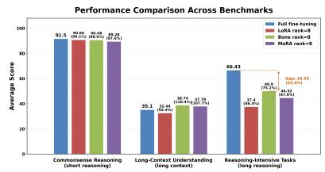  
(a) Performance comparison across evaluation regimes. PEFT methods exhibit a substantial gap from full finetuning only on reasoning-intensive tasks using Qwen2.5-32B-Instruct.

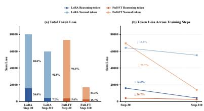  
(b) Comparison of token-level and total loss values between rank-256 LoRA and full fine-tuning on 16 identical sequences from reasoning-intensive tasks using Qwen2.5-32B-Instruct.  
Figure 1: Performance across evaluation regimes and token-level loss under PEFT and full finetuning. Detailed results are reported in Appendix Tables 16, 17, and 11.

Our contributions can be summarized as follows:

• We systematically investigate the limitations of PEFT on reasoning-intensive tasks and present three key observation, revealing that PEFT induces substantially smaller finetuning-induced weight changes, which is closely associated with its performance degradation.

• Motivated by these observations, we propose a novel PEFT method named NormTune, which reduces the gradients conflicts in earlier layers and reallocates optimization strength toward under-adapted layers. To the best of our knowledge, NormTune is the first approach that enables PEFT methods to achieve comparable performance relative to full fine-tuning on reasoning-intensive tasks.

• Extensive experiments demonstrate the effectiveness and generality of NormTune. Specifically, when trained on S1K-1.1, NormTune improves rank-8 LoRA, Bone, and MoRA by 24.24%, 11.33%, and 16.21% in average accuracy across AIME 2024, MATH 500, GPQA, and AIME 2025, respectively. Moreover, NormTune-enhanced rank-256 LoRA, Bone, and MoRA achieve performance comparable to S1 full fine-tuning, with respective average gains of 2.17%, 0.93%, and 3.00% over this baseline.

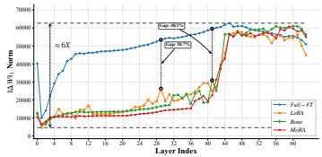  
(a) Visualization of entry-wise weight-update norms of full finetuning and PEFT methods

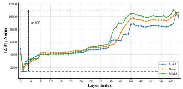  
(b) Visualization of weight-update norm of different PEFT methods after 30 steps training

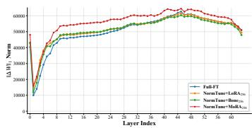  
(c) Visualization of entry-wise weight-update norms of full finetuning and NormTune-enhanced PEFT methods

Figure 2: Layer-wise norm comparison among Full-FT, rank-256 PEFT methods, early-stage PEFT statistics, and NormTune+PEFT methods.

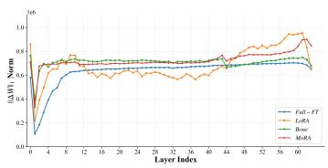  
(a) Commonsense reasoning task

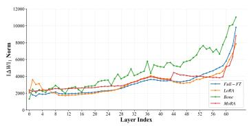  
(b) GovReport task

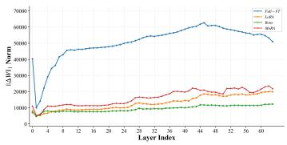  
(c) Reasoning-intensive task  
Figure 3: Layer-wise norm comparison between full fine-tuning (Full-FT) and rank-8 PEFT method on (a) commonsense reasoning, (b) GovReport, and (c) reasoning-intensive tasks.

## 2 METHODOLOGY

## 2.1 KEY OBSERVATIONS ON REASONING-INTENSIVE TASKS

Observation 1: PEFT methods exhibit a much larger loss contribution on reasoning tokens compared with Full-FT at earlier training. To investigate the accuracy gap between PEFT and Full-FT on reasoning-intensive tasks, we analyze how training loss is distributed across tokens and how it evolves during fine-tuning, motivated by prior work Lin et al. (2024b); Pang et al. (2025). Specifically, we sample 16 sequences from S1K-1.1 (Muennighoff et al., 2025) and evaluate tokenlevel cross-entropy losses on the same sequences at training step 30, immediately after warm-up, and step 310, at the end of training, using Qwen2.5-32B-Instruct. We inspect the high-loss tail using the empirical 99th percentile $( P _ { 9 9 } )$ )Sato et al. (2022) of token-level losses as a cutoff. Most tokens above this threshold correspond to transitions, self-verification expressions, templates, or reasoning boundaries such as “Alternatively” and “Wait”.. For this analysis, we refer to tokens serving these four roles as reasoning tokens, and to all remaining tokens as normal tokens. As shown in Figure 1b, PEFT methods exhibit a much larger loss contribution on reasoning tokens compared with Full-FT at earlier training. After training at step 310 , PEFT methods exhibit a smaller relative reduction in loss on normal tokens than on reasoning tokens, whereas Full-FT exhibits the opposite pattern. This indicates that PEFT disproportionately allocates its optimization capacity toward adapting reasoning token patterns, while providing insufficient adaptation for normal token representations compared with Full-FT.

Observation 2: The gradients induced by reasoning token and normal token losses exhibit substantial conflicts across most trainable parameters in earlier layers.

To understand how different token groups affect the optimization dynamics of PEFT methods, we decompose the training loss into reasoning token and normal token components. Let θ denote all trainable LoRA parameters. The total loss can be rewritten as

$$
\mathcal { L } _ { \mathrm { t o t a l } } ( \theta ) = \frac { 1 } { | \mathcal { Z } | } \left( \sum _ { ( i , t ) \in \mathcal { T } _ { \mathrm { r e a s o n i n g } } } \ell _ { i , t } ( \theta ) + \sum _ { ( i , t ) \in \mathcal { T } _ { \mathrm { n o r m a l } } } \ell _ { i , t } ( \theta ) \right) = \mathcal { L } _ { \mathrm { r e a s o n i n g } } ( \theta ) + \mathcal { L } _ { \mathrm { n o r m a l } } ( \theta ) ,\tag{1}
$$

where I denote total tokens, i is sequence and the t is prediction position. Because both loss terms are differentiable with respect to the LoRA parameters θ, taking the gradient of Eq. 1 yields $\nabla _ { \theta } \mathcal { L } _ { \mathrm { t o t a l } } = \nabla _ { \theta } \left( \mathcal { L } _ { \mathrm { s p e c i a l } } + \mathcal { L } _ { \mathrm { n o r m a l } } \right) = \nabla _ { \theta } \mathcal { L } _ { \mathrm { s p e c i a l } } + \nabla _ { \theta } \mathcal { L } _ { \mathrm { n o r m a l } }$ . Therefore, the update direction of LoRA parameters is determined by the combination of two independent optimization signals: the gradient induced by reasoning tokens and the gradient induced by normal tokens. We define their gradient alignment using cosine similarity. Specifically, for $\nabla _ { \boldsymbol { \theta } } \bar { \mathcal { L } } _ { \mathrm { s p e c i a l } }$ and $\nabla _ { \theta } \mathcal { L } _ { \mathrm { n o r m a l } }$ , the cosine similarity is defined as $\begin{array} { r } { \mathrm { C o s S i m } ( \nabla _ { \theta } \mathcal { L } _ { \mathrm { s p e c i a l } } , \nabla _ { \theta } \mathcal { L } _ { \mathrm { n o r m a l } } ) = \frac { \nabla _ { \theta } \mathcal { L } _ { \mathrm { s p e c i a l } } \nabla _ { \theta } \mathcal { L } _ { \mathrm { n o r m a l } } } { \| \nabla _ { \theta } \mathcal { L } _ { \mathrm { s p e c i a l } } \| _ { 2 } \| \nabla _ { \theta } \mathcal { L } _ { \mathrm { n o r m a l } } \| _ { 2 } } } \end{array}$ . We also measure their alignment with the overall optimization direction $\mathrm { C o s S i m } ( \nabla _ { \theta } \mathcal { L } _ { \mathrm { s p e c i a l } } , \nabla _ { \theta } \mathcal { L } _ { \mathrm { t o t a l } } )$ and CosSim $( \nabla _ { \theta } \mathcal { L } _ { \mathrm { n o r m a l } } , \nabla _ { \theta } \mathcal { L } _ { \mathrm { t o t a l } } )$ . As shown in Figure 4, the gradients induced by special-token and normal-token losses exhibit substantial conflicts across most trainable parameters in earlier layers. However, this behavior is reversed in deeper layers, where the two optimization signals become more compatible. Although earlier layers exhibit conflicts between the two token-group gradients, the total gradient remains positively aligned with the normal-token gradient. This indicates that the special-token gradient does not reverse the normal-token optimization direction, but reduces its effective update magnitude.

Observation 3: PEFT methods induce substantially smaller weight-update norms than full fine-tuning, especially in earlier layers.

Motivated by norm-based generalization theory Bartlett et al. (2017); Galanti et al. (2023); Nagarajan & Kolter (2019), which links network norm to model capacity and generalization, we analyze the magnitude of fine-tuning-induced weight changes as a proxy for layer-wise adaptation strength. Specifically, for module m in layer l, we define the parameter update under fine-tuning strategy τ as $\Delta W _ { l , m } ^ { \tau } = W _ { l , m } ^ { \tau } - W _ { l , m } ^ { 0 }$ , where $W _ { l , m } ^ { 0 }$ denotes the corresponding base-model weight and $W _ { l , m } ^ { \tau }$ denotes the fine-tuned weight. Here, $\tau \in \{ \mathrm { F u l l } , \mathrm { P E F T } \}$ , where Full represents full fine-tuning and $\mathrm { P E F T } \in \{ \mathrm { L o R A } , \mathrm { B o n e } , \bar { \mathrm { M o R A } } \}$ . To quantify the adaptation strength of each layer, we aggregate the entry-wise $L _ { 1 }$ norm of the effective weight updates over all target modules in that layer:

$$
{ \boldsymbol { U } } _ { l } ^ { \tau } = \sum _ { m \in \mathcal { M } _ { l } } \left\| \Delta W _ { l , m } ^ { \tau } \right\| _ { 1 , 1 } , w h e r e \left\| \Delta W _ { l , m } ^ { \tau } \right\| _ { 1 , 1 } = \sum _ { i , j } \left| \Delta W _ { l , m , i j } ^ { \tau } \right| .\tag{2}
$$

Here, $\mathcal { M } _ { l }$ denotes the set of target modules in layer l, including the attention projections $\{ Q , K , V , O \}$ and the MLP projections {Gate, Up, Down}. In addition, the LoRA scaling factor $s = \alpha / r = 2$ , which is already incorporated in this function. Based on this metric, Figure 2a shows that PEFT methods with rank 256 induce substantially smaller weight-update norms than full fine-tuning, with the gap being particularly pronounced in earlier layers. This indicates that PEFT provides much weaker effective adaptation in these layers. Furthermore, we visualize the layerwise weight-update norms of rank-8 PEFT methods on other tasks, as shown in Figure 3. Unlike reasoning-intensive tasks, these benchmarks do not exhibit significant under-adaptation in earlier layers, suggesting that the insufficient layer adaptation observed in PEFT is particularly associated with reasoning-intensive fine-tuning.

## 2.2 NORMTUNE

Overall, the three observations suggest that improving PEFT on reasoning-intensive tasks requires stronger adaptation for normal tokens, particularly in earlier layers. Observation 1 reveals an imbalance in token-level loss reduction, suggesting insufficient adaptation for normal tokens relative to Full-FT. Observation 2 provides a explanation: although reasoning-token and normal-token gradients conflict in earlier layers, the total gradient remains positively aligned with the normal-token gradient. This interference therefore attenuates the gradient component along the normal-token direction while preserving its positive alignment. This pattern is consistent with Observation 3, which shows substantially smaller weight-update norms in these layers under PEFT. These findings motivate increasing the learning rates of under-adapted layers to compensate for attenuated updates. Specially, for fixed parameters, gradients, and optimizer state, increasing a layer’s learning rate scales the magnitude of its parameter update without changing its direction.

Motivated by these observations, we propose Norm-Guided Parameter-Efficient Fine-Tuning (NormTune), which assigns larger learning rates to weakly updated layers based on their weightupdate norms, thereby improving the adaptation of under-trained layers. In general, $U _ { l } ^ { \mathrm { F u l l } }$ , i.e., the layer-wise weight-update norm obtained from full fine-tuning, can serve as an ideal reference scale for calibrating PEFT learning, encouraging $U _ { l } ^ { \mathrm { P E F T } }$ to align with the adaptation magnitude of

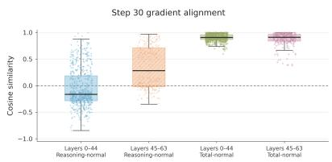

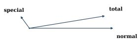  
(b) Layer 4 MLP down (A)

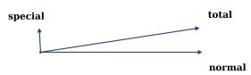  
(c) Layer 41 attention Q (B)

(a) Gradient alignment across early and late layers, measured by CosSim $( \nabla _ { \theta } \mathcal { L } _ { \mathrm { r e a s o n i n g } } , \nabla _ { \theta } \mathcal { L } _ { \mathrm { n o r m a l } } )$ and CosSim(∇θLtotal, ∇θLnormal). The corresponding Full-FT results are provided in Figure 7.  
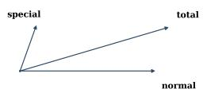  
(d) Layer 53 attention V (A)

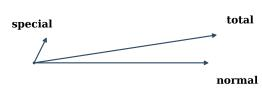  
(e) Layer 57 MLP gate (B)

Figure 4: Gradient alignment analysis between token groups and layer-wise optimization directions. The left panel shows the cosine similarity between different gradients. The right panels visualize representative gradient directions and the L1 norms of the gradients for different LoRA parameters (LoRA A and B) across early and late layers after 30 training steps.

full fine-tuning. However, obtaining $U _ { l } ^ { \mathrm { F u l l } }$ requires performing full fine-tuning, which is impractical due to its substantial training time and computational cost. Here,we first examine whether the layer-wise norm statistics from PEFT can serve as a practical alternative. Empirically, we observe that after a complete PEFT run, the maximum-to-minimum ratio of layer-wise update norms, max $\phantom { } _ { l } U _ { l } ^ { \mathrm { P E F T } } / \operatorname* { m i n } _ { l } \bar { U } _ { l } ^ { \mathrm { P E F T } }$ , is close to that of full fine-tuning, with both ratios being approximately $6 \times$ . This indicates that although PEFT produces much smaller absolute update norms, it still captures a similar relative range of layer-wise adaptation magnitudes.

Nevertheless, obtaining $U _ { l } ^ { \mathrm { P E F T } }$ from a completed PEFT run remains costly. We therefore introduce a lightweight probing procedure that performs only 30 PEFT training steps. As shown in Figure 2b, the early-stage update norms $U _ { l } ^ { \mathrm { P E F T } , s }$ already exhibit a comparable maximum-to-minimum ratio of approximately $6 \times$ . Based on this observation, we adopt this early-stage statistic as an efficient proxy for estimating the desired layer-wise adaptation range. Directly assigning a distinct learning rate to each layer may be sensitive to local fluctuations in $\breve { U } _ { l } ^ { \mathrm { P E F T } , s }$ . We therefore group layers into n buckets according to their update magnitudes inspired by Zhang et al. (2025). Let $U _ { \mathrm { m i n } } ^ { \mathrm { P E F T } , s } =$ minl $U _ { l } ^ { \mathrm { P E F T } , s } , U _ { \mathrm { m a x } } ^ { \mathrm { P E F T } , s } = \bar { \operatorname * { m a x } _ { l } } U _ { l } ^ { \mathrm { P E F T } , s }$ . The range $[ U _ { \operatorname* { m i n } } ^ { \mathrm { P E F T } , s } , U _ { \operatorname* { m a x } } ^ { \mathrm { P E F T } , s } ]$ is uniformly divided into n buckets. For the k-th bucket, we denote by $\bar { U } _ { k } ^ { \mathrm { P E F T } , \bar { s } }$ the mean update magnitude of the layers inside this bucket. Following the standard min-max normalization used in data preprocessing, which rescales numerical values into a fixed range while preserving their relative order Mining (2006), we normalize $\bar { U } _ { k } ^ { \mathrm { P E F T } , s }$ as

$$
q _ { k } = \frac { \bar { U } _ { k } ^ { \mathrm { P E F T } , s } - \bar { U } _ { m i n } ^ { \mathrm { P E F T } , s } } { \bar { U } _ { m a x } ^ { \mathrm { P E F T } , s } - \bar { U } _ { m i n } ^ { \mathrm { P E F T } , s } } , \qquad q _ { k } \in [ 0 , 1 ] .\tag{3}
$$

Here, $q _ { k }$ measures the relative adaptation sufficiency of bucket k. We define the bucket-wise learning rate by mapping $q _ { k }$ to the interval $[ \eta _ { \mathrm { m i n } } , \eta _ { \mathrm { m a x } } ]$

$$
\eta _ { k } = \eta _ { \mathrm { m i n } } + ( \eta _ { \mathrm { m a x } } - \eta _ { \mathrm { m i n } } ) h ( q _ { k } ) ,\tag{4}
$$

where $\eta _ { \mathrm { m i n } }$ denotes the base learning rate, $\eta _ { \mathrm { m a x } } > \eta _ { \mathrm { m i n } }$ . The function h should satisfy three simple requirements. First, the weakest adapted bucket should receive the largest learning rate, and the strongest adapted bucket should receive the smallest learning rate: $\iota ( 0 ) \doteq 1 , h ( 1 ) = \mathsf { \bar { 0 } }$ . Second, the learning rate should decrease as the adaptation magnitude increases, so $h ( q )$ should be monotonic non-increasing on [0, 1]. Third, buckets near $q = 0$ should remain close to the maximum learning rate, because they all correspond to insufficiently adapted layers. We encode this weak-adaptation smoothing condition as $h ^ { \prime } ( 0 ) = 0$ . To keep the rule simple, we choose the lowest-degree polynomial satisfying these constraints. Let $h ( q ) = \bar { a } + b q + c q ^ { 2 }$ . Given $h ( 0 ) = 1 , h ^ { \prime } ( 0 ) = 0 $ , and $h ( 1 ) = 0$ the solution of $h ( q )$ is:

$$
h ( q ) = 1 - q ^ { 2 } .\tag{5}
$$

Substituting Eq. 5 into Eq. 4, we obtain the final bucket-wise learning rate:

$$
\eta _ { k } = \eta _ { \mathrm { m i n } } + \left( \eta _ { \mathrm { m a x } } - \eta _ { \mathrm { m i n } } \right) \left( 1 - q _ { k } ^ { 2 } \right) .\tag{6}
$$

All layers in the same bucket share the same learning rate:

$$
\eta _ { l } = \eta _ { k } , \qquad \mathrm { i f ~ l a y e r } l \mathrm { b e l o n g s ~ t o ~ b u c k e t } k .\tag{7}
$$

As shown in Figure 2c, our method consistently increases the update norms of insufficiently adapted layers, aligning them more closely with full fine-tuning and improving model performance.

## 3 EXPERIMENTAL RESULTS

Datasets. For training, we use the S1K-1.1 dataset Muennighoff et al. (2025), the Z1-Code-Reasoning107K dataset Yu et al. (2025b), the Data-repetition dataset Kopiczko et al. (2026), the GovReport dataset for long-context understandingHuang et al. (2021), and the Commonsense Reasoning dataset for short reasoning. We further evaluate different models on several challenging tasks. The reasoning-intensive tasks consist of AIME 2024 Art of Problem Solving (2024), MATH 500 Hendrycks et al. (2021), GPQA Rein et al. (2024), and AIME 2025 Art of Problem Solving (2025). The code-scientific reasoning tasks consist of MATH 500, GPQA, LiveCodeBench Jain et al. (2024), and BigCodeBench-Hard Zhuo et al. (2024).

Compared Methods. The baseline methods are broadly divided into two categories: reinforcement learning (RL) and supervised fine-tuning (SFT). In the RL category, we compare against OpenAI o1 OpenAI (2024), o3 OpenAI (2025), DeepSeek-R1 Guo et al. (2025b), and QwQ-32B Qwen Team (2025). In the SFT category, we compare against S1(Full-FT) Muennighoff et al. (2025), Z1- 7B(Full-FT) Yu et al. (2025b), Qwen3-4B(Full-FT) Kopiczko et al. (2026) and OLMo-3-7B(Full-FT) Kopiczko et al. (2026). In addition, we compare against several representative PEFT methods, including DoRA Liu et al. (2024), AdaLoRA Zhang et al. (2023), LoRA+ Hayou et al. (2024), rsLoRA Kalajdzievski (2023), LoRA Hu et al. (2021), BoneKang (2024) and MoRAJiang et al. (2024). We further incorporate TempBalance Zhou et al. (2023) into the PEFT baselines for comparison.

Evaluation Metrics. For the S1K-1.1 and Z1-Code-Reasoning107K settings, we evaluate each locally evaluated checkpoint using greedy decoding with temperature T = 0, generating one completion per problem in each evaluation run. We repeat evaluation on the same checkpoint and the same benchmark questions for R = 4 runs on MATH 500 and GPQA, and R = 16 runs on AIME 2024, AIME 2025, LiveCodeBench, and BigCodeBench-Hard, where applicable. Tables 1 and 2 report the mean accuracy across these evaluation runs. These repetitions are evaluation runs of a fixed checkpoint, rather than independent training runs or stochastic decoding samples. The Avg. column is the unweighted mean of the four benchmark accuracies. For Qwen3-4B and OLMo-3-7B, we retain the sampling-based Avg@k and Pass@k metrics under the decoding configurations specified in Table 22. Results taken from prior publications retain their original evaluation protocols and are explicitly distinguished from locally evaluated results. Details of the uncertainty estimation are provided in Table 22. For the environment and settings also provided in Appendix A.3.

## 3.1 MAIN COMPARISON RESULTS

In this section, we present the main comparison results by applying NormTune to representative PEFT methods, including LoRA, Bone, and MoRA, and evaluating their effectiveness for test-time scaling. As shown in Table 1, rank-8 PEFT methods underperform on reasoning-intensive tasks. Incorporating NormTune substantially improves their performance, yielding average gains of 24.24%, 11.33%, and 16.21% for LoRA, Bone, and MoRA, respectively. Rank-8 NormTune-enhanced PEFT surpasses 90% of full fine-tuning performance and consistently outperform AdaLoRA, LoRA+, rsLoRA, DoRA and TempBalance+PEFT under the same rank-8 setting. When increasing the rank to 256, NormTune still brings consistent improvements to PEFT methods, with average gains of 13.44%, 10.46%, and 9.77% for LoRA, Bone, and MoRA, respectively. Notably, all three NormTune-enhanced variants surpass S1 (Full-FT) by 2.17%, 0.93%, and 3.00%, respectively. Beyond supervised fine-tuning, we further compare NormTune with state-of-the-art reinforcement learning-based reasoning models. Using the same Qwen2.5-32B-Instruct backbone, all NormTuneenhanced variants outperform T1 (Qwen2.5-32B), and NormTune+MoRA further surpasses SSFT-32B-GFPO by 0.58%. These results show that NormTune substantially improves model performance with lower resource consumption.

Table 1: Accuracy (%) of different test-time scaling methods on reasoning-intensive tasks with Qwen2.5-32B-Instruct. ∗ denotes results reported in Muennighoff et al. (2025). The results of T1 (Qwen2.5-32B) and SSFT-32B-GFPO are sourced from Hou et al. (2025) and Jia et al. (2025).
<table><tr><td>DATASET</td><td>METHOD</td><td>RANK</td><td>AIME 2024 AVG@16</td><td>MATH 500 AVG@4</td><td>GPQA AVG@4</td><td>AIME 2025 AVG@16</td><td>AVG.</td></tr><tr><td></td><td>03-MINI-LOW*</td><td></td><td>56.3</td><td>95.8</td><td>70.6</td><td>42.1</td><td>66.2</td></tr><tr><td></td><td>QwQ-32B*</td><td></td><td>46.7</td><td>90.6</td><td>54.5</td><td>32.7</td><td>56.13</td></tr><tr><td></td><td>T1 (QWEN2.5-32B)</td><td></td><td>50.6</td><td>92.4</td><td>56.1</td><td></td><td></td></tr><tr><td>R1*</td><td>SSFT-32B-GFPO</td><td></td><td>64.22</td><td>89.90</td><td>62.48</td><td>58.80</td><td>68.85</td></tr><tr><td></td><td></td><td></td><td>79.8</td><td>97.3</td><td>71.5</td><td>70.0</td><td>79.65</td></tr><tr><td></td><td>S1 (FULL-FT)*</td><td></td><td>56.7</td><td>95.4</td><td>63.6</td><td>50</td><td>66.43</td></tr><tr><td></td><td>R1-DISTILL-LLAMA-70B* R1-DISTILL-QWEN-14B*</td><td></td><td>57.1</td><td>94.5</td><td>65.2</td><td>56.3</td><td>68.28</td></tr><tr><td></td><td>R1-DISTILL-QWEN-32B*</td><td></td><td>61.7</td><td>93.9</td><td>59.1</td><td>48.0</td><td>65.68</td></tr><tr><td></td><td>ADALORA</td><td>8</td><td>58.3</td><td>94.3</td><td>62.1</td><td>49.6</td><td>66.08</td></tr><tr><td></td><td>DoRA</td><td>8</td><td>6.67 26.67</td><td>67.4</td><td>27.27</td><td>6.67</td><td>27.00</td></tr><tr><td></td><td>RSLORA</td><td>8</td><td></td><td>78.8</td><td>47.98</td><td>6.67</td><td>40.03</td></tr><tr><td></td><td>LoRA+</td><td></td><td>16.67</td><td>74.6</td><td>50.51</td><td>0</td><td>35.45</td></tr><tr><td></td><td>LoRA</td><td>8</td><td>33.33</td><td>88.8</td><td>51.52</td><td>33.33</td><td>51.75</td></tr><tr><td></td><td></td><td>8</td><td>10</td><td>78.8</td><td>47.47</td><td>13.33</td><td>37.4</td></tr><tr><td></td><td>TEMPBALANCE + LORA</td><td>8</td><td>20</td><td>80.4</td><td>51.01</td><td>13.33</td><td>41.19</td></tr><tr><td>BONE</td><td>NORMTUNE+LORA(OURS)</td><td>8</td><td>53.33</td><td>92.6</td><td>60.61</td><td>40</td><td>61.64</td></tr><tr><td>S1K-1.1</td><td></td><td>8</td><td>26.67</td><td>80.4</td><td>52.53</td><td>40</td><td>49.9</td></tr><tr><td></td><td>TEMPBALANCE + BONE</td><td>8</td><td>36.67</td><td>89.4</td><td>55.05</td><td>40</td><td>55.28</td></tr><tr><td></td><td>NORMTUNE+ BONE (OURS)</td><td>8</td><td>50</td><td>92.8</td><td>62.12</td><td>40</td><td>61.23</td></tr><tr><td>MoRA</td><td></td><td>8</td><td>26.67</td><td>80.4</td><td>51.01</td><td>20</td><td>44.52</td></tr><tr><td></td><td>TEMPBALANCE + MORA</td><td>8</td><td>23.33</td><td>89.2</td><td>51.01</td><td>26.67</td><td>47.55</td></tr><tr><td></td><td>NORMTUNE+MORA (OURS)</td><td>8</td><td>40</td><td>91.6</td><td>64.65</td><td>46.67</td><td>60.73</td></tr><tr><td></td><td>ADALORA</td><td>256</td><td>13.33</td><td>67.4</td><td>37.37</td><td>6.67</td><td>31.19</td></tr><tr><td>DoRA</td><td></td><td>256</td><td>23.33</td><td>88.6</td><td>53.03</td><td>33.33</td><td>49.57</td></tr><tr><td></td><td>RSLORA</td><td>256</td><td>43.3</td><td>90.2</td><td>60.1</td><td>33.3</td><td>56.73</td></tr><tr><td></td><td>LoRA+</td><td>256</td><td>50</td><td>90.6</td><td>58.59</td><td>33.33</td><td>58.13</td></tr><tr><td>LoRA</td><td></td><td>256</td><td>36.67</td><td>92.6</td><td>58.08</td><td>33.33</td><td>55.16</td></tr><tr><td></td><td>TEMPBALANCE + LORA</td><td>256</td><td>40</td><td>90.2</td><td>54.4</td><td>40</td><td>56.15</td></tr><tr><td></td><td>NORMTUNE+LORA (OURS)</td><td>256</td><td>63.33</td><td>93.6</td><td>64.14</td><td>53.33</td><td>68.6</td></tr><tr><td>BONE</td><td></td><td>256</td><td>43.33</td><td>93.4</td><td>57.58</td><td>33.3</td><td>56.90</td></tr><tr><td></td><td>TEMPBALANCE + BONE</td><td>256</td><td>50</td><td>90.8</td><td>60.61</td><td>40</td><td>60.35</td></tr><tr><td></td><td>NORMTUNE+BONE (OURS)</td><td>256</td><td>56.67</td><td>94.8</td><td>64.65</td><td>53.33</td><td>67.36</td></tr><tr><td>MoRA</td><td></td><td>256</td><td>50</td><td>93.2</td><td>62.12</td><td>33.3</td><td>59.66</td></tr><tr><td></td><td>TEMPBALANCE + MORA</td><td>256</td><td>56.67</td><td>93.2</td><td>62.63</td><td>33.33</td><td>61.46</td></tr><tr><td></td><td>NORMTUNE+MORA (OURS)</td><td>256</td><td>60</td><td>94.6</td><td>63.13</td><td>60</td><td>69.43</td></tr></table>

Table 2: Accuracy (%) of different test-time scaling methods on code-scientific reasoning tasks with Z1. ∗ denotes results reported in Yu et al. (2025b).
<table><tr><td>DATASET</td><td>METHOD</td><td>RANK</td><td>MATH 500 AVG@4</td><td>GPQA AVG@4</td><td>LIVECODEBENCH AVG@16</td><td>BIGCODEBENCH-HARD AVG@16</td><td>AVG.</td></tr><tr><td rowspan="10"></td><td>01-PREVIEW*</td><td></td><td>85.5</td><td>73.3</td><td>43.2</td><td>23.0</td><td>56.3</td></tr><tr><td>01-MINI*</td><td></td><td>90.0</td><td>60.0</td><td>53.7</td><td>27.7</td><td>57.9</td></tr><tr><td>DEEPSEEK-R1*</td><td></td><td>97.3</td><td>71.5</td><td>77.9</td><td>29.7</td><td>67.6</td></tr><tr><td>QWQ-32B-PREVIEW*</td><td></td><td>90.6</td><td>60.0</td><td>59.9</td><td>25.0</td><td>58.9</td></tr><tr><td>DEEPSEEK-V3*</td><td></td><td>90.2</td><td>59.1</td><td>56.3</td><td>27.7</td><td>58.3</td></tr><tr><td>GPT-40-0513*</td><td></td><td>75.8</td><td>46.5</td><td>43.4</td><td>25.0</td><td>47.7</td></tr><tr><td>Z1-7B (FULL-FT)*</td><td></td><td>76.4</td><td>47.5</td><td>35.3</td><td>22.3</td><td>45.4</td></tr><tr><td>R1-DISTILL-QWEN-7B*</td><td></td><td>83.3</td><td>49.1</td><td>40.5</td><td>3.4</td><td>44.1</td></tr><tr><td>S1.1-7B*</td><td></td><td>79.2</td><td>31.8</td><td>15.2</td><td>4.7</td><td>31.7</td></tr><tr><td>OPENTHINKER-7B*</td><td></td><td>83.0</td><td>42.4</td><td>25.3</td><td>17.6</td><td>42.1</td></tr><tr><td></td><td>ADALORA</td><td></td><td></td><td></td><td>29.4</td><td>12.8</td><td>41.4</td></tr><tr><td></td><td>DoRA</td><td>256 256</td><td>72 73.2</td><td>51.5 49.5</td><td>30.2</td><td>18.2</td><td>42.8</td></tr><tr><td></td><td>RSLORA</td><td>256</td><td>72.4</td><td>46.5</td><td>29.7</td><td>13.5</td><td>40.5</td></tr><tr><td></td><td>LoRA+</td><td>256</td><td>72</td><td>49.5</td><td>30.9</td><td>17.6</td><td>42.5</td></tr><tr><td>ZIE-R007</td><td>LoRA</td><td>256</td><td>73.4</td><td>50</td><td>30.3</td><td>10.8</td><td>41.1</td></tr><tr><td></td><td>TEMPBALANCE + LORA</td><td>256</td><td>72.4</td><td>53.5</td><td>32.3</td><td>16.2</td><td>43.6</td></tr><tr><td></td><td>NORMTUNE+LORA(OURS)</td><td>256</td><td>75.2</td><td>50</td><td>36.3</td><td>22.3</td><td>46.0</td></tr><tr><td></td><td>BONE</td><td>256</td><td>75.4</td><td>46.5</td><td>32.3</td><td>17.6</td><td>43.0</td></tr><tr><td></td><td>TEMPBALANCE + BONE</td><td>256</td><td>75.2</td><td>49.5</td><td>33.5</td><td>16.9</td><td>43.8</td></tr><tr><td></td><td>NORMTUNE+BONE (OURS)</td><td>256</td><td>76.8</td><td>47.5</td><td>34.2</td><td>22.7</td><td>45.3</td></tr><tr><td></td><td>MoRA</td><td>256</td><td>71.6</td><td>44.4</td><td>30.9</td><td>17.6</td><td>41.1</td></tr><tr><td></td><td>TEMPBALANCE + MORA</td><td>256</td><td>76.6</td><td>46</td><td>32.6</td><td>18.2</td><td>43.4</td></tr><tr><td></td><td>NORMTUNE+MORA(OURS)</td><td>256</td><td>76.6</td><td>50</td><td>35.4</td><td>19.6</td><td>45.4</td></tr></table>

For Z1-7B based one Qwen-2.5-Coder-7B-Instruct, we further evaluate code-related reasoning performance, as shown in Table 2. Under supervised fine-tuning with a similar model size, Norm-

Table 3: Performance of Full-FT, PEFT, and NormTune-enhanced PEFT methods on OLMo-3-7B across GPQA, AIME’24, and AIME’25. ∗ denotes results reported in Kopiczko et al. (2026).
<table><tr><td rowspan="2">Model</td><td rowspan="2">Method</td><td colspan="2">GPQA</td><td colspan="2">AIME&#x27;24</td><td colspan="2">AIME&#x27;25</td><td rowspan="2">Average</td></tr><tr><td>Avg@4</td><td>Pass@4</td><td>Avg@16</td><td>Pass@16</td><td>Avg@16</td><td>Pass@16</td></tr><tr><td rowspan="13">O--7B</td><td>Full-FT*</td><td>34.0</td><td>62.1</td><td>42.3</td><td>80.0</td><td>39.2</td><td>63.3</td><td>53.5</td></tr><tr><td>AdaLoRA</td><td>42.6</td><td>66.2</td><td>22.1</td><td>43.3</td><td>22.7</td><td>50</td><td>41.2</td></tr><tr><td>DoRA</td><td>30.6</td><td>57.5</td><td>33.3</td><td>73.3</td><td>30.8</td><td>56.7</td><td>47.0</td></tr><tr><td>RSLoRA</td><td>42.6</td><td>70.2</td><td>22.7</td><td>56.6</td><td>21.7</td><td>53.3</td><td>44.5</td></tr><tr><td>LoRA+</td><td>40.9</td><td>65.2</td><td>21.3</td><td>53.3</td><td>16.5</td><td>46.7</td><td>40.7</td></tr><tr><td>LoRA(256)</td><td>31.9</td><td>62.1</td><td>26.7</td><td>63.3</td><td>24</td><td>43.3</td><td>41.9</td></tr><tr><td>TempBalance + LoRA</td><td>40.9</td><td>65.2</td><td>21.3</td><td>53.3</td><td>20.2</td><td>56.7</td><td>42.9</td></tr><tr><td>NormTune+LoRA(256)</td><td>38.8</td><td>69.2</td><td>42.3</td><td>80</td><td>35.4</td><td>60</td><td>54.3</td></tr><tr><td>Bone(256)</td><td>35.9</td><td>63.6</td><td>33.3</td><td>73.3</td><td>31</td><td>56.7</td><td>49.0</td></tr><tr><td>TempBalance + Bone</td><td>30.6</td><td>57.5</td><td>35.4</td><td>66.7</td><td>38.5</td><td>67.2</td><td>49.3</td></tr><tr><td>NormTune+Bone(256)</td><td>38.1</td><td>60</td><td>45.2</td><td>76.7</td><td>37.1</td><td>64.6</td><td>53.6</td></tr><tr><td>MoRA(256)</td><td>37.6</td><td>65.7</td><td>37.5</td><td>76.7</td><td>29.4</td><td>50</td><td>49.5</td></tr><tr><td>TempBalance + MoRA</td><td>32.7</td><td>60</td><td>42.3</td><td>76.7</td><td>35.8</td><td>63.3</td><td>51.8</td></tr><tr><td>NormTune+MoRA(256)</td><td>39.9</td><td>68.7</td><td>41</td><td>76.7</td><td>35.8</td><td>63.3</td><td>54.2</td></tr></table>

Table 4: Accuracy (%) of PEFT methods under various adjustment styles and ranks on S1.
<table><tr><td colspan="3">ADJUST.</td><td colspan="3"></td></tr><tr><td>METHOD</td><td>STYLE</td><td>RANK</td><td></td><td>Avg.</td></tr><tr><td>Full-FT Full-FT</td><td>Stage</td><td>- -</td><td></td><td>66.43 46.43</td></tr><tr><td></td><td></td><td></td><td></td><td></td></tr><tr><td>LoRA</td><td></td><td>256 256</td><td></td><td>55.16 60.76</td></tr><tr><td>LoRA</td><td>Linear</td><td>256</td><td></td><td>63.2</td></tr><tr><td>LoRA</td><td>Stage</td><td>256</td><td></td><td>62.79</td></tr><tr><td>LoRA</td><td>Exponential</td><td>256</td><td></td><td>68.6</td></tr><tr><td>LoRA</td><td>NormTune</td><td>256</td><td></td><td></td></tr><tr><td>Bone</td><td></td><td></td><td></td><td>56.90</td></tr><tr><td>Bone</td><td>Linear</td><td>256</td><td></td><td>59.79</td></tr><tr><td>Bone</td><td>Stage</td><td>256</td><td></td><td>63.28</td></tr><tr><td>Bone</td><td>Exponential</td><td>256</td><td></td><td>60.17</td></tr><tr><td>Bone</td><td>NormTune</td><td>256</td><td></td><td>67.36</td></tr><tr><td>MoRA</td><td></td><td>256</td><td></td><td>59.66</td></tr><tr><td>MoRA</td><td>Linear</td><td>256</td><td></td><td>61.79</td></tr><tr><td>MoRA</td><td>Stage</td><td>256</td><td></td><td>60.78</td></tr><tr><td>MoRA</td><td>Exponential</td><td>256</td><td></td><td>63.03</td></tr><tr><td>MoRA</td><td>NormTune</td><td>256</td><td></td><td>69.43</td></tr></table>

Table 5: Accuracy (%) of full fine-tuning and rank-256 PEFT methods under two learningrate settings on reasoning-intensive tasks. See Table 9 for detailed results.
<table><tr><td colspan="3">Method Learning rate Rank Avg.</td></tr><tr><td>S1 (Full-FT)</td><td>1e-5</td><td>66.43</td></tr><tr><td>S1 (Full-FT)</td><td>1e-4</td><td>4.9</td></tr><tr><td>LoRA</td><td>1e-5</td><td>25655.16</td></tr><tr><td>LoRA</td><td>1e-4 256</td><td>49.7</td></tr><tr><td>Bone</td><td>1e-5</td><td>25656.90</td></tr><tr><td>Bone</td><td>1e-4</td><td>25655.65</td></tr><tr><td>MoRA</td><td>1e-5</td><td>25659.66</td></tr><tr><td>MoRA</td><td>1e-4</td><td>25649.47</td></tr></table>

Tune+LoRA, NormTune+Bone, and NormTune+MoRA all achieve performance comparable to the state-of-the-art full fine-tuning baseline Z1-7B (Full-FT). Notably, NormTune+LoRA further surpasses Z1-7B by over 0.6%. For RL-based training, NormTune+LoRA also achieves a performance level comparable to GPT-4o-0513, with an average score of 46.0 versus 47.7. This demonstrates the effectiveness of NormTune across various testing datasets.

For OLMo-3-7B, as shown in Table 3, all NormTune-enhanced methods, including Norm-Tune+LoRA, NormTune+Bone, and NormTune+MoRA, outperform Full-FT. These results show that NormTune remains effective even for smaller models. Qwen3-4B experiments are presented in the Appendix in Table 7.

Across scales from 4B to 32B and across mathematical reasoning, code reasoning, and scientific question-answering benchmarks, NormTune consistently improves different PEFT methods. This demonstrates that NormTune is a general and scalable solution for improving test-time scaling with strong performance.

## 3.2 ABLATION STUDY

Learning Rate. We fine-tune Qwen2.5-32B-Instruct on the S1K-1.1 reasoning dataset with dif ferent rank-256 PEFT methods under two learning-rate settings. As shown in Table 5, increasing the learning rate from $1 \times 1 0 ^ { - 5 } \mathrm { t o } 1 \times 1 0 ^ { - 4 }$ consistently hurts performance: the average accuracy decreases from 55.16% to 49.70% for LoRA, from 56.90% to 55.65% for Bone, and from 59.66% to 49.47% for MoRA. Full fine-tuning also collapses under the larger learning rate, with the average score dropping from 66.43% to 4.90%. These results suggest that performance gains cannot be ob tained by uniformly increasing the learning rate, motivating NormTune to adaptively allocate larger update scales only to under-adapted layers.

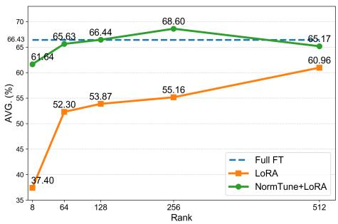  
(a) Average performance across reasoning-intensive tasks under different rank settings.

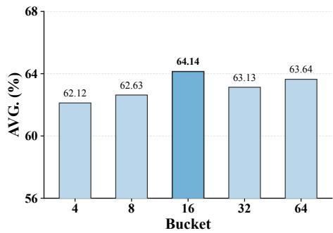  
(b) Effect of the NormTune bucket number n on GPQA.  
Figure 5: Results after training on S1K-1.1.

Rank Sensitivity. As shown in Figure 5a, increasing the rank generally improves both LoRA and NormTune+LoRA, while NormTune+LoRA consistently outperforms LoRA across all ranks. The gains are particularly pronounced in low-rank regimes: at rank 8, NormTune+LoRA improves the average score from 37.40% to 61.64%. NormTune+LoRA achieves its best average performance at rank 256, reaching 68.6% and slightly exceeding the Full-FT baseline of 66.43%. Further increasing the rank to 512 reduces the score to 65.17%, indicating that larger ranks do not necessarily yield better reasoning-intensive performance. These results show that NormTune effectively improves LoRA across different rank budgets, especially when the adaptation capacity is highly constrained.

Adjustment Style. Based on the norm distribution of PEFT methods on reasoning-intensive tasks, and inspired by Howard & Ruder (2018), we further propose three naive layer-wise learning-rate adjustment strategies. The first one uses a linear decay across layers: $\begin{array} { r } { \eta _ { i } = \eta _ { \mathrm { m a x } } + \left( \eta _ { \mathrm { m i n } } - \eta _ { \mathrm { m a x } } \right) \cdot \frac { i } { N - 1 } , } \end{array}$ where i is the layer index and N is the total number of layers. The second strategy, termed stage decay, assigns $\eta _ { \mathrm { m a x } }$ to layers below layer 45 and $\eta _ { \mathrm { m i n } }$ to layer 45 and above, since the former exhibit under-adaptation in layer-wise norms, as shown in Figure 2a. The last one, we further evaluate

exponential-decay strategy, e inormi . As shown in Table 4, both linear, stage and exponentialdecay strategies improve the performance of all PEFT methods over their original versions. However, their gains are consistently smaller than those achieved by NormTune. For example, NormTune improves the average scores to 68.6%, 67.36%, and 69.43% for LoRA, Bone, and MoRA, respectively, outperforming both linear, stage and exponential-decay strategies. See Table 10 for detailed results. These results indicate that simply imposing a predefined learning-rate decay is beneficial, but the adaptive design of NormTune is more effective for reasoning-intensive adaptation. Moreover, full fine-tuning generally provides sufficient adaptation across layers, making it less suitable for our stage decay strategy.

## 3.3 HYPERPARAMETER SENSITIVITY ANALYSIS

We analyze the sensitivity of NormTune to the bucket number n, which determines the granularity of layer-wise learning-rate allocation. As shown in Figure 5b, NormTune is robust to a wide range of n. Across $n \in \{ \hat { 4 } , 8 , 1 6 , 3 2 , 6 4 \}$ , the GPQA accuracy only changes from 62.12% to 64.14%, showing limited sensitivity to this hyperparameter. The best result is obtained at $n = 1 6$ , where NormTune achieves 64.14%. This indicates that a moderate bucket number provides sufficient layerwise differentiation without introducing unnecessary fragmentation.

## 4 CONCLUSION

In this work, we studied parameter-efficient fine-tuning for reasoning-intensive tasks with test-time scaling. Through three key observations, we propose Norm-Guided Parameter-Efficient Fine-Tuning (NormTune), which adaptively enhances under-trained layers and thereby substantially improves performance on reasoning-intensive tasks. Extensive experiments on three benchmarks demonstrate that NormTune consistently improves different PEFT methods and can achieve performance comparable to full fine-tuning with substantially lower resource consumption.

## AI USE STATEMENT

Generative AI was used solely to assist with the organization and formatting of early manuscript drafts. It was not used for method conception, experimental implementation, or the substantive writing of the paper.

## ETHICS STATEMENT

This work investigates Norm-Guided Parameter-Efficient Fine-Tuning for reasoning-intensive tasks. We do not involve human subjects or introduce new datasets. The primary foreseeable impact is improved performance of PEFT methods on reasoning-intensive tasks.

## REPRODUCIBILITY STATEMENT

An anonymized supplementary package will include the exact coordinate, calibration, reconstruction, and terminal-evaluation configurations; fixed data splits and random seeds; per-cell manifests; and fresh-process evaluation scripts.

## REFERENCES

Armen Aghajanyan, Sonal Gupta, and Luke Zettlemoyer. Intrinsic dimensionality explains the effectiveness of language model fine-tuning. In Proceedings of the 59th annual meeting of the association for computational linguistics and the 11th international joint conference on natural language processing (volume 1: long papers), pp. 7319–7328, 2021.

Chenxin An, Zhihui Xie, Xiaonan Li, Ming Zhong, Shansan Gong, Lei Li, Jun Zhang, Jingjing Xu, and Lingpeng Kong. Long chain-of-thought fine-tuning via understanding-to-reasoning transition. In Proceedings of the 2025 Conference on Empirical Methods in Natural Language Processing, pp. 34506–34522, 2025.

Art of Problem Solving. 2024 american invitational mathematics examination (aime) problems and solutions. https://artofproblemsolving.com/wiki/index.php/AIME\_ Problems\_and\_Solutions, 2024. Includes AIME I and AIME II for 2024.

Art of Problem Solving. 2025 american invitational mathematics examination (aime) problems and solutions. https://artofproblemsolving.com/wiki/index.php/2025\_AIME\_ I, 2025. Includes 2025 AIME I and linked AIME II materials.

Peter L Bartlett, Dylan J Foster, and Matus J Telgarsky. Spectrally-normalized margin bounds for neural networks. Advances in neural information processing systems, 30, 2017.

Yonatan Bisk, Rowan Zellers, Ronan Le bras, Jianfeng Gao, and Yejin Choi. Piqa: Reasoning about physical commonsense in natural language. Proceedings of the AAAI Conference on Artificial Intelligence, pp. 7432–7439, Jun 2020. doi: 10.1609/aaai.v34i05.6239. URL http://dx. doi.org/10.1609/aaai.v34i05.6239.

Sondos Mahmoud Bsharat and Zhiqiang Shen. Prompting test-time scaling is a strong llm reasoning data augmentation. arXiv preprint arXiv:2510.09599, 2025.

Christopher Clark, Kenton Lee, Ming-Wei Chang, Tom Kwiatkowski, Michael Collins, and Kristina Toutanova. Boolq: Exploring the surprising difficulty of natural yes/no questions. In Proceedings

of the 2019 Conference of the North, Jan 2019. doi: 10.18653/v1/n19-1300. URL http://dx. doi.org/10.18653/v1/n19-1300.

Peter Clark, Isaac Cowhey, Oren Etzioni, Tushar Khot, Ashish Sabharwal, Carissa Schoenick, and Oyvind Tafjord. Think you have solved question answering? try arc, the ai2 reasoning challenge. arXiv preprint arXiv:1803.05457, 2018.

Jinyuan Feng, Zhiqiang Pu, Tianyi Hu, Dongmin Li, Xiaolin Ai, and Huimu Wang. Omoe: Diversifying mixture of low-rank adaptation by orthogonal finetuning. arXiv preprint arXiv:2501.10062, 2025.

Tomer Galanti, Mengjia Xu, Liane Galanti, and Tomaso Poggio. Norm-based generalization bounds for compositionally sparse neural networks. arXiv preprint arXiv:2301.12033, 2023.

Daya Guo, Dejian Yang, Haowei Zhang, Junxiao Song, Peiyi Wang, Qihao Zhu, Runxin Xu, Ruoyu Zhang, Shirong Ma, Xiao Bi, et al. Deepseek-r1: Incentivizing reasoning capability in llms via reinforcement learning. arXiv preprint arXiv:2501.12948, 2025a.

Daya Guo, Dejian Yang, Haowei Zhang, Junxiao Song, Peiyi Wang, Qihao Zhu, Runxin Xu, Ruoyu Zhang, Shirong Ma, Xiao Bi, et al. Deepseek-r1: Incentivizing reasoning capability in llms via reinforcement learning. arXiv preprint arXiv:2501.12948, 2025b.

Soufiane Hayou, Nikhil Ghosh, and Bin Yu. Lora+: Efficient low rank adaptation of large models. arXiv preprint arXiv:2402.12354, 2024.

Dan Hendrycks, Collin Burns, Saurav Kadavath, Akul Arora, Steven Basart, Eric Tang, Dawn Song, and Jacob Steinhardt. Measuring mathematical problem solving with the math dataset. arXiv preprint arXiv:2103.03874, 2021.

Zhenyu Hou, Xin Lv, Rui Lu, Jiajie Zhang, Yujiang Li, Zijun Yao, Juanzi Li, Jie Tang, and Yuxiao Dong. T1: Advancing language model reasoning through reinforcement learning and inference scaling. arXiv preprint arXiv:2501.11651, 2025.

Neil Houlsby, Andrei Giurgiu, Stanislaw Jastrzebski, Bruna Morrone, Quentin De Laroussilhe, Andrea Gesmundo, Mona Attariyan, and Sylvain Gelly. Parameter-efficient transfer learning for nlp. In International conference on machine learning, pp. 2790–2799. PMLR, 2019.

Jeremy Howard and Sebastian Ruder. Universal language model fine-tuning for text classification. In Proceedings of the 56th Annual Meeting of the Association for Computational Linguistics (Volume 1: Long Papers), pp. 328–339, 2018.

Edward J Hu, Yelong Shen, Phillip Wallis, Zeyuan Allen-Zhu, Yuanzhi Li, Shean Wang, Lu Wang, and Weizhu Chen. Lora: Low-rank adaptation of large language models. arXiv preprint arXiv:2106.09685, 2021.

Luyang Huang, Shuyang Cao, Nikolaus Parulian, Heng Ji, and Lu Wang. Efficient attentions for long document summarization, 2021.

Naman Jain, King Han, Alex Gu, Wen-Ding Li, Fanjia Yan, Tianjun Zhang, Sida Wang, Armando Solar-Lezama, Koushik Sen, and Ion Stoica. Livecodebench: Holistic and contamination free evaluation of large language models for code. arXiv preprint arXiv:2403.07974, 2024.

Sheng Jia, Xiao Wang, and Shiva Prasad Kasiviswanathan. Training large language models to reason in parallel with global forking tokens. arXiv preprint arXiv:2510.05132, 2025.

Ting Jiang, Shaohan Huang, Shengyue Luo, Zihan Zhang, Haizhen Huang, Furu Wei, Weiwei Deng, Feng Sun, Qi Zhang, Deqing Wang, et al. Mora: High-rank updating for parameter-efficient finetuning. arXiv preprint arXiv:2405.12130, 2024.

Damjan Kalajdzievski. A rank stabilization scaling factor for fine-tuning with lora. arXiv preprint arXiv:2312.03732, 2023.

Jiale Kang. Bone: block affine transformation as parameter efficient fine-tuning methods for large language models. 2024.

Dawid J Kopiczko, Sagar Vaze, Tijmen Blankevoort, and Yuki M Asano. Data repetition beats data scaling in long-cot supervised fine-tuning. arXiv preprint arXiv:2602.11149, 2026.

Xiang Lisa Li and Percy Liang. Prefix-tuning: Optimizing continuous prompts for generation. arXiv preprint arXiv:2101.00190, 2021.

Cheng Lin, Lujun Li, Dezhi Li, Jie Zou, Wenhan Luo, Wei Xue, and Yike Guo. Nora: Nested lowrank adaptation for efficient fine-tuning large models. arXiv preprint arXiv:2408.10280, 2024a.

Zhenghao Lin, Zhibin Gou, Yeyun Gong, Xiao Liu, Yelong Shen, Ruochen Xu, Chen Lin, Yujiu Yang, Jian Jiao, and Nan Duan. Rho-1: Not all tokens are what you need. 2024b.

Shih-Yang Liu, Chien-Yi Wang, Hongxu Yin, Pavlo Molchanov, Yu-Chiang Frank Wang, Kwang-Ting Cheng, and Min-Hung Chen. Dora: Weight-decomposed low-rank adaptation. arXiv preprint arXiv:2402.09353, 2024.

Wanlong Liu, Junxiao Xu, Fei Yu, Yukang Lin, Ke Ji, Wenyu Chen, Yan Xu, Yasheng Wang, Lifeng Shang, and Benyou Wang. Qfft, question-free fine-tuning for adaptive reasoning. arXiv preprint arXiv:2506.12860, 2025.

Todor Mihaylov, Peter Clark, Tushar Khot, and Ashish Sabharwal. Can a suit of armor conduct electricity? a new dataset for open book question answering. In Proceedings of the 2018 Conference on Empirical Methods in Natural Language Processing, Jan 2018. doi: 10.18653/v1/d18-1260. URL http://dx.doi.org/10.18653/v1/d18-1260.

What Is Data Mining. Data mining: Concepts and techniques. Morgan Kaufinann, 10(559-569):4, 2006.

Niklas Muennighoff, Zitong Yang, Weijia Shi, Xiang Lisa Li, Li Fei-Fei, Hannaneh Hajishirzi, Luke Zettlemoyer, Percy Liang, Emmanuel Candes, and Tatsunori B Hashimoto. s1: Simple test-time\` scaling. In Proceedings of the 2025 Conference on Empirical Methods in Natural Language Processing, pp. 20286–20332, 2025.

Vaishnavh Nagarajan and J Zico Kolter. Generalization in deep networks: The role of distance from initialization. arXiv preprint arXiv:1901.01672, 2019.

Team Olmo, Allyson Ettinger, Amanda Bertsch, Bailey Kuehl, David Graham, David Heineman, Dirk Groeneveld, Faeze Brahman, Finbarr Timbers, Hamish Ivison, et al. Olmo 3. arXiv preprint arXiv:2512.13961, 2025.

OpenAI. Learning to reason with llms, 2024. September 2024. URL https://openai.com/ index/learning-to-reason-with-llms/.

OpenAI. Openai o3-mini. OpenAI release, 2025. Published January 31, 2025.

Jinlong Pang, Na Di, Zhaowei Zhu, Jiaheng Wei, Hao Cheng, Chen Qian, and Yang Liu. Token cleaning: Fine-grained data selection for llm supervised fine-tuning. 2025.

Qwen Team. Qwq-32b: Embracing the power of reinforcement learning. Qwen blog, 2025. Published March 6, 2025.

David Rein, Betty Li Hou, Asa Cooper Stickland, Jackson Petty, Richard Yuanzhe Pang, Julien Dirani, Julian Michael, and Samuel R Bowman. Gpqa: A graduate-level google-proof q&a benchmark. In First conference on language modeling, 2024.

Keisuke Sakaguchi, Ronan Le Bras, Chandra Bhagavatula, and Yejin Choi. Winogrande: An adversarial winograd schema challenge at scale. Proceedings of the AAAI Conference on Artificial Intelligence, pp. 8732–8740, Jun 2020. doi: 10.1609/aaai.v34i05.6399. URL http: //dx.doi.org/10.1609/aaai.v34i05.6399.

Maarten Sap, Hannah Rashkin, Derek Chen, Ronan LeBras, and Yejin Choi. Socialiqa: Commonsense reasoning about social interactions. Cornell University - arXiv,Cornell University - arXiv, Apr 2019.

Matthew M Sato, Vivian Wen Hui Wong, Kincho H Law, Ho Yeung, Zhuo Yang, Brandon Lane, and Paul Witherell. Anomaly detection of laser powder bed fusion melt pool images using combined unsupervised and supervised learning methods. In International design engineering technical conferences and computers and information in engineering conference, volume 86212, pp. V002T02A070. American Society of Mechanical Engineers, 2022.

Qwen Team. Qwen2.5: A party of foundation models, September 2024. URL https://qwenlm. github.io/blog/qwen2.5/.

Yangzhen Wu, Zhiqing Sun, Shanda Li, Sean Welleck, and Yiming Yang. Inference scaling laws: An empirical analysis of compute-optimal inference for llm problem-solving. In The Thirteenth International Conference on Learning Representations, 2025.

Yuxi Xie, Anirudh Goyal, Wenyue Zheng, Min-Yen Kan, Timothy P Lillicrap, Kenji Kawaguchi, and Michael Shieh. Monte carlo tree search boosts reasoning via iterative preference learning. arXiv preprint arXiv:2405.00451, 2024.

Xin Xu, Tianhao Chen, Fan Zhang, Wanlong Liu, Pengxiang Li, Ajay Kumar Jaiswal, Yuchen Yan, Jishan Hu, Yang Wang, Hao Chen, et al. Double-checker: Enhancing reasoning of slow-thinking llms via self-critical fine-tuning. arXiv preprint arXiv:2506.21285, 2025.

Kai Yao, Penglei Gao, Lichun Li, Yuan Zhao, Xiaofeng Wang, Wei Wang, and Jianke Zhu. Layerwise importance matters: Less memory for better performance in parameter-efficient fine-tuning of large language models. In Findings ofthe Associationfor Computational Linguistics: EMNLP 2024, pp. 1977–1992, 2024.

Yixin Ye, Zhen Huang, Yang Xiao, Ethan Chern, Shijie Xia, and Pengfei Liu. Limo: Less is more for reasoning. arXiv preprint arXiv:2502.03387, 2025.

Fei Yu, Yingru Li, and Benyou Wang. Scaling flaws of verifier-guided search in mathematical reasoning. arXiv preprint arXiv:2502.00271, 2025a.

Zhaojian Yu, Yinghao Wu, Yilun Zhao, Arman Cohan, and Xiao-Ping Zhang. Z1: Efficient testtime scaling with code. In Proceedings ofthe 2025 Conference on Empirical Methods in Natural Language Processing: Industry Track, pp. 2688–2712, 2025b.

Rowan Zellers, Ari Holtzman, Yonatan Bisk, Ali Farhadi, and Yejin Choi. Hellaswag: Can a machine really finish your sentence? In Proceedings of the 57th Annual Meeting of the Association for Computational Linguistics, Jan 2019. doi: 10.18653/v1/p19-1472. URL http: //dx.doi.org/10.18653/v1/p19-1472.

Qingru Zhang, Minshuo Chen, Alexander Bukharin, Nikos Karampatziakis, Pengcheng He, Yu Cheng, Weizhu Chen, and Tuo Zhao. Adalora: Adaptive budget allocation for parameterefficient fine-tuning. arXiv preprint arXiv:2303.10512, 2023.

Yushun Zhang, Congliang Chen, Ziniu Li, Tian Ding, Chenwei Wu, Diederik Durk Kingma, Yinyu Ye, Zhi-Quan Luo, and Ruoyu Sun. Adam-mini: Use fewer learning rates to gain more. In International Conference on Learning Representations, volume 2025, pp. 28033–28063, 2025.

Yefan Zhou, Tianyu Pang, Keqin Liu, Michael W Mahoney, Yaoqing Yang, et al. Temperature balancing, layer-wise weight analysis, and neural network training. Advances in Neural Information Processing Systems, 36:63542–63572, 2023.

Terry Yue Zhuo, Minh Chien Vu, Jenny Chim, Han Hu, Wenhao Yu, Ratnadira Widyasari, Imam Nur Bani Yusuf, Haolan Zhan, Junda He, Indraneil Paul, et al. Bigcodebench: Benchmarking code generation with diverse function calls and complex instructions. arXiv preprint arXiv:2406.15877, 2024.

## A APPENDIX

This appendix provides related work, additional results and implementation details to complement the main paper. It is organized as follows. Appendix A.1 introduce the related work. Appendix A.2 presents extended experimental results, including reasoning-intensive evaluations on Qwen3-4B and additional analyses across ranks and task types. Appendix A.2.1 further evaluates NormTune on GPQA, AIME’24, and AIME’25, while Appendix A.2.2 reports detailed results corresponding to the rank analysis and task comparison in the main paper. Appendix A.3 describes the additional benchmarks, experimental settings, and hardware configurations used in our experiments. Finally, Appendix A.4 describes the Prompts for Evaluation.

## A.1 RELATED WORK

## A.1.1 TEST-TIME SCALING FOR REASONING

Test-time scaling (OpenAI, 2024; Guo et al., 2025a; OpenAI, 2025; Bsharat & Shen, 2025; Xu et al., 2025; Kopiczko et al., 2026) has recently emerged as an effective way to improve reasoning performance by allocating more computation at inference time. Existing methods can be broadly grouped into two categories: reinforcement learning (RL) (OpenAI, 2025; 2024; Guo et al., 2025a) and supervised fine-tuning (SFT)(Bsharat & Shen, 2025; Xu et al., 2025; Kopiczko et al., 2026). For reinforcement learning (RL), despite their strong performance, these methods often depend on expensive post-training pipelines, are challenging to reproduce, or involve additional inference-time search components.

To address these limitations, recent studies have explored simpler and more reproducible forms of test-time scaling based on supervised fine-tuning (Xu et al., 2025; An et al., 2025; Kopiczko et al., 2026). Although these methods are generally easier to reproduce and adopt than reinforcementlearning-based approaches, training them still requires substantial computational resources, espe cially for large models, and often depends on access to high-memory GPUs.

## A.1.2 PARAMETER-EFFICIENT FINE-TUNING

Parameter-efficient fine-tuning (PEFT)(Houlsby et al., 2019; Li & Liang, 2021; Liu et al., 2024; Feng et al., 2025; Yao et al., 2024) is introduced to adapt pretrained models without updating all backbone parameters, thereby substantially reducing GPU memory consumption. Early PEFT methods(Houlsby et al., 2019; Li & Liang, 2021) add small task-specific modules or prompts while keeping the main model frozen. However, these methods often introduce additional inference latency and increase the computational cost of generation. To address this issue, low-rank adaptation(Zhang et al., 2023; Kalajdzievski, 2023; Hayou et al., 2024; Hu et al., 2021; Liu et al., 2024; Jiang et al., 2024), which can be merged into the backbone model during inference, has become the most widely used PEFT approach for large language models. Although these methods greatly improve memory efficiency during fine-tuning, they often underperform full fine-tuning, especially under low-rank settings. In this paper, we propose Norm-Guided Parameter-Efficient Fine-Tuning (NormTune), which adaptively enhances under-trained layers and thereby substantially improves performance on reasoning-intensive tasks.

## A.2 EXPERIMENTS

## A.2.1 REASONING-INTENSIVE EXPERIMENTS

We further evaluate NormTune on Qwen3-4B across GPQA, AIME’24, and AIME’25 benchmarks. As shown in Table 7, NormTune consistently improves different PEFT backbones across model families and reasoning benchmarks. On Qwen3-4B, NormTune+LoRA improves the average score from 37.7% to 44.2%, surpassing Full-FT by 6%, while NormTune+MoRA improves MoRA from 33.9% to 42.9%. NormTune+Bone also achieves consistent gains and reaches performance comparable to Full-FT. However, TempBalance+LoRA, TempBalance+Bone, and TempBalance+MoRA reduced performance by 0.7%, 11%, and 17.3% compared with LoRA, Bone, and MoRA, respectively.

Table 6: Accuracy (%) of LoRA and NormTune+LoRA with different ranks on reasoning-intensive tasks
<table><tr><td>MODEL</td><td>METHOD</td><td>RANK</td><td>AIME 2024 AVG@16</td><td>MATH 500 AVG@4</td><td>GPQA AVG@4</td><td>AIME 2025 AVG@16</td><td>AVG.</td></tr><tr><td rowspan="12">QWEN2.5-32B -INSTRUCT</td><td>FULL-FT</td><td>=</td><td>56.7</td><td>95.4</td><td>63.6</td><td>50</td><td>66.43</td></tr><tr><td>LoRA</td><td>8</td><td>10</td><td>78.8</td><td>47.47</td><td>13.33</td><td>37.4</td></tr><tr><td>NORMTUNE+LORA</td><td>8</td><td>53.33</td><td>92.6</td><td>60.61</td><td>40</td><td>61.64</td></tr><tr><td>LoRA</td><td>64</td><td>30</td><td>90.8</td><td>55.05</td><td>33.33</td><td>52.3</td></tr><tr><td>NORMTUNE+LORA</td><td>64</td><td>66.67</td><td>90.6</td><td>58.59</td><td>46.67</td><td>65.63</td></tr><tr><td>LoRA</td><td>128</td><td>26.67</td><td>90.2</td><td>58.59</td><td>40</td><td>53.87</td></tr><tr><td>LoORA +NORMTUNE</td><td>128</td><td>60</td><td>91.8</td><td>60.61</td><td>53.33</td><td>66.44</td></tr><tr><td>LoRA</td><td>256</td><td>36.67</td><td>92.6</td><td>58.08</td><td>33.3</td><td>55.16</td></tr><tr><td>LoORA +NORMTUNE</td><td>256</td><td>63.33</td><td>93.6</td><td>64.14</td><td>53.33</td><td>68.6</td></tr><tr><td>LoRA</td><td>512</td><td>40</td><td>91.4</td><td>59.09</td><td>53.33</td><td>60.96</td></tr><tr><td>LoRA +NORMTUNE</td><td>512</td><td>56.67</td><td>94.2</td><td>63.13</td><td>46.67</td><td>65.17</td></tr></table>

Table 7: Performance of Full-FT, PEFT, and NormTune-enhanced PEFT methods on Qwen3-4B across GPQA, AIME’24, and AIME’25. ∗ denotes results reported in Kopiczko et al. (2026).
<table><tr><td rowspan="2">Model</td><td rowspan="2">Method</td><td colspan="2">GPQA</td><td colspan="2">AIME&#x27;24</td><td colspan="2">AIME&#x27;25</td><td rowspan="2">Average</td></tr><tr><td>Avg@4</td><td>Pass@4</td><td>Avg@16</td><td>Pass@16</td><td>Avg@16</td><td>Pass@16</td></tr><tr><td rowspan="13">O-4B</td><td>Full-FT*</td><td>39.3</td><td>68.7</td><td>19.2</td><td>43.3</td><td>18.8</td><td>40.0</td><td>38.2</td></tr><tr><td>AdaLoRA</td><td>21.8</td><td>54</td><td>7.1</td><td>30</td><td>9.8</td><td>26.7</td><td>24.9</td></tr><tr><td>DoRA</td><td>38.1</td><td>72.2</td><td>15</td><td>33.3</td><td>16.3</td><td>43.3</td><td>36.4</td></tr><tr><td>RSLoRA</td><td>21.3</td><td>51.5</td><td>6.9</td><td>26.7</td><td>5.8</td><td>20</td><td>22.0</td></tr><tr><td>LoRA+</td><td>27</td><td>62.1</td><td>12.5</td><td>36.7</td><td>8.1</td><td>30</td><td>29.4</td></tr><tr><td>LoRA(256)</td><td>39</td><td>66.2</td><td>15</td><td>40</td><td>19.4</td><td>46.7</td><td>37.7</td></tr><tr><td>TempBalance + LoRA</td><td>38.8</td><td>70.7</td><td>14.2</td><td>40</td><td>14.8</td><td>43.3</td><td>37</td></tr><tr><td>NormTune+LoRA(256)</td><td>42.6</td><td>70.2</td><td>22.7</td><td>56.6</td><td>20.0</td><td>53.3</td><td>44.2</td></tr><tr><td>Bone(256)</td><td>35.1</td><td>63.6</td><td>15</td><td>33.3</td><td>14.17</td><td>40</td><td>33.5</td></tr><tr><td>TempBalance + Bone</td><td>27.3</td><td>59.6</td><td>4.6</td><td>20</td><td>3.6</td><td>20</td><td>22.5</td></tr><tr><td>NormTune+Bone(256)</td><td>42.3</td><td>67.7</td><td>16.5</td><td>36.7</td><td>21.9</td><td>50</td><td>39.2</td></tr><tr><td>MoRA(256)</td><td>38.3</td><td>69.7</td><td>15.2</td><td>30</td><td>10</td><td>40</td><td>33.9</td></tr><tr><td>TempBalance + MoRA</td><td>23.4</td><td>58.6</td><td>0.4</td><td>6.7</td><td>0.6</td><td>10</td><td>16.6</td></tr><tr><td>NormTune+MoRA(256)</td><td>41.3</td><td>71.7</td><td>20.8</td><td>46.7</td><td>20.2</td><td>56.7</td><td>42.9</td></tr></table>

## A.2.2 OTHER EXPERIMENTS

We provide additional results to further support the observations in the main experiments. Table 6 reports the detailed results corresponding to Figure 5a. Across all ranks, NormTune consistently improves LoRA on reasoning-intensive tasks. The gains are especially pronounced at low ranks. Notably, when the rank is set to 256, NormTune+LoRA achieves an average accuracy of 68.6%, slightly surpassing Full-FT, which further demonstrates the effectiveness of the proposed method.

Tables 11, 16, and 17 provide the detailed results corresponding to Figure 1a. These results highlight a clear difference between reasoning-intensive tasks and other task types. On commonsense reasoning and long-context understanding tasks, PEFT methods with rank 8 already achieve performance close to Full-FT. In contrast, the same low-rank PEFT setting performs substantially worse on reasoning-intensive tasks, as shown in Table 11.

In addition, we further conduct a sensitivity study using 10 (before warm-up), 30, and 50 (after warm-up) steps with LoRA (rank=256) under the same setting as Table 1. As shown in Table 12, 10 steps lead to noticeably worse performance, while the results remain stable after 30 steps, supporting our choice. Since the probing steps are included in the total training budget, using 50 steps delays the activation of NormTune by 20 updates compared to 30 steps, which may affect norm adaptation and lead to a slight performance drop. We also conduct an additional ablation on Qwen3-4B using NormTune+LoRA(256) on GPQA. Figure 6 show the same trend: performance is relatively insensitive to n, and n = 16 remains a strong default. This suggests that the optimal bucket number does not strongly depend on model size or depth in our tested settings.

Table 8: Accuracy (%) of LoRA with different ranks on reasoning-intensive tasks.
<table><tr><td>MODEL</td><td>METHOD</td><td>RANK</td><td>AIME 2024 AVG@16</td><td>MATH 500 AVG@4</td><td>GPQA AVG@4</td><td>AIME 2025 AVG@16</td><td>AVG.</td></tr><tr><td rowspan="6">QWEN2.5-32B -INSTRUCT</td><td>FULL-FT</td><td>-</td><td>56.7</td><td>95.4</td><td>63.6</td><td>50</td><td>66.43</td></tr><tr><td>LoRA</td><td>8</td><td>10</td><td>78.8</td><td>47.47</td><td>13.33</td><td>37.4</td></tr><tr><td>LoRA</td><td>64</td><td>30</td><td>90.8</td><td>55.05</td><td>33.33</td><td>52.3</td></tr><tr><td>LoRA</td><td>128</td><td>26.67</td><td>90.2</td><td>58.59</td><td>40</td><td>53.87</td></tr><tr><td>LoRA</td><td>256</td><td>36.67</td><td>92.6</td><td>58.08</td><td>33.33</td><td>55.16</td></tr><tr><td>LoRA</td><td>512</td><td>40</td><td>91.4</td><td>59.09</td><td>53.33</td><td>60.96</td></tr></table>

Table 9: Accuracy (%) of full fine-tuning and rank-256 PEFT methods under two learning-rate settings on reasoning-intensive tasks.
<table><tr><td>METHOD</td><td>LEARNING-RATE</td><td>RANK</td><td>AIME 2024 AVG@16</td><td>MATH 500 AVG@4</td><td>GPQA AVG@4</td><td>AIME 2025 AVG@16</td><td>AVG.</td></tr><tr><td>S1 (FULL-FT)</td><td>1E-5</td><td></td><td>56.7</td><td>95.4</td><td>63.6</td><td>50</td><td>66.43</td></tr><tr><td>S1 (FULL-FT)</td><td>1E-4</td><td></td><td>10</td><td>5.9</td><td>3.0</td><td>0.7</td><td>4.9</td></tr><tr><td>LoRA</td><td>1E-5</td><td>256</td><td>36.67</td><td>92.6</td><td>58.08</td><td>33.3</td><td>55.16</td></tr><tr><td>LoRA</td><td>1E-4</td><td>256</td><td>36.67</td><td>89.6</td><td>52.53</td><td>20</td><td>49.7</td></tr><tr><td>BONE</td><td>1E-5</td><td>256</td><td>43.33</td><td>93.4</td><td>57.58</td><td>33.3</td><td>56.90</td></tr><tr><td>BONE</td><td>1E-4</td><td>256</td><td>33.3</td><td>90.6</td><td>52.02</td><td>46.67</td><td>55.65</td></tr><tr><td>MoRA</td><td>1E-5</td><td>256</td><td>50</td><td>93.2</td><td>62.12</td><td>33.3</td><td>59.66</td></tr><tr><td>MoRA</td><td>1E-4</td><td>256</td><td>26.67</td><td>89.4</td><td>48.48</td><td>33.33</td><td>49.47</td></tr></table>

## A.3 ENVIRONMENT AND SETTINGS

All experiments are conducted on eight NVIDIA A800 80GB GPUs. Unless otherwise specified, we follow the original training settings of S1 Muennighoff et al. (2025), Z1 Yu et al. (2025b), and Data-Repetition Kopiczko et al. (2026) for the main hyperparameters, including the warmup schedule, the number of training steps, the optimizer, and the use of gradient checkpointing. We use Qwen3-4B, Qwen-2.5-Coder-7B-InstructYu et al. (2025b), OLMo-3-7BOlmo et al. (2025) and Qwen2.5-32B-Instruct as the base models for our PEFT experiments across different benchmarks. Unless otherwise specified, we compute layer-wise norm after training step 30, which is included in the full training steps, set the number of buckets to $n = 1 6$ , set base learning rate to the $\eta _ { \mathrm { m i n } }$ of each PEFT method, set the random seed to 42 during training, and use $\eta _ { \mathrm { m a x } } = 1 \times 1 0 ^ { - 4 }$ . In addition, to ensure a fair comparison, Full-FT and PEFT use identical optimization hyperparameters, following the configurations adopted in the corresponding papers, which also include experiments on the GovReport Huang et al. (2021) and commonsense reasoning benchmarks. NormTune does not require a separate probing run. The first 30 updates are included in the normal training budget. The additional cost of the whole probing stage is negligible: on Qwen2.5-32B-Instruct, it requires only 0.018 GPU-hours on 8 A800 GPUs.

Beyond S1K-1.1 Muennighoff et al. (2025), Z1-Code-Reasoning107K Yu et al. (2025b), and Data-Repetition Kopiczko et al. (2026), we further fine-tune and evaluate on two additional benchmarks: commonsense reasoning and long-context understanding. For commonsense reasoning, we consider eight representative tasks, including HellaSwag Zellers et al. (2019), OpenBookQA (OBQA) Mihaylov et al. (2018), Social IQA (SIQA) Sap et al. (2019), WinoGrande Sakaguchi et al. (2020), BoolQ Clark et al. (2019), PIQA Bisk et al. (2020), ARC-Challenge (ARC-c), and ARC-Easy (ARCe) Clark et al. (2018). For long-context understanding, we use GovReport Huang et al. (2021), a long-document summarization benchmark consisting of reports from U.S. government agencies and their corresponding summaries. We randomly sample 1,000 examples from the training split for fine-tuning and evaluate the resulting models on the official test split. These evaluations enable a comprehensive assessment of the effectiveness of our method. The detailed experimental configurations for full fine-tuning and PEFT methods, including LoRA, Bone, and MoRA, are reported in Tables 19, 20, 21, and 22. We set a = 16, 512 for RsLoRA and exp temp = 10 and esd update steps = 2 for TempBalance. All experiments are conducted on eight NVIDIA A800 GPUs and completed within 24 hours.

Table 10: Accuracy (%) of different parameter-efficient fine-tuning methods under various adjustment styles and ranks on reasoning-intensive tasks.
<table><tr><td>METHOD</td><td>ADJUSTMENT STYLE</td><td>RANK</td><td>AIME 2024 AVG@16</td><td>MATH 500 AVG@4</td><td>GPQA AVG@4</td><td>AIME 2025 AVG@16</td><td>AVG.</td></tr><tr><td>FULL-FT</td><td></td><td></td><td>56.7</td><td>95.4</td><td>63.6</td><td>50</td><td>66.43</td></tr><tr><td>FULL-FT</td><td>STAGE</td><td></td><td>33.33</td><td>85.4</td><td>46.97</td><td>20</td><td>46.43</td></tr><tr><td>LoRA</td><td></td><td>256</td><td>36.67</td><td>92.6</td><td>58.08</td><td>33.33</td><td>55.16</td></tr><tr><td>LoRA</td><td>LINEAR</td><td>256</td><td>53.3</td><td>93.8</td><td>62.63</td><td>33.3</td><td>60.76</td></tr><tr><td>LoRA</td><td>STAGE</td><td>256</td><td>46.67</td><td>93.8</td><td>65.66</td><td>46.67</td><td>63.2</td></tr><tr><td>LoRA</td><td>EXPONENTIAL</td><td>256</td><td>63.33</td><td>91.4</td><td>63.13</td><td>33.33</td><td>62.79</td></tr><tr><td>LoRA</td><td>NORMTUNE</td><td>256</td><td>63.33</td><td>93.6</td><td>64.14</td><td>53.33</td><td>68.6</td></tr><tr><td>BONE</td><td></td><td>256</td><td>43.33</td><td>93.4</td><td>57.58</td><td>33.3</td><td>56.90</td></tr><tr><td>BONE</td><td>LINEAR</td><td>256</td><td>50</td><td>93.6</td><td>55.56</td><td>40</td><td>59.79</td></tr><tr><td>BONE</td><td>STAGE</td><td>256</td><td>60</td><td>92</td><td>61.11</td><td>40</td><td>63.28</td></tr><tr><td>BONE</td><td>EXPONENTIAL</td><td>256</td><td>43.33</td><td>93.2</td><td>64.14</td><td>40</td><td>60.17</td></tr><tr><td>BONE</td><td>NORMTUNE</td><td>256</td><td>56.67</td><td>94.8</td><td>64.65</td><td>53.33</td><td>67.36</td></tr><tr><td>MoRA</td><td></td><td>256</td><td>50</td><td>93.2</td><td>62.12</td><td>33.3</td><td>59.66</td></tr><tr><td>MoRA</td><td>LINEAR</td><td>256</td><td>56.67</td><td>93</td><td>64.14</td><td>33.33</td><td>61.79</td></tr><tr><td>MoRA</td><td>STAGE</td><td>256</td><td>50</td><td>94</td><td>59.09</td><td>40</td><td>60.78</td></tr><tr><td>MoRA</td><td>EXPONENTIAL</td><td>256</td><td>56.67</td><td>92.8</td><td>62.63</td><td>40</td><td>63.03</td></tr><tr><td>MoRA</td><td>NORMTUNE</td><td>256</td><td>60</td><td>94.6</td><td>63.13</td><td>60</td><td>69.43</td></tr></table>

Table 11: Accuracy (%) of different parameter-efficient fine-tuning methods on reasoning-intensive tasks.

<table><tr><td>METHOD</td><td>RANK</td><td>AIME 2024 AVG@16</td><td>MATH 500 AVG@4</td><td>GPQA AVG@4</td><td>AIME 2025 AVG@16</td><td>AVG.</td></tr><tr><td>FULL-FT</td><td>-</td><td>56.7</td><td>95.4</td><td>63.6</td><td>50</td><td>66.43</td></tr><tr><td>LoRA</td><td>8</td><td>10</td><td>78.8</td><td>47.47</td><td>13.33</td><td>37.4</td></tr><tr><td>BONE</td><td>8</td><td>26.67</td><td>80.4</td><td>52.53</td><td>40</td><td>49.9</td></tr><tr><td>MoRA</td><td>8</td><td>26.67</td><td>80.4</td><td>51.01</td><td>20</td><td>44.52</td></tr></table>

## A.4 PROMPTS FOR EVALUATION

For the S1K-1.1 benchmark, we adopt the prompts provided in the lm-evaluation-harness GitHub repository. For Z1, we adopt the prompts from the Qwen2.5-Coder GitHub repository for Live-CodeBench and BigCodeBench, while using the following prompts for MATH-500 and GPQA Diamond:

Prompts   
<|im start|>system   
Please reason step by step, and put your final answer within \boxed{}.   
<|im end|>   
<|im start|>user   
{problem}   
<|im end|>   
<|im start|>assistant

For Data-Repetition, we follow the evaluation protocol in the official implementation. AIME 2024 and AIME 2025 use the same prompt, which requires the final integer answer to be enclosed in \boxed. For GPQA Diamond, the model is instructed to place the letter corresponding to the selected answer in \boxed. Each query is formatted using the model’s default chat template.

For commonsense reasoning, we evaluate on BoolQ, PIQA, SIQA, HellaSwag, WinoGrande, ARC-Easy, ARC-Challenge, and OpenBookQA. For each benchmark, the task-specific instruction is wrapped with the Alpaca-style prompt template used in the official DoRA implementation:

Table 12: Sensitivity analysis of the number of probing steps with NormTune+LoRA (rank=256).
<table><tr><td>METHOD</td><td>RANK</td><td>PROBING STEPS</td><td>AIME 2024</td><td>MATH 500</td><td>GPQA</td><td>AIME 2025</td><td>AVG.</td></tr><tr><td>NORMTUNE+LORA (OURS)</td><td>256</td><td>10</td><td>53.33</td><td>93.6</td><td>64.14</td><td>20</td><td>57.77</td></tr><tr><td>NORMTUNE+LORA (OURS)</td><td>256</td><td>30</td><td>63.33</td><td>93.6</td><td>64.14</td><td>53.33</td><td>68.6</td></tr><tr><td>NORMTUNE+LORA (OURS)</td><td>256</td><td>50</td><td>63.33</td><td>93.4</td><td>62.12</td><td>53.33</td><td>68.05</td></tr></table>

Table 13: Sensitivity analysis of the bucket number n on Qwen3-4B using NormTune+LoRA (rank=256) on GPQA.

<table><tr><td>METHOD</td><td>RANK</td><td>n</td><td>AVG@4</td></tr><tr><td>NORMTUNE+LORA (OURS)</td><td>256</td><td>4</td><td>41.3</td></tr><tr><td>NORMTUNE+LORA (OURS)</td><td>256</td><td>8</td><td>40.9</td></tr><tr><td>NORMTUNE+LORA (OURS)</td><td>256</td><td>16</td><td>42.6</td></tr><tr><td>NORMTUNE+LORA (OURS)</td><td>256</td><td>32</td><td>41.7</td></tr></table>

## Prompts

Below is an instruction that describes a task. Write a response that appropriately completes the request.

\### Response:

For GovReport, we adopt the following prompt:

Prompts   
Read the following government report and write a faithful, comprehensive executive sum  
mary. Focus on the key findings, background, and conclusions. Do not invent information.   
### Report   
{report}   
### Executive Summary

Table 14: Delete? Performance of LoRA and NormTune+LoRA (rank=8) on commonsense reasoning and long-context understanding benchmarks.
<table><tr><td>BENCHMARK</td><td>METHOD</td><td>AVG.</td></tr><tr><td>COMMONSENSE REASONING</td><td>LoRA</td><td>90.66</td></tr><tr><td>COMMONSENSE REASONING</td><td>NORMTUNE+LORA (OURS)</td><td>90.98</td></tr><tr><td>GOVREPORT</td><td>LoRA</td><td>32.44</td></tr><tr><td>GOVREPORT</td><td>NORMTUNE+LORA (OURS)</td><td>34.21</td></tr></table>

Table 15: Learning rate sensitivity analysis of LoRA with rank 256.

<table><tr><td>METHOD</td><td>RANK</td><td>LEARNING RATE</td><td>AVG.</td></tr><tr><td>LoRA</td><td>256</td><td>6E-6</td><td>52.1</td></tr><tr><td>LoRA</td><td>256</td><td>8E-6</td><td>52.9</td></tr><tr><td>LoRA</td><td>256</td><td>1E-5</td><td>55.16</td></tr><tr><td>LoRA</td><td>256</td><td>3E-5</td><td>53.36</td></tr><tr><td>LoRA</td><td>256</td><td>5E-5</td><td>52.0</td></tr><tr><td>LoRA</td><td>256</td><td>1E-4</td><td>49.7</td></tr></table>

Table 16: Accuracy comparison of different parameter-efficient fine-tuning methods across multiple commonsense reasoning benchmarks.

<table><tr><td>METHOD</td><td>RANK</td><td>BOOLQ</td><td>PIQA</td><td>SIQA</td><td>WINOGRANDE</td><td>ARC-E</td><td>OBQA</td><td>HELLASWAG</td><td>ARC-C</td><td>AVG.</td></tr><tr><td>FULL-FT</td><td>-</td><td>77.46</td><td>93.96</td><td>81.99</td><td>92.34</td><td>97.73</td><td>97.2</td><td>96.24</td><td>92.32</td><td>91.16</td></tr><tr><td>LoRA</td><td>8</td><td>76.23</td><td>92.6</td><td>81.06</td><td>89.02</td><td>98.56</td><td>95.8</td><td>96.99</td><td>95.05</td><td>90.66</td></tr><tr><td>BONE</td><td>8</td><td>73.37</td><td>92.93</td><td>82.44</td><td>89.5</td><td>98.44</td><td>95.6</td><td>96.56</td><td>94.96</td><td>90.48</td></tr><tr><td>MoRA</td><td>8</td><td>72.75</td><td>91.45</td><td>80.91</td><td>85.48</td><td>98.27</td><td>94.8</td><td>96.22</td><td>94.37</td><td>89.28</td></tr></table>

Table 17: ROUGE results (%) on the GovReport dataset.

<table><tr><td>METHOD</td><td>RANK</td><td>ROUGE-1</td><td>ROUGE-2</td><td>ROUGE-L</td><td>ROUGE-LSUM</td><td>AVERAGE</td></tr><tr><td>FULL-FT</td><td>-</td><td>55.11</td><td>27.39</td><td>28.95</td><td>28.95</td><td>35.10</td></tr><tr><td>LoRA</td><td>8</td><td>52.6</td><td>20.63</td><td>24.67</td><td>31.84</td><td>32.44</td></tr><tr><td>BONE</td><td>8</td><td>60.64</td><td>30.45</td><td>31.94</td><td>31.93</td><td>38.74</td></tr><tr><td>MoRA</td><td>8</td><td>58.8</td><td>30</td><td>31.29</td><td>31.08</td><td>37.79</td></tr></table>

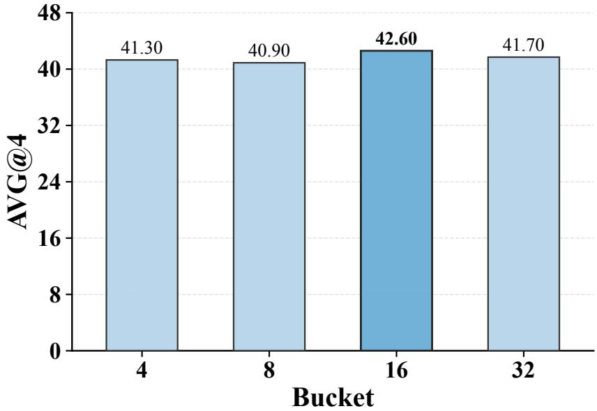  
Figure 6: Effect of the bucket number n in NormTune on GPQA after training on Qwen3-4B.

Step 30 gradient alignment  
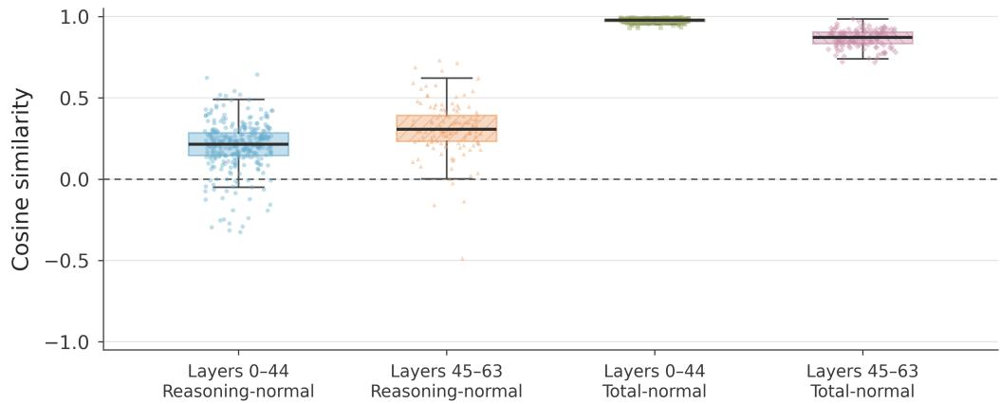  
Figure 7: Gradient alignment across early and late layers, measured by CosSim(∇θLreasoning, $\nabla _ { \theta } \mathcal { L } _ { \mathrm { n o r m a l } } )$ and CosSim $( \nabla _ { \theta } \mathcal { L } _ { \mathrm { t o t a l } } , \nabla _ { \theta } \mathcal { L } _ { \mathrm { n o r m a l } } )$

Table 18: Hyperparameter settings for GovReport and commonsense reasoning training configurations.
<table><tr><td rowspan="2">Hyperparameter</td><td colspan="4">GovReport</td><td colspan="4">commonsense reasoning</td></tr><tr><td>Full-FT</td><td>LoRA</td><td>Bone</td><td>MoRA</td><td>Full-FT</td><td>LoRA</td><td>Bone</td><td>MoRA</td></tr><tr><td>Batch size</td><td>16</td><td>16</td><td>16</td><td>16</td><td>128</td><td>128</td><td>128</td><td>128</td></tr><tr><td>Optimizer</td><td>Adam</td><td>Adam</td><td>Adam</td><td>Adam</td><td>Adam</td><td>Adam</td><td>Adam</td><td>Adam</td></tr><tr><td>LR</td><td>1e-5</td><td>1e-5</td><td>1e-5</td><td>1e-5</td><td>3e-5</td><td>3e-5</td><td>3e-5</td><td>3e-5</td></tr><tr><td>Warmup Ratio</td><td>0.05</td><td>0.05</td><td>0.05</td><td>0.05</td><td>0.05</td><td>0.05</td><td>0.05</td><td>0.05</td></tr><tr><td>Epoch</td><td>5</td><td>5</td><td>5</td><td>5</td><td>3</td><td>3</td><td>3</td><td>3</td></tr><tr><td>Weight Decay</td><td>1e-4</td><td>1e-4</td><td>1e-4</td><td>1e-4</td><td>1e-4</td><td>1e-4</td><td>1e-4</td><td>1e-4</td></tr><tr><td>Rank</td><td></td><td>8</td><td>8</td><td>8</td><td>一</td><td>8</td><td>8</td><td>8</td></tr><tr><td>LoRA α</td><td></td><td>16</td><td>一</td><td>一</td><td>一</td><td>16</td><td>一</td><td>一</td></tr><tr><td>MoRA Type</td><td></td><td></td><td></td><td>6</td><td></td><td></td><td></td><td>6</td></tr><tr><td>Block Size</td><td>32768</td><td>32768</td><td>32768</td><td>32768</td><td>256</td><td>256</td><td>256</td><td>256</td></tr></table>

Table 19: NormTune-specific configuration for different training benchmark. provides the optimal choice.
<table><tr><td>Hyperparameter</td><td>S1K-1.1</td><td>Z1-Code- Reasoning107K</td><td>Data-repetition</td><td>OLMo-3-7B</td></tr><tr><td>Batch size</td><td>16</td><td>128</td><td>1</td><td>1</td></tr><tr><td>Optimizer</td><td>Adam</td><td>Adam</td><td>8-bit Adam</td><td>8-bit Adam</td></tr><tr><td>ηmin</td><td>1e-5</td><td>1e-5</td><td>1e-5, 3e-5</td><td>2e-5</td></tr><tr><td>ηmax</td><td>1e-4,1e-3</td><td>2e-5,1e-4</td><td>2e-5,3e-5,1e-4</td><td>1e-4</td></tr><tr><td>n buckets</td><td>16</td><td>16</td><td>16</td><td>16</td></tr><tr><td>Probing Steps</td><td>30</td><td>30</td><td>30</td><td>30</td></tr><tr><td>Warmup Ratio</td><td>0.05</td><td>0.06</td><td>0.1</td><td>0.1</td></tr><tr><td>Epoch</td><td>5</td><td>2</td><td>16</td><td>16</td></tr><tr><td>Weight Decay</td><td>1e-4</td><td>0.0</td><td>0.0</td><td>0.0</td></tr><tr><td>Target Module</td><td colspan="4">Q, K, V, O, Gate, Up, Down</td></tr><tr><td>Block Size</td><td>32768</td><td>8192</td><td>32768</td><td>32768</td></tr></table>

Table 20: Hyperparameter settings for different PEFT training configurations.
<table><tr><td>Configuration</td><td>Method</td><td>Batch Size</td><td>Optimizer</td><td>LR</td><td>Warmup Ratio Epoch</td><td></td><td>Weight Decay</td><td>Rank</td><td>LoRA α MoRA Type AdaLoRA_init_rank</td><td></td><td></td><td>Block Size</td></tr><tr><td rowspan="9">S1K-1.1</td><td>Full-FT</td><td>16</td><td>Adam</td><td>1e-5</td><td>0.05 0.05</td><td>5 5</td><td>1e-4</td><td></td><td></td><td></td><td></td><td>32768</td></tr><tr><td>LoRA</td><td>16</td><td>Adam</td><td>1e-5</td><td></td><td></td><td>1e-4</td><td>8,256</td><td>16,512</td><td></td><td></td><td>32768</td></tr><tr><td>Bone</td><td>16</td><td>Adam</td><td>1e-5</td><td>0.05</td><td>5</td><td>1e-4</td><td>8,256</td><td></td><td></td><td></td><td>32768</td></tr><tr><td>MoRA</td><td>16</td><td>Adam</td><td>1e-5</td><td>0.05</td><td>5</td><td>1e-4</td><td>8,256</td><td></td><td>6,1</td><td></td><td>32768</td></tr><tr><td>AdaLoRA</td><td>16</td><td>Adam</td><td>1e-5</td><td>0.05</td><td>5</td><td>1e-4</td><td>8,256</td><td></td><td></td><td>12,384</td><td>32768</td></tr><tr><td>DoRA</td><td>16</td><td>Adam</td><td>1e-5</td><td>0.05</td><td>5</td><td>1e-4</td><td>8,256</td><td></td><td></td><td></td><td>32768</td></tr><tr><td>RSLoRA</td><td>16</td><td>Adam</td><td>1e-5</td><td>0.05</td><td></td><td>1e-4</td><td>8,256</td><td></td><td></td><td></td><td>32768</td></tr><tr><td>LoRA+</td><td>16</td><td>Adam</td><td>1e-5</td><td>0.05</td><td>555</td><td>1e-4</td><td>8,256</td><td></td><td></td><td></td><td>32768</td></tr><tr><td>TempBalance</td><td>16</td><td>Adam</td><td>1e-5</td><td>0.05</td><td></td><td>1e-4</td><td>8,256</td><td></td><td></td><td></td><td>32768</td></tr><tr><td rowspan="9">Z1-Code- Reasoning107K</td><td>Full-FT</td><td>128</td><td>Adam</td><td>1e-5 1e-5</td><td>0.06 0.06</td><td>2 2</td><td>0.0 0.0</td><td>256 256</td><td>512</td><td></td><td></td><td>8192</td></tr><tr><td>LoRA</td><td>128</td><td>Adam</td><td></td><td></td><td></td><td></td><td></td><td></td><td></td><td></td><td>8192</td></tr><tr><td>Bone</td><td>128</td><td>Adam</td><td>1e-5</td><td>0.06</td><td></td><td>0.0</td><td>256</td><td></td><td></td><td></td><td>8192 8192</td></tr><tr><td>MoRA</td><td>128</td><td>Adam</td><td>1e-5</td><td>0.06</td><td></td><td>0.0</td><td>256</td><td></td><td></td><td></td><td></td></tr><tr><td>AdaLoRA</td><td>128</td><td>Adam</td><td>1e-5</td><td>0.06</td><td>２２２２２２２</td><td>0.0</td><td>256</td><td></td><td></td><td>384</td><td>8192</td></tr><tr><td>DoRA</td><td>128</td><td>Adam</td><td>1e-5 1e-5</td><td>0.06 0.06</td><td></td><td>0.0 0.0</td><td>256 256</td><td></td><td></td><td></td><td>8192</td></tr><tr><td>RSLoRA LoRA+</td><td>128 128</td><td>Adam Adam</td><td>1e-5</td><td>0.06</td><td></td><td>0.0</td><td>256</td><td></td><td></td><td></td><td>8192 8192</td></tr><tr><td>TempBalance</td><td>128</td><td>Adam</td><td>1e-5</td><td>0.06</td><td></td><td>0.0</td><td>256</td><td></td><td></td><td></td><td>8192</td></tr><tr><td></td><td></td><td>8-bit Adam</td><td>3e-5</td><td>0.1</td><td>16</td><td>0.0</td><td>256</td><td></td><td></td><td></td><td></td></tr><tr><td rowspan="8">Data-repetition</td><td>Full-FT</td><td>1</td><td></td><td>3e-5</td><td>0.1</td><td>16</td><td>0.0</td><td>256</td><td>512</td><td></td><td></td><td>32768 32768</td></tr><tr><td>LoRA</td><td>1</td><td>8-bit Adam</td><td></td><td></td><td></td><td></td><td></td><td></td><td></td><td></td><td>32768</td></tr><tr><td>Bone</td><td>1 1</td><td>8-bit Adam</td><td>3e-5 3e-5</td><td>0.1 0.1</td><td>16 16</td><td>0.0 0.0</td><td>256 256</td><td></td><td></td><td></td><td></td></tr><tr><td>MoRA AdaLoRA</td><td>1</td><td>8-bit Adam 8-bit Adam</td><td>3e-5</td><td>0.1</td><td>16</td><td>0.0</td><td>256</td><td></td><td></td><td>384</td><td>32768</td></tr><tr><td></td><td>1</td><td>8-bit Adam</td><td>3e-5</td><td>0.1</td><td>16</td><td>0.0</td><td>256</td><td></td><td></td><td></td><td>32768</td></tr><tr><td>DoRA RSLoRA</td><td>1</td><td>8-bit Adam</td><td>3e-5</td><td>0.1</td><td>16</td><td>0.0</td><td>256</td><td></td><td></td><td></td><td>32768 32768</td></tr><tr><td>LoRA+</td><td>1</td><td>8-bit Adam</td><td>3e-5</td><td>0.1</td><td>16</td><td>0.0</td><td>256</td><td></td><td></td><td></td><td>32768</td></tr><tr><td>TempBalance</td><td>1</td><td>8-bit Adam 3e-5</td><td></td><td>0.1</td><td>16</td><td>0.0</td><td>256</td><td></td><td></td><td></td><td>32768</td></tr><tr><td rowspan="9">OLMo-3-7B</td><td></td><td></td><td>8-bit Adam 2e-5</td><td></td><td>0.1</td><td>16</td><td>0.0</td><td>256</td><td>一</td><td></td><td></td><td>32768</td></tr><tr><td>Full-FT LoRA</td><td>1</td><td></td><td>2e-5</td><td></td><td></td><td>0.0</td><td>256</td><td>512</td><td></td><td></td><td></td></tr><tr><td></td><td>1</td><td>8-bit Adam</td><td></td><td>0.1</td><td>16</td><td>0.0</td><td>256</td><td></td><td></td><td></td><td>32768</td></tr><tr><td>Bone</td><td>1 1</td><td>8-bit Adam 8-bit Adam</td><td>2e-5 2e-5</td><td>0.1 0.1</td><td>16 16</td><td>0.0</td><td>256</td><td></td><td></td><td></td><td>32768</td></tr><tr><td>MoRA</td><td>1</td><td>8-bit Adam</td><td>2e-5</td><td>0.1</td><td>16</td><td>0.0</td><td>256</td><td></td><td></td><td>384</td><td>32768</td></tr><tr><td>AdaLoRA</td><td>1</td><td>8-bit Adam</td><td>2e-5</td><td>0.1</td><td>16</td><td>0.0</td><td>256</td><td></td><td></td><td></td><td>32768 32768</td></tr><tr><td>DoRA RSLoRA</td><td>1</td><td>8-bit Adam 2e-5</td><td></td><td>0.1</td><td>16</td><td>0.0</td><td>256 256</td><td></td><td></td><td></td><td>32768</td></tr><tr><td>LoRA+</td><td>1</td><td>8-bit Adam 2e-5</td><td></td></table>

Table 21: Hyperparameter settings for TempBalance configurations.
<table><tr><td>Configuration</td><td>Method</td><td>Batch Size</td><td>Optimizer</td><td>LR</td><td>Warmup Ratio Epoch</td><td></td><td>Weight Decay</td><td>Rank</td><td></td><td></td><td>LoRA α MoRA Type AdaLoRA_init_rank Block Size</td><td></td></tr><tr><td rowspan="9">S1K-1.1</td><td>Full-FT</td><td>16</td><td>Adam</td><td>1e-5 1e-5</td><td>0.05 0.05</td><td>5 5</td><td>1e-4</td><td></td><td></td><td></td><td></td><td>32768</td></tr><tr><td>LoRA</td><td>16</td><td>Adam</td><td></td><td></td><td></td><td>1e-4</td><td>8,256</td><td>16,512</td><td></td><td></td><td>32768</td></tr><tr><td>Bone</td><td>16</td><td>Adam</td><td>1e-5</td><td>0.05</td><td>5</td><td>1e-4</td><td>8,256</td><td></td><td></td><td></td><td>32768</td></tr><tr><td>MoRA</td><td>16</td><td>Adam</td><td>1e-5</td><td>0.05</td><td>5</td><td>1e-4</td><td>8,256</td><td></td><td>6,1</td><td></td><td>32768</td></tr><tr><td>AdaLoRA</td><td>16</td><td>Adam</td><td>1e-5</td><td>0.05</td><td>5</td><td>1e-4</td><td>8,256</td><td></td><td></td><td>12,384</td><td>32768</td></tr><tr><td>DoRA</td><td>16</td><td>Adam</td><td>1e-5</td><td>0.05</td><td>5</td><td>1e-4</td><td>8,256</td><td></td><td></td><td></td><td>32768</td></tr><tr><td>RSLoRA</td><td>16</td><td>Adam</td><td>1e-5</td><td>0.05</td><td></td><td>1e-4</td><td>8,256</td><td></td><td></td><td></td><td>32768</td></tr><tr><td>LoRA+</td><td>16</td><td>Adam</td><td>1e-5</td><td>0.05</td><td>555</td><td>1e-4</td><td>8,256</td><td></td><td></td><td></td><td>32768</td></tr><tr><td>TempBalance</td><td>16</td><td>Adam</td><td>1e-5</td><td>0.05</td><td></td><td>1e-4</td><td>8,256</td><td></td><td></td><td></td><td>32768</td></tr><tr><td rowspan="9">Z1-Code- Reasoning107K</td><td>Full-FT</td><td>128</td><td>Adam</td><td>1e-5 1e-5</td><td>0.06 0.06</td><td>2 2</td><td>0.0 0.0</td><td>256 256</td><td>512</td><td></td><td></td><td>8192</td></tr><tr><td>LoRA</td><td>128</td><td>Adam</td><td></td><td></td><td></td><td></td><td></td><td></td><td></td><td></td><td>8192 8192</td></tr><tr><td>Bone</td><td>128</td><td>Adam</td><td>1e-5</td><td>0.06</td><td></td><td>0.0</td><td>256</td><td></td><td></td><td></td><td>8192</td></tr><tr><td>MoRA</td><td>128</td><td>Adam</td><td>1e-5</td><td>0.06</td><td></td><td>0.0</td><td>256</td><td></td><td></td><td>384</td><td></td></tr><tr><td>AdaLoRA</td><td>128</td><td>Adam</td><td>1e-5</td><td>0.06</td><td></td><td>0.0</td><td>256 256</td><td></td><td></td><td></td><td>8192</td></tr><tr><td>DoRA</td><td>128</td><td>Adam</td><td>1e-5</td><td>0.06 0.06</td><td>2 2 2 2 2 2</td><td>0.0 0.0</td><td>256</td><td></td><td></td><td></td><td>8192</td></tr><tr><td>RSLoRA LoRA+</td><td>128 128</td><td>Adam Adam</td><td>1e-5 1e-5</td><td>0.06</td><td></td><td>0.0</td><td>256</td><td></td><td></td><td></td><td>8192 8192</td></tr><tr><td>TempBalance</td><td>128</td><td>Adam</td><td>1e-5</td><td>0.06</td><td>2</td><td>0.0</td><td>256</td><td></td><td></td><td></td><td>8192</td></tr><tr><td></td><td></td><td></td><td>3e-5</td><td>0.1</td><td>16</td><td>0.0</td><td>256</td><td></td><td></td><td></td><td></td></tr><tr><td rowspan="8">Data-repetition</td><td>Full-FT</td><td>1</td><td>8-bit Adam</td><td>3e-5</td><td>0.1</td><td>16</td><td>0.0</td><td></td><td></td><td></td><td></td><td>32768 32768</td></tr><tr><td>LoRA</td><td>1</td><td>8-bit Adam</td><td></td><td></td><td></td><td></td><td>256</td><td>512</td><td></td><td></td><td>32768</td></tr><tr><td>Bone</td><td>1 1</td><td>8-bit Adam 8-bit Adam</td><td>3e-5</td><td>0.1</td><td>16 16</td><td>0.0 0.0</td><td>256 256</td><td></td><td></td><td></td><td></td></tr><tr><td>MoRA AdaLoRA</td><td>1</td><td>8-bit Adam</td><td>3e-5 3e-5</td><td>0.1 0.1</td><td>16</td><td>0.0</td><td>256</td><td></td><td></td><td>384</td><td>32768</td></tr><tr><td></td><td>1</td><td>8-bit Adam</td><td>3e-5</td><td>0.1</td><td>16</td><td>0.0</td><td>256</td><td></td><td></td><td></td><td>32768</td></tr><tr><td>DoRA RSLoRA</td><td>1</td><td>8-bit Adam</td><td>3e-5</td><td>0.1</td><td>16</td><td>0.0</td><td>256</td><td></td><td></td><td></td><td>32768 32768</td></tr><tr><td>LoRA+</td><td>1</td><td>8-bit Adam</td><td>3e-5</td><td>0.1</td><td>16</td><td>0.0</td><td>256</td><td></td><td></td><td></td><td>32768</td></tr><tr><td>TempBalance</td><td>1</td><td>8-bit Adam</td><td>3e-5</td><td>0.1</td><td>16</td><td>0.0</td><td>256</td><td></td><td></td><td></td><td>32768</td></tr><tr><td rowspan="9">OLMo-3-7B</td><td></td><td>1</td><td>8-bit Adam 2e-5</td><td></td><td>0.1</td><td>16</td><td>0.0</td><td>256</td><td></td><td></td><td></td><td>32768</td></tr><tr><td>Full-FT LoRA</td><td>1</td><td>8-bit Adam</td><td>2e-5</td><td>0.1</td><td>16</td><td>0.0</td><td>256</td><td>512</td><td></td><td></td><td>32768</td></tr><tr><td></td><td>1</td><td>8-bit Adam</td><td>2e-5</td><td>0.1</td><td>16</td><td>0.0</td><td>256</td><td></td><td></td><td></td><td>32768</td></tr><tr><td>Bone MoRA</td><td>1</td><td>8-bit Adam</td><td>2e-5</td><td>0.1</td><td>16</td><td>0.0</td><td>256</td><td></td><td></td><td></td><td>32768</td></tr><tr><td>AdaLoRA</td><td>1</td><td>8-bit Adam</td><td>2e-5</td><td>0.1</td><td>16</td><td>0.0</td><td>256</td><td></td><td></td><td>384</td><td>32768</td></tr><tr><td>DoRA</td><td>1</td><td>8-bit Adam</td><td>2e-5</td><td>0.1</td><td>16</td><td>0.0</td><td>256</td><td></td><td></td><td></td><td>32768</td></tr><tr><td>RSLoRA</td><td>1</td><td>8-bit Adam</td><td>2e-5</td><td>0.1 0.1</td><td>16</td><td>0.0 0.0</td><td>256 256</td><td></td><td></td><td></td><td>32768 32768</td></tr><tr><td>LoRA+</td><td>1</td><td>8-bit Adam</td><td>2e-5</td></table>

Table 22: Evaluation settings for different training configurations. For S1K-1.1 and Z1-Code-Reasoning107K, mean greedy accuracy is averaged over repeated evaluation runs of the same checkpoint.
<table><tr><td>Configuration</td><td>Evaluation suites</td><td>Metric / evaluator</td><td>Decoding</td><td>Max tokens</td><td>Completions per problem per run</td><td>Greedy evaluation runs (R)</td></tr><tr><td>S1K-1.1</td><td>AIME 2024, AIME 2025, MATH 500, GPQA</td><td>Mean greedy accuracy (GPT-4o-mini)</td><td>Greedy, T = 0</td><td>32768</td><td>1</td><td>4: MATH 500, GPQA; 16: AIME 2024, AIME 2025</td></tr><tr><td>Z1-Code- Reasoning107K</td><td>500, BigCodeBench-Hard,</td><td>LiveCodeBench, MATH Mean greedy accuracy (Qwen2.5-32B-Instruct)</td><td>Greedy, T = 0</td><td>4096</td><td>1</td><td>4: MATH 500, GPQA; 16: LiveCodeBench,</td></tr><tr><td>Data-repetition</td><td>GPQA GPQA, AIME 2024,</td><td>Avg@k and Pass@k</td><td>Sampling, T = 0.6,</td><td>32768</td><td>4 (GPQA) 16 (AIME)</td><td>BigCodeBench-Hard</td></tr><tr><td></td><td>AIME 2025</td><td></td><td>top-p = 0.95, top-k = 20</td><td></td><td>4 (GPQA)</td><td></td></tr><tr><td>OLMo-3-7B</td><td>GPQA, AIME 2024, AIME 2025</td><td>Avg@k and Pass@k</td><td>Sampling, T = 0.6, top-p = 0.95, top-k = 50</td><td>32768</td><td>16 (AIME)</td><td></td></tr><tr><td>GovReport</td><td>GovReport test split</td><td>ROUGE-1, ROUGE-2, ROUGE-L,</td><td>Sampling, T = 0.1, top-p = 0.9</td><td>32768</td><td>1</td><td></td></tr><tr><td>Commonsense reasoning</td><td>BoolQ, PIQA, SIQA, WinoGrande, ARC-e/c,</td><td>ROUGE-Lsum Accuracy</td><td>4-beam search; T = 0.1,  $\mathrm { t o p } { \cdot } p = 0 . 7 5 , \mathrm { t o p } { - } k = 4 0 \mathrm { i n }$ </td><td>32</td><td>1</td><td></td></tr></table>

Note. For S1K-1.1 and Z1-Code-Reasoning107K, each greedy evaluation run generates one completion per problem. The reported accuracy is the arithmetic mean of the accuracies from R evaluation runs using the same checkpoint and benchmark questions. These runs are not independent training runs or stochastic decoding samples. For Data-repetition and OLMo-3-7B, k denotes the number of sampled completions per problem used to compute Avg@k and Pass@k. A dash in the last column indicates that the repeated-greedy evaluation protocol does not apply.