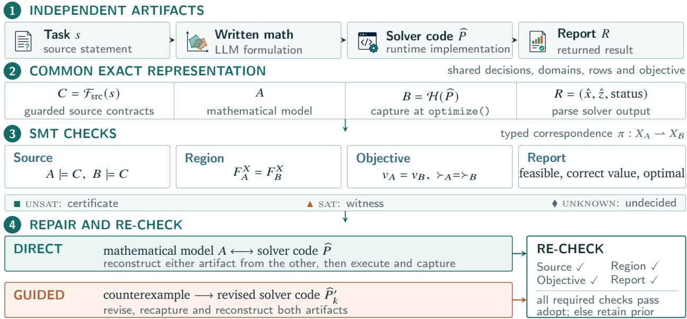
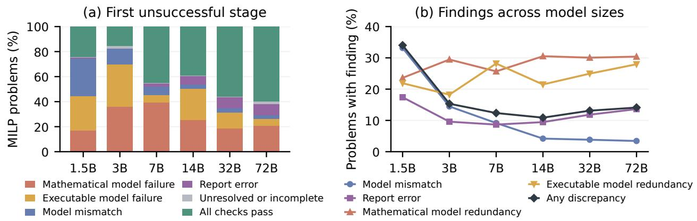
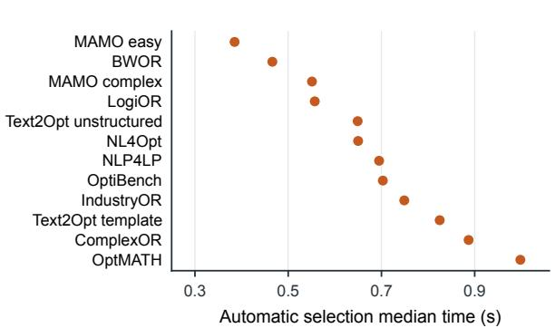
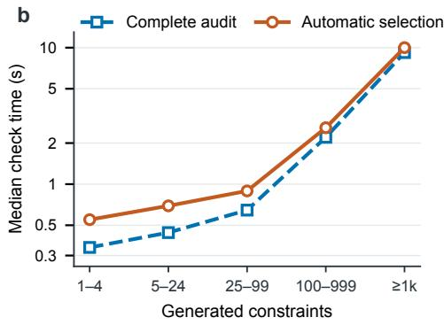
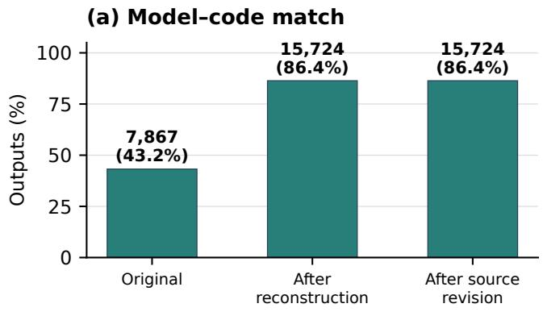
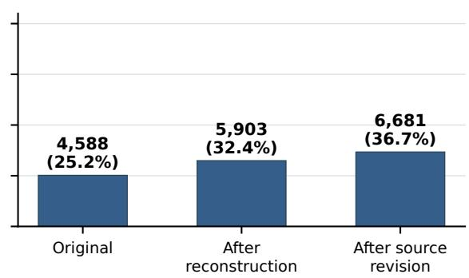
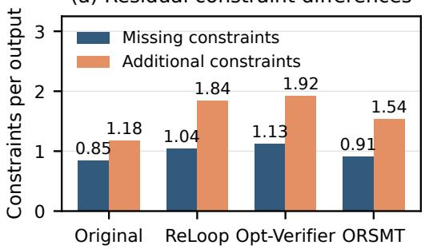
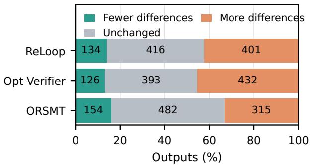
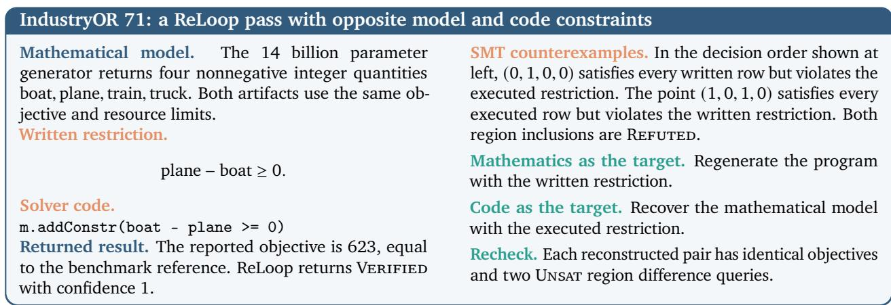
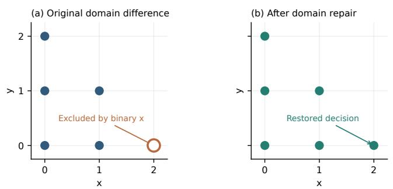

# ORSMT: Unleashing the Potential of Satisfiability Modulo Theories for Semantic Verification and Repair in LLM-Based Optimization

Rui Zhang1, Chenyu Zhou2, Jianghao Lin2,†, Yaoxin Wu3,†, Dongdong Ge2, Wen Song1

1Shandong University

2Shanghai Jiao Tong University

3Eindhoven University of Technology

202300190245@mail.sdu.edu.cn wensong@email.sdu.edu.cn

{chenyuzhou, linjianghao, ddge}@sjtu.edu.cn y.wu2@tue.nl

† Corresponding authors

Abstract Large language models increasingly automate optimization modeling from natural language problems, producing written mathematics, solver code and a returned report. Verifying one optimization problem across these artifacts requires semantic comparison: unequal models can attain the same objective, equivalent models can use diferent auxiliary variables, and mutually consistent artifacts can omit the same source requirement. ORSMT provides a typed semantic interface and exact SMT relation queries. It aligns observable decisions, projects auxiliary variables, proves or refutes feasible region and objective relations, localizes refutations to implicated rows or domains and links source texts when available. It then reconstructs one artifact from another, and each adopted candidate passes the required relation checks. Across 3,034 problems and six generator sizes, ORSMT improves the model–code match rate in all 72 benchmark and generator combinations before selection. Protected selection raises the aggregate rate from 43.2% to 88.2% and the share that are both correct and matched from 25.2% to 40.2%. On the 1,905 refuted outputs, certified voting under the shared fallback makes 50.9% of outputs correct and matched, compared with 44.8% for ReLoop and 49.4% for Opt-Verifier. A separate one-round source revision followed by exact reconstruction restores a model–code match for 84.4% of the refuted pairs.

Code: https://github.com/ZRay1213/ORSMT

## 1. Introduction

Optimization models support logistics, production planning, and energy scheduling by optimizing deci- sions under operational constraints. Decision quality depends on how natural-language requirements are translated into mathematical formulations, executable solver models, and reported decisions. Recent large language model (LLM) systems generate these artifacts together, while evaluation commonly focuses on solver execution and the final objective value. Establishing semantic agreement across these artifacts therefore motivates verification and repair at the level of the optimization problem itself.

Classical criteria such as feasibility and answer correctness evaluate the returned decision without assessing the agreement across the underlying artifacts (Ramamonjison et al., 2022; AhmadiTeshnizi et al., 2024b; Huang et al., 2025a; Jiang et al., 2025; Yang et al., 2025). Diferent feasible regions can attain the same optimum, so a correct objective value does not identify the implemented problem. Conversely, equivalent models can difer in auxiliary variables, redundant constraints, and syntax. Agreement between written mathematics and executable code can also miss a source requirement from the natural language omitted by both. Output-based evaluation cannot distinguish these failures or establish whether a proposed repair restores the required relations.

Recent methods broaden feedback beyond the final value through behavioral tests, structural compar- isons, model-based judgments, and counterexample searches (Zhang et al., 2026; Li and Hai, 2026; Zhai et al., 2025; Wang et al., 2025; Lian et al., 2026; Liu et al., 2026). Although these methods provide useful repair signals, passing behavioral tests or receiving a favorable model-based judgment does not establish semantic agreement between the math formulation and its code implementation. A program can produce the expected outputs on tested cases while admitting decisions excluded by the formulation, whereas structural comparisons can reject equivalent models that use diferent auxiliary constructions. Verification must therefore examine whether the diferent artifacts admit the same feasible decisions and preserve their objective preferences. It should also localize discrepancies to guide repair and verify that the repaired artifacts satisfy the required relations before adoption.

This paper proposes ORSMT, a satisfiability modulo theories (SMT)-based verification and repair framework for source requirements, written mathematics, instantiated solver models, and returned reports. ORSMT translates the written model and captures the solver model from code in a common exact representation, aligning observable decisions and projecting auxiliary variables. Within the afine rational core, SMT queries check admitted source requirements, feasible regions, objective relations, and reports for a fixed instance. A satisfiable violation query returns a localized counterexample; an unsatisfiable query certifies the corresponding relation. The evidence supports direct reconstruction between mathematics and code or guides revision, and every adopted candidate passes the required checks again. This keeps diagnosis, repair, and acceptance as distinct stages of one formally checked process. Our contributions are summarized as follows:

(i) We introduce ORSMT, a semantic verification framework for source requirements, mathematical formulations, solver codes, and returned reports. Its common representation supports exact SMT checks within the admitted afine rational core, providing certificates or localized counterexamples for decided relations.

(ii) We develop a verification and repair loop that combines bidirectional reconstruction with counterexample-guided revision. Each adopted candidate passes the required relation checks, con- necting diagnosis, repair, and acceptance through the same verifier.

(iii) We evaluate ORSMT on 3,034 problems from 12 benchmarks and 6 generator sizes. Model–code match rates improve in all 72 benchmark–generator combinations before selection. Under protected selection, the aggregate match rate rises from 43.2% to 88.2%, and the share of outputs with both a correct answer and a model–code match rises from 25.2% to 40.2%. ORSMT further improves correct-and-matched outputs when integrated with existing OptiMUS-0.3 and OptiMind pipelines, supporting its use as a modular verification and repair layer.

## 2. Related Work

Autoformulation and evaluation. NL4Opt (Ramamonjison et al., 2022) studies formulation. OptiMUS and OptiMUS-0.3 build modular formulation and execution pipelines (AhmadiTeshnizi et al., 2024b,a), while OptiMind adds expert-guided training and inference (Zhang et al., 2025). ORLM, LLMOPT and ORThought generate and revise mathematical models, code and solver outputs (Huang et al., 2025a; Jiang et al., 2025; Yang et al., 2026). MAMO, OptiBench and OPT Engine broaden evaluation tasks (Huang et al., 2025b; Yang et al., 2025; Chen et al., 2026). Feasibility and reference objectives assess final answers, but do not establish that the written model, instantiated code and report describe the same optimization problem.

Verification and repair. ReLoop tests program behavior under parameter changes (Lian et al., 2026). Opt-Verifier judges structure and solutions (Liu et al., 2026), and SAC Opt uses semantic anchors for revision (Zhang et al., 2026). EquivaMap and ORGEval compare variable mappings or graph structure (Zhai et al., 2025; Wang et al., 2025). Falsification uses solver-based testing under controlled instance transformations, whereas FLARE verifies MILP reformulations using theorem proving (Li and Hai, 2026; Robbins et al., 2026). ORSMT repairs instance-specific mathematical, executable and report artifacts. Therefore, repair comparisons use ReLoop and Opt-Verifier.

Formal semantic verification. Denotational tests evaluate program behavior beyond textual similarity (Zhong et al., 2020). Z3 and cvc5 decide arithmetic formulas (de Moura and Bjørner, 2008; Barbosa et al., 2022), while neural symbolic methods translate proposed statements into formal queries (Jha et al., 2023; Pan et al., 2023; Ye et al., 2023; Olausson et al., 2023). ORSMT verifies source requirements, feasible regions, objective preferences and reports in this way. Its evidence identifies missing, additional and redundant restrictions and supports repair from either usable model.

## 3. Problem Setting

An autoformulation pipeline maps a source statement � and instance data to written mathematics, a solver program ${ \widehat { P } } ,$ and a report $\boldsymbol { R } = ( \hat { x } , \hat { z } .$ , status), where �ˆ and ˆ� represent the returned solution and its objective value. The written mathematics is lowered to the mathematical model �. The instantiated solver model is represented by $B = { \mathcal { H } } ( { \widehat { P } } )$ . A source adapter supplies formal requirements $C = { \mathcal { F } } _ { \mathrm { s r c } } ( s )$ each linked to its supporting source text and variable roles, when that adapter admits the source. Verification checks the available relations among �, �, �, and �.

Define a model as $A = ( X _ { A } , U _ { A } , \Phi _ { A } , f _ { A } , \delta _ { A } )$ , where $X _ { A }$ contains observable decisions, $U _ { A }$ contains auxiliary variables, $\Phi _ { A }$ contains domains and constraints, $f _ { A }$ is the objective, and $\delta _ { A } \in \{ \mathrm { m i n } , \mathrm { m a x } \}$ The executable model $B = ( X _ { B } , U _ { B } , \Phi _ { B } , f _ { B } , \delta _ { B } )$ is defined in the same way. A fixed correspondence aligns the observable decisions of the two models. Their comparison projects out the auxiliary variables. The projected feasible region and objective graph are

$$
F _ { A } ^ { X } = \{ x : \exists u _ { A } \Phi _ { A } ( x , u _ { A } ) \} , \qquad G _ { A } ^ { X } = \{ ( x , z ) : \exists u _ { A } \Phi _ { A } ( x , u _ { A } ) \wedge z = f _ { A } ( x , u _ { A } ) \} .\tag{1}
$$

When $G _ { A } ^ { X }$ is single-valued, $\nu _ { A } ( x )$ denotes the unique objective value associated with $x \in F _ { A } ^ { X }$ .The relation $x \succ _ { A } y$ denotes a strict improvement according to $\delta _ { A }$ , and $x \succeq _ { A } y$ also permits equal values. Therefore we define semantic model agreement as

$$
A \equiv _ { \mathrm { s e m } } B \quad \Longleftrightarrow \quad ( F _ { A } ^ { X } , \succ _ { A } ) = ( F _ { B } ^ { X } , \succ _ { B } ) .\tag{2}
$$

This relation preserves feasible decisions and their preference order. Absolute objective values are checked separately. Source satisfaction requires a feasible model that entails every applicable requirement in a nonempty admitted �. Untranslated source units retain an undecided source verdict rather than a vacuous certificate. The report � passes when its returned decision is feasible, correctly valued and optimal. Instance parameters are substituted before comparison, and partial reports use existential completion over unreported coordinates.

The task is to return matched artifacts and evidence for each required relation. A mathematical model can supply a missing implementation, a captured solver model can supply missing mathematics, and a source counterexample can expose an omission shared by both. Every decided relation is certified or accompanied by a concrete refuting assignment.

## 4. ORSMT: Verification, Repair and Matching

ORSMT first translates the mathematical model � and the executable model � into a common exact representation, then uses SMT to check their relations, and finally applies the same checks to every repaired candidate before adoption.

  
Figure 1: ORSMT translates source requirements, written mathematics, solver code and reports into a common exact representation. SMT checks either certify their relations or return a counterexample for direct reconstruction or revision. After repair, every relaton is checked again before adoption.

Figure 1 separates two models translation, SMT checking and the two repair routes. The verifier supports afine models with rational coeficients over real, integer, and Boolean variables. Appendix B.4 gives the complete verification and repair procedure.

## 4.1. Model representation and bidirectional construction

Mathematical translation. The translator L lowers admitted mathematical formulation into the model representation � defined in Section 3. Structured declarations, solver objects, LP/MPS files provide variables, contraints and objectives, while mathematical prose is transcribed together with links to the source text from which each element is derived. Finite decimal coeficients are represented as exact rationals. The resulting representation explicitly records variable bounds and domains, contraints, and contraint rows. Appendix A.2 presents the detailed input formats.

Executable model and correspondence. ORSMT aligns the observable decisions $X _ { A }$ and $X _ { B }$ of A and B through a one-to-one correspondence based on normalized scalar or index-tuple identifiers, variable roles, and types. Auxiliary variables $U _ { A }$ and $U _ { B }$ are not matched directly: they are projected out when comparing the model objects in Eq. (1). A contradiction, type mismatch, or unmatched observable decision prevents a syntactic correspondence from being accepted and leaves the corresponding relation Undecided. This separation allows semantically equivalent models to use diferent auxiliary constructions or redundant constraints without requiring a one-to-one match of all solver variables.

Target and normalization. ORSMT supports reconstruction in both directions. When the mathe-matical model � is available, ORSMT uses it as the primary construction target; otherwise, it uses the captured executable model � = H (�b) as the target for reconstructing missing mathematical artifacts. Before construction, ORSMT applies a normalization operator (N) that preserves the projected feasible region and objective graph relevant to the observable decisions. The normalization may make implicit domains explicit and derive redundant constraints or auxiliary definitions needed for compilation, while preserving the semantic model objects used for verification. The resulting normalized representation is then used as the construction target.

Mathematics to program. For the mathematical target $T = A _ { . }$ , ORSMT computes

$$
\widetilde { A } = T , \qquad \widetilde { P } = \mathrm { C o m p i l e } ( N ( T ) ) , \qquad \widetilde { B } = \mathcal { H } ( \widetilde { P } ) , \qquad \widetilde { R } = \mathrm { S o l v e } ( \widetilde { P } ) .\tag{3}
$$

The generated solver code declares the normalized model and reports its decision, objective value, and status. ORSMT then captures the instantiated executable model $( { \widetilde { B } } )$ from the generated program and verifies its semantic agreement with $( \widetilde { A } )$ , together with the correctness of the returned report (�e). Consequently, this direction can be used either to synthesize missing solver code from a mathematical model or to repair existing code that fails to match the available formulation.

Program to mathematics. When the executable model is available but the mathematical formulation is missing or incomplete, ORSMT sets (T=B). It exports the domains, bounds, constraints, objective, and optimization direction of B into a mathematical representation $( \widetilde { A } )$ , and uses this representation as the construction target. The resulting artifacts are compiled, executed, and captured as in Eq. (3), after which the same verification queries are applied to certify their correspondence. Thus, either representation can serve as the construction source, while both directions return to the same semantic verification procedure.

Proposition 1: Artifact Construction. If the normalization operator N preserves the projected feasible region and objective graph of its input, and that H faithfully captures the model compiled from the normalized representation, Eq. (3) constructs artifacts whose projected model semantics agree with the construction target, up to the fixed correspondence of observable decisions. Appendix B gives the full proof and the guarantees for constraint reduction.

## 4.2. Verification queries and diagnosis

Feasible regions. ORSMT encodes domains and rows as exact arithmetic formulas and computes the two directional violation queries

$$
Q _ { A \backslash B } = { \mathsf { S A T } } ( F _ { A } ^ { X } \wedge \neg F _ { B } ^ { X } ) , \qquad Q _ { B \backslash A } = { \mathsf { S A T } } ( F _ { B } ^ { X } \wedge \neg F _ { A } ^ { X } ) .\tag{4}
$$

A witness in � \ � identifies a mathematical decision excluded by the implementation. A witness in $B \setminus A$ identifies an implemented decision excluded by the mathematics. Unsatisfiability in both directions establishes equality of the projected feasible regions which includes the case where both regions are empty. Therefore, model feasibility is checked separately before certifying semantic agreement.

Verdict and diagnosis. Each verification query returns either a certificate or a counterexample. A satisfiable violation query refutes the corresponding relation and returns a concrete witness, whereas an unsatisfiable query certifies that the relation holds. After substituting instance parameters, ORSMT extracts the implicated constraints, domains, and linked source texts from the witness and, when applicable, the unsatisfiable core. Objective diagnoses additionally record the evaluated preference relation, while source diagnoses identify the violated requirement and its applicable scope. The resulting diagnostic payload is used for deterministic reconstruction or counterexample-guided language-model revision.

Objective relations. For decisions that are feasible in both models, ORSMT verifies whether the two

objectives induce the same preference ordering. It decides the directional violation query:

$$
\begin{array} { r } { Q ^ { \mathrm { p r e f } } = { \cal S } { \cal A } \mathrm { T } \big ( x , y \in F _ { A } ^ { X } \cap F _ { B } ^ { X } \wedge \quad } \\ { \left[ ( x \succ _ { A } y \wedge y \succeq _ { B } x ) \vee ( x \succ _ { B } y \wedge y \succeq _ { A } x ) \right] \big ) . } \end{array}\tag{5}
$$

A satisfying pair exposes opposite ordering or a strict improvement that becomes a tie. Feasible models and unsatisfiable relation queries certify Eq. (2). Absolute values use

$$
Q ^ { \mathrm { v a l u e } } = { \mathsf { S A T } } { \big ( } x \in F _ { A } ^ { X } \cap F _ { B } ^ { X } \land \nu _ { A } ( x ) \neq \nu _ { B } ( x ) { \big ) } .\tag{6}
$$

Unsatisfiability certifies equal values at common decisions, separately from preference agreement.

Source requirements. Each source requirement in � is represented as a guarded contract $\left( g _ { k } , \psi _ { k } , S _ { k } \right)$ consisting of an applicability condition, a logical obligation, and its supporting source text. Variable identifiers are resolved through the typed source schema before a contract is admitted. Unresolved identifiers or untranslated source units remain undecided, and a source certificate is issued only when the admitted contract set is nonempty. For a feasible candidate, ORSMT decides

$$
Q _ { A , k } ^ { \mathrm { s o u r c e } } = \mathsf { S A T } ( \Phi _ { A } \wedge g _ { k } \wedge \neg \psi _ { k } ) , \qquad Q _ { B , k } ^ { \mathrm { s o u r c e } } = \mathsf { S A T } ( \Phi _ { B } \wedge g _ { k } \wedge \neg \psi _ { k } ) .\tag{7}
$$

Unsatisfiability certifies that the guarded requirement is enforced whenever its applicability condition holds, whereas a satisfying assignment returns a violating decision. A shared witness on both artifacts identifies a common omission and links it to $S _ { k }$ . This source relation is independent of pairwise model equivalence: two artifacts may agree semantically while violating the same source requirement.

Missing, additional and redundant constraints. Row entailment applies the same violation test to individual mathematical and executable restrictions. A written row violated by an implemented decision is missing from the implementation. An executable row violated by a written decision adds a restriction. To test redundancy of a row $^ { c , }$ let $D _ { A }$ collect domains and $K _ { A }$ collect constraint rows. ORSMT asks

$$
{ \cal Q } _ { A , c } ^ { \mathrm { r e d u n d a n t } } = { \cal S } \mathrm { A T } ( D _ { A } \wedge \bigwedge _ { d \in K _ { A } \backslash \{ c \} } d \wedge \neg c ) .\tag{8}
$$

Unsatisfiability permits deletion of $c .$ . Subsequent tests use the reduced model. A refuting assignment is completed against the entire candidate before revision, and infeasible models receive conflict diagnoses. Appendix C details the reduction and scalability.

Reported result. Let $O \subseteq X _ { B }$ be the reported coordinates and $\tau \geq 0$ the declared reporting tolerance. Let $B _ { \tau } ( \hat { x } _ { O } )$ as their tolerance box denote the corresponding tolerance box, with discrete coordinates fixed to admissible integers; coordinates outside � are existentially completed. For minimization, ORSMT computes

$$
\boldsymbol { Q } _ { \tau } ^ { \mathrm { e x t e n d } } = \boldsymbol { S } \boldsymbol { \mathrm { A T } } ( \Phi _ { B } \wedge B _ { \tau } ( \boldsymbol { \hat { x } _ { O } } ) ) ,
$$

$$
Q _ { \tau } ^ { \mathrm { b i n d } } = { \sf S A T } ( \Phi _ { B } \wedge B _ { \tau } ( \hat { x } _ { O } ) \wedge | f _ { B } - \hat { z } | \leq \tau ) ,\tag{9}
$$

$$
Q _ { \tau } ^ { \mathrm { b e t t e r } } = S \mathrm { A T } ( \Phi _ { B } \land f _ { B } < \hat { z } - \tau ) .\tag{10}
$$

Maximization reverses the last inequality. Unsatisfiability of the extension and binding queries certifies, respectively, that no feasible completion matches the reported decision and value, while satisfiability provides a completion witness. An unsatisfiable better-decision query certifies that no feasible decision improves on ˆ� beyond the declared tolerance.

## 4.3. Certificates and scalable exactness

Relation certificate. With fixed observable correspondence, feasible models, and single-valued objective graphs, unsatisfiability of both region-diference queries in Eq. (4) and the preference query in Eq. (5) certifies $A \equiv _ { \mathrm { s e m } } I$ . A satisfying assignment to any query refutes the corresponding relation. The certificate covers all decisions admitted by the encoded models, while a refutation provides the separating decision or decision pair used for diagnosis. Appendix B proves this claim and the corresponding report guarantees.

Sound reduction. Using the domain formula $D _ { A }$ and active row set $K _ { A }$ defined above, consider a compiled obligation $\psi$ and any $L \subseteq K _ { A } { \mathrm { : } }$

$$
{ \mathrm { U N S A T } } ( D _ { A } \land \bigwedge _ { c \in L } c \land \lnot \psi ) \implies \Phi _ { A } \models \psi .\tag{11}
$$

If the reduced query is unsatisfiable, the full violation query is also unsatisfiable, certifying the obligation. If it is satisfiable, we test whether its assignment can be extended to satisfy the omitted rows. Only an extension that satisfies the full model and violates $\psi$ is reported as a counterexample; otherwise, the reduced query alone does not refute the obligation.

Exact component slicing. The bipartite row–variable incidence graph retains every connected component containing variables of �. On a feasible base model, this slice is exact because disconnected components admit independent satisfying assignments. Smaller neighborhood slices retain the one- way guarantee in Eq. (11). Appendix B gives both proofs.

## 4.4. Revision and Selection

Revision. Let $Y _ { 0 } = \left( A , \widehat { P } , R \right)$ be the current artifacts. Verification evidence � records the failed relation, a counterexample when available, implicated rows or domains, and linked source text. Given � and $e ,$ the reviser proposes a program $\widehat { P } _ { k } ^ { \prime }$ . ORSMT captures its executable model, reconstructs the artifacts through Eq. (3), and rechecks the required source, region, objective, and report relations.

The evidence guides revision: a decision in the mathematical region but not the executable region must be admitted by the implementation, while a decision only in the executable region must be excluded. Objective and source revisions address the violated preference and linked requirement, respectively. For source revision, plan review checks the model against the source through the computed plan; row review checks individual requirements to localize the mismatch.

Selection. Only candidates passing every check required by the active policy are eligible. Direct selection takes the first eligible candidate in a fixed order. Certified voting groups eligible candidates by verified reported value and selects from the largest group if at least two agree. Protected selection also preserves the original finite result when available. If no candidate qualifies, ORSMT retains $Y _ { 0 } ;$ ; otherwise, it adopts the selected model, program, report, and verification evidence together. Reference objectives and statuses are used only for evaluation. Appendix B.4 gives the complete procedure.

Proposition 2: Certified Adoption. Every adopted candidate satisfies the checks required by its selection policy; an undecided required check prevents adoption. Otherwise, the original artifacts remain unchanged. Voting additionally certifies agreement of at least two eligible candidates on the reported value, and protected selection preserves an available original finite result.

Checks follow their prerequisites: admission and feasibility precede semantic comparison, region agreement precedes objective preference, and report binding precedes optimality. An undecided prerequisite leaves its dependent check undecided.

Certificates are SMT-backed verdicts for the encoded relations, not independently checked proof objects. They depend on translation, runtime capture, observable correspondence, compiled source requirements, model compilation, and the SMT backend. Unsupported translation, ambiguous correspondence, timeout, or solver unknown yields Undecided. Appendix C.6 compares independent Z3 and cvc5 encodings.

## 5. Experiments

Benchmarks and protocol. The experiments evaluate SMT checking efectiveness and cost, direct reconstruction, revision from counterexamples, repair baselines and host integration. A correct answer passes the benchmark or host evaluator. A model–code match means that the written mathematical model and captured executable model satisfy the exact semantic relation. An artifact match is the corresponding reference-blind check for host integrations. An output is correct and matched when its answer is correct and the applicable match holds. Problems decided is the percentage of the 3,034 assigned problems that return a decision; unavailable executable models count as unresolved. Failures repaired is the percentage of original failures that are repaired. All checks pass means a model–code match, feasible models and a verified report. Source requirements are evaluated separately.

The twelve benchmarks contain 3,034 problems. NL4Opt, NLP4LP, MAMO, OptiBench and Text2Opt provide the main formulation collections (Ramamonjison et al., 2022; AhmadiTeshnizi et al., 2024b; Huang et al., 2025b; Yang et al., 2025; Gao et al., 2026). IndustryOR, LogiOR, ComplexOR, OptMATH and BWOR extend the coverage (Huang et al., 2025a; Yang et al., 2026; Xiao et al., 2024; Lu et al., 2025; Zhang, 2026). For each of the 3,034 problems, one Qwen2.5-Instruct output at each of six sizes (1.5B–72B) yields 3,034×6 = 18,204 assigned outputs (Yang et al., 2024). References comprise 3,032 numeric objectives and two infeasibility statuses (BWOR-037 and BWOR-054) (Zhang, 2026). The controlled comparison fixes the 1,905 pre-repair refuted outputs, gives every feedback method the same Qwen2.5-14B reviser and permits one temperature-zero revision with a 32,768-token context. A numeric answer is correct when $\left| \nu - \nu ^ { \star } \right| \leq 1 0 ^ { - \mathbf { \tilde { 6 } } }$ max(1, |�★|).

Table 1: Complete assigned population: 3,034 problems for each of six generators, or 18,204 outputs.
<table><tr><td>Benchmark</td><td>Problems</td><td>Benchmark</td><td>Problems</td></tr><tr><td>MAMO easy</td><td>652</td><td>MAMO complex</td><td>211</td></tr><tr><td>Text2Opt template</td><td>630</td><td>OptMATH</td><td>132</td></tr><tr><td>OptiBench</td><td>422</td><td>IndustryOR</td><td>98</td></tr><tr><td>Text2Opt unstructured</td><td>248</td><td>LogiOR</td><td>76</td></tr><tr><td>NLP4LP</td><td>242</td><td>BWOR</td><td>75</td></tr><tr><td>NL4Opt</td><td>230</td><td>ComplexOR</td><td>18</td></tr><tr><td colspan="3">Total across 12 benchmarks</td><td>3,034</td></tr></table>

SMT checking efectiveness. The exact queries define 1,905 refuted and 7,867 certified-equivalent original pairs. Table 2 shows that code is unavailable nearly twice as often as mathematics and contributes more unmatched restrictions.

Table 3 compares baseline coverage on the same exact cohorts. ReLoop flags 181 available refutations and 29 equivalent pairs; Opt-Verifier flags 1,656 and 4,576, respectively. Controlled semantic edits and independent Z3 and cvc5 encodings appear in Appendices E and C.6. A separate source-covered audit reports source-contract certificates, refutations and undecided pairs in Appendix D.7.

SMT eficiency and scaling. Under a ten-second limit, automatic backend selection decides 94.6% of the 3,034 problems with a 0.647-second median (Table 4). On FrontierOR, exact component slicing yields paired speedups of 29.3× and 27.8× at 1,000–10,000 and 10,000–100,000 rows, respectively; all 5,055 jointly decided claims agree. Hardware details, query counts, and backend comparisons appear in Appendix C.6.

Table 2: Executable code adds a second failure surface over 3,034 problems and six generators (18,204 outputs). The final row uses 951 fully decided pairs; categories can overlap.
<table><tr><td>Audit</td><td>Written model</td><td>Executable model</td></tr><tr><td>Artifact unavailable</td><td>3,202 (17.6%)</td><td>5,980 (32.9%)</td></tr><tr><td>Primary availability failure</td><td>Malformed literal, 2,174</td><td>Runtime error, 3,723</td></tr><tr><td>Redundant constraint on this side only</td><td>188</td><td>239</td></tr><tr><td>Constraint absent from the other side</td><td>415</td><td>546</td></tr></table>

Table 3: Baseline flags on exact relation cohorts. Rates use available decisions in each cohort.
<table><tr><td>Verifier</td><td>Refuted pairs flagged</td><td>Refutation recall (%)</td><td>Equivalent pairs flagged</td><td>False positive rate (%)</td></tr><tr><td>ReLoop execution</td><td>181/1,897</td><td>9.5</td><td>29/7,859</td><td>0.4</td></tr><tr><td>Opt-Verifier structure</td><td>1,656/1,905</td><td>86.9</td><td>4,576/7,867</td><td>58.2</td></tr></table>

Table 4: ORSMT checking under a ten second limit on all 3,034 problems. The two settings run the same relation checks, and missing executable models are unresolved.
<table><tr><td colspan="3"></td><td rowspan="2">Problems decided (%)</td><td rowspan="2">Median checked time (s)</td></tr><tr><td>Setting</td><td>Problems</td><td>Decided</td></tr><tr><td>Complete audit, all problems Automatic backend selection, all problems</td><td>3,034</td><td>2,860</td><td>94.3</td><td>0.397</td></tr><tr><td></td><td>3,034</td><td>2,869</td><td>94.6</td><td>0.647</td></tr><tr><td>Automatic selection, no captured model</td><td>134</td><td>0</td><td>0.0</td><td></td></tr><tr><td>Automatic selection, 1-4 constraints</td><td>1,508</td><td>1,508</td><td>100.0</td><td>0.550</td></tr><tr><td>Automatic selection, 5-24 constraints</td><td>946</td><td>942</td><td>99.6</td><td>0.694</td></tr><tr><td>Automatic selection, 25–99 constraints</td><td>345 87</td><td>343 72</td><td>99.4 82.8</td><td>0.892 2.592</td></tr><tr><td>Automatic selection, 100–999 constraints</td><td>14</td><td>4</td><td>28.6</td><td>10.009</td></tr><tr><td>Automatic selection, ≥1,000 constraints</td><td></td><td></td><td></td><td></td></tr></table>

Direct reconstruction. Bidirectional reconstruction raises model–code matches from 7,867 to 15,724 without language model calls by completing 6,590 programs from mathematics and 1,267 mathematical artifacts from programs. The generator analysis retains every benchmark and model size before protected selection.All 72 cells in Table 5 improve, with a median gain of 47.2 percentage points. The match rate rises from 25.0% to 93.4% at 1.5B and from 14.0% to 76.5% at 3B; repaired 1.5B outputs exceed unrepaired 72B outputs by 25.7 points.

Revision from counterexamples and ablation. Source revision raises outputs that are both correct and matched from 5,903 to 6,681 (Appendix Figure 4). On the 1,905 refuted outputs, the controlled ablation compares direct revision, plan review, row review and certified voting.

A separate one-round comparison gives every method the same refuted outputs and 14B reviser. Source revision followed by exact reconstruction restores an ORSMT model–code match for 1,607 outputs (84.4%); Appendix Table 26 reports the matched baseline outcomes and cost.

Comparison with other repair methods. Certified voting makes 50.9% of outputs correct and matched, 6.1 points above ReLoop and 1.4 above Opt-Verifier. The clustered interval excludes zero only against ReLoop (Appendix Table 27); Tables 6 and 7 report the full and paired pipelines, respectively. ORSMT leads all three outcomes in Table 6; Appendix D.5 gives the paired results.

Table 5: Model–code matches before and after repair over 3,034 problems per generator (%), measured before protected selection.
<table><tr><td rowspan="2">Benchmark</td><td rowspan="2">Problems</td><td colspan="2">1.5B</td><td colspan="2">3B</td><td colspan="2">7B</td><td colspan="2">14B</td><td colspan="2">32B</td><td colspan="2">72B</td></tr><tr><td>Before After Before</td><td></td><td></td><td></td><td>After Before</td><td>After Before</td><td></td><td>After</td><td>r Before</td><td>After</td><td>Before</td><td>After</td></tr><tr><td>MAMO easy</td><td>652</td><td>24.5</td><td>99.7</td><td>22.9</td><td>92.6</td><td>77.3</td><td>100.0</td><td>74.4</td><td>99.7</td><td>96.0</td><td>100.0</td><td>97.7</td><td>100.0</td></tr><tr><td>Text2Opt template</td><td>630</td><td>22.1</td><td>92.7</td><td>0.3</td><td>52.2</td><td>12.1</td><td>41.7</td><td>15.2</td><td>52.5</td><td>12.9</td><td>61.6</td><td>17.3</td><td>63.7</td></tr><tr><td>OptiBench</td><td>422</td><td>37.9</td><td>99.8</td><td>27.5</td><td>90.0</td><td>59.0</td><td>99.1</td><td>44.5</td><td>95.5</td><td>80.8</td><td>100.0</td><td>93.1</td><td>100.0</td></tr><tr><td>Text2Opt unstructured</td><td>248</td><td>7.7</td><td>65.3</td><td>4.8</td><td>79.8</td><td>35.5</td><td>83.5</td><td>56.5</td><td>96.8</td><td>72.6</td><td>99.2</td><td>68.1</td><td>98.0</td></tr><tr><td>NLP4LP</td><td>242</td><td>37.6</td><td>99.6</td><td>25.2</td><td>87.2</td><td>55.0</td><td>99.2</td><td>41.3</td><td>94.2</td><td>84.3</td><td>100.0</td><td>93.4</td><td>100.0</td></tr><tr><td>NL4Opt</td><td>230</td><td>36.5</td><td>99.6</td><td>23.9</td><td>89.1</td><td>53.5</td><td>98.7</td><td>40.4</td><td>94.3</td><td>80.4</td><td>100.0</td><td>93.9</td><td>100.0</td></tr><tr><td>MAMO complex</td><td>211</td><td>17.5</td><td>96.7</td><td>2.4</td><td>78.2</td><td>28.0</td><td>85.3</td><td>44.5</td><td>90.0</td><td>54.5</td><td>89.1</td><td>57.3</td><td>85.8</td></tr><tr><td>OptMATH</td><td>132</td><td>3.8</td><td>86.4</td><td>2.3</td><td>28.0</td><td>9.1</td><td>59.8</td><td>20.5</td><td>71.2</td><td>34.1</td><td>89.4</td><td>27.3</td><td>87.9</td></tr><tr><td>IndustryOR</td><td>98</td><td>28.6</td><td>92.9</td><td>11.2</td><td>76.5</td><td>38.8</td><td>89.8</td><td>38.8</td><td>89.8</td><td>61.2</td><td>92.9</td><td>55.1</td><td>95.9</td></tr><tr><td>LogiOR</td><td>76</td><td>14.5</td><td>85.5</td><td>7.9</td><td>69.7</td><td>27.6</td><td>73.7</td><td>44.7</td><td>89.5</td><td>50.0</td><td>96.1</td><td>43.4</td><td>92.1</td></tr><tr><td>BWOR</td><td>75</td><td>30.7</td><td>78.7</td><td>6.7</td><td>66.7</td><td>48.0</td><td>85.3</td><td>50.7</td><td>94.7</td><td>58.7</td><td>97.3</td><td>64.0</td><td>94.7</td></tr><tr><td>ComplexOR</td><td>18</td><td>16.7</td><td>72.2</td><td>5.6</td><td>83.3</td><td>55.6</td><td>100.0</td><td>72.2</td><td>94.4</td><td>72.2</td><td>94.4</td><td>66.7</td><td>100.0</td></tr><tr><td>All benchmarks</td><td>3,034</td><td>25.0</td><td>93.4</td><td></td><td>14.0 76.5</td><td>44.5</td><td>82.1</td><td>44.4 85.6</td><td></td><td>63.7</td><td>90.3</td><td>67.7</td><td>90.3</td></tr></table>

Table 6: Full-population outcomes over 3,034 problems and six generators (18,204 outputs). Outcome cells report count (rate); correct-answer counts use the 18,192 outputs with references.
<table><tr><td>Pipeline</td><td>Correct answer</td><td>Model-code match</td><td>Correct and matched</td><td>Correct and matched / correct answers</td><td>Newly correct / original correct kept/total</td></tr><tr><td>Original</td><td>4,931 (27.1)</td><td>7,867 (43.2)</td><td>4,588 (25.2)</td><td>4,588/4,931</td><td>0 /4,931/4,931</td></tr><tr><td>ReLoop</td><td>5,760 (31.7)</td><td>8,285 (45.5)</td><td>4,744 (26.1)</td><td>4,744/5,760</td><td>829 / 4,931/4,931</td></tr><tr><td>Opt-Verifier</td><td>7,070 (38.9)</td><td>4,612 (25.3)</td><td>3,807 (20.9)</td><td>3,807/7,070</td><td>2,139 / 4,420/4,931</td></tr><tr><td>ORSMT</td><td>7,309 (40.2)</td><td>16,053 (88.2)</td><td>7,308 (40.2)</td><td>7,308/7,309</td><td>2,378 / 4,931/4,931</td></tr></table>

Integration with existing modeling systems. Both integrations use the same 3,034 assignments. OptiMUS-0.3 uses the exact model–code relation; OptiMind uses an exact scalar extractor or reference- blind two-of-three auditors and rechecks every reconstruction.

Table 7: Correct and matched outputs among 1,905 refuted outputs.
<table><tr><td>Policy</td><td>Correct and matched (%)</td></tr><tr><td>ReLoop</td><td>44.8</td></tr><tr><td>Opt-Verifier</td><td>49.4</td></tr><tr><td>ORSMT direct revision</td><td>46.4</td></tr><tr><td>ORSMT with plan review</td><td>47.5</td></tr><tr><td>ORSMT with row review</td><td>49.6</td></tr><tr><td>ORSMT certified voting</td><td>50.9</td></tr></table>

ORSMT adds 552 correct answers and 569 correct-and-matched outputs for OptiMUS-0.3, versus 19 and 223 for OptiMind, respectively. OptiMind also gains 683 artifact matches, showing that the integration chiefly improves artifact agreement when the host’s answers are already strong. Appendix D.6 gives routes, original-failure repair rates and cost.

Table 8: Host integration over 3,034 problems. Cells report count (rate).
<table><tr><td>System</td><td>Pipeline</td><td>Correct answer</td><td>Artifact match</td><td>Correct and matched</td></tr><tr><td rowspan="2">OptiMUS-0.3</td><td>Original</td><td>647 (21.3)</td><td>1,113 (36.7)</td><td>630 (20.8)</td></tr><tr><td>Original + ORSMT</td><td>1,199 (39.5)</td><td>1,938 (63.9)</td><td>1,199 (39.5)</td></tr><tr><td rowspan="2">OptiMind</td><td>Original</td><td>1,885 (62.1)</td><td>2,254 (74.3)</td><td>1,678 (55.3)</td></tr><tr><td>Original + ORSMT</td><td>1,904 (62.8)</td><td>2,937 (96.8)</td><td>1,901 (62.7)</td></tr></table>

## 6. Conclusion

ORSMT closes the verification–repair loop by combining exact certificates and concrete counterexam- ples with bidirectional reconstruction and rechecking every adopted artifact. Across 3,034 problems and six generator sizes (18,204 outputs), it raises the model–code match rate from 43.2% to 88.2% and the share of outputs that are both correct and matched from 25.2% to 40.2%. Among 1,905 refuted outputs, certified voting yields 50.9% correct-and-matched outputs, while one source revision followed by reconstruction restores model–code agreement for 84.4% of refuted pairs. The analysis also reveals systematic asymmetries in generated artifacts: code is unavailable nearly twice as often as mathematics and is more likely to introduce additional constraints than to omit existing ones. ORSMT decides 2,869 of 3,034 problems, remains sub-second through 99 constraints, and achieves a 29.3× speedup from component slicing. Its gains on both host systems further support its use as a modular verification and repair layer for LLM-based optimization pipelines.

## References

Ali AhmadiTeshnizi, Wenzhi Gao, Herman Brunborg, Shayan Talaei, Connor Lawless, and Madeleine Udell. OptiMUS-0.3: Using large language models to model and solve optimization problems at scale. arXiv preprint arXiv:2407.19633, 2024a.

Ali AhmadiTeshnizi, Wenzhi Gao, and Madeleine Udell. OptiMUS: Scalable optimization modeling with (MI)LP solvers and large language models. In Proceedings of the 41st International Conference on Machine Learning, 2024b.

Haniel Barbosa, Clark Barrett, Martin Brain, Gereon Kremer, Hanna Lachnitt, Makai Mann, Abdalrhman Mohamed, Mudathir Mohamed, Aina Niemetz, Andres Nötzli, Alex Ozdemir, Mathias Preiner, Andrew Reynolds, Ying Sheng, Cesare Tinelli, and Yoni Zohar. cvc5: A versatile and industrial-strength SMT solver. In Tools and Algorithms for the Construction and Analysis of Systems, pages 415–442. Springer, 2022. doi: 10.1007/978-3-030-99524-9\_24.

Yitian Chen, Cheng Cheng, Yinan Sun, Zi Ling, and Dongdong Ge. OPT-Engine: Benchmarking the limits of LLMs in optimization modeling via complexity scaling. In Proceedings of the 43rd International Conference on Machine Learning, 2026.

Leonardo de Moura and Nikolaj Bjørner. Z3: An eficient SMT solver. In Tools and Algorithms for the Construction and Analysis of Systems, pages 337–340. Springer, 2008. doi: 10.1007/ 978-3-540-78800-3\_24.

Zhiqi Gao, Albert Ge, Alexander Berenbeim, Nathaniel D. Bastian, and Frederic Sala. Models can model, but can’t bind: Structured grounding in text-to-optimization. In Conference on Language Modeling, 2026.

Chenyu Huang, Zhengyang Tang, Shixi Hu, Ruoqing Jiang, Xin Zheng, Dongdong Ge, Benyou Wang, and Zizhuo Wang. ORLM: A customizable framework in training large models for automated optimization modeling. Operations Research, 73(6):2986–3009, 2025a. doi: 10.1287/opre.2024. 1233.

Xuhan Huang, Qingning Shen, Yan Hu, Anningzhe Gao, and Benyou Wang. LLMs for mathematical modeling: Towards bridging the gap between natural and mathematical languages. In Findings of the Association for Computational Linguistics: NAACL 2025, pages 2678–2710. Association for Computational Linguistics, 2025b. doi: 10.18653/v1/2025.findings-naacl.146.

Sumit Kumar Jha, Susmit Jha, Patrick Lincoln, Nathaniel D. Bastian, Alvaro Velasquez, Rickard Ewetz, and Sandeep Neema. Neuro symbolic reasoning for planning: Counterexample guided inductive synthesis using large language models and satisfiability solving. arXiv preprint arXiv:2309.16436, 2023.

Caigao Jiang, Xiang Shu, Hong Qian, Xingyu Lu, Jun Zhou, Aimin Zhou, and Yang Yu. LLMOPT: Learning to define and solve general optimization problems from scratch. In International Conference on Learning Representations, 2025.

Minwei Kong, Chonghe Jiang, Ao Qu, Wenbin Ouyang, Zhaoming Zeng, Xiaotong Guo, Zhekai Li, Junyi Li, Yi Fan, Xinshou Zheng, et al. FrontierOR: Benchmarking LLMs’ capacity for eficient algorithm design in large-scale optimization. arXiv preprint arXiv:2605.25246, 2026.

Haifeng Li and Mo Hai. Falsification-based verification of LLM-generated optimization models: Sound test batteries and their detection limits. arXiv preprint arXiv:2607.16646, 2026.

Junbo Jacob Lian, Yujun Sun, Huiling Chen, Chaoyu Zhang, Hanzhang Qin, and Chung-Piaw Teo. ReLoop: Structured modeling and behavioral verification for reliable LLM-based optimization. arXiv preprint arXiv:2602.15983, 2026.

Haoyang Liu, Jie Wang, Boxuan Niu, Xiongwei Han, Yian Xu, Mingxuan Ye, Zijie Geng, Fangzhou Zhu, Tao Zhong, Mingxuan Yuan, and Jianye Hao. Opt-Verifier: Unleashing the power of LLMs for optimization modeling via dual-side verification. In Proceedings of the 43rd International Conference on Machine Learning, 2026.

Hongliang Lu, Zhonglin Xie, Yaoyu Wu, Can Ren, Yuxuan Chen, and Zaiwen Wen. OptMATH: A scalable bidirectional data synthesis framework for optimization modeling. In Proceedings of the 42nd International Conference on Machine Learning, 2025.

Theo X. Olausson, Alex Gu, Benjamin Lipkin, Cedegao E. Zhang, Armando Solar-Lezama, Joshua B. Tenenbaum, and Roger Levy. LINC: A neurosymbolic approach for logical reasoning by combining language models with first-order logic provers. In Proceedings of the 2023 Conference on Empirical Methods in Natural Language Processing, pages 5153–5176. Association for Computational Linguistics, 2023. doi: 10.18653/v1/2023.emnlp-main.313.

Liangming Pan, Alon Albalak, Xinyi Wang, and William Yang Wang. Logic-LM: Empowering large language models with symbolic solvers for faithful logical reasoning. In Findings of the Association for Computational Linguistics: EMNLP 2023, pages 3806–3824. Association for Computational Linguistics, 2023. doi: 10.18653/v1/2023.findings-emnlp.248.

Rindra Ramamonjison, Haley Li, Timothy T. Yu, Shiqi He, Vishnu Rengan, Amin Banitalebi-Dehkordi, Zirui Zhou, and Yong Zhang. Augmenting operations research with auto-formulation of optimization models from problem descriptions. In Proceedings of the 2022 Conference on Empirical Methods in

Natural Language Processing: Industry Track, pages 29–62. Association for Computational Linguistics, 2022. doi: 10.18653/v1/2022.emnlp-industry.4.

Henry Robbins, Connor Lawless, Madeleine Udell, and Ellen Vitercik. FLARE: Verifying MILP reformulations with LLM-based theorem proving. arXiv preprint arXiv:2608.25220, 2026.

Zhuohan Wang, Ziwei Zhu, Ziniu Li, Congliang Chen, Yizhou Han, Yufeng Lin, Zhihang Lin, Angyang Gu, Xinglin Hu, Ruoyu Sun, and Tian Ding. ORGEval: Graph-theoretic evaluation of LLMs in optimization modeling. arXiv preprint arXiv:2510.27610, 2025.

Ziyang Xiao, Dongxiang Zhang, Yangjun Wu, Lilin Xu, Yuan Jessica Wang, Xiongwei Han, Xiaojin Fu, Tao Zhong, Jia Zeng, Mingli Song, and Gang Chen. Chain-of-experts: When LLMs meet complex operations research problems. In International Conference on Learning Representations, 2024. URL https://openreview.net/forum?id=HobyL1B9CZ.

An Yang, Baosong Yang, Beichen Zhang, Binyuan Hui, Bo Zheng, Bowen Yu, Chengyuan Li, Dayiheng Liu, Fei Huang, Haoran Wei, et al. Qwen2.5 technical report. arXiv preprint arXiv:2412.15115, 2024.

Beinuo Yang, Qishen Zhou, Junyi Li, Chenxing Su, Panagiotis Angeloudis, and Simon Hu. ORThought: Benchmarking and automating logistics optimization modeling via structured LLM reasoning. Artificial Intelligencefor Transportation, 6:100059, 2026. doi: 10.1016/j.ait.2026.100059.

Zhicheng Yang, Yiwei Wang, Yinya Huang, Zhijiang Guo, Wei Shi, Xiongwei Han, Liang Feng, Linqi Song, Xiaodan Liang, and Jing Tang. OptiBench meets ReSocratic: Measure and improve LLMs for optimization modeling. In International Conference on Learning Representations, 2025.

Xi Ye, Qiaochu Chen, Isil Dillig, and Greg Durrett. SATLM: Satisfiability-aided language models using declarative prompting. In Advances in Neural Information Processing Systems, volume 36, pages 45548–45580, 2023.

Haotian Zhai, Connor Lawless, Ellen Vitercik, and Liu Leqi. EquivaMap: Leveraging LLMs for automatic equivalence checking of optimization formulations. In Proceedings of the 42nd International Conference on Machine Learning, volume 267 of Proceedings of Machine Learning Research, pages 74288–74305. PMLR, 2025. URL https://proceedings.mlr.press/v267/zhai25a.html.

Bowen Zhang. BWOR: A bilingual benchmark for modeling and solving operations research problems from natural language. Dataset, 2026. URL https://doi.org/10.5281/zenodo.20120692.

Xinzhi Zhang, Zeyi Chen, Humishka Zope, Hugo Barbalho, Konstantina Mellou, Marco Molinaro, Ja-nardhan Kulkarni, Ishai Menache, and Sirui Li. OptiMind: Teaching LLMs to think like optimization experts. arXiv preprint arXiv:2509.22979, 2025.

Yansen Zhang, Qingcan Kang, Yujie Chen, Yufei Wang, Xiongwei Han, Tao Zhong, Mingxuan Yuan, and Chen Ma. SAC-Opt: Semantic anchors for iterative correction in optimization modeling. In Proceedings of the 43rd International Conference on Machine Learning, 2026.

Ruiqi Zhong, Tao Yu, and Dan Klein. Semantic evaluation for text-to-sql with distilled test suites. In Proceedings of the 2020 Conference on Empirical Methods in Natural Language Processing, pages 396–411. Association for Computational Linguistics, 2020. doi: 10.18653/v1/2020.emnlp-main.29.

A Experimental Protocol and Artifact Representations 15   
A.1 Populations, metrics and scoring 15   
A.2 Artifact representations and capture 15   
B Formal Guarantees and Complete Procedures 16   
B.1 Relation certificates 16   
B.2 Constraint reduction and witness completion 16   
B.3 Reconstruction and adoption 17   
B.4 Construction and adoption procedures 17   
C SMT Checking Coverage, Errors and Eficiency 17   
C.1 Checking coverage and unresolved cases 17   
C.2 Input failures and model size 19   
C.3 Errors introduced during code generation 21   
C.4 Checking time on the controlled CPU pane 21   
C.5 Canonical requirements and redundancy 22   
C.6 Constraint selection and larger instances 24   
D Feedback Quality, Repair Efects and Transfer 24   
D.1 Feedback coverage and error localization 25   
D.2 Direct reconstruction and completion routes 25   
D.3 LLM feedback, ablations and paired repair 27   
D.4 LLM repair cost and recorded latency 29   
D.5 Full before-and-after repair results 30   
D.6 Transfer to OptiMUS-0.3 and OptiMind 31   
D.7 Source requirements after repair 32   
D.8 Residual constraint errors after repair 33   
D.9 Results by benchmark and generator 35   
E Semantic Criterion Evaluation 35   
E.1 Controlled semantic edits and preserving rewrites 35   
E.2 Large edit evaluation 37   
F Worked Inconsistency and Repair Cases 37   
F.1 A ReLoop pass with inconsistent feasible regions 37   
F.2 Missing source requirements in two generated artifacts 39   
F.3 A domain mismatch and redundant constraints 40   
F.4 An incorrect Opt-Verifier judgment on a certified solution 41   
The appendix follows the three experimental levels used by the paper. After fixing the populations,   
representations, scoring rules and formal procedures, Section C reports SMT checking coverage,

unresolved cases, error distributions and running time. Section D then separates feedback quality from repair efects before reporting full before-and-after results and transfer to existing modeling systems. The repair, source-review and host-audit prompts appear beside the experiments that use them. The final sections test the evaluation criterion and give worked cases with exact witnesses.

## A. Experimental Protocol and Artifact Representations

## A.1. Populations, metrics and scoring

The main experiment pairs all twelve benchmarks with six Qwen2.5-Instruct generators. Each problem retains its identifier, benchmark, generator, original artifacts, verifier version and adopted output. The repair cohort consists of the originally refuted pairs, and source problem resampling keeps outputs of the same problem together. Table 9 distinguishes the populations used in the main results and supplementary controls.

Table 9: Assigned populations and units used in the experiments.
<table><tr><td>Experiment</td><td>Unit</td><td>Assigned units</td></tr><tr><td>Main generation and repair</td><td>Problem and generator</td><td>3,034 × 6 = 18,204</td></tr><tr><td>Paired feedback intervention</td><td>Originally refuted output</td><td>1,905</td></tr><tr><td>Paired constraint differences</td><td>Output with four decided comparisons</td><td>951</td></tr><tr><td>Controlled CPU verification</td><td>Unique problem</td><td>3,034</td></tr><tr><td>Canonical requirement queries</td><td>Model obligation</td><td>136,100</td></tr><tr><td>Canonical redundancy</td><td>Model row</td><td>340,289</td></tr><tr><td>Labeled edit controls</td><td>Edited or rewritten pair</td><td>1,360</td></tr><tr><td>Reference edit stress test</td><td>Edited pair</td><td>12,831</td></tr></table>

We report the four outcomes defined in Section 5: correct answer, model–code match, artifact match and correct and matched. A numeric answer is correct when $| z - z ^ { \star } | \leq 1 0 ^ { - 6 } \operatorname* { m a x } \{ 1 , | z ^ { \star } | \}$ . An output passes all checks when the models match, both are feasible and the report is verified. Empty feasible regions are counted separately in reconstruction outcomes. Every paired comparison preserves its assigned identifiers, including unavailable artifacts, unresolved checks and execution failures.

The original verification panel uses exact decimal arithmetic for report discrepancies. Repair scoring uses the declared tolerance for printed decisions and reference values.

## A.2. Artifact representations and capture

Accepted declarations contain finitely many uniquely named real, integer or Boolean variables, op- tional rational bounds, linear rows with relation ≤, ≥ or equality, and an objective with its optimization direction. Structured declarations, solver objects, LP and MPS files supply these fields directly. Mathe-matical prose supplies a proposed transcription whose source text is retained. Malformed declarations, unsupported operators and undeclared references return a typed translation failure.

The historical panel represents each variable with a real arithmetic symbol and adds integrality predicates for integer domains. Boolean domains intersect integrality with the bounds zero and one. An absent bound remains unbounded, and each finite decimal denotes its exact rational value. Its accepted declarations require a nonempty objective term list and nonempty terms in each row. The row list itself may be empty. Region and preference comparisons use zero tolerance.

Runtime capture intercepts the optimization call, flushes pending modifications and records the instantiated model after loops and instance expansion. Later solver calls produce separate snapshots.

Returned text, explicit objective and decisions, solver attributes and execution exceptions occupy separate fields. The frozen model comparison aligns all declared variables by unique normalized names, with no hidden auxiliaries. Missing or ambiguous correspondences retain an unresolved state.

Source requirements. Each obligation records its supporting source text, quantified scope, variable roles, exact coeficients, relation and applicability. Released reference formulations supply formal obligations when their adapters admit them. Open natural language supplies proposed obligations for review. Reference conventions such as symmetry constraints retain their provenance. Published objective values and status labels remain separate and enter only scoring. When an adapter admits a released formulation as a source contract, the resulting statement only checks that contract. It does not independently recover the author’s intent.

Exact reconstruction. The compiler emits domains, rows, objective and direction from the selected model. A bounded product $y = b x .$ , where � is Boolean and $L \leq x \leq U$ has the exact reformulation

$$
L b \leq y \leq U b , \qquad x - U ( 1 - b ) \leq y \leq x - L ( 1 - b ) .
$$

Bounded integer products use binary expansion. Added variables are existentially projected for comparison. Sequential redundancy deletion retains the model after each proved deletion, and a final relation query checks the reconstructed pair.

## B. Formal Guarantees and Complete Procedures

This section establishes the certificate guarantees used by verification, slicing, reconstruction and adoption. It then gives the complete procedures that instantiate those guarantees.

## B.1. Relation certificates

Proof of the relation certificate. The two unsatisfiable diference queries establish both inclusions and equality of the projected feasible regions. The preference query excludes any common decision pair ordered strictly by one model and tied or oppositely ordered by the other. Their strict preference relations are equal. A satisfying query supplies the separating point or decision pair directly.

A feasible model entails a compiled source obligation when its violation formula is unsatisfiable. The returned result queries use the model, report and tolerance from Eqs. (9) and (10). Extension and value binding are existential feasibility checks. The absence of a better decision certifies optimality to the declared margin. An empty model receives its separate infeasibility outcome.

## B.2. Constraint reduction and witness completion

Proof of sound reduction. The full violation formula implies the reduced formula. The reduced formula’s unsatisfiability therefore implies the full formula’s unsatisfiability. A complete satisfying assignment lies in the candidate feasible region and outside the obligation. A partial satisfying assignment is extended and checked against the full model before it supplies this witness.

Proof of exact component slicing. Omitted components share no variables with retained components or the obligation. Base feasibility supplies a satisfying assignment in every omitted component. Combining these assignments extends every satisfying retained assignment to the full model. The reverse implication follows by restricting a full assignment to retained variables.

Neighborhood slices smaller than the component use Eq. (11) and full witness completion. For a target with all variables observable, a directional diference decomposes into violations of its individual rows and domains. Hidden auxiliaries retain the complete projected formula. The evidence record stores the assignment, violated rows and relation used by the revision operator in Section 4.4.

## B.3. Reconstruction and adoption

Proof of Proposition 1. Let � be the selected target and N (�) its normalized representation. Preservation of the projected region and objective graph gives $F _ { N ( T ) } ^ { X } = F _ { T } ^ { X }$ and $G _ { N ( T ) } ^ { X } = G _ { T } ^ { X }$ . Compilation constructs the normalized tuple, and runtime capture recovers it from the generated program. Hence

$$
F _ { \widetilde { B } } ^ { X } = F _ { N ( T ) } ^ { X } = F _ { T } ^ { X } , \qquad G _ { \widetilde { B } } ^ { X } = G _ { N ( T ) } ^ { X } = G _ { T } ^ { X } .
$$

The ex orted mathematical model is ${ \widetilde { A } } = T$ . Its re ion and objective ra h a ree with those of the captured implementation. The final queries check both region inclusions and the objective relation for these constructed artifacts.

Sequential redundancy deletion preserves equivalence by induction. At each step the remaining rows entail the deleted row, and adding or removing that entailed row preserves the feasible region. The objective is unchanged. Each new deletion uses the currently retained basis.

The adoption loop accepts a candidate only after its required relation checks succeed. After an accepted construction, a failed proposal retains that certified pair and its evidence. Before such acceptance, the return value retains the original verdicts. Source interpretation follows the compiled requirements and retained provenance of the selected target.

## B.4. Construction and adoption procedures

Algorithm 1 states the complete verification, candidate generation and selection loop. Algorithms 2 and 3 expand its helper procedures. The selection order gives the mathematical artifact priority when both inputs are readable. Construction returns the mathematical model, regenerated program and computed report together. The verification procedure applies the region, objective and report queries in Section 4.2, and checks the compiled requirements enabled by the source review configuration. The policy � chooses direct, certified voting or protected selection without changing candidate verification.

State and evidence. Each proposal � and its evidence � form one revision record. Direct selection chooses the first fully certified record. Certified voting applies the value class quorum, and protected selection first applies its declared preservation filter. If selection returns no record, the original state and evidence remain active. The history records the selected target, triggering verdict, proposed revision and verification after construction.

## C. SMT Checking Coverage, Errors and Eficiency

## C.1. Checking coverage and unresolved cases

Table 10 separates artifact availability, model and report discrepancies, and the full formal chain. Figure 2 distinguishes the first unsuccessful stage from findings that can overlap on the same output. Redundant constraints are diagnosed separately by entailment.

Algorithm 1 Verification and repair   
Require: Source $s ,$ compiled requirements $C ,$ artifacts $Y _ { 0 } = \left( A , \widehat { P } , R \right)$ , budget $K ,$ policy $\rho$   
Ensure: Returned artifacts � and verification evidence $e _ { Y }$   
1: �0 ← Verify(�0, �), B ← ∅   
2: � ← SelectModel $( A , { \widehat { P } } )$   
3: if $T \neq \perp$ then   
4: ${ \mathcal { B } } \gets { \mathcal { B } } \cup$ {Complete $( T , C ) \}$   
5: end if   
6: for $k = 1 , \ldots , K$ do   
7: $\widehat { P _ { k } ^ { \prime } } \gets \mathcal { V } ( \boldsymbol { s } , Y _ { 0 } , e _ { 0 } ; k ) , \quad T _ { k } ^ { \prime } \gets \mathcal { H } ( \widehat { P _ { k } ^ { \prime } } )$   
8: if $\mathrm { \dot { ~ } T } _ { k } ^ { \prime } \ne \perp$ then   
9: $\mathbf { \tilde { \mathcal { B } } } \gets \mathcal { B } \cup$ {Complete $( T _ { k } ^ { \prime } , C ) \}$   
10: end if   
11: end for   
12: (�, �) ← SelectCertified $( \mathcal { B } , Y _ { 0 } , \rho )$   
13: if � = ⊥ then   
14: return $( Y _ { 0 } , e _ { 0 } )$   
15: end if   
16: return (�, �)

Algorithm 2 Model selection and construction   
1: procedure SelectModel $( A , { \widehat { P } } )$   
2: if � ≠ ⊥ then   
3: $T \gets A$   
4: else   
5: $T \gets { \mathcal { H } } ( { \widehat { P } } )$   
6: end if   
7: return �   
8: end procedure   
9: procedure Complete(�, �)   
10: �e ← �, �e ← Compile(N(�))   
11: �e ← H(�e), �e ← Solve(�e)   
12: � ← (�, e �, e �e)   
13: � ← Verify(�, �)   
14: return (�, �)   
15: end procedure

Algorithm 3 Certified candidate acceptance   
1: procedure SelectCertified(B,�0, �)   
2: $E  \{ ( Y , e ) \in \mathcal { B }$ : every relation required by � is certified in $e \}$   
3: if � is protected then   
4: $E  \{ ( Y , e ) \in E$ : Preserves(�0,�, �)}   
5: end if   
6: if $E = \emptyset$ then   
7: return (⊥, ∅)   
8: end if   
9: if � uses certified voting then   
10: partition � by exact equality of the certified value �(�)   
11: � ← first lar est value class in the fixed candidate order   
12: if $| G | < 2$ then   
13: return $( \bot , \emptyset )$   
14: end if   
15: return the first $( Y , e ) \in G$   
16: end if   
17: return the first $( Y , e ) \in E$ in fixed order   
18: end procedure

Table 10: Original verification outcomes over 3,034 problems per generator, in percent.
<table><tr><td>Generator</td><td>Written model available</td><td>Executable model available</td><td>Model-code discrepancy</td><td>Report discrepancy</td><td>Any discrepancy</td><td>All checks pass</td></tr><tr><td>1.5B</td><td>85.6</td><td>64.3</td><td>33.2</td><td>17.4</td><td>34.0</td><td>24.2</td></tr><tr><td>3B</td><td>74.3</td><td>42.0</td><td>14.5</td><td>9.6</td><td>15.3</td><td>15.5</td></tr><tr><td>7B</td><td>72.6</td><td>75.8</td><td>9.2</td><td>8.7</td><td>12.4</td><td>45.2</td></tr><tr><td>14B</td><td>84.2</td><td>60.0</td><td>4.2</td><td>9.5</td><td>10.9</td><td>39.0</td></tr><tr><td>32B</td><td>89.2</td><td>77.3</td><td>3.8</td><td>11.8</td><td>13.1</td><td>55.8</td></tr><tr><td>72B</td><td>88.6</td><td>83.5</td><td>3.4</td><td>13.6</td><td>14.1</td><td>59.8</td></tr></table>

  
Figure 2: Verification outcomes and detected findings over 3,034 problems per generator.

## C.2. Input failures and model size

Availability failures have one primary parsing or execution category, whereas semantic findings may overlap. The following tables give the input failures behind the main availability rates and the size of the models that reach verification. Individual traces and unresolved query identifiers remain in the supplementary records.

Table 11: Written-model input failures, with 3,034 assigned problems per generator.
<table><tr><td>Written-model failure</td><td>1.5B</td><td>3B</td><td>7B</td><td>14B</td><td>32B</td><td>72B</td></tr><tr><td>Malformed literal</td><td>283</td><td>551</td><td>610</td><td>291</td><td>201</td><td>238</td></tr><tr><td>Undeclared symbol</td><td>34</td><td>82</td><td>101</td><td>117</td><td>88</td><td>91</td></tr><tr><td>Missing expression</td><td>21</td><td>54</td><td>31</td><td>10</td><td>29</td><td>12</td></tr><tr><td>Invalid comparator</td><td>29</td><td>19</td><td>61</td><td>10</td><td>0</td><td>0</td></tr><tr><td>Missing model fields</td><td>54</td><td>15</td><td>1</td><td>15</td><td>1</td><td>0</td></tr><tr><td>Missing right hand side</td><td>0</td><td>33</td><td>7</td><td>0</td><td>0</td><td>0</td></tr><tr><td>Duplicate variable declaration</td><td>6</td><td>4</td><td>11</td><td>4</td><td>3</td><td>0</td></tr><tr><td>Missing artifact</td><td>4</td><td>4</td><td>4</td><td>4</td><td>4</td><td>4</td></tr><tr><td>Undeclared symbols</td><td>3</td><td>1</td><td>0</td><td>20</td><td>0</td><td>0</td></tr><tr><td>Nonnumeric value</td><td>0</td><td>7</td><td>0</td><td>0</td><td>0</td><td>0</td></tr><tr><td>Unrecognized objective fields</td><td>3</td><td>1</td><td>2</td><td>1</td><td>0</td><td>0</td></tr><tr><td>Unrecognized constraint fields</td><td>0</td><td>5</td><td>1</td><td>0</td><td>0</td><td>0</td></tr><tr><td>Ambiguous term fields</td><td>0</td><td>0</td><td>0</td><td>4</td><td>1</td><td>0</td></tr><tr><td>Missing left hand side</td><td>0</td><td>4</td><td>0</td><td>0</td><td>0</td><td>0</td></tr><tr><td>Invalid operator arity</td><td>0</td><td>0</td><td>0</td><td>3</td><td>0</td><td>0</td></tr><tr><td>Duplicate or invalid key</td><td>0</td><td>0</td><td>1</td><td>0</td><td>0</td><td>0</td></tr><tr><td>Invalid variable domain</td><td>1</td><td>0</td><td>0</td><td>0</td><td>0</td><td>0</td></tr><tr><td>Nonliteral construct</td><td>0</td><td>1</td><td>0</td><td>0</td><td>0</td><td>0</td></tr><tr><td>Unbound or unsupported expression</td><td>0</td><td>0</td><td>1</td><td>0</td><td>0</td><td>0</td></tr><tr><td>Unrecognized variable fields</td><td>0</td><td>0</td><td>0</td><td>1</td><td>0</td><td>0</td></tr><tr><td>all unavailable</td><td>438</td><td>781</td><td>831</td><td>480</td><td>327</td><td>345</td></tr></table>

Table 12: Executable-model input failures, with 3,034 assigned problems per generator.
<table><tr><td>Executable-model failure</td><td>1.5B</td><td>3B</td><td>7B</td><td>14B</td><td>32B</td><td>72B</td></tr><tr><td>Python runtime error</td><td>811</td><td>1,224</td><td>211</td><td>865</td><td>442</td><td>170</td></tr><tr><td>No program in response</td><td>239</td><td>444</td><td>434</td><td>229</td><td>175</td><td>225</td></tr><tr><td>Python syntax error</td><td>28</td><td>86</td><td>77</td><td>110</td><td>67</td><td>93</td></tr><tr><td>Truncated before solve</td><td>0</td><td>1</td><td>8</td><td>7</td><td>2</td><td>8</td></tr><tr><td>Missing artifact</td><td>4</td><td>4</td><td>4</td><td>4</td><td>4</td><td>4</td></tr><tr><td>all unavailable</td><td>1,082</td><td>1,759</td><td>734</td><td>1,215</td><td>690</td><td>500</td></tr></table>

Table 13: Generated artifact size by generator, with 3,034 assigned problems per generator.
<table><tr><td colspan="5"></td><td rowspan="2">Median Median constraints</td><td rowspan="2">Maximum variables</td><td rowspan="2">Maximum constraints</td></tr><tr><td>Generator</td><td>Artifact</td><td>Assigned</td><td>Available</td><td>variables</td></tr><tr><td>1.5B</td><td>Written model</td><td>3,034</td><td>2,596</td><td>2</td><td>1</td><td>81</td><td>100</td></tr><tr><td>1.5B</td><td>Executable model</td><td>3,034</td><td>1,952</td><td>3</td><td>2</td><td>450</td><td>96</td></tr><tr><td>3B</td><td>Written model</td><td>3,034</td><td>2,253</td><td>3</td><td>3</td><td>79</td><td>130</td></tr><tr><td>3B</td><td>Executable model</td><td>3,034</td><td>1,275</td><td>2</td><td>3</td><td>650</td><td>1,913</td></tr><tr><td>7B</td><td>Written model</td><td>3,034</td><td>2,203</td><td>3</td><td>3</td><td>98</td><td>119</td></tr><tr><td>7B</td><td>Executable model</td><td>3,034</td><td>2,300</td><td>3</td><td>3</td><td>336</td><td>386</td></tr><tr><td>14B</td><td>Written model</td><td>3,034</td><td>2,554</td><td>3</td><td>4</td><td>156</td><td>134</td></tr><tr><td>14B 32B</td><td>Executable model</td><td>3,034</td><td>1,819 2,707</td><td>4 3</td><td>4 4</td><td>15,150</td><td>23,396</td></tr><tr><td>32B</td><td>Written model Executable model</td><td>3,034 3,034</td><td>2,344</td><td>3</td><td>3</td><td>201 1,891</td><td>116</td></tr><tr><td>72B</td><td>Written model</td><td>3,034</td><td>2,689</td><td>3</td><td>3</td><td>128</td><td>3,821 171</td></tr><tr><td></td><td>Executable model</td><td>3,034</td><td>2,534</td><td>3</td><td>3</td><td>5,150</td><td>10,070</td></tr><tr><td>72B</td><td></td><td></td><td></td><td></td><td></td><td></td><td></td></tr></table>

Availability is counted separately for written and executable models because either artifact may be missing while the other remains usable. Medians describe the typical captured artifact, whereas the maxima expose the larger models that determine the checking limits. Table 14 then separates afine models, other admitted structures and unavailable inputs on the same assignments.

Table 14: Admitted structures and unavailable inputs over 3,034 assigned problems per generator.
<table><tr><td></td><td>Assigned</td><td colspan="3">Written model</td><td colspan="3">Executable model</td></tr><tr><td>Model size</td><td></td><td>Affine</td><td>Other admitted structure</td><td>Unavailable</td><td>Affine</td><td>Other admitted structure</td><td>Unavailable</td></tr><tr><td>1.5B</td><td>3,034</td><td>2,595</td><td></td><td>438</td><td>1,949</td><td>3</td><td>1,082</td></tr><tr><td>3B</td><td>3,034</td><td>2,249</td><td>1 4</td><td>781</td><td>1,265</td><td>10</td><td>1,759</td></tr><tr><td>7B</td><td>3,034</td><td>2,202</td><td>1</td><td>831</td><td>2,297</td><td>3</td><td>734</td></tr><tr><td>14B</td><td>3,034</td><td>2,551</td><td>3</td><td>480</td><td>1,811</td><td>8</td><td>1,215</td></tr><tr><td>32B</td><td>3,034</td><td>2,695</td><td>12</td><td>327</td><td>2,334</td><td>10</td><td>690</td></tr><tr><td>72B</td><td>3,034</td><td>2,689</td><td>0</td><td>345</td><td>2,527</td><td>7</td><td>500</td></tr></table>

## C.3. Errors introduced during code generation

Table 15: Reusable finding taxonomy. Each label is tied to checkable evidence rather than inferred from a final objective value.
<table><tr><td>Finding</td><td>Required evidence</td></tr><tr><td>Additional or missing re- striction</td><td>A separating assignment is feasible on one side and excluded by a named row on the other.</td></tr><tr><td>Domain or bound differ- ence</td><td>A separating assignment violates a declaration while satisfying the target rows.</td></tr><tr><td>Objective value or prefer- ence difference</td><td>A shared feasible point has different values, or two shared points receive different</td></tr><tr><td>Redundant constraint</td><td>orderings. The remaining rows and fixed domains entail the row under sequential deletion.</td></tr><tr><td>Report error</td><td>The reported point has no feasible completion, cannot bind the reported value, or admits a better feasible point.</td></tr><tr><td>Transcription error</td><td>Aligned rows or declarations differ in coefficient, index, bound or direction, with source provenance.</td></tr></table>

The executable model introduces a distinct and larger failure surface even though both artifacts originate from the same model response. Across 3,034 problems and six generators (18,204 outputs), code is unavailable in 5,980 cases (32.9%), compared with 3,202 unavailable written models (17.6%). On the 951 pairs for which both sequential constraint bases are completely decided, the code adds at least one restriction not entailed by the written model in 546 cases and omits at least one written restriction in 415 cases; these categories overlap. Across the six generator sizes, redundancy appears only in code in 239 assignments and only in the written model in 188. Table 15 defines the evidence required for each reusable finding. This asymmetry motivates checking the generated implementation itself rather than treating successful execution or a matching objective value as evidence that transcription preserved the formulation.

## C.4. Checking time on the controlled CPU panel

The controlled experiment selects the available executable model with the most constraints for each problem, breaking ties by variables and then generator size. It runs on two AMD EPYC 9555 processors with 128 physical cores and 755 GiB of memory, using eight concurrent problems. Each execution mode has a ten second total deadline covering input loading, preprocessing, solver processes and evidence writing. Historical evidence caches are disabled. Median checked time includes timeouts. Running both execution modes takes 541.9 seconds. Problems without a captured executable model remain unresolved in the 3,034-problem denominator.

The complete audit decides 2,860 problems with a 0.397 second median. Automatic backend selection decides 2,869 problems with a 0.647 second median. Both settings run the same ORSMT relation checks and agree on every problem that both decide. Table 16 gives automatic selection results by benchmark. Figure 3 gives the corresponding constraint size comparison.

  
Figure 3: ORSMT checking time across (a) benchmarks with automatic backend selection and (b) constraint sizes for the complete audit and automatic selection. The panel contains all 3,034 problems. Unavailable models are unresolved, and timeouts enter the medians.

Table 16: ORSMT checking by benchmark on the 3,034-problem CPU panel.
<table><tr><td colspan="5"></td><td rowspan="2">Problems Median checked time (s)</td></tr><tr><td>Benchmark</td><td>Problems</td><td>Decided</td><td>Unresolved</td><td>decided (%)</td></tr><tr><td>MAMO easy</td><td>652</td><td>652</td><td>0</td><td>100.0</td><td>0.385</td></tr><tr><td>Text2Opt template</td><td>630</td><td>502</td><td>128</td><td>79.7</td><td>0.825</td></tr><tr><td>OptiBench</td><td>422</td><td>422</td><td>0</td><td>100.0</td><td>0.703</td></tr><tr><td>Text2Opt unstructured</td><td>248</td><td>228</td><td>20</td><td>91.9</td><td>0.649</td></tr><tr><td>NLP4LP</td><td>242</td><td>242</td><td>0</td><td>100.0</td><td>0.695</td></tr><tr><td>NL4Opt</td><td>230</td><td>230</td><td>0</td><td>100.0</td><td>0.650</td></tr><tr><td>MAMO complex</td><td>211</td><td>211</td><td>0</td><td>100.0</td><td>0.551</td></tr><tr><td>OptMATH</td><td>132</td><td>122</td><td>10</td><td>92.4</td><td>0.998</td></tr><tr><td>IndustryOR</td><td>98</td><td>95</td><td>3</td><td>96.9</td><td>0.749</td></tr><tr><td>LogiOR</td><td>76</td><td>73</td><td>3</td><td>96.1</td><td>0.557</td></tr><tr><td>BWOR</td><td>75</td><td>74</td><td>1 0</td><td>98.7</td><td>0.466</td></tr><tr><td>ComplexOR</td><td>18</td><td>18</td><td></td><td>100.0</td><td>0.887</td></tr><tr><td>All benchmarks</td><td>3,034</td><td>2,869</td><td>165</td><td>94.6</td><td>0.647</td></tr></table>

## C.5. Canonical requirements and redundancy

Canonical families ex ose exact re uirement ueries and row entailment at diferent model structures. The timing table uses one model as its unit. The redundancy table uses one tested row and records unresolved ueries se aratel . Se uential removal of entailed rows roduces a smaller e uivalent basis for subsequent comparisons and reconstruction.

Table 17: ORSMT checking by variable domain over the complete 3,034-problem panel.
<table><tr><td>Variable domain</td><td>Problems</td><td>Decided</td><td>Problems decided (%)</td><td>Median checked time (s)</td></tr><tr><td>No captured model</td><td>134</td><td>0</td><td>0.0</td><td></td></tr><tr><td>Binary</td><td>119</td><td>117</td><td>98.3</td><td>0.689</td></tr><tr><td>Continuous</td><td>406</td><td>404</td><td>99.5</td><td>0.700</td></tr><tr><td>Integer</td><td>1,951</td><td>1,942</td><td>99.5</td><td>0.598</td></tr><tr><td>Mixed integer</td><td>424</td><td>406</td><td>95.8</td><td>0.847</td></tr><tr><td>All problems</td><td>3,034</td><td>2,869</td><td>94.6</td><td>0.647</td></tr></table>

Table 18: Exact requirement queries over 136,100 obligations in 1,806 canonical OR models. Times are seconds per model.
<table><tr><td>Family</td><td>Models</td><td>Obligations</td><td>Median rows</td><td>Median (s)</td></tr><tr><td>BinPacking</td><td>620</td><td>31,000</td><td>399</td><td>0.257</td></tr><tr><td>Inventory</td><td>160</td><td>12,000</td><td>75</td><td>0.013</td></tr><tr><td>JobShop</td><td>160</td><td>60,320</td><td>280</td><td>0.063</td></tr><tr><td>Knapsack</td><td>260</td><td>260</td><td>1</td><td>0.005</td></tr><tr><td>NetworkFlow</td><td>50</td><td>3,250</td><td>63</td><td>0.014</td></tr><tr><td>Pollution</td><td>80</td><td>600</td><td>8</td><td>0.015</td></tr><tr><td>Portfolio</td><td>160</td><td>4,640</td><td>29</td><td>0.007</td></tr><tr><td>Production</td><td>80</td><td>520</td><td>6</td><td>0.004</td></tr><tr><td>TSP</td><td>156</td><td>22,470</td><td>123</td><td>0.052</td></tr><tr><td>Transportation</td><td>80</td><td>1,040</td><td>13</td><td>0.009</td></tr></table>

Table 19: Exact row entailment over 340,289 rows in 1,705 canonical OR models.
<table><tr><td>Family</td><td>Checked</td><td>Rows</td><td>Redundant</td><td>Unresolved</td><td>Models with redundancy</td></tr><tr><td>BinPacking</td><td>575</td><td>240,761</td><td>2,336</td><td>2,612</td><td>575</td></tr><tr><td>Inventory</td><td>160</td><td>12,000</td><td>3,355</td><td>0</td><td>160</td></tr><tr><td>JobShop</td><td>155</td><td>55,320</td><td>0</td><td>2,205</td><td>0</td></tr><tr><td>Knapsack</td><td>260</td><td>260</td><td>0</td><td>0</td><td>0</td></tr><tr><td>NetworkFlow</td><td>50</td><td>3,250</td><td>1,803</td><td>0</td><td>50</td></tr><tr><td>Pollution</td><td>34</td><td>242</td><td>0</td><td>0</td><td>0</td></tr><tr><td>Portfolio</td><td>155</td><td>4,426</td><td>1,912</td><td>0</td><td>155</td></tr><tr><td>Production</td><td>80</td><td>520</td><td>45</td><td>0</td><td>38</td></tr><tr><td>TSP</td><td>156</td><td>22,470</td><td>3,586</td><td>15</td><td>156</td></tr><tr><td>Transportation</td><td>80</td><td>1,040</td><td>0</td><td>0</td><td>0</td></tr><tr><td>Total</td><td>1,705</td><td>340,289</td><td>13,037</td><td>4,832</td><td>1,134</td></tr></table>

## C.6. Constraint selection and larger instances

The FrontierOR scaling panel (Kong et al., 2026) compares complete and restricted queries on the same instantiated models. Table 20 reports the paired timing population.

Table 20: Timing comparison on 5,869 FrontierOR claims below 100,000 constraints.
<table><tr><td>Constraints</td><td>Claims</td><td>Complete queries</td><td>Decided by both</td><td>Complete median (s)</td><td>Restricted median (s)</td><td>Paired speedup</td></tr><tr><td>Under 1,000</td><td>3,655</td><td>3,655</td><td>3,589</td><td>0.79</td><td>0.29</td><td>1.9</td></tr><tr><td>1,000 to 10,000</td><td>1,315</td><td>1,315</td><td>1,237</td><td>11.79</td><td>0.30</td><td>29.3</td></tr><tr><td>10,000 to 100,000</td><td>899</td><td>249</td><td>229</td><td>44.71</td><td>1.30</td><td>27.8</td></tr></table>

A reduced unsatisfiable query proves entailment. Candidate refutations are completed with a native solver and checked against every model row using tolerance $1 0 ^ { - 6 } \operatorname* { m a x } ( 1 , | b | ) + \mathbf { \bar { 1 } } 0 ^ { - 6 }$ for right hand side �. Local entailment uses exact arithmetic. The construction cap limits full queries in the largest interval. All 5,055 claims decided by both query types agree.

The extension beyond 20,000 rows deduplicates query attempts by family, instance, row and edit kind, retaining the latest record. It contains 1,383 unique claims on 78 models and excludes base status records. Each full model is constructed once and reused with push and pop. Capture, encoding, base feasibility and query time have separate records.

Table 21: Complete query coverage for 1,383 unique FrontierOR claims beyond 20,000 constraints.
<table><tr><td>Model rows</td><td>Models</td><td>Claims</td><td>Full query decisions</td><td>Checks decided (%)</td><td>Matching decisions</td></tr><tr><td>20,000 to 50,000</td><td>9</td><td>221</td><td>115</td><td>52.0</td><td>112/112</td></tr><tr><td>50,000 to 100,000</td><td>23</td><td>568</td><td>468</td><td>82.4</td><td>439/439</td></tr><tr><td>100,000 to 1 million</td><td>41</td><td>574</td><td>75</td><td>13.1</td><td>49/49</td></tr><tr><td>At least 1 million</td><td>5</td><td>20</td><td>0</td><td>0.0</td><td>0/0</td></tr></table>

Full queries decide 658 claims, with matching verdicts on all 600 claims decided by both query types. Exact base feasibility is available for 584 claims, of which 537 full queries decide. Among 799 claims with unresolved base feasibilit , 121 full ueries decide. The lar est recorded models reach 5,768,230 rows and 3,302,127 variables. One 372,000-row model takes 283 seconds to encode and 108 seconds to establish an exact feasible base. A weakened row query takes 5,656 seconds in the complete solver and 2.60 seconds locally. These are measurements of that individual query.

An independent solver comparison constructs obligations separately for Z3 and cvc5. It records 377,151 of 377,280 assigned query pairs, with agreement on all 110,366 pairs decided by both solvers. At least one solver remains unresolved on 266,785 recorded pairs, and 129 pairs lack a completed record. This experiment checks independent solver encodings and verdicts.

## D. Feedback Quality, Repair Efects and Transfer

This section separates three questions. First, what does each verifier check, and what evidence does it return? Second, how much do direct reconstruction and language-model revision repair under the same data and budget? Third, do the repaired pipelines improve correct answers, model–code matches, source requirements and host integrations without hiding residual constraint diferences?

## D.1. Feedback coverage and error localization

ReLoop evaluates execution behavior and selected perturbations, whereas Opt-Verifier produces structure and solution judgments (Lian et al., 2026; Liu et al., 2026). Table 22 reports their available decisions and flags on the exact model–code cohorts. Because these checks target diferent relations, the table keeps model–code refutations and matches in separate columns.

Table 22: Feedback coverage over 3,034 problems and six generators (18,204 outputs), with refuted and equivalent model–code pairs separated.
<table><tr><td>Verifier</td><td>Outputs with a decision /18,204</td><td>Refuted pairs flagged /1,905</td><td>Refuted pairs not flagged /1,905</td><td>No decision on refuted pairs /1,905</td><td>Equivalent pairs flagged /7,867</td></tr><tr><td>ReLoop execution</td><td>16,331</td><td>181</td><td>1,716</td><td></td><td>29</td></tr><tr><td>ReLoop perturbation</td><td>803</td><td>324</td><td>51</td><td>1,530</td><td>369</td></tr><tr><td>Opt-Verifier structure</td><td>15,378</td><td>1,656</td><td>249</td><td>0</td><td>4,576</td></tr><tr><td>Opt-Verifier solution</td><td>10,202</td><td>1,633</td><td>108</td><td>164</td><td>7,001</td></tr></table>

FLARE verifies redefined formulation-famil relations (Robbins et al. 2026). Its unit is therefore diferent from the instance-level mathematical model, executable model and report studied here. We use FLARE to distinguish the scope of the verification task; the paired feedback and repair study uses ReLoop and Opt-Verifier on the shared 1,905-output cohort.

ORSMT returns either a certificate or a separating assignment tied to rows, domains or objective preferences. Two checked cases expose errors in comparison method feedback. ReLoop accepts the IndustryOR 71 result although the mathematical and implemented feasible regions difer in both directions. Opt-Verifier rejects the certified BWOR 18 value 34 using an alternative whose listed costs sum to 37. Appendix F gives the complete models, arithmetic and repair evidence.

## D.2. Direct reconstruction and completion routes

Table 23 decomposes the ReLoop execution passes by overlapping semantic findings.

Table 23: ReLoop passes by discrepancy category on 1,905 refuted outputs. Categories overlap.
<table><tr><td>Discrepancy category</td><td>Affected outputs</td><td>ReLoop decisions</td><td>ReLoop passes</td></tr><tr><td>Additional feasible decisions</td><td>1,114</td><td>1,109</td><td>1,090</td></tr><tr><td>Excluded mathematical decisions</td><td>1,232</td><td>1,228</td><td>1,056</td></tr><tr><td>Objective preference disagreement</td><td>203</td><td>202</td><td>200</td></tr><tr><td>Variable declaration differences</td><td>922</td><td>915</td><td>836</td></tr></table>

Tables 24 and 25 distinguish the available source artifact and the original failure. A mathematical target reconstructs the program, and a captured program reconstructs the mathematics. This mechanical stage uses no language model calls.

Table 5 in the main paper retains every benchmark and generator combination. Protected selection retains finite original results, reconstructs paired artifacts around those values and applies source revision to outputs without a finite result.

Table 24: Mechanical completion routes over 3,034 problems and six generators (18,204 outputs).
<table><tr><td>Starting artifact</td><td>Assigned outputs</td><td>Model-code matches</td><td>Including empty feasible regions</td></tr><tr><td>Already certified pair</td><td>7,867</td><td>7,867</td><td>0</td></tr><tr><td>Readable written model</td><td>6,590</td><td>6,590</td><td>1,396</td></tr><tr><td>Captured executable model</td><td>1,267</td><td>1,267</td><td>321</td></tr><tr><td>Neither artifact usable</td><td>2,480</td><td>0</td><td>0</td></tr></table>

Table 25: Mechanical completion outcomes on 10,337 initially uncertified outputs.
<table><tr><td>Initial failure</td><td>Assigned outputs</td><td>Usable counterpart</td><td>Model-code matches</td></tr><tr><td>Original executable-model error</td><td>3,319</td><td>3,319</td><td>3,319</td></tr><tr><td>Missing model or implementation</td><td>2,826</td><td>839</td><td>839</td></tr><tr><td>Proved model inconsistency</td><td>1,905</td><td>1,905</td><td>1,905</td></tr><tr><td>Unsupported written representation</td><td>1,092</td><td>599</td><td>599</td></tr><tr><td>Unresolved relation queries</td><td>904</td><td>904</td><td>904</td></tr><tr><td>No shared decision variables</td><td>174</td><td>174</td><td>174</td></tr><tr><td>Only some variables matched</td><td>72</td><td>72</td><td>72</td></tr><tr><td>Unsupported runtime capture</td><td>25</td><td>25</td><td>25</td></tr><tr><td>Program does not invoke optimization</td><td>16</td><td>16</td><td>16</td></tr><tr><td>Comparison error</td><td>4</td><td>4</td><td>4</td></tr></table>

(b) Correct and matched  
  
Figure 4: Model–code matches and outputs that are both correct and matched before protected selection over 3,034 problems and six generators (18,204 outputs).

## D.3. LLM feedback, ablations and paired repair

Protected selection retains every finite original result. It reconstructs a paired artifact around that result and applies value changing revision when the original has no finite value. The mathematical artifact is the default reconstruction target, and the captured program supplies the target when the mathematical artifact is unavailable. Every route records the selected target.

The fixed 14B reviser receives the problem statement and evidence for its repair condition. All single candidate revision calls use temperature zero with a 32,768 token context. Program, model, requirement and judgment allowances are 3,072, 4,096, 8,192 and 800 tokens, respectively. Native optimization receives 30 seconds, rational reconstruction five seconds, and final checks ten seconds per query with 120 seconds per relation. The five candidate policy groups certified finite values by exact equality, select the largest group and break ties by the fixed candidate order. Reference values enter scoring after selection.

## D.3.1. Prompts used for language model revision

The matched experiment compares direct revision, which receives only a generic mismatch notice, with counterexample-guided revision, which additionally receives the failed relation and separating assignment. Both conditions use the same system instruction, problem statement, written model, previous program, reviser and decoding budget. Bracketed fields below are filled from the stored record for that output. Neither condition receives a benchmark answer or reference objective value.

Prompt for direct revision   
System: You are an operations-research modeling expert.   
User: You wrote a mathematical model and a gurobipy program for the problem below, and the program does not   
implement the model you wrote. Return corrected gurobipy code only, with no prose or Markdown fences. Change   
only what is wrong.   
Problem: [problem statement]   
Your stated model: [written model in JSON]   
Your program: [previous program]   
Repair instruction: A check found that the program and the model do not define the same problem.

## Prompt for counterexample-guided revision

<table><tr><td>System: You are an operations-research modeling expert.</td></tr><tr><td>User: You wrote a mathematical model and a gurobipy program for the problem below. The written model is the implementation target. Correct only the program.</td></tr><tr><td></td></tr><tr><td>Problem: [problem statement]</td></tr><tr><td>Written model (JSON): [complete written model]</td></tr><tr><td>Previous program: [complete previous program]</td></tr><tr><td>Verification evidence: A checker found a concrete disagreement. [failed relations] [written-model constraints involved] [runtime-program constraints involved] [variables involved] [an assignment accepted by the program but</td></tr><tr><td>forbidden by the model] [an assignment allowed by the model but rejected by the program] [two assignments ranked</td></tr><tr><td>differently] [domain or bound differences] Repair instruction: Use the counterexamples to correct the program. Return complete corrected code only.</td></tr><tr><td>Comparison-feedback prompt variants</td></tr><tr><td>Both variants use the system instruction, problem statement, written model, previous program and code-only output instruction shown above. Only the following verifier-feedback suffix changes. ReLoop suffix: A verifier executed your program and reported: [one line per finding in the form check (severity) :</td></tr><tr><td>message].</td></tr><tr><td>Opt-Verifier suffix: A verifier read your model and your reported decision and said: structure side: [structure comment]; solution side: [solution comment].</td></tr></table>

Thus the comparison requests difer in verifier feedback rather than in the task or output format. Every returned program is recaptured and checked before it can be selected.

The implementation serializes at most 6,000 characters of the written model and 8,000 characters of the previous program. Each separating assignment is limited to 1,500 characters; the two assignments in an objective-preference witness are limited to 700 characters each. ReLoop and Opt-Verifier comments are limited to 4,000 characters. These limits and the code extractor are identical across the matched repair conditions. The extractor accepts plain code or removes one Markdown code fence, after which the complete returned program is executed, recaptured and checked.

Plan and row review start from the same source revision. Row review revises flagged candidates, adopts finite certified proposals that pass recheck, and reuses the plan condition’s infeasible and unbounded branches. The compiled fallback retains previously certified pairs. Table 7 reports the voting ablation. Table 27 compares its paired outcomes with the two baselines. The interval resamples all outputs of each of the 1,531 source problems together for 10,000 draws with seed 20260913.

The one-round comparison gives every method the same refuted outputs and 14B reviser. The ORSMT arm applies one source revision request followed by exact reconstruction. The comparison measures model–code matches between the returned written and executable artifacts; Table 26 reports the outcome and generation cost.

Table 26: One-round model–code repair on 1,905 refuted outputs with Qwen2.5-14B.
<table><tr><td rowspan="2">Repair method</td><td rowspan="2">Model-code matches</td><td rowspan="2">Refuted pairs repaired (%)</td><td colspan="4"></td></tr><tr><td>Per output</td><td></td><td></td><td>Per matched output</td></tr><tr><td></td><td></td><td></td><td>Calls</td><td>Tokens</td><td>Calls</td><td>Tokens</td></tr><tr><td>ORSMT source revision and reconstruction</td><td>1,607</td><td>84.4</td><td>1.00</td><td>3,596</td><td>1.19</td><td>4,263</td></tr><tr><td>ReLoop</td><td>109</td><td>5.7</td><td>1.00</td><td>2,830</td><td>17.5</td><td>49,460</td></tr><tr><td>Opt-Verifier</td><td>68</td><td>3.6</td><td>5.80</td><td>7,949</td><td>162.5</td><td>222,690</td></tr></table>

Table 27: Clustered bootstrap comparison on 1,905 refutations for five-candidate certified voting.
<table><tr><td>Comparator</td><td>Voting only</td><td>Comparator only</td><td>Net gain percentage points</td><td>95% confidence interval percentage points</td></tr><tr><td>ReLoop</td><td>175</td><td>59</td><td>6.09</td><td>4.54 to 7.66</td></tr><tr><td>Opt-Verifier</td><td>140</td><td>113</td><td>1.42</td><td>–0.26 to 3.05</td></tr></table>

The interval is above zero against ReLoop and overlaps zero against Opt-Verifier. Together with the mechanical completion results, these comparisons separate repair without an LLM from revision driven by verifier feedback and from multi-candidate selection.

## D.4. LLM repair cost and recorded latency

Mechanical artifact reconstruction uses no language model calls. Source revision and candidate selection add generation work after that step. Table 28 reports completed records and recorded durations. Each duration measures one operation, and stages are reported separately.

Table 28: Recorded generation and repair work over 1,905 assigned outputs per condition.
<table><tr><td>Repair setting</td><td>Candidate records</td><td>Timed records</td><td>Summed time (s)</td><td>Mean time (s)</td></tr><tr><td>Source revision, 14B, one candidate</td><td>1,905</td><td>1,905</td><td>107,068.3</td><td>56.20</td></tr><tr><td>Source revision, 14B, five candidates</td><td>9,525</td><td>9,525</td><td>425,946.3</td><td>44.72</td></tr><tr><td>Source revision, 32B, one candidate</td><td>1,905</td><td>1,905</td><td>260,619.2</td><td>136.81</td></tr><tr><td>ReLoop revision, 14B</td><td>1,905</td><td>1,903</td><td>35,219.4</td><td>18.51</td></tr><tr><td>Opt-Verifier revision, 14B</td><td>1,905</td><td>1,905</td><td>39,015.5</td><td>20.48</td></tr></table>

Five-candidate repair contains one deterministic candidate and four samples per refutation. Its summed generation duration corresponds to 223.59 recorded seconds per intervention, before com osition and verification. The 14B sin le-candidate mean is 56.20 seconds, and the 32B mean is 136.81 seconds on the same assigned cohort. Source-review work is tracked separately from candidate generation, and conditional branches reuse existing candidates.

## D.4.1. Request and review accounting

Latency measurement. Each candidate record stores one generated program and its duration. The deterministic 14B and 32B conditions each contain one candidate per assigned output. The two additional 14B files each contain two samples per output, giving four samples beyond the deterministic candidate. Baseline records cover their respective revision operations. The duration starts and ends at the boundaries of the recorded operation. Summing it across records measures recorded work, while concurrent scheduling determines experiment wall time.

Table 29: Generation duration over 15,238 timed candidate and baseline records. Times are seconds per operation.
<table><tr><td>Operation</td><td>Timed records</td><td>Mean (s)</td><td>Median (s)</td></tr><tr><td>14B deterministic candidate</td><td>1,905</td><td>56.2</td><td>26.6</td></tr><tr><td>14B samples 1 and 2</td><td>3,810</td><td>41.9</td><td>21.2</td></tr><tr><td>14B samples 3 and 4</td><td>3,810</td><td>41.8</td><td>21.0</td></tr><tr><td>32B deterministic candidate</td><td>1,905</td><td>136.8</td><td>52.7</td></tr><tr><td>ReLoop 14B revision</td><td>1,903</td><td>18.5</td><td>9.0</td></tr><tr><td>Opt-Verifier 14B revision</td><td>1,905</td><td>20.5</td><td>10.1</td></tr></table>

The means exceed the medians in every condition, and the deterministic 32B candidate has the largest central duration on the same assigned outputs.

Candidate accounting. The five candidate policy evaluates one deterministic program and four sampled programs for each refuted output. It reconstructs each usable program, checks the resulting pair, solves the candidate model and groups eligible candidates by their certified values. The selected candidate then enters the same adoption and fallback rule as the other conditions. The deterministic candidate and the four samples account for all 9,525 candidate records. The recorded time per intervention is the summed duration divided by the 1,905 assigned outputs.

Review accounting. Source review first checks the selected mathematical interpretation. A proposed revision adds a generation operation, and a recheck evaluates the revised requirements. Both approaches share 1,452 initial checks. Plan review adds 188 revision operations and 71 rechecks, while row review adds 783 revision operations and 716 rechecks. Row review triggers more revisions because it tests individual source requirements that plan review can leave unexamined. The returned revision becomes eligible for adoption after the formal checks and the source recheck.

## D.5. Full before-and-after repair results

We now move from individual repair routes to complete before-and-after pipelines. The main compar- ison assigns each of six generators the same 3,034 problems, for $3 , 0 3 4 \times 6 = 1 8 { , } 2 0 4$ outputs. Each method uses its own repair and adoption pipeline; ORSMT uses protected selection. ORSMT produces 7,309 correct answers, $^ { 1 6 , 0 5 3 }$ model–code matches and $^ { 7 , 3 0 8 }$ outputs satisfying both. It retains all 4,931 originally correct answers and adds 2,378. Correct answer counts and counts satisfying both use 18,192 numeric reference outputs, while model–code matches use all 18,204 assigned outputs from the 3,034 problems. Tables 30, 31 and 32 give generator results, costs and paired discordant counts.

Table 30: Correct answers by generator under protected selection over 18,192 outputs with numeric references.
<table><tr><td>Pipeline</td><td>1.5B</td><td>3B</td><td>7B</td><td>14B</td><td>32B</td><td>72B</td><td>Total</td></tr><tr><td>Original</td><td>213</td><td>278</td><td>801</td><td>860</td><td>1,326</td><td>1,453</td><td>4,931</td></tr><tr><td>ReLoop</td><td>440</td><td>682</td><td>901</td><td>912</td><td>1,348</td><td>1,477</td><td>5,760</td></tr><tr><td>Opt-Verifier</td><td>1,199</td><td>972</td><td>1,103</td><td>966</td><td>1,321</td><td>1,509</td><td>7,070</td></tr><tr><td>ORSMT</td><td>684</td><td>1,037</td><td>1,163</td><td>1,378</td><td>1,506</td><td>1,541</td><td>7,309</td></tr></table>

Table 31: New and retained correct answers with language model work under protected selection over 3,034 problems and six generators (18,204 outputs).
<table><tr><td>Pipeline</td><td>New correct answers</td><td>Original correct answers kept</td><td>Language model calls</td><td>Estimated tokens (millions)</td></tr><tr><td>Original</td><td>0</td><td>4,931/4,931</td><td>0</td><td>0.0</td></tr><tr><td>ReLoop</td><td>829</td><td>4,931/4,931</td><td>5,653</td><td>16.0</td></tr><tr><td>Opt-Verifier</td><td>2,139</td><td>4,420/4,931</td><td>81,458</td><td>120.7</td></tr><tr><td>ORSMT</td><td>2,378</td><td>4,931/4,931</td><td>15,249</td><td>46.1</td></tr></table>

Table 32: Paired gains and losses for protected ORSMT over 3,034 problems and six generators: 18,192 answer-scored and 18,204 model–code-checked outputs.
<table><tr><td>Metric</td><td>Comparator</td><td>ORSMT only</td><td>Comparator only</td></tr><tr><td>Correct answer</td><td>Original</td><td>2,378</td><td>0</td></tr><tr><td>Correct answer</td><td>ReLoop</td><td>1,680</td><td>131</td></tr><tr><td>Correct answer</td><td>Opt-Verifier</td><td>2,009</td><td>1,770</td></tr><tr><td>Model-code match</td><td>Original</td><td>8,186</td><td>0</td></tr><tr><td>Model-code match</td><td>ReLoop</td><td>7,771</td><td>3</td></tr><tr><td>Model-code match</td><td>Opt-Verifier</td><td>11,442</td><td>1</td></tr></table>

## D.6. Transfer to OptiMUS-0.3 and OptiMind

This experiment keeps each host system’s base model and 3,034 assigned problems fixed, and compares the released pipeline with the same pipeline augmented by ORSMT checking and counterexample feedback. A correct answer passes the host’s released final-answer evaluator. An artifact match is the separate reference-blind audit introduced in this paper. The OptiMUS-0.3 audit applies the exact model–code relation to all 3,034 assignments. ORSMT selects 1,095 code-to-mathematics reconstructions, 533 mathematics-to-code reconstructions and 310 outputs from certified voting, with shared fallback on 1,096 assignments. Paired accounting adds 825 artifact matches and 552 correct answers. Outputs satisfying both rise from 630 to 1,199, adding 569 with no losses.

Table 33 reports the full replay over every OptiMind assignment.

Table 33: OptiMind integration on 3,034 assigned problems.
<table><tr><td>Measure</td><td>Original</td><td>Original + ORSMT</td></tr><tr><td>Assignments</td><td>3,034</td><td>3,034</td></tr><tr><td>Repaired outputs selected</td><td>0 0</td><td>2,902</td></tr><tr><td>Code-to-mathematics</td><td></td><td>2,837</td></tr><tr><td>Certified voting</td><td>0</td><td>55</td></tr><tr><td>Mathematics-to-code-to-mathematics</td><td>0</td><td>10</td></tr><tr><td>Original outputs retained</td><td>3,034</td><td>132</td></tr><tr><td>Artifact matches</td><td>2,254</td><td>2,937</td></tr><tr><td>Artifact match (%)</td><td>74.3</td><td>96.8</td></tr><tr><td>Correct answers</td><td>1,885</td><td>1,904</td></tr><tr><td>Correct answers (%)</td><td>62.1</td><td>62.8</td></tr><tr><td>Correct and matched</td><td>1,678</td><td>1,901</td></tr><tr><td>Correct and matched (%)</td><td>55.3</td><td>62.7</td></tr><tr><td>New artifact matches</td><td>0</td><td>+683</td></tr><tr><td>New correct answers</td><td>0</td><td>+19</td></tr><tr><td>New correct and matched outputs</td><td>0</td><td>+223</td></tr><tr><td>Call overhead (%)</td><td>0.0</td><td>29.9</td></tr><tr><td>Token overhead (%)</td><td>0.0</td><td>32.0</td></tr></table>

ORSMT uses code-to-mathematics reconstruction, certified voting and mathematics-to-code-to- mathematics reconstruction, then retains the original output for the remaining assignments. Selection uses candidate evidence. For the original outputs, the exact extractor supports 558 scalar-formulation pairs: 283 are model–code matches and 275 remain undecided. The remaining model–code pairs are compared independently by deterministic 7B Qwen and 12B Gemma auditors with the same prompt, temperature zero, top-p one and seed zero. The prompt checks variable domains, bounds, objective, constraint families, index ranges and constants. A deterministic 32B Qwen auditor is called only when the first two disagree. Equivalent or refuted requires agreement from two of three; otherwise the pair is unresolved. The auditors do not receive benchmark answers. Each audit response has a 256-token limit and is parsed from the three requested JSON fields. Selected code-to-mathematics and mathematics-to-code-to-mathematics routes count as artifact matches only after exact recapture and relation checking; outputs from certified voting retain their ORSMT evidence.

## Prompt for the reference-blind OptiMind artifact audit

System: Audit whether a written optimization model and its final Python solver program are semantically equivalent. Compare only the supplied written model and final code. Never use or infer a benchmark answer. Check   
decision-variable domains and bounds, objective sense and coeficients, every constraint family including index ranges, strict inequalities and constants. Ignore variable names and syntactic rewrites when a one-to-one correspondence is clear. Return JSON only with state, confidence and reason. Use EQUIVALENT only when all model components match, REFUTED only for a concrete mismatch and UNRESOLVED otherwise.   
User: WRITTEN\_MODEL: [assistant modeling text through the final code turn]   
FINAL\_CODE: [last Python code block]

Table 34 partitions correct answers and artifact matches by benchmark and confirms full population accounting. Paired accounting adds 683 artifact matches, 19 correct answers and 223 outputs satisfying both with no losses.  
Table 34: OptiMind host integration counts by benchmark over 3,034 assigned problems.
<table><tr><td colspan="2"></td><td rowspan="2">Artifact match Original</td><td rowspan="2">Artifact match Original + ORSMT</td><td rowspan="2">Correct answer Original</td><td rowspan="2">Correct answer Original + ORSMT</td></tr><tr><td>Benchmark</td><td>Problems</td></tr><tr><td>MAMO easy</td><td>652</td><td>534</td><td>652</td><td>556</td><td>575</td></tr><tr><td>Text2Opt template</td><td>630</td><td>373</td><td>581</td><td>300</td><td>300</td></tr><tr><td>OptiBench</td><td>422</td><td>388</td><td>421</td><td>343</td><td>343</td></tr><tr><td>Text2Opt unstructured</td><td>248</td><td>128</td><td>231</td><td>93</td><td>93</td></tr><tr><td>NLP4LP</td><td>242</td><td>230</td><td>242</td><td>175</td><td>175</td></tr><tr><td>NL4Opt</td><td>230</td><td>222</td><td>230</td><td>209</td><td>209</td></tr><tr><td>MAMO complex</td><td>211</td><td>158</td><td>208</td><td>73</td><td>73</td></tr><tr><td>OptMATH</td><td>132</td><td>56</td><td>121</td><td>34</td><td>34</td></tr><tr><td>IndustryOR</td><td>98</td><td>64</td><td>93</td><td>30</td><td>30</td></tr><tr><td>LogiOR</td><td>76</td><td>39</td><td>71</td><td>34</td><td>34</td></tr><tr><td>BWOR</td><td>75</td><td>47</td><td>69</td><td>28</td><td>28</td></tr><tr><td>ComplexOR</td><td>18</td><td>15</td><td>18</td><td>10</td><td>10</td></tr><tr><td>Total</td><td>3,034</td><td>2,254</td><td>2,937</td><td>1,885</td><td>1,904</td></tr></table>

## D.7. Source requirements after repair

An artifact match measures agreement between the generated mathematical and executable models; source requirement checks separately measure whether that shared formulation contains the admitted requirements from the original problem. Two separate cohorts evaluate source requirements and revision. The 654-pair audit admits 4,614 typed obligations and yields 293 complete certificates, 54 explicit-source refutations, 75 symmetry-only refutations and 232 undecided pairs. Tables 35–36 follow 1,452 finite repair candidates and the 231 adopted row revisions, rerunning original and proposed programs.

## D.7.1. Prompts for source review and revision

Both reviews receive the original problem, the checked model and its computed optimal plan. The plan review asks for one overall requirement-by-requirement judgment. The row review makes the same task explicit for every constraint, variable declaration and objective term. A flagged output is revised from the reported findings and then reviewed again. The computed plan is evidence about the candidate model; no benchmark answer or reference objective is included.

Prompts for plan review, row review and source revision   
Common system: You are an operations-research modeling expert.   
Inputs to both reviews: [problem statement] [certified mathematical model] [computed objective value] [up to 200   
nonzero variables in the computed optimal plan]   
Plan review instruction: Check the model against the problem statement requirement by requirement: every data   
value and coeficient, ever bound and inte ralit condition, ever stated constraint, and the objective and its direction.   
Use the supplied optimal plan to test the requirements it touches. Return exactly NO\_VIOLATION when all requirements   
are represented; otherwise list each misstated or omitted requirement, quoting its sentence and naming the variables   
involved. Do not write code.   
Row review instruction: For each constraint, quote the sentence it implements and compare every coeficient and   
right-hand side. Check every variable type and bound, list each source requirement implemented by no row, and   
compare the objective coeficients and direction. Mark discrepancies as MISMATCH or MISSING, then end with VERDICT:   
O O A O or C O A O . Do not write code.   
Revision inputs: [problem statement] [previous program] and one of [irreducible infeasible rows and bounds],   
[unbounded model], or [certified model, computed plan and review findings].   
Revision instruction: The problem statement is the implementation target. Correct the program so that it implements   
the problem statement. Return complete corrected code only.

Both reviews use temperature zero. Plan review allows 1,024 output tokens and row review allows 2,048; revision allows 3,072. The plan field contains at most 200 nonzero variables. Plan review is flagged unless its reply begins with NO\_VIOLATION. Row review uses the final explicit VERDICT; if that line is absent, the presence of MISMATCH or MISSING flags the output. At most 40 flagged lines are passed to revision, with the final 1,500 characters used as a fallback when no such line is present. These parsing rules are fixed before outcome scoring.

Table 35: Source review outcomes on 1,452 finite plans before revision.
<table><tr><td>Review outcome</td><td>Plan review</td><td>Row review</td></tr><tr><td>Initially flagged plans</td><td>20</td><td>783</td></tr><tr><td>Flagged among 576 incorrect answers</td><td>11</td><td>410</td></tr><tr><td>Flagged among 876 correct answers</td><td>9</td><td>373</td></tr><tr><td>Plan revisions adopted after recheck</td><td>8</td><td>231</td></tr></table>

Table 36: Correct answers and execution outcomes on 231 adopted row review revisions.
<table><tr><td>Outcome</td><td>Original</td><td>Revised</td><td>Net change (outputs)</td></tr><tr><td>Correct answer from captured values</td><td>134</td><td>174</td><td>+40</td></tr><tr><td>Correct answer without exceptions</td><td>133</td><td>171</td><td>+38</td></tr><tr><td>Correct answer from explicit output</td><td>88</td><td>118</td><td>+30</td></tr><tr><td>Program exceptions</td><td>11</td><td>4</td><td>-7</td></tr></table>

## D.8. Residual constraint errors after repair

Table 37 measures residual missing and additional constraints on the same fully decided outputs. Figure 5 gives both row totals and the direction of change per output. All three repair methods introduce constraint diferences relative to the original. ORSMT introduces the fewest and leaves fewer residual diferences than either baseline. These are proposals before protected adoption.

Table 37: Residual constraint diferences in revision proposals before protected adoption on 951 fully decided outputs.
<table><tr><td>Pipeline</td><td>Outputs with missing constraints</td><td>Outputs with additional constraints</td><td>Outputs without constraint differences</td><td>Constraint precision (%)</td><td>Constraint recall (%)</td></tr><tr><td>Original</td><td>415</td><td>546</td><td>256</td><td>72.0</td><td>78.6</td></tr><tr><td>ReLoop</td><td>523</td><td>662</td><td>176</td><td>60.6</td><td>73.6</td></tr><tr><td>Opt-Verifier</td><td>544</td><td>673</td><td>159</td><td>58.6</td><td>71.3</td></tr><tr><td>ORSMT</td><td>462</td><td>614</td><td>227</td><td>66.4</td><td>77.0</td></tr></table>

(a) Residual constraint differences  

(b) Changes relative to original  
  
Figure 5: Constraint diferences on 951 paired outputs. Panel (b) labels give output counts.

The paired row comparison holds the original mathematical artifact fixed. Sequential entailment removes redundant rows on each side. Missing constraints are mathematical basis rows not entailed by the program, and additional constraints are program basis rows not entailed by the mathematics. Constraint recall and precision divide the entailed rows by their respective basis sizes. The complete comparison requires every relevant row query to decide. Undefined denominators remain outside conditional precision and recall rates.

The experiment checks 7,620 original and revised pairs with exact rational arithmetic and integer domains, allowing 200 rows per artifact, five seconds per row and 90 seconds per pair. It uses 12 CPU workers and finishes in 66.0 seconds without language model calls. Eight original records with unresolved row queries are excluded from complete decisions. The shared intersection contains 951 outputs. Table 38 connects residual diferences to apparently correct values.

Table 38: Correct answers and changed constraints on the same 951 fully decided outputs.
<table><tr><td>Method</td><td>Correct answers</td><td>Correct answers with constraint differences</td><td>Correct answers with more differences</td><td>New differences among 256 originals without differences</td></tr><tr><td>ORSMT</td><td>556</td><td>456</td><td>215</td><td>116</td></tr><tr><td>ReLoop</td><td>605</td><td>505</td><td>260</td><td>150</td></tr><tr><td>Opt-Verifier</td><td>661</td><td>556</td><td>303</td><td>161</td></tr></table>

Appendix F expands the formal counterexamples and repair outcomes. The cases include missed region diferences, shared omissions, domain errors, redundant rows and an incorrect negative solution judgment.

## D.9. Results by benchmark and generator

Table 39 reports outputs satisfying both conditions for every benchmark and generator under protected selection. Each cell requires a correct answer and a model–code match. The problem column gives the denominator for each generator. These counts resolve the benchmark and generator summaries in the main text and sum to 7,308 outputs satisfying both without averaging benchmark percentages. Small generators gain strongly on the formulation benchmarks, while the lower counts on the two Text2Opt families and OptMATH identify benchmarks where fewer outputs satisfy both.

Table 39: Outputs with a correct answer and model–code match by benchmark and generator after protected selection, over 18,192 outputs with numeric references.
<table><tr><td>Benchmark</td><td>Problems</td><td>Stage</td><td>1.5B</td><td>3B</td><td>7B</td><td>14B</td><td>32B</td><td>72B</td></tr><tr><td>MAMO easy</td><td>652</td><td>Original</td><td>32</td><td>81</td><td>388</td><td>422</td><td>580</td><td>570</td></tr><tr><td></td><td></td><td>ORSMT</td><td>271</td><td>396</td><td>485</td><td>551</td><td>596</td><td>575</td></tr><tr><td>Text2Opt template</td><td>630</td><td>Original</td><td>0</td><td>0</td><td>6</td><td>32</td><td>15</td><td>79</td></tr><tr><td></td><td></td><td>ORSMT</td><td>111</td><td>55</td><td>45</td><td>80</td><td>82</td><td>110</td></tr><tr><td>OptiBench</td><td>422</td><td>Original</td><td>24</td><td>55</td><td>142</td><td>139</td><td>253</td><td>277</td></tr><tr><td></td><td></td><td>ORSMT</td><td>117</td><td>218</td><td>236</td><td>279</td><td>299</td><td>290</td></tr><tr><td>Text2Opt unstructured</td><td>248</td><td>Original</td><td>0</td><td>2</td><td>16</td><td>61</td><td>91</td><td>92</td></tr><tr><td></td><td></td><td>ORSMT</td><td>15</td><td>17</td><td>22</td><td>64</td><td>93</td><td>98</td></tr><tr><td>NLP4LP</td><td>242</td><td>Original</td><td>13</td><td>20</td><td>64</td><td>65</td><td>138</td><td>143</td></tr><tr><td></td><td></td><td>ORSMT</td><td>68</td><td>109</td><td>125</td><td>144</td><td>158</td><td>156</td></tr><tr><td>NL4Opt</td><td>230</td><td>Original</td><td>6</td><td>20</td><td>80</td><td>76</td><td>150</td><td>165</td></tr><tr><td></td><td></td><td>ORSMT</td><td>60</td><td>141</td><td>153</td><td>169</td><td>181</td><td>176</td></tr><tr><td>MAMO complex</td><td>211</td><td>Original</td><td>0</td><td>2</td><td>29</td><td>29</td><td>9</td><td>53</td></tr><tr><td></td><td></td><td>ORSMT</td><td>16</td><td>62</td><td>57</td><td>44</td><td>17</td><td>63</td></tr><tr><td>OptMATH</td><td>132</td><td>Original</td><td>1</td><td>0</td><td>1</td><td>2</td><td>10</td><td>7</td></tr><tr><td></td><td></td><td>ORSMT</td><td>8</td><td>9</td><td>6</td><td>8</td><td>18</td><td>13</td></tr><tr><td>IndustryOR</td><td>98</td><td>Original</td><td>0</td><td>1</td><td>10</td><td>7</td><td>26</td><td>20</td></tr><tr><td></td><td></td><td>ORSMT</td><td>7</td><td>13</td><td>18</td><td>12</td><td>27</td><td>22</td></tr><tr><td>LogiOR</td><td>76</td><td>Original</td><td>0</td><td>0</td><td>1</td><td>7</td><td>9</td><td>11</td></tr><tr><td></td><td></td><td>ORSMT</td><td>3</td><td>6</td><td>4</td><td>12</td><td>12</td><td>14</td></tr><tr><td>BWOR</td><td>75</td><td>Original</td><td>1</td><td>0</td><td>6</td><td>5</td><td>11</td><td>14</td></tr><tr><td></td><td></td><td>ORSMT</td><td>4</td><td>4</td><td>7</td><td>9</td><td>14</td><td>15</td></tr><tr><td>ComplexOR</td><td>18</td><td>Original</td><td>0</td><td>0</td><td>1</td><td>5</td><td>7</td><td>6</td></tr><tr><td></td><td></td><td>ORSMT</td><td>3</td><td>7</td><td>5</td><td>6</td><td>9</td><td>9</td></tr></table>

## E. Semantic Criterion Evaluation

## E.1. Controlled semantic edits and preserving rewrites

Table 40 applies five semantic edit operators and five preserving rewrites.

Exact region and preference queries label the resulting model relations. Of 640 applicable edits, 562 are diferent, 67 are equivalent and 11 remain unresolved. Each of the five preserving operators contributes 144 equivalent pairs. Outcome value compares the optimized value, mapped optimum compares optimizing decisions after variable mapping, structural matching compares model graphs, and falsification samples separating points. Table 41 reports unresolved outcomes instead of dropping them. These controls evaluate artifact semantics under the formal reference protocol.

Four-point falsification gives the best balance between detecting changed pairs and accepting equiva- lent pairs. Using the exact semantic relation as the reference partition, we compare weaker evaluation criteria on the proved model pairs.

Table 40: Controlled semantic edits and preserving rewrites over 1,360 artifact pairs.
<table><tr><td>Edit operator</td><td>Applicable</td><td>Proved different</td><td>Proved equivalent</td><td>Unresolved</td></tr><tr><td>Drop constraint</td><td>144</td><td>123</td><td>19</td><td>2</td></tr><tr><td>Tighten right hand side</td><td>130</td><td>121</td><td>9</td><td>0</td></tr><tr><td>Flip relation</td><td>129</td><td>128</td><td>0</td><td>1</td></tr><tr><td>Relax integrality</td><td>94</td><td>68</td><td>20</td><td>6</td></tr><tr><td>Perturb coefficient</td><td>143</td><td>122</td><td>19</td><td>2</td></tr><tr><td>All edits</td><td>640</td><td>562</td><td>67</td><td>11</td></tr><tr><td>Preserving rewrite</td><td>Pairs</td><td>Certified equivalent</td><td>Refuted or unresolved</td><td></td></tr><tr><td>Scale one constraint</td><td>144</td><td>144</td><td></td><td>0</td></tr><tr><td>Duplicate one constraint</td><td>144</td><td>144</td><td></td><td>0</td></tr><tr><td>Reorder variables and constraints</td><td>144</td><td></td><td></td><td>0</td></tr><tr><td>Rename variables</td><td>144</td><td></td><td></td><td>0</td></tr><tr><td>Positively scale the objective</td><td>144</td><td>144</td><td></td><td>0</td></tr><tr><td>All preserving rewrites</td><td>720</td><td></td><td></td><td>0</td></tr></table>

Table 41: Criterion decisions over 562 proved diferent and 787 proved equivalent model pairs.
<table><tr><td></td><td colspan="3">Proved different</td><td colspan="3">Proved equivalent</td></tr><tr><td>Criterion</td><td>Detected</td><td>Missed</td><td>Unresolved</td><td>Accepted</td><td>Falsely flagged</td><td>Unresolved</td></tr><tr><td>Outcome value</td><td>313</td><td>197</td><td>52</td><td>613</td><td>138</td><td>36</td></tr><tr><td>Mapped optimum</td><td>358</td><td>152</td><td>52</td><td>569</td><td>182</td><td>36</td></tr><tr><td>Structural graph</td><td>562</td><td>0</td><td>0</td><td>288</td><td>499</td><td>0</td></tr><tr><td>Falsification with one point</td><td>286</td><td>276</td><td>0</td><td>785</td><td>2</td><td>0</td></tr><tr><td>Falsification with four points</td><td>427</td><td>135</td><td>0</td><td>783</td><td>4</td><td>0</td></tr></table>

Table 42: Rates and 95% Wilson intervals on 562 diferent and 787 equivalent pairs.
<table><tr><td>Criterion</td><td>Changed pairs detected (%) with 95% interval</td><td>Equivalent pairs accepted (%) with 95% interval</td><td>Pairs decided (%)</td></tr><tr><td>Outcome value</td><td>55.7 [51.6, 59.7]</td><td>77.9 [74.9, 80.7]</td><td>93.5</td></tr><tr><td>Mapped optimum</td><td>63.7 [59.6, 67.6]</td><td>72.3 [69.1, 75.3]</td><td>93.5</td></tr><tr><td>Structural graph</td><td>100.0 [99.3, 100.0]</td><td>36.6 [33.3, 40.0]</td><td>100.0</td></tr><tr><td>Falsification with one point</td><td>50.9 [46.8, 55.0]</td><td>99.7 [99.1, 99.9]</td><td>100.0</td></tr><tr><td>Falsification with four points</td><td>76.0 [72.3, 79.3]</td><td>99.5 [98.7, 99.8]</td><td>100.0</td></tr><tr><td>Exact reference relation</td><td>100.0 [99.3, 100.0]</td><td>100.0 [99.5, 100.0]</td><td>100.0</td></tr></table>

## E.2. Large edit evaluation

The larger panel tests which model changes remain invisible to objective values or to a single region inclusion. Table 43 combines the exact partition and the corresponding miss rates by operator. Outcome value misses 4,721 proved changes and also falsely separates 13 preserving edits. A test in a single inclusion direction misses 5,738 proved changes. Constraint deletion and integrality relaxation often preserve the optimum, while tightening requires the opposite inclusion direction to expose excluded decisions.

Table 43: Partitions and miss rates among 12,831 edited pairs. Rates use proved changes in each row.
<table><tr><td>Edit operator</td><td>Applicable</td><td>Proved different</td><td>Proved equivalent</td><td>Unresolved</td><td>Value test miss rate (%)</td><td>One direction miss rate (%)</td></tr><tr><td>Drop constraint</td><td>2,926</td><td>2,619</td><td>298</td><td>9</td><td>53.5</td><td>0.0</td></tr><tr><td>Tighten right hand side</td><td>2,489</td><td>2,330</td><td>153</td><td>6</td><td>36.5</td><td>100.0</td></tr><tr><td>Flip relation</td><td>2,463</td><td>2,420</td><td>33</td><td>10</td><td>13.2</td><td>96.6</td></tr><tr><td>Relax integrality</td><td>2,028</td><td>1,240</td><td>721</td><td>67</td><td>63.6</td><td>0.0</td></tr><tr><td>Perturb coefficient</td><td>2,925</td><td>2,172</td><td>743</td><td>10</td><td>62.7</td><td>49.3</td></tr><tr><td>All edits</td><td>12,831</td><td>10,781</td><td>1,948</td><td>102</td><td>43.8</td><td>53.2</td></tr></table>

## F. Worked Inconsistency and Repair Cases

The following four recorded benchmark cases connect the original artifacts, verification evidence, repair and subsequent checks. They connect individual mechanisms to exact variable domains, objective directions and constraint coeficients.

  
Figure 6: A ReLoop pass with exact counterexamples and two verified reconstruction directions.

IndustryOR problem 71 at 14B returns the reference value 623. The mathematical model and program each contain four variables and five constraints. ReLoop accepts the program’s execution, and the reported solution passes feasibility, value binding and optimality checks under both models. The models nevertheless permit diferent decisions. Figure 6 shows the original judgment, the two witnesses and the two repair directions.

Complete compared models. Let $b , p , r , t$ denote boat, plane, train and truck quantities. All four are nonnegative integers. Both artifacts maximize

$$
5 t + 1 0 p + 8 b + 7 r\tag{12}
$$

and contain the four common constraints

$$
\begin{array} { c } { 1 2 t + 2 0 p + 1 5 b + 1 0 r \leq 8 9 0 , } \\ { 6 t + 3 p + 5 b + 4 r \leq 5 0 0 , } \\ { t - r \leq 0 , } \\ { b - r \leq 0 . } \end{array}\tag{13}
$$

The remaining mathematical row is $p - b \geq 0 .$ , while the program adds $b - p \geq 0$ . Their objective coeficients, row counts and variable correspondence agree. The diferent inequality restricts the feasible region in both directions.

Witness checks. The decision $( b , p , r , t ) = ( 0 , 1 , 0 , 0 )$ satisfies every mathematical constraint. Its wood and steel use are 20 and three, and its executable boat row has value negative one. Conversely, (1, 0, 1, 0) satisfies the program’s complete model, uses 25 units of wood and nine of steel, and violates the written boat row by one. These decisions are witnesses to the two set diferences, independently of the optimum shared by the models.

Table 44: Exact witness evaluations for IndustryOR 71 at 14B.
<table><tr><td>Quantity or check</td><td>Mathematical witness</td><td>Executable witness</td></tr><tr><td>Decision  $( b , p , r , t )$ </td><td>(0,1,0,0)</td><td>(1,0,1,0)</td></tr><tr><td>Wood use, limit 890</td><td>20</td><td>25</td></tr><tr><td>Steel use, limit 500</td><td></td><td>9</td></tr><tr><td>Mathematical row  ${ \boldsymbol { p } } - { \boldsymbol { b } } ,$  lower bound 0</td><td>1</td><td>-1</td></tr><tr><td>Executable row  $b - p ,$  lower bound 0</td><td>-1</td><td>1</td></tr><tr><td>Objective value</td><td>10</td><td>15</td></tr><tr><td>All mathematical constraints satisfied</td><td>Yes</td><td>No</td></tr><tr><td>All executable constraints satisfied</td><td>No</td><td>Yes</td></tr></table>

Repair from the mathematical model. Keeping the mathematical model as the selected target replaces the executable inequality with $p - b \geq 0$ . The compiler also reproduces the four common rows, integer declarations and objective. Capturing the new program yields the same complete model. Both diference queries are unsatisfiable, and the objective expressions are equal. This direction repairs the inconsistent implementation from the available mathematics.

Repair from the program. Keeping the captured program as the selected target exports $b - p \geq 0$ into the mathematical artifact and retains every other captured field. The regenerated program and exported model again have unsatisfiable diference queries and equal objectives. This direction completes or corrects mathematics from an executable model. The source requirements determine which selected interpretation should be retained.

<table><tr><td colspan="2">IndustryOR 71: the changed code and the certified result</td></tr><tr><td>Original program row.</td><td>Certification after construction.</td></tr><tr><td>m.addConstr(boat - plane &gt;= 0)</td><td>Both region difference queries are unsatisfiable. The objective coefficients and direction match. A</td></tr><tr><td>Mathematical target repair.</td><td>decision with value 623 exists, and the query for a</td></tr><tr><td>m.addConstr(plane - boat &gt;= 0) The variable declarations, objective and four other</td><td>value greater than 623 is unsatisfiable.</td></tr><tr><td>rows are retained. The program prints its computed</td><td>Effect of the repair.</td></tr><tr><td>objective and variable assignments after optimiza- tion.</td><td>The model-code relation changes from refuted to certified even though the answer remains correct.</td></tr></table>

Executed reconstruction. A fresh replay executes the original program and both reconstructed Gurobi programs. It reads the instantiated variables, bounds, rows and objective from each program and compares them with the selected target using exact Z3 queries. Both repaired programs return $( b , p , r , t ) = ( 0 , 0 , 8 9 , 0 )$ with value 623. The returned point satisfies the complete model and binds to that value, and no better feasible decision exists. This replay checks the actual constructed programs in addition to the displayed row calculations.

## F.2. Missing source requirements in two generated artifacts

MAMO easy problem 20 at 1.5B illustrates two distinct repairs. The first restores agreement between the generated mathematical model and code. The second restores source requirements that both artifacts omitted and changes the optimal result.

Source and generated models. The problem chooses integer quantities of four tour packages, with costs 100, 200, 300 and 400. It gives two capacity limits and two minimum quality requirements. The generated model uses nonnegative integers $x _ { 1 } , x _ { 2 } , x _ { 3 } , x _ { 4 } ,$ minimizes

$$
f ( x ) = 1 0 0 x _ { 1 } + 2 0 0 x _ { 2 } + 3 0 0 x _ { 3 } + 4 0 0 x _ { 4 } ,\tag{14}
$$

and contains only $x _ { 1 } + x _ { 2 } \leq 5 0$ . The program also includes $x _ { 3 } + x _ { 4 } \leq 8 0$ . Both artifacts omit the quality requirements. Their reported decision is zero in every coordinate, with objective zero. The recorded report has no explicit solver status.

MAMO easy 20: disagreement and missing requirements   
Mathematical artifact. Omitted source requirements.   
�� ∈ Z≥0, minimize �(�), 0.6�1 + 0.8�2 ≥ 20,   
�1 + �2 ≤ 50. 0.7�3 + 0.9�4 ≥ 30.   
Additional code row. Old report.   
�3 + � ≤ 80. (0, 0, 0, 0) has zero cost and is optimal under both   
incomplete artifacts, while violating both source   
Exact counterexample.   
quality requirements.   
(0, 0, 81, 0) satisfies the written model and violates   
the additional capacity row by one.

Artifact repair. Adding the second capacity row to the written model makes its region identical to the program’s region. The objective and domains were equal before this change and remain equal. The zero decision remains optimal. This repair resolves the artifact discrepancy without changing the interpretation shared by both generated models.

Source repair. The reviewed source formulation contains both capacities and both quality require-

ments. Clearing the decimal denominators gives the complete repaired model

$$
\begin{array} { r l r } { \operatorname* { m i n } } & { 1 0 0 x _ { 1 } + 2 0 0 x _ { 2 } + 3 0 0 x _ { 3 } + 4 0 0 x _ { 4 } } \\ { \mathrm { s u b j e c t ~ t o } } & { x _ { 1 } + x _ { 2 } \leq 5 0 , ~ } & { x _ { 3 } + x _ { 4 } \leq 8 0 , } \\ & { 3 x _ { 1 } + 4 x _ { 2 } \geq 1 0 0 , ~ } & { 7 x _ { 3 } + 9 x _ { 4 } \geq 3 0 0 , } \\ & { x _ { 1 } , x _ { 2 } , x _ { 3 } , x _ { 4 } \in \mathbb { Z } _ { \geq 0 } . } \end{array}\tag{15}
$$

The integer coeficients represent the source decimals exactly. The old zero report fails both quality checks. The repaired decision (34, 0, 43, 0) has value 16,300 and matches the released answer. A fresh exact query for a feasible decision with lower cost is unsatisfiable.

Table 45: Feasibility and value checks for the repaired MAMO easy 20 decision.
<table><tr><td>Constraint or objective</td><td>Evaluated value</td><td>Required relation</td></tr><tr><td>First capacity,  $x _ { 1 } + x _ { 2 }$ </td><td>34</td><td>At most 50</td></tr><tr><td>Second capacity,  $x _ { 3 } + x _ { 4 }$ </td><td>43</td><td>At most 80</td></tr><tr><td>First quality,  $3 x _ { 1 } + 4 x _ { 2 }$ </td><td>102</td><td>At least 100</td></tr><tr><td>Second quality,  $7 { x } _ { 3 } + 9 { x } _ { 4 }$ </td><td>301</td><td>At least 300</td></tr><tr><td>Objective, f(x)</td><td>16,300</td><td>Equals reported value</td></tr><tr><td>Feasible decision with smaller objective</td><td>None</td><td>Query unsatisfiable</td></tr></table>

Result of each intervention. Model–code verification first restores the missing capacity row, changing the mathematical/executable row counts from one/two to two/two and the model–code relation from refuted to certified; the objective remains zero and the answer remains incorrect. Source review then restores both quality rows in both artifacts, giving four/four rows, objective 16,300 and a correct answer. Code construction propagates the completed mathematical model into the implementation; the returned decision passes the feasibility and value checks above.

## F.3. A domain mismatch and redundant constraints

ComplexOR problem 3 at 1.5B shows why row agreement alone is insuficient. The written model uses nonnegative integers �, �, maximizes $x + y _ { \mathrm { { : } } }$ , and repeats the same row three times:

$$
c _ { 1 } : x + y \leq 2 , \qquad c _ { 2 } : x + y \leq 2 , \qquad c _ { 3 } : x + y \leq 2 .\tag{16}
$$

The code uses the same objective and rows, but declares � binary. The decision (2, 0) satisfies all rows of both artifacts and violates only the executable domain. The original report (0, 2), with value two, is feasible, correctly valued and optimal under both models.

Domain diference. Redundancy evidence.   
Mathematics: � ∈ Z 0. For each duplicate, the other two rows entail it.   
Code: � ∈ {0, 1}. Delete $c _ { 3 } ,$ then test and delete $c _ { 2 }$ against the re-   
maining model.   
Separating decision.   
At (�, �) = (2, 0), each row has left hand side two, Final model.   
while the binary domain rejects � = 2. One row �1 : �+� ≤ 2 remains. The integer domains   
and objective are unchanged. The maximum value   
Domain repair.   
remains two.   
Declare the code variable as a nonnegative integer   
and check both inclusions again.

Checked stages. The original three-row mathematical model is the target, whereas the three-row executable model is refuted because it makes � binary. Restoring � as a nonnegative integer certifies the pair. Sequentially removing one and then two duplicate rows retains certification, leaving one essential row with the same domains and objective.

  
Figure 7: ComplexOR 3: the original binary domain excludes the circled integer decision; repair restores it.

Sequential deletion. To remove $c _ { 3 } { \mathrm { ; } }$ , the checker proves that $c _ { 1 } , c _ { 2 }$ and $x + y > 2$ cannot hold to- gether. After deleting $^ { c _ { 3 } , }$ the same query with $c _ { 1 }$ proves $c _ { 2 }$ redundant. The remaining row is es- sential because (3, 0) violates the original bound. Thus each deletion preserves an equivalent con- straint set.

Source interpretation. The source concerns three participants, three cars and an interest ma- trix, whereas both artifacts use two variables. Domain and redundancy repair certifies the gen- erated pair, but restoring the source requires in- dexed assignment variables and constraints. The released answer is three; the repaired generated model still has optimum two.

F.4. An incorrect Opt-Verifier judgment on a certified solution
<table><tr><td colspan="2">BWOR 18: a correct result receives incorrect revision advice</td></tr><tr><td>Returned assignment. The companies choose stores 3, 2, 1, 4 and 5. The</td><td>Verifier comment.</td></tr><tr><td>costs are 7, 9, 6, 6 and 6, giving 34 in total. Formal checks.</td><td>The proposed alternative uses stores 1, 2, 3, 4 and 5. Its listed costs are 4, 9, 12, 6 and 6. The comment labels this total as 34.</td></tr><tr><td>The model pair is consistent. The decision is fea- sible, its value is bound correctly, and no better feasible decision exists in the compared models.</td><td>Arithmetic check. The listed alternative costs total 37. The alternative supplies no improvement over the certified value 34.</td></tr></table>

BWOR problem 18 at 14B assigns five construction companies to five stores. Its recorded model contains 25 variables and ten constraints. Both region inclusions, objective coeficients and preferences agree. The reported objective 34 matches the reference value, and the recorded exact checks certify both region inclusions, equal objective coeficients, equal decision preferences, feasibility under both models and objective binding. The query for a better feasible decision is unsatisfiable.

The Opt-Verifier reproduction accepts the structural comparison but returns a negative solution judgment. Its proposed alternative has store indices (1, 2, 3, 4, 5) and costs (4, 9, 12, 6, 6), which sum to 37 rather than the claimed 34. The returned assignment (3, 2, 1, 4, 5) instead costs $( 7 + 9 + 6 + 6 + 6 = 3 4 )$ The error is in the feedback arithmetic, not model extraction or variable alignment.

Exact decision path and consequence. The checker proves both region inclusions and equal objective coeficients, substitutes the returned assignment into every row, binds the reported value to the evalu- ated objective and proves that no feasible assignment has value below 34. The archived comparison judgment uses five language model calls and 44.2 seconds, yet its proposed counterexample is strictly worse. The exact certificate therefore retains the correct program and value instead of triggering an unnecessary revision.