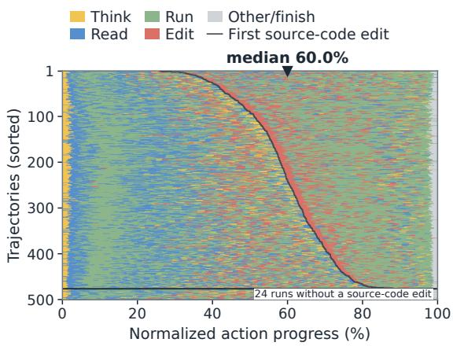
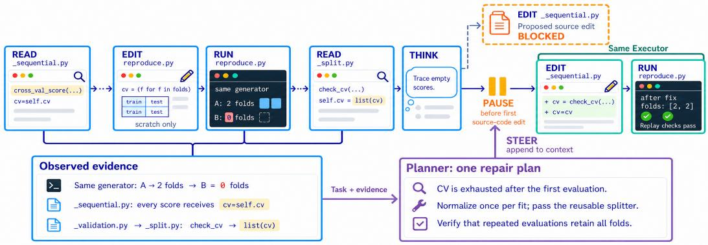
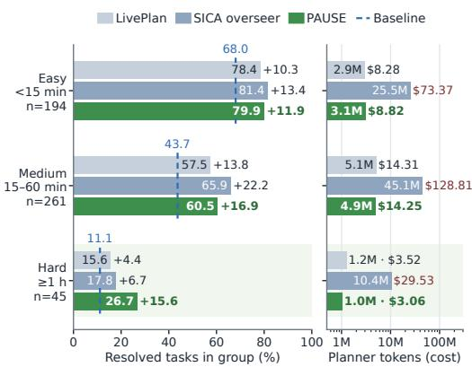
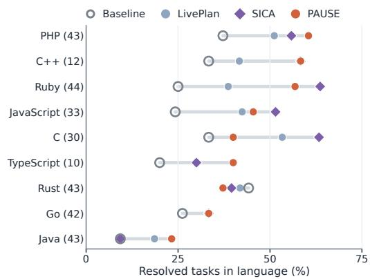

# PAUSE: Search-Free Steering of Coding Agents Before Their First Source-Code Edit

VIRAL PATEL, Mohamed bin Zayed University of Artificial Intelligence, United Arab Emirates BOYIN TAN, Mohamed bin Zayed University of Artificial Intelligence, United Arab Emirates JASON XUE, Mohamed bin Zayed University of Artificial Intelligence, United Arab Emirates YOUCHENG SUN, Mohamed bin Zayed University of Artificial Intelligence, United Arab Emirates

Coding agents can invest substantial efort in repository exploration and testing yet still produce unsuccessfu patches. Existing online steering methods commonly review execution trajectories periodically or invoke an advisor when a monitor detects behavioral problems. Frequent reviews are costly, and the absence of anomalous behavior does not mean that an agent is on the right track. To bridge this gap, we propose PAUSE, a framework for steering coding agents with a single planning intervention. We find that agents reach their first source-code edit at a median of 60% of trajectory progress, with the preceding work largely devoted to repository exploration, bug reproduction, and testing. This motivates intercepting the request before execution, so that the agent’s accumulated investigation can guide the repair it is about to implement. Because the first source-code edit directly identifies when to intervene, PAUSE locates this point without a learned monitor, a search over candidate checkpoints, or an extra model call—a property we call search-free. At this point, a separate Planner reads the task and pre-edit transcript to produce one repair plan. The same agent, the Executor, resumes with this plan, retaining its accumulated context and workspace. PAUSE applies both online, during a live run, and ofline, from a recorded trajectory prefix.

We evaluate PAUSE on SWE-bench Verified and SWE-bench Multilingual with two Executors and three agent harnesses. With Qwen3-coder as Executor and GPT-5.6 Sol as Planner, online steering in OpenHands improves resolution on Verified by 16.8%, and online steering in SWE-agent improves resolution on Multilingual by 14.7%. In SWE-agent, against LivePlan, which invokes an advisor through rule-based monitoring, PAUSE is more efective at a similar Planner cost, improving resolution by 3.2% and 3.7% on Verified and Multilingual, respectively. Against SICA, which reviews the trajectory periodically, PAUSE remains com parable on both benchmarks while incurring about 11% and 15% of SICA’s Planner cost on Verified and Multilingual, respectively. Ofline, PAUSE recovers 35.4% of the eligible failed Verified tasks, and resuming from the recorded prefix uses 33–41% fewer Executor tokens than restarting. These results show that a single planning intervention at the first source-code edit is more efective than rule-based monitoring and competitive with periodic oversight at a small fraction of its cost.

CCS Concepts: • Software and its engineering → Software maintenance tools; Software testing and debugging; • Computing methodologies → Intelligent agents.

Additional Key Words and Phrases: coding agents, agent steering, planning, trajectory reuse

## 1 Introduction

LLM-based coding agents tackle repository-level issues by inspecting code, making edits, and running commands and tests through an interactive tool interface [4, 36, 41]. Existing repair systems gather relevant context through localization and structural code search [38, 47], and infer code intent to guide repair [30]. However, agents can still struggle to turn this investigation into a correct repair [41]. This motivates online steering, which uses the context accumulated during execution to guide the agent’s subsequent repair decisions [11, 21, 25].

The timing of guidance shapes both the efectiveness and cost of online steering [22]. As shown in Table 1, existing methods decide when to guide either through repeated model-based reviews or by waiting for a detected problem. With periodic model-based review, methods such as SWE-PRM [11] and SICA [29] repeatedly assess ongoing execution at regular step or time intervals to determine whether guidance is needed. Each review incurs additional inference cost, while longer intervals can delay useful feedback until the agent has taken further steps along an inefective path [22]. A fixed schedule also need not align with the point at which accumulated investigation is ready to inform a code change. To reduce review overhead, LivePlan uses rule-based checks to invoke an advisor when signals such as repetition, stagnation, or skipped phases are detected [22]. This reduces monitoring cost, but intervention remains limited by the coverage of predefined signals, which LivePlan acknowledges may be incomplete [22]. Thus, the absence of a behavioral alarm does not establish that the repair strategy is correct: an agent may follow an orderly workflow while preparing an inefective change.

Table 1. Online steering methods compared by how they decide when to guide. Trigger: the event that starts an intervention. Timing model call: whether a model must be called to decide when to intervene. Needs detected problem: whether guidance is given only after a problem in the trajectory is detected. Interventions: how many times guidance is inserted into a single run.
<table><tr><td>Method</td><td>Trigger</td><td>Timing model call Needs detected problem Interventions</td><td></td><td></td></tr><tr><td></td><td>SWE-PRM [11] Fixed step interval</td><td>Yes</td><td>Yes</td><td>Repeated</td></tr><tr><td>SICA [29]</td><td>Overseer-chosen interval</td><td>Yes</td><td>Yes</td><td>Repeated</td></tr><tr><td>LivePlan [22]</td><td>Rule-detected anomaly</td><td>No</td><td>Yes</td><td>Repeated</td></tr><tr><td></td><td>PAUSE (Ours) First source-code edit</td><td>No</td><td>No</td><td>One</td></tr></table>

We therefore seek a moment to guide repair using the agent’s accumulated investigation, without repeated trajectory reviews or waiting for a behavioral alarm.

Why the first source-code edit? To identify such a moment, we analyze 500 recorded Qwen3-coder trajectories on SWE-bench Verified. We define the first source-code edit as the first file-editor request targeting a source-code file of the repository. We classify recorded actions into five categories: explicit reasoning, file inspection, shell command execution, file editing, and other operations, including termination. Figure 1 visualizes these sequences over normalized action progress and orders trajectories by their first source-code edit; edits to scratch files or reproduction scripts outside the designated source-code paths are excluded. Among the 476 trajectories containing such a request, its median position is 60.0% of action progress,

  
Fig. 1. Actions in 500 Qwen3-coder runs on SWE-bench Verified. The curve marks first source-code edits (median 60.0%); 24 runs without one lie below the divider.

and 80.5% occur after the midpoint. Before this point, command execution is the most common action type and file reads account for 31% of actions, reflecting substantial repository investigation before the proposed source change. This observation motivates intervening before the proposed source-code edit executes, when accumulated evidence is available to inform the repair and the proposed change remains open to revision. Our experiments confirm that this point balances the two: an earlier intervention gives the Planner too little of the investigation to ground a plan, whereas a later one arrives after the agent has committed to and built on its own changes, which the plan must then overturn.

Prior work uses explicit planning to coordinate repository edits [3, 34] and explores planning and execution roles in model collaboration [10, 19]. To guide repair at this point, we introduce PAUSE, a framework that uses the first source-code edit to trigger a single planning intervention. The request identifies the intervention point directly from the agent’s proposed action and its target path, without a learned monitor, a search over candidate checkpoints, or an additional model call to locate the point; we call this property search-free. A separate Planner reads the task and the coding agent’s preceding transcript, including inspected code and execution feedback, and returns one natural-language repair plan. The same coding agent, the Executor, receives this plan and continues from its existing conversation and workspace, retaining its investigation and responsibility for editing and testing without updating its underlying language model.

PAUSE supports online steering and ofline recovery. Online, it blocks the first source-code edit during a live run and adds the Planner’s guidance before resuming the Executor from its live state. Ofline, it restores an existing failed trajectory to a pre-edit state, adds a plan based on the recorded prefix, and resumes the same Executor with its remaining budget.

We evaluate PAUSE on SWE-bench Verified [17] and SWE-bench Multilingual [42], which spans nine programming languages, using two Executors and three agent harnesses. With Qwen3-coder as Executor and GPT-5.6 Sol as Planner in OpenHands, online steering improves resolution on Verified by 16.8%. In SWE-agent, it improves resolution by 14.8% and 14.7% on Verified and Multilingual respectively. Against LivePlan, which invokes an advisor through rule-based monitoring, PAUSE is more efective at a similar Planner cost, improving resolution by 3.2% and 3.7% on Verified and Multilingual, respectively. Against SICA, which reviews the trajectory periodically, PAUSE remains comparable on both benchmarks while incurring about 11% and 15% of SICA’s Planner cost on Verified and Multilingual, respectively. Ofline, PAUSE recovers 79 of 223 eligible failed Verified tasks, a recovery rate of 35.4%. These results show that a single planning intervention at the first source-code edit is more efective than rule-based monitoring and competitive with periodic oversight at a small fraction of its cost.

Our contributions are:

• An empirical characterization of the first source-code edit as an opportunity to guide repair after substantial repository investigation.

• PAUSE, a search-free framework that gives the same Executor one plan while preserving its context and workspace, supporting online steering and ofline recovery.

• An evaluation across two benchmarks, two Executors, and three harnesses, showing that PAUSE is more efective than rule-based monitoring at a similar Planner cost and is competitive with periodic oversight at 11–15% of its Planner cost, with controlled studies of intervention timing, planning guidance, and state reuse.

## 2 Related Work

## 2.1 Repository-Level Repair and Planning

SWE-bench frames repository-level repair as resolving real GitHub issues through changes to an existing codebase [17]. SWE-agent equips language models with interfaces for navigating repositories, editing files, and using execution feedback [41]. OpenHands provides an extensible platform in which agents perform software development through code execution and other tools [36]. CodeAgent integrates retrieval, navigation, implementation, and testing tools for repository-level coding [46], while RepoGraph and LingmaAgent use repository graphs to support context gathering and exploration [23, 27]. Alongside these interactive agents, Agentless separates localization, repair, and patch validation into a structured pipeline [38]. SHERLOC further studies dedicated diagnostic exploration, transferring localization findings to a downstream repair agent [32]. Training-based approaches include SWE-Fixer’s specialized retrieval and editing modules [40] and SWE-Gym’s agent and verifier training in executable repository environments [28].

Explicit planning also structures reasoning and collaboration. Plan-and-Solve decomposes problems before solving them [35], and Plan-and-Act separates high-level planning from environment actions [9]. MetaGPT organizes software development through role-specific procedures and intermediate artifacts [15], while Self-Collaboration coordinates analyst, coder, and tester roles [8]. Within repository repair, planning can compare candidate solutions before implementation. SWE-Manager trains an 8B model to select among competing repair proposals and synthesize a golden proposal for implementation [33]. Its P2A framework separates proposal generation, managerial selection and synthesis, and implementation into distinct roles [33]. PAUSE instead obtains one plan from the investigation already accumulated by an executing agent, using its first source-code edit to determine when guidance is provided. The same Executor then continues with its retained conversation and workspace.

## 2.2 Online Steering

Online steering introduces guidance while an agent is still carrying out its task. SWE-PRM periodically reviews a recent trajectory window and produces natural-language feedback grounded in a taxonomy of execution ineficiencies [11]. SICA includes an asynchronous overseer that examines execution state at regular intervals or key events and can notify or stop an agent when it detects problematic behavior [29]. LivePlan separates detection from advice: a deterministic monitor checks for signals such as repetition, stagnation, and skipped phases, then requests corrective guidance when a signal fires [22]. These designs make the intervention decision depend on periodic assessment or detected behavioral conditions. PAUSE uses a diferent trigger: the first source-code edit identifies an opportunity to guide the repair regardless of whether the preceding trajectory exhibits a behavioral alarm. This enables a single planning intervention without repeated model-based reviews or a search for an intervention point.

## 2.3 Trajectory Reuse and Reflection

Search-based approaches explore alternative reasoning and action sequences. Tree of Thoughts searches over alternative reasoning paths [43], while Language Agent Tree Search combines tree search with environment feedback and reflection [50]. For code generation, CodeTree searches over coding strategies, candidate programs, and revisions using execution and agent feedback [20].

Within repository repair, reusing intermediate work can reduce exploration repeated across attempts. SWE-Search combines Monte Carlo tree search with iterative refinement to explore alternative repair trajectories [2]. SWE-Replay retains an archive of sampled trajectories and selects intermediate steps from which to restore state and generate new continuations [7]. DARS resamples actions at branching points using prior execution feedback [1], while SE-Agent revises, recombines, and refines existing trajectories [13]. These methods use intermediate states to diversify the search for a successful repair. Ofline PAUSE reuses a recorded prefix to support a diferent operation: inserting one plan at a checkpoint determined by the first source-code edit and continuing with the remaining execution budget.

Another approach uses verbal feedback to guide later attempts. Reflexion stores verbal feedback from prior attempts in an episodic memory to guide subsequent trials [31]. Self-Refine iterates between feedback generation and output revision using the same language model [24]. Toolgrounded feedback supports related correction mechanisms: CRITIC verifies and revises outputs through tool interaction [12], while Self-Debugging and LDB use program execution evidence to diagnose and revise generated code [6, 49]. ChatRepair retains candidate patches and test feedback within a repair conversation to inform subsequent attempts [39].

Execution feedback also supports candidate selection: CodeT uses generated tests and execution agreement [5], whereas LEVER learns to score candidate programs from their inputs, code, and execution results [26]. PAUSE places the planning call within an existing coding trajectory and retains the Executor’s conversation and workspace when delivering guidance. The Planner reasons over the recorded evidence in a separate invocation, which may use the Executor’s model.

## 3 Method

## 3.1 Problem Formulation

A repository-level repair task consists of an issue description � and an initial repository snapshot $R _ { 0 }$ [17]. A coding agent, which we call the Executor, investigates the issue, modifies files, and tests its changes through an execution harness [36, 41]. Reasoning-and-acting agents interleave model decisions with observations from the environment [44]. After � completed actions, the Executor’s conversation $h _ { t }$ contains the system prompt, the task, and the recorded actions and observations; $W _ { t }$ is the resulting workspace. From this state, the Executor proposes its next action $a _ { t + 1 }$ for the harness to execute.

Online steering aims to improve the final repair during execution. It must determine when to intervene and what guidance to provide using the task and available evidence. We call the model supplying repair guidance the Planner. The available evidence includes inspected code, command outputs, and the Executor’s own test results. Benchmark evaluator feedback, hidden tests, reference patches, and future actions are excluded from the planning input.

## 3.2 Pre-Edit Intervention

The investigation preceding a source-code edit provides evidence for guidance while the proposed change remains open to revision. PAUSE uses the first source-code edit to trigger a single planning intervention, without repeated trajectory assessment or a search over intervention points.

As illustrated in Figure 2, PAUSE blocks the request and asks the Planner to produce a repair plan from the preceding evidence. It appends this plan to the same Executor’s conversation, allowing the agent to continue with its context and workspace preserved.

  
Fig. 2. Overview of PAUSE. The Executor investigates the repository by reading code, writing scratch scripts, and running them. When the Executor issues its first source-code edit, PAUSE blocks the request and passes the task and the observed evidence to the Planner. The Planner returns one repair plan, which PAUSE appends to the Executor’s conversation, and the same Executor resumes with its context and workspace preserved.

We identify a source-code edit by a file-editor request whose target is a source-code file of the repository. Let Π be the set of source-code paths in the repository, fixed before execution. Writing $\pi ( a )$ for the target path, we define the predicate and the first source-code edit as

$$
q ( a ) = { \big [ } a { \mathrm { ~ i s ~ a n ~ e d i t o r ~ r e q u e s t } } { \big ] } \wedge { \big [ } \pi ( a ) \in \Pi { \big ] } ,\tag{1}
$$

$$
k ^ { * } = \operatorname* { m i n } \{ t : q ( a _ { t } ) \} .\tag{2}
$$

The predicate can be evaluated before the requested edit executes, using only the action type and target path. No model call or future observation is needed to locate the boundary; this is its search-free property. A live run with no source-code edit request continues without an intervention.

## 3.3 Plan Generation and Online Steering

Interception and evidence. During a live run, PAUSE checks each proposed action before execution. On the first source-code edit $a _ { k ^ { * } }$ , it blocks the edit and constructs a planning transcript from the completed history $h _ { k ^ { * } - 1 }$ . The pending response, its edit payload, and its attached reasoning are excluded.

Algorithm 1 PAUSE in online and ofline mode.   
(a) Online steering (b) Ofline recovery   
Require: task $( d , R _ { 0 } )$ ; Planner $\mathcal { P } ;$ Executor in har- Require: task $( d , R _ { 0 } )$ ; failed trajectory; Planner $\mathcal { P }$   
ness � Executor; budget �   
Ensure: completed trajectory, or Unresolved Ensure: continued trajectory, or Ineligible   
1: ℎ ← system prompt and $d ;$ armed ← true 1: $k ^ { * }$ ← first source-code edit   
2: while Executor has not finished do 2: � ← last think before $k ^ { * }$   
3: � ← next proposed action 3: if $k ^ { * }$ or � does not exist then   
4: if armed and $q ( a )$ then 4: return Ineligible   
5: block � $; g  \mathcal { P } ( d , \phi ( h ) )$ 5: end if   
6: if no usable plan is returned then 6: restore $h _ { c } , W _ { c } ,$ and counter $b _ { c }$   
7: return Unresolved 7: if restoration fails the fidelity check then   
8: end if 8: return Ineligible   
9: append � to ℎ as a user message 9: end if   
10: armed ← false 10: $g  \mathcal { P } ( d , \phi ( h _ { c - 1 } ) )$   
11: else 11: append $g$ to $h _ { c }$ as a user message   
12: � runs �; append � and result to ℎ 12: resume Executor from $( h _ { c } , W _ { c } )$ with budget $B - b _ { c }$   
13: end if 13: return continued trajectory   
14: end while   
15: return recorded trajectory

Repair plan. The Planner $\mathcal { P }$ is a separate language-model invocation with no tools or direct workspace access. It may use a diferent underlying model from the Executor or a separate call to the same model. Given the issue and the transcript, it identifies the likely root cause, the code that needs to change, and the intended repair with its rationale:

$$
g = \mathcal { P } \big ( d , \phi ( h _ { k ^ { * } - 1 } ) \big ) ,\tag{3}
$$

where $\phi$ renders the recorded evidence as text, omitting editor actions. The plan $g$ is a naturallanguage recommendation; the Executor remains responsible for implementing and testing it. In Figure 2, the Planner combines observations from source reads and a reproduction run into a root cause, the code to change, and the intended repair.

Guided continuation. PAUSE appends the plan as a user message to the same Executor’s conversation. The Executor retains the completed history in full, the workspace $W _ { k ^ { * } - 1 }$ , and its model, system prompt, tools, and decoding settings. It then chooses its next action with this additional guidance. The blocked request is not executed automatically: the Executor may revise its approach or propose another edit to the same file. The interceptor is disabled after this intervention, and subsequent actions proceed under the harness’s native execution budget.

## 3.4 Ofline Recovery

Ofline recovery applies the same planning mechanism to recorded failures. The first source-code edit locates the intervention, but recovery restores an earlier reasoning checkpoint rather than pausing a live request. It requires a trajectory with explicit think actions.

Checkpoint and planning input. To place the additional guidance immediately after the Executor’s last recorded reasoning step before the first source-code edit, we select

$$
c = \operatorname* { m a x } \{ t < k ^ { * } : a _ { t } { \mathrm { ~ i s ~ a ~ t h i n k } } \} .\tag{4}
$$

The Executor retains that step and its observation in $h _ { c } ,$ , whereas the Planner receives the preceding transcript and produces $g = \mathcal { P } ( d , \phi ( h _ { c - 1 } ) )$ . Thus, the Planner supplies a repair proposal from the evidence preceding the selected reasoning step, and the Executor receives both its original reasoning and the new guidance. Section 4.5 compares this checkpoint with earlier and later cuts of the same failures. Recovery retains the recorded prefix through checkpoint � and generates a new continuation from $( h _ { c } , W _ { c } )$ . A trajectory without a source-code edit request or a preceding think is ineligible for this recovery protocol.

Restoration and continuation. PAUSE rebuilds $h _ { c }$ from the recorded model outputs and observations, and restores $W _ { c }$ by replaying the prefix actions on $R _ { 0 }$ in a fresh container. This retains files created during investigation, such as reproduction scripts, without calling the Executor model to regenerate the prefix. It also restores the harness’s iteration counter $b _ { c } ;$ ; this counter is distinct from the action index �. With an original budget �, continuation receives only $B - b _ { c }$ further iterations. A fidelity check compares the restored conversation, repository state, and counter with the recording. Tasks that fail this check are excluded from the recovery cohort. The plan is then appended using the same message interface as online steering, and the same Executor resumes with its retained state and remaining budget.

Use ofAI tools. Apart from the Executor and Planner models under study, we used AI coding assistants to implement the harness integrations, write the analysis and plotting scripts, and assemble the replication package. They produced no experimental data: every outcome comes from the agent runs and the oficial SWE-bench evaluation. The authors reviewed this code, and the released scripts recompute every reported number from the raw run outputs.

## 4 Experiment

We evaluate the efectiveness and eficiency of PAUSE for online steering (RQ1) and ofline recovery (RQ2), its generalization across harnesses and reasoning interfaces (RQ3), and the efectiveness ofthe pre-edit boundary (RQ4). The shared setup below defines the benchmarks, metrics, comparisons, and execution protocols used to answer these questions.

## 4.1 Experimental Setup

4.1.1 Benchmarks. We evaluate PAUSE on SWE-bench Verified [17], which contains 500 Python repository-level repair tasks, and SWE-bench Multilingual [42], which contains 300 tasks across nine programming languages. Both benchmarks support the online comparisons in RQ1, and recorded Verified trajectories support ofline recovery in RQ2. For RQ3, we compare harnesses on Verified. Full-benchmark evaluations measure overall task resolution, while recovery experiments focus on the Executor’s original failures. The checkpoint comparisons in RQ4 use failures that can be restored under both conditions.

4.1.2 Evaluation Metrics. Repair outcomes. We score patches with the corresponding benchmark evaluator. Resolution is the fraction of tasks resolved in the evaluated task set. For ofline resume tasks that are not continued retain their original outcomes; recovered failures are added to the original successes and observed regressions are subtracted.

Failure recovery and regressions. The ofline recovery and online model comparisons report Recovered, the number of originally failed tasks solved after intervention, and recovery rate, this count divided by the number of failures evaluated. Ofline recovery uses eligible failures that meet the checkpoint and restoration requirements in Section 3.4. Regression rate is the fraction of evaluated baseline successes that fail after intervention. Changes in these rates are reported in percentage points.

Resource use. To assess eficiency in RQ1 and RQ2, we report Planner and Executor tokens separately, in millions, and their model calls where measured. Dollar costs cover Planner inference at rates of \$2.50 and \$10 per million input and output tokens, respectively; they do not include Executor inference. Ofline continuation costs exclude the recorded run used to obtain the prefix. Totals that include this original run are identified explicitly.

Scoring and statistical analysis. Evaluator errors, empty patches, and missing evaluations count as unresolved. We compare paired outcomes with exact McNemar tests.

## 4.1.3 Baselines and Control Conditions. The unmodified Executor is the baseline.

Online steering. RQ1 compares PAUSE with LivePlan [22], which uses rule-based monitoring to invoke an advisor when it detects trouble, and the SICA overseer [29], which reviews the trajectory on a schedule and decides whether to interject. These methods compare a single pre-edit intervention with rule-triggered advice and periodic model oversight.

Ofline recovery. RQ2 compares PAUSE with SHERLOC [32], which performs a dedicated diagnostic-localization pass before repair and transfers its findings to the Executor. At a fixed restored checkpoint, we compare no-plan continuation, self-reconsideration, and Planner guidance to assess the contribution of the supplied plan. With the same plan, we compare resuming the recorded state with restarting from the initial repository to assess the repair–cost trade-of of state reuse.

Generalization and boundary controls. RQ3 compares each harness with its own unmodified Executor. A think-stripped variant removes explicit think content from the Planner input to test dependence on that reasoning interface. RQ4 uses guidance from successful donor runs to test whether failed trajectories can still be redirected at the boundary, then compares the default ofline checkpoint with cuts after 20% and 90% of the recorded actions, an immediate pre-edit cut, and a checkpoint associated with a later source-code edit.

4.1.4 Experimental Configuration. Models and harnesses. We use Qwen3-Coder-30B-A3B-Instruct and Devstral-Small-2507 as Executors. We hereafter refer to them as Qwen3-coder and Devstral small, respectively. The five Planners are GPT-5.6 Sol, Gemini 3.8 Flash, Gemini 3.5 Flash Lite, Qwen3-30B-A3B-Thinking-2507, hereafter Qwen3-30B-Thinking, and Qwen3-coder. Online steering runs in OpenHands, SWE-agent [41], and Pi [45]; ofline recovery uses recorded OpenHands trajectories [36]. The main online comparison in RQ1 uses SWE-agent with Qwen3-coder and GPT-5.6 Sol; RQ3 extends the evaluation to other harnesses. OpenHands pauses source-code edit requests through its security and confirmation mechanisms, while SWE-agent and Pi block the edit tool call directly. OpenHands provides an explicit think tool; SWE-agent and Pi do not. Planner transcripts include reasoning text that the Executor writes alongside its actions.

Table 2. Decoding setings and execution budgets.
<table><tr><td>Component or setting</td><td>Configuration</td></tr><tr><td>Executors</td><td>Temperature 0; top-p 1; 4,096 output tokens</td></tr><tr><td>Executor context</td><td>262,144 tokens (Qwen3-coder); 131,072 (Devstral-small)</td></tr><tr><td>PAUSE API Planners, default</td><td>Temperature 0; 8,192 output tokens</td></tr><tr><td>Qwen3-30B-Thinking Planner</td><td>Temperature 0.99; top-p 0.95; seed 0; 81,920 output tokens</td></tr><tr><td>LivePlan advisor</td><td>Temperature 0; 3,000 output tokens</td></tr><tr><td>SICA overseer</td><td>Temperature 0; 8,192 output tokens</td></tr><tr><td>Recorded Verified runs</td><td>100 iterations</td></tr><tr><td>SWE-agent comparisons</td><td>100 Executor calls; 14,400 seconds per run</td></tr></table>

Planner configuration. Table 2 summarizes decoding and budget settings. Online, the Planner is queried once when triggered; no usable plan within the output limit counts as unresolved. Ofline, malformed Planner output is retried before inserting one plan.

Evaluation protocol. The main comparisons use one designated attempt per task. The donorguidance diagnostic in RQ4 uses three attempts per donor–recipient pair and counts a pair as successful if at least one continuation succeeds. Online attempts interrupted by an endpoint connection, container, or runtime-start failure are rerun.

In RQ2, resumed runs use the recorded remaining Executor budget, whereas restarted runs receive the full budget. In the paired checkpoint comparisons of RQ4, each arm independently restores its prefix, obtains a plan from that prefix, and receives the same number of fresh Executor iterations. The cuts after 20% and 90% of the actions are placed by the length of the recorded failed trajectory.

## 4.2 RQ1: How Efective and Eficient Is Online Steering?

The central design choice in PAUSE is to provide one repair plan when an Executor first requests a source-code edit. We first evaluate this choice during live execution: does a single intervention improve task resolution, and how much computation does it require compared with rule-based monitoring and periodic model oversight? This establishes the efectiveness of online steering before considering recovery from recorded failures.

Comparison setup. Table 3 reports results in SWE-agent with Qwen3-coder as the Executor and GPT-5.6 Sol as the Planner. We compare PAUSE with LivePlan and SICA on all 500 Verified and 300 Multilingual tasks, using matched Executor budgets, together with the unmodified Executor on each benchmark. We compare resolution alongside Planner and Executor tokens; dollar costs cover Planner inference.

Overall repair gains. PAUSE improves resolution on both benchmarks while reducing Executor token use. On Verified, resolution rises from 50.2% to 65.0%, a gain of 14.8 percentage points and a net increase of 74 solved tasks. On Multilingual, it rises from 28.3% to 43.0%, adding 14.7 points and 44 solved tasks, a diference that is statistically significant $( p = 4 \times 1 0 ^ { - 7 } )$ . Executor tokens decrease from 595.5M to 564.2M on Verified and from 469.3M to 459.9M on Multilingual, reductions of 5.3% and 2.0%, respectively, while the intervention adds 9.0M and 8.5M Planner tokens. These results show that the repair gains coincide with lower Executor token use, with the additional computation supplied by the Planner.

Comparison with rule-based steering. Against LivePlan, PAUSE achieves higher observed resolution at similar Planner cost, a gain of 3.2 percentage points that is not statistically significant $( p = 0 . 1 1 )$ . PAUSE makes 0.93 Planner calls per task against LivePlan’s 2.33, yet their aggregate Planner tokens are close, 9.0M versus 9.2M, as are their costs, \$26.13 versus \$26.10. Thus, fewer planning requests here correspond to a similar total planning expenditure. On Multilingual, PAUSE leads LivePlan by 3.7 percentage points, 129 against 118 solved tasks, a diference that is also not statistically significant $( p = 0 . 1 8 )$ . Its Planner cost remains similar, \$23.68 versus \$16.41, while it uses 7.6% fewer Executor tokens, 459.9M versus 497.5M. These results support intervention at the first source-code edit as an efective alternative to rule-triggered advice in the evaluated settings.

Table 3. Steering compared with monitoring-based methods. Qwen3-coder Executor and GPT-5.6 Sol Planner in SWE-agent on all 500 SWE-bench Verified and all 300 SWE-bench Multilingual tasks. Resolution: resolved tasks over the full benchmark, with the gain over each block’s baseline. Tokens are in millions; Cost covers Planner inference only.
<table><tr><td rowspan="2">Method</td><td rowspan="2">Planner</td><td rowspan="2">Resolved</td><td rowspan="2">Resolution (%)</td><td colspan="2">Tokens (M)</td><td rowspan="2">Cost ($)</td></tr><tr><td>Planner</td><td>Executor</td></tr><tr><td>SWE-bench Verified, 500 tasks</td><td></td><td></td><td></td><td></td><td></td><td></td></tr><tr><td>Baseline</td><td></td><td>251/500</td><td>50.2</td><td>0</td><td>595.5</td><td>0</td></tr><tr><td>LivePlan [22]</td><td>GPT-5.6 Sol</td><td>309/500</td><td>61.8 (+11.6)</td><td>9.2</td><td>561.9</td><td>26.10</td></tr><tr><td>SICA overseer [29]</td><td>GPT-5.6 Sol</td><td>338/500</td><td>67.6 (+17.4)</td><td>80.9</td><td>1056.4</td><td>231.71</td></tr><tr><td>PAUSE</td><td>GPT-5.6 Sol</td><td>325/500</td><td>65.0 (+14.8)</td><td>9.0</td><td>564.2</td><td>26.13</td></tr><tr><td>SWE-bench Multilingual, 300 tasks</td><td></td><td></td><td></td><td></td><td></td><td></td></tr><tr><td>Baseline</td><td></td><td>85/300</td><td>28.3</td><td>0</td><td>469.3</td><td>0</td></tr><tr><td>LivePlan [22]</td><td>GPT-5.6 Sol</td><td>118/300</td><td>39.3 (+11.0)</td><td>5.9</td><td>497.5</td><td>16.41</td></tr><tr><td>SICA overseer [29]</td><td>GPT-5.6 Sol</td><td>133/300</td><td>44.3 (+16.0)</td><td>55.9</td><td>1003.5</td><td>159.63</td></tr><tr><td>PAUSE</td><td>GPT-5.6 Sol</td><td>129/300</td><td>43.0 (+14.7)</td><td>8.5</td><td>459.9</td><td>23.68</td></tr></table>

  
Fig. 3. Resolution and Planner cost by task dificulty on SWE-bench Verified with SWE-agent. Dashed lines show the unmodified Executor, and the accom- panying values show percentage-point gains over it. Here, � denotes the number of tasks in each dificulty group.

  
Fig. 4. Resolution by programming language on SWE-bench Multilingual with SWE-agent. The bar in each row spans the lowest and highest resolution among the four configurations, and the number after each language is its task count.

Comparison with periodic oversight. SICA achieves the highest aggregate resolution at 67.6%, 2.6 percentage points and 13 tasks above PAUSE’s 65.0%; this diference is not statistically significant $( p = 0 . 1 8 )$ . SICA’s resource use is substantially higher: it requires 21 times as many Planner calls, 8.9 times the Planner cost, and 1.9 times the Executor tokens; the Planner expenditure is \$231.71 versus \$26.13, and Executor token use is 1,056.4M versus 564.2M. Periodic oversight therefore does not yield significantly higher resolution for its additional computation: PAUSE stays within a non-significant margin of SICA at about 11% of its Planner cost. The same pattern holds on Multilingual, where SICA resolves 133 tasks against 129 for PAUSE, a lead of 1.3 percentage points that is not statistically significant (� = 0.71). SICA again incurs 6.7 times the Planner cost, \$159.63 versus \$23.68, and 2.2 times the Executor tokens, 1,003.5M versus 459.9M, so PAUSE stays within this margin at about 15% of SICA’s Planner cost. A single intervention can thus provide repair benefits comparable to repeated oversight with far less planning and execution.

Task dificulty. Figure 3 shows that PAUSE improves over the unmodified Executor and exceeds LivePlan in all three dificulty groups, while its ranking relative to SICA varies. SICA leads by 1.5 percentage points on easy tasks and 5.4 on medium tasks, but at 8.3 and 9.0 times the Planner cost of PAUSE, spending \$73.37 against \$8.82 and \$128.81 against \$14.25, respectively. These groups contain 194 and 261 tasks, respectively, together accounting for 91% of Verified; their weight explains SICA’s higher aggregate resolution on Verified. In the 45-task hard group, PAUSE raises resolution from the unmodified Executor’s 11.1% to 26.7%, exceeding SICA’s 17.8% by 8.9 points, with Planner cost of \$3.06 against \$29.53. The hard-task gains suggest that external planning may help the Executor turn its accumulated investigation into a more efective repair strategy. By intervening before the first source-code edit, PAUSE gives the Planner an opportunity to reassess how the collected evidence should translate into a concrete change. A repair plan grounded in the accumulated evidence may therefore be useful even when the Executor’s unaided success rate is low.

Programming languages. Figure 4 shows that PAUSE improves over the unmodified Executor in eight of the nine Multilingual languages. The largest gains come from Ruby, PHP, and JavaScript, which add 14, 10, and 7 solved tasks, respectively, and together account for 31 of the 44 additional tasks. Rust is the only language in which PAUSE falls below the unmodified Executor, resolving 16 of 43 tasks against 19. LivePlan and SICA also fall below it on Rust, with 18 and 17 tasks, so the drop is shared by all three forms of external guidance rather than specific to intervention at the first source-code edit. SICA’s lead on Multilingual comes mainly from C and Ruby, where it solves 7 and 3 more tasks than PAUSE, while PAUSE leads SICA on Java, 10 against 4. C++ and TypeScript contain only 12 and 10 tasks, so their per-language diferences are not informative.

Answer. With SWE-agent, PAUSE raises resolution by 14.8 percentage points on Verified and 14.7 on Multilingual while reducing Executor token use. It achieves higher observed resolution than LivePlan on both benchmarks at similar Planner cost. Against SICA, it trails by a non-significant 2.6 points on Verified and 1.3 on Multilingual at about 11% and 15% of SICA’s Planner cost, and it leads on hard Verified tasks.

## 4.3 RQ2: How Efective and Eficient Is Ofline Recovery?

Beyond steering a live run, PAUSE can revisit a failed attempt by resuming from its recorded pre-edit prefix. This setting allows the agent to reuse its repository investigation while following a new repair plan. We evaluate whether such guidance recovers failures and whether retaining the prefix reduces the computation needed compared with starting again.

Comparison setup. We use recorded OpenHands trajectories on SWE-bench Verified. Table 4 compares three continuation conditions on 223 eligible Qwen3-coder failures: no plan (N), which resumes without an added message; self-reconsideration (S), which flags the selected think as a possible cause of failure and asks the Executor to reconsider; and Planner plan (P), which supplies a repair plan from the task and pre-edit transcript. All three retain the same checkpoint, conversation history, workspace, and remaining Executor budget. We evaluate four Planners with each Executor, including 174 eligible Devstral-small failures. The table reports recovery among these failures. Prior analyses of LLM self-correction emphasize distinguishing the sources of feedback when evaluating revision [16, 18].

Table 4. Ofline recovery in OpenHands on SWE-bench Verified across Executors. Each failed trajectory resumes from its restored checkpoint, the last think before the first source-code edit, with its remaining budget. Recovered reports solved eligible failures: 223 for Qwen3-coder and 174 for Devstral-small. N: no plan; S: self-reconsideration; P: lan from the named Planner.
<table><tr><td>Intervention</td><td>Qwen3-coder Executor</td><td>Devstral-small Executor</td></tr><tr><td>N: no plan</td><td>9/223 (4.0%)</td><td>14/174 (8.0%)</td></tr><tr><td>S: self-reconsideration</td><td>13/223 (5.8%)</td><td>17/174 (9.8%)</td></tr><tr><td>P: Executor Model</td><td>12/223 (5.4%)</td><td>20/174 (11.5%)</td></tr><tr><td>P: Gemini 3.5 Flash Lite</td><td>22/223 (9.9%)</td><td>12/174 (6.9%)</td></tr><tr><td>P: Gemini 3.8 Flash</td><td>31/223 (13.9%)</td><td>29/174 (16.7%)</td></tr><tr><td>P: GPT-5.6 Sol</td><td>79/223 (35.4%)</td><td>53/174 (30.5%)</td></tr></table>

Recovery through external guidance. The continuation controls distinguish another opportunity to execute from the contribution of a new repair plan. Unaided continuation recovers 9 of 223 failures (4.0%), showing that some failed attempts can succeed simply by continuing from the restored checkpoint. Self-reconsideration recovers 13 (5.8%), so a cue to revisit the selected reasoning yields limited recovery in this evaluation. With GPT-5.6 Sol, PAUSE recovers 79 failures (35.4%). These conditions share the restored state and remaining Executor budget, supporting the value of external repair guidance. One explanation is that spotting a flawed line of reasoning still leaves the Executor to find a replacement, whereas the Planner supplies a concrete direction.

The choice ofPlanner matters. Using the Executor’s own model as a separate Planner recovers 12 failures (5.4%), close to the observed counts for unaided continuation and self-reconsideration. Introducing a planning role therefore does not by itself ensure a large recovery gain. Gemini 3.8 Flash recovers 31 failures, while GPT-5.6 Sol recovers 79. These diferences suggest that the benefit depends on the guidance supplied by the chosen Planner, beyond the presence of an additional model call. With Devstral-small, GPT-5.6 Sol recovers 53 of 174 failures (30.5%), showing that this recovery benefit also extends to a second Executor.

Full-benchmark comparison. Table 5 reports the separate 500-task evaluation with Qwen3-coder, comparing PAUSE with SHERLOC under Qwen3-30B-Thinking planning and additionally evaluating GPT-5.6 Sol. Resume retains the recorded history and workspace and uses the remaining budget; restart gives the same plan to a fresh Executor with the initial repository and full budget. The table reports net resolution, accounting for observed regressions, alongside Planner and Executor tokens. It therefore complements the failure-recovery results with overall repair outcomes and resource use.

Reusing a failed investigation. The resume–restart comparison tests whether a failed attempt can still provide a useful starting point for another repair. It measures the practical trade-of of prefix reuse, with both retained state and available budget changing. On the 223 failures, the same GPT-5.6 Sol plans recover 79 tasks with resume and 81 with restart. Restart requires 2.0× as many Executor calls, or 6,020 additional calls, and 22% more Executor tokens, or 56.1M. These comparisons show that a failed run can still provide a useful starting state for recovery, with a trade-of between execution cost and the number of tasks recovered.

At full-benchmark scale, GPT-5.6 Sol resume achieves 58.2% resolution against restart’s 58.6%, saving 171.7M Executor tokens (33%) with the same 8.7M Planner tokens. With Qwen3-30B-Thinking, resume saves 265.9M Executor tokens (41%) and resolves more tasks than restart.

Table 5. Full-benchmark ofline evaluation on SWE-bench Verified. Qwen3-coder in OpenHands, 500 tasks. Resume retains history and workspace with the remaining budget; restart uses the same plan from the initial repository with the full budget. Resume counts add recoveries to original successes and subtract observed regressions. Tokens (M) exclude the original run for continuations; costs cover Planner inference.
<table><tr><td rowspan="2">Method</td><td rowspan="2">Planner</td><td rowspan="2"></td><td rowspan="2">Resolved Resolution (%)</td><td colspan="2">Tokens (M)</td><td rowspan="2">Cost ($)</td></tr><tr><td>Planner</td><td>Executor</td></tr><tr><td>Baseline</td><td>一</td><td>228/500</td><td>45.6</td><td>0</td><td>791.9</td><td>0</td></tr><tr><td>SHERLOC [32]</td><td>Qwen3-30B-Thinking</td><td>211/500</td><td>42.2 (−3.4)</td><td>65.7</td><td>703.9</td><td>0</td></tr><tr><td>PAUSE (restart)</td><td>Qwen3-30B-Thinking</td><td>207/500</td><td>41.4 (−4.2)</td><td>16.0</td><td>641.6</td><td>0</td></tr><tr><td>PAUSE (resume)</td><td>Qwen3-30B-Thinking</td><td>217/500</td><td>43.4 (−2.2)</td><td>14.5</td><td>375.7</td><td>0</td></tr><tr><td>PAUSE (restart)</td><td>GPT-5.6 Sol</td><td>293/500</td><td>58.6 (+13.0)</td><td>8.7</td><td>519.1</td><td>25.75</td></tr><tr><td>PAUSE (resume)</td><td>GPT-5.6 Sol</td><td>291/500</td><td>58.2 (+12.6)</td><td>8.7</td><td>347.4</td><td>25.75</td></tr></table>

Cost of the recorded investigation. The savings above concern continuation from an existing trajectory. Relative to SHERLOC, resume with Qwen3-30B-Thinking uses 47% fewer Executor tokens and 78% fewer Planner tokens; GPT-5.6 Sol resume uses approximately halfas many Executor tokens as SHERLOC. Including the original recorded run, however, GPT-5.6 Sol resume uses 1,139.3M Executor tokens against SHERLOC’s 703.9M. The practical use case is therefore recovery after an agent has already attempted the task: the recorded investigation provides an existing source of evidence and execution state, allowing another repair attempt at lower additional cost.

Outcomes on originally solved tasks. An intervention that recovers failures could also break repairs that the Executor originally completed. We therefore examine the 178 originally solved tasks evaluated under both Planners; of the other 50 original successes, 13 never request a sourcecode edit, so PAUSE leaves them unchanged, and 37 could not be successfully replayed in a fresh container in at least one Planner’s run. GPT-5.6 Sol plans lead to 10 regressions, a regression rate of 5.6%, whereas Qwen3-30B-Thinking plans lead to 26, a rate of 14.6%; the diference between the two Planners is significant at $\textstyle p < 0 . 0 1$ . To determine how many of these regressions arise from resumption itself, we resume the same checkpoints with no plan. This control yields 10 regressions, the same number as under GPT-5.6 Sol, and the diference between the two is not statistically significant at $p = 0 . 8 1$ . Restoring a checkpoint and re-executing the remaining steps therefore accounts for most of the observed regressions, and guidance from a strong Planner does not increase them. Plans from Qwen3-30B-Thinking, by contrast, produce 16 more regressions than the noplan control, suggesting that weaker guidance can steer the Executor away from repairs it would otherwise complete. Because the full-benchmark resolution subtracts every observed regression, including those that resumption alone produces, it provides a conservative estimate of the gain attributable to the plan. Together with the recovery results, these findings show that GPT-5.6 Sol guidance recovers failed runs without breaking more successful runs than continuation alone.

Net repair performance. The full-benchmark results establish whether failure recovery translates into an overall improvement after accounting for observed regressions. Resuming with GPT-5.6 Sol reaches 58.2% resolution, 12.6 percentage points above the unmodified Executor’s 45.6%. With Qwen3-30B-Thinking, resume reaches 43.4%, compared with SHERLOC’s 42.2%; both remain below the unmodified Executor. The resource savings with this Planner therefore accompany a loss in absolute repair performance. GPT-5.6 Sol raises resolution by 16.0 points over SHERLOC, although this comparison also changes the Planner. Taken together, the results show why recovery quality and reuse eficiency matter jointly: a capable Planner can turn retained investigation into improved repair outcomes, while prefix reuse reduces the execution required for another attempt.

Answer. Ofline PAUSE can make productive use of a failed investigation by supplying new repair guidance. With GPT-5.6 Sol, it recovers 35.4% of eligible Qwen3-coder failures and 30.5% of Devstralsmall failures; the separate full-benchmark evaluation raises net resolution from 45.6% to 58.2%, and its plans cause no more regressions on originally solved tasks than resuming without a plan. Given an existing trajectory, resuming uses 33–41% fewer Executor tokens than restarting at full-benchmark scale. Substantial recovery depends on the Planner, while prefix reuse ofers a practical trade-of between additional execution cost and repair outcomes.

## 4.4 RQ3: Does PAUSE Generalize Across Setings?

We next examine whether the benefits of online steering extend across execution harnesses and reasoning interfaces, which vary across coding agents and determine the actions and transcript that PAUSE uses.

Comparison setup. Table 6 compares SWE-agent, Pi, and OpenHands on all 500 Verified tasks with the Qwen3-coder Executor and GPT-5.6 Sol Planner fixed. Because the harnesses difer in tools, system prompts, and budgets, each is compared with its own unmodified Executor. Only OpenHands exposes an explicit think tool, and we also remove this content from its Planner input.

Table 6. Transfer across agent harnesses. Online PAUSE with Qwen3-coder Executor and GPT-5.6 Sol Planner on 500 Verified tasks. Think stripped hides think content from the Planner; units follow Table 3.
<table><tr><td rowspan="2">Harness</td><td rowspan="2">Method</td><td rowspan="2">Resolved</td><td rowspan="2">Resolution (%)</td><td colspan="2">Tokens (M)</td><td rowspan="2">Cost ($)</td></tr><tr><td>Planner</td><td>Executor</td></tr><tr><td rowspan="2">SWE-agent no think tool</td><td>Baseline</td><td>251/500</td><td>50.2</td><td>0</td><td>595.5</td><td>0</td></tr><tr><td>PAUSE</td><td>325/500</td><td>65.0 (+14.8)</td><td>9.0</td><td>564.2</td><td>26.13</td></tr><tr><td rowspan="2">Pi no think tool</td><td>Baseline</td><td>185/500</td><td>37.0</td><td>0</td><td>341.9</td><td>0</td></tr><tr><td>PAUSE</td><td>215/500</td><td>43.0 (+6.0)</td><td>6.7</td><td>358.8</td><td>18.57</td></tr><tr><td rowspan="3">OpenHands think tool</td><td>Baseline</td><td>227/500</td><td>45.4</td><td>0</td><td>372.5</td><td>0</td></tr><tr><td>PAUSE</td><td>311/500</td><td>62.2 (+16.8)</td><td>6.7</td><td>390.6</td><td>20.38</td></tr><tr><td>think stripped</td><td>318/500</td><td>63.6 (+18.2)</td><td>6.1</td><td>371.7</td><td>18.79</td></tr></table>

Across harnesses. PAUSE improves resolution in all three harnesses, by 14.8 percentage points in SWE-agent, 6.0 in Pi, and 16.8 in OpenHands, or 74, 30, and 84 additional solved tasks. In OpenHands, it solves 106 tasks that the unmodified Executor misses while losing 22 $( p = 2 \times 1 0 ^ { - 1 4 } )$ . The gains vary even with the model pair fixed: the plan narrows the gap between SWE-agent and OpenHands from 4.8 to 2.8 points, whereas Pi gains least despite the lowest baseline. One likely contributor is that the Pi Executor sometimes modified source code through shell commands before its first edi tool call, so no plan was inserted (Section 5.1); we did not measure how often this occurs.

Cost of transfer. The Planner cost stays between \$0.037 and \$0.052 per task, and Planner tokens remain below 2% of the Executor tokens in every harness. Executor tokens fall by 5.3% in SWEagent but rise by 4.9% in both OpenHands and Pi, so the Executor savings observed in RQ1 depend on how the harness continues after receiving the plan.

Where the online gain arises. Splitting the 500 OpenHands tasks by the outcome of the recorded trajectories used in RQ2 shows gains in every stratum. Resolution rises from 20.6% to 40.4% on the 223 tasks of the ofline recovery cohort, from 16.3% to 44.9% on the 49 failures excluded from ofline replay, and from 75.9% to 87.3% on the 228 recorded successes, where PAUSE gains 39 tasks and loses 13. The plan thus reaches failures that ofline recovery cannot restore and also raises success on tasks within the Executor’s reach.

Reasoning interfaces. Removing think content from the OpenHands Planner input yields 318 solved tasks against 311 with the full transcript, at nearly the same cost. The two variants dif fer on 71 tasks, split 39 to 32 $( p \ = \ 0 . 4 8 )$ , so explicit reasoning changes which tasks a plan helps but not significantly how many. Together with the gains in SWE-agent and Pi, which have no think tool, this indicates that reads, commands, and their outputs give the Planner suficient evidence for a useful plan.

Answer. Online PAUSE raises resolution by 6.0–16.8 percentage points across three harnesses on Verified at a Planner cost of at most \$0.052 per task. In OpenHands, it improves resolution on both recorded failures and recorded successes. Gains persist without explicit think content, while their magnitude and the efect on Executor tokens vary with the harness.

## 4.5 RQ4: Is the Pre-Edit Boundary Efective?

The preceding evaluations assess what PAUSE achieves; we now examine the intervention point underlying those results. The first source-code edit occurs at a median of 60.0% of action progress on Verified (Figure 1), after substantial investigation. This raises two questions: can guidance still redirect the repair at this point, and would an earlier or later point improve recovery? We examine both through interventions on recorded trajectories.

Comparison setup. We first insert pre-edit reasoning from a successful run of the same task as donor guidance, testing whether a failed trajectory can produce a successful continuation. We then compare the default ofline checkpoint, after the last think before the first source-code edit, with three alternative cuts of the same recorded failures: after 20% of the recorded actions, immediately before the first source-code edit, and after 90% of the recorded actions. We also compare it with a checkpoint associated with a later source-code edit. Each arm independently restores its prefix and obtains its own GPT-5.6 Sol plan, with the same number of fresh Executor iterations. Each comparison thus tests the checkpoint together with its plan.

Guidance at the boundary. Donor guidance produces a successful continuation in at least one of three attempts for 64 of 97 donor–recipient pairs, a rate of 66.0%, and in all three attempts for 41, a rate of 42.3%. Donor and recipient runs come from Executor configurations with diferent prompts, and across the four donor–recipient combinations the rate of at least one success ranges from 58.8% to 69.0%. This diagnostic uses guidance drawn from successful executions, so it assesses the possibility of a successful continuation at the boundary. The retained investigation remains compatible with a correct repair even when the original run failed.

Earlier and later cuts. Restoring a prefix replays its recorded actions in a fresh container, and this replay can fail the fidelity check or leave a continuation without a grading result. A task enters a comparison only when every arm in that comparison restores and is graded. The fourway comparison therefore uses the 161 tasks graded in all arms, and each pairwise comparison with PAUSE uses the larger set shared by that pair, which contains 207, 196, or 167 tasks. Table 7 compares the four pause positions. On the 161 tasks graded in every arm, the PAUSE checkpoint recovers 56 tasks, a rate of 34.8%, compared with 43 for the cut after 20% of the actions and 50 for both the cut immediately before the first source-code edit and the cut after 90%. In every paired comparison, PAUSE solves more tasks that the alternative misses than the reverse. The early cut performs worst: on 207 shared tasks, PAUSE solves 26 tasks that the 20% cut misses, while the 20% cut solves 15 that PAUSE misses, a gap of 5.3 percentage points. This diference is a trend that is not significant at the 0.05 level $( p = 0 . 1 2 )$ , but its direction is consistent with a Planner that has seen less of the investigation. Cutting immediately before the edit retains the intervening actions but recovers 59 of 196 shared tasks, compared with 65 for PAUSE. The cut after 90% lets the Planner see almost the entire failed run, by which point the Executor has already edited, yet it recovers

32.3% of 167 shared tasks, compared with 34.7% for PAUSE. Neither later cut difers significantly from PAUSE $( p = 0 . 3 9$ and $\begin{array} { r } { p = 0 . 6 2 ) } \end{array}$ . Recovery is therefore highest at the checkpoint associated with the first source-code edit, which PAUSE locates without knowing the length of the run.

Table 7. Recovery under diferent pause positions on SWE-bench Verified. Each arm restores its own prefix of the same recorded failures and obtains its own GPT-5.6 Sol plan. Common: the 161 tasks graded in every arm. Paired: each arm against the PAUSE checkpoint on their largest shared set, with the tasks solved only by the arm or only by PAUSE and the exact McNemar �-value.
<table><tr><td rowspan="2">Pause position</td><td>Common</td><td colspan="5">Paired with PAUSE</td></tr><tr><td>Resolved (%)</td><td>Tasks</td><td>Arm (%)</td><td></td><td>PAUSE (%) Only arm / PAUSE</td><td>p</td></tr><tr><td>PAUSE checkpoint</td><td>56/161 (34.8)</td><td>一</td><td>一</td><td>一</td><td>一</td><td>一</td></tr><tr><td>After 20% of actions</td><td>43/161 (26.7)</td><td>207</td><td>27.5</td><td>32.9</td><td>15 / 26</td><td>0.12</td></tr><tr><td>Immediately before the edit</td><td>50/161 (31.1)</td><td>196</td><td>30.1</td><td>33.2</td><td>14 / 20</td><td>0.39</td></tr><tr><td>After 90% of actions</td><td>50/161 (31.1)</td><td>167</td><td>32.3</td><td>34.7</td><td>16 / 20</td><td>0.62</td></tr></table>

Waiting for a later source-code edit. As a supplementary check on a smaller cohort, we tie the later cut to the Executor’s own actions rather than to a fixed fraction of the run, selecting the first later source-code edit preceded by a diferent reasoning step. Of 46 candidate trajectories, 17 fail restoration checks before any model call, leaving 29 paired runs. The first and later source-code edit checkpoints each recover 15 tasks. Consistent with the cut after 90%, waiting for another source-code edit yields no increase in recovered tasks.

Answer. Successful continuations remain possible at the pre-edit boundary: donor guidance yields success for 64 of 97 pairs within three attempts. Under matched continuation budgets, no alternative pause position, whether after 20% or 90% of the actions, immediately before the first source-code edit, or at a later sourcecode edit, recovers more tasks than the default ofline checkpoint, and an early cut shows a trend toward fewer recoveries. These results support the first source-code edit as a practical point for steering after investigation and before the requested edit executes.

## 5 Limitations and Threats to Validity

## 5.1 Limitations

PAUSE relies on repository evidence accumulated before the intervention. The Planner receives the issue and the pre-edit transcript, but cannot independently inspect the workspace or execute commands. When the investigation omits relevant code or informative reproduction feedback the Planner can propose hypotheses but cannot verify them against the repository. Prior studies distinguish correction based only on model-generated feedback from correction supported by reliable external feedback [16, 18]. Further investigation by the Executor may therefore be needed to assess whether the suggested strategy is appropriate.

The framework supplies a single repair plan and does not refresh its guidance as new observations arrive. New test results or implementation discoveries may make parts of that plan obsolete, leaving subsequent adjustment to the Executor. Steering can redirect the repair strategy, but translating that strategy into a correct patch still requires the Executor to implement and validate the changes.

The intervention depends on a file-editor request for the first source-code edit. Integrating PAUSE requires a harness that exposes this request before execution and a path rule appropriate to the repository layout. Trajectories without such a request receive no intervention, limiting coverage in workflows whose source changes use other editing interfaces, such as shell commands.

Ofline recovery further requires a recorded trajectory with a usable reasoning checkpoint and faithfully restorable history and workspace. A transcript alone is insuficient when the corresponding execution state cannot be reconstructed. The savings from recovery concern the additional Executor computation for another attempt once the prefix is available; producing the original trajectory remains part of the total cost. Online steering uses the live state without prior recording.

## 5.2 Threats to Validity

5.2.1 Internal validity. SWE-bench Verified and SWE-bench Multilingual issues and fixes are public and may have appeared in a Planner’s training data. We checked agent inputs, Planner prompts, repository snapshots, and container network access for direct exposure during execution; these checks cannot determine prior training exposure. All Executor runs mount only the instance ID and problem statement. The ofline regression comparisons use one run per task, so small diferences may be noise.

5.2.2 External validity. The evaluation covers SWE-bench Verified, SWE-bench Multilingual, and the tested Planner, Executor, and harness configurations. Their diversity provides evidence across several settings, but transfer to substantially diferent repositories or longer, multi-stage development workflows remains unexamined. Beyond Python, the evidence comes from the online SWE-agent comparison on Multilingual; ofline recovery and the harness comparison use Verified only. The pause-position ablation covers ofline recovery with Qwen3-coder on Verified only. Offline recovery results additionally concern trajectories that meet the checkpoint and restoration requirements; failures outside this eligible cohort may respond diferently to guidance.

5.2.3 Construct validity. The first source-code edit operationalizes the intervention point through an action type and a benchmark-specific path rule. Broader rules can admit reproduction scripts, so the detected event need not represent the same stage of investigation in every repository. The alternative cuts at 20% and 90% of the actions are defined by the length of the recorded run, which is unknown during a live run, so they serve as ofline reference points rather than deployable triggers. Benchmark tests provide the measure of repair success; behavior beyond their coverage remains unevaluated. Incomplete grading records count as unresolved.

5.2.4 Conclusion validity. The main comparisons use one attempt per task, while the donorguidance diagnostic uses three attempts per pair. The paired pause-position comparisons in RQ4 use 167 to 207 tasks, and none of them reaches significance at the 0.05 level; the lower recovery of the early cut is a trend that repeated runs would need to confirm. Similar observed recovery counts do not establish equivalence; repeated paired runs are needed to assess whether small diferences persist.

## 6 Future Work

The results motivate two directions for studying and extending the benefits of a pre-edit plan.

Evidence selection for planning. Removing explicit reasoning produces similar aggregate resolution but diferent task outcomes, leaving open which parts of an investigation support efective guidance. We hypothesize that a small set ofrelevant code observations and execution results can provide stronger diagnostic support than a longer transcript containing repeated or untested repair conjectures. This hypothesis could be tested by selectively retaining code reads, reproduction outputs, test feedback, and recorded reasoning at several fixed input budgets. Comparisons with equally long chronological and randomly selected excerpts would separate evidence selection from context length. Selection would use only information available before the edit, while the checkpoint, Planner, and

Executor remain fixed. Repeated paired continuations would measure resolution, regressions, and planning cost, testing whether selective evidence can preserve repair gains with less computation.

Selective reuse of failed investigations. The recovery–cost trade-of between resuming and restarting raises a further question about what should be retained from a failed attempt. Experience-based agents extract reusable insights [48], workflows [37], and grounded plans [14] from past executions, ofering representations to compare when deciding what a repair attempt should retain. We hypoth esize that observed facts and reusable workspace artifacts provide much of the reuse benefit, while earlier repair conjectures can sometimes make it harder for the Executor to adopt a diferent plan. To examine this, future experiments could compare the full history with a version that masks prior diagnostic conjectures but retains executed repository operations and their observations, keeping the workspace, supplied plan, and fresh execution budget identical. A separate restart condition would reset both history and workspace under the same plan and continuation budget. Measuring repair outcomes, adoption of the new plan, and repeated investigation would distinguish the efects of retained conjectures from the broader cost of rebuilding state. Evaluating these hypotheses across repository layouts and editing interfaces would test their generality.

## 7 Conclusion

We introduced PAUSE, a framework that steers coding agents with a single repair plan before their first source-code edit. This action provides a search-free trigger for guidance grounded in the agent’s preceding investigation. A separate Planner supplies the plan, and the same Executor continues with its accumulated context and workspace. The framework supports both live steering and recovery from recorded failures.

Our evaluation on SWE-bench Verified and SWE-bench Multilingual shows that one pre-edit plan can improve online resolution and recover failed attempts ofline. Online improvements across three harnesses and recovery with two Executors support the applicability of this design, with gains varying by Planner and execution setting. The results highlight complementary roles for external planning and state reuse: suitable guidance can improve repair outcomes, while retaining an existing investigation lowers the additional Executor computation required for another attempt compared with restarting. Comparisons with earlier and later pause positions find no point that recovers more failures. The first source-code edit therefore ofers a practical opportunity to turn accumulated evidence into revised repair decisions.

## 8 Data Availability

We will publicly release the implementation of PAUSE for all three harnesses, the Planner prompt and configurations, per-task results and token counts for every table, the scripts that regenerate each table and figure, and the full agent trajectories.

## References

[1] Vaibhav Aggarwal, Ojasv Kamal, Abhinav Japesh, Zhijing Jin, and Bernhard Schölkopf. 2025. DARS: Dynamic Action Re-Sampling to Enhance Coding Agent Performance by Adaptive Tree Traversal. In Proceedings ofthe 63rd Annual Meeting ofthe Association for Computational Linguistics (Volume 1: Long Papers). 19808–19855. https://doi.org/10. 18653/v1/2025.acl-long.973

[2] Antonis Antoniades, Albert Örwall, Kexun Zhang, Yuxi Xie, Anirudh Goyal, and William Wang. 2025. SWE-Search: Enhancing Software Agents with Monte Carlo Tree Search and Iterative Refinement. In International Conference on Learning Representations, Vol. 2025. 64485–64515. https://proceedings.iclr.cc/paper\_files/paper/2025/hash a1e6783e4d739196cad3336f12d402bf-Abstract-Conference.html

[3] Ramakrishna Bairi, Atharv Sonwane, Aditya Kanade, Vageesh D. C., Arun Iyer, Suresh Parthasarathy, Sriram Rajamani, B. Ashok, and Shashank Shet. 2024. CodePlan: Repository-Level Coding using LLMs and Planning. Proceedings ofthe ACM on Software Engineering 1, FSE (2024), 675–698. https://doi.org/10.1145/3643757

[4] Islem Bouzenia, Premkumar Devanbu, and Michael Pradel. 2025. RepairAgent: An Autonomous, LLM-Based Agent for Program Repair. In 2025 IEEE/ACM 47th International Conference on Software Engineering (ICSE). 2188–2200. https://doi.org/10.1109/icse55347.2025.00157

[5] Bei Chen, Fengji Zhang, Anh Nguyen, Daoguang Zan, Zeqi Lin, Jian-Guang Lou, and Weizhu Chen. 2023. CodeT: Code Generation with Generated Tests. In International Conference on Learning Representations. https://openreview. net/forum?id=ktrw68Cmu9c

[6] Xinyun Chen, Maxwell Lin, Nathanael Schaerli, and Denny Zhou. 2024. Teaching Large Language Models to Self-Debug. In International Conference on Learning Representations, Vol. 2024. 8746–8825. https://proceedings.iclr.cc paper\_files/paper/2024/hash/2460396f2d0d421885997dd1612ac56b-Abstract-Conference.html

[7] Yifeng Ding and Lingming Zhang. 2026. SWE-Replay: Eficient Test-Time Scaling for Software Engineering Agents. ArXiv abs/2601.22129 (2026).

[8] Yihong Dong, Xue Jiang, Zhi Jin, and Ge Li. 2024. Self-Collaboration Code Generation via ChatGPT. ACM Transactions on Software Engineering and Methodology 33, 7 (2024), 1–38. https://doi.org/10.1145/3672459

[9] Lutfi Eren Erdogan, Nicholas Lee, Sehoon Kim, Suhong Moon, Hiroki Furuta, Gopala Anumanchipalli, Kurt Keutzer, and Amir Gholami. 2025. Plan-and-Act: Improving Planning of Agents for Long-Horizon Tasks. In Proceedings of the 42nd International Conference on Machine Learning, Vol. 267. 15419–15462. https://proceedings.mlr.press/v267/ erdogan25a.htm

[10] Shubham Gandhi, Atharva Naik, Yiqing Xie, and Carolyn Rose. 2025. An Empirical Study on Strong-Weak Model Collaboration for Repo-level Code Generation. In Proceedings ofthe 2025 Conference on Empirical Methods in Natural Language Processing. 20667–20686. https://doi.org/10.18653/v1/2025.emnlp-main.1043

[11] Shubham Gandhi, Jason Tsay, Jatin Ganhotra, K. Kate, and Yara Rizk. 2025. When Agents go Astray: Course-Correcting SWE Agents with PRMs. ArXiv abs/2509.02360 (2025).

[12] Zhibin Gou, Zhihong Shao, Yeyun Gong, yelong shen, Yujiu Yang, Nan Duan, and Weizhu Chen. 2024. CRITIC: Large Language Models Can Self-Correct with Tool-Interactive Critiquing. In International Conference on Learning Representations, Vol. 2024. 57734–57811. https://proceedings.iclr.cc/paper\_files/paper/2024/hash fef126561bbf9d4467dbb8d27334b8fe-Abstract-Conference.htm

[13] Yifu Guo, Jiaye Lin, Huacan Wang, Yuzhen Han, Sen Hu, Ziyi Ni, Licheng Wang, and Mingguang Chen. 2025. SE-Agent: Self-Evolution Trajectory Optimization in Multi-Step Reasoning with LLM-Based Agents. In Advances in Neural Information Processing Systems, Vol. 38, Main Conference. 116314–116341. https://doi.org/10.52202/085713-3877

[14] Hiroaki Hayashi, Bo Pang, Wenting Zhao, Ye Liu, Akash Gokul, Srijan Bansal, Cai-Ming Xiong, Semih Yavuz, and Ying-Bo Zhou. 2025. Self-Abstraction from Grounded Experience for Plan-Guided Policy Refinement. ArXiv abs/2511.05931 (2025).

[15] Sirui Hong, Mingchen Zhuge, Jonathan Chen, Xiawu Zheng, Yuheng Cheng, Jinlin Wang, Ceyao Zhang, zili wang, Steven Yau, Zijuan Lin, Liyang Zhou, Chenyu Ran, Lingfeng Xiao, Chenglin Wu, and Jürgen Schmidhu ber. 2024. MetaGPT: Meta Programming for A Multi-Agent Collaborative Framework. In International Conference on Learning Representations, Vol. 2024. 23247–23275. https://proceedings.iclr.cc/paper\_files/paper/2024/hash/ 6507b115562bb0a305f1958ccc87355a-Abstract-Conference.htm

[16] Jie Huang, Xinyun Chen, Swaroop Mishra, Huaixiu Steven Zheng, Adams Yu, Xinying Song, and Denny Zhou. 2024. Large Language Models Cannot Self-Correct Reasoning Yet. In International Conference on Learning Representations, Vol. 2024. 32808–32824. https://proceedings.iclr.cc/paper\_files/paper/2024/hash/8b4add8b0aa8749d80a34ca5d941c355- Abstract-Conference.html

[17] Carlos E Jimenez, John Yang, Alexander Wettig, Shunyu Yao, Kexin Pei, Ofir Press, and Karthik Narasimhan. 2024. SWEbench: Can Language Models Resolve Real-world Github Issues?. In International Conference on Learning Representations, Vol. 2024. 54107–54157. https://proceedings.iclr.cc/paper\_files/paper/2024/hash/edac78c3e300629acfe6cbe9ca88fb84- Abstract-Conference.html

[18] Ryo Kamoi, Yusen Zhang, Nan Zhang, Jiawei Han, and Rui Zhang. 2024. When Can LLMs Actually Correct Their Own Mistakes? A Critical Survey of Self-Correction of LLMs. Transactions of the Association for Computational Linguistics 12 (2024), 1417–1440. https://doi.org/10.1162/tacl\_a\_00713

[19] Byeongchan Lee, Jonghoon Lee, Dongyoung Kim, Jaehyung Kim, Kyungjoon Park, Dongjun Lee, and Jinwoo Shin. 2026. Eficient LLM Collaboration via Planning. Transactions on Machine Learning Research (2026). https://openreview. net/forum?id=RPzbeL0koP

[20] Jierui Li, Hung Le, Yingbo Zhou, Caiming Xiong, Silvio Savarese, and Doyen Sahoo. 2025. CodeTree: Agent-guided Tree Search for Code Generation with Large Language Models. In Proceedings ofthe 2025 Conference ofthe Nations of the Americas Chapter ofthe Association for Computational Linguistics: Human Language Technologies (Volume 1: Long Papers). 3711–3726. https://doi.org/10.18653/v1/2025.naacl-long.189

[21] Shuyang Liu, Yang Chen, Rahul Krishna, Saurabh Sinha, Jatin Ganhotra, and Reyhaneh Jabbarvand. 2026. Process Centric Analysis of Agentic Software Systems. Proceedings ofthe ACM on Programming Languages 10, OOPSLA1

(2026), 1961–1988. https://doi.org/10.1145/3798271

[22] Shuyang Liu, Saman Dehghan, Ji Young Kim, Jatin Ganhotra, Martin Hirzel, and Reyhaneh Jabbarvand. 2026. Online Monitoring and Corrective Steering of Programming Agents. arXiv:2608.06701 https://arxiv.org/abs/2608.06701

[23] Yingwei Ma, Qingping Yang, Rongyu Cao, Binhua Li, Fei Huang, and Yongbin Li. 2025. Alibaba LingmaAgent: Improving Automated Issue Resolution via Comprehensive Repository Exploration. In Proceedings of the 33rd ACM International Conference on the Foundations ofSoftware Engineering. 238–249. https://doi.org/10.1145/3696630.3728549

[24] Aman Madaan, Niket Tandon, Prakhar Gupta, Skyler Hallinan, Luyu Gao, Sarah Wiegrefe, Uri Alon, Nouha Dziri, Shrimai Prabhumoye, Yiming Yang, Shashank Gupta, Bodhisattwa Prasad Majumder, Katherine Hermann, Sean Welleck, Amir Yazdanbakhsh, and Peter Clark. 2023. Self-Refine: Iterative Refinement with Self-Feedback. In Advances in Neural Information Processing Systems, Vol. 36. 46534–46594. https://doi.org/10.52202/075280-2019

[25] Rahul Nanda, Chandra Maddila, Smriti Jha, Euna Mehnaz Khan, Matteo Paltenghi, and Satish Chandra. 2026. Wink: Recovering from Misbehaviors in Coding Agents. In Proceedings ofthe 3rd ACM International Conference on AI-Powered Software. 208–217. https://doi.org/10.1145/3805760.3814911

[26] Ansong Ni, Srini Iyer, Dragomir Radev, Veselin Stoyanov, Wen-Tau Yih, Sida Wang, and Xi Victoria Lin. 2023. LEVER: Learning to Verify Language-to-Code Generation with Execution. In Proceedings ofthe 40th International Conference on Machine Learning, Vol. 202. 26106–26128. https://proceedings.mlr.press/v202/ni23b.html

[27] Siru Ouyang, Wenhao Yu, Kaixin Ma, Zilin Xiao, Zhihan Zhang, Mengzhao Jia, Jiawei Han, Hongming Zhang, and Dong Yu. 2025. RepoGraph: Enhancing AI Software Engineering with Repository-level Code Graph. In International Conference on Learning Representations, Vol. 2025. 30098–30121. https://proceedings.iclr.cc/paper\_files/paper/2025 hash/4a4a3c197deac042461c677219efd36c-Abstract-Conference.html

[28] Jiayi Pan, Xingyao Wang, Graham Neubig, Navdeep Jaitly, Heng Ji, Alane Suhr, and Yizhe Zhang. 2025. Training Software Engineering Agents and Verifiers with SWE-Gym. In Proceedings of the 42nd International Conference on Machine Learning, Vol. 267. 47717–47737. https://proceedings.mlr.press/v267/pan25g.htm

[29] M. Robeyns, M. Szummer, and Laurence Aitchison. 2025. A Self-Improving Coding Agent. ArXiv abs/2504.15228 (2025).

[30] Haifeng Ruan, Yuntong Zhang, and Abhik Roychoudhury. 2025. SpecRover: Code Intent Extraction via LLMs. In 2025 IEEE/ACM 47th International Conference on Software Engineering (ICSE). 963–974. https://doi.org/10.1109/icse55347. 2025.00080

[31] Noah Shinn, Federico Cassano, Ashwin Gopinath, Karthik Narasimhan, and Shunyu Yao. 2023. Reflexion: language agents with verbal reinforcement learning. In Advances in Neural Information Processing Systems, Vol. 36. 8634–8652. https://doi.org/10.52202/075280-0377

[32] Hovhannes Tamoyan, Sean Narenthiran, Erik Arakelyan, Mira Mezini, and Boris Ginsburg. 2026. SHERLOC: Structured Diagnostic Localization for Code Repair Agents. ArXiv abs/2606.24820 (2026).

[33] Boyin Tan, Haoning Deng, Junyuan Zhang, Junjielong Xu, Pinjia He, and Youcheng Sun. 2026. SWE-Manager: Selecting and Synthesizing Golden Proposals Before Coding. ArXiv abs/2601.22956 (2026).

[34] Wei Tao, Yucheng Zhou, Yanlin Wang, Wenqiang Zhang, Hongyu Zhang, and Yu Cheng. 2024. MAGIS: LLM-Based Multi-Agent Framework for GitHub Issue Resolution. In Advances in Neural Information Processing Systems, Vol. 37. 51963–51993. https://doi.org/10.52202/079017-1647

[35] Lei Wang, Wanyu Xu, Yihuai Lan, Zhiqiang Hu, Yunshi Lan, Roy Ka-Wei Lee, and Ee-Peng Lim. 2023. Plan-and-Solve Prompting: Improving Zero-Shot Chain-of-Thought Reasoning by Large Language Models. In Proceedings of the 61st Annual Meeting of the Association for Computational Linguistics (Volume 1: Long Papers). 2609–2634. https://doi.org/10.18653/v1/2023.acl-long.147

[36] Xingyao Wang, Boxuan Li, Yufan Song, Frank F Xu, Xiangru Tang, Mingchen Zhuge, Jiayi Pan, Yueqi Song, Bowen Li, Jaskirat Singh, Hoang Tran, Fuqiang Li, Ren Ma, Mingzhang Zheng, Bill Qian, Daniel Shao, Niklas Muennighof, Yizhe Zhang, Binyuan Hui, Junyang Lin, Robert Brennan, Hao Peng, Heng Ji, and Graham Neubig. 2025. OpenHands: An Open Platform for AI Software Developers as Generalist Agents. In International Conference on Learning Representations, Vol. 2025. 65882–65919. https://proceedings.iclr.cc/paper\_files/paper/2025/hash/a4b6ad6b48850c0c331d1259fc66a69c-Abstract-Conference.htm

[37] Zora Zhiruo Wang, Jiayuan Mao, Daniel Fried, and Graham Neubig. 2025. Agent Workflow Memory. In Proceedings of the 42nd International Conference on Machine Learning, Vol. 267. 63897–63911. https://proceedings.mlr.press/v267 wang25bx.html

[38] Chunqiu Steven Xia, Yinlin Deng, Soren Dunn, and Lingming Zhang. 2025. Demystifying LLM-Based Software Engineering Agents. Proceedings ofthe ACM on Software Engineering 2, FSE (2025), 801–824. https://doi.org/10.1145 3715754

[39] Chunqiu Steven Xia and Lingming Zhang. 2024. Automated Program Repair via Conversation: Fixing 162 out of 337 Bugs for \$0.42 Each using ChatGPT. In ISSTA 2024 - Proceedings of the 33rd ACM SIGSOFT International Symposium on Software Testing and Analysis. 819–831. https://doi.org/10.1145/3650212.3680323

[40] Chengxing Xie, Bowen Li, Chang Gao, He Du, Wai Lam, Difan Zou, and Kai Chen. 2025. SWE-Fixer: Training Open-Source LLMs for Efective and Eficient GitHub Issue Resolution. In Findings of the Association for Computational Linguistics: ACL 2025. 1123–1139. https://doi.org/10.18653/v1/2025.findings-acl.62

[41] John Yang, Carlos Jimenez, Alexander Wettig, Kilian Lieret, Shunyu Yao, Karthik Narasimhan, and Ofir Press. 2024. SWE-agent: Agent-Computer Interfaces Enable Automated Software Engineering. In Advances in Neural Information Processing Systems, Vol. 37. 50528–50652. https://doi.org/10.52202/079017-1601

[42] John Yang, Kilian Lieret, Carlos Jimenez, Alexander Wettig, Kabir Khandpur, Yanzhe Zhang, Binyuan Hui, Ofir Press, Ludwig Schmidt, and Diyi Yang. 2025. SWE-smith: Scaling Data for Software Engineering Agents. In Advances in Neural Information Processing Systems, Vol. 38, Main Conference. https://doi.org/10.52202/085713-3239

[43] Shunyu Yao, Dian Yu, Jefrey Zhao, Izhak Shafran, Tom Grifiths, Yuan Cao, and Karthik Narasimhan. 2023. Tree of Thoughts: Deliberate Problem Solving with Large Language Models. In Advances in Neural Information Processing Systems, Vol. 36. 11809–11822. https://doi.org/10.52202/075280-0517

[44] Shunyu Yao, Jefrey Zhao, Dian Yu, Nan Du, Izhak Shafran, Karthik Narasimhan, and Yuan Cao. 2023. ReAct: Synergizing Reasoning and Acting in Language Models. In International Conference on Learning Representations. https://openreview.net/forum?id=WE\_vluYUL-X

[45] Mario Zechner. 2025. Pi: A Minimal Terminal Coding Agent. https://github.com/badlogic/pi-mono

[46] Kechi Zhang, Jia Li, Ge Li, Xianjie Shi, and Zhi Jin. 2024. CodeAgent: Enhancing Code Generation with Tool-Integrated Agent Systems for Real-World Repo-level Coding Challenges. In Proceedings of the 62nd Annual Meeting of the Association for Computational Linguistics (Volume 1: Long Papers). 13643–13658. https://doi.org/10.18653/v1/2024.acllong.737

[47] Yuntong Zhang, Haifeng Ruan, Zhiyu Fan, and Abhik Roychoudhury. 2024. AutoCodeRover: Autonomous Program Improvement. In Proceedings ofthe 33rd ACM SIGSOFT International Symposium on Software Testing and Analysis. 1592–1604. https://doi.org/10.1145/3650212.3680384

[48] Andrew Zhao, Daniel Huang, Quentin Xu, Matthieu Lin, Yong-Jin Liu, and Gao Huang. 2024. ExpeL: LLM Agents Are Experiential Learners. Proceedings ofthe AAAI Conference on Artificial Intelligence 38, 17 (2024), 19632–19642. https://doi.org/10.1609/aaai.v38i17.29936

[49] Li Zhong, Zilong Wang, and Jingbo Shang. 2024. Debug like a Human: A Large Language Model Debugger via Verifying Runtime Execution Step by Step. In Findings of the Association for Computational Linguistics: ACL 2024. 851–870. https://doi.org/10.18653/v1/2024.findings-acl.49

[50] Andy Zhou, Kai Yan, Michal Shlapentokh-Rothman, Haohan Wang, and Yu-Xiong Wang. 2024. Language Agent Tree Search Unifies Reasoning, Acting, and Planning in Language Models. In Proceedings of the 41st International Conference on Machine Learning, Vol. 235. 62138–62160. https://proceedings.mlr.press/v235/zhou24r.htm