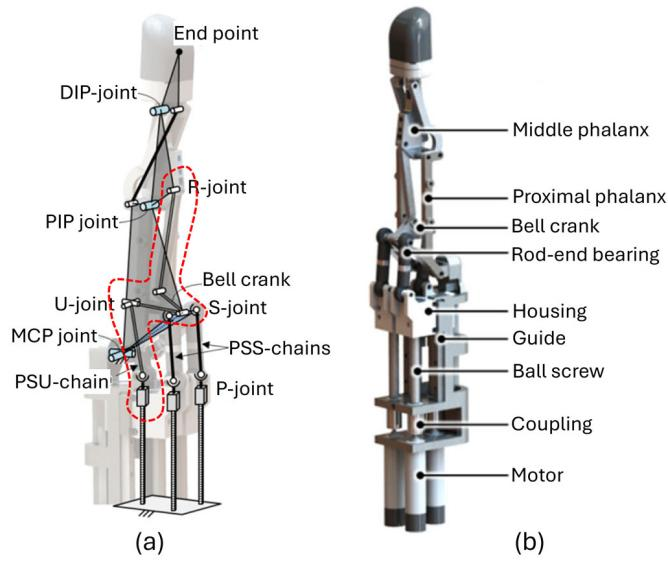
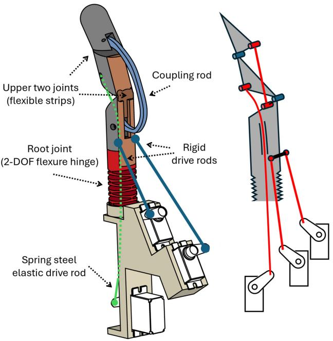
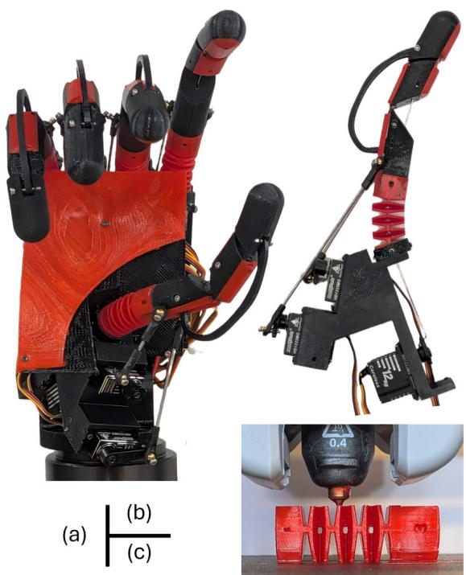
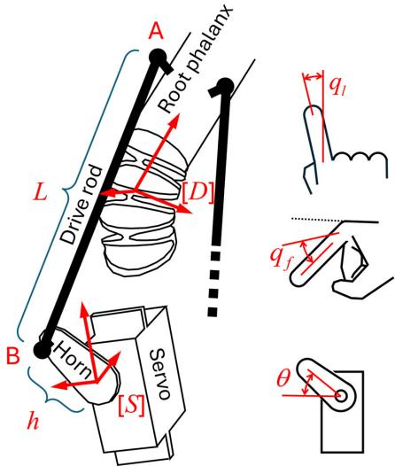
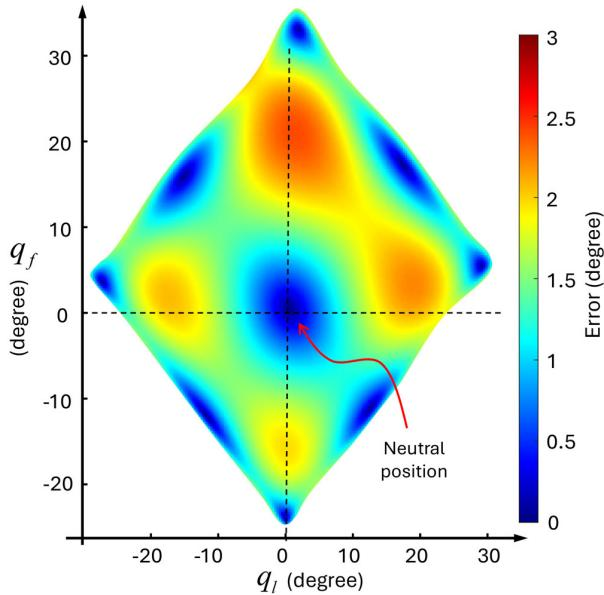
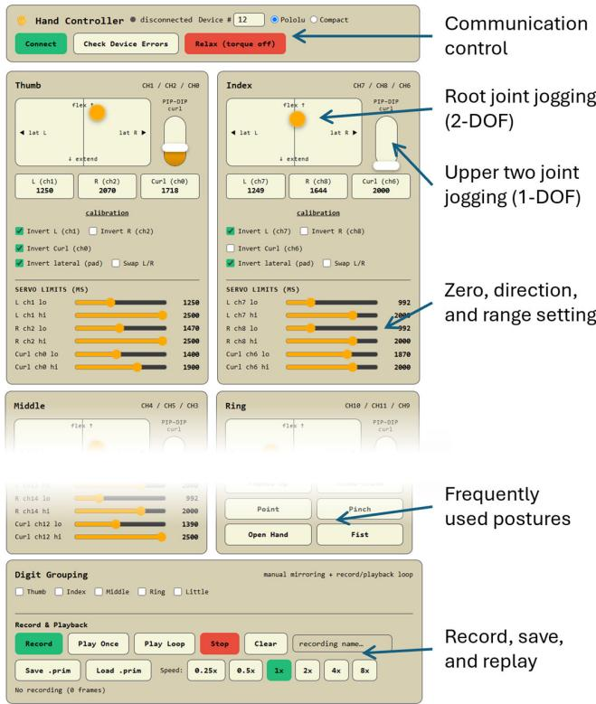
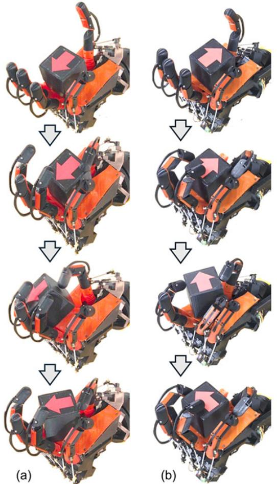
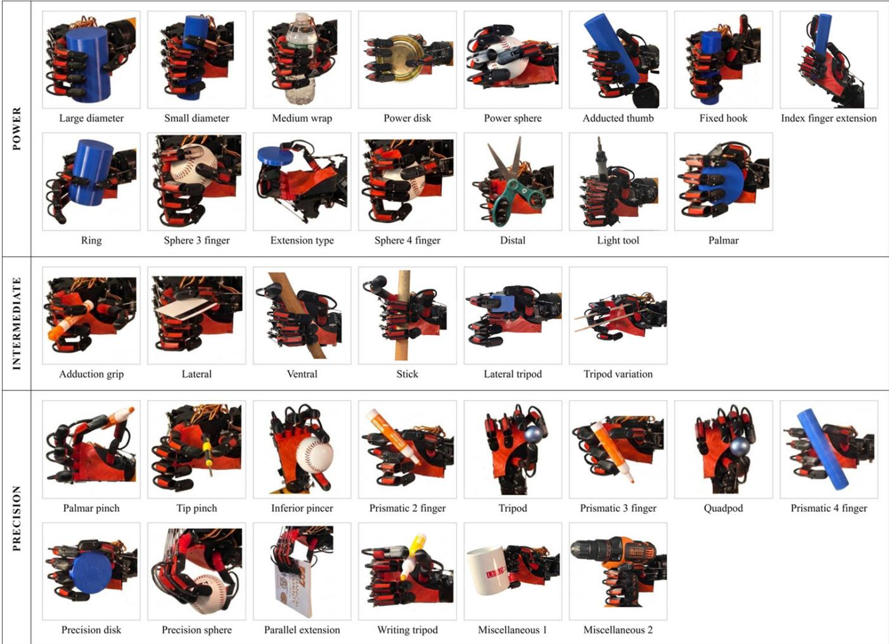
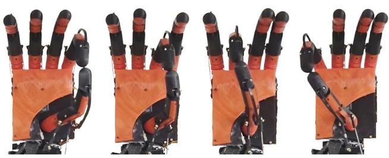
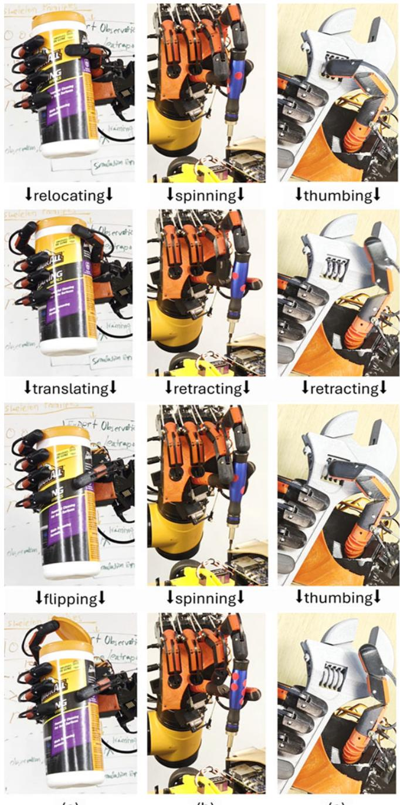

# PHD-Hand: A Printable Humanoid Dexterous Hand with Linkage-Driven 3-DOA Digits

Neel Adwani a, Muhaiminul Islam Akash a, Saffia Ouali a, Ethan Liu b, Cong Wang a

Abstract— Currently, dexterous humanoid robot hands are widely considered the final hardware bottleneck that hampers generalist robots from physically assisting people at home and work. As conventional tendon-driven designs suffer from high cost, demanding maintenance, poor reliability, and short durability, alternative linkage-driven designs have increasingly gained attention. Despite their potential to avoid the weaknesses of tendon-driven hands, integrating multiple degrees of actuation (DOA) in a single digit with linkage drivetrains is a challenge for design and fabrication. Only a few studies have managed to present functional humanoid hands that are completely linkage-driven and have at least three DOAs per digit without compromising actuator placement and other design preferences. Our work introduces a new linkage-driven hand featuring a unique flexure hinge. Together with elastic drive rods made of spring steel, the linkage drivetrains are significantly simplified. Unlike other linkage-driven designs of similar dexterity, our design does not require many miniature moving parts. As a result, the hand can be fabricated easily with a budget 3D printer. This not only significantly lowers the barrier to entry for using and developing dexterous humanoid robot hand functions, but also allows the hands to be sized much closer to regular human hands. The design offers desirable kinematic advantages as well. A prototype is evaluated for grasping and object manipulation. In addition, this paper presents our latest findings on kinematics and control of the hand.

Index Terms— design, mechanisms, humanoid hands, dexterity, grasping, manipulation

## I. INTRODUCTION

This paper discusses the design of linkage-driven dexterous humanoid robot hands. With the recent breakthroughs in perception and reasoning powered by artificial intelligence (AI), replicating the dexterity of human hands is increasingly considered the last physical bottleneck that holds back the robotics industry. Having humanoid dexterous hands not only allows robots to seamlessly handle objects in our daily lives, but also enables robot learning of hand skills directly from native human demonstration. Other than resembling the appearance of human palm and digits1, a humanoid robot hand ideally should have at least three degrees of actuation (DOA)2 per digit. The “root joint” of a digit should have two DOAs for tilting, while the “upper two joints”3 almost always flex/extend together and share a single DOA4.

A straightforward way to build such a digit is to place the actuators inside or on the digits to drive the joints “locally” with a structure similar to serial robot manipulators (e.g., [1]– [4]). This results in a dilemma of the digit either having weak actuation or being oversize and overweight. It is therefore desirable to have the actuators placed off the digits, which requires additional drivetrain(s) to deliver actuation to the upper two joints. The most common solution is to use tendon drives. The design is largely inspired by human anatomy and has been the mainstream choice of dexterous robot hands [5]. However, without self-healing, the complex tendon systems required for dexterity wear out and loosen up quickly, which leads to demanding maintenance and short life span [6]. Performance of tendon-driven hands is often jeopardized by cable fraying, knot slippage, and tension drift [7] [8]. In particular, cable rupture is the top failure mode [8]. In addition, tendon-driven bidirectional actuation requires either two actuators per DOA (leads to sizing problems) or closedloop tendon routing (prone to loosening and slacking) [9]. The absence of bidirectional actuation excludes the hand from performing certain skills.

Compared to tendon-drives, rigid drivetrains do not have weaknesses mentioned above. They also provide better precision and can bear higher load [10]. Some designs use geared drivetrains to transmit actuation from actuators placed off the digit to the upper two joints. [11] shows a representative design in this category. Each of its digits has a 2-DOA root joint and 1-DOA coupled upper two joints. Actuation is transmitted to the upper two joints using a bevel gear drive coaxially located with the drive shafts of the root joint. Other than the fabrication hassle and inevitable backlash, complexity of the design results in a hand size significantly larger than human hands.

Alternatively, linkage-driven designs have the potential to avoid the weaknesses of tendon and gear-based designs [12]. However, integrating three DOAs with linkage drivetrains in one digit (while keeping the actuators off the digit) poses a great challenge for design and fabrication. There are only a few presentations [13]–[17], which share similar designs and have only emerged over recent years. Among them, the design presented in [13] is both pioneering and most ready for practical use. It adopts a novel 5-joint linkage drivetrain to deliver actuation to the upper two joints through the root joint (Fig. 1-a, the portion circled in red). As impressive as the prototype and demonstration are, the nontrivial number of miniature parts (Fig. 1-b) require serious fabrication capability and make it challenging to balance between durability, size, and cost. The prototype in [13] has a hand length around 218 mm which is 13% larger than average male human hands. The design is replicated in [14] and improved in [15] with hand lengths of 255 mm and 219 mm respectively. In addition, the kinematics of the root joint and upper two joints is partially coupled, which complicates the control. More details of these designs will be examined later in Section II with a summarizing comparison to our work. Some other designs work around the challenge by strategically reducing the number of DOAs based on human hand synergies - e.g., [18]–[21]. Despite being able to realize a decent variety of hand functions, the strategy does not provide the potential of advanced dexterity that the robotics community is currently wishing for.

  
Fig. 1. A representative existing design of linkage-driven 3-DOA digit [13], a - schematic, b - parts and components

Our work aims at developing a dexterous humanoid robot hand that

• Has five digits with three DOAs per digit (two for the root joint, one for the coupled upper two joints);

• Has each DOA bidirectionally actuated with a decent strength, good backdrivability, and minimal backlash;

• Can be fabricated at a size very close to human hands with minimal costs using a budget 3D printer;

• Has long-lasting durability and requires minimal maintenance.

As explained earlier, these requirements exclude conventional designs that use tendons, gears (other than in the actuators), or place actuators inside/on the digits, and leaves a full linkage-driven design the most feasible option. Thanks to a unique design of the root joint, our hand has much fewer parts than existing designs that have a similar dexterity, and can be sized closer to human hands. In addition, our design also completely decouples the kinematics of the root joint and the upper two joints, which simplifies modeling, estimation, and control.

This paper continues from our earlier publication [22], which introduces the flexure design of the root joint and presents a preliminary prototype of three digits, together with strength test results. Our prior work suffers from a series of problems, including mechanical interference, non-humanoid topology, and fabrication complications. The new design in this paper resolves those problems and demonstrates legitimate humanoid dexterity. In addition, this paper presents our latest findings on kinematics and control of the hand.

## II. DESIGN AND FABRICATION

Figure 2 illustrates our proposed design. The root joint is the key element. We present a unique design in the form of a flexure hinge. The design is inspired by stress-relieving structures commonly used to protect cable connectors. As a single-piece anisotropic flexible structure, it provides two DOFs of tilting motion while restraining axial rotation. It gives a wide motion range to satisfy the need of dexterity, yet does not bend sharply. This is an important feature that allows an elastic drive rod made of spring steel to go through its center and smoothly deliver bidirectional actuation to the upper two joints without the need of complicated mechanisms and many moving parts (as opposed to the designs in [13]–[17]). In addition, bending of the flexure hinge does not force/require the elastic rod to move axially. This completely decouples the drivetrain kinematics of the root joint and the upper two joints, which greatly simplifies modeling, estimation, and control. In terms of actuation, the root joint is driven by two RC servos that connect to the root phalanx of the digit through two rigid drive rods and four ball joints. The design evolves from the classic 2-DOF planar 5- bar mechanisms. Note that the axial rotation of the drive rods is not constrained because of the ball joints, though it does not affect the function of the drivetrain. The upper two joints of the digit are coupled by a cross 4-bar mechanism, which is a commonly used design. Reported coupling ratios of the upper joints of human digits fall between 0.75 and 0.8 [23]. We find a ratio of 0.77 optimal for our design. The cross 4-bar mechanism is actuated by the elastic drive rod that passes through the root joint. As of now, we have decided to make the coupling rod go from outside of the middle phalanx. Other than minimizing mechanical interference and providing a bigger motion range, the option allows easy shaping of the coupling rod to give it certain flexibility, which helps realize the passive compliance desired in hand-object interaction [24] [25].

Figure 3-a shows a prototype. The digits are modular (Fig. 3-b), allowing easy reconfiguration of the hand topology and repair. Thanks to the unique design, the hand can be fabricated using a budget FFF 3D printer, generic hardware (ball joints, rods, pins, and fasteners), and generic mini-scale

TABLE I  
COMPARISON BETWEEN THE PROPOSED DESIGN AND ITS PEERS
<table><tr><td rowspan=1 colspan=1>Design</td><td rowspan=1 colspan=1>This work</td><td rowspan=1 colspan=1>[13][14] (replicated)[15] (improved)</td><td rowspan=1 colspan=1>[16]</td><td rowspan=1 colspan=1>[17]</td><td rowspan=1 colspan=1>L20 by Linkerbot(commercial product)</td></tr><tr><td rowspan=1 colspan=1>Release year</td><td rowspan=1 colspan=1>2026</td><td rowspan=1 colspan=1>2021, 2025, 2025</td><td rowspan=1 colspan=1>2022</td><td rowspan=1 colspan=1>2024</td><td rowspan=1 colspan=1>after 2023</td></tr><tr><td rowspan=1 colspan=1>Digits</td><td rowspan=1 colspan=1>1 thumb + 4 fingers</td><td rowspan=1 colspan=1>1 thumb + 4 fingers</td><td rowspan=1 colspan=1>1 thumb + 2 fingers</td><td rowspan=1 colspan=1>Single digit only</td><td rowspan=1 colspan=1>1 thumb + 4 fingers</td></tr><tr><td rowspan=1 colspan=1>DOAs / digit</td><td rowspan=1 colspan=1>3</td><td rowspan=1 colspan=1>3 [13] [14]3 each finger and 4 onthe thumb [15]</td><td rowspan=1 colspan=1>3 each finger and 4 onthe thumb</td><td rowspan=1 colspan=1>3</td><td rowspan=1 colspan=1>3 each finger, 4 on thethumb</td></tr><tr><td rowspan=1 colspan=1>Major parts / digit(including digit bodyand drivetrain but notactuators and sensors)</td><td rowspan=1 colspan=1>13 if the phalanges anddigit joints are made inone piece; 18 if madeseparate parts</td><td rowspan=1 colspan=1>27+</td><td rowspan=1 colspan=1>27+</td><td rowspan=1 colspan=1>(No physicaldemonstration yet)</td><td rowspan=1 colspan=1>(unknown)</td></tr><tr><td rowspan=1 colspan=1>Fabricationrequirement</td><td rowspan=1 colspan=1>DIY with a budget 3Dprinter</td><td rowspan=1 colspan=1>industrial</td><td rowspan=1 colspan=1>industrial</td><td rowspan=1 colspan=1>(No physicaldemonstration yet)</td><td rowspan=1 colspan=1>industrial</td></tr><tr><td rowspan=1 colspan=1>Kinematics of rootjoint and upper twojoints</td><td rowspan=1 colspan=1>Completely decoupled</td><td rowspan=1 colspan=1>Partially coupled</td><td rowspan=1 colspan=1>Partially coupled</td><td rowspan=1 colspan=1>Partially coupled</td><td rowspan=1 colspan=1>(unknown)</td></tr><tr><td rowspan=1 colspan=1>Backdrivability</td><td rowspan=1 colspan=1>Yes</td><td rowspan=1 colspan=1>No</td><td rowspan=1 colspan=1>No</td><td rowspan=1 colspan=1>(unknown)</td><td rowspan=1 colspan=1>(unknown).</td></tr><tr><td rowspan=1 colspan=1>Physical scale</td><td rowspan=1 colspan=1>Whole hand close toregular human (200 mmhand length).</td><td rowspan=1 colspan=1>Whole hand larger thanregular human (218, 255,219 mm hand length re-spectively).</td><td rowspan=1 colspan=1>Only finger length(about 80 mm) close toregular human. Wholehand is visibly larger.</td><td rowspan=1 colspan=1>(No physicaldemonstration yet)</td><td rowspan=1 colspan=1>Whole handsignificantly larger thanhuman (around 225 mmhand length).</td></tr></table>

  
Fig. 2. The proposed design of a digit

RC servos commonly available on the market of crafting hobbies. Because of its nontrivial shape, 3D printing of the root joint can be tricky but can still be done reliably with carefully tuned settings. We recommend using TPU 95A filament, a 0.4 mm nozzle, a nozzle temperature of $2 1 5 \ ^ { \circ } \mathrm { C } ,$ a bed temperature of $5 5 ~ ^ { \circ } \mathrm { C }$ with an enclosure, a printing speed of 100 mm/s, a layer height of 0.15 mm, and 15% infill, with the print placed horizontally without any supports (Fig. 3-c). The upper two joints are made as flexible strips 3D printed with TPU. The phalanges can be either 3D printed with PETG for higher rigidity or with TPU so that the whole digit body can be made in one single piece to further simplify assembly. The elastic drive rod is cut from 304 stainless spring steel wires of 0.6 mm thickness. It is flexible enough to bend with the root joint without causing significant resistance, while is strong enough to avoid buckling when pushed.

  
Fig. 3. Prototype - (a) whole hand, (b) modular digit, (c) 3D printing of the 2-DOF flexure hinge

Our literature survey has found four existing designs that are fully linkage-driven, have at least three DOAs per digit, and with all actuators placed off the digits. Three of them are presented in research papers while the other one is a commercial product. As detailed in Table I, the parts of our design are not only significantly fewer but also can be affordably made without industrial-level fabrication. The advantage greatly lowers the barrier to entry for the use and development of dexterous robot hand functions. The concise design also allows the hand to be made at a more compact size closer to regular humans. Instead of the custom linear actuators with leadscrews used in other designs, our design uses generic RC servos. Despite giving a raised back-palm, the choice not only simplifies fabrication but also provides a good backdrivability.

## III. KINEMATICS ANALYSIS

Thanks to our unique design, kinematics of the root joint and the upper two joints is completely decoupled. That is, when the root joint tilts, the servo that actuates the upper two joints does not need to move coordinately to preserve their flexion, and vice versa. Kinematics of the cross 4-bar mechanism that drives the upper two joints is simple and well documented in textbooks. This section focuses on discussing the kinematics of the root joint. With its parallel drivetrain, the 2-DOA root joint system is a closed-chain mechanism, which means its kinematics cannot be derived easily using a DH-parameter model. Below, we first present a particular solution to derive its inverse kinematics.

  
Fig. 4. Notations for inverse kinematics of the root joint

Figure 4 illustrates the notations. Given the tilting angles of the root joint $\mathbf { q } \in \mathbb { R } ^ { 2 }$ , the goal is to find the rotating angle θ of each servo. Consider a digit frame [D] attached to the root phalanx and a servo frame [S] attached to the servo body. Consider one of the drive rods and its two ends A and B. The position of point A in [D] is a constant $\mathbf { p } _ { A , D } \in \mathbb { R } ^ { 3 }$ Its representation in [S] is

$$
\mathbf { p } _ { A , S } = \mathbf { p } _ { A , D } \cdot \mathbf { R } _ { D 2 S } \left( \mathbf { q } \right) + \delta _ { D 2 S }\tag{1}
$$

where the rotation matrix $\mathbf { R } _ { { } _ { D 2 S } }$ is parameterized by ${ \bf q } ,$ and the displacement vector $\delta _ { { } _ { D 2 S } }$ is a constant (because $[ D ]$ is originated at the rotation center of the root joint). Given q, $\begin{array} { r } { \bar { \bf p _ { { A } , { S } } } = \left[ x _ { { A } } , y _ { { A } } , z _ { { A } } \right] ^ { T } } \end{array}$ can be easily calculated using the coordinate transformation. Meanwhile, the position of point B in [S] is $\mathbf { p } _ { B , S } ^ { } = \left[ h \right.$ cos θ, h sin $\theta , 0 ] ^ { T }$ , where h is the length of the servo horn. $\mathbf { p } _ { A , S }$ and $\mathbf { p } _ { { } _ { B , S } }$ are related by the length of the drive rod

$$
L = \left| \left| \mathbf { p } _ { A , s } - \mathbf { p } _ { B , s } \right| \right| _ { 2 }\tag{2}
$$

which gives

$$
\left( x _ { { \scriptscriptstyle A } } - h \cos \theta \right) ^ { 2 } + \left( y _ { { \scriptscriptstyle A } } - h \sin \theta \right) ^ { 2 } = L ^ { 2 } - z _ { { \scriptscriptstyle A } } ^ { 2 }\tag{3}
$$

from where θ can be found using trigonometric addition identities.

The forward kinematics is much more complicated because the two drive rods cannot be considered individually like in the analysis of inverse kinematics. Nevertheless, we have discovered that kinematics of the root joint can actually be well approximated by an affine mapping

$$
\mathbf { q } = { \binom { a } { c } } \mathbf { \theta } _ { d } ^ { b } \mathbf { \theta } _ { } + { \binom { e } { f } }\tag{4}
$$

where ${ \boldsymbol { \theta } } \in \mathbb { R } ^ { 2 }$ includes rotation angles of the two servos, and $a , b , c , d , e , f$ are scalar coefficients. We first use the inverse kinematics derived earlier to calculate the servo angles θ of 10,000 samples of $\mathbf { q }$ across the motion range of the root joint. The $\{ \mathbf { q } , \mathbf { \boldsymbol { \Theta } } \}$ pairs are then run through a least squares regression which identifies the coefficients as $a = - 0 . 2 7 7 5$ $b = - 0 . 2 4 5 1 , \ c = \ - 0 . 2 7 7 9 , \ d = 0 . 2 4 6 6 , \ e \ = \ - 6 . 9 0 2$ $f = 2 . 0 9 7$ with a very good regression R value at 0.981.

  
Fig. 5. Error of an affine approximation of the root joint’s kinematics. qf and ql are as defined in Fig. 4

The identified coefficients show a particular pattern: $a \approx b$ and $c \approx - d ,$ which suggests that flexion of the root joint is proportional to the average of the two servo angles while the lateral tilting is proportional to their difference. This is valid because the servo horns are quite short and the drive rods spread out from the root phalanx by only small angles. Note that there is no hard constraint enforcing $a = b$ and $c = - d$ in the regression because the two servos that drive the root joint are not exactly placed symmetrically and their drive rods are of different lengths. Figure 5 shows the approximation errors across the motion range of the root joint (bounded by drivetrain singularity). The error is calculated as $| | \hat { \mathbf { q } } - \mathbf { q } | | _ { 2 } ,$ where qˆ is the estimate of q based on the affine approximation. Majority of the motion range has an approximation error lower than 1.8◦ while the largest error is less than 2.7 .

  
Fig. 6. A GUI generated by AI

## IV. AI-AIDED CONTROL

Because of their high number of DOAs and nontrivial kinematics, controlling dexterous humanoid robot hands can be a technical hassle. We have explored using the latest artificial intelligence (AI) to aid the development of control and find it surprisingly efficient. Claude (Sonnet 4.6 version) is used for its advanced coding and multi-modal reasoning ability. First, a graphical user interface (GUI) is developed. The prompt consists of only plain text without any figures or CAD models, and includes the following specifications of the hand:

• Lengths and thicknesses of the phalanges;

• Location and orientation of the digits on the palm;

• Closed-form equations of the inverse kinematics of the root joint as discussed in Section III;

• The coupling ratio of the upper two joints and the mapping between their flexion and the stroke of the elastic drive rod;

• Motion ranges of all DOAs;

• Make and model of the servo controller (Pololu / Mini Maestro 18) and the assignment of its channels to the servos;

as well as the desired GUI features:

• For each digit, a 2-DOF pad for jogging the root joint, and a slider for jogging the flexion of the upper two joints;

• A calibration panel for setting the zeros, directions, and ranges of all DOAs;

• Buttons for recording hand postures and motion, save them to files, and playback.

With minimal manual adjustment, the GUI produced by Claude (Fig. 6) functions well with the physical prototype of the hand.

  
Fig. 7. AI-generated motion trajectories - (a) draft, (b) revised

In addition, we have experimented using Claude to generate motion trajectories for advanced hand skills such as in-hand re-orientation of an object. The prompt includes:

• Description of the object - e.g., a cube of 55 mm edge length;

• Digits to be used actively (e.g., the thumb, index finger, ring finger) and digits to be kept static (e.g., middle finger extended, pinky finger curled);

• (Non-quantitative) description of the initial placement of the object on the palm - e.g., in the middle of the three active digits; and

• Description of the manipulation goal - e.g., spinning the cube with the palm facing up.

  
Fig. 8. Validation of grasping ability according to the GRASP taxonomy [26]

Without any additional information, Claude has produced a draft motion trajectory of 40 frames. It does not function well because the digits cannot make proper contact with the object (Fig. 7-a). The problem is described in a follow-up prompt to Claude for revision. Claude responds by requesting the user to reset the initial placement of the object and use the GUI to jog the digits so that proper initial contacts are made. The user-adjusted posture is then fed back to Claude, which revises the trajectory automatically. The revised trajectory is surprisingly successful as shown in Fig. 7-b.

## V. PHYSICAL VALIDATION

## A. Thumb Opposition

Thumb opposition is the ability to move the thumb so that its tip touches the tips of the four fingers one by one. Being able to do thumb opposition is considered a critical evolutionary advantage and a major milestone in early child development of fine motor skills. It is of fundamental importance for realizing dexterous grasping and manipulation, and has been used commonly as a simple yet effective diagnosis of hand function deficits. Figure 9 shows thumb opposition performed by our prototype.

  
Fig. 9. Thumb opposition

## B. Grasping

The hand’s grasping ability is assessed according to the GRASP taxonomy (a.k.a., the Feix taxonomy [26]). It is widely recognized as the most comprehensive modern classification of human hand grasps, and has been commonly used in the evaluation of humanoid robot hands. The taxonomy includes 33 grasp types and is organized by grasping strength (power, intermediate, precision) as well as opposition type, finger assignment, and thumb position. A mix of real everyday objects and 3D printed mock objects are used in our tests.

Figure 8 shows the grasps realized by our prototype. Other than the 33 types in the taxonomy, we have extended our tests to grasping objects that have more particular features for functional grasps, such as a mug and a power drill. Despite a good fulfillment in general, some of the grasps are not realized perfectly, mainly the Stick, Light tool, and Tripod variation (chopsticks). The imperfection is caused by the limited flexion range of the fingers and lack of the thenar web space between the thumb and index finger.

## C. Object manipulation

Other than in-hand object rotation shown earlier in Section IV Fig. 7, we present another three demonstrations of object manipulation using the hand. In the first demonstration (Fig. 10-a), the robot shifts an object in-hand so that its lid can be reached and flipped open by the index finger. The shifting validates that the thumb and index finger can coordinate with the other three digits in a humanoid way to reposition objects in-hand with fine precision. The lid flipping challenges the motion range and strength of the index finger. Figure 10-b shows the hand using a precision screwdriver. It requires the thumb and middle finger to coordinate delicately and alternate between retraction and spinning the screwdriver without pushing it out of the holding of the index finger. Figure 10-c shows the hand adjusting a crescent wrench by thumbing its worm screw. In particular, the worm screw is thumbed outward to close the jaws. This demonstrates effective bidirectional actuation of the digits. The task cannot be accomplished with conventional tendon-driven designs where extension of the digits relies on spring-loaded auto-returning with limited strength5. More demonstrations can be found in the supplementary video.

## VI. CONCLUSIONS

This paper presents a new design of linkage-driven dexterous humanoid robot hands. Thanks to the use of a unique flexure hinge and elastic drive rods, the design requires much fewer parts than its peers and can be fabricated at a size closer to regular human hands with merely a budget 3D printer. The advantage helps improve reliability, durability, cost-effectiveness, as well as lower the barrier to entry for using and developing dexterous humanoid robot hand functions. In addition, the design greatly simplifies the kinematics of the drivetrains, which is beneficial to modeling, estimation, and control. Dexterity of the hand is validated using the thumb opposition test, grasping according to Feix’s GRASP taxonomy, and a variety of object manipulation tasks. In addition, this paper presents our latest findings on kinematics analysis and AI-aided control.

As a preliminary reference for reliability and durability, at this point, we have conducted a total of around 200 hours of tests on the same prototype. Majority of the tests ran over one hour, with the longest one lasted for two hours. Throughout all the tests we have conducted, two mechanical glitches happened during the early stage of validation. Both were caused by the breaking of an elastic drive rod. One was because of a stock defect. The other was because of improper tooling for shaping the connectors. Other than those, no sign of mechanical degradation has been observed.

  
(a)  
(b)  
(c)  
Fig. 10. Object manipulation

Our study will next address the following aspects:

• Rigorous and quantitative study on reliability and durability, especially regarding fatigue of the elastic drive rods.

• Refining the topology of the hand to better resemble human hands. Other than adjusting the dimensions and motion ranges of the digits and their placement on the palm, this also includes reforming the palm surface and adding a thenar web space between the thumb and index finger.

• Optimizing the coupled kinematics of the upper two joints. In particular, the coupling rod shall be redesigned to go through the middle phalanx instead of from outside. Its shaping shall be studied in detail to obtain a proper nonlinear flexibility for passive compliance.

• Redesigning the root joint of the thumb. Specially, the 2-DOF flexure hinge shall be redesigned to couple an axial rotation to the lateral swing of the thumb.

• Exploring 3D printing settings for reliably printing a whole digit body in one piece while achieving proper flexibility at the joints and stiffness at the phalanges. This will further simplify fabrication and ready the design for open sourcing.

• Leveraging the backdrivability of the drivetrains to explore the possibility of contact estimation based on servo readings without using any touch sensors.

## REFERENCES

[1] K. Shaw, A. Agarwal, and D. Pathak, “LEAP hand: Low-cost, efficient, and anthropomorphic hand for robot learning,” arXiv:2309.06440, 2023.

[2] M. Hernando, C. Morillo, D. Guffanti, and A. Brunete, “Mechatronic design of a self-contained dexterous robotic hand for gestural communication,” International Journal of Social Robotics, vol. 15, no. 2, pp. 221–231, 2023.

[3] B. Romero, H.-S. Fang, P. Agrawal, and E. Adelson, “Eyesight hand: Design of a fully-actuated dexterous robot hand with integrated vision-based tactile sensors and compliant actuation,” in IEEE/RSJ International Conference on Intelligent Robots and Systems, 2024, pp. 1853–1860.

[4] T. Mouri, H. Kawasaki, K. Yoshikawa, J. Takai, S. Ito et al., “Anthropomorphic robot hand: Gifu hand III,” in International Conference on Control Automation and Systems, 2002, pp. 1288–1293.

[5] C. Piazza, G. Grioli, M. G. Catalano, and A. Bicchi, “A century of robotic hands,” Annual Review of Control, Robotics, and Autonomous Systems, vol. 2, no. 1, pp. 1–32, 2019.

[6] TechWire, “Tesla’s humanoid robot delayed again because its hands can only be used for six weeks,” TechWire, Oct. 2025. [Online]. Available: https://www.asiatechwire.com/Teslas-humanoid-robot-delayedagain-because-its-hands-can-only-be-used-for-six-weeks.html

[7] R. N. Bhatt, “Quantifying serviceability: A maintainability framework for tendon-driven robotic hands,” International Journal of Science and Research, vol. 14, no. 9, pp. 1527–1530, Sep. 2025.

[8] U. Jeong, K. Kim, S.-H. Kim, H. Choi, B. D. Youn, and K.-J. Cho, “Reliability analysis of a tendon-driven actuation for soft robots,” The International Journal of Robotics Research, vol. 40, no. 1, pp. 494– 511, 2021.

[9] M. Catalano, G. Grioli, E. Farnioli, A. Serio, C. Piazza, and A. Bicchi, “Adaptive synergies for the design and control of the Pisa/IIT Soft-Hand,” International Journal of Robotics Research, vol. 33, no. 5, p. 768–782, Apr. 2014.

[10] Y. Wang, W. Li, S. Togo, H. Yokoi, and Y. Jiang, “Survey on main drive methods used in humanoid robotic upper limbs,” Cyborg and Bionic Systems, vol. 2021, 2021.

[11] J. Ueda, Y. Ishida, M. Kondo, and T. Ogasawara, “Development of the NAIST-Hand with vision-based tactile fingertip sensor,” in IEEE International Conference on Robotics and Automation, 2005, pp. 2332–2337.

[12] S. R. Kashef, S. Amini, and A. Akbarzadeh, “Robotic hand: A review on linkage-driven finger mechanisms of prosthetic hands and evaluation of the performance criteria,” Mechanism and Machine Theory, vol. 145, p. 103677, 2020.

[13] U. Kim, D. Jung, H. Jeong, J. Park, H.-M. Jung, J. Cheong, H. R. Choi, H. Do, and C. Park, “Integrated linkage-driven dexterous anthropomorphic robotic hand,” Nature Communications, vol. 12, no. 1, p. 7177, 2021.

[14] R. Wen, J. Zhang, G. Chen, Z. Cui, M. Du, Y. Gou, Z. Han, J. Hu, L. Huang, H. Niu et al., “Dexterous teleoperation of 20-DoF ByteDexter hand via human motion retargeting,” arXiv:2507.03227, 2025.

[15] R. Wen, G. Chen, Z. Cui, M. Du, Y. Gou, Z. Han, L. Huang, M. Lei, Y. Li, Z. Li et al., “GR-Dexter technical report,” arXiv:2512.24210, 2025.

[16] Y. Liu, W. Lu, D. Chen, and W. D. Guo, “A three-finger dexterous hand with suction cups integrated on fingertips,” in the 12th International Conference on CYBER Technology in Automation, Control, and Intelligent Systems. IEEE, 2022, pp. 983–988.

[17] T. Zaw, D. Mahalingam, N. Baiata, A. Patankar, and N. Chakraborty, “Design and kinematic analysis of a novel series-parallel hybrid finger for robotic hands,” Journal ofMechanisms and Robotics, vol. 17, no. 4, p. 044512, 2025.

[18] I. Cerulo, F. Ficuciello, V. Lippiello, and B. Siciliano, “Teleoperation of the SCHUNK S5FH under-actuated anthropomorphic hand using human hand motion tracking,” Robotics and Autonomous Systems, vol. 89, pp. 75–84, 2017.

[19] D. Yoon and Y. Choi, “Underactuated finger mechanism using contractible slider-cranks and stackable four-bar linkages,” IEEE/ASME Transactions on Mechatronics, vol. 22, no. 5, pp. 2046–2057, 2017.

[20] X. Liu, X. Zheng, and S. Li, “Development of a humanoid robot hand with coupling four-bar linkage,” Advances in Mechanical Engineering, vol. 9, no. 1, p. 1687814016686313, 2017.

[21] M. B. Hong, S. J. Kim, Y. S. Ihn, G.-C. Jeong, and K. Kim, “KULEXhand: An underactuated wearable hand for grasping power assistance,” IEEE Transactions on Robotics, vol. 35, no. 2, pp. 420–432, 2018.

[22] N. Adwani, S. Ouali, M. Orlowski, E. Liu, and C. Wang, “Dexterous robot hands with linkage-driven three-DOF fingers,” in The 6th Modeling, Estimation and Control Conference, 2026.

[23] A. Roda-Sales, J. L. Sancho-Bru, and M. Vergara, “Studying kinematic linkage of finger joints: Estimation of kinematics of distal interphalangeal joints during manipulation,” PeerJ, vol. 10, p. e14051, 2022.

[24] R. R. Ma and A. M. Dollar, “An underactuated hand for efficient finger-gaiting-based dexterous manipulation,” in IEEE International Conference on Robotics and Biomimetics, 2014, pp. 2214–2219.

[25] P.-H. Kuo and A. D. Deshpande, “Contribution of passive properties of muscle-tendon units to the metacarpophalangeal joint torque of the index finger,” in the 3rd IEEE RAS & EMBS International Conference on Biomedical Robotics and Biomechatronics, 2010, pp. 288–294.

[26] T. Feix, J. Romero, H.-B. Schmiedmayer, A. M. Dollar, and D. Kragic, “The GRASP taxonomy of human grasp types,” IEEE Transactions on human-machine systems, vol. 46, no. 1, pp. 66–77, 2015.