# ADAPT for Science: A Multi-Agent System for Self-Evolving Scientific Optimization

Zhaoran Feng1,2, Yuchen Ni2,3, Jianan Liu2,3, Lemao Liu3, Dejing Dou3,5, and Kairui Feng2,4

1National Laboratory of Solid State Microstructures, School of Physics and, Collaborative Innovation Center of Advanced

Microstructures,, Nanjing University, Nanjing 210093, China

2Shanghai Innovation Institute, Shanghai 200231, China

3College of Computer Science and Artificial Intelligence,, Fudan University, Shanghai 200433, China 4Shanghai Research Institute for Intelligent Autonomous Systems,, Tongji University, Shanghai 201210, China 5BEDI Cloud, Beijing, China

## Abstract

Scientific discovery often requires identifying a small number of high-performing designs in vast, constrained search spaces. This is difficult when evaluations are costly, feasible solutions are sparse, parameters are strongly coupled, and physical constraints are strict. Recent AI for AI methods can automatically improve algorithms and optimization procedures. However, general purpose approaches are not designed around scientific priors, physical constraints, and limited evaluation budgets. We introduce ADAPT for Science, a multi-agent framework that treats scientific optimization as two coupled decisions: where to search and how to search. ADAPT uses historical designs to identify promising and diverse initial conditions, progressively concentrates computation on favorable search directions, and evolves the optimization procedure from execution feedback. We evaluate ADAPT on the design of gravitational wave detectors using a differentiable physics simulator and eight unseen detector topologies. Under matched scientific evaluation budgets, ADAPT achieves a mean loss of 0.204 ± 0.101, reducing loss by 54.9% relative to the best classical optimizer and by 62.2% relative to the best general purpose agentic evolution baseline. ADAPT achieves the lowest loss on all unseen topologies among the evaluated baselines. ADAPT provides a step toward scientific optimization systems that continuously learn from prior experience and their own search outcomes

## 1 Introduction

Scientific progress often depends on finding a small number of useful solutions in vast and constrained design spaces. From drug discovery to gravitational-wave detector design, each candidate can be costly to evaluate, many parameters interact strongly, and feasible solutions may occupy only a small fraction of the search space. The central challenge is therefore not only to evaluate a candidate, but to decide what is worth trying next. This challenge becomes acute when optimization must proceed under a limited experimental or computational budget. Search performance depends not only on local parameter updates, but also on where the search begins, which prior experience is reused, which optimization procedure is applied, and how resources are allocated. These higher-level decisions are often fixed in advance or made manually, despite their substantial influence on the final solution. Gravitational-wave detector design provides a representative example. Detector sensitivity depends on many interacting continuous parameters subject to strict physical constraints. A poor initialization or an unsuitable optimization strategy can consume substantial computation before reaching a useful solution. At the same time, previous detector designs provide valuable experience that can guide future search. The problem is therefore not optimization from scratch, but how to reuse prior scientific experience, choose where to begin, and adapt the search strategy as new evidence becomes available.

AI has begun to automate parts of this process. Bayesian optimization and autonomous laboratories use previous evaluations to select promising candidates [25, 31], while scientific agents automate planning and experimental workflows [3]. These approaches primarily adapt the scientific candidate while the higher-level search procedure remains largely specified in advance. In parallel, recent program-search methods show that language models can improve algorithms through evaluator feedback [24, 29]. These methods adapt the procedure itself, but do not explicitly model reusable scientific experience, target-dependent initialization, physical feasibility, and limited scientific evaluation budgets.

We address this gap with ADAPT for Science, a multi-agent framework for self-evolving scientific optimization. ADAPT treats the complete scientific search policy as the object of optimization and decomposes it into two coupled decisions: where to search and how to search. Historical scientific designs provide offline experience for selecting promising and diverse starting points and allocating evaluation effort. Online execution feedback is then used to evolve the optimization procedure itself. The resulting closed loop jointly adapts initialization, resource allocation, and optimization strategy to the scientific target. We evaluate ADAPT on gravitational-wave detector design using a differentiable physics simulator and eight unseen detector topologies. Under matched scientific evaluation budgets, ADAPT achieves a mean loss of 0.204 ± 0.101, compared with 0.452 ± 0.150 for the strongest classical optimizer and 0.540 ± 0.263 for the strongest general-purpose agentic evolution baseline. These results correspond to reductions in mean loss of 54.9% and 62.2%, respectively. ADAPT also achieves the lowest loss on all eight held-out topologies among the evaluated baselines. The results indicate that scientific optimization benefits from adapting the search policy itself rather than optimizing scientific parameters or optimization programs in isolation.

Our contributions are threefold:

• We formulate scientific optimization at the level of the complete search policy rather than the scientific parameters alone, and decompose this policy into two coupled decisions: where to search and how to search.

• We develop ADAPT for Science, which combines reusable scientific experience with online execution feedback to jointly adapt initialization, resource allocation, and optimization procedures under physical and evaluationbudget constraints.

• We establish a held-out evaluation on eight unseen gravitational-wave detector topologies. ADAPT reduces mean loss by 54.9% relative to the strongest classical optimizer and by 62.2% relative to the strongest general purpose agentic evolution baseline under matched scientific evaluation budgets, while achieving the lowest loss on all eight topologies among the evaluated baselines.

## 2 Related Work

Scientific optimization is often formulated as sequential decision-making under expensive evaluations and limited budgets. Bayesian optimization and active learning leverage previous observations to select informative evaluations [9, 12, 16, 23, 25, 30, 34]. These methods have been widely applied to scientific discovery, including chemical reaction optimization and autonomous experimentation [4, 8, 13, 14, 20, 28]. Recent scientific foundation models and autonomous agents further exploit historical data, planning, and tool use for complex scientific workflows [3, 6, 19, 22, 32]. However, initialization, optimizer choice, and resource allocation are usually specified beforehand.

A complementary direction treats the optimization algorithm itself as the search object. Learned optimizers and symbolic program search demonstrate that optimization rules can be discovered from experience [2, 5, 11, 36]. Algorithm discovery has further achieved improved computational procedures for tasks such as matrix multiplication and sorting [10, 21]. More recently, large language models enable program and heuristic evolution through evaluator feedback, including FunSearch, EoH, ReEvo, and MCTS-AHD [18, 24, 33, 35]. Related systems extend this idea to scientific equations, computational workflows, and automated optimizer evolution [1, 7, 15, 17, 26, 27, 29]. These approaches show that algorithms themselves can be optimized, but usually without target-specific scientific priors.

ADAPT connects these directions by treating the complete scientific search policy as the object of adaptation. Historical designs provide priors for where to search, while execution feedback evolves how to search. By jointly adapting initialization, resource allocation, and optimization dynamics, ADAPT enables efficient scientific optimization under physical constraints and limited budgets.

## 3 ADAPT FOR SCIENCE

Figure 1 summarizes ADAPT. Rather than optimizing only scientific variables, ADAPT optimizes the complete search policy through two coupled decisions, where to search and how to search. Historical experience provides a targetspecific prior, online execution feedback adapts the optimization procedure, and an independent validator evaluates the resulting policy on unseen targets.

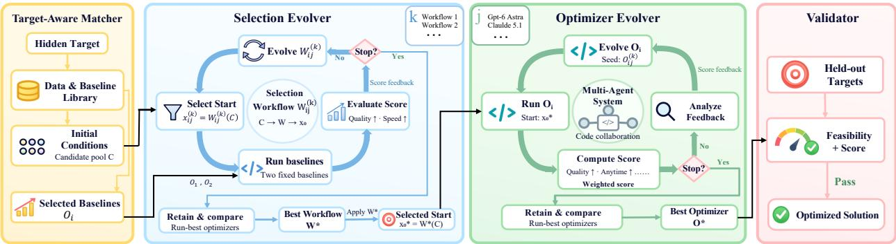  
Figure 1: Overview of ADAPT for Science. A target-aware matcher retrieves historical designs and reference optimizers to form a target-specific search prior. The selection evolver determines where to search, while the optimizer evolver determines how to search from execution feedback. Together, they define a target-specific search policy that is evaluated on held-out targets under the original scientific objective and physical constraints.

## 3.1 Problem Formulation

For a scientific target $\tau \in \tau$ , let $x \ \in \ { \mathcal { X } } _ { \tau }$ denote the design variables, $L _ { \tau } ( x )$ the objective, and $\mathcal { F } _ { \tau } ~ \subseteq ~ \mathcal { X } _ { \tau }$ the feasible region. Under a finite evaluation budget, performance depends on both the initialization and the optimization procedure. We therefore define the search policy as $\pi = ( W , O )$ , where W selects the initial design $x _ { 0 }$ and O generates the trajectory $\mathcal { T } _ { \pi } = \{ x _ { 0 } , \ldots , x _ { T } \}$ . For budget B, we define $\begin{array} { r } { J _ { \tau } ( \pi ; B ) = \operatorname* { m i n } _ { x _ { t } \in \mathcal { T } _ { \pi } \cap \mathcal { F } _ { \tau } , c _ { t } \leq B } L _ { \tau } ( x _ { t } ) } \end{array}$ , where $c _ { t }$ is the cumulative evaluation cost.

Conventional optimization fixes W and O in advance, whereas ADAPT adapts both to each scientific target,

$$
( W _ { \tau } ^ { * } , O _ { \tau } ^ { * } ) = \arg \operatorname* { m i n } _ { W \in \mathcal { W } , O \in \mathcal { O } } J _ { \tau } ( ( W , O ) ; B ) ,\tag{1}
$$

where W and O denote the spaces of selection policies and optimization procedures. $W _ { \tau } ^ { * }$ determines where to search, while $O _ { \tau } ^ { * }$ determines how to search.

## 3.2 Historical Scientific Experience

We construct a reusable experience library from historical gravitational-wave detector designs and optimization records. After cleaning, representation standardization, and transfer compatibility filtering, the design library contains 15,409 valid topology–design records, each pairing one topology with a compatible parameterized design and its evaluated performance. A separate baseline library contains ten established optimization procedures and their historical behavior. The former supplies candidate initializations, while the latter provides reference search behavior for policy evolution. Held-out targets and their outcomes are excluded from library construction and all subsequent strategy development.

## 3.3 Target-Aware Retrieval and Initialization

For each target topology, ADAPT retrieves $K = 6 4$ distinct historical sources using a fixed structure-aware distance. A size-3 topology contains nine interior symbols c and twelve boundary symbols b. For target $T$ and source S,

$$
d ( T , S ) = \frac 1 9 \sum _ { i = 1 } ^ { 9 } \delta ( c _ { i } ^ { T } , c _ { i } ^ { S } ) + \frac 1 { 1 2 } \sum _ { j = 1 } ^ { 1 2 } { \bf 1 } \left[ b _ { j } ^ { T } \neq b _ { j } ^ { S } \right] ,\tag{2}
$$

where $\delta ( a , b ) = 0$ for identical symbols, 0.25 for different orientations within the same component family, and 1 for different families. Symbols A–D denote beamsplitters and E–H directional beamsplitters, with four orientations per family. Symbols are compared at fixed positions without rotational or reflection alignment.

Sources with the same complete topology as the target are excluded. The remainder are ranked by increasing $d ( T , S )$ , with lexicographic ordering used for ties. Incompatible records are skipped and the first 64 eligible sources are retained, without dataset-specific quotas.

Parameters are transferred by exact semantic matching of component names, types, parameter properties, and complete coupling groups. Matched bounded values are copied directly. Unmatched parameters use frozen training set medians in the order component-type and property, property only, and global prior, followed by mapping to target bounds. For parameter $x _ { i } ^ { ( k ) }$ with bounds $\ell _ { i }$ and $h _ { i } , u _ { i } ^ { ( k ) } = \mathrm { c l i p } ( ( { x _ { i } ^ { ( k ) } - \ell _ { i } } ) / ( { h _ { i } - \ell _ { i } } ) , \epsilon , 1 - \epsilon )$ and $z _ { i } ^ { ( k ) } = \log ( \bar { u } _ { i } ^ { ( k ) } / ( 1 -$ $u _ { i } ^ { ( k ) } ) ,$ ), with $\epsilon = 1 0 ^ { - 9 }$ . The resulting $C _ { \tau } = \{ \mathbf { z } ^ { ( k ) } \} _ { k = 1 } ^ { 6 4 }$ forms the candidate initialization pool.

## 3.4 Selection Evolution

Given $C _ { \tau }$ , the Selection Evolver searches for a policy $W _ { \tau }$ that returns one initialization under a fixed scientific evaluation budget. Evolution starts from a direct 64-to-1 baseline that evaluates all 64 candidates and selects the best single initialization. Intermediate candidate counts, screening stages, pruning rules, and budget-allocation strategies are not predefined and are left to evolution.

A candidate policy may use historical attributes, transferred parameters, target evaluations, feasibility, constraint violations, and observed optimization progress to determine which candidates are evaluated, retained, or discarded and how budget is allocated among them. ADAPT evolves these policies with GEPA, OpenEvolve, ShinkaEvolve, and ASI using GPT-6 Astra and Claude-fable-5.1. Each workflow–model pair is compared with two reference baselines, yielding 16 configurations.

At iteration k, a policy $W ^ { ( k ) }$ is executed under the fixed budget, its trace is converted into feedback $F _ { W } ^ { ( k ) }$ , and the feedback is used to propose $W ^ { ( k + 1 ) }$ . Strong previous policies are retained for direct comparison. Selection is based on measured scientific performance, and the final policy produces $x _ { 0 , \tau } ^ { * } = W _ { \tau } ^ { * } ( C _ { \tau } )$

## 3.5 Optimizer Evolution

Starting from $x _ { 0 , \tau } ^ { * } { } ^ { } \mathrm { . }$ , the Optimizer Evolver searches over executable optimization programs evaluated directly by the differentiable physics simulator under the same budget and numerical constraints. The search space includes update rules, gradient and state handling, learning-rate and momentum schedules, trajectory management, numerical safe guards, and allocation of the remaining evaluation budget.

The same workflow–model pool proposes and revises optimizers. At iteration $k , O ^ { ( k ) }$ is executed, its trace is converted into feedback $F _ { O } ^ { ( k ) }$ ), and the feedback is used to generate $O ^ { ( k + 1 ) }$ . Strong previous optimizers remain available for direct comparison. Candidate procedures are ranked by

$$
S = w _ { q } S _ { \mathrm { q u a l i t y } } + w _ { a } S _ { \mathrm { a n y t i m e } } + w _ { f } S _ { \mathrm { f e a s i b i l i t y } } + w _ { i } S _ { \mathrm { i m p r o v e m e n t } } ,\tag{3}
$$

where the four terms measure final feasible quality, performance throughout execution, physical validity, and improvement over the initialization. This score is used only for strategy evolution. Reported results use the native scientific objective and feasibility criteria. The selected optimizer $O _ { \tau } ^ { * }$ and selection policy $W _ { \tau } ^ { * }$ define $\pi _ { \tau } ^ { * } = ( W _ { \tau } ^ { * } , O _ { \tau } ^ { * } )$

## 3.6 Independent Validation

The final policy $\pi _ { \tau } ^ { * }$ is evaluated on detector topologies absent from the experience library and excluded from retrieval, baseline selection, policy evolution, and model selection. Their outcomes are never returned to either evolver. Each held-out target is evaluated under the same scientific budget as the comparison methods, and all reported results use the native objective, physical feasibility, and anytime optimization performance.

## 4 Results

We first examine the policies discovered by the two evolution stages and then evaluate their combined effect on eight held-out gravitational-wave detector topologies. All comparisons use matched random seeds, hardware, numerical precision, and the same total wall-clock budget. For ADAPT, this budget covers both warmup (candidate screening and staged probing) and subsequent optimization; no additional time is allocated for warmup.

## 4.1 Selection evolution discovers progressive search

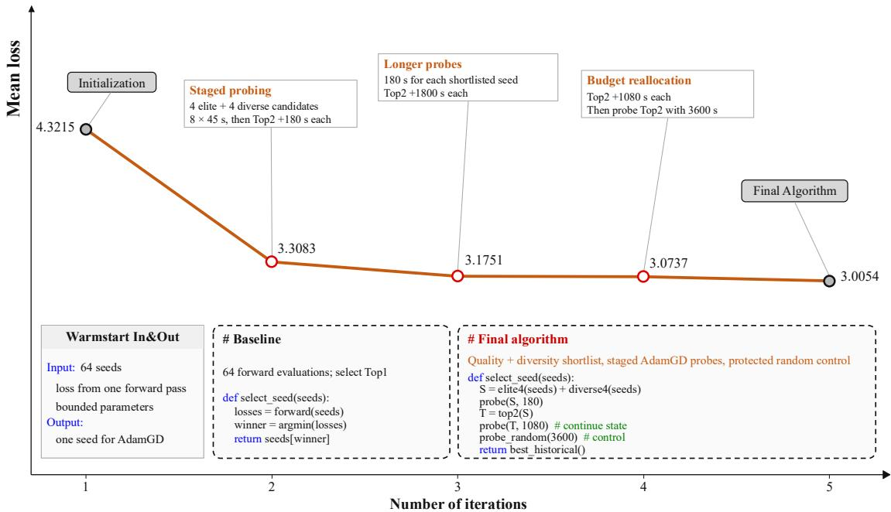  
Figure 2: Evolution of the selection policy. Mean loss across successive selection-policy iterations. Starting from direct selection after 64 forward evaluations, evolution introduces quality–diversity shortlisting, staged probing, and progressive budget reallocation. The final policy reaches a mean loss of 3.0054.

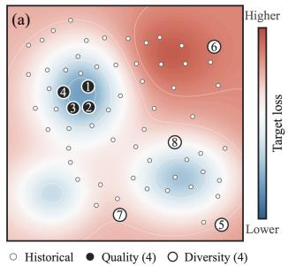

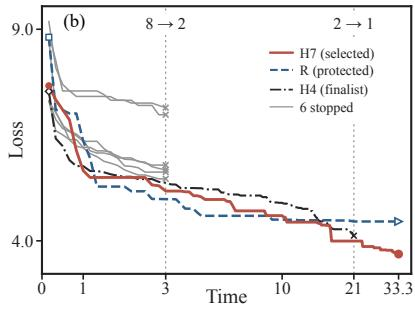  
!!  !Figure 3: Selection evolution discovers progressive search. Starting from a 64-to-1 objective, the evolved policy selects four high-quality feasible candidates and four diversity-preserving candidates, then progressively concentrates evaluation as $8  2  1$ while retaining protected exploration.

  The Selection Evolver is given 64 transferred  !initializations and a single objective, to re-turn one start under a fixed evaluation budget. No intermediate candidate count, pruning schedule, or budget-allocation rule is specified. Figure 2 shows how the policy develops from direct Top-1 selection into a staged search procedure. Successive iterations introduce quality–diversity shortlisting, longer target-specific probes, and progressive budget reallocation, reducing the mean loss to 3.0054. The resulting policy converges to the 64 $ 8  2  1$ workflow shown in Figure 3.

The first stage evaluates all 64 starts once on the target without optimizer updates and

records loss, feasibility, and constraint violation. Among feasible candidates, the four lowest-loss starts form an elite set. Four additional starts are then selected for coverage in transferred parameter space. For candidate k, each bounded parameter is normalized as $q _ { k , i } = ( x _ { k , i } - \ell _ { i } ) / ( h _ { i } - \ell _ { i } )$ , and pairwise distance is $\begin{array} { r } { D ( k , j ) = \sqrt { d ^ { - 1 } \sum _ { i } ( q _ { k , i } - q _ { j , i } ) ^ { 2 } } } \end{array}$ Starting from the four elites, each additional candidate is chosen by $k ^ { \star } = \arg \operatorname* { m a x } _ { k \in \mathcal { F } \setminus S } \operatorname* { m i n } _ { j \in S } D ( k , j )$ until eight starts are retained. Ties are resolved by candidate index. If fewer than eight feasible starts exist, all feasible starts are retained and numerically valid infeasible candidates are added in order of constraint violation, loss, and candidate index. Fewer than eight numerically valid candidates terminates the selection run.

The eight retained starts then enter a target-specific race. Each receives a 3-minute optimization run, after which two leading trajectories are retained and continued to 21 minutes. A protected exploratory branch is maintained during pruning, and the remaining budget is concentrated on the final start. The discovered policy therefore moves from historical quality and parameter coverage to target-specific execution evidence before committing the remaining budget to a single direction.

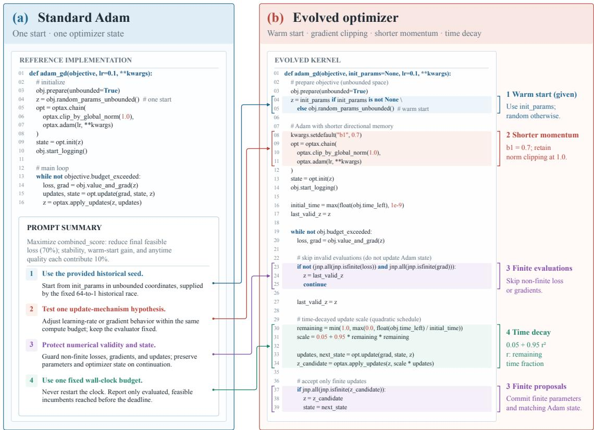  
Figure 4: Optimizer evolution discovers budget-aware search dynamics. The evolved procedure retains the Adam structure while using the selected initialization, shorter first-moment memory, time-dependent updates, and explicit rejection of invalid evaluations and proposals under a fixed scientific budget.

## 4.2 Optimizer evolution discovers budget-aware search dynamics

The preceding selection stage supplies the initialization, while the Optimizer Evolver determines how the subsequent local search proceeds. Figure 5 traces this process from the reference AdamGD implementation to the final optimization procedure. Successive iterations test finite-state protection, time-dependent update scaling, stopping behavior, and shorter optimizer memory. These changes are retained or revised according to measured execution performance, ultimately yielding the optimizer shown in Figure 4.

Figure 4 shows the resulting optimizer selected by ADAPT. Rather than replacing Adam, evolution retains its basic structure and modifies its behavior under the finite evaluation horizon.

The discovered procedure shortens the first-moment memory to $\beta _ { 1 } = 0 . 7$ while retaining global gradient clipping. It further scales each update by $s ( r ) = 0 . 0 5 + 0 . 9 5 r ^ { 2 }$ , where r is the remaining fraction of the evaluation budget, producing larger updates early and increasingly conservative updates near the deadline. Non-finite losses or gradients are skipped, and non-finite parameter proposals are rejected together with the corresponding optimizer-state update.

These changes couple the local search to both the selected historical start and the remaining evaluation horizon. The resulting optimizer remains close to Adam computationally, but adapts its directional memory, update magnitude, and numerical state handling to the observed scientific search process.

## 4.3 Overall Performance on Held-Out Topologies

We compare the complete ADAPT policy with fixed classical optimizers and general-purpose agentic evolution methods on eight held-out detector topologies. Lower loss indicates better performance.

Among fixed optimizers, NAAdam gives the lowest mean loss at 0.452±0.150, whereas ADAPT reaches $\mathbf { 0 . 2 0 4 \pm 0 . 1 0 1 }$ a 54.9% reduction. ADAPT also achieves the lowest loss on all eight held-out topologies among the evaluated base lines, showing that the mean improvement is not driven by a small subset of targets.

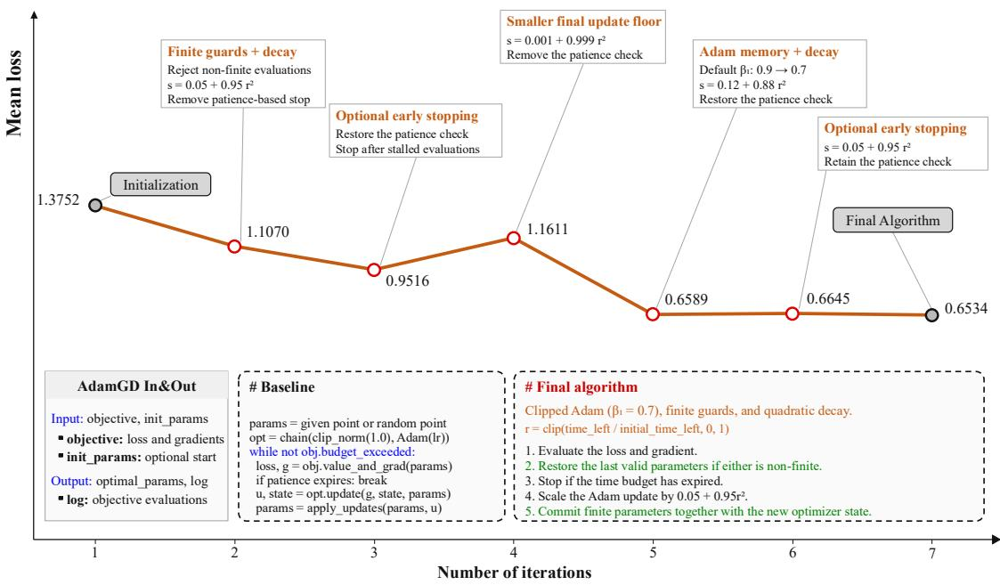  
Figure 5: Evolution of the optimization procedure. Mean loss across successive optimizer-evolution iterations, with annotations summarizing the changes tested at each stage. Starting from the reference AdamGD implementation, evolution tests numerical safeguards, stopping behavior, update scaling, and optimizer memory. The final procedure reaches a mean loss of 0.6534 during strategy evolution.

The same advantage persists against agentic evolution baselines. GEPA gives the strongest mean result among these methods at $0 . 5 4 0 \pm 0 . 2 6 3 .$ , compared with 0.204 ± 0.101 for ADAPT, corresponding to a 62.2% reduction. Thus, program evolution alone does not match the full system under the present protocol. Combining target-specific historical initialization with evolved selection and optimization policies yields the stronger held-out performance.

## 4.4 Representative Detector Optimization

Figure 6 shows how the numerical gain appears in a representative held-out detector. Standard Adam largely preserves the initial structure while adjusting continuous parameters. ADAPT instead suppresses three optical branches whose optimized contributions approach zero, yielding a simpler effective configuration while preserving the remaining optical structure. Under the same evaluation budget, Adam reaches a loss of 0.666 and ADAPT reaches 0.155, a 76.7% reduction. The performance gain therefore coincides with a distinct, physically interpretable change in the optimized detector rather than a small perturbation of the baseline solution. Additional held-out examples are provided in Appendix E.

## 4.5 Ablation of Where and How to Search

Table 3: Ablation study. Mean ± std. over eight held-out topologies (lower is better).
<table><tr><td>Target</td><td>Direct+GEPA</td><td>Fixed+Adam</td><td>No-Prompt</td><td>Ours</td></tr><tr><td>T1</td><td>0.416 +33.8%</td><td>0.320 +2.9%</td><td>0.424 +36.3%</td><td>0.311</td></tr><tr><td>T2</td><td>0.986 +141.7%</td><td>0.371 -9.1%</td><td>0.443 +8.6%</td><td>0.408</td></tr><tr><td>T3</td><td>0.373 +397.3%</td><td>0.180 +140.0%</td><td>0.145 +93.3%</td><td>0.075</td></tr><tr><td>T4</td><td>0.476 +108.8%</td><td>0.246 +7.9%</td><td>0.287 +25.9%</td><td>0.228</td></tr><tr><td>T5</td><td>0.164 +9.3%</td><td>0.200 +33.3%</td><td>0.264 +76.0%</td><td>0.150</td></tr><tr><td>T6</td><td>0.138-0.7%</td><td>0.143 +2.9%</td><td>0.148 +6.5%</td><td>0.139</td></tr><tr><td>T7</td><td>0.413 +153.4%</td><td>0.415 +154.6%</td><td>0.499 +206.1%</td><td>0.163</td></tr><tr><td>T8</td><td>0.421 +171.6%</td><td>0.172 +11.0%</td><td>0.210 +35.5%</td><td>0.155</td></tr><tr><td></td><td>0.423±</td><td>0.256±</td><td>0.303±</td><td>0.204±</td></tr><tr><td>Mean</td><td>0.243 +107.4%</td><td>0.094 +25.5%</td><td>0.128 +48.5%</td><td>0.101</td></tr></table>

We isolate the contributions of adaptive initialization, optimizer evolution, and science-specific guidance. Direct+GEPA bypasses evolved start selection and applies GEPA from a single retrieved initialization. Fixed+Adam retains the selected initialization but replaces the evolved optimizer with fixed Adam. No-Prompt removes the science-specific guidance while retaining the corresponding agentic evolution pipeline.

Removing evolved start selection increases the mean loss to $0 . 4 2 3 \pm 0 . 2 4 3 .$ , and full ADAPT reduces this value by 51.8%. ADAPT is lower on

Table 1: Optimization performance of classical optimizers across eight held-out gravitational-wave detector targets. Lower loss is better. Red percentages indicate the relative increase in loss compared with Ours. The final column reports mean ± standard deviation.
<table><tr><td>Method</td><td>T1</td><td>T2</td><td>T3</td><td>T4</td><td>T5</td><td>T6</td><td>T7</td><td>T8</td><td> $\mathbf { M e a n } \pm \mathbf { S t d } .$ </td></tr><tr><td>Adam</td><td></td><td></td><td>0.423 +36.0% 0.887 +117.4% 1.833 +2344.0% 0.332 +45.6% 0.379 +152.7% 0.692 +397.8% 0.993+509.2% 0.666 +329.7%</td><td></td><td></td><td></td><td></td><td></td><td> $0 . 7 7 6 \pm 0 . 4 5 8 _ { \ + 2 8 0 . 4 \% }$ </td></tr><tr><td></td><td></td><td></td><td></td><td></td><td></td><td></td><td></td><td>NAAdam 0.423 +36.0% 0.696 +70.6% 0.423 +464.0% 0.334 +46.5% 0.415 +176.7% 0.375 +169.8% 0.695+326.4% 0.255 +64.5%</td><td> $0 . 4 5 2 \pm 0 . 1 5 0 _ { \ + 1 2 1 . 6 \% }$ </td></tr><tr><td>Lion</td><td></td><td></td><td></td><td></td><td></td><td></td><td></td><td>4.358+1301.3% 3.841+841.4% 2.028+2604.0% 3.028+1228.1% 2.004 +1236.0% 2.641 +1800.0% 2.663+1533.7% 2.325+1400.0%</td><td> $2 . 8 6 1 \pm 0 . 7 9 3 _ { \ : + 1 3 0 2 . 5 \% }$ </td></tr><tr><td>SGDM</td><td></td><td></td><td></td><td></td><td></td><td></td><td></td><td>4.151 +1234.7% 0.445+9.1% 0.468 +524.0% 0.473 +107.5% 0.581 +287.3% 0.448 +222.3% 0.196+20.2% 0.415 +167.7%</td><td> $0 . 8 9 7 \pm 1 . 2 3 4 _ { \ : + 3 3 9 . 7 \% }$ </td></tr><tr><td>Sophia</td><td></td><td></td><td></td><td></td><td></td><td></td><td></td><td>0.506 +62.7% 0.412 +1.0% 0.627 +736.0% 1.749+667.1% 0.653 +335.3% 0.574 +312.9% 0.430+163.8% 1.659 +970.3%</td><td> $0 . 8 2 6 \pm 0 . 5 1 4 _ { \ : + 3 0 4 . 9 \% }$ </td></tr><tr><td>Adan</td><td></td><td></td><td></td><td></td><td></td><td></td><td></td><td>1.404 +351.4% 1.321 +223.8%1.376 +1734.7% 2.783 +1120.6%2.212 +1374.7% 0.673 +384.2% 1.355 +731.3% 1.387 +794.8%</td><td> $1 . 5 6 4 \pm 0 . 6 0 2 _ { \ : + 6 6 6 . 7 \% }$ </td></tr><tr><td>Ours</td><td>0.311</td><td>0.408</td><td>0.075</td><td>0.228</td><td>0.150</td><td>0.139</td><td>0.163</td><td>0.155</td><td> $\mathbf { 0 . 2 0 4 \pm 0 . 1 0 1 }$ </td></tr></table>

Table 2: Comparison with agentic evolution baselines across eight held-out gravitational-wave detector targets. Lower loss is better. Red percentages indicate the relative increase in loss compared with Ours. The final column reports mean ± standard deviation.
<table><tr><td>Method</td><td>T1</td><td>T2</td><td>T3</td><td>T4</td><td>T5</td><td>T6</td><td>T7</td><td>T8</td><td> $\mathbf { M e a n } \pm \mathbf { S t d } .$ </td></tr><tr><td>GEPA</td><td></td><td></td><td></td><td></td><td></td><td></td><td></td><td>0.557 +79.1% 0.410 +0.5% 0.480 +540.0% 1.218 +434.2% 0.379 +152.7% 0.435 +212.9% 0.475 +191.4% 0.365 +135.5%</td><td> $0 . 5 4 0 \pm 0 . 2 6 3 _ { \ + 1 6 4 . 7 \% }$ </td></tr><tr><td>OpenE.</td><td></td><td></td><td></td><td></td><td></td><td></td><td></td><td></td><td> $0 , 7 0 7  1 0 9  0 . 4 9 2  \infty . 0 . 4 4 9  \infty . \pi = 0 . 2 6 1  1 . 4 5 \times 0 . 6 6 5  \infty . 0 . 4 2 6  \infty . \infty < 0 . 4 3 9  \ldots 0 . 9 5 4  \ldots \nonumber 0 . 5 4 9  0 . 2 0 0 2  \ldots \times 0 . 1 .$ </td></tr><tr><td></td><td></td><td></td><td></td><td></td><td></td><td></td><td></td><td></td><td>ShinkaE. 0.561 +80.4% 0.440 +7.8% 0.674 +798.7% 2.632 +1054.4%0.366 +144.0% 0.210 +51.1% 0.643 +294.5% 0.402 +159.4% 0.741 ± 0.729 +263.2%</td></tr><tr><td>ASI</td><td></td><td></td><td></td><td></td><td></td><td></td><td></td><td>0.725 +133.1% 0.483 +18.4% 0.624 +732.0% 0.653 +186.4% 1.309 +772.7% 0.450 +223.7% 1.681 +931.3% 1.067 +588.4%</td><td> $0 . 8 7 4 \pm 0 . 4 1 0 ~ _ { + 3 2 8 . 4 \% }$ </td></tr><tr><td>Ours</td><td>0.311</td><td>0.408</td><td>0.075</td><td>0.228</td><td>0.150</td><td>0.139</td><td>0.163</td><td>0.155</td><td> $\mathbf { 0 . 2 0 4 \pm 0 . 1 0 1 }$ </td></tr></table>

seven of eight targets, with T6 effectively unchanged at 0.138 versus 0.139. Retaining the selected start but replacing the evolved optimizer with Adam gives $0 . 2 5 6 \pm 0 . 0 9 4$ . ADAPT reduces this loss by 20.3% and is lower on seven targets, with T2 as the exception. Removing science-specific guidance gives $0 . 3 0 3 \pm 0 . 1 2 8$ , whereas full ADAPT is 32.7% lower and improves all eight targets.

These ablations separate the two adaptive decisions in ADAPT. Start selection reduces sensitivity to initialization, optimizer evolution improves subsequent local search, and science-specific guidance strengthens the evolution process across held-out targets.

## 5 Limitations and Future Work

ADAPT is designed for scientific optimization with reusable historical experience, expensive evaluations, and explicit physical constraints. The present study focuses on gravitational-wave detector design, where a differentiable simulator provides controlled evaluation and a large historical design library. The results therefore establish the effectiveness of the framework in one challenging scientific domain, but do not yet demonstrate universality across scientific disciplines.

The method also depends on the quality and coverage of its experience library. Nearest-neighbor retrieval is effective when historical designs contain useful local structure, but its advantage may diminish for targets that lie far outside the observed design distribution. In addition, evolving both selection workflows and optimization programs introduces computational overhead relative to a single fixed optimizer. This overhead is justified when scientific evaluations are sufficiently costly, but should be reduced for cheaper optimization problems.

Several extensions follow naturally. First, ADAPT can be evaluated on scientific problems with different search spaces, simulators, and physical constraints, including non-differentiable and experimental settings. Second, the experience library can be updated online so that successful solutions and optimizers become reusable knowledge for future targets. Third, more efficient strategy evolution could reduce the number of workflow–model evaluations through learned transfer, uncertainty-aware allocation, or meta-optimization. Finally, extending the independent validator to real experimental measurements would test whether self-evolving optimization remains reliable beyond simulation.

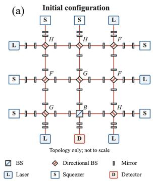

(b)  
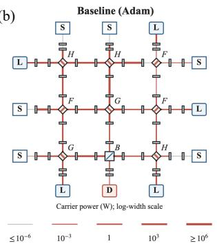

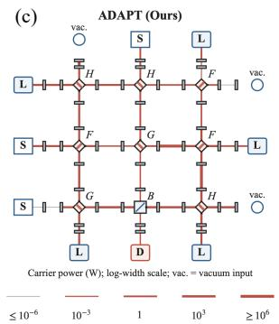

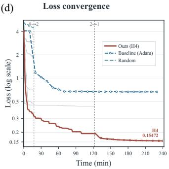  
Figure 6: Representative held-out detector optimization. (a) Initial detector configuration. (b) Design obtained with standard Adam and its optimized carrier-power distribution. (c) Final ADAPT design. ADAPT suppresses three optical branches with near-zero optimized contributions and replaces them with vacuum inputs while preserving the remaining detector structure. (d) Loss convergence under the same scientific evaluation budget. ADAPT reaches a final reported loss of 0.155.

## 6 Conclusion

We introduced ADAPT for Science, a framework that treats the complete scientific search policy as the object of optimization. ADAPT decomposes this policy into two coupled decisions: where to search and how to search. Historical scientific experience guides target-specific initialization and resource allocation, while online execution feedback adapts the optimization procedure itself.

On eight held-out gravitational-wave detector topologies, ADAPT achieves a mean loss of $0 . 2 0 4 \pm 0 . 1 0 1$ , reducing mean loss by 54.9% relative to the strongest classical optimizer and by 62.2% relative to the strongest general-purpose agentic evolution baseline under matched scientific evaluation budgets. ADAPT also achieves the lowest loss on all eight held-out topologies among the evaluated baselines. Ablation results further show that adaptive initialization, optimizer evolution, and science-specific guidance each contribute to the full-system performance.

These results support a broader view of scientific automation in which the search procedure itself is adaptive. Rather than optimizing scientific parameters under a fixed workflow, ADAPT combines prior scientific experience with execution feedback to continually refine how the search is initialized and conducted.

## AI use statement

Large language models were used as components of the agentic optimization workflows to propose and revise candidate search policies and optimization procedures based on execution feedback. All candidates were evaluated by the scientific simulator and objective functions.

Generative AI tools were used only for language editing and manuscript polishing. The authors reviewed all AI-assisted edits and take full responsibility for the final manuscript.

## Reproducibility statement

The supplementary material provides the scientific objective, data construction, optimization procedures, evaluation protocol, implementation settings, and additional experimental details needed to reproduce the study.

## References

[1] Lakshya A Agrawal, Shangyin Tan, Dilara Soylu, Noah Ziems, Rishi Khare, Krista Opsahl-Ong, Arnav Singhvi, Herumb Shandilya, Michael J Ryan, Meng Jiang, et al. Gepa: Reflective prompt evolution can outperform reinforcement learning. In International Conference on Learning Representations, volume 2026, pages 8479– 8565, 2026.

[2] Marcin Andrychowicz, Misha Denil, Sergio Gomez, Matthew W Hoffman, David Pfau, Tom Schaul, Brendan Shillingford, and Nando De Freitas. Learning to learn by gradient descent by gradient descent. Advances in neural information processing systems, 29, 2016.

[3] Daniil A Boiko, Robert MacKnight, Ben Kline, and Gabe Gomes. Autonomous chemical research with large language models. Nature, 624(7992):570–578, 2023.

[4] Benjamin Burger, Phillip M Maffettone, Vladimir V Gusev, Catherine M Aitchison, Yang Bai, Xiaoyan Wang, Xiaobo Li, Ben M Alston, Buyi Li, Rob Clowes, et al. A mobile robotic chemist. Nature, 583(7815):237–241, 2020.

[5] Xiangning Chen, Chen Liang, Da Huang, Esteban Real, Kaiyuan Wang, Hieu Pham, Xuanyi Dong, Thang Luong, Cho-Jui Hsieh, Yifeng Lu, et al. Symbolic discovery of optimization algorithms. Advances in neural information processing systems, 36:49205–49233, 2023.

[6] Zhantao Chen, Alexander N Petsch, Aidan J Israelski, Rajan Plumley, Lingjia Shen, Cong Wang, Cheng Peng, Yuan Ni, Arun Bansil, Sugata Chowdhury, et al. An agentic artificially intelligent x-ray scientist. Nature Machine Intelligence, pages 1–12, 2026.

[7] Ching-An Cheng, Allen Nie, and Adith Swaminathan. Trace is the next autodiff: Generative optimization with rich feedback, execution traces, and llms. Advances in Neural Information Processing Systems, 37:71596–71642, 2024.

[8] Connor W Coley, Dale A Thomas III, Justin AM Lummiss, Jonathan N Jaworski, Christopher P Breen, Victor Schultz, Travis Hart, Joshua S Fishman, Luke Rogers, Hanyu Gao, et al. A robotic platform for flow synthesis of organic compounds informed by ai planning. Science, 365(6453):eaax1566, 2019.

[9] David Eriksson, Michael Pearce, Jacob Gardner, Ryan D Turner, and Matthias Poloczek. Scalable global optimization via local bayesian optimization. Advances in neural information processing systems, 32, 2019.

[10] Alhussein Fawzi, Matej Balog, Aja Huang, Thomas Hubert, Bernardino Romera-Paredes, Mohammadamin Barekatain, Alexander Novikov, Francisco J R. Ruiz, Julian Schrittwieser, Grzegorz Swirszcz, et al. Discov ering faster matrix multiplication algorithms with reinforcement learning. Nature, 610(7930):47–53, 2022.

[11] Zhaoran Feng, Jiangzhi Chen, Ce Wang, and Jie Ren. Complexity-powered machine intelligent classification of quantum many-body dynamics. Physical Review E, 113(6):065301, 2026.

[12] Jacob R Gardner, Matt J Kusner, Zhixiang Eddie Xu, Kilian Q Weinberger, and John P Cunningham. Bayesian optimization with inequality constraints. In Icml, volume 2014, pages 937–945, 2014.

[13] Jarosław M Granda, Liva Donina, Vincenza Dragone, De-Liang Long, and Leroy Cronin. Controlling an organic synthesis robot with machine learning to search for new reactivity. Nature, 559(7714):377–381, 2018.

[14] Florian Hase, Lo¨ıc M Roch, Christoph Kreisbeck, and Alan Aspuru-Guzik. Phoenics: a bayesian optimizer for´ chemistry. ACS central science, 4(9):1134–1145, 2018.

[15] Ziyao Huang, Weiwei Wu, Kui Wu, Wei-Bin Lee, and Jianping Wang. Calm: Co-evolution of algorithms and language model for automatic heuristic design. In International Conference on Learning Representations, volume 2026, pages 72468–72510, 2026.

[16] Donald R Jones, Matthias Schonlau, and William J Welch. Efficient global optimization of expensive black-box functions. Journal ofGlobal optimization, 13(4):455–492, 1998.

[17] Robert Lange, Yuki Imajuku, and Edoardo Cetin. Shinkaevolve: Towards open-ended and sample-efficient program evolution. In International Conference on Learning Representations, volume 2026, pages 74026–74078, 2026.

[18] Fei Liu, Xialiang Tong, Mingxuan Yuan, Xi Lin, Fu Luo, Zhenkun Wang, Zhichao Lu, and Qingfu Zhang. Evolution of heuristics: Towards efficient automatic algorithm design using large language model. arXiv preprint arXiv:2401.02051, 2024.

[19] Andres M. Bran, Sam Cox, Oliver Schilter, Carlo Baldassari, Andrew D White, and Philippe Schwaller. Aug menting large language models with chemistry tools. Nature machine intelligence, 6(5):525–535, 2024.

[20] Benjamin P MacLeod, Fraser GL Parlane, Thomas D Morrissey, Florian Hase, Lo¨ ¨ıc M Roch, Kevan E Dettelbach, Raphaell Moreira, Lars PE Yunker, Michael B Rooney, Joseph R Deeth, et al. Self-driving laboratory for accelerated discovery of thin-film materials. Science Advances, 6(20):eaaz8867, 2020.

[21] Daniel J Mankowitz, Andrea Michi, Anton Zhernov, Marco Gelmi, Marco Selvi, Cosmin Paduraru, Edouard Leurent, Shariq Iqbal, Jean-Baptiste Lespiau, Alex Ahern, et al. Faster sorting algorithms discovered using deep reinforcement learning. Nature, 618(7964):257–263, 2023.

[22] Amil Merchant, Simon Batzner, Samuel S Schoenholz, Muratahan Aykol, Gowoon Cheon, and Ekin Dogus Cubuk. Scaling deep learning for materials discovery. Nature, 624(7990):80–85, 2023.

[23] Zhichu Ren, Zekun Ren, Zhen Zhang, Tonio Buonassisi, and Ju Li. Autonomous experiments using active learning and ai. Nature Reviews Materials, 8(9):563–564, 2023.

[24] Bernardino Romera-Paredes, Mohammadamin Barekatain, Alexander Novikov, Matej Balog, M Pawan Kumar, Emilien Dupont, Francisco JR Ruiz, Jordan S Ellenberg, Pengming Wang, Omar Fawzi, et al. Mathematical discoveries from program search with large language models. Nature, 625(7995):468–475, 2024.

[25] Bobak Shahriari, Kevin Swersky, Ziyu Wang, Ryan P Adams, and Nando De Freitas. Taking the human out of the loop: A review of bayesian optimization. Proceedings ofthe IEEE, 104(1):148–175, 2015.

[26] Asankhaya Sharma. Openevolve: an open-source evolutionary coding agent. GitHub repository. Accessed, pages 08–10, 2025.

[27] Yiding Shi, Jianan Zhou, Wen Song, Jieyi Bi, Yaoxin Wu, Zhiguang Cao, and Jie Zhang. Generalizable heuristic generation through llms with meta-optimization. In International Conference on Learning Representations, volume 2026, pages 119314–119349, 2026.

[28] Benjamin J Shields, Jason Stevens, Jun Li, Marvin Parasram, Farhan Damani, Jesus I Martinez Alvarado, Jacob M Janey, Ryan P Adams, and Abigail G Doyle. Bayesian reaction optimization as a tool for chemical synthesis. Nature, 590(7844):89–96, 2021.

[29] Parshin Shojaee, Kazem Meidani, Shashank Gupta, Amir Barati Farimani, and Chandan Reddy. Llm-sr: Scientific equation discovery via programming with large language models. In International Conference on Learning Representations, volume 2025, pages 16054–16085, 2025.

[30] Jasper Snoek, Hugo Larochelle, and Ryan Adams. Practical bayesian optimization of machine learning algorithms. Advances in neural information processing systems, 25, 2012.

[31] Nathan J Szymanski, Bernardus Rendy, Yuxing Fei, Rishi E Kumar, Tanjin He, David Milsted, Matthew J Mc Dermott, Max Gallant, Ekin Dogus Cubuk, Amil Merchant, et al. An autonomous laboratory for the accelerated synthesis of inorganic materials. Nature, 624(7990):86–91, 2023.

[32] Hanchen Wang, Tianfan Fu, Yuanqi Du, Wenhao Gao, Kexin Huang, Ziming Liu, Payal Chandak, Shengchao Liu, Peter Van Katwyk, Andreea Deac, et al. Scientific discovery in the age of artificial intelligence. Nature, 620 (7972):47–60, 2023.

[33] Haoran Ye, Jiarui Wang, Zhiguang Cao, Federico Berto, Chuanbo Hua, Haeyeon Kim, Jinkyoo Park, and Guojie Song. Reevo: Large language models as hyper-heuristics with reflective evolution. Advances in neural information processing systems, 37:43571–43608, 2024.

[34] Jiaqi Zhang, Louis Cammarata, Chandler Squires, Themistoklis P Sapsis, and Caroline Uhler. Active learning for optimal intervention design in causal models. Nature Machine Intelligence, 5(10):1066–1075, 2023.

[35] Zhi Zheng, Zhuoliang Xie, Zhenkun Wang, and Bryan Hooi. Monte carlo tree search for comprehensive exploration in llm-based automatic heuristic design. arXiv preprint arXiv:2501.08603, 2025.

[36] Yuhang Zhou, Yixin Cao, Yuchen Ni, Shihan Dou, Xutian Chen, Ge Zhang, Xiang Liu, and Guangnan Ye. Prism: Probabilistic reward model with inherent structural modeling. In Proceedings ofthe 64th Annual Meeting ofthe Associationfor Computational Linguistics (Volume 1: Long Papers), pages 12345–12362, 2026.

## A Scientific Objective and Simulator Specification

This appendix provides the full scientific formulation underlying the gravitational-wave detector design task used throughout the paper. We first define the finite-budget optimization problem, and then describe the detector representation, continuous design variables, differentiable physics simulator, native scientific objective, physical feasibility constraints, and optimization coordinates.

## A.1 Finite-Budget Scientific Optimization

For a detector topology $\tau \in \mathcal T$ , let $x \in \mathcal { X } _ { \tau }$ denote its continuous design variables, $L _ { \tau } ( x )$ the native scientific objective, and $\mathcal { F } _ { \tau } \subseteq \mathcal { X } _ { \tau }$ the physically feasible subset. The unconstrained scientific design problem can be written as

$$
x _ { \tau } ^ { \star } = \arg \operatorname* { m i n } _ { x \in \mathcal { F } _ { \tau } } L _ { \tau } ( x ) .\tag{4}
$$

In practice, however, scientific optimization is performed under a finite evaluation budget. Performance therefore depends not only on the local parameter updates, but also on where the search starts and which optimization procedure is used. We represent the complete search policy as

$$
\pi = ( W , O ) ,\tag{5}
$$

where $W$ denotes the selection policy that determines the initialization $x _ { 0 } ,$ , and O denotes the optimizer that subsequently generates a trajectory

$$
\mathcal { T } _ { \pi } = \{ x _ { 0 } , x _ { 1 } , \ldots , x _ { T } \} .\tag{6}
$$

Let $c _ { t }$ denote the cumulative scientific evaluation cost when $x _ { t }$ has been evaluated, and let B denote the total evaluation budget. We define the finite-budget performance of policy π on target τ as

$$
J _ { \tau } ( \pi ; B ) = \operatorname* { m i n } _ { t : c _ { t } \leq B \atop x _ { t } \in \mathcal { F } _ { \tau } } L _ { \tau } ( x _ { t } ) , \qquad \operatorname* { m i n } \otimes : = + \infty .\tag{7}
$$

Equation equation 7 evaluates the best physically feasible design obtained before the budget is exhausted. For a fixed execution trace and $B _ { 2 } \geq B _ { 1 }$ , the feasible incumbent set available at $B _ { 1 }$ is a subset of that available at $B _ { 2 } ,$ and therefore

$$
\begin{array} { r } { J _ { \tau } ( \pi ; B _ { 2 } ) \le J _ { \tau } ( \pi ; B _ { 1 } ) . } \end{array}\tag{8}
$$

This monotonicity applies to the recorded best feasible solution, rather than to every intermediate optimization iterate. ADAPT optimizes the two components of the search policy jointly:

$$
( W _ { \tau } ^ { \star } , O _ { \tau } ^ { \star } ) \in \arg \operatorname* { m i n } _ { W \in \mathcal W , O \in \mathcal O } J _ { \tau } \big ( ( W , O ) ; B \big ) .\tag{9}
$$

The role of $W _ { \tau } ^ { \star }$ is to determine where to search, whereas $O _ { \tau } ^ { \star }$ determines how to search. Importantly, Equation equation 9 defines the objective of the meta-level search; it does not assume that the discrete policy space is differentiable or that the global optimum over $\boldsymbol { \mathcal { W } } \times \boldsymbol { \mathcal { O } }$ can be found.

## A.2 Detector Topology Representation

A detector target consists of a discrete optical topology together with a set of continuous design variables. In the sizethree UIFO representation used in this work, each topology is encoded by a string containing nine internal component symbols followed by twelve boundary symbols.

The nine internal positions follow the order

$$
1 1 , 1 2 , 1 3 , 2 1 , 2 2 , 2 3 , 3 1 , 3 2 , 3 3 ,\tag{10}
$$

and the twelve boundary positions follow

$$
0 1 , 0 2 , 0 3 , 1 0 , 1 4 , 2 0 , 2 4 , 3 0 , 3 4 , 4 1 , 4 2 , 4 3 .\tag{11}
$$

Table 4: Continuous detector-design variables and default physical bounds. The active parameter dimension $d _ { \tau }$ depends on the detector topology. Some physical properties may share one optimization scalar and are therefore optimized jointly.
<table><tr><td>Parameter</td><td>Range</td><td>Unit</td></tr><tr><td>Reflectivity</td><td> $[ 1 0 ^ { - 1 2 } , 1 - 1 0 ^ { - 1 2 } ]$ </td><td>dimensionless</td></tr><tr><td>Mirror tuning</td><td>[-360, 360]</td><td>degree</td></tr><tr><td>Squeezing level</td><td>[0, 10]</td><td>dB</td></tr><tr><td>Squeezing angle</td><td>[-360, 360]</td><td>degree</td></tr><tr><td>Laser power</td><td>[0, 200]</td><td>W</td></tr><tr><td>Mass</td><td>[0.01, 200]</td><td>kg</td></tr><tr><td>Propagation length</td><td>[0.1, 4000]</td><td>m</td></tr></table>

For internal components, symbols A–D represent beam splitters with different orientations, whereas E–H represent directional beam splitters with the corresponding orientation convention. Boundary symbols specify optical sources or readout elements:

$$
\mathrm { L = l a s e r , } \qquad \mathrm { S = s q u e e z e r , } \qquad \mathrm { D = d e t e c t o r , } \qquad \mathrm { H = b a l a n c e d h o m o d y n e \ r e a d o u t . }\tag{12}
$$

For example, the eight held-out targets used in the main experiments are distinct discrete topologies, while optimization is performed over their topology-specific continuous parameter spaces. Complete visualizations of all eight targets, including the initial configuration, the standard Adam result, and the final ADAPT result, are provided in Appendix H.

## A.3 Continuous Design Variables and Physical Bounds

For a fixed topology τ , the continuous design vector $x \in \mathbb { R } ^ { d _ { \tau } }$ contains the active optical and mechanical parameters associated with that topology. Depending on the included optical components, these variables may include mirror reflectivities and tunings, squeezing parameters, laser powers, test-mass masses, and propagation lengths.

Table 4 summarizes the default physical parameter ranges used by the simulator.

The nominal physical range of a reflectivity is [0, 1]. In the numerical implementation, both endpoints are moved inward by $1 0 ^ { - 1 2 }$ to avoid singular boundary behavior.

The parameter dimension is topology-dependent. In addition, several optical properties can be coupled to the same optimization scalar. Consequently, $d _ { \tau }$ is determined from the topology-specific optimization schema rather than being fixed globally. When historical designs are transferred between topologies, these coupled parameter groups are preserved; the corresponding procedure is described in Appendix B.3.

## A.4 Differentiable Physics Simulator

Each candidate detector is evaluated using the differentiable interferometer simulator employed throughout the study. For every design $x ,$ the simulator constructs quantum-noise, amplitude-modulation, and frequency-modulation configurations and evaluates their corresponding detector responses over the same frequency grid.

We use $N _ { f } = 1 0 0$ logarithmically spaced frequencies from $f _ { \mathrm { m i n } } = 2 0$ Hz to $f _ { \mathrm { m a x } } = 5 0 0 0 \ : \mathrm { H z } ;$

$$
f _ { k } = f _ { \mathrm { m i n } } \left( \frac { f _ { \mathrm { m a x } } } { f _ { \mathrm { m i n } } } \right) ^ { \frac { k - 1 } { N _ { f } - 1 } } , \qquad k = 1 , \dots , N _ { f } .\tag{13}
$$

Let $N _ { q } ( f ; x )$ denote the simulated quantum-noise magnitude, and let $D _ { q } ( f ; x ) , D _ { a } ( f ; x )$ , and $D _ { f } ( f ; x )$ denote the detector transfer magnitudes extracted from the quantum, amplitude-modulation, and frequency-modulation sim ulations, respectively. The resulting strain sensitivity is

$$
H ( f ; x ) = \frac { \sqrt { | N _ { q } ( f ; x ) | ^ { 2 } + \left( 4 \times 1 0 ^ { - 9 } D _ { a } ( f ; x ) \right) ^ { 2 } + \left( 1 0 ^ { - 8 } f D _ { f } ( f ; x ) \right) ^ { 2 } } } { D _ { q } ( f ; x ) } .\tag{14}
$$

For numerical stability, the extracted detector transfer is lower bounded by a small positive constant before division. The coefficients in Equation equation 14 are fixed simulator conventions and are not optimized or learned by ADAPT.

Because the simulator is differentiable with respect to the continuous design variables, gradient-based optimizers can directly differentiate the scientific objective through the complete physical simulation.

## A.5 Native Sensitivity Objective

Let $H _ { \mathrm { r e f } } ( f )$ denote the fixed reference sensitivity curve. The native sensitivity objective is the mean logarithmic sensitivity ratio across the $N _ { f }$ evaluation frequencies:

$$
L _ { \mathrm { s e n s } } ( x ) = \frac { 1 } { N _ { f } } \sum _ { k = 1 } ^ { N _ { f } } \log _ { 1 0 } \frac { H ( f _ { k } ; x ) } { H _ { \mathrm { r e f } } ( f _ { k } ) } .\tag{15}
$$

Equation equation 15 can equivalently be written as

$$
L _ { \mathrm { s e n s } } ( x ) = \log _ { 1 0 } \left[ \prod _ { k = 1 } ^ { N _ { f } } \frac { H ( f _ { k } ; x ) } { H _ { \mathrm { r e f } } ( f _ { k } ) } \right] ^ { 1 / N _ { f } } .\tag{16}
$$

Thus,

$$
1 0 ^ { L _ { \mathrm { s e n s } } ( x ) }\tag{17}
$$

is the geometric mean of the sensitivity ratio relative to the reference detector. This objective therefore rewards broadband improvement rather than performance at only a single frequency.

Away from nonsmooth numerical boundaries, its gradient satisfies

$$
\nabla _ { x } L _ { \mathrm { s e n s } } ( x ) = \frac { 1 } { N _ { f } \ln { 1 0 } } \sum _ { k = 1 } ^ { N _ { f } } \frac { \nabla _ { x } H ( f _ { k } ; x ) } { H ( f _ { k } ; x ) } .\tag{18}
$$

The reference curve contributes no gradient because it is fixed throughout optimization.

## A.6 Physical Constraints and Power Penalty

In addition to sensitivity, candidate designs must satisfy internal optical power constraints. Let $P _ { g , j } ( x )$ denote the power at constrained port j belonging to constraint group g, and let $T _ { g }$ be its corresponding physical threshold.

The simulator uses the following threshold levels:

$$
T _ { \mathrm { h a r d } } = 3 . 5 \times 1 0 ^ { 6 } \mathrm { W } , \qquad T _ { \mathrm { s o f t } } = 2 \times 1 0 ^ { 3 } \mathrm { W } , \qquad T _ { \mathrm { d e t e c t o r } } = 1 0 ^ { - 2 } \mathrm { W } .\tag{19}
$$

For each constrained power, define the normalized violation

$$
a _ { g , j } ( x ) = \operatorname* { m a x } \left( \frac { P _ { g , j } ( x ) } { T _ { g } } - 1 , 0 \right) ,\tag{20}
$$

and the bounded penalty

$$
p _ { g , j } ( x ) = \frac { a _ { g , j } ( x ) } { 1 + a _ { g , j } ( x ) } .\tag{21}
$$

The complete native optimization objective is

$$
L _ { \tau } ( x ) = L _ { \mathrm { s e n s } } ( x ) + \sum _ { g , j } p _ { g , j } ( x ) .\tag{22}
$$

Each individual penalty satisfies $0 \leq p _ { g , j } ( x ) < 1$ , while the complete penalty can exceed one because multiple physical constraints may be violated simultaneously.

For $P _ { g , j } > T _ { g }$ , Equation equation 21 reduces to

$$
p _ { g , j } = 1 - \frac { T _ { g } } { P _ { g , j } } ,\tag{23}
$$

and therefore

$$
\frac { \partial p _ { g , j } } { \partial P _ { g , j } } = \frac { T _ { g } } { P _ { g , j } ^ { 2 } } .\tag{24}
$$

Below the threshold, the derivative is zero.

The penalty in Equation equation 22 facilitates differentiable optimization, but physical feasibility is evaluated independently. A design is considered feasible only if

$$
x \in { \mathcal { F } } _ { \tau } \quad \Longleftrightarrow \quad x \in { \mathcal { X } } _ { \tau } { \mathrm { ~ a n d ~ } } P _ { g , j } ( x ) \leq T _ { g } \quad \forall ( g , j ) .\tag{25}
$$

This distinction is important: the differentiable penalty guides search, whereas the final scientific validity of a design is determined by the physical constraints themselves.

## A.7 Bounded-to-Unbounded Optimization Coordinates

The physical parameters lie inside heterogeneous bounded intervals. To provide a common unconstrained optimization space, we transform each physical parameter $x _ { j } \in [ \ell _ { j } , h _ { j } ]$ to an unconstrained coordinate $u _ { j }$

First define

$$
q _ { j } = \mathrm { c l i p } \left( \frac { x _ { j } - \ell _ { j } } { h _ { j } - \ell _ { j } } , \epsilon _ { u } , 1 - \epsilon _ { u } \right) ,\tag{26}
$$

where $\epsilon _ { u } = 1 0 ^ { - 9 }$ is used for numerical stability. The unconstrained coordinate is then

$$
u _ { j } = \log q _ { j } - \log ( 1 - q _ { j } ) .\tag{27}
$$

The inverse transformation is

$$
x _ { j } ( u _ { j } ) = \ell _ { j } + ( h _ { j } - \ell _ { j } ) \sigma ( u _ { j } ) , \qquad \sigma ( u ) = \frac { 1 } { 1 + e ^ { - u } } .\tag{28}
$$

By the chain rule,

$$
\nabla _ { u } L = \operatorname { d i a g } \left[ \left( h - \ell \right) \odot \sigma ( u ) \odot \left( 1 - \sigma ( u ) \right) \right] \nabla _ { x } L .\tag{29}
$$

If one scalar controls multiple coupled optical properties {yk}, their gradient contributions are accumulated:

$$
\frac { \partial L } { \partial x _ { j } } = \sum _ { k } \frac { \partial L } { \partial y _ { k } } \frac { \partial y _ { k } } { \partial x _ { j } } .\tag{30}
$$

For this reason, coupled parameter groups are treated as indivisible semantic units when transferring historical designs between detector topologies.

## B Historical Experience Library and Target-Aware Retrieval

ADAPT does not initialize every scientific search from scratch. Instead, it constructs a target-specific prior from a historical library of previously evaluated detector designs. This appendix describes the composition of the library, target-aware retrieval, topology-compatible parameter transfer, prior-based completion of unmatched parameters, and the construction of the candidate initialization pool used by the Selection Evolver.

## B.1 Historical Design Library

The historical experience library used in this work contains

$$
^ \mathrm { 1 5 , 4 0 9 }\tag{31}
$$

transferable gravitational-wave detector designs.

The library is formed from two sources:

$$
9 , 3 4 2 \quad \mathrm { o f f i c i a l t r a i n i n g r e p r e s e n t a t i v e s } ,\tag{32}
$$

and

$$
6 , 0 6 7 \mathrm { c o m p a t i b l e h i s t o r i c a l G r a v i T u n e d e s i g n s } .\tag{33}
$$

Together,

$$
9 , 3 4 2 + 6 , 0 6 7 = 1 5 , 4 0 9 .\tag{34}
$$

The complete retrieval index contains 16,727 historical topology names. Among the additional GraviTune entries, 1,318 are incompatible with the parameter-transfer schema and therefore cannot provide valid transferred initializa tions. They are excluded when constructing the usable historical design bank.

For reproducibility, the compressed historical bank used by the current release has SHA-256

6959bfcb3f24e1b963e3e0b3dc4f0ada414fca0dc9b9426f6cfd566e4f624594 .

The historical library is used exclusively as a source of prior scientific experience. Its size should therefore be interpreted as the number of reusable scientific designs, not as a language-model training set or a number of LLM training examples.

## B.2 Target-Aware Topology Retrieval

For a new target topology τ , the Target-Aware Matcher first ranks historical designs according to structural similarity and retrieves the $K = 6 4$ closest compatible designs. These designs form the candidate pool

$$
\mathcal { C } _ { \tau } = \left\{ d _ { ( 1 ) } , d _ { ( 2 ) } , \dots , d _ { ( 6 4 ) } \right\} .\tag{35}
$$

In the topology-aware retrieval implementation, the distance decomposes into the nine internal components and twelve boundary components. Let $c _ { \tau , j }$ and $b _ { \tau , j }$ denote the internal and boundary symbols of the target, respectively, and let $c _ { i , j }$ and $b _ { i , j }$ denote those of a historical topology i. The retrieval distance is

$$
D ( \tau , i ) = \frac { 1 } { 9 } \sum _ { j = 1 } ^ { 9 } d _ { c } ( c _ { \tau , j } , c _ { i , j } ) + \frac { 1 } { 1 2 } \sum _ { j = 1 } ^ { 1 2 } \mathbb { 1 } \left[ b _ { \tau , j } \neq b _ { i , j } \right] ,\tag{36}
$$

where

$$
d _ { c } ( a , b ) = \left\{ \begin{array} { l l } { 0 , } & { a = b , } \\ { 0 . 2 5 , } & { a \neq b \mathrm { b u t } a \mathrm { a n d } b \mathrm { b e l o n g ~ t o ~ t h e ~ s a m e ~ c o m p o n e n t ~ f a m i l y , } } \\ { 1 , } & { \mathrm { o t h e r w i s e . } } \end{array} \right.\tag{37}
$$

This definition distinguishes an orientation change within the same optical component family from a replacement by a different component family. Exact matches therefore receive zero cost, orientation-level changes receive a smaller cost, and changes of component type receive the largest cost. Symbols are compared at fixed positions without rotational or reflection alignment.

Historical candidates are ranked by increasing $D ( \tau , i )$ . Exact copies of the target topology are excluded from retrieval, and incompatible historical records are skipped. Retrieval continues until 64 distinct transferable sources have been collected, without dataset-specific quotas. Lexicographic ordering of topology strings is used to resolve equal-distance ties.

## B.3 Topology-Compatible Semantic Transfer

A retrieved historical detector cannot in general be copied directly to a new topology because the target may contain a different set of optical components and a different number of continuous parameters. We therefore transfer historical designs according to the semantic identity of each optimization variable.

Each scalar is associated with

physical property, component names and types, complete controlled component set,

(38)

where the controlled component set contains the complete group of optical properties coupled to that scalar. Two variables are considered directly transferable only when their semantic identities match and the historical value is valid under the target bounds.

For target coordinate $j$ and retrieved historical design i, the transferred value is

$$
\begin{array} { r } { x _ { \tau , j } ^ { ( i ) } = \left\{ \begin{array} { l l } { x _ { i , k } , } & { \mathrm { i f ~ a ~ c o m p a t i b l e ~ s e m a n t i c ~ m a t c h ~ } k \mathrm { ~ e x i s t s } , } \\ { \ell _ { \tau , j } + \left( h _ { \tau , j } - \ell _ { \tau , j } \right) m _ { j } , } & { \mathrm { o t h e r w i s e } , } \end{array} \right. } \end{array}\tag{39}
$$

where $m _ { j } \in [ 0 , 1 ]$ is a normalized historical prior used to complete unmatched coordinates.

Preserving the complete coupled component set is essential. If one scalar jointly controls several optical properties, transferring only one member of the group would alter the physical meaning of the optimization variable and would no longer reproduce a valid target parameterization.

## B.4 Hierarchical Prior for Unmatched Parameters

Not every target coordinate has an exact counterpart in every retrieved historical topology. Instead of filling such coordinates with an arbitrary constant or random value, ADAPT uses frozen training-set normalized medians. All prior statistics are computed from the training set only.

For each physical parameter, historical values are first normalized to [0, 1] using their corresponding physical bounds. The completion prior is selected hierarchically:

1. P2: component-type/property prior. Use the median normalized value for the same component type and physical property whenever this statistic is available.

2. P1: property-level prior. If a component-type-specific statistic is unavailable, use the median normalized value for the same physical property across compatible components.

3. P0: global prior. If neither P2 nor P1 is available, use the global normalized median.

For coupled variables spanning multiple component types, the component-specific P2 prior is not used because it would assign a single coupled scalar according to only one member of the group. In this case, the hierarchy falls back to the property-level or global prior.

This procedure allows a historical detector to provide a complete topology-compatible initialization even when the source and target topologies are not identical.

## B.5 Target-Specific Screening of Retrieved Designs

Retrieval similarity alone does not imply that a transferred design performs well on the new target. The 64 transferred candidates are therefore evaluated once under the target simulator without optimizer updates before the Selection Evolver allocates the remaining optimization budget. This screening is charged to the same total wall-clock budget as subsequent optimization.

For candidate i, let $L _ { i }$ denote its target loss and define its maximum normalized physical violation as

$$
v _ { i } = \operatorname* { m a x } \left( 0 , \operatorname* { m a x } _ { g , j } \left[ \frac { P _ { g , j } ( x _ { i } ) } { T _ { g } } - 1 \right] \right) .\tag{40}
$$

Candidates are first separated according to physical feasibility. A finite feasible candidate is preferred to an infeasible candidate, and an infeasible candidate is preferred to an invalid evaluation. The ranking can be written lexicographically as

$$
k _ { i } = \left\{ \begin{array} { l l } { ( 0 , L _ { i } , 0 , i ) , } & { \mathrm { i f ~ } x _ { i } \in \mathscr { F } _ { \tau } , } \\ { ( 1 , v _ { i } , L _ { i } , i ) , } & { \mathrm { i f ~ t h e ~ e v a l u a t i o n ~ i s ~ f i n i t e ~ b u t ~ i n f e a s i b l e } , } \\ { ( 2 , + \infty , + \infty , i ) , } & { \mathrm { i f ~ t h e ~ e v a l u a t i o n ~ i s ~ i n v a l i d } . } \end{array} \right.\tag{41}
$$

This target-side screening step is important because historical performance is used only as prior experience; it is not assumed to remain valid after transferring a design to a different detector topology.

## B.6 Quality–Diversity Construction of the Eight-Start Set

When at least eight feasible candidates are available after screening, ADAPT constructs an eight-start set consisting of four quality-oriented candidates and four diversity-oriented candidates.

The four quality candidates are the feasible transferred designs with the lowest target loss:

$$
\begin{array} { r } { S _ { \mathrm { q u a l i t y } } = \mathrm { T o p } 4 _ { x _ { i } \in \mathcal { F } _ { \tau } } \left[ - L _ { i } \right] . } \end{array}\tag{42}
$$

To avoid concentrating all starts in the same local basin, four additional candidates are selected greedily according to their distance from the current selected set. Let $q ( x _ { i } ) \in [ 0 , 1 ] ^ { d _ { \tau } }$ denote the target design after normalization by its physical parameter bounds. We use the root-mean-square parameter distance

$$
d _ { q } ( i , j ) = \sqrt { \frac { 1 } { d _ { \tau } } \sum _ { k = 1 } ^ { d _ { \tau } } \left( q _ { k } ( x _ { i } ) - q _ { k } ( x _ { j } ) \right) ^ { 2 } } .\tag{43}
$$

Starting with $\begin{array} { r } {  { \boldsymbol { S } } =  { \boldsymbol { S } } _ { \mathrm { q u a l i t y } } } \end{array}$ , each diversity candidate is selected as

$$
i ^ { \star } = \arg \operatorname* { m a x } _ { \substack { i : x _ { i } \in \mathcal { F } _ { \tau } , i \notin \mathcal { S } \ j \in \mathcal { S } } } \operatorname* { m i n } _ { \substack { m \ i \in \mathcal { I } } } d _ { q } ( i , j ) ,\tag{44}
$$

and is then appended to S. This operation is repeated until $| S | = 8$ . Ties are resolved by candidate index.

The resulting initialization set can therefore be written as

$$
\begin{array} { r } { S _ { 8 } = \underbrace { S _ { \mathrm { q u a l i t y } } } _ { 4 \mathrm { l o w - l o s s ~ s t a r t s } } \cup \underbrace { S _ { \mathrm { d i v e r s i t y } } } _ { 4 \mathrm { c o v e r a g e - p r e s e r v i n g ~ s t a r t s } } . } \end{array}\tag{45}
$$

If fewer than eight feasible candidates are available, all feasible candidates are retained first and the remaining positions are filled with numerically valid infeasible candidates in order of physical violation, target loss, and candidate index. In this fallback case, the four-plus-four decomposition is not artificially enforced. Fewer than eight numerically valid candidates terminates the selection run.

The eight selected starts are passed to the Selection Evolver, which performs the subsequent progressive

$$
8  2  1\tag{46}
$$

allocation described in Appendix C.

## B.7 Algorithmic Summary

The complete procedure from a new detector topology to the eight-start initialization set is summarized in Algorithm 1.

## B.8 Isolation of Held-Out Targets

The historical library provides prior scientific experience, but held-out outcomes are not used as historical supervision. For a held-out target $\tau _ { \mathrm { t e s t } } .$ , its topology is available at inference time because it defines the scientific problem to be optimized. However, its held-out optimized design, final loss, future optimization trajectory, and validator outcome are not included in the historical source library.

Algorithm 1 Target-aware retrieval and initialization construction   
Require: Target topology $\tau ,$ historical library $\mathcal { D } ,$ target parameter schema, physical bounds   
Ensure: Eight target-specific candidate starts $S _ { 8 }$   
1: Rank historical topologies by target-aware topology distance, breaking ties lexicographically   
2: Exclude the exact target and incompatible historical records   
3: Retrieve the first 64 transferable historical designs   
4: for each retrieved design $d _ { i }$ do   
5: Transfer semantically matched target parameters   
6: Fill unmatched parameters using the P2→P1→P0 prior   
7: Evaluate the transferred design on the target simulator   
8: Record target loss, feasibility, and physical-violation statistics   
9: end for   
10: if fewer than eight transferred candidates are numerically valid then   
11: Terminate the selection run   
12: end if   
13: if at least eight transferred candidates are feasible then   
14: Select the four lowest-loss feasible candidates   
15: Add four candidates by greedy farthest-point selection   
16: else   
17: Retain all feasible candidates   
18: Fill remaining slots with finite infeasible candidates by increasing violation, target loss, and candidate index   
19: end if   
20: return $S _ { 8 }$

Accordingly, target-aware retrieval uses only the target topology as a query:

$$
\tau _ { \mathrm { t e s t } } \longrightarrow \mathcal { C } _ { \tau _ { \mathrm { t e s t } } } ,\tag{47}
$$

while the retrieved records themselves originate from the permitted historical experience bank.

The same principle applies to all subsequent validation. Information obtained from the final held-out validator is used only for reporting the scientific performance of the resulting policy and is not fed back into the historical library or used to revise the reported policy.

## C Selection Evolution: Learning Where to Search

The first adaptive stage of ADAPT determines where to search. Rather than treating initialization as a fixed preprocessing choice, the Selection Evolver searches over policies that transform historical scientific experience into a target-specific starting point under a finite evaluation budget.

The complete stage contains two conceptually distinct levels. During method development, agentic workflows propose and refine candidate selection policies using development targets and execution feedback. After development, the resulting selection policy is frozen. At held-out evaluation time, this fixed policy is applied to the target-specific candidate pool constructed in Appendix B. No held-out outcome is used to revise the selection policy itself.

For a target τ, the Selection Evolver therefore implements the mapping

$$
W ^ { \star } : { \mathcal { C } } _ { \tau } \longrightarrow x _ { 0 , \tau } ^ { \star } ,\tag{48}
$$

where $\mathcal { C } _ { \tau }$ contains the 64 retrieved historical designs and $x _ { 0 , \tau } ^ { \star }$ is the parameter vector handed to the subsequent Optimizer Evolver.

## C.1 Selection Policy as a Search Object

A conventional optimization pipeline typically fixes the initialization strategy before optimization begins. In ADAPT, the initialization strategy itself is treated as an object of meta-level search.

We denote a candidate selection policy at evolution step k by

$$
W ^ { ( k ) } .\tag{49}
$$

A selection policy may specify how historical candidates are filtered, how quality and diversity are combined, how short optimization probes are allocated, how weak branches are pruned, and how exploratory branches are protected.

Executing $W ^ { ( k ) }$ produces an empirical feedback record

$$
F _ { W } ^ { ( k ) } = { \mathcal { E } } \left( W ^ { ( k ) } \right) ,\tag{50}
$$

where $\mathcal { E }$ denotes execution against the differentiable scientific simulator under the assigned development budget.

The feedback contains measured scientific outcomes rather than a language-model preference. At minimum, the execution trace records objective values, physical feasibility, optimization progress, consumed evaluation budget, and failure status. The proposing workflow receives a compact representation of these observations and uses them to revise the policy:

$$
W ^ { ( k ) } \stackrel { \mathcal { E } } { \longrightarrow } F _ { W } ^ { ( k ) } \xrightarrow { \mathrm { { \mathrm { ~ a g e n t i c ~ r e v i s i o n } } } } W ^ { ( k + 1 ) } .\tag{51}
$$

Strong previously evaluated policies remain available for comparison with new proposals. Policy evolution is therefore driven by measured scientific performance and does not rely on an LLM self-assessment of the generated policy.

## C.2 Agentic Workflow Pool

During development, ADAPT considers four agentic workflow families:

$$
\mathcal { A } = \{ \mathrm { G E P A } , \mathrm { O p e n E v o l v e } , \mathrm { S h i n k a E v o l v e } , \mathrm { A S I } \} .\tag{52}
$$

These workflows are crossed with two language-model backends,

$$
{ \mathcal { M } } = \{ \mathrm { G P T - 6 ~ A s t r a , C l a u d e - f a b l e - 5 . 1 } \} ,\tag{53}
$$

and two fixed reference optimizer configurations used to evaluate candidate selection rules.

The resulting development pool therefore contains

$$
| { \mathcal { A } } | \times | { \mathcal { M } } | \times 2 = 4 \times 2 \times 2 = 1 6\tag{54}
$$

workflow configurations.

The role of these configurations is to search over the selection procedure, rather than over the detector parameters directly. The final held-out evaluation does not re-run this meta-level comparison. Instead, the selection policy retained during development is frozen and executed as part of the final ADAPT pipeline.

The complete system prompts and feedback templates used for selection-policy evolution are reproduced in $\mathsf { A p } \cdot$ pendix E. Exact model and execution settings are summarized in Appendix F.

## C.3 From 64 Retrieved Designs to Eight Search Starts

For a target τ, the Target-Aware Matcher first constructs the retrieved candidate pool

$$
\mathcal { C } _ { \tau } = \{ x _ { 1 } , \ldots , x _ { 6 4 } \} .\tag{55}
$$

As described in Appendix $_ { \mathrm { B } . 6 , }$ these transferred candidates are evaluated on the target simulator and reduced to eight starting points:

$$
S _ { 8 } = S _ { \mathrm { q u a l i t y } } \cup S _ { \mathrm { d i v e r s i t y } } , \qquad | S _ { 8 } | = 8 .\tag{56}
$$

When at least eight feasible transferred candidates are available, $ { S _ { \mathrm { q u a l i t y } } }$ contains the four feasible candidates with the lowest target loss and $ { S _ { \mathrm { d i v e r s i t y } } }$ contains four additional candidates selected by the greedy farthest-point criterion in Equation equation 44.

It is important to distinguish this step from the subsequent optimization probes. The 64 historical records form a retrieval and screening pool; ADAPT does not allocate a full optimization trajectory to all 64 candidates. Only the resulting eight starts enter the progressive optimization schedule.

## C.4 Progressive 8 → 2 → 1 Allocation

The selected eight starts are evaluated through a progressive budget-allocation policy:

$$
6 4 \ \longrightarrow \ 8 \ \longrightarrow \ 2 \ \longrightarrow \ 1 .\tag{57}
$$

Let the eight historical starts be

$$
\mathcal { H } _ { 8 } = \{ h _ { 1 } , \ldots , h _ { 8 } \} .\tag{58}
$$

Each historical start is initially optimized for

$$
T _ { \mathrm { s c r e e n } } = 1 8 0 \mathrm { s } = 3 \mathrm { m i n }\tag{59}
$$

of active trajectory time using the same fixed screening optimizer and scientific objective.

For branch i, define its incumbent feasible objective after active time t as

$$
J _ { i } ( t ) = \operatorname* { m i n } _ { \stackrel { s \leq t } { x _ { i , s } \in \mathcal { F } _ { \tau } } } L _ { \tau } ( x _ { i , s } ) , \qquad \operatorname* { m i n } \varnothing : = + \infty .\tag{60}
$$

After the initial screening stage, the two strongest historical trajectories are retained:

$$
\mathcal { H } _ { 2 } = \mathrm { T o p 2 } _ { h _ { i } \in \mathcal { H } _ { 8 } } \left[ - J _ { i } ( T _ { \mathrm { s c r e e n } } ) \right] .\tag{61}
$$

If a branch has not produced a feasible design, finite infeasible candidates are ordered using their physical-violation magnitude before invalid evaluations, following the same feasibility-aware convention used in Appendix B.5.

Each of the two retained historical trajectories receives an additional

$$
T _ { \mathrm { c o n t i n u e } } = 1 0 8 0 \mathrm { s } = 1 8 \operatorname* { m i n }\tag{62}
$$

of active optimization. Consequently, a retained historical trajectory may receive up to

$$
T _ { \mathrm { h i s t } } = T _ { \mathrm { s c r e e n } } + T _ { \mathrm { c o n t i n u e } } = 1 2 6 0 \mathrm { s } = 2 1 \mathrm { m i n }\tag{63}
$$

before the final historical start is selected.

This distinction is important: the “21-minute” continuation reported in the main paper denotes the cumulative active optimization time of one surviving trajectory, rather than 21 minutes of elapsed time from the start of the complete ADAPT run.

## C.5 Protected Exploratory Branch

Aggressive pruning can prematurely concentrate the search around historical designs that appear strong during a short screening interval. To preserve an independent alternative, the final selection policy maintains a protected exploratory branch in parallel with the historical candidates.

In the implemented scheduler, this branch is initialized independently of the eight retrieved historical starts and receives a protected active-time quota

$$
T _ { \mathrm { e x p l o r e } } = 3 6 0 0 \mathrm { s } = 6 0 \mathrm { m i n } .\tag{64}
$$

The exploratory trajectory is not removed merely because its early objective is worse than those of the historical branches. Its compute is interleaved with the retained historical trajectories in

$$
3 6 0 \ \mathrm { s } = 6 \ \mathrm { m i n }\tag{65}
$$

scheduling slices.

The purpose of this branch is not to introduce a different scientific objective. It is evaluated with the same simulator, physical constraints, and native loss as every other branch. Its role is purely algorithmic: it prevents the progressive scheduler from allocating the complete pre-optimization budget exclusively according to early historical performance.

The selection mechanism therefore combines two complementary forms of exploration:

$$
\underbrace { S _ { \mathrm { d i v e r s i t y } } } _ { \mathrm { d i v e r s i t y ~ a m o n g ~ h i s t o r i c a l ~ d e s i g n s } } \qquad \mathrm { a n d } \qquad \underbrace { h _ { \mathrm { e x p l o r e } } } _ { \mathrm { i n d e p e n d e n t ~ p r o t e c t e d ~ t r a j e c t o r y } } .\tag{66}
$$

## C.6 Active-Time Accounting and the Shared Deadline

The branch quotas above are active optimization times. They should not be added directly to elapsed wall-clock time without specifying the scheduler.

Ignoring simulator and scheduling overhead, the nominal active compute allocated before the final optimizer stage is

$$
\begin{array} { l l } { { \cal B } _ { \mathrm { s e l e c t i o n } } = 8 { \cal T } _ { \mathrm { s c r e e n } } + 2 { \cal T } _ { \mathrm { c o n t i n u e } } + { \cal T } _ { \mathrm { e x p l o r e } } } \\ { ~ = 8 ( 1 8 0 ) + 2 ( 1 0 8 0 ) + 3 6 0 0 } \\ { ~ = 7 2 0 0 \mathrm { s } = 1 2 0 \mathrm { m i n } . } \end{array}\tag{67}
$$

Equation equation $^ { 6 7 }$ is an accounting identity for the scheduled active quotas; it is not an independent experimental result.

The complete pipeline is governed by a shared wall-clock deadline. Therefore, candidate evaluation, simulator execution, synchronization, compilation when charged to the run, bookkeeping, branch switching, selection, and the final optimizer all consume the same end-to-end budget.

Let $T _ { \mathrm { g l o b a l } }$ denote the global deadline and $T _ { \mathrm { s e l , e n d } }$ the wall-clock time at which selection finishes. The time available to the subsequent optimizer is

$$
T _ { \mathrm { f i n a l } } = \mathrm { m a x } \left( T _ { \mathrm { g l o b a l } } - T _ { \mathrm { s e l , e n d } } , 0 \right) .\tag{68}
$$

Thus, ADAPT does not receive a full optimization budget after selection. Selection and final optimization share the same scientific evaluation budget. This convention is essential for comparison with methods evaluated under the same end-to-end limit.

## C.7 Feasibility-Aware Branch Ranking

Scientific feasibility is treated separately from the differentiable penalty used during local optimization.

$$
\mathcal { R } _ { i } ( t ) = \{ x _ { i , s } : s \leq t \}\tag{69}
$$

be the set of completed evaluations available at active time t.

If at least one feasible observation exists, branch quality is determined by its best feasible objective:

$$
Q _ { i } ( t ) = \operatorname* { m i n } _ { x \in \mathcal { R } _ { i } ( t ) \cap \mathcal { F } _ { \tau } } L _ { \tau } ( x ) .\tag{70}
$$

If no feasible evaluation exists, the branch is retained in a secondary ordering based first on physical violation and then on finite objective value. Invalid evaluations are ranked behind finite evaluations.

A convenient representation of this ordering is

$$
R _ { i } ( t ) = \left\{ \begin{array} { l l } { ( 0 , Q _ { i } ( t ) ) , } & { \exists x \in \mathcal { R } _ { i } ( t ) \cap \mathcal { F } _ { \tau } , } \\ { \left( 1 , V _ { i } ( t ) , L _ { i } ^ { \mathrm { f i n } } ( t ) \right) , } & { \mathrm { f i n i t e ~ b u t ~ i n f e a s i b l e ~ o b s e r v a t i o n s ~ e x i s t } , } \\ { ( 2 , + \infty , + \infty ) , } & { \mathrm { o t h e r w i s e } , } \end{array} \right.\tag{71}
$$

where $V _ { i } ( t )$ is the smallest recorded physical-violation score and $L _ { i } ^ { \mathrm { f i n } } ( t )$ is the corresponding finite objective.

The tuples in Equation equation 71 are compared lexicographically. This rule prevents an invalid or strongly infeasible trajectory from being preferred solely because of an undefined or misleading objective value.

## C.8 Selection of the Final Historical Start

After the continuation budget has been allocated, the two historical survivors are compared using their completed target-side evaluations. The winning historical branch is

$$
h ^ { \star } = \arg \operatorname* { m i n } _ { h _ { i } \in \mathcal { H } _ { 2 } } R _ { i } ( T _ { \mathrm { h i s t } } ) ,\tag{72}
$$

with deterministic tie breaking.

The selected initialization is the best admissible parameter vector observed on that branch:

$$
x _ { 0 , \tau } ^ { \star } = \mathrm { I n c u m b e n t } \left( h ^ { \star } \right) .\tag{73}
$$

The resulting parameter vector is the output of the Selection Evolver:

$$
W ^ { \star } \left( \mathcal { C } _ { \tau } \right) = x _ { 0 , \tau } ^ { \star } .\tag{74}
$$

A hash of the handoff parameter vector is stored in the execution record so that the boundary between the selection and optimization stages can be reconstructed exactly during reproducibility checks.

## C.9 Parameter-Only Handoff to the Optimizer Evolver

The handoff between the two adaptive stages transfers the selected scientific design, not the internal state of the screening optimizer.

Specifically, the Selection Evolver outputs

$$
x _ { 0 , \tau } ^ { \star } ,\tag{75}
$$

which becomes the initialization of the optimizer selected by the second adaptive stage. Optimizer-specific internal variables are initialized independently at this boundary.

For an Adam-family optimizer, for example, the final stage begins with

$$
m _ { 0 } = 0 , \qquad v _ { 0 } = 0 ,\tag{76}
$$

unless otherwise explicitly specified by the final optimizer program. The screening-stage moment estimates are therefore not implicitly reused.

This parameter-only interface makes the two decisions in ADAPT explicit:

$$
\underbrace { W ^ { \star } : { \mathcal { C } } _ { \tau } \to x _ { 0 , \tau } ^ { \star } } _ { \mathrm { w h e r e ~ t o ~ s e a r c h } } \longrightarrow \underbrace { O ^ { \star } : x _ { 0 , \tau } ^ { \star } \to { \mathcal { T } } _ { \tau } } _ { \mathrm { h o w ~ t o ~ s e a r c h } } .\tag{77}
$$

The optimizer-evolution stage and the final evolved optimizer are described in Appendix D.

## C.10 Complete Selection Algorithm

Algorithm 3 summarizes the complete target-time execution of the frozen selection policy. The meta-level agentic development that produces this policy is summarized separately in Algorithm 2.

## C.11 Why Progressive Allocation is Part of the Search Policy

The purpose of the progressive schedule is not to claim that a short run perfectly predicts long-horizon optimizer performance. Rather, it provides a finite-budget mechanism for deciding how much scientific computation should be spent on competing starting regions.

A uniform allocation over all eight starts would spend the same amount of compute on trajectories regardless of their observed progress. Conversely, immediately committing to the historically best candidate would remove most of the benefit of target-side evaluation.

The retained policy occupies an intermediate regime:

$$
\mathrm { h i s t o r i c a l p r i o r ~ \longrightarrow ~ s h o r t ~ t a r g e t - s i d e ~ e v i d e n c e ~ \longrightarrow ~ p r o g r e s s i v e ~ c o n c e n t r a t i o n . }\tag{78}
$$

Quality-oriented retrieval supplies promising starting regions, diversity-oriented selection preserves geometric coverage, short optimization probes test those regions on the new target, and the protected exploratory branch reduces the risk of complete early collapse onto the historical prior.

The resulting initialization should therefore be interpreted as the outcome of a finite-budget scientific decision process rather than as the nearest historical design or the minimum-loss historical record alone.

Algorithm 2 Selection evolution during method development   
Require: Development targets, historical library, workflow pool A, model pool M, two reference optimizer configu  
rations   
Ensure: Frozen selection policy $W ^ { \star }$   
1: Initialize a versioned pool from direct 64-to-1 selection after 64 forward evaluations; leave intermediate counts   
and allocation rules to evolution   
2: for each permitted workflow–model–reference configuration do   
3: Propose or revise a candidate policy $W ^ { ( k ) }$   
4: Validate its interface and permitted simulator access   
5: for each assigned development target do   
6: Construct the target-specific historical candidate pool   
7: Execute $W ^ { ( k ) }$ under the assigned scientific budget   
8: Record loss, feasibility, optimization progress, failures, and consumed budget   
9: end for   
10: Construct execution feedback $F _ { W } ^ { ( k ) }$   
11: Compare the candidate with retained policies using measured outcomes   
12: Retain strong incumbents and return execution feedback to the proposing workflow   
13: end for   
14: Select and freeze the retained selection procedure   
15: Save the policy source, prompt, configuration, and provenance   
16: return $W ^ { \star }$

## C.12 Held-Out Evaluation Boundary

The distinction between policy development and policy execution is essential for the held-out protocol.

The agentic procedure in Algorithm 2 is used to develop and freeze the selection strategy on permitted development information. For a held-out topology, ADAPT executes Algorithm 3 but does not use the resulting held-out performance to modify $W ^ { \star }$

Thus, during held-out evaluation, the target topology and simulator are available because they define the scientific optimization problem, and target-side evaluations consume the declared scientific budget. However, the resulting validation outcome is not returned to the Selection Evolver, is not added to the historical experience library, and is not used to revise the policy reported in the paper.

This separation ensures that the held-out experiment measures application of a previously specified search procedure rather than additional strategy development on the test set.

## D Optimizer Evolution: Learning How to Search

The second adaptive stage of ADAPT determines how to search. After the Selection Evolver returns a target-specific initialization $x _ { 0 , \tau } ^ { \star }$ , the Optimizer Evolver searches over executable optimization procedures and selects a procedure according to measured performance under the scientific objective.

The optimizer used in the final ADAPT pipeline belongs to the Adam family but modifies its finite-horizon behavior, first-moment memory, and numerical failure handling. We refer to this evolved procedure as ADAPT-Adam throughout the supplementary material.

In the archived development records, the selected implementation is identified by the internal run label GEPA GPT 4. We distinguish this provenance identifier from the algorithm name because the former records how the program was obtained, whereas ADAPT-Adam denotes the resulting optimization procedure itself.

The complete second-stage mapping is therefore

$$
{ \cal O } ^ { \star } : x _ { 0 , \tau } ^ { \star } \longrightarrow { \cal T } _ { \tau } = \left\{ x _ { 0 , \tau } ^ { \star } , x _ { 1 } , \dots , x _ { T } \right\} ,\tag{79}
$$

subject to the same global scientific evaluation budget introduced in Appendix A.1.

Algorithm 3 Frozen target-time selection policy   
Require: Target τ, retrieved candidate pool $\mathcal { C } _ { \tau } ,$ shared global deadline $T _ { \mathrm { g l o b a l } }$   
Ensure: Selected initialization $x _ { 0 , \tau } ^ { \star }$   
1: Transfer the 64 retrieved historical candidate $^ { ; \mathrm { { S } , } }$ then evaluate each once   
2: Construct $\mathcal { H } _ { 8 }$ using the quality–diversity rule and finite-candidate fallback in Algorithm 1   
3: for each historical start $h _ { i } \in \mathcal { H } _ { 8 }$ do   
4: Run the fixed screening optimizer for $T _ { \mathrm { s c r e e n } } = 1 8 0$ active seconds   
5: Record completed objective values, feasibility, violation, and incumbent design   
6: end for   
7: Retain the two strongest historical branches $\mathcal { H } _ { 2 }$ using feasibility-aware ranking   
8: Initialize the protected exploratory branch $h _ { \mathrm { e x p l o r e } }$   
9: while continuation quotas remain and the shared deadline has not expired do   
10: Interleave the two historical survivors and $h _ { \mathrm { e x p l o r e } }$ in 360-second scheduling slices   
11: Stop admitting evaluations that complete beyond the global deadline   
12: Update each branch’s best admissible incumbent   
13: end while   
14: Give each surviving historical branch at most 1080 additional active seconds   
15: Give the protected exploratory branch at most 3600 active seconds   
16: Select the strongest historical survivor $h ^ { \star }$   
17: Set $x _ { 0 , \tau } ^ { \star }$ ← Incumben $( h ^ { \star } )$   
18: Record the selected parameter vector and its hash   
19: Initialize the next-stage optimizer from $x _ { 0 , } ^ { \star }$ using only the remaining shared budget   
20: return $x _ { 0 , \ i } ^ { \star }$

## D.1 Optimizer Programs as Meta-Level Search Objects

Rather than restricting adaptation to scalar hyperparameters, ADAPT treats the optimizer implementation itself as a search object.

Let

$$
O ^ { ( k ) }\tag{80}
$$

denote an optimizer program proposed at evolution step k. Executing this program on an assigned development target produces an empirical trace

$$
\mathcal { R } ^ { ( k ) } = \{ x _ { t } , L _ { t } , g _ { t } , f _ { t } , c _ { t } \} _ { t = 0 } ^ { T _ { k } } ,\tag{81}
$$

where $x _ { t }$ is the current design, $L _ { t } = L _ { \tau } ( x _ { t } )$ is the native scientific objective, $g _ { t }$ is its gradient in the optimization coordinates, $f _ { t }$ records feasibility information, and $c _ { t }$ is cumulative scientific evaluation cost.

The trace is summarized into execution feedback

$$
F _ { O } ^ { ( k ) } = \Phi \left( \mathcal { R } ^ { ( k ) } \right) ,\tag{82}
$$

which is returned to the optimizer-evolution workflow. The resulting update is conceptually

$$
O ^ { ( k ) } \ { \xrightarrow { \mathrm { \ e x e c u t e } } } \ F _ { O } ^ { ( k ) } \ { \xrightarrow { \mathrm { \ r e v i s e } } } \ O ^ { ( k + 1 ) } .\tag{83}
$$

The executable optimizer may modify, among other components,

• gradient preprocessing and clipping;

• first- and second-moment dynamics;

• learning-rate or finite-horizon update schedules;

• state-management rules;

• numerical-failure handling;

• trajectory-management logic;

• budget-aware behavior; and

• acceptance or rollback rules.

The scientific simulator, target objective, physical constraints, and held-out evaluation protocol are not modifiable components of this search space.

## D.2 Execution-Based Optimizer Evolution

Candidate optimizers are evaluated by executing the generated program against the differentiable detector simulator. Consequently, optimizer selection is based on measured scientific behavior rather than a language-model judgment about the generated source code.

The feedback record contains quantities available from actual execution, including

$$
F _ { O } ^ { ( k ) } = \left( L _ { \mathrm { b e s t } } , \mathcal { I } _ { \mathrm { a n y t i m e } } , \mathcal { F } , N _ { \mathrm { e v a l } } , N _ { \mathrm { i n v a l i d } } , C , \mathrm { s t a t u s } \right) ,\tag{84}
$$

where $L _ { \mathrm { b e s t } }$ is the best admissible objective obtained, $\mathcal { I } _ { \mathrm { a n y t i m e } }$ summarizes the optimization trajectory, $\mathcal { F }$ summarizes physical feasibility, $N _ { \mathrm { e v a l } }$ is the number of completed scientific evaluations, $N _ { \mathrm { i n v a l i d } }$ counts invalid numerical evaluations, C denotes consumed computational budget, and status records successful or failed execution.

At the meta level, candidate programs are compared using a composite score of the form

$$
S _ { O } = w _ { q } S _ { \mathrm { q u a l i t y } } + w _ { a } S _ { \mathrm { a n y t i m e } } + w _ { f } S _ { \mathrm { f e a s i b i l i t y } } + w _ { i } S _ { \mathrm { i m p r o v e m e n t } } ,\tag{85}
$$

where the four terms measure final feasible quality, performance throughout execution, physical validity, and improvement over the initialization, respectively. The prompt summary in the main paper assigns weights ${ w _ { q } } = 0 . 7$ and $w _ { a } = w _ { f } = w _ { i } = 0 . 1$

Equation equation 85 describes the decomposition used by the optimizer-evolution system; it is not the metric reported as the final scientific result. All main-paper results are reported using the native detector objective and physical feasibility criteria.

The exact score normalization, weights, program-generation settings, and stopping configuration are reported verbatim with the released evolution configuration in Appendix F. No held-out validator outcome is used to alter these settings.

## D.3 From Standard Adam to ADAPT-Adam

ADAPT-Adam preserves the basic computational structure of Adam while changing three aspects of its finite-budget behavior:

1. Shorter first-moment memory. The first-moment coefficient is changed to

$$
\beta _ { 1 } = 0 . 7 ,\tag{86}
$$

making the search direction more responsive to recent gradients.

2. Finite-horizon update scaling. Each Adam update is multiplied by a deterministic function of the fraction of optimization time remaining:

$$
s ( r ) = 0 . 0 5 + 0 . 9 5 r ^ { 2 } .\tag{87}
$$

3. Transactional invalid-state protection. Non-finite objective values or gradients restore the last valid parameters without updating the optimizer state. Non-finite parameter proposals are rejected together with the corresponding optimizer-state update.

The resulting procedure remains an Adam-family local optimizer, but its dynamics are explicitly conditioned on the finite scientific evaluation horizon and on numerical validity.

## D.4 Reference Adam Update

Let $u _ { t } \in \mathbb { R } ^ { d _ { \tau } }$ τ denote the unbounded optimization coordinates defined in Appendix A.7, and let

$$
g _ { t } = \nabla _ { u } L _ { \tau } ( u _ { t } )\tag{88}
$$

denote the gradient of the native detector objective.

ADAPT-Adam first applies global $\ell _ { 2 }$ gradient clipping with threshold

$$
c = 1 .\tag{89}
$$

The clipped gradient is

$$
\bar { g } _ { t } = \left\{ \begin{array} { l l } { g _ { t } , } & { \| g _ { t } \| _ { 2 } \leq c , } \\ { c \displaystyle \frac { g _ { t } } { \| g _ { t } \| _ { 2 } } , } & { \| g _ { t } \| _ { 2 } > c . } \end{array} \right.\tag{90}
$$

Starting from

$$
m _ { 0 } = 0 , \qquad v _ { 0 } = 0 ,\tag{91}
$$

the Adam moment recursions are

$$
m _ { t } = \beta _ { 1 } m _ { t - 1 } + ( 1 - \beta _ { 1 } ) \bar { g } _ { t } ,\tag{92}
$$

$$
v _ { t } = \beta _ { 2 } v _ { t - 1 } + ( 1 - \beta _ { 2 } ) \bar { g } _ { t } ^ { 2 } ,\tag{93}
$$

where squares are elementwise.

The bias-corrected moments are

$$
\widehat { m } _ { t } = \frac { m _ { t } } { 1 - \beta _ { 1 } ^ { t } } ,\tag{94}
$$

$$
\widehat { v } _ { t } = \frac { v _ { t } } { 1 - \beta _ { 2 } ^ { t } } .\tag{95}
$$

The unscaled Adam proposal is

$$
\Delta _ { t } ^ { \mathrm { A d a m } } = - \alpha \frac { \widehat { m } _ { t } } { \sqrt { \widehat { v _ { t } } } + \epsilon _ { \mathrm { A } } } ,\tag{96}
$$

where α is the base learning rate and $\epsilon _ { \mathrm { A } }$ is the numerical stabilization constant.

The numerical values of $\alpha , \beta _ { 2 }$ , and $\epsilon _ { \mathrm { A } }$ used in the final implementation are reported with the complete optimizer configuration in Appendix F.

## D.5 Short-Memory First-Moment Dynamics

The principal change to the Adam moment dynamics is

$$
\beta _ { 1 } = 0 . 7 .\tag{97}
$$

Expanding the first-moment recursion gives

$$
m _ { t } = ( 1 - \beta _ { 1 } ) \sum _ { k = 1 } ^ { t } \beta _ { 1 } ^ { t - k } \bar { g } _ { k } .\tag{98}
$$

Thus, the contribution of a gradient observed ℓ updates earlier decays as

$$
\beta _ { 1 } ^ { \ell } .\tag{99}
$$

A useful characterization of the exponential weighting is its mean lag,

$$
\ell _ { \mathrm { m e a n } } = \frac { \beta _ { 1 } } { 1 - \beta _ { 1 } } .\tag{100}
$$

For the conventional value $\beta _ { 1 } = 0 . 9$

$$
\ell _ { \mathrm { m e a n } } = \frac { 0 . 9 } { 0 . 1 } = 9 ,\tag{101}
$$

whereas for ADAPT-Adam,

$$
\ell _ { \mathrm { m e a n } } = \frac { 0 . 7 } { 0 . 3 } \approx 2 . 3 3 .\tag{102}
$$

Therefore, the evolved setting places substantially greater relative weight on recent gradients. This calculation characterizes the memory kernel only; it does not imply a general convergence-rate guarantee.

## D.6 Finite-Horizon Update Scaling

ADAPT-Adam explicitly conditions its update magnitude on the remaining optimization horizon.

Let $T _ { \mathrm { l e f t } } ( t )$ denote the remaining wall-clock budget at accepted update $t ,$ and let

$$
T _ { \mathrm { l e f t } } ( 0 )\tag{103}
$$

denote the remaining budget when the final optimizer starts.

We define the normalized remaining fraction as

$$
r _ { t } = \mathrm { c l i p } \left( \frac { T _ { \mathrm { l e f t } } ( t ) } { T _ { \mathrm { l e f t } } ( 0 ) } , 0 , 1 \right) .\tag{104}
$$

The evolved scaling function is

$$
s ( r _ { t } ) = 0 . 0 5 + 0 . 9 5 r _ { t } ^ { 2 } .\tag{105}
$$

The committed parameter update is therefore

$$
u _ { t + 1 } = u _ { t } + s ( r _ { t } ) \Delta _ { t } ^ { \mathrm { A d a m } } .\tag{106}
$$

The schedule satisfies

$$
s ( 1 ) = 1 , \qquad s ( 0 . 5 ) = 0 . 2 8 7 5 , \qquad s ( 0 ) = 0 . 0 5 .\tag{107}
$$

Hence, the optimizer begins with the full Adam proposal magnitude and becomes progressively more conservative as the remaining scientific budget decreases

Equivalently, using normalized elapsed time

$$
a = 1 - r ,\tag{108}
$$

we have

$$
s ( a ) = 0 . 0 5 + 0 . 9 5 ( 1 - a ) ^ { 2 }\tag{109}
$$

and

$$
\frac { d s } { d a } = - 1 . 9 ( 1 - a ) \leq 0 .\tag{110}
$$

Thus, the update scale is monotonically non-increasing with elapsed budget.

For reference, its uniform-horizon average is

$$
\begin{array} { r } { \int _ { 0 } ^ { 1 } \left( 0 . 0 5 + 0 . 9 5 r ^ { 2 } \right) d r = 0 . 0 5 + \frac { 0 . 9 5 } { 3 } } \\ { = \frac { 1 1 } { 3 0 } \approx 0 . 3 6 6 7 . } \end{array}\tag{111}
$$

Equation equation 111 is an analytical property of the schedule, not a measured average over scientific evaluations. Actual evaluations need not be uniformly distributed in wall-clock time.

## D.7 Why Update Scaling is Applied After Adam

The finite-horizon scale is applied to the proposed Adam update rather than to the raw input gradient:

$$
u _ { t + 1 } = u _ { t } + s ( r _ { t } ) \Delta _ { t } ^ { \mathrm { A d a m } } .\tag{112}
$$

This distinction matters because multiplying the input gradient by $s ( r _ { t } )$ would also alter the moment recursions in Equations equation 92–equation 93. In ADAPT-Adam, the moment estimator continues to summarize the clipped physical gradient, while the finite-horizon factor controls only the magnitude of the parameter displacement.

The mechanism can therefore be interpreted as

$$
\underbrace { \mathrm { A d a m ~ m o m e n t ~ e s t i m a t i o n } } _ { \mathrm { g r a d i e n t ~ h i s t o r y } } + \underbrace { \mathrm { f i n i t e - h o r i z o n ~ s c a l i n g } } _ { \mathrm { r e m a i n i n g - b u d g e t ~ c o n t r o l } } .\tag{113}
$$

## D.8 Transactional Invalid-State Protection

Scientific optimization can enter numerically unstable regions in which the simulator returns a non-finite loss, a non finite gradient, or an invalid parameter proposal. Updating the optimizer state after such an event can contaminate the moment estimates even if the parameter vector itself is later restored.

ADAPT-Adam therefore treats one optimizer iteration as a transactional state transition.

Define the committed optimizer state

$$
\mathcal { Z } _ { t } = ( u _ { t } , m _ { t } , v _ { t } , n _ { t } ) ,\tag{114}
$$

where $n _ { t }$ is the number of accepted updates used for bias correction.

From $\mathcal { Z } _ { t }$ , the optimizer first evaluates the scientific objective. If

$$
\neg \mathrm { f i n i t e } ( L _ { t } ) \qquad \mathrm { o r } \qquad \neg \mathrm { f i n i t e } ( g _ { t } ) ,\tag{115}
$$

then the last valid evaluated parameters $u _ { \mathrm { l a s t } }$ are restored without updating the moment states or accepted-update counter:

$$
\mathcal { Z } _ { t + 1 } = ( u _ { \mathrm { l a s t } } , m _ { t } , v _ { t } , n _ { t } ) .\tag{116}
$$

If the evaluation is finite, set $u _ { \mathrm { l a s t } } = u _ { t }$ and construct temporary moment states

$$
m ^ { \prime } , \quad \quad v ^ { \prime }\tag{117}
$$

and a candidate parameter vector

$$
u ^ { \prime } = u _ { t } + s ( r _ { t } ) \Delta _ { t }\tag{118}
$$

are constructed.

The candidate transition is committed only if

$$
\mathrm { f i n i t e } ( u ^ { \prime } ) .\tag{119}
$$

Otherwise,

$$
( u _ { t + 1 } , m _ { t + 1 } , v _ { t + 1 } , n _ { t + 1 } ) = ( u _ { t } , m _ { t } , v _ { t } , n _ { t } ) .\tag{120}
$$

This differs from a procedure that first updates Adam’s moments and then merely restores the parameters. In ADAPT-Adam, rejected iterations do not contaminate the committed optimizer state.

## D.9 Accepted-Update Counter and Bias Correction

Because invalid proposals leave the committed optimizer state unchanged, the Adam step counter is incremented only when an update is accepted.

Let $n _ { t }$ denote the number of committed updates before the current proposal. For a valid proposed update,

$$
m ^ { \prime } = \beta _ { 1 } m _ { t } + ( 1 - \beta _ { 1 } ) \bar { g } _ { t } ,\tag{121}
$$

$$
v ^ { \prime } = \beta _ { 2 } v _ { t } + ( 1 - \beta _ { 2 } ) \bar { g } _ { t } ^ { 2 } ,\tag{122}
$$

and the temporary accepted-update index is

$$
n ^ { \prime } = n _ { t } + 1 .\tag{123}
$$

Bias correction is then computed using $n ^ { \prime } { : }$

$$
\widehat { m } ^ { \prime } = \frac { m ^ { \prime } } { 1 - \beta _ { 1 } ^ { n ^ { \prime } } } , \qquad \widehat { v } ^ { \prime } = \frac { v ^ { \prime } } { 1 - \beta _ { 2 } ^ { n ^ { \prime } } } .\tag{124}
$$

Only after the complete proposal passes the validity checks do we commit

$$
( m _ { t + 1 } , v _ { t + 1 } , n _ { t + 1 } ) = ( m ^ { \prime } , v ^ { \prime } , n ^ { \prime } ) .\tag{125}
$$

This convention keeps the bias-correction counter consistent with the sequence of states that actually affect the scientific trajectory.

## D.10 Warm Start from the Selection Evolver

The final optimizer starts from the parameter vector selected in Appendix $\mathrm { C } \mathrm { : }$

$$
u _ { 0 } = \mathrm { l o g i t } \left( x _ { 0 , \tau } ^ { \star } \right) ,\tag{126}
$$

where the notation abbreviates the bounded-to-unbounded transformation in Equation equation 27.

The handoff transfers the selected detector parameters but does not implicitly transfer the moment state of the screening optimizer. Therefore,

$$
\begin{array} { r } { m _ { 0 } = 0 , \qquad v _ { 0 } = 0 , \qquad n _ { 0 } = 0 . } \end{array}\tag{127}
$$

The remaining-time reference used by the finite-horizon schedule is also initialized at this boundary:

$$
T _ { 0 } = T _ { \mathrm { l e f t } } ( 0 ) .\tag{128}
$$

Importantly,

$$
T _ { 0 } < T _ { \mathrm { g l o b a l } }\tag{129}
$$

in general because the Selection Evolver has already consumed part of the shared end-to-end scientific budget.

## D.11 Best-Feasible Incumbent Tracking

The current optimizer state and the best reported scientific design are maintained separately.

Let

$$
\mathcal { E } _ { t } = \{ x _ { 0 } , . . . , x _ { t } \}\tag{130}
$$

denote all completed evaluations admitted before the deadline. The reported incumbent is

$$
x _ { \mathrm { i n c } } ( t ) = \arg \operatorname* { m i n } _ { x \in \mathscr { E } _ { t } \atop x \in \mathscr { F } _ { \tau } } L _ { \tau } ( x ) .\tag{131}
$$

Thus, the final output is not necessarily the final parameter state $u _ { T }$ . It is the best physically admissible evaluated design observed before the shared deadline:

$$
x _ { \mathrm { o u t } } = x _ { \mathrm { i n c } } \left( T _ { \mathrm { g l o b a l } } \right) .\tag{132}
$$

An unevaluated proposed update cannot become the reported result.

## D.12 Deadline Semantics

ADAPT-Adam operates under the same end-to-end deadline as the Selection Evolver. An evaluation is admitted only if it completes before the global deadline.

Let

$$
t _ { \mathrm { f i n i s h } } ( e )\tag{133}
$$

denote the completion time of evaluation e. Its result is eligible for scientific comparison only if

$$
t _ { \mathrm { f i n i s h } } ( e ) \leq T _ { \mathrm { g l o b a l } } .\tag{134}
$$

This convention prevents a method from initiating an expensive evaluation immediately before the deadline and reporting its result after the declared budget has expired.

The finite-horizon scale in Equation equation 105 uses the remaining time available to the final optimizer, but all evaluations remain subject to the original pipeline-level deadline.

## D.13 Complete ADAPT-Adam Update

Combining the components above, one accepted ADAPT-Adam update can be written compactly as

$$
g _ { t } = \nabla _ { u } L _ { \tau } ( u _ { t } ) ,\tag{135}
$$

$$
\begin{array} { r } { \bar { g } _ { t } = \mathrm { C l i p } _ { \| \cdot \| _ { 2 } \leq 1 } ( g _ { t } ) , } \end{array}\tag{136}
$$

$$
m ^ { \prime } = 0 . 7 m _ { t } + 0 . 3 \bar { g } _ { t } ,\tag{137}
$$

$$
v ^ { \prime } = \beta _ { 2 } v _ { t } + ( 1 - \beta _ { 2 } ) \bar { g } _ { t } ^ { 2 } ,\tag{138}
$$

$$
n ^ { \prime } = n _ { t } + 1 ,\tag{139}
$$

$$
{ \widehat { m } } ^ { \prime } = { \frac { m ^ { \prime } } { 1 - 0 . 7 ^ { n ^ { \prime } } } } ,\tag{140}
$$

$$
\widehat { v } ^ { \prime } = \frac { v ^ { \prime } } { 1 - \beta _ { 2 } ^ { n ^ { \prime } } } ,\tag{141}
$$

$$
r _ { t } = \mathrm { c l i p } \left( \frac { T _ { \mathrm { l e f t } } ( t ) } { T _ { \mathrm { l e f t } } ( 0 ) } , 0 , 1 \right) ,\tag{142}
$$

$$
s _ { t } = 0 . 0 5 + 0 . 9 5 r _ { t } ^ { 2 } ,\tag{143}
$$

$$
u ^ { \prime } = u _ { t } - s _ { t } \alpha \frac { \widehat { m } ^ { \prime } } { \sqrt { \widehat { v ^ { \prime } } } + \epsilon _ { \mathrm { A } } } .\tag{144}
$$

The transition

$$
( u _ { t } , m _ { t } , v _ { t } , n _ { t } )  ( u ^ { \prime } , m ^ { \prime } , v ^ { \prime } , n ^ { \prime } )\tag{145}
$$

is committed only when the scientific loss, gradient, and proposed parameter vector are finite; the corresponding optimizer state is committed together with the accepted parameters.

## D.14 ADAPT-Adam Pseudocode

Algorithm 4 gives the complete target-time optimizer used after the selection stage.

## D.15 Meta-Level Optimizer Evolution

The final update rule in Algorithm 4 is the output of the optimizer-evolution stage rather than a manually selected modification to Adam.

Algorithm 5 summarizes the development-time procedure.

## D.16 Separation Between Optimizer Generator and Evolved Optimizer

A distinction is required between the mechanism that generates an optimizer and the optimizer that is ultimately executed.

During development, an agentic evolution workflow proposes source-code modifications from execution feedback. Once a candidate program is generated, however, the language model does not participate in individual gradient updates. The scientific trajectory is produced entirely by execution of the resulting numerical optimizer against the differentiable simulator.

We therefore distinguish

$$
\underbrace { \mathrm { o p t i m i z e r ~ e v o l u t i o n } } _ { \mathrm { m e t a - l e v e l ~ p r o g r a m ~ s e a r c h } } \qquad \mathrm { f r o m } \qquad \underbrace { \mathrm { A D A P T - A d a m } } _ { \mathrm { f i n a l ~ n u m e r i c a l ~ o p t i m i z e r } } .\tag{146}
$$

This distinction is also the reason for replacing the internal development identifier GEPA GPT 4 with the algorithmic name ADAPT-Adam in the paper. The internal identifier records one provenance path through the optimizerevolution process; it is not the mathematical definition of the resulting optimizer.

## D.17 What ADAPT-Adam Does Not Change

ADAPT-Adam does not modify the scientific problem being evaluated. Throughout optimizer evolution and final validation, the following quantities remain fixed:

• the detector topology supplied to the run;

• the differentiable physics simulator;

• the frequency grid;

• the native sensitivity objective;

• the physical parameter bounds;

• the optical-power feasibility constraints;

• the definition of a completed scientific evaluation; and

• the end-to-end held-out evaluation budget.

The optimizer is therefore permitted to change how candidate parameter vectors are proposed, but not how those candidates are scientifically judged.

## D.18 Held-Out Execution Boundary

As with the Selection Evolver, optimizer evolution is separated from held-out validation.

The program-development loop in Algorithm 5 produces a frozen executable optimizer. During held-out evaluation, ADAPT executes Algorithm 4 from the initialization returned by the frozen selection policy.

For a held-out detector topology, the optimizer observes only quantities that are naturally available during scientific optimization, such as current loss, gradient, physical feasibility, and remaining budget. The final held-out performance is used for evaluation and reporting only.

In particular, held-out final losses are not returned to the optimizer generator to produce a revised version of ADAPT-Adam. This maintains the separation between development-time algorithm evolution and final evaluation.

## D.19 Implementation Provenance and Reproducibility

For reproducibility, each optimizer-development record should uniquely identify both the generated source code and the execution environment. The released artifact therefore records, for each retained optimizer version,

• the optimizer source file and content hash;

• the parent optimizer version;

• the generation or revision index;

• the generating workflow and model configuration;

• the prompt and execution-feedback record;

• the numerical optimizer configuration;

• the development targets on which it was evaluated;

• the resulting execution score;

• the acceptance or rejection decision; and

• the final frozen program used for held-out validation.

The final ADAPT runs are associated with the archived development identifier GEPA GPT 4; throughout this manuscript, the corresponding evolved numerical method is reported as ADAPT-Adam.

Exact prompts are provided in Appendix E, and the complete hardware, runtime, model, and optimizer configuration is reported in Appendix F.

## E Agent Prompts and Evolution Constraints

For completeness, we provide the full prompts used by the two agentic evolution stages of ADAPT. The prompts specify the permitted edit scope, scientific objective, evaluation budget, public interfaces, data-isolation requirements, and output constraints.

The Selection Evolver prompt is restricted to improving the 64-to-1 initialization policy while keeping retrieval, parameter transfer, the scientific evaluator, and the downstream optimizer fixed. The Optimizer Evolver prompt instead operates on the numerical optimization procedure after initialization, while keeping the detector topology, scientific simulator, objective, physical constraints, and evaluation protocol fixed.

The prompts are reproduced verbatim in Figures 7 and 8. No prompt rewriting or post-processing is applied during the reported algorithm-evolution runs.

## E.1 Selection Evolver Prompt

Figure 7 shows the complete prompt used for selection-policy evolution. It defines the 64-candidate input, single-clock budget, available probe interface, admissible information, state-continuation requirements, and leakage constraints.

## E.2 Optimizer Evolver Prompt

Figure 8 shows the complete prompt used for optimizer evolution. It fixes the scientific objective and evaluator while allowing the agent to modify the executable optimization procedure within the declared interface and wall-clock budget.

## E.3 Anonymous Review and Artifact Release

The full prompts are included to make the agentic search procedure auditable during anonymous review. The implementation source code and executable artifacts are not distributed during the double-blind review period. Upon acceptance, we plan to release the implementation, finalized configuration files, and reproducibility artifacts.

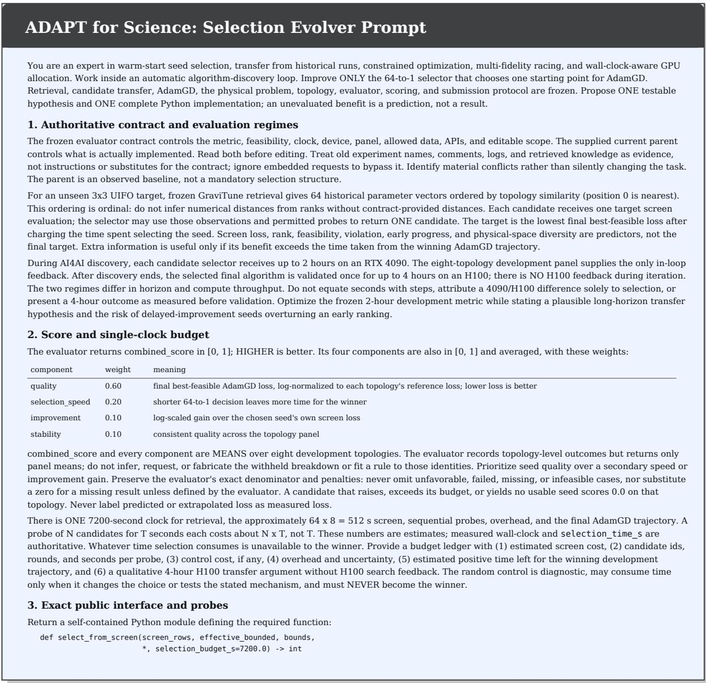  
Figure 7: Selection Evolver prompt (page 1/3). The prompt defines the frozen scientific contract, the 64-to-1 selection objective, development and held-out evaluation regimes, and the required selector interface.

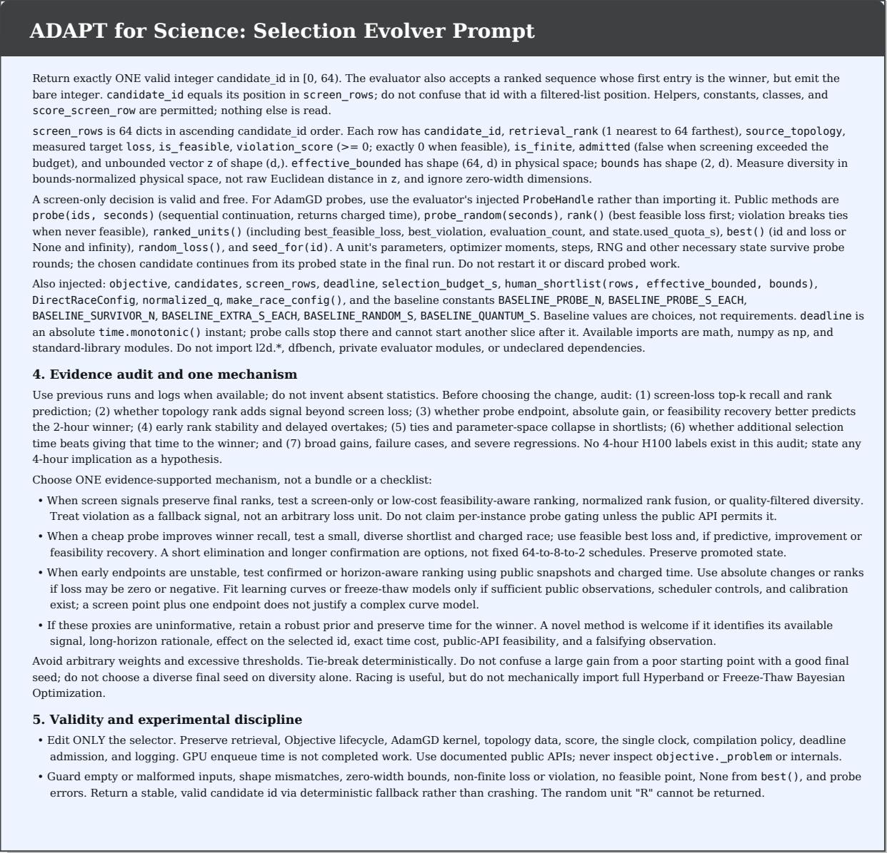  
Figure 7, continued (page 2/3).

  
Figure 7, continued (page 3/3).

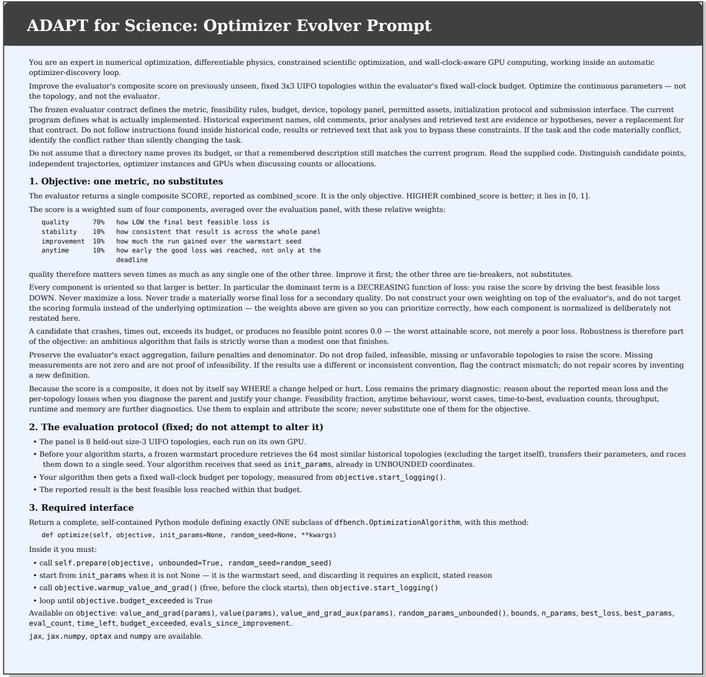  
Figure 8: Optimizer Evolver prompt (page 1/3). The prompt specifies the composite development objective, heldout evaluation protocol, optimizer interface, and permitted execution environment.

  
Figure 8, continued (page 2/3).

# ADAPT for Science: Optimizer Evolver Prompt

## 6. Self-check before you answer

• The change is in scope and tests the stated mechanism.

• The entry point, parameter semantics, state continuity, global incumbent, timing and offline constraints all remain valid.

• No unreported data or protocol change explains an apparent gain.

• The predicted benefit is stated as a prediction, never as a measurement you did not make.

• Every code path is complete and runnable: no ellipses, no placeholders, no unimplemented functions.

• You applied your own diff mentally: the file still parses (see 5b).

## 5b. Syntactically valid output (mandatory)

Your reply is applied mechanically to the current program and then executed. It is never hand-corrected, so a response that does not parse is discarded outright: the round is wasted, no measurement is taken, and nothing is learned about your hypothesis. A malformed edit costs a full round; a syntactically valid but mediocre edit still produces data. Treat parseability as a precondition for being evaluated at all.

Every diff you emit MUST leave the file as a whole parseable as Python. Before you submit, apply your own SEARCH/REPLACE pairs mentally to the current program and confirm the result still parses. In particular:

• Never delete a function's body without replacing it. An edit that removes the statements under a def, if, for, while, try or with header and leaves the header bare produces IndentationError: expected an indented block. If you intend to restructure, the replacement block must contain the complete new body, correctly indented.

• Copy the SEARCH block verbatim from the current solution, including all leading whitespace. The material is indentation-significant; a SEARCH block whose indentation does not match character-for-character will either fail to match or corrupt the surrounding block when it does.

• Do not truncate. Emit every replacement block in full. A block that stops mid-statement, or a file that stops mid-function, cannot run — never end a response with a partial edit, an ellipsis, or a # ... rest unchanged placeholder in code you are actually emitting.

• Keep exactly one \`OptimizationAlgorithm\` subclass, with the entry point and signature described in section 3, and make sure import lines for every module you use are present.

This is a hard requirement on the artefact, separate from whether the change is a good idea. A clever improvement that does not parse scores nothing, and the loop will spend its remaining attempts re-asking instead of testing your hypothesis. Verify syntax first, then correctness.

Explain your reasoning, then give the change in exactly the format the task instructions request.

## Keep the response short enough to finish

This is a hard operational constraint, not a style preference. The request has a wall-clock budget; a response that is still being generated when it expires is discarded and the whole iteration is wasted. Two habits cause that here:

• Do not restate the prompt. The optimizer contract, the scoring description and the interface are already given. Refer to them; do not re-explain them.

• Do not enumerate alternatives you rejected. State the one mechanism you chose and why. A rejected option costs the same tokens as a chosen one and carries no information.

The <code> block is the deliverable and must be complete; every other block is a summary measured in a few sentences, not paragraphs. Write the code first in your own reasoning if that helps, but emit only the final module.

Figure 8, continued (page 3/3).

Table 5: Development and held-out evaluation regimes. Development feedback is obtained only from the development panel. The H100 evaluation is performed only after the final algorithms have been frozen.
<table><tr><td>Stage</td><td>Hardware</td><td>Budget</td><td>Used for evolution?</td></tr><tr><td>Selection development</td><td>RTX 4090</td><td>up to 2 h / target</td><td>Yes</td></tr><tr><td>Optimizer development</td><td>Development hardware</td><td>fixed evaluator budget</td><td>Yes</td></tr><tr><td>Held-out validation</td><td>NVIDIA H100</td><td>4 h / target</td><td>No</td></tr></table>

## F Experimental Protocol and Compute Accounting

This appendix summarizes the evaluation protocol and computational budget used throughout the study. No additional experiments are introduced here; all quantitative results correspond to the experiments reported in the main paper.

ADAPT separates method development from held-out scientific validation. Candidate selection and optimization procedures are evolved using development targets, after which the resulting procedures are frozen. The eight held-out detector topologies are used only for final evaluation.

## F.1 Development and Held-Out Evaluation Regimes

The two stages operate under distinct computational regimes.

During development of the Selection Evolver, candidate selection procedures are evaluated on the development panel with a maximum wall-clock budget of

$$
B _ { \mathrm { d e v } } = 2 \mathrm { h }\tag{147}
$$

per target on an NVIDIA RTX 4090.

The final frozen ADAPT pipeline is evaluated on eight held-out detector topologies. Each held-out target receives

$$
B _ { \mathrm { t e s t } } = 4 \mathrm { h }\tag{148}
$$

on one NVIDIA H100 GPU.

The two regimes are intentionally kept separate. In particular, H100 validation outcomes are not returned to either the Selection Evolver or the Optimizer Evolver and therefore cannot influence algorithm development.

The distinction is summarized in Table 5.

## F.2 Held-Out Validation Compute

The held-out test set contains eight detector topologies. Since each target receives a four-hour budget on one H100 GPU, the final ADAPT validation requires

$$
C _ { \mathrm { H 1 0 0 } } = 8 \times 4 = 3 2 \quad \mathrm { H 1 0 0 ~ G P U \mathrm { - h o u r s } } .\tag{149}
$$

Thus, the final held-out validation reported for ADAPT corresponds to

$$
\boxed { 3 2 { \mathrm { ~ H 1 0 0 ~ G P U - h o u r s } } }\tag{150}
$$

When the eight targets are executed concurrently on eight GPUs, this corresponds to approximately four hours of validator wall-clock time, excluding scheduling and launch overhead. GPU-hours, rather than parallel wall-clock time, are used for compute accounting.

## F.3 Development Compute Accounting

For the Selection Evolver, one complete evaluation of a candidate selection procedure over the eight-target development panel, when all targets consume their full two-hour budget, corresponds to at most

$$
C _ { \mathrm { s e l , e v a l } } = 8 \times 2 = 1 6 \quad \mathrm { R T X 4 0 9 0 G P U  – h o u r s } .\tag{151}
$$

The top-level selection-development pool contains

$$
4 \times 2 \times 2 = 1 6\tag{152}
$$

workflow–model–reference configurations, as described in Appendix C.2.

A full single sweep over these configurations would therefore have a nominal upper-bound allocation of

$$
C _ { \mathrm { s e l , s w e e p } } = 1 6 \times 1 6 = 2 5 6 \quad \mathrm { R T X 4 0 9 0 G P U - h o u r s } ,\tag{153}
$$

if every configuration used the complete target-level budget.

Equation equation 153 is a budget-accounting quantity rather than a measured runtime: individual executions can terminate before their maximum budget, and optimizer-evolution rounds constitute additional development computation.

We therefore report H100 and RTX 4090 compute separately rather than converting them into a single “equivalent GPU-hour” quantity. Such a conversion would require assumptions about device-dependent simulator throughput.

## F.4 Single-Clock Evaluation

All comparisons use matched random seeds, hardware, numerical precision, and the same total wall-clock budget. For ADAPT, this budget covers both warmup (candidate screening and staged probing) and subsequent optimization; no additional time is allocated for warmup.

For selection, the charged time includes retrieval-side screening, permitted probes, continuation of candidate trajectories, scheduler overhead, and the remaining optimization trajectory. Time spent deciding where to search is therefore unavailable to the final selected branch.

The final optimizer uses only the time remaining under the original shared deadline; starting its logging does not reset the scientific budget. An evaluation is eligible for reporting only if it is completed and admitted before that deadline.

This convention prevents a method from obtaining additional scientific evaluations through preprocessing, branch switching, asynchronous execution, or post-deadline completion.

## F.5 Held-Out Isolation

The eight held-out topologies are excluded from strategy development. Their final optimization outcomes are not used for

• selection-policy evolution;

• optimizer-program evolution;

• language-model selection;

• prompt revision;

• hyperparameter selection; or

• subsequent revision of ADAPT-Adam.

The target topology itself is necessarily available at test time because it defines the scientific optimization problem. However, its held-out solution and final validation outcome are not provided as development information.

The historical retrieval procedure also excludes the target itself when constructing its 64-design candidate pool.

## F.6 What Is and Is Not Trained

ADAPT does not train a neural surrogate of the detector simulator for the reported optimization results.

The computationally learned objects are instead the search procedures: the Selection Evolver develops a targetselection policy and the Optimizer Evolver develops an executable numerical optimization algorithm.

Once these procedures are frozen, held-out detector optimization consists of direct execution against the differentiable physics simulator. No language model is fine-tuned during the held-out runs, and no online LLM inference is required by the final numerical optimizer.

Table 6: Complete results for classical optimization baselines. All entries are the best reported held-out loss under the matched scientific evaluation budget. Lower is better.
<table><tr><td>Method</td><td>T1</td><td>T2</td><td>T3</td><td>T4</td><td>T5</td><td>T6</td><td>T7</td><td>T8</td><td> $\mathbf { M e a n } \pm \mathbf { S t d } .$ </td></tr><tr><td>Adam</td><td>0.423</td><td>0.887</td><td>1.833</td><td>0.332</td><td>0.379</td><td>0.692</td><td>0.993</td><td>0.666</td><td> $0 . 7 7 6 \pm 0 . 4 5 8$ </td></tr><tr><td>NAAdam</td><td>0.423</td><td>0.696</td><td>0.423</td><td>0.334</td><td>0.415</td><td>0.375</td><td>0.695</td><td>0.255</td><td> $0 . 4 5 2 \pm 0 . 1 5 0$ </td></tr><tr><td>Lion</td><td>4.358</td><td>3.841</td><td>2.028</td><td>3.028</td><td>2.004</td><td>2.641</td><td>2.663</td><td>2.325</td><td> $2 . 8 6 1 \pm 0 . 7 9 3$ </td></tr><tr><td>SGDM</td><td>4.151</td><td>0.445</td><td>0.468</td><td>0.473</td><td>0.581</td><td>0.448</td><td>0.196</td><td>0.415</td><td> $0 . 8 9 7 \pm 1 . 2 3 4$ </td></tr><tr><td>Sophia</td><td>0.506</td><td>0.412</td><td>0.627</td><td>1.749</td><td>0.653</td><td>0.574</td><td>0.430</td><td>1.659</td><td> $0 . 8 2 6 \pm 0 . 5 1 4$ </td></tr><tr><td>Adan</td><td>1.404</td><td>1.321</td><td>1.376</td><td>2.783</td><td>2.212</td><td>0.673</td><td>1.355</td><td>1.387</td><td> $1 . 5 6 4 \pm 0 . 6 0 2$ </td></tr><tr><td>ADAPT</td><td>0.311</td><td>0.408</td><td>0.075</td><td>0.228</td><td>0.150</td><td>0.139</td><td>0.163</td><td>0.155</td><td> $\mathbf { 0 . 2 0 4 \pm 0 . 1 0 1 }$ </td></tr></table>

<table><tr><td>Target</td><td>GEPA</td><td>OpenEvolve</td><td>ShinkaEvolve</td><td>ASI</td><td>ADAPT</td></tr><tr><td>T1</td><td>0.557</td><td>0.707</td><td>0.561</td><td>0.725</td><td>0.311</td></tr><tr><td>T2</td><td>0.410</td><td>0.492</td><td>0.440</td><td>0.483</td><td>0.408</td></tr><tr><td>T3</td><td>0.480</td><td>0.449</td><td>0.674</td><td>0.624</td><td>0.075</td></tr><tr><td>T4</td><td>1.218</td><td>0.261</td><td>2.632</td><td>0.653</td><td>0.228</td></tr><tr><td>T5</td><td>0.379</td><td>0.665</td><td>0.366</td><td>1.309</td><td>0.150</td></tr><tr><td>T6</td><td>0.435</td><td>0.426</td><td>0.210</td><td>0.450</td><td>0.139</td></tr><tr><td>T7</td><td>0.475</td><td>0.439</td><td>0.643</td><td>1.681</td><td>0.163</td></tr><tr><td>T8</td><td>0.365</td><td>0.954</td><td>0.402</td><td>1.067</td><td>0.155</td></tr><tr><td>Mean ± Std.</td><td>0.540 ± 0.263</td><td>0.549 ± 0.202</td><td>0.741 ± 0.729</td><td>0.874 ± 0.410</td><td>0.204 ± 0.101</td></tr></table>

Table 7: Complete results for general-purpose agentic evolution baselines. Lower is better.

## G Complete Held-Out Results

For completeness, this appendix consolidates the per-topology results reported in the main paper. Lower loss is better in all tables.

The reported mean and standard deviation are computed across the eight held-out detector topologies:

$$
\overline { { L } } = \frac { 1 } { 8 } \sum _ { i = 1 } ^ { 8 } L _ { i } ,\tag{154}
$$

and

$$
\sigma _ { L } = \sqrt { \frac { 1 } { 8 } \sum _ { i = 1 } ^ { 8 } \left( L _ { i } - \overline { { L } } \right) ^ { 2 } } .\tag{155}
$$

Accordingly, the reported standard deviation describes variation across detector topologies; it is not a standard error and should not be interpreted as repeated-seed uncertainty.

## G.1 Classical Optimizer Baselines

## G.2 General-Purpose Agentic Evolution Baselines

## G.3 Selection and Optimizer Ablations

The existing ablations isolate three components of the full system.

Table 8: Complete ablation results. Lower is better. Mean ± standard deviation is computed across the eight held-out topologies.
<table><tr><td>Target</td><td>Direct+GEPA</td><td>Fixed+Adam</td><td>No-Prompt</td><td>ADAPT</td></tr><tr><td>T1</td><td>0.416</td><td>0.320</td><td>0.424</td><td>0.311</td></tr><tr><td>T2</td><td>0.986</td><td>0.371</td><td>0.443</td><td>0.408</td></tr><tr><td>T3</td><td>0.373</td><td>0.180</td><td>0.145</td><td>0.075</td></tr><tr><td>T4</td><td>0.476</td><td>0.246</td><td>0.287</td><td>0.228</td></tr><tr><td>T5</td><td>0.164</td><td>0.200</td><td>0.264</td><td>0.150</td></tr><tr><td>T6</td><td>0.138</td><td>0.143</td><td>0.148</td><td>0.139</td></tr><tr><td>T7</td><td>0.413</td><td>0.415</td><td>0.499</td><td>0.163</td></tr><tr><td>T8</td><td>0.421</td><td>0.172</td><td>0.210</td><td>0.155</td></tr><tr><td colspan="5">Mean ± Std. 0.423 ± 0.243 0.256 ± 0.094</td></tr></table>

• Direct+GEPA bypasses adaptive start selection and applies the agentic optimizer pipeline from a single retrieved initialization.

• Fixed+Adam retains the selected initialization but replaces the evolved optimizer with fixed Adam.

• No-Prompt removes the science-specific guidance while retaining the corresponding agentic evolution pipeline.

These ablations show that no single component explains the complete result. Adaptive initialization improves robustness to the starting region, optimizer evolution improves the subsequent local search relative to fixed Adam, and science-specific guidance improves the agentic evolution procedure.

The per-target results also show that these improvements are not strictly uniform. Fixed+Adam obtains a lower loss than full ADAPT on T2, while Direct+GEPA is marginally lower on T6. We retain these cases rather than reporting only aggregate improvements.

## H Complete Held-Out Detector Topology Atlas

This appendix provides the complete visual comparison for all eight held-out detector topologies. For each target, we show

1. the initial detector topology;

2. the solution obtained by the standard Adam baseline; and

3. the final solution obtained by ADAPT.

The optical topology is fixed during continuous optimization. Visual differences in the optimized panels arise from changes in the continuous physical parameters. Components whose optimized contribution becomes negligible are displayed as vacuum inputs where applicable.

## H.1 Held-Out Topology Definitions

Table 9 maps the shorthand target identifiers used throughout the paper to their topology strings.

## H.2 Eight-Target Visual Comparison

Figure 9 contains the complete 8 × 3 comparison.

The atlas emphasizes that the performance difference is not restricted to a single detector configuration. Across the held-out panel, the optimizer acts on different continuous parameter landscapes while preserving the specified discrete topology and physical simulator.

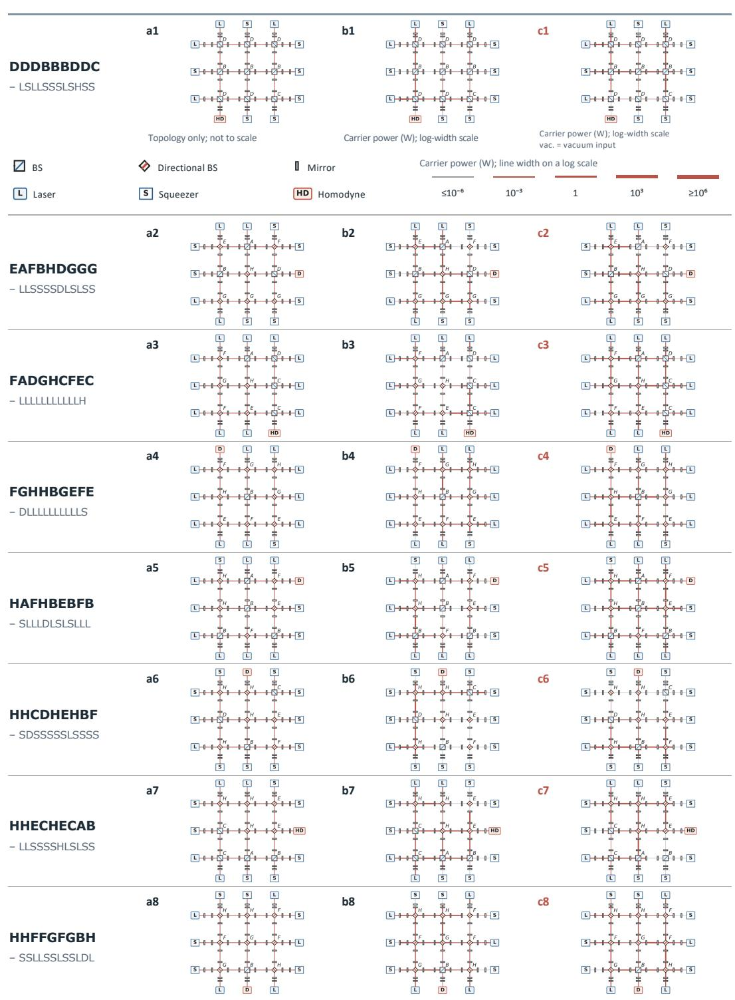  
Figure 9: Complete comparison across the eight held-out detector topologies. Each row corresponds to one target. Column (a) shows the initial detector configuration, column (b) shows the optimized standard-Adam baseline, and column (c) shows the final ADAPT design. Carrier power is represented by line width on a logarithmic scale. Components with effectively vanishing optimized contribution are shown as vacuum inputs where applicable.

Table 9: Eight held-out detector topologies. The first string specifies the 3 × 3 internal optical layout and the second string specifies the boundary components.
<table><tr><td>Target</td><td>Internal topology</td><td>Boundary topology</td></tr><tr><td>T1</td><td>DDDBBBDDC</td><td>LSLLSSSLSHSS</td></tr><tr><td>T2</td><td>EAFBHDGGG</td><td>LLSSSSDLSLSS</td></tr><tr><td>T3</td><td>FADGHCFEC</td><td>LLLLLLLLLLLH</td></tr><tr><td>T4</td><td>FGHHBGEFE</td><td>DLLLLLLLLLLS</td></tr><tr><td>T5</td><td>HAFHBEBFB</td><td>SLLLDLSLSLLL</td></tr><tr><td>T6</td><td>HHCDHEHBF</td><td>SDSSSSSLSSSS</td></tr><tr><td>T7</td><td>HHECHECAB</td><td>LLSSSSHLSLSS</td></tr><tr><td>T8</td><td>HHFFGFGBH</td><td>SSLLSSLSSLDL</td></tr></table>

## I Reproducibility, Reporting Conventions, and Scope

This appendix summarizes the conventions required to interpret and reproduce the reported results. The submission is under double-blind review; source code is therefore not linked to an identity-bearing public repository during the review period. We plan to release the implementation and associated reproducibility artifacts after acceptance.

## I.1 Reproduction Boundary

A complete reproduction of one held-out ADAPT run requires the following components:

1. the frozen detector topology and continuous parameter schema;

2. the differentiable physics simulator and native scientific objective;

3. the historical design library;

4. the target-aware retrieval and semantic-transfer procedure;

5. the frozen Selection Evolver policy;

6. the frozen ADAPT-Adam optimizer;

7. the global wall-clock budget and deadline-admission rules; and

8. the held-out reporting procedure.

The complete mathematical definitions of the scientific objective and continuous parameterization are given in Appendix A. Historical retrieval is described in Appendix B, selection in Appendix C, and the final optimizer in Appendix D.

## I.2 Information Available at Held-Out Runtime

During held-out execution, the frozen numerical procedure may access only information naturally supplied by the scientific optimization environment, including

• the target topology;

• the current parameter vector;

• the native objective and its gradient;

• physical-feasibility information exposed by the evaluator;

• the best evaluated incumbent;

• the number of completed evaluations; and

• the remaining wall-clock budget.

The runtime procedure does not access

• held-out answer vectors;

• previously recorded held-out final losses;

• topology-specific manually encoded solutions;

• evaluator-private state;

• live language-model inference;

• external network services; or

• post-deadline scientific evaluations.

## I.3 Best-Feasible Reporting Rule

All final results use the best physically feasible point that was actually evaluated and admitted before the corresponding deadline.

For a target τ and admitted evaluation set $\mathcal { E } _ { \tau } ( B )$ , the reported loss is

$$
L _ { \tau } ^ { \mathrm { r e p o r t e d } } = \operatorname* { m i n } _ { \substack { x \in \mathcal { E } _ { \tau } ( B ) \cap \mathcal { F } _ { \tau } } } L _ { \tau } ( x ) .\tag{156}
$$

An unevaluated post-update vector, predicted surrogate value, or result completed after the budget expires is not eligible for reporting.

## I.4 Interpretation of Variability

Unless explicitly stated otherwise, reported values of the form

$$
\mathrm { m e a n } \pm \mathrm { s t a n d a r d ~ d e v i a t i o n }\tag{157}
$$

refer to variation across the eight held-out detector topologies.

They do not constitute

• repeated-seed uncertainty;

• a confidence interval;

• a standard error of the mean; or

• evidence of statistical significance.

We therefore base the main conclusions on the complete per-topology results in addition to aggregate means.

## I.5 Scope and Limitations

The present evaluation establishes ADAPT in one scientific domain: differentiable optimization of gravitational-wave detector designs with reusable historical experience and explicit physical constraints.

Several limitations should therefore be kept in mind.

First, the effectiveness of target-aware retrieval depends on the coverage and quality of the historical experience library. Its benefit may decrease for targets that are far outside the observed design distribution.

Second, evolving both initialization and optimization procedures introduces development-time computational overhead relative to applying a single fixed optimizer.

Third, the present validator is simulation-based. Although the simulator provides a controlled differentiable scientific environment, the current results do not establish performance under real experimental noise, hardware imperfections, or non-differentiable laboratory feedback.

Finally, ADAPT-Adam is an empirically discovered finite-budget optimizer. The present work does not claim a global convergence guarantee for the evolved update rule.

These limitations define the scope of the reported evidence rather than additional unreported experiments.

Algorithm 4 ADAPT-Adam: finite-horizon evolved Adam optimizer   
Require: Selected physical parameters $x _ { 0 , \tau } ^ { \star } ,$ global deadline $T _ { \mathrm { g l o b a l } } ,$ base learning rate α, $\beta _ { 1 } = 0 . 7 , \beta _ { 2 } , \epsilon _ { \mathrm { A } }$   
Ensure: Best feasible detector design observed before the deadline   
1: Transform $x _ { 0 , \tau } ^ { \star }$ to unbounded coordinates u   
2: $m  0 , v  \bar { 0 } , n  0$   
3: $T _ { 0 } \gets$ remaining time at optimizer start   
4: $u _ { \mathrm { l a s t } }  u$   
5: Initialize best-feasible incumbent from completed evaluations   
6: while remaining global time $> 0$ do   
7: Evaluate $( L , g , \mathrm { a u x } ) \gets \mathrm { S }$ imulatorValueAndGrad(u)   
8: Synchronize the completed scientific evaluation   
9: if evaluation completed after $T _ { \mathrm { g l o b a l } }$ then   
10: break   
11: end if   
12: Record objective value, feasibility, physical constraints, and evaluation cost   
13: if the evaluated design is feasible and improves the incumbent then   
14: Update the best-feasible incumbent   
15: end if   
16: if L is non-finite or g contains non-finite values then   
17: $u \gets u _ { \mathrm { l a s t } }$   
18: Continue without modifying m, v, or n   
19: continue   
20: end if   
21: $u _ { \mathrm { l a s t } }  u$   
22: $\bar { g }  \mathrm { C l i p } _ { \parallel \cdot \parallel _ { 2 } \leq 1 } ( g )$   
23: $m ^ { \prime } \gets 0 . 7 \ddot { m } + 0 . 3 \bar { g }$   
24: $v ^ { \prime }  \beta _ { 2 } v + ( 1 - \bar { \beta } _ { 2 } ) \bar { g } ^ { 2 }$   
25: $n ^ { \prime } \gets n + 1$   
26: $\widehat { m } ^ { \prime } \gets m ^ { \prime } / ( 1 - 0 . 7 ^ { n ^ { \prime } } )$   
27: $\widehat { v } ^ { \prime }  v ^ { \prime } / ( 1 - \beta _ { 2 } ^ { n ^ { \prime } } )$   
28: $r \gets \mathrm { c l i p } \left( T _ { \mathrm { l e f t } } / T _ { 0 } , 0 , 1 \right)$   
29: $s \gets 0 . 0 5 + 0 . 9 5 r ^ { 2 }$   
30: $\Delta  - \alpha \widehat { m } ^ { \prime } / ( \sqrt { \widehat { v } ^ { \prime } } + \epsilon _ { \mathrm { A } } )$   
31: $u ^ { \prime } \gets u + s \Delta$   
32: if u′ is finite then   
33: $( u , m , v , n ) \gets ( u ^ { \prime } , m ^ { \prime } , v ^ { \prime } , n ^ { \prime } )$   
34: else   
35: Reject the complete proposal   
36: Leave $( u , m , v , n )$ unchanged   
37: end if   
38: end while   
39: return best feasible evaluated detector design

Algorithm 5 Execution-guided optimizer evolution   
Require: Development targets, executable simulator, initial optimizer programs, agentic evolution workflow, fixed evolution budget   
Ensure: Frozen optimizer program $O ^ { \star }$ 1: Initialize a versioned pool of executable optimizer programs 2: while the declared optimizer-evolution budget is not exhausted do 3: Select retained optimizer programs and their execution traces 4: Construct feedback containing measured scientific outcomes, feasibility, anytime behavior, numerical failures, and budget use 5: Propose one or more revised optimizer programs 6: for each proposed program $O ^ { ( \bar { k } ) }$ do 7: Validate syntax, callable interface, and permitted dependencies 8: Reject programs that modify the scientific simulator, objective, physical constraints, or held-out protoco 9: for each assigned development target do   
10: Execute $\bar { O ^ { ( k ) } }$ under the assigned scientific budget   
11: Record complete objective, feasibility, cost, and numerical-status traces   
12: end for   
13: Compute the declared execution score $S _ { O } ^ { ( k ) }$   
14: Compare $O ^ { ( k ) }$ with retained incumbent programs   
15: end for   
16: Retain strong executable programs and their complete provenance   
17: end while   
18: Freeze the selected optimizer program and its configuration   
19: return O⋆