# AGENTIC KNOWLEDGE-MODEL CO-EVOLUTION VIA CONSISTENCY REGULARIZATION

Sirui Chen1,\*, Zhining Liu1, Chao Zhang2, Jingrui He1, Zheng Li3,† 1University of Illinois Urbana-Champaign 2Georgia Institute of Technology 3Amazon sirui6@illinois.edu

## ABSTRACT

LLM agents can evolve by learning from accumulated experience. Existing approaches extract reusable external knowledge, such as skills and memories, from experience to guide subsequent task solving, with some further internalizing this knowledge through model training. However, different ways of analyzing and transforming the same experience can yield knowledge with substantially different utility, even when the resulting guidance appears reasonable. Inspired by consistency regularization, we identify consistent utility gains across different ways of analyzing the same experience, rather than relying on any single way of analyzing it. We introduce SPLICE, a framework for consistency-regularized knowledgemodel co-evolution. It constructs evolution views by perturbing how the same experience is analyzed, producing different knowledge candidates. Knowledge updates are then guided by common gain, which accounts for utility gains and their consistency across views. During model evolution, self-distillation internalizes the evolved knowledge alongside reinforcement learning, using knowledge associated with consistent utility degradation as a contrastive reference. The two processes interleave, with model updates driving further knowledge evolution. Experiments across diverse domains show that SPLICE outperforms knowledge evolution and model training baselines by up to 7.1 and 4.6 points in average accuracy, while its evolved knowledge reduces output tokens per correct solution by up to 44% and transfers across model sizes and families.

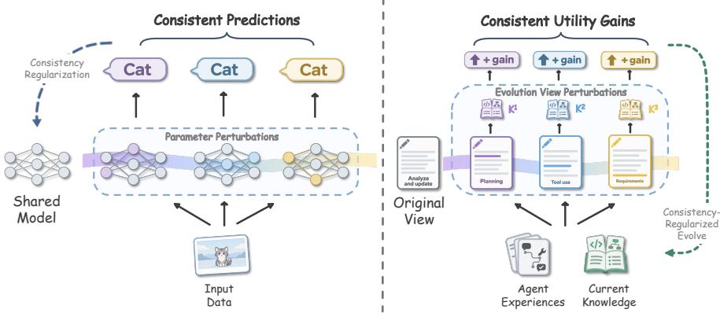  
Figure 1: From prediction consistency to utility consistency. Left: Consistency regularization encourages consistent predictions under parameter perturbations. Right: SPLICE guides knowledge updates using utility gains that persist across different evolution views of the same experience.

## 1 INTRODUCTION

Large Language Model (LLM) agents accumulate experience whenever they reason, use tools, and interact with the environment. For this experience to support continual improvement, an agent must identify useful guidance and reuse it in future tasks. This motivates knowledge evolution, through which agents extract and revise external knowledge, such as skills and memories, from their experience (Shinn et al., 2023; Zhang et al., 2026b; Ouyang et al., 2026; Yang et al., 2026). Such knowledge can also be internalized into model parameters through policy training (Lu et al., 2026a;b; He et al., 2026c). The updated model then generates new experience for further knowledge evolution, allowing knowledge and the model to co-evolve (Xia et al., 2026; He et al., 2026b). External knowledge thus serves as a mediumfor agent evolution, connecting accumulated experience with subsequent task solving and model learning.

However, knowledge derived from the same experience can differ substantially depending on which evidence is selected and how it is interpreted. For example, analyzing a purchase of the wrong size can yield guidance to include size requirements in queries or verify the selected size before purchase. On a product page that lists the requested size but defaults to another option, the first rule leaves the incorrect selection unchanged, while the second corrects it. Consequently, different ways of analyzing and transforming the same experience can yield knowledge with substantially different utility. Recent studies similarly find that even seemingly reasonable criteria for analyzing and transforming experience can yield less useful knowledge (Huang et al., 2026), and that plausible knowledge can even underperform using no knowledge at all (Li et al., 2026a; Dong et al., 2026). This raises a central question: how can experience be effectively transformed into generalizable knowledge to support agentic evolution?

To tackle this problem, we draw inspiration from consistency regularization (Figure 1). This approach encourages consistent predictions for the same input under random parameter perturbations (Ni et al., 2024; Wu et al., 2021). This reduces prediction sensitivity to such perturbations and can improve generalization. Similarly, we view the transformation of experience into knowledge as a function parameterized by textual instructions, whose perturbations define different evolution views. Here, consistency concerns utility: when different views produce distinct knowledge yet yield consistent positive gains on the same tasks, this suggests that the benefits are not specific to a single evolution view. Rather than relying on any single analysis, we therefore use utility consistency across evolution views to guide knowledge evolution toward more generalizable knowledge.

We introduce SPLICE, a framework for consistency-regularized knowledge-model co-evolution. During knowledge evolution, it perturbs how the same experience is analyzed and transformed, creating evolution views that each produce a knowledge candidate. Each candidate is evaluated through task replay, and a common gain is calculated by combining utility gain with cross-view consistency. A knowledge optimizer then updates the current knowledge using the candidates and replay trajectories from tasks with the highest common gains. During model evolution, SPLICE combines GRPO (Shao et al., 2024) with self-distillation to internalize the evolved knowledge. The same replay also reveals guidance associated with consistent utility degradation, from which we construct noisy knowledge as a contrastive reference to highlight useful guidance in the evolved knowledge. A token-level gate controls its contribution to retain shared useful guidance. The two processes are interleaved, with the updated model generating new experience for further co-evolution. We evaluate SPLICE on four benchmarks covering math, coding, office work, and web shopping at two model scales. Across these tasks, SPLICE consistently outperforms knowledge evolution and model training baselines, improving average accuracy over the strongest baseline by 3.0 points for Qwen3.5-4B and 4.6 points for Qwen3.5-9B. Notably, its evolved knowledge makes task solving more efficient, requiring up to 44% fewer output tokens per correct solution than the strongest baseline, and delivers larger gains when transferred to other model sizes and families.

## 2 PRELIMINARIES

Knowledge-model co-evolution. We consider an LLM agent parameterized by $\theta$ and equipped with external knowledge K, including reusable skills, tools, memories, or environment information. Given a task $x \sim \mathcal { D } .$ , the agent generates a trajectory τ using $\pi _ { \theta } ( \cdot \mid x , \tau _ { < t } , K )$ , where $\tau _ { < t }$ contains preceding model outputs and environment feedback. The task, trajectory, and feedback, including the reward $R ( x , \tau )$ , form the experience $\mathcal { E } .$ Knowledge evolution updates $\dot { K }$ from experience $\mathcal { E } ,$ yielding $\widetilde { K } = \mathcal { G } ( \mathcal { E } , K ; p )$ , where $\mathcal { G }$ is a knowledge optimizer parameterized by textual instructions $p .$ This transformation typically involves analyzing trajectories and feedback, proposing reusable guidance, and organizing and reviewing knowledge updates. The instructions p specify which aspects of the experience are examined and how the resulting guidance is incorporated into $\dot { \kappa }$

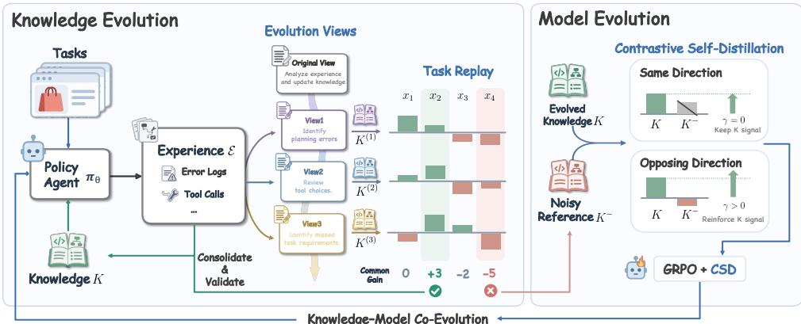  
Figure 2: Overview of SPLICE. Left: Knowledge evolution perturbs how the same experience is analyzed and transformed, using common gain across evolution views to select task experience for knowledge updates. Right: Model evolution combines GRPO with gated contrastive self-distillation to internalize the evolved knowledge, using noisy knowledge as a contrastive reference.

Model evolution then internalizes knowledge-guided behaviors into θ through training. The updated model generates new experience and can change the utility of $K$ , measured by the model’s expected task reward with that knowledge, informing subsequent knowledge evolution. Co-evolution interleaves these two processes to maximize the expected return of the final policy under the evolved knowledge, $J _ { \theta } = \mathbf { \bar { E } } _ { x \sim \mathcal { D } , \tau \sim \pi _ { \theta } ( \cdot | x , K ) } [ R ( x , \tau ) ]$

Group Relative Policy Optimization. Group Relative Policy Optimization (GRPO) (Shao et al., 2024) optimizes the policy using group-relative advantages. For each task $x ,$ , it samples G trajectories $\{ \tau _ { g } \} _ { g = 1 } ^ { G }$ from the behavior policy $\pi _ { \mathrm { o l d } } ( \cdot \mid x )$ and minimizes

$$
\mathcal { L } _ { \mathrm { G R P O } } ( \theta ) = - \mathbb { E } \left[ \frac { 1 } { G } \sum _ { g = 1 } ^ { G } \frac { 1 } { | \tau _ { g } | } \sum _ { t = 1 } ^ { | \tau _ { g } | } \operatorname* { m i n } { ( \rho _ { g , t } A _ { g } , \mathrm { c l i p } ( \rho _ { g , t } , 1 - \varepsilon , 1 + \varepsilon ) A _ { g } ) } \right] + \beta \mathcal { D } _ { \mathrm { K L } } ( \theta ) ,\tag{1}
$$

where the expectation is over tasks and sampled trajectory groups. Here, $\rho _ { g , t }$ is the token probability ratio between $\pi _ { \theta }$ and $\pi _ { \mathrm { o l d } } , A _ { g }$ is the group-normalized advantage of trajectory $\tau _ { g } , \varepsilon$ is the clipping threshold, and β weights the KL penalty toward a frozen reference policy.

## 3 SPLICE: KNOWLEDGE-MODEL CO-EVOLUTION

We introduce SPLICE, a framework for consistency-regularized knowledge-model co-evolution, illustrated in Figure 2. Knowledge evolution (§ 3.1) uses utility consistency across evolution views to guide updates to external knowledge. Model evolution (§ 3.2) internalizes the evolved knowledge through GRPO and gated contrastive self-distillation. The two processes are interleaved, with the updated model generating new experience for further knowledge evolution.

## 3.1 CONSISTENCY-REGULARIZED KNOWLEDGE EVOLUTION

Knowledge consistency evaluation. At each round, the LLM agent $\pi _ { \theta }$ solves a batch of tasks $\{ x _ { i } \} _ { i = 1 } ^ { B }$ with the current knowledge K to collect experience E. We then ask the knowledge optimizer G to generate $N$ textual revisions of p. These revisions can emphasize different aspects of a failure, such as planning errors, ineffective tool use, or missed task requirements. Each revision defines a distinct evolution view, which is applied to the same E and K to produce a knowledge candidate:

$$
K ^ { ( j ) } = \mathcal { G } ( \mathcal { E } , K ; p \oplus \delta _ { j } ) , \qquad j = 1 , \dotsc , N .\tag{2}
$$

Here, $\delta _ { j }$ denotes a textual revision, and ⊕ incorporates it into $p .$ To assess the utility of each knowledge candidate $K ^ { ( j ) }$ , we replay the tasks used to collect $\mathcal { E }$ with that candidate, enabling direct utility comparisons against the current knowledge K. For task $x _ { i }$ , we define $\Delta _ { i j }$ as the mean reward gain under $K ^ { ( j ) }$ relative to the current knowledge $K$ across replay runs. $\mathbf { A }$ high observed gain from a single candidate can reflect useful knowledge or a particularly successful execution. We therefore select task experience supported by consistent utility gains across evolution views, rather than choosing a candidate solely by its average gain across tasks. For each task $x _ { i }$ , we compute the common gain, which combines the mean utility gain with an inconsistency penalty:

$$
\widehat { C } _ { i } = \underbrace { \frac { 1 } { N } \sum _ { j = 1 } ^ { N } \Delta _ { i j } } _ { \mathrm { m e a n \ g a i n } } - \underbrace { \frac { 1 } { 2 \binom { N } { 2 } } \sum _ { j < \ell } | \Delta _ { i j } - \Delta _ { i \ell } | } _ { \mathrm { i n c o n s i s t e n c y \ p e n a l t y } } = \frac { 1 } { \binom { N } { 2 } } \sum _ { j < \ell } \mathrm { m i n } ( \Delta _ { i j } , \Delta _ { i \ell } ) .\tag{3}
$$

The pairwise-minimum form measures the gain shared by two evolution views. Averaging over pairs favors tasks with gains consistently supported across views, while discounting isolated high gains that can reflect an occasional success or guidance specific to a particular view. We select up to n tasks with the highest positive common gains $( \widehat { C } _ { i } > 0 )$ . Their trajectories provide evidence of improvements supported across evolution views, forming the basis for the subsequent knowledge update. The following proposition further connects population common gain to the probability of obtaining positive utility gains under a new evolution view.

Proposition 1 (Improvement under a new evolution view). Fix a task $x _ { i } ,$ experience $\mathcal { E } ,$ model θ, and current knowledge K. Let $\Delta$ and $\Delta ^ { \prime }$ denote the utility gains from two independent, identically distributed evolution views, measured by the expected reward gain relative to K. Assume $\dot { \mathbb { E } } | \Delta | < \infty ,$ , and define the population mean gain $\mu = \mathbb { E } [ \Delta ]$ and common gain $C =$ E[min $( \Delta , \dot { \Delta } ^ { \prime } ) ] . { \cal I f C } > 0 ,$ then $\mu > 0$ and

$$
\operatorname* { P r } ( \Delta > 0 ) \ge \frac { C } { \mu } = 1 - \frac { \mathbb { E } | \Delta - \Delta ^ { \prime } | } { 2 \mu } .\tag{4}
$$

The proof is deferred to Appendix E. The bound depends on two quantities: the mean utility gain $\mu$ and the utility inconsistency $\frac { 1 } { 2 } \mathbb { E } | \Delta - \Delta ^ { \prime } |$ . The mean gain measures the average benefit of the generated knowledge, while inconsistency measures how much this benefit changes across evolution views. At the same positive mean gain, lower inconsistency gives a stronger lower bound on the probability of improvement under a new view. We further discuss the properties of common-gain selection in detail in Appendix F.

Knowledge evolution from common gain. Let S denote the selected tasks, $\mathcal { E } _ { \mathcal { S } } \subseteq \mathcal { E }$ their original experience under $K ,$ , and $\mathcal { E } _ { S } ^ { ( j ) }$ their replay experience under $K ^ { ( j ) }$ . The knowledge optimizer G compares these trajectories to relate changes in knowledge to changes in task behavior, and identifies updates supported by consistent utility gains across evolution views, rather than simply extracting content shared by the candidates. It consolidates these updates into $K$ to produce

$$
\widetilde { K } = \mathcal { G } \big ( \mathcal { E } _ { S } , \{ K ^ { ( j ) } , \mathcal { E } _ { S } ^ { ( j ) } \} _ { j = 1 } ^ { N } , K ; p ^ { \prime } \big ) ,\tag{5}
$$

where $p ^ { \prime }$ denotes the instructions for knowledge update. We evaluate $\widetilde { K }$ against $K$ on a held-out validation set and accept it only if validation performance improves; otherwise, K remains unchanged. Subsequent rounds repeat this process with new experience under the current model and knowledge.

## 3.2 KNOWLEDGE-GUIDED MODEL EVOLUTION

A natural way to internalize the evolved knowledge K is self-distillation (Zhao et al., 2026a), using the model conditioned on K as a teacher. Our knowledge evolution process can also reveal patterns associated with consistent utility degradation. Prior work shows that learning from negative samples can provide useful supervision by discouraging incorrect responses (Zhu et al., 2026). Motivated by these findings, we construct noisy knowledge from these degradation patterns and use it as a contrastive reference to complement the guidance from K during self-distillation.

Contrastive knowledge guidance. To construct this reference, we follow the task-selection procedure in § 3.1, replacing $\Delta _ { i j }$ with $- \Delta _ { i j }$ when computing common gain. This selects tasks with utility degradation consistently supported across evolution views. For the selected tasks, the knowledge optimizer $\mathcal { G }$ similarly extracts and consolidates guidance associated with utility degradation into noisy knowledge $K ^ { - }$ for contrastive self-distillation. We construct $K ^ { - }$ anew whenever model evolution starts training with $K .$ , rather than evolving $K ^ { - }$ across knowledge evolution rounds.

Gated knowledge internalization. Knowledge that improves overall task performance can fail to benefit some tasks, while knowledge associated with degradation can still contain useful guidance. We therefore weight self-distillation by the observed task-level benefit of $K$ and gate the contribution of $K ^ { - }$ at the token level. At the start of each training batch, we collect trajectories with and without K for each task $x _ { i }$ using the current policy $\pi _ { \theta } .$ . Let $\overline { { R } } _ { i } ^ { K }$ and $\overline { { R } } _ { i } ^ { \dag }$ denote the mean rewards of the two rollout groups. We define the task-level weight $w _ { i } = \operatorname* { m a x } ( \overline { { R } } _ { i } ^ { K } - \overline { { R } } _ { i } ^ { \emptyset } , 0 )$ , so only tasks with positive observed gains contribute to contrastive self-distillation, with larger gains receiving greater weight. At the token level, we gate the contribution of $K ^ { - } \operatorname { t o }$ preserve useful guidance shared with K. For each token $y _ { t }$ in a trajectory sampled without knowledge, we compare the model’s predictions under K, $K ^ { - }$ and no knowledge on the same history. Let $\ell _ { t } ( K ^ { \prime } ) = \log \pi _ { \theta } ( y _ { t } \mid x _ { i } , \bar { \tau _ { < t } } , K ^ { \prime } )$ and $\ell _ { t } = \log \pi _ { \theta } ( y _ { t } \mid x _ { i } , \tau _ { < t } )$ denote its log-probabilities with and without knowledge. We define the token-level gate $\gamma _ { t }$ and training signal $a _ { t }$ as

$$
\begin{array} { r l } & { \gamma _ { t } = \mathrm { c l i p } \big ( { - } [ \ell _ { t } ( K ) - \ell _ { t } ] [ \ell _ { t } ( K ^ { - } ) - \ell _ { t } ] , 0 , 1 \big ) , } \\ & { a _ { t } = \mathrm { s g } \big [ \sigma \big ( \ell _ { t } ( K ) - \ell _ { t } - \gamma _ { t } [ \ell _ { t } ( K ^ { - } ) - \ell _ { t } ] \big ) \big ] , } \end{array}\tag{6}
$$

where $\sigma$ is a bounded, sign-preserving activation (e.g., tanh), and sg stops gradients. When K and $K ^ { - }$ change the token probability in the same direction, $\gamma _ { t } = 0$ and supervision comes from K alone. When their effects oppose each other, $\gamma _ { t }$ controls how strongly $K ^ { - }$ reinforces the signal from K. The activation σ limits the magnitude of this signal while preserving its sign. Combining the task-level weight with the token-level signal gives

$$
\begin{array} { r } { \mathcal { L } _ { \mathrm { C S D } } = - \mathbb { E } \big [ w _ { i } a _ { t } \log \pi _ { \theta } ( y _ { t } \mid x _ { i } , \tau _ { < t } ) \big ] , } \\ { \mathcal { L } _ { \mathrm { S P L I C E } } = \mathcal { L } _ { \mathrm { G R P O } } + \lambda \mathcal { L } _ { \mathrm { C S D } } . \qquad } \end{array}\tag{7}
$$

Here, λ balances the two losses: $\mathcal { L } _ { \mathrm { G R P O } }$ optimizes task reward on rollouts with and without $K ,$ and $\mathcal { L } _ { \mathrm { C S D } }$ internalizes K weighted by its observed benefit.

Knowledge-model co-evolution in SPLICE. Co-evolution jointly updates the agent’s external knowledge K and model parameters θ. Knowledge evolution proposes updates to K through Eq. 5, and model evolution uses the adopted knowledge to update θ through Eq. 7. The updated model generates new trajectories and feedback that provide experience for subsequent knowledge evolution. Since knowledge utility depends on the task model, proposed knowledge is evaluated with respect to the current model as training proceeds. We detail the co-evolution procedures in Appendix B.

## 4 EXPERIMENTS

## 4.1 EXPERIMENTAL SETUP

Benchmarks and baselines. We evaluate SPLICE on four benchmarks from diverse domains: LiveMathBench (LiveMath) (He et al., 2026a) for mathematical reasoning, LiveCodeBench (Live-Code) (Jain et al., 2025) for code generation, SpreadsheetBench (SpreadSheet) (Ma et al., 2024) for spreadsheet manipulation, and WebShop (Yao et al., 2022) for interactive web shopping, and report accuracy (Acc.) on the test splits. We compare SPLICE with two groups of baselines. Training-free knowledge evolution methods, including ReasoningBank (Ouyang et al., 2026), ACE (Zhang et al., 2026b), EvoSkill (Alzubi et al., 2026), and SkillOpt (Yang et al., 2026), evolve external knowledge with the task model fixed. Training-based methods include GRPO (Shao et al., 2024), which optimizes the policy with reinforcement learning, and SkillRL (Xia et al., 2026) and ReSkill (He et al., 2026b), which co-evolve skills with the policy. We also report the base model without knowledge. Details of the benchmarks and baselines are provided in Appendix A.

Table 1: Main results (Acc., %; ↑). For each model size, the upper group contains training-free methods, whose results are averaged over three seeds, and the lower group contains methods that involve model training. Avg. is computed over all four benchmarks, and ∆ shows improvement in Avg. over Base. Bold and underline mark the best and second-best results for each model size.
<table><tr><td>Method</td><td>LiveMath</td><td>LiveCode</td><td>SpreadSheet</td><td>WebShop</td><td>Avg.</td><td>Δ</td></tr><tr><td colspan="7">Qwen3.5-4B</td></tr><tr><td>Base</td><td>27.59</td><td>38.89</td><td>11.43</td><td>3.60</td><td>20.38</td><td></td></tr><tr><td>ReasoningBank</td><td>37.97</td><td>34.31</td><td>12.26</td><td>18.93</td><td>25.87</td><td>+5.5</td></tr><tr><td>ACE</td><td>48.01</td><td>31.81</td><td>16.31</td><td>27.67</td><td>30.95</td><td>+10.6</td></tr><tr><td>EvoSkill</td><td>45.70</td><td>40.83</td><td>14.17</td><td>44.33</td><td>36.26</td><td>+15.9</td></tr><tr><td>SkillOpt</td><td>47.46</td><td>39.31</td><td>17.38</td><td>42.60</td><td>36.69</td><td>+16.3</td></tr><tr><td>SPLIĆE (Know. Evo)</td><td>50.33</td><td>47.08</td><td>17.38</td><td>58.20</td><td>43.25</td><td>+22.9</td></tr><tr><td>GRPO</td><td>51.99</td><td>55.00</td><td>21.43</td><td>61.00</td><td>47.35</td><td>+27.0</td></tr><tr><td>SkillRL</td><td>60.60</td><td>48.75</td><td>20.00</td><td>67.00</td><td>49.09</td><td>+28.7</td></tr><tr><td>ReSkill</td><td>61.59</td><td>52.50</td><td>28.93</td><td>67.40</td><td>52.60</td><td>+32.2</td></tr><tr><td>SPLICE (Co-Evo)</td><td>67.55</td><td>59.58</td><td>25.00</td><td>70.20</td><td>55.58</td><td>+35.2</td></tr><tr><td colspan="7">Qwen3.5-9B</td></tr><tr><td>Base</td><td>31.02</td><td>50.14</td><td>22.26</td><td>9.07</td><td>28.12</td><td></td></tr><tr><td>ReasoningBank</td><td>39.85</td><td>47.36</td><td>28.81</td><td>22.93</td><td>34.74</td><td>+6.6</td></tr><tr><td>ACE</td><td>50.77</td><td>51.94</td><td>28.33</td><td>31.93</td><td>40.75</td><td>+12.6</td></tr><tr><td>EvoSkill</td><td>48.23</td><td>46.25</td><td>29.64</td><td>48.27</td><td>43.10</td><td>+15.0</td></tr><tr><td>SkillOpt</td><td>49.23</td><td>51.11</td><td>26.07</td><td>48.53</td><td>43.74</td><td>+15.6</td></tr><tr><td>SPLIĆE (Know. Evo)</td><td>58.06</td><td>55.56</td><td>29.88</td><td>59.67</td><td>50.79</td><td>+22.7</td></tr><tr><td>GRPO</td><td>67.22</td><td>62.50</td><td>27.86</td><td>69.00</td><td>56.64</td><td>+28.5</td></tr><tr><td>SkillRL</td><td>63.58</td><td>59.17</td><td>31.43</td><td>63.20</td><td>54.34</td><td>+26.2</td></tr><tr><td>ReSkill</td><td>70.20</td><td>62.08</td><td>34.64</td><td>62.60</td><td>57.38</td><td>+29.3</td></tr><tr><td>SPLICE (Co-Evo)</td><td>71.52</td><td>64.17</td><td>38.21</td><td>74.00</td><td>61.98</td><td>+33.9</td></tr></table>

Models and implementation details. We use Qwen3.5-4B and Qwen3.5-9B (Qwen Team, 2026) as task models. We evaluate two variants of SPLICE: SPLICE (Know. Evo), which evolves knowledge with the task model fixed, and SPLICE (Co-Evo), which co-evolves knowledge and the model with the asynchronous procedure in Appendix B.3. The knowledge optimizer is an external LLM, and each knowledge evolution round uses three evolution views. Further implementation details and hyperparameters are provided in Appendix A.

## 4.2 MAIN RESULTS

Knowledge evolution. With the task model fixed, SPLICE (Know. Evo) matches or outperforms all knowledge evolution baselines on every benchmark. It improves Avg. over the strongest baseline, SkillOpt, by 6.6 and 7.1 points with Qwen3.5-4B and Qwen3.5-9B, with the largest gains on WebShop (13.9 and 11.1 points), where tasks require long-horizon interaction with the environment.

Knowledge-model co-evolution. SPLICE (Co-Evo) achieves the highest Avg. among methods that update model parameters, surpassing the strongest baseline, ReSkill, by 3.0 and 4.6 points with Qwen3.5-4B and Qwen3.5-9B. Notably, skill-augmented baselines do not always improve over GRPO, suggesting that evolved skills with inconsistent utility can interfere with policy learning on complex tasks. SPLICE mitigates this issue by internalizing only knowledge selected by utility consistency across evolution views. Together, SPLICE couples consistency-regularized knowledge evolution with model evolution, allowing the agent to benefit from useful external guidance while continually improving its own policy.

## 4.3 ANALYSIS

Effect of consistency regularization. The central claim of SPLICE is that utility gains consistent across evolution views provide stronger evidence for updating knowledge than gains observed under a single view. We examine this claim by tracking the proposed updates over 50 evolution rounds on WebShop, comparing SPLICE (Know. Evo) with the knowledge evolution baselines.

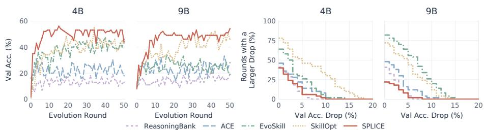  
Figure 3: Validation performance and degradation risk on WebShop. Left: validation Acc. of the proposed update across evolution rounds, before acceptance. Right: percentage of rounds in which the proposed update causes an absolute validation Acc. drop larger than a given threshold (in points).

As shown in Figure 3 (left), SPLICE reaches 53% and 49% validation Acc. by round 10 with Qwen3.5-4B and Qwen3.5-9B and remains stable afterwards, whereas the baselines fluctuate at lower levels. Figure 3 (right) reports the fraction of rounds in which the proposed update lowers validation Acc. by more than a given margin. Only 6% and 2% of the updates proposed by SPLICE cause drops larger than 5 points with Qwen3.5-4B and Qwen3.5-9B, compared with up to 46%

Table 2: Common gain versus mean gain on WebShop. Mean gain scores task evidence by the average utility gain across evolution views. Gain≥0 is the percentage of rounds in which validation Acc. is not degraded.
<table><tr><td>Model</td><td>Metric</td><td></td><td>Mean gain Common gain</td></tr><tr><td rowspan="2"></td><td>Qwen3.5-4B Test Acc. (%)</td><td>44.40</td><td>58.20</td></tr><tr><td>Gain≥0 (%)</td><td>28.57</td><td>67.86</td></tr><tr><td rowspan="2"></td><td>Qwen3.5-9B Test Acc. (%)</td><td>53.60</td><td>59.67</td></tr><tr><td>Gain≥0 (%)</td><td>28.57</td><td>69.05</td></tr></table>

and 56% for the baselines. Consistency across evolution views thus makes updates less likely to degrade the current knowledge, in line with Proposition 1.

As an ablation, Table 2 replaces common gain with mean gain when selecting task evidence. With mean gain, Test Acc. drops by 13.8 and 6.1 points with Qwen3.5-4B and Qwen3.5-9B, and validation Acc. is maintained or improved in only 29% of rounds. The consistency term is thus essential to the effectiveness of SPLICE. Appendix D further analyzes how consistency affects the stability of individual updates and their effects at the task level.

Beyond scaling computation. SPLICE spends additional computation on generating multiple evolution views and replaying their candidates. To examine whether its gains come merely from this additional computation, we compare it with two variants that also generate multiple evolution views but use them differently: Best branch adopts the candidate with the highest mean replay reward, and Merge-all updates knowledge with the evidence from all tasks without selection by common gain. As shown in Figure 4, SPLICE achieves the highest Test Acc. for both model sizes on SpreadSheet and WebShop. Best branch performs worst, suggesting that relying on a single view discards useful evidence, while the evidence merged by Mergeall can be redundant or distracting. The gains of

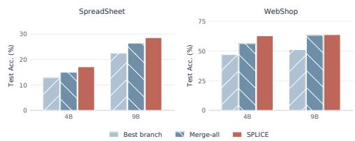  
Figure 4: Different strategies of using multiple evolution views on SpreadSheet and WebShop. Best branch adopts the candidate with the highest mean replay reward, and Merge-all updates knowledge with the evidence from all tasks. SPLICE (Know. Evo) achieves the best performance in all settings.

Table 3: Output tokens per correct attempt (k, ↓) on test tasks, i.e., total output tokens divided by the number of correct attempts. Bold marks the lowest.
<table><tr><td rowspan="2">Method</td><td colspan="2">WebShop</td><td colspan="2">LiveCode</td></tr><tr><td>4B</td><td>9B</td><td>4B</td><td>9B</td></tr><tr><td>ReasoningBank</td><td>11.99</td><td>15.25</td><td>24.86</td><td>14.85</td></tr><tr><td>ACE</td><td>3.81</td><td>4.99</td><td>27.47</td><td>15.27</td></tr><tr><td>EvoSkill</td><td>5.42</td><td>5.46</td><td>22.17</td><td>15.07</td></tr><tr><td>SkillOpt</td><td>6.04</td><td>4.31</td><td>25.17</td><td>14.79</td></tr><tr><td>SPLICE (Know. Evo)</td><td>2.69</td><td>2.40</td><td>19.82</td><td>13.64</td></tr></table>

SPLICE thus stem from how common gain uses the evolution views, not from the additional computation alone.

Efficiency. Although SPLICE draws on multiple knowledge candidates in each round, we expect its knowledge to be compact but effective, because it retains only updates supported by consistent utility gains across evolution views. To examine whether this holds, we measure the final knowledge length of SPLICE (Know. Evo) and the knowledge evolution baselines, together with the average output tokens and interaction steps over all WebShop test attempts, including failures. As shown in Figure 5, SPLICE produces knowledge of 4.98k and 6.07k tokens for Qwen3.5-4B and Qwen3.5-9B, respectively, compared with ACE’s 41.51k and 64.99k. Its knowledge is also shorter than EvoSkill’s but longer than SkillOpt’s. SPLICE requires the fewest interaction steps (8.33 and 8.64), suggesting that task-solving efficiency depends on the retained guidance as well as knowledge length. ACE produces shorter outputs with Qwen3.5-4B, but with much longer knowledge and more interaction steps. Table 3 further reports the output tokens per correct attempt, which measures the cost of obtaining a correct solution. SPLICE has the lowest value on both WebShop and LiveCode for both model sizes, reducing it by up to 44% relative to the strongest baseline, indicating that it improves accuracy while reducing the cost of obtaining correct solutions.

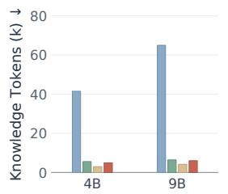

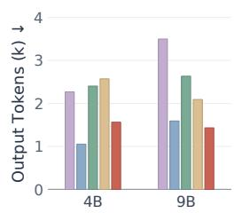

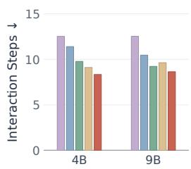  
ReasoningBank ACE EvoSkill SkillOpt SPLICE

Figure 5: Knowledge length, output tokens, and interaction steps on WebShop. Results of SPLICE (Know. Evo) and knowledge evolution baselines with Qwen3.5-4B and Qwen3.5-9B. ReasoningBank uses a dynamic knowledge bank, so its knowledge length is omitted.  
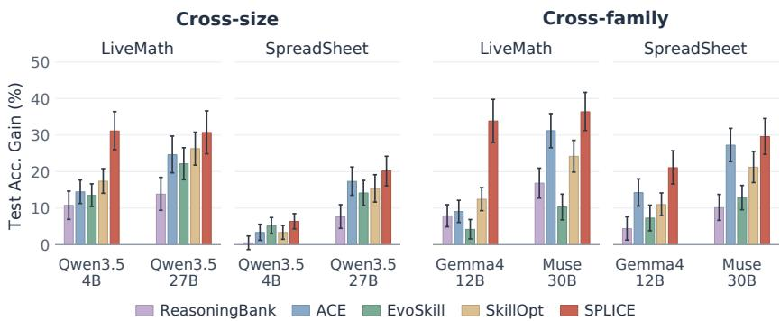  
Figure 6: Generalization across model sizes and families. Knowledge evolved with Qwen3.5-9B is applied to other task models without further evolution. Bars show absolute gains in avg@8 Test Acc. (in points) over the same model without knowledge; error bars show paired 95% confidence intervals.

Knowledge generalization. Just as consistency regularization improves model generalization, we expect utility consistency to yield knowledge that generalizes across task models. To examine whether this holds, we take the final knowledge evolved with Qwen3.5-9B by SPLICE (Know. Evo) and the knowledge evolution baselines, and apply it without further evolution to task models of other sizes (Qwen3.5-4B and Qwen3.5-27B) and other families (Gemma-4-12B-IT (Gemma Team, 2026) and Muse-Glimmer-30B (Meta Superintelligence Lab, 2026)). We measure absolute Test Acc. gains (in points) over each target model without knowledge on LiveMath and SpreadSheet. As shown in Figure 6, SPLICE yields the largest mean gain in all settings. On LiveMath, its advantage over the baselines is particularly large for Qwen3.5-4B and Gemma-4-12B-IT: the gains are 31.13 and 33.86 points, respectively, compared with at most 17.38 and 12.42 points for the baselines. Notably, the gains of SPLICE on LiveMath remain at a similar level across all four target models, whereas those of the baselines drop substantially on Qwen3.5-4B and Gemma-4-12B-IT, indicating that the knowledge evolved by SPLICE is less sensitive to which model uses it.

Co-evolution dynamics. Co-evolution trains the model with the evolved knowledge, which raises two questions: whether the model internalizes the knowledge, and how the utility of knowledge changes as the model evolves. Figure 7 evaluates base and trained models on LiveMath with knowledge from different stages. For the first question, the trained models without knowledge already outperform the base models equipped with the final knowledge for both model sizes, reaching 67.88% versus 52.32% with Qwen3.5-9B, indicating that model evolution internalizes and extends the evolved knowledge. For the second question, knowledge brings much smaller gains to the trained models than to the base models, and the early knowledge no longer improves the trained 4B model. The training dynamics in Appendix D show the same trend during training: the benefit of the current knowledge shrinks as the model improves without it. Validating knowledge with the current model before using it for training therefore keeps model evolution from internalizing knowledge that no longer helps.

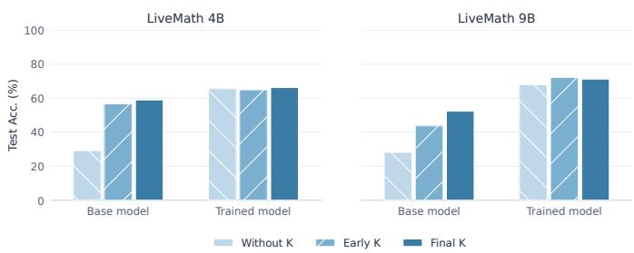  
Figure 7: Model and knowledge contributions on LiveMath. Test Acc. of base and trained models evaluated without knowledge, with the knowledge at the start of training (Early K), and with the final knowledge (Final K).

## 5 RELATED WORK

Knowledge evolution for LLM agents. LLM agents improve without parameter updates by turning experience into external knowledge, from textual reflections (Shinn et al., 2023; Zhao et al., 2024) to structured memories, playbooks, and skills that are continually updated (Ouyang et al., 2026; Zhang et al., 2026b; Alzubi et al., 2026; Yang et al., 2026; Zhang et al., 2026a). As such knowledge accumulates, recent studies find that it does not reliably improve task performance (Li et al., 2026a; Huang et al., 2026; Dong et al., 2026) and that seemingly correct experience can mislead future tasks (Xiong et al., 2026). Some methods therefore retain only updates with positive estimated gain (Tang et al., 2026), evaluating each candidate on its own. Rather than relying on any single analysis, SPLICE uses utility consistency across evolution views to guide knowledge evolution.

Knowledge internalization and co-evolution. Knowledge can also be internalized into model parameters through reinforcement learning and self-distillation (Lu et al., 2026a;b; He et al., 2026c; Lin et al., 2026), or evolved together with the policy (Xia et al., 2026; He et al., 2026b; Wu et al., 2025; Shi et al., 2026). Meanwhile, on-policy self-distillation, in which the model conditioned on privileged context serves as its own teacher (Zhao et al., 2026a), has been refined with token-level modulation (Li et al., 2026b) and contrastive references (Pan et al., 2026). SPLICE constructs its contrastive reference from knowledge that consistently degrades utility during knowledge evolution, and gates it at the token level to retain guidance shared with the evolved knowledge.

Consistency regularization. Consistency regularization improves generalization by encouraging consistent predictions for the same input under perturbations. It was first widely adopted in semisupervised learning (Bachman et al., 2014; Sajjadi et al., 2016; Tarvainen & Valpola, 2017; Xie et al., 2020) and has since been extended to supervised training and fine-tuning of large models (Wu et al., 2021; Ni et al., 2024). Inspired by this idea, SPLICE applies consistency to the utility of evolved knowledge. Additional related work is discussed in Appendix C.

## 6 CONCLUSION

We introduce SPLICE, a framework for consistency-regularized knowledge-model co-evolution. SPLICE updates knowledge based on utility gains that are consistent across evolution views and internalizes the evolved knowledge through reinforcement learning and gated contrastive self-distillation. Across four benchmarks and two model scales, SPLICE outperforms knowledge evolution and model training baselines, while its evolved knowledge enables more efficient task solving and transfers across model sizes and families. Overall, our results suggest that utility gains consistent across different ways of analyzing experience, rather than those observed under any single analysis, provide an effective signal for turning experience into generalizable knowledge that, when internalized through model evolution, supports long-term agentic evolution.

## REFERENCES

Rishabh Agarwal, Nino Vieillard, Yongchao Zhou, Piotr Stanczyk, Sabela Ramos Garea, Matthieu Geist, and Olivier Bachem. On-policy distillation of language models: Learning from selfgenerated mistakes. In International Conference on Learning Representations, volume 2024, pp. 21246–21263, 2024.

Salaheddin Alzubi, Noah Provenzano, Jaydon Bingham, Weiyuan Chen, and Tu Vu. Evoskill: Automated skill discovery for multi-agent systems. arXiv preprint arXiv:2603.02766, 2026.

Philip Bachman, Quais Alsharif, and Doina Precup. Learning with pseudo-ensembles. Advances in neural information processing systems, 27, 2014.

Yuzheng Cai, Siqi Cai, Yuchen Shi, Zihan Xu, Lichao Chen, Yulei Qin, Xiaoyu Tan, Gang Li, Zongyi Li, Haojia Lin, et al. Training-free group relative policy optimization. arXiv preprint arXiv:2510.08191, 2025.

Gen Dong, Yanjie Gao, Liqun Li, Tianyin Xu, Yu Hua, and Fan Yang. Agent skills can be harmful: An empirical study of skill-induced failures in llm agents. arXiv preprint arXiv:2608.11888, 2026.

Gemma Team. Gemma 4 technical report, 2026. URL https://arxiv.org/abs/2607. 02770.

Linyang He, Qiyao Yu, Hanze Dong, Baohao Liao, Xinxing Xu, Micah Goldblum, Jiang Bian, and Nima Mesgarani. Livemathematicianbench: A live benchmark for mathematician-level reasoning with proof sketches. arXiv preprint arXiv:2604.01754, 2026a.

Zelin He, Haotian Lin, Boran Han, Wei Zhu, Haoyang Fang, Bernie Wang, Xuan Zhu, Runze Li, and Matthew Reimherr. Reskill: Reconciling skill creation with policy optimization in agentic rl. arXiv preprint arXiv:2606.01619, 2026b.

Zhongyu He, Yuanfan Li, Fei Huang, Tianyu Chen, Siyuan Chen, Xingyang Li, Meng Hsuan Yu, Xiangrong Liu, Leyi Wei, Lu Pan, et al. Siri: Self-internalizing reinforcement learning with intrinsic skills for llm agent training. arXiv preprint arXiv:2606.02355, 2026c.

Zisu Huang, Jingwen Xu, Yifan Yang, Ziyang Gong, Qihao Yang, Muzhao Tian, Xiaohua Wang, Changze Lv, Xuemei Gao, Qi Dai, et al. From raw experience to skill consumption: A systematic study of model-generated agent skills. arXiv preprint arXiv:2605.23899, 2026.

Naman Jain, Alex Gu, Wen-Ding Li, Fanjia Yan, Tianjun Zhang, Sida Wang, Armando Solar-Lezama, Koushik Sen, and Ion Stoica. Livecodebench: Holistic and contamination free evaluation of large language models for code. In International Conference on Learning Representations, volume 2025, pp. 58791–58831, 2025.

Samuli Laine and Timo Aila. Temporal ensembling for semi-supervised learning. arXiv preprint arXiv:1610.02242, 2016.

Xiangyi Li, Yimin Liu, Wenbo Chen, Bingran You, Zonglin Di, Yifeng He, Shenghan Zheng, Kyoung Whan Choe, Jiankai Sun, Shuyi Wang, et al. Skillsbench: Benchmarking how well agent skills work across diverse tasks. arXiv preprint arXiv:2602.12670, 2026a.

Yunhe Li, Hao Shi, Wenhao Liu, Mengzhe Ruan, Hanxu Hou, Zhongxiang Dai, Shuang Qiu, and Linqi Song. Demopsd: Disagreement-modulated policy self-distillation. arXiv preprint arXiv:2607.02502, 2026b.

Hongxiang Lin, Zhirui Kuai, Erpeng Xue, and Lei Wang. Skillc: Learning autonomous skill internalization in llm agents via contrastive credit assignment. arXiv preprint arXiv:2605.27899, 2026.

Zhengxi Lu, Zhiyuan Yao, Zhuowen Han, Zi-Han Wang, Jinyang Wu, Qi Gu, Xunliang Cai, Weiming Lu, Jun Xiao, Yueting Zhuang, et al. Self-distilled agentic reinforcement learning. arXiv preprint arXiv:2605.15155, 2026a.

Zhengxi Lu, Zhiyuan Yao, Jinyang Wu, Chengcheng Han, Qi Gu, Xunliang Cai, Weiming Lu, Jun Xiao, Yueting Zhuang, and Yongliang Shen. Skill0: In-context agentic reinforcement learning for skill internalization. arXiv preprint arXiv:2604.02268, 2026b.

Zeyao Ma, Bohan Zhang, Jing Zhang, Jifan Yu, Xiaokang Zhang, Xiaohan Zhang, Sijia Luo, Xi Wang, and Jie Tang. Spreadsheetbench: Towards challenging real world spreadsheet manipulation. Advances in Neural Information Processing Systems, 37:94871–94908, 2024.

Bodhisattwa Prasad Majumder, Bhavana Dalvi Mishra, Peter Jansen, Oyvind Tafjord, Niket Tandon, Li Zhang, Chris Callison-Burch, and Peter Clark. Clin: A continually learning language agent for rapid task adaptation and generalization. arXiv preprint arXiv:2310.10134, 2023.

Meta Superintelligence Lab. Muse Glimmer, August 2026. URL https://huggingface.co/ meta-models/Muse-Glimmer-30B.

Yao Ni, Shan Zhang, and Piotr Koniusz. Pace: Marrying generalization in parameter-efficient finetuning with consistency regularization. Advances in Neural Information Processing Systems, 37: 61238–61266, 2024.

Siru Ouyang, Jun Yan, I Hsu, Yanfei Chen, Ke Jiang, Zifeng Wang, Rujun Han, Long Le, Samira Daruki, Xiangru Tang, et al. Reasoningbank: Scaling agent self-evolving with reasoning memory. In International Conference on Learning Representations, volume 2026, pp. 94327–94354, 2026.

Leyi Pan, Shuchang Tao, Yunpeng Zhai, Lingzhe Zhang, Zhaoyang Liu, Bolin Ding, Aiwei Liu, and Lijie Wen. Rlcsd: Reinforcement learning with contrastive on-policy self-distillation. arXiv preprint arXiv:2606.11709, 2026.

Qwen Team. Qwen3.5: Towards native multimodal agents, February 2026. URL https://qwen. ai/blog?id=qwen3.5.

Mehdi Sajjadi, Mehran Javanmardi, and Tolga Tasdizen. Regularization with stochastic transformations and perturbations for deep semi-supervised learning. Advances in neural information processing systems, 29, 2016.

Zhihong Shao, Peiyi Wang, Qihao Zhu, Runxin Xu, Junxiao Song, Xiao Bi, Haowei Zhang, Mingchuan Zhang, YK Li, Yang Wu, et al. Deepseekmath: Pushing the limits of mathematical reasoning in open language models. arXiv preprint arXiv:2402.03300, 2024.

Guobin Shen, Xiang Cheng, Chenxiao Zhao, Lei Huang, Jindong Li, Dongcheng Zhao, and Xing Yu. Anti-self-distillation for reasoning rl via pointwise mutual information. arXiv preprint arXiv:2605.11609, 2026.

Yaorui Shi, Yuxin Chen, Zhengxi Lu, Yuchun Miao, Shugui Liu, Qi Gu, Xunliang Cai, Xiang Wang, and An Zhang. Skill1: Unified evolution of skill-augmented agents via reinforcement learning. arXiv preprint arXiv:2605.06130, 2026.

Noah Shinn, Federico Cassano, Ashwin Gopinath, Karthik Narasimhan, and Shunyu Yao. Reflexion: Language agents with verbal reinforcement learning. Advances in neural information processing systems, 36:8634–8652, 2023.

Charlie Snell, Dan Klein, and Ruiqi Zhong. Learning by distilling context. arXiv preprint arXiv:2209.15189, 2022.

Mirac Suzgun, Mert Yuksekgonul, Federico Bianchi, Dan Jurafsky, and James Zou. Dynamic cheatsheet: Test-time learning with adaptive memory. In Proceedings of the 19th Conference of the European Chapter ofthe Associationfor Computational Linguistics (Volume 1: Long Papers), pp. 7080–7106, 2026.

Bo Tang, Yang Zhang, Guomian Zhuang, Wenqiang Wei, Gaoyang Zheng, Lindong Xie, Yanchao Tan, Feiyu Xiong, Qingyu Yang, Edward Chung, et al. From memory to skills: Evidence-grounded co-evolution governance for long-horizon llm agents. arXiv preprint arXiv:2607.16621, 2026.

Antti Tarvainen and Harri Valpola. Mean teachers are better role models: Weight-averaged consistency targets improve semi-supervised deep learning results. Advances in neural information processing systems, 30, 2017.

Guanzhi Wang, Yuqi Xie, Yunfan Jiang, Ajay Mandlekar, Chaowei Xiao, Yuke Zhu, Linxi Fan, and Anima Anandkumar. Voyager: An open-ended embodied agent with large language models. arXiv preprint arXiv:2305.16291, 2023.

Zora Zhiruo Wang, Jiayuan Mao, Daniel Fried, and Graham Neubig. Agent workflow memory. arXiv preprint arXiv:2409.07429, 2024.

Tianxin Wei, Zhan Shi, Minhua Lin, Bing He, Zewen Liu, Yisi Sang, Yuanchen Bei, Xuying Ning, Jiaru Zou, Ting-Wei Li, Xiao Lin, Yanjun Zhao, Chi Wang, Benoit Dumoulin, Dakuo Wang, Jingrui He, and Hanqing Lu. Evo-harness: Context-to-harness skill compilation for self-evolving agents, 2026. URL https://arxiv.org/abs/2608.15071.

Lijun Wu, Juntao Li, Yue Wang, Qi Meng, Tao Qin, Wei Chen, Min Zhang, Tie-Yan Liu, et al. R-drop: Regularized dropout for neural networks. Advances in neural information processing systems, 34: 10890–10905, 2021.

Rong Wu, Xiaoman Wang, Jianbiao Mei, Pinlong Cai, Daocheng Fu, Cheng Yang, Licheng Wen, Xuemeng Yang, Yufan Shen, Yuxin Wang, et al. Evolver: Self-evolving llm agents through an experience-driven lifecycle. arXiv preprint arXiv:2510.16079, 2025.

Peng Xia, Jianwen Chen, Hanyang Wang, Jiaqi Liu, Kaide Zeng, Yu Wang, Siwei Han, Yiyang Zhou, Xujiang Zhao, Haifeng Chen, et al. Skillrl: Evolving agents via recursive skill-augmented reinforcement learning. arXiv preprint arXiv:2602.08234, 2026.

Qizhe Xie, Zihang Dai, Eduard Hovy, Thang Luong, and Quoc Le. Unsupervised data augmentation for consistency training. Advances in neural information processing systems, 33:6256–6268, 2020.

Zidi Xiong, Yuping Lin, Wenya Xie, Pengfei He, Zirui Liu, Jiliang Tang, Himabindu Lakkaraju, and Zhen Xiang. How memory management impacts llm agents: An empirical study of experiencefollowing behavior. In Proceedings ofthe 64th Annual Meeting ofthe Associationfor Computational Linguistics (Volume 1: Long Papers), pp. 623–645, 2026.

Wujiang Xu, Zujie Liang, Kai Mei, Hang Gao, Juntao Tan, and Yongfeng Zhang. A-mem: Agentic memory for llm agents. Advances in Neural Information Processing Systems, 38:17577–17604, 2026.

Yifan Yang, Ziyang Gong, Weiquan Huang, Qihao Yang, Ziwei Zhou, Zisu Huang, Yan Li, Xuemei Gao, Qi Dai, Bei Liu, et al. Skillopt: Executive strategy for self-evolving agent skills. arXiv preprint arXiv:2605.23904, 2026.

Shunyu Yao, Howard Chen, John Yang, and Karthik Narasimhan. Webshop: Towards scalable real-world web interaction with grounded language agents. Advances in Neural Information Processing Systems, 35:20744–20757, 2022.

Haozhen Zhang, Quanyu Long, Jianzhu Bao, Tao Feng, Weizhi Zhang, Haodong Yue, and Wenya Wang. Memskill: Learning and evolving memory skills for self-evolving agents. arXiv preprint arXiv:2602.02474, 2026a.

Qizheng Zhang, Changran Hu, Shubhangi Upasani, Boyuan Ma, Fenglu Hong, Vamsidhar Kamanuru, Jay Rainton, Chen Wu, Mengmeng Ji, Hanchen Li, et al. Agentic context engineering: Evolving contexts for self-improving language models. In International Conference on Learning Representations, volume 2026, pp. 86069–86100, 2026b.

Wenqi Zhang, Ke Tang, Hai Wu, Mengna Wang, Yongliang Shen, Guiyang Hou, Zeqi Tan, Peng Li, Yueting Zhuang, and Weiming Lu. Agent-pro: Learning to evolve via policy-level reflection and optimization. In Proceedings of the 62nd Annual Meeting of the Association for Computational Linguistics (Volume 1: Long Papers), pp. 5348–5375, 2024.

Xing Zhang, Yanwei Cui, Guanghui Wang, Ziyuan Li, Wei Qiu, Bing Zhu, and Peiyang He. Library drift: Diagnosing and fixing a silent failure mode in self-evolving llm skill libraries. arXiv preprint arXiv:2605.19576, 2026c.

Andrew Zhao, Daniel Huang, Quentin Xu, Matthieu Lin, Yong-Jin Liu, and Gao Huang. Expel: Llm agents are experiential learners. In Proceedings ofthe AAAI Conference on Artificial Intelligence, volume 38, pp. 19632–19642, 2024.

Siyan Zhao, Zhihui Xie, Mengchen Liu, Jing Huang, Guan Pang, Feiyu Chen, and Aditya Grover. Self-distilled reasoner: On-policy self-distillation for large language models. arXiv preprint arXiv:2601.18734, 2026a.

Yanjun Zhao, Tianxin Wei, Jiaru Zou, Xuying Ning, Yuanchen Bei, Lingjie Chen, Simmi Rana, Wendy H. Yang, Hanghang Tong, and Jingrui He. Papermind: Benchmarking agentic reasoning and critique over scientific papers in multimodal llms, 2026b. URL https://arxiv.org abs/2604.21304.

Xinyu Zhu, Mengzhou Xia, Zhepei Wei, Wei-Lin Chen, Danqi Chen, and Yu Meng. The surprising effectiveness of negative reinforcement in llm reasoning. Advances in Neural Information Processing Systems, 38:126546–126573, 2026.

## APPENDIX

A Implementation Details 15   
A.1 Benchmarks . 15   
A.2 Models and Baselines 15   
A.3 Evaluation Protocol . 16   
B Knowledge-Model Co-Evolution 17   
B.1 Design Considerations 17   
B.2 Sequential Co-Evolution 17   
B.3 Asynchronous Co-Evolution 17   
B.4 Discussion: Relaxing R1 19   
C More Related Work 20   
D Additional Results 21   
E Proof of Proposition 1 23   
F Discussion of Common-Gain Selection 24   
F.1 Illustrative Comparison of Selection Strategies . 24   
F.2 Robustness to Shifts in Evolution Views 25   
G Case Studies 27   
G.1 Evolved Knowledge . 27   
G.2 Noisy Knowledge 28

## A IMPLEMENTATION DETAILS

## A.1 BENCHMARKS

Table 4 summarizes the data splits. Training tasks provide experience for knowledge evolution and model training, validation tasks are used to evaluate proposed knowledge updates, and test tasks are used only for evaluation.

Table 4: Data splits and training settings. Counts refer to tasks, or shopping sessions for WebShop.   
Output tokens are the maximum number of tokens per model response.

<table><tr><td>Benchmark</td><td>Train</td><td>Val.</td><td>Test</td><td>Output tokens</td><td>Epochs</td></tr><tr><td>LiveMath</td><td>86</td><td>43</td><td>302</td><td>16,384</td><td>3</td></tr><tr><td>LiveCode</td><td>68</td><td>34</td><td>240</td><td>32,768</td><td>3</td></tr><tr><td>SpreadSheet</td><td>80</td><td>40</td><td>280</td><td>4,096</td><td>3</td></tr><tr><td>WebShop</td><td>1,000</td><td>100</td><td>500</td><td>512</td><td>1</td></tr></table>

LiveMath. We use LiveMathematicianBench (He et al., 2026a) in its multiple-choice setting without proof sketches, with problems from the March–June 2026 subsets. The agent answers each problem by selecting one of five options.

LiveCode. We use the code-generation subset of LiveCodeBench (Jain et al., 2025), combining the v5 and v6 releases and splitting problems by contest so that no contest is shared across splits. The agent writes a Python solution, which is evaluated by the execution-based test runner of LiveCodeBench.

SpreadSheet. We use the Verified-400 subset of SpreadsheetBench (Ma et al., 2024). Given an instruction and an input workbook, the agent writes Python code to produce an output workbook and can revise the code using execution feedback.

WebShop. We use the official 1K-product environment with synthetic shopping goals (Yao et al., 2022). The agent navigates textual product pages through search and click actions, including productoption selection and purchase.

## A.2 MODELS AND BASELINES

Models. The task models are Qwen3.5-4B and Qwen3.5-9B (Qwen Team, 2026) with thinking mode disabled, decoded with temperature 1.0, top-p 0.95, and top-k 20. The knowledge optimizer is an external LLM. Table 5 lists the hyperparameters of SPLICE.

Table 5: Hyperparameters of SPLICE.
<table><tr><td>Component</td><td>Hyperparameter</td><td>Value</td></tr><tr><td rowspan="3">Knowledge evolution</td><td>Evolution views N</td><td>3</td></tr><tr><td>Replay runs per candidate</td><td>1</td></tr><tr><td>Selected tasks n</td><td>{1, 2, 3}</td></tr><tr><td rowspan="4">Model evolution</td><td>Self-distillation weight λ</td><td>{0.1, 0.3, 0.5, 1} 6</td></tr><tr><td>Learning rate</td><td>1 × 10</td></tr><tr><td>Training batch size</td><td>8</td></tr><tr><td>Group size</td><td>16 (LiveMath), 8 (others)</td></tr><tr><td rowspan="4">Co-evolution</td><td>Reward-gap thresholds  $\epsilon _ { \mathrm { s d } } = \epsilon _ { \mathrm { e n d } }$ </td><td>0.03 3, 5 (WebShop: 10, 20)</td></tr><tr><td>Stage budgets Tmin, Tmax</td><td></td></tr><tr><td>Restart patience L</td><td>2</td></tr><tr><td>Warmup rounds</td><td>4 (WebShop, LiveMath), 8 (others)</td></tr></table>

Baselines. Base uses the task model without knowledge. ReasoningBank (Ouyang et al., 2026) stores reasoning memories distilled from experience and retrieves task-relevant entries. ACE (Zhang et al., 2026b) maintains an evolving playbook through reflection and curation. EvoSkill (Alzubi et al., 2026) builds skills from task experience, and SkillOpt (Yang et al., 2026) iteratively optimizes external skills. GRPO (Shao et al., 2024) trains the task model with group-relative policy optimization, and SkillRL (Xia et al., 2026) and ReSkill (He et al., 2026b) combine skill evolution with policy optimization. All training-based methods are trained for the number of epochs listed in Table 4.

## A.3 EVALUATION PROTOCOL

We report accuracy (Acc.), the percentage of test tasks that are solved. A task is solved if the selected option is correct on LiveMath, all test cases pass on LiveCode, the output workbook matches the reference in all cases on SpreadSheet, or the purchase receives the full reward on WebShop. Results of training-free methods are averaged over three seeds. SPLICE (Co-Evo) evaluates the final model with the latest knowledge that passes held-out validation with this model, and without knowledge if no knowledge passes.

## B KNOWLEDGE-MODEL CO-EVOLUTION

## B.1 DESIGN CONSIDERATIONS

Knowledge evolution and model evolution depend on each other. The utility of knowledge depends on the model that uses it: guidance that helps the current model can become redundant or even harmful after the model is trained. Model evolution, in turn, internalizes knowledge through self-distillation from the model conditioned on it, which requires the knowledge to remain fixed. Co-evolution therefore has two requirements:

• (R1) knowledge is evaluated with the model that uses it;

• (R2) K and $K ^ { - }$ remain fixed while the model internalizes them.

A further consideration is efficiency. Knowledge evolution typically requires multiple rounds before it produces stable knowledge with clear utility gains. If model evolution waits for these rounds, training stalls; if it uses knowledge too early, it internalizes weak guidance. The two procedures below handle this trade-off differently. The sequential procedure waits and satisfies both requirements exactly, whereas the asynchronous procedure relaxes R1 during knowledge evolution so that training uses knowledge as soon as it proves useful.

## B.2 SEQUENTIAL CO-EVOLUTION

The sequential procedure (Algorithm 1) alternates the two processes. Knowledge evolution runs with the model fixed, so every candidate is replayed and validated with the model that will use it. It continues until M consecutive updates are rejected, indicating that knowledge evolution no longer improves the knowledge under the current model. Model evolution then performs T updates with K and K− fixed. The rejected rounds share the same model and knowledge, and thus provide a common baseline for constructing K− from consistent utility degradation (§ 3.2). Afterwards, knowledge evolution continues from the current K with experience collected by the updated model.

This procedure satisfies R1 and R2 exactly, but each process waits for the other: training is idle during the multiple rounds of knowledge evolution, and knowledge evolution is idle during training.

Algorithm 1 SPLICE: Sequential Co-Evolution   
Input: Policy π , rejection threshold M, model-update budget T, total budget.   
1: Initialize K ← ∅.   
2: while total budget remains do   
3: [Knowledge Evolution]   
4: repeat   
5: Collect experience E using π conditioned on K.   
6: Generate knowledge candidates $\{ K ^ { ( j ) } \} _ { j = 1 } ^ { N } .$ ▷ Eq. 2   
7: Replay tasks and compute common gains. ▷ Eq. 3   
8: Construct Ke from the selected tasks. ▷ Eq. 5   
9: Accept $K \gets \widetilde K$ if held-out validation performance improves.   
10: until M consecutive updates are rejected or the total budget is exhausted   
11: [Model Evolution]   
12: Construct K− from consistent utility degradation in the last M rejected rounds.   
13: for up to T updates within the remaining budget do   
14: Collect trajectories with and without K.   
15: Update θ with LSPLICE. ▷ Eq. 7   
16: end for   
17: end while   
18: return πθ and K.

## B.3 ASYNCHRONOUS CO-EVOLUTION

The asynchronous procedure (Algorithm 2) runs knowledge evolution and model evolution at the same time. Knowledge evolution keeps improving its own copy of knowledge, $K _ { \mathrm { e v o } } ,$ using experience generated during training, while model evolution trains with K, the most recent $K _ { \mathrm { e v o } }$ that improves held-out validation performance with the current model. Useful knowledge thus enters training without waiting for knowledge evolution to stop, and training does not stall. Before training starts, knowledge evolution runs several rounds with the initial model to obtain initial knowledge.

Consistent references for comparison. Training experience is generated under whichever knowledge the current stage uses. Knowledge evolution therefore takes trajectories generated under the same knowledge $K ^ { j }$ and measures replay gains relative to $K ^ { \prime }$ . Updates supported by common gain are merged into the latest $K _ { \mathrm { e v o } } .$ which can differ from $K ^ { \prime } { \mathrm { ; } }$ knowledge evolution therefore accumulate improvements instead of restarting with each batch.

Adopting knowledge for training. Model evolution proceeds in training stages. At the start of each stage, the latest $K _ { \mathrm { e v o } }$ is compared with no knowledge on the held-out validation set using the current model. It is adopted as $K$ only if it improves validation performance; otherwise, the stage trains with GRPO alone. Each stage that trains with K first constructs $K ^ { - }$ from the replay results of recent knowledge evolution rounds by selecting tasks with consistent utility degradation using $- \Delta _ { i j }$ (§ 3.2). Because knowledge evolution evaluates candidates with earlier models, validating with the current model restores R1 at the time of adoption. Within a stage, K and $K ^ { - }$ remain fixed, which satisfies R2.

When to replace the training knowledge. The batch reward gap, i.e., the mean of $\overline { { R } } _ { i } ^ { K } - \overline { { R } } _ { i } ^ { \emptyset }$ over a batch, measures how much of the benefit of $K$ the model has not yet internalized. Self-distillation is applied only when this gap exceeds $\epsilon _ { \mathrm { s d } }$ , which extends the task-level weight $w _ { i }$ to the batch level; other batches use GRPO alone. A stage ends once the gap falls to $\epsilon _ { \mathrm { e n d } }$ or below after at least $T _ { \mathrm { m i n } }$ updates, indicating that $K$ has been largely internalized, or after $T _ { \mathrm { m a x } }$ updates, so that newer knowledge can be adopted. A stage without knowledge ends after $T _ { \mathrm { m i n } }$ updates. $T _ { \mathrm { m i n } }$ keeps each stage long enough for stable training, while $T _ { \mathrm { m a x } }$ limits how long training relies on outdated knowledge.

Restarting knowledge evolution. If no knowledge is adopted for $L$ consecutive stages, which indicates that the knowledge accumulated in $K _ { \mathrm { e v o } }$ no longer helps the current model, knowledge evolution restarts from empty knowledge while keeping the current model and the collected experience. At the end of training, the latest $K _ { \mathrm { e v o } }$ is validated with the final model in the same way to determine the returned knowledge.

Algorithm 2 SPLICE: Asynchronous Co-Evolution   
Input: Policy π ; reward-gap thresholds $\epsilon _ { \mathrm { s d } }$ and $\epsilon _ { \mathrm { e n d } } ;$ ; stage budgets $T _ { \mathrm { m i n } } \le T _ { \mathrm { m a x } } ;$ restart patience $L ;$ total   
budget.   
1: Run knowledge evolution with the initial model to obtain $K _ { \mathrm { e v o } }$   
2: Run the two processes below at the same time.   
[Knowledge Evolution]   
3: while training continues do   
4: Take training experience generated under the same knowledge.   
5: Run knowledge evolution on it (§ 3.1) and update $K _ { \mathrm { e v o } }$   
6: Restart from $K _ { \mathrm { e v o } }  \emptyset$ if requested.   
7: end while   
[Model Evolution]   
8: while total budget remains do   
9: Adopt $K \gets K _ { \mathrm { e v o } }$ if it improves validation performance with the current model; otherwise $K \gets \emptyset$   
10: If $\hat { K _ { \mathbf { \alpha } } } \neq \varnothing ,$ construct $K ^ { - }$ from consistent utility degradation in recent rounds before training.   
11: Request a restart after L consecutive stages without adopted knowledge.   
12: repeat   
13: Collect trajectories with and without $K ;$ pass them to knowledge evolution.   
14: Update θ with $\mathcal { L } _ { \mathrm { S P L I C E } }$ if the reward gap exceeds $\epsilon _ { \mathrm { s d } } \mathrm { . }$ ; otherwise with $\mathcal { L } _ { \mathrm { G R P O } } .$   
15: until the gap is at most $\epsilon _ { \mathrm { e n d } }$ after $T _ { \mathrm { m i n } }$ updates, or $T _ { \mathrm { m a x } }$ updates are reached   
16: end while   
17: return $\pi _ { \theta } ,$ and $K _ { \mathrm { e v o } }$ if it improves validation performance with the final model.

## B.4 DISCUSSION: RELAXING R1

In the asynchronous procedure, the model is updated while knowledge evolution runs, so replay can use a newer model than the one that generated the experience. For task $x _ { i } .$ , the replay gain then decomposes as $\Delta _ { i j } = \Delta _ { i i } ^ { * } + b _ { i }$ , where $\Delta _ { i j } ^ { * }$ is the gain of $\bar { K } ^ { ( j ) }$ measured with the replay model alone, and $b _ { i }$ is the reward change caused by the model update under the knowledge that generated the experience. Since all candidates for $x _ { i }$ are replayed with the same model, $b _ { i }$ is shared across views, and

$$
\widehat { C } _ { i } = \frac { 1 } { { \binom { N } { 2 } } } \sum _ { j < \ell } \operatorname* { m i n } ( \Delta _ { i j } ^ { * } , \Delta _ { i \ell } ^ { * } ) + b _ { i } .\tag{8}
$$

The inconsistency penalty is unchanged, so the comparison among evolution views remains valid. The shift instead changes which tasks pass the threshold $\widehat { C } _ { i } > 0 \colon$ model improvement $( b _ { i } > 0 )$ admits tasks whose gains come from training rather than from knowledge, and model degradation $( b _ { i } < 0 )$ excludes useful evidence. Proposition 1 likewise assumes a fixed model.

Two design choices limit this effect. Knowledge evolution uses recent experience, which keeps the model change between experience collection and replay small. More importantly, knowledge enters training only after it improves validation performance over no knowledge with the current model, so an update whose apparent gain comes from the model update is not adopted unless it also helps the current model. The remaining cost is efficiency: a shifted threshold can select less informative tasks and produce updates that are later rejected. Compared with the sequential procedure, the asynchronous procedure accepts this cost in exchange for using knowledge without waiting for knowledge evolution to finish.

## C MORE RELATED WORK

Knowledge evolution for LLM agents. LLM agents can improve without parameter updates by turning experience into external knowledge. Early methods reflect on failures and store textual lessons: Reflexion keeps verbal self-reflections for subsequent attempts (Shinn et al., 2023), ExpeL extracts insights from successful and failed trajectories across tasks (Zhao et al., 2024), CLIN maintains a textual memory updated across trials (Majumder et al., 2023), and Agent-Pro reflects at the level of the agent’s policy (Zhang et al., 2024). Another line accumulates procedural knowledge, such as executable skill libraries (Wang et al., 2023), workflows induced from past trajectories (Wang et al., 2024), and skills that are automatically discovered and refined (Alzubi et al., 2026; Yang et al., 2026; Wei et al., 2026), including learnable memory operations (Zhang et al., 2026a). Other methods maintain structured memories or contexts that evolve during task solving, including agentic memory organization (Xu et al., 2026), adaptive test-time memory (Suzgun et al., 2026), reasoning strategies distilled from successes and failures (Ouyang et al., 2026), and evolving playbooks (Zhang et al., 2026b). Training-Free GRPO further distills experiential knowledge from group-relative comparisons of rollouts (Cai et al., 2025). Related studies examine the reliability of skills and agentic reasoning: model-generated skills do not reliably improve performance (Li et al., 2026a; Huang et al., 2026; Dong et al., 2026), unchecked accumulation degrades skill retrieval (Zhang et al., 2026c), and agents can fail to use experience and external evidence reliably (Xiong et al., 2026; Zhao et al., 2026b). Some methods therefore retain only updates with positive estimated gain (Tang et al., 2026). SPLICE focuses on which evidence should drive a knowledge update, using utility consistency across multiple evolution views of the same experience.

Knowledge internalization and co-evolution. Internalizing knowledge into model parameters is closely related to context distillation, which trains a model without a context to match its predictions with the context (Snell et al., 2022), and to on-policy distillation, which supervises a student on its own generated trajectories (Agarwal et al., 2024). For LLM agents, recent work internalizes skills into the policy through reinforcement learning and self-distillation (Lu et al., 2026a; He et al., 2026c), progressively reduces reliance on skills provided in context (Lu et al., 2026b), or attributes success to skills by contrasting rollouts with and without them (Lin et al., 2026). Other work evolves knowledge together with the policy: skill banks are updated during online reinforcement learning (Xia et al., 2026), skill creation is coupled with policy optimization (He et al., 2026b), experience is distilled into principles that guide further policy learning (Wu et al., 2025), and a single policy learns to select, use, and distill skills (Shi et al., 2026). On-policy self-distillation, in which the model conditioned on privileged context serves as its own teacher, has become a dense training signal for LLMs (Zhao et al., 2026a). Since privileged context can distort the teacher’s token distribution, recent variants modulate token-level guidance by teacher–student disagreement (Li et al., 2026b), reverse the distillation direction (Shen et al., 2026), or contrast signals under correct and wrong hints (Pan et al., 2026). Negative signals have likewise been shown to provide useful supervision in reinforcement learning for LLMs (Zhu et al., 2026). SPLICE derives its negative reference from knowledge evolution itself, using knowledge associated with consistent utility degradation, and combines it with task-level weighting and a token-level gate during internalization.

Consistency regularization. Consistency regularization encourages a model to make consistent predictions for the same input under perturbations. In semi-supervised learning, early methods enforce agreement under stochastic transformations, dropout, and ensembling (Bachman et al., 2014; Sajjadi et al., 2016; Laine & Aila, 2016), and later methods improve the targets with weight-averaged teachers (Tarvainen & Valpola, 2017) or strong data augmentation (Xie et al., 2020). The idea has been extended to supervised training and fine-tuning through consistency between dropout sub-models (Wu et al., 2021) or under parameter perturbations (Ni et al., 2024). These methods assume that the correct output is invariant to the perturbation and enforce consistency through a training loss. In knowledge evolution, this assumption does not hold at the level of content, since different evolution views are expected to produce different knowledge. SPLICE therefore requires consistency only in the utility gains of the resulting knowledge and uses it as a criterion for selecting evidence.

## D ADDITIONAL RESULTS

This section provides additional analyses of consistency regularization and knowledge-model coevolution, complementing Section 4.3.

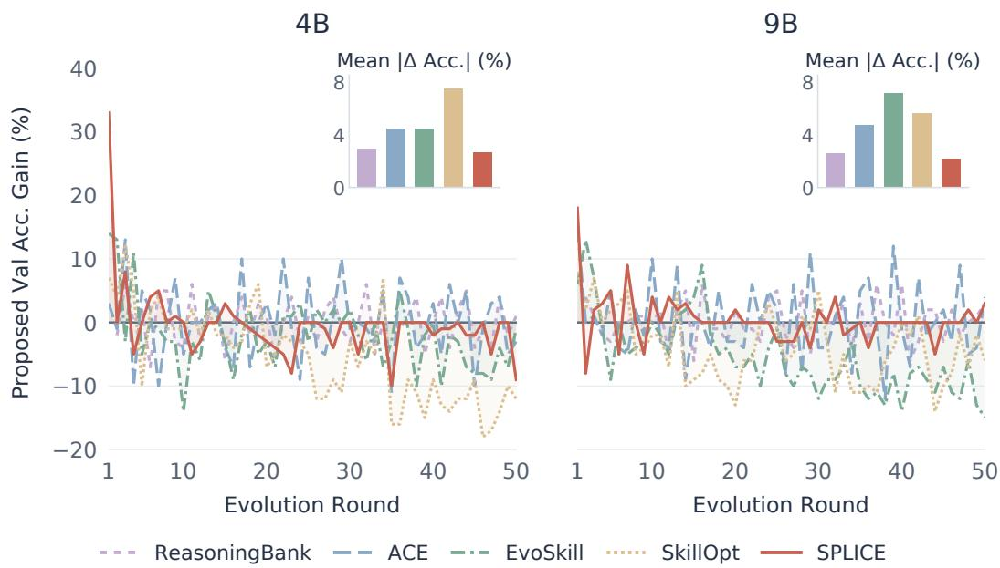  
Figure 8: Validation gains of proposed updates on WebShop. Validation Acc. of the proposed update minus that of the current knowledge (in points) at each evolution round, including rejected updates. Insets show the mean absolute change.

Stability of proposed updates. Figure 8 reports the change in validation Acc. caused by the proposed update at each of the first 50 evolution rounds on WebShop, including updates that are later rejected. The baselines frequently propose updates that lower validation Acc. by 10 points or more, especially SkillOpt and EvoSkill. In contrast, the updates proposed by SPLICE mostly stay close to zero or positive and have the smallest mean absolute change for both model sizes. This is consistent with the design of common gain, which discounts evidence whose gains appear under only some evolution views and thus avoids updates that change the knowledge in unstable ways.

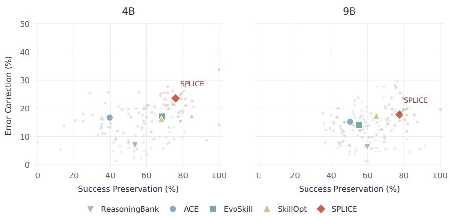  
Figure 9: Error correction and success preservation on WebShop. Percentages of tasks failed under the current knowledge that a proposed update solves, and of solved tasks that remain solved. Small points denote proposed updates in the first 30 rounds; large markers show pooled rates.

Error correction and success preservation. To examine how proposed updates affect individual tasks, we compare each proposed update with the current knowledge on the validation tasks. Error correction is the percentage of tasks failed under the current knowledge that the proposed update solves, and success preservation is the percentage of tasks solved under the current knowledge that remain solved. Figure 9 reports both metrics for the proposed updates in the first 30 evolution rounds on WebShop, excluding rounds without an update. SPLICE attains the highest pooled rates for both metrics: 23.60% error correction and 75.94% success preservation with Qwen3.5-4B, and 17.75% and 77.47% with Qwen3.5-9B, whereas the best baseline preservation rates are 68.40% and 64.79%. Updates selected by common gain thus correct more errors while breaking fewer existing successes.

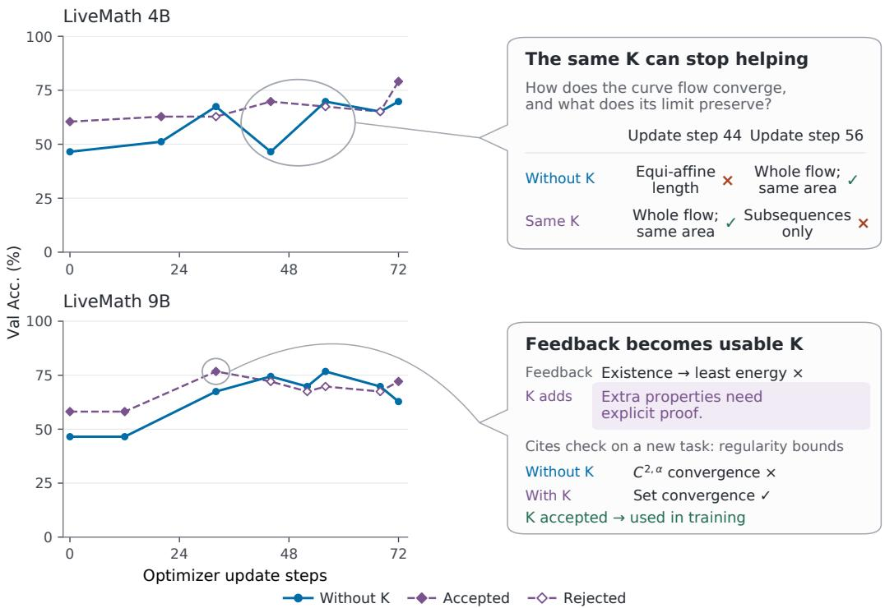  
Figure 10: Training dynamics and knowledge use on LiveMath. Left: validation Acc. over optimizer update steps without knowledge and with the latest knowledge, which is adopted (filled) or rejected (open) by validation with the current model. Right: the same knowledge helps the 4B model at update step 44, but leads to an error at update step 56 when the model already answers correctly without it; the 9B model uses a check learned from execution feedback to correct an unsupported convergence claim, and the knowledge is accepted for subsequent training.

Training dynamics of co-evolution. Figure 10 (left) tracks validation Acc. on LiveMath during coevolution, evaluating the model without knowledge and with the latest knowledge at each optimizer update step. Early in training, the knowledge improves the model substantially. As the model improves without knowledge, this benefit shrinks, and some knowledge updates no longer improve the current model and are rejected. The examples on the right illustrate both directions of this interplay. For the 4B model, the same knowledge helps the model answer correctly at update step 44, but by update step 56 the model answers correctly without it, whereas adding the knowledge leads to an error. For the 9B model, a check learned from execution feedback corrects an unsupported convergence claim on another task: at update step 32, the model answers incorrectly without knowledge and correctly with it, and the knowledge is accepted for subsequent training. These dynamics motivate validating knowledge with the current model before using it for training (Appendix B).

## E PROOF OF PROPOSITION 1

Proposition 1 (Improvement under a new evolution view). Fix a task $x _ { i } ,$ experience $\mathcal { E } ,$ model θ, and current knowledge K. Let $\Delta$ and $\Delta ^ { \prime }$ denote the utility gains from two independent, identically distributed evolution views, measured by the expected reward gain relative to $K .$ Assume $\dot { \mathbb { E } } | \Delta | < \infty$ , and define the population mean gain $\mu = \mathbb { E } [ \Delta ]$ and common gain $C =$ $\mathbb { E } [ \operatorname* { m i n } ( \Delta , \dot { \Delta } ^ { \prime } ) ] . \ I f C > 0$ , then $\mu > 0$ and

$$
\operatorname* { P r } ( \Delta > 0 ) \geq \frac { C } { \mu } = 1 - \frac { \mathbb { E } | \Delta - \Delta ^ { \prime } | } { 2 \mu } .\tag{4}
$$

Proof. All expectations and probabilities below are over evolution views, with the task, experience, model, and current knowledge fixed. Recall that

$$
\mu = \mathbb { E } [ \Delta ] , \qquad C = \mathbb { E } [ \operatorname* { m i n } ( \Delta , \Delta ^ { \prime } ) ] .
$$

The assumption $\mathbb { E } | \Delta | < \infty$ and identical distributions ensure that C is finite, since $| \operatorname* { m i n } ( \Delta , \Delta ^ { \prime } ) | \leq$ $| \Delta | + | \Delta ^ { \prime } |$ . Furthermore, min $( \Delta , \Delta ^ { \prime } ) \leq \Delta$ implies $C \le \mu$ . Thus, $C > 0$ ensures $\mu > 0$

We establish a more general bound for any threshold $0 \leq a < C$ . The following pointwise inequality holds:

$$
\operatorname* { m i n } ( \Delta , \Delta ^ { \prime } ) - a \leq ( \Delta - a ) \mathbf { 1 } \{ \Delta ^ { \prime } > a \} .\tag{9}
$$

If $\Delta ^ { \prime } \leq a$ , the left-hand side is at most $\Delta ^ { \prime } - a \leq 0 .$ , while the right-hand side is zero. If $\Delta ^ { \prime } > a$ , the right-hand side equals $\Delta - a$ , which is at least min $( \Delta , \Delta ^ { \prime } ) - a$

Taking expectations and using independence gives

$$
C - a \leq \mathbb { E } [ ( \Delta - a ) \mathbf { 1 } \{ \Delta ^ { \prime } > a \} ]\tag{10}
$$

$$
= \mathbb { E } [ \Delta - a ] \operatorname* { P r } ( \Delta ^ { \prime } > a )\tag{11}
$$

$$
= ( \mu - a ) \operatorname* { P r } ( \Delta > a ) ,\tag{12}
$$

where the last equality follows from the identical distributions of $\Delta$ and $\Delta ^ { \prime } .$ . Since $\mu \geq C > a$ , we obtain

$$
\operatorname* { P r } ( \Delta > a ) \geq { \frac { C - a } { \mu - a } } , \qquad \operatorname* { P r } ( \Delta \leq a ) \leq { \frac { \mu - C } { \mu - a } } .\tag{13}
$$

Setting $a = 0$ yields

$$
\operatorname* { P r } ( \Delta > 0 ) \geq \frac { C } { \mu } .
$$

Finally, using min $( u , v ) = ( u + v - | u - v | ) / 2$ , we have

$$
C = \frac { \mathbb { E } [ \Delta ] + \mathbb { E } [ \Delta ^ { \prime } ] - \mathbb { E } \vert \Delta - \Delta ^ { \prime } \vert } { 2 } = \mu - \frac { 1 } { 2 } \mathbb { E } \vert \Delta - \Delta ^ { \prime } \vert .
$$

Therefore,

$$
\operatorname* { P r } ( \Delta > 0 ) \geq \frac { C } { \mu } = 1 - \frac { \mathbb { E } | \Delta - \Delta ^ { \prime } | } { 2 \mu } ,
$$

which completes the proof.

## F DISCUSSION OF COMMON-GAIN SELECTION

## F.1 ILLUSTRATIVE COMPARISON OF SELECTION STRATEGIES

We use a simplified model to examine how different selection strategies respond to utility gains that are specific to particular evolution views. All strategies use the same knowledge optimizer and the same budget: each selects the evidence of one task and constructs one knowledge update from it. This comparison isolates the selection of task evidence from how the knowledge optimizer consolidates updates.

Consider two replayed tasks, R and S. The knowledge updates constructed from their evidence have expected utility gains $g _ { R } > g _ { S } > 0$ on held-out tasks, relative to the current knowledge K. Across $N \geq 2$ independently sampled evolution views, their replay gains satisfy

$$
\Delta _ { R j } = g _ { R } , \qquad \Delta _ { S j } = g _ { S } + a Z _ { j } , \qquad Z _ { j } \stackrel { \mathrm { i i d } } { \sim } \mathrm { B e r n o u l l i } ( q ) , \quad j = 1 , \ldots , N ,\tag{14}
$$

where $0 < q < 1$ . The term $a Z _ { j }$ represents a view-specific gain that appears on the replayed task under only some evolution views. We assume that this gain does not transfer to held-out tasks. Let $d = g _ { R } - g _ { S }$ and assume $a > d > 0$ , so that an individual view can rank S above R despite its lower held-out utility. To isolate this effect, we treat the replay gains as exact expected reward differences, without replay estimation noise.

Single-view selection ranks the tasks by $\Delta _ { i 1 }$ . Mean-gain selection ranks them by $\begin{array} { r } { { \frac { 1 } { N } } \sum _ { j = 1 } ^ { N } \Delta _ { i j } } \end{array}$ Common-gain selection uses Eq. 3. After selection, the same knowledge optimizer constructs the update from the evidence of the selected task. For definiteness, ties are resolved in favor of R.

Let $\begin{array} { r } { H = \sum _ { j = 1 } ^ { N } Z _ { j } } \end{array}$ denote the number of views under which S receives the additional gain. Then H ∼ Binomia $( N , q )$ , and the mean-gain and common-gain scores of $S$ are

$$
\begin{array} { c } { { s _ { S } ^ { \mathrm { m e a n } } = g _ { S } + a \displaystyle \frac { { \cal H } } { { \cal N } } , } } \\ { { s _ { S } ^ { \mathrm { c o m m o n } } = g _ { S } + a \displaystyle \frac { { \cal H } ( { \cal H } - 1 ) } { { \cal N } ( N - 1 ) } . } } \end{array}\tag{15}
$$

The second expression follows because only pairs in which both views receive the additional gain contribute a to the pairwise minimum. Task R has score $g _ { R }$ under all selection strategies.

Proposition 2 (Selection under view-specific gains). Under the model above, let $U _ { \mathrm { s i n g l e } } , U _ { \mathrm { m e a n } } ,$ and $U _ { \mathrm { c o m m o n } }$ denote the held-out utility of the selected update. For every $N \geq 2 ,$

$$
\mathbb { E } [ U _ { \mathrm { c o m m o n } } ] \geq \mathbb { E } [ U _ { \mathrm { m e a n } } ] .\tag{16}
$$

Furthermore, if

$$
a q ^ { 2 } < d < a q ,\tag{17}
$$

then

$$
\operatorname* { l i m } _ { N  \infty } \mathbb { E } [ U _ { \mathrm { c o m m o n } } ] = g _ { R } ,
$$

$$
\mathbb { E } [ U _ { \mathrm { s i n g l e } } ] = g _ { R } - d q ,
$$

$$
\operatorname* { l i m } _ { N  \infty } \mathbb { E } [ U _ { \mathrm { m e a n } } ] = g _ { S } .\tag{18}
$$

Thus, common-gain selection has strictly higher expected held-out utility than both alternatives for sufficiently large N.

Proof. Since $a > d ,$ single-view selection chooses $S$ exactly when $Z _ { 1 } = 1$ , with probability q. For the other two strategies, Eq. 15 gives

$$
\operatorname* { P r } ( { \mathrm { m e a n ~ s e l e c t s ~ } } S ) = \operatorname* { P r } \left( { \frac { H } { N } } > { \frac { d } { a } } \right) ,
$$

$$
\operatorname* { P r } ( { \mathrm { c o m m o n ~ s e l e c t s ~ } } S ) = \operatorname* { P r } \left( { \frac { H ( H - 1 ) } { N ( N - 1 ) } } > { \frac { d } { a } } \right) .\tag{19}
$$

For every $H \in \{ 0 , \ldots , N \}$

$$
\frac { H ( H - 1 ) } { N ( N - 1 ) } \leq \frac { H } { N } .
$$

Therefore, whenever common-gain selection chooses S, mean-gain selection also chooses $S .$ Selecting S instead of R reduces held-out utility by $d > 0 .$ , proving Eq. 16.

By the law of large numbers,

$$
\frac { H } { N } \longrightarrow q , \qquad \frac { H ( H - 1 ) } { N ( N - 1 ) } \longrightarrow q ^ { 2 }
$$

almost surely. Under Eq. 17, the probability that mean-gain selection chooses $S$ converges to one, while the corresponding probability for common-gain selection converges to zero. The expected held-out utility of any selection rule is $g _ { R } - d \operatorname* { P r } ( \sec S )$ . Substitution yields Eq. 18. Because $0 < q < 1$ and $d > 0 , g _ { R } > g _ { R } - d q > g _ { S }$ , establishing the strict comparison for sufficiently large $N .$ □

This example distinguishes collecting more views from requiring utility consistency across them. As N increases, mean-gain selection more accurately estimates $g _ { S } + a q$ , which still includes the view-specific gain. Common gain instead approaches $g _ { S } + a q ^ { 2 }$ , reducing the contribution of gains supported by only a fraction of the views. When $a q ^ { 2 } < d < a q$ , this difference changes which task evidence is selected for the knowledge update.

The advantage depends on both the transfer assumption and the relative size of the view-specific gain. If $d > a q ,$ both multi-view strategies select R with probability approaching one. If $d < a q ^ { 2 }$ both select S with probability approaching one. The analysis therefore illustrates a regime in which consistency helps identify more transferable updates; it does not establish universal superiority over mean-gain selection or merging all evidence.

## F.2 ROBUSTNESS TO SHIFTS IN EVOLUTION VIEWS

Proposition 1 considers a new evolution view drawn from the same distribution. We now allow the distribution of views to change, capturing shifts in how experience is analyzed and transformed into knowledge.

Fix a task $x _ { i } ,$ experience E, model θ, and current knowledge K. Let P denote the original distribution of evolution views, and let $\Delta ( v )$ be the expected reward gain of the knowledge candidate produced under view v. Define

$$
\mu = \mathbb { E } _ { V \sim P } [ \Delta ( V ) ] , \qquad C = \mathbb { E } _ { V , V ^ { \prime } \sim P } \left[ \operatorname* { m i n } ( \Delta ( V ) , \Delta ( V ^ { \prime } ) ) \right] .
$$

Proposition 3 (Utility under a shift in evolution views). Assume $\mathbb { E } _ { V \sim P } | \Delta ( V ) | < \infty$ . Let Q be another distribution over evolution views, with $Q \ll P ,$ , and define its density ratio $\begin{array} { r } { w ( v ) = \frac { d Q } { d P } ( v ) } \end{array}$ . Suppose that, for some $\rho \geq 0$

$$
\begin{array} { r } { \mathrm { e s s } \operatorname* { s u p } _ { P } w - \mathrm { e s s } \operatorname* { i n f } _ { P } w \leq \rho . } \end{array}\tag{20}
$$

Then

$$
\begin{array} { r } { \mathbb { E } _ { V \sim Q } [ \Delta ( V ) ] \ge \mu - \rho ( \mu - C ) = ( 1 - \rho ) \mu + \rho C . } \end{array}\tag{21}
$$

In particular, $i f 0 \le \rho \le 1$ , then

$$
\mathbb { E } _ { V \sim Q } [ \Delta ( V ) ] \geq C .\tag{22}
$$

Thus, when $0 \leq \rho \leq 1 _ { \cdot }$ , a positive common gain guarantees positive expected utility gain under Q.

Proof. Since w is a density ratio, $\mathbb { E } _ { P } [ w ] = 1$ . Condition 20 therefore implies $0 \leq w \leq 1 + \rho$ almost surely under P. Consequently, $\Delta$ is integrable under Q, and

$$
\mathbb { E } _ { Q } [ \Delta ] = \mathbb { E } _ { P } [ w \Delta ] = \mu + \mathrm { C o v } _ { P } ( \Delta , w ) .
$$

Let $V , V ^ { \prime }$ be independent draws from $P ,$ and write $\Delta = \Delta ( V ) , \Delta ^ { \prime } = \Delta ( V ^ { \prime } ) , w = w ( V )$ , and $w ^ { \prime } = w ( V ^ { \prime } )$ . The covariance identity gives

$$
\mathrm { C o v } _ { P } ( \Delta , w ) = \frac { 1 } { 2 } \mathbb { E } \left[ ( \Delta - \Delta ^ { \prime } ) ( w - w ^ { \prime } ) \right] .
$$

Because $| w - w ^ { \prime } | \leq \rho$ almost surely,

$$
\mathrm { C o v } _ { P } ( \Delta , w ) \ge - \frac { \rho } { 2 } \mathbb { E } | \Delta - \Delta ^ { \prime } | .
$$

Using $\begin{array} { r } { C = \mu - \frac { 1 } { 2 } \mathbb { E } | \Delta - \Delta ^ { \prime } | } \end{array}$ , we obtain

$$
\mathbb { E } _ { Q } [ \Delta ] \ge \mu - \rho ( \mu - C ) ,
$$

which proves Eq. 21. Finally, $C \leq \mu ,$ , so for $0 \leq \rho \leq 1$

$$
( 1 - \rho ) \mu + \rho C \geq C .
$$

The parameter $\rho$ controls how strongly the relative frequencies of evolution views can change. For example, $w ( v ) \stackrel { \cdot } { \in } [ 1 / 2 , 3 / 2 ]$ satisfies Eq. 20 with $\rho = 1$ . The bound shows that the possible reduction in expected utility is controlled by $\mu - C$ , the utility inconsistency. At a fixed mean gain, lower inconsistency therefore provides a stronger guarantee under a change in the view distribution.

This result concerns the utility of knowledge evolution on a fixed task. It allows bounded reweighting of views supported by $P ;$ it does not directly establish transfer to arbitrary new tasks or preservation of utility after the knowledge optimizer consolidates updates.

## G CASE STUDIES

## G.1 EVOLVED KNOWLEDGE

## Turning a search loop into a knowledge update

TASK (ABRIDGED) Find a loose-fitting women’s top in d1-hot pink, size large, for under 50 dollars.

WebShop · Qwen3.5-9B

## 01 Original knowledge

Related excerpts from K

Required color/size confirmed absent from product page → Go back to search and try a different product If 2–3 different search queries all return the same result set (same items appear regardless of how you reword the query), the index does not contain a better match. Stop searching.

## 02 Task execution

<table><tr><td>With existing K 15 turns</td></tr><tr><td>01 search[...]</td></tr><tr><td>02 click[Product A]</td></tr><tr><td>03 click[back to search]</td></tr><tr><td>04 search[...]</td></tr><tr><td>05 click[back to search]</td></tr><tr><td>06 search[...]</td></tr><tr><td>07 [no valid action]</td></tr><tr><td>08 click[Product A]</td></tr><tr><td>09 click[back to search]</td></tr><tr><td>10 search[...]</td></tr><tr><td>11 click[Product A]</td></tr><tr><td>12 click[back to search]</td></tr><tr><td>13 search[...]</td></tr><tr><td>14 click[Product A]</td></tr><tr><td>15 click[al-wine red]</td></tr></table>

## Reward 0.00

<table><tr><td>With candidate 2 15 turns</td></tr><tr><td>01 search[...]</td></tr><tr><td>02 [no valid action]</td></tr><tr><td>03 click[Product C]</td></tr><tr><td>04 click[back to search]</td></tr><tr><td>05 search[...]</td></tr><tr><td>06 click[Product A]</td></tr><tr><td>07 click[back to search]</td></tr><tr><td>08 search[...]</td></tr><tr><td>09 click[Product B]</td></tr><tr><td>10 click[d1-hot pink]</td></tr><tr><td>11 click[large]</td></tr><tr><td>12 [no valid action]</td></tr><tr><td>13 click[d1-hot pink]</td></tr><tr><td>14 click[large]</td></tr><tr><td>15 click[buy now]</td></tr></table>

## Reward 1.00

Product B offers the requested color.   
Color and size selected; purchase succeeds.

## 03 Candidate knowledge across views

Common gain = 1.00

<table><tr><td>Candidate 1 Reward 1.00 8 turns</td><td>Coded color absent, visited same product 2+ times AND searches returning same results → Stop searching. Select closest color by hue family. Proceed to size + buy now.</td></tr><tr><td>Candidate 2 Reward 1.00 15 turns</td><td>The wrong choice is to loop back to the same product page repeatedly [.. .] Pick a different candidate from the results page</td></tr><tr><td>Candidate 3 Reward 1.00</td><td>The saturation rule overrides the color-absent rule. [.. .] A different product on the</td></tr><tr><td>13 turns</td><td>current results page is more likely to carry the exact color → click that other product first before approximating.</td></tr></table>

Different candidate instructions all raise replay reward from 0 to 1.

## 04 Consolidated knowledge

Abridged

1 If the exact color is absent, inspect a different product from the same results page.

2 Do not revisit a product after confirming that its required color is absent.

3 Try another product before using a closest-color fallback.

Accepted Validation Acc. 45% → 49%

## G.2 NOISY KNOWLEDGE

## Constructing noisy knowledge from degrading candidates

TASK (ABRIDGED) Find a machine-washable shirt in dark heather, men’s fit, size 2t, for under 40 dollars.

WebShop · Qwen3.5-9B

## 01 Original knowledge

Related excerpts from K

After clicking all N required options, immediately click buy now on the very next turn.

Use your recent action history (last 2 actions visible) to determine which required options have already been clicked this visit. Once all required options appear in your recent history, click buy now immediately—do not re-click any option.

## 02 Task execution

<table><tr><td>With existing K 13 turns</td></tr><tr><td>01 search[...]</td></tr><tr><td>02 click[Product A]</td></tr><tr><td>03 click[dark heather]</td></tr><tr><td>04 click[men]</td></tr><tr><td>05 click[2t]</td></tr><tr><td>06 click[dark heather]</td></tr><tr><td>07 click[men]</td></tr><tr><td>08 click[2t]</td></tr><tr><td>09 click[dark heather]</td></tr><tr><td>10 click[men]</td></tr><tr><td>11 click[2t]</td></tr><tr><td>12 click[dark heather]</td></tr><tr><td>13 click[buy now]</td></tr></table>

<table><tr><td>With candidate 3 15 turns</td></tr><tr><td>01 search[...]</td></tr><tr><td>02 click[Product B] 03 click[back to search]</td></tr><tr><td>04 [no valid action] 05 [no valid action]</td></tr><tr><td>06 [no valid action] 07 search[...]</td></tr><tr><td>08 click[Product B]</td></tr><tr><td>09 search[...]</td></tr><tr><td>10 search[...]</td></tr><tr><td>11 [no valid action]</td></tr><tr><td>12 [no valid action]</td></tr><tr><td>13 [no valid action]</td></tr><tr><td>14 [no valid action]</td></tr><tr><td>15 [no valid action]</td></tr><tr><td></td></tr></table>

## Reward 1.00

## Reward 0.00

Stalls during search.   
Budget exhausted; no purchase.

## 03 Candidate knowledge across views

Common gain on −∆ = 1.00

<table><tr><td>Candidate 1 Reward 0.00 15 turns</td><td>After you have clicked N options across N consecutive turns, click buy now on the very next turn—regardless of what the history window shows.</td></tr><tr><td>Candidate 2 Reward 0.00 15 turns</td><td>Count each option click you make on this page, starting from 1. The moment your count equals the number of required options, click buy now on the very next action.</td></tr><tr><td>Candidate 3</td><td>When the goal specifies exactly 3 required options AND your recent history shows exactly</td></tr><tr><td>Reward 0.00 15 turns</td><td>2 of them: all 3 are already done—the third fell out of the 2-turn window. Click buy now immediately.</td></tr></table>

## 04 Noisy knowledge

K− from candidate 3

When the goal specifies exactly 3 required options and recent history shows exactly 2 of them, treat all 3 as done (the third fell out of the 2-turn window) and click buy now immediately.

Two visible selections do not establish that the third option was selected.