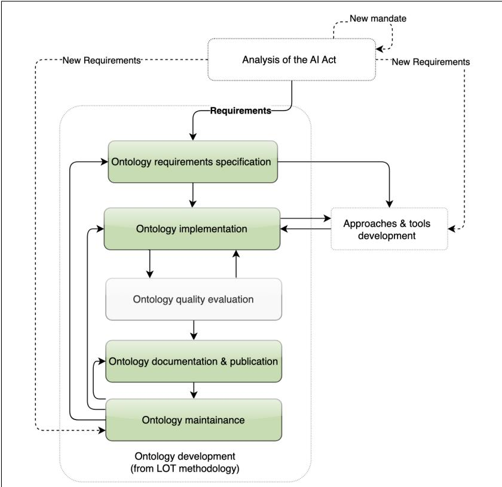
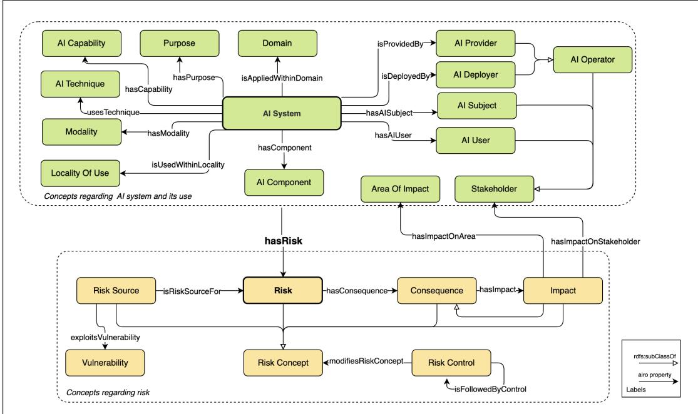
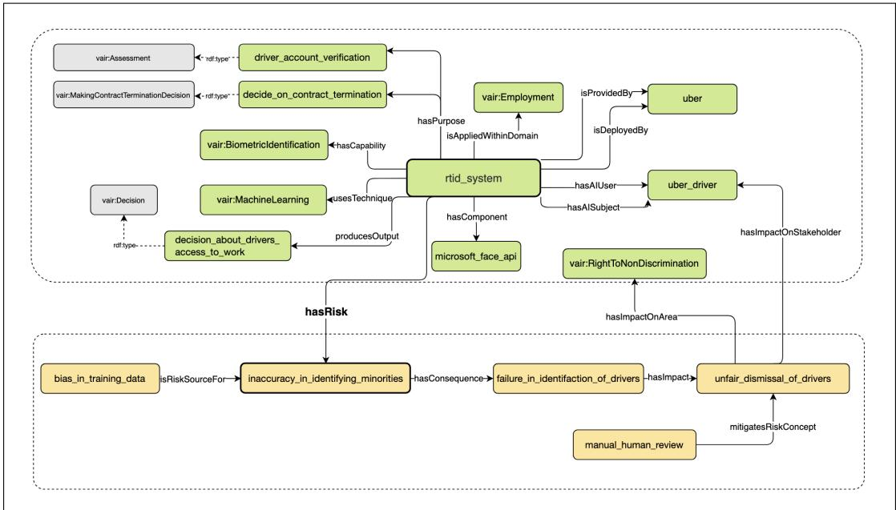
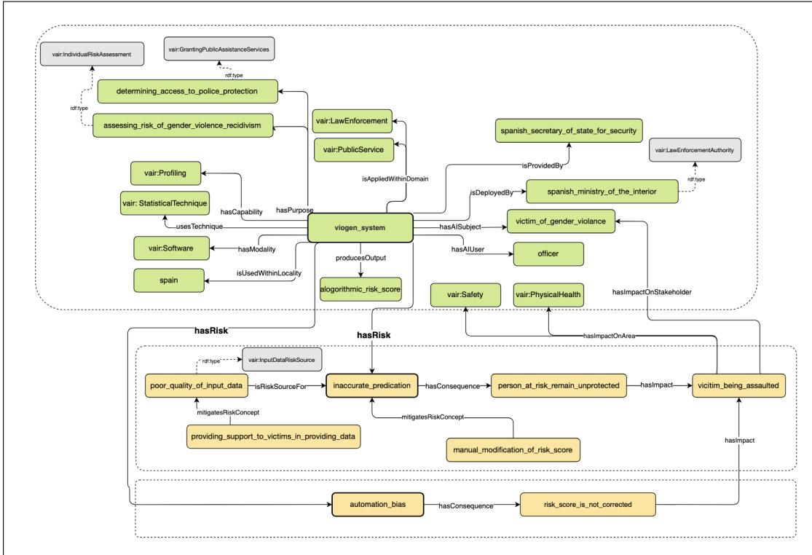
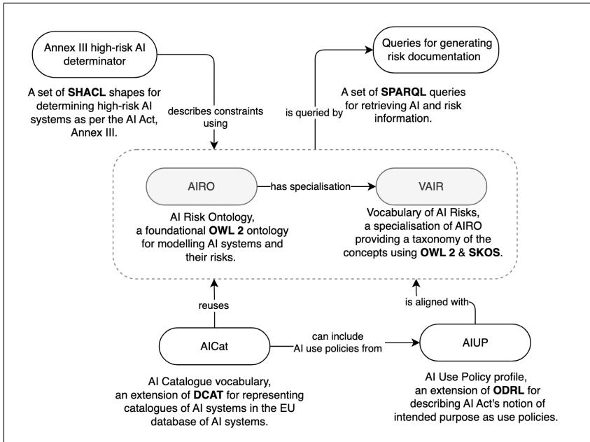

# AI Risk Ontologies for the EU AI Act Compliance: AIRO, VAIR, and their Integration with DPV

Delaram Golpayegani<sup>a,∗</sup>, Harshvardhan J. Pandit<sup>a</sup>, Declan O’Sullivan<sup>a</sup> and Dave Lewis<sup>a</sup>

<sup>a</sup>ADAPT Centre, School of Computer Science and Statistics, Trinity College Dublin, Ireland

## A R T I C L E I N F O

Keywords:   
AI Risk   
EU AI Act   
Ontology   
AI governance   
Legal compliance   
ISO standard

## A BS T RA C T

As the use of AI, and consequently its harms, becomes more prevalent, the global discourse around AI has become increasingly risk-aware. With new risks emerging more frequently than ever, a key challenge is how to represent, document, and catalogue AI risks in an efective, interoperable, and queryable manner. Additionally, the European Union (EU) AI Act’s requirements for“high-risk” AI systems to manage and document the risks creates the need for open and interoperable tools, methods, and standards that facilitate AI risk management in an ever-changing environment. In this paper, we present ontologies and taxonomies developed to assist with risk management and documentation, in line with the requirements of the EU the AI Act. We developed the AI Risk Ontology (AIRO) to specify AI use cases and their associated risks, complemented by the Vocabulary of AI Risks (VAIR), which populates AIRO with taxonomies of concepts. Key international standards on AI and risk, namely ISO/IEC 23894 on AI risk management and ISO/IEC 22989 on AI terminology informed the development of the ontologies. To promote reuse and enable multi-regulatory compliance, AIRO and VAIR have been integrated in the Data Privacy Vocabulary (DPV) through a consensus-building process, expanding DPV’s scope from data to AI.

## 1. Introduction

With the growing body of evidence on harms caused by Artificial Intelligence (AI), the assertion that the use of AI involves risk is no longer contested, though there are diferent school of thoughts on what constitutes AI risk. The global AI discourse is becoming increasingly risk-aware, but still regulating AI is an open question for some jurisdictions prioritising innovation-first views. The European Union (EU) is among those that have taken a precautionary approach towards AI and has become the first jurisdiction that adopted a regulatory framework for AI, called the AI Act [30]. By taking a risk-based approach, the AI Act aims to protect individuals from a broad range of potential AI harms, ranging from risks to health and safety to infringements of fundamental human rights.

Compliance with requirements of the AI Act, including risk management (Article 9) and technical documentation (Article 11), require large volumes of information to be maintained, queried, inferred, and shared. This is particularly challenging as this information should reflect the changes to the system, its components, and its context, all of which may evolve too quickly and frequently. Compounding this challenge, the AI Act itself is subject to change. The Act was enacted in 2024, after 3 years of negotiations between EU institutional triangle—the European Commission, the European Parliament, and the Council of the European Union. Although not all obligations under the AI Act are yet into force (as of July 2026), a set of technical amendments to the AI Act as a part of the Digital Omnibus Package to simplify the EU digital acquis has been entered into force in July 2026 [3]. In addition, the AI Act includes mechanisms to update the regulation, such as amendments to the list of high-risk applications, through delegated acts. While these amendments are intended to keep the AI Act aligned with the rapidly evolving AI capabilities, they introduce uncertainty concerning the legal requirements and the scope of information that should be maintained for ongoing compliance.

Given the importance of AI risks, both within the regulatory framework of the EU AI Act and in the broader context of safe and trustworthy AI, this paper leverages Semantic Web technologies to develop an ontology for describing AI risks, in an interoperable, machine-readable manner. Since AI risk is context-dependent, the ontology aims to provide a semantic model for specifying both AI use cases and their risks. Ensuring extensibility and reusability, the ontology is designed as a high-level, horizontal semantic model, meaning it is not tied to a specific AI technology, application domain, or sector. In addition to adaptability to changes, the ontological approach enables semantic consistency, which is particularly important as the implementation of the AI Act relies on harmonised standards (Article 40). These standards are being developed by European Standardisation Organisations (CEN and CENELEC) and in terms of terminology and definitions are not necessarily fully consistent with the AI Act. Further, utilising Semantic Web technologies ensures machine-readability and in turn interoperability, supporting efective information sharing across the AI value chain and with authorities for conformity assessment purposes.

In this paper, we develop AI Risk Ontology (AIRO) as a FAIR (Finable, Accessible, Interoperable, Reusable) [109] ontology that enables modelling of AI use cases and their risks, in line with the requirement of the EU AI Act. We further develop the Vocabulary of AI Risks (VAIR), as a specialisation of AIRO to include hierarchies of concepts based on the EU AI Act and ISO/IEC standards related to AI risks, including ISO/IEC 22989 on AI concepts and terminology [57], ISO/IEC 23894 on AI risk management [58] and ISO 31073 on risk management vocabulary [55]. To promote creation and maintenance of standards-based and interoperable solutions, we proposed AIRO and VAIR to be integrated into the Data Privacy Vocabulary (DPV) [75], as the stateof-the-art vocabulary grounded in the EU digital regulations and a sustained W3C community resource, through a consensus-driven process within the DPV Community Group (DPVCG). By incorporating AIRO and VAIR, DPV’s scope has been extended beyond data protection to include AI and EU AI Act. The overall methodology, which involved designing the ontologies while the AI Act was still under development and their integration with DPV represents an additional contribution of this paper, providing a manageable and modular approach in constructing consistent and integrable vocabularies for AI risks.

The remainder of the paper is structured as follows: section 2 reviews the state-of-the art ontologies and taxonomies for AI risks. section 3 discusses the ontology engineering methodology, with a focus on dealing with changing legal requirements. Moreover, it provides the best practice to integrate an already-developed ontology into a standardised ontology through a consensus-building process. section 4 and section 6 describe AIRO and VAIR, respectively, with their evaluation provided in subsection 7.4. section 8 discusses how AIRO and VAIR are integrated into DPV. Since initial version of AIRO and VAIR have been published in our earlier work [39, 40], in section 9 we review their uptake both by AI researchers and industry practitioners. Finally, section 10 concludes the paper.

## 2. State of the Art

AI risk is getting more attention than it ever has, and consequently, there has been a surge in studies that identify, analyse, and classify such risks. According to a recent study by MIT FutureTech, at least 74 frameworks for AI risk exists [95]. Without aiming to be exhaustive, in this section, we provide an overview of emerging body of AI risk taxonomies and ontologies. In this overview, acknowledging the growing body of work on specific risk taxonomies, e.g. sector- or technology-specific ones, we emphasis on generic AI risk ontologies, given the scope of the objectives that this paper pursues. Further, as will be shown, despite the vast body of work, most of AI risk taxonomies have been disseminated through research papers, without adopting Linked Open Data principles. However, such taxonomies are included due to the influence they already exerted.

## 2.1. Taxonomies for Cataloguing AI Incidents

With the rise of incidents caused by AI, there have been multiple initiatives focused on cataloguing these incidents within repositories. To serve a diverse set of stakeholders, such repositories usually provide incidents in a structured and annotated format. Therefore, many of existing generic taxonomies for describing AI systems and their risks have grown out of the need to annotate AI incidents. This subsection refers to the most prominent taxonomies derived from or associated with AI incident repositories.

The OECD framework for classification of AI systems [74], is a tool for assessing potential risks and benefits of AI use cases by considering five high-level dimensions: people & planet, economic context, data & input, AI model, and task & output. The framework also incorporates taxonomies for its risk assessment criteria. The AI, Algorithmic, and Automation Incidents and Controversies (AIAAIC) repository<sup>1</sup>, which is an open-access living dataset of more than 2200 AI incidents covered by the media, uses a taxonomy for annotating the incidents. The set of concepts for incident annotation includes categories of sectors, technologies, purposes, and impacts of AI on individuals, society, environment, and providers<sup>2</sup>. An extension of this taxonomy with a focus on AI harms has also been developed, wherein AI harms are classifies into 9 top-level categories and 69 sub-categories [4] . The Center for Security and Emerging Technology (CSET) AI harm framework [48] is a generic customisable framework that has been developed based upon annotating AI incidents through a collaborative process. In its classification of harms, at the top-level it considers the following types of harms: tangible and intangible, and distinguishes between the actual and reasonable potential harm, referring to them as harm event and harm issue, respectively. The framework also enables linking AI harms to the associated AI system and harmed entities. The CSET AI Harm Framework was customised for annotating AI incident database (AIID)<sup>3</sup> [67] with a fine-grained, yet not formal, schema provided in [49]. The Goals, Methods, and Failures (GMF) taxonomy [79] has also been developed based on AIID and used for its annotation. The taxonomy considers three aspects of an AI incident: the AI system’s goals, the technologies used within the system, and technical causes of the incident.

The taxonomy of AI Vulnerability Database (AVID)<sup>4</sup> [101] considers 3 dimension of risks, which are security, ethics, and performance, across the machine learning (ML) development lifecycle. The notable advantage of the AVID taxonomy is the JSON schema, providing better interoperability and extensibility compared to the other taxonomies discussed in this subsection.

## 2.2. AI Risk Taxonomies

In regard to horizontal AI risk taxonomies, Eticas AI Risk Taxonomy [18] includes 10 high-level AI risks, 21 sub-groups representing risk assessment areas and further 70 sub-categories for test scopes. The Eticas taxonomy also includes a mapping to standards and frameworks, including the EU AI Act and ISO/IEC 42001, among others. IBM’s AI risk atlas taxonomy [11] organises AI risks based on where the risk originates, which are training data, inference, output, non-technical, and agentic. Inspired by our previous work, both taxonomies are encoded in machine-readable formats.

The MIT risk taxonomy [95] collates and organises 1,725 risks, extracted from 74 existing taxonomies and frameworks, into two taxonomies: Causal Taxonomy, with categorisation using the sources of the risk, and Domain Taxonomy which focuses on risk consequences and impacts. While the taxonomy is provided in csv format (spreadsheets), it is not represented in a machine-readable format.

To acknowledge the body of work on taxonomies of AI risks with a scope limited to the type of AI system, e.g. LLMs, or the domain of use, e.g. health and without aiming to be exhaustive, in the remainder of this subsection we refer to some promising specific risk taxonomies, which are: Weidinger et al.’s taxonomy of ethical and social risks of LLMs [108], Tanaka et al.’s taxonomy for risks of generative AI systems [100], Lee et al.’s taxonomy of AI privacy risks [63], the Open Loop’s taxonomy of potential harms associated with machine learning applications and automated decision-making systems [10], NIST’s taxonomy for adversarial machine learning [103] and categories of AI Bias [94], Steimers and Schneider’s work on taxonomy of risk sources that impact AI trustworthiness [99], and Roselli et al.’s work on classification of AI bias [85]. It should be noted that these taxonomies have been disseminated in a textual format as a part of research papers, without using any standardised formats.

## 2.3. AI Risk Ontologies

At the time of writing, there is an absence of ontologies that specifically provide a holistic model of AI risks. However, there are state of the art ontologies that address trustworthy AI issues. It should be noted that these ontologies were reviewed as a part of the ontology development process (subsection 4.3) for ontology reuse.

The EA-Ontology<sup>5</sup> [104] has been designed for ethical assessment of emerging technologies, including AI, based on existing approaches for ethical analysis. Within its module for modelling levels of ethical analysis, the concept of ateo:Risk enables modelling risks identified during the ethical assessment and further linking them to ethical issues.

The Ethical AI principles ontology (AIPO) [45] is a semantic model for trustworthy AI principles emerged from diferent guidelines and policies. The ontology models principles as skos:Concept, which enables relating and matching principles through leveraging SKOS relations. Within AIPO, trustworthy AI documents are modelled as dcat:Resource, allowing modelling the details of the document from which the principles are extracted.

The Ai System use Case Explanation oNTology (AS-CENT) [5] is a framework for describing explainable AI measures. The framework includes 3 aspects: (i) technical information about the system that potentially impact explain

AI solutions, (ii) information regarding the context of use that is related to explainability requirements, and (iii) the characteristics of the explanation measures. Within the use case module, a Risk Level (high risk or low risk) is assigned to a task for which the AI system is used, as an indicator of the significance of consequences. ExplainableMLOntology [71] is an ontology aiming to enhance explainability of ML models through a process-oriented viewpoint. The ontology focuses on expressing processes used in the ML development and explanation and includes 3 modules for representing general ML, ML classification, and explanation. FIDES ontology<sup>6</sup> [31] is a minimal semantic model of accountability-related information about statistical ML models. FIDES supports expressing ML models and their data across diferent lifecycle phases.

The Doc-BiasO Ontology [87] has been proposed for expressing and documenting biases across ML/AI workflows. Doc-BiasO comprises a high-level ontology describing the core concepts and relations, with a controlled vocabulary extending the ontology. The Artificial Intelligence Ontology (AIO)<sup>7</sup> [60] has been developed using a hybrid approach which consists of manual ontology development and automated processes empowered by the capabilities of LLMs. AIO consists of 444 concepts related to AI, grouped into 6 modules: networks, layers, functions, LLMs, preprocessing, and bias. Despite being called an ontology, it lacks object properties to model the relations between concepts.

The ontology for standardising trustworthy AI [64] is an ontology for representing and mapping trustworthy AI concepts from diferent emerging AI standards. The ontology provides a way to express activities related to manifestation of AI trustworthiness. Enhancing this ontology, the Trustworthy AI Requirements Ontology (TAIR) [47] has been developed for mapping AI regulations and standards. Requirement is the central element in TAIR, which can be linked to the entities, activities, and agents involved in implementation of the requirement. It further supports modelling the relationships between requirements extracted from diferent AI documents, e.g. for demonstrating how the EU AI Act’s requirements can be satisfied by standards.

Another work on modelling requirements is Sabaliauskaite et al.’s ontology for dual-use regulatory compliance [92], which models regulatory compliance requirements for AI systems that can be used for both civil and military purposes. The ontology models requirements from both civilian and military deployment contexts, drawing on EU digital regulations, such as the AI Act and GDPR, for the former and NATO frameworks, e.g. NIAP, NSP, for the latter.

## 3. Ontology Development Methodology

## 3.1. Scope

The EU AI Act served as the primary knowledge resource for the development of AIRO and VAIR. Since the AI

List of standards used as key sources to assist with interpretation of the AI Act

Act only specifies the essential requirements and relies on the highly-anticipated harmonised standards to assist with interpretation of the Act and provide details for its implementation. At the time of writing, the full list of harmonised standards are not yet published although the deadline for the publication of such standards has passed. To assist with the development of the ontologies, we used ISO/IEC standards relevant to AI risks that are strong candidate for harmonisation, as additional knowledge sources.

Over the course of undertaking this work, the AI Act was undergoing the EU ordinary legislative process [98]. As a result of this process, multiple versions of the Act were published by EU authorities from April 2021 until July 2024. Consequently, this work has evolved over 7 distinct iterations of the AI Act, as listed in the following in chronological order:

1. The European Commission’s proposal [26], published in April 2021,

2. The French Presidency of the Council of the EU’s Consolidated text [21], published in June 2022,

3. The Czech Presidency of the Council of the EU’s General Approach [20], published in November 2022,

4. The European Parliament’s mandate [27], published in June 2023,

5. The provisional agreement [29] resulting from interinstitutional negotiations during the trilogue phase, published in February 2024,

6. The Corrigendum [28], published in April 2024,

7. The final text [30], published in Oficial Journal of the EU in July 2024.

The AI Act introduces requirements for both AI systems and general-purpose AI models. However, this work focuses on AI systems as there is a divergence between risk management process for AI systems and general-purpose AI models under the AI Act. As the AI Act’s regulatory regime is structured around risk, the obligations related to the riskbased classification and risk management are central in compliance with the Act’s requirements for high-risk AI systems. Reflecting this emphasis on risks in the development of ontologies, we focused on risk management, documentation, and information sharing requirements referred to in the articles and annexes listed in Table 1.

Regarding standards, CEN-CENELEC Joint Technical Committee 21 (JTC 21) is working with the European Commission to deliver the requested harmonised standards. This means that harmonised standards in relation to the AI Act are not published yet. In this absence, the ISO/IEC standards listed in Table 2, which are strong contenders for harmonisation, are used in development of the ontologies.

## 3.2. Methodology

The development of both AIRO and VAIR followed the Linked Open Terms (LOT) methodology [80]—a lightweight methodology for developing ontologies and vocabularies in an iterative manner and aligned with industrial development.

## Table 1

List of articles and annexes from the AI Act [30] used as key sources in development of the ontologies
<table><tr><td rowspan=1 colspan=1>Obligationsrelated to</td><td rowspan=1 colspan=1>Sources from the Al Act</td></tr><tr><td rowspan=1 colspan=1>Risk manage-ment</td><td rowspan=1 colspan=1>Article 5 - Prohibited Al practicesArticle 6 - Classification rules for high-riskAl systemsAnnex I - List of Union harmonisationlegislationAnnex III - High-risk Al systems referred toin Article 6(2)Article 9 - Risk management system</td></tr><tr><td rowspan=1 colspan=1>AIand riskdocumenta-tion</td><td rowspan=1 colspan=1>Article 9 - Risk management systemArticle 11 - Technical documentationAnnex IV - Technical documentation re-ferred to in Article 11(1)</td></tr><tr><td rowspan=1 colspan=1>AI and riskinformationsharing</td><td rowspan=1 colspan=1>Article 13 - Transparency and provision ofinformation to deployersArticle 49 - RegistrationArticle 71 - EU database for high-risk Alsystems listed in Annex IIIAnnex VIII - Information to be submittedupon the registration of high-risk Al sys-tems in accordance with Article 49</td></tr></table>

Table 2

<table><tr><td rowspan=1 colspan=1>Obligationsrelated to</td><td rowspan=1 colspan=1>Standards</td></tr><tr><td rowspan=1 colspan=1>Risk manage-ment</td><td rowspan=1 colspan=1>ISO/IEC 23894:2023 - Artificial intelligence— Guidance on risk management [58]ISO 31000:2018 - Risk managementGuidelines [54]ISO 31073:2022 - Risk management —Vocabulary [55]</td></tr><tr><td rowspan=1 colspan=1>AI and riskdocumen-tation    andsharing</td><td rowspan=1 colspan=1>ISO/IEC 22989:2022 - Information technol-ogy — Artificial intelligence — Artificialintelligence concepts and terminology [57]ISO/IEC 42001:2023 - Information technol-ogy — Artificial intelligence — Manage-ment system [59]</td></tr></table>

In creation of the ontologies, we also used Noy and McGuinness’s “Ontology Development 101” guideline [73] to follow best practices.

In development of AIRO and VAIR we followed the four core activities of LOT, while considering additional iterative loops to deal with changing requirements arising from multiple mandates of the AI Act. In addition, due to the importance of ontology evaluation, we consider it as a separate activity from ontology implementation. The steps followed for development of the ontologies are illustrated in Figure 1 and is described in the following:

1. Ontology requirements specification: Based on our analysis of the AI Act, provided in our previous work, the functional requirements are specified in 4 sets of competency questions addressing (a) identification of high-risk AI systems [40], (b) describing intended purpose of AI systems [37], (c) documentation of AI and risk information [38], and (d) registration of highrisk AI systems into the EU database [41]. These are defined based on the scope of our research and towards developing Semantic Web-based approaches and tools for compliance with the EU AI Act’s risk management and documentation obligations.

  
Figure 1: Ontology development methodology

2. Ontology implementation: In this phase, the concepts, their definitions, and relations are primarily derived from the AI Act. As discussed in subsection 3.1, where the details required for satisfying the competency questions are not provided by the AI Act, the information modelling utilises ISO/IEC standards. To ensure transparency and traceability, the sources from which the definitions are derived are encoded using dcterms:source. The ontologies are encoded in OWL 2 Web Ontology Language [107] using Protégé ontology editor [70]. Additionally, for representing concepts in VAIR, the W3C SKOS data model [69] is used. In the encoding process, existing vocabularies for describing metadata and existing relevant ontological resources are reused (see subsection 4.3).

3. Ontology evaluation: AIRO and VAIR are evaluated against the competency questions to ensure their sufficiency in addressing those questions. Their quality is ensured by following the W3C Data on the Web Best

Practices [66], and FAIR best practices for vocabularies and ontologies [36]. They are tested iteratively using OOPS! (OntOlogy Pitfall Scanner!) [81] and FOOPS! (ontology pitfall scanner for FAIR principles) [35], as will be discussed in subsection 7.4. AIRO and VAIR are also evaluated through their application in modelling AI use cases and their associated risks (see subsection 7.1). In addition, their applicability in diferent compliance tasks is demonstrated in our further work on (a) determining Annex III high-risk AI systems [40], (b) expressing AI intended purposes within a use policy [37], (c) documentation of AI and risk information [38], and (d) cataloguing AI systems for registration into the EU database [41].

4. Ontology documentation andpublication: The HTML documentation is created in a semi-automated process using the ReSpec template<sup>8</sup>— a common template for W3C specifications. WIDOCO [34], a well-known tool for automated generation of ontology documentation, is not used due to its limitations in supporting grouping of taxonomies of concepts [75]. Both AIRO and VAIR use permanent URLs (PURLs) using the W3ID service<sup>9</sup> and are made available online at https: //w3id.org/airo and https://w3id.org/vair under the CC-BY-4.0 license<sup>10</sup>, allowing free reuse, distribution, and modification conditioned upon appropriate attribution. Both ontologies are indexed in the Linked Open Vocabularies (LOV) registry<sup>11</sup> and published in Zenodo for better findability and accessibility.

5. Ontology maintenance: As mentioned earlier, during the time the development ontologies have been carried out, the AI Act was undergoing the legislative process and therefore the requirements and concepts derived from the Act needed revisions after publication of each mandate. Additionally, multiple drafts of the relevant ISO/IEC standards were published over the course of development of the ontologies, which to some extent influenced the ontology design. AIRO and VAIR were iteratively updated following the LOT methodology, with additional iteration cycles. While all the changes were recorded through GitHub commit history, multiple versions were not released, as the aim of this work was to provide a first stable released aligned with the final version of the AI Act, rather than modelling its legislative evolution.

## 4. AI Risk Ontology (AIRO)

AIRO provides a formal representation of AI systems and their risks as per the EU AI Act. As emphasised before, the AI Act only defines essential requirements and relies on future harmonised standards and common specifications for supporting its interpretation and implementation. With no such standards available at the time of writing, AIRO uses existing international standards as sources to extract concepts and their relations.

## 4.1. Iterative Development of AIRO

The first iteration of the development, in 2021, employed the following standards from ISO’s well-known 31000 series on risk management: ISO 31000:2018 on risk management guidelines [54] and ISO Guide 73:2009 on risk management vocabulary [53], which was later replaced by ISO 31073:2022 Risk management — Vocabulary [55]. This replacement required the sources (dct:source) to be updated, however it did not impact the design of AIRO. With oficial publication of ISO/IEC 22989 [57] in 2022, the AI concepts and definitions were revised. While the terms used within the AI Act and ISO/IEC 22989 are overlapping, in some cases definitions and taxonomical relations are not exactly the same. In the process of development, the AI Act served as the primary resource and therefore definitions from standards were used when there was a lack of definition for a specific concept in the AI Act. Another round of revision was conducted when ISO/IEC 23894 [58] on AI risk management was published in 2023. Given that this standard relies on the definitions provided in ISO 31000:2018, ISO 31073:2022, and ISO/IEC 22989:2022, AIRO’s concepts and definitions did not require any changes to be aligned with ISO/IEC 23894. In addition to the aforementioned standards, the definitions provided in ISO/IEC TR 24028:2020 — Overview of trustworthiness in artificial intelligence [56] were used for some of the AI-related concepts. Further, the definition for Standard was extracted from Regulation (EU) No 1025/2012 on European standardisation [1], as the AI Act relies on the definition of harmonised standards in this regulation. Table 3 shows the non-ontological sources from which definitions for AIRO concepts were extracted. To ensure traceability, from the Dublin Core Metadata Terms [24], dct:source is used to link the concepts to the source wherein they are defined.

In addition to the iterations triggered by publication of standards, AIRO was revised throughout the AI Act’s ordinary legislative process to incorporate the changes introduced in diferent phases. The extent of changes to AIRO’s concepts and relations were minimal, primarily afecting the definitions extracted from Article 3 of the Act.

It should be noted that in the process of ontology development, initially all the concepts were included in a single ontology. As the ontology expanded with population of the concepts, it became less reusable and more complex to manage. Therefore, the ontology was broken down into a minimal ontology (AIRO), that provides foundational concepts and relations, and a separate vocabulary (VAIR) extending AIRO with hierarchies of instances.

## 4.2. AIRO Overview

AIRO’s core concepts and relations are illustrated in Figure 2. The upper half shows the main concepts required for describing a specific use of an AI System (green boxes), and the lower half represents key concepts for expressing Risk (yellow boxes). The relation hasRisk links these two halves by connecting risk to an AI system or a component of the system. AIRO incorporates 56 classes, 61 object properties, and 3 data properties. 10 of the concepts, 9 of the object properties, and all of the data properties are reused from existing ontologies (see subsection 4.3 for details).

The core concepts related to the use of an AI system are as follows:

• Domain: indicates the area, sector, or industry in which the AI system is used.

• Purpose: specifies end goal for which the system is used.

• Locality Of Use: specifies the locality the system is designed to be used within, e.g. publicly accessible spaces.

• AI User: refers to any individual or group that interacts with a system (ISO/IEC TR 24028, 3.43).

• AI Subject: represents an entity that is subject to or impacted by the use of AI.

Regarding technical details, the key concepts are:

• AI Technique: refers to computer science approaches and techniques used in development of a system, e.g. supervised machine learning.

Table 3  
Non-ontological sources of AIRO
<table><tr><td rowspan=1 colspan=1>Source</td><td rowspan=1 colspan=1>No.  ofconcepts</td><td rowspan=1 colspan=1>AIRO Concepts</td></tr><tr><td rowspan=1 colspan=1>The Al Act, Article 3</td><td rowspan=1 colspan=1>5</td><td rowspan=1 colspan=1>AI System, AI Operator, AI Deployer, AI Provider, General Purpose AIModel</td></tr><tr><td rowspan=1 colspan=1>ISO 31073:2022 [55]</td><td rowspan=1 colspan=1>8</td><td rowspan=1 colspan=1>Risk Source, Hazard, Threat, Vulnerability, Consequence, Risk Control,Frequency, Likelihood</td></tr><tr><td rowspan=1 colspan=1>ISO/IEC 22989:2022 [57]</td><td rowspan=1 colspan=1>3</td><td rowspan=1 colspan=1>AI Component, Stakeholder, AI Developer</td></tr><tr><td rowspan=1 colspan=1>ISO/IEC TR 24028:2020 [56]</td><td rowspan=1 colspan=1>2</td><td rowspan=1 colspan=1>AI User, AI Model</td></tr><tr><td rowspan=1 colspan=1>Regulation (EU)No 1025/2012 on Europeanstandardisation [1]</td><td rowspan=1 colspan=1>1</td><td rowspan=1 colspan=1>Standard</td></tr></table>

  
Figure 2: Overview of AIRO’s main concepts and relations

• AI Capability: refers to the capability of an AI system that enables realisation of the system’s purposes, e.g. facial recognition.

• AI Component: specifies incorporating components of the system.

• Modality: indicates the way or type in which the system exists, e.g. service.

The key actors involved in the AI development and deployment that are modelled in AIRO are as follows:

• AI Provider: is a natural or legal person, public authority, agency or other body that develops an AI system or a general-purpose AI model or that has an AI system or a general-purpose AI model developed and places it on the market or puts the AI system into service under its own name or trademark, whether for payment or free of charge (EU AI Act, Article 3(3)).

• AI Deployer: is any natural or legal person, public authority, agency or other body using an AI system under its authority except where the AI system is used in the course of a personal non-professional activity (EU AI Act, Article 3(4)).

• AI Developer: is an organisation or entity that is concerned with the development of AI services and products (ISO/IEC 22989, 5.19.3.2).

• AI Operator: refers to a provider, product manufacturer, deployer, authorised representative, importer or distributor (EU AI Act, Article 3(8)).

Concerning risk, the key concepts are:

• Risk: The AI Act defines risk as “the combination of the probability of an occurrence of harm and the severity ofthat harm”. Risk in ISO 31073 is defined as “efect ofuncertainty on objectives”, with a note indicating that the efect can be negative, positive, or both. While both definitions provide quantitative perception of risk, ISO 31073 considers a broader scope of efects by including positive impacts, compared to the AI Act that only focuses on harms, i.e. negative efects. On another hand, the AI Act’s definition of risk, together with the language used throughout its text, indicates a focus on harm to fundamental rights, health, and safety, whereas ISO focuses on broad organisational objectives. In AIRO, we propose a novel definition of Risk as the state of uncertainty associated with an AI system, that has the potential to cause harms and is expressed in terms of risk sources, consequences, impacts, likelihood, and severity. To associate a specific risk to an AI system or a component of the system, we defined the hasRisk relation.

• Vulnerability: refers to properties of an entity, e.g. AI system or AI component, resulting in susceptibility to a risk source (ISO 31073:2022, 3.3.21 with modifications).

• Risk Source: indicates the element which alone or in combination has the potential to give rise to risk (ISO 31073:2022, 3.3.10). Threat and Hazard are both types of risk sources that have potential to cause harm.

• Consequence: is the direct outcome of a risk that afects objectives (ISO 31073:2022, 3.3.18, event is replaced with risk for better accuracy).

• Impact: represents the outcome of a consequence on individuals, groups, society, and environment. While consequence indicates the direct outcome of a risk on objectives, which may or may not involve external entities, the notion of impact puts emphasis on the efect and influence on individuals, groups, and society. This distinction addresses the concern raised by Soler et al. [96] in regard to non-alignment of ISO/IEC and AI Act, rooted in organisation-focused view of risks in ISO/IEC documents that misses the AI Act’s centre of attention: the efect of AI on individuals’ health, safety, and fundamental rights.

• Risk Control: ISO 31073 defines risk control as a measure that maintains and/or modifies risks<sup>12</sup>. In AIRO, risk control is not restricted to risks and indicates a measure that is applied to detect, mitigate, or eliminate risk sources, risks, consequences, or impacts.

To enhance flexibility in modelling various AI use cases, domain or range of some properties are not restricted to any concepts, for example for airo:hasRisk, no domains is specified. Another design decision made concerning object properties in AIRO is the exclusion of inverse relations to avoid redundancy and maintain simplicity. AIRO is published online at https://w3id.org/airo<sup>13</sup> under the CC-BY-4.0 license and is indexed in the linked open vocabularies (LOV) registry at https://lov.linkeddata.es/dataset/lov/ vocabs/airo.

## 4.3. Ontology Reuse

In addressing competency questions, as per established Semantic Web practices, where more specialised and wellknown open ontologies exists, appropriate concepts and relations are reused from them, rather than modelling them from scratch. In AIRO, classes and properties from Data Protection Vocabulary (DPV)<sup>14</sup> [75], Data Quality Vocabulary (DQV)<sup>15</sup> [8], Data Catalog Vocabulary (DCAT) [7], and DCMI Metadata Terms [24] are reused. The list of reused concepts and properties is presented in Table 4.

## 5. VAIR: A Vocabulary of AI Risks

The high-level model provided by AIRO is not sufficient for annotating AI use cases, expressing rules for identification of the AI Act’s high-risk AI systems, and documenting and registering AI and risk information. These require enriching AIRO with specialisations of concepts that are represented formally and organised in hierarchies. The Vocabulary of AI Risks (VAIR) is a specialisation of AIRO, providing a taxonomy for expressing and exchanging information regarding AI systems and their risks aligned with the requirements of the AI Act.

## 5.1. Iterative Development of VAIR

As previously mentioned, the first version of AIRO included key concepts plus their specialisations, which were modelled as sub-classes. However, emergence of new standards and publication of multiple AI Act mandates have shown that while the key top-level concepts remain largely intact, new sub-classes are likely to be iteratively identified from multiple sources as the understanding of AI risks evolve over time.

Therefore, the instances were de-integrated from AIRO and provided under the VAIR namespace. In this modular structure, AIRO acts as a foundational ontology, including only key high-level concepts and relations, while VAIR serves as a specialisation of AIRO that contains a taxonomy of these key concepts. This design decision contributes to better reusability of AIRO and VAIR, in particular for creating domain-specific risk taxonomies.

VAIR was updated iteratively, upon publication of different mandates of the AI Act. In addition to the AI Act, the EU AI Watch’s<sup>16</sup> AI taxonomy [91, 90] and ISO/IEC 22989:2022 on AI terminology [57] were used to further populate VAIR.

Providing an exhaustive and commonly-agreed taxonomy in this work was not practical, firstly, due to the extensive state of the art and non-Semantic Web eforts to build AI risk taxonomies. Secondly, building such a taxonomy requires involvement of stakeholders to build consensus around the taxonomy. Therefore, VAIR focuses on inclusion of the concepts that are essential to satisfy the competency questions and are needed for implementing the Semantic

Table 4 Ontologies reused in AIRO
<table><tr><td rowspan=1 colspan=1>Source</td><td rowspan=1 colspan=1>Classes</td><td rowspan=1 colspan=1>Object properties</td><td rowspan=1 colspan=1>Data properties</td></tr><tr><td rowspan=1 colspan=1>DCAT</td><td rowspan=1 colspan=1>dcat:Dataset</td><td rowspan=1 colspan=1>None</td><td rowspan=1 colspan=1>None</td></tr><tr><td rowspan=1 colspan=1>DPV</td><td rowspan=1 colspan=1>dpv:Processing,     dpv:Data,dpv:SensitiveData,dpv:DataSource,dpv:DataSubject,dpv:LegalBasis</td><td rowspan=1 colspan=1>dpv:hasProcessing,dpv:hasData,dpv:hasDataSource,dpv:hasDataSubject,dpv:hasLegalBasis</td><td rowspan=1 colspan=1>None</td></tr><tr><td rowspan=1 colspan=1>DQV</td><td rowspan=1 colspan=1>dqv:QualityMeasurement,dqv:Metric, dqv:Dimension</td><td rowspan=1 colspan=1>dqv:hasQualityMeasurement,dqv:isMeasurementOf,dqv:inDimension,dqv:expectedDataType</td><td rowspan=1 colspan=1>dqv:value</td></tr><tr><td rowspan=1 colspan=1>DCT</td><td rowspan=1 colspan=1>None</td><td rowspan=1 colspan=1>None</td><td rowspan=1 colspan=1>dct:date,dct:title</td></tr></table>

Web approaches that are in the scope of this work. After the publication of the final version of the AI Act in 2024, certain concepts previously extracted from diferent mandates of the Act were no longer essential for addressing the competency question. For example, changes to the list of high-risk AI applications in Annex III led to removal of some Purposes, however, these concepts were intentionally retained in VAIR for better comprehensiveness.

Regarding stakeholders’ involvement in the development process, as will be discussed in section 8, both AIRO and VAIR were proposed to the W3C Data Privacy Vocabularies and Controls Community Group<sup>17</sup> (DPVCG) and has been included in DPV through a consensus-based process.

## 6. Overview of VAIR

VAIR is a hierarchical taxonomy, providing a specialisation of AIRO’s concepts and therefore serves as a vocabulary for expressing AI use cases in an interoperable manner. VAIR is provided as an OWL 2 ontology where the concepts are defined using both skos:Concept and rdfs:Class, with hierarchical relations between them modelled using rdfs:subClassOf. This promotes extensibility and reusability by enabling the concepts to be used as both instances and classes in specification of an AI system.

In total, VAIR includes 402 classes, with the following thematically-categorised taxonomies:

• AI: contains taxonomies of techniques (number of instances in the taxonomy: 17), capabilities (32), types of AI systems (13), components (23), lifecycle phases (10), modality (4) and outputs (5).

• Use of AI: includes taxonomies for defining AI use cases namely purposes (118) and domains (11). In addition, 7 levels of automation, 6 types of human involvement, and 6 modes of output controllability are included.

• Risk: contains taxonomies of risk sources (44), consequences (4), impacts (5), risk controls (20), and areas ofimpact (7).

• Stakeholder: contains types of AI operators (17) and AI subjects (17), mainly extracted from Annex III of the AI Act.

• Document and standard: contains a list of documentation (13), including those required for conformity assessments, and standards (23) that can potentially be used in implementation of the AI Act.

VAIR is published online as an open resource under the CC-BY-4.0 license at https://w3id.org/vair and is indexed in LOV at https://lov.linkeddata.es/dataset/lov/vocabs/ vair<sup>18</sup>.

## 7. Evaluation

## 7.1. Demonstartion of Applicabilty through Proof Of Concept

In this section, we demonstrate the applicability of AIRO and VAIR in modelling AI use cases and their associated risks. To this end, one synthetic use case was created and two incidents from the AIAAIC were selected, based on the following criteria:

• The initial analysis of the use case demonstrates that it is highly likely to be classified as high-risk as per Annex III,

• The domains in which the systems are used should not overlap. This is to demonstrate the capability of the ontologies to be used in and/or extended for various domains,

• Diversity in types of harmful impacts is preferred in order to include harms to health, safety, and fundamental rights.

• For use cases selected from the AIAAIC reposi tory, documentation that provides detailed information about the AI system and its risks should be available. In this, topicality of the use case is preferred.

Based on these criteria, the following use cases were selected to be modelled:

• Use case #1: Proctify: is a synthetic, but realistic, AI-based student proctoring tool, inspired by the use cases described in [78] and [50]. It is a potentially high-risk AI use case in the education domain as per Annex III, Point 3(d). This use case has been designed to show the potential of AIRO and VAIR, without being restricted to model the information provided by third-parties.

• Use case #2: Uber’s Real Time ID (RTID) (incident ID = AIAAIC0756): is a system to verify the identity of Uber drivers using facial recognition. This incident was selected as an example of AI systems used in the employment domain (Annex III, Point 4). The system has negatively afected certain demographics and has led to violation of fundamental rights.

• Use case #3: The Spanish Ministry of the Interior’s AI system (VioGén) (incident ID = AIAAIC0848): is an AI system that is being used for assessing risk of domestic violence. This use case is related to both public services (Annex III, Point 4) and law enforcement (Annex III, Point 6) domains. The incidents caused by VioGén have already impacted health and safety of victims of gender violence.

In the modelling process, each use case was initially annotated manually using AIRO. If the identified individual, which was annotated as an rdf:type of an AIRO concept, belonged to a more specific class in VAIR, then it was defined as rdf:type of that specific VAIR class. If the individual matched an owl:NamedIndividual in VAIR, it was replaced with the corresponding VAIR concept. It should be emphasised that our aim here is to show applicability of AIRO and VAIR in modelling use cases, rather than illustrating their comprehensiveness, given that development of comprehensive AI risk ontologies was not feasible.

In the following we provide short description of each use case, alongside their machine-readable specifications using AIRO and VAIR.

## 7.1.1. Use Case #1: Proctify

Proctify is designed to detect suspicious behaviour during online exams by analysing facial behaviour from a student’s facial video captured throughout the exam using a webcam. The system incorporates a graphic interface displaying an analysis of the student’s face including the head pose, gaze direction, and face landmarks’ positions. This extracted information is then provided as an input to SusBehaved-Model, which has been trained in-house by the system’s provider using SusBehavedDataset, to determine whether the student is displaying suspicious behaviour, e.g. looking away from the screen, leaving the room, or a third person detected in the room. Detection of suspicious behaviour raises an alarm in the interface to inform and let the human oversight actors, e.g. human instructors, take appropriate actions, e.g. communicating with the student.

A snippet of the machine- readable specification is provided in Listing 1. The comprehensive machine-readable representation of Proctify using AIRO and VAIR in Turtle serialisation is available online on GitHub<sup>19</sup>.

```rdf
@prefix ex: <https://example.com/proctify#> .
2 @prefix airo: <https://w3id.org/airo#> .
@prefix vair: <https://w3id.org/vair#> .
4 @prefix rdf: <http://www.w3.org/1999/02/22-rdf-syntax-ns#> .
5 @prefix dcterms: <http://purl.org/dc/terms#> .
6 @prefix xsd: <http://www.w3.org/2001/XMLSchema#> .
@prefix d h // / /d
8 ex:proctify
9 a airo:AISystem ;
10 airo:hasVersion ex:v_1.0.2 ;
11 dcterms:date "2023-09-11"^^xsd:date ;
12 airo:hasModality vair:Software ;
13 airo:usesTechnique vair:DeepLearning ;
14 airo:hasInput ex:facial_video ;
15 airo:producesOutput ex:suspicious_behaviour_alarm ;
16 airo:isProvidedBy ex:AIEduX ;
17 airo:isDevelopedBy ex:AIEduX ;
18 airo:hasComponent ex:facial_analysis_toolkit,
19 ex:susbehaved_dataset ;
20 airo:hasModel ex:susbehaved_model ;
21 airo:isAppliedWithinDomain vair:Education ;
22 airo:hasPurpose vair:DetectingProhibitedBehaviourDuringTest,
23 ex:facial_behaviour_analysis,
24 ex:video_analysis ;
25 airo:hasCapability ex:facial_recognition ;
26 airo:isDeployedBy ex:university ;
27 airo:hasAutomationLevel vair:PartialAutomation ;
28 airo:hasAISubject vair:Student,
29 ex:other_occupant ;
30 airo:hasAIUser ex:instructor ;
31 airo:hasRisk ex:inaccuracy_risk_for_darker_skin ;
32 airo:hasRiskControl ex:bias_testing ;
33 dqv:hasQualityMeasurement ex:alarm_precision_measurement,
34 ex:alarm_recall_measurement,
35 ex:alarm_f_score_measurement
36 airo:hasPreDeterminedChange ex:change_of_model ;
37 airo:compliesWithRegulation ex:EU_GDPR ,
38 ex:Irish_Data_Protection_Act ;
39 airo:conformsToStandard vair:ISOIEC42001_2023 ,
40 vair:ISOIEC27001_2022 .
```  
Listing 1: A snippet of machine-readable provision of Proctify in Turtle

## 7.1.2. Use Case #2: Uber’s Real-time ID Check System

Uber’s facial recognition identification system, known as the Real Time ID (RTID), aimed to ensure that the driver’s account is not used by anyone other than the registered Uber driver. When the system failed to recognise a person for two consecutive times, the driver’s contract would be terminated and their driver and vehicle licenses would be revoked. Multiple incidents were reported concerning the system’s failure in verifying drivers, in particular those belong to ethnic minorities or vulnerable groups, leading to unfair dismissal of drivers (vide [68] and [102]). This system can be considered high-risk as per Annex III, Point 4(b) as it is used to “make decisions afecting terms of workrelated relationships”. Figure 3 depicts the graph expressing Uber’s Real-time ID Check use case using AIRO and VAIR, with the machine-readable specification available online on GitHub<sup>20</sup>.

  
Figure 3: Visual representation of the graph specifying the Uber’s Real-time ID Check use case

## 7.2. Use Case #3: VioGén Domestic Violence Risk Assessment System

VioGén System is used by the Spanish law enforcement agencies to determine the victim’s eligibility for police protection by assessing the likelihood of a victim of gender violence to be assaulted by the same perpetrator again [9]. Its use of statistical models to predict the risk faced by a victim raised questions regarding the accuracy of its predictions since these would be highly dependent on the quality of data fed into the models. The input data was generated based on a questionnaire answered by victims who filed a report. The ambiguity of questions and timing of questionnaire could have lead to inaccurate or biased predictions, and if the score was not modified by police oficers, the victims would not receive the police protection they need. To address this risk, police oficers were granted the power to increase the risk score calculated by the system. However, according to [2], in most cases the oficers trusted the system’s scoring despite warning signs, which led to “automation bias”, i.e. over-reliance on the system’s outcomes. Under the AI Act, VioGén is likely to be high-risk as it is used by the police to assess the “risk of a natural person becoming the victim of criminal ofences” (Annex III, Point 6(a)). It also can fall under the high-risk AI systems used by public authorities to “evaluate the eligibility of natural persons for essential public assistance” (Annex III, Point 5(a)), in this case police protection. The graph expressing the VioGén use case is provided online on GitHub<sup>21</sup> and is illustrated in Figure 4.

## 7.3. Demonstration of Applicability thorough Semantic Web-based Applications

AIRO and VAIR are both used in implementation of a set of approaches to assist with AI Act compliance tasks utilising diferent technologies from the stack of Semantic Web technologies and existing W3C standards. As described in detail in [42], these approaches include:

1. A set of SHACL shapes [61] for determining Article 5 prohibited and Annex III high-risk AI systems as per Annex III,

2. AIUP (AI Use Policy) profile that extends the Open Digital Rights Language (ODRL) [51] to describe intended, precluded, and conditions of AI use as described by the AI Act,

3. A set of SPARQL [44] queries to generate risk management documentation and technical documentation according to Annex IV,

4. AICat as an extension of DCAT [7] for cataloguing AI systems and their components in AI registries including the the EU database of high-risk AI systems.

Although this paper does not apply AIRO and VAIR in real world settings, they have already been adopted in several academic and industry projects (see section 9), demonstrating their applicability and usability in practice.

## 7.4. Quality Assessment

Quality assessment of AIRO and VAIR was carried out in accordance with the following criteria:

  
Figure 4: Visual representation of the graph specifying the VioGén use case

  
Figure 5: The set of Semantic Web-based artefacts built upon AIRO and VAIR, as detailed in [42]

1. Syntax validity and logical consistency: Throughout the development process, the syntax was checked using Protégé. Logical consistency was tested using build-in Protégé reasoners including FaCT++ 1.6.5 and HerMiT 1.4.3.

2. Adherence to ontology development best practices: In addition to following LOT as an ontology development methodology, quality of AIRO and VAIR was ensured by following best practices and guidelines from the Semantic Web community, including the W3C’s Data on the Web Best Practices [66], the W3C Recipes for Publishing RDF Vocabularies [13], FAIR best practices for vocabularies and ontologies [36], and WIDOCO best practices for ontology documentation [34].

3. Freedom from common ontology pitfalls: OOPS! (OntOlogy Pitfall Scanner!) [81], was used to detect and further resolve common errors and pitfalls of

AIRO and VAIR. The key unresolved pitfalls raised by OOPS! concerned the following:

• Missing annotations: It was raised due to the absence of definitions for those classes and properties reused from other ontological resources.

• Missing disjointness: This issue was raised as disjointness between some classes are not defined, given that they can share individuals.

• Missing domain or range in properties: This pitfall addressed the deliberate design decision, discussed in subsection 4.2, to enhance AIRO’s flexibility in modelling AI use cases by not restricting domain or range for some properties.

• Inverse relationships not explicitly declared: This issue addressed the lack of inverse relations (owl:inverseOf) between object properties. This was intentional to keep AIRO minimal and simple.

• Equivalent classes not explicitly declared: This was a false positive, incorrectly identifying equivalent classes.

4. FAIRness: Adherence of the ontologies to FAIRness principles was evaluated using FOOPS! [35]. The fairness scores for both AIRO and VAIR, as calculated by the FOOPS! web service<sup>22</sup>, showed their full compliance with FAIRness principles for ontologies.

## 8. Integration of AIRO and VAIR with DPV

At the time ofdeveloping AIRO and VAIR, DPV [77, 75] represented the state-of-the-art in machine-readable vocabularies for representing personal data processing based primarily on the GDPR, and its use to develop specifications for tasks such as consent management [76] and maintaining records of processing activities [89]. This reflected the scope through which the DPVCG was established in 2019, and the consensus of its members in developing DPV over the years. When developing AIRO and VAIR, the authors identified several overlaps in concepts, such as data, which have been discussed earlier in this paper. Based on this, the authors opened discussions within the DPVCG regarding its scope and how to address ’AI’ as a technology and its regulation. After deliberations, the group agreed to expand its scope to include AI as a form of technology, and to restructure the DPV into several modular groups or ‘extensions’, such as to represent AI and laws such as GDPR, AI Act [75]. Following this, concepts from AIRO and VAIR were proposed and accepted towards creating new extensions and enriching existing ones as follows:

• The EU AI Act extension $( \mathsf { E U - A I A C T } ) ^ { 2 3 }$ was created;

• The AI extension $( \mathsf { A I } ) ^ { 2 4 }$ was created;

• The Technology extension (TECH) <sup>25</sup> was expanded;

• The Risk extension $\left( \mathsf { R I S K } \right) ^ { 2 6 }$ was expanded.

The integration of AIRO and VAIR represented the first instance of an ‘major externally developed resource’ being integrated into the DPV, as prior to this the group worked on specific concepts based on strictly scoped taxonomies such as data categories. It also represented the first instance of developing additional vocabularies for a new law (AI Act) while trying to maintain the legal relevance (GDPR). In turn, the integration and DPVCG’s consensus led process provided AIRO and VAIR an additional measure of ontology assessment as the group had to accept not only the concepts but also their relevance within the larger DPV-based vocabularies. The DPVCG also provides discoverability and findability as the DPV already has strong adoption, including use in standards, and a cycle for continuous maintenance based on stakeholder engagement. More importantly, it lays the ground for development of RegTech solutions that facil itate tasks related to compliance with multiple AI and data regulations using a single vocabulary.

Integration into DPV does not preclude the independent use of AIRO and VAIR. As discussed in the following section, these ontologies are valuable in their own right, since their narrower, single-purpose scope makes them simpler to reuse.

## 9. Impacts and Uptake of AIRO and VAIR

This research has been continually progressed with the AI Act’s development process, until it was oficially accepted as an EU law and published in the Oficial Journal of the European Union in July 2024. Consequently, the results of this work have increasingly attracted interest from the academics and wider audiences. To identify the impacts of AIRO and VAIR, we analysed the studies citing our prior publications on these two ontologies, namely [39] and [40] indexed by Google Scholar, as of July 2026. After excluding first-author self-citations, non-English publications, duplicates, and papers without accessible full text, a total of 121 studies, including papers (both peer-reviewed and non-peerreviewed) and theses were analysed: 63 citing AIRO and 58 citing VAIR, with 10 appearing in both sets. The analysis aimed to determine why and how AIRO or VAIR were used. Our analysis identified seven categories of citation and reuse:

1. Background information: our papers were cited to support statements related to the AI Act, AI risks, AI incidents, or relevant standards. Citations in this category typically referred to our work as a supporting reference for a minor legal or factual point and do not engage with our core contributions.

2. Related work: our papers were cited as state-of-theart ontologies, semantic frameworks, or approaches to risk management or AI Act compliance.

Table 5  
An overview of citation to AIRO and VAIR
<table><tr><td rowspan=1 colspan=1>Paper</td><td rowspan=1 colspan=1>No.    ofworksanalysed</td><td rowspan=1 colspan=1>1.Back-ground in-formation</td><td rowspan=1 colspan=1>2. Relatedwork</td><td rowspan=1 colspan=1>3. Legalanalysisreuse</td><td rowspan=1 colspan=1>4.Ontologyreuse</td><td rowspan=1 colspan=1>5. Method-ologyadoption</td><td rowspan=1 colspan=1>6.Evaluationof contri-butions</td><td rowspan=1 colspan=1>7. Futurework</td></tr><tr><td rowspan=1 colspan=1>AIRO [39]</td><td rowspan=1 colspan=1>63</td><td rowspan=1 colspan=1>9</td><td rowspan=1 colspan=1>36</td><td rowspan=1 colspan=1>3</td><td rowspan=1 colspan=1>22</td><td rowspan=1 colspan=1>1</td><td rowspan=1 colspan=1>0</td><td rowspan=1 colspan=1>3</td></tr><tr><td rowspan=1 colspan=1>VAIR [40]</td><td rowspan=1 colspan=1>58</td><td rowspan=1 colspan=1>21</td><td rowspan=1 colspan=1>23</td><td rowspan=1 colspan=1>14</td><td rowspan=1 colspan=1>8</td><td rowspan=1 colspan=1>1</td><td rowspan=1 colspan=1>2</td><td rowspan=1 colspan=1>1</td></tr></table>

3. Reuse of ontologies: AIRO, VAIR, or both were reused as Semantic Web artefacts, whether imported directly as machine-readable vocabularies or drawn upon as human-readable concept catalogues.

4. Reuse of legal analysis: our interpretation of the AI Act was used in the citing study. In particular, the fiveconcept structure for determining Annex III high-risk AI systems (domain, purpose, capability, AI user, AI subject) has be received very-well by the community. We categorised these studies into legal analysis categories, however they can also be considered as an ontology reuse at a conceptual level.

5. Adoption of the ontology development approach: our iterative and modular methodology for designing ontologies under uncertainty was adopted to construct ontologies.

6. Evaluation of contributions: the citing study evaluates the ontologies or validates our legal analysis.

7. Planned future use: the citing study stated an intention to adopt or integrate AIRO, VAIR, or both in the future work.

Table 5 summarises the distribution of citing works across theses seven citation categories. Note that a single work may fall into more than one category where it draws on our contributions in multiple ways, for example both mentioning AIRO as related work and reusing it within their ontology. As the table shows, related work constitutes the largest share of citations, while methodology adoption was only addressed by one contribution. In the following, we take a closer look into some of the prominent studies that reused our work.

AIRO and VAIR have been reused across a range of applications. Ontology reuse concentrates on AIRO, as it provides the minimal core semantic model. AIRO has been reused for policy and regulatory compliance checking and reasoning [12, 82, 43], AI risk cataloguing [105], (probabilistic) AI risk analysis [32], AI risk management [62, 105, 23, 52, 11], fundamental rights impact assessment [84], AI documentation [72], and bias documentation [87]. VAIR has been reused for AI documentation [72], bias documentation [87], AI risk assessment [52], analysis of AI incidents [106], and annotating AI flaw reports [65].

AIRO has also been taken up in specific domains. It has been reused as an information model within a preposed quality management methodology for AI in medicine [25], in an ontology for managing linguistic uncertainty [22], in an ontology for applied ethics [6], in a risk schema for an AInative enterprise architecture [33]. Reuse of AIRO through DPV is not taken up yet and to date, we have identified two studies that reuses AIRO indirectly through DPV [84, 18].

A distinct mode of reuse concerns our interpretation of the EU AI Act. In particular, our five-concept structure to determine Annex III high-risk AI systems has been adopted by multiple studies, including a cluster of inter-connected papers by Nokia Bell Labs [15, 46, 83, 19, 14, 16, 17, 93, 16]. A further paper from the lab uses the definitions from AIRO and VAIR within prompts to guide LLMs to analyse harms associated with AI incidents [106].

Two industry-based research groups have reused our work: IBM research reused AIRO in the risk Atlas Nexus [105] and their subsequent work [23, 11] and the Nokia Bell Labs cluster of work mentioned above. This uptake outside academia is an indication of the usability of our artefacts in applied settings.

A further mode of reuse concerns our ontology development approach, specifically its iterative development and modular design, which is adopted across a series of publications by Russo [87, 88, 86]. As these constitute a single evolving line of work, in our analysis we count them as one contribution.

Two studies assess our contributions: [97] evaluated VAIR directly and [15] validated our five-concept structure in consultation with AI practitioners and AI compliance experts as part of assessing their proposed AI impact assessment report template.

## 10. Conclusion

This paper introduced AIRO and VAIR as ontologies for modelling AI use cases and their associated risk management information in a FAIR manner. AIRO and VAIR have been considered as the state of the art by providing novel AI risk ontologies and vocabularies based on the EU AI Act and ISO/IEC standards related to AI risks, including ISO/IEC 22989 [57], ISO/IEC 23894 [58] and ISO 31073 [55].

In terms of limitations, the reliance of the ontologies on the interpretation of the AI Act and the relevant standards might limit their use. However, being implemented as open knowledge graphs, both ontologies can be adopted and enhanced freely through inheritance or concept specialisations. Further, we evaluated the ontologies using a limited set of illustrative examples, rather than comprehensive set of real-world use cases. While our evaluation was limited, the academic uptake of AIRO and VAIR and their reuse in industry settings provides complementary evidence of their real-world applicability. Additionally, the review of AIRO and VAIR by the experts within DPVCG during their integration into DPV, provided a further assessment of the ontologies by practitioners.

The overall approach towards the iterative design of AIRO and VAIR shows how ontologies can evolve in light of legal uncertainty. Moreover, the modular approach in constructing consistent and integrable vocabularies for AI risks enables building the specific AI risk ontologies and taxonomies; such as sector- or technology-specific ones.

## Funding

This project has received funding from the European Union’s Horizon 2020 research and innovation programme under the Marie Skłodowska-Curie grant agreement No 813497 (PROTECT ITN), from the Horizon Europe Research and Innovation Programme under the FORSEE (grant agreement No 101177579) and RECITALS (grant agreement No 101168490) projects, and from the ADAPT Centre for Digital Media Technology, funded by Research Ireland and is co-funded under the European Regional Development Fund (ERDF) through Grant#13/RC/2106\_P2.

## Declaration of generative AI and AI-assisted technologies in the manuscript preparation process

During the preparation of this work the first author used Anthropic’s Claude to assist with summarising citing publications in Section 9 and with language editing of the manuscript. All AI-assisted outputs were reviewed, verified against the primary sources, and corrected by the first author, who take full responsibility for the content of the publication.

## References

[1] , 2012. Regulation (eu) no 1025/2012 of the european parliament and of the council of 25 october 2012 on european standardisation, amending council directives 89/686/eec and 93/15/eec and directives 94/9/ec, 94/25/ec, 95/16/ec, 97/23/ec, 98/34/ec, 2004/22/ec, 2007/23/ec, 2009/23/ec and 2009/105/ec of the european parliament and of the council and repealing council decision 87/95/eec and decision no 1673/2006/ec of the european parliament and of the council text with eea relevance. URL: http://data.europa.eu/eli/ reg/2012/1025/oj.

[2] , 2022. External audit of the viogén system. URL: https://eticasfoundation.org/?audit-spotlight= the-adversarial-audit-of-viogen.

[3] , 2026. Regulation (eu) 2026/1744 of the european parliament and of the council of 8july 2026 amending regulations (eu) 2024/1689, (eu) 2018/1139 and (eu) 2023/1230 as regards the simplification of the implementation of harmonised rules on artificial intelligence (digital omnibus on ai) (text with eea relevance). URL: http://data.europa. eu/eli/reg/2026/1744/oj.

[4] Abercrombie, G., Benbouzid, D., Giudici, P., Golpayegani, D., Hernandez, J., Noro, P., Pandit, H., Paraschou, E., Pownall, C., Prajapati, J., Sayre, M.A., Sengupta, U., Suriyawongkul, A., Thelot, R., Vei, S., Waltersdorfer, L., 2024. A collaborative, human-centred taxonomy

of ai, algorithmic, and automation harms. URL: https://arxiv.org/ abs/2407.01294, arXiv:2407.01294.

[5] Adhikari, A., Wenink, E., Van Der Waa, J., Bouter, C., Tolios, I., Raaijmakers, S., 2022. Towards FAIR explainable AI: a standardized ontology for mapping XAI solutions to use cases, explanations, and AI systems, in: Proceedings of the 15th International Conference on PErvasive Technologies Related to Assistive Environments, pp. 562–568. doi:10.1145/3529190.3535693.

[6] Aijaz, A., Mutharaju, R., Kumar, M., 2025. Apple: An applied ethics ontology with event context. URL: https://arxiv.org/abs/ 2502.05110, arXiv:2502.05110.

[7] Albertoni, R., Browning, D., Cox, S.J.D., Beltran, A.G., Perego, A., Winstanley, P., 2024. Data catalog vocabulary (dcat) - version 3. URL: https://www.w3.org/TR/vocab-dcat-3/. w3C Recommendation.

[8] Albertoni, R., Isaac, A., 2021. Introducing the data quality vocabulary (DQV). Semantic Web 12, 81–97. doi:10.3233/SW-200382.

[9] Álvarez, J.L.G., Ossorio, J.J.L., Urruela, C., Díaz, M.R., 2018. Integral monitoring system in cases of gender violence viogén system. Behavior & Law Journal 4.

[10] Andrade, N.N.G.d., Kontschieder, V., 2021. Ai impact assessment: A policy prototyping experiment. doi:10.2139/ssrn.3772500.

[11] Bagehorn, F., Brimijoin, K., Daly, E.M., He, J., Hind, M., Garces-Erice, L., Giblin, C., Giurgiu, I., Martino, J., Nair, R., Piorkowski, D., Rawat, A., Richards, J., Rooney, S., Salwala, D., Tirupathi, S., Urbanetz, P., Varshney, K.R., Vejsbjerg, I., Wolf-Bauwens, M.L., 2025. Ai risk atlas: Taxonomy and tooling for navigating ai risks and resources. URL: https://arxiv.org/abs/2503.05780, arXiv:2503.05780.

[12] Baldwin, W., Ghanavati, S., 2026. Knowledge graph representations for llm-based policy compliance reasoning. URL: https://arxiv. org/abs/2604.27713, arXiv:2604.27713.

[13] Berrueta, D., Phipps, J., 2008. Best practice recipes for publishing rdf vocabularies. URL: https://www.w3.org/TR/swbp-vocab-pub/. w3C Recommendation.

[14] Bogucka, E., Constantinides, M., Šćepanović, S., Quercia, D., 2024a. Ai design: A responsible artificial intelligence framework for prefilling impact assessment reports. IEEE Internet Computing 28, 37–45.

[15] Bogucka, E., Constantinides, M., Šćepanović, S., Quercia, D., 2024b. Co-designing an ai impact assessment report template with ai practitioners and ai compliance experts, in: Proceedings of the AAAI/ACM Conference on AI, Ethics, and Society, pp. 168–180.

[16] Bogucka, E.P., Constantinides, M., De Miguel Velazquez, J., Scepanovic, S., Quercia, D., Gvirtz, A., 2024c. The atlas of ai incidents in mobile computing: Visualizing the risks and benefits of ai gone mobile, in: Adjunct Proceedings of the 26th International Conference on Mobile Human-Computer Interaction, Association for Computing Machinery, New York, NY, USA. URL: https: //doi.org/10.1145/3640471.3680447, doi:10.1145/3640471.3680447.

[17] Bogucka, E.P., Constantinides, M., Šćepanović, S., Quercia, D., 2025. Impact assessment card: Communicating risks and benefits of ai uses. Proceedings of the ACM on Human-Computer Interaction 9, 1–42.

[18] Clavell, G.G., Accuosto, P., Gohar, U., 2026. The eticas ai risk taxonomy: Open infrastructure for operationalizing ai audits URL: https://arxiv.org/abs/2607.02201.

[19] Constantinides, M., Bogucka, E.P., Scepanovic, S., Quercia, D., 2024. Good intentions, risky inventions: A method for assessing the risks and benefits of ai in mobile and wearable uses. Proceedings of the ACM on Human-Computer Interaction 8. doi:10.1145/3676507.

[20] Council of the European Union, 2022a. Proposal for a regulation of the european parliament and of the council laying down harmonised rules on artificial intelligence (artificial intelligence act) and amending certain union legislative acts - general approach. URL: https://data.consilium.europa.eu/doc/document/ ST-14954-2022-INIT/en/pdf.

[21] Council of the European Union, 2022b. Proposition de règlement du parlement européen et du conseil établissant des rè- gles harmonisées concernant l’intelligence artificielle (législation sur l’intelligence artificielle) et modifiant certains actes législatifs de l’union - text de compromis de la présidence - version consolidée. URL: https://artificialintelligenceact.eu/wp-content/ uploads/2022/06/AIA-FRA-Consolidated-Version-15-June.pdf.

[22] Csonka-Peeren, J., 2025. Methodology for managing linguistic uncertainty, in: Proceedings of the Joint Ontology Workshops (JOWO) - Episode XI: The Sicilian Summer under the Etna, co-located with the 15th International Conference on Formal Ontology in Information Systems (FOIS 2025).

[23] Daly, E.M., Tirupathi, S., Rooney, S., Vejsbjerg, I., Salwala, D., Giblin, C., Bagehorn, F., Garces-Erice, L., Urbanetz, P., Wolf-Bauwens, M.L., 2025. Usage governance advisor: From intent to ai governance. Proceedings of the AAAI Conference on Artificial Intelligence 39, 29628–29630. URL: https://ojs.aaai.org/index. php/AAAI/article/view/35348, doi:10.1609/aaai.v39i28.35348.

[24] DCMI Usage Board, 2020. Dcmi metadata terms. URL: https: //www.dublincore.org/specifications/dublin-core/dcmi-terms/. dCMI Recommendation.

[25] Elia, M.K.S., 2025. A generic & customizable methodology based on quality gates towards certifiable AI in medicine. Ph.D. thesis. Universität Augsburg.

[26] European Commission, Directorate-General for Communications Networks, Content and Technology, 2021. Proposal for a regulation of the european parliament and of the council laying down harmonised rules on artificial intelligence (artificial intelligence act) and amending certain union legislative acts) and amending certain union legislative acts. URL: https://eur-lex.europa.eu/legal-content/ EN/TXT/?uri=CELEX:52021PC0206.

[27] European Parliament, 2023. Artificial intelligence act amendments adopted by the european parliament on 14 june 2023 on the proposal for a regulation of the european parliament and of the council on laying down harmonised rules on artificial intelligence (artificial intelligence act) and amending certain union legislative acts (com(2021)0206 – c9-0146/2021 – 2021/0106(cod)) (ordinary legislative procedure: first reading). URL: https://www.europarl. europa.eu/doceo/document/TA-9-2023-0236\_EN.html.

[28] European Parliament, C., 2024a. Corrigendum to the position of the european parliament adopted at first reading on 13 march 2024 with a view to the adoption of regulation (eu) 2024/ ...... of the european parliament and of the council laying down harmonised rules on artificial intelligence and amending regulations (ec) no 300/2008, (eu) no 167/2013, (eu) no 168/2013, (eu) 2018/858, (eu) 2018/1139 and (eu) 2019/2144 and directives 2014/90/eu, (eu) 2016/797 and (eu) 2020/1828 (artificial intelligence act) p9\_ta(2024)0138 (com(2021)0206 – c9-0146/2021 – 2021/0106(cod)).

[29] European Parliament, C., 2024b. Provisional agreement resulting from interinstitutional negotiations – proposal for a regulation laying down harmonised rules on artificial intelligence (artificial intelligence act) and amending certain union legislative acts 2021/0106(cod) (com(2021)0206 – c9-0146(2021) – 2021/0106(cod)). URL: https://www.europarl.europa.eu/meetdocs/ 2014\_2019/plmrep/COMMITTEES/CJ40/AG/2024/02-13/1296003EN.pdf.

[30] European Parliament, C., 2024c. Regulation (eu) 2024/1689 of the european parliament and of the council of 13 june 2024 laying down harmonised rules on artificial intelligence and amending regulations (ec) no 300/2008, (eu) no 167/2013, (eu) no 168/2013, (eu) 2018/858, (eu) 2018/1139 and (eu) 2019/2144 and directives 2014/90/eu, (eu) 2016/797 and (eu) 2020/1828 (artificial intelligence act). URL: http://data.europa.eu/eli/reg/2024/1689/oj.

[31] Fernandez, I., Aceta, C., Gilabert, E., Esnaola-Gonzalez, I., 2023. Fides: An ontology-based approach for making machine learning systems accountable. Journal of Web Semantics 79. doi:10.1016/ j.websem.2023.100808.

[32] Fumagalli, M., Nicoletti, S.M., Calvanese, D., Guizzardi, G., 2026. News-informed probabilistic models for ai risk analysis, in: Fuentes,

L., Plebani, P., Combi, C., Reijers, H. (Eds.), Advanced Information Systems Engineering, Springer Nature Switzerland, Cham. pp. 294– 311.

[33] Gaikwad, M., Mondal, M., 2026. Aegis: An evidence-obligation framework for ai-native enterprise architecture .

[34] Garijo, D., 2017. WIDOCO: A wizard for documenting ontologies, in: The Semantic Web – ISWC 2017, Springer International Publishing. pp. 94–102.

[35] Garijo, D., Corcho, O., Poveda-Villalón, M., 2021. FOOPS!: An ontology pitfall scanner for the fair principles 2980. URL: http: //ceur-ws.org/Vol-2980/paper321.pdf.

[36] Garijo, D., Poveda-Villalón, M., 2020. Best practices for implementing FAIR vocabularies and ontologies on the web, in: Applications and Practices in Ontology Design, Extraction, and Reasoning. IOS Press. volume 49 of Studies on the Semantic Web, pp. 39–54.

[37] Golpayegani, D., Esteves, B., Pandit, H.J., Lewis, D., 2024a. AIUP: an odrl profile for expressing ai use policies to support the eu ai act, in: Joint Proceedings of Posters, Demos, Workshops, and Tutorials of the 20th International Conference on Semantic Systems co-located with 20th International Conference on Semantic Systems (SEMANTiCS 2024).

[38] Golpayegani, D., Hupont, I., Panigutti, C., Pandit, H.J., Schade, S., O’Sullivan, D., Lewis, D., 2024b. Ai cards: Towards an applied framework for machine-readable ai and risk documentation inspired by the eu ai act, in: Jensen, M., Lauradoux, C., Rannenberg, K. (Eds.), Privacy Technologies and Policy, Springer Nature Switzerland. pp. 48–72.

[39] Golpayegani, D., Pandit, H.J., Lewis, D., 2022. AIRO: An ontology for representing AI risks based on the proposed EU AI Act and ISO risk management standards, in: Towards a Knowledge-Aware AI, IOS Press. pp. 51–65.

[40] Golpayegani, D., Pandit, H.J., Lewis, D., 2023. To be high-risk, or not to be–semantic specifications and implications of the AI act’s high-risk AI applications and harmonised standards, in: Proceedings of the 2023 ACM Conference on Fairness, Accountability, and Transparency, pp. 905–915.

[41] Golpayegani, D., Pandit, H.J., Lewis, D., 2024c. AICat: An AI cataloguing approach to support the EU AI act, in: Proceedings of The 32nd Irish Conference on Artificial Intelligence and Cognitive Science, Dublin, Republic of Ireland, December 9-10, 2024.

[42] Golpayegani, D., Pandit, H.J., O’Sullivan, D., Lewis, D., 2026. Semantic frameworks to support implementation of the eu ai act. Computer Law & Security Review 61, 106315. doi:https://doi. org/10.1016/j.clsr.2026.106315.

[43] Goncalves, A., Correia, A., 2026. Operationally audit-ready dualflow compliance pipelines for conformance matrices: An ontologybased metamodel with gdpr and eu ai act instantiation URL: https: //www.preprints.org/manuscript/202601.1812.

[44] Harris, S., Seaborne, A., 2013. Sparql 1.1 query language. URL: https://www.w3.org/TR/sparql11-query/. w3C Recommendation.

[45] Harrison, A., Spagnuelo, D., Tiddi, I., 2021. An ontology for ethical ai principles. URL: https://www.semantic-web-journal.net/ content/ontology-ethical-ai-principles. preprint.

[46] Herdel, V., Šćepanović, S., Bogucka, E., Quercia, D., 2024. Exploregen: Large language models for envisioning the uses and risks of ai technologies, in: Proceedings of the AAAI/ACM Conference on AI, Ethics, and Society, pp. 584–596.

[47] Hernandez, J., Golpayegani, D., Lewis, D., 2024. An open knowledge graph-based approach for mapping concepts and requirements between the eu ai act and international standards. URL: https: //arxiv.org/abs/2408.11925, arXiv:2408.11925.

[48] Hofmann, M., Frase, H., 2023. Adding Structure to AI Harm: An Introduction to CSET’s AI Harm Framework. Technical Report. Center for Security and Emerging Technology (CSET). doi:10. 51593/20230022.

[49] Hofmann, M., Narayanan, M., Mitra, A., Liao, Y.J., Frase, H., 2023. CSET AI Harm Taxonomy for AIID and Annotation Guide. Technical Report. Center for Security and Emerging

Technology (CSET). URL: https://github.com/georgetown-cset/ CSET-AIID-harm-taxonomy.

[50] Hupont, I., Fernández-Llorca, D., Baldassarri, S., Gómez, E., 2024. Use case cards: A use case reporting framework inspired by the european AI act. Ethics and Information Technology 26.

[51] Iannella, R., Steidl, M., Myles, S., Rodríguez-Doncel, V., 2017. Odrl version 2.2 ontology. URL: http://www.w3.org/ns/odrl/2/. w3C Recommendation.

[52] Ikhsan, M., Kiesling, E., Mahmoud, S., Prock, A., Revenko, A., Ekaputra, F.J., 2025. Pattern-based ai risk assessment: A taxonomy expansion use case, in: The Second Workshop on Knowledge Graphs and Neurosymbolic AI (KG-NeSy), co-located with SE-MANTiCS’25: International Conference on Semantic Systems.

[53] ISO, 2009. ISO Guide 73:2009 Risk management — Vocabulary. International Organization for Standardization (ISO). URL: https: //www.iso.org/standard/44651.html. status: Withdrawn.

[54] ISO, 2018. ISO 31000:2018 Risk management — Guidelines. International Organization for Standardization (ISO). URL: https: //www.iso.org/standard/65694.html. last reviewed and confirmed in 2023.

[55] ISO, 2022. ISO 31073:2022 Risk management — Vocabulary. International Organization for Standardization (ISO). URL: https: //www.iso.org/standard/79637.html.

[56] ISO/IEC, . ISO/IEC TR 24028:2020 - Information technology — Artificial intelligence — Overview of trustworthiness in artificial intelligence. International Organization for Standardization (ISO). URL: https://www.iso.org/standard/77608.html.

[57] ISO/IEC, 2022. ISO/IEC 22989:2022 Information technology — Artificial intelligence — Artificial intelligence concepts and terminology. International Organization for Standardization (ISO). URL: https://www.iso.org/standard/74296.html.

[58] ISO/IEC, 2023a. ISO/IEC 23894:2023 Information technology — Artificial intelligence — Guidance on risk management. International Organization for Standardization (ISO). URL: https://www. iso.org/standard/77304.html.

[59] ISO/IEC, 2023b. ISO/IEC 42001:2023 Information technology — Artificial intelligence — Management system. International Organization for Standardization (ISO). URL: https://www.iso.org/ standard/81230.html.

[60] Joachimiak, M.P., Miller, M.A., Caufield, J.H., Ly, R., Harris, N.L., Tritt, A., Mungall, C.J., Bouchard, K.E., 2024. The artificial intelligence ontology: Llm-assisted construction of ai concept hierarchies. URL: https://arxiv.org/abs/2404.03044, arXiv:2404.03044.

[61] Knublauch, H., Kontokostas, D., 2017. Shapes constraint language (shacl). URL: https://www.w3.org/TR/shacl/. w3C Recommendation.

[62] Kubesch, J., Kiesling, E., Ekaputra, F.J., Serles, U., Toma, I., Havas, C., 2026. Exploring the benefits of iterative retrieval-augmented generation for risk mitigation in llm responses, in: Fischer, L., Göhner, U., Gül-Ficici, S., Jacob, D., Kotsis, G., Tjoa, A.M., Khalil, I. (Eds.), Database and Expert Systems Applications - DEXA 2025 Workshops, Springer Nature Switzerland, Cham. pp. 3–14.

[63] Lee, H.P.H., Yang, Y.J., Von Davier, T.S., Forlizzi, J., Das, S., 2024. Deepfakes, phrenology, surveillance, and more! a taxonomy of ai privacy risks, in: Proceedings of the CHI Conference on Human Factors in Computing Systems, Association for Computing Machinery. doi:10.1145/3613904.3642116.

[64] Lewis, D., Filip, D., Pandit, H.J., 2021. An ontology for standardising trustworthy ai, in: Hessami, A.G., Shaw, P. (Eds.), Factoring Ethics in Technology, Policy Making, Regulation and AI. IntechOpen. chapter 5. doi:10.5772/intechopen.97478.

[65] Longpre, S., Klyman, K., Appel, R.E., Kapoor, S., Bommasani, R., Sahar, M., McGregor, S., Ghosh, A., Blili-Hamelin, B., Butters, N., et al., 2025. Position: In-house evaluation is not enough. towards robust third-party evaluation and flaw disclosure for general-purpose ai, in: Forty-second International Conference on Machine Learning Position Paper Track.

[66] Lóscio Bernadette, F., Burle, C., Calegari, N., 2017. Data on the web best practices. URL: https://www.w3.org/TR/dwbp/. w3C Recommendation.

[67] McGregor, S., 2021. Preventing repeated real world ai failures by cataloging incidents: The ai incident database. Proceedings of the AAAI Conference on Artificial Intelligence 35, 15458–15463. doi:10.1609/aaai.v35i17.17817.

[68] Melendez, S., . Uber driver troubles raise concerns about transgender face recognition. URL: https://www.fastcompany.com/90216258/ uber-face-recognition-tool-has-locked-out-some-transgender-drivers.

[69] Miles, A., Bechhofer, S., 2009. Skos simple knowledge organization system reference. URL: http://www.w3.org/TR/skos-reference. w3C Recommendation.

[70] Musen, M.A., Protégé Team, 2015. The protégé project: A look back and a look forward. AI matters 1, 4–12.

[71] Nakagawa, P.I., Pires, L.F., Moreira, J.L.R., Bonino da Silva Santos, L.O., Bukhsh, F., 2021. Semantic description of explainable machine learning workflows for improving trust. Applied Sciences 11. doi:10.3390/app112210804.

[72] Neumaier, S., Dam, T., Kovac, F., 2026. Aidoc-ap: An application profile for technical documentation of ai systems .

[73] Noy, N.F., McGuinness, D.L., 2001. Ontology development 101: A guide to creating your first ontology.

[74] OECD, 2022. OECD Framework for the Classification of AI systems. doi:10.1787/cb6d9eca-en.

[75] Pandit, H.J., Esteves, B., Krog, G.P., Ryan, P., Golpayegani, D., Flake, J., 2024a. Data privacy vocabulary (dpv) – version 2 URL: https://arxiv.org/abs/2404.13426, arXiv:2404.13426.

[76] Pandit, H.J., Lindquist, J., Krog, G.P., 2024b. Implementing iso/iec ts 27560:2023 consent records and receipts for gdpr and dga, in: Privacy Technologies and Policy, Springer Nature Switzerland, Cham. pp. 228–251.

[77] Pandit, H.J., Polleres, A., Bos, B., Brennan, R., Bruegger, B., Ekaputra, F.J., Fernández, J.D., Hamed, R.G., Kiesling, E., Lizar, M., Schlehahn, E., Steyskal, S., Wenning, R., 2019. Creating a vocabulary for data privacy, in: Panetto, H., Debruyne, C., Hepp, M., Lewis, D., Ardagna, C.A., Meersman, R. (Eds.), On the Move to Meaningful Internet Systems: OTM 2019 Conferences, Springer International Publishing. pp. 714–730.

[78] Panigutti, C., Hamon, R., Hupont, I., Fernandez Llorca, D., Fano Yela, D., Junklewitz, H., Scalzo, S., Mazzini, G., Sanchez, I., Soler Garrido, J., et al., 2023. The role of explainable AI in the context of the AI act, in: Proceedings of the 2023 ACM Conference on Fairness, Accountability, and Transparency, pp. 1139–1150.

[79] Pittaras, N., McGregor, S., 2023. A taxonomic system for failure cause analysis of open source ai incidents, in: Proceedings of the Workshop on Artificial Intelligence Safety 2023 (SafeAI 2023).

[80] Poveda-Villalón, M., Fernández-Izquierdo, A., Fernández-López, M., García-Castro, R., 2022. Lot: An industrial oriented ontology engineering framework. Engineering Applications of Artificial Intelligence 111.

[81] Poveda-Villalón, M., Gómez-Pérez, A., Suárez-Figueroa, M.C., 2014. OOPS! (OntOlogy Pitfall Scanner!): An On-line Tool for Ontology Evaluation. International Journal on Semantic Web and Information Systems (IJSWIS) 10, 7–34.

[82] Prathyush Turaga, V.S., Pahi, T., Tjoa, S., Siami-Namini, S., Siami Namin, A., 2025. Co2 (co-compliance oficer): An llm-based ontology-driven methodology for generating knowledge graphs and ai compliance checking. IEEE Access 13, 210576–210606. doi:10. 1109/ACCESS.2025.3639228.

[83] Rao, P.S., Šćepanović, S., Zhou, K., Bogucka, E.P., Quercia, D., 2025. Riskrag: A data-driven solution for improved ai model risk reporting, in: Proceedings of the 2025 CHI Conference on Human Factors in Computing Systems, pp. 1–26.

[84] Rintamaki, T., Pandit, H.J., 2024. Developing an ontology for ai act fundamental rights impact assessments. arXiv preprint arXiv:2501.10391 .

[85] Roselli, D., Matthews, J., Talagala, N., 2019. Managing bias in ai, in: Companion Proceedings of The 2019 World Wide Web Conference, Association for Computing Machinery. p. 539–544. doi:10.1145/ 3308560.3317590.

[86] Russo, M., 2025. Documenting Bias in Data through Ontologies. Ph.D. thesis. Hannover: Institutionelles Repositorium der Leibniz Unversität Hannover.

[87] Russo, M., Vidal, M.E., 2024. Leveraging ontologies to document bias in data. URL: https://arxiv.org/abs/2407.00509, arXiv:2407.00509.

[88] Russo, M., Vidal, M.E., 2025. Towards an ontology-driven approach to document bias. Journal of Artificial Intelligence Research 83.

[89] Ryan, P., Brennan, R., Pandit, H.J., 2022. DPCat: Specification for an interoperable and machine-readable data processing catalogue based on GDPR. Information 13.

[90] S, S., M, L.C., B, D., F, M.P., E, G.G., G, D.P., 2021. AI Watch. Defining Artificial Intelligence 2.0. Publications Ofice of the European Union. doi:10.2760/019901.

[91] S, S., M, L.C., E, G.G., G, D.P., F, M.P., B, D., 2020. AI Watch. Defining Artificial Intelligence. Publications Ofice of the European Union. doi:10.2760/382730.

[92] Sabaliauskaite, G., Paskauskas, R.A., Bruže, E., Matulyt˙ e, R., Lav-˙ išius, T., 2026. Automated regulatory compliance for ai systems in the security domain: The case of dual-use deployment. Open Research Europe 6, 83. doi:10.12688/openreseurope.23137.1.

[93] Šćepanović, S., Bogucka, E., Quercia, D., 2025. Ai in the city: impact assessment of artificial intelligence uses in earth observation. Urban Informatics 4, 10.

[94] Schwartz, R., Vassilev, A., Greene, K.K., Perine, L., Burt, A., Hall, P., 2022. Towards a Standard for Identifying and Managing Bias in Artificial Intelligence. Technical Report. National Institute of Standards and Technology. doi:10.6028/NIST.SP.1270.

[95] Slattery, P., Saeri, A.K., Grundy, E.A., Graham, J., Noetel, M., Uuk, R., Dao, J., Pour, S., Casper, S., Thompson, N., 2026. The ai risk repository: A meta-review, database, and taxonomy of risks from artificial intelligence. Patterns .

[96] Soler Garrido, J., Fano Yela, D., Panigutti, C., Junklewitz, H., Hamon, R., Evas, T., André, A.A., Scalzo, S., 2023. Analysis of the preliminary AI standardisation work plan in support of the AI Act. Technical Report. Joint Research Centre (Seville site).

[97] Sooklall, A., Fonou-Dombeu, J.V., 2025. A linguistic q-rung orthopair electre ii algorithm for fuzzy multi-criteria ontology ranking. Big Data and Cognitive Computing 9. doi:10.3390/bdcc9110277.

[98] States, T.E.M., 2016. Consolidated versions of the treaty on european union and the treaty on the functioning of the european union consolidated version of the treaty on european union. 2016/C 202/01.

[99] Steimers, A., Schneider, M., 2022. Sources of risk of ai systems. International Journal of Environmental Research and Public Health 19.

[100] Tanaka, H., Ide, M., Yajima, J., Onodera, S., Munakata, K., Yoshioka, N., 2024. Taxonomy of generative ai applications for risk assessment, in: Proceedings of the IEEE/ACM 3rd International Conference on AI Engineering - Software Engineering for AI, Association for Computing Machinery. doi:10.1145/3644815.3644977.

[101] The AVID community, . Ai vulnerability database (avid). URL: https://avidml.org/.

[102] Vallance, C., . Legal action over alleged uber facial verification bias. URL: https://www.bbc.com/news/technology-58831373.

[103] Vassilev, A., Oprea, A., Fordyce, A., Anderson, H., 2024. Adversarial Machine Learning A Taxonomy and Terminology of Attacks and Mitigations. Technical Report. National Institute of Standards and Technology. doi:10.6028/NIST.AI.100-2e2023.

[104] Vázquez-Flores, K.L., Montiel-Ponsoda, E., Poveda-Villalón, M., 2022. EA-Ontology: Ethical assessment ontology, in: EKAW’22: Companion Proceedings of the 23rd International Conference on Knowledge Engineering and Knowledge Management.

[105] Vejsbjerg, I., Nair, R., Daly, E.M., Salwala, D., Tirupathi, S., 2026. Risk atlas nexus: A system for managing ai risks. Proceedings of the AAAI Conference on Artificial Intelligence 40, 41709–41711. URL: https://ojs.aaai.org/index.php/AAAI/ article/view/42389, doi:10.1609/aaai.v40i48.42389.

[106] Velázquez, J.D.M., Šćepanović, S., Gvirtz, A., Quercia, D., 2024. Decoding real-world artificial intelligence incidents. Computer 57, 71–81.

[107] W3C OWL Working Group, 2012. OWL 2 web ontology language. URL: https://www.w3.org/TR/owl2-overview/. w3C Recommendation.

[108] Weidinger, L., Uesato, J., Rauh, M., Grifin, C., Huang, P.S., Mellor, J., Glaese, A., Cheng, M., Balle, B., Kasirzadeh, A., Biles, C., Brown, S., Kenton, Z., Hawkins, W., Stepleton, T., Birhane, A., Hendricks, L.A., Rimell, L., Isaac, W., Haas, J., Legassick, S., Irving, G., Gabriel, I., 2022. Taxonomy of risks posed by language models, in: Proceedings of the 2022 ACM Conference on Fairness, Accountability, and Transparency, Association for Computing Machinery. p. 214–229. doi:10.1145/3531146.3533088.

[109] Wilkinson, M.D., Dumontier, M., Aalbersberg, I.J., Appleton, G., Axton, M., Baak, A., Blomberg, N., Boiten, J.W., da Silva Santos, L.B., Bourne, P.E., Bouwman, J., Brookes, A.J., Clark, T., Crosas, M., Dillo, I., Dumon, O., Edmunds, S., Evelo, C.T., Finkers, R., Gonzalez-Beltran, A., Gray, A.J.G., Groth, P., Goble, C., Grethe, J.S., Heringa, J., ’t Hoen, P.A.C., Hooft, R., Kuhn, T., Kok, R., Kok, J., Lusher, S.J., Martone, M.E., Mons, A., Packer, A.L., Persson, B., Rocca-Serra, P., Roos, M., van Schaik, R., Sansone, S.A., Schultes, E., Sengstag, T., Slater, T., Strawn, G., Swertz, M.A., Thompson, M., van der Lei, J., van Mulligen, E., Velterop, J., Waagmeester, A., Wittenburg, P., Wolstencroft, K., Zhao, J., Mons, B., 2016. The FAIR Guiding Principles for scientific data management and stewardship. Scientific Data 3. doi:10.1038/sdata.2016.18.