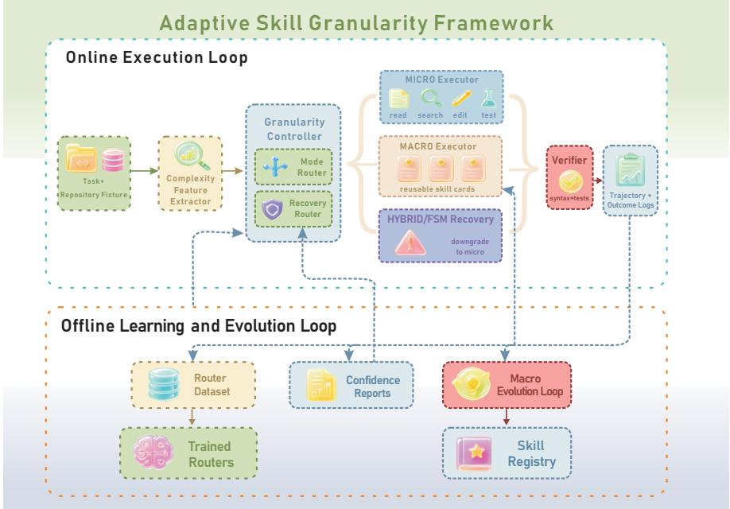
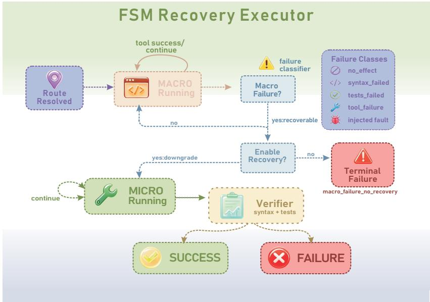
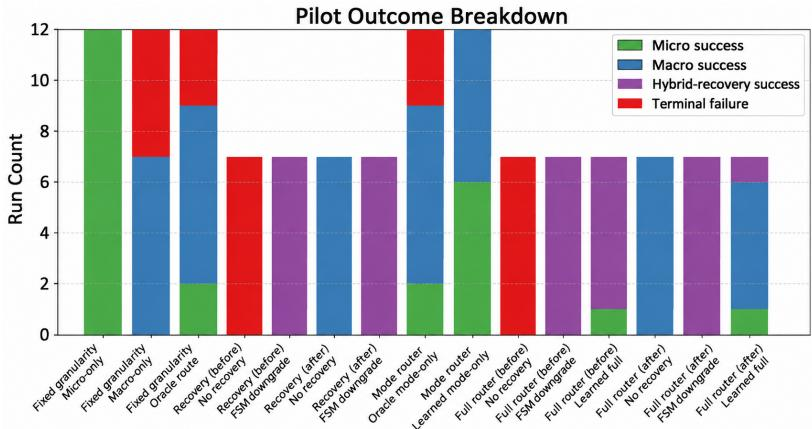

# Adaptive Skill Granularity for Coding Agents: Runtime Routing and Macro-to-Micro Recovery

Dingxuan Zhang1⋆, Yanhui Jiang2⋆, Jun Wang3, and Hefeng Zhou1

1 Shanghai Jiao Tong University, China

2 Kuaishou Technology Co., Ltd., China

3 University of Warwick, UK

h.rezin.zhou@gmail.com

Abstract. Reusable skills allow large language model agents to package task-specific procedures, tool afordances, and execution guidance into modular units. Prior work has largely studied how agents retrieve, compose, or synthesize skills before execution. In coding agents, however, execution poses an additional runtime control problem: the same task may be solved through primitive tool calls, macro skills, or hybrid execution that starts with a macro and falls back to micro-level recovery. We introduce Adaptive Skill Granularity, a framework that treats skill granularity as an action-abstraction policy conditioned on task structure, execution state, and macro-skill failures. The system combines a feature-based granularity controller and a finite-state recovery executor. We evaluate the framework with a deterministic coding-agent protocol using verifier-defined success, total cost, and process metrics such as macro adoption, failure recovery, route match, and transition correctness. Results show that fixed macro execution is eficient when applicable but brittle under mismatch, while runtime routing and explicit macro-tomicro recovery improve robustness and recover controlled macro failures that fixed-granularity execution leaves unresolved. Our findings suggest that skill libraries for coding agents should be treated not only as retrievable resources, but also as controllable, verifiable, and recoverable execution abstractions.

Keywords: LLM agents, agent skill, adaptive skill granularity

## 1 Introduction

Large language model (LLM) agents increasingly solve software-engineering tasks by inspecting files, invoking tools, editing code, and validating changes. To avoid solving each task from scratch, recent systems package reusable procedures as skills: named artifacts that specify when to act, which tools to use, what state to inspect, and how to verify completion. Existing skill ecosystems include Markdown skills, structured runtime skills, skill routers, dependency-aware skill graphs, and mined trajectory fragments [8, 25–27].

Most prior work treats skill use as a selection or retrieval problem: given a task and a skill library, expose the most relevant skill text or bundle before planning [6, 13, 26]. This is necessary but insuficient for tool-using agents. During execution, the agent must also decide the granularity of its next actions. A simple bug fix may be safer with micro tools such as search, editing, syntax checks, and tests, while a module move may benefit from a macro skill that combines file movement, import rewriting, and validation. When such a macro fails or only partially applies, the agent needs controlled macro-to-micro recovery rather than another retrieval step.

This motivates treating skill granularity as a runtime control variable. Recent evidence shows that injected skills often provide uneven gains, increase cost, or even degrade software-engineering performance when their abstraction level does not match the task context [7]. Hierarchical agent methods also adapt abstraction levels, but usually at the planning level through learned policies or repeated refinement [10, 19]. In contrast, we control the admissible action set at runtime: the agent may execute with micro tools, macro skills, or a hybrid mode that downgrades to micro tools after an observable macro failure. This keeps the controller inspectable and makes recovery an explicit execution transition rather than an informal retry or re-planning heuristic.

This paper studies adaptive skill granularity as a runtime control problem. An LLM agent with a skill library must decide not only which skill description to retrieve, but also the abstraction level of its next actions. Our central hypothesis is that no fixed granularity is universally optimal; the best choice depends on task structure, skill quality, execution state, and verifier feedback. We instantiate this problem in coding agents because repositories provide persistent state, tools expose concrete side efects, and tests ofer deterministic validation. This makes coding a high-observability testbed while keeping the method defined over general agent trajectories, action abstractions, and recovery transitions. We further ground macro-skill admission in a real-world skill-library template, requiring each candidate macro to document its scope, interface, side efects, failure behavior, verification procedure, and fallback path before it can enter the executable library. We make three contributions.

1. We formulate runtime skill granularity control as distinct from ordinary skill retrieval. The decision is not only which skill to expose, but whether to execute in micro, macro, or hybrid recovery mode.

2. We present an agent-control architecture, instantiated in coding agents, that combines a feature-based granularity controller with a finite-state recovery executor to manage runtime execution abstraction.

3. We define a verifier-driven GranBench-Code evaluation protocol that treats validated success and total cost as primary metrics, and reports macro adoption, failure recovery, route match, transition correctness, and confidence intervals. We apply it in a pilot study of fixed-granularity, routed, and recoveryenabled agents, while specifying the unconstrained and LLM-router baselines required for the full study.

## 2 Related Work

Agent skills and routing. Recent work defines agent skills as reusable procedural artifacts spanning representation, acquisition, retrieval, execution, and evolution [22, 27]. Runtime-oriented systems such as Formal Skill further package skills with metadata, schemas, executors, and hooks [25], while SkillCraft evaluates whether agents can form and reuse higher-level tool compositions [2]. In parallel, SkillRouter, Graph-of-Skills, Skill Is Not Document, and SkillWeaver study how to retrieve, bundle, or compose relevant skills for a task [6, 13, 20, 26]. In short, prior works primarily optimize which skills to expose. In contrast, our work controls how coarsely an agent executes at runtime—dynamically shifting between primitive tools, macro skills, and recoverable hybrid paths based on live execution states.

Action abstraction, monitoring, and repair. Our formulation is connected to classical temporal abstraction, including options, MAXQ, and hierarchical task networks [4, 5, 18]. Macro skills can be viewed as temporally extended actions, but we do not learn an end-to-end hierarchical policy; instead, we use an inspectable controller to constrain the admissible action set at each run. The downgrade mechanism also relates to execution monitoring and recovery in planning and robotics [16], and to automated program repair after failed edits [11]. Compared with hierarchical LLM-agent methods such as HiMAC and self-adaptive hierarchical planning [10, 19], which adapt or refine plans, we treat granularity as a verifier-grounded runtime control decision over the next available actions.

Skill evolution and coding-agent evaluation. Trajectory-mining systems extract reusable skills from agent traces [1, 8, 12, 21, 24], but mined fragments may be brittle. Our macro-evolution loop therefore requires replay, deterministic validation, documented side efects, and fallback behavior before a macro is admitted. For evaluation, our protocol follows the executable software-engineering tradition of SWE-bench [9] and recent calls to assess coding agents by both final correctness and process behavior [14, 15, 23]. Furthermore, recent findings emphasize that performance gains from function-calling skill injection must be carefully attributed to distinguish genuine procedural transfer from mere interface compliance [3]. Closest in motivation, SWE-Skills-Bench reports that skill injection can yield uneven gains and higher cost depending on abstraction level and context fit [7]. Adaptive Skill Granularity targets this failure mode by controlling when skills should be used, avoided, or downgraded during execution.

## 3 Problem Formulation

## 3.1 Agentic Execution Substrate

We model a coding-agent episode as closed-loop execution over a repository. A task is ${ \tau } = ( p , W _ { 0 } , M , V )$ , with prompt $p ,$ initial workspace $W _ { 0 } .$ , metadata M, and deterministic validator V. A run produces a trajectory $\pi = \langle a _ { 1 } , \ldots , a _ { T } \rangle$ 2 where each action invokes a skill from ${ \mathcal { S } } = { \mathcal { S } } _ { \mu } \cup { \mathcal { S } } _ { M }$ . Primitive skills $S _ { \mu }$ include file inspection, search, editing, syntax checks, and tests; macro skills $\boldsymbol { \mathcal { S } } _ { M }$ bundle multiple primitive operations into a temporally extended action. Each action transforms the workspace and yields an observation,

$$
W _ { t } = T _ { a _ { t } } ( W _ { t - 1 } ) , \qquad o _ { t } = O ( W _ { t - 1 } , a _ { t } , W _ { t } , V ) ,\tag{1}
$$

where $o _ { t }$ records workspace changes, validation failures, and macro-specific failure signals. These observations expose the runtime state that must be controlled after skill retrieval.

## 3.2 Granularity as Action-Abstraction Control

A granularity mode constrains the admissible action set at a given point in an agent trajectory. We consider $\mathcal { G } = \{ \mu , M , H \}$ , where $\mu$ denotes micro execution, M denotes macro execution, and H denotes hybrid execution. Given the history $h _ { t } = ( \tau , W _ { 0 } , a _ { 1 : t - 1 } , o _ { 1 : t - 1 } )$ , the admissible action envelope is

$$
\boldsymbol { \mathcal { A } } ( g , \boldsymbol { h _ { t } } ) = \left\{ \begin{array} { l l } { \boldsymbol { \mathcal { S } } _ { \mu } , } & { \boldsymbol { g } = \boldsymbol { \mu } , } \\ { \boldsymbol { \mathcal { S } } _ { M } , } & { \boldsymbol { g } = M , } \\ { \boldsymbol { \mathcal { S } } _ { M } , } & { \boldsymbol { g } = H \wedge \neg \boldsymbol { F } ( \boldsymbol { h _ { t } } ) , } \\ { \boldsymbol { \mathcal { S } } _ { \mu } , } & { \boldsymbol { g } = H \wedge F ( \boldsymbol { h _ { t } } ) , } \end{array} \right.\tag{2}
$$

where $F ( h _ { t } )$ indicates that the history contains an observable recoverable macro failure. $\operatorname { E q . } \ ( 2 )$ is the main formal distinction between our setting and ordinary skill retrieval: the controller changes the action abstraction available to the downstream agent.

Operationally, the three modes have the following interpretation:

– Micro mode $( g = \mu )$ : admissible actions are restricted to $S _ { \mu }$

Macro mode $( g = M )$ : admissible actions are restricted to ${ \mathcal { S } } _ { M }$

– Hybrid mode $( g = H )$ : execution may start with macro actions but can transition to primitive actions after an observable failure or validation signal.

The instantiation studied in this paper realizes hybrid mode as a one-way macro-to-micro downgrade, which captures the dominant failure pattern we observe: a coarse macro fails and the agent must recover with reliable primitive tools. $\operatorname { E q . } \ ( 2 )$ is, however, a special case of a more general mode-switching policy that could also escalate from micro to macro or alternate between modes; we treat richer switching as a direct extension of the same admissible-action formalism rather than a separate mechanism.

A pre-execution controller selects an initial strategy

$$
d _ { 0 } = \rho ( \phi ( \tau ) ) = ( g _ { 0 } , r _ { 0 } , q _ { 0 } ) ,\tag{3}
$$

where $\phi ( \tau )$ is a feature vector extracted from the prompt, metadata, and initial workspace; $g _ { 0 } \in \{ \mu , M , H \}$ is the selected strategy; $r _ { 0 }$ indicates whether macrofailure recovery is enabled; and $q _ { 0 }$ is an explanation or confidence record used

for audit. The LLM agent then samples or selects the next action only from the active envelope:

$$
a _ { t } \sim \pi _ { \psi } ( \cdot \mid h _ { t } , g _ { t } ) , ~ a _ { t } \in \mathcal { A } ( g _ { t } , h _ { t } ) .\tag{4}
$$

During execution, a recovery transition function updates the efective mode:

$$
g _ { t + 1 } = \varDelta ( g _ { t } , o _ { t } , r _ { 0 } ) = \left\{ \begin{array} { l l } { \mu , } & { g _ { t } \in \{ M , H \} \wedge r _ { 0 } = 1 \wedge F ( o _ { t } ) , } \\ { \perp , } & { g _ { t } \in \{ M , H \} \wedge r _ { 0 } = 0 \wedge F ( o _ { t } ) , } \\ { g _ { t } , } & { \mathrm { o t h e r w i s e } . } \end{array} \right.\tag{5}
$$

Here $F ( o _ { t } )$ is the macro-failure predicate induced by the current observation and ⊥ denotes terminal macro failure. Eq. (5) makes recovery an explicit state transition rather than an informal retry heuristic.

## 3.3 Retrieval, Granularity, and Objective

Skill retrieval selects a subset $\mathcal { R } _ { \tau } \subseteq { \mathcal { S } }$ for a task, but it does not decide whether execution should use primitive actions, macro actions, or a recoverable mixture of both. A relevant macro may be too coarse for the current workspace, while primitive actions may be reliable but costly for standardized refactors. Thus, granularity control is a runtime policy over admissible actions and recovery transitions, not just a ranking over skill descriptions.

We define task success by the verifier, $\operatorname { S u c c } ( \pi , \tau ) \ : = \ : \mathbb { I } [ V ( W _ { T } ) \ : = \ : 1 ]$ , and view granularity control as optimizing success under cost and unrecovered-failure penalties:

$$
J ( \rho , \pi _ { \psi } ) = \mathbb { E } _ { \tau \sim \mathcal { D } } \left[ \mathrm { S u c c } ( \pi , \tau ) - \lambda _ { T } T - \lambda _ { C } \widehat { C } ( \pi ) - \lambda _ { F } U ( \pi , \tau ) \right] ,\tag{6}
$$

where ${ \widehat C } ( \pi )$ is normalized token cost and $U ( \pi , \tau )$ marks an unrecovered macro failure. We report these terms through validated success, trajectory length, token cost, macro adoption, recovery rate, route match, and transition correctness. As a secondary summary, we also use

$$
{ \mathrm { G - s c o r e } } = { \frac { \mathbb { E } [ { \mathrm { S u c c } } ] } { \mathbb { E } [ T \mid { \mathrm { S u c c } } = 1 ] \cdot C _ { \mathrm { n o r m } } } } ,\tag{7}
$$

with token cost normalized to the micro-only baseline. G-score is used only to compare cost among policies with similar success.

## 4 Adaptive Skill Granularity

Figure 1 summarizes the Adaptive Skill Granularity framework. The online loop extracts pre-execution task features, applies the granularity controller, restricts the downstream agent to the selected action granularity, and validates the final workspace with deterministic checks. Execution logs are then used for evaluation, router updates, and future macro-skill mining.

  
Fig. 1. Adaptive Skill Granularity framework. Online execution selects and applies a micro, macro, or hybrid granularity mode, then validates the final workspace. Ofline logs support router updates, confidence reporting, and macro-skill registry decisions.

## 4.1 Design Invariants

The framework is constrained by three invariants that make the evaluation auditable.

1. Pre-execution routing only uses pre-execution evidence. The controller in Eq. (3) may inspect task metadata and the initial fixture, but not verifier outcomes from the current run. This information separation is conceptually analogous to prior-aware evaluation in RAG-based fact-checking [17], which distinguishes pre-evidence model states from post-retrieval evidence.”

2. Recovery is event-driven. The system may transition from macro to micro mode only after an observable macro failure, validation failure, faultinjection event, or explicit recovery-router decision, matching Eq. (5).

3. Success is verifier-defined. A run is successful only when the deterministic validator passes on the final workspace, regardless of whether the model declares completion.

## 4.2 Algorithmic Contract

For each task, the controller first extracts complexity features and produces a decision tuple

d = (selected\_mode, selected\_strategy, enable\_macro\_recovery, reason). (8)

The executor initializes the tool set from d. In macro mode, if a failure occurs and recovery is enabled, the FSM switches to micro tools and continues from the current workspace; otherwise, the failure is terminal. Every transition is appended to the trajectory log before the next action. Eq. (8) records this runtime execution of Eq. (3), explicitly separating learned routing, recovery decisions, and validation evidence for analysis.

## 4.3 Complexity Features

The current implementation uses low-dimensional structural features extracted before execution:

$$
\phi ( \tau ) = [ n _ { \mathrm { p a t h } } , n _ { \mathrm { p y } } , n _ { \mathrm { n o n p y } } , n _ { \mathrm { e n t i t y } } , n _ { \mathrm { A S T } } , d _ { \mathrm { A S T } } , n _ { \mathrm { i m p o r t } } , n _ { \mathrm { d e p } } , b _ { \mathrm { t e x t } } , b _ { \mathrm { r e f a c t o r } } ] .\tag{9}
$$

These dimensions capture number of source paths, Python and non-Python file counts, entity-like strings in the prompt, AST node count, maximum AST depth, import count, cross-file dependency count, text-task flag, and refactor-task flag. These features intentionally avoid execution-derived information so that the router does not leak validation outcomes into the decision.

## 4.4 Granularity Controller

The controller supports heuristic and learned routing. The heuristic is a handwritten rule set used as a reference baseline. The learned router, trained on prior execution logs, predicts whether a task starts in micro or macro mode, while an optional recovery router decides if a macro-compatible task should enable hybrid fallback. Together, these routers determine $g _ { 0 }$ and $r _ { 0 }$ in Eq. (3), while $q _ { 0 }$ logs confidence or explanations for auditing.

To ensure interpretability and prevent memorization, the learned router is a shallow Decision Tree Classifier with a maximum depth of 4. It is trained ofline on empirical success and token cost data, then serialized into JSON. At runtime, the controller deterministically traverses this lightweight JSON tree using runtime features, eliminating online retraining and opaque neural checkpoints while guaranteeing full auditability.

## 4.5 Macro-Skill Interface

We treat a macro skill as an option-like, temporally extended tool call with an explicit contract:

$$
m = ( \mathrm { n a m e , a r g s , p r e , e f f e c t } , V _ { m } , F _ { m } , \mathrm { f a l l b a c k } ) ,\tag{10}
$$

where pre describes when the macro is applicable, efect describes allowed workspace side efects, $V _ { m }$ is an internal verification routine, $F _ { m }$ is the set of observable failure classes, and fallback records the intended micro-level continuation. This contract is what lets a macro participate in the recovery transition of Eq. (5): a

failed macro must expose enough state for the executor to decide whether the current workspace can be repaired with primitive tools.

The current prototype uses three hand-written macros. inspect\_python\_module summarizes a module’s symbols, syntax health, and optional pattern matches; replace\_and\_verify applies a targeted text replacement and then runs syntax checks and an optional task-specific test; and move\_module\_and\_update\_imports moves a Python module, rewrites import sites, and validates the resulting workspace. These macros are deliberately small: they are large enough to expose granularity trade-ofs, but constrained enough that their preconditions, side efects, and verifier behavior can be audited.

## 4.6 FSM Recovery Executor

The recovery executor treats macro failure as a state transition rather than a terminal event. Macro calls can fail because the expected text is absent, syntax checks fail, tests fail, or a fault-injection rule simulates a brittle skill. When recovery is enabled, the executor downgrades to primitive tools and asks the model to continue from the current workspace. Each run records transition count, macro failure count, recovery trigger, first failure point, and final validated success. This executor is the concrete implementation of Eq. (5).

  
Fig. 2. Finite-state recovery executor. Macro runs downgrade to micro tools after recoverable failures when recovery is enabled; otherwise they terminate with macro\_failure\_no\_recovery. Success requires verifier acceptance.

Table 1. GranBench-Code task families
<table><tr><td>Family</td><td>Target count Purpose</td><td></td></tr><tr><td>Simple</td><td>20</td><td>Single-file bugs, documentation examples, and configuration fixes.</td></tr><tr><td>Medium</td><td>20</td><td>Multi-file changes with moderate dependency structure.</td></tr><tr><td>Refactor</td><td>20</td><td>Module moves, symbol renames, import rewrites, and API migration.</td></tr><tr><td>Recovery</td><td>20</td><td>Macro failure, partial execution contamination, and downgrade recovery.</td></tr></table>

Failure taxonomy. For analysis, each macro failure should be assigned one of five labels: precondition mismatch when the macro does not apply to the current workspace, partial side efect when the macro changes state before failing, validation failure when syntax or tests reject the result, tool-schema failure when arguments or returned JSON are malformed, and executor exception when the runtime itself fails. Recovery should be credited only when the downgraded micro trajectory produces a validated final state.

## 4.7 Macro Evolution Loop

While this paper focuses on the runtime routing and recovery of existing skills, a practical coding agent must eventually acquire new macro skills. We conceptualize a macro evolution loop as a natural extension of the Adaptive Skill Granularity framework, leaving its end-to-end empirical evaluation to future work.

To ensure that newly mined skills remain compatible with our FSM recovery executor, simple trajectory mining is insuficient. We propose that any generated macro candidate must pass a strict, verifier-grounded admission gate. Specifically, a candidate must: successfully replay on historical tasks, explicitly document allowable workspace side efects, and define a precise micro-level fallback path or explicitly declare an unrecoverable failure class. By enforcing this conceptual admission gate, future automated skill discovery systems can prevent brittle prompt fragments from entering the library, preserving the controllable and verifiable execution invariants required by our framework.

## 5 Experiments

## 5.1 Benchmark Design

The target benchmark, GranBench-Code, categorizes tasks into four families: simple, medium, refactor, and recovery (detailed in Table 1). Each task provides an isolated workspace, source files in a failing or stale state, task metadata, and a deterministic validator. The recovery family specifically incorporates controlled failure injection before or after macro execution.

## 5.2 Execution Harness

We evaluate all variants within a unified execution harness. For each task, the agent interacts with a disposable after workspace, while a pristine before snapshot is preserved for auditing. The prompt provides the task description, workspace context, active tools, and routing decisions. The agent outputs a single JSON-formatted action (specifying the skill, arguments, and reasoning) per step, or a termination signal.

The primitive tool set $S _ { \mu }$ includes standard file-system inspection, editing operations, and test execution. The macro tool set $\boldsymbol { \mathcal { S } } _ { M }$ comprises high-level composite skills, such as module inspection, verified replacement, and import-aware refactoring. All variants share the same underlying tool implementations and difer only in their exposed action spaces. Task success is determined by running task-specific validators on the final workspace. We track detailed run logs, including tool usage, routing decisions, validation results, and total token consumption across all steps.

## 5.3 Baselines

We compare several variants using identical LLMs, tools, and verifiers:

Fixed granularity: A-Micro uses only primitive skills $S _ { \mu }$ , and B-Macro uses only macro skills $\boldsymbol { S _ { M } }$ . Neither variant performs recovery.

Pre-execution routing (No Recovery): C-Heuristic selects the initial mode using a heuristic rule over pre-execution features. D-Learned-ModeOnly uses a decision-tree router trained on empirical prior logs.

– Recovery-enabled hybrid execution: E-FSM-Downgrade uses heuristic routing but explicitly enables a macro-to-micro downgrade transition upon macro failure. F-Learned-Full employs both the learned mode router and a learned recovery router.

## 5.4 Metrics

The primary evaluation metric is the validated success rate. To assess eficiency, we compute the cost required per solved task by aggregating the token cost across all runs (including failures):

$$
\mathrm { C o s t P e r S u c c e s s } = \frac { \sum _ { i } C _ { i } } { \sum _ { i } \mathrm { S u c c } ( \pi _ { i } , \tau _ { i } ) } ,\tag{11}
$$

where $C _ { i }$ is the token cost of run $i ,$ and $\operatorname { S u c c } ( \pi _ { i } , \tau _ { i } )$ is the binary success indicator. To evaluate the success-cost trade-of, we also report the empirical G-score:

$$
\mathrm { G \mathrm { - } s c o r e } = { \frac { \mathrm { s u c c e s s } \_ \mathrm { r a t e } } { \mathrm { m e a n } \_ \mathrm { s u c c e s s f u l } \_ \mathrm { s t e p s } \times \mathrm { t o k e n } \_ \mathrm { c o s t } \_ \mathrm { n o r m a l i z e d } } } .\tag{12}
$$

Alongside success and cost metrics, we report process metrics including mean trajectory length, macro adoption rate, failure recovery rate, routing alignment with the rule, and transition correctness. These metrics are presented jointly to provide a comprehensive view of policy performance, eficiency, and execution behavior.

## 5.5 Fixed vs. Adaptive Skill Granularity

We first examine the trade-of between robustness and eficiency across diferent execution granularities (Table 2). Pure micro execution achieves perfect success but incurs the highest token and step costs. Conversely, pure macro execution significantly reduces costs but struggles with robustness, succeeding on fewer tasks. While heuristic routing attempts to balance these extremes, it misclassifies certain tasks based on structural features. This highlights the necessity of adaptive skill granularity over relying on a fixed execution mode.

Table 2. Fixed-granularity and heuristic routing results (12 mixed tasks). Pure micro is robust but costly, while pure macro is eficient but brittle.
<table><tr><td>Variant</td><td>Success Mean Steps Mean Tokens Macro Adoption G-score</td><td></td><td></td></tr><tr><td>A-Micro</td><td>1.000</td><td>6.00</td><td>7217.75 0.000</td></tr><tr><td>B-Macro</td><td>0.583</td><td>2.71 3609.00</td><td>0.1667 0.916 0.4305</td></tr><tr><td>C-Heuristic</td><td>0.750</td><td>3.22 4097.67</td><td>0.833 0.4103</td></tr></table>

## 5.6 Dynamic Recovery after Macro Failure

Next, we investigate the need for dynamic recovery upon macro failure by injecting controlled faults into the recovery benchmark (Table 3). For early failures (Before), lacking a recovery mechanism completely halts progress. Enabling an explicit FSM downgrade successfully recovers the tasks by falling back to micro tools, albeit at a higher token cost.

For late failures (After), the macro successfully updates the workspace before the failure is raised. Consequently, the no-recovery baseline passes validation without requiring additional actions. In this scenario, the unconditional FSM downgrade blindly reverts to micro mode, unnecessarily inflating token costs and execution steps. This tension demonstrates that while unconditional downgrades guarantee robustness, their overhead necessitates a more selective recovery policy.

Table 3. Dynamic downgrade under injected macro failures (7 tasks). The FSM downgrade recovers early failures perfectly but wastes tokens on late failures.
<table><tr><td colspan="2">Fault Mode Variant</td><td colspan="3">Success Mean Steps Mean Tokens Transition Rate</td></tr><tr><td>Before</td><td>C-Heuristic-NoRecovery</td><td>0.000</td><td></td><td>0.000</td></tr><tr><td>Before</td><td>E-FSM-Downgrade</td><td>1.000</td><td>6.86 11293.43</td><td>1.000</td></tr><tr><td>After</td><td>C-Heuristic-NoRecovery</td><td>1.000</td><td>2.71 2440.14</td><td>0.000</td></tr><tr><td>After</td><td>E-FSM-Downgrade</td><td>1.000</td><td>5.71 7566.71</td><td>1.000</td></tr></table>

## 5.7 Learning Better Mode Routing

To address the limitations of heuristic routing, we introduce a learned mode router trained ofline on historical execution logs. Table 4 shows that learning from empirical outcomes allows the router to consistently select the optimal execution mode, correcting misclassifications made by the heuristic policy. For instance, the learned router correctly assigns complex synchronization tasks to primitive execution, bypassing the structural features that mislead the heuristic router. Consequently, the learned router achieves full success on the evaluated tasks, demonstrating that routing decisions are better derived from empirical execution outcomes than from static rules.

Table 4. Learned vs. Heuristic mode routing (12 tasks). Aligning with empirical labels allows the learned router to achieve 100% success where the heuristic fails.
<table><tr><td colspan="5">Variant Success Mean Steps Mean Tokens Heuristic Match Emp. Match</td></tr><tr><td>C-Heuristic-ModeOnly</td><td>0.750</td><td>3.11</td><td>4172.89</td><td>1.000 0.667</td></tr><tr><td>D-Learned-ModeOnly</td><td>1.000</td><td>4.17</td><td>5518.33</td><td>0.667 1.000</td></tr></table>

## 5.8 End-to-End Adaptive Skill Granularity

Finally, we evaluate the full Adaptive Skill Granularity framework by combining the learned mode router with the learned recovery policy. Table 5 shows that this combination preserves recovery performance while reducing unnecessary execution cost. Under Before faults, F-Learned-Full matches the perfect success rate of E-FSM-Downgrade with lower token cost. Under After faults, the recovery router skips fallback when the macro has already completed the required changes, reducing both the transition rate and token consumption compared with unconditional FSM downgrade.

The same behavior is useful for high-risk structural changes such as module moves and import rewrites. For module\_move\_refactor, the refactor-task feature routes execution through hybrid mode, allowing the agent to recover when strict no-recovery execution fails. These results show that learned mode selection and selective recovery complement each other: the former avoids unsuitable macro execution, while the latter limits fallback to cases where it is actually needed.

Overall, the proposed framework successfully combines adaptive mode selection with selective recovery, achieving consistently high task success while significantly reducing execution cost under realistic failure scenarios.

## 5.9 Results Analysis

On the mixed benchmark, fixed granularity exposes a clear robustness–eficiency trade-of: A-Micro achieves perfect success but incurs the highest step and token costs, whereas B-Macro is more eficient but substantially less robust, with

Table 5. Full end-to-end routing under fault injection (7 tasks). The learned full controller preserves perfect recovery success while significantly reducing token cost.
<table><tr><td colspan="2">Fault Mode Variant</td><td colspan="3">Success Mean Tokens G-score Transition Rate</td></tr><tr><td>Before</td><td>C-Heuristic-NoRecovery</td><td>0.000</td><td></td><td>0.000</td></tr><tr><td>Before</td><td>E-FSM-Downgrade</td><td>1.000</td><td>11293.43</td><td>0.0845 1.000</td></tr><tr><td>Before</td><td>F-Learned-Full</td><td>1.000</td><td>9763.57</td><td>0.1061 0.857</td></tr><tr><td>After</td><td>C-Heuristic-NoRecovery</td><td>1.000</td><td>2280.00</td><td>1.1866 0.000</td></tr><tr><td>After</td><td>E-FSM-Downgrade</td><td>1.000</td><td>7566.71</td><td>0.2142 1.000</td></tr><tr><td>After</td><td>F-Learned-Full</td><td>1.000</td><td>3694.43</td><td>0.5720 0.143</td></tr></table>

  
Fig. 3. Evaluation outcome breakdown. Bars separate micro success, macro success, hybrid-recovery success, and terminal failure.

C-Heuristic providing only a partial compromise. The recovery experiments further show that the value of dynamic downgrade depends on failure timing. Under early fault injection, C-Heuristic-NoRecovery fails completely, while E-FSM-Downgrade recovers all tasks at the cost of additional execution overhead. Under late faults, however, macros often complete the required edits before the failure is raised, allowing NoRecovery to succeed at much lower cost and making unconditional downgrade unnecessarily expensive. Together, these results indicate that neither fixed granularity nor always-on recovery is uniformly efective, motivating adaptive routing and selective recovery based on task structure and runtime failure signals.

The learned mode router demonstrates that empirical outcome labels provide a stronger basis for routing than hand-written heuristics. D-Learned-ModeOnly solves all evaluated tasks by correctly selecting micro execution for risky cases where the heuristic policy incorrectly relies on macros. Building on this improvement, the full learned controller (F-Learned-Full) further balances robustness and eficiency through selective recovery. As shown in Figure 3, it matches the perfect success of E-FSM-Downgrade under early faults while reducing execution cost, and avoids unnecessary recovery under late faults while preserving full success and substantially lowering token consumption.

Overall, the evaluation reveals a consistent pattern: fixed granularity exposes a robustness–eficiency trade-of, while adaptive routing and recovery mitigate its two main failure modes. Dynamic downgrade is essential when macro failures occur before useful progress is made, whereas learned routing and selective recovery reduce unnecessary macro use and over-recovery when finer-grained execution is more appropriate. These results suggest that combining empirical mode selection with failure-aware recovery provides a more robust and cost-eficient execution policy than either fixed granularity or unconditional fallback alone.

## 6 Conclusion

Skill libraries make LLM agents more reusable, but retrieval alone does not resolve how an agent should execute a task once a relevant skill has been selected. Adaptive Skill Granularity addresses this runtime choice by allowing coding agents to operate with micro tools, macro skills, or macro execution followed by micro-level recovery. Our results show a clear trade-of: micro execution is robust but costly, while macro execution is more eficient but more sensitive to task mismatch and failure timing. Macro-to-micro recovery improves robustness under recoverable failures, and learned routing reduces unnecessary macro use and over-recovery. These results suggest that adapting execution granularity at runtime can provide a better balance between reliability and eficiency than relying on a fixed execution mode. Future work will extend GranBench-Code across broader task sets, repositories, failure modes, and models.

## Disclosure of Interests

The authors have no competing interests to declare that are relevant to the content of this article.

## References

1. Alzubi, S., Provenzano, N., Bingham, J., Chen, W., Vu, T.: Evoskill: Automated skill discovery for multi-agent systems. arXiv preprint arXiv:2603.02766 (2026)

2. Chen, S., Gai, J., Zhou, R., et al.: Skillcraft: Can llm agents learn to use tools skillfully? arXiv preprint arXiv:2603.00718 (2026)

3. Chen, W., Chen, D., Kong, F.: Attributing structured-output gains in function calling: Interface alignment versus procedural transfer. arXiv preprint arXiv:2607.02595 (2026)

4. Dietterich, T.G.: Hierarchical reinforcement learning with the MAXQ value function decomposition. Journal of Artificial Intelligence Research 13, 227–303 (2000)

5. Erol, K., Hendler, J., Nau, D.S.: HTN planning: Complexity and expressivity. In: Proceedings of the National Conference on Artificial Intelligence (AAAI) (1994)

6. Gao, X.: Compositional skill routing for llm agents: Decompose, retrieve, and compose. arXiv preprint arXiv:2606.18051 (2026)

7. Han, T., Zhang, Y., et al.: Swe-skills-bench: Do agent skills actually help in realworld software engineering? arXiv preprint arXiv:2603.15401 (2026)

8. Hao, Y., Li, X.: Automating skill.md generation for computer-using agents via interaction trajectory mining. arXiv preprint arXiv:2606.20363 (2026)

9. Jimenez, C.E., Yang, J., Wettig, A., Yao, S., Pei, K., Press, O., Narasimhan, K.: SWE-bench: Can language models resolve real-world GitHub issues? In: International Conference on Learning Representations (ICLR) (2024)

10. Jin, H., Zhu, R., Ding, J., Zhang, W., Li, G.: Himac: Hierarchical macro–micro learning for long-horizon llm agents. arXiv preprint arXiv:2603.00977 (2026)

11. Le Goues, C., Pradel, M., Roychoudhury, A.: Automated program repair. Communications of the ACM 62(12), 56–65 (2019)

12. Li, Y., Zhang, Y., Zhang, X., Liu, X., Liu, Y.: Codeskill: Learning self-evolving skills for coding agents. arXiv preprint arXiv:2605.25430 (2026)

13. Liu, D., Li, Z., Du, H., Wu, X., Gui, S., Kuang, Y., Sun, L.: Graph-of-skills: Dependency-aware structural retrieval for massive agent skills. arXiv preprint arXiv:2604.05333 (2026)

14. Liu, X., Tu, J., Chen, Y., Xie, S., Ren, S., Shi, T., Gantar, G., Sandoval, E., Lee, D., Miao, D., et al.: Agentbeats: Agentifying agent assessment for openness, standardization, and reproducibility. arXiv preprint arXiv:2606.13608 (2026)

15. Madiraju, M.B., Madiraju, M.S.P.: Rigorbench: Benchmarking engineering process discipline in autonomous ai coding agents. arXiv preprint arXiv:2606.22678 (2026)

16. Pettersson, O.: Execution monitoring in robotics: A survey. Robotics and Autonomous Systems 53(2), 73–88 (2005)

17. Sun, Y., Shang, W., Gao, W., Huang, X., Ma, J.: Diagnosing llm arbitration behavior over pre-evidence epistemic states in rag-based fact-checking. arXiv preprint arXiv:2606.01120 (2026)

18. Sutton, R.S., Precup, D., Singh, S.: Between MDPs and semi-MDPs: A framework for temporal abstraction in reinforcement learning. Artificial Intelligence 112(1–2), 181–211 (1999)

19. Tan, H., Zhang, Z., Ma, C., Liu, T., Dai, Q., Chen, X.: From coarse to fine: Self-adaptive hierarchical planning for llm agents. arXiv preprint arXiv:2604.23194 (2026)

20. Wang, Z., Wen, W., Ji, Q., Qiao, R., Sun, X.: Skill is not document: A queryconditional benchmark and two-stage retriever for llm agent skill routing. arXiv preprint arXiv:2606.03565 (2026)

21. Xiao, C., Jiao, Z., Wang, S., Wang, W., Zhao, B., Wei, H., Zhang, L., Qu, L.: Socratic-swe: Self-evolving coding agents via trace-derived agent skills. arXiv preprint arXiv:2606.07412 (2026)

22. Xu, R., Yan, Y., et al.: Agent skills for large language models: Architecture, acquisition, security, and the path forward. arXiv preprint arXiv:2602.12430 (2026)

23. Yu, D., Li, Y., Guan, Z., Lin, X., Luan, J., Rao, Z., Lan, X., Ran, Y., Lan, B., Zhai, N.X., et al.: Skillaudit: From fixed-suite benchmarking to skill-centered assessment. arXiv preprint arXiv:2606.22613 (2026)

24. Zhang, Q., Feng, Z., Shi, X., Hu, X., Liu, C., Xie, P., Wang, X., Ye, J., Hooi, B., Wang, H., Zhao, J.: Skillcomposer: Learning to evolve agent skills for specification and generalization. arXiv preprint arXiv:2606.06079 (2026)

25. Zhang, X., Gao, M., Zhao, Y., Tan, X., Yao, Y., Wang, F., Wang, Y., Dingsiyi, Yang, T.: Formal skill: Programmable runtime skills for eficient and accurate llm agents. arXiv preprint arXiv:2605.19604 (2026)

26. Zheng, Y., Zhang, Z., Ma, C., Yu, Y., Zhu, J., Wu, Y., Xu, T., Dong, B., Zhu, H., Huang, R., Yu, G.: Skillrouter: Skill routing for llm agents at scale. arXiv preprint arXiv:2603.22455 (2026)

27. Zhou, Y., Shu, W., Su, Y., Du, W., Fang, Y., Lin, X.: A comprehensive survey on agent skills: Taxonomy, techniques, and applications. arXiv preprint arXiv:2605.07358 (2026)