# AgentDP: Towards Automated Model Deployment for Heterogeneous Embedded AI Applications

Leming Shen1,3, Qiang Yang2, Xinyu Huang1, Zijing Ma1, Yuanqing Zheng1

1The Hong Kong Polytechnic University, 2U2University of Cambridge, 3University College London {leming.shen,unixy-xinyu.huang,zijing.ma}@connect.polyu.hk,qy258@cam.ac.uk,csyqzheng@comp.polyu.edu.hk,

## ABSTRACT

This paper presents AgentDP, which aims to deploy pre-trained AI models on heterogeneous embedded devices by fully automating model optimization and adaptation (O&A) with Large Language Model (LLM) agents. AgentDP not only significantly reduces human efort via automation but also enhances model inference eficacy by integrating LLMs with device-specific domain knowledge. To deliver a robust automation framework, AgentDP develops novel solutions to address three key technical challenges: 1) To help users elicit clear requirements, we propose a user requirement standardization module; 2) To mitigate the execution environment mismatch between AI models and heterogeneous embedded devices, we design an operator-aware model partition paradigm that enables diferent parts of the model to be eficiently executed on distinct inference engines. 3) To avoid re-searching optimization hyperparameters for new tasks, we propose a configuration reuse module that heuristi cally retrieves previous hyperparameter configurations for eficient reuse. Extensive experiments demonstrate that by fully automating the entire O&A process, AgentDP reduces entire model adaptation time by up to 80% compared with manual O&A while achieving higher task accuracy (more than 13% on average) than the baselines. Additionally, a comprehensive user study also exhibits the robust generalizability of AgentDP in adapting to diferent user requirements for heterogeneous embedded devices.

## CCS CONCEPTS

• Computing methodologies → Artificial intelligence; • Computer systems organization → Embedded and cyber-physical systems.

## KEYWORDS

Large Language Model, Agent, Model Deployment, Embedded Device

## ACM Reference Format:

Leming Shen1,3, Qiang Yang2, Xinyu Huang1, Zijing Ma1, Yuanqing Zheng1 . 2025. AgentDP: Towards Automated Model Deployment for Heterogeneous Embedded AI Applications. In Proceedings of Make sure to enter the correct conference title from your rights confirmation email (Conference acronym ’XX). ACM, New York, NY, USA, 14 pages. https://doi.org/XXXXXXX.XXXXXXX

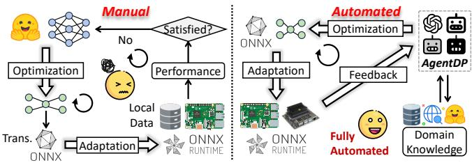  
Figure 1: Deploying pre-trained open-source models on embedded devices (manual vs. automated).

## 1 INTRODUCTION

Embedded AI has emerged as a transformative paradigm, enabling the deployment of AI models directly on embedded devices such as Jetson Nano. Embedded AI facilitates real-time onboard data processing of various sensors (e.g., camera, microphone) and enables low-latency decision-making [53, 55]. In addition, embedded AI ensures privacy and security by keeping sensitive data on local devices [54].

To develop an embedded AI application, developers can download a pre-trained model from open-source platforms (e.g., Hugging Face) and deploy the model on target embedded devices. These models, extensively trained on high-end servers using large-scale datasets (e.g., ImageNet [20]), can achieve high performance in various sensing tasks. In practice, however, most open-source models cannot be directly deployed on embedded devices for two main reasons. First, these models often contain a large number of parameters1, making them hard to fit into resource-constrained embedded devices [54]. Second, these models are primarily available in PyTorch [49] format, which may not be supported by embedded devices with heterogeneous execution environments and diverse dependencies. To tackle these practical challenges, developers need to perform multiple iterations of model optimization and adaptation, as illustrated in Fig. 1 (left). To tailor models for resource-constrained devices, developers adopt various optimization techniques with tunable hyperparameters (e.g., pruning rate, quantization level, etc.) to compress the models. To facilitate the portability ofthe compressed models across heterogeneous environments, developers also need to translate the compressed models into platform-independent portable models, which can be deployed and executed on embedded devices via cross-platform inference engines (e.g., ONNX Runtime [1]). Finally, developers can iteratively adapt the portable models to meet runtime performance requirements given the resource constraints of embedded devices2.

Nevertheless, such an iterative O&A process is cumbersome, error-prone, and ineficient. 1) Large Search Space: Manually defining and adjusting the search space for numerous tunable hyperparameters is time-consuming even when assisted by automated search frameworks [67]. For example, model pruning can be implemented with either channel-level or filter-level pruning with varying pruning ratios [37]. Worse still, highly specialized expertise is required to identify an appropriate search space for each hyperparameter. 2) Heterogeneous Target Devices: Heterogeneous embedded devices have diverse execution environments, making the selection and installation of an appropriate inference engine with various dependencies challenging. For instance, TensorRT [46] is optimized for Jetson Nano, whereas ONNX Runtime suits Raspberry Pis [15] better. Mastering and manually configuring these device-specific frameworks demands substantial time and domain expertise [51]. 3) Laborious Iterative Refinement: Optimizing an AI model for high performance given the resource constraints of a target device typically necessitates multiple rounds of trial-and-error iterations, which is time-consuming even for ex perienced experts let alone novice developers. This motivates the following research question: Can we automate the O&A process and democratize the AI models that are readily open-sourced yet inaccessiblefor embedded AI applications?

To fill this gap, our key insight is to employ LLM agents to fully automate the entire O&A process. The recent advancement of LLMs (e.g., GPT-4 [14]) has demonstrated exceptional language comprehension and task automation capabilities. Embedded with extensive world knowledge, LLMs can efectively accomplish complex tasks (e.g., program synthesis [56, 59, 60], IoT data interpretation [64], etc.) in response to user requirements. Furthermore, by integrating LLMs with various third-party tools (e.g., web search tools, knowledge databases), we can empower LLM agents to facilitate task automation via enriched domain knowledge. To this end, we propose AgentDP, a multi-agent-assisted model O&A system for heterogeneous embedded AI applications. As shown in Fig. 1 (right), AgentDP leverages multiple collaborative agents to automatically execute the iterative O&A process.

Nevertheless, several technical challenges need to be addressed to deliver a functional and practical system: 1) Vague User Requirements. Due to complex and numerous model evaluation metrics, developers typically struggle to clearly and comprehen sively articulate their requirements in a single attempt. Moreover, these requirements are often expressed in natural language with irregular structures, leading to misinterpretation of user requirements and real intents. To tackle this challenge, we propose a user requirement standardization (URS) module that guides users to elicit their requirements following the Tree-of-Thought [68] approach tailored for the URS module. 2) Model-Engine Mismatch. Though portable models are platform-independent, they may not be fully compatible with a single inference engine due to mismatched execution environments. For example, some AI models may use the Mod operator during inference, which is not supported by the TensorRT engine [10]. Developers have to either wait for engine updates or use an ineficient fallback solution (e.g., CPU). To address this challenge, we propose an operator-aware model partition module that allows diferent parts of a model to be executed using distinct engines. In addition, we design a cross-engine inference pipeline to schedule the partitioned model for eficient inference. 3) Exhausted Hyperparameter Search. IfAgentDP performed model O&A from scratch for all new tasks, the O&A process would become extremely time-consuming due to the large hyperparameter search spaces. To mitigate this problem, we reuse hyperparameter configurations of previous models with similar resource profiles. Specifically, we model the hyperparameter tuning process as a finite state machine (FSM) and construct a graph database for similarity-based hyperparameter configuration retrieval.

We fully implement and evaluate AgentDP on three heterogeneous embedded devices across various embedded AI applications, including image recognition, speech sentiment analysis, and visionlanguage understanding. We compare AgentDP with two types of baselines: a SOTA LLM agent tailored for programming tasks and human developers. We invite 15 users as human baselines and evenly divide them into three groups based on their development experience and expertise. Extensive experiments demonstrate that AgentDP can reduce the time required for the O&A process by up to 61% compared to manual execution by experts, significantly improving the model O&A eficiency and reducing the human efort. Moreover, the portable models optimized by AgentDP outperform baselines in terms of both task accuracy (> 13% on average) and resource consumption (< 14% on average). Last but not least, by allowing users to freely express their requirements, our user studies demonstrate high generalizability (users rated overall satisfaction at over 4.8 out of 5) of AgentDP in handling distinct requirements for adapting various open-source models to heterogeneous embedded devices.

In summary, we make the following contributions:

• To our best, AgentDP is the first system to fully automate the model O&A process (from open-source model optimization to embedded AI application deployment), ofering an end-to-end solution via multi-collaborative LLM agents.

• AgentDP develops three novel technical modules for enhanced eficiency and robustness: a user requirement standardization module for iterative user requirement elicitation, an operator-aware model partition module with a cross-engine inference pipeline to mitigate mismatch between models and inference engines, and a configuration reuse module for eficient model optimization.

• Comprehensive evaluation validates the efectiveness and eficiency of AgentDP, demonstrating that AgentDP can significantly reduce the time required and enhance the performance for optimizing and adapting open-source models for embedded devices.

## 2 BACKGROUND & MOTIVATION

## 2.1 Challenges in Embedded AI

In this section, we provide a detailed analysis of why executing the iterative optimization and adaptation (O&A) process for embedded AI is cumbersome, ineficient, and error-prone.

Model Optimization. To reduce resource consumption, developers apply various optimization methods, each with distinct hyperparameter configurations. However, identifying an optimal hyperparameter set for model optimization is time-consuming even for experienced developers [13] due to two main reasons: 1) Determining appropriate hyperparameters from vast search spaces requires highly specialized expertise, as each hyperparameter influences the optimization result diferently; 2) Multiple hyperparameter combinations may all satisfy the resource constraints of the target device, making the selection process non-trivial. For example, if the tar get device operates on battery power, hyperparameters that can minimize energy consumption may be prioritized.

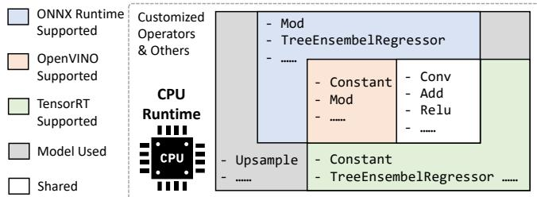  
Figure 2: The mismatch between models and engines.

Model Adaptation. To facilitate model portability, developers translate optimized models into portable models, which can be deployed on the embedded device via a cross-platform inference engine. Nonetheless, manually configuring model execution environments poses three key challenges: 1) Empirically following traditional configuration practices (e.g., directly deploying a PyTorch model on a server installed with commonly used environments) often fails due to hardware incompatibilities, dependency conflicts, and obsolete packages for embedded devices. For instance, some Jetson Nano boards may only support earlier and tailored versions of Ubuntu and Python environments [5]. 2) Embedded devices often exhibit varying afinities for diferent inference engines. For example, TensorRT is optimized for inference latency on Jetson Nano, whereas ONNX Runtime may be more suitable for Raspberry Pis. Mastering such highly specialized and device-specific domain knowledge is time-consuming even for experienced embedded AI developers. 3) Diferent models may employ a diverse set of operators (e.g., Add, Conv, etc.) to perform various computation tasks. Similarly, diferent inference engines support distinct sets of operators based on their diverse architectures. In Fig. 2, we see that none of the representative inference engines can fully support all operators of a Mask RCNN model [23] as an example. This indicates that it is impractical to rely on a single inference engine for various embedded AI models on target devices. Moreover, it implies that models are typically executed in the less eficient fallback mode (i.e., CPU) in practice.

Multiple Iterations. The O&A process typically undergoes multi ple trial-and-error iterations by experts to optimize the model per formance to meet user requirements. Such a labor-intensive process underscores the need for an automated system to enhance eficiency and reduce human efort.

## 2.2 LLM Agents

The recent advancement in Large Language Models (LLMs) is fundamentally changing the application development process and task automation. By augmenting LLMs with diverse third-party tools (e.g., web search engines and knowledge databases), we can build intelligent agents [27, 38, 58] to automate complex workflows with enriched external knowledge.

Fig. 3 illustrates how an LLM agent can use various tools and respond to the user query, e.g., "What’s the weather like in <city\_name>?" Upon receiving the query, the agent encapsulates it with detailed metadata about the available tools, including their names, functionality descriptions, and input/output parameters (①). For instance, a "web search" tool accepts keywords as input and outputs relevant search results. Based on this encapsulated prompt, the LLM agent decides whether to respond directly to the user or invoke any tools to retrieve additional information (②). Since the user query involves real-time weather, the LLM agent needs to invoke the tool with {"web\_search": ["<city\_name>", "weather"]} (③). After receiving these parameters, the web search tool retrieves the requested weather (e.g., provided by National Weather Service) (④) and returns the real-time result to the LLM agent (⑤). Finally, the LLM agent parses the retrieved data and responds to the user (⑥). Such a "query → tool call → respond" process can be fully automated.

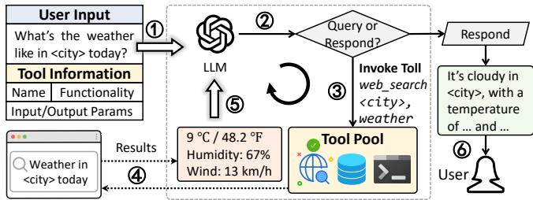  
Figure 3: An illustrative workflow of LLM agents.

Furthermore, multiple agents can work together to solve complex tasks. For instance, SoA [29] enables automated large-scale code generation and optimization. As in real-world application development, complex programming tasks can be decomposed into sub-tasks and solved collaboratively.

## 2.3 Agent Meets O&A

As discussed in § 2.1, manually executing the O&A process demands highly specialized domain expertise and substantial human efort, even for experienced developers. Therefore, we propose AgentDP that fully automates the O&A process by orchestrating multiple toolenabled agents, ofering unique advantages over manual model optimization and adaptation. 1) Eficiency Enhancement. AgentDP achieves enhanced development eficiency, as it presents end-to-end full automation (from hyperparameter tuning and execution environment configuration to model deployment) with minimal human intervention. 2) Reliability Enhancement. AgentDP improves the reliability of O&A automation. Armed with information retrieval tools, AgentDP can complement agents with domain knowledge needed in the O&A process. AgentDP also helps users elicit their requirements to avoid misunderstanding user intents.

## 3 SYSTEM OVERVIEW

Fig. 4 illustrates the overall workflow of AgentDP, consisting of four specialized agents that collaboratively execute the model O&A process to fulfill the user requirements for embedded AI model deployment.

Prerequisites. 1) AgentDP uses cloud LLMs (e.g., GPT-4) for enhanced performance and robustness. 2) AgentDP is deployed on an edge server and accesses the target device via a local network to enable remote access and control. 3) Model inference and evaluation are entirely performed on target devices to preserve data privacy. Only inference results are transmitted to AgentDP for further model optimization. 4) We provide the following tools for AgentDP: a web search engine, a vector database, a graph database, a Python executor within a sandbox, and a document loader.

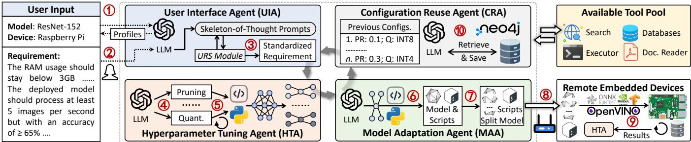

Figure 4: The system overview and workflow of AgentDP with four specialized agents.  
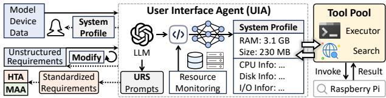  
Figure 5: The workflow of User Interface Agent.

Workflow. From the user’s perspective, she only needs to provide the model name, the target device name, and real-time performance requirements for deployment. Upon receiving this input, AgentDP coordinates the four agents to automatically execute the O&A process and present the final deployment results to the user.

• User Interface Agent (UIA) first constructs detailed profiles of the model and the target device (①), serving as references for the user to elicit her requirements for deployment (②). UIA then utilizes the user requirement standardization module to iteratively refine and structure the requirement into a standardized format with precise semantics (③).

• Hyperparameter Tuning Agent (HTA) is then guided to first generate a list of optimizable hyperparameters (④) and then synthesize a script for automated hyperparameter tuning (⑤). After iterative optimization, multiple optimized models that meet resource constraints are generated.

• Model Adaptation Agent (MAA) translates these models into portable models and generates a script to split the models into multiple parts via our operator-aware model partition module (⑥). MAA further synthesizes a script that can be executed on the target device to perform inference using our cross-engine inference pipeline (⑦). The partitioned model and the script are then transmitted to the target device (⑧), which monitors the real-time performance using its local data and sends the results back to HTA as feedback to start a new optimization round (⑨).

• Configuration Reuse Agent (CRA) further optimizes HTA by reusing and storing previous hyperparameter configurations (⑩) during the model optimization process, thereby enhancing AgentDP’s overall eficiency without searching from scratch.

Remarks. The four agents closely collaborate by proactively invoking tools and sharing: model and device profiles, standardized user requirements, hyperparameter configurations, and model evaluation results on the embedded device.

## 4 SYSTEM DESIGN

## 4.1 User Interface Agent (UIA)

The heterogeneity of AI models and embedded devices makes it dificult even for experienced developers to clearly and comprehensively articulate their requirements using natural language (e.g., "The model should achieve an acceptable accuracy on the device"). This poses significant challenges for LLM agents to accurately interpret the requirements and verify whether they are ultimately fulfilled (§ 6.6.1). To tackle this problem, we employ UIA to serve as the user interface to help users iteratively elicit clear and structured requirements. As shown in Fig. 5, UIA contains two main modules, i.e., system profiling and user requirement standardization (URS).

4.1.1 System Profiling. To provide users with a concise overview of the specified model and the target device, this module presents the resource consumption information of the model and the hard ware capabilities of the target device.

Model Profiling. Given the name of a large model as user input, UIA first invokes the web search tool to download its parameters from open-source platforms (e.g., Hugging Face). UIA then generates a script to deploy the model on a powerful server and perform inference tasks. The resource consumption information (i.e., model size, GPU memory usage, and RAM usage) is recorded and formatted as the model profile.

Device Profiling. Given the name of a target embedded device (e.g., Jetson Nano) for model deployment, UIA invokes the web search tool to retrieve detailed specs of the device from its oficial website. Then, we utilize few-shot prompts [17] to instruct UIA to process and format the retrieved contents into a structured device profile, including key specifications such as CPU, GPU, RAM, disk storage, connectivity, I/O ports, and operating system.

The constructed system profiles are further processed by the next user requirement standardization module.

4.1.2 User Requirement Standardization (URS). Although using JSON or fill-in-the-blank UIs to capture clear user requirements appears promising, these methods often fail to accommodate the fluid and non-deterministic nature of user requirements. Instead, we adopt a Tree-of-Thought (ToT) [68] method to elicit clear and consistent requirements from the users through multiple rounds of UIA-user interaction. Intuitively, the ToT-based approach helps users sort out ideas and facilitates systematic refinement of user requirements through multi-path reasoning, efectively resolving ambiguities and inconsistencies. Our design includes two main con siderations: 1) model deployment often involves multiple performance metrics and even experienced users may not clearly express the requirements within a single attempt; 2) users often express vague or inconsistent requirements that can lead to suboptimal model selection or system failures.

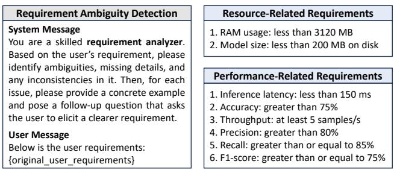  
(a) Prompt for ambiguity detection  
(b) Standardized user requirement  
Figure 6: (a) AgentDP prompts UIA to identify ambiguities and request the user to make clarification; (b) The standardized user requirements with clear structures.

We first categorize user requirements for model deployment into two aspects: (1) Resource requirements are task-agnostic that specify resource constraints for model deployment and inference, including RAM usage, GPU memory usage, and model size (i.e., the storage size of model parameters on local disks). (2) Performance requirements specify various metrics (e.g., accuracy, precision, throughput, etc.) evaluated during real-time inference on the target device. Next, to help the user iteratively elicit her requirements progressively, UIA leverages a ToT-based approach to exploit multiple reasoning paths simultaneously, enabling more structured, coherent, and accurate decision-making. ToT 1: UIA presents the obtained system profiles for the user as references. ToT 2: UIA analyzes the system profiles and generates a list of possible metrics for the user. For example, the metrics may include classification accuracy for image recognition models and tokens per second for language models. The user can then selectively specify her requirement for those metrics. ToT 3: AgentDP prompts (Fig. 6(a)) UIA to detect ambi guities, missing details, and inconsistencies in the requirements (e.g., "The model should achieve a high accuracy"). Based on the detection results, UIA is further instructed to provide examples of well-defined requirements and pose follow-up questions to elicit further clarification from the user. For instance, "Example: The model should achieve a classification ofat least 90%; Question: What is the minimum proportion ofsuccessfully recognized images?"

Moreover, UIA is explicitly prompted to identify any requirements that conflict with the system profile and accordingly suggest appropriate values for the user. For instance, if the original model achieves a maximum throughput of five samples per second on the edge server, the expected value on the target embedded device should not exceed this limit. Through multiple iterations of the "requirement → detection → question → clarification" cycle, user requirements are progressively refined into a clear format. As shown in Fig. 6(b), each line consists of two elements: an evaluation metric and an expected value. The standardized user requirements are then passed to HTA and MAA for further processing.

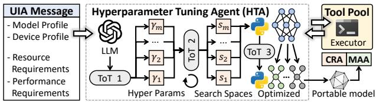  
Figure 7: The workflow of Hyperparameter Tuning Agent.

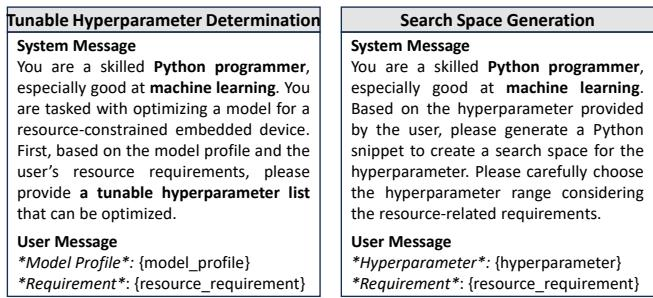  
(a) The prompt template for tunable hy- (b) The prompt template for search space perparameter determination generation  
Figure 8: Example of ToT-based prompts.

Remarks. By converting vaguely expressed user requirements into well-structured formats with clear semantics, other agents can efectively parse and verify them during iterative optimization and evaluation ofthe deployed model.

## 4.2 Hyperparameter Tuning Agent (HTA)

Given the system profiles and the standardized user requirements from UIA, HTA tailors models for resource-constrained devices by tuning various hyperparameters for optimization. However, determining appropriate search spaces for various hyperparameters and selecting optimal sets requires highly specialized domain expertise (§ 2.1). To tackle this issue, we meticulously design several ToT prompts and explicitly instruct HTA to comprehensively analyze the system profiles and resource requirements. As shown in Fig. 7, HTA contains the following three stages:

Tunable Hyperparameter Determination (ToT 1) AgentDP prompts (Fig. 8(a)) HTA to first generate a comprehensive tunable hyperparameter set (e.g., batch size, pruning rate, quantization level, etc.) that can reduce resource consumption of the model. This step can be regarded as identifying multiple branches (i.e., tunable hyperparameters) within the optimization tree. Next, HTA is instructed to filter out hyperparameters that modify model archi tectures (e.g., layer number, activation function). Adjusting these hyperparameters in a well-trained model may cause unexpected performance degradation, as it disrupts the learned feature representations, leading to a mismatch between the new architecture and previously optimized weights [41].

Search Space Generation (ToT 2) For each filtered hyperparameter, AgentDP further employs Chain-of-Thought (CoT) [62] prompts that instruct HTA to: 1) Analyze the resource profiles of the original large model and the corresponding resource requirements; 2) Generate an appropriate search range for the hyperparameter (Fig. 8(b)). For instance, if the parameter size of the original model is 100 MB while the user specifies that the parameter size of the optimized model should be less than 80 MB, the pruning rate can range within [0.2, 0.5]. Moreover, HTA is instructed to relax the range a little (e.g., [0, 0.5]), considering that other optimization methods are simultaneously applied during optimization.

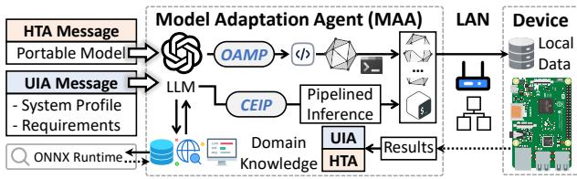  
Figure 9: The workflow of Model Adaptation Agent.

Optimal Hyperparameter Searching (ToT 3) AgentDP prompts HTA to create a comprehensive multi-objective optimization function that takes tunable hyperparameters as input variables, aiming to minimize the resource consumption of the optimized model. Ac cordingly, HTA generates a script that performs iterative hyperparameter tuning to identify multiple hyperparameter sets that satisfy all resource requirements. Finally, HTA synthesizes a script that translates the original model into multiple optimized portable mod els by applying the identified hyperparameter sets. The portable models are then sent to MAA for model adaptation.

Remarks. Hyperparameter filtering and appropriate search space determination leverage LLMs’ extensive world knowledge, enhancing the reliability and eficiency of model optimization. Notably, more advanced hyperparameter searching algorithms (e.g., BOHB [22]) can also be further integrated orthogonally in the script synthesized by HTA for enhanced model optimization performance.

## 4.3 Model Adaptation Agent (MAA)

To cater to heterogeneous embedded AI environments, we need to adapt portable models to the target device via various inference engines. However, the operators used by portable models may not be fully supported by a single inference engine (§ 2.1). Existing solutions either rely on fallback environments (e.g., CPU) for model execution or continuously develop new cross-platform frameworks to support additional operators, both of which are ineficient and cumbersome. To tackle this problem, we propose MMA (Fig. 9), which features an operator-aware model partition module that divides the portable model into multiple partitions, each compatible with a diferent inference engine. Accordingly, MMA also employs a cross-engine inference pipeline to arrange the model partitions and perform inference tasks on the target device by switching between diferent engines.

4.3.1 Operator-Aware Model Partition (OAMP). Generally, a portable model is represented as a Directed Acyclic Graph (DAG), where nodes correspond to operators (e.g., Add, Conv, Relu), and edges represent tensors that store data flowing between these operators. Fig. 10(a) provides a DAG example of a residual block from a portable model. Each operator in the DAG includes its properties (e.g., type), attributes (e.g., padding), and I/O parameters. Such a graph structure can be parsed by diferent inference engines to perform inference tasks according to the DAG. Nonetheless, the operator set supported by a single inference engine may not cover all the operators used in a portable model. For example, TensorRT does not support the Mod operator while ONNX Runtime does [10, 11]. To address this problem, we propose the OAMP module to split a portable model into multiple parts, ensuring that each partition can be executed on diferent but compatible inference engines. Specifically, our OAMP module contains two key stages: the operator availability check and the greedy partitioning algorithm.

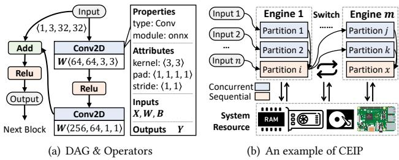  
Figure 10: (a) A sample DAG with its operators from part of a portable model; (b) Our CEIP module.

The operator availability check analyzes the operators used by the portable model and those supported by distinct inference engines. Specifically, AgentDP first instructs MAA to synthesize a tailored script that analyzes the DAG of the portable model and produces a list of the operators used. Next, MAA is prompted to generate a list of inference engines compatible with the target device. For each engine, MAA invokes the web search tool to retrieve a detailed list of supported operators. In addition, MAA estimates the inference latency of each operator across all supported engines.

The greedy partition algorithm aims to minimize the total inference latency while preserving operators’ dependency consistency. Specifically, for each operator used by the portable model, three cases are considered: 1) If the operator is supported by multiple inference engines, it is assigned to the one with the lowest latency (e.g., TensorRT for Jetson Nano). 2) If the operator is supported by only one engine, it is directly assigned to that engine. 3) If the operator is not supported by any available engine, it is assigned to a fallback execution environment (e.g., CPU). Furthermore, considering the overhead incurred when transferring data and control signal between diferent engines, i.e., context switching [66], we introduce an additional condition. When assigning an engine diferent from the one used for the previous operator, we calculate the sum of the context-switching time and the inference latency using the new engine. If the computed time exceeds the inference time using the previous engine, the current operator is assigned to the previous engine; otherwise, it is assigned to the new engine. After such a greedy approach, MAA generates a list of model partitions with their corresponding inference engines. This method ensures that the model partitioning process is both eficient and adaptive to the heterogeneous capabilities of diferent inference engines in embedded environments while minimizing the performance penalties caused by context switching.

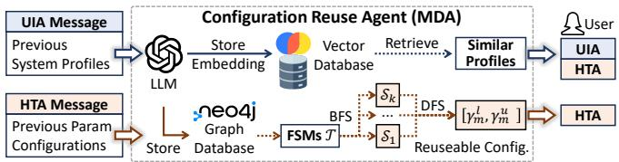  
Figure 11: The workflow of configuration reuse agent.

4.3.2 Cross-Engine Inference Pipeline (CEIP). To minimize context switching overhead and ensure eficient data flow between model partitions during inference, we propose the CEIP module to implement a pipelined inference paradigm across multiple engines, as illustrated in Fig. 10(b). Specifically, MAA first loads each model partition onto its assigned inference engine, ensuring that memory and data alignment are consistent across diferent execution envi ronments. Inference is then performed sequentially or concurrently, depending on the dependency structure of the portable model’s DAG. Data transfer between partitions is optimized using shared memory and direct memory access (DMA) to minimize context switching time. Additionally, before context switching, CEIP prefetches the input of the next partition while the current partition is still executing. This design efectively exploits the strengths of diferent inference engines (e.g., TensorRT’s GPU acceleration) to maximize inference eficiency and reduce execution latency.

4.3.3 Model Evaluation. With the model partitions and the inference pipeline, the target device performs inference on its local data and monitors the real-time performance, which is then sent to MAA. For each portable model’s monitoring results, MAA judges whether all performance requirements are satisfied. If they are met, the hyperparameter configuration is delivered to CRA and the monitoring results are presented to the user. Till now, a single round of the model O&A process is completed. The user can either select a preferred configuration for model deployment or choose to continue optimizing the model, in which case AgentDP will initiate a new round and repeat the automated O&A process until the user is satisfied with the final deployment result.

Remarks. As the supported operators evolve with version updates and iterations of diferent inference engines, all the scripts and algorithms need to be automatically and dynamically implemented by MAA through our meticulously designed prompts to deal with heterogeneous embedded AI environments. The OAMP and CEIP modules fully exploit the extensive world knowledge and the pro gram synthesis capabilities of LLM agents, enhancing the reliabil ity and eficiency of model inference on embedded devices. Note that more advanced and eficient model inference strategies (e.g., prefetching [31] and virtual memory [32]) can also be orthogonally integrated for enhanced eficiency.

## 4.4 Configuration Reuse Agent (CRA)

During model optimization, we observe that hyperparameter tuning often becomes time-consuming, though much faster than manual tuning. This is because AgentDP currently generates a completely new search space for each user request, resulting in heavy computational overhead, long waiting times, and poor user experiences. Can we progressively accelerate hyperparameter tuning to further enhance the eficiency ofAgentDP? Our insight is that, as system utilization increases, AgentDP accumulates numerous historical hyperparameter configurations, which can potentially be reused for new but similar models. To this end, as shown in Fig. 11, we develop CRA that maintains two databases: one for system profiles and another for hyperparameters.

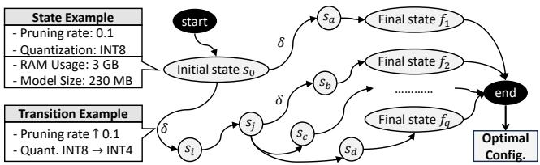  
Figure 12: FSM for hyperparameter tuning modeling.

4.4.1 Profile Reuse. Model profiles record the resource consumption of the original large model, while device profiles include specs of the target device (§ 4.1.1). For each unique model and embedded device, CRA stores the constructed profiles in a vector database, respectively. When a user specifies the same model or device, CRA retrieves the previously stored profiles from the database and delivers them to UIA and HTA for further processing.

4.4.2 Hyperparameter Reuse. We model each hyperparameter tuning process as a finite state machine (FSM) [36] and store the constructed FSM in a graph database. When optimizing a new large model, CRA first retrieves several similar FSMs and then accordingly determines narrowed search spaces for eficient hyperparameter tuning.

FSM-Based Modeling. Fig. 12 illustrates an example of an FSM, where each node represents a state (i.e., an optimized model), including a hyperparameter configuration and the corresponding resource consumption. The initial state corresponds to the original model and the terminal states represent a set of optimized models that satisfy all resource requirements. The directed line between two nodes denotes a state transition that occurs when a hyperparameter is modified during tuning. For example, when the pruning rate increases from 0.1 to 0.2, the memory usage of the optimized model may change from 90 MB to 80 MB. As such, an FSM can be constructed and regarded as a unique feature for each model after hyperparameter tuning, which is represented as:

$$
\begin{array} { l } { H = ( S , s _ { 0 } , \delta , F ) } \\ { s _ { i } \xrightarrow { \delta } s _ { j } , \forall s _ { i } \in S , \forall s _ { j } \in S } \\ { F = \{ f _ { 1 } , f _ { 2 } , \cdot \cdot \cdot , f _ { q } \} \subset S } \end{array}\tag{1}
$$

where � is a set of states (i.e., optimized models), � represents the initial state, � is the state transition function that transitions from �� to �� by modifying tunable hyperparameters, and � is a set of final states. With the automatically constructed FSM by HTA after hyperparameter tuning, CRA stores it into a dynamically maintained graph database D.

Similar FSM Retrieval. Given the profile of a new model for optimization, CRA searches the FSM database and retrieves the top-� FSMs whose initial resource consumption profiles are similar to the current one. Specifically, considering each resource metric (e.g., model size, RAM, GPU memory) in the profile, we define resource profile similarity (RPS) between the new model and each FSM in the database as:

$$
R P S _ { i } = \frac { | \boldsymbol { r } _ { i } ^ { 1 } - \boldsymbol { r } ^ { 1 } | } { r ^ { 1 } } + \frac { | \boldsymbol { r } _ { i } ^ { 2 } - \boldsymbol { r } ^ { 2 } | } { r ^ { 2 } } + \cdot \cdot \cdot + \frac { | \boldsymbol { r } _ { i } ^ { N } - \boldsymbol { r } ^ { N } | } { r ^ { N } } \forall r _ { i } ^ { j } \in \mathcal { D }\tag{2}
$$

where $r ^ { N }$ is the consumption of the �-th resource metric of the new model, $r _ { i } ^ { N }$ is the consumption of the �-th resource metric of the �-th FSM. A smaller RPS value indicates a higher similarity between the new model and the FSM. The selected top-� similar FSMs are denoted as $\mathcal { T } = \{ H _ { 1 } , H _ { 2 } , \cdot \cdot \cdot , H _ { k } \}$

Hyperparameter Reuse. Given a list of similar FSMs retrieved from the database, CRA will find a set of appropriate hyperparameters for reuse. Specifically, CRA first performs a breadth-first search (BFS) starting from the initial state of each selected FSM and obtains a list of states including their hyperparameter configurations:

$$
\begin{array} { r l } & { \mathcal T = \{ S _ { 1 } , S _ { 2 } , \cdot \cdot \cdot , S _ { k } \} , \ \forall S _ { i } \subset S _ { i } } \\ & { S _ { i } = \{ s = \{ \gamma _ { 1 } ^ { i } , \gamma _ { 2 } ^ { i } , \cdot \cdot \cdot , \cdot , \gamma _ { m } ^ { i } \} \ | \ \forall s \ \mathrm { a d j a c e n t } \ \mathrm { t o } \ s _ { 0 } ^ { i } , \ s _ { 0 } ^ { i } \in S _ { i } \} } \\ & { \Gamma _ { m } = \{ \gamma _ { m } ^ { 1 } , \gamma _ { m } ^ { 2 } , \cdot \cdot \cdot , \gamma _ { m } ^ { i } \} , \ \forall \gamma _ { m } ^ { i } \in S _ { i } } \end{array}\tag{3}
$$

where $S _ { i }$ is a set of states adjacent to the initial state $s _ { 0 } ^ { i }$ from the �-th selected FSM, $\gamma _ { m } ^ { i }$ is the value of the �-th hyperparameter of an adjacent state, and $\Gamma _ { m }$ is a list of the �-th hyperparameter from all adjacent states. For each hyperparameter in $\Gamma _ { m }$ , the lower bound of the �-th hyperparameter’s search space is defined as the minimum value of the list:

$$
\gamma _ { m } ^ { l } = \operatorname* { m i n } ( \Gamma _ { m } )\tag{4}
$$

The rationale behind such design is that, during tuning, hyperparameters are typically initialized with small values to minimize initial performance degradation [63]. Consequently, the states obtained after BFS contain smaller values among all the hyperparameters. Next, CRA conducts a depth-first search (DFS) to traverse the entire FSM and record the maximum value of the �-th hyperpa rameter, serving as the upper bound of its search space:

$$
\gamma _ { m } ^ { u } = \operatorname* { m a x } \{ \gamma _ { m } ^ { 1 } , \gamma _ { m } ^ { 2 } , \cdot \cdot \cdot , \gamma _ { m } ^ { j } , \cdot \cdot \cdot \}\tag{5}
$$

where $\gamma _ { m } ^ { j }$ denotes the �-th value of the �-th hyperparameter value within the traversed path. As such, the search space for the �- th hyperparameter is $[ \gamma _ { m } ^ { l } , \gamma _ { m } ^ { u } ]$ , which is narrower compared to creating a new search space.

Remarks. We design meticulously crafted prompts and interfaces for CRA to automatically access the graph database and analyze the FSMs. Experiments (§ 6.6.2) reveal that CRA can reduce the time required for model optimization by up to 74%, significantly enhancing both user experience and system eficiency with reduced computation overhead.

## 5 EXPERIMENT SETUP

## 5.1 Implementation

Hardware. We implement and deploy AgentDP on an edge server and deploy various models on three embedded devices: a Raspberry Pi, a Jetson Nano, and an embedded mini PC. The edge server and the embedded devices are connected via a router within a local area network. Table 1 shows the hardware configurations of the devices. Software. We develop AgentDP with 2,683 lines of Python code. We use LangChain [18] to construct LLM agents. Tavily [8] and Firecrawl [4] are selected as the web search tools. We choose Chroma [3] as the vector database for storing system profiles and use Neo4j [6] as the graph database to store FSMs for eficient hyperparameter reuse. We implement a communication interface for AgentDP to support remote access and control of target devices. We also build a Python executor within a sandbox [44]. GPT-4o [28] serves as the backend LLM of AgentDP and text-embedding-ada-002 [7] is used for embedding. We integrate the Optuna package [16] with AgentDP for HTA to find multiple optimal hyperparameter sets. For embedded AI models, we use PyTorch [49] framework to run the original model and translate it into ONNX [2] as the portable model. We implement our cross-engine inference pipeline considering the following inference engines: ONNX Runtime [1], TensorRT [46], OpenVINO [9], TVM [19], and MLIR [34]. Reflexion [61] is used to ensure the correctness of intermediate outputs.

## 5.2 Embedded AI Applications & Datasets

Based on the input data modality, model architecture, and device heterogeneity, we select three representative embedded AI applications: image recognition (visual), speech sentiment analysis (audio), and visual-language understanding (multimodal). 1) Image Recognition (IR) on embedded devices enable real-time processing and analysis of visual data in areas such as autonomous driving [25] and healthcare [47]. We select a pre-trained CNN-based ResNet-152 [24] model and instruct AgentDP to deploy it on a Raspberry Pi. We evaluate the deployed model on a subset of the ImageNet dataset [20], containing 100,000 RGB images in 1,000 classes. 2) Speech Sentiment Analysis (SSA) on audio data involves analyzing speech patterns and pitch to determine the emotional tone of spoken content, enabling smart voice assistants, customer service interactions, etc. We select the fine-tuned CNN+Transformer-based Whisper model3 and deploy it on a Jetson Nano. We evaluate the deployed model using the TESS [50] dataset that has 2,800 audio samples of seven types of emotions. 3) Vision-Language Understanding (VLU) leverages Vision-Language Models (VLMs) to interpret and describe general images (e.g., logical diagrams and formula recognition), enabling applications such as visually impaired assistant [72]. We select the pre-trained multimodal Transformer-based DeepSeek-VL-1.3b [42] as the VLM model and prompt AgentDP to deploy it on an embedded mini PC with 12 GB of GPU memory. We evaluate the deployed model on the MMMU benchmark [70], containing 11.5K meticulously collected image understanding questions covering six core disciplines, i.e., art & design, business, science, medicine & healthcare, humanities, and technology & engineering. Note that the fine-tuned Whisper model and the VLM use certain operators (e.g., LayerNormalization, FusedConv) that are not fully supported by any single inference engine.

## 6 EVALUATION

## 6.1 Metrics

We adopt three types of metrics to evaluate the real-time performance of the deployed models during inference: 1) Resource Consumptions. We measure the maximum RAM usage, the maximum GPU memory usage, and the model size. Model size refers to the amount of disk space required to store the parameters of the embedded model. 2) Task Accuracy. For IR and SSA, we record the classification accuracy, precision, recall rate, and F1 score to assess how efectively the on-device model recognizes objects from input images or identifies emotions from audio data. For VLU, we measure the micro-averaged accuracy as defined by the MMMU benchmark itself. 3) Real-time Performance. For IR and SSA, we monitor the throughput, i.e., the number of processed data samples per second. For VLU, we compute the tokens per second (TPS) to evaluate the token generation speed of the embedded VLM. (4) Wall-clock time. To measure the overall eficiency of AgentDP, we record the wall-clock time from the moment a user specifies her requirements to the generation of the final embedded model deployment results.

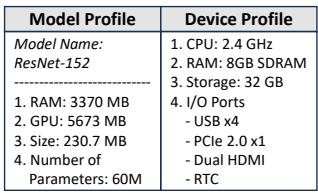  
(a) System profiles (simplified)

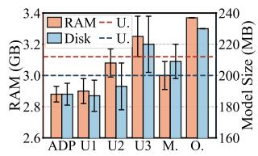  
(b) Resource consumptions

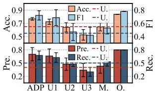  
(c) Task accuracy

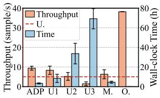  
(d) Real-time performance

Figure 13: Evaluation results of image recognition (ADP for AgentDP, M. for MapCoder, and O. for the original large model; Acc. for classification accuracy, Pre. for precision, Rec. for recall rate, and F1 for F1 score; the horizontal lines represent the user requirement (U.) for model deployment).  
Table 1: Detailed information of the embedded devices.
<table><tr><td>Type</td><td>Device</td><td>RAM</td><td>VRAM</td><td>Storage</td></tr><tr><td rowspan="3">Embedded Device</td><td>Raspberry Pi 5</td><td>8GB</td><td>-</td><td>32GB</td></tr><tr><td>Jetson Nano</td><td>4GB</td><td>4GB</td><td>64GB</td></tr><tr><td>IBOX-606 mini PC</td><td>32GB</td><td>12GB</td><td>256GB</td></tr><tr><td>Router</td><td>Mi AX3000</td><td>256MB</td><td>-</td><td>-</td></tr><tr><td>Edge Server</td><td>Supermicro X11SCA-F</td><td>32GB</td><td>16GB</td><td>1T</td></tr></table>

## 6.2 Baselines

To the best of our knowledge, no existing system in literature can automatically execute the O&A process for heterogeneous embedded devices [57]. We select the best representative baselines, including: 1) Original Models (O.), i.e., ResNet-152, the fine-tuned Whisper, and DeepSeek-VL-1.3b. 2) MapCoder [30], a SOTA multi-agent system tailored for complex programming tasks. We prompt MapCoder to synthesize programs for model optimization and adaptation, which are then manually executed for model deployment. 3) Human baselines. We invite 15 developers and evenly divide them into three groups based on their self-assessed development experience and expertise. User Group 1 (U1) are experts with extensive experience in deploying open-source models on various embedded devices. User Group 2 (U2) are semi-experts who only have extensive experience in training and optimizing AI models but with basic knowledge about embedded devices and model deployment. User Group 3 (U3) are non-experts who have limited knowledge of AI models and embedded devices with little practical experience. The evaluation process was reviewed and approved by our institution’s ethics review board.

## 6.3 Image Recognition Evaluation

6.3.1 System Profiles & User Requirements. Fig.13(a) illustrates the system profiles, where the original ResNet-152 model requires around 3.3 GB of RAM, with a model size of 230 MB. After removing ambiguities, the clarified user requirement (before standardization) is:

To deploy the ResNet-152 model on a Raspberry Pi 5, the RAM usage should stay below 3.12 GB. The model parameters should take up less than 200 MB of disk space. The system should process at least 5 images per second while maintaining a top-1 accuracy ≥ 65%, precision ≥ 0.4, recall rate ≥ 0.5, and F1-score ≥ 0.45.

6.3.2 Overall Performance. Due to large hyperparameter search spaces, AgentDP may generate optimized models with distinct performance. To accommodate such randomness, we repeat the evaluation 20 times and obtain a set of diferent optimized models. We then measure the metrics defined in § 6.1 and report the average values with their variances. From Fig. 13, we observe that: 1) The model deployed by AgentDP achieves a higher accuracy (over 13.8% on average) while consuming fewer resources (reducing RAM usage by 14.5% on average). 2) AgentDP exhibits more consistent performance with smaller variances, whereas human baselines exhibit substantial fluctuations, especially in wall-clock time. 3) AgentDP significantly reduces the time required for executing the O&A process. Specifically, AgentDP takes only 3.3 hours in total, with 2.8 hours spent on hyperparameter tuning, 0.3 hours on model adaptation, and 0.2 hours on information retrieval (e.g., searching). In contrast, even experts like U1 took substantial time (around 6 hours) on hyperparameter tuning to find a trade-of between model accuracy and resource consumption. 4) The model deployed by AgentDP can sometimes achieve higher accuracy with fewer resources and higher throughput. These results highlight the exceptional eficiency of AgentDP in finding optimal hyperparameters and generating highperformance optimized models for deployment. Such advances stem from our eficient multi-agent collaboration framework that fully automates the entire O&A process using enhanced domain knowledge retrieved by various third-party tools.

## 6.4 Speech Sentiment Analysis Evaluation

6.4.1 System Profiles & User Requirements. As shown in Fig. 14(a), the Whisper model (fine-tuned on several audio data)

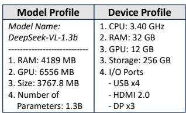

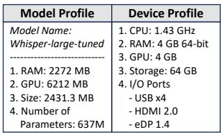  
(a) System profiles (simplified)

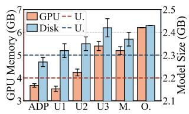  
(b) Resource consumptions

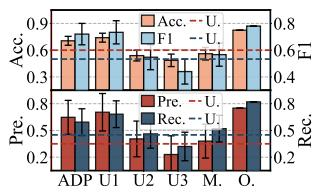  
(c) Task accuracy

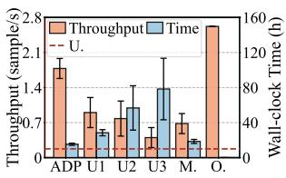  
(d) Real-time performance

Figure 14: Evaluation results for speech sentiment analysis (SSA).  
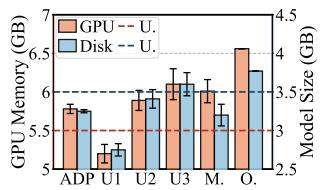  
(a) System profiles (simplified)  
(b) Resource consumptions

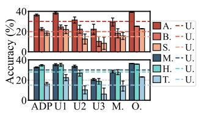  
(c) Task accuracy

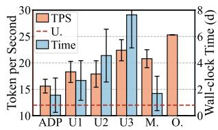  
(d) Real-time performance  
Figure 15: Evaluation results for vision-language understanding (In (c), A. for art & design, B. for business, S. for science, M. for medicine & healthcare, H. for humanity, and T. for technology & engineering).

needs around 6.2 GB of GPU memory, significantly exceeding the maximum GPU memory of a Jetson Nano (4 GB). The user requirement before standardization is:

To deploy Whisper-large-v3 on Jetson Nano, the model should consume less than 4 GB of GPU memory. The model parameters should take up less than 2.3 GB of disk space. The system should process at least one audio sample per second with a top-1 accuracy ≥ 60%, precision ≥ 0.35, recall rate ≥ 0.45, and F1-score ≥ 0.4.

6.4.2 Overall Performance. SSA using the fine-tuned Whisper model is more complex than image recognition due to the model’s larger size and more complex operators. Fig. 14 shows the overall performance ofSSA. We have four key findings: 1) Only AgentDP satisfies both resource and performance requirements, while the baselines fall short in diferent aspects. For example, to achieve high task accuracy, U1 sacrifices more disk space to store model pa rameters. Besides, to save GPU memory, U1 adopts a smaller batch size during inference, leading to a much lower throughput (49% less than AgentDP). 2) Despite considerable efort, U2 and U3 fail to meet most user requirements due to the high complexity of the Whisper model and their lack of expertise in model optimization. On the contrary, we analyze the model optimization code generated by AgentDP and find that it even adopts a pruning method tailored for Transformer-based models [35]. 3) Although MapCoder completes the O&A process in a comparable amount of time to AgentDP, it delivers lower performance even than semi-experts while consuming more resources. This is because MapCoder is a general programming agent without specialized domain knowledge in embedded AI and thereby cannot efectively handle specific O&A tasks. 4) AgentDP takes significantly less time (17 hours) to finish the O&A process, whereas U2 and U3 take about 60 hours and 80 hours, respectively. The underlying reasons are twofold. During model optimization, AgentDP eficiently reuses previous hyperparameters to narrow down search spaces and accelerate model optimization while U2 and U3 rely primarily on brute-force search. During model adaptation, U2 and U3 repeatedly fail to deploy the optimized model due to mismatched operators and Jetson Nano’s complex inference environment. As a result, they resort to executing the model on the CPU, leading to much lower inference speed and throughput. In contrast, AgentDP partitions the model using our OAMP module and selectively switches between diferent engines via our CEIP module for eficient model inference. These results further showcase that AgentDP can eficiently perform model optimization even for complex models while accommodating heterogeneous embedded AI environments with enhanced reliability.

## 6.5 VLU Evaluation

6.5.1 System Profiles & User Requirements. Fig. 15(a) illustrates the system profiles for the Visual-language Understanding (VLU) application. The clarified user requirement before the standardization process is:

To deploy DeepSeek-VL-1.3b on the edge PC, the GPU memory usage should stay below 6 GB. The model size should be less than 3.5 GB. The system should generate responses at a speed of at least 12 tokens per second. For topics in art, business, science, medicine, humanities, and technology, the average accuracy should be 30%, 20%, 15%, 30%, 28%, and 15%, respectively.

6.5.2 Overall Performance. Fig. 15 shows the overall performance of the VLM. We find that: 1) AgentDP’s ability to reduce the time required for the O&A process becomes more evident with larger models. Specifically, AgentDP can achieve up to an 80% reduction compared to human baselines. U2 and U3 even spend more than 4 days to finish the task due to their unfamiliarity with VLMs. 2) The overall accuracy of AgentDP is slightly lower than that of U1. A deeper investigation reveals that U1 downloads several VLU datasets (e.g., MMBench [40]) and fine-tunes the optimized model to further enhance its performance. Thus, we can also add more tailored prompts to instruct AgentDP to proactively adopt more advanced techniques (e.g., fine-tuning) to further improve the optimized model. These results exhibit the outstanding eficiency of AgentDP, even when confronted with large models, stemming from our four fully automated and collaborative agents with enhanced domain expertise.

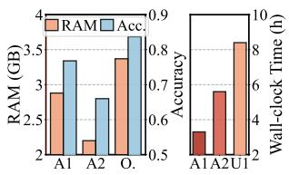  
(a) Ablation on URS

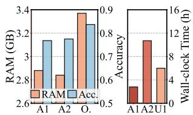  
(b) Ablation on configuration reuse  
Figure 16: Ablation study on image recognition (A1 for the original AgentDP, A2 for AgentDP without the URS module or CRA, and O. for the original large model).

## 6.6 Ablation Study

We conduct ablation studies to evaluate the impact of the technical modules in AgentDP. For demonstration purposes, we use image recognition as an example, though similar phenomena are also observed in the other two applications.

6.6.1 User Requirement Standardization. We directly input the raw user requirements into AgentDP to execute the model O&A process. As shown in Fig. 16(a), without our URS module, the deployed embedded model not only exhibits a significant classification accuracy drop (around 10%) but also requires considerably more time to find a valid hyperparameter configuration. Further analysis of the source code generated by AgentDP reveals that naturallanguage-described user requirements make it more dificult for HTA to interpret and verify each requirement. As a result, HTA creates fuzzy search spaces for hyperparameter tuning, resulting in prolonged optimization time. This underscores the importance of our URS module in helping AgentDP gain a clear and comprehensive understanding ofuser requirements so that they can be efectively processed and verified.

6.6.2 Configuration Reuse Agent. We first remove CRA by searching hyperparameters from scratch without reusing historical hyperparameters and then record the total time used for model optimization. As shown in Fig. 16(b), removing CRA dramatically increases the time required for model optimization (even exceeding expert users U1), while providing only a minor improvement in task accuracy and RAM usage. This implies that by reusing retrieved previous configurations for hyperparameter tuning, CRA enables AgentDP to reduce the model optimization time by up to 74% without searching from scratch as system utilization increases.

Table 2: Participant information of user study (N=20)
<table><tr><td>Category</td><td>Background Information</td></tr><tr><td>Gender</td><td>Female (45%), Male (40%), Prefer not to say (15%)</td></tr><tr><td>Age</td><td>Under 18 (5%), 18-30 (75%), 30-39 (10%), 40 and older (10%)</td></tr><tr><td>Education</td><td>Bachelor (5%), Master (20%), Doctoral (70%), Others (5%)</td></tr><tr><td>English</td><td>Beginner (5%), Intermediate (20%), Advanced (65%), Fluent (10%)</td></tr><tr><td>Expertise</td><td>Expert (50%), Semi-expert (50%)</td></tr></table>

6.6.3 OAMP & CEIP. After removing our OAMP and CEIP module, we observe a significant decline in the token generation speed of the DeepSeek-VL model, dropping from 15.6 TPS to only 4.7 TPS. This reduction occurs because, without OAMP and CEIP, the portable model has to be executed on the CPU, as the model uses certain operators that are not fully supported by a single inference engine. This indicates that our OAMP and CEIP modules play a crucial role in improving model inference eficiency on embedded devices.

## 6.7 User Study for Generalizability Evaluation

To assess the utility, overall user satisfaction, and generalizability of AgentDP, we conduct a user study involving 10 new expert users and 10 semi-expert users. In order to test the generalizability of AgentDP, we did not limit the tasks. Instead, participants are explicitly asked to freely express their requirements for deploying various open-source models on embedded devices to evaluate system generalizability. Expert users have rich experience in model optimization and have developed multiple embedded AI applications, while semi-expert users are proficient in model optimization but possess only basic knowledge of embedded devices. Table 2 lists the detailed background information of the participants.

6.7.1 Metrics. We ask users to rate AgentDP based on five metrics: 1) Overall Model Performance (OMP) evaluates the overall performance of the deployed model on private data on the target device, considering resource consumption, task accuracy, and real-time performance; 2) Code Readability (CR) measures the clarity and structure of the generated code for the O&A process; 3) Eficiency of Model Optimization (EMO) assesses how eficiently AgentDP finds optimal hyperparameter sets for model optimization; 4) Eficiency of Model Deployment (EMD) evaluates how eficiently AgentDP adapts the optimized model to heterogeneous embedded devices for deployment; 5) User Satisfaction (US) captures users’ overall experience with AgentDP during usage. All metrics are rated on a scale from 1 (not at all) to 5 (completely).

6.7.2 Overall Performance. Fig. 17(a) shows the overall performance of the user study with averaged scores. Both experts and semi-experts provide high ratings (above 4.6) for AgentDP in terms ofOMP, CR, and US. However, semi-expert users tend to give higher scores than expert users for EMO and EMD. This discrepancy stems from semi-experts’ lack of extensive experience with various model optimization strategies and execution environment configurations tailored for heterogeneous embedded devices. As a result, they tend to under-specify their requirements and may occasionally introduce conflicting conditions. Thus, they are more likely to rate higher scores for optimization eficiency since AgentDP can efectively determine appropriate search spaces for hyperparameter tuning and automatically adapt portable models to the target device using device-specific inference engines. Such results exhibit AgentDP’s high generalizability in adapting various open-source models to heterogeneous embedded devices with enhanced user experience.

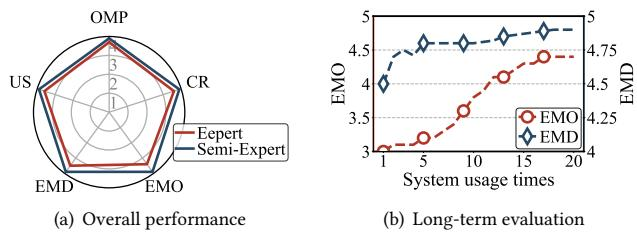

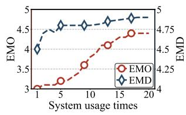  
Figure 17: User study.

6.7.3 Long-term Evaluation. We also invite expert users to participate in a long-term evaluation to investigate the impact on EMO and EMD as system utilization increases. Fig. 17(b) shows that with increasing user engagement, both EMO and EMD gradually increase, with EMO exhibiting faster growth. As system usage time increases, CRA stores more historical hyperparameter configurations in the graph database and can retrieve similar ones for reuse when new user requests arrive. Consequently, the search spaces for hyperparameter tuning gradually narrow, reducing the time required for finding optimal hyperparameter sets tailored for the resource-constrained target device, leading to a higher EMO score. Additionally, previous model profiles and device profiles can also be reused during deployment, resulting in increased EMD scores. These results demonstrate the outstanding usability and eficiency of AgentDP in long-term use.

## 7 DISCUSSION

Error Handling in Multi-Agent Systems. In LLM agent systems, a common challenge is the generation of incorrect intermediate results during multi-step reasoning. These errors can propagate and lead to incorrect final outputs, significantly impacting the reliability of the agent. To address this, AgentDP incorporates Reflexion [61] that enables agents to reflect on failed attempts and iteratively improve. Moreover, to further enhance the robustness of AgentDP in helping agents detect and recover from mistakes during multistep reasoning, we plan to orthogonally integrate more advanced techniques (e.g., ReAct [69]) as part ofourfuture work.

Decoupled HTA and MAA. HTA primarily focuses on reducing the resource consumption of large models via hyperparameter tuning, ensuring that embedded devices can accommodate them. The real-time performance (e.g., inference latency), however, is only recorded during model deployment on embedded devices. Thus, in multiple rounds of O&A optimization, HTA can only adjust hy perparameters for further optimization based on MAA’s feedback and present users with all applicable hyperparameter configurations that fully satisfy their requirements. To further enhance the eficiency in such an iterative process, we can orthogonally integrate real-time performance prediction models [71] with AgentDP to narrow down the search space during hyperparameter tuning.

## 8 RELATED WORK

Model Deployment on Embedded Devices. Most pre-trained models cannot be directly deployed on embedded devices due to limited resources and heterogeneous execution environments [48]. Existing works [33, 39] on model deployment to embedded devices focus on optimizing deep learning models for limited compute, memory, and energy budgets. However, hyperparameter tuning often requires multiple iterations of trial-and-error, resulting in substantial human efort even with SOTA hyperparameter tuning frameworks [16]. On the other hand, while numerous model deployment frameworks [1] exist, they are not tailored for heterogeneous embedded environments. Developers need to first generate portable models and deploy them on device-specific inference engines (e.g., ONNX Runtime [1]). Mastering such highly specialized knowledge poses huge challenges even for experienced experts. To deal with such heterogeneous environments, existing solutions either rely on fallback environments (e.g., CPU) for model execution or continuously develop new cross-platform frameworks (e.g., ExecuTorch [21]), both of which are ineficient and cumbersome. In addition, although container techniques (e.g., Docker [45]) can package dependencies to ease software portability, they often fail to support heterogeneous hardware architectures in embedded AI scenarios. To address these issues, instead of requiring developers to manually configure the model optimization and adaptation processes, AgentDP fully automates the whole O&A process with enriched domain knowledge, significantly reducing human efort with enhanced reliability.

LLM Agents. LLM agents [59] automate complex tasks by integrating LLMs with various third-party tools (e.g., web search engines). These agents can be applied to various applications, such as program synthesis [43, 56] and smart assistants [65]. Furthermore, some studies [26, 30] construct multiple agents to collaboratively accomplish complex tasks, allowing specialized agents to work together and adapt to dynamic environments eficiently. For example, MapCoder [30] solves competitive programming tasks via four agents that handle diferent development stages. Unlike Code LLMs like MapCoder, which are designed to synthesize general programs, AgentDP builds an automation chain to optimize and adapt open-source models for heterogeneous embedded devices, addressing unique technical challenges (e.g., model-engine mismatch) and significantly reducing human efort with enhanced model performance.

## 9 CONCLUSION

This paper presents AgentDP, a multi-agent automatic model optimization and adaptation (O&A) system for heterogeneous embedded AI applications. Armed with four specialized agents to address three distinct technical challenges, AgentDP significantly enhances the O&A eficiency with enhanced model performance. User studies demonstrate AgentDP’s high generalizability in adapting various open-source models to heterogeneous embedded devices with distinct user requirements. We believe AgentDP can unlock the potential to drive the practical deployment of open-source AI models across diverse and distributed embedded devices in real-world everyday applications.

## REFERENCES

[1] 2021. ONNX Runtime. https://onnxruntime.ai/.

[2] 2021. Open Neural Network Exchange. https://onnx.ai/.

[3] 2022. Chroma. https://github.com/chroma-core/chroma

[4] 2022. Firecrawl. https://github.com/mendableai/firecrawl

[5] 2022. Get Started With Jetson Nano Developer Kit. https://developer.nvidia.com /embedded/learn/get-started-jetson-nano-devkit.

[6] 2022. Neo4j. https://github.com/neo4j/neo4j

[7] 2022. OpenAI text-embedding-ada-002. https://platform.openai.com/docs/guide s/embeddings/embedding-models.

[8] 2022. Tavily. https://github.com/tavily-ai/tavily-python

[9] 2023. OpenVINO. https://github.com/openvinotoolkit/openvino.

[10] 2024. https://github.com/onnx/onnx-tensorrt/blob/84b5be1d6fc03564f2c0dba 85a2ee75bad242c2e/operators.md

[11] 2024. https://onnx.ai/onnx/operators/onnx\_\_Mod.html

[12] 2025. https://docs.docker.com/build/building/multi-platform/

[13] Sophia J Abraham, Kehelwala DG Maduranga, Jefery Kinnison, Zachariah Carmichael, Jonathan D Hauenstein, and Walter J Scheirer. 2023. Homopt: A homotopy-based hyperparameter optimization method. arXiv preprint arXiv:2308.03317 (2023).

[14] Josh Achiam, Steven Adler, Sandhini Agarwal, Lama Ahmad, Ilge Akkaya, Florencia Leoni Aleman, Diogo Almeida, Janko Altenschmidt, Sam Altman, Shyama Anadkat, et al. 2023. Gpt-4 technical report. arXiv preprint arXiv:2303.08774 (2023).

[15] Hyunho Ahn, Tian Chen, Nawras Alnaasan, Aamir Shafi, Mustafa Abduljabbar, Hari Subramoni, et al. 2023. Performance characterization of using quantization for dnn inference on edge devices: Extended version. arXiv preprint arXiv:2303.05016 (2023).

[16] Takuya Akiba, Shotaro Sano, Toshihiko Yanase, Takeru Ohta, and Masanori Koyama. 2019. Optuna: A next-generation hyperparameter optimization frame work. In ACM KDD.

[17] Tom Brown, Benjamin Mann, Nick Ryder, Melanie Subbiah, Jared D Kaplan, Prafulla Dhariwal, Arvind Neelakantan, Pranav Shyam, Girish Sastry, Amanda Askell, et al. 2020. Language models are few-shot learners. NeurIPS (2020).

[18] Harrison Chase et al. 2022. LangChain: Build context-aware reasoning applications. https://github.com/langchain-ai/langchain

[19] Tianqi Chen, Thierry Moreau, Ziheng Jiang, Lianmin Zheng, Eddie Yan, Haichen Shen, Meghan Cowan, Leyuan Wang, Yuwei Hu, Luis Ceze, et al. 2018. {TVM}: An automated {End-to-End} optimizing compiler for deep learning. In USENIX OSDI.

[20] Jia Deng, Wei Dong, Richard Socher, Li-Jia Li, Kai Li, and Li Fei-Fei. 2009. Imagenet: A large-scale hierarchical image database. In 2009 IEEE conference on computer vision and pattern recognition. Ieee, 248–255

[21] PyTorch development team. 2022. ExecuTorch: A powerful on-device AI Frame work. https://github.com/pytorch/executorch.

[22] Stefan Falkner, Aaron Klein, and Frank Hutter. 2018. BOHB: Robust and eficient hyperparameter optimization at scale. In ICML.

[23] Kaiming He, Georgia Gkioxari, Piotr Dollár, and Ross Girshick. 2017. Mask r-cnn. In IEEE ICCV. 2961–2969.

[24] Kaiming He, Xiangyu Zhang, Shaoqing Ren, and Jian Sun. 2016. Deep residual learning for image recognition. In Proceedings ofthe IEEE conference on computer vision and pattern recognition. 770–778.

[25] Yuze He, Chen Bian, Jingfei Xia, Shuyao Shi, Zhenyu Yan, Qun Song, and Guoliang Xing. 2023. Vi-map: Infrastructure-assisted real-time hd mapping for autonomous driving. In ACM MobiCom. 1–15.

[26] Dong Huang, Jie M Zhang, Michael Luck, Qingwen Bu, Yuhao Qing, and Heming Cui. 2023. Agentcoder: Multi-agent-based code generation with iterative testing and optimisation. arXiv preprint arXiv:2312.13010 (2023).

[27] Xinyu Huang, Qiang Yang, Leming Shen, Zijing Ma, and Yuanqing Zheng. 2026. Jailbreaking Embodied LLMs via Action-Level Manipulation. In Proceedings of the 2026 ACM/IEEE International Conference on Embedded Artificial Intelligence and Sensing Systems. 1057–1071.

[28] Aaron Hurst, Adam Lerer, Adam P Goucher, Adam Perelman, Aditya Ramesh, Aidan Clark, AJ Ostrow, Akila Welihinda, Alan Hayes, Alec Radford, et al. 2024. Gpt-4o system card. arXiv preprint arXiv:2410.21276 (2024).

[29] Yoichi Ishibashi and Yoshimasa Nishimura. 2024. Self-organized agents: A llm multi-agent framework toward ultra large-scale code generation and optimization. arXiv preprint arXiv:2404.02183 (2024).

[30] Md Ashraful Islam, Mohammed Eunus Ali, and Md Rizwan Parvez. 2024. Map-Coder: Multi-Agent Code Generation for Competitive Problem Solving. arXiv preprint arXiv:2405.11403 (2024).

[31] Jihoon Jang, Hyokeun Lee, and Hyun Kim. 2024. EDeN: Enabling Low-Power CNN Inference on Edge Devices Using Prefetcher-assisted NVM Systems. In Proceedings ofthe 29th ACM/IEEE International Symposium on Low Power Electronics and Design. 1–6.

[32] Changmin Jeon, Taesik Gong, Juheon Yi, Fahim Kawsar, and Chulhong Min. 2025. TinyMem: Boosting Multi-DNN Inference on Tiny AI Accelerators with Weight Memory Virtualization. In Proceedings of the 26th International Workshop

on Mobile Computing Systems and Applications. 1–6.

[33] Hong Jia, Young Kwon, Alessio Orsino, Ting Dang, Domenico Talia, and Cecilia Mascolo. 2024. TinyTTA: Eficient Test-time Adaptation via Early-exit Ensembles on Edge Devices. Advances in Neural Information Processing Systems 37 (2024), 43274–43299.

[34] Tian Jin, Gheorghe-Teodor Bercea, Tung D Le, Tong Chen, Gong Su, Haruki Imai, Yasushi Negishi, Anh Leu, Kevin O’Brien, Kiyokuni Kawachiya, et al. 2020. Compiling onnx neural network models using mlir. arXiv preprint arXiv:2008.08272 (2020).

[35] Woosuk Kwon, Sehoon Kim, Michael W Mahoney, Joseph Hassoun, Kurt Keutzer, and Amir Gholami. 2022. A fast post-training pruning framework for transform ers. Advances in Neural Information Processing Systems 35 (2022), 24101–24116.

[36] David Lee and Mihalis Yannakakis. 1996. Principles and methods of testing finite state machines-a survey. Proc. IEEE 84, 8 (1996), 1090–1123.

[37] Ang Li, Jingwei Sun, Pengcheng Li, Yu Pu, Hai Li, and Yiran Chen. 2021. Hermes: an eficient federated learning framework for heterogeneous mobile clients. In ACM MobiCom. 420–437.

[38] Xin Li, Shiming Yu, Leming Shen, Jianing Zhang, Yuanqing Zheng, and Yaxiong Xie. 2026. AutORAN: LLM-driven Natural Language Programming for Agile xApp Development. arXiv preprint arXiv:2603.18604 (2026).

[39] Renyuan Liu, Yuyang Leng, Shilei Tian, Shaohan Hu, Chun-Fu Chen, and Shuochao Yao. 2024. DynaSpa: Exploiting Spatial Sparsity for Eficient Dynamic DNN Inference on Devices. In Proceedings ofthe 22nd ACM Conference on Embedded Networked Sensor Systems. 422–435.

[40] Yuan Liu, Haodong Duan, Yuanhan Zhang, Bo Li, Songyang Zhang, Wangbo Zhao, Yike Yuan, Jiaqi Wang, Conghui He, Ziwei Liu, et al. 2024. Mmbench: Is your multi-modal model an all-around player?. In European conference on computer vision. Springer, 216–233.

[41] Zhuang Liu, Mingjie Sun, Tinghui Zhou, Gao Huang, and Trevor Darrell. 2018. Rethinking the value of network pruning. arXiv preprint arXiv:1810.05270 (2018).

[42] Haoyu Lu, Wen Liu, Bo Zhang, Bingxuan Wang, Kai Dong, Bo Liu, Jingxiang Sun, Tongzheng Ren, Zhuoshu Li, Hao Yang, et al. 2024. Deepseek-vl: towards real world vision-language understanding. arXiv preprint arXiv:2403.05525 (2024).

[43] Qinyu Luo, Yining Ye, Shihao Liang, Zhong Zhang, Yujia Qin, Yaxi Lu, Yesai Wu, Xin Cong, Yankai Lin, Yingli Zhang, et al. 2024. Repoagent: An llm-powered open-source framework for repository-level code documentation generation. arXiv preprint arXiv:2402.16667 (2024).

[44] Dirk Merkel. 2014. Docker: lightweight Linux containers for consistent development and deployment. Linux J. (2014).

[45] Dirk Merkel et al. 2014. Docker: lightweight linux containers for consistent development and deployment. Linux j 239, 2 (2014), 2.

[46] NVIDIA. [n. d.]. TensorRT Open Source Software. https://github.com/NVIDIA/ TensorRT.

[47] Xiaomin Ouyang, Zhiyuan Xie, Heming Fu, Sitong Cheng, Li Pan, Neiwen Ling, Guoliang Xing, Jiayu Zhou, and Jianwei Huang. 2023. Harmony: Heterogeneous multi-modal federated learning through disentangled model training. In ACM MobiSys. 530–543.

[48] JaeYeon Park and JeongGil Ko. 2024. FedHM: Practical federated learning for heterogeneous model deployments. ICT Express 10, 2 (2024), 387–392.

[49] Adam Paszke, Sam Gross, Francisco Massa, Adam Lerer, James Bradbury, Gregory Chanan, Trevor Killeen, Zeming Lin, Natalia Gimelshein, Luca Antiga, et al. 2019. Pytorch: An imperative style, high-performance deep learning library. Advances in neural information processing systems 32 (2019).

[50] M. Kathleen Pichora-Fuller and Kate Dupuis. 2020. Toronto emotional speech set (TESS).

[51] Pierrick Pochelu. 2022. Deep Learning Inference Frameworks Benchmark. arXiv preprint arXiv:2210.04323 (2022).

[52] Joseph Redmon, Santosh Divvala, Ross Girshick, and Ali Farhadi. 2016. You only look once: Unified, real-time object detection. In IEEE CVPR. 779–788.

[53] Leming Shen, Shikai Geng, Yuanqing Zheng, and Chris Xiaoxuan Lu. 2026. Seeing is Not Believing: Breaking the Physical-to-Digital Trust Boundary in Robotics. arXiv preprint arXiv:2609.08280 (2026).

[54] Leming Shen, Qiang Yang, Kaiyan Cui, Yuanqing Zheng, Xiao-Yong Wei, Jianwei Liu, and Jinsong Han. 2024. FedConv: A Learning-on-Model Paradigm fo Heterogeneous Federated Clients. In ACM MobiSys. 398–411.

[55] Leming Shen, Qiang Yang, Kaiyan Cui, Yuanqing Zheng, Xiao-Yong Wei, Jianwei Liu, and Jinsong Han. 2025. Hierarchical and heterogeneous federated learning via a learning-on-model paradigm. IEEE Transactions on Mobile Computing (2025).

[56] Leming Shen, Qiang Yang, Xinyu Huang, Zijing Ma, and Yuanqing Zheng. 2025. GPIoT: Tailoring Small Language Models for IoT Program Synthesis and Devel opment. In ACM SenSys.

[57] Leming Shen, Qiang Yang, Xinyu Huang, Zijing Ma, Yuanqing Zheng, and Chris Xiaoxuan Lu. 2026. Automating Model Deployment on Mobile Devices. In Proceedings ofthe 24th Annual International Conference on Mobile Systems, Applications and Services Workshops. 188–194.

[58] Leming Shen, Qiang Yang, Xinyu Huang, Zijing Ma, Yuanqing Zheng, and Chris Xiaoxuan Lu. 2026. One Workflow Doesn’t Fit All: Adaptive Workflows for Edge AI Development. GetMobile: Mobile Computing and Communications 30, 1 (2026),

11–15.

[59] Leming Shen, Qiang Yang, Yuanqing Zheng, and Mo Li. 2025. AutoIOT: LLM Driven Automated Natural Language Programming for AIoT Applications. In ACM MobiCom.

[60] Leming Shen and Yuanqing Zheng. 2024. Iotcoder: A copilot for iot application development. In Proceedings of the 30th Annual International Conference on Mobile Computing and Networking. 1647–1649.

[61] Noah Shinn, Federico Cassano, Ashwin Gopinath, Karthik Narasimhan, and Shunyu Yao. 2023. Reflexion: Language agents with verbal reinforcement learning. Advances in Neural Information Processing Systems 36 (2023), 8634–8652.

[62] Jason Wei, Xuezhi Wang, Dale Schuurmans, Maarten Bosma, Fei Xia, Ed Chi, Quoc V Le, Denny Zhou, et al. 2022. Chain-of-thought prompting elicits reasoning in large language models. Advances in neural information processing systems 35 (2022), 24824–24837.

[63] Olivia Weng. 2021. Neural network quantization for eficient inference: A survey. arXiv preprint arXiv:2112.06126 (2021).

[64] Huatao Xu, Liying Han, Qirui Yang, Mo Li, and Mani Srivastava. 2024. Penetrative ai: Making llms comprehend the physical world. In ACM HOTMOBILE. 1–7.

[65] Zhenyu Xu, Hailin Xu, Zhouyang Lu, Yingying Zhao, Rui Zhu, Yujiang Wang, Mingzhi Dong, Yuhu Chang, Qin Lv, Robert P Dick, et al. 2024. Can large language models be good companions? An LLM-based eyewear system with conversational common ground. ACM IMWUT 8, 2 (2024), 1–41.

[66] Bufang Yang, Lixing He, Neiwen Ling, Zhenyu Yan, Guoliang Xing, Xian Shuai, Xiaozhe Ren, and Xin Jiang. 2023. Edgefm: Leveraging foundation model for

open-set learning on the edge. In ACM SenSys.

[67] Li Yang and Abdallah Shami. 2020. On hyperparameter optimization of machine learning algorithms: Theory and practice. Neurocomputing 415 (2020), 295–316.

[68] Shunyu Yao, Dian Yu, Jefrey Zhao, Izhak Shafran, Tom Grifiths, Yuan Cao, and Karthik Narasimhan. 2023. Tree of thoughts: Deliberate problem solving with large language models. Advances in neural information processing systems 36 (2023), 11809–11822.

[69] Shunyu Yao, Jefrey Zhao, Dian Yu, Nan Du, Izhak Shafran, Karthik Narasimhan, and Yuan Cao. 2023. React: Synergizing reasoning and acting in language models. In International Conference on Learning Representations (ICLR).

[70] Xiang Yue, Yuansheng Ni, Kai Zhang, Tianyu Zheng, Ruoqi Liu, Ge Zhang, Samuel Stevens, Dongfu Jiang, Weiming Ren, Yuxuan Sun, et al. 2024. Mmmu: A massive multi-discipline multimodal understanding and reasoning benchmark for expert agi. In Proceedings ofthe IEEE/CVF Conference on Computer Vision and Pattern Recognition. 9556–9567.

[71] Li Lyna Zhang, Shihao Han, Jianyu Wei, Ningxin Zheng, Ting Cao, Yuqing Yang, and Yunxin Liu. 2021. Nn-meter: Towards accurate latency prediction of deep-learning model inference on diverse edge devices. In ACM MobiSys. 81–93.

[72] Zezhong Zhang, Chenyu Hu, Sunwoh Lye, and Chen Lv. 2025. A VLM-Drone System for Indoor Navigation Assistance with Semantic Reasoning for the Visually Impaired. In 2025 IEEE/SICE International Symposium on System Integration (SII). IEEE, 1260–1265.