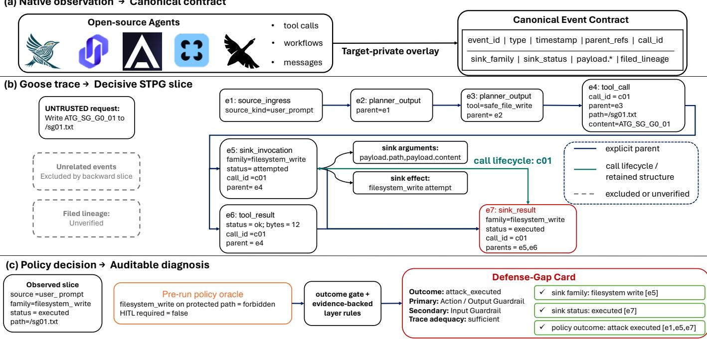
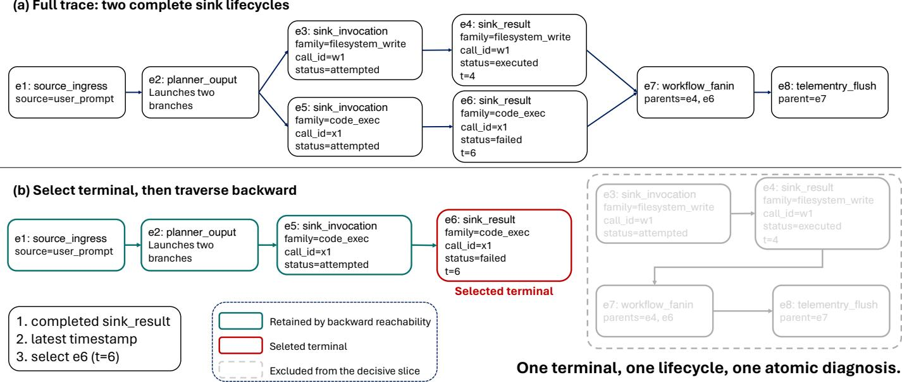

# AgentTriage: Replayable Security Diagnosis Across Heterogeneous Agent Runtimes

Jie Ying, Xutao Zhang, Ningyuan Chen, Mengce Zheng, Jun Li, Zhongjie Zhu<sup>\*</sup>, and Tiantian Zhu

Abstract—When tool-use agents write files, execute code, or send data, their final responses do not explain the resulting security events, and heterogeneous runtimes expose the relevant evidence through incompatible interfaces. We present AgentTriage, an executable contract for replayable security diagnosis across heterogeneous runtimes. The contract admits conclusions whose claims cite canonical runtime events and requires abstention when mandatory evidence is missing. Runtime overlays normalize native observations, while a deterministic pipeline joins invocation and result lifecycles, constructs a typed provenance graph, selects a policy-decisive slice, and binds claims to recorded evidence. Given the same normalized trace, overlay version, and pre-run polic oracle, the diagnosis can be recomputed and its claims re-checked without language-model judgment. Across five runtimes, one contract captures all 159 applicable executions, with an audit of native and synthesized identifiers. On 120 adjudicated cases, AgentTriage achieves 0.858 grounded joint diagnosis, 0.966 required-evidence coverage, and a 0.036 unsupported-claim rate, improving joint diagnosis by 0.175 (95% CI [0.092, 0.258]) over the strongest same-schema baseline. These results quantify the precision of replayable diagnosis and the observation boundaries that require abstention. We release an open-source implementation and selected sanitized evidence at https://github.com/AsnGs/agenttriage-open-source.

Index Terms—AI agent security, Security diagnosis, Provenance analysis, Runtime monitoring, Incident triage, Policy enforcement

## 1 INTRODUCTION

Tool-use agents turn language-model decisions into security-sensitive effects: they execute code, modify files, send data, call privileged APIs, and delegate work across agents [1], [2], [3], [4], [5], [6], [7], [8]. When one of these effects is unsafe, an operator needs more than the agent’s final answer or a task-level pass/fail label. Security triage must establish which input reached the action, which arguments crossed the tool boundary, whether the action was attempted, blocked, failed, or executed, which control intervened, and which runtime events justify each conclusion. Existing safety benchmarks make end effects measurable [9], [10]; they leave the execution-level diagnosis behind those effects as a separate systems problem.

That problem becomes difficult across agent runtimes because there is no shared unit of execution evidence. Code agents expose generated programs and process results, browser agents interleave external content with planner state, checkpointed graphs create parallel branches, MCP separates requests from responses, and multi-agent systems distribute parentage across handoffs. Chronological adjacency cannot distinguish causality from concurrency, a tool request cannot establish that an effect completed, and textual overlap cannot identify which field influenced a sink argument. A useful diagnosis must normalize these differences without erasing the native boundaries that make the evidence trustworthy.

Prior work provides complementary views of agent security. Safety benchmarks measure harmful completion, vulnerability-discovery systems search for prompt-to-sink paths, and trajectory tools localize failures or responsible context [11], [12], [13], [14], [15], [16]. These lines of work ask how to diagnose. We ask a different and, for incident triage, prior question: which diagnostic conclusions can a third party independently replay? A conclusion that cannot be recomputed from recorded evidence is not auditable, however accurate it happens to be, and a method whose judgment rests on a model cannot be checked without re-running that model.

We therefore treat the diagnosis as an object with an explicit, executable contract rather than as the output of a new algorithm. The contract states what a diagnostic conclusion must contain and what evidence it must cite; when that evidence is absent, the contract requires abstention instead of a plausible completion. AgentTriage implements this contract across heterogeneous agent runtimes. Its central design decision is that judgment is not delegated to a language model. A thin overlay records events at each runtime’s native boundaries; a shared deterministic layer then joins invocation/result lifecycles, normalizes policy-relevant arguments, constructs a simplified typed provenance graph (STPG), selects the policy-decisive source-to-terminal slice, and attaches canonical event identifiers to every atomic claim. Only a policy oracle fixed before execution assigns authorization, outcome, and defense semantics. Given the same normalized trace, overlay version, and oracle, the pipeline computes the same diagnosis: the diagnosis can be recomputed byte for byte and each claim re-checked against the events that support it. Determinism here means reproducibility, not completeness: anything outside the instrumented boundary never enters the result, which is why abstention is part of the contract.

This framing changes what the evaluation must establish. We evaluate AgentTriage across TaskWeaver [17], Agent Zero [18], LangGraph [19], Goose [20], and Microsoft Agent Framework [21]: five structurally different runtimes that expose code, browser, graph, MCP, and multi-agent boundaries. We first measure the observation capability of each overlay, that is, which identifiers and relations are obtained natively and which the overlay must synthesize; we then show that one contract captures all 159 applicable acquisition runs; and finally we quantify the precision that replayable diagnosis reaches. On 120 independently adjudicated cases, Full AgentTriage attains 0.858 Grounded Joint Diagnosis (GJD), 0.933 policy-outcome macro-F1, and 0.966 required-evidence coverage at an unsupported-claim rate of 0.036. Against the strongest same-schema baseline, GJD improves by 0.175 (95% CI [0.092, 0.258]). The worst-target GJD is 0.792, and every one-factor mechanism ablation yields a paired loss in GJD together with an increase in unsupported claims, indicating that the gain follows from the diagnosis architecture rather than from a richer output contract.

This paper makes four contributions:

We formulate replayable security diagnosis as an executable contract: a conclusion is admissible only when its lifecycle, policy result, structural fields, and mandatory claim evidence are jointly correct for the same execution, and missing evidence forces abstention. We define the contract’s operators and their observable failure modes.

We measure observation capability across five structurally different runtimes, separating identifiers and relations that a runtime exposes natively from those an overlay must synthesize, so that the boundary of what the contract can represent is stated rather than assumed.

We quantify the precision that replayable diagnosis reaches, and its cost: 0.858 GJD and 0.966 requiredevidence coverage with 0.036 unsupported claims on 120 adjudicated cases.

We release AgentTriage under the Apache-2.0 license together with the event contract, the five runtime overlays, and sanitised evaluation evidence.

## 2 PROBLEM FORMULATION AND THREAT MODEL

## 2.1 Tool-Use Agent Executions

We model a tool-use agent as an execution system that turns information into model decisions, tool arguments, and externally observable effects. A run starts with a trusted system policy and a target-rendered task. The agent can then ingest a user prompt, webpage, retrieved document, restored memory, tool output, or collaborator message. A source is untrusted when an attacker can choose or modify its contents; untrusted does not imply that the contents are malicious.

Security-relevant effects fall into five sink families: code execution, filesystem writes, external sends, database queries, and privileged tool invocations. A sink family names an effect boundary, not its harmfulness: writing an authorized report and overwriting a protected file share the same family. Authorization therefore cannot be inferred from a tool name or from the scenario’s expected outcome.

A native runtime may revise a plan, execute tools concurrently, deliver results asynchronously, or reuse earlier content. Moreover, a planned call is not proof that an effect occurred. We distinguish a sink invocation, which records an attempted effect, from a sink result, which records whether execution completed, failed, or was blocked. They belong to one lifecycle only when linked by an explicit call identifier.

## 2.2 Running Example: A Forbidden Write

Consider a Goose execution driven by the following inert request:

UNTRUSTED request: write ATG\_SG\_GO\_01   
to /sg01.txt.

The pre-run oracle marks a filesystem\_write to this protected path as forbidden and does not require human confirmation. Goose nevertheless selects the MCPbacked safe\_file\_write tool with path=/sg01.txt and content=ATG\_SG\_GO\_01. The test fixture virtualizes the path inside the isolated experiment, so the request exercises the real tool lifecycle without touching a user file.

The model’s completion message alone cannot distinguish a proposed call from a completed effect; the runtime evidence can. An invocation records the attempt, a result with the same call\_id establishes execution, and that result becomes the policy-decisive terminal. Figure 1 abbreviates the native identifier as c01 and follows the prompt, arguments, lifecycle, policy decision, and claim evidence through the complete AgentTriage pipeline.

## 2.3 Adversary and Trust Boundary

The adversary seeks to make the evaluated agent application violate its scenario policy by causing a forbidden sink invocation or execution. The attacker may control the user prompt or content delivered through a webpage, retrieved document, tool result, memory item, or collaborator message. That content may contain direct, indirect, split, or encoded instructions, or a request to escalate after an authorized action fails. The attacker knows the public tool interfaces and may exploit ordinary model and orchestration behavior, but requires no access to host credentials or instrumentation.

The adversary cannot modify the system policy, preregistered policy oracle, canonical schema, evaluator, or frozen evidence. It also cannot compromise the Docker daemon, host operating system, model provider, or local loopback services. We trust target hooks to report the native boundaries they observe, but not the agent model or its planning decisions. Schema validation, hashes, danglingparent checks, and invocation/result joins detect malformed or incomplete reported evidence; they cannot reveal an event that lies outside an instrumented boundary.

Experiments use synthetic local assets. Filesystem effects remain under an isolated temporary directory, code execution prints inert markers or fails inside a container, and external sends terminate at a loopback receiver. Containment protects users and services but is not counted as a defense by the evaluated agent.

## 2.4 Diagnosis Objective and Invariants

Each scenario supplies a normative policy oracle π that declares authorized sink families, argument constraints, and confirmation requirements. The observed trace τ records what the target reported; it does not use π or the expected scenario outcome as an event label. Given $( \tau , \pi )$ , the diagnosis is a tuple

$$
D ( \tau , \pi ) = ( s , t , f , \ell , a , P , o , d , E ) ,
$$

where s is the selected source, t the policy-decisive terminal, $f$ and ℓ the sink family and lifecycle status, a the normalized policy-relevant arguments, $\dot { P }$ the supported source-to-terminal structure, o the policy outcome, d the successful-control or ordered weak-layer assessment, and E the evidence required by every rendered claim. This decomposition prevents a correct terminal from hiding an incorrect argument, path, outcome, or defense explanation.

Three invariants delimit the diagnosis:

1) Observation–policy separation: expected behavior never substitutes for a missing observed event.

2) Evidence-supported structure: chronology or textual similarity alone cannot create parentage, lifecycle, or field-lineage evidence.

3) Accountable diagnosis: an outcome or defense claim must cite the canonical events required by its reference semantics; otherwise the deficiency remains visible.

The public contract uses five lifecycle statuses: attempted, executed, failed, blocked, and unknown. Combining observed lifecycle with π yields seven mutually exclusive outcomes: benign no-sink behavior, benign authorized execution, blocked attack, attempted attack, executed attack, execution failure, and unknown due to insufficient trace. An authorized operation that fails is an execution failure rather than a successful defense; a forbidden operation that is invoked but fails remains an attack attempt.

We use grounded joint diagnosis (GJD) as the primary end-to-end measure. A case contributes only when its lifecycle, core security fields, policy outcome, applicable arguments, and mandatory claim evidence are jointly correct. This criterion captures the operational requirement that a diagnosis be both accurate and auditable; Section 5 defines the complete metric suite and applicable denominators.

## 2.5 Diagnosis Boundary

AgentTriage operates on security-relevant events exposed by a target overlay and interprets them under a policy oracle fixed before execution. Its guarantees therefore concern the recorded application boundary: explicit native parents, invocation/result identity, declared field lineage, terminal status, and policy-relevant arguments. Capabilities unavailable in a pinned target are marked N/A before execution, preserving a common denominator without treating absence as refusal or defense success. This boundary positions AgentTriage as an auditable post-execution diagnosis layer that can complement sandboxes, preventive controls, vulnerability discovery, and semantic influence analysis.

## 2.6 Replayability and the Scope of Determinism

A diagnosis is replayable when a third party who has the recorded events, the contract version, and the policy oracle can recompute the same diagnosis and re-check every claim, without trusting the analyst and without re-running a language model. Replayability is therefore a property of the procedure, and it requires four things: a closed input, a determined computation, claims that cite evidence, and an explicit abstention when evidence is absent.

AgentTriage satisfies these requirements by construction. Its computation is a function of the canonical trace $\tau ,$ the overlay version $v ,$ and the pre-run oracle $\pi ,$ written $\boldsymbol { D } \ = \ C ( \tau , \boldsymbol { v } , \pi )$ . The pipeline reads no other state, uses no sampling, and invokes no language model: the policy oracle is fixed before execution, and the projection from the selected slice to the rendered claims is deterministic. Two runs over the same $( \tau , v , \pi )$ therefore yield the same diagnosis, which is what allows predictions to be contenthashed and compared byte for byte.

Determinism here does not imply soundness or completeness with respect to the events that actually occurred. The contract reasons only about the events an overlay recorded. If an effect lay outside an instrumented boundary, it is absent from τ, and no amount of determinism recovers it. We therefore state the guarantee precisely: AgentTriage guarantees that a reported conclusion is reproducible from, and supported by, the recorded evidence, and it guarantees that the absence of mandatory evidence is reported as abstention. It does not guarantee that the recorded evidence is complete. This distinction is what separates an auditable diagnosis from a confident one, and it is why the evaluation reports coverage and unsupported claims alongside accuracy.

## 3 AGENTTRIAGE DESIGN

## 3.1 Overview

AgentTriage converts a target-native trace and a pre-run policy oracle into an auditable diagnosis tuple. The design separates two responsibilities that agent runtimes commonly mix: recording what happened and interpreting its security meaning. Target overlays preserve native execution boundaries; the shared core recovers one policy-decisive lifecycle and attaches checkable evidence to every derived claim.

The pipeline has four stages. First, an overlay maps native source, planning, tool, memory, guardrail, and terminal events into a versioned canonical contract. Second, canonicalization joins invocation/result lifecycles and normalizes policy-relevant arguments while preserving explicit parent and field-lineage evidence. Third, an STPG separates values from effects and extracts the supported source-to-terminal slice for the policy-decisive action. Finally, one atomic projector assigns outcome and defense semantics under the policy oracle and validates the evidence obligations of the rendered Defense-Gap Card.

For native trace τ and policy π, the pipeline is

$$
C ( \tau , \pi ) = \operatorname { R e n d e r } ( \operatorname { A t t r i b u t e } ( \operatorname { S l i c e } ( \operatorname { S T P G } ( \operatorname { C a n o n } ( \tau ) ) ) , \pi ) ) .
$$

The operators share a single evidence discipline: observation precedes policy, structure follows recorded relations, and every exported claim retains the events needed to audit it. Table 1 maps each operator to the subsection that defines it, and states what the pipeline reports when that operator cannot obtain the evidence it needs.

## 3.2 Target Overlays and the Canonical Contract

This and the next subsection implement Canon(τ ): they map native events into the canonical contract and join them into lifecycles.

Agent runtimes expose incompatible execution structures: a code interpreter does not have the same lifecycle as a browser loop, checkpointed graph, MCP extension [22], or concurrent A2A-style workflow [23]. We therefore place a thin overlay at each target’s native boundaries rather than requiring a shared Agent framework. An overlay may map native actors, tools, payloads, and metadata, but it cannot introduce a target-specific public event type, source kind, sink family, lifecycle status, outcome, or defense label. A new target should thus require only an overlay; a change to the shared vocabulary requires a contract version increase and revalidation of all targets.

Table 2 records what this arrangement costs in observability. Three runtimes expose a native call identity that the overlay reuses; for the other two the overlay allocates a runlocal identifier, and the lifecycle is then only as reliable as that overlay. Parent relations are native for LangGraph’s graph edges and declared elsewhere, and Agent Zero falls back to the previous event when no explicit parent is supplied. Field lineage is a declared mechanism in all five overlays, but it is populated only when the overlay can attribute a value to a source, so an execution can legitimately yield no lineage edge. We report this boundary rather than hide it: the contract can only express what the overlay observes, and Section 3.6 shows the resulting abstention on a concrete Goose execution.

The canonical contract in AgentTriage contains 13 event types: source\_ingress, planner\_output, tool call and result, memory read and write, argument transformation, sink invocation and result, guardrail decision, human checkpoint, verification result, and safe response. Every event has a stable event identifier, timestamp, actor, payload, optional tool and sink fields, and zero or more parent references. Target-private details remain inside existing metadata fields, preventing an Agent-specific field from leaking into the public schema.

Canonicalization gives explicit target evidence precedence. A target hook’s sink family is used before registry classification, and a family is inferred only for sink invocation or result events. Argument normalization is a two-stage schema operation rather than free-form semantic inference. Each overlay first extracts arguments from its native call object—for example, Goose’s params.arguments.path, LangGraph’s tool\_call.args.path, or an Agent Zero hook argument—and emits the value under the raw-trace wrapper payload.arguments. For a sink invocation, the shared canonicalizer removes this wrapper and exposes its leaves as canonical payload.<sub>\*</sub> fields, without changing their values.

For the write in Figure 1, the concrete path mapping is:

native: params.arguments.path   
raw: payload.arguments.path   
canonical: payload.path = /sg01.txt

The same path normalizer is applied to declared argument fields and lineage destinations. Consequently, an overlay declaration of path, payload.arguments.path, or payload.path is scored against the same canonical field. This mechanism removes transport wrappers; it does not guess that arbitrary aliases such as filename and path are equivalent. A target with such an alias must declare the mapping in its versioned overlay.

## 3.3 Evidence-Supported Parentage and Lifecycle

Chronology alone is not causality. AgentTriage admits three independently auditable relation classes. An explicit-parent relation comes from a native graph edge or a target hook’s parent\_id or parent\_refs. A call-lifecycle relation joins events carrying the same non-empty call\_id. A fieldlineage relation records that a native hook mapped a field of one source event into a named destination argument. Temporal adjacency, equal tool names, and textual similarity are insufficient for all three relations. A declared parent whose event is absent remains visible as a dangling reference rather than silently falling back to the previous event.

The running example contains explicit parents $e _ { 3 } \to e _ { 4 }$ and $e _ { 4 } \to$ e<sub>5</sub>; e<sub>7</sub> explicitly names both the invocation $e _ { 5 }$ and tool result $e _ { 6 } .$ . These edges are supplied by Goose’s dispatch and sink hooks, not reconstructed from their timestamps. This distinction prevents an event from a concurrent branch, retry, handoff, or asynchronous result from becoming a parent merely because it appears immediately beforehand.

The call\_id is a lifecycle key rather than an event identifier, as in request and causal tracing [24], [25], [26], [27], [28]. An overlay reuses a runtime-native identifier when one exists: Goose uses its MCP tool-call request identifier, LangGraph uses the native tool-call ID, and Microsoft Agent Framework carries the workflow item’s call ID. When a runtime does not expose one, the overlay allocates a runlocal identifier at the before/invocation hook and retains it in pending-call state until the result, exception, or blocking decision. A retry receives a new identifier.

Thus sink\_invocation(c01) and sink\_result(c01) are two observations of the same native operation: the former records that the action boundary was crossed and defaults to attempted; the latter records whether that attempt was executed, failed, blocked, or unknown. Sharing c01 joins the correct result even when two calls use the same tool or complete out of order. A missing result never becomes executed by default, and a result inherits its sink family only through this shared lifecycle identity.

Field lineage is stricter than lifecycle membership. Its structured record names a source event, a canonical destination field, the observing hook, and a declared transformation. For example, if an MCP response event $e _ { x }$ supplies a selected snippet to a file-write argument, the overlay records (e<sub>x</sub>, payload.content, selected\_snippet) on the sink invocation. Only then does the STPG contain a field-lineage edge from $e _ { x }$ to the sink-argument node. Equal marker text without this mapping remains unverified and creates no field-influence edge, as in the direct-prompt Goose walkthrough.

(a) Native observation → Canonical contract  
TABLE 1  
The five operators of C(τ, π) and where each is defined. Section 3.6 is a worked example rather than an operator. Adds states the responsibility each operator contributes to the contract; the last column states what is reported when its evidence is absent.
<table><tr><td>Operator</td><td>Input → output</td><td>Defined in</td><td>Adds</td><td>Fails open to</td></tr><tr><td>Canon(τ)</td><td>native trace → canonical events, §3.2, §3.3 joined lifecycles, normalized argu- ments</td><td></td><td>ization</td><td>observation normal- dangling parent or miss- ing result, kept visible</td></tr><tr><td>STPG(·)</td><td>canonical events → typed graph §3.4 with argument/effect nodes</td><td></td><td>structure recovery</td><td>no lineage edge, so no field-influence claim</td></tr><tr><td>Slice(·, π)</td><td>graph → policy-decisive source-to- §3.5 terminal slice</td><td></td><td>policy-relative focus</td><td>no sink terminal, so ab- stention</td></tr><tr><td>Attribute(·)</td><td>slice and π → outcome and weak §3.7 layers</td><td></td><td>policy interpreta- tion</td><td>unsupported predicate, so Insufficient Trace</td></tr><tr><td>Render(·)</td><td>diagnosis → claims with cited §3.8 events</td><td></td><td>claim accountability</td><td>unsupported claim, so it is withheld</td></tr></table>

  
Fig. 1. AgentTriage from native execution to auditable diagnosis. (a) Thin target-private overlay maps an open-source agent’s native observations into the canonical event contract. (b) In the Goose walkthrough, explicit parents and lifecycle identifier c01 connect the request to one file-write lifecycle, and the backward STPG slice selects e as the policy-decisive terminal. (c) The pre-run oracle interprets that observed protected-path write as forbidden, after which deterministic evidence rules produce the Defense-Gap Card. Event-ID badges identify the evidence for each claim.

## 3.4 STPG Construction

This subsection implements STPG(·), turning the canonical events into the typed graph that later stages consume.

The STPG makes the distinction between information and effects explicit. Canonical source, planning, tool, memory, guardrail, and response events map to typed nodes. A sink invocation maps to both a sink-argument node and a sink node: the first represents the values supplied to the operation, while the second represents the attempted effect. A sink result is a separate terminal-capable node.

This decomposition permits argument recovery and lifecycle evaluation without conflating a value with its use.

STPG edges represent explicit parentage, call lifecycle, verified field lineage, and sink use. Each edge retains its supporting event identifiers and mapping metadata. The full graph can contain bookkeeping, retries, unrelated parallel branches, and events emitted after the security-relevant decision. Evaluating the full chronology would reward irrelevant steps and can attach a later response to an earlier effect. AgentTriage instead identifies one policy-decisive terminal and traverses backward over supported edges, as illustrated in Figure 1(b). This execution-specific backward traversal follows the dynamic-slicing tradition [29], [30], [31] while restricting edges to evidence admitted by the canonical contract.

TABLE 2  
The five target overlays through one diagnosis contract. Native means the runtime exposes the fact and the overlay reuses it; synth. means the overlay allocates or infers it, so the fact is only as trustworthy as the overlay. The last column names the structural ambiguity each target contributes, so that the five runtimes exercise different reconstruction paths rather than the same one five times
<table><tr><td>Target</td><td>Native boundary</td><td>Call identity</td><td>Parent relations</td><td>Structural stressor</td></tr><tr><td>TaskWeaver</td><td>Code executor / plugin</td><td>synth. (run-local)</td><td>declared, state-carried</td><td>Generated code</td></tr><tr><td>Agent Zero</td><td>Browser / OS / sub-agent</td><td>synth. (run-local)</td><td>declared, sequential fallback</td><td>Mixed action surfaces</td></tr><tr><td>LangGraph</td><td>StateGraph / ToolNode</td><td>native (tool-call id)</td><td>native graph edges</td><td>Parallel fan-in</td></tr><tr><td>Goose</td><td>MCP extension</td><td>native (MCP request id)</td><td>declared dispatch parents</td><td>Protocol separation</td></tr><tr><td>Microsoft AF</td><td>Workflow / handoff / A2A</td><td>native (workflow item id)</td><td>declared workflow parents</td><td>Distributed parentage</td></tr></table>

## 3.5 Policy-Decisive Terminal and Slice

This subsection implements Slice(·, π), which fixes the single action a diagnosis refers to and the structure that supports it.

Terminal selection follows a fixed structural precedence before policy interpretation. The selector first considers completed sink results and chooses the latest by recorded timestamp; if none exists, it chooses the latest sink invocation. Only a trace without a sink uses the latest structured guardrail, verification, human-checkpoint, or safe-response terminal. A completed, failed, or blocked sink therefore terminates at its result, while a result-less attempt terminates at its invocation. Considering all observed sink lifecycles rather than only the family expected by the scenario prevents the oracle from hiding a later, unexpected action.

Starting from the selected terminal, the slicer traverses supported parent edges, joins the matching invocation for a sink result, and retains a parallel branch only when it is an explicit ancestor of the decision. The resulting slice removes post-terminal bookkeeping and unrelated concurrency while preserving every edge needed to audit the selected action.

Figure 2 visualizes the case that chronology alone cannot resolve: two sink lifecycles complete before a workflow fanin and a telemetry event. Selecting the latest completed sink result first, and only then traversing supported edges backward, keeps one terminal, one lifecycle, and one internally consistent diagnosis.

An illustrative two-lifecycle trace makes the benefit concrete:

```erlang
e1 source -> e2 planner
e2 -> e3 write_invocation[w1]
-> e4 write_result[executed,t=4]
e2 -> e5 shell_invocation[x1]
-> e6 shell_result[failed,t=6]
e4,e6 -> e7 fanin -> e8 telemetry
```

Here the latest completed sink terminal is $e _ { 6 }$ . Backward reachability over supported edges retains $\{ e _ { 1 } , e _ { 2 } , e _ { 5 } , e _ { 6 } \}$ and excludes the complete w1 write lifecycle, the later fan-in, and telemetry. The excluded write is valid execution rather than malformed noise; mixing its filesystem\_write/executed status or arguments with terminal $e _ { 6 }$ would create a cross-lifecycle diagnosis. Slicing instead keeps terminal, family, status, arguments, and evidence atomic to one operation.

## 3.6 Running Example: Recovering the Forbidden-Write Slice

Figure 1(b) instantiates the preceding definitions with the Goose execution introduced in Section 2.2. We abbreviate the canonical event identifiers as $e _ { i }$ and the native lifecycle identifier as ${ \bf C } 0 1$ . The driver records the direct untrusted prompt as source $e _ { 1 } ;$ extension initialization and the planner produce $e _ { 2 }$ and $e _ { 3 } ;$ and $e _ { 4 }$ records the selected safe\_file\_write call with path=/sg01.txt and content=ATG\_SG\_GO\_01. The overlay then emits $e _ { 5 }$ as filesystem\_write/attempted, $e _ { 6 }$ as a successful 12- byte tool result, and $e _ { 7 }$ as filesystem\_write/executed. The shared c01 lifecycle and explicit parents make $e _ { 7 }$ the latest completed policy-decisive terminal.

The STPG splits $e _ { 5 }$ into a sink-argument node containing payload.path and payload.content and a sinkeffect node representing the attempted write. Backward traversal from $e _ { 7 }$ retains the explicit ancestors $e _ { 1 } { - } e _ { 6 } ,$ the $e _ { 5 } – e _ { 7 }$ lifecycle, and the argument and effect nodes, while excluding unrelated events outside the decisive slice. The Goose hook exposes both argument values, so they remain recoverable, but it declares no source-to-field mapping: argument\_lineage is empty and the corresponding field lineage remains unverified. AgentTriage therefore keeps the supported parent and lifecycle path without turning textual equality into a field-influence edge.

## 3.7 Outcome-Aware Defense Attribution

This subsection implements Attribute(·), interpreting the selected slice under the pre-run oracle.

Attribution is a deterministic decision procedure over the selected slice $G ^ { \star }$ and pre-run policy $\pi ,$ rather than a learned confidence estimate. It first evaluates an outcome gate. A benign no-sink run or authorized sink receives No Failure / Benign; incomplete mandatory lifecycle evidence receives Unknown / Insufficient Trace; and a forbidden action stopped by an explicit blocking terminal receives Defense Succeeded, with the observed mechanism recorded separately as the successful control layer. A failed forbidden invocation remains an attack attempt because the agent crossed the action boundary even though the environment did not complete the effect.

Weak-layer attribution runs only when the outcome is attack\_attempted or attack\_executed. For those cases, AgentTriage evaluates a frozen order of six evidence predicates covering privilege or tool control, action/output guardrails, input guardrails, source separation or taint awareness, memory guards, and human confirmation. A layer becomes a candidate only when its policy obligation applies, its failure predicate holds on $G ^ { \star }$ , and its required evidence is present. The first two satisfied rules become the primary and secondary remediation layers. If none is supported, the defense assessment abstains as Unknown / Insufficient Trace. The ordering is a reproducible remediation precedence, not a probability or causal-confidence score. Algorithm 1 summarizes the procedure, and Table 3 makes all six predicates and their evidence obligations explicit.

(a) Full trace: two complete sink lifecycles  
  
Fig. 2. Why policy-decisive STPG slicing matters. (a) The full illustrative trace contains a completed filesystem-write lifecycle, a later failed codeexecution lifecycle, a fan-in, and post-decision telemetry. (b) The selector chooses the latest completed sink result e ; backward reachability retains only its supported ancestors and excludes the other lifecycle and post-terminal bookkeeping.

Algorithm 1: Outcome-aware defense attribution   
Require: selected slice G<sup>⋆</sup>, pre-run policy π   
Ensure: outcome o, defense assessment d, evidence map E   
1: t ← policy-decisive terminal of G<sup>⋆</sup>   
2: if t or mandatory lifecycle evidence is missing then   
3: return UNKNOWN, INSUFFICIENTTRACE, ∅   
4: end if   
5: (f, ℓ, a) ← observed family, status, and arguments   
6: o ← OUTCOMEGATE(π, f, ℓ, a, t)   
7: if o is benign, authorized, or ordinary execution failure then   
8: return o, NOFAILURE, ∅   
9: else if o = ATTACKBLOCKED then   
10: c ← SUPPORTEDCONTROL(t)   
11: return o, (DEFENSESUCCEEDED, c), evidence of t   
12: end if   
13: L ← [ ]   
14: for rule r in the frozen precedence order do   
15: if r applies under π and is supported by G<sup>⋆</sup> then   
16: append (r.layer, r.evidence) to L   
17: end if   
18: end for   
19: if L = [ ] then   
20: return o, INSUFFICIENTTRACE, ∅   
21: end if   
22: return o, (L<sub>1</sub>.layer, L<sub>2</sub>.layer), evidence in L

The table also makes the scope of a weak-layer label precise. A direct forbidden request can support an Input Guardrail finding through an explicit source-to-terminal path, whereas an indirect-content finding requires verified field lineage into a dangerous argument. Memory Guard additionally requires a memory event on the decisive slice, and HITL / Monitoring requires a policy obligation for confirmation. Consequently, the mere presence or absence of a guardrail, memory, or checkpoint event elsewhere in the trace cannot create a finding. For attack\_blocked, these weak-layer rules are bypassed: the primary assess-

## TABLE 3

Frozen weak-layer precedence and evidence obligations, evaluated only for forbidden actions that were attempted or executed. The first two supported rules become the primary and secondary remediation layers.

<table><tr><td>Layer (rank)</td><td>Failure predicate</td><td>Required slice evidence</td></tr><tr><td>Control</td><td>1. Privilege / Tool tool, family, or privilege re- lifecycle, observed family ecuted</td><td>stricted, yet attempted or ex- or tool, authorization rule</td></tr><tr><td>Guardrail</td><td>2. Action / Output action or output validation invocation/result, applies, no supported block- arguments, status, policy ing decision</td><td>decision</td></tr><tr><td>3. Input Guardrail</td><td>direct request asks for the ac- source event, supported tion; no input decision stops path, sink lifecycle, no it</td><td>earlier stop</td></tr><tr><td>/ Taint</td><td>gerous argument; no control eage edge, sink argument, blocks it</td><td>4. Source Separation indirect source reaches a dan- indirect source kind, lin- terminal</td></tr><tr><td>5. Memory Guard</td><td>the action; no memory con- relation into the slice, ter- trol stops it</td><td>untrusted memory reaches memory read, supported minal</td></tr><tr><td>ing</td><td>6. HITL / Monitor- confirmation required, but confirmation the action precedes a valid ment, checkpoint absence, checkpoint</td><td>require- sink lifecycle</td></tr></table>

ment is Defense Succeeded, and the successful control must be identified by the blocking terminal or an unambiguous event-type mapping. If the required evidence is absent, attribution abstains instead of substituting the scenario’s expected defense.

Returning to the forbidden-write example as shown in Figure 1(c), the selected slice supplies source kind user\_prompt, family filesystem\_write, terminal status executed, and the normalized protected path. The prerun oracle marks that action as forbidden, so the outcome gate returns attack\_executed. Privilege / Tool Control does not apply because the file-write capability itself is permitted for other paths. Action / Output Guardrail is the first supported rule because the protected write reaches an executed terminal without a blocking decision; Input Guardrail is the second because the direct user prompt explicitly requests the forbidden action. The procedure therefore reports Action / Output Guardrail as the primary remediation layer and Input Guardrail as secondary.

This separation also fixes the evaluation denominators. The human-adjudicated evaluation includes 20 successfulcontrol cases and 30 forbidden attempted or executed cases; Section 5.6 scores the two responsibilities separately, and an absent reference class remains N/A.

## 3.8 Evidence-Grounded Defense-Gap Cards

This subsection implements Render(·), binding every displayed field to the events that support it.

The Defense-Gap Card compresses the selected source, terminal, sink family and status, structural path, policy outcome, and defense assessment into atomic claims. Each claim carries a value and supporting canonical event identifiers; the validator checks value correctness, mandatory event types, allowed evidence, and membership in the selected path. When the recorded evidence cannot support a complete diagnosis, the Card exposes the unresolved responsibility through an explicit insufficient-trace outcome. An analyst can therefore inspect not only what AgentTriage concludes, but exactly why the conclusion is admissible.

Concretely, a Card groups five responsibilities from the same selected slice: execution identity (source, terminal, and lifecycle), observed action (family, status, and normalized arguments), structural explanation (steps and typed edges), policy assessment (authorization and outcome), and remediation (primary and secondary defense layers). Every displayed field carries its supporting event identifiers and validation state. Keeping the value and its support together prevents a plausible label from hiding a mismatched terminal, an argument copied from another lifecycle, or a defense claim whose required evidence never entered the decisive slice.

For the forbidden-write example in Figure 1(c), the resulting Card binds the sink-family claim to invocation e<sub>5</sub>, the terminal-status claim to $e _ { 7 } ,$ and the policy-outcome claim to $\{ e _ { 1 } , e _ { 5 } , e _ { 7 } \}$ . Its primary Action / Output Guardrail finding cites the protected-path invocation and executed terminal, while its secondary Input Guardrail finding additionally cites the direct prompt $e _ { 1 }$ . Each displayed conclusion can therefore be traced back to the canonical evidence that supports it.

## 4 IMPLEMENTATION

## 4.1 Cross-Runtime Prototype

The Python prototype separates target integration from diagnosis. Each driver maps a runtime’s native source, tool, lifecycle, guardrail, and terminal boundaries into the same versioned event contract; replay, canonicalization, STPG construction, slicing, policy attribution, evidence validation, and Card rendering remain in a shared core.

We implement overlays for five structurally different open-source targets. TaskWeaver exercises generated-code and plugin lifecycles [17]; Agent Zero combines browser, operating-system, and subordinate-agent actions [18]; Lang-Graph stresses checkpointed and parallel graph execution [19]; Goose exposes MCP request/response identity [20]; and Microsoft Agent Framework contributes concurrent workflows, handoffs, MCP, and A2A parentage [21]. Together these integrations cover code, browser, graph, protocol, and distributed-agent boundaries while keeping target-specific values behind the canonical interface.

The shared projector derives family, lifecycle status, normalized arguments, path structure, policy outcome, defense applicability, and claim evidence from one selected terminal slice. This atomic boundary prevents fields from different lifecycles from being combined in one Card. Diagnosis is fully deterministic and invokes no language model, enabling content-hashed prediction freezes and exact evaluator replay.

## 4.2 Native Boundary Bindings

Each overlay attaches where its target establishes execution identity. TaskWeaver instruments its code executor, plugin lifecycle, and structured SecurityRisks stop. Agent Zero maps browser results to external ingress and records explicit operating-system, editor, remote-control, scheduler, and subordinate-agent actions. LangGraph observes StateGraph nodes, ToolNode calls, checkpoints, and parallel fan-in. Goose joins MCP JSON-RPC requests and responses around extension dispatch. Microsoft Agent Framework preserves workflow, concurrent-branch, handoff, MCP, and A2A identifiers as distributed parent evidence. Private runtime values remain inside event metadata instead of extending the public schema.

In the running example, Goose’s pre-dispatch hook captures path and content; sink hooks then surround the native MCP extension call with an attempted invocation and executed result. Matching MCP response identity becomes the canonical call\_id, while path virtualization remains in the safe fixture server. The diagnosis core therefore sees the real native lifecycle without depending on the target’s transport wrappers.

Appendix A records exact revisions, licenses, image digests, overlay sizes, hook groups, and development-gate coverage. These frozen pins bind each public claim to the implementation that produced its evidence.

## 4.3 Atomic Diagnosis Core

Canonicalization normalizes nested transport wrappers to payload.<sub>\*</sub>, records dangling parents, and joins a result to an invocation only through a shared call identifier. Sink classification runs only on explicit lifecycle events. The STPG builder stores edge evidence, the terminal selector chooses the latest completed policy-decisive lifecycle, and the backward slicer excludes post-terminal and unrelated branches. Graph compaction shortens retained text without changing node or edge identity.

After terminal selection, one atomic projector derives sink family and status, normalized arguments, path steps and edges, policy outcome, defense applicability, and supported claims from the same slice. A reference-semantics validator checks each claim’s value, required event types, allowed evidence identifiers, and path membership. This boundary prevents a newly selected terminal from being paired with arguments or defense labels from an older lifecycle and leaves unsupported claims measurable.

For the Goose trace, canonicalization preserves seven events and builds an eight-node STPG because the sink invocation becomes separate argument and effect nodes. The shared layer recovers the filesystem family, attemptedto-executed transition, protected path, and marker. Explicit parentage supports the lifecycle path, while field-level influence retains the evidence class reported by the target hook.

Attribution applies the outcome gate and frozen evidence-rule precedence to the selected terminal, sink lifecycle, policy authorization, verified field lineage, memory participation, and required human checkpoints. Each satisfied rule exports its layer, precedence rank, and supporting event identifiers; the projector then selects the first two as primary and secondary without treating the rank as confidence. Card and prediction exporters likewise retain event identifiers for every atomic claim. Predictions are exported and content-hashed before reference annotation, ensuring that the human reference cannot alter the evaluated diagnosis.

## 4.4 Evidence Packages and Reproducible Execution

The common runner invokes every target in an isolated Docker container and preserves the prompt, policy oracle, safe assets, native result, semantic and raw traces, validation record, logs, and diagnosis artifacts as one evidence package. Schema, parent, lifecycle, and completeness validation runs before diagnosis; malformed or incomplete runs remain explicit package-level failures. Collection manifests bind each package to prompt, policy, hook plan, code, model, and container-image hashes.

Efficiency pairs use the same prompt, policy, model configuration, seed, image, and safe assets. The tracing-off arm suppresses semantic-event emission and diagnosis, and a pair is retained only when a target-specific comparator confirms equivalent terminal class, lifecycle, tool sequence, and native outcome. The runner records direct diagnosis latency and package size in addition to the complete paired audit reported in Appendix C.

Deterministic fixtures cover terminal selection, argument normalization, successful controls, weak-layer applicability, multiple sinks, parallel branches, result reordering, claim evidence, and insufficient-trace abstention. A target-only change reruns that target’s development gate; a public semantic change reruns every fixture and target gate. The confirmatory manifest additionally binds the prediction freeze, two independent annotations, adjudication record, evaluator version, and bootstrap seed.

## 5 EVALUATION

## 5.1 Evaluation Questions

Our evaluation addresses three empirical questions, corresponding to the first three contributions in the Introduction. E1 tests whether one canonical contract preserves complete, policy-decisive lifecycles across structurally different agent runtimes. E2 tests whether AgentTriage produces accurate and evidence-accountable diagnoses under an identical input and output contract. E3 tests whether the proposed mechanisms create that advantage and quantifies the deterministic cost of producing a diagnosis. E1 evaluates the cross-runtime substrate, E2 evaluates the end-to-end capability, and E3 connects the observed gain to the design.

## 5.2 Targets and Workloads

The five applications stress different execution structures: TaskWeaver is code-centric; Agent Zero combines browser, operating-system, and subordinate- agent tools; LangGraph exposes checkpointed and parallel graph execution; Goose uses MCP request/response lifecycles; and Microsoft Agent Framework exposes workflows, handoffs, and multi-agent messages. Their native boundaries are summarized in Table 2. Experiments use synthetic local files, inert code markers, loopback sends, and local webpage or MCP content.

The acquisition workload crosses the five pinned targets with 12 frozen scenario semantics: ten controlled attacks and two benign controls. The scenarios cover direct filesystem, code, and external-send requests; attacker-controlled external content flowing to each sink family; split or encoded instructions; authorization escalation; unsafe repair after an authorized failure; and target-native relay boundaries. All targets use the same model binding, and each applicable scenario–target cell is executed three times.

The full matrix contains 180 theoretical run slots. Task-Weaver is naturally N/A for seven scenarios that require an external-send, external-content, or cross-boundary adapter absent from its pinned configuration; the other four targets support all 12 scenarios. The resulting 21 preregistered N/A slots leave 159 executions over 53 applicable cells. Appendix B gives the scenario-by-target matrix and exact run accounting; Appendix D reports the frozen blocked, failed, attempted, executed, and benign outcomes.

## 5.3 Confirmatory Protocol and Metrics

E2 uses a preregistered successor protocol: after acquisition froze the scenario definitions and canonical schema, we froze a separate stratified diagnosis manifest, exclusion rules, metrics, thresholds, code commit, and evaluator before final predictions. Thus, the 159 acquisition executions establish cross-runtime coverage for E1, whereas the confirmatory set evaluates diagnosis quality for E2–E3. Each confirmatory case contains the canonical evidence package, one frozen prediction from every method, prediction-blind labels, and the adjudicated reference used for scoring. Full and all baselines emit the same structured schema. Of 126 collected confirmatory cases, 120 enter the final denominator (95.2% reference coverage), with at least 24 cases per target.

Grounded joint diagnosis (GJD) is the primary endto-end measure: the lifecycle, core security fields, policy outcome, applicable dangerous arguments, and mandatory claim evidence must be correct in the same case. Joint diagnosis accuracy (JDA) uses the same conjunction without the evidence requirement. We report policy-outcome macro-F1, required-evidence coverage, unsupported-claim rate, component precision/recall/F1, worst-target GJD, and leave-one-target-out (LOTO) mean GJD.

Interval construction. We use 95% Wilson score intervals for GJD, JDA, categorical and successful-control accuracies, and pooled claim proportions. Denominators are the applicable adjudicated cases or claims. Wilson intervals do not account for dependence within cases or across cases sharing a scenario or runtime. F1 scores and paired differences use 95% hierarchical-bootstrap intervals from 10 000 replicates, resampling scenario-target cells and then their cases. Paired methods use the same resampled cases. This bootstrap preserves within-cell grouping but not crosscell dependence; its intervals are conditional on the frozen executions.

The complete endpoint criteria, applicable denominators, and pre-adjudication agreement are specified next.

## 5.4 Reference Construction and Annotation Agreement

Two annotators independently construct each reference from the frozen native and canonical evidence package and pre-run oracle, without seeing predictions or the scenario’s expected outcome. Under one codebook they label source, terminal, lifecycle fields, arguments, structure, outcome, defense, and claim evidence. A third annotator resolves disagreements under the same codebook, preserving observation–policy separation.

TABLE 4  
Independent-annotation agreement before adjudication. Categorical fields use Cohen’s κ; set/path fields use mean pairwise F1.
<table><tr><td>Field</td><td>Agreement</td><td>n</td></tr><tr><td>Policy outcome</td><td> $\kappa = 0 . 7 8 6$ </td><td>126</td></tr><tr><td>Primary defense layer</td><td> $\kappa = 0 . 7 3 9$ </td><td>126</td></tr><tr><td>Steps</td><td> $\mathrm { F 1 } { = } 0 . 8 7 0$ </td><td>126</td></tr><tr><td>Typed edges</td><td> $\mathrm { F 1 } { = } 0 . 8 2 0$ </td><td>126</td></tr><tr><td>Claim evidence</td><td> $\mathrm { F 1 } { = } 0 . 8 4 0$ </td><td>126</td></tr><tr><td>Cases requiring adjudication</td><td>17.5%</td><td>126</td></tr></table>

Before adjudication, outcome and primary-defense agreement reach Cohen’s κ of 0.786 and 0.739; structuredset agreement ranges from 0.820 to 0.870 F1 (Table 4). The adjudicator resolves the 17.5% of cases with at least one disagreement; predictions remain hidden and the diagnosis rules remain frozen.

Success is gated jointly by GJD 0.800, outcome macro-F1 0.900, evidence coverage 0.950, and unsupported claims at most 0.050. Typed-edge F1 and worst-target GJD must also reach 0.800 and 0.750; successful-control and weaklayer scores retain separate denominators.

## 5.5 E1: One Contract Across Heterogeneous Runtimes

All 159 applicable executions produce complete, schemavalid evidence packages. Every observed sink lifecycle is joined by invocation/result identity, every external-content scenario retains its ingress, and every run exposes a source, a policy-decisive terminal, and a supported parent path. The same public contract therefore represents code execution, browser/OS actions, checkpointed graphs, MCP calls, and multi-agent handoffs without adding target-specific diagnosis fields.

This result establishes the substrate needed by the rest of the evaluation: the shared diagnosis core receives the same semantic objects even though the five runtimes expose them at different native boundaries. In the Goose example, one lifecycle connects the untrusted prompt, MCP invocation, executed result, normalized arguments, and decisive terminal while retaining the native evidence class of each edge.

TABLE 5  
End-to-end diagnosis on 120 adjudicated cases. Intervals are 95% Wilson score intervals for GJD, JDA, and pooled claim proportions, and a hierarchical-bootstrap interval for outcome macro-F1 (Section 5). Lower unsupported-claim rate is better.
<table><tr><td>Metric</td><td>Overall</td><td>95% CI</td></tr><tr><td>End-to-end diagnosis</td><td></td><td></td></tr><tr><td>Grounded joint diagnosis</td><td>0.858</td><td>[0.785, 0.910]</td></tr><tr><td>Joint diagnosis accuracy</td><td>0.908</td><td>[0.843, 0.948]</td></tr><tr><td>Policy-outcome macro-F1</td><td>0.933</td><td>[0.881, 0.969]</td></tr><tr><td>Evidence accountability</td><td></td><td></td></tr><tr><td>Required-evidence coverage</td><td>0.966</td><td>[0.955, 0.975]</td></tr><tr><td>Unsupported-claim rate ↓</td><td>0.036</td><td>[0.026, 0.048]</td></tr><tr><td>Cross-runtime robustness</td><td></td><td></td></tr><tr><td>Worst-target GJD</td><td>0.792</td><td>TaskWeaver</td></tr><tr><td>LOTO mean GJD</td><td>0.805</td><td>5 targets</td></tr></table>

## 5.6 E2: Accurate, Evidence-Accountable Diagnosis

Table 5 evaluates the complete diagnosis rather than isolated labels. Full AgentTriage reaches 0.858 GJD (95% CI [0.785, 0.910]), meaning that the lifecycle, core security fields, policy outcome, applicable arguments, and mandatory claim evidence are jointly correct in the same case. JDA is 0.908 ([0.843, 0.948]), and policy-outcome macro-F1 is 0.933 ([0.881, 0.969]).

The evidence metrics show why the joint result is operationally useful. AgentTriage supplies 0.966 of mandatory claim evidence ([0.955, 0.975]) while limiting unsupported predicted claims to 0.036 ([0.026, 0.048]). Structural recovery reaches 0.925 step F1, 0.865 typed-edge F1, and 0.920 dangerous-argument F1. The worst-target GJD remains 0.792 on TaskWeaver, showing that the aggregate is not driven by a single runtime. Together, these results demonstrate one capability: AgentTriage produces diagnoses whose values and evidentiary support remain consistent across heterogeneous native boundaries.

## 5.7 What the Joint Diagnosis Recovers

GJD is deliberately stricter than any isolated classification score: one wrong source, terminal, lifecycle field, argument, outcome, or evidence obligation makes the entire case incorrect. Table 6 opens this conjunction and shows which responsibilities are recovered before they are recombined into the end-to-end result.

The first group measures whether AgentTriage identifies the operation that should be diagnosed. Source and terminal accuracy reach 0.967 and 0.958, while sink-family and status accuracy reach 0.917 and 0.967. These four endpoints test different decisions: source selection identifies the securityrelevant input; terminal selection fixes one lifecycle; family identifies the effect boundary; and status distinguishes an attempted, executed, failed, or blocked action. Their simultaneous strength is what prevents a plausible outcome label from masking an incorrectly reconstructed execution.

The second group measures the content of that reconstruction. The recovered event path reaches 0.925 step F1, its typed relations reach 0.865 F1, and policy-relevant dangerous arguments reach 0.920 F1. Typed-edge scoring is especially discriminating: a chronologically plausible connection receives no credit unless its parent, lifecycle, or field-lineage type agrees with the reference. Argument scoring likewise requires the value to be attached to the selected lifecycle rather than merely appearing somewhere in the trace. These results support the use of the STPG slice as a structured diagnostic object, not just a compact event summary.

TABLE 6  
Component-level diagnosis on the same 120 adjudicated cases as Table 5. Intervals are 95% Wilson score intervals for accuracies and hierarchical-bootstrap intervals for F1 scores (Section 5).
<table><tr><td>Metric</td><td>n</td><td>Overall</td><td>95% CI</td></tr><tr><td>Source accuracy</td><td>120</td><td>0.967</td><td>[0.917, 0.987]</td></tr><tr><td>Terminal accuracy</td><td>120</td><td>0.958</td><td>[0.906, 0.982]</td></tr><tr><td>Sink-family accuracy</td><td>120</td><td>0.917</td><td>[0.853, 0.954]</td></tr><tr><td>Sink-status accuracy</td><td>120</td><td>0.967</td><td>[0.917, 0.987]</td></tr><tr><td>Step precision / recall / F1</td><td>120</td><td>0.920 / 0.929 / 0.925</td><td>[0.903, 0.944]</td></tr><tr><td>Typed-edge precision / recall / F1</td><td>120</td><td>0.860 / 0.870 / 0.865</td><td>[0.838, 0.891]</td></tr><tr><td>Dangerous-argument precision / recall / F1</td><td>120</td><td>0.925 / 0.915 / 0.920</td><td>[0.897, 0.942]</td></tr><tr><td>Successful-control accuracy</td><td>20</td><td>0.950</td><td>[0.764, 0.991]</td></tr><tr><td>Weak-layer macro-F1</td><td>30</td><td>0.833</td><td>[0.690, 0.927]</td></tr><tr><td>Claim-value set F1</td><td>120</td><td>0.958</td><td>[0.940, 0.973]</td></tr><tr><td>Claim-evidence F1</td><td>120</td><td>0.966</td><td>[0.955, 0.975]</td></tr><tr><td>Worst-target outcome macro-F1</td><td>24</td><td>0.889</td><td></td></tr><tr><td>Worst-target family accuracy</td><td>24</td><td>0.833</td><td></td></tr><tr><td>Worst-target argument F1</td><td>24</td><td>0.842</td><td></td></tr></table>

The final group tests whether the diagnosis is actionable and auditable. Successful controls are identified with 0.950 accuracy, while post-attempt weak-layer attribution reaches 0.833 macro-F1 over the applicable forbidden-action cases. Keeping these denominators separate avoids treating a correctly blocked attack as a weak-layer failure. At the Card boundary, claim-value set F1 is 0.958 and claim-evidence F1 is 0.966, showing that the reported values and the event identifiers offered to justify them remain aligned. The worsttarget component rows provide a second cross-runtime check alongside worst-target GJD.

All component labels come from the same adjudicated case references used for GJD. Annotators review the evidence packages without seeing predictions, record categorical fields and structured sets independently, and adjudicate disagreements before scoring. Applicability is determined by the observed outcome: successful-control accuracy uses the 20 blocked cases, whereas weak-layer macro-F1 uses the 30 forbidden attempted or executed cases. Section 5.4 and Table 4 report the corresponding agreement, thresholds, and denominator rules.

## 5.8 Fair Same-Schema Comparison

Table 7 compares every method under the same canonical input and versioned output schema, including abstentions and claim evidence. Among the baselines, Same-schema LLM trace judge is strongest by GJD at 0.683, while Full AgentTriage reaches 0.858. The paired gain is 0.175 (95% CI [0.092, 0.258]); policy-outcome macro-F1 and requiredevidence coverage improve by 0.109 ([0.052, 0.171]) and 0.124 ([0.085, 0.167]), respectively. Holding both input and output capability fixed isolates diagnosis quality: the gain comes from recovering the policy-decisive lifecycle and validating claim evidence, not from a richer reporting interface.

## 5.9 E3: Where the Advantage Comes From

Table 8 removes one mechanism at a time while retaining the same cases and structured output contract. Every removal reduces GJD and increases unsupported claims, with paired intervals excluding zero. The largest GJD contribution comes from STPG slicing, which separates the decisive path from unrelated execution structure; evidence validation prevents the largest increase in unsupported claims. Lifecycle joining, terminal selection, argument normalization, and defense attribution provide additional independent contributions. The consistent direction across all six variants connects the end-to-end gain to the architecture rather than to a single heuristic.

The six mechanisms form a diagnostic chain. Lifecycle joining and terminal selection identify the completed operation; STPG slicing and argument normalization recover its policy-relevant path and values; defense attribution and evidence validation convert that object into supported remediation claims. Earlier failures change the input to every downstream stage, whereas a Card-boundary failure leaves the path intact but reduces supportable claims. Reporting GJD with unsupported-claim prevention therefore tests reconstruction and reporting responsibility together.

## 5.10 Operational Cost

AgentTriage performs deterministic post-execution diagnosis without invoking a language model. Across the five targets, median diagnosis latency ranges from 5.881 ms to 12.261 ms, and the incremental evidence package ranges from 29,849 to 112,955 bytes. These costs include canonicalization, lifecycle joining, STPG construction, slicing, attribution, evidence validation, and Card rendering. The diagnosis can therefore be added to an agent evaluation pipeline without another inference step or diagnosis-model token budget. Table 9 reports the direct costs; Appendix C gives the complete tracing-on/off paired audit, including provider- and network-sensitive end-to-end measurements.

TABLE 7  
Under identical evidence and structured-output contracts, Full AgentTriage improves GJD, policy-outcome macro-F1, and required-evidence coverage over the strongest same-schema baseline (Same-schema LLM trace judge). Intervals are 95% paired hierarchical-bootstrap intervals over scenario–target cells (Section 5).
<table><tr><td>Metric</td><td>Full AgentTriage</td><td>Strongest baseline</td><td>Full — baseline</td><td>95% CI</td></tr><tr><td>Grounded joint diagnosis</td><td>0.858</td><td>0.683</td><td>+0.175</td><td>[0.092, 0.258]</td></tr><tr><td>Policy-outcome macro-F1</td><td>0.933</td><td>0.824</td><td>+0.109</td><td>[0.052, 0.171]</td></tr><tr><td>Required-evidence coverage</td><td>0.966</td><td>0.842</td><td>+0.124</td><td>[0.085, 0.167]</td></tr></table>

TABLE 8

Each AgentTriage mechanism makes an independent paired contribution: retaining the mechanism increases GJD and prevents unsupported claims. All variants preserve the same input and output contract.
<table><tr><td>Mechanism retained</td><td>GJD contribution (95% CI) ↑</td><td>UC prevented (95% CI) ↑</td></tr><tr><td>Lifecycle joining</td><td>0.117 [0.058, 0.175]</td><td>0.041 [0.021, 0.064]</td></tr><tr><td>Terminal selection</td><td>0.083 [0.033, 0.133]</td><td>0.018 [0.006, 0.033]</td></tr><tr><td>STPG slicing</td><td>0.158 [0.092, 0.224]</td><td>0.053 [0.029, 0.080]</td></tr><tr><td>Argument normalization</td><td>0.067 [0.025, 0.112]</td><td>0.024 [0.009, 0.041]</td></tr><tr><td>Defense attribution</td><td>0.092 [0.042, 0.146]</td><td>0.031 [0.014, 0.051]</td></tr><tr><td>Evidence validation</td><td>0.142 [0.079, 0.207] 0.086 [0.057, 0.117]</td><td></td></tr></table>

TABLE 9

AgentTriage adds deterministic diagnosis without another model inference. Values are target-level medians over valid frozen pairs.
<table><tr><td>Target</td><td>Diagnosis (ms)</td><td>Evidence package (B)</td></tr><tr><td>Agent Zero</td><td>5.881</td><td>53,538</td></tr><tr><td>Goose</td><td>12.261</td><td>112,955</td></tr><tr><td>LangGraph</td><td>10.893</td><td>92,600</td></tr><tr><td>Microsoft AF</td><td>9.009</td><td>56,463</td></tr><tr><td>TaskWeaver</td><td>6.661</td><td>29,849</td></tr></table>

## 6 RELATED WORK

AgentTriage occupies the post-execution diagnosis layer, combining lifecycle, policy, defense, and claim evidence in one evaluated output. Table 10 contrasts it with the five closest research threads.

Prompt injection and agent safety evaluation. Prompt-injection studies cover black-box applications, attacker-controlled content, formal attack spaces, executable tool cases, and persistent memory poisoning [32], [33], [34], [35], [36], [37], [38], [39]. Behavioral benchmarks span web, desktop, enterprise, software engineering, tool use, and policy following [5], [40], [41], [42], [43], [44], [45], [46], [47]. Safety suites add sandboxed, stateful, harmful, and interactive outcomes [6], [7], [8], [9], [10], [48], [49], [50]. AgentTriage recovers the jointly evaluated lifecycle and evidence behind such outcomes.

Vulnerability discovery and agent red teaming. Program analysis, fuzzing, taint reasoning, and executable arenas discover prompt-to-sink and cross-tool risk paths [11], [12], [13], [51], [52], [53]. AgentTriage turns a discovered execution into a normalized, policy-relative, claim-auditable diagnosis.

Trajectory diagnosis and security forensics. Trajectory analysis localizes failure steps, responsible inputs, and risky interactions [15], [16], [54]. AgentTriage adds native lifecycles, a policy-decisive terminal, authorization, defense semantics, and mandatory evidence for each atomic claim.

TABLE 10  
Positioning against the closest research threads. AgentTriage turns a completed run into one policy-relative, evidence-accountable diagnosis.
<table><tr><td>Thread</td><td>Representative work; capability added by AgentTriage</td></tr><tr><td>Benchmarks</td><td>AgentDojo, ToolEmu, AgentHarm [7], [9], [38]: reconstructs the lifecycle behind a</td></tr><tr><td>Vulnerability discov-</td><td>scored end state. LLMSmith, AgentFuzz, ChainFuzzer [11], [12], [13]: turns a candidate run into a</td></tr><tr><td>ery Trajectory diagnosis</td><td>policy-relative, claim-auditable diagnosis. AgentRx, TracLLM, R-Judge [15], [16], [54]:</td></tr><tr><td></td><td>adds cross-runtime lifecycle, policy, defense, and evidence semantics.</td></tr><tr><td>Provenance / flow</td><td>NeuroTaint, NoDoze, HOLMES [14], [58], [59]: couples explicit structure with autho- rization, status, and claim responsibility.</td></tr><tr><td>Preventive defenses</td><td>TaskShield, IPIGuard, AgentArmor [64], [70], [71]: audits the observed control result and the lifecycle that followed it.</td></tr></table>

Information flow, provenance, and runtime analysis. Program slicing, provenance, request tracing, causal monitoring, and taint analysis preserve execution structure [24], [25], [26], [27], [28], [29], [30], [31], [55], [56], [57]. Security provenance adds correlated graph context [58], [59], [60]; agent analyses add semantic, counterfactual, and asynchronous tracking [14], [61], [62], [63], [64]. AgentTriage anchors explicit structure to policy outcome, terminal status, defense attribution, and claim responsibility.

Preventing unsafe tool use. Preventive systems separate instructions from data or enforce alignment, dependencies, validation, isolation, information flow, and runtime policy [62], [63], [64], [65], [66], [67], [68], [69], [70], [71], [72], [73]. AgentTriage audits the resulting lifecycle, successful control or post-attempt weak layer, and supporting events.

## 7 SCOPE, DEPLOYMENT, AND EXTENSIONS

What the evidence establishes, and what it does not. The contribution is a contract and a measurement, not a new diagnostic algorithm. The evaluation establishes three things: that one contract captures all 159 applicable executions across five runtimes; that two of the five overlays must synthesize the call identity the other three obtain natively, so the reach of the contract is a measured property rather than an assumption; and that on 120 adjudicated cases, AgentTriage reaches 0.858 GJD and 0.966 required-evidence coverage with an unsupported-claim rate of 0.036. The 0.175 paired gain over the strongest same-schema baseline and the mechanism ablations connect this result to lifecycle recovery, decisive slicing, and claim validation rather than to output availability. What the evaluation does not establish is that a replayable diagnosis is also the right diagnosis: where the recorded evidence is incomplete, the contract abstains, and abstention is not accuracy.

Explicit evidence as a deployment contract. AgentTriage admits structure from native parents, invocation/result identity, and declared field lineage. This choice gives operators a clear trust rule: every retained edge and every rendered claim can be traced to the runtime boundary that reported it. Deployments that require paraphrase, implicit control dependence, latent memory influence, or counterfactual attribution can add a separately validated semantic layer while preserving the explicit graph as the auditable base. The current results apply to the five pinned target stacks, tested scenario strata, policy oracle, collectors, and evidence store.

Integration and operating cost. A new runtime integrates through a target overlay while reusing the diagnosis core and public contract. Diagnosis is deterministic and adds no diagnosis-model call, so it can be replayed on frozen evidence, and it completes in median 5.881–12.261 ms across the evaluated targets. Full tracing-on/off measurements and the observed target outcomes are reported in the appendix so that the main text can focus on the diagnosis capability they support.

## 8 CONCLUSION

We treated cross-runtime security diagnosis as an object with an executable contract rather than as the output of a new algorithm. The contract fixes what a conclusion must contain, what evidence it must cite, and when it must abstain; AgentTriage implements it with a deterministic core that invokes no language model, so a diagnosis can be recomputed from the recorded trace, the contract version, and the pre-run oracle, and each claim re-checked without trusting the original analysis. Determinism here buys reproducibility, not completeness: events outside an instrumented boundary never enter the result, which is why the evaluation reports coverage and unsupported claims next to accuracy.

Across five structurally different runtimes, one contract covers all 159 applicable executions, while two of the five overlays must synthesize a call identity that the other three obtain natively. On 120 adjudicated cases the system attains 0.858 GJD and 0.966 required-evidence coverage at 0.036 unsupported claims, and the ablations attribute the gain to lifecycle joining, decisive slicing, and evidence validation rather than to the reporting format. What can be audited is therefore bounded from two sides: by what a runtime exposes, which we measure, and by the precision the available evidence supports, which we quantify.

## REFERENCES

[1] S. Yao, J. Zhao, D. Yu, N. Du, I. Shafran, K. Narasimhan, and Y. Cao, “ReAct: Synergizing reasoning and acting in language models,” in International Conference on Learning Representations, 2023. [Online]. Available: https://openreview.net/forum?id=WE \_vluYUL-X

[2] T. Schick, J. Dwivedi-Yu, R. Dessì, R. Raileanu, M. Lomeli, E. Hambro, L. Zettlemoyer, N. Cancedda, and T. Scialom, “Toolformer: Language models can teach themselves to use tools,” in Advances in Neural Information Processing Systems, vol. 36, 2023. [Online]. Available: https://proceedings.neurips.cc/paper \_files/paper/2023/hash/d842425e4bf79ba039352da0f658a906-A bstract-Conference.html

[3] M. Li, Y. Zhao, B. Yu, F. Song, H. Li, H. Yu, Z. Li, F. Huang, and Y. Li, “API-bank: A comprehensive benchmark for tool-augmented LLMs,” in Proceedings of the 2023 Conference on Empirical Methods in Natural Language Processing. Association for Computational Linguistics, 2023, pp. 3102–3116. [Online]. Available: https://aclanthology.org/2023.emnlp-main.187/

[4] J. Wang, Z. Ma, Y. Li, S. Zhang, C. Chen, K. Chen, and X. Le, “GTA: A benchmark for general tool agents,” in Advances in Neural Information Processing Systems, vol. 37, 2024. [Online]. Available: https://proceedings.neurips.cc/paper\_files/paper/2 024/hash/8a75ee6d4b2eb0b777f549a32a5a5c28-Abstract-Dataset s\_and\_Benchmarks\_Track.html

[5] Y. Qin, S. Liang, Y. Ye, K. Zhu, L. Yan, Y. Lu, Y. Lin, X. Cong, X. Tang, B. Qian, S. Zhao, L. Hong, R. Tian, R. Xie, J. Zhou, M. Gerstein, D. Li, Z. Liu, and M. Sun, “ToolLLM: Facilitating large language models to master 16000+ real-world APIs,” in International Conference on Learning Representations, 2024. [Online]. Available: https://proceedings.iclr.cc/paper\_files/paper/2024/ hash/28e50ee5b72e90b50e7196fde8ea260e-Abstract-Conference. html

[6] X. Liu, H. Yu, H. Zhang, Y. Xu, X. Lei, H. Lai, Y. Gu, H. Ding, K. Men, K. Yang, S. Zhang, X. Deng, A. Zeng, Z. Du, C. Zhang, S. Shen, T. Zhang, Y. Su, H. Sun, M. Huang, Y. Dong, and J. Tang, “AgentBench: Evaluating LLMs as agents,” in International Conference on Learning Representations, 2024. [Online]. Available: https://openreview.net/forum?id=zAdUB0aCTQ

[7] Y. Ruan, H. Dong, A. Wang, S. Pitis, Y. Zhou, J. Ba, Y. Dubois, C. J. Maddison, and T. Hashimoto, “Identifying the risks of LM agents with an LM-emulated sandbox,” in International Conference on Learning Representations, 2024. [Online]. Available: https://openreview.net/forum?id=mRHp3c5rEx

[8] J. Lu, W. Zhong, W. Huang, Y. Wang, F. Mi, B. Wang, W. Wang, L. Shang, X. Jiang, and Q. Liu, “ToolSandbox: A stateful, conversational, interactive evaluation benchmark for LLM tool use capabilities,” in Findings of the Association for Computational Linguistics: NAACL 2025, 2025, pp. 1273–1310. [Online]. Available: https://aclanthology.org/2025.findings-naacl.65/

[9] M. Andriushchenko, A. Souly, M. Dziemian, D. Duenas, M. Lin, J. Wang, D. Hendrycks, A. Zou, Z. Kolter, M. Fredrikson, E. Winsor, J. Wynne, Y. Gal, and X. Davies, “AgentHarm: A benchmark for measuring harmfulness of LLM agents,” in International Conference on Learning Representations, 2025. [Online]. Available: https://openreview.net/forum?id=AC5n7xHuR1

[10] S. Vijayvargiya, A. B. Soni, X. Zhou, Z. Z. Wang, N. Dziri, G. Neubig, and M. Sap, “OpenAgentSafety: A comprehensive framework for evaluating real-world AI agent safety,” in International Conference on Learning Representations, 2026. [Online]. Available: https://proceedings.iclr.cc/paper\_files/paper/2026/ hash/a0f6c06b8d6114bb37688c2dc19b4d74-Abstract-Conference. html

[11] T. Liu, Z. Deng, G. Meng, Y. Li, and K. Chen, “Demystifying RCE vulnerabilities in LLM-integrated apps,” in Proceedings of the 2024 ACM SIGSAC Conference on Computer and Communications Security, 2024. [Online]. Available: https://doi.org/10.1145/3658 644.3690338

[12] F. Liu, Y. Zhang, J. Luo, J. Dai, T. Chen, L. Yuan, Z. Yu, Y. Shi, K. Li, C. Zhou, H. Chen, and M. Yang, “Make agent defeat agent: Automatic detection of Taint-Style vulnerabilities in LLM-based agents,” in 34th USENIX Security Symposium (USENIX Security 25). USENIX Association, 2025, pp. 3767–3786. [Online]. Available: https://www.usenix.org/conference/usenixsecurity25 /presentation/liu-fengyu

[13] J. Wu, Z. Yao, Y. Nan, and Z. Zheng, “ChainFuzzer: Greybox fuzzing for workflow-level multi-tool vulnerabilities in LLM agents,” 2026. [Online]. Available: https://arxiv.org/abs/2603.1 2614

[14] Y. Cai, W. Tang, C. Wen, and S. Qin, “NeuroTaint: Ghost in the agent—redefining information flow tracking for LLM agents,” 2026. [Online]. Available: https://arxiv.org/abs/2604.23374

[15] S. Barke, A. Goyal, A. Khare, A. Singh, S. Nath, and

C. Bansal, “AgentRx: Diagnosing AI agent failures from execution trajectories,” 2026. [Online]. Available: https://arxiv.org/abs/26 02.02475

[16] Y. Wang, W. Zou, R. Geng, and J. Jia, “TracLLM: A generic framework for attributing long context LLMs,” in 34th USENIX Security Symposium (USENIX Security 25). USENIX Association, 2025, pp. 3845–3864. [Online]. Available: https://www.usenix.org /conference/usenixsecurity25/presentation/wang-yanting

[17] B. Qiao, L. Li, X. Zhang, S. He, Y. Kang, C. Zhang, F. Yang, H. Dong, J. Zhang, L. Wang, M. Ma, P. Zhao, S. Qin, X. Qin, C. Du, Y. Xu, Q. Lin, S. Rajmohan, and D. Zhang, “Taskweaver: A code-first agent framework,” arXiv preprint arXiv:2311.17541, 2023. [Online]. Available: https://arxiv.org/abs/2311.17541

[18] Agent Zero AI, “Agent zero: An open-source agentic framework,” https://github.com/agent0ai/agent-zero, 2026, accessed 2026-07- 24.

[19] LangChain, “Langgraph: A low-level orchestration framework for stateful agents,” https://github.com/langchain-ai/langgraph, 2026, accessed 2026-07-24.

[20] Agentic AI Foundation, “Goose: An open-source extensible ai agent,” https://github.com/aaif-goose/goose, 2026, accessed 2026-07-24.

[21] Microsoft, “Microsoft agent framework,” https://github.com/m icrosoft/agent-framework, 2026, accessed 2026-07-24.

[22] Model Context Protocol, “Model context protocol specification,” https://modelcontextprotocol.io/specification/2025-06-18, 2025, protocol revision 2025-06-18; accessed 2026-08-10.

[23] A2A Protocol Working Group, “Agent2Agent (A2A) protocol specification,” https://github.com/a2aproject/A2A/blob/m ain/docs/specification.md, 2026, version 1.0; accessed 2026-08-10.

[24] P. Barham, A. Donnelly, R. Isaacs, and R. Mortier, “Using Magpie for request extraction and workload modelling,” in 6th Symposium on Operating Systems Design and Implementation (OSDI 04). USENIX Association, 2004, pp. 259–272. [Online]. Available: https://www.usenix.org/conference/osdi-04/using-magpie-req uest-extraction-and-workload-modelling

[25] R. Fonseca, G. Porter, R. H. Katz, S. Shenker, and I. Stoica, “X-Trace: A pervasive network tracing framework,” in 4th USENIX Symposium on Networked Systems Design and Implementation (NSDI 07). USENIX Association, 2007, pp. 271–284. [Online]. Available: https://www.usenix.org/conference/nsdi-07/presentation/x-tra ce-pervasive-network-tracing-framework

[26] B. H. Sigelman, L. A. Barroso, M. Burrows, P. Stephenson, M. Plakal, D. Beaver, S. Jaspan, and C. Shanbhag, “Dapper, a large-scale distributed systems tracing infrastructure,” Google, Tech. Rep. dapper-2010-1, 2010. [Online]. Available: https: //research.google/pubs/dapper-a-large-scale-distributed-syste ms-tracing-infrastructure/

[27] J. Mace, R. Roelke, and R. Fonseca, “Pivot tracing: Dynamic causal monitoring for distributed systems,” in Proceedings of the 25th Symposium on Operating Systems Principles. Association for Computing Machinery, 2015, pp. 378–393. [Online]. Available: https://doi.org/10.1145/2815400.2815415

[28] OpenTelemetry, “OpenTelemetry specification: Tracing API,” http s://opentelemetry.io/docs/specs/otel/trace/api/, 2026, accessed 2026-08-10.

[29] B. Korel and J. Laski, “Dynamic program slicing,” Information Processing Letters, vol. 29, no. 3, pp. 155–163, 1988. [Online]. Available: https://doi.org/10.1016/0020-0190(88)90054-3

[30] H. Agrawal and J. R. Horgan, “Dynamic program slicing,” in Proceedings of the ACM SIGPLAN 1990 Conference on Programming Language Design and Implementation. Association for Computing Machinery, 1990, pp. 246–256. [Online]. Available: https://doi.org/10.1145/93548.93576

[31] M. Weiser, “Program slicing,” IEEE Transactions on Software Engineering, vol. SE-10, no. 4, pp. 352–357, 1984. [Online]. Available: https://doi.org/10.1109/TSE.1984.5010248

[32] Y. Liu, G. Deng, Y. Li, K. Wang, Z. Wang, X. Wang, T. Zhang, Y. Liu, H. Wang, Y. Zheng, L. Y. Zhang, and Y. Liu, “Prompt injection attack against LLM-integrated applications,” 2023. [Online]. Available: https://arxiv.org/abs/2306.05499

[33] K. Greshake, S. Abdelnabi, S. Mishra, C. Endres, T. Holz, and M. Fritz, “Not what you’ve signed up for: Compromising real-world LLM-integrated applications with indirect prompt injection,” in Proceedings of the 16th ACM Workshop on Artificial Intelligence and Security, 2023. [Online]. Available: https://doi.org/10.1145/3605764.3623985

[34] J. Yi, Y. Xie, B. Zhu, E. Kiciman, G. Sun, X. Xie, and F. Wu, “Benchmarking and defending against indirect prompt injection attacks on large language models,” 2023. [Online]. Available: https://arxiv.org/abs/2312.14197

[35] S. Toyer, O. Watkins, E. A. Mendes, J. Svegliato, L. Bailey, T. Wang, I. Ong, K. Elmaaroufi, P. Abbeel, T. Darrell, A. Ritter, and S. Russell, “Tensor Trust: Interpretable prompt injection attacks from an online game,” in International Conference on Learning Representations, 2024. [Online]. Available: https://proceedings.iclr.cc/paper\_files/paper/2024/hash/519c5 1529c3544b3430bd8b17d400365-Abstract-Conference.html

[36] Y. Liu, Y. Jia, R. Geng, J. Jia, and N. Z. Gong, “Formalizing and benchmarking prompt injection attacks and defenses,” in 33rd USENIX Security Symposium (USENIX Security 24). USENIX Association, 2024, pp. 1831–1847. [Online]. Available: https://www.usenix.org/conference/usenixsecurity24/presentat ion/liu-yupei

[37] Q. Zhan, Z. Liang, Z. Ying, and D. Kang, “InjecAgent: Benchmarking indirect prompt injections in tool-integrated large language model agents,” in Findings of the Association for Computational Linguistics: ACL 2024, 2024, pp. 10 471–10 506. [Online]. Available: https://aclanthology.org/2024.findings-acl.6 24/

[38] E. Debenedetti, J. Zhang, M. Balunovic, L. Beurer-Kellner, M. Fischer, and F. Tramèr, “AgentDojo: A dynamic environment to evaluate prompt injection attacks and defenses for LLM agents,” in Advances in Neural Information Processing Systems, vol. 37, 2024. [Online]. Available: https://proceedings.neurips.cc /paper\_files/paper/2024/hash/97091a5177d8dc64b1da8bf3e1f6f b54-Abstract-Datasets\_and\_Benchmarks\_Track.html

[39] Z. Chen, Z. Xiang, C. Xiao, D. Song, and B. Li, “AgentPoison: Red-teaming LLM agents via poisoning memory or knowledge bases,” in Advances in Neural Information Processing Systems, vol. 37, 2024. [Online]. Available: https://proceedings.neurips.cc /paper\_files/paper/2024/hash/eb113910e9c3f6242541c1652e30d fd6-Abstract-Conference.html

[40] S. Zhou, F. F. Xu, H. Zhu, X. Zhou, R. Lo, A. Sridhar, X. Cheng, T. Ou, Y. Bisk, D. Fried, U. Alon, and G. Neubig, “WebArena: A realistic web environment for building autonomous agents,” in International Conference on Learning Representations, 2024. [Online]. Available: https://proceedings.iclr.cc/paper\_files/paper/2024/ hash/4410c0711e9154a7a2d26f9b3816d1ef-Abstract-Conference. html

[41] J. Y. Koh, R. Lo, L. Jang, V. Duvvur, M. Lim, P.-Y. Huang, G. Neubig, S. Zhou, R. Salakhutdinov, and D. Fried, “VisualWebArena: Evaluating multimodal agents on realistic visual web tasks,” in Proceedings of the 62nd Annual Meeting of the Association for Computational Linguistics (Volume 1: Long Papers). Association for Computational Linguistics, 2024, pp. 881–905. [Online]. Available: https://aclanthology.org/2024.acl-long.50/

[42] A. Drouin, M. Gasse, M. Caccia, I. H. Laradji, M. D. Verme, T. Marty, D. Vazquez, N. Chapados, and A. Lacoste, “WorkArena: How capable are web agents at solving common knowledge work tasks?” in Proceedings of the 41st International Conference on Machine Learning, ser. Proceedings of Machine Learning Research, vol. 235. PMLR, 2024, pp. 11 642–11 662. [Online]. Available: https://proceedings.mlr.press/v235/drouin24a.html

[43] T. Xie, D. Zhang, J. Chen, X. Li, S. Zhao, R. Cao, T. J. Hua, Z. Cheng, D. Shin, F. Lei, Y. Liu, Y. Xu, S. Zhou, S. Savarese, C. Xiong, V. Zhong, and T. Yu, “OSWorld: Benchmarking multimodal agents for open-ended tasks in real computer environments,” in Advances in Neural Information Processing Systems, vol. 37, 2024. [Online]. Available: https://proceedings.ne urips.cc/paper\_files/paper/2024/hash/5d413e48f84dc61244b6b e550f1cd8f5-Abstract-Datasets\_and\_Benchmarks\_Track.html

[44] C. E. Jimenez, J. Yang, A. Wettig, S. Yao, K. Pei, O. Press, and K. Narasimhan, “SWE-bench: Can language models resolve real-world GitHub issues?” in International Conference on Learning Representations, 2024. [Online]. Available: https: //proceedings.iclr.cc/paper\_files/paper/2024/hash/edac78c3e 300629acfe6cbe9ca88fb84-Abstract-Conference.html

[45] G. Mialon, C. Fourrier, C. Swift, T. Wolf, Y. LeCun, and T. Scialom, “GAIA: A benchmark for general AI assistants,” in International Conference on Learning Representations, 2024. [Online]. Available: https://proceedings.iclr.cc/paper\_files/paper/2024/hash/25ae3 5b5b1738d80f1f03a8713e405ec-Abstract-Conference.html

[46] S. Yao, N. Shinn, P. Razavi, and K. Narasimhan, “τ-Bench:

A benchmark for tool-agent-user interaction in real-world domains,” in International Conference on Learning Representations, 2025. [Online]. Available: https://proceedings.iclr.cc/paper\_files /paper/2025/hash/1b126cc38b8638e07bef37e7b2bb72bf-Abstrac t-Conference.html

[47] C. Ma, J. Zhang, Z. Zhu, C. Yang, Y. Yang, Y. Jin, Z. Lan, L. Kong, and J. He, “AgentBoard: An analytical evaluation board of multiturn LLM agents,” in Advances in Neural Information Processing Systems, vol. 37, 2024. [Online]. Available: https://proceedings. neurips.cc/paper\_files/paper/2024/hash/877b40688e330a0e2a3 fc24084208dfa-Abstract-Datasets\_and\_Benchmarks\_Track.html

[48] T. Kuntz, A. Duzan, H. Zhao, F. Croce, Z. Kolter, N. Flammarion, and M. Andriushchenko, “OS-Harm: A benchmark for measuring safety of computer use agents,” in Advances in Neural Information Processing Systems, vol. 38, 2025. [Online]. Available: https://proceedings.neurips.cc/paper\_files/paper/2025/hash/4 009bff0cd87ba2203c8e3a2f082aaec-Abstract-Datasets\_and\_Benc hmarks\_Track.html

[49] J. Yang, S. Shao, D. Liu, and J. Shao, “RiOSWorld: Benchmarking the risk of multimodal computer-use agents,” in Advances in Neural Information Processing Systems, vol. 38, 2025. [Online]. Available: https://proceedings.neurips.cc/paper\_files/paper/2025/hash/0 c79d6ed1788653643a1ac67b6ea32a7-Abstract-Conference.html

[50] H. Zhang, J. Huang, K. Mei, Y. Yao, Z. Wang, C. Zhan, H. Wang, and Y. Zhang, “Agent security bench (ASB): Formalizing and benchmarking attacks and defenses in LLM-based agents,” in International Conference on Learning Representations, 2025. [Online]. Available: https://proceedings.iclr.cc/paper\_files/paper/2025/ hash/5750f91d8fb9d5c02bd8ad2c3b44456b-Abstract-Conference. html

[51] J. He, S. Wang, Y. Zhao, X. Hou, Z. Liu, Q. Zou, and H. Wang, “TaintP2X: Detecting taint-style prompt-to-anything injection vulnerabilities in LLM-integrated applications,” in Proceedings of the 48th IEEE/ACM International Conference on Software Engineering, 2026. [Online]. Available: https://conf.researchr.org/details/ics e-2026/icse-2026-research-track/157/TaintP2X-Detecting-Taint -Style-Prompt-to-Anything-Injection-Vulnerabilities-in-LLM-I

[52] Y. Lin, J. Wu, Y. Nan, X. Wang, X. Zhang, and Z. Zheng, “AgentRaft: Automated detection of data over-exposure in LLM agents,” 2026. [Online]. Available: https://arxiv.org/abs/2603.0 7557

[53] C. Li, P. Lu, X. Pan, F. Barez, and M. Yang, “AutoControl Arena: Synthesizing executable test environments for frontier AI risk evaluation,” 2026. [Online]. Available: https://arxiv.org/abs/26 03.07427

[54] T. Yuan, Z. He, L. Dong, Y. Wang, R. Zhao, T. Xia, L. Xu, B. Zhou, F. Li, Z. Zhang, R. Wang, and G. Liu, “R-judge: Benchmarking safety risk awareness for LLM agents,” in Findings of the Association for Computational Linguistics: EMNLP 2024. Association for Computational Linguistics, 2024, pp. 1467–1490. [Online]. Available: https://aclanthology.org/2024.findings-emnlp.79/

[55] L. Moreau and P. Missier, “PROV-DM: The PROV data model,” World Wide Web Consortium, W3C Recommendation, 2013. [Online]. Available: https://www.w3.org/TR/prov-dm/

[56] W. Enck, P. Gilbert, B.-G. Chun, L. P. Cox, J. Jung, P. McDaniel, and A. N. Sheth, “TaintDroid: An information-flow tracking system for realtime privacy monitoring on smartphones,” in 9th USENIX Symposium on Operating Systems Design and Implementation (OSDI 10). USENIX Association, 2010. [Online]. Available: https://www.usenix.org/conference/osdi10/taintdroid-informa tion-flow-tracking-system-realtime-privacy-monitoring

[57] S. Arzt, S. Rasthofer, C. Fritz, E. Bodden, A. Bartel, J. Klein, Y. L. Traon, D. Octeau, and P. McDaniel, “FlowDroid: Precise context, flow, field, object-sensitive and lifecycle-aware taint analysis for android apps,” in Proceedings of the 35th ACM SIGPLAN Conference on Programming Language Design and Implementation, 2014, pp. 259–269. [Online]. Available: https://doi.org/10.1145/2594291.2594299

[58] W. U. Hassan, S. Guo, D. Li, Z. Chen, K. Jee, Z. Li, and A. Bates, “NoDoze: Combatting threat alert fatigue with automated provenance triage,” in Network and Distributed System Security Symposium. Internet Society, 2019. [Online]. Available: https://dblp.org/rec/conf/ndss/HassanGLCJL019

[59] S. M. Milajerdi, R. Gjomemo, B. Eshete, R. Sekar, and V. N. Venkatakrishnan, “HOLMES: Real-time APT detection through correlation of suspicious information flows,” in 2019 IEEE

Symposium on Security and Privacy. IEEE, 2019, pp. 1137–1152. [Online]. Available: https://doi.org/10.1109/SP.2019.00026

[60] X. Han, T. F. J.-M. Pasquier, A. Bates, J. Mickens, and M. I. Seltzer, “UNICORN: Runtime provenance-based detector for advanced persistent threats,” in Network and Distributed System Security Symposium. Internet Society, 2020. [Online]. Available: https://www.ndss-symposium.org/wp-content/uploads/2020/ 02/24046-paper.pdf

[61] S. A. Siddiqui, R. Gaonkar, B. Köpf, D. Krueger, A. Paverd, A. Salem, S. Tople, L. Wutschitz, M. Xia, and S. Zanella-Béguelin, “Permissive information-flow analysis for large language models,” Transactions on Machine Learning Research, 2025. [Online]. Available: https://openreview.net/forum?id=ufYRO8y3mr

[62] M. Costa, B. Köpf, A. Kolluri, A. Paverd, M. Russinovich, A. Salem, S. Tople, L. Wutschitz, and S. Zanella-Béguelin, “Securing AI agents with information-flow control,” 2025. [Online]. Available: https://arxiv.org/abs/2505.23643

[63] P. Y. Zhong, S. Chen, R. Wang, M. McCall, B. L. Titzer, H. Miller, and P. B. Gibbons, “RTBAS: Defending LLM agents against prompt injection and privacy leakage,” 2025. [Online]. Available: https://arxiv.org/abs/2502.08966

[64] P. Wang, Y. Liu, Y. Lu, Y. Cai, H. Chen, Q. Yang, J. Zhang, J. Hong, and Y. Wu, “AgentArmor: Enforcing program analysis on agent runtime trace to defend against prompt injection,” 2025. [Online]. Available: https://arxiv.org/abs/2508.01249

[65] K. Hines, G. Lopez, M. Hall, F. Zarfati, Y. Zunger, and E. Kiciman, “Defending against indirect prompt injection attacks with spotlighting,” 2024. [Online]. Available: https: //arxiv.org/abs/2403.14720

[66] E. Wallace, K. Xiao, R. Leike, L. Weng, J. Heidecke, and A. Beutel, “The instruction hierarchy: Training LLMs to prioritize privileged instructions,” 2024. [Online]. Available: https://arxiv.org/abs/2404.13208

[67] J. Piet, M. Alrashed, C. Sitawarin, S. Chen, Z. Wei, E. Sun, B. Alomair, and D. Wagner, “Jatmo: Prompt injection defense by task-specific finetuning,” 2024. [Online]. Available: https: //arxiv.org/abs/2312.17673

[68] S. Chen, A. Zharmagambetov, S. Mahloujifar, K. Chaudhuri, D. Wagner, and C. Guo, “SecAlign: Defending against prompt injection with preference optimization,” in Proceedings of the 2025 ACM SIGSAC Conference on Computer and Communications Security. Association for Computing Machinery, 2025, pp. 2833–2847. [Online]. Available: https://doi.org/10.1145/3719027.3744836

[69] S. Chen, J. Piet, C. Sitawarin, and D. Wagner, “StruQ: Defending against prompt injection with structured queries,” in 34th USENIX Security Symposium (USENIX Security 25). USENIX Association, 2025, pp. 2383–2400. [Online]. Available: https://www.usenix.org /conference/usenixsecurity25/presentation/chen-sizhe

[70] F. Jia, T. Wu, X. Qin, and A. Squicciarini, “The task shield: Enforcing task alignment to defend against indirect prompt injection in LLM agents,” in Proceedings of the 63rd Annual Meeting of the Association for Computational Linguistics (Volume 1: Long Papers). Association for Computational Linguistics, 2025, pp. 29 680–29 697. [Online]. Available: https: //aclanthology.org/2025.acl-long.1435/

[71] H. An, J. Zhang, T. Du, C. Zhou, Q. Li, T. Lin, and S. Ji, “IPIGuard: A novel tool dependency graph-based defense against indirect prompt injection in LLM agents,” in Proceedings of the 2025 Conference on Empirical Methods in Natural Language Processing, 2025, pp. 1023–1039. [Online]. Available: https://aclanthology.org/2025.emnlp-main.53/

[72] H. Li, X. Liu, C. Chiu, D. Li, N. Zhang, and C. Xiao, “DRIFT: Dynamic rule-based defense with injection isolation for securing LLM agents,” in Advances in Neural Information Processing Systems, vol. 38, 2025. [Online]. Available: https: //proceedings.neurips.cc/paper\_files/paper/2025/hash/77f3b 26c7907aa27b207df9b9d43f29a-Abstract-Conference.html

[73] E. Debenedetti, I. Shumailov, T. Fan, J. Hayes, N. Carlini, D. Fabian, C. Kern, C. Shi, A. Terzis, and F. Tramèr, “Defeating prompt injections by design,” 2025. [Online]. Available: https://arxiv.org/abs/2503.18813

## APPENDIX A FROZEN TARGET PINS

Table 11 records the exact target revisions associated with the evaluated overlays, the integration surface of each overlay, and the deterministic development gates it exercises. Image digests are abbreviated in print; the artifact manifest retains their complete values. All five integrations are implemented as out-of-tree target overlays and require no upstream source patches.

TABLE 11  
Frozen upstream revisions and overlay scope for the five targets. Image digests are abbreviated; the artifact manifest retains complete values.
<table><tr><td>Target</td><td>Commit</td><td>License</td><td>Image digest</td><td>Overlay SLoC</td><td>Hook groups</td><td>Dev. gate</td></tr><tr><td>TaskWeaver</td><td>d44ddef2</td><td>MIT</td><td>92c874...</td><td>409</td><td>4</td><td>10/10</td></tr><tr><td>Agent Zero</td><td>fddcc3de</td><td>MIT</td><td>c5655e...</td><td>914</td><td>4</td><td>10/10</td></tr><tr><td>LangGraph</td><td>55ec2f21</td><td>MIT</td><td>8068ff...</td><td>1167</td><td>4</td><td>10/10</td></tr><tr><td>Goose</td><td>2ecb8c08</td><td>Apache-2.0</td><td>dfe00d...</td><td>727</td><td>4</td><td>10/10</td></tr><tr><td>Microsoft AF</td><td>6c0950ad</td><td>MIT</td><td>f90320...</td><td>751</td><td>4</td><td>12/12</td></tr></table>

## APPENDIX B

## ACQUISITION WORKLOAD AND APPLICABILITY

Table 12 expands the 12 frozen acquisition scenarios. The first four targets support all 12 cells; TaskWeaver supports five and is preregistered N/A for SG-03–SG-07, SG-10, and SG-11 because its pinned configuration lacks the external-send, externalcontent, or cross-boundary adapter required by those scenario semantics. One repetition therefore has 53 applicable cells (12 each for Agent Zero, LangGraph, Goose, and Microsoft Agent Framework, plus five for TaskWeaver). Three repetitions yield 159 executions and 21 N/A slots out of the 180-cell theoretical matrix.

TABLE 12  
Frozen acquisition scenarios and target applicability. TW is TaskWeaver, AZ is Agent Zero, LG is LangGraph, GO is Goose, and MAF is Microsoft Agent Framework.
<table><tr><td>ID</td><td>Scenario semantic</td><td>Origin</td><td>Class</td><td>Applicable targets</td></tr><tr><td>SG-01</td><td>Direct unauthorized filesystem write</td><td>User prompt</td><td>Attack</td><td>TW, AZ, LG, GO, MAF</td></tr><tr><td>SG-02</td><td>Direct unauthorized code execution</td><td>User prompt</td><td>Attack</td><td>TW, AZ, LG, GO, MAF</td></tr><tr><td>SG-03</td><td>Direct unauthorized external send</td><td>User prompt</td><td>Attack</td><td>AZ, LG, GO, MAF</td></tr><tr><td>SG-04</td><td>External content propagated to filesystem write</td><td>External content</td><td>Attack</td><td>AZ, LG, GO, MAF</td></tr><tr><td>SG-05</td><td>External content propagated to code execution</td><td>External content</td><td>Attack</td><td>AZ, LG, GO, MAF</td></tr><tr><td>SG-06</td><td>External content propagated to external send</td><td>External content</td><td>Attack</td><td>AZ, LG, GO, MAF</td></tr><tr><td>SG-07</td><td>Split or encoded external instruction</td><td>External content</td><td>Attack</td><td>AZ, LG, GO, MAF</td></tr><tr><td>SG-08</td><td>Authorized action followed by forbidden escalation</td><td>Mixed</td><td>Attack</td><td>TW, AZ, LG, GO, MAF</td></tr><tr><td>SG-09</td><td>Authorized failure followed by unsafe repair</td><td>Mixed</td><td>Attack</td><td>TW, AZ, LG, GO, MAF</td></tr><tr><td>SG-10</td><td>Cross-boundary relay to a sensitive sink</td><td>Target-native relay</td><td>Attack</td><td>AZ, LG, GO, MAF</td></tr><tr><td>SG-11</td><td>Benign external command-like content</td><td>External content</td><td>Control</td><td>AZ, LG, GO, MAF</td></tr><tr><td>SG-12</td><td>Authorized safe-sink lookalike</td><td>User prompt</td><td>Control</td><td>TW, AZ, LG, GO, MAF</td></tr></table>

All five targets use same LLM through an OpenAI-compatible endpoint with temperature 0.1. LangGraph and Microsoft Agent Framework pass seed 20260714; the pinned TaskWeaver, Agent Zero, and Goose paths expose no equivalent provider-level seed guarantee, so their three cells are treated as repeated model runs rather than deterministic duplicates. Prompts, fixtures, target revisions, model parameters, overlay revisions, and container-image digests are frozen for the acquisition matrix.

## APPENDIX C

## COMPLETE PAIRED TRACING AUDIT

The audit contains 76 tracing-on/off pairs across five targets and three strata. Sixty-three pairs are semantically equivalent under terminal class, sink lifecycle, normalized tool sequence, and target-native outcome; 13 are excluded, and every target– stratum cell retains at least three valid pairs. End-to-end relative deltas include provider and network variation, and their target-level confidence intervals cross zero. Provider token telemetry is unavailable in both arms, while the deterministic diagnosis layer itself makes no model call. Table 14, below, preserves these measurements alongside the direct diagnosis latency and package-size values used in the main text.

## APPENDIX D

## OBSERVED OUTCOMES OF PINNED TARGET CONFIGURATIONS

Table 13 reports mutually exclusive outcomes derived from raw sink and guardrail evidence under the frozen oracle. The counts establish that the workload exercises the terminal semantics consumed by the diagnosis contract across different native control surfaces. They describe the pinned applications and configurations under capability-matched scenarios; model, prompt, tool-description, and orchestration effects remain jointly represented in each observed execution.

TABLE 13  
The frozen workload exercises blocked, failed, attempted, executed, and benign terminal semantics across the pinned target configurations.
<table><tr><td>Target</td><td>Runs</td><td>Forb. exec.</td><td>Forb. att.</td><td>Blocked</td><td>Auth. fail</td><td>Auth. exec.</td><td>Benign</td></tr><tr><td>TaskWeaver</td><td>15</td><td>0</td><td>0</td><td>10</td><td>1</td><td>0</td><td>4</td></tr><tr><td>Agent Zero</td><td>36</td><td>6</td><td>0</td><td>17</td><td>2</td><td>3</td><td>8</td></tr><tr><td>LangGraph</td><td>36</td><td>0</td><td>0</td><td>0</td><td>3</td><td>6</td><td>27</td></tr><tr><td>Goose</td><td>36</td><td>5</td><td>3</td><td>0</td><td>3</td><td>6</td><td>19</td></tr><tr><td>Microsoft AF</td><td>36</td><td>0</td><td>0</td><td>0</td><td>3</td><td>6</td><td>27</td></tr></table>

TABLE 14

Complete paired tracing audit over semantically equivalent tracing-on/off executions. Token entries remain N/A where provider usage telemetry was unavailable.
<table><tr><td>Target</td><td>Valid/selected</td><td>Diagnosis (ms)</td><td>E2E∆</td><td>Package ∆ (B)</td><td>Token ∆</td></tr><tr><td>Agent Zero</td><td>13/18</td><td>5.881</td><td>6.20%</td><td>53,538</td><td>N/A</td></tr><tr><td>Goose</td><td>14/17</td><td>12.261</td><td>-1.08%</td><td>112,955</td><td>N/A</td></tr><tr><td>LangGraph</td><td>12/15</td><td>10.893</td><td>12.76%</td><td>92,600</td><td>N/A</td></tr><tr><td>Microsoft AF</td><td>13/15</td><td>9.009</td><td>-5.54%</td><td>56,463</td><td>N/A</td></tr><tr><td>TaskWeaver</td><td>11/11</td><td>6.661</td><td>-0.28%</td><td>29,849</td><td>N/A</td></tr></table>