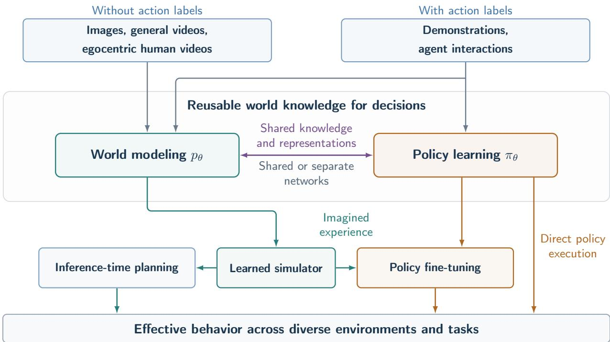
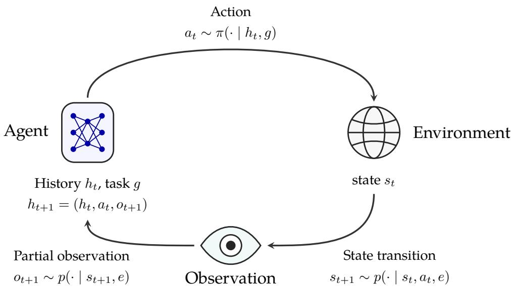
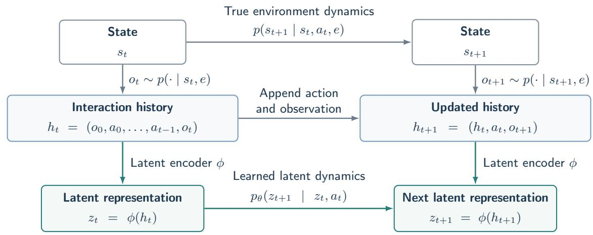
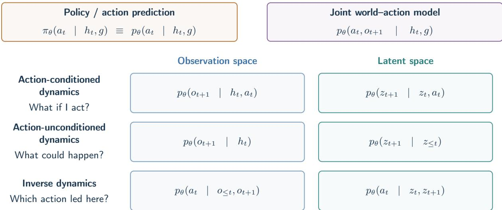

# An Introduction to World Models for Generalist Agents

Zhihui Zhu

Department of Computer Science and Engineering

The Ohio State University

zhu.3440@osu.edu

October 20, 2026

## Abstract

World models have recently emerged as a promising direction toward developing generalist agents capable of understanding, predicting, and interacting with diverse environments. However, despite growing interest, the concept of a world model remains loosely defined, encompassing approaches ranging from predictive dynamics models and learned simulators to models that jointly generate future observations and actions. This introductory paper aims to clarify the concept of world models and provide a unified perspective on their role in developing generalist agents. Starting from the partially observable Markov decision process (POMDP) framework, we connect world modeling to classical control, dynamical systems, signal processing, and reinforcement learning. We introduce diferent approaches to world modeling, emphasizing the knowledge they capture, their learning objectives, and how they support decisionmaking. We further explore the relationship between world modeling and policy learning, highlighting how these capabilities can be unified through conditional prediction without requiring separate models. Rather than ofering an exhaustive survey of existing methods, this paper focuses on fundamental concepts, modeling principles, and connections, with the goal of providing an accessible and unified introduction to world models for generalist agents.

"The most incomprehensible thing about the universe is that it is comprehensible"—Albert Einstein

## Contents

## 1 Introduction

2 Generalist Agents: A Sequential Decision-Making Perspective 4   
2.1 General Formulation: partially observable Markov decision processe . . . . . 4   
2.2 Sequential Decision-Making: Control, Estimation, and Learning . . 8   
2.2.1 Known Dynamics and Fully Observed State: Control and Dynamic Program  
ming. . . 8   
2.2.2 Known Dynamics and Partially Observed State: Filtering and State Estimation. 9   
2.2.3 Unknown Dynamics: System Identification and Reinforcement Learning. . . 10   
3.2.2 Latent-Space World Models . 17   
3.2.3 Learning Policies from Predictive Models . 18   
3.3 World-Action Models: Joint Learning of World Models and Action Policies . 20   
3.4 Language Models as Implicit World Models and Generalist Agents 22   
4 Discussion and Conclusion 23

## 1 Introduction

A long-standing goal of machine learning (ML) and artificial intelligence (AI) is to develop generalist agents that can perceive, reason, and act efectively across diverse environments and tasks [1]. Achieving this requires more than recognizing patterns in observations or reproducing actions from demonstrations. An agent must acquire knowledge about how the world works, how it changes, and how its actions influence future outcomes. Recently, world models have emerged as a popular and promising direction toward this goal. Advances in generative modeling, video prediction, robotics, and large language models (LLMs) have stimulated growing interest in building agents that can learn how the world works and use this knowledge to guide their actions [2, 3]. This direction is particularly relevant to physical intelligence, where agents must understand and interact with the physical world across diverse tasks and embodiments [4]. The growing availability of images, videos, and robotic interaction data provides new opportunities to acquire such world knowledge at scale [5, 6].

Despite this growing interest, the meaning of world model remains surprisingly ambiguous. The term has been used to describe a wide range of models, including predictive dynamics models, generative video models, learned simulators, and models that jointly predict future observations and actions. Even action policies can be viewed as implicitly containing a model of the world. These approaches difer substantially in their learning objectives, representations, architectures, and intended applications. The idea of learning internal models of the environment has a long history in AI and control. Model-based control and reinforcement learning have traditionally used models of system dynamics to predict the consequences of actions and support planning [7, 8]. The term world model gained renewed attention with a series of recent work [9–12]. More recently, advances in video generation [13] and world-action models [14] have further blurred the boundaries between predicting the world, simulating interactions, and generating actions.

To clarify these concepts, it is useful to consider the two words in world model. A model, broadly speaking, is an informative representation of an object or system, constructed to describe, understand, or predict its behavior [15]. A model need not reproduce every detail of reality, but rather capture selected properties relevant to its intended purpose. A mathematical model of atmospheric dynamics, for example, captures aspects of the physical system relevant to weather forecasting. A related concept is simulation, which involves constructing a model of a system and conducting experiments with that model to understand its behavior or evaluate alternative strategies [16]. The word world highlights a broader ambition: learning knowledge that is useful across diverse environments and tasks, rather than modeling a narrowly specified system for a single application. For generalist agents, such knowledge may include the structure of environments, the evolution of their states, the consequences of actions, and the relationships between observations, actions, and outcomes. Importantly, this does not require a world model to capture every aspect of the environment. Diferent models may represent diferent components of the world, at diferent levels of abstraction, depending on what information is useful for prediction and decision-making.

In this paper, we study world models from the perspective of designing generalist agents, whose objective is to maximize rewards across diverse environments and tasks. We formalize this setting using partially observable Markov decision processes (POMDPs) [8], which provide a unified framework for describing environment states, observations, actions, and dynamics. We adopt a broad definition of a world model as a learned representation that captures aspects of an environment’s structure, state, or dynamics to support understanding, prediction, or decision-making. Under this perspective, diferent approaches to world modeling can be characterized by the environmental knowledge they capture and the relationships they learn. For example, observationspace world models predict future observations, while latent-space models learn representations and their evolution. Passive predictive models learn temporal regularities from observations [17], whereas action-conditioned models predict how the environment responds to actions [10].

Diverse experience for generalist agents  
  
Figure 1: An integrated view of world modeling and policy learning. Using the physical world as an illustrative setting, passive observations (e.g., images and videos) and action-labeled trajectories (e.g., robotic interactions) provide complementary learning signals for acquiring world knowledge and learning action policies. World modeling and policy learning are closely connected and may share representations, learning objectives, or model architectures. The acquired world knowledge can support inference-time planning, simulated experience for policy improvement through reinforcement learning, or direct action through a learned policy. Together, these complementary approaches support the development of generalist agents capable of efective decision-making across diverse environments, tasks, and embodiments.

A policy, in contrast, selects actions based on the available information and task. Although policy learning does not necessarily involve explicit world modeling, efective decision-making often requires implicitly capturing relevant aspects of the environment and its dynamics. Thus, world modeling and policy learning represent distinct but closely related capabilities, both relying on knowledge of the world to varying degrees to support efective behavior. As illustrated in Figure 1, they can leverage diverse data sources and shared representations, while learned world models can further support inference-time planning and policy improvement through simulated experience. More fundamentally, world modeling and policy learning can be connected through a unified probabilistic perspective. A policy predicts which action to take given the current context, a forward dynamics model predicts the consequences of an action, and an inverse dynamics model predicts the action associated with an observed transition. These can be viewed as diferent conditional distributions derived from a joint distribution over actions and future observations. This perspective motivates recent world-action models, which integrate world prediction and action generation through shared representations, joint learning objectives, or interacting generative architectures [14, 18].

LLMs provide another intriguing perspective. Trained on internet-scale text through nexttoken prediction, followed by fine-tuning and reinforcement learning, LLMs have demonstrated broad capabilities in reasoning, tool use, and interactive problem-solving [19]. Although nexttoken prediction is not explicitly designed for learning environment dynamics, the training data contains extensive descriptions of events, actions, interactions, and their consequences. Depending on the conditioning context and prediction target, the same autoregressive objective can implicitly provide supervision for policies, forward dynamics, inverse dynamics, and other forms of prediction. This suggests that general-purpose predictive learning may acquire implicit representations of the world [20], which can be further strengthened through interaction-based training [21–23].

Our goal in this paper is to provide a unified introduction to world models from the perspective of learning generalist agents. Rather than focusing on specific architectures or implementation details, we emphasize the underlying modeling principles, aiming to clarify the relationships among diferent approaches to world modeling, their learning objectives, and their roles in supporting decision-making. Inspired by the success of large-scale predictive learning in LLMs, we also highlight how these principles may enable generalist agents to leverage diverse data sources, ranging from passive videos and egocentric human observations to action-labeled demonstrations and interaction trajectories. By extracting complementary learning signals from such data, world modeling and policy learning may jointly support the acquisition of transferable knowledge across environments, tasks, and embodiments. We do not attempt an exhaustive survey of the rapidly growing literature, for which we refer readers to several recent surveys [3, 24]. Instead, we focus on representative approaches that illustrate the key concepts and connections.

The remainder of this paper is organized as follows. We first formulate the generalist-agent problem using the POMDP framework in Section 2.1. Following the perspective of [25], we then draw connections to classical control, dynamical systems, signal processing, and reinforcement learning in Section 2.2. In Section 3, we introduce policy learning and diferent approaches to world modeling, highlighting their learning objectives, representations, and roles in supporting decision-making. Finally, we conclude in Section 4, we conclude with a discussion of some other key challenges and future directions, including generalization across embodiments, scaling data and learning signals, state and action representations, high-level reasoning, and the evaluation of world models for decision-making.

## 2 Generalist Agents: A Sequential Decision-Making Perspective

## 2.1 General Formulation: partially observable Markov decision processe

A generalist agent can perform diverse tasks across environments, adapting its behavior to new situations under partial observability. A central research question is how agents can acquire transferable knowledge from heterogeneous data and interaction experience to support efective decisionmaking and generalization. Our research investigates the learning principles that enable agents to leverage both passive observations and active interactions to understand their environments, plan actions, and adapt to unfamiliar tasks [1, 26].

Table 1: Notation used throughout the paper.
<table><tr><td>Notation</td><td>Meaning</td></tr><tr><td> $s _ { t } , o _ { t } , a _ { t } , h _ { t }$ </td><td>State, observation, action, and interaction history.</td></tr><tr><td> $e , g$ </td><td>Environment and task.</td></tr><tr><td> $\pi , \pi \theta$ </td><td>Generic action policy and parameterized policy.</td></tr><tr><td> $p , p _ { \theta }$ </td><td>Underlying distribution, and a learned probabilistic model.</td></tr><tr><td> $\phi , z _ { t } = \phi ( h _ { t } )$ </td><td>Latent encoder and latent representation.</td></tr><tr><td> $\theta$ </td><td>Generic model parameters, which may vary across models.</td></tr></table>

To conceptualize interaction in machine learning, we adopt a general framework that encompasses a wide range of settings, including reinforcement learning, control, filtering, and system identification [8, 27]. This framework emphasizes the sequential nature of interaction. To capture the generality of intelligent agents, we explicitly model the diversity of environments and tasks they may encounter, rather than restricting attention to a single fixed setting. Within a world, such as the physical world, the digital world, or a scientific domain, an agent may encounter many environments, denoted by $e ,$ which share common structure but difer in their specific configurations. For example, in the physical world, environments may correspond to diferent homes, restaurants, supermarkets, cofee shops, or ofices. Within a given environment $e ,$ the agent is asked to perform a task ${ \mathit { g } } ,$ which specifies a goal or desired outcome. Table 1 summarizes the recurring symbols.

Remark 1. For simplicity, we assume a fixed agent embodiment throughout the discussion, including its observation and action spaces. In practice, generalist agents may operate across diferent embodiments, such as robotic platforms with diferent sensors and actuators or digital agents with diferent interfaces and available tools. The framework can be extended to accommodate such diversity by introducing an embodiment variable $b ,$ with the observation and action spaces, as well as the corresponding dynamics and policies, conditioned on b. Ideally, a generalist agent should learn transferable knowledge and capabilities that generalize not only across environments and tasks, but also across embodiments.

As illustrated in Figure 2, the POMDP provides a principled mathematical framework for modeling sequential interaction and decision-making. Adapting the notations of state-action pairs $( s , a )$ , each environment e has a state space $\scriptstyle { \mathcal { S } } _ { e } ,$ observation space $\mathcal { O } _ { e } ,$ and action space $A _ { e }$ . Within one episode the environment remains fixed, while the state evolves according to its transition dynamics. At time $t ,$ the world has a possibly underlying state $s _ { t } \in S _ { e } ,$ the agent receives an observation $o _ { t } \in \mathcal { O } _ { e } ,$ and the agent executes an action $a _ { t } \in \mathcal { A } _ { e }$ . The state evolves according to

$$
s _ { t + 1 } \sim p ( \cdot \mid s _ { t } , a _ { t } , e ) ,\tag{1}
$$

while the agent may receive only a potentially partial observation of the underlying state,

$$
o _ { t } \sim p ( \cdot \mid s _ { t } , e ) .\tag{2}
$$

Here, for notational simplicity, we simply use $p$ for both the transition and observation distributions, distinguished by their predicted variables and conditioning information. These correspond to the transition and observation models, often denoted by $P$ and $\Omega ,$ respectively, in standard POMDP formulations. An episode begins with an initial state $s _ { 0 } ~ \sim ~ p ( \cdot ~ | ~ e )$ and observation $o _ { 0 } \sim p ( \cdot \mid s _ { 0 } , e )$ . We assume that the environment and task remain fixed within an episode, and that the transition and observation mechanisms are time-invariant within each environment, although they may difer across environments. Importantly, conditioning on e characterizes the dependence of the underlying distributions on the environment, but does not imply that the environment identity is known to the agent. We assume that the task $g$ is provided, while the agent must infer relevant information about the environment from its observations and interaction history.

  
Figure 2: The POMDP interaction loop for generalist agents across diverse environments and tasks. Given its interaction history and task, the agent selects an action. The state evolves according to $p ( s _ { t + 1 } \mid s _ { t } , a _ { t } , e )$ , and the environment generates an observation through $p ( o _ { t + 1 } \mid s _ { t + 1 } , e )$ . The agent incorporates the new observation into its history before acting again. The environment e and task remain fixed within an episode but may vary across episodes, requiring the agent to adapt to diferent environments and objectives.

The interaction history up to time t consists of the sequence of observations and actions:

$$
h _ { t } = ( o _ { 0 } , a _ { 0 } , \ldots , a _ { t - 1 } , o _ { t } ) .\tag{3}
$$

The history update is $h _ { t + 1 } = ( h _ { t } , a _ { t } , o _ { t + 1 } )$ . We assume a horizon of $T$ transitions. At time $t ,$ the agent selects an action based on its interaction history $h _ { t } ,$ together with the task $g .$ This decisionmaking process is characterized by a policy.

Definition 1 (Policy). A policy is a mapping from the interaction history to a distribution over actions:

$$
a _ { t } \sim \pi ( \cdot \mid h _ { t } , g ) .\tag{4}
$$

Here, we adopt the standard stochastic policy formulation, where $\textstyle \pi ( a _ { t } \ | \ h _ { t } , g )$ specifies the probability (or probability density) of selecting action $a _ { t }$ . A deterministic policy is a special case that assigns all probability mass to a single action. Explicit conditioning on g allows a single policy to support multiple tasks. For a fixed, known environment with fully observed Markov state, a policy can depend on $s _ { t }$ and $g$ rather than the full history under standard Markov decision process assumptions. A finite-horizon policy may also depend on time. If the environment is unknown, history can remain useful even when the physical state is observed, because past transitions help identify the environment dynamics. In words, the policy maps the agent’s available information and task objective to actions, making it a central object of learning and optimization in reinforcement learning and control. From a predictive modeling perspective, a policy can also be viewed as an action model that models the conditional distribution of actions given the interaction history and task. We revisit this perspective when discussing diferent learning approaches.

A central challenge for generalist agents is to operate efectively across diverse environments and tasks. This challenge is particularly pronounced in the physical world, where agents may encounter diferent environments, such as kitchens, bedrooms, ofices, warehouses, and laboratories, and perform a wide range of tasks, such as navigation, object manipulation, and tool use. Diferent environments involve variations in objects, layouts, physical conditions, and interaction dynamics, while diferent tasks impose distinct goals and constraints. Rather than learning a separate model for every environment and task, a generalist agent should acquire reusable world knowledge about objects, physical dynamics, interactions, and action consequences, and adapt this knowledge to the current environment and task.

Thus, the objective is to learn a generalist agent capable of performing diverse tasks across environments. Formally, let $r _ { g } ( s _ { t } , a _ { t } )$ denote the task-specific reward function, which measures progress toward the objective of task $g .$ . We seek1

$$
\begin{array} { r l } { \underset { \pi } { \operatorname* { m a x } } } & { \mathbb { E } _ { e , g } \left[ \mathbb { E } _ { s _ { t } , o _ { t } , a _ { t } } \left[ \sum _ { t = 0 } ^ { T - 1 } r _ { g } ( s _ { t } , a _ { t } ) \right] \right] } \\ & { \mathrm { s . t . } \quad a _ { t } \sim \pi ( \cdot \mid h _ { t } , g ) , \quad s _ { t + 1 } \sim p ( \cdot \mid s _ { t } , a _ { t } , e ) , \quad o _ { t } \sim p ( \cdot \mid s _ { t } , e ) . } \end{array}\tag{5}
$$

The outer expectation is taken over environments e and tasks ${ \mathit { g } } ,$ while the inner expectation accounts for the stochasticity of the initial state, observations, state transitions, and policy actions. For simplicity, we consider a finite-horizon objective with action-dependent rewards and no additional terminal reward. The formulation can be readily extended to accommodate other reward structures, including terminal rewards and discounted cumulative rewards. The objective is to learn a single policy that achieves high expected reward across diverse environments and tasks, rather than specializing to a single fixed setting.

The above formulation is closely related to classical reinforcement learning, particularly its multi-task and partially observable variants [8, 27, 28]. However, learning generalist agents introduces additional challenges beyond optimizing a policy in a fixed environment. First, agents must generalize across diverse and potentially unseen environments and tasks, rather than specialize in a single setting. Second, learning efective behaviors from scratch through trial and error may be prohibitively expensive, motivating the acquisition of transferable knowledge from heterogeneous data and prior experience. Third, unlike many standard RL benchmarks, real-world environments may not provide inexpensive, resettable interactions or accurate simulators, making exploration and policy improvement substantially more challenging. These considerations shift the focus from policy optimization alone toward understanding what knowledge agents should acquire, how they should learn it from diverse sources, and how they can use it to adapt and improve with limited interaction.

These challenges motivate approaches that go beyond learning action policies from trial-anderror interactions. In particular, generalist agents may benefit from learning predictive world models and reusable representations, which can support policy learning, planning, and adaptation across environments and tasks. In the next section, we will discuss these approaches through the lens of what is learned, what learning signals are available, and how learned knowledge supports decision-making. Before doing so, we first connect our formulation to established fields of sequential decision-making, highlighting their underlying assumptions and objectives to provide a foundation for understanding the learning approaches discussed later.

## 2.2 Sequential Decision-Making: Control, Estimation, and Learning

The formulation (5) connects to a rich body of work on dynamical systems, control, filtering, system identification, and reinforcement learning. These fields study diferent aspects of sequential interaction and can be understood within a common framework by considering two fundamental questions: whether the underlying state is directly observable and whether the environment dynamics are known. These distinctions help clarify the relationships among classical approaches and their relevance to learning generalist agents.

In classical control and dynamical signal processing, the system is often written as [29–31]

$$
s _ { t + 1 } = f ( s _ { t } , a _ { t } , w _ { t } ) , \qquad o _ { t } = q ( s _ { t } , v _ { t } ) ,\tag{6}
$$

where $w _ { t }$ and $v _ { t }$ denote process and measurement noise. In this subsection, we consider a fixed environment and task, suppressing e and $g$ from the notation. The functions $f$ and $q ,$ together with the noise distributions, induce the transition and observation conditionals denoted by $p .$ In this context, a policy plays the role of a controller that selects actions based on the available information. Classical control may often use deterministic controllers. With a slight abuse of notation, we write $a _ { t } = \pi ( h _ { t } )$ for a policy that assigns all probability mass to one action. A finite-horizon controller can depend on time, which is already encoded by the length of $h _ { t }$

## 2.2.1 Known Dynamics and Fully Observed State: Control and Dynamic Programming.

When the state $s _ { t }$ is fully observed and the transition model $f ( s _ { t } , a _ { t } , w _ { t } )$ is known, the problem reduces to classical sequential decision making and optimal control. Let $\xi ( s _ { t } , a _ { t } )$ denote the instantaneous cost incurred at time t when taking action $a _ { t }$ in state $s _ { t }$ . Following the standard formulation in optimal control, we consider a finite-horizon problem with horizon $T ,$ where the objective is to minimize the expected cumulative cost:

$$
\begin{array} { l l } { \displaystyle \operatorname* { m i n } _ { \pi } \mathbb { E } _ { w _ { 0 : T - 1 } } \left[ \sum _ { t = 0 } ^ { T - 1 } \xi ( s _ { t } , a _ { t } ) \right] , } \\ { \mathrm { s . t . } ~ s _ { t + 1 } = f ( s _ { t } , a _ { t } , w _ { t } ) , \quad a _ { t } = \pi ( h _ { t } ) . } \end{array}\tag{7}
$$

or equivalently as reward maximization with reward $\textstyle - \xi ( s _ { t } , a _ { t } )$ . When both the system dynamics and the objective function are known, a rich collection of methods has been developed to solve $( 7 )$ For instance, dynamic programming exploits Bellman’s principle of optimality to decompose the global optimization problem into a sequence of local optimization problems, yielding an optimal policy under suitable assumptions [32].

A classical example is the linear quadratic regulator (LQR):

$$
\begin{array} { r l r } {  { \operatorname* { m i n } _ { \pi } \mathbb { E } _ { w _ { 0 : T - 1 } } [ \sum _ { t = 0 } ^ { T - 1 } ( s _ { t } ^ { \top } Q s _ { t } + a _ { t } ^ { \top } R a _ { t } ) ] , } } \\ & { s _ { t + 1 } = A s _ { t } + B a _ { t } + w _ { t } , } & { a _ { t } = \pi _ { t } ( s _ { t } ) , } \end{array}\tag{8}
$$

which considers linear dynamics and quadratic costs. Here, $Q \succeq 0$ and $R \ \succ \ 0$ penalize state deviations and control efort, respectively. Under standard assumptions, the optimal controller is a linear state-feedback law, $a _ { t } = - K _ { t } s _ { t }$ , where the gain $K _ { t }$ is obtained from the Riccati recursion [33].

Model predictive control (MPC) extends this optimization-based perspective by repeatedly solving a finite-horizon control problem using the current state or state estimate. At each time step, only the first planned action is executed, after which the optimization is repeated using updated information [34]. Unlike dynamic programming, which characterizes an optimal policy through a value function, MPC computes actions through repeated online optimization. Together, these approaches illustrate the known-dynamics setting, where the primary challenge is planning and selecting actions rather than learning the environment dynamics.

## 2.2.2 Known Dynamics and Partially Observed State: Filtering and State Estimation.

When the transition and observation mechanisms in (6) are known but $s _ { t }$ is not directly observed, the agent must infer the state from its history $h _ { t } = \left( o _ { 0 } , a _ { 0 } , \ldots , a _ { t - 1 } , o _ { t } \right)$ . This is the classical problem offiltering or state estimation [29, 33].

A general formulation of the problem is to mantain the posterior distribution (or belief state) over states given the history, $p ( s _ { t } \ | \ h _ { t } )$ . This posterior summarizes everything known about the state. Noting that the history $h _ { t }$ can be decomposed as $h _ { t } = ( h _ { t - 1 } , a _ { t - 1 } , o _ { t } )$ , we first compute the prior distribution over states at time t given the previous history and action using the transition model:

$$
\begin{array} { l } { { p ( s _ { t } \mid h _ { t - 1 } , a _ { t - 1 } ) = \displaystyle \int p ( s _ { t } , s _ { t - 1 } \mid h _ { t - 1 } , a _ { t - 1 } ) d s _ { t - 1 } , } } \\ { { \phantom { p ( s _ { t } mid h _ { t - 1 } , a _ { t - 1 } ) = \displaystyle \int p ( s _ { t } \mid s _ { t - 1 } , a _ { t - 1 } ) p ( s _ { t - 1 } \mid h _ { t - 1 } ) d s _ { t - 1 } , } } \quad \scriptstyle ( \mathrm { p r e d i c t i o n s t e p } ) } \end{array}\tag{9}
$$

where the last equlity follows from the Markov property of the state transition and the fact that since $a _ { t - 1 }$ does not alter the posterior distribution of $s t { - 1 }$ after the past observations. We then incorporate the new observation $o _ { t }$ through Bayes’ rule:

$$
p ( s _ { t } \mid h _ { t } ) = { \frac { p ( o _ { t } \mid s _ { t } , h _ { t - 1 } , a _ { t - 1 } ) p ( s _ { t } \mid h _ { t - 1 } , a _ { t - 1 } ) } { p ( o _ { t } \mid h _ { t - 1 } , a _ { t - 1 } ) } } \propto p ( o _ { t } \mid s _ { t } ) p ( s _ { t } \mid h _ { t - 1 } , a _ { t - 1 } ) . \quad { \mathrm { ( u p d a t e ~ s t e p ) } }\tag{10}
$$

Thus, in principle, the belief state $p ( s _ { t } \mid h _ { t } )$ can be computed recursively from the previous belief $p ( s _ { t - 1 } \mid h _ { t - 1 } )$ , the transition model $p ( s _ { t } \mid s _ { t - 1 } , a _ { t - 1 } )$ , and the observation model $p ( o _ { t } \mid s _ { t } )$ , which are induced by the dynamics and observation models in (6). If a point estimate is desired, one may compute the posterior mean or the posterior mode depends on the application.

This recursive Bayesian formulation underlies a broad family of filtering algorithms. In practice, the belief state is often represented in a parametric form (e.g., Gaussian) or approximated by a finite set of particles, leading to algorithms such as Kalman filtering and particle filtering. For instance, Kalman filtering is the classical solution for linear-Gaussian systems,

$$
s _ { t + 1 } = A s _ { t } + B a _ { t } + w _ { t } , \qquad o _ { t } = C s _ { t } + v _ { t } ,\tag{11}
$$

where $w _ { t }$ and $v _ { t }$ are independent Gaussian noise processes. With a Gaussian initial-state distribution, the posterior $p ( s _ { t } \mid h _ { t } )$ remains Gaussian for all $t ,$ and both the prediction and update steps admit closed-form solutions.

Filtering and control address complementary aspects of sequential interaction: filtering estimates the underlying state, while control selects actions to achieve an objective. In the classical linear-quadratic-Gaussian setting, the separation principle establishes that the optimal controller can be obtained by combining a Kalman filter with the LQR introduced in (8). Specifically, the optimal controller retains the same linear feedback structure as LQR, but replaces the true state $s _ { t }$ with its posterior estimate $\hat { s } _ { t } \colon$

$$
a _ { t } = - K _ { t } { \hat { s } } _ { t } , \qquad { \hat { s } } _ { t } = \mathbb { E } [ s _ { t } \mid h _ { t } ] ,\tag{12}
$$

where $K _ { t }$ is the LQR feedback gain obtained from the Riccati recursion as in (8). This is known as the certainty-equivalence principle: the controller acts as if the estimated state were the true state [33]. Beyond the linear-quadratic-Gaussia setting, the full belief state $p ( s _ { t } \mid h _ { t } )$ can provide representation of the observation history for optimal decision-making under partial observability [27].

## 2.2.3 Unknown Dynamics: System Identification and Reinforcement Learning.

When the transition dynamics are unknown, the agent must learn about the environment from observed data or interactions. A classical approach is system identification, which aims to estimate a model of the underlying dynamics from observed trajectories [35]. For example, consider the above discussed fully observed linear dynamical system $s _ { t + 1 } = A s _ { t } + B a _ { t } + w _ { t }$ , where A and B are unknown dynamics matrices and wt represents process noise. Given trajectories of states and actions, these matrices can be estimated through least squares regression by minimizing the onestep state prediction error. When the states are only partially observed, classical methods such as maximum likelihood estimation and subspace identification can recover a state-space model from input-output trajectories. For nonlinear systems, the dynamics can be approximated using nonlinear parametric models, including neural networks, learned from observed transitions.

More generally, system identification seeks to learn predictive relationships between the agent’s actions and the evolution of the environment. Depending on the available observations and model assumptions, this may involve predicting future states from state-action pairs or predicting future observations from interaction histories. The latter can be implemented using latent-state representations that summarize past interactions. Once learned, such models can support prediction, simulation, planning, and model predictive control. This establishes a fundamental connection between learning environment dynamics and model-based decision-making.

Reinforcement learning (RL) addresses the problem of learning efective decision-making policies through interaction with the environment [8]. Its objective is to maximize the expected cumulative reward, as formulated in (5). While this formulation accommodates multiple environments and tasks, classical RL often considers a fixed environment and reward function, and seeks to learn an optimal policy from experience when the environment dynamics are unknown. Unlike system identification, which focuses on learning a predictive model of the environment, RL directly optimizes decision-making performance. Nevertheless, the two are closely connected: learning the environment dynamics can support policy optimization, although an explicit dynamics model is not always necessary.

This distinction leads to two major approaches to RL. Model-based RL explicitly learns or uses a predictive model of the environment and leverages it for planning or policy improvement. When the dynamics are unknown, learning such a model is closely related to system identification, although the model may be optimized for decision-making rather than prediction accuracy alone. The learned model can predict future states, observations, or rewards, allowing the agent to evaluate candidate actions through simulated rollouts. In contrast, model-free RL learns policies or value functions directly from experience, without explicitly constructing a predictive dynamics model. Thus, both approaches aim to improve decision-making, but difer in whether and how an environment model is explicitly learned and used.

Although RL provides a general mathematical framework for learning through interaction, applying it to generalist agents introduces significant practical challenges.

• First, many online RL algorithms require extensive trial-and-error interactions to acquire efective behaviors. In controlled settings, these interactions can be generated eficiently through simulators that support repeated trials, environment resets, and parallel exploration. However, constructing suficiently accurate simulators can be dificult for complex physical environments, particularly those involving diverse objects, contact dynamics, and human interactions [36]. While simulation is highly efective for certain tasks, transferring learned behaviors to the real world introduces additional challenges due to model mismatch and distribution shifts, known as the sim-to-real gap [37].

• Second, learning directly in real-world environments can be expensive, slow, and potentially unsafe. Physical interactions consume time and resources, while exploratory actions may damage objects or violate safety constraints. Moreover, many real-world situations cannot be reset to identical initial conditions, making repeated experimentation dificult. These limitations are particularly important for generalist agents, which must operate across diverse tasks and environments rather than repeatedly train for a single task.

• Third, conventional RL formulations often assume that the agent can obtain reward feedback and collect trajectories through interaction with the target environment. In contrast, generalist agents may need to acquire transferable knowledge from heterogeneous sources, including passive observations, human demonstrations, previously collected interaction data, and experience from other environments. Such data may not contain explicit rewards or may not be generated by the agent’s current policy. Ofline RL, imitation learning, multi-task RL, and model-based approaches provide important mechanisms for addressing aspects of these challenges [28, 38], but eficiently integrating diverse data sources and generalizing to unseen tasks and environments remain central research problems.

These considerations motivate a broader perspective on generalist-agent learning. Beyond optimizing a policy through trial and error, an agent must determine what knowledge to acquire, how to learn it from diferent forms of data, and how to reuse it for prediction, planning, and adaptation. This perspective connects classical system identification and reinforcement learning to modern approaches for learning world models, action policies, and transferable representations.

## 3 Learning to Act: Policies and World Models

The preceding section connects generalist agents to classical frameworks for control, state estimation, system identification, and reinforcement learning. These frameworks characterize diferent aspects of sequential interaction, including action selection, hidden-state estimation, and learning unknown dynamics. Building on these foundations, we now examine how generalist agents can learn policies and world models from data to operate across diverse environments and tasks.

We organize the discussion around three complementary approaches, as illustrated in Figure 3, which difer in their prediction targets, conditioning information, and representations. The first directly learns action policies from demonstrations, without explicitly modeling environment dynamics. The second learns predictive world models in observation or latent spaces to support planning, control, and policy improvement. The third jointly learns world models and action policies, allowing world prediction and action learning to reinforce each other. For each approach, we discuss the underlying model formulations, available training data and learning objectives, and how the learned knowledge supports decision-making.

(a) State, interaction history, and latent representation

(b) Model families: what is predicted, and what is given?

  
Figure 3: Policies, world models, and learned latent representations. (a) The underlying state $s _ { t }$ follows the true environment dynamics and generates observations. A latent encoder maps the interaction history to a learned representation $z _ { t } = \phi ( h _ { t } )$ , whose evolution is predicted by a latent dynamics model. Alternatively, the encoder may use only the current observation, $z _ { t } = \phi ( o _ { t } )$ , or observation history, $z _ { t } = \phi ( o _ { \leq t } )$ . Neither direct access to $s _ { t }$ nor a one-to-one correspondence between $s _ { t }$ and $z _ { t }$ is assumed. (b) The model families discussed in Section 3 difer in their prediction targets and conditioning information. Action-unconditioned dynamics models do not condition on the current action $a _ { t }$ . For passive data without action labels, observation prediction takes the form $p _ { \theta } ( o _ { t + 1 } \mid o _ { \leq t } )$ , and latent models use observation-only encodings. For inverse dynamics prediction, latent representations should not directly encode the target action $a _ { t }$ and may instead be constructed from current observation or observation histories. Throughout, $p _ { \theta }$ denotes a generic learned predictive model: the diferent conditional distributions may be modeled separately with distinct parameters or jointly within a unified model with shared parameters. Task conditioning may also be included when informative.

Notation and conditioning conventions. Before proceeding, we clarify the notation used throughout this section. Recall that e denotes the environment and $g$ denotes the task, both fixed within an episode. The underlying dynamics depend on $e ,$ which is generally not directly observed by the agent. In the following sections, we therefore omit explicit conditioning on e from learned predictive models, which instead use observations or interaction histories to infer relevant environment information. We retain task conditioning in policies, since the appropriate action generally depends on the task. For simplicity, individual dynamics models are typically written without conditioning on ${ \mathit { g } } ,$ although task information may be included when it provides useful predictive context. In contrast, we retain $g$ throughout exact joint-distribution factorizations in Section 3.3 to ensure consistent conditioning.

We use $p$ to denote probability distributions induced by the underlying dynamic process, and $p _ { \theta }$ to denote learned probabilistic models parameterized by θ. Similarly, we use $\pi$ to denote a generic action policy and $\pi _ { \theta }$ to denote a parameterized policy. For simplicity, we use $\theta$ as a generic parameter symbol and distinguish diferent models by their predicted variables and conditioning information. These models need not share the same parameters, and they may be implemented by separate neural networks or jointly represented within a unified architecture. Our discussion focuses primarily on the conditional distributions being modeled, rather than their specific parameterizations or learning algorithms.

Suppose the agent has access to interaction trajectories collected from one or more behavior policies, such as human demonstrations or teleoperated robotic actions. Each trajectory consists of a task specification $g$ and a sequence of observations and actions $( o _ { 0 } , a _ { 0 } , o _ { 1 } , \dots , a _ { T - 1 } , o _ { T } )$ . For simplicity, we use a common horizon $T ,$ although trajectories may have diferent lengths and need not contain complete episodes. The demonstrated behaviors need not be optimal, but are assumed to provide useful examples of how to accomplish the tasks of interest. The same interaction trajectories can provide supervision for diferent prediction tasks. In particular, we consider the following datasets for action prediction and action-conditioned dynamics prediction:

$$
\mathcal { D } _ { \mathrm { a c t } } = \{ \left( h _ { t } , g , a _ { t } \right) \} , \quad \mathcal { D } _ { \mathrm { d y n } } = \{ \left( h _ { t } , a _ { t } , o _ { t + 1 } \right) \} ,\tag{13}
$$

where $h _ { t } = \left( o _ { 0 } , a _ { 0 } , \ldots , a _ { t - 1 } , o _ { t } \right)$ is the interaction history preceding action $a _ { t } ,$ and the examples are extracted over $0 \leq t < T$ from the available trajectories. We omit $g$ from $\mathcal { D } _ { \mathrm { d y n } }$ under the assumption that the underlying environment dynamics do not directly depend on the task given the action. However, when the task specification provides additional information about the environment, it may also be included as a conditioning variable in dynamics prediction.

In addition, passive observational data can be used for learning predictive models without requiring action labels. We denote the corresponding dataset by

$$
\mathcal { D } _ { \mathrm { p a s s } } = \{ ( o _ { \leq t } , o _ { t + 1 } ) \} ,\tag{14}
$$

where $o _ { \le t } = \left( o _ { 0 } , \ldots , o _ { t } \right)$ denotes the observation history. Unlike $\mathcal { D } _ { \mathrm { a c t } }$ and $\mathcal { D } _ { \mathrm { d y n } } ,$ this dataset does not require the actions associated with the observed transitions and can therefore be constructed from passive observation sequences, such as videos, as well as from interaction trajectories with action labels omitted.

## 3.1 Direct Policy Learning from Demonstrations

We begin with the most direct approach to learning an agent: learning an action policy from demonstrations without explicitly modeling the environment dynamics. Recall from Section 2 that a policy $\pi ( a _ { t } \mid h _ { t } , g )$ specifies a conditional distribution over actions given the interaction history

and task. Given the action examples in $\mathcal { D } _ { \mathrm { a c t . } }$ , defined in (13), we seek to learn a parameterized policy $\pi _ { \boldsymbol { \theta } } ( a _ { t } \mid h _ { t } , \boldsymbol { g } )$ , where θ denotes the model parameters.

A standard approach is behavior cloning, which formulates policy learning as a supervised learning problem by maximizing the likelihood of demonstrated actions [39]:

$$
\operatorname* { m a x } _ { \theta } \sum _ { ( h _ { t } , g , a _ { t } ) \in \mathcal { D } _ { \mathrm { a c t } } } \log \pi _ { \theta } ( a _ { t } \mid h _ { t } , g ) .\tag{15}
$$

From a predictive modeling perspective, the learned policy can be viewed as an action model that predicts actions conditioned on the interaction history and task. This connects policy learning to other conditional prediction problems, including the world-model learning approaches discussed later. In practice, such policies can be implemented using diferent architectures, including Transformers and difusion models, with corresponding learning objectives. When demonstrations are generated by a single behavior policy $\pi ,$ the learned policy $\pi _ { \theta }$ aims to approximate $\pi$ on histories represented in the training data. More generally, modern datasets often combine demonstrations from multiple human operators, robots, or algorithms. In this case, the learned policy approximates the conditional action distribution induced by the combined dataset, which may reflect a mixture of diferent behavior policies.

Many recent agent models can be understood as extensions of this direct supervised policy learning paradigm. They difer primarily in the information used to condition the policy, the parameterization of the action distribution, and the underlying model architecture, while sharing the common goal of learning actions directly from demonstrations. A common approach is to parameterize the policy autoregressively by decomposing the conditional action distribution into a sequence of action tokens or action chunks, analogous to next-token prediction in language models. Decision Transformer [40] formulates ofline reinforcement learning as conditional sequence modeling by predicting actions conditioned on past observations, actions, and a desired return-to-${ \bf { g o } }$ . More recent robotic foundation models, including RT-1 [41], RT-2 [42], and OpenVLA [43], similarly represent robot actions as sequences of discrete tokens and train the policy using autoregressive maximum likelihood. Despite their architectural diferences and conditioning information, these methods all optimize the policy directly through supervised learning rather than explicitly modeling the environment dynamics, learning a value function, or directly maximizing cumulative reward. For continuous and multimodal action spaces, the policy can instead be parameterized by a conditional difusion model. Difusion Policy [44] represents the policy as a conditional denoising difusion process that generates action sequences conditioned on the interaction history. Although the training objective is a denoising (or score-matching) loss instead of the action-level log-likelihood in standard behavior cloning, it remains a form of supervised policy learning. The difusion parameterization is particularly efective for continuous, high-dimensional, and multimodal action distributions.

Despite their efectiveness, direct supervised policy learning faces several important limitations. First, learning a broadly capable policy requires demonstrations covering a suficiently diverse range of environments, tasks, embodiments, and behaviors. Second, the learned policy is trained on histories generated by the behavior policies but is deployed on histories induced by its own actions. Prediction errors can therefore cause the agent to encounter situations poorly represented in the training data, potentially leading to compounding errors over long horizons [45]. Third, because behavior cloning optimizes agreement with demonstrated actions rather than cumulative reward, its performance depends strongly on the quality and coverage of the demonstrations, with no explicit mechanism for improving beyond the demonstrated behavior.

To partially address these limitations, many recent VLA models leverage knowledge acquired through large-scale multimodal pretraining. For example, RT-2 and OpenVLA build on pretrained vision-language models and adapt them to robotic control using action-labeled demonstrations. The pretrained models provide rich semantic and visual representations learned from large-scale image-text data, while robotic demonstrations ground these representations in executable actions. By transferring knowledge from multimodal pretraining, these approaches can improve generalization to new instructions, objects, and visual configurations, reducing reliance on task-specific robot demonstrations.

Nevertheless, pretrained representations alone do not eliminate the limitations of direct policy learning. In particular, these policies do not explicitly model how the environment evolves in response to actions, making it dificult to predict the consequences of alternative behaviors or systematically improve through planning. This motivates approaches that learn predictive world models, which can support reasoning about future states, evaluating candidate actions, and improving policies beyond direct imitation.

## 3.2 Learning World Models for Planning and Control

Direct policy learning predicts actions from the interaction history and task, without explicitly modeling how the environment responds to those actions. An alternative is to learn a world model that captures knowledge about the environment to support prediction, planning, or policy improvement. As discussed in the introduction, the notion of a world model is broad and need not be restricted to predicting environment dynamics. Such models may capture diferent aspects of the world, including its structure, states, relationships, and dynamics, at diferent levels of abstraction. In this section, we focus on a particularly important class of world models, dynamics models, which predict how observations or learned representations evolve over time, either with or without conditioning on actions. We introduce observation-space and latent-space formulations and discuss how they can support decision-making.

## 3.2.1 Observation-Space World Models

As discussed in the preceding section, under partial observability, the underlying environment state is unavailable, and system identification can instead be formulated as predicting future observations from the interaction history and actions. This motivates action-conditioned observational world models, which learn the observable consequences of actions without explicitly modeling the underlying state transitions [46].

Definition 2 (Action-conditioned observational dynamics model). An action-conditioned observational dynamics model is a probabilistic model $p _ { \theta } ( o _ { t + 1 } \mid h _ { t } , a _ { t } )$ that predicts the next observation conditioned on the interaction history $h _ { t }$ and current action $a _ { t }$ .

As in behavior cloning, θ denotes the parameters of the model being learned, without implying that the dynamics model and policy share parameters. When the task specification provides additional information about the environment, the model may also condition on $g .$ For simplicity, we omit this conditioning in the following discussion. The goal is to approximate the true conditional distribution of future observations. For a generalist agent operating across diferent environments, this distribution can be expressed as

$$
\begin{array} { l } { p _ { \theta } ( o _ { t + 1 } \mid h _ { t } , a _ { t } ) \approx p ( o _ { t + 1 } \mid h _ { t } , a _ { t } ) } \\ { \qquad = \displaystyle \int p ( o _ { t + 1 } \mid s _ { t + 1 } , e ) p ( s _ { t + 1 } \mid s _ { t } , a _ { t } , e ) p ( s _ { t } , e \mid h _ { t } , a _ { t } ) d s _ { t } d s _ { t + 1 } d e . } \end{array}\tag{16}
$$

Here, $p ( s _ { t } , e \mid h _ { t } , a _ { t } )$ captures uncertainty about both the underlying state and the environment, which the agent must infer from its interaction history. An action-conditioned world model can predict the consequences of actions, supporting planning, model predictive control, and modelbased reinforcement learning.

The observational dynamics model can be learned from the action-conditioned transition examples in $\mathcal { D } _ { \mathrm { d y n } } ,$ defined in (13), where $( h _ { t } , a _ { t } )$ serves as the input and $o _ { t + 1 }$ as the prediction target. A standard approach is to maximize the likelihood of observed transitions:

$$
\operatorname* { m a x } _ { \theta } \sum _ { ( h _ { t } , a _ { t } , o _ { t + 1 } ) \in \mathcal { D } _ { \mathrm { d y n } } } \log p _ { \theta } ( o _ { t + 1 } \mid h _ { t } , a _ { t } ) .\tag{17}
$$

Diferent model architectures and learning objectives can be used for observation prediction. Deterministic models predict a single observation $\widehat { o } _ { t + 1 }$ and typically minimize a regression loss against the observed outcome [46]. More expressive approaches can be used to capture stochasticity and multimodal future outcomes $\left[ 4 7 , 4 8 \right]$

However, collecting large-scale interaction data with action annotations can be expensive, particularly in physical environments. In contrast, passive observations, such as Internet-scale videos, are much more abundant. This motivates learning world models from observations alone, without requiring the actions that generated them.

Definition 3 (Action-unconditioned observational dynamics model). An action-unconditioned observational dynamics model predicts the next observation without conditioning on the current action $a _ { t }$ . In a probabilistic formulation, it can be represented as $p _ { \theta } ( o _ { t + 1 } \mid h _ { t } )$ , where the interaction history $h _ { t }$ may include past observations and actions. When only observations are available, the model instead takes the form $p _ { \theta } ( o _ { t + 1 } \mid o _ { \leq t } )$ , where $o _ { \le t } = \left( o _ { 0 } , \ldots , o _ { t } \right)$

The key distinction from action-conditioned dynamics models is whether the current action $a _ { t }$ is included in the conditioning context, rather than whether past actions are available. As before, we use $p _ { \theta }$ for diferent predictive models, with the conditioning variables distinguishing their formulations, without implying that they share parameters.

In the visual domain, the observation-only formulation is commonly studied as video prediction, where models predict future video frames from preceding frames [17]. Such vidoe predition models can be learned from the passive observation dataset $\mathcal { D } _ { \mathrm { p a s s } } ,$ defined in (14), without requiring action or task labels. Each pair $( o _ { \leq t } , o _ { t + 1 } )$ provides a prediction context and its target. A standard approach is to maximize the likelihood of observed transitions:

$$
\operatorname* { m a x } _ { \theta } \sum _ { ( o _ { \le t } , o _ { t + 1 } ) \in \mathcal { D } _ { \mathrm { p a s s } } } \log p _ { \theta } ( o _ { t + 1 } \mid o _ { \le t } ) .\tag{18}
$$

Other generative learning objectives can also be used. Representative approaches include autoregressive video prediction, stochastic video prediction [47], and difusion-based video generation [49]. These approaches employ diferent architectures and training objectives, including maximum likelihood, variational learning, and denoising-based objectives. By predicting future observations, they can learn temporal regularities, object interactions, and aspects of physical and semantic structure from large-scale observational data.

Unlike action-conditioned dynamics models, action-unconditioned predictors implicitly average over the actions or behaviors represented in the data, limiting their use for planning and control. Nevertheless, they can provide valuable prior knowledge about how the world evolves. Such knowledge may be transferred to action-conditioned models or policies through subsequent training on interactive trajectories, potentially reducing the amount of action-labeled data required.

## 3.2.2 Latent-Space World Models

For learning a generalist agent that maximizes the cumulative reward in (5), accurately predicting future observations may be unnecessary. Instead, an alternative approach is to learn a latent representation that preserves information relevant to future prediction and decision-making, together with a predictive model that describes how this representation evolves over time [10, 50, 51].

Definition 4 (Latent encoder). A latent encoder $\phi$ is a mapping that maps the interaction history $h _ { t } =$ $\left( o _ { 0 } , a _ { 0 } , \ldots , a _ { t - 1 } , o _ { t } \right)$ to a latent representation $z _ { t } = \phi ( h _ { t } )$ . The encoder summarizes information relevant to future prediction and decision-making.

In practice, the encoder may operate on the current observation alone, $z _ { t } = \phi ( o _ { t } )$ , as in JEPAstyle representation-learning methods [12, 52, 53], or incorporate the interaction history to account for partial observability. For example, a recurrent encoder can update the latent representation as $\boldsymbol { z } _ { t } = \phi ( z _ { t - 1 } , a _ { t - 1 } , o _ { t } )$ , as in recurrent state-space world models [10, 11]. The latter can be viewed as a recursive implementation of a history-dependent encoder.

Remark 2 (Relation to the underlying state s). The latent representation $z _ { t }$ should not be confused with the underlying state $s _ { t }$ . As illustrated in Figure $3 ( \mathsf { a } )$ , the state $s _ { t }$ is part of the environment and evolves according to the transition dynamics $p ( s _ { t + 1 } \mid s _ { t } , a _ { t } , e )$ , whereas $z _ { t }$ is a learned representation constructed from the agent’s observations and interaction history. In fully observable environments, $z _ { t }$ may approximate the underlying state or a lower-dimensional abstraction of it. Under partial observability, however, the current observation generally does not contain suficient information to determine the underlying state. A history-dependent latent representation may therefore approximate the belief state $p ( s _ { t } \mid h _ { t } , g )$ or encode other predictive information relevant to future outcomes and decisions. The pair $( z _ { t } , g )$ must retain the relevant information if it is to replace $( h _ { t } , g )$ . Consequently, there need not be a one-to-one correspondence between $z _ { t }$ and $s _ { t }$

A latent representation alone does not specify how the environment evolves. To model its evolution, we introduce latent dynamics models that predict future latent representations, either with or without conditioning on the agent’s actions.

Definition 5 (Latent dynamics models). An action-conditioned latent dynamics model is a probabilistic model $p _ { \theta } ( z _ { t + 1 } \mid z _ { t } , a _ { t } )$ that predicts the next latent representation conditioned on the current latent representation and action. An action-unconditioned latent dynamics model instead predictsfuture la tent representations without conditioning on actions, represented by $p _ { \theta } ( z _ { t + 1 } \mid \boldsymbol { z } _ { \le t } )$

As with observational dynamics models, we use the same notation $p _ { \theta }$ for both formulations, without implying that they share parameters. For passive dynamics learning, latent representations are constructed from observations alone, such as $z _ { t } = \phi ( o _ { t } )$ or $z _ { t } = \phi ( o _ { \leq t } )$ , since action labels are unavailable. For simplicity, we omit task conditioning, although it can be included when useful.

Given a fixed encoder $\phi ,$ learning latent dynamics is similar to learning observational dynamics, except that prediction takes place in a latent representation space. Specifically, interaction examples in $\mathcal { D } _ { \mathrm { d y n } }$ can be mapped to latent transitions $\left( z _ { t } , a _ { t } , z _ { t + 1 } \right)$ , providing supervision for actionconditioned latent dynamics. Similarly, passive observations in $\mathcal { D } _ { \mathrm { p a s s } }$ can support latent prediction without action labels. As for learning observational dynamics, probabilistic models may be trained through maximum likelihood or other generative objectives, while deterministic models typically use regression or representation-prediction losses [10, 51, 52]. Representative passive approaches include V-JEPA [53, 54], which learns predictive representations from videos without action annotations or pixel-level reconstruction.

In practice, the latent encoder and dynamics model are often learned jointly rather than sequentially. This introduces an important challenge: accurate latent prediction alone does not guarantee that the learned representation captures meaningful or decision-relevant information about the environment. For example, a constant encoder $z _ { t } = \phi ( h _ { t } ) = c$ admits perfect prediction of $z _ { t + 1 } = c ,$ but provides no useful information for decision-making. More generally, the learned representation may preserve easily predictable features while discarding information important for planning and control. This motivates the notion of control suficiency, discussed next.

Definition 6 (Control-suficient latent representation). A latent representation $z _ { t } = \phi ( h _ { t } )$ is control suficient if it preserves the information necessary for optimal decision-making. Specifically, an agent operating on the latent representation can achieve the same optimal performance as an agent operating on the full interaction history in the original decision-making problem (5).

This definition is closely related to several classical theories of state representation. In fully observable MDPs, state abstraction seeks lower-dimensional representations that preserve value functions or optimal policies [55]. MDP homomorphisms characterize abstractions that preserve transition and reward structures, thereby inducing equivalent planning problems in abstract state spaces [56]. Closely related, bisimulation characterizes states that are behaviorally indistinguishable by requiring equivalent rewards and transition behavior under each action [57, 58]. For partially observable environments, predictive state representations represent the state through predictions of future observable events rather than unobserved physical states [59].

Modern latent-space world models can be understood as learning approximate predictive representations using neural networks. Reconstruction-based models, such as PlaNet and Dreamer, learn latent dynamics together with observation reconstruction objectives [10, 11]. JEPA-style approaches predict future latent representations without requiring pixel-level reconstruction [12, 52, 53]. A key challenge in such approaches is representation collapse, where the encoder maps diferent observations to nearly identical representations. Recent work, such as LeWorldModel, addresses this issue by regularizing the latent representations toward an isotropic Gaussian distribution, enabling stable end-to-end learning of action-conditioned latent dynamics [60]. Controloriented approaches instead learn latent dynamics together with decision-relevant quantities such as rewards or values, without requiring full observation reconstruction [51]. The resulting latent dynamics models can support inference-time planning, including model predictive control, or provide predictive rollouts for policy optimization through reinforcement learning.

## 3.2.3 Learning Policies from Predictive Models

Once a predictive world model has been learned, either in observation space or in latent space, it can be used to construct a policy for the original decision-making objective in (5). A common approach follows the principle of certainty equivalence, treating the learned model as an approximation to the true environment and optimizing decisions accordingly. More generally, modelbased methods may also account for prediction uncertainty and model errors. Depending on how the predictive model is used, we distinguish three approaches: inference-time planning, policy learning through simulated experience, and control from passive predictive models. For simplicity, we illustrate the main ideas using latent dynamics, although analogous principles apply to observation-space models.

Inference-time Planning A first approach is to select actions through online planning with the learned dynamics model. At each time step, the agent predicts the outcomes of candidate action sequences and selects actions that optimize a desired objective.

For example, consider a goal-reaching task, where $z _ { g }$ denotes the latent representation of a desired goal, obtained using a compatible encoder or goal representation. Starting from the current latent representation $z _ { t } = \phi ( h _ { t } )$ , the agent may plan over a horizon of H steps by solving

$$
\begin{array} { r l } { \underset { a _ { t } , \ldots , a _ { t + H - 1 } } { \operatorname* { m i n } } } & { \mathbb { E } \left[ \mathrm { d i s t } ( z _ { t + H } , z _ { g } ) \right] } \\ { \mathrm { s . t . } \quad z _ { k + 1 } \sim p _ { \theta } ( \cdot \mid z _ { k } , a _ { k } ) , \quad k = t , \ldots , t + H - 1 . } \end{array}\tag{19}
$$

Here, dist measures the distance to the goal in latent space, and the expectation is taken over trajectories generated by the learned dynamics model $p _ { \theta }$

Rather than executing the entire planned action sequence, the agent typically executes only the first action and replans after receiving a new observation. This receding-horizon strategy, known as MPC, continually incorporates feedback to mitigate prediction errors and environmental disturbances [61]. Learned predictive models have enabled MPC in high-dimensional visual environments [62] and latent-space planning [10, 60]. Other planning approaches, such as MuZero, combine learned latent dynamics with tree search to select actions [50].

Policy Learning through Simulated Experience. Instead of planning from scratch at every decision step, another approach is to use the learned predictive model as a simulator for policy learning. By generating synthetic trajectories through the learned dynamics, the agent can optimize a parameterized policy using reinforcement learning algorithms [8, 63] without requiring an equivalent number of interactions with the real environment.

Importantly, policy optimization need not depend on the internal structure of the learned world model. Standard reinforcement learning methods, such as policy gradient, actor-critic, or valuebased learning, can be applied to simulated trajectories [7, 64]. For example, given a learned latent dynamics model $p _ { \theta } ( z _ { t + 1 } \mid z _ { t } , a _ { t } )$ and a policy $\pi _ { \theta } ( a _ { t } \mid z _ { t } , g )$ , the agent can generate simulated trajectories according to

$$
a _ { t } \sim \pi _ { \theta } ( \cdot \mid z _ { t } , g ) , \quad z _ { t + 1 }  \sim p _ { \theta } ( \cdot \mid z _ { t } , a _ { t } ) .\tag{20}
$$

To optimize the policy, simulated trajectories must also provide a reward signal, which can be obtained from a learned reward predictor or an appropriate task-specific evaluator such as using VLM. Reinforcement learning can then improve the policy using simulated experience, rather than merely imitating demonstrated actions.

Recent work extends this paradigm to reinforcement fine-tuning of pretrained VLA policies [65–67]. These approaches demonstrate the potential of world models to reduce costly realworld interactions during policy improvement, while highlighting the importance of accurate simulated dynamics for reliable policy optimization. Alternatively, when the learned dynamics are diferentiable, policy optimization can exploit gradients propagated through predicted state transitions, allowing the model to participate directly in the optimization process [11]. In both cases, optimization is amortized into the policy parameters, allowing actions to be selected directly at inference time without repeatedly solving a planning problem. These approaches can potentially improve beyond the behavior represented in demonstration data by evaluating alternative actions in the learned model. However, their efectiveness depends on the accuracy of the predictive model, particularly for trajectories outside the training distribution.

Control from Action-unconditioned Predictive Models. The preceding approaches rely on action-conditioned predictive models that estimate the consequences of candidate actions. In contrast, action-unconditioned predictive models learn how observations or latent representations evolve without access to the actions responsible for the transitions. Consequently, predicted future trajectories do not directly specify how an agent should act to realize them.

One approach to bridging this gap is to learn an inverse dynamics model that infers the action associated with a transition between latent representations [68, 69]. This allows agents to leverage predictive world models learned from abundant passive observations, while using relatively limited action-labeled data to learn how to translate predicted transitions into executable actions.

Definition 7 (Inverse dynamics model). An inverse dynamics model predicts the action associated with a transition: in observation space, it can be represented as $p _ { \theta } ( a _ { t } \mid o _ { \le t } , o _ { t + 1 } )$ , while in latent space, it can be represented by a probabilistic model $p _ { \theta } ( a _ { t } \mid z _ { t } , z _ { t + 1 } )$ .

Both formulations can be learned from action-labeled transitions in $\mathcal { D } _ { \mathrm { d y n } } ,$ using $a _ { t }$ as the prediction target. Once learned, an inverse dynamics model can serve several purposes. First, given a trajectory predicted by a passive world model, it can infer candidate actions corresponding to successive transitions, potentially enabling the agent to execute the predicted trajectory. Second, it can infer missing action labels from passive observation sequences in $\mathcal { D } _ { \mathrm { p a s s } } ,$ , thereby expanding the available action-labeled training data for learning action-conditioned dynamics models or policies [68, 69]. However, passive predictions are not necessarily controllable: some predicted transitions may be infeasible, and multiple actions may produce similar outcomes. Consequently, inverse dynamics requires suficient action-grounded supervision, and efective control may need additional feedback or feasibility constraints. An alternative is to infer latent action representations from passive observations. For example, Genie learns latent actions from unlabeled videos and uses them to condition a generative dynamics model, enabling controllable video prediction without explicit action labels [2]. This illustrates how passive observations can support learning interactive world models, although grounding learned latent actions in executable commands remains an additional challenge.

## 3.3 World-Action Models: Joint Learning of World Models and Action Policies

The previous subsections introduce two complementary approaches: learning action policies directly from demonstrations, and learning world models, particularly dynamics models, to support planning and policy improvement. Although these approaches emphasize diferent learning objectives, world modeling and policy learning are closely related. A world model captures knowledge about the environment, while a policy selects actions to achieve a task. Even when a policy is learned without an explicit world model, efective action selection may require implicitly capturing aspects of the environment and its dynamics. This motivates a third approach: jointly learning world models and action policies so that predictive modeling and action learning can reinforce one another. Such approaches are often referred to as world-action models [14, 70].

Joint Learning through Shared or Interacting Representations. A general perspective on jointly learning world models and policies is to consider the joint conditional distribution of future observations and actions, $p ( o _ { t + 1 } , a _ { t } \mid h _ { t } , g )$ . This distribution captures the relationship between actions and their observed consequences, without prescribing how they should be predicted. By the chain rule of probability, the joint distribution admits two complementary factorizations:

$$
\begin{array} { r } { p ( o _ { t + 1 } , a _ { t } \mid h _ { t } , g ) = \underbrace { \pi ( a _ { t } \mid h _ { t } , g ) } _ { \mathrm { P o l i c y } } \underbrace { p ( o _ { t + 1 } \mid h _ { t } , a _ { t } , g ) } _ { \mathrm { A c t i o n - c o n d i t i o n e d d y n a m i c s } } } \\ { = \underbrace { p ( o _ { t + 1 } \mid h _ { t } , g ) } _ { \mathrm { F u t u r e ~ p r e d i c t i o n } } \underbrace { p ( a _ { t } \mid h _ { t } , o _ { t + 1 } , g ) } _ { \mathrm { I n v e r s e d y n a m i c s } } . } \end{array}\tag{21}
$$

The first factorization predicts actions and their consequences, connecting policy learning with action-conditioned dynamics modeling. The second predicts future observations followed by their associated actions, connecting future prediction with inverse dynamics. The future-prediction term $p ( o _ { t + 1 } \mid h _ { t } , g )$ is an instance of action-unconditioned observational dynamics modeling in Definition 3. Here, we retain task conditioning in the general factorization for completeness, although it is omitted from the dynamics models introduced earlier for simplicity.

Both factorizations describe the same joint distribution but suggest diferent ways of organizing learning and generation. The same principles extend to latent representations and longer sequences of future observations and actions. More broadly, (21) suggests diferent approaches to learning the joint distribution: modeling it directly or learning its conditional factors. These approaches may use separate models or a unified architecture with shared parameters. This probabilistic perspective connects policy learning with the diferent dynamics models introduced earlier, while allowing flexibility in learning objectives, architectural designs, and mechanisms for integrating world prediction and action generation.

• Joint learning objectives. One approach explicitly combines policy learning with a world-prediction objective. For example, a shared representation $z _ { t } = \phi ( h _ { t } )$ can support both an action predictor $\pi _ { \boldsymbol { \theta } } ( a _ { t } \mid z _ { t } , \boldsymbol { g } )$ and an observational dynamics model $p _ { \theta } ( o _ { t + 1 } \mid z _ { t } , a _ { t } )$ , where the latter may alternatively predict future latent representations. The two components can be trained jointly using action-labeled interaction trajectories, which provide supervision for both action predic tion and future observation prediction. The datasets $\mathcal { D } _ { \mathrm { a c t } }$ and $\mathcal { D } _ { \mathrm { d y n } }$ provide the corresponding training examples, with task labels used for policy learning. Such joint learning encourages representations that capture environmental dynamics while preserving information relevant to decision-making [18, 70]. Alternatively, a unified generative model can learn the joint distribution of future observations and actions without explicitly separating policy and world-prediction losses [14]. These approaches illustrate diferent ways to integrate world modeling and action generation through shared representations or generative objectives.

• Learning signals. Recall that direct policy learning estimates $\pi _ { \boldsymbol { \theta } } ( a _ { t } ~ \mid ~ h _ { t } , \boldsymbol { g } )$ from demonstrations, typically by minimizing the supervised learning objective in (15). In many robotic settings, the action space is relatively low-dimensional. For example, a robotic manipulator may use a 7-dimensional action representation consisting of a 6-DoF end-efector pose and a gripper command. Consequently, each training example provides supervision over relatively few action variables. In contrast, visual observations, such as images and video frames, are highdimensional, often containing hundreds of thousands or millions of pixel values. Predicting future observations therefore provides a much higher-dimensional learning signal per training example. Jointly learning action and observation prediction allows the model to leverage both low-dimensional action supervision and high-dimensional visual prediction signals.

• Architectural realization. The learning objectives above can be implemented using diferent degrees of parameter sharing and interaction. A common design uses a shared encoder or Transformer backbone with modality-specific prediction heads, allowing world prediction and action prediction to shape common representations. Other designs use separate video and action modules that exchange information through attention, as in Mixture-of-Transformers (MoT) architectures [71, 72]. The attention mechanism can support diferent conditional dependencies. For example, allowing video tokens to attend to action tokens enables action-conditioned world prediction, whereas allowing action tokens to attend to future-video representations enables future-conditioned action prediction. Bidirectional interaction can support joint video-action generation. The precise probabilistic interpretation depends not only on attention patterns, but also on the training objective and generation procedure.

These architectural choices are not mutually exclusive. For example, DreamZero combines a shared generative backbone with modality-specific output components. Thus, the essential distinction is how information is shared between world prediction and action generation.

Training versus Inference. Joint learning of world models and policies does not necessarily require explicit world prediction at inference time. Depending on the model architecture and inference procedure, a jointly trained model may directly generate actions, jointly predict future observations and actions, or use predicted futures for planning. For example, Fast-WAM [71] shows that a model jointly trained can generate actions without explicitly predicting future frames at inference time, achieving competitive performance with approaches that jointly generate future observations and actions. This suggests that the benefits of world modeling may arise from acquiring useful representations during training, rather than necessarily requiring explicit future prediction during inference. Understanding the respective contributions of joint learning during training and joint prediction during inference remains an important direction for future research.

## 3.4 Language Models as Implicit World Models and Generalist Agents

Most of the approaches discussed so far focus on physical intelligence, particularly robotics and embodied agents, where world models aim to capture environmental dynamics and the consequences of physical actions. However, the principles of world modeling extend beyond physical environments, and acquiring knowledge about the world does not necessarily require an explicit world-modeling objective. More generally, models trained to predict sequences of observations, actions, and other information may implicitly acquire knowledge about environmental structure and dynamics. LLMs provide an interesting example of this possibility.

LLMs are primarily pretrained on large-scale text corpora through next-token prediction. Although this objective does not explicitly target environment dynamics, the training data contain extensive descriptions of events, interactions, actions, and their consequences. By learning to predict such sequences, LLMs may develop implicit representations of environmental states, temporal relationships, and action outcomes. More importantly, when observations and actions are represented as sequences of tokens, the same autoregressive framework can learn both world prediction and action generation through diferent conditional predictions. This reveals a connection between language modeling, world modeling, and policy learning: these capabilities can be acquired through a unified predictive learning framework, without requiring separate models or explicitly distinct learning objectives.

Implicit World Modeling through Next-Token Prediction. The standard objective of autoregressive language modeling is to learn the joint distribution of a token sequence $( x _ { 0 } , \ldots , x _ { n } )$ through next-token prediction. By the chain rule of probability, this distribution can be factorized as

$$
p ( x _ { 0 } , \ldots , x _ { n } ) = \prod _ { i = 0 } ^ { n } p ( x _ { i } \mid x _ { 0 } , \ldots , x _ { i - 1 } ) .\tag{22}
$$

An autoregressive language model learns these conditional distributions by predicting each token from its preceding context.

The same principle can be extended to interaction trajectories. Consider a sequence of observations and actions serialized as $( g , o _ { 0 } , a _ { 0 } , o _ { 1 } , a _ { 1 } , . . . )$ , where observations and actions are represented as sequences of tokens, and the task $g$ is included in the context. At the level of complete observations and actions, autoregressive prediction corresponds to learning two conditional distributions, $\pi _ { \boldsymbol { \theta } } ( a _ { t } \mid h _ { t } , g )$ and $p _ { \theta } ( o _ { t + 1 } \mid h _ { t } , a _ { t } , g )$ . This corresponds to the first factorization of the joint worldaction distribution in (21). Both conditionals can be learned through the same token-level nexttoken prediction objective, without requiring separate networks or learning mechanisms. Thus, autoregressive modeling of interaction trajectories can jointly provide supervision for policy learning and world modeling.

Alternatively, consider a diferent serialization in which the future observation $o _ { t + 1 }$ precedes the corresponding action $\scriptstyle a _ { t } ,$ given the history $h _ { t }$ and task ${ \mathit { g } } ,$ i.e., $( g , \dots , o _ { t + 1 } , a _ { t } , \dots )$ . Autoregressive prediction then corresponds to learning $p _ { \theta } ( o _ { t + 1 } \mid h _ { t } , g )$ and $p _ { \theta } ( a _ { t } \ | \ h _ { t } , o _ { t + 1 } , g )$ , which correspond to the second factorization of (21). By changing the serialization order and conditioning context, autoregressive models can therefore learn diferent conditional distributions underlying world modeling and action prediction.

More broadly, this perspective highlights a connection between language modeling, world modeling, and policy learning: all can be formulated as conditional prediction problems, with their roles determined by the prediction targets and available context. This perspective suggests that next-token prediction over suficiently diverse data may implicitly learn a mixture of predictive models, including models of actions, dynamics, and interactions. Evidence for emergent world representations has been observed in language models trained on game sequences, such as Othello-GPT [20]. However, predicting plausible sequences does not necessarily imply learning accurate action-conditioned dynamics. In particular, standard language pretraining does not guarantee re liable predictions under unfamiliar interventions or over long interaction horizons [73].

Explicit World Modeling through Interaction-Based Fine-Tuning. Although next-token prediction on general-purpose text may enable LLMs to acquire implicit world knowledge, their ability to predict the consequences of actions can be further improved through explicit world-modeling supervision on interaction trajectories. Recent work follows two complementary approaches. The first treats the world model as a separate simulator for predicting action consequences and supporting planning, as demonstrated by Web Agents with World Models, WebDreamer, WebEvolver, and WebWorld [21, 22, 74, 75]. Reinforcement World Model Learning further explores reinforcement learning to improve the accuracy of predicted transitions [76]. The second approach integrates world modeling into the policy itself, grounding action selection in learned environment dynamics without requiring a separate simulator [23, 77]. This approach is closely related to world-action models, where world modeling and action generation are learned within a unified model. Both approaches can use similar interaction data and prediction objectives. This reinforces the view that world modeling and policy learning are distinct but closely related capabilities that need not be implemented as separate models.

More broadly, LLM-based agents suggest a promising path toward generalist intelligence, where large-scale pretraining provides broad world knowledge, and interaction-based learning progressively grounds and refines this knowledge, enabling agents to better predict, adapt to, and act across diverse environments and tasks.

## 4 Discussion and Conclusion

In this paper, we have introduced world models from the perspective of learning generalist agents, connecting them to classical sequential decision-making and diferent approaches to policy learning. We have highlighted how world modeling and policy learning can be understood through a unified conditional prediction perspective, without necessarily requiring separate models. Building on these connections, we conclude by discussing several important challenges and future directions toward developing generalist agents.

Foundation Models Across Embodiments. A central challenge in developing physical intelligence is enabling agents to transfer their knowledge and capabilities across diferent physical embodiments. Beyond generalization across environments and tasks, generalist agents may need to operate through diferent embodiments, including robot arms, mobile manipulators, humanoids, and drones, which difer in their sensing, morphology, actuation, and action interfaces. An important goal is to develop foundation models whose learned world knowledge and policies can transfer across embodiments, rather than training separate models for each robot. One promising approach is to learn shared representations of world dynamics and actions, while using embodiment-specific components to accommodate diferent observation and action spaces. For example, Cosmos 3 uses embodiment-specific linear projections to map heterogeneous action representations into a shared latent space, enabling a common model backbone to learn from diferent embodiments [78]. An important question is which aspects of world models and policies can be shared across embodiments, and how much adaptation is needed for new embodiments.

Scaling Data and Learning Signals for Generalist Agents. The success of foundation models suggests that scaling data, model capacity, and computation can be an efective path toward generalization. For learning generalist agents, we highlight two complementary dimensions: source scaling, which leverages heterogeneous data across environments, tasks, embodiments, and modalities, and signal scaling, which extracts complementary learning signals from the available data.

• Source scaling aims to exploit diverse data sources, including images, passive videos, egocentric human videos, and robot interaction trajectories [5, 6]. These sources provide complementary information: images capture visual and semantic knowledge, videos reveal temporal relationships and physical dynamics, human videos capture goal-directed interactions, and robot trajectories additionally provide action labels and their consequences. Similarly, in digital environments, language, code, browser interactions, and tool-use trajectories provide diferent forms of knowledge about the world and how agents interact with it. Importantly, acquiring world knowledge does not necessarily require action-labeled data, making it possible to leverage abundant passive observations alongside relatively scarce interaction trajectories. A key challenge is how to efectively combine these heterogeneous sources despite diferences in their representations, supervision, and underlying environments.

• Signal scaling aims to extract multiple complementary learning signals from the available data. Beyond action prediction, interaction trajectories can provide supervision for future observation prediction, state-change prediction, inverse dynamics, among others. In particular, predicting future observations or state changes can provide much higher-dimensional supervision than predicting relatively low-dimensional actions. These objectives capture diferent aspects of environmental structure, dynamics, and action consequences, potentially enabling the model to acquire more transferable representations. An important question is which learning signals are most useful, how they complement one another, and how they should be combined for diferent data sources and downstream tasks.

From this perspective, world modeling provides an important learning signal for acquiring knowledge about environmental dynamics, particularly through predicting how the environment evolves in response to actions. However, the resulting predictive model need not be explicitly used for planning at deployment: the acquired knowledge may instead support direct policy learning, or further fine-tuning through reinforcement learning. Thus, the value of world modeling extends beyond its role as a predictive simulator for planning. More broadly, these two dimensions suggest that developing generalist agents requires not only increasing the amount and diversity of available data, but also improving how efectively transferable knowledge is extracted from that data. Understanding how data sources and learning signals jointly afect generalization across environments, tasks, and embodiments remains an important research direction.

Representations of States and Actions. An important design choice is how states and actions are represented. Although we have distinguished observation-space and latent-space models, the specific representations can substantially afect what an agent learns, how well it generalizes, and how its predictions are translated into executable actions.

For example, in robotics, an agent may receive observations from cameras and proprioceptive sensors, while its actions can be represented in diferent coordinate spaces and at diferent levels of abstraction. Actions may specify low-level motor torques, joint-space targets, or Cartesian endefector targets, such as desired positions and orientations, which are converted into executable commands by lower-level controllers [6, 44]. More generally, temporally extended actions can abstract away sequences of low-level decisions [79]. Recent studies have also explored using generalpurpose foundation models, such as GPT-6 Astra and Claude, for robotic control [80, 81], further highlighting the importance of action representations and control interfaces. Higher-level action representations can simplify learning by delegating low-level control, but may also limit the agent’s ability to exploit fine-grained dynamics. Similarly, state representations may range from raw observations to structured quantities, such as object poses and joint configurations, or learned latent representations [82–84]. Diferent representations preserve diferent aspects of the environment and may vary in their suitability for prediction, planning, and control. Compact representations can simplify learning but may discard information needed for accurate dynamics prediction or efective decision-making.

More broadly, state and action representations determine the level of abstraction at which an agent models and interacts with the world. In particular, when high-level actions are executed through lower-level controllers, the world model learns the resulting closed-loop dynamics rather than the direct response to motor commands. Understanding how these choices afect learnability, generalization, and control is an important direction toward developing generalist agents across diverse environments and tasks.

Model-Based Planning vs High-Level Reasoning. While predictive dynamic models support planning and control, many existing approaches focus on short-horizon prediction and action generation, rather than high-level deliberative reasoning. For example, DreamZero jointly predicts future observations and actions for reactive robotic control, while identifying long-horizon reasoning as an important future direction [14]. Such approaches are often closer to reactive control than to the high-level reasoning capabilities demonstrated by LLMs, which can leverage additional inference-time computation to decompose complex tasks, explore alternative strategies, and reason about intermediate goals. Recent explorations of general-purpose reasoning models, such as GPT-6 Astra, for robotic control suggest a promising complementary direction [80]. An important question is how to integrate high-level reasoning with predictive world models, and particularly in which representation space such reasoning should occur: natural language, structured physical states, learned latent representations, or combinations thereof. More broadly, can additional inference-time computation improve an agent’s ability to reason about goals and plan over longer horizons, while retaining the eficiency required for real-time control?

Evaluating World Models for Decision-Making. Finally, a fundamental challenge is how to evaluate the quality and usefulness of learned world models, particularly in terms of their contributions to decision-making. While predictive accuracy provides a natural evaluation criterion, it does not necessarily reflect how well a model supports decision-making. A world model may accurately predict observations while failing to capture aspects of the environment most relevant to action selection. Conversely, a compact model that preserves control-relevant information may support efective policies without reconstructing the environment in high fidelity [85]. A related question is whether increasingly high-fidelity world models, such as realistic simulators, necessarily lead to better policies. Moreover, model errors in regions visited by the learned policy may be more consequential than larger errors in irrelevant regions [64]. These considerations suggest that world models should be evaluated not only by their predictive fidelity, but also by their ability to support planning, policy improvement, and generalization across environments and tasks.

## References

[1] S. Reed, K. Zolna, E. Parisotto, S. G. Colmenarejo, A. Novikov, G. Barth-Maron, M. Gimenez, Y. Sulsky, J. Kay, J. T. Springenberg, et al., “A generalist agent,” arXiv preprint arXiv:2205.06175, 2022.

[2] J. Bruce, M. D. Dennis, A. Edwards, J. Parker-Holder, Y. Shi, E. Hughes, M. Lai, A. Mavalankar, R. Steigerwald, C. Apps, et al., “Genie: Generative interactive environments,” in Forty-first international conference on machine learning, 2024.

[3] J. Ding, Y. Zhang, Y. Shang, Y. Zhang, Z. Zong, J. Feng, Y. Yuan, H. Su, N. Li, N. Sukiennik, et al., “Understanding world or predicting future? a comprehensive survey of world models,” ACM Computing Surveys, vol. 58, no. 3, pp. 1–38, 2025.

[4] K. Black, N. Brown, D. Driess, A. Esmail, M. Equi, C. Finn, N. Fusai, L. Groom, K. Hausman, B. Ichter, S. Jakubczak, T. Jones, L. Ke, S. Levine, A. Li-Bell, M. Mothukuri, S. Nair, K. Pertsch, L. X. Shi, J. Tanner, Q. Vuong, A. Walling, H. Wang, and U. Zhilinsky, “π0: A vision-language-action flow model for general robot control,” 2026.

[5] K. Grauman, A. Westbury, E. Byrne, Z. Chavis, A. Furnari, R. Girdhar, J. Hamburger, H. Jiang, M. Liu, X. Liu, et al., “Ego4d: Around the world in 3,000 hours of egocentric video,” in Proceedings of the IEEE/CVF conference on computer vision and pattern recognition, pp. 18995–19012, 2022.

[6] A. O’Neill, A. Rehman, A. Maddukuri, A. Gupta, A. Padalkar, A. Lee, A. Pooley, A. Gupta, A. Mandlekar, A. Jain, et al., “Open x-embodiment: Robotic learning datasets and rt-x models: Open xembodiment collaboration 0,” in 2024 IEEE International Conference on Robotics and Automation (ICRA), pp. 6892–6903, IEEE, 2024.

[7] R. S. Sutton, “Dyna, an integrated architecture for learning, planning, and reacting,” ACM SIGART Bulletin, vol. 2, no. 4, pp. 160–163, 1991.

[8] R. S. Sutton, A. G. Barto, and A. Barto, Reinforcement learning: An introduction, vol. 1. MIT press Cambridge, 1998.

[9] D. Ha and J. Schmidhuber, “Recurrent world models facilitate policy evolution,” Advances in neural information processing systems, vol. 31, 2018.

[10] D. Hafner, T. Lillicrap, I. Fischer, R. Villegas, D. Ha, H. Lee, and J. Davidson, “Learning latent dynamics for planning from pixels,” in International conference on machine learning, pp. 2555–2565, PMLR, 2019.

[11] D. Hafner, T. Lillicrap, J. Ba, and M. Norouzi, “Dream to control: Learning behaviors by latent imagination,” arXiv preprint arXiv:1912.01603, 2019.

[12] Y. LeCun et al., “A path towards autonomous machine intelligence version 0.9. 2, 2022-06-27,” Open Review, vol. 62, no. 1, pp. 1–62, 2022.

[13] Y. Liu, K. Zhang, Y. Li, Z. Yan, C. Gao, R. Chen, Z. Yuan, Y. Huang, H. Sun, J. Gao, L. He, and L. Sun, “Sora: A review on background, technology, limitations, and opportunities of large vision models,” 2024.

[14] S. Ye, Y. Ge, K. Zheng, S. Gao, S. Yu, G. Kurian, S. Indupuru, Y. L. Tan, C. Zhu, J. Xiang, et al., “World action models are zero-shot policies,” arXiv preprint arXiv:2602.15922, 2026.

[15] Wikipedia contributors, “Model.” https://en.wikipedia.org/wiki/Model, 2026. Wikipedia, The Free Encyclopedia. Accessed: 2026-10-19.

[16] R. E. Shannon, Systems Simulation: The Art and Science. Englewood Clifs, NJ: Prentice-Hall, 1975.

[17] Z. Gao, C. Tan, L. Wu, and S. Z. Li, “Simvp: Simpler yet better video prediction,” in 2022 IEEE/CVF Conference on Computer Vision and Pattern Recognition (CVPR), pp. 3160–3170, IEEE, 2022.

[18] H. Wu, Y. Jing, C. Cheang, G. Chen, J. Xu, X. Li, M. Liu, H. Li, and T. Kong, “Unleashing large-scale video generative pre-training for visual robot manipulation,” in International Conference on Learning Representations, vol. 2024, pp. 10641–10662, 2024.

[19] S. Yao, J. Zhao, D. Yu, N. Du, I. Shafran, K. Narasimhan, and Y. Cao, “ReAct: Synergizing reasoning and acting in language models,” in International Conference on Learning Representations, 2023.

[20] K. Li, A. K. Hopkins, D. Bau, F. Viégas, H. Pfister, and M. Wattenberg, “Emergent world representations: Exploring a sequence model trained on a synthetic task,” arXiv preprint arXiv:2210.13382, 2022.

[21] H. Chae, N. Kim, K. Ong, M. Gwak, G. Song, J. Kim, S. Kim, D. Lee, and J. Yeo, “Web agents with world models: Learning and leveraging environment dynamics in web navigation,” in International Conference on Learning Representations, vol. 2025, pp. 63707–63738, 2025.

[22] Y. Gu, K. Zhang, Y. Ning, B. Zheng, B. Gou, T. Xue, C. Chang, S. Srivastava, Y. Xie, P. Qi, et al., “Is your llm secretly a world model of the internet? model-based planning for web agents,” arXiv preprint arXiv:2411.06559, 2024.

[23] K. Zhang, X. Chen, B. Liu, T. Xue, Z. Liao, Z. Liu, X. Wang, Y. Ning, Z. Chen, X. Fu, J. Xie, Y. Sun, B. Gou, Q. Qi, Z. Meng, J. Yang, N. Zhang, X. Li, A. Shah, D. Huynh, H. Li, Z. Yang, S. Cao, L. Jang, S. Zhou, J. Zhu, H. Sun, J. Weston, Y. Su, and Y. Wu, “Agent learning via early experience,” 2026.

[24] B. Hou, G. Li, J. Jia, T. An, X. Guo, S. Leng, H. Geng, Y. Ze, T. Harada, P. Torr, et al., “World model for robot learning: A comprehensive survey,” The International Journal of Robotics Research, p. 02783649261488980, 2026.

[25] B. Recht, “A tour of reinforcement learning: The view from continuous control,” Annual Review of Control, Robotics, and Autonomous Systems, vol. 2, no. 1, pp. 253–279, 2019.

[26] D. Hafner, J. Pasukonis, J. Ba, and T. Lillicrap, “Mastering diverse control tasks through world models,” Nature, vol. 640, no. 8059, pp. 647–653, 2025.

[27] L. P. Kaelbling, M. L. Littman, and A. R. Cassandra, “Planning and acting in partially observable stochastic domains,” Artificial intelligence, vol. 101, no. 1-2, pp. 99–134, 1998.

[28] M. E. Taylor and P. Stone, “Transfer learning for reinforcement learning domains: A survey.,” Journal of Machine Learning Research, vol. 10, no. 7, 2009.

[29] R. E. Kalman, “A new approach to linear filtering and prediction problems,” 1960.

[30] B. D. Anderson and J. B. Moore, Optimal filtering. Courier Corporation, 2005.

[31] K. J. Åström and R. M. Murray, “Feedback systems: an introduction for scientists and engineers,” 2008.

[32] D. P. Bertsekas, D. P. Bertsekas, D. P. Bertsekas, and D. P. Bertsekas, Dynamic programming and optimal control, vol. 1. Athena scientific Belmont, MA, 1995.

[33] B. D. O. Anderson and J. B. Moore, Optimal Control: Linear Quadratic Methods. Courier Corporation, 2007.

[34] J. B. Rawlings, D. Q. Mayne, and M. M. Diehl, Model Predictive Control: Theory, Computation, and Design. Nob Hill Publishing, 2017.

[35] L. Ljung, “System identification,” in Signal analysis and prediction, pp. 163–173, Springer, 1998.

[36] G. Dulac-Arnold, N. Levine, D. J. Mankowitz, J. Li, C. Paduraru, S. Gowal, and T. Hester, “Challenges of real-world reinforcement learning: definitions, benchmarks and analysis,” Machine Learning, vol. 110, no. 9, pp. 2419–2468, 2021.

[37] W. Zhao, J. P. Queralta, and T. Westerlund, “Sim-to-real transfer in deep reinforcement learning for robotics: a survey,” in 2020 IEEE symposium series on computational intelligence (SSCI), pp. 737–744, IEEE, 2020.

[38] S. Levine, A. Kumar, G. Tucker, and J. Fu, “Ofline reinforcement learning: Tutorial, review, and perspectives on open problems,” arXiv preprint arXiv:2005.01643, 2020.

[39] T. Osa, J. Pajarinen, G. Neumann, J. A. Bagnell, P. Abbeel, and J. Peters, “An algorithmic perspective on imitation learning,” Foundations and Trends® in Robotics, vol. 7, no. 1-2, pp. 1–179, 2018.

[40] L. Chen, K. Lu, A. Rajeswaran, K. Lee, A. Grover, M. Laskin, P. Abbeel, A. Srinivas, and I. Mordatch, “Decision transformer: Reinforcement learning via sequence modeling,” in Advances in Neural Information Processing Systems, vol. 34, 2021.

[41] A. Brohan, N. Brown, J. Carbajal, et al., “Rt-1: Robotics transformer for real-world control at scale,” arXiv preprint arXiv:2212.06817, 2022.

[42] A. Brohan, N. Brown, J. Carbajal, et al., “Rt-2: Vision-language-action models transfer web knowledge to robotic control,” arXiv preprint arXiv:2307.15818, 2023.

[43] M. J. Kim, K. Pertsch, S. Karamcheti, T. Xiao, A. Balakrishna, S. Nair, R. Rafailov, E. P. Foster, P. R. Sanketi, Q. Vuong, T. Kollar, B. Burchfiel, R. Tedrake, D. Sadigh, S. Levine, P. Liang, and C. Finn, “Openvla: An open-source vision-language-action model,” in Proceedings of The 8th Conference on Robot Learning, vol. 270 of Proceedings ofMachine Learning Research, pp. 2679–2713, PMLR, 2025.

[44] C. Chi, Z. Xu, S. Feng, E. Cousineau, Y. Du, B. Burchfiel, R. Tedrake, and S. Song, “Difusion policy: Visuomotor policy learning via action difusion,” The International Journal of Robotics Research, vol. 44, no. 10-11, pp. 1684–1704, 2025.

[45] S. Ross, G. Gordon, and D. Bagnell, “A reduction of imitation learning and structured prediction to no-regret online learning,” in Proceedings of the fourteenth international conference on artificial intelligence and statistics, pp. 627–635, JMLR Workshop and Conference Proceedings, 2011.

[46] C. Finn, I. Goodfellow, and S. Levine, “Unsupervised learning for physical interaction through video prediction,” Advances in neural information processing systems, vol. 29, 2016.

[47] M. Babaeizadeh, C. Finn, D. Erhan, R. H. Campbell, and S. Levine, “Stochastic variational video prediction,” arXiv preprint arXiv:1710.11252, 2017.

[48] M. Rigter, T. Gupta, A. Hilmkil, and C. Ma, “Avid: Adapting video difusion models to world models,” arXiv preprint arXiv:2410.12822, 2024.

[49] J. Ho, T. Salimans, A. Gritsenko, W. Chan, M. Norouzi, and D. Fleet, “Video difusion models,” Advances in neural information processing systems, vol. 35, pp. 8633–8646, 2022.

[50] J. Schrittwieser, I. Antonoglou, T. Hubert, K. Simonyan, L. Sifre, S. Schmitt, A. Guez, E. Lockhart, D. Hassabis, T. Graepel, et al., “Mastering atari, go, chess and shogi by planning with a learned model,” Nature, vol. 588, no. 7839, pp. 604–609, 2020.

[51] N. Hansen, X. Wang, and H. Su, “Temporal diference learning for model predictive control,” arXiv preprint arXiv:2203.04955, 2022.

[52] M. Assran, Q. Duval, I. Misra, P. Bojanowski, P. Vincent, M. Rabbat, Y. LeCun, and N. Ballas, “Selfsupervised learning from images with a joint-embedding predictive architecture,” in 2023 IEEE/CVF Conference on Computer Vision and Pattern Recognition (CVPR), pp. 15619–15629, IEEE, 2023.

[53] A. Bardes, Q. Garrido, J. Ponce, X. Chen, M. Rabbat, Y. LeCun, M. Assran, and N. Ballas, “Revisiting feature prediction for learning visual representations from video,” arXiv preprint arXiv:2404.08471, 2024.

[54] M. Assran, A. Bardes, D. Fan, Q. Garrido, R. Howes, M. Muckley, A. Rizvi, C. Roberts, K. Sinha, A. Zholus, et al., “V-jepa 2: Self-supervised video models enable understanding, prediction and planning,” arXiv preprint arXiv:2506.09985, 2025.

[55] L. Li, T. J. Walsh, and M. L. Littman, “Towards a unified theory of state abstraction for MDPs,” in Proceedings of the Ninth International Symposium on Artificial Intelligence and Mathematics, 2006.

[56] B. Ravindran and A. G. Barto, “SMDP homomorphisms: An algebraic approach to abstraction in semimarkov decision processes,” in Proceedings of the 18th International Joint Conference on Artificial Intelli gence, pp. 1011–1016, 2003.

[57] R. Givan, T. Dean, and M. Greig, “Equivalence notions and model minimization in markov decision processes,” Artificial Intelligence, vol. 147, no. 1–2, pp. 163–223, 2003.

[58] N. Ferns, P. Panangaden, and D. Precup, “Metrics for finite markov decision processes,” in Proceedings of the 20th Conference on Uncertainty in Artificial Intelligence, pp. 162–169, 2004.

[59] M. L. Littman, R. S. Sutton, and S. Singh, “Predictive representations of state,” in Advances in Neural Information Processing Systems, vol. 14, pp. 1555–1562, MIT Press, 2002.

[60] L. Maes, Q. L. Lidec, D. Scieur, Y. LeCun, and R. Balestriero, “Leworldmodel: Stable end-to-end jointembedding predictive architecture from pixels,” arXiv preprint arXiv:2603.19312, 2026.

[61] E. F. Camacho and C. Bordons, “Constrained model predictive control,” in Model predictive control, pp. 177–216, Springer, 2007.

[62] F. Ebert, C. Finn, S. Dasari, A. Xie, A. Lee, and S. Levine, “Visual foresight: Model-based deep reinforcement learning for vision-based robotic control,” arXiv preprint arXiv:1812.00568, 2018.

[63] Y. Chi, Y. Chen, and Y. Wei, “Statistical and algorithmic foundations of reinforcement learning,” in Tutorials in Operations Research: Advances in Analytics and Operations Research: Improving Decisions to Secure the Future, pp. 104–144, INFORMS, 2025.

[64] M. Janner, J. Fu, M. Zhang, and S. Levine, “When to trust your model: Model-based policy optimization,” in Advances in Neural Information Processing Systems, vol. 32, 2019.

[65] H. Li, P. Ding, R. Suo, Y. Wang, Z. Ge, D. Zang, K. Yu, M. Sun, H. Zhang, D. Wang, et al., “Vla-rft: Vision-language-action reinforcement fine-tuning with verified rewards in world simulators,” arXiv preprint arXiv:2510.00406, 2025.

[66] F. Zhu, Z. Yan, Z. Hong, Q. Shou, X. Ma, and S. Guo, “Wmpo: World model-based policy optimization for vision-language-action models,” in International Conference on Learning Representations, vol. 2026, pp. 62486–62502, 2026.

[67] Z. Jiang, S. Zhou, Y. Jiang, Z. Huang, M. Wei, Y. Chen, T. Zhou, Z. Guo, H. Lin, Q. Zhang, et al., “Wovr: World models as reliable simulators for post-training vla policies with rl,” arXiv preprint arXiv:2602.13977, 2026.

[68] D. Pathak, P. Agrawal, A. A. Efros, and T. Darrell, “Curiosity-driven exploration by self-supervised prediction,” in International conference on machine learning, pp. 2778–2787, PMLR, 2017.

[69] B. Baker, I. Akkaya, P. Zhokov, J. Huizinga, J. Tang, A. Ecofet, B. Houghton, R. Sampedro, and J. Clune, “Video pretraining (vpt): Learning to act by watching unlabeled online videos,” Advances in Neural Information Processing Systems, vol. 35, pp. 24639–24654, 2022.

[70] Y. Lin, J. He, S. Bao, C. Zhao, Y. Li, X. Wang, Y. Wang, C. Chi, and J. Zhang, “Jepa-wam: Learning visionlanguage-action policies with joint-embedding world modeling,” arXiv preprint arXiv:2608.09381, 2026.

[71] T. Yuan, Z. Dong, Y. Liu, and H. Zhao, “Fast-wam: Do world action models need test-time future imagination?,” arXiv preprint arXiv:2603.16666, 2026.

[72] Y. Wang, S. Huang, M. Li, C. Zhang, J. Liang, W. Jin, Y. Chen, X. Chi, D. Zhou, Q. Yu, et al., “Openwam: An open, modular exploration towards systematic world-action model pretraining,” arXiv preprint arXiv:2609.07398, 2026.

[73] R. Wang, G. Todd, Z. Xiao, X. Yuan, M.-A. Côté, P. Clark, and P. Jansen, “Can language models serve as text-based world simulators?,” in Proceedings of the 62nd Annual Meeting of the Association for Computational Linguistics (Volume 2: Short Papers), pp. 1–17, 2024.

[74] T. Fang, H. Zhang, Z. Zhang, K. Ma, W. Yu, H. Mi, and D. Yu, “Webevolver: Enhancing web agent self improvement with co-evolving world model,” in Proceedings ofthe 2025 Conference on Empirical Methods in Natural Language Processing, pp. 8970–8986, 2025.

[75] Z. Xiao, J. Tu, C. Zou, Y. Zuo, Z. Li, P. Wang, B. Yu, F. Huang, J. Lin, and Z. Liu, “Webworld: A largescale world model for web agent training,” arXiv preprint arXiv:2602.14721, 2026.

[76] X. Yu, B. Peng, R. Xu, Y. Shen, P. He, S. Nath, N. Singh, J. Gao, and Z. Yu, “Reinforcement world model learning for llm-based agents,” arXiv preprint arXiv:2602.05842, 2026.

[77] N. Lu, B. Lin, S. Liu, J. Wu, H. Lv, Y. Wei, L. Zhu, S. Qian, X. Wang, Y.-C. Chen, et al., “Policy and world modeling co-training for language agents,” arXiv preprint arXiv:2606.02388, 2026.

[78] N. Agarwal, A. Ali, J. Allen, M. Antolini, A. Aubame, A. Azzolini, J. Bai, M. Bala, Y. Balaji, J. Bapst, et al., “Cosmos 3: Omnimodal world models for physical ai,” arXiv preprint arXiv:2606.02800, 2026.

[79] R. S. Sutton, D. Precup, and S. Singh, “Between mdps and semi-mdps: A framework for temporal abstraction in reinforcement learning,” Artificial intelligence, vol. 112, no. 1-2, pp. 181–211, 1999.

[80] J. X. Yang, A. Khetan, and S. Zhang, “Astranomy: An empirical study of gpt-6 astra as a native robot policy,” 2026.

[81] W. Zhang, K. Wang, Y. Ouyang, X. Huang, L. Li, K. Su, W. Jin, W. Chai, H. Liang, Z. Dou, et al., “An unexpected robot policy: Early evaluations of gpt-6 astra on robodojo and beyond,” arXiv preprint arXiv:2609.24170, 2026.

[82] C. Finn, X. Y. Tan, Y. Duan, T. Darrell, S. Levine, and P. Abbeel, “Deep spatial autoencoders for visuomotor learning,” in 2016 IEEE International conference on robotics and automation (ICRA), pp. 512–519, IEEE, 2016.

[83] S. Nair, A. Rajeswaran, V. Kumar, C. Finn, and A. Gupta, “R3m: A universal visual representation for robot manipulation,” arXiv preprint arXiv:2203.12601, 2022.

[84] W. Huang, Y.-W. Chao, A. Mousavian, M.-Y. Liu, D. Fox, K. Mo, and L. Fei-Fei, “Pointworld: Scaling 3d world models for in-the-wild robotic manipulation,” arXiv preprint arXiv:2601.03782, 2026.

[85] N. Ferns, P. Panangaden, and D. Precup, “Metrics for finite markov decision processes,” arXiv preprint arXiv:1207.4114, 2012.