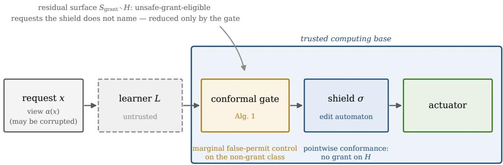
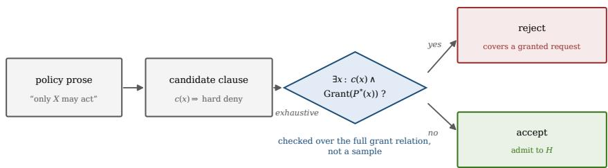
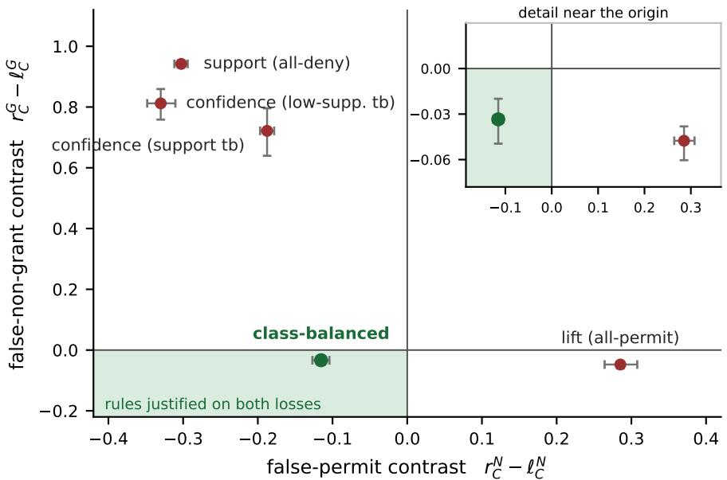

# Auditing the Hand-Written Inputs of Learned Access Control

Arsalan Jalil Sarghaleh<sup>∗</sup> Department of Electrical Engineering Sharif University of Technology, Tehran, Iran arsalan.jalil@ee.sharif.edu

Mehdi Hazrati Department of Electrical and Computer Engineering University of Victoria, Victoria, BC, Canada smhazrati@uvic.ca

## Abstract

Learned access control is typically deployed behind two hand-built artefacts: a hard-deny set enforced by a small trusted shield, and a region map that decides which requests mined rules answer and which the learner answers. Verifying the shield or measuring the learner validates neither. We audit both on the five public ABAC Lab policies. First, we formalise hard-deny soundness and check it exhaustively over relations of up to 794,250 tuples. Clauses that faithfully transcribe an explicit restriction are unsound at rates of 0.50–0.70 across four elicitors—an author and three blind language-model elicitors—because prose scopes restrictions to a section while the grant relation is a disjunction over all rules: 97% of counterexamples are granted by other rules. Shipped unchecked, these deny sets would withhold 16–78% of everything the policies grant; certified, they withhold nothing. Vacuity, a second silent failure, also occurs. Second, hybrid routing needs a two-class, abstaining rule set that ABAC miners do not emit, and ranking a mixed-efect candidate pool under a cap is one-class in all 24 cells for the two commonest ranking keys. Third, for additive losses the hybrid-versus-learner efect factorises into covered mass times a rule–learner risk contrast that must be reported on both false-non-grant and false-permit loss: on two real policies, most selection rules give opposite verdicts on the two losses, and the one favourable on both holds for one policy, one learner configuration and a band of noise levels. A released artefact regenerates and checks every reported number.

Keywords: Attribute-based access control, policy mining, runtime enforcement, reference monitor, conformal prediction, trusted computing base, policy analysis.

## 1 Introduction

Attribute-based access control evaluates rules against subject, object, operation and environment attributes [1], and in practice the governing policy is increasingly mined from logs rather than handwritten [2, 3, 4, 5]. Mined rules are approximations—no mining algorithm produces a completely accurate policy [6]—so they leave requests on which the rules are silent or self-contradictory. A learned classifier can resolve exactly those requests, and learned components are increasingly placed on the decision path [7, 8, 9, 10]. Because a learner’s failures are not intrinsically bounded— miscalibration [11], distribution shift, poisoning and evasion [12], and demonstrated adversarial vulnerability of ML-based access control specifically [13]—the standard architectural response is a reference monitor [14] in its modern form: a small, correct-by-construction runtime shield [15, 16, 17, 18] interposed before the actuator, with Simplex-style runtime assurance as antecedent [19].

  
Figure 1: The composed architecture, with the two hand-built artefacts this paper audits marked. An untrusted learner proposes an action; a deterministic shield admits no grant on the named hard-deny set H and is the identity outside it. The shield’s behaviour on H is a refinement property and is not in doubt (Lemma 1). What is in doubt is which requests are in H (Section 4) and which requests reach the learner at all (Sections 5–6). Neither is produced or checked by any verified component of the stack.

This paper is about what that architecture does not contain. The shield is verifiable and the learner is measurable, but the composed system also depends on two artefacts that are neither:

• a hard-deny set H—a list of clauses, written by a person reading the policy, that the shield refuses on unconditionally; and

• a region map—the partition of the request space into requests the rules answer and requests the learner answers, produced by a mining pipeline whose selection step is a design choice.

Verifying the shield says nothing about whether H is correct: a verified authorizer over a wrong deny set is a correct authorizer producing wrong denials. Measuring the learner says nothing about whether the region map is real: if the mining pipeline’s selection step is degenerate, the map is an artefact and every downstream measurement inherits it. Both artefacts are hand-built, both sit inside the loop, and neither is checked by anything else in the stack.

Three questions follow, and all three are answerable on public policy artefacts without operational access logs.

## Contributions

C1: Prose-derived deny sets are frequently unsound, for a measurable structural reason, whoever writes them (Section 4). We formalise soundness of H against the grant relation, give an exhaustive verification procedure, and apply it to all five public ABAC Lab policies, none of which we authored. A candidate clause can be unsound for two unrelated reasons, so we stratify by provenance: a clause that transcribes an explicit restriction (“only X may verb”) isolates the scope mismatch between local prose and a global grant disjunction, whereas a clause that reads exclusivity into a plain permission is invalid before any policy is consulted. The stratification is reproduced exactly by a fixed lexical rule, so it does not depend on any verdict. In the explicit-restriction stratum the author’s clauses are unsound at 16/23, and three blind language-model elicitors that never saw a rule or a verdict are unsound at 0.50–0.66 (63/109 pooled); 15 restriction sentences fail for every elicitor that formalises them. Attributing each of 137,454 counterexamples to the rules that grant it confirms the mechanism directly: 97% are granted by rules other than the clause’s own, 86% by rules in other subsections. Shipped unchecked, the four candidate sets would withhold 16–78% of everything the policies grant. We pair soundness with a non-vacuity check, because 12 of the independent clauses cover no request at all and pass soundness trivially.

C2: A hybrid region map needs a kind of rule set that policy miners do not produce, and the obvious way to build one is degenerate (Section 5). ABAC miners emit total policies—permit rules under default deny, or permit and deny rules under a conflict-resolution order—so a request that no rule matches is decided, not abstained on, the informative region is empty, and there is no routing decision to make. Hybrid routing presupposes a two-class, abstaining rule set. A Xu–Stoller-style greedy permit-cover arm makes this concrete. We then show that the obvious construction—ranking a mixed-efect candidate pool under a cap—is one-class in every cell for the two commonest ranking keys across four policies and three cap sizes, because minority-class support is 3.3 to 72.7 times below majority-class support. We also show that a minimum confidence above 1 − ε excludes correct rules with a probability that sharpens exponentially in support, and test both consequences under three noise processes that violate that result’s assumptions, reporting where the second fails to transfer.

C3: Hybrid routing factorises exactly, and the routing verdict cannot be read from one loss (Section 6). For additive losses the hybrid-versus-learner efect equals covered mass times the contrast between rule risk and learner risk on the covered region. The consequence is a reporting requirement: the contrast is a diferent number for each additive loss, because false-non-grant conditions on the true-grant subpopulation and false-permit on the non-grant subpopulation, and a one-class rule set is trivially optimal on whichever loss its single class cannot incur. On E-Document, four of five candidate-selection rules give opposite routing verdicts on the two losses, and only class-aware selection favours rules on both, with contrasts −0.033 [−0.049, −0.020] and −0.115 [−0.127, −0.104]. That verdict holds under one of four learner configurations and only for a band of noise levels, and it does not replicate on Workforce, where every selection rule trades false non-grants for false permits. A study that reports one loss can therefore reach either conclusion.

Artefact. An open analysis package regenerates every number in this paper from the public policy files with one command and then checks each value quoted in the manuscript against the regenerated results; it also includes the multi-elicitor harness, the frozen elicitations and the exact prompts used.

## Scope and organisation

The audit uses public policy artefacts and no operational deployment logs. C1 and C2 are established on public third-party policies; C3 is established analytically and measured on two real policies. Section 7 measures the composed system on the same two policies and then on an authored synthetic policy, the only benchmark in our set with a five-action space and break-glass semantics; the synthetic part demonstrates the measurement protocol and supports no robustness claim. Section 2 reviews related work and Section 3 fixes the system and threat model. Sections 4–6 present C1–C3, Section 7 the composed system, and Section 8 the threats to validity, including what is assumed rather than established about system security (Section 8.1).

## 2 Background and Related Work

## 2.1 Policy mining produces approximations

ABAC rule mining recovers flat rule sets from logs [2, 3, 20], with extensions to automatic extraction from access logs [4], hierarchical clustering with relationship extraction [5], learning relationshipbased policies by querying black-box systems [21], frameworks that combine data mining, statistical and machine-learning techniques [22], and mining from massive, noisy logs [23]. Classifiers have also been trained directly on access logs as policy surrogates and assessed for the quality of the policies they imply [10, 9]. Guo et al. [6] state the premise directly: no mining algorithm produces a completely accurate policy, and human revision is required.

Two properties of this literature matter for C2 and are easy to overlook. First, the mined object is a total policy. Most formalisms are default-deny plus permit rules, so a request no rule matches is denied, not abstained on; miners that also learn negative rules [20] still resolve every request through a default and a conflict-resolution order. Second, selection is driven by coverage of the permit tuples—Xu and Stoller’s greedy phase takes the candidate covering the most still-uncovered permits, and Cotrini et al.’s Rhapsody uses a sparse-log-specific quality function—not by ranking a mixed-efect candidate pool under a size cap. The hybrid architecture needs an object these algorithms do not emit, and Section 5 examines what happens when a pipeline builds it the obvious way.

The underlying dificulty is not new in data mining. A single global minimum support cannot simultaneously admit frequent and rare patterns; Liu et al. [24] named this the rare item problem and proposed per-item minimum supports as the remedy, and the imbalance literature has studied minority-class rule discovery since [25]. C2’s mechanism is that problem instantiated in access control, and we make the connection explicit rather than presenting it as a discovery. Two things are specific to this setting. The minority class here is the permit class, so the pathology does not merely lose accuracy: it produces a rule set that denies everything, which is silently plausible in a security context in a way that an all-negative classifier is not elsewhere. And the degeneracy propagates into an architectural decision: Section 6 shows the same choice moves the routing contrast across an order of magnitude.

## 2.2 Policy analysis, and what it is pointed at

Deciding ∃x : c(x) ∧ Grant(P<sup>∗</sup>(x)) over a finite policy is property checking, and the access-control literature has done it for two decades. Margrave performs change-impact analysis and verification queries over XACML [26]; Hughes and Bultan reduce XACML policy properties to satisfiability [27]; Turkmen et al. formalise XACML analysis in SMT [28]. Industrially, Zelkova compiles AWS access policies—including their Deny statements—to SMT and answers comparative permissiveness queries at scale [29], Quacky counts the requests a policy permits via model counting to quantify permissiveness [30], and Cedar supplies an expressive, analyzable authorization language with a verified validator and a symbolic compiler to SMT [31].

We claim no algorithmic novelty for the C1 check. Our certification procedure is a decision problem these tools already solve, on smaller inputs, and where the request space is not enumerable the check becomes a satisfiability query that should be discharged by one of them. What is new is the object the check is pointed at and the resulting measurement. The verification literature checks properties an analyst asserts about a policy; C1 checks the hard-deny clause set that a trusted enforcement layer will execute, elicited from the policy’s prose, and reports how often such clauses over-claim against the very relation they are meant to constrain—stratified by how the clause was derived, which is what makes the rate interpretable. To our knowledge no prior work reports a soundness rate for prose-derived deny sets on public policy artefacts, nor identifies vacuity as its opposite failure mode.

## 2.3 Deny rules, prose translation, and zero trust

Iyer et al. [32] show that negated conditions and negative authorizations are not interchangeable and that the choice constrains what a policy model can express. Their question is expressiveness; ours is whether the clauses someone actually writes into a negative-authorization set are sound against the grant relation they are supposed to constrain.

The step C1 audits—a human reading policy prose and writing an enforceable predicate—is increasingly automated. Prior work extracts ABAC attributes and models from natural-language policies [33, 34] and ABAC rules from access logs [4], and large language models are now used to extract enforceable ABAC policies from text [35], to synthesise access-control policies [36], and to mine ABAC policies [37]. These works evaluate generated policies against reference policies or by testing; none certifies a generated deny set exhaustively against the grant relation it is meant to constrain. Section 4.6 does that for three model elicitors, under the same freeze-then-certify protocol as the human elicitor.

Zero-trust architectures approach complete mediation from the deployment side. Al-hammuri et al. [38] score trust from contextual features across authentication, encryption, logging and authorization. The premise we share is that no request inherits authority from a prior decision. The diference is where the guarantee is located: a trust score is a graded, learned judgement, and by our own argument such a component belongs outside the trusted computing base. Buccafurri et al. [39] show that interacting authentication systems implicitly extend each other’s policies, so a system adopting strong policies can be unexpectedly weak; we take this seriously in stating our composition result as regime-indexed rather than unconditional.

## 2.4 Residual over-granting, selective prediction, benchmarks

Closest in spirit to our residual-surface analysis is OPMonitor [40], which observes that policy verification is bounded by the comprehensiveness of predefined verification goals, so over-granted permissions outside those goals remain undetected, and monitors residual over-granting against a log-inferred baseline. Their unverified permissions correspond structurally to our residual surface; the treatments are complementary. Madkaikar et al. [41] analyse dynamic ABAC performance in a queuing-theoretic framework; we do not measure enforcement latency, and refer to that line of work for it.

Selective classification with a reject option [42, 43] trades coverage for accuracy; conformal prediction supplies distribution-free finite-sample guarantees under exchangeability [44, 45], with label-conditional variants [46, 47] and conformal risk control for bounded losses [48]. Our use of these tools is instrumental, and the marginal-versus-conditional distinction we rely on is theirs, not ours. Label-noise learning [49, 50] supplies the setting for Proposition 2, whose content is the consequence for a confidence threshold rather than for a classifier.

Real access-control policies and logs are rarely public, and ML-based access control specifically sufers a shortage of public datasets [7]. The Xu–Stoller case studies [2] and the ABAC Lab consolidation [51], which adds instances derived from real-world case studies including the KU Leuven e-document study [52], are the community’s response. C1 and C2 are answers to the data problem rather than victims of it: both are established on public policy artefacts, and neither requires a deployment log. Break-glass access is a recognised clinical requirement [53, 54], and supplies the semantics of the emergency branch of Section 7.

## 3 System Model and Threat Model

## 3.1 Requests, actions, policies

A request is $x \in \mathcal { X }$ over subject, object, operation and environment attributes. The action space is A = {deny, permit, monitor, temporary, escalate}, with

$$
\mathrm { G r a n t } ( a ) \iff a \in \{ \mathrm { P E R M I T , M O N I T O R , T E M P O R A R Y } \} ,\tag{1}
$$

so deny and escalate are non-granting. On the public policies, which are binary, A degenerates to {deny, permit}. $P ^ { * }$ is the latent policy and the sole label source. R is a mined rule set inducing region(x) ∈ {covered, gap, conflict}: covered when the matching rules of R agree on one efect, gap when none matches, conflict when two or more disagree. L is the untrusted learner, and $\alpha ( x )$ the possibly corrupted view of x that the enforcement layer receives.

Definition 1 (Hard-deny set). $H = \{ x : { \mathrm { h a r d D e n y } } ( x ) \neq \bot \}$ , where hardDeny is a disjunction of clauses each of which independently triggers hard denial, with codomain {deny, escalate}.

Definition 2 (Soundness of H). H is sound with respect to $P ^ { * } \ \mathrm { i f f } \forall x \in H , P ^ { * } ( x ) \in$ {deny, escalate}, equivalently $\sharp x : \ x \in H \wedge \operatorname { G r a n t } ( P ^ { * } ( x ) )$ .

Write $H _ { \mathrm { r e a l } } ( x ) \ = \ \mathbf { 1 } [ x \ \in \ H ]$ for membership of the true request and $H _ { \mathrm { a b s } } ( \alpha ( x ) ) =$ $\mathbf { 1 } [ \mathrm { h a r d D e n y } ( \alpha ( x ) ) \neq \bot ]$ for the hard-deny predicate evaluated on the view the enforcement layer actually receives. All probabilities are over a request X drawn from the deployment distribution.

Definition 3 (Directional abstraction errors). $\varepsilon _ { H } ^ { - } = \operatorname* { P r } [ H _ { \mathrm { a b s } } ( \alpha ( X ) ) = 0 \ | \ H _ { \mathrm { r e a l } } ( X ) = 1 ]$ and $\varepsilon _ { H } ^ { + } = \operatorname* { P r } [ H _ { \mathrm { a b s } } ( \alpha ( X ) ) = 1 \mid H _ { \mathrm { r e a l } } ( X ) = 0 ]$

Only $\varepsilon _ { H } ^ { - }$ can produce an unsafe grant; $\varepsilon _ { H } ^ { + }$ forces denials and appears on the availability side. The enforcement layer is

$$
\sigma ( x , a ) = \left\{ \begin{array} { l l } { \mathrm { h a r d D e n y } ( \alpha ( x ) ) } & { H _ { \mathrm { a b s } } ( \alpha ( x ) ) = 1 , } \\ { a } & { \mathrm { o t h e r w i s e } , } \end{array} \right.\tag{2}
$$

with hard deny evaluated before any other branch. Let $S _ { \mathrm { u n s a f e } } = \{ x : \lnot \mathrm { G r a n t } ( P ^ { * } ( x ) ) \}$ be the set of requests on which any grant is unsafe. Residual quantities are reported on the residual surface $S _ { \mathrm { r e s } } = S _ { \mathrm { u n s a f e } } \setminus H$ , the unsafe requests that H does not name.

## 3.2 Assumptions and trust boundaries

(A1) $P ^ { * }$ defines truth (evaluation only; not used in any enforcement result). (A2) Pointwise clean-input preservation, ∀x, $H _ { \mathrm { a b s } } ( \alpha ( x ) ) = H _ { \mathrm { r e a l } } ( x )$ ; this is strictly stronger than $\varepsilon _ { H } ^ { - } = 0$ and is dropped in Proposition 1. (A3) Shield code is correct and executes on every request.

The adversary may control the learner entirely, including its training data and outputs, and may manipulate request attributes that are not attested. Two trust boundaries must be distinguished. The deterministic safety TCB—shield code, hard-deny clause set, attested attribute store, actuator path—is what Lemma 1 and Proposition 1 depend on. Any statistical gate placed upstream of σ is not in it: because σ runs last, a compromised gate cannot produce a grant on H. Table 1 states the status of each component and, in the column that matters when deciding what to verify, what a compromise of it buys the adversary.

Table 1: Components and trust status. The hard-deny clause set is in the safety TCB, and no amount of verification of the shield or of an authorization language detects an error in it. Section 4 audits exactly this row.
<table><tr><td>component</td><td>status</td><td>protects</td><td>failure consequence</td></tr><tr><td>learner L</td><td>untrusted</td><td></td><td>none on  $H ;$  bounded by σ</td></tr><tr><td>shield σ</td><td>safety TCB</td><td>conformance on H</td><td>unbounded grants</td></tr><tr><td>hard-deny clauses</td><td>safety TCB</td><td>soundness of H</td><td>wrong denials (§4)</td></tr><tr><td>attested store</td><td>safety TCB</td><td>attribute integrity</td><td> $\varepsilon _ { H } ^ { - } > 0$ </td></tr><tr><td>actuator path</td><td>safety TCB</td><td>complete mediation</td><td>shield bypass</td></tr><tr><td>statistical gate</td><td>guarantee only</td><td>marginal FP rate</td><td>bound void; H unaffected</td></tr><tr><td>audit log</td><td>recording only</td><td>completeness</td><td>undetected break-glass</td></tr></table>

## 3.3 What the trusted layer does and does not bound

Lemma 1 (Conformance and residual invariance). Under (A2) and $( A \it { 3 } ) \it { : } \ ( i )$ for all $x \in H$ and all $a \in { \mathcal { A } } , \neg \mathrm { G r a n t } ( \sigma ( x , a ) )$ ; (ii) for all $x \in S _ { \mathrm { r e s } }$ and all $a , \sigma ( x , a ) = a$ , so the unsafe-grant rate on $S _ { \mathrm { r e s } }$ is identical with and without σ.

Proof. (i) By (A2), $H _ { \mathrm { a b s } } ( \alpha ( x ) ) = 1 \iff x \in H$ , so the first branch of (2) fires and returns hardDeny(α(x)) ∈ {deny, escalate}, non-granting by (1); by (A3) the branch is reached on every request. The conclusion needs only that the returned action be non-granting, not that hardDeny(α(x)) = hardDeny(x). (ii) By (A2) at $x \in S _ { \mathrm { r e s } } , H _ { \mathrm { a b s } } ( \alpha ( x ) ) = H _ { \mathrm { r e a l } } ( x ) = 0 -$ this is the step requiring the absence of hard-deny false positives—so no other branch applies. □

Lemma 1 records that the shield’s definition has its intended efect. It is not a novel security theorem and we do not present it as one; we state it because it fixes what the rest of the paper is about. Part (i) says the shield is exactly as good as H, and says nothing about whether H is correct—which is C1. Part (ii) says the shield cannot help on $S _ { \mathrm { r e s } } .$ , so reducing residual exposure requires naming more of the surface, which C1 shows is hazardous.

Proposition 1 (Directional conditional guarantee). Drop (A2) entirely. Under (A3) alone, $\operatorname* { P r } [ \operatorname { G r a n t } ( \sigma ( X , L ( X ) ) ) ~ | ~ H _ { \mathrm { r e a l } } ( X ) = 1 ] \le \varepsilon _ { H } ^ { - } ;$ when $\varepsilon _ { H } ^ { - } > 0$ , equality holds if Pr[Grant(L(X)) | $H _ { \mathrm { r e a l } } ( X ) = 1 , H _ { \mathrm { a b s } } ( \alpha ( X ) ) = 0 ] = 1$

Proof. Partition $\{ H _ { \mathrm { r e a l } } ( X ) ~ = ~ 1 \}$ on whether the abstraction preserves the hard deny. On $\{ H _ { \mathrm { a b s } } ( \alpha ( X ) ) = 1 \}$ , of conditional probability $1 - \varepsilon _ { H } ^ { - } , \sigma$ returns a non-granting action, so the grant probability is 0. On the complement, of conditional probability $\varepsilon _ { H } ^ { - } ,$ σ returns $L ( X )$ , which grants with conditional probability $p \leq 1$ . The unsafe-grant rate is therefore $\varepsilon _ { H } ^ { - } p \leq \varepsilon _ { H } ^ { - }$ , with equality if p = 1 whenever $\varepsilon _ { H } ^ { - } > 0$ □

Hard-deny false positives $( \varepsilon _ { H } ^ { + } )$ cannot produce a grant; they force denials and belong in the availability column. A symmetric quantity $\operatorname* { P r } [ H _ { \mathrm { a b s } } \neq H _ { \mathrm { r e a l } } ]$ mixes the two and is neither an upper bound on nor a proxy for the unsafe-grant rate. This is a reporting prescription entailed by the partition, not a discovery, and Section 7 reports the three quantities side by side so a reader can see how far the symmetric one would mislead.

  
Figure 2: Hard-deny soundness as a first-class check. A clause read of the policy’s prose is admitted to H only if it covers no request the policy grants, verified exhaustively against the full grant relation rather than a sample. Because policy descriptions state local restrictions while the grant relation is a global disjunction, prose-derived restriction clauses over-claim by default (Table 2). An admitted clause must additionally be checked for non-vacuity (Section 4.8), which the same enumeration pass supplies at no extra cost.

## 4 C1: Deny-Set Soundness

## 4.1 The mechanism

Defining H is the one design step no part of the pipeline automates. A human reads the policy’s prose and writes clauses. The failure mode we target is specific: policy descriptions state local restrictions, while the grant relation is a global disjunction. A sentence of the form “only members of X may verb” is almost always scoped to the subsection it appears in, whereas the induced grant relation is the union over all rules, several of which typically cut across that subsection. A clause read of such a sentence over-claims, and admits into H requests the policy grants.

The consequence is asymmetric and easy to miss. An unsound clause does not produce a visible error: it produces a denial, issued by the trusted layer, with the shield’s authority, on a request that should have been granted. It raises the false-non-grant rate, appears only in the availability column, and is indistinguishable from a conservative learner unless the deny set is checked directly. (It does not raise $\varepsilon _ { H } ^ { + }$ , which is measured against H itself.)

## 4.2 The check

A candidate clause c is admitted to H if

$$
\nexists x \in \mathcal { X } : \ c ( x ) \wedge \mathrm { G r a n t } ( P ^ { * } ( x ) ) ,\tag{3}
$$

verified by exhaustive enumeration over the full grant relation, not by sampling. On a policy with a finite enumerable request space the check is decidable and cheap. On a 2014 laptop CPU (Intel Core i7-4610M, Python 3, NumPy) the full 600,000-tuple E-Document relation is parsed and built in under 0.5 s, and all 55 certificates of Section 4.5 (49 candidates and six vacuity-pass clauses, across five policies) are computed in about 0.1 s.

Sampling is not an acceptable substitute. The counterexample sets below range over four orders of magnitude, and a clause with 400 counterexamples in 600,000 tuples has a per-sample detection probability below $1 0 ^ { - 3 }$ : a 1,000-request sample misses it with probability ≈0.51. The check is a gate, not a diagnostic—a clause that fails is rejected, and the analyst either scopes it more tightly or discards it. Where the request space is not enumerable the check becomes the satisfiability query $c ( x ) \wedge \mathrm { G r a n t } ( P ^ { * } ( x ) )$ and inherits the completeness of the solver; the symbolic compilers of [29, 31] are the natural integration point, and we flag that rather than claiming it.

## 4.3 Audit protocol

So that the result is a property of the failure mode rather than of one analyst or one policy, we fix the following protocol and apply it identically everywhere.

1. Candidate elicitation. The elicitor reads only the policy’s prose description—the case-study narrative and rule commentary, not the formal rule set—and writes every sentence that reads as a categorical prohibition as a candidate clause. Reading the formal rules first would leak the grant relation into the clause and destroy the measurement. The packet is produced deterministically by stripping ABAC Lab’s fenced formal-rule blocks from the published README, is leak-checked (no subCond, resCond, $\in , \ni { \mathrm { o r } } \supseteq$ survives), and carries a SHA-256.

2. Provenance tagging. Each candidate records how it was derived from its source sentence (Section 4.4). This step is new here and is what makes the results below interpretable.

3. Freeze. Candidates are recorded with a per-clause content fingerprint before certification; for further elicitors the released harness writes a UTC-timestamped freeze and refuses to overwrite an existing one.

4. Certification. Each frozen candidate is checked by (3) over the full enumerated request space, recording the counterexample count, the coverage, and for rejected clauses one witness.

5. Repair. Each rejected clause is ofered one scoping repair—the narrowest restriction the prose actually supports—and re-certified. A repair is recorded as a repair and is excluded from the candidate denominator, since counting it separately would double-count one sentence.

## 4.4 Provenance: why a pooled rejection rate means nothing

A candidate clause can be unsound for two entirely unrelated reasons, and a pooled rate credits one with the other. Consider two sentences from our corpus:

(a) “Only members of the sales department can send, view, or search invoices.” (E-Document, Rule 7)

(b) “The author of an item can read it.” (Healthcare, Rule 5)

Reading (a) as “deny send/view/search on invoices when the subject is not in Sales” is a faithful transcription: the sentence asserts exclusivity, and if the resulting clause covers a granted request, the reason is that the sentence’s “only” is scoped to its subsection while the grant relation is not. That is the mechanism of Section 4. Reading (b) as “deny read when the subject is not the author” is not a transcription at all: the sentence grants a permission and says nothing about exclusivity. Such a clause is invalid before any policy is consulted, and its rejection measures the elicitor, not the artefact.

We therefore tag every candidate with its derivation and report the strata apart:

• explicit-restriction — the sentence itself states a restriction (“only X may verb”, “X may only verb”, “. . . except Y ”). This is the mechanism stratum.

• inferred-exclusivity — “X can verb” read as “only X can verb”.

• inferred-necessity — a suficient condition for a grant read as a necessary one.

• silence — the clause rests on the absence of a stated permission; an argument from silence.

• repair — a re-scoped variant of another candidate; excluded from the denominator.

The tags are assigned from the source sentence alone. Because the elicitor also saw the verdicts of this audit, we check that the stratum assignment that matters—mechanism or not—does not depend on them: a fixed lexical rule that marks a sentence explicit if it contains only, except or unless reproduces the hand assignment on all 46 candidates that have a source sentence (23/23 explicit, 23/23 non-explicit; the two silence candidates have no source sentence, and the repair is excluded). The mechanism stratum is therefore a deterministic function of the policy text. We regard this stratification, rather than any single rate, as C1’s methodological contribution: a rejection rate for a prose-derived deny set is uninterpretable without it.

Table 2: Hard-deny soundness audit across all five public ABAC Lab policies, stratified by clause provenance.  
“expl.” is the explicit-restriction (mechanism) stratum of Section 4.4; “other” pools the three elicitation-error strata. The three Xu–Stoller policies have an empty mechanism stratum: their prose contains no restriction statement, so the mechanism cannot be exercised on them and every rejection there is an elicitation error. One repair (E-Document) is excluded from the denominator.
<table><tr><td>policy</td><td>enum. tuples</td><td>expl.</td><td>other</td><td>expl. c/ex</td></tr><tr><td>E-Document [52]</td><td>600,000</td><td>12/14</td><td>1/2</td><td>495–6,489</td></tr><tr><td>Workforce [51]</td><td>794,250</td><td>4/9</td><td>0/1</td><td>20-7,665</td></tr><tr><td>University [2]</td><td>6,732</td><td></td><td>3/8</td><td></td></tr><tr><td>Project Mgmt [2]</td><td>3,040</td><td></td><td>2/6</td><td></td></tr><tr><td>Healthcare [2]</td><td>1,008</td><td></td><td>7/8</td><td></td></tr><tr><td>total</td><td></td><td></td><td></td><td>16/23 13/25 20-7,665</td></tr></table>

Table 3: Rejection rate by provenance, with exact Clopper–Pearson intervals (reported rather than a normal approximation because several strata have single-digit denominators). The strata are not pooled: only the first isolates the scope mismatch, and the pooled rate of 0.60 is reported solely to show what a study omitting this stratification would have published.
<table><tr><td>provenance</td><td>n</td><td>unsound</td><td>rate [95% CI]</td></tr><tr><td>explicit-restriction (mechanism)</td><td>23</td><td>16</td><td>0.696 [0.471, 0.868]</td></tr><tr><td>inferred-exclusivity</td><td>12</td><td>7</td><td>0.583 [0.277, 0.848]</td></tr><tr><td>inferred-necessity</td><td>11</td><td>5</td><td>0.455 [0.168, 0.766]</td></tr><tr><td>silence</td><td>2</td><td>1</td><td>0.500 [0.013, 0.987]</td></tr><tr><td>elicitation-error strata (pooled)</td><td>25</td><td>13</td><td>0.520 [0.313, 0.722]</td></tr><tr><td>all strata pooled (uninterpretable)</td><td>48</td><td>29</td><td>0.604 [0.453, 0.742]</td></tr></table>

## 4.5 Results

Table 2 reports the audit. All checks are exhaustive over the enumerated relation, so the certificates are exact and admit no false negatives over that relation. The parser is a faithful reimplementation of ABAC Lab’s own evaluator, validated at run time by reproducing each policy’s published statistics to the unit—E-Document’s 600,000-tuple space with #perm = 32,961, and Healthcare’s 1,008 requests with 43 grants.

Sixteen of twenty-three faithfully transcribed restriction clauses cover requests the policy grants (Table 3), a rate of 0.70 with an exact interval of [0.47, 0.87], and counterexample counts from 20 to 7,665 over relations of up to 794,250 tuples. Section 4.6 tests whether this rate is a property of the elicitor.

The mechanism stratum is empty on three of five policies, and this is itself informative. The Xu–Stoller instances [2] document their policies as lists of granting rules and never write a restriction; the two multi-tenant case-study-derived instances [52, 51] write restrictions constantly, because a tenant subsection is exactly the context in which an author reaches for “only”. On this corpus the failure mode therefore tracks how multi-tenant policies are documented rather than ABAC as such, and suggests where a practitioner should look first: cross-sectional universals in prose that the rule set does not enforce universally.

Table 4: Author and independent elicitors compared. Mechanism stratum (explicit-restriction) with exact Clopper–Pearson intervals; “vac.” counts clauses that cover no request; the last two columns give the fraction of all granted requests that the elicitor’s unchecked candidate set would deny if shipped as H.
<table><tr><td></td><td></td><td colspan="2">mechanism stratum</td><td colspan="3">grants denied</td></tr><tr><td></td><td>elicitor model</td><td></td><td>unsound rate [95% CI]</td><td>vac.</td><td>E-Doc.</td><td>Workf.</td></tr><tr><td>R1</td><td>author</td><td></td><td>16/23 0.696 [0.471, 0.868]</td><td>0</td><td>0.516</td><td>0.548</td></tr><tr><td>L1</td><td>Opus 5.5</td><td></td><td>18/36 0.500 [0.329, 0.671]</td><td>4</td><td>0.159</td><td>0.546</td></tr><tr><td>L2</td><td>Sonnet 5.5</td><td></td><td>22/380.579 [0.408, 0.737]</td><td>5</td><td>0.265</td><td>0.593</td></tr><tr><td>L3</td><td>Haiku 5.5</td><td></td><td>23/35 0.657 [0.478, 0.809]</td><td>3</td><td>0.702</td><td>0.780</td></tr><tr><td>L1-L3 pooled</td><td></td><td></td><td>63/109 0.578 [0.480, 0.672]</td><td>12</td><td></td><td></td></tr></table>

## 4.6 Independent, blind elicitation

The rates above come from one elicitor, an author who also saw the verdicts. To test whether they are a property of that elicitor, we ran three further elicitors that saw nothing but what the protocol allows. Each, L1–L3, was a fresh language-model agent—Claude Opus 5.5, Sonnet 5.5 and Haiku 5.5, one model each—with read access to exactly five files: the elicitation prompts that the released harness generates for the five policies (prose packet and attribute schema, with a syntax example taken from a fictional library policy). No agent had access to the formal rules, the certificates, the code, or any other elicitor’s clauses, and each confirmed reading only those files. The candidates were parsed by the harness, frozen with per-clause fingerprints and a timestamp, and only then certified. Every one of the 113 quoted source sentences was found in the packet the elicitor was shown, and each candidate was assigned to the mechanism stratum by the lexical rule of Section 4.4, so no hand tagging enters this comparison.

The rate is not a property of the author. All three independent elicitors write unsound restriction clauses at rates comparable to the author’s (Table 4): 0.50, 0.58 and 0.66 against 0.70, with overlapping intervals, and 63 of 109 pooled. The largest model, which deliberately scoped many of its clauses to the tenant named in the section heading, still failed on half. The hypothesis left open by a single elicitation, that independent elicitors write sound restriction clauses, is rejected on this corpus.

The same sentences fail. The README contains 31 rule sentences that the lexical rule marks as explicit restrictions. Of these, 27 were formalised by at least two of the four elicitors; on 20 every elicitor’s clause received the same verdict, and on 15 every elicitor’s clause was unsound. Nine E-Document restrictions (Rules 1, 7–11, 15, 17 and 19) are unsound for all four elicitors. Agreement on which sentences to formalise is only moderate (Fleiss’ κ = 0.42 over the 31 sentences), so elicitors difer more in what they notice than in whether what they write survives certification.

## 4.7 Where the counterexamples come from

The mechanism of Section 4 makes a testable prediction: an unsound restriction clause is contradicted not by its own rule but by other rules, from other parts of the policy. Every counterexample is granted by at least one rule, and the README places each rule in a section (a tenant, the ### heading) and a subsection (the #### heading beneath it), so the prediction can be checked counterexample by counterexample. Over the 77 unsound mechanism-stratum clauses of the four elicitors whose source rule can be located (of 79; 137,454 counterexamples), only 3.4% of counterexamples are granted by the clause’s own source rule (0% for R1), 86% are granted only by rules in other subsections, and 62% only by rules of other tenants.

The unsoundness is therefore almost entirely the disjunction with other rules, as the mechanism predicts, and most of it crosses a subsection rather than a tenant boundary. This has a practica consequence. Scoping a clause to its tenant—re-inserting the most visible section boundary, by adding a guard such as resource.tenant = largeBank—repairs only 11 of the 79 unsound clauses, because a sentence’s “only” is scoped to a subsection for which the object model has no attribute.

Workforce shows both cases. It has two sentences about the same resource type, in diferent tenant sections:

Rule 15 (PowerProtection): Only members of the Provisioning group can receive stock refill notifications.

Rule 19 (TelCo): Only members of Technician Support can receive stock refill notifications.

Read globally, as R1 read them, they are structurally identical but receive opposite verdicts. “Only Technician Support” covers 6,840 tuples and admits no granted request. “Only Provisioning” covers 6,400 tuples and has 20 counterexamples, witnessed by (slmgr001, stockrefill001, receive)— a sales manager in the TelCo tenant and the techSupport group, receiving a refill request granted by Rule 19. All three independent elicitors scoped both sentences to their tenant, and all three of their Rule-15 clauses are sound. This is the case tenant scoping fixes. E-Document shows the case it does not: Rule 7 (“Only members of the sales department can send, view, or search invoices”) is contradicted by Rule 12, which lets auditors in the same Large Bank section read invoices, and every elicitor’s Rule-7 clause is unsound, including the two that were scoped to that tenant. In both cases the certificate is computed in well under a second, and it is the only step in the pipeline that distinguishes the sound reading from the unsound one.

## 4.8 A second failure mode: vacuity

A clause that covers no request passes the soundness check trivially: it certainly covers no granted request. An analyst would ship it believing H constrains something it does not touch. The failure is silent in exactly the way an unsound clause is silent, in the opposite direction: an unsound clause denies too much, a vacuous one denies nothing while appearing to.

It occurs in practice. Twelve of the 113 independent clauses are vacuous (Table 4). In each case the conjunction of guards selects a population the object model does not instantiate. E-Document’s Rule 25 is the clearest: it restricts “Registered Private Receivers”, but all 16 private receivers in the object model are unregistered, so every faithful formalisation of the sentence—all three independent elicitors wrote one—covers nothing. A second, deliberately constructed elicitor shows the vocabulary route to the same failure: formalising each sentence with the informal names the prose uses (“stock refill notifications” for the resource type stockRefillRequest, “create” where the object model has only createOneTimeWorkOrder and createRecurrentWorkOrder) produced six clauses, all vacuous and all certified sound. We therefore pair the soundness certificate with a non-vacuity check—the clause must cover at least one request—and report coverage for every admitted clause. Both come from the same enumeration pass at no extra cost.

## 4.9 How much of a verdict is the scoping choice?

Within the mechanism stratum the remaining degree of freedom is scoping: given the same restriction sentence, elicitors may draw the clause’s boundary more or less tightly. For every clause R1 admitted as sound we enumerate its one-conjunct broadenings—the clause obtained by dropping a single guard, i.e. what the same sentence yields if read slightly less narrowly—and certify each exhaustively. In the mechanism stratum, 14 of 21 such variants are unsound (0.67, [0.43, 0.85]), with counterexample counts from 16 to 16,202; across all strata, including variants of the repaired clause, it is 40 of 59. Two thirds of admitted restriction clauses therefore sit directly on the soundness boundary: they are sound because of a guard the elicitor happened to include, and one step outwards crosses into covering granted requests. This is the single-elicitor counterpart of the between-elicitor variation in Section 4.6.

## 4.10 The cost of skipping the check

An unsound clause produces a denial with the trusted layer’s authority, and nothing in the enforcement stack reports it. The last two columns of Table 4 measure what that costs. Shipped unchecked as H, the candidate sets of the four elicitors would deny between 16% and 70% of all requests E-Document grants, and between 55% and 78% of those Workforce grants. The certified subsets of the same candidate sets deny none, by construction, while still naming up to 3% of E-Document’s and between 15% and 50% of Workforce’s non-granted requests. Section 7.1 shows the same contrast inside a composed system with a trained learner.

## 4.11 What C1 establishes

1. The mechanism is structural, and measurable. Where prose states a restriction scoped to a section while the grant relation is a disjunction over all rules, a clause read from that sentence over-claims. Counterexample attribution confirms it: 97% of counterexamples are granted by other rules, 86% by rules in other subsections.

2. The rate is not one elicitor’s. In the stratum where the mechanism is isolated, four elicitors wrote unsound clauses at rates of 0.50–0.70, and 15 sentences failed for every elicitor that formalised them. These are counts for two public artefacts and four elicitors, not a prevalence estimate.

3. A pooled rate is not a measurement. Had we reported R1’s pooled 29/48 we would have credited the mechanism with 13 rejections caused by invalid inferences. Stratification is reproducible by a lexical rule, and we supply it.

4. Soundness alone is insuficient: it must be paired with a coverage figure, since vacuity occurs in independent elicitations too (Section 4.8).

5. Skipping the check is costly and silent: an unchecked prose-derived deny set can withhold most of what a policy grants (Section 4.10).

We recommend that any paper reporting a shielded or deny-first architecture over a named set report the soundness certificate for that set, together with a coverage figure, the size of the enumerated relation, and the elicitation protocol and provenance stratification that produced the candidates.

## 5 C2: Constructing a Region Map

The region map—which requests are covered by R and which are handed to the learner—is produced by a mining pipeline with hyperparameters. This section makes two claims. The first is that the object the hybrid architecture needs is not the object the mining literature produces, so there is no established way to build it. The second is that two hyperparameters of the obvious construction have failure modes that are arithmetic and combinatorial rather than data-limited, and therefore cannot be fixed by collecting more logs.

## 5.1 A hybrid region map is not a mined ABAC policy

A mined ABAC policy is total (Section 2). In the commonest formalism—default deny plus permit rules—the candidate pool is also one-class, so there is no minority class to crowd out; a request no rule matches is denied, because that is what the policy language means. Miners that also learn negative rules [20] are two-class but remain total, deciding unmatched or conflicting requests by a default and a conflict-resolution order. Under either semantics the informative region is empty, $m = 0$ , Proposition 3 gives an efect of exactly zero, and there is no routing decision to make.

Table 5: The published-miner reference arm, read three ways.  
Under default-deny the reference miner produces a usable policy and there is no routing decision $( m = 0 )$ . Read as abstaining, the same rules cover 2–5% of the space and are all-permit. Cap-and-rank over a mixed-efect pool is all-deny. Three natural constructions, three diferent failures. Workforce is mined at $L = 2$ over a 200,000-row sample because its 25 attributes make length-3 enumeration intractable here; at that depth the greedy cover finds one rule, and its row is a limitation of the hypothesis language, not of the reference algorithm.
<table><tr><td colspan="2"></td><td colspan="2">default-deny (total)</td><td colspan="2">open-world (abstain)</td></tr><tr><td>policy</td><td>rules</td><td>permit-F1</td><td>m</td><td>covered</td><td>deny-F1</td></tr><tr><td>E-Document</td><td>35</td><td>0.934</td><td>0.000</td><td>0.048</td><td>0.000</td></tr><tr><td>University</td><td>10</td><td>0.930</td><td>0.000</td><td>0.022</td><td>0.000</td></tr><tr><td>Project Mgmt</td><td>8</td><td>0.865</td><td>0.000</td><td>0.025</td><td>0.000</td></tr><tr><td>Workforce{</td><td>1</td><td>0.006</td><td>0.000</td><td>0.000</td><td>0.000</td></tr></table>

† $\overline { { L = 2 } }$ over a 200,000-row sample; see caption.

The hybrid architecture therefore presupposes something else: a two-class, abstaining rule set, one that permits on some requests, denies on others, and declines to answer on the rest. We are not aware of an ABAC miner that emits such an object. To make this concrete we implement a reference arm—a Xu–Stoller-style greedy cover over the permit tuples, permit-efect candidates only, selection by marginal permit coverage rather than by any ranking under a cap—and evaluate the same candidate pool under three readings (Table 5).

The reference miner produces a good policy on three of four policies (permit-F1 0.87–0.93) and no region map at all. Read as abstaining, it covers under 5% of the request space and its covered region is one-class in the permit direction. Cap-and-rank over a mixed-efect pool, examined next, is one-class in the deny direction. The contribution of C2 is therefore not that published miners are broken—they are not, and the pathology below is not a criticism of them—but that the hybrid architecture requires a construct with no established construction method, and the three natural candidates each fail in a diferent direction.

## 5.2 The noise ceiling: minconf must be below $1 - \varepsilon$

Proposition 2 (Confidence ceiling under label-flip noise). Let the training labels be an independent symmetric label-flip realisation of $P ^ { * }$ at rate ε, and let g be a candidate rule whose pattern is perfectly correct in $P ^ { * }$ . Let $n = | \operatorname { s u p p } ( g ) |$ be the number of log records matching g’s condition (a function of attributes only, hence unafected by label noise) and conf(g) its empirical confidence on the noisy log. Then $n \cdot \operatorname { c o n f } ( g ) \sim$ Binomial(n, 1 − ε), so $\mathbb { E } [ \mathrm { c o n f } ( g ) ] = 1 - \varepsilon$ exactly, and for any threshold $\theta > 1 - \varepsilon$

$$
\operatorname* { P r } [ \operatorname { c o n f } ( g ) \geq \theta ] ~ \leq ~ \exp \Bigl ( - 2 n \bigl ( \theta - ( 1 - \varepsilon ) \bigr ) ^ { 2 } \Bigr ) ~ .\tag{4}
$$

Proof. Each matching record’s observed label agrees with the rule’s efect if it is not flipped, independently with probability $1 - \varepsilon ,$ giving the binomial; (4) is Hoefding’s inequality on the upper tail. □

Two consequences follow, and the second is the operationally important one.

(i) Exclusion is probabilistic and sharpens exponentially in support. The threshold is not a strict finite-sample bar—by chance a rule can have fewer than εn flipped labels and clear it—but the escape probability vanishes as evidence accumulates. Collecting more logs makes recovery less likely, which inverts the usual intuition about data volume and is why the symptom is easily misdiagnosed as data sparsity.

Table 6: Structured-noise robustness of Proposition $2 \mathrm { { ^ { \circ } s } }$ two consequences.  
E-Document; 400 latently-correct reference rules; nominal $\varepsilon = 0 . 1 5 ;$ 10 seeds. “Retain@. $. 9 0 ^ { \mathfrak { s } }$ is the fraction of correct rules clearing minconf $: = 0 . 9 0 ;$ “supp. shift” is median survivor support over median reference support, where a value below 1 is the low-support bias of consequence (ii). The proposition itself is unafected: it is proved under the symmetric IID model, whose row matches its prediction (0.85) to within 0.001.
<table><tr><td>noise process</td><td>mean conf.</td><td>sd</td><td>retain@.90</td><td>supp. shift</td></tr><tr><td>symmetric IID*</td><td>0.8491</td><td>0.0028</td><td>0.071</td><td>0.28</td></tr><tr><td>class-dependent†</td><td>0.8494</td><td>0.0028</td><td>0.073</td><td>0.29</td></tr><tr><td>attribute-dependent</td><td>0.8561</td><td>0.0020</td><td>0.158</td><td>0.60</td></tr><tr><td>block-correlated</td><td>0.8541</td><td>0.0180</td><td>0.299</td><td>0.75</td></tr></table>

∗ the model Prop. 2 assumes. <sup>†</sup> nearly indistinguishable  
from symmetric here: the reference set is almost entirely denyefect at a 5.5% permit base rate.

(ii) Above the ceiling, the threshold is a low-support filter admitting flukes. Because (4) decreases in n, the correct rules that do survive a mis-set minconf are exactly the low-support ones, surviving by chance rather than by merit. $\mathrm { A t } ~ \varepsilon = 0 . 1 5$ and $\theta = 0 . 9 0$ the exact binomial tail is 0.191 at support 36, 0.025 at 200 and $2 . 0 \times 1 0 ^ { - 6 }$ at 1,000. On the E-Document sample mined in Section 5.4, the median permit-efect candidate has support 13 (tail 0.40) and the median deny-efect candidate support 412 (tail $1 . 7 \times 1 0 ^ { - 3 } )$ , and (4) bounds the tail below $1 0 ^ { - 4 3 3 }$ at the largest deny-efect support, 199,735. The noise ceiling and the ranking pathology of Section 5.4 therefore act on the same rule pool, in opposite directions: the confidence stage retains low-support flukes, and a support-ranked cap discards exactly those.

Prescription. Any noisy-log mining protocol should treat minconf $< 1 - \hat { \varepsilon }$ as a hard constraint, report εˆ alongside minconf, and report the support distribution of the retained rules. We make no claim about how often these settings co-occur in practice, having no survey evidence; the statement is conditional on a pipeline configured with minconf = 0.9 against a log with $\varepsilon \ge 0 . 1 0$ . All runs reported here use minconf $= 0 . 6 0 < 1 - \varepsilon$

## 5.3 Where the ceiling does not transfer

Proposition 2 is exact under independent, symmetric label-flip noise. Three common departures are not covered: class-dependent noise, attribute- or subgroup-dependent noise, and dependent noise where flips correlate within a user, resource or session. We tested whether the two consequences survive them. A reference set of 400 latently-correct rules (clean confidence exactly 1.0, median support 142) was mined from the E-Document relation and their confidences recomputed under four corruption processes sharing the nominal marginal rate $\varepsilon = 0 . 1 5$ , over 10 seeds each (Table 6).

The prediction is confirmed under its own model: mean observed confidence is 0.8491 against a predicted 0.85. The exact ceiling does not transfer, and its estimate becomes unreliable. Under attribute-dependent noise the mean rises to 0.8561 and the retained fraction from 0.071 to 0.158; under block-correlated noise the seed-to-seed standard deviation is more than six times larger (0.0180 against 0.0028). Sweeping block granularity (per subject, and subjects grouped by 8 and by 64) and the within-block flip probability (0.15 to 1) shows how far this goes. The seed-to-seed standard deviation grows from 0.0019 to as much as 0.1255; at the coarsest granularity with every flip confined to its block, mean confidence reaches 0.9067 and 72.7% of correct rules clear minconf = 0.90, so

Table 7: Selection-rule degeneracy over 4 policies × 3 cap sizes (100/300/1000), with an independently reimplemented miner. “Degenerate” means the retained rule set is one-class on the covered region; “minority” is the mean number of minority-class rules retained per cell and “inf. mass” the mean informative-region mass. Per-policy configurations: E-Document at conjunction cap L=3 over a uniform 200,000-row sample (min. support 5); University and Project Management at L=3 over the full relation (min. support 3); Workforce at L=2 over a 200,000-row sample (min. support $5 ) ;$ minimum confidence 0.60 throughout. Region and F1 figures are estimated on a 50,000-row subsample where the relation is larger.
<table><tr><td>selection rule</td><td>degen.</td><td>rate</td><td>minority</td><td>inf. mass</td></tr><tr><td>support</td><td>12/12</td><td>1.00</td><td>0.0</td><td>0.00</td></tr><tr><td>confidence (support tb)</td><td>12/12</td><td>1.00</td><td>0.0</td><td>0.16</td></tr><tr><td>confidence (low-support tb)</td><td>5/12</td><td>0.42</td><td>8.9</td><td>0.81</td></tr><tr><td>lift</td><td>3/12</td><td>0.25</td><td>152.5</td><td>0.31</td></tr><tr><td>class-balanced</td><td>0/12</td><td>0.00</td><td>90.6</td><td>0.16</td></tr></table>

1 − ε is no longer a ceiling at all. Consequence (ii) weakens with correlation: the support-shift ratio rises from 0.29 at the IID end to between 0.72 and 0.92 once the within-block flip probability reaches 0.5, at every granularity, though not monotonically within one. Consequence (ii) is therefore an IID result and we state it as one: the prescription to report the support distribution of retained rules stands, but the predicted direction of the bias should not be assumed when log noise is correlated within users or sessions.

One test was less informative than intended. Our class-dependent process flips deny→permit at ε and permit→deny at $\varepsilon / 4 ;$ because E-Document’s permit rate is 5.5% the reference set is overwhelmingly deny-efect, for which this process is nearly indistinguishable from the symmetric one, and the columns are indeed nearly identical. This condition does not test asymmetry for this reference set, and a policy with a more balanced base rate would be needed.

## 5.4 Ranking, not the cap size, is the barrier

Below the noise ceiling a rule set mined by cap-and-rank can still be one-class, at every cap size. The natural inference is that grant patterns are absent from the policy. They are not: they are excluded by a support-versus-cap interaction. Minority-class groups have low support while majority-class groups reach very high support, so a support-ranked cap fills every slot with majority-class rules before any minority group is reached. The efect is a property of the ordering, not of the budget: raising the cap does not help, because the rules that would be admitted are never reached.

To separate the selection rule from any one implementation and from any one policy’s support distribution, we re-implemented the miner independently (vectorised conjunction enumeration over the relation—over a uniform 200,000-row sample for the two large policies—with the cross-attribute literals the ABAC rule language actually uses—u.a = r.b and $u . a \ni r . b$ —since a hypothesis language of single-attribute equalities cannot express relational rules and would make the measurement an artefact of the language) and crossed four public policies with five candidate-selection rules and three cap sizes, holding min\_support and min\_conf fixed within each policy.

The minority-support gap is present on all four policies. Median majority-class candidate support exceeds median minority-class support by 3.3× (University, 40 vs 12) to 72.7× (Workforce, 800 vs 11), and minority candidates comprise between 0.05% (Workforce, 9 of 17,140) and 4.0% (Project Management, 140 of 3,503) of all candidates. The precondition the mechanism names holds throughout.

Support-ranked selection degenerated in every one of its twelve cells, and confidence-ranked selection also degenerated in every cell (Table 7), i.e. 24/24 for the two commonest ranking keys.

The reason for the second is visible once stated: on these policies many majority-class groups reach confidence 1.0, so the confidence key ties and the tiebreak decides—and a support tiebreak reproduces support ranking exactly. Breaking ties toward low support instead reduced degeneracy only to $5 / 1 2$ , and did so by collapsing the covered region almost entirely (mean informative mass 0.81), which is not a usable region map. Lift-ranking degenerated in $3 / 1 2$ cells and did so in the opposite direction, selecting all-permit rule sets. Only class-aware selection was non-degenerate everywhere $\left( 0 / 1 2 \right)$ , recovering on average 91 minority-class rules per cell while keeping informative mass at 0.16. We implement it as confidence ordering within each efect class followed by a 1:1 interleave, which is the simplest rule with the required property and is not tuned.

Implication for practice. It is not suficient to rank by confidence rather than support; what is required is a selection rule that cannot let majority-class support decide the cap, which confidencefirst with a support tiebreak still does. Practitioners should check the class composition of the retained rule set directly rather than trusting any ranking key.

Scope limits. Workforce was mined at $L = 2$ over a 200,000-row sample, so its cells test the selection rule at a shallower hypothesis language than the others. All four policies have skewed base rates (2–5.5% permit); whether class-aware selection is still necessary, or still suficient, on a policy with a balanced base rate is untested. And the five rules are a search, not an enumeration of the space of selection strategies.

## 5.5 Consequences for reporting

Covered-region quality q and informative-region mass m are the two quantities every rules-versuslearner comparison implicitly conditions on, and both are pipeline outputs. We adopt three reporting rules and recommend them generally.

1. Report q and m only with the operator tuple (conjunction cap $L ,$ cap size, ranking criterion, minconf, and the region-map semantics—default-deny or abstaining) that produced them.

2. Report the per-class decomposition of $q ,$ and a one-class flag. A bare macro-F1 carries no cross-dataset information at skewed base rates: one-class prediction at a ${ \sim } 9 4 { \mathrm { - } } 9 5 \%$ base rate scores $\approx ( 0 . 9 7 + 0 ) / 2 \approx 0 . 4 8 6$ from either direction. E-Document’s support-ranked rule set is all-deny and scores $q = 0 . 4 8 6 ;$ ; an all-permit rule set on a log with the mirror-image base rate scores the same. Such an equality is an artefact of the base rate.

3. Never compare a bare q across datasets. Section 6 gives the further reason: even a per-class-decomposed $q$ is not the operative quantity.

## 6 C3: The Routing Decision

## 6.1 An exact decomposition

Let $C = \{ x : \operatorname { r e g i o n } ( x ) = \operatorname { c o v e r e d } \}$ and $I = { \mathcal { X } } \backslash C ,$ , with $m = \operatorname* { P r } [ x \in I ]$ . Let ℓ be any additive per-request loss—the false-non-grant (FNG) indicator, the false-permit (FP) indicator, one minus per-request accuracy—so aggregate risk decomposes over the partition. The hybrid arm routes $C$ to R and I to $L ;$ the learner arm uses $L$ everywhere; both are shielded identically.

Proposition 3 (Exact hybrid decomposition).

$$
\mathrm { R i s k } ( h y b r i d + \sigma ) - \mathrm { R i s k } ( l e a r n e r + \sigma ) = ( 1 - m ) ( r _ { C } - \ell _ { C } ) ,\tag{5}
$$

where $r _ { C } = \mathbb { E } [ \ell ( \sigma \circ R ) \mid C ]$ and $\ell _ { C } = \mathbb { E } [ \ell ( \sigma \circ L ) \mid C ]$

Proof. Both arms apply $\sigma \circ L$ on I, so the informative-region terms are identical and cancel; the covered-region terms difer only in which decision function is applied, and carry weight $1 - m$ □

The proof is one line and we claim no depth for it; it uses nothing about σ beyond its being applied identically to both arms, so it holds equally with no shield. Its value lies in what it forces a reporting protocol to contain, which the rest of this section develops.

Scope: additive losses only. (5) requires the loss to be additive across requests. FP and FNG are; macro-F1 is not, because it is a non-linear function of per-class confusion counts and its value on a union of regions is not the mass-weighted average of its values on the parts. We use additive losses for every theorem-backed statement and report macro-F1 only descriptively.

Conditional rates require the conditional mass. FNG and FP are conditional rates, not unconditional risks. The conditioning set is a property of Y alone and is therefore identical across arms, so the identity survives, but the mass factor becomes the covered mass within that set:

$$
\Delta \mathrm { F N G } = ( 1 - m _ { G } ) ( r _ { C } ^ { G } - \ell _ { C } ^ { G } ) , \qquad G = \{ \mathrm { G r a n t } ( Y ) \} ,\tag{6}
$$

$$
\Delta \mathrm { F P } = ( 1 - m _ { N } ) ( r _ { C } ^ { N } - \ell _ { C } ^ { N } ) , ~ N = \{ \lnot \mathrm { G r a n t } ( Y ) \} .\tag{7}
$$

This matters in practice. On E-Document under class-aware selection the three masses difer sharply: the overall informative mass is 0.845, but $m _ { G } = 0 . 2 5 7$ and $m _ { N } = 0 . 8 7 9$ (Table 8). A decomposition applied with the overall m would misattribute the false-non-grant efect by more than a factor of four. Any report of a region-routing efect must state which subpopulation its mass is conditioned on.

## 6.2 The contrast is not one number

Equations (6) and (7) are two diferent identities over two diferent subpopulations, so the contrast is a diferent quantity for each loss. This is the point of C3, and it has a sharp consequence that a single-loss report conceals:

A one-class rule set is trivially optimal on whichever loss its single class cannot incur. An all-deny rule set never over-grants, so $r _ { C } ^ { N } = 0$ and its false-permit contrast is as favourable as it can be. An all-permit rule set never withholds a grant, so $r _ { C } ^ { G } = 0$ and its false-non-grant contrast is as favourable as it can be.

A study that reports the contrast on one additive loss can therefore make a degenerate rule set look like the right thing to route to, and can do so in either direction depending on which loss it picks. Routing to rules is justified on both losses only when both contrasts are negative, and we report both throughout. We know of no prior report of a rules-versus-learner routing efect that does so.

Three further consequences of (5) are worth stating.

(i) Mass attenuates mechanically, but is not exogenous. $1 - m \ge 0$ , so holding $r _ { C }$ and $\ell _ { C }$ fixed the mass factor scales the efect and cannot flip its sign. That much is algebra; it does not license the stronger reading that mass is irrelevant, because m is not exogenous to the contrast. Reshaping the request distribution to raise m can also starve the learner of covered-region training data, raising $\ell _ { C }$ while leaving $r _ { C }$ unchanged. Mass can therefore act through two channels, the mechanical $( 1 - m )$ factor and an induced change in $\ell _ { C } .$ , and only the first is sign-preserving. The common justification for a hybrid architecture—“the rules leave a large region unresolved, so add a learner”—is an argument about magnitude, not about direction.

Table 8: Direct measurement of the decomposition terms on E-Document, on both additive losses.  
gbdt with class-balanced weights, 20 seeds, identical test draws, 2000-resample paired bootstrap. $r _ { C }$ and $\ell _ { C }$ are measured, not implied. A negative contrast favours routing to rules on that loss; the verdict column requires both. Note the two degenerate rows: the all-deny support rule set attains the best possible false-permit contrast $( r _ { C } ^ { N } = 0 )$ and the worst possible false-non-grant contrast $\overset { \vartriangle } { ( r _ { C } ^ { G } = 1 ) }$ , and the all-permit lift rule set does the reverse. Either row can be made to look like a positive result by choosing a loss. Only class-aware selection is favourable on both.
<table><tr><td>selection rule</td><td colspan="2">cov.-region F1</td><td colspan="6">false-non-grant (on grant subpop.)</td><td colspan="4">false-permit (on non-grant subpop.)</td><td></td></tr><tr><td></td><td>deny</td><td>perm.</td><td>mG</td><td> $r _ { C } ^ { G }$ </td><td> $\ell _ { C } ^ { G }$ </td><td>rG − lG [95% C]</td><td></td><td>mN</td><td> $r _ { C } ^ { N }$ </td><td> $\ell _ { C } ^ { N }$ </td><td></td><td> $r _ { C } ^ { N } - \ell _ { C } ^ { N } \ [ 9 5 \% \ \mathrm { C I } ]$ </td><td>verdict</td></tr><tr><td>support (all-deny)</td><td>0.971</td><td>0.000</td><td>0.000</td><td>1.000</td><td>0.058</td><td></td><td>+0.942 [+0.932, +0.950]</td><td>0.000</td><td>0.000</td><td>0.303</td><td></td><td> $- 0 . 3 0 3 \ [ - 0 . 3 1 2 , - 0 . 2 9 4 ]$ </td><td>metric-dep.</td></tr><tr><td>conf. (support tb)</td><td>0.990</td><td>0.179</td><td>0.931</td><td>0.870</td><td>0.148</td><td></td><td>+0.721 [+0.640, +0.796]</td><td>0.839</td><td>0.000</td><td>0.188</td><td></td><td> $- 0 . 1 8 8 \ [ - 0 . 1 9 7 , - 0 . 1 7 8 ]$ </td><td>metric-dep.</td></tr><tr><td>conf. (low-supp. tb)</td><td>0.971</td><td>0.133</td><td>0.927</td><td>0.917</td><td>0.105</td><td></td><td>+0.812 [+0.759, +0.859]</td><td></td><td>0.9300.003</td><td>0.333</td><td></td><td> $- 0 . 3 3 0 \ [ - 0 . 3 4 8 , - 0 . 3 1 0 ]$ </td><td>metric-dep.</td></tr><tr><td>lift (all-permit)</td><td>0.000</td><td>0.766</td><td>0.122</td><td>0.000</td><td>0.048</td><td></td><td>-0.048 [−0.060, -0.038]</td><td></td><td>0.968 1.000</td><td>0.715</td><td></td><td>+0.285 [+0.264, +0.308]</td><td>metric-dep.</td></tr><tr><td>class-balanced</td><td>0.931</td><td>0.852</td><td></td><td></td><td></td><td></td><td>0.257 0.011 0.044 -0.033 [−0.049, -0.020]</td><td></td><td></td><td>0.879 0.125 0.240</td><td></td><td>-0.115 [-0.127, -0.104]</td><td>rules</td></tr></table>

(ii) Covered-region rule quality alone does not sign it either. The sign is carried by the contrast. $\mathrm { A }$ rule set with $q = 0 . 9$ should not be routed to if the learner scores 0.95 on the same requests.

(iii) The contrast is recoverable from published aggregates. Since (5) is an identity and $m < 1$ $r _ { C } - \ell _ { C } = \Delta / ( 1 - m )$ , so the operative quantity can be read of any experiment reporting an aggregate efect and a region mass, with its interval rescaled by $1 / ( 1 - m )$ when $m$ is treated as fixed. We nonetheless measure $r _ { C }$ and $\ell _ { C }$ directly below, because the recovered quantity coincides with the measured one only when the identity’s conditioning subpopulation is respected, and that is easy to get wrong.

## 6.3 Measurement on a real policy: E-Document

Setup. 20 seeds; per seed, disjoint 12,000-row training and 8,000-row test splits drawn uniformly from the 600,000-tuple enumeration; label noise $\varepsilon = 0 . 1 5$ on the training split only, clean $P ^ { * }$ labels on test; identical test draws across selection rules within a seed; gradient-boosted trees (gbdt, scikit-learn defaults) with class-balanced sample weights and a 0.5 threshold. Candidates are enumerated at $L = 3$ with minimum support 5 and minimum confidence 0.60, and capped at 300 rules. The miner and the learner are fitted on the same evidence—both see only the noisy training split; mining on the clean relation while the learner fits noisy labels would hand the rules an advantage unrelated to routing. Table 8 compares R and L without a shield. Because the E-Document hard-deny set admitted in Section 4 is sound, shielding both arms with it would leave every false-non-grant term unchanged and would set both arms’ false permits on $H \cap C$ to zero.

Four of five selection rules give opposite verdicts on the two losses (Fig. 3, Table 8). The all-deny support-ranked rule set has a false-non-grant contrast of +0.942—on the region it claims to cover it denies every request the policy grants—and simultaneously the best false-permit contrast in the table, −0.303, for the trivial reason that it never grants at all. The all-permit lift-ranked rule set is its mirror image, −0.048 on false-non-grant and +0.285 on false-permit. A study reporting either loss alone would recommend routing to a rule set that is one-class.

Only class-aware selection is favourable on both, with contrasts $- 0 . 0 3 3 \ [ - 0 . 0 4 9 , - 0 . 0 2 0 ]$ and $- 0 . 1 1 5 \ [ - 0 . 1 2 7 , - 0 . 1 0 4 ]$ , both intervals excluding zero. This is the only configuration in our search for which the routing decision is determined rather than metric-dependent, and it is the same selection rule Section 5 finds non-degenerate everywhere.

As an implementation check, the measured efects reproduce Proposition 3 to floating-point precision: over all 200 rows (5 selection rules $\times ~ 2$ losses × 20 seeds) the largest absolute residual $\Delta _ { \mathrm { o b s } } - \Delta _ { \mathrm { p r e d } }$ is $6 . 6 \times 1 0 ^ { - 1 7 }$

  
Figure 3: The routing verdict is a point in two-loss space, not a sign (E-Document, gbdt class-balanced, 20 seeds, 95% paired-bootstrap intervals; the data of Table 8). Routing the covered region to rules is justified only in the shaded quadrant, where both contrasts are negative. The one-class rule sets sit in opposite of-diagonal positions: an all-deny rule set cannot over-grant, so its false-permit contrast is as favourable as arithmetic allows, and an all-permit rule set cannot withhold a grant, so its false-non-grant contrast is. Either can be presented as a positive result by choosing a loss. Only class-aware selection lies in the shaded quadrant; the inset magnifies the two points near the origin and shows that both of its intervals exclude zero.

## 6.4 Robustness of the verdict

Label noise. A miner aggregating over a support set attenuates label noise while a learner fitting the same labels need not, so the rules should be favoured more as noise rises—until noise also degrades the mined rules. Table 9 sweeps ε from 0 to 0.25 with 20 seeds per level. Under class-aware selection the two-loss verdict is route-to-rules for every $\varepsilon \in [ 0 . 0 2 , 0 . 1 5 ]$ , with the false-permit contrast growing in magnitude from −0.043 to −0.121 over that range. It is not determined at either end. $\mathrm { A t } ~ \varepsilon = 0$ , where the learner sees clean labels, the false-permit contrast is +0.004 $[ + 0 . 0 0 3 , + 0 . 0 0 5 ] \mathrm { - \ s m a l l }$ , but positive with an interval excluding zero—so the two losses disagree. $\mathrm { A t } ~ \varepsilon = 0 . 2 5$ the false-non-grant interval, $\left[ - 0 . 0 2 5 , + 0 . 0 0 8 \right]$ , includes zero: the noise now damages the rules as well (covered-region permit-F1 falls from 0.93 at ε = 0 to 0.62). The routing benefit on this policy is therefore a noise-attenuation efect confined to a band of noise levels, not a noise-free property of the rule set. A report on false-non-grant alone would miss the lower end of that band: on that loss the contrast is negative even at $\varepsilon = 0$

Learner configuration. A favourable contrast could equally mean the learner was badly configured. The base rate is 5.5%, and a 0.5 decision threshold on such a problem is conservative, so the comparison must give the learner its best configuration. We refit it in four ways—default, with class-balanced sample weights, with a decision threshold tuned for macro-F1 on a held-out (noisy) validation split, and with both—holding the mined rules fixed so that any change is attributable to the learner alone (Table 10).

The two-loss verdict does not survive threshold tuning. Under a class-balanced learner at the default threshold, routing to rules improves both losses. Under a threshold-tuned learner the false-permit contrast becomes significantly positive (+0.028 [+0.010, +0.046] tuned, +0.034 [+0.017, +0.050] balanced-and-tuned): the learner, once permitted to move its threshold, over-grants less on the covered region than the rules do, and routing there costs false permits while saving false non-grants. The supported conclusion on this policy is therefore not “routing to rules pays” but:

Table 9: Sensitivity of the two-loss verdict to the label-noise level (E-Document, gbdt class-balanced, 20 seeds per level; each level draws its own splits, so the $\varepsilon = 0 . 1 5$ rows difer slightly from Table 8). The support rows are metric-dependent at every level, in the direction Table 8 explains. The class-balanced rows favour rules on both losses for $0 . 0 2 \leq \varepsilon \leq 0 . 1 5 ;$ at $\varepsilon = 0$ the losses disagree, and at $\varepsilon = 0 . 2 5$ the false-non-grant interval includes zero.
<table><tr><td>ε</td><td>rule</td><td>FNG contrast [95% CI]</td><td></td><td>FP contrast [95% CI]</td></tr><tr><td>0.00</td><td>support</td><td></td><td>+0.976 [+0.969, +0.981]</td><td>-0.114 [−0.119, −0.110]</td></tr><tr><td></td><td>class-bal.</td><td></td><td>-0.010 [−0.016, -0.006]</td><td>+0.004 [+0.003, +0.005]</td></tr><tr><td>0.02</td><td>support</td><td></td><td>+0.969 [+0.964, +0.975]</td><td>-0.182 [−0.186, -0.178]</td></tr><tr><td></td><td>class-bal.</td><td></td><td>-0.017 [−0.022, -0.012]</td><td>-0.043 [−0.058, -0.031]</td></tr><tr><td>0.05</td><td>support</td><td></td><td>+0.962 [+0.952, +0.970]</td><td>-0.221 [−0.225, -0.217]</td></tr><tr><td>0.10</td><td>class-bal.</td><td>-0.023</td><td>[−0.033, −0.015]</td><td>-0.069 [-0.078, -0.061]</td></tr><tr><td></td><td>support</td><td></td><td>+0.952 [+0.946, +0.958]</td><td>-0.268 [-0.275, -0.262]</td></tr><tr><td></td><td>class-bal.</td><td>-0.031 [-0.037, -0.024]</td><td></td><td>-0.100 [−0.117, -0.084]</td></tr><tr><td>0.15</td><td>support</td><td></td><td>+0.943 [+0.932, +0.952]</td><td>-0.306 [-0.313, -0.300]</td></tr><tr><td>0.25</td><td>class-bal.</td><td>-0.028 [−0.038, -0.019]</td><td></td><td>-0.121 [−0.140, −0.102]</td></tr><tr><td></td><td>support</td><td></td><td>+0.911 [+0.902, +0.920]</td><td>-0.375 [-0.383, -0.367]</td></tr><tr><td></td><td>class-bal.</td><td>-0.009 [−0.025, +0.008]</td><td></td><td>-0.066 [−0.091, -0.039]</td></tr></table>

Table 10: Is the routing verdict an artefact of an under-tuned learner? E-Document, class-aware selection, $\varepsilon = 0 . 1 5 ,$ 20 seeds; the mined rules are identical across rows $( r _ { C } ^ { G } = 0 . 0 1 2$ throughout), so all variation is the learner’s. “tuned” selects the decision threshold on a held-out validation split (6,000 rows, drawn in addition to the training and test splits, so the balanced row is close to but not identical with the class-balanced row of Table 8). F1 is the learner’s macro-F1; FNG is the false-non-grant contrast. Only one of four configurations yields a route-to-rules verdict; on false-non-grant alone every row favours the rules.
<table><tr><td>learner</td><td>thr.</td><td>F1</td><td>FNG</td><td>FP contrast [95% CI]</td><td>verdict</td></tr><tr><td>default</td><td>.500</td><td>.587</td><td>-0.862</td><td>+0.125 [+.109, +.142]</td><td>metric-dep.</td></tr><tr><td>balanced</td><td>.500</td><td>.547</td><td>-0.027</td><td>-0.108 [−.126, −.091]</td><td>rules</td></tr><tr><td>tuned</td><td>.255</td><td>.709</td><td>-0.180</td><td>+0.028 [+.010, +.046]</td><td>metric-dep.</td></tr><tr><td>bal.+tuned</td><td>.582</td><td>.699</td><td>-0.197</td><td>+0.034[+.017, +.050]</td><td>metric-dep.</td></tr></table>

On E-Document under class-aware selection, routing the covered region to rules reduces false non-grants under every learner configuration tested, and reduces false permits under only one of them. Which arm is preferable is undetermined without an explicit relative price for the two errors, which is a deployment input we do not hold.

A report restricted to false-non-grant would have stated, truthfully and misleadingly, that the sign is stable across all four learner configurations. It is—on one loss. This is direct evidence for the reporting requirement of Section 6.2. More generally, because Proposition 3 makes the routing efect an identity in m, $r _ { C }$ and $\ell _ { C }$ , a claim that covered-region quality or informative mass “governs” hybrid benefit describes a particular design until the decomposition terms themselves are reported; we therefore recommend measuring $r _ { C }$ and $\ell _ { C }$ directly, as here.

Table 11: The two-loss contrast on Workforce (L = 2, 20 seeds, $\varepsilon = 0 . 1 5$ , class-balanced gbdt). Every selection rule’s rules withhold grants that the learner makes (positive false-non-grant contrast) and over-grant less than the learner (negative false-permit contrast), with every interval excluding zero; no selection rule is favourable on both losses. Lift and class-aware selection retain the same rule set here.
<table><tr><td>selection rule</td><td></td><td></td><td></td><td>mG FNG contrast [95% CI] FP contrast [95% CI]</td></tr><tr><td>support (all-deny) 0.000 +.969 [+.962, +.975]</td><td></td><td></td><td></td><td>-.198 [−.206, -.190]</td></tr><tr><td>conf. (support tb)</td><td></td><td> $0 . 9 7 6 \ + . 7 3 7 [ + . 6 6 2 , + . 8 1 0 ]$ </td><td></td><td>-.149 [−.160, −.138]</td></tr><tr><td>conf. (low-supp. tb)</td><td></td><td> $0 . 9 7 5 \ + . 7 3 8 [ + . 6 6 1 , + . 8 1 3 ]$ </td><td></td><td> $- . 1 5 0 \left[ - . 1 6 0 , - . 1 3 9 \right]$ </td></tr><tr><td>lift</td><td></td><td></td><td> $0 . 9 5 8 \ + . 3 4 8 [ + . 2 7 2 , + . 4 2 4 ]$ </td><td> $- . 1 4 6 \left[ - . 1 5 6 , - . 1 3 4 \right]$ </td></tr><tr><td>class-balanced</td><td></td><td> $0 . 9 5 8 \ + . 3 4 8 [ + . 2 7 2 , + . 4 2 4 ]$ </td><td></td><td> $- . 1 4 6 \left[ - . 1 5 6 , - . 1 3 4 \right]$ </td></tr></table>

## 6.5 Replication on a second policy: Workforce

We repeated the measurement on Workforce, the other real-world-derived policy, with the miner at L = 2 (Section 5.4) and, because its permit base rate is 2.0%, 50,000-row training and 20,000-row test splits; everything else is as for E-Document (20 seeds, $\varepsilon = 0 . 1 5$ , class-balanced gbdt, both rule set and learner fitted on the noisy training split). Table 11 reports the two contrasts.

Every one of the five selection rules gives opposite verdicts on the two losses. Routing Workforce’s covered region to rules trades false non-grants for false permits under every selection rule we tried, so the routing decision on this policy is undetermined without a price for the two errors—and a study reporting only false permits would recommend rules, while one reporting only false non-grants would recommend the learner. Class-aware selection is again non-degenerate (covered-region permit-F1 0.48), but the E-Document result that it favours rules on both losses does not replicate. What replicates is the divergence between the losses, which is the claim Section 6.2 makes.

## 7 The Composed System

The audits above examine the shield’s inputs. This section measures what they do inside a composed system: first on a real policy, with the hard-deny set that C1 certified, and then on an authored synthetic policy that exercises the parts of the mechanism no public benchmark supplies—a fiveaction space, a break-glass branch and a residual surface. We label every zero as by construction (entailed by Lemma 1) or observed (empirical, with denominator).

## 7.1 On real policies

We reuse the settings of Section 6.3 (E-Document) and Section 6.5 (Workforce): class-balanced gbdt, $\varepsilon = 0 . 1 5$ , class-aware selection, 20 seeds. Each policy is shielded with two hard-deny sets. The certified set is the union of R1’s clauses for that policy that passed the soundness check; it covers 4.2% of E-Document’s request space and 15.7% of Workforce’s. The unchecked set is the union of all of R1’s candidates for that policy, shipped without the check. A label-conditional conformal gate (Section 7.4) calibrated on a disjoint 8,000-row split is included for comparison.

Three things are visible in Table 12. First, the learner grants on 41% (E-Document) and 21% (Workforce) of the requests the certified set names; the shield removes every one of them and leaves the false-non-grant rate unchanged to the last digit, because a sound H contains no granted request. Second, the unchecked set looks better on the loss a shield is usually judged by—E-Document’s false-permit rate falls from 0.30 to 0.08—while it withholds 54% and 58% of everything the two policies grant. On Workforce it buys almost nothing for that price: false permits are 0.158 against 0.164 with the certified set. A study reporting false permits alone would prefer the unchecked set on both policies. Third, the conformal gate meets its false-permit target at $\alpha = 0 . 0 1$ at a false-non-grant rate of 0.70 (E-Document) and 0.22 (Workforce), and still grants on a small fraction of the certified set, which the shield closes, as Proposition 4 predicts.

Table 12: The composed system on two real policies (class-balanced gbdt, $\varepsilon = 0 . 1 5 ,$ , 20 seeds; means). FP is the false-permit rate on non-granted requests, FNG the false-non-grant rate on granted ones, and $H { \mathrm { - g r a n t } }$ the grant rate on requests in the certified set; zeros in that column for shielded arms are by construction. Bootstrap intervals are in the artefact.
<table><tr><td rowspan="3">arm</td><td colspan="2">E-Document</td><td colspan="2">Workforce</td></tr><tr><td>FP FNG</td><td> $H \mathrm { - g r . }$ </td><td>FP FNG</td><td> $H \mathrm { - g r . }$ </td></tr><tr><td>learner</td><td>0.303 0.058</td><td>0.415</td><td>0.198 0.031</td><td>0.211</td></tr><tr><td>+ shield, certified H</td><td>0.284 0.058</td><td>0.000</td><td>0.164 0.031</td><td>0.000</td></tr><tr><td>+ shield, unchecked H</td><td>0.080 0.538</td><td>0.000</td><td>0.158 0.580</td><td>0.000</td></tr><tr><td>hybrid + shield, certified H</td><td>0.288 0.033</td><td>0.395</td><td>0.187 0.046</td><td>0.198</td></tr><tr><td></td><td>0.271 0.033</td><td>0.000</td><td>0.155 0.046</td><td>0.000</td></tr><tr><td>+ shield, unchecked H</td><td>0.077 0.522</td><td>0.000</td><td>0.149 0.590</td><td>0.000</td></tr><tr><td></td><td></td><td></td><td></td><td></td></tr><tr><td>conformal@0.01</td><td>0.010 0.695</td><td>0.002</td><td>0.010 0.221</td><td>0.002</td></tr><tr><td>+ shield, certified H</td><td>0.010 0.695</td><td>0.000</td><td>0.0100.221</td><td>0.000</td></tr></table>

## 7.2 An authored policy with the full mechanism

The remaining subsections use a policy we wrote, so nothing in them is evidence about real policies; they demonstrate that the protocol is implementable and that the propositions of Section 3.3 have the consequences claimed.

Setup. A latent policy of 15 rules (7 exceptions, 3 context modifiers) in a critical-resource setting, with structural elements drawn from published audit-trail and break-glass requirements [53, 54]. It is a policy-derived benchmark, not an access log, and carries no clinical-deployment claim. Three mutually disjoint samples per seed: training $n = 6 0 0 0$ , calibration $n = 4 0 0 0$ , test $n = 4 0 0 0 \mathrm { ; }$ ; training labels are noisy realisations of $P ^ { * } \left( \varepsilon = 0 . 1 5 \right)$ , calibration and evaluation labels are $P ^ { * }$ . Six spoofable attributes are withheld from every learner and baseline. 20 seeds for the arm comparison, 30 for the assumption-failure sweep. Mean per-seed test denominators: ≈2908 non-grant, 1092 true-grant, 2781 hard-deny, 125 residual-surface.

## 7.3 Report denial and abstention separately

Conditioning the cost side on the literal deny action admits a degenerate optimum for any mechanism with an abstention. A selective predictor at $\tau = 0 . 9 5$ records literal denial 0.00005 on true-grant requests while diverting 0.757 of them to escalate. That an abstaining mechanism can drive a denial-conditioned metric to zero is definitional [42]; we note it because arms in this literature are routinely compared on the denial rate alone. We therefore report DNG (denial on true-grant) and ENG (escalation on true-grant) separately and combine them as $C ( \lambda ) = \mathrm { D N G } + \lambda \mathrm { E N G }$

λ is a stipulated price, not a measured one, and the recommendation is not invariant in it. Minimising $C ( \lambda )$ subject to $\mathrm { F P } \leq 0 . 0 2$ over all gbdt arms, the selected arm changes five times below $\lambda \approx 0 . 2 1$ , walking down the abstention threshold: selective@0.95 on [0, 0.0023), selective@0.9 on $[ 0 . 0 0 2 3 , 0 . 0 2 8 1 )$ , selective@0.8 on [0.0281, 0.1007), selective@0.7 on [0.1007, 0.1671), selective@0.6 on [0.1671, 0.2142), and hybrid+shield from $\lambda \approx 0 . 2 1 4$ upward. A paper that silently fixes $\lambda = 1$ recommends the shielded hybrid; a deployment in which an escalation resolves cheaply sits below the crossover and should run a selective arm. Nothing in the accuracy data distinguishes these two recommendations, and we hold no escalation-latency data, so we report the components separately and decline to publish a single cost figure.

```latex
Require: model f; calibration set $\mathcal { D } _ { \mathrm { c a l } }$ disjoint from training and test; target α.
1. $\begin{array} { r } { s ( x ) \gets \sum _ { a : \mathrm { G r a n t } ( a ) } f ( a \mid x ) } \end{array}$
$S \gets \{ s ( x _ { i } ) : ( x _ { i } , y _ { i } ) \in \mathcal { D } _ { \mathrm { c a l } } , \ \neg \mathrm { G r a n t } ( y _ { i } ) \}$
$n \gets | S |$ (n is the non-grant count)
$p ( x ) \longleftarrow \big ( 1 + | \{ s _ { i } \in S : s _ { i } \geq s ( x ) \} | \big ) / ( n + 1 )$ conservative
5. return $\begin{array} { r } { \hat { a } ( x ) = \arg \operatorname* { m a x } _ { a : \mathrm { G r a n t } ( a ) } \hat { f } ( a \mid x ) \mathrm { ~ i f ~ } p ( x ) \le \alpha , \mathrm { e l s e ~ D E N Y } } \end{array}$
```  
Figure 4: The label-conditional conformal grant gate (tie-safe p-value form). Training, calibration and test splits are mutually disjoint, and hyperparameters are fixed a priori rather than tuned on calibration data.

## 7.4 The two mechanisms bound disjoint quantities

The statistical mechanism we compose with the shield is a label-conditional split-conformal gate (Fig. 4). It is not conformal risk control in the sense of [48]: the controlled quantity is a single binary error probability conditional on the true label being non-granting, so the classical split-conformal quantile argument applies directly. Because tree ensembles produce tied scores, it is the p-value form, rather than a raw quantile threshold, that makes the guarantee applicable here.

Proposition 4 (Disjointness, regime-indexed). Let H be sound, so the non-grant class is the disjoint union of H and $S _ { \mathrm { r e s } }$ , and let $\pi _ { H } = \operatorname* { P r } [ X \in H \mid \neg \operatorname { G r a n t } ( Y ) ] \in ( 0 , 1 )$ . (i) Benign regime. If a non-grant test score is exchangeable with the non-grant calibration scores, the gate of Fig. 4 satisfies $\operatorname* { P r } [ \operatorname { G r a n t } ( { \hat { a } } ( X ) ) \mid \neg \operatorname { G r a n t } ( Y ) ] \leq \alpha . \ ( i i )$ The bound in (i) does not constrain grants on H: for every $\alpha > 0$ it is compatible with $\operatorname* { P r } [ \operatorname { G r a n t } ( { \hat { a } } ( X ) ) \mid X \in H ] = \operatorname* { m i n } ( 1 , \alpha / \pi _ { H } ) > 0$ . Conversely, σ does not constrain grants on $S _ { \mathrm { r e s } }$ (Lemma $\boldsymbol { { 1 } } ( i i ) )$ . Neither mechanism implies the other, and composing σ after the gate retains both guarantees. (iii) Corrupted regime. If the scores of corrupted inputs are not exchangeable with the clean calibration scores, (i) need not hold, whereas Proposition 1 still bounds grants on H.

Proof. (i) Under exchangeability the rank of the test score among the $n + 1$ non-grant scores is uniform, and counting ties against the test point $( s _ { i } \geq s ( x ) )$ makes $p ( X )$ super-uniform, so $\operatorname* { P r } [ p ( X ) \leq \alpha ] \leq \alpha \ [ 4 4 ]$ ; the gate grants only when $p ( X ) \leq \alpha . \ ( \mathrm { i i } )$ The marginal rate decomposes as $\pi _ { H } g _ { H } + ( 1 - \pi _ { H } ) g _ { R }$ , where g<sub>H</sub> and $g _ { R }$ are the grant rates on H and $S _ { \mathrm { r e s } } ; \mathrm { a n y } g _ { H } \le \mathrm { m i n } ( 1 , \alpha / \pi _ { H } )$ with a correspondingly small $g _ { R }$ satisfies (i). The statement about $\sigma$ is Lemma 1(ii). (iii) Proposition 1 assumes only (A3) and no exchangeability. □

Both halves of Proposition 4 are visible in Table 13. No conformal level zeroes H: at $\alpha = 0 . 0 5$ the gate still grants on 0.0458 of hard-deny requests and at $\alpha = 0 . 0 0 5$ on 0.0037, and it grants on a non-zero fraction at all six levels tested, because the guarantee is marginal over the non-grant class. A practitioner who reads “distribution-free false-permit $\mathrm { c o n t r o l } ^ { \dag }$ as a guarantee that hard-deny requests are never granted is therefore wrong. Conversely, the shield leaves the residual exactly unchanged (0.276 shielded and unshielded; the paired per-seed diference is exactly 0 on every seed), whereas the gate reduces it to 0.113 at $\alpha = 0 . 0 1$ and 0.059 at $\alpha = 0 . 0 0 5$ . The gate’s realised false-permit rate tracks its target across $\alpha \in \{ 0 . 0 0 5 , \ldots , 0 . 2 \} \ ( 0 . 0 0 4 5 5 \pm 0 . 0 0 0 7 4$ at 0.005 and $0 . 1 9 9 3 8 \pm 0 . 0 0 4 6 9$ at 0.2, mean ± 95% half-width over 20 seeds; $n \approx 2 9 0 8$ non-grant calibration points, so $\alpha _ { \mathrm { m i n } } = 1 / ( n + 1 ) = 3 . 4 \times 1 0 ^ { - 4 } )$ , so the bound is not bought with needless conservatism. This is a consistency check, not evidence of validity, which follows from Proposition 4(i).

Table 13: Key arms on the synthetic policy (gbdt, 20 seeds; mean per-seed denominators 2908/1092/2781/125 for $\mathrm { F P / c o s t } / H / \mathrm { r e s i d u a l } )$ . H-grant of 0.000 for shielded arms is by construction (Lemma 1); other zeros are observed. Every shielded and conformal arm in this table has esc = 0.0000, so the ranking among those arms is invariant in $\lambda ;$ only the selective arms are λ-sensitive.
<table><tr><td>arm</td><td>FP</td><td>deny</td><td>esc</td><td>C(1)</td><td>H-grant</td><td>resid.</td></tr><tr><td>deny-by-default</td><td>0.0000</td><td>1.0000</td><td>0.0000</td><td>1.0000</td><td>0.0000</td><td>0.000</td></tr><tr><td>rules</td><td>0.2060</td><td>0.2714</td><td>0.0017</td><td>0.2731</td><td>0.2231</td><td>0.000</td></tr><tr><td>rules+shield</td><td>0.0000</td><td>0.2198</td><td>0.0000</td><td>0.2198</td><td>0.0000</td><td>0.000</td></tr><tr><td>learner (raw)</td><td>0.0289</td><td>0.0836</td><td>0.0000</td><td>0.0836</td><td>0.0238</td><td>0.276</td></tr><tr><td>learner+shield</td><td>0.0160</td><td>0.0947</td><td>0.0000</td><td>0.0947</td><td>0.0000</td><td>0.276</td></tr><tr><td>hybrid</td><td>0.2310</td><td>0.0507</td><td>0.0017</td><td>0.0524</td><td>0.2405</td><td>0.268</td></tr><tr><td>hybrid+shield</td><td>0.0156</td><td>0.0766</td><td>0.0000</td><td>0.0766</td><td>0.0000</td><td>0.268</td></tr><tr><td>selective@0.7</td><td>0.0041</td><td>0.0164</td><td>0.3038</td><td>0.3202</td><td>0.0029</td><td>0.044</td></tr><tr><td>selective@0.95</td><td>0.0000</td><td>0.0001</td><td>0.7567</td><td>0.7568</td><td>0.0000</td><td>0.000</td></tr><tr><td>valthresh@0.7</td><td>0.0137</td><td>0.1188</td><td>0.0000</td><td>0.1188</td><td>0.0125</td><td>0.155</td></tr><tr><td>conformal@0.005</td><td>0.0046</td><td>0.2010</td><td>0.0000</td><td>0.2010</td><td>0.0037</td><td>0.059</td></tr><tr><td>+shield</td><td>0.0028</td><td>0.1717</td><td>0.0000</td><td>0.1717</td><td>0.0000</td><td>0.059</td></tr><tr><td>conformal@0.05</td><td>0.0472</td><td>0.0444</td><td>0.0000</td><td>0.0444</td><td>0.0458</td><td>0.391</td></tr><tr><td>+shield</td><td>0.0225</td><td>0.0889</td><td>0.0000</td><td>0.0889</td><td>0.0000</td><td>0.391</td></tr></table>

Table 14: Directional assumption-failure analysis; every column computed on the same 30 seeds and test draws. $\varepsilon _ { H } ^ { - }$ is the safety-relevant hard-deny false-negative rate, $\varepsilon _ { H } ^ { + }$ the availability-side false-positive rate, $\varepsilon _ { \mathrm { s y m } }$ symmetric disagreement; the last two columns are the realised grant rate on H under an honest learner and under an always-permit (adversarial) learner.
<table><tr><td>corruption</td><td> $\varepsilon _ { H } ^ { - }$ </td><td> $\varepsilon _ { H } ^ { + }$ </td><td> $\varepsilon _ { \mathrm { s y m } }$ </td><td>honest L</td><td>advers. L</td></tr><tr><td>abstraction</td><td>0.2680</td><td>0.0000</td><td>0.1862</td><td>0.0009</td><td>0.2680</td></tr><tr><td>missing attributes</td><td>0.5976</td><td>0.0000</td><td>0.4151</td><td>0.0279</td><td>0.5976</td></tr><tr><td>stale policy</td><td>0.1477</td><td>0.0000</td><td>0.1026</td><td>0.0292</td><td>0.1477</td></tr><tr><td>availability (control)</td><td>0.0000</td><td>0.4421</td><td>0.1350</td><td>0.0000</td><td>0.0000</td></tr></table>

## 7.5 Assumption failure

Whatever the learner does—always permit, grant at random, or be trained on poisoned labels or features—the shielded arm grants on no request in H. This is entailed by Lemma 1 under (A2) and (A3), not observed: the learner’s output is discarded on H. An attack on the learner therefore shifts to the residual surface, where the shield is silent—which is the operative security statement, and the reason C1 (naming more of the surface, soundly) matters.

Input-side corruption is the interesting case (Table 14). In every condition the realised unsafegrant rate lies below $\varepsilon _ { H } ^ { - }$ , as Proposition 1 requires; the bound is loose for an honest learner and tight under the equality condition—substituting an always-permit learner, the per-seed paired diference between the realised H-grant rate and $\varepsilon _ { H } ^ { - }$ is exactly zero on every seed. The availability control row is the point of the table: it corrupts attributes so as to add spurious hard denials, giving $\varepsilon _ { H } ^ { + } = 0 . 4 4 2$ and symmetric disagreement 0.135 with $\varepsilon _ { H } ^ { - } = 0 . 0 0 0$ and a realised unsafe-grant rate of exactly 0.000. A symmetric error term would suggest non-zero safety exposure where there provably is none. The dominant failure mode is fail-open on missing attributes $\left( \varepsilon _ { H } ^ { - } = 0 . 5 9 8 \right)$ . This, not learner compromise, is where a deployment’s exposure lives, and it is an input-integrity problem rather than a machine-learning one.

## 8 Threats to Validity

Each threat states what it limits and what survives it.

C1 elicitors: one author and three language models of one family. The author elicitor saw the verdicts; the three independent elicitors saw only the protocol’s inputs, but they are models from a single provider, and model elicitors may share failure modes that human analysts do not. They also saw the schema as the harness presents it, with at most twelve example values per attribute, which led some to name value families by sufix (the clause language supports this). Limits: the rates of Table 4 as estimates for human analysts, and any comparison between model sizes. Survives: the agreement between four elicitors on which sentences fail (15 restriction sentences unsound for every elicitor that formalised them); the counterexamples themselves, which are verified facts about the policies whoever wrote the clause; the attribution of those counterexamples to other rules; and the cost of shipping an unchecked set. Because the mechanism stratum is assigned by a fixed lexical rule, its membership cannot have been tuned to the verdicts. The released harness accepts human elicitors through the same freeze-then-certify interface, and a study with practising policy authors is the natural next step.

Five policies are not a sample. ABAC Lab contains five enumerable policies and we audited all five; the mechanism stratum is non-empty on two. Limits: any prevalence reading, and any claim that rejection rate tracks policy scale or tenant structure. Survives: the observation that the stratum is empty exactly on the hand-authored instances and non-empty exactly on the case-study-derived ones, which is a structural claim about documentation style rather than a rate.

C2’s degeneracy result is about cap-and-rank, not about published miners. Limits: it says nothing about the quality of Xu–Stoller, Rhapsody or their successors, and Section 5.1 shows the reference arm produces a usable policy where they are applicable. Survives: the observation that the hybrid architecture needs a two-class abstaining rule set that, to our knowledge, none of them emits, and that three natural constructions fail in three directions. The search covers five selection rules, three cap sizes and one conjunction cap under one miner; it is a search, not an enumeration.

The C3 verdict is configuration-dependent and we report it as such. Limits: every numerical value of a contrast, and the routing recommendation itself, which Table 10 shows survives on both losses for one of four learner configurations, Table 9 only within a band of noise levels, and Table 11 not at all on Workforce. Survives: the identity, which is exact; the divergence of the two losses, which appears for four of five selection rules on E-Document and for all five on Workforce; and the reporting requirement, for which the instability of the class-aware verdict is itself evidence.

Region labels are definitional. Covered means the matching rules agree on one efect. A diferent convention—treating conflict as covered under a priority order, or adopting default-deny semantics as in Section 5.1—moves mass between regions and changes m. Limits: the numerical values of $m , r _ { C }$ and $\ell _ { C }$ . Survives: Proposition 3, which holds for any partition into a rules-served and a learner-served part.

No deployment logs. E-Document and Workforce are real-world-derived, but their object models are generated, so splits are in-distribution rather than cold-start, and the composed-system measurements of Section 7.1 use label noise we inject. The rest of Section 7 uses an authored policy. Limits: every number in Section 7 as an estimate for a deployed system. Survives: C1, C2 and C3, none of which depends on a log, and the qualitative contrast between certified and unchecked deny sets, which follows from soundness alone.

## 8.1 What this paper does not establish about system security

This is a policy-level conformance and soundness analysis under stated trust and mediation assumptions. It is not an end-to-end security evaluation. The following are assumed, not enforced, measured, or defended against: complete mediation of the actuator path; communication integrity; freedom from time-of-check-to-time-of-actuation races; replay freshness; policy-update atomicity; availability under denial of service; and integrity of the attestation infrastructure. A deployment in which any of these fails is outside every guarantee stated here. Four properties are established or assumed at four diferent strengths and we do not combine them into a claim that the system is safe: the deterministic shield guarantee (proved, conditional on (A2) and (A3)); hard-deny-set soundness (checkable, and shown to fail on real artefacts; not implied by any verified authorizer); attribute and input integrity (assumed by (A2), dropped in Proposition 1, and the dominant measured failure mode at $\varepsilon _ { H } ^ { - } = 0 . 5 9 8 )$ ; and the conformal marginal guarantee (distribution-free under exchangeability, marginal over a class, void under corruption).

## 9 Conclusion

A learned access-control system is normally presented as a verified shield plus a measured learner. Both components can be sound and the composed system still wrong, because two artefacts between them are hand-built and unchecked: the set the shield enforces, and the map that decides who answers which request.

What is proved. That a hard-deny-first shield admits no grant on the set it names and is the identity on the residual surface (Lemma 1)—so the shield is exactly as good as that set, and no better. That the unsafe-grant rate on the set under corrupted inputs is bounded by the directional false-negative rate, with an exact equality condition (Proposition 1). That a marginal class-conditional guarantee is silent about a sub-population of that class, so a conformal gate and a shield bound disjoint quantities and compose only in the benign regime (Proposition 4). That under independent symmetric label-flip noise a correct rule’s expected observed confidence is 1 − ε and its probability of clearing a higher threshold decays exponentially in support (Proposition 2). And that for additive losses the hybrid-versus-learner efect equals covered mass times the contrast between rule and learner risk on the covered region, with the mass conditioned on the loss’s own subpopulation (Proposition 3).

What was observed. On the two ABAC Lab policies whose prose states restrictions, faithfully transcribed restriction clauses cover granted requests at rates of 0.50 to 0.70 across an author and three blind language-model elicitors, with up to 7,665 counterexamples per clause over relations of up to 794,250 tuples; 97% of the counterexamples are granted by other rules, and shipping any of the four candidate sets unchecked would withhold 16–78% of everything the policies grant. Vacuous clauses, which pass soundness while constraining nothing, occur in independent elicitations. A published-style permit-only miner produces a usable policy and no region map at all; cap-and-rank over a mixed-efect pool is one-class in 24/24 cells for the two commonest ranking keys. On E-Document four of five selection rules give opposite routing verdicts on the two additive losses, and the one favourable on both is so under one of four learner configurations and only for $0 . 0 2 \leq \varepsilon \leq 0 . 1 5 ;$ on Workforce no selection rule is favourable on both. On E-Document’s composed system, a certified hard-deny set removes every grant the learner makes on it at no availability cost.

What we recommend. Table 15 collects the reporting practices this paper argues for. None requires deployment data; each is computed from artefacts that any study of learned access control already holds.

What remains unknown. Whether human policy authors write unsound restriction clauses at

Table 15: Reporting checklist for evaluations of learned access control behind a trusted layer.
<table><tr><td>artefact</td><td>report</td><td>see</td></tr><tr><td>hard-deny set</td><td>soundness certificate, coverage of each clause, size of the enumerated relation</td><td>§4</td></tr><tr><td>elicitation</td><td>protocol, number of elicitors, provenance strata reported apart</td><td>§4.4, §4.6</td></tr><tr><td>mining</td><td>minconf against ê; support distribution of retained rules</td><td>§5.2</td></tr><tr><td>region map</td><td>semantics (total or abstaining), class composition, full operator tuple</td><td>§5</td></tr><tr><td>routing</td><td> $r _ { C } - \ell _ { C }$  on every additive loss, with the learner configuration</td><td>§6</td></tr><tr><td>cost</td><td>denial and abstention separately; any price λ stated</td><td>§7.3</td></tr><tr><td>inputs</td><td>directional  $\varepsilon _ { H } ^ { - }$  and  $\varepsilon _ { H } ^ { + } ,$  not symmetric disagreement</td><td>§3.3</td></tr></table>

rates resembling those of the four elicitors here; the harness makes that study cheap. Whether the mechanism’s prevalence tracks policy scale or tenant structure, which five policies cannot address.   
Whether class-aware selection remains necessary, or suficient, on a policy with a balanced base rate.   
Whether any selection rule yields a routing verdict that is robust to learner tuning on both losses.   
And everything in Section 8.1.

## Data and Code Availability

All policy artefacts used here are public: the five ABAC Lab policies [51]. The complete analysis code—policy parser and enumerator, hard-deny clause language with provenance tagging and exhaustive certifier, the multi-elicitor harness, the rule miner with its five selection rules and the permit-cover reference arm, the four noise processes, the shield, the conformal gate, the two-loss decomposition measurement, and the synthetic composed-system pipeline—is provided to the reviewers as supplementary material and will be archived with a persistent identifier on acceptance. It includes the exact prompts shown to the independent elicitors, their raw outputs, and the frozen candidate files with fingerprints and timestamps. A single script regenerates every CSV from which a number in this manuscript is quoted and then checks each quoted value against the regenerated results. The parser is validated against each policy’s published statistics at run time. All experiments are deterministic given their seeds and run on a commodity laptop (Python 3 with NumPy, SciPy and scikit-learn).

## Acknowledgment

The authors used a generative AI assistant for code implementation, result verification and manuscript editing. All experimental results were produced by the released code and verified by the authors, who take full responsibility for the content of this article.

## A The author elicitor’s candidate clauses

Every candidate written by the author elicitor R1, with its provenance stratum (Section 4.4), its exhaustive verdict, its coverage (requests covered) and its counterexample count (covered requests the policy grants). Guards use the clause language of the released artefact.

<table><tr><td>ID</td><td>strat.</td><td>verdict</td><td>COV.</td><td>c/ex</td><td>clause</td></tr><tr><td>HC1</td><td>excl.</td><td>unsound</td><td>68</td><td>9</td><td>action in ['addItem'] AND resource.type in HR AND NOT user.position in nurse</td></tr><tr><td>HC2</td><td>nec.</td><td>unsound</td><td>68</td><td></td><td>action in ['addItem'] AND resource.type in HR AND NOT user.ward = resource.ward</td></tr><tr><td>HC3</td><td>nec.</td><td>unsound</td><td>80</td><td></td><td>action in ['addNote'] AND resource.type in HR AND NOT user.uid = resource.patient</td></tr><tr><td>HC4</td><td>excl.</td><td>unsound</td><td>240</td><td></td><td>action in ['read'] AND resource.type in HRitem AND NOT user.uid = resource.author</td></tr><tr><td>HC5</td><td>nec.</td><td>unsound</td><td>236</td><td></td><td>action in ['read'] AND resource.type in HRitem AND NOT</td></tr><tr><td>HC6</td><td>sil.</td><td>unsound</td><td>48</td><td></td><td>user.specialties &gt; resource.topics action in ['read'] AND resource.type in HRitem AND</td></tr><tr><td>HC7</td><td>nec.</td><td>unsound</td><td>75</td><td></td><td>user.position in nurse action in ['addItem'] AND resource.type in HR AND NOT</td></tr><tr><td></td><td></td><td></td><td></td><td></td><td>user.teams ] resource.treatingTeam</td></tr><tr><td>HC8 UN1</td><td>sil. excl.</td><td>sound unsound</td><td>84 240</td><td></td><td>action in ['read'] AND resource.type in HR action in ['read', 'write'] AND resource.type in roster</td></tr><tr><td></td><td></td><td></td><td></td><td></td><td>AND NOT user.department in registrar action in ['read'] AND resource.type in transcript AND</td></tr><tr><td>UN2</td><td>excl.</td><td>unsound</td><td>200</td><td>20</td><td>NOT user.department in registrar action in ['read', 'setStatus'] AND resource.type in</td></tr><tr><td>UN3</td><td>excl.</td><td>sound</td><td>480</td><td></td><td>application AND NOT user.department in admissions</td></tr><tr><td>UN4</td><td>excl.</td><td>sound</td><td>108</td><td></td><td>action in ['assignGrade'] AND resource.type in gradebook AND NOT user.position in faculty action in ['assignGrade', 'changeScore'] AND</td></tr><tr><td>UN5</td><td>nec.</td><td>sound</td><td>244</td><td>0</td><td>resource.type in gradebook AND NOT user.crsTaught ] resource.crs</td></tr><tr><td>UN6</td><td>nec.</td><td>sound</td><td>252</td><td>0</td><td>action in ['checkStatus'] AND resource.type in application AND NOT user.uid = resource.student</td></tr><tr><td>UN7</td><td>excl.</td><td>unsound</td><td>200</td><td>30</td><td>action in ['read'] AND resource.type in transcript AND NOT user.isChair in True</td></tr><tr><td>UN8</td><td>nec.</td><td>sound</td><td>120</td><td>0</td><td>action in ['readMyScores'] AND resource.type in gradebook AND NOT user.crsTaken ] resource.crs</td></tr><tr><td>PM1</td><td>excl.</td><td>sound</td><td>144</td><td>0</td><td>action in ['write'] AND resource.type in {budget schedule} AND NOT user.projectsLed ] resource.project</td></tr><tr><td>PM2</td><td>excl.</td><td>sound</td><td>144</td><td>0</td><td>action in ['read', 'write'] AND resource.type in budget</td></tr><tr><td>PM3</td><td>nec.</td><td>sound</td><td>592</td><td>0</td><td>AND NOT user.projectsLed ] resource.project action in ['setStatus'] AND resource.type in task AND</td></tr><tr><td>PM4</td><td>nec.</td><td>unsound</td><td>608</td><td>16</td><td>NOT user.tasks ] resource.rid action in ['read', 'request'] AND resource.type in task</td></tr><tr><td>PM5</td><td>nec.</td><td>sound</td><td>480</td><td>0</td><td>AND resource.proprietary in True action in ['request'] AND resource.type in task AND NOT</td></tr><tr><td>PM6</td><td>excl.</td><td>unsound</td><td>480</td><td>8</td><td>user.expertise &gt; resource.expertise action in ['request'] AND resource.type in task AND NOT</td></tr><tr><td>ED1</td><td>expl.</td><td>unsound</td><td>61,932</td><td>6,489</td><td>user.isEmployee in True action in ['search', 'send', 'view'] AND resource.type</td></tr><tr><td>ED2</td><td>expl.</td><td>unsound</td><td>53,350</td><td>1,706</td><td>in invoice AND NOT user.department endswith Sales action in ['send', 'view'] AND resource.type in</td></tr><tr><td>ED3</td><td>expl.</td><td>unsound</td><td>27,416</td><td>1,774</td><td>bankingNote AND NOT user.department endswith ICT action in ['send', 'view'] AND resource.type in paycheck</td></tr><tr><td>ED4</td><td>expl.</td><td>unsound</td><td>18,262</td><td>782</td><td>AND NOT user.payrollingPermissions in True action in ['send'] AND resource.type in salesOffer AND</td></tr><tr><td>ED5</td><td>expl.</td><td>unsound</td><td>26,488</td><td>835</td><td>NOT user.department endswith Sales action in ['view'] AND resource.type in trafficFine AND</td></tr><tr><td>ED6</td><td>expl.</td><td>unsound</td><td>18,945</td><td>495</td><td>NOT user.department endswith CustomerCare action in ['send'] AND resource.type in contract AND NOT</td></tr><tr><td>ED7</td><td>expl.</td><td>unsound</td><td>25,532</td><td>3,681</td><td>user.department endswith HR action in ['view'] AND resource.type in invoice AND NOT</td></tr><tr><td>ED8</td><td>expl.</td><td>unsound</td><td>35,100</td><td>543</td><td>user.department endswith Secretary action in ['send'] AND user.registered in False</td></tr><tr><td>ED9</td><td>rep.</td><td>sound</td><td>12,000</td><td></td><td>action in ['send'] AND user.registered in False AND user.role in customer</td></tr><tr><td>ED10</td><td>nec.</td><td>sound</td><td>5,580</td><td></td><td>action in ['view'] AND user.role in admin AND</td></tr><tr><td>ED11</td><td></td><td></td><td>3,672</td><td>942</td><td>resource.isConfidential in True</td></tr><tr><td></td><td>expl.</td><td>unsound</td><td></td><td></td><td>action in ['view'] AND user.department endswith Audit</td></tr><tr><td></td><td></td><td></td><td>4,800</td><td></td><td>AND resource.containsPersonalInfo in True</td></tr><tr><td>ED13</td><td>expl.</td><td>sound</td><td>7,769</td><td>0</td><td>action in ['view'] AND user.role in helpdesk AND NOT user.tenant = resource.tenant</td></tr><tr><td>ED14</td><td>expl.</td><td>unsound</td><td>16,500</td><td>2,432</td><td>action in ['send'] AND user.tenant in largeBank AND NOT user.position in {officeManager seniorOfficeManager}</td></tr><tr><td>ED15</td><td>expl.</td><td>unsound</td><td>22,200</td><td>559</td><td>action in ['view'] AND user.tenant in londonOffice AND NOT user.position in {director secretary}</td></tr><tr><td>ED16</td><td>expl.</td><td>unsound</td><td>18,900</td><td>837</td><td>action in ['view'] AND user.tenant in reseller AND NOT</td></tr><tr><td>ED17</td><td>excl.</td><td>unsound</td><td>141,000</td><td>605</td><td>user.department endswith Customer action in ['readMetaInfo'] AND NOT user.role in helpdesk</td></tr><tr><td>WF1</td><td>expl.</td><td>unsound</td><td>6,400</td><td>20</td><td>action in ['receive'] AND resource.type in stockRefillRequest AND NOT user.group in provisioning</td></tr><tr><td>WF2</td><td>expl.</td><td>sound</td><td>6,840</td><td>0</td><td>action in ['receive'] AND resource.type in stockRefillRequest AND NOT user.group in techSupport</td></tr><tr><td>WF3</td><td>expl.</td><td>sound</td><td>77,100</td><td>0</td><td>action in ['complete', 'view'] AND resource.type in task AND NOT user.department in workforce</td></tr><tr><td>WF4</td><td>expl.</td><td>unsound</td><td>19,500</td><td>7,665</td><td>action in ['complete', 'view'] AND resource.type in task AND user.position in technician AND NOT user.uid =</td></tr><tr><td>WF5</td><td>expl.</td><td>sound</td><td>28,800</td><td>0</td><td>resource.assignedTechnician action in ['createOneTimeWorkOrder', 'createRecurrentWorkOrder'] AND resource.type in</td></tr><tr><td>WF6</td><td>expl.</td><td>unsound</td><td>40,242</td><td>2,613</td><td>workOrder AND NOT user.position in helpdeskOperator action in ['complete', 'view'] AND resource.type in task</td></tr><tr><td>WF7</td><td>expl.</td><td>sound</td><td>2,800</td><td>0</td><td>AND resource.contractStatus in inactive action in ['complete', 'view'] AND resource.type in resourceRequest AND user.position in warehouseOperator</td></tr><tr><td>WF8</td><td>excl.</td><td>sound</td><td>6,460</td><td>0</td><td>AND NOT user.uid = resource.assignedEmployee action in ['markComplete'] AND resource.type in stockRefillRequest AND NOT user.position in</td></tr><tr><td>WF9</td><td>expl.</td><td>sound</td><td>3,000</td><td>0</td><td>warehouseManager action in ['delete', 'modify'] AND resource.type in workOrder AND user.position in helpdeskManager</td></tr><tr><td>WF10 expl.</td><td></td><td>unsound</td><td>7,500</td><td>20</td><td>action in ['createRecurrentWorkOrder'] AND user.position in salesManager</td></tr></table>

## B Verdicts per restriction sentence and elicitor

The 31 rule sentences that the lexical rule marks as explicit restrictions, and the verdict of each elicitor’s clause(s) read from that sentence: U unsound, S sound, V vacuous, – not formalised. Where an elicitor wrote several clauses from one sentence, U is reported if any is unsound. Models: L1 Claude Opus 5.5, L2 Claude Sonnet 5.5, L3 Claude Haiku 5.5.

<table><tr><td>policy</td><td>rule</td><td>section / subsection</td><td></td><td>R1</td><td>L1</td><td>L2</td><td>L3</td></tr><tr><td>edocument</td><td>1</td><td></td><td>eDocs / General</td><td>U</td><td>U</td><td>U</td><td>U</td></tr><tr><td>edocument</td><td>3</td><td></td><td>eDocs / Helpdesk</td><td>S</td><td>S</td><td>一</td><td></td></tr><tr><td>edocument</td><td>7</td><td></td><td>Large Bank / Invoices</td><td>U</td><td>U</td><td>U</td><td>U</td></tr><tr><td>edocument</td><td>8</td><td></td><td>Large Bank / Banking Notes</td><td>U</td><td>U</td><td>U</td><td>U</td></tr><tr><td>edocument</td><td>9</td><td></td><td>Large Bank / Paychecks</td><td>U</td><td>U</td><td>U</td><td>U</td></tr><tr><td>edocument</td><td>10</td><td></td><td>Large Bank / Sales Offers</td><td>U</td><td>U</td><td>U</td><td>U</td></tr><tr><td>edocument</td><td>11</td><td></td><td>Large Bank / Internal Communication with Local Bank Offices</td><td>U</td><td>U</td><td>U</td><td>U</td></tr><tr><td>edocument</td><td>12</td><td>Large Bank / Audits</td><td></td><td>U</td><td></td><td></td><td>U</td></tr><tr><td>edocument</td><td>13</td><td></td><td>Large Bank Leasing / Traffic Fines</td><td>U</td><td>U</td><td>U</td><td></td></tr><tr><td>edocument</td><td>14</td><td></td><td>Large Bank Leasing / Invoices</td><td></td><td>U</td><td>U</td><td></td></tr><tr><td>edocument</td><td>15</td><td></td><td>Local Bank Offices / Applicable Policies</td><td>U</td><td>U</td><td>U</td><td>U</td></tr><tr><td>edocument</td><td>17</td><td></td><td>ICT Provider / Invoices</td><td>U</td><td>U</td><td>U</td><td>U</td></tr><tr><td>edocument</td><td>19</td><td></td><td>Europe Region / Contracts</td><td>U</td><td>U</td><td>U</td><td>U</td></tr><tr><td>edocument</td><td>23</td><td colspan="2">Reseller / Subtenant Document Viewing</td><td>U</td><td></td><td></td><td></td></tr><tr><td>edocument</td><td>25</td><td colspan="2">Registered Private Receivers / Applicable</td><td>S</td><td>V</td><td>V</td><td>V</td></tr><tr><td>workforce</td><td>1</td><td>Policies</td><td>eWorkforce / eWorkforce Helpdesk</td><td>S</td><td>S</td><td>S</td><td>S</td></tr><tr><td>workforce</td><td>2</td><td></td><td>eWorkforce / eWorkforce Helpdesk</td><td></td><td>S</td><td>U</td><td>U</td></tr><tr><td>workforce</td><td>5</td><td></td><td>eWorkforce / Internal Workforce</td><td>S</td><td>S</td><td>S</td><td>S</td></tr><tr><td>workforce</td><td>6</td><td>eWorkforce / Internal Workforce</td><td></td><td>U</td><td>U</td><td>U</td><td>U</td></tr><tr><td>workforce</td><td>7</td><td>eWorkforce / Internal Workforce</td><td></td><td>U</td><td></td><td></td><td></td></tr><tr><td>workforce</td><td>10</td><td></td><td>eWorkforce / Internal Warehouse</td><td>S</td><td>S</td><td>S</td><td>S</td></tr><tr><td>workforce</td><td>12</td><td>PowerProtection / Sales Managers</td><td></td><td>U</td><td>S</td><td>S</td><td>U</td></tr><tr><td>workforce</td><td>15</td><td>PowerProtection / Stock Refill</td><td></td><td>U</td><td>S</td><td>S</td><td>S</td></tr><tr><td></td><td></td><td colspan="2">Notifications</td><td></td><td></td><td></td><td></td></tr><tr><td>workforce</td><td>17</td><td colspan="2">TelCo / Work Orders</td><td></td><td>V</td><td>V</td><td>U</td></tr><tr><td>workforce</td><td>18</td><td>TelCo / Work Orders</td><td></td><td></td><td>S</td><td>U</td><td>U</td></tr><tr><td>workforce</td><td>19</td><td>TelCo / Stock Refill Notifications</td><td></td><td>S</td><td>S</td><td></td><td></td></tr><tr><td>workforce</td><td>22</td><td></td><td>Helpdesk Supplier / Helpdesk Managers</td><td>S</td><td>S</td><td>S</td><td>S U</td></tr><tr><td>workforce</td><td>23</td><td colspan="2">Workforce Supplier / General</td><td></td><td>U</td><td>S</td><td></td></tr><tr><td></td><td>24</td><td colspan="2">Workforce Supplier / Technicians</td><td></td><td>U</td><td>U</td><td>U</td></tr><tr><td>workforce</td><td></td><td colspan="2"></td><td></td><td></td><td>U</td><td>U</td></tr><tr><td>workforce workforce</td><td>26 27</td><td colspan="2">Subcontractor / General Subcontractor / Technicians</td><td></td><td></td><td></td><td></td></tr></table>

## C Elicitation protocol

Each independent elicitor was an isolated agent with read access to exactly five files, one per policy, each consisting of the system prompt below followed by a user message holding the policy’s prose packet (formal rule blocks stripped and leak-checked), its attribute schema (at most twelve example values per attribute), and the output format. The files are released verbatim. The agents were instructed not to open, list or search any other file, not to use the web, and to report every file read; each reported reading only the five files. One agent wrote its output files with a shell command rather than the file-writing tool; none read anything else. Outputs were parsed and frozen (per-clause fingerprint, UTC timestamp) before any certification.

## System prompt (verbatim).

You are an access-control analyst. You are given a policy’s PROSE description and its OBJECT MODEL SCHEMA. You have NOT been given the formal rules, and you must not guess at them.

Your task: write candidate HARD-DENY clauses. A hard-deny clause is a categorical prohibition that a trusted enforcement layer will apply before any permitting logic: if a request matches the clause, it is denied outright.

Read every sentence that states or implies a categorical prohibition – including sentences of the form "only members of X may VERB", which imply that everyone who is not in X is denied VERB. Write one candidate per such sentence.

Be faithful to the sentence. Do not add guards the sentence does not state, and do not weaken it. Use ONLY attribute names and values that appear in the schema.

## D Counterexample attribution by elicitor

Section 4.7, broken down by elicitor. Fractions are of counterexamples, over the unsound mechanismstratum clauses whose source rule can be located; “scoped repair” counts clauses made sound by a single guard naming the tenant of the clause’s own section.
<table><tr><td>elicitor</td><td>clauses</td><td> $\mathrm { c / e x }$ </td><td>own rule</td><td>other subsect.</td><td>other tenant</td><td>scoped repair</td></tr><tr><td>R1</td><td>16</td><td>31,393</td><td>0.000</td><td>0.783</td><td>0.592</td><td>3/16</td></tr><tr><td>L1</td><td>17</td><td>17,192</td><td>0.034</td><td>0.819</td><td>0.661</td><td>1/18</td></tr><tr><td>L2</td><td>22</td><td>25,939</td><td>0.023</td><td>0.878</td><td>0.552</td><td>3/22</td></tr><tr><td>L3</td><td>22</td><td>62,930</td><td>0.055</td><td>0.905</td><td>0.661</td><td>4/23</td></tr></table>

## E Composed system on real policies, with intervals

Table 12 with 95% paired-bootstrap intervals over 20 seeds.

<table><tr><td>E-Document arm</td><td>FP</td><td>FNG</td><td></td><td>H-grant</td></tr><tr><td>learner</td><td>0.303 [0.294, 0.312]</td><td></td><td>0.058 [0.050, 0.068]</td><td>0.415 [0.377, 0.452]</td></tr><tr><td>learner+shield</td><td>0.284 [0.276, 0.292]</td><td></td><td>0.058 [0.050, 0.068]</td><td>0.000 [0.000, 0.000]</td></tr><tr><td>learner+shield(unchecked H)</td><td>0.080 [0.077, 0.083]</td><td></td><td>0.538 [0.528, 0.549]</td><td>0.000 [0.000, 0.000]</td></tr><tr><td>hybrid</td><td>0.288 [0.279, 0.298]</td><td>0.033 [0.028, 0.040]</td><td></td><td>0.395 [0.359, 0.431]</td></tr><tr><td>hybrid+shield</td><td>0.271 [0.262, 0.279]</td><td>0.033 [0.028, 0.040]</td><td></td><td>0.000 [0.000, 0.000]</td></tr><tr><td>hybrid+shield(unchecked H)</td><td>0.077 [0.074, 0.081]</td><td>0.522 [0.513, 0.534]</td><td></td><td>0.000 [0.000, 0.000]</td></tr><tr><td>conformal@0.01</td><td>0.010 [0.009, 0.010]</td><td>0.695 [0.665, 0.723]</td><td></td><td>0.002 [0.000, 0.005]</td></tr><tr><td>conformal@0.01+shield</td><td>0.010 [0.009, 0.010]</td><td></td><td>0.695 [0.665, 0.723]</td><td>0.000 [0.000, 0.000]</td></tr></table>

<table><tr><td>Workforce arm</td><td>FP</td><td>FNG</td><td></td><td>H-grant</td></tr><tr><td>learner</td><td>0.198 [0.190, 0.206]</td><td></td><td>0.031 [0.025, 0.038]</td><td>0.211 [0.187, 0.236]</td></tr><tr><td>learner+shield</td><td>0.164 [0.156, 0.173]</td><td></td><td>0.031 [0.025, 0.038]</td><td>0.000 [0.000, 0.000]</td></tr><tr><td>learner+shield(unchecked H)</td><td>0.158 [0.150, 0.167]</td><td></td><td>0.580 [0.568, 0.593]</td><td>0.000 [0.000, 0.000]</td></tr><tr><td>hybrid</td><td>0.187 [0.179, 0.194]</td><td></td><td>0.046 [0.038, 0.053]</td><td>0.198 [0.175, 0.223]</td></tr><tr><td>hybrid+shield</td><td>0.155 [0.147, 0.163]</td><td></td><td>0.046 [0.038, 0.053]</td><td>0.000 [0.000, 0.000]</td></tr><tr><td>hybrid+shield(unchecked H)</td><td>0.149 [0.141, 0.157]</td><td></td><td>0.590 [0.577, 0.603]</td><td>0.000 [0.000, 0.000]</td></tr><tr><td>conformal@0.01</td><td>0.010 [0.009, 0.011]</td><td>0.221 [0.208, 0.237]</td><td></td><td>0.002 [0.001, 0.002]</td></tr><tr><td>conformal@0.01+shield</td><td>0.010 [0.009, 0.010]</td><td></td><td>0.221 [0.208, 0.237]</td><td>0.000 [0.000, 0.000]</td></tr></table>

## F Selected arm as a function of the escalation price

Section 7.3: the arm minimising C(λ) subject to $\mathrm { F P } \leq 0 . 0 2$ over all gbdt arms of the synthetic policy.

## G Shield conformance tests

Implementation checks of the synthetic composed system (synthetic/test\_shield\_conformance. py). Each is exhaustive over the stated cases; all pass. Checks T2, T3, T5 and T8 concern the synthetic policy’s break-glass branch, which Section 7 uses only as part of the demonstration.

<table><tr><td>λ interval</td><td>arm</td><td>FP</td><td>DNG</td><td>ENG</td></tr><tr><td>[0.0000, 0.0023)</td><td>selective@0.95</td><td>0.0000</td><td>0.0000</td><td>0.7567</td></tr><tr><td>[0.0023, 0.0281)</td><td>selective@0.9</td><td>0.0001</td><td>0.0005</td><td>0.5765</td></tr><tr><td>[0.0281,0.1007)</td><td>selective@0.8</td><td>0.0013</td><td>0.0049</td><td>0.4175</td></tr><tr><td>[0.1007, 0.1671)</td><td>selective@0.7</td><td>0.0041</td><td>0.0164</td><td>0.3038</td></tr><tr><td>[0.1671, 0.2142)</td><td>selective@0.6</td><td>0.0094</td><td>0.0336</td><td>0.2004</td></tr><tr><td>[0.2142, 1.0000)</td><td>hybrid+shield</td><td>0.0156</td><td>0.0766</td><td>0.0000</td></tr></table>

<table><tr><td>test</td><td>property checked</td><td>cases</td><td>result</td></tr><tr><td>T1</td><td>no action of the shield grants on H (Lemma 1(i)) (attested=False)</td><td>5578 H-states x 5 actions = 27890 cases</td><td>PASS</td></tr><tr><td>T1</td><td>no action of the shield grants on H (Lemma 1(i)) (attested=True)</td><td>5578 H-states x 5 actions = 27890 cases</td><td>PASS</td></tr><tr><td>T2</td><td>break-glass set disjoint from H (attested=False)</td><td>n=8000</td><td>PASS</td></tr><tr><td>T2</td><td>break-glass set disjoint from H (attested=True)</td><td>n=8000</td><td>PASS</td></tr><tr><td>T3</td><td>break-glass set contains no request  $P ^ { * }$  refuses (attested=False)</td><td>n=8000, violations=0</td><td>PASS</td></tr><tr><td>T3</td><td>break-glass set contains no request P* refuses (attested=True)</td><td>n=8000, violations=0</td><td>PASS</td></tr><tr><td>T4</td><td>shield is the identity on  $S _ { \mathrm { r e s } }$  (Lemma 1(ii)) (attested=False)</td><td>1260 cases</td><td>PASS</td></tr><tr><td>T4</td><td>shield is the identity on  $S _ { \mathrm { r e s } }$  (Lemma 1(ii)) (attested=True)</td><td>1260 cases</td><td>PASS</td></tr><tr><td>T5</td><td>shield passes every action through outside H and the break-glass set</td><td>7995 cases</td><td>PASS</td></tr><tr><td>T6</td><td>equality case of Proposition 1 under an always-grant learner</td><td>eps_H-=0.27468 realised=0.27468</td><td>PASS</td></tr><tr><td>T6b</td><td>the bound of Proposition 1 excludes hard-deny false positives</td><td>eps_H+=0.00000 not in bound</td><td>PASS</td></tr><tr><td>T7</td><td>shield placed after the conformal gate still denies on H</td><td>n=4170</td><td>PASS</td></tr><tr><td>T8</td><td>every break-glass transformation is flagged for audit</td><td>244 transformations</td><td>PASS</td></tr></table>

## H Reproducing this paper

All results are produced by the released artefact (Python 3 with NumPy, SciPy, scikit-learn, pandas and matplotlib) from the public ABAC Lab policy files. bash run\_all.sh regenerates every result file in about 35 minutes on a 2014 laptop CPU (Intel Core i7-4610M) and then runs experiments/check\_manuscript.py, which re-derives every table row and every number quoted in the text from the regenerated files and fails on any disagreement. All experiments are deterministic given their seeds; on the authors’ machine a full rerun reproduced every reported value.

## References

[1] V. C. Hu et al., “Guide to attribute based access control (ABAC) definition and considerations,” Nat. Inst. Standards Technol., Gaithersburg, MD, USA, NIST Special Publication 800-162, 2014, doi: 10.6028/NIST.SP.800- 162.

[2] Z. Xu and S. D. Stoller, “Mining attribute-based access control policies,” IEEE Trans. Dependable Secure Comput., vol. 12, no. 5, pp. 533–545, 2015.

[3] C. Cotrini, T. Weghorn, and D. Basin, “Mining ABAC rules from sparse logs,” in Proc. IEEE Eur. Symp. Secur. Privacy (EuroS&P), 2018, pp. 31–46, doi: 10.1109/EuroSP.2018.00011.

[4] L. Karimi, M. Aldairi, J. Joshi, and M. Abdelhakim, “An automatic attribute-based access control policy extraction from access logs,” IEEE Trans. Dependable Secure Comput., vol. 19, no. 4, pp. 2304–2317, 2022, doi: 10.1109/TDSC.2021.3054331.

[5] S. Shang, X. Wang, and A. Liu, “ABAC policy mining method based on hierarchical clustering and relationship extraction,” Comput. Secur., vol. 139, 2024, Art. no. 103717, doi: 10.1016/j.cose.2024.103717.

[6] Y. Guo, X. Wang, M. Yu, F. Li, Z. Pang, and L. Fang, “An on-the-fly framework for usable access control policy mining,” Comput. Secur., vol. 150, 2025, Art. no. 104211, doi: 10.1016/j.cose.2024.104211.

[7] S. Aboukadri, A. Ouaddah, and A. Mezrioui, “Machine learning in identity and access management systems: Survey and deep dive,” Comput. Secur., vol. 139, 2024, Art. no. 103729, doi: 10.1016/j.cose.2024.103729.

[8] M. N. Nobi, M. Gupta, R. Krishnan, M. S. Rana, L. Praharaj, and M. Abdelsalam, “Machine learning in access control: A taxonomy,” in Proc. 30th ACM Symp. Access Control Models Technol. (SACMAT), 2025, pp. 145–156, doi: 10.1145/3734436.3734453.

[9] M. N. Nobi, R. Krishnan, Y. Huang, M. Shakarami, and R. Sandhu, “Toward deep learning based access control,” in Proc. 12th ACM Conf. Data Appl. Secur. Privacy (CODASPY), 2022, pp. 143–154, doi: 10.1145/3508398.3511497.

[10] L. Cappelletti, S. Valtolina, G. Valentini, M. Mesiti, and E. Bertino, “On the quality of classification models for inferring ABAC policies from access logs,” in Proc. IEEE Int. Conf. Big Data, 2019, pp. 4000–4007, doi: 10.1109/BigData47090.2019.9005959.

[11] C. Guo, G. Pleiss, Y. Sun, and K. Q. Weinberger, “On calibration of modern neural networks,” in Proc. 34th Int. Conf. Mach. Learn. (ICML), 2017, pp. 1321–1330.

[12] B. Biggio and F. Roli, “Wild patterns: Ten years after the rise of adversarial machine learning,” Pattern Recognit., vol. 84, pp. 317–331, 2018.

[13] J. Martínez Llamas, M. Van Hoof, D. Preuveneers, and W. Joosen, “Adversarial robustness of machine learningbased access control,” in Availability, Reliability and Security (ARES 2025), ser. LNCS, vol. 15994. Cham, Switzerland: Springer, 2025, pp. 88–105, doi: 10.1007/978-3-032-00630-1\_6.

[14] J. P. Anderson, “Computer security technology planning study,” USAF Electron. Syst. Div., Bedford, MA, USA, Tech. Rep. ESD-TR-73-51, 1972.

[15] F. B. Schneider, “Enforceable security policies,” ACM Trans. Inf. Syst. Secur., vol. 3, no. 1, pp. 30–50, 2000.

[16] J. Ligatti, L. Bauer, and D. Walker, “Run-time enforcement of nonsafety policies,” ACM Trans. Inf. Syst. Secur., vol. 12, no. 3, 2009, Art. no. 19.

[17] R. Bloem, B. Könighofer, R. Könighofer, and C. Wang, “Shield synthesis: Runtime enforcement for reactive systems,” in Proc. Tools Algorithms Construction Anal. Syst. (TACAS), ser. LNCS, vol. 9035, 2015, pp. 533–548, doi: 10.1007/978-3-662-46681-0\_51.

[18] M. Alshiekh, R. Bloem, R. Ehlers, B. Könighofer, S. Niekum, and U. Topcu, “Safe reinforcement learning via shielding,” in Proc. AAAI Conf. Artif. Intell., vol. 32, no. 1, 2018, doi: 10.1609/aaai.v32i1.11797.

[19] L. Sha, “Using simplicity to control complexity,” IEEE Softw., vol. 18, no. 4, pp. 20–28, 2001.

[20] P. Iyer and A. Masoumzadeh, “Mining positive and negative attribute-based access control policy rules,” in Proc. 23rd ACM Symp. Access Control Models Technol. (SACMAT), 2018, pp. 161–172, doi: 10.1145/3205977.3205988.

[21] P. Iyer and A. Masoumzadeh, “Learning relationship-based access control policies from black-box systems,” ACM Trans. Privacy Secur., vol. 25, no. 3, 2022, Art. no. 22, doi: 10.1145/3517121.

[22] A. Abu Jabal, E. Bertino, J. Lobo, M. Law, A. Russo, S. Calo, and D. Verma, “Polisma—A framework for learning attribute-based access control policies,” in Computer Security – ESORICS 2020, ser. LNCS. Cham, Switzerland: Springer, 2020, pp. 523–544, doi: 10.1007/978-3-030-58951-6\_26.

[23] S. Zhang and P. W. L. Fong, “Mining domain-based policies from massive and noisy access logs,” in Proc. 31st ACM Symp. Access Control Models Technol. (SACMAT), 2026, pp. 2–13, doi: 10.1145/3750555.3811887.

[24] B. Liu, W. Hsu, and Y. Ma, “Mining association rules with multiple minimum supports,” in Proc. 5th ACM SIGKDD Int. Conf. Knowl. Discovery Data Mining (KDD), 1999, pp. 337–341, doi: 10.1145/312129.312274.

[25] G. M. Weiss, “Mining with rarity: A unifying framework,” ACM SIGKDD Explor. Newsl., vol. 6, no. 1, pp. 7–19, 2004, doi: 10.1145/1007730.1007734.

[26] K. Fisler, S. Krishnamurthi, L. A. Meyerovich, and M. C. Tschantz, “Verification and change-impact analysis of access-control policies,” in Proc. 27th Int. Conf. Softw. Eng. (ICSE), 2005, pp. 196–205, doi: 10.1145/1062455.1062502.

[27] G. Hughes and T. Bultan, “Automated verification of access control policies using a SAT solver,” Int. J. Softw. Tools Technol. Transf., vol. 10, no. 6, pp. 503–520, 2008, doi: 10.1007/s10009-008-0087-9.

[28] F. Turkmen, J. den Hartog, S. Ranise, and N. Zannone, “Formal analysis of XACML policies using SMT,” Comput. Secur., vol. 66, pp. 185–203, 2017.

[29] J. Backes et al., “Semantic-based automated reasoning for AWS access policies using SMT,” in Proc. Formal Methods Comput.-Aided Des. (FMCAD), 2018, pp. 1–9.

[30] W. Eiers, G. Sankaran, A. Li, E. O’Mahony, B. Prince, and T. Bultan, “Quacky: Quantitative access control permissiveness analyzer,” in Proc. 37th IEEE/ACM Int. Conf. Automated Softw. Eng. (ASE), 2022, pp. 1–5, doi: 10.1145/3551349.3559530.

[31] J. W. Cutler et al., “Cedar: A new language for expressive, fast, safe, and analyzable authorization,” Proc. ACM Program. Lang., vol. 8, no. OOPSLA1, pp. 670–697, 2024, doi: 10.1145/3649835.

[32] P. Iyer, A. Masoumzadeh, and P. Narendran, “On the expressive power of negated conditions and negative authorizations in access control models,” Comput. Secur., vol. 116, 2022, Art. no. 102586, doi: 10.1016/j.cose.2021.102586.

[33] M. Alohaly, H. Takabi, and E. Blanco, “Automated extraction of attributes from natural language attribute-based access control (ABAC) policies,” Cybersecurity, vol. 2, no. 1, 2019, doi: 10.1186/s42400-018-0019-2.

[34] M. Abdelgawad, I. Ray, S. Alqurashi, V. Venkatesha, and H. Shirazi, “Synthesizing and analyzing attribute-based access control model generated from natural language policy statements,” in Proc. 28th ACM Symp. Access Control Models Technol. (SACMAT), 2023, pp. 91–98, doi: 10.1145/3589608.3593844.

[35] M. Yang, V. Atluri, S. Sural, and A. Kundu, “Extraction of machine enforceable ABAC policies from natural language text using LLM knowledge distillation,” in Proc. 30th ACM Symp. Access Control Models Technol. (SACMAT), 2025, pp. 157–168, doi: 10.1145/3734436.3734447.

[36] A. Vatsa, P. Patel, and W. Eiers, “Synthesizing access control policies using large language models,” in Proc. IEEE/ACM Int. Workshop Natural Language-Based Softw. Eng. (NLBSE), 2025, pp. 13–16, doi: 10.1109/NLBSE66842.2025.00008.

[37] T. Bui and E. Martinez Mota, “Mining attribute-based access control policies with large language models,” in Proc. 31st ACM Symp. Access Control Models Technol. (SACMAT), 2026, pp. 45–51, doi: 10.1145/3750555.3811907.

[38] K. Al-hammuri, F. Gebali, A. Kanan, M. Mamun, S. M. Hazratifard, and H. Alfar, “Zero trust context-aware access control framework for IoT devices in healthcare cloud AI ecosystem,” TechRxiv preprint, 2023, doi: 10.36227/techrxiv.23716221.

[39] F. Buccafurri, V. De Angelis, S. Lazzaro, and A. Pugliese, “Enforcing security policies on interacting authentication systems,” Comput. Secur., vol. 140, 2024, Art. no. 103771, doi: 10.1016/j.cose.2024.103771.

[40] X. Wang, Y. Guo, Z. Sun, M. Yu, F. Li, and L. Fang, “OPMonitor: Continuously monitoring residual overgranted permissions in verified access control policies,” Comput. Secur., vol. 158, 2025, Art. no. 104623, doi: 10.1016/j.cose.2025.104623.

[41] G. Madkaikar, K. S. M. Yelisetty, S. Sural, J. Vaidya, and V. Atluri, “Performance analysis of dynamic ABAC systems using a queuing theoretic framework,” Comput. Secur., vol. 154, 2025, Art. no. 104432, doi: 10.1016/j.cose.2025.104432.

[42] C. K. Chow, “On optimum recognition error and reject tradeof,” IEEE Trans. Inf. Theory, vol. 16, no. 1, pp. 41–46, 1970.

[43] Y. Geifman and R. El-Yaniv, “Selective classification for deep neural networks,” in Proc. Adv. Neural Inf. Process. Syst. (NeurIPS), 2017, pp. 4878–4887.

[44] V. Vovk, A. Gammerman, and G. Shafer, Algorithmic Learning in a Random World. New York, NY, USA: Springer, 2005.

[45] G. Shafer and V. Vovk, “A tutorial on conformal prediction,” J. Mach. Learn. Res., vol. 9, pp. 371–421, 2008.

[46] V. Vovk, “Conditional validity of inductive conformal predictors,” in Proc. Asian Conf. Mach. Learn. (ACML), ser. PMLR, vol. 25, 2012, pp. 475–490.

[47] A. N. Angelopoulos and S. Bates, “Conformal prediction: A gentle introduction,” Found. Trends Mach. Learn., vol. 16, no. 4, pp. 494–591, 2023.

[48] A. N. Angelopoulos, S. Bates, A. Fisch, L. Lei, and T. Schuster, “Conformal risk control,” in Proc. Int. Conf. Learn. Represent. (ICLR), 2024.

[49] N. Natarajan, I. S. Dhillon, P. Ravikumar, and A. Tewari, “Learning with noisy labels,” in Proc. Adv. Neural Inf. Process. Syst. (NIPS), 2013, pp. 1196–1204.

[50] B. Frénay and M. Verleysen, “Classification in the presence of label noise: A survey,” IEEE Trans. Neural Netw. Learn. Syst., vol. 25, no. 5, pp. 845–869, 2014.

[51] T. Bui, A. Matricia, E. Contreras, R. Mauvais, L. Medina, and I. Serrano, “ABAC Lab: An interactive platform for attribute-based access control policy analysis, tools, and datasets,” in Proc. 30th ACM Symp. Access Control Models Technol. (SACMAT), 2025, pp. 111–116, doi: 10.1145/3734436.3734441. [Online]. Available: https://github.com/ABAC-Lab-Admin/ABAC-Lab

[52] M. Decat, J. Bogaerts, B. Lagaisse, and W. Joosen, “The e-document case study: Functional analysis and access control requirements,” Dept. Comput. Sci., KU Leuven, Leuven, Belgium, CW Rep. CW654, 2014.

[53] A. D. Brucker and H. Petritsch, “Extending access control models with break-glass,” in Proc. 14th ACM Symp. Access Control Models Technol. (SACMAT), 2009, pp. 197–206, doi: 10.1145/1542207.1542239.

[54] L. Røstad and O. Edsberg, “A study of access control requirements for healthcare systems based on audit trails from access logs,” in Proc. 22nd Annu. Comput. Secur. Appl. Conf. (ACSAC), 2006, pp. 175–186, doi: 10.1109/ACSAC.2006.8.