# CANNBOT-CAKE: COLLABORATIVE AGENTIC KERNEL EVOLUTION FOR ASCEND NPU

Deng Pan\*, Xue-Jian Gao\*,†, Junyi Fan, Bin Du, Jiasheng Li, Xinxian Chen, Nok Yan Chang, Xinlin Li, Lingchao Zheng, Jun Li, Yuwei Fan‡ Huawei

## ABSTRACT

Efficient custom operators are essential for modern deep learning workloads, yet developing high-performance kernels for Ascend NPUs remains slow, expert-intensive, and difficult to automate. Although AI agents now approach expert performance on GPU kernel benchmarks, current models remain less capable of generating AscendC kernels for NPUs, potentially reflecting the relative scarcity of relevant training data. We thus present CAKE, a CANNnative system for deployable custom operators that combines adaptive multi-DSL routing, separate Generation and Evolution modes, and reviewed knowledge reuse through CAKE Book and a Self-Evolving Agent. On 53 CANN-Bench v1.1 operators on Ascend 950PR, CAKE’s aggregated results achieve 100% case pass rate on the standard set (1,060/1,060) and 98.28% on the hidden set (4,167/4,240), with an overall mean score of 78.63 out of 100 and an average performance speedup of 1.334× over the baseline. Evolution then pushes correct operators further: EngramGateFusion cuts aggregate device time by 46.6% over 20 rounds and roughly halves the mean roofline gap. These results offer a practical path toward closing Ascend’s AI-for-kernel capability gap.

Keywords Agentic systems · Ascend NPU · CANN · AscendC · Kernel generation · Evolutionary optimization

## 1 Motivation and System Overview

An accelerator reaches its advertised throughput only when every operator in a model is backed by an efficient, hardware-tuned compute kernel. Kernel quality, not a chip’s peak throughput, sets end-to-end performance, and writing these kernels by hand is slow and demands scarce low-level expertise. Automating that work has become an active research target.

Large language models have made that target newly reachable: coupled with execution feedback and search, they can generate correct and competitive GPU kernels. This progress rests on a favorable ecosystem. CUDA and Triton expose abundant open kernels, documented optimization idioms, and large public code corpora, so a model can recognize and adapt patterns it has effectively already seen. NPUs such as Ascend offer no comparable foundation; their vendor programming model, AscendC, appears only sparsely in public data. In published evaluations, general-purpose models succeed on essentially none of the complex AscendC kernels they attempt in a zero-shot setting [1], and one-shot AscendC pass rates remain at or below 2.1% where CUDA reaches 44.2–52.6% [2, 3]. These results motivate supplementing pretrained models with Ascend-specific programming knowledge and execution feedback.

Ascend kernel development requires coordinating heterogeneous compute units over an explicitly managed on-chip memory hierarchy, with data movement, pipeline overlap, and synchronization all under program control (Appendix A describes the additional programming paths on Ascend 950). The consequence for a code-generating agent is that an Ascend operator is not a single kernel but a two-part artifact [3]: a host-side tiling program that decides how data are partitioned and moved, and a device-side kernel that decides how computation is scheduled. Performance is a property of the coordination between these two components: tiling determines the data available to each core, while the device kernel schedules computation and transfers.

In practice the bar is higher still. The unit an engineer can actually ship is neither a host program nor a device kernel in isolation, but a deployable CANN custom operator: one that builds, packages, installs, binds to Python, passes precision checks against a reference, and profiles on real hardware. Recent Ascend systems each automate one slice of this chain (Section 1.1 and Table 1)—training a model, transcompiling a domain-specific language (DSL), optimizing an existing kernel, or supplying curated domain knowledge to an evolutionary search. The last of these, AgenticCANN, is the closest prior system to ours and the one that most directly confronts the corpus problem: it organizes AscendC expertise into a six-level taxonomy, from hardware mental model down to verified kernel exemplars, and injects the levels selectively by evolutionary phase, raising the share of elementwise kernels it can synthesize from 57% to 86% on Ascend 910B [4]. This demonstrates the value of explicit domain knowledge. Its reported feasibility also varies by operator family: 90–100% on elementwise and normalization operators, but 56% on fusion, over a private 54-operator sample.

These results motivate a workflow that carries generated code through packaging and deployment while reusing the results of previous runs. Such a workflow needs to retain intermediate artifacts for debugging, use evaluation outcomes to guide generation, and make useful lessons available to later tasks.

We present CANNBot-CAKE (hereafter CAKE), an open-source CANN-native agentic workflow released in CANNBot, Huawei’s official repository for Ascend agents.1 CAKE generates and evolves deployable Ascend operators from either a natural-language requirement or an existing AscendC baseline. CAKE uses existing language models to coordinate these stages. A request becomes an operator contract, then a PyTorch reference, a functional form, a routed DSL baseline, host-side tiling, device AscendC code, a CANN package, a Python binding, and an evaluation record—each a durable object that can be inspected, validated, and reused. A multi-DSL router chooses among four code-generation tracks using the operator’s structural features and previous evaluation scores. It also explores less-tested tracks that may perform better. Generation mode produces one deployable operator through generation, validation, and repair. A profiling assistant, the Advisor, diagnoses performance bottlenecks and suggests changes. Evolution mode (CAKE-evo) runs a multi-round campaign that reuses shared artifacts, spawns isolated variants, and ranks them by compilation, precision, and performance. Candidates are scored by automated evaluation on CAKE-Bench, a user-defined evaluation suite that we instantiate with the official CANN-Bench task set [5]; a self-evolving agent mines those measured runs to improve the router, skills, and repair templates; and a cross-user knowledge base, CAKE Book, accumulates verified lessons in interlinked wiki pages [6].

Figure 1 summarizes five components of CAKE. First, a CANN-native staged pipeline (CAKE-Agents) turns operator intent into a deployable custom operator through Generation and Evolution modes, exposing every stage—contract, reference, DSL, host tiling, kernel, package, binding, and evaluation—as an inspectable object. Second, the CAKE-Router makes DSL choice an explicit, measured decision over four codegeneration tracks: a capability gate removes infeasible track–chip–operator-type combinations, a per-track item-response model turns past evaluated operators into ability estimates adjusted for operator difficulty, and an information-gated exploration rule allocates additional evaluations to tracks that could overtake the incumbent (Section 3). Third, a Skills harness of more than thirty typed lifecycle tools—for description, lowering, optimization, evaluation, and debugging—gives the agents a reusable substrate for operator engineering (Section 2.1). Fourth, CAKE Book accumulates verified CANN experience as a cross-user wiki, shared and updated across users and agents and queried before generation. Fifth, a self-evolving agent closes the loop: continuous automated evaluation on CAKE-Bench produces measured signals that an analysis module mines to trace, judge, and edit skills and to promote evidence-gated improvements back into the router, prompts, repair templates, and CAKE Book. The evidence in this report combines aggregated standard- and hidden-set results on 53 CANN-Bench operators on Ascend 950PR, replayable Router decisions, and operational evidence from the CAKE Book write path. The EngramGateFusion case study demonstrates multi-round optimization of a generated kernel. Section 7 outlines further development of the workflow and its evaluation.

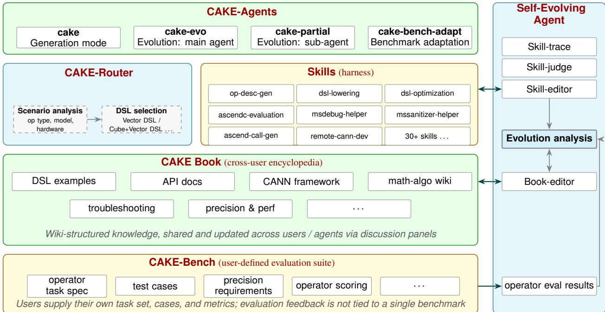  
Figure 1: CAKE architecture. Four stacked layers cooperate to turn an operator request into a deployable, benchmarkvalidated Ascend operator. CAKE-Agents provides the controllers—generation, the evolution main and sub-agents, and automatic benchmark adaptation. The CAKE-Router gates each request on track–chip–operator-type feasibility, then scores the surviving code-generation tracks against the operator’s eight-dimensional structural profile, while the Skills harness supplies typed lifecycle tools for description, lowering, optimization, evaluation, and debugging. The CAKE Book is a cross-user encyclopedia maintained as a shared wiki, and CAKE-Bench is a user-defined evaluation suite—operator task specifications, test cases, precision requirements, and scoring—so that evaluation feedback is not tied to any single benchmark. A Self-Evolving Agent observes all layers: it traces, judges, and edits skills, analyses evolution runs, writes verified experience back to CAKE Book, and closes the loop with measured operator results.

Table 1 contrasts CAKE with the closest Ascend-native systems by their generation, optimization, delivery, and knowledge-reuse mechanisms.

## 1.1 Related Systems

Kernel benchmarks and feedback-driven kernel agents. Benchmarks such as KernelBench, Triton-Bench, and MultiKernelBench reframed kernel synthesis around measured compile, correctness, and performance funnels [2, 8, 9], and a wave of GPU kernel agents—among them KernelAgent, CudaForge, AutoKernel, KernelFoundry, and KernelEvolve—showed that hardware feedback and search drive synthesis past one-shot prompting [10–14]. On Ascend, related systems use several approaches to supply domain expertise. AscendKernelGen trains a domain-adapted model on a reasoning dataset to emit AscendC code [1]; AscendCraft transcompiles a lightweight DSL into AscendC through constrained lowering passes [7]; AscendOptimizer improves an already correct AscendC implementation through rewind-distilled experience and tiling search [3]; and AgenticCANN attacks the corpus scarcity head-on, encoding AscendC expertise as a six-level taxonomy—hardware model, math-to-code mapping, execution invariants, tiling formulas, API signatures, verified exemplars—and admitting different levels at different phases of an evolutionary search, while scheduling high-exploration agents for seed discovery and cheaper agents for refinement [4]. Its ablations measure the contribution of this knowledge: adding knowledge levels lifts elementwise feasibility from 57% to 86%, with hardware-constraint knowledge alone worth 20 percentage points on LayerNorm. The difference relevant to CAKE is how this knowledge is maintained. AgenticCANN uses an expertcurated taxonomy; CAKE Book also collects entries from measured runs and promotes them only after cross-user review and on-device verification, which is what allows later operators to benefit from earlier failures. Table 1 compares these systems’ delivery scope; CAKE targets the chain from intent to a deployable, benchmark-validated operator.

<table><tr><td>System</td><td>Core approach</td><td>Input</td><td>Delivered unit</td><td>Search &amp; cross-run knowledge</td></tr><tr><td>AscendKernelGen [1]</td><td>Train a domain model (Ascend-CoT data, SFT/RL)</td><td>NL requirement</td><td>AscendC kernel scored on a benchmark</td><td>None; experience fixed in model weights</td></tr><tr><td>AscendCraft [7]</td><td>DSL generation then constrained lowering passes</td><td>NL requirement</td><td>AscendC kernel</td><td>None; reuse via category expert examples</td></tr><tr><td>AscendOptimizer [3]</td><td>Episodic agent: optimization rewind + tiling search</td><td>Existing correct AscendC operator</td><td>Optimized kernel and host tiling</td><td>Host-tiling evolution; per-benchmark experience bank</td></tr><tr><td>AgenticCANN [4]</td><td>Six-level expert knowledge taxonomy injected by phase; stage-adaptive agent scheduling</td><td>NL requirement</td><td>Compiled and numerically verified AscendC kernel</td><td>Candidate evolution; knowledge authored once, not written back from runs</td></tr><tr><td>CAKE (ours)</td><td>Agentic workflow over staged, inspectable artifacts</td><td>NL requirement or Deployable CANN AscendC baseline</td><td>operator (build, install, bind, evaluate)</td><td>Constrained variant evolution with Good/Medium/Poor sampling; CAKE Book wiki across runs and agents</td></tr></table>

Table 1: Closest Ascend-native operator systems versus CAKE. Each prior system targets one slice of operator engineering—training a model, transcompiling a DSL, optimizing an existing kernel, or supplying curated knowledge to a search—whereas CAKE delivers a deployable CANN operator and reuses measured experience across runs. AgenticCANN is the closest: it also treats the scarce AscendC corpus as the central obstacle, but its knowledge is authored by experts ahead of time rather than accumulated from measured runs. Entries are drawn from the cited papers.

Routing. Learned routers such as RouteLLM dispatch a query to a stronger or weaker model [15], and compiler auto-schedulers such as Ansor use learned cost models to select a schedule within a single intermediate representation [16]. Kernel-generation agents, by contrast, are largely single-DSL [1, 7, 11]; the few that span several backends either expose support for multiple DSLs without a published selection rule or defer the choice to an opaque per-kernel agent decision [12, 17]. CAKE instead scores four peer codegeneration tracks under a published rule: an item-response model estimates each track’s ability per structural dimension from past evaluated operators, so that the ordering of tracks changes with the operator rather than being fixed, and every decision is recorded with the candidate estimates that produced it (Section 3).

Agent memory and knowledge bases. Agent memory has progressed from per-episode self-reflection [18] and single-agent skill or experience libraries [19, 20] to self-linking memory notes [21], and recently to sharing across actors through banked lessons for cooperating code agents [22] and provenance-tracked multi-user memory [23]. In the same Ascend domain, AscendOptimizer mines a single-agent experience bank for kernel rewriting [3], and AgenticCANN supplies a hand-authored taxonomy of AscendC knowledge as retrieval context [4]. CAKE Book combines three properties: it is an agent-maintained wiki of interlinked pages with an explicit error notebook rather than a flat store; it is written by the runs it serves, so its contents grow with measured evidence rather than with expert authoring effort; and its entries become canonical only after cross-user, human review and on-device verification.

Self-evolving agents. A growing body of work studies agents that improve themselves: recursive selfreferential systems rewrite their own scaffolding [24, 25], automated agent-design methods search the space of agentic architectures [26], and evolutionary approaches maintain populations of self-modifying agents validated by benchmark fitness [27]. In the kernel domain, agentic systems evolve archives of optimized kernels [28]. CAKE’s Self-Evolving Agent targets the generation workflow. It mines many completed generation and profiling runs to promote evidence-gated improvements into the router, skills, repair templates, and CAKE Book.

## 2 From Intent to Deployable Operator

CAKE divides operator development into stages with explicit inputs, outputs, and validation checks. Each stage produces an artifact used by subsequent stages, allowing failures to be diagnosed before the workflow proceeds.

• Operator contract generation. The request (or an api\_description.md) is compiled into an operator contract (op\_desc.json): the single source of truth for the operator’s identity, semantic formulas, representative I/O with dtype/shape constraints, attributes, and case table. Every later stage derives its signature from it, including the schema features that are otherwise lost downstream — is\_list, optional, string-attribute enums, output\_shape derivations, and channel-first layout.

• Reference and functional forms. CAKE builds a PyTorch reference, preserving a supplied implementation verbatim and fixing random seeds for reproducibility. It then converts the reference to a stateless module\_fn. The reference defines expected outputs for correctness checks, the test inputs exercise both reference and generated code, and the functional form exposes dataflow for routing and lowering.

• Multi-DSL router. The router represents the contract and functional form as an eight-dimensional structural profile, removes tracks that cannot support the operator type or target device, and scores the remaining tracks using previous evaluations. Section 3 describes the model. Users can instead specify a track directly through the contract’s dsl\_track field.

• Lowering and project construction. The selected track lowers the functional form into hostside tiling and device-side code while preserving the contract as the interface authority. CAKE materializes the generated source, build configuration, tiling metadata, wrappers, and project skeleton as separate artifacts so that a failure can be localized to a stage rather than attributed to an opaque model response.

• Package, install, and bind. A candidate is built as a CANN custom-operator package, installed into the pinned environment, and exposed through the generated Python binding. These stages are part of the deliverable rather than post-processing: code that compiles as a kernel snippet but cannot be packaged or invoked does not count as a completed operator.

• Evaluate and repair. The installed operator is executed against the reference under dtype-aware precision checks and on-device timing. Compilation, packaging, binding, correctness, and profiling results are written next to the candidate. The resulting evidence routes the next action: build failures return to lowering or project construction, numerical failures return to the contract, reference, or tiling assumptions, and correct but slow candidates enter profiling-guided repair or Evolution mode.

The unit of progress in this lifecycle is therefore an artifact plus its validation record. A run can stop at a failed intermediate stage without losing the evidence needed to diagnose it, while a successful run leaves a package, binding, test record, profile, and provenance trail that another engineer or agent can inspect. These records support both optimization within the current run and knowledge reuse across runs.

## 2.1 The Skills harness

The stages above describe what is produced; the Skills harness is what executes them. A skill is a typed lifecycle tool: it names the artifact it consumes, the artifact it writes, and the condition under which its output is admissible. The orchestrating agent does not contain the procedures — it declares the skills it may call, currently more than thirty, and the runtime resolves each call against that declaration. Adding a capability therefore means adding a skill and listing it, not editing the agent.

The harness coordinates skill selection, validation, and failure recovery.

Stage binding, with track-specific variants. Skills are bound to stages rather than invoked ad hoc. Contract, reference, functional conversion, and tiling pre-classification are shared by every run; the router then selects a code-generation track, and the lowering stages dispatch to the variant of each skill specialized for that track — separate lowering and call-generation skills exist for the Vector and the fused Cube–Vector paths, so that the difference between them lives in the harness rather than inside a branching prompt. Review, evaluation, Advisor-guided repair, and run retrospective are shared again. A track is thus a path through a fixed skill graph, which is why the router’s choice is auditable after the fact.

Stage validation. A stage advances only when its artifact passes a machine-checked gate. The contract illustrates these checks: before any code is generated, the op\_desc is checked for dtype coverage against the full case table, for signature agreement with the task’s declared schema, and for the shape metadata that packaging later depends on. These checks catch incomplete dtype coverage, argument mismatches, and missing output-shape metadata before they propagate to compilation or packaging. A failed check returns control to the stage that produced the artifact.

Execution tracing and failure recovery. Two cross-cutting skills record execution and coordinate repairs throughout a run. Every skill call is bracketed by a trace record, so a run leaves a complete, machine-readable account of which skills fired, in what order, and with what outcome — this trace is the input the self-evolving agent of Section 5 reads to identify recurring skill failures. Alongside it, a test-driven meta-skill governs what happens on failure: a diagnosis is treated as a hypothesis that stays open until an end-to-end pass closes it, and a failure mode seen twice must be pushed back into the lowering step or the project skeleton that permitted it rather than accumulated as another entry in a pitfall list. Retries are bounded, and a stage that does not pass its gate produces no commit, so the version history records the stages that cleared their checks.

## 3 Adaptive Routing and Generation

CAKE carries four code-generation tracks that can each produce a deployable operator: DSL-A, the mature AscendC-lowering track that covers both vector and cube–vector operators on the 910 series; DSL-B, a high-level tile DSL whose strength is cube–vector topology; DSL-C, the vector and cube–vector generation track for the 950; and the SIMT track detailed in Appendix A.5. A track is an implementation route, not an operator class: whether an operator is vector, cube–vector, or SIMT-shaped is an input to the routing decision, and several tracks compete for the same class.

Track performance depends on both the operator’s structure and the current code-generation skills. A track that works well for one operator family may perform poorly on another, and skill updates can change this relationship. CAKE therefore estimates track suitability from previous evaluations. The router has four components (Figure 2): a feasibility gate, a feature extractor, a scoring layer, and an append-only observation ledger.

L0: feasibility gate. A declared capability table marks each (track, chip, operator type) triple feasible or not, and infeasible tracks are removed before any scoring happens. This prevents attempts on unsupported configurations. Forward binary compatibility widens the declared set (a track feasible on 910B is feasible on 910C). On the 950, only DSL-C is feasible for vector and cube–vector operators, so those operators land on DSL-C without any scoring; and the SIMT track exclusively owns the SIMT operator type, which no other track accepts, so the two never compete. When the gate leaves nothing feasible, the router abstains: it emits no decision and hands the model the full track menu with each track’s skills. Abstention has two causes that are reported separately — an unrecognized device string, so that no gate can be applied at all, and a recognized device on which the requested operator type has no feasible track.

L1: operator features and difficulty. The contract and the functional form are reduced to an eightdimensional feature vector $\varphi$ over the dimensions $( T , S , B , R , D , M , F , C )$ — tiling structure, scheduling depth, blocking, reduction, dtype and quantization spread, data movement and irregular access, fusion breadth, and cube intensity. Operators already characterized in the library get an exact vector derived from their reference AST; new operators get a heuristic vector, which is the normal case in production. A scalar difficulty follows from a calibrated weight vector $\beta _ { v }$

$$
b ~ = ~ \beta ^ { \top } \varphi , \qquad \beta = ( 0 . 5 1 , 0 . 7 8 , 0 . 5 9 , 0 . 7 0 , 0 . 4 4 , 0 . 6 1 , 0 . 6 4 , 0 . 9 8 ) ,\tag{1}
$$

pinned to a feature-specification version so that difficulty stays comparable across recalibrations. Crucially b is a property of the operator, not of the track, which is what makes the routing decision robust to noise in a heuristic $\varphi \mathrm { : }$ in the scalar regime below, b cancels when tracks are compared.

L2: track ability and the routing score. Raw mean scores are difficult to compare when tracks have attempted different operator sets. On the current corpus DSL-A’s mean achieved score is 0.576 against DSL $\mathrm { C ' s 0 . \bar { 4 } 7 1 }$ , a gap that would read as a clear ordering; the ability estimates below put them at $- 0 . 9 5 \pm 0 . 3 8$ and $- 0 . 9 9 \pm 0 . 3 6$ , statistically indistinguishable under this model. The raw 0.105 difference alone therefore does not establish a track-ability advantage.

CAKE therefore estimates a per-track ability θ under a continuous item-response model. One observation is a completed generation-and-evaluation run: a track attempted an operator of known difficulty b and achieved a normalized score $y \in [ 0 , 1 ]$ . The link is

$$
\mathbb { E } [ y \mid \theta , b ] ~ = ~ \sigma ( \theta - b ) , ~ \sigma ( x ) = { \big ( } 1 + e ^ { - x } { \big ) } ^ { - 1 } ,\tag{2}
$$

with a beta likelihood on the continuous score and a posterior over $\theta$ obtained by expected-a-posteriori integration against an $\mathcal { N } ( 0 , 1 )$ prior on a fixed grid. Because b is computable from $\varphi$ before any observation exists (Equation 1), the router can assign an initial score to a track with no history using the prior. Such a score reflects prior assumptions rather than measured track performance.

A single scalar θ per track is not enough. With scalar abilities the comparison $\sigma ( \theta _ { t } - b )$ ranks tracks identically for every operator, since b is shared — the router would degenerate into a fixed preference order. CAKE therefore fits a per-dimension ability model per track: writing $\dot { z } = \log \mathrm { i t } ( y ) + b ,$ a ridge-regularized weighted least squares (intercept unpenalized) gives

$$
z \approx a _ { 0 } + \sum _ { d } \theta _ { d } \cdot { \frac { \varphi _ { d } } { 3 } } , \qquad p _ { \mathrm { t r a c k } } ( \varphi ) = \sigma \Bigl ( a _ { 0 } + \sum _ { d } \theta _ { d } { \frac { \varphi _ { d } } { 3 } } - b \Bigr ) ,\tag{3}
$$

where $a _ { 0 }$ is the track’s overall ability on the same scale as the scalar $\theta$ and $\theta _ { d }$ is its ability increment on dimension $d .$ The interaction terms $\theta _ { d } \varphi _ { d }$ are what make the ranking operator-dependent. Fitting requires at least as many valid observations as free parameters; below that threshold the router falls back to the scalar form and records the fallback in its decision log. Figure 3 shows the fitted profiles: the three DSL tracks are close on tiling, reduction, and dtype handling, and separate sharply on data movement (M) and blocking (B).

A worked decision. Table 2 traces four operators through Equation 3 on the 910B. The first pair illustrates how operator features change the selected track. gelu and gather are both vector operators with the same feasible track set and similar difficulty $( b = - \bar { 2 . 1 8 } \mathrm { a g a i n s i - 1 . 4 0 }$ after centering). Their feature vectors differ in data movement, where $\varphi _ { M }$ goes from 0 to 2, and dtype spread, where $\varphi _ { D }$ goes from 2 to 1. The larger between-track contrast is in data movement: DSL-A’s $\theta _ { M }$ is −1.69 while DSL-C’s is −0.31. As a result, ${ \mathrm { D S L } } { \mathrm { - } } { \mathrm { A } } ^ { \prime } { \mathrm { s } }$ lead on gelu (0.694 against 0.613) becomes a deficit on gather (0.239 against 0.366), and the decision flips. The remaining two rows show two further dimensions taking control: conv\_2d has $\varphi _ { B } = 3$ and goes to DSL-B, whose $\bar { \theta } _ { B } = + 2 . 8 3$ is the largest single coefficient in the model; mha carries $\varphi _ { S } = 3$ and returns to DSL-A on scheduling depth, where $\bar { \theta _ { S } } = + 2 . 4 5$ against $\mathrm { D S L - C ^ { \prime } s + 0 . 9 1 }$ is the largest per-dimension difference in DSL-A’s favour. Reduction works the other way, since $\mathrm { D S L - C ^ { \mathrm { , } } s } \theta _ { R } = + \bar { 2 } . 7 5$ exceeds DSL $\mathrm { - A ^ { \prime } s + 2 . 2 6 }$ . DSL-A wins even though mha’s centered difficulty is $+ 7 . 5 7$ and every track’s predicted normalized score is low. The four examples select three different tracks despite using the same device and fitted track profiles.

Table 2: Four routing decisions on the 910B under Equation 3 (FrontierModel-A backbone, pure exploitation). φ is printed in dimension order $( T , S , B , R , D , M , F , C )$ and b is centered on the corpus mean. Columns pA, pB, pC are the predicted normalized scores of the three DSL tracks. The last column names the dimension whose ability coefficients decide the ordering.
<table><tr><td>Operator</td><td>4</td><td>b</td><td> $\pmb { p } _ { \mathrm { A } }$ </td><td> $\scriptstyle { p _ { \mathrm { B } } }$ </td><td>pc</td><td>Chosen</td><td>Decided by</td></tr><tr><td>gelu</td><td>(0,0,1,0,2,0,0,0)</td><td>-2.18</td><td>0.694</td><td>0.463</td><td>0.613</td><td>DSL-A</td><td>baseline ability</td></tr><tr><td>gather</td><td>(0,0,1,0,1,2,0,0)</td><td>-1.40</td><td>0.239</td><td>0.252</td><td>0.366</td><td>DSL-C</td><td>M (data movement)</td></tr><tr><td>conv_2d</td><td>(1,0,3,0,2,0,0,2)</td><td>+1.47</td><td>0.165</td><td>0.314</td><td>0.218</td><td>DSL-B</td><td>B (blocking)</td></tr><tr><td>mha</td><td>(3,3,3,3,2,0,1,2)</td><td>+7.57</td><td>0.257</td><td>0.168</td><td>0.101</td><td>DSL-A</td><td>S (scheduling depth)</td></tr></table>

Evaluation ledger and skill versions. The observation ledger is append-only and grows one row per evaluated operator: the track used, the device, the difficulty and feature vector, the achieved normalized score, and a fingerprint of the code-generation skills that produced it. Any evaluation harness that returns a per-operator score on a comparable scale can supply $y - \mathbf { C A K E }$ -Bench’s per-operator score is one such source, a user’s own metric is another. This allows new operator evaluations to update the router without rerunning a fixed benchmark suite. Observations flagged as infrastructure failures, as reward-hacking candidates, or as internally inconsistent submissions are retained in the ledger but excluded from ability estimation. To account for changes in code-generation skills, the router identifies each track configuration by the pair (track, skill\_version): observations from a superseded skill version enter estimation at half weight, which widens the posterior and prompts re-measurement of the updated track. New evaluations receive full weight.

Selecting tracks for exploration. Testing a track requires a full generation, build, and evaluation cycle. CAKE limits these additional evaluations using two criteria. A Bernoulli-style information proxy $I = p ( 1 - p )$ at the current estimate is the eligibility heuristic. For the continuous scores modeled here, this is not the Fisher information of the beta likelihood. An optimistic upper bound θ + 1.96 se identifies tracks that could outperform the currently preferred track. Among eligible alternatives, the router selects the one with the highest upper bound. Thus, the information proxy controls eligibility, while the upper bound determines which alternative to test. Ranking by the information proxy alone would instead favor scores near 0.5, where $p ( 1 - p )$ is largest.

After a skill update, the router compares how many current-version evaluations are available for each track. Tracks with fewer observations than their peers receive a re-measurement bonus. If all tracks are equally under-sampled, no differential bonus is applied; the ordinary eligibility and upper-bound criteria still govern exploration.

The routing loop. Each completed evaluation updates the evidence used for subsequent routing. At the routing stage the router writes its decision next to the operator’s artifacts, together with the full candidate snapshot — every feasible track’s ability estimate, predicted normalized score, information proxy, and skill fingerprint. At the evaluation stage the achieved score is written back as a new observation, the affected track’s posterior moves, and the next operator of similar character may route differently. Both events are also appended to a central timeline, which also records abstentions and routing errors. The saved features, scores, and skill versions allow a past decision to be reconstructed using the information available at the time.

## 4 Evolutionary Optimization

Generation mode provides a working implementation that can serve as the starting point for performance optimization. Evolution mode, or CAKE-evo, explores tiling, buffering, and fusion choices through parallel candidate generation and on-device evaluation. Profiling identifies the bottlenecks to target in each round.

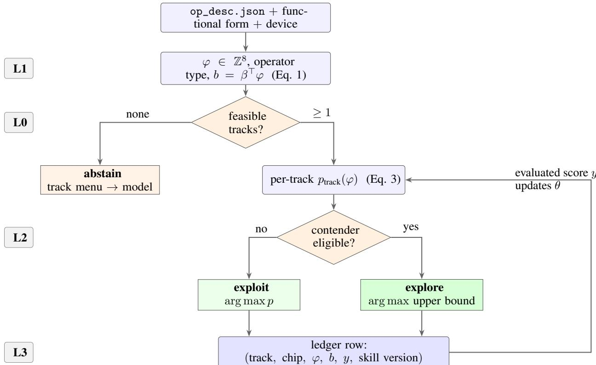  
Figure 2: The routing decision. L1 reduces the contract to an eight-dimensional feature vector and a difficulty; L0 removes infeasible tracks before any scoring and abstains rather than guessing when nothing is feasible; L2 scores the surviving tracks under Equation 3 and decides between exploiting the best estimate and measuring an eligible contender; L3 records the outcome, which moves the ability estimates that L2 will use next time.

## 4.1 Profiling-driven analysis layer

Before generating variants, CAKE-evo estimates a performance ceiling from the input shapes and dtypes, device clock, HBM/L2 bandwidth, and peak cube/vector throughput. Following a roofline decomposition, the modeled lower-bound execution time is the maximum of four pipeline times,

$$
T _ { \mathrm { m i n } } ~ = ~ \mathrm { m a x } \big ( t _ { \mathrm { h b m \_ r e a d } } , ~ t _ { \mathrm { w r i t e } } , ~ t _ { \mathrm { c u b e } } , ~ t _ { \mathrm { v e c t o r } } \big ) ,\tag{4}
$$

where reads and writes are treated as separate channels that overlap. For $b _ { \mathrm { o u t } }$ output bytes, writes follow an L2-fill-first model: traffic up to the L2 capacity $C _ { L 2 }$ uses bandwidth $\beta _ { L 2 }$ , and the remainder uses HBM bandwidth $\beta _ { \mathrm { H B M } }$

$$
t _ { \mathrm { w r i t e } } = \left\{ \begin{array} { l l } { b _ { \mathrm { o u t } } / \beta _ { L 2 } } & { b _ { \mathrm { o u t } } \le C _ { L 2 } } \\ { C _ { L 2 } / \beta _ { L 2 } + ( b _ { \mathrm { o u t } } - C _ { L 2 } ) / \beta _ { \mathrm { H B M } } } & { b _ { \mathrm { o u t } } > C _ { L 2 } . } \end{array} \right.\tag{5}
$$

The dominant term in Eq. (4) is the bottleneck signature (memory vs. compute, and which pipe), and the arithmetic intensity AI = FLOPs/bytes versus the ridge point $\beta _ { \mathrm { H B M } } ^ { - 1 }$ · peak confirms the regime. A complementary fusion analysis parses the operator’s dataflow graph and flags intermediates that would otherwise be materialized to HBM, quantifying the traffic a loop fusion would save. Together these yield, per case: (i) a ceiling-derived target $T _ { \mathrm { m i n } }$ that replaces a hand-picked speedup goal, (ii) a bottleneck label that selects which optimization family to try, and (iii) a loop fusion recommendation.

The resulting $T _ { \mathrm { m i n } }$ is an optimistic analytical floor under the assumed overlap and traffic model, not a measured attainable latency. Dependencies, contention, and instruction overhead can keep a correct kernel above this floor even when further optimization is ineffective. We define headroom as the measured runtime divided by $T _ { \mathrm { m i n } } ; \mathrm { a }$ value near one indicates little remaining improvement under this model.

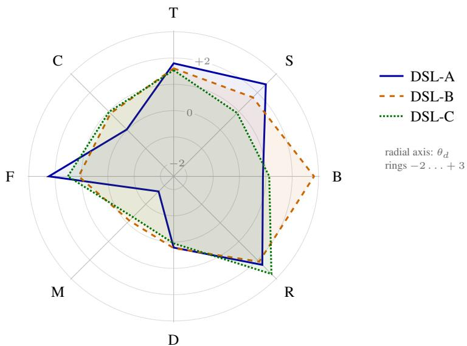  
Figure 3: Fitted per-dimension abilities $\theta _ { d }$ for the three DSL tracks under one backbone. Axes are the eight feature dimensions of Section 3. The tracks are nearly indistinguishable on tiling (T), reduction (R), and dtype spread (D), and separate on blocking (B, where DSL-B reaches +2.83), data movement (M, where DSL-A is −1.69 against DSL-C’s −0.31), and scheduling depth (S, where DSL-A is +2.45 against DSL-C’s +0.91). These gaps are what make the routing ordering operator-dependent rather than fixed.

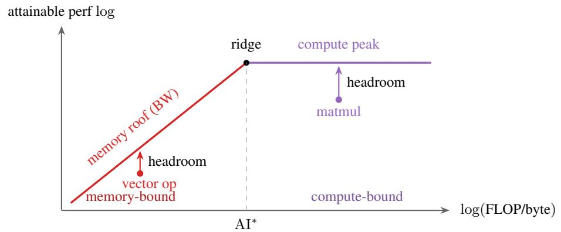  
Figure 4: Roofline ceiling model (Eq. 4). Each case is placed by its arithmetic intensity (AI); the binding pipeline gives the roof $T _ { \mathrm { m i n } }$ , and the headroom (gap from the measured point up to the roof) bounds how much evolution can still gain. A variant that reaches its roof (headroom≈ 1) is converged.

## 4.2 The evolutionary loop

Each round (Fig. 5) generates N variants in parallel, assigning each an optimization direction based on the identified bottleneck. For example, a memory-bound chain may benefit from fusion, while a compute-bound kernel may benefit from different tiling or instruction scheduling. Candidates are compiled, evaluated, ranked by speedup, and grouped into good, medium, and poor tiers. The next round samples implementations from these tiers as starting points.

During advisor-in-the-loop consultation (AIC), the Advisor examines the profile of the best candidate and supplies bottleneck-specific suggestions for the next round. The search stops when the measured runtime approaches the modeled floor (headroom ≈ 1, Fig. 4) or the round budget is exhausted. Post-evolution mining (PMR) then extracts validated optimizations as candidate rules for reuse on other operators.

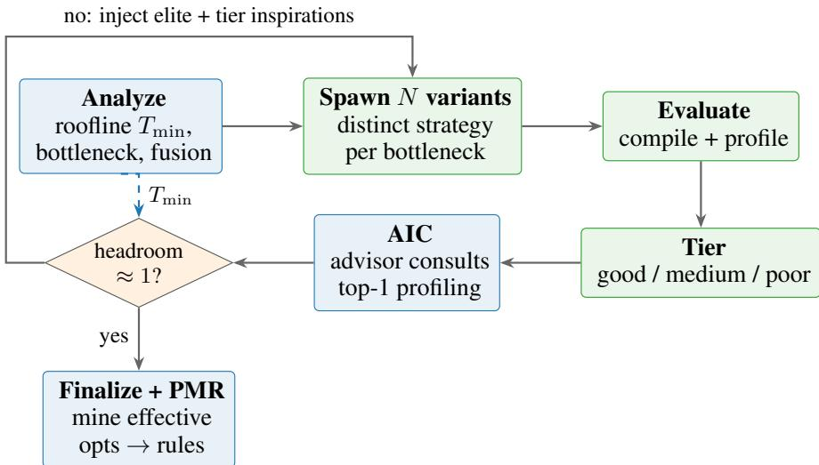  
Figure 5: The CAKE-evo loop. The analysis layer (blue) sets the ceiling target and bottleneck-driven variant assignment; the evolutionary stages (green) spawn, measure, and tier variants; AIC injects profiling-grounded guidance; the roofline headroom provides the stop test; PMR compounds knowledge into rules.

<table><tr><td>Class</td><td>Scope</td><td>Representative strategies</td></tr><tr><td>D Multi-dtype</td><td>kernel</td><td>mixed precision; template / TilingKey dtype dispatch</td></tr><tr><td>P Performance</td><td>kernel</td><td>double buffering; adaptive tiling; pipeline sync; 32B alignment; vectorized copy; matmul scheduling; L1/L2 cache hierarchy</td></tr><tr><td>A Accuracy</td><td>kernel</td><td>FP32 intermediate; Welford mean/var; rounding mode; softmax stability; high-precision rsqrt</td></tr><tr><td>F Fusion</td><td>cross-op</td><td>elementwise-chain anti-spill;norm+epilogue; matmul+epilogue (CV)</td></tr><tr><td>H Host-level</td><td>host</td><td>TilingKey priority-chain dispatch; multi-core load balance; L2/L1 memory tiering</td></tr></table>

Table 3: Strategy classes. D/P/A are kernel-level; F and H raise the altitude to cross-operator fusion and host-side, shape-driven dispatch.

## 4.3 Strategy knowledge

Optimization directions are drawn from a curated strategy library derived from production operators and organized into five classes (Table 3). The kernel-level classes cover dtype handling (D), performance (P), and numerical accuracy (A). Fusion strategies (F) eliminate intermediate global-memory transfers; host-level strategies (H) select specialized kernels and distribute work across cores according to input shapes.

Table 4 maps profiling results to candidate strategies. Inputs include the dominant pipeline in Eq. 4, opportunities to fuse intermediate operations, and differences in bottlenecks across input shapes. Assigning variants different applicable strategies lets a round test several responses to the measured bottleneck.

Finally, the library is not static: the PMR step (Fig. 5) distills the optimizations that were validated to improve performance during evolution into reusable rules, so each optimized kernel improves both the strategy set and the routing table for the next.

## 4.4 Case study: evolving EngramGateFusion without an official kernel baseline

EngramGateFusion is a CANN-Bench level-3 operator that combines a per-step gated recurrence with a dilated depthwise convolution. The benchmark specifies the mathematical contract and a correctness reference, but provides no official optimized kernel. A conventional speedup against a vendor implementation is therefore unavailable. We instead use three anchors: CAKE-evo’s first working kernel, the unfused PyTorch composition (roughly one hundred small-operator launches), and the case-specific hardware lower bound $T _ { \mathrm { m i n } }$ from Eq. (4). The campaign covers 20 shape configurations and two bf16 outputs; the final package passes all 20 official grading cases. Development and round-to-round timing used Ascend910B2, while official grading used Ascend 910C.

<table><tr><td>Bottleneck signature</td><td>Routed strategies</td></tr><tr><td>memory-bound + fusable chain</td><td>Fusion to keep intermediates off GMEM; double buffering; alignment; vectorized copy; memory-tier selection</td></tr><tr><td>compute-bound (vector)</td><td>Adaptive tiling; small-dimension row merging; algorithm selection; FP32 intermediates where precision requires them</td></tr><tr><td>compute-bound (cube)</td><td>Matmul scheduling (SplitK/StreamK); L1/L2 cache opti- mization; matmul-epilogue fusion</td></tr><tr><td>instruction / scalar-bound</td><td>Algorithm redesign; specialized AscendC APIs; narrow syn- chronization</td></tr><tr><td>load imbalance (straggler core) shape regimes diverge across cases</td><td>Host-side dispatch and multi-core load balancing Multiple TilingKeys with a specialized kernel per shape regime</td></tr></table>

Table 4: Bottleneck-signature → strategy routing across the classes in Table 3. The roofline verdict and fusion analysis select which optimization family each variant explores.

For round r and case i, the campaign reports the fusion indicator $\begin{array} { r } { S _ { r } = \frac { 1 } { 2 0 } \sum _ { i } t _ { \mathrm { e a g e r } , i } / t _ { r , i } } \end{array}$ and the roofline gap $\begin{array} { r } { G _ { r } = \frac { 1 } { 2 0 } \sum _ { i } t _ { r , i } / T _ { \operatorname* { m i n } , i } . } \end{array}$ A larger S indicates that the fused kernel increasingly amortizes the unfused composition, while a smaller $G _ { r }$ indicates movement toward the hardware floor. The two ratios have different evidentiary roles: $G _ { r }$ compares device times directly, whereas $S _ { r }$ divides end-to-end eager wall time by device-only kernel time and is thus a round-to-round fusion indicator, not a same-basis end-to-end speedup. Figure 6 shows the evolution trajectory, with endpoint roofline gaps, per-round LLM calls, and annotations of the main optimization steps.

Across the 20 cases, aggregate device time falls from 1451.7 µs for the round-1 kernel to 775.7 µs in round 19, a 46.6% reduction or 1.87× within-system speedup. The local score rises from 64.53 to 72.80; the packaged kernel scores 71.30 on the official grader with all 20 cases passing. The precision report records bit-identical agreement on six cases and at most one bf16 unit in the last place (ULP) on the remainder. The timing improvement is measured against CAKE’s round-1 kernel on the same development device. The campaign reached its 20-round budget, not the roofline stopping threshold.

The local and official scores are not directly comparable: the development device has 48 vector cores and the grading device has 40, which also changes shape-dependent dispatch. Round acceptance used a local oracle rather than the official grading path. The first official submission failed 12 cases because host-side UB accounting diverged from the kernel layout on the grading device. Round 20 fixed this by deriving both layouts from a shared header; the final 20/20 result refers to the repaired package, not every intermediate candidate.

The performance gains followed several revisions to the agent’s bottleneck analysis. In round 2, measurements showed that the fixed issue overhead of a vector API call dominated its length-dependent cost, making call reduction a priority. In round 3, processing sequence positions by their index modulo the dilation factor reduced the convolution ring buffer from K times the dilation factor to K rows, where K is the number of convolution taps.

Middle rounds introduced double buffering in the Unified Buffer (UB) and shape-aware host tiling. The agent also revised its interpretation of three-source vector instructions: replacing a chain of simpler operations with one multiply-add could reduce instruction issue overhead. Later rounds tested combinations of changes and revised a code-size rule that had rejected useful candidates. In round 19, folding conv\_norm\_weight into the convolution tap weights removed a multiplication from each row. The complete campaign used 36 generated variants and 1,037 LLM calls across 20 rounds; 186 of those calls belong to the final verificationand-packaging round. The resulting measurements and successful changes provide material for postevolution mining (PMR): instruction-cost estimates, conditions under which a rule fails, and combinations of optimizations that can be tested on other operators.

Fusion indicator against unfused PyTorch composition  
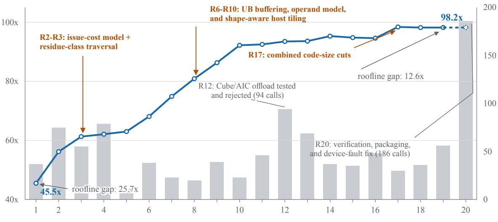  
CAKE-evo round  
Figure 6: EngramGateFusion evolution over 20 CAKE-evo rounds and 20 CANN-Bench cases. The line is the mean fusion indicator against the unfused PyTorch composition (left axis); gray bars show LLM calls in each round (right axis), and warm-colored callouts identify the mechanisms behind the largest gains. The indicator rises from 45.5× to 98.2×, while the endpoint annotations show the mean kernel-to-roofline ratio falling from 25.7× to 12.6×. Because the line mixes eager wall time with device kernel time, it is used only as a trajectory indicator; a separate samebasis measurement gives a final mean end-to-end speedup of 29.5× (geometric mean 27.6×). Round 20 performed verification, packaging, and a device-fault fix and therefore has calls but no new performance point; the dashed segment repeats the round-19 value and does not represent a new timing measurement.

## 5 CAKE Book and System-Level Self-Evolution

Evolution mode improves one operator implementation by searching over candidate variants under a fixed operator contract. CAKE also contains a system-level improvement loop whose target is the generator itself. This loop is implemented by two cooperating components: CAKE Book, an LLM Wiki-based agentic knowledge-management system, and the Self-Evolving Agent, a persistent AI agent that monitors CAKE runs and turns observed engineering experience into human-reviewed improvements. Together they make CAKE less dependent on a single model’s prior knowledge: compilation failures, profiling signals, successful optimizations, and human corrections become reusable system memory.

## 5.1 CAKE Book as Agent-Native Reference

CAKE Book is the knowledge layer used by CAKE agents before, during, and after operator generation. Following the open-source LLM Wiki pattern, CAKE Book maintains wiki-style pages with bidirectional links, source metadata, hardware and CANN-version tags, trust and recency weights, and an error notebook for recurring Ascend/CANN development failures. Human review remains available for proposed knowledge and repository updates. The design enables knowledge reuse in later CAKE runs; its causal effect on success and performance is not isolated by the current evaluation (Section 6.2).

CAKE Book complements the static references packaged with individual skills. Static skill references capture stable procedures such as artifact schemas, prompt contracts, code templates, and evaluation commands. CAKE Book captures knowledge that changes with experience: version-specific compiler behavior, newly observed CANN packaging traps, operator-family tiling lessons, 950 Regbase/SIMT notes, profiler interpretations, and workarounds that have only recently been validated. When a skill needs such context, it can query CAKE Book as a task-time reference source. The returned context is ranked not only by semantic similarity, but also by link structure, evidence quality, hardware and software compatibility, freshness, and human review status.

CAKE Book supports both retrieval and updates. For retrieval, an agent or skill submits the current task context, retrieves relevant wiki pages and linked error notes, ranks them by evidence, and packs the result into an agent-ready reference. For updates, a completed run contributes new observations: a compiler error and its fix, a profiler bottleneck and the code change that removed it, a DSL route that repeatedly failed for an operator family, or a human review note that corrects an agent assumption. CAKE Book deduplicates these observations, attaches provenance, and exposes them for review before they become trusted references for future agents.

## 5.2 Run Evidence from the CAKE CI Platform

The Self-Evolving Agent observes CAKE through the CAKE CI Platform. The platform standardizes generation and evolution runs and exposes a CLI through which an agent can inspect run status, logs, and artifacts. For each run, the agent can retrieve the operator contract, generated PyTorch reference, functional form, DSL baseline, AscendC project files, build logs, CANN package and install logs, evaluate.py outputs, profiling CSVs, skill traces, PROGRESS.md, evolution reports, Advisor state, issue or pull-request links, and user annotations. These artifacts preserve both successful paths and failed attempts, which is essential because many reusable CAKE lessons are negative: which route compiled but failed precision, which template broke on non-aligned shapes, or which Advisor suggestion did not transfer to a neighboring operator family.

The CI interface also makes self-evolution measurable. Runs can be grouped by operator family, DSL route, target chip, CANN version, input mode, evaluation case type, and final status. This lets CAKE Book distinguish local anecdotes from repeated patterns and lets the Self-Evolving Agent detect regressions after router, template, Advisor, or reference changes. Linking an update to its source runs also allows later evaluations to check whether the same failure recurs.

## 5.3 Self-Evolving Agent

The Self-Evolving Agent runs continuously, checking newly available CAKE CI Platform runs. It reads the corresponding artifacts, and records observations through CAKE Book. Its daily work resembles an engineer’s maintenance loop: summarize recent CI successes and failures, identify repeated failure modes, compare them with existing CAKE Book pages, notice when a previously useful rule becomes stale, and identify cases where a dynamic lesson should become part of the repository.

When the observation is purely knowledge-oriented, the Self-Evolving Agent interacts with CAKE Book directly. For example, it can add a new error-note page for a CANN compiler diagnostic, link it to the affected operator family and CANN version, attach the run IDs that demonstrate the workaround, and mark the page as pending human review. When the observation implies a code or repository change, the agent opens an issue or pull request against the CAKE repository. Typical pull requests include adding a static skill reference, improving a DSL prompt, tightening a lowering check, documenting a new Advisor rule, extending an evaluation audit, or updating router guidance for a hardware-specific path. Merging remains a human decision; the agent proposes changes and attaches evidence, while maintainers decide whether the evidence is sufficient.

This separation keeps the self-evolving loop auditable. CAKE Book can absorb fresh, uncertain, or versionspecific experience quickly without silently rewriting the public pipeline. Repository changes are slower and require review, but once merged they improve the baseline behavior of all later agents. In this sense, CAKE Book is the fast memory of the system, while the static skill references, router rules, templates, and Advisor rules are the stabilized memory.

## 5.4 Reference Promotion and Governance

Reference promotion is the bridge between dynamic and static knowledge. A CAKE Book entry becomes a candidate for promotion when it is repeatedly useful, supported by concrete run evidence, scoped to clear hardware and software versions, and stable enough that future agents should see it without issuing a live CAKE Book query. The Self-Evolving Agent prepares the promotion by linking successful and failing runs, summarizing the lesson, identifying the affected skill or rule file, and opening an issue or pull request. Human reviewers then check whether the proposed reference is correct, sufficiently general, and safe to apply across future runs.

Governance is especially important because Ascend/CANN behavior changes across hardware and software versions. CAKE Book entries therefore carry provenance: run IDs, operator families, target chip, CANN and torch-npu versions, input shapes, pass/fail status, profiler files, and reviewer notes. Conflicting evidence does not overwrite older knowledge; it creates versioned or scoped pages. Stale-rule detection is handled in the same evidence-backed way: when CI runs show that a promoted rule no longer helps or begins to harm a route, the Self-Evolving Agent records the contradiction in CAKE Book and opens a follow-up issue or pull request for human review.

Together, these components support knowledge reuse across runs. CAKE agents retrieve current lessons from CAKE Book during generation, CAKE CI Platform captures the full evidence trail of their attempts, the Self-Evolving Agent monitors that trail around the clock, and stable lessons move back into static skill references through reviewed pull requests. Operator-level optimization supplies the observations; repository review determines which lessons become part of the shared generation workflow.

## 6 Evidence from CANN-Bench and Operator Campaigns

Setup. The evaluation target is the official CANN-Bench v1.1 task set on Ascend 950PR, comprising 53 operators across difficulty levels 1–4, with 20 standard and 80 hidden cases per operator. We use the October 15, 2026 leaderboard snapshot, which selects the best result for each operator separately in each case set across benchmark revisions 1.1.0–1.1.2. The per-operator benchsite score is out of 100, with compile, functional-correctness, and performance weights of 0.2, 0.3, and 0.5 under cann-bench-eq4-v1.

Operator completion. All 53 operators compile in both case sets. CAKE passes all 1,060 standard cases (100%) and 4,167 of 4,240 hidden cases (98.28%). All 53 operators pass every standard case, and 38 pass every hidden case.

Correctness and performance. The benchmark score includes performance as well as correctness. CAKE achieves mean operator scores of 79.31 on the standard set and 77.95 on the hidden set. The overall mean is 78.63 out of 100, averaging equally over the 53 operators and the two case sets. Correctness is the property that CAKE’s acceptance criteria enforce; the remaining score reflects opportunities for further correctness and performance improvement.

Score profiles across difficulty. Figure 7 separates the results by difficulty. Standard-set case pass rate is 100% at every level, while mean scores are 86.86, 82.07, 76.32, and 74.11 for levels 1–4. On the hidden set, case pass rates are 100%, 99.22%, 98.21%, and 94.84%, with mean scores of 91.76, 80.31, 76.46, and 63.34. Thus, functional coverage remains high across levels, while the lower scores on the harder tasks identify opportunities for further kernel optimization.

## 6.1 Router Observations

The evaluation ledger illustrates why routing uses operator features as well as historical scores. In the current ledger, DSL-A’s raw mean exceeds DSL-C’s by 0.105, while the difficulty-adjusted scalar abilities reported in Section 3 are statistically indistinguishable. The per-dimension model then restores operator

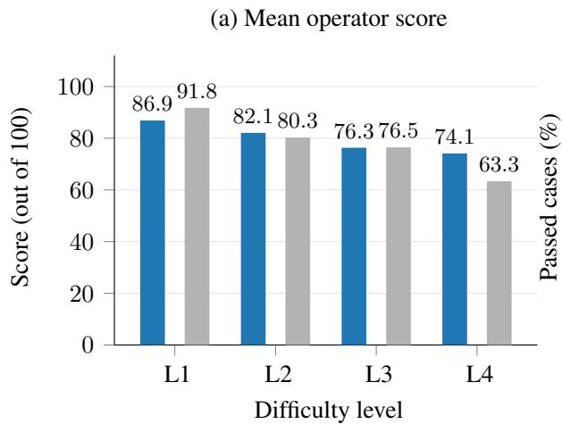

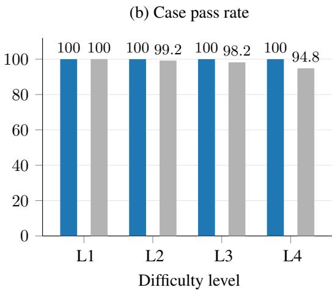  
Standard Hidden  
Figure 7: CAKE’s aggregated results by difficulty level on Ascend 950PR. Levels 1–4 contain 8, 16, 21, and 8 operators. Left: mean operator score, with a maximum of 100. Right: case pass rate, computed over 20 standard or 80 hidden cases per operator. The same operator grouping is used for both sets.

dependence: the four worked decisions in Table 2 select three different tracks, with data movement, blocking, and scheduling/reduction features changing the ordering.

The decision records contain the operator features, feasible tracks, ability estimates, and skill versions needed to reconstruct each choice. The examples show how CAKE adapts track selection to the requested operator, rather than always choosing the track with the highest raw mean score.

## 6.2 Operational Evidence for CAKE Book

CAKE CI records the artifacts from which a knowledge entry is created, CAKE Book preserves its provenance and review state, and skills can retrieve the result as task-time context. On the write side of this loop, the diagnostics a campaign produces while debugging one operator are retained in the shared layer instead of remaining in the case directory, so a later run on an unrelated operator can retrieve them.

The evaluated CAKE workflow uses CAKE Book together with static references and the Router. The records complement those end-to-end results by showing how knowledge is captured, reviewed, and made available to subsequent tasks.

## 7 Scope and Future Directions

The CANN-Bench results cover 53 operators on both standard and hidden case sets. Router decision records illustrate operator-aware track selection, the EngramGateFusion campaign demonstrates iterative kernel optimization, and the CAKE Book records describe cross-task knowledge reuse. The aggregate benchmark results use Ascend 950PR; the Router examples and EngramGateFusion campaign retain their Ascend 910B/910C settings. Appendix A documents the programming paths and generation logic for Ascend 950.

Further development will extend Evolution to additional operator families and expand the reusable knowledge available through CAKE Book. Future evaluations will examine routing and retrieval configurations under matched task sets and run budgets, and follow knowledge from CI diagnostics through reuse and reviewed reference updates. The aim is to improve operator coverage and performance while keeping generation cost and expert review effort practical.

## 8 Conclusion

CAKE organizes Ascend operator engineering around a unit larger than a generated kernel snippet: a deployable custom operator accompanied by its contract, reference, lowering artifacts, package, binding, evaluation record, and profile. Adaptive routing selects among changing code-generation tracks from accumulated operator evidence; Evolution mode searches within one operator contract using on-device feedback; and CAKE Book with the Self-Evolving Agent carries lessons across runs under human review.

The aggregated CANN-Bench results show full standard-set case coverage and 98.28% hidden-set case coverage across 53 operators on Ascend 950PR. The EngramGateFusion case study shows that Evolution mode can improve an already-correct operator under on-device feedback.

## Acknowledgments

We thank Jiwei Yang and Jiong Jin for helpful discussions; Tongtong Xu, Yu Cheng, Yiyu Zhang, and Zhongzhen Wen for insightful discussions on domain-specific languages for NPU kernels; and Chengdi Ma for valuable discussions on SIMT programming and vector functions (VFs). We are grateful to Fengming Zhu for assistance in setting up the continuous integration (CI) pipeline, and to Li Bao, Chengqiu Hu, and Qichen Liao for valuable discussions and suggestions on the generation and optimization of complex operators, including FlashAttention.

## References

[1] Xinzi Cao, Jianyang Zhai, Pengfei Li, Zhiheng Hu, Cen Yan, Bingxu Mu, et al. AscendKernelGen: A systematic study of LLM-based kernel generation for neural processing units, 2026.

[2] Z. Wen, Y. Zhang, Z. Li, Z. Liu, L. Xie, and T. Zhang. MultiKernelBench: A multi-platform benchmark for kernel generation. arXiv preprint arXiv:2507.17773, 2025.

[3] Jiehao Wu, Zixiao Huang, Wenhao Li, Chuyun Shen, Junjie Sheng, and Xiangfeng Wang. AscendOptimizer: Episodic agent for Ascend NPU operator optimization. arXiv preprint arXiv:2603.23566, 2026.

[4] Junhao Qiu, Zidong Wang, Yansong Sun, Zhitong Ma, Ping Guo, and Qingfu Zhang. Agentic-CANN: Automated Ascend C operator generation via knowledge-augmented agentic evolution, 2026. arXiv:2607.26661.

[5] Huawei CANN. CANN-Bench: Official benchmark for ascend custom operators. https://gitcode. com/cann/cann-bench, 2026.

[6] Andrej Karpathy. LLM Wiki. Public idea file, GitHub Gist, 2026. Pattern for LLM-compiled wiki-style knowledge bases.

[7] Zhongzhen Wen, Shudi Shao, Zhong Li, Yu Ge, Tongtong Xu, Yuanyi Lin, et al. Ascend-Craft: Automatic Ascend NPU kernel generation via DSL-guided transcompilation. arXiv preprint arXiv:2601.22760, 2026.

[8] Anne Ouyang, Simon Guo, Simran Arora, Alex L. Zhang, William Hu, Christopher Ré, et al. Kernel-Bench: Can LLMs write efficient GPU kernels? arXiv preprint arXiv:2502.10517, 2025.

[9] Jianling Li, Shangzhan Wang, Zhenye Zhang, et al. TritonBench: Benchmarking large language model capabilities for generating Triton operators. In Findings of ACL, 2025. arXiv:2502.14752.

[10] PyTorch Contributors. KernelAgent: Hardware-guided GPU kernel optimization via multi-agent orchestration. PyTorch Blog, 2026.

[11] Zijian Zhang et al. CudaForge: An agent framework with hardware feedback for CUDA kernel optimization, 2025.

[12] Jaber Jaber and Osama Jaber. AutoKernel: Autonomous GPU kernel optimization via iterative agentdriven search. arXiv preprint arXiv:2603.21331, 2026.

[13] Nina Wiedemann, Quentin Leboutet, Michael Paulitsch, Diana Wofk, and Benjamin Ummenhofer. KernelFoundry: Hardware-aware evolutionary GPU kernel optimization, 2026.

[14] Gang Liao, Hongsen Qin, Ying Wang, Alicia Golden, Michael Kuchnik, Yavuz Yetim, et al. KernelEvolve: Scaling agentic kernel coding for heterogeneous AI accelerators at Meta, 2025.

[15] Isaac Ong, Amjad Almahairi, Vincent Wu, Wei-Lin Chiang, Tianhao Wu, Joseph E. Gonzalez, M. Waleed Kadous, and Ion Stoica. RouteLLM: Learning to route LLMs with preference data. In Proceedings ofthe International Conference on Learning Representations (ICLR), 2025. arXiv:2406.18665.

[16] Lianmin Zheng, Chengfan Jia, Minmin Sun, Zhao Wu, Cody Hao Yu, Ameer Haj-Ali, Yida Wang, Jun Yang, Danyang Zhuo, Koushik Sen, Joseph E. Gonzalez, and Ion Stoica. Ansor: Generating high-performance tensor programs for deep learning. In Proceedings ofthe 14th USENIX Symposium on Operating Systems Design and Implementation (OSDI), 2020. arXiv:2006.06762.

[17] Jinye Du, Quan Yuan, Zuyao Zhang, Yanzhi Yi, Jiahui Hu, Wangyi Chen, et al. AKG Kernel Agent: A multi-agent framework for cross-platform kernel synthesis, 2025.

[18] Noah Shinn, Federico Cassano, Edward Berman, Ashwin Gopinath, Karthik Narasimhan, and Shunyu Yao. Reflexion: Language agents with verbal reinforcement learning. In Advances in Neural Information Processing Systems (NeurIPS), 2023. arXiv:2303.11366.

[19] Guanzhi Wang, Yuqi Xie, Yunfan Jiang, Ajay Mandlekar, Chaowei Xiao, Yuke Zhu, Linxi Fan, and Anima Anandkumar. Voyager: An open-ended embodied agent with large language models. Transactions on Machine Learning Research (TMLR), 2024. arXiv:2305.16291.

[20] Andrew Zhao, Daniel Huang, Quentin Xu, Matthieu Lin, Yong-Jin Liu, and Gao Huang. ExpeL: LLM agents are experiential learners. In Proceedings ofthe 38th AAAI Conference on Artificial Intelligence (AAAI), 2024. arXiv:2308.10144.

[21] Wujiang Xu, Zujie Liang, Kai Mei, Hang Gao, Juntao Tan, and Yongfeng Zhang. A-Mem: Agentic memory for LLM agents. In Advances in Neural Information Processing Systems (NeurIPS), 2025. arXiv:2502.12110.

[22] Yuanzhe Liu, Ryan Deng, Tim Kaler, Xuhao Chen, Charles E. Leiserson, Yao Ma, and Jie Chen. Lessons learned: A multi-agent framework for code LLMs to learn and improve. In Advances in Neural Information Processing Systems (NeurIPS), 2025. arXiv:2505.23946.

[23] Alireza Rezazadeh, Zichao Li, Ange Lou, Yuying Zhao, Wei Wei, and Yujia Bao. Collaborative memory: Multi-user memory sharing in LLM agents with dynamic access control. arXiv preprint arXiv:2505.18279, 2025.

[24] Eric Zelikman, Eliana Lorch, Lester Mackey, and Adam Tauman Kalai. Self-taught optimizer (STOP): Recursively self-improving code generation. In Proceedings of the First Conference on Language Modeling (COLM), 2024. arXiv:2310.02304.

[25] Xunjian Yin, Xinyi Wang, Liangming Pan, Li Lin, Xiaojun Wan, and William Yang Wang. Gödel agent: A self-referential agent framework for recursive self-improvement. In Proceedings ofthe 63rd Annual Meeting ofthe Associationfor Computational Linguistics (ACL), 2025. arXiv:2410.04444.

[26] Shengran Hu, Cong Lu, and Jeff Clune. Automated design of agentic systems. In Proceedings ofthe International Conference on Learning Representations (ICLR), 2025. arXiv:2408.08435.

[27] Jenny Zhang, Shengran Hu, Cong Lu, Robert Lange, and Jeff Clune. Darwin Gödel machine: Openended evolution of self-improving agents. arXiv preprint arXiv:2505.22954, 2025.

[28] Robert Tjarko Lange, Aaditya Prasad, Qi Sun, Maxence Faldor, Yujin Tang, and David Ha. The AI CUDA engineer: Agentic CUDA kernel discovery, optimization and composition. Technical report, Sakana AI, 2025. Technical report, https://pub.sakana.ai/ai-cuda-engineer/paper/.

## A Ascend 950 Vector: Regbase SIMD and SIMT

This appendix documents how CAKE generates and adapts operator code for the Ascend 950 series. The 950 (a5, chip C310, device\_type=950, \_\_DAV\_C310\_\_) shares its Cube primitive set with the earlier a2/910B (C220); the divergence is on the vector side. Two 950-only paths live on that side: Regbase, a register-level SIMD path for latency-sensitive kernels with regular access patterns, and SIMT, a multi-thread execution model for operators whose memory access or control flow is data-dependent. Sections A.1 and A.2 describe the hardware resources. Section A.3 gives the path-selection logic; Sections A.4 and A.5 describe generated kernels, validation signals, and the SIMT programming-model catalogue.

<table><tr><td></td><td>Membase</td><td>Regbase</td></tr><tr><td>Residency</td><td>LocalTensor in UB</td><td>RegTensor in VREG</td></tr><tr><td>API</td><td>whole-tensor AscendC: : *</td><td>AscendC::Reg::*/MicroAPI</td></tr><tr><td>Addressing</td><td>block-strided aligned</td><td>can be unaligned</td></tr><tr><td>Masking</td><td>count argument</td><td>explicit MaskReg predicate</td></tr><tr><td>Movement</td><td>DataCopy (TPipe queue)</td><td>Load(Un)Align/Store(Un)Align</td></tr></table>

Table 5: Membase and Regbase operand models: data residency, addressing, masking, and transfer operations.

## A.1 Register-level operand model

Where the 910 path issues whole-tensor operations over UB-resident LocalTensors (membase), the 950 exposes a register-level MicroAPI programmed through @vf micro-functions. The hardware-specific codegeneration choices are therefore:

• Register batches: RegTensor<T> holds a fixed VREG\_SIZE-byte vector register rather than an arbitrarily large UB buffer.

• Predication, not counts: active lanes are carried by a MaskReg predicate passed to every op, replacing the membase count argument.

• Explicit addressing: gather/scatter index by raw byte offset with no bounds check. The regbase path offers LoadUnAlign/StoreUnAlign for UB↔register movement, enabling unaligned access.

• MicroAPI: add/sub/exp/log exist on both paths but operate on registers in the 950 MicroAPI. Operations without a supported register-level lowering, such as widening Mull or reading back a Squeeze count, retain their membase implementation.

How Regbase reshapes the compute ceiling. Regbase is an architectural shift from classical SIMD to a dual-issue, register-based SIMD design: @vf kernels run micro-instructions directly on RegTensor operands held in the vector register file. Whereas each membase vector operation reads from UB and writes back, Regbase keeps the working set resident in registers across the micro-kernel. Removing those UB round trips moves the throughput limit from UB bandwidth toward instruction issue, widened by dual issue.

## A.2 SIMT block resources

Each AI Vector core exposes a SIMT block that runs up to 2 048 threads organized in 32-thread warps, with warp-level shuffle, vote, and reduction intrinsics and 11-operation atomics on both on-chip and global memory. SIMT threads access the DataCache partition of the Unified Buffer—at most 128 KB, with the remaining UB capacity reserved for the SIMD path—and synchronize through block-wide barriers.

## A.3 Path selection

The capability gate of Section 3 first determines whether a supported execution track exists. On the 950, data-dependent, non-contiguous access selects SIMT; otherwise, register-level DSL coverage and the known gap list select Regbase or the membase fallback.

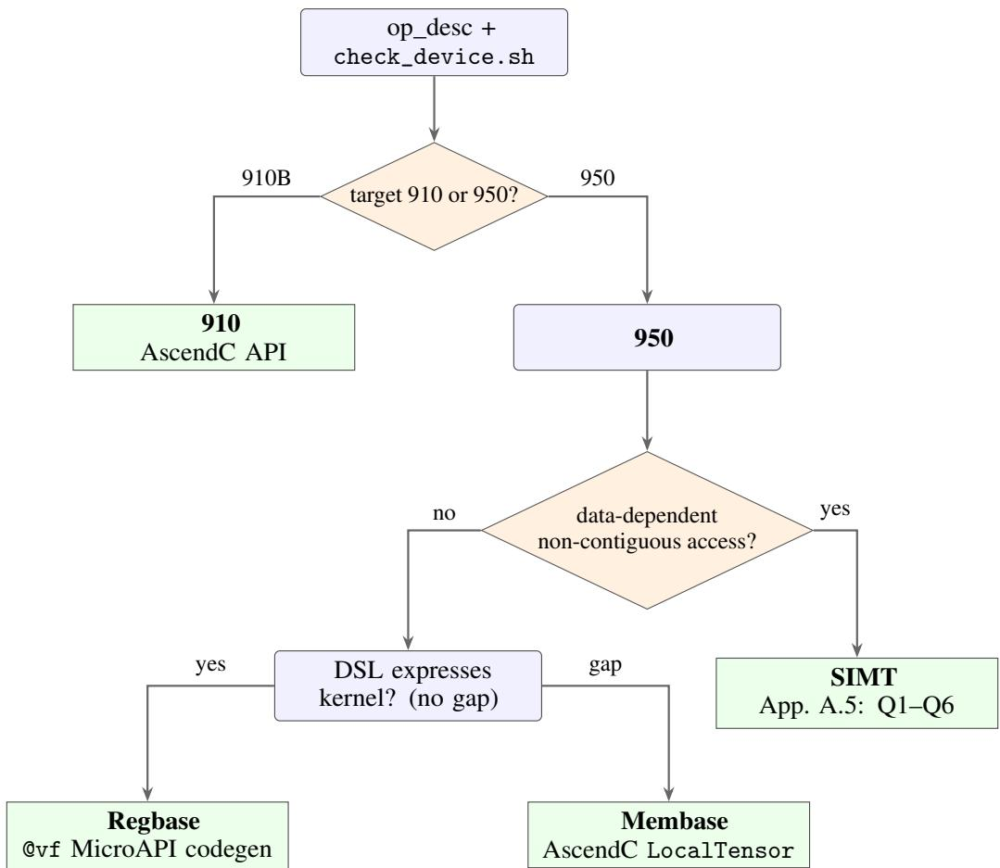  
Figure 8: Target and path routing. check\_device.sh reports the chip generation, which admits the 910 lane or the two 950-specific lanes. On the 950, operators with data-dependent non-contiguous access take SIMT; the remainder use Regbase when the register-level DSL covers the kernel and fall back to membase when it does not. The SIMT model-selection questions Q1–Q6 are given in Appendix A.5.

## A.4 Regbase code generation

The Regbase generation path uses explicit register operations to reduce UB transfers or improve addressing and instruction scheduling. Table 5 contrasts its operand model with membase. CAKE uses the DSL-C lowering skills to generate this code.

When the router selects Regbase. Three signal classes trigger the path: (1) regbase-only microinstructions — kernels using DataCopyGather, Histograms, and other 950 register-based microinstructions that have no equivalent in the AscendC API; (2) unaligned UB access — kernels that require non-aligned access into the Unified Buffer; (3) low-latency kernels — small blocks that fit a single register and high-iteration inner loops. Membase remains the default; Regbase is attempted only when DSL-C supports all required operations.

Generated code artifacts. The Regbase path emits a @vf vector-function kernel with the structure in Figure 9: register and mask allocation followed by CeilDiv(len, VREG\_LANES) loop iterations. The mask handles the final partial iteration. Reusable templates cover lookup-table/gather, compaction/filtering, and histogram/scatter operations. Post-processing places the generated code in CAKE’s operator project and renames the entry point to match its binding. Migration from an existing membase kernel proceeds one region at a time, checking bit-exact agreement with the original implementation after each conversion. Regions without a supported register-level lowering remain in membase form.

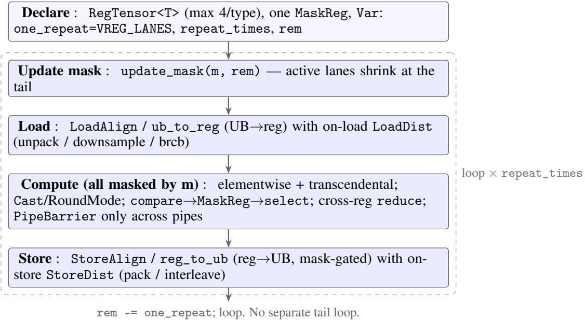  
Figure 9: @vf Regbase kernel skeleton. In this pattern, narrow I/O (bf16/int8) is widened to RegTensor<float> on load via LoadDist and packed back on store; computation uses float registers.

Compiler and profiler checks. CAKE checks whether the conversion reduces memory traffic and execution time using the following signals:

• PipeBarrier removal — same-pipe (V→V) barriers disappear, freeing instruction/pipeline slots; barriers remain only across pipes (MTE2→V, V→MTE3).

• Lower load/store ratio — register residency removes UB round-trips that membase incurs.

• Fewer wall cycles — cannsim reports Regbase < membase on the same case, with a per-pipe split identifying the dominant pipe.

These are read from cannsim record ./test\_aclnnop -s Ascend950 –gen-report and, for perinstruction attribution, msprof op simulator (per-instruction CSV mapped back to source lines).

Validation without 950 hardware. In the absence of 950 hardware, CAKE offers a simulator-only path backed by cannsim or msprof that enables preliminary validation.

## A.5 SIMT code generation

Membase and Regbase execute predicated vector instructions over UB-resident or register-resident data. Some operators, including gather, histogram, and top-k selection, involve data-dependent addresses or control flow. Such patterns are not inherently inexpressible in SIMD: supported gather/scatter operations, masking, and staged data movement can implement many of them. However, some irregular patterns require additional transfers, predication, or serial processing, depending on the available APIs and lowering support. SIMT provides an alternative implementation path for these cases.

The 950 SIMT execution model can reduce these overheads using the block resources summarized in Section A.2. The capability gate of Section 3 determines whether an operator can enter the SIMT track at all. The path is taken when two additional conditions hold beyond the Regbase/membase split: (i) the operator exhibits irregular or data-dependent memory access, and (ii) the irregular access is non-contiguous— contiguous scans with data-dependent predicates can remain on the SIMD path when supported by the available operations. Once on the SIMT path, a six-question decision tree (Figure 10) refines the choice among three programming models that trade generality for co-processor use. The simt-codegen skill implements this selection and generates the corresponding kernel structure.

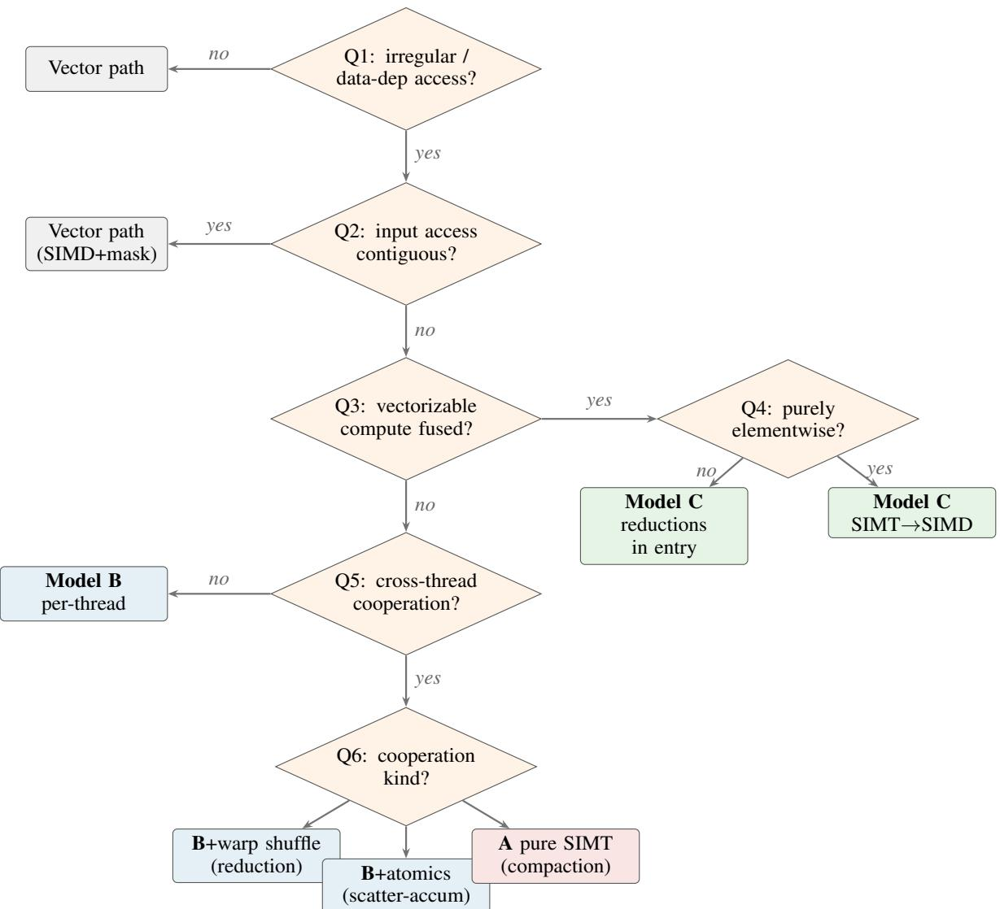  
Figure 10: SIMT model selection. Questions Q1–Q2 gate entry to the SIMT path; Q3–Q6 choose among three programming models. Model A is a CUDA-like \_\_global\_\_ kernel; Model B bridges SIMT threads into the AscendC entry via asc\_vf\_call; Model C adds a \_\_simd\_vf\_\_ stage that offloads vectorizable arithmetic to the SIMD pipe after SIMT has performed the irregular access.

Three programming models. Model A (pure SIMT) is the most general: a single $\mathrm { - - } \mathtt { S } \mathtt { l o b a l \mathrm { _ { - - } } }$ kernel launched with four-argument «<blocks, threads, ubuf, stream»> syntax, compiled with the -cce-enable-puresimt flag. It supports templates, struct arguments, and the full SIMT intrinsic set (warp shuffle, vote, atomics, cache hints) but cannot call the AscendC Micro API (LoadAlign, DataCopy, etc.). This model suits operators whose compute is entirely irregular—histograms, hash-table insertion, stream compaction—and whose output can be written directly to global memory.

Model B (SIMT VF bridge) wraps the per-thread compute in a \_\_simt\_vf\_\_ free function dispatched from an \_\_aicore\_\_ entry via asc\_vf\_call. The three-argument launch integrates with msopgen project scaffolding (tiling macros, REGISTER\_TILING\_DEFAULT), making it the default for operators that fit the standard CANN host/device contract—gather, cumulative sum, top-k with warp reductions.

Model C (hybrid SIMT+SIMD) extends Model B for operators that fuse an irregular access phase with a regular vectorizable phase. $\smash { \mathrm { A _ { \ z e } s i m t _ { \ z } v f _ { z = 1 } } }$ function performs the data-dependent read and stages results into the DataCache; a \_\_simd\_vf\_\_ function then runs the same SIMD vector pipe used by the Regbase path (adds, relu, exp) over the staged data; finally, DataCopy moves the result to global memory. The benefi of offloading arithmetic to SIMD depends on the workload and must be evaluated together with data-staging and synchronization costs; low SIMD utilization alone does not establish negligible overhead. A variant of Model C handles fused reductions (softmax, layer normalization): since \_\_simd\_vf\_\_ cannot compile cross-element reductions (ReduceMax, ReduceSum), these are placed in the \_\_aicore\_\_ entry function using high-level AscendC APIs.