# Conflict-Aware Logit Adapters for Utility-Preserving Anti-Distillation

Quoc Phong Dao<sup>1∗</sup>, Binh Anh Nguyen<sup>1,3∗</sup>, Linh Ngo Van<sup>1†</sup>, Thanh-Toan Do<sup>2</sup>, Mehrtash Harandi<sup>2</sup>, Trung Le<sup>2†</sup>,

<sup>1</sup>Hanoi University of Science and Technology, <sup>2</sup>Monash University, <sup>3</sup>Center for AI Research (CAIR), VinUniversity

## Abstract

While reasoning traces improve model capability, they also create a pathway for extracting supervision signals for downstream distillation. Initial efforts to mitigate this rely on decoding-time interventions, but they incur high inference overhead and often harm the teacher model’s natural fluency. We propose Conflict-Aware Logit Adapters (CALA), a lightweight training-time defense. CALA attaches a small residual adapter to a frozen teacher model and trains only this adapter. A proxy student identifies positions where imitation is most sensitive, and the adapter perturbs the output distribution there within high-probability regions. A conflictaware optimization balances competing anti-distillation and utility objectives, with regularization preserving the teacher’s performance and fluency. At inference, CALA incurs modest overhead and requires no auxiliary model. Experiments on reasoning benchmarks show that CALA substantially reduces successful student imitation while maintaining near-original teacher performance and generation quality, offering a practical and efficient alternative to decoding-time approaches.

## 1 Introduction

Large language models increasingly produce reasoning traces alongside final answers, as chain-ofthought prompting, reasoning-path sampling, and process supervision improve multi-step reasoning [40, 39, 25]. These traces also reveal intermediate decompositions and solution patterns that can serve as high-information training signal for smaller student models, with evidence spanning rationale-based distillation and broader instruction-tuning or imitation pipelines built from synthetic frontier-model outputs [16, 43, 39, 11]. This creates a security tension: reasoning-rich outputs improve usability, but may also facilitate model replication.

Although prior work has shown that black-box language models can leak substantial information through their outputs, including memorized data and signals useful for model extraction [1, 2], existing defenses are not well aligned with our setting. Output-privacy work primarily focuses on preventing memorization or training-data extraction, while data-poisoning approaches assume control over the learner’s training set [17, 7]. These assumptions do not match our deployment scenario, where the teacher is fixed, exposed through black-box access, and must continue producing useful outputs for end users.

To study this gap concretely, we focus on a specific threat model: an attacker collects reasoning traces emitted by a deployed teacher model and uses them as supervision to train a smaller student via standard next-token prediction [11]. The attacker has black-box access to the teacher and observes full input-trace pairs, but has no access to model parameters or internal states [2]. The defender, in contrast, controls only the distribution of outputs produced by the teacher, and must preserve their utility for end users while limiting their effectiveness as training data for downstream imitation. Under this setting, the closest prior work is Antidistillation Sampling (ADS) [35], which perturbs the teacher’s next-token distribution during decoding to reduce the value of released traces for downstream distillation. However, because ADS applies protection online, it requires proxymodel computation during generation and can introduce decoding overhead or surface artifacts. These limitations motivate a training-time alternative that replaces online perturbations with learned protective behavior in the teacher.

We propose Conflict-Aware Logit Adapters (CALA), a training-time approach for limiting tracebased model imitation. At a high level, we attach a lightweight residual logit adapter to a frozen teacher and train only this module, amortizing protection into the model instead of imposing it through an online decoding rule. At deployment, generation follows the standard decoding pipeline, and the learned residual can be scaled by a single strength parameter without running an ADS-style proxy model at each token. Concretely, during training, a proxy student takes a single, virtual, noncommitted gradient-ascent step on its next-token loss to expose positions where imitation is locally fragile. The adapter is then optimized to shift probability mass on restricted high-probability supports so that released traces become less useful for distillation, while utility-preserving regularizers and a conflict-aware update keep the distribution close to the original teacher and reduce surface artifacts.

Contributions. We make three contributions. First, we formulate Conflict-Aware Logit Adapters (CALA), a training-time defense for reasoning traces that targets the same broad threat as ADS while shifting the intervention from decoding to model training. This avoids online proxy-mode computation at inference time and remains compatible with standard decoding choices. Second, we develop a practical proxy-guided training procedure in which a proxy student takes a virtual, non-committed ascent step to provide an anti-distillation signal, and a residual logit adapter is updated with a conflict-aware rule that balances anti-distillation pressure against utility preservation. Third, we empirically evaluate CALA by jointly measuring teacher utility, downstream student imitation, and surface fluency across reasoning benchmarks and evaluation-time operating points.

## 2 Related Work

Reasoning traces and distillation. Intermediate reasoning traces are now common in languagemodel interfaces. Chain-of-thought prompting, zero-shot reasoning prompts, self-consistency, and process supervision show that intermediate reasoning can improve performance on difficult multi-step tasks [40, 20, 39, 25]. The same traces can also serve as supervision: smaller models can inherit nontrivial reasoning behavior from teacher-generated rationales, step-by-step solutions, and synthetic instruction-following data [16, 36, 43, 10]. Our work is motivated by this dual use: we aim to preserve useful reasoning traces while reducing their effectiveness as supervision for downstream imitation.

A complementary line improves transfer across tokenizers or architectures via cross-chain-of-though and optimal-transport alignment, multi-cost Wasserstein objectives, dual-space sequence alignment, span-level representation alignment, and multi-granular layer trajectories [21, 38, 37, 6, 3]. Related approaches use teacher-guided token weighting for self-play and distillation [22] or transfer preferences across tokenizers [31]. While these methods strengthen distillation rather than defend against it, they motivate evaluating defenses against diverse distillation strategies.

Output leakage and defensive perspectives. A broader security literature has shown that model outputs can reveal valuable information about the underlying model or its training data. Prior work studies extraction of memorized training examples and reconstruction of model behavior from blackbox access [1, 30, 2]. Data-poisoning work studies a related but different setting, where carefully chosen upstream data induces predictable downstream behavior [17, 7, 8]; similar risks have also been studied for preference data [33]. In our setting, the defender does not control the attacker’s training pipeline or dataset construction. Instead, the defender controls only the traces emitted by a deployed teacher and must preserve their utility for legitimate users.

Protecting against distillation. Recent work has begun to study defenses that reduce the value of model outputs as supervision for unauthorized imitation. The most closely related work is Antidistillation Sampling (ADS) [35], which targets the same utility-distillability tension for released reasoning traces. DOGe [23] is a training-time alternative that fine-tunes the teacher’s output layer using an adversarial objective. More broadly, this line connects to work on making teachers harder to imitate [26], trace-rewriting defenses for unauthorized distillation [27], watermarking methods for marking or protecting generated text [19, 9, 34, 44], and decoding-time control methods that steer generation with auxiliary objectives [29, 24, 18, 32]. Our goal differs from watermarking-based attribution or detection: we aim to reduce the usefulness of released reasoning traces as distillation supervision.

## 3 Motivation and Problem Formulation

Trace-based distillation. We consider a deployed reasoning model that returns full reasoning traces to users. These traces are useful because they expose intermediate steps, but the same structure also makes them high-quality supervision for black-box imitation. Let $T _ { \Theta }$ be a frozen teacher language model, and let $p _ { t } = p ( \cdot \mid x _ { \leq t } ; \Theta )$ denote its next-token distribution over vocabulary V. An adversary queries the teacher, collects input-trace pairs, and trains a smaller student $S _ { \phi }$ with the standard next-token objective over the generated tokens,

$$
\mathcal { L } _ { \mathrm { C E } } ( \phi ) = - \frac { 1 } { N } \sum _ { t = 1 } ^ { N } \log p _ { \phi } ( x _ { t + 1 } \mid x _ { \le t } ) ,\tag{1}
$$

where N is the number of next-token prediction terms in the trace. The attacker observes only text, not teacher parameters, hidden states, or logits. The defender therefore controls only the distribution of traces emitted by the teacher.

Limitations of existing work. Antidistillation Sampling (ADS) [35] is a pioneering decoding-time defense for protecting reasoning traces against unauthorized distillation. It perturbs the teacher’s next-token distribution during generation by adding a proxy-studentderived anti-distillation penalty to the teacher logits, encouraging tokens that remain plausible under the original teacher while reducing the usefulness of the resulting traces for student training. However, our empirical evaluation reveals several practical limitations: ADS also incurs additional inference-time cost be-

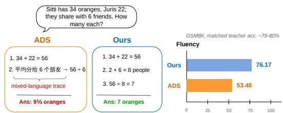  
Figure 1: Representative GSM8K example: ADS can introduce visible surface artifacts such as mixedlanguage reasoning and malformed fragments, while CALA produces a cleaner trace.

cause it requires proxy-model computation during generation. Moreover, our empirical evaluation shows that ADS can introduce surface-level artifacts in reasoning traces, such as switching to another language despite an English question, as shown in Figure 1. We also observe cases where the final an swer remains correct while the chain-of-thought becomes incoherent, containing meaningless tokens, unnatural fragments, or mixed-language reasoning. We refer to this behavior as anti-distillation hacking: the model preserves task accuracy by producing the correct final answer, but degrades the intermediate reasoning in ways that make the trace harder to distill (more examples can be found in Appendix F). This suggests that evaluating only teacher accuracy is insufficient; a reliable defense must also assess the fluency and usability of the generated reasoning traces.

Design goal. A defense against trace distillation should not simply degrade generation quality. If the teacher produces unnatural or low-utility traces, imitation becomes harder, but the model also becomes less useful to legitimate users. We seek a defended teacher that preserves fluent reasoning while reducing the value of its traces as distillation data. CALA moves the intervention to training time: we learn a lightweight residual adapter on top of a frozen teacher; at inference, its effect can be controlled by a single strength parameter without running a proxy model during decoding.

## 4 Method

CALA aims to reduce the usefulness of released reasoning traces for next-token imitation while preserving utility and surface naturalness. As illustrated in Figure 2, it trains a residual adapter through three components: a temporary proxy-student ascent step that exposes imitation-sensitive positions, support-restricted losses on high-probability tokens, and utility regularizers that anchor the adapted distribution to teacher-derived targets. A conflict-aware update then balances anti-distillation and utility gradients so that utility preservation does not erase the protective signal.

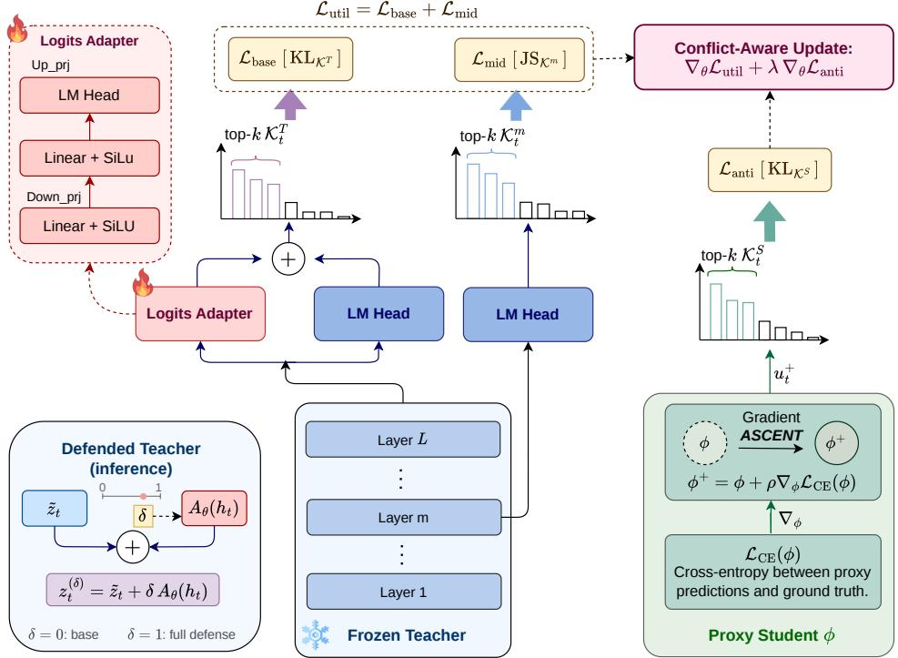  
Figure 2: Overview of Conflict-Aware Logit Adapters (CALA). A trainable residual adapter modifies the frozen teacher’s logits $z _ { t } ,$ , while proxy-guided anti-distillation and teacher-derived utility anchors jointly shape the adapted distribution.

## 4.1 Training-time defended teacher

Residual adapter. We implement the defense as a small residual modification to a frozen teacher, rather than fine-tuning the teacher itself. Let $h _ { t }$ denote the final hidden state of the frozen teacher at position t, and let $\tilde { z } _ { t } = W _ { \mathrm { l m } } h _ { \ i }$ <sub>t</sub> be the logits produced by the original language-modeling head. We introduce a lightweight residual adapter A<sub>θ</sub> that maps $h _ { t }$ to a vocabulary-sized logit correction. The defended training logits are

$$
z _ { t } = \tilde { z } _ { t } + A _ { \theta } ( h _ { t } ) , q _ { t } = \mathrm { s o f t m a x } ( z _ { t } ) .\tag{2}
$$

The teacher backbone and the language-modeling head remain frozen throughout training; only the adapter parameters θ are updated. This design keeps the defense localized and avoids changing the underlying teacher representation.

Teacher anchors. Since the adapter directly modifies the teacher’s next-token distribution, it must be constrained to preserve trace quality. Without such constraints, anti-distillation pressure can move probability mass toward locally confusing but linguistically poor continuations; in preliminary experiments, this made traces harder to imitate but sometimes introduced repetition or unnatural fragments. This resembles the unreliable-tail problem in neural text generation, where low-probability tokens degrade coherence [15]. We therefore restrict the logits to top-k supports and renormalize the resulting distributions before computing divergences, and anchor the adapted distribution to the base final-layer prediction and an intermediate-layer projection of the backbone.

Thefirst anchor preserves the final-layer teacher distribution. Let $\mathcal { K } _ { t } ^ { T }$ be the top-k tokens under the base logits $\tilde { z } _ { t } ,$ and let $\Pi _ { K } ( \cdot )$ denote the distribution obtained by restricting logits to support K and renormalizing. We penalize deviations from the original teacher on this support:

$$
\mathcal { L } _ { \mathrm { b a s e } } = \frac { 1 } { N } \sum _ { t } \mathrm { K L } \Big ( \Pi _ { K _ { t } ^ { T } } ( \tilde { z } _ { t } ) \| \Pi _ { K _ { t } ^ { T } } ( z _ { t } ) \Big ) .\tag{3}
$$

We use the directional KL divergence because $\mathcal { L } _ { \mathrm { b a s e } }$ is a preservation anchor: the frozen final-layer distribution defines which high-probability continuations should remain stable under the adapter. This term discourages the adapter from suppressing tokens that the base teacher assigns high probability, thereby preserving task utility and local fluency.

The second anchor is an intermediate-layer consistency regularizer. This term is inspired by the layer-contrastive view in [4]: different transformer depths expose different predictive views of the next token. The final layer is the teacher’s mature prediction and is usually where task-specific and factual information is most strongly expressed. In contrast, an intermediate layer is closer to the input-side computation and often reflects a smoother, less specialized continuation preference: it may already support fluent local tokens before the final layers sharpen the distribution toward more fact-specific choices. We therefore use the intermediate projection to keep the generated trace natural. It guides the adapter to make anti-distillation changes without moving too far away from the teacher’s own fluent continuations.

Let $h _ { t } ^ { ( m ) }$ be a fixed intermediate hidden state, and let $\tilde { z } _ { t } ^ { ( m ) } = W _ { \mathrm { l m } } h _ { t } ^ { ( m ) }$ denote its projection through the frozen LM head. On the top-k support ${ \cal { K } } _ { t } ^ { m }$ selected from $\tilde { z } _ { t } ^ { ( m ) }$ , we add

$$
\mathcal { L } _ { \mathrm { m i d } } = \frac { 1 } { N } \sum _ { t } \mathrm { J S } \Big ( \Pi _ { K _ { t } ^ { m } } ( z _ { t } ) , \Pi _ { K _ { t } ^ { m } } ( \tilde { z } _ { t } ^ { ( m ) } ) \Big ) .\tag{4}
$$

Here, JS denotes the Jensen-Shannon divergence, a symmetric distance between two normalized token distributions. We use a symmetric divergence because the intermediate projection is not a target to imitate exactly; rather, it provides a second teacher-internal view that the adapted final prediction should remain compatible with. This helps preserve fluency under anti-distillation pressure; empirically, removing ${ \mathcal { L } } _ { \mathrm { m i d } }$ lowers the fluency curve in Figure 5(b). Intuitively, ${ \mathcal { L } } _ { \mathrm { m i d } }$ pulls the defended distribution toward the intermediate layer’s smoother continuation preferences, while $\mathcal { L } _ { \mathrm { b a s e } }$ keeps it anchored to the final teacher prediction. Together, the complete utility objective is

$$
\mathcal { L } _ { \mathrm { u t i l } } = \mathcal { L } _ { \mathrm { b a s e } } + \mathcal { L } _ { \mathrm { m i d } } .\tag{5}
$$

## 4.2 Proxy-guided anti-distillation

The defended-teacher objective above requires a training signal indicating which parts of a reasoning trace are most useful for imitation. Because the actual downstream student is unknown, we introduce a proxy student $S _ { \phi }$ only during adapter training. The proxy is not meant to approximate the attacker exactly; instead, it acts as a local probe for identifying next-token positions where imitation is fragile.

For the current batch of teacher traces, we evaluate the proxy student using the same next-token imitation loss ${ \mathcal { L } } _ { \mathrm { C E } } ( \phi )$ defined above. Rather than taking a descent step that improves the proxy on these traces, we consider the opposite local problem. For a small radius $\rho ,$ define the ideal loss-increased proxy as

$$
\begin{array} { r } { \phi ^ { \star } \in \mathrm { a r g m a x } _ { \phi ^ { \prime } : \| \phi ^ { \prime } - \phi \| _ { 2 } \le \rho } \mathcal { L } _ { \mathrm { C E } } ( \phi ^ { \prime } ) . } \end{array}
$$

Since solving this constrained maximization exactly is expensive, we approximate it by the first-order maximizer within the $\ell _ { 2 }$ ball and define the virtual proxy

$$
\phi ^ { + } = \phi + \rho \frac { \nabla _ { \phi } \mathcal { L } _ { \mathrm { C E } } ( \phi ) } { \left\| \nabla _ { \phi } \mathcal { L } _ { \mathrm { C E } } ( \phi ) \right\| _ { 2 } } ,\tag{6}
$$

where $\rho$ is the local perturbation radius. The parameter $\phi ^ { + }$ is not committed to the proxy model; it is used only as a stop-gradient probe for the outer adapter update.

Given the virtual proxy, we evaluate it on the same teacher traces. Since $\phi ^ { + }$ approximates a local maximizer of $\mathcal { L } _ { \mathrm { C E } }$ , it defines a nearby proxy state under which the current traces are harder to imitate. Let $u _ { t } ^ { + } = S _ { \phi ^ { + } } ( x _ { \le t } )$ denote the next-token logits of this locally loss-maximized proxy.

Using the same support-restriction principle as above, we compute the anti-distillation loss only on a proxy-sensitive top-k support. Let $\mathrm { \bar { \mathcal { K } } } _ { t } ^ { S }$ be the top-k tokens under $u _ { t } ^ { + }$ . We define

$$
\mathcal { L } _ { \mathrm { a n t i } } = \frac { \sum _ { t } w _ { t } ^ { S } \mathrm { K L } \Big ( \Pi _ { \mathcal { K } _ { t } ^ { s } } ( u _ { t } ^ { + } ) \lVert \Pi _ { \mathcal { K } _ { t } ^ { s } } ( z _ { t } ) \Big ) } { \sum _ { t } w _ { t } ^ { S } } , \quad \mathrm { w i t h } \quad w _ { t } ^ { S } = \frac { \mathrm { E n t r o p y } \left( \mathrm { s o f t m a x } ( u _ { t } ^ { + } ) \right) } { \log | V | }\tag{7}
$$

where $w _ { t } ^ { S }$ is an entropy-based weight computed from the virtual proxy distribution. Because $u _ { t } ^ { + }$ comes from a nearby proxy state that locally increases the imitation loss, $\Pi _ { K _ { t } ^ { S } } ( u _ { t } ^ { + } )$ provides a local anti-distillation target that is intentionally biased away from the ground-truth next-token imitation direction. Minimizing this KL moves the defended logits toward proxy-sensitive alternatives on the restricted support, concentrating pressure on positions where imitation is unstable. Higher-entropy positions receive larger weights because the proxy is less confident there, leaving more room for the defended teacher to alter the imitation signal; easy or deterministic continuations are correspondingly downweighted.

This proxy-guided loss can be viewed as a training-time analogue of ADS. Whereas ADS injects a proxy-derived perturbation during decoding, we instead train the adapter so that a related antidistillation direction is already encoded in the teacher’s logits before generation begins.

## 4.3 Conflict-aware optimization

The utility and anti-distillation objectives have training-dependent alignment, making a fixed loss weight brittle. When their gradients are aligned, the utility update may already preserve part of the anti-distillation direction; when they conflict, the utility update can erase it. We therefore combine the two gradients with an adaptive coefficient based on their alignment:

$$
\nabla _ { \theta } \mathcal { L } = \nabla _ { \theta } \mathcal { L } _ { \mathrm { u t i l } } + \lambda \nabla _ { \theta } \mathcal { L } _ { \mathrm { a n t i } } ,\tag{8}
$$

where the adaptive coefficient λ is computed as:

$$
\lambda = \mathrm { m a x } \Bigg ( 0 , ~ \kappa - \frac { \langle \nabla _ { \theta } \mathcal { L } _ { \mathrm { u t i l } } , \nabla _ { \theta } \mathcal { L } _ { \mathrm { a n t i } } \rangle } { \left\| \nabla _ { \theta } \mathcal { L } _ { \mathrm { a n t i } } \right\| _ { 2 } ^ { 2 } + \varepsilon } \Bigg ) .\tag{9}
$$

Here, $\kappa > 0$ is a margin hyperparameter, and λ is detached from the computation graph. This rule can be interpreted as maintaining a minimum projection of the final update onto the anti-distillation direction. The quantity $\frac { \langle \nabla _ { \theta } \mathcal { L } _ { \mathrm { u t i l } } , \nabla _ { \theta } \mathcal { L } _ { \mathrm { a n t i } } \rangle } { \| \nabla _ { \theta } \mathcal { L } _ { \mathrm { a n t i } } \| _ { 2 } ^ { 2 } + \varepsilon }$ measures how much of the anti-distillation direction is already present in the utility gradient. When the gradients are aligned, this projection is large, so the additional anti-distillation weight is reduced. When the gradients are orthogonal or opposed, the projection is small or negative, so λ increases and adds back anti-distillation pressure. This prevents the utility regularizers from washing out the protective update while still allowing them to dominate when they already support the same direction. We provide a first-order constrained-projection interpretation of this update in Appendix A.

## 4.4 Generation-time strength control

During training, the objectives are defined on the full adapted distribution $q _ { t }$ . At generation time, we expose the learned residual with a scalar $\delta \in [ 0 , 1 ]$ , which controls the strength of the defense by interpolating between the original and adapted logits:

$$
z _ { t } ^ { ( \delta ) } = ( 1 - \delta ) \tilde { z } _ { t } + \delta z _ { t } = \tilde { z } _ { t } + \delta A _ { \theta } ( h _ { t } ) , \qquad q _ { t } ^ { ( \delta ) } = \mathrm { s o f t m a x } \Big ( z _ { t } ^ { ( \delta ) } \Big ) .\tag{10}
$$

Thu $\mathfrak { s } , \delta = 0$ recovers the original teacher exactly, while $\delta = 1$ applies the learned defense at full scale. Intermediate values provide a practical way to navigate the utility-distillability trade-off without retraining the adapter. After interpolation, generation uses standard temperature and top-k sampling.

The full procedure is shown in Algorithm 1.

## 5 Experiments

We evaluate whether a training-time residual adapter improves the utility-distillability trade-off over decoding-time antidistillation, while avoiding deployment-time proxy-student computation. For each operating point, we report two metrics: defended teacher accuracy (user-facing utility) and downstream student accuracy (residual distillation signal). At a fixed teacher accuracy, lower student accuracy indicates stronger protection.

```latex
Algorithm 1 Conflict-Aware Logit Adapter
Input: Frozen teacher ${ \overline { { \begin{array} { r l } \end{array} } } }$ adapter $A _ { \theta } ,$ proxy $S _ { \phi } ,$ , dataset D, support size k, conflict margin κ,
inference strength $\delta \in [ 0 , 1 ]$
Training. For each minibatch B:
1. Compute adapted logits $z _ { t } \gets \tilde { z } _ { t } + A _ { \theta } ( h _ { t } )$ and accumulate proxy gradients $\nabla _ { \phi } { \mathcal { L } } _ { \mathrm { C E } } ( \phi )$
2. Take a virtual proxy ascent step $\begin{array} { r } { \phi ^ { + } = \phi + \rho \frac { \nabla _ { \phi } \mathcal { L } _ { \mathrm { C E } } ( \phi ) } { \| \nabla _ { \phi } \mathcal { L } _ { \mathrm { C E } } ( \phi ) \| _ { 2 } } } \end{array}$ , and compute the anti-distillation
loss ${ \mathcal { L } } _ { \mathrm { a n t i } }$ (7) on the proxy-sensitive support ${ \mathcal { K } } ^ { S } ( \phi ^ { + } )$
3. Compute the utility loss $\mathcal { L } _ { \mathrm { u t i l } } = \mathcal { L } _ { \mathrm { b a s e } } \mathopen { } \mathclose \bgroup \left( K ^ { T } \aftergroup \egroup \right) + \mathcal { L } _ { \mathrm { m i d } } \mathopen { } \mathclose \bgroup \left( K ^ { m } \aftergroup \egroup \right) \mathclose \bgroup \left( 5 \aftergroup \egroup \right)$ , then update θ via
$\nabla _ { \theta } \mathcal { L } = \nabla _ { \theta } \mathcal { L } _ { \mathrm { u t i l } } + \lambda \nabla _ { \theta } \mathcal { L } _ { \mathrm { a n t i } } ,$
where λ in (9) down-weights ${ \mathcal { L } } _ { \mathrm { a n t i } }$ when the two gradients are aligned and amplifies it when
they conflict. Discard $\phi ^ { \mp }$
Inference. At each step t, apply the learned residual with strength δ and sample the next token:
$x _ { t + 1 } \sim \mathrm { s o f t m a x } ( \tilde { z } _ { t } + \delta A _ { \theta } ( h _ { t } ) ) .$
Output: Generated sequence with tunable distillation resistance.
```

## 5.1 Experimental Setup

Models and Training Data. We use DeepSeek-R1-Distill-Qwen-7B [12] as the defended teacher. We use Qwen2.5-1.5B [42] as the training-time proxy student and Llama-3.2-3B [28] as the downstream student for trace-distillation evaluation.

We train the adapter on 6,800 MetaMathQA [43] samples with teacher-generated responses.

Baselines. Our main trade-off curves compare against two baselines. Antidistillation Sampling (ADS) [35] applies a proxy-student-derived defense at decoding time. And Temperature Sampling varies only the teacher sampling temperature τ with no adapter and no proxy-derived antidistillation penalty, providing a simple control for ordinary sampling noise.

Evaluation protocol. Our setup closely follows the baseline protocol outlined by ADS [35]. We evaluate on three benchmarks: GSM8K [5], MATH [14], and MMLU [13] (the adapter-training dataset and all evaluation benchmarks are provided under the MIT License). For each benchmark, traces generated by the defended teacher are used to train a downstream student, ensuring a strictly consistent distillation procedure across all evaluated methods.

For each method, we evaluate four operating points across different hyperparameter configurations, visualizing the results as trade-off curves. Exact numerical values and point-specific configurations are detailed in Appendix C. Implementation details and hyperparameters for training and evaluation are provided in Appendix B.

## 5.2 Results & Discussion

Utility-Distillability Trade-offs. As illustrated in Figure 3(a), CALA achieves the strongest utilitydistillability trade-off on GSM8K among the evaluated methods. At comparable defended-teacher accuracies, CALA consistently yields lower mean student accuracy than both ADS and temperature sampling, indicating stronger protection against trace-based distillation. For instance, at approximately 79–80% mean teacher accuracy, the distilled student reaches 50.8% mean accuracy under ADS but drops to 47.7% under CALA. While temperature sampling also degrades student accuracy, it follows a sub-optimal trade-off curve, indicating that ordinary sampling noise does not account for the protection provided by our learned adapter.

These trade-offs extend to MATH and MMLU (Figure 3b, c). On MATH, CALA is particularly effective in the critical high-utility regime, aggressively reducing student accuracy while preserving high teacher performance. On MMLU, the margins between methods are narrower. While CALA still improves over temperature sampling in the high- and mid-utility regions, ADS achieves the lowest student accuracy at its most aggressive setting. However, as we further analyze in Section 5.2, ADS attains this extreme reduction in distillability at the cost of severe surface-level degeneration.

GSM8K  
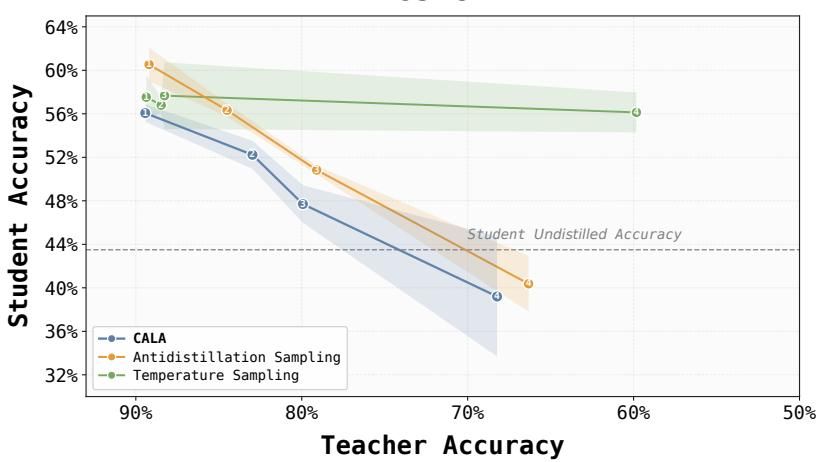  
(a) GSM8K

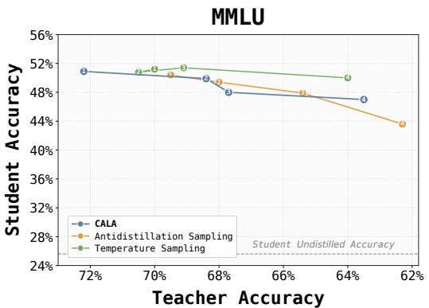  
(b) MMLU

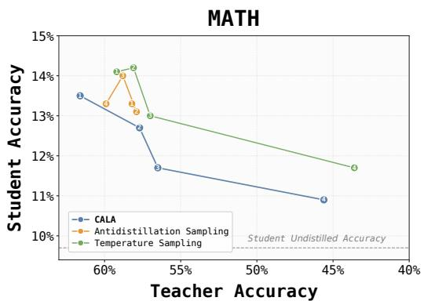  
(c) MATH  
Figure 3: Utility-distillability trade-offs across three benchmarks. The x-axis reports defended teacher accuracy, while the y-axis reports the accuracy of a downstream student distilled from the generated traces. Lower student accuracy at comparable teacher accuracy indicates stronger protection. For GSM8K, the lines show three-seed means and the shaded bands show ± one standard deviation in student accuracy; MMLU and MATH report the original evaluation runs.

Fluency and Degeneration Analysis. We further evaluate surface-level generation quality using GPT-4o mini as an automatic fluency judge, which scores grammaticality, coherence, readability, and local repetition while ignoring mathematical correctness and the final answer; see Appendix E for the full prompt and scoring protocol. This evaluation is important because a defense that reduces student accuracy by making traces unreadable would not preserve the utility we aim to protect.

Figure 4 evaluates whether lower downstream-student accuracy is accompanied by surface-level degeneration. On GSM8K and MMLU, CALA maintains higher fluency than ADS across the evaluated operating points, with ADS showing a sharper fluency drop as defense strength increases. Together with the accuracy curves, these results suggest that the high-utility reductions in distillability are not solely explained by surface degeneration.

Inference efficiency. We benchmark inference costs on a single H100 GPU using a batch size of 64 and a maximum sequence length of 1024 tokens. As shown in Table 1, CALA stays close to the base teacher’s inference cost, whereas ADS is substantially slower and consumes nearly twice the peak memory due to its online proxy-model computation. This supports the intended shift from decoding-time intervention to a lightweight training-time adapter.

Proxy sensitivity. Because our method uses a proxy only during adapter training, we test whether the learned defense is sensitive to proxy choice. We observe that replacing the default 1.5B proxy with a 3B proxy from the same tokenizer-compatible family preserves the qualitative utility-distillability trade-off on GSM8K, as shown in Figure 8 in Appendix C. This study establishes robustness to proxy size within a compatible token space, not to arbitrary proxy families or tokenizers.

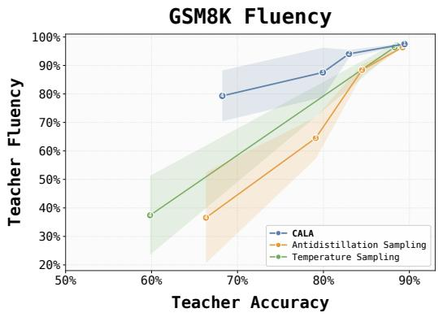  
(a) GSM8K

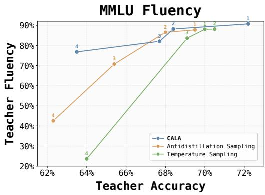  
(b) MMLU  
Figure 4: Fluency evaluation using GPT-4o mini as an automatic judge. The judge scores surface quality while ignoring mathematical correctness and the final answer. For GSM8K, the lines show three-seed means and the shaded bands show ± one standard deviation in fluency; MMLU reports the original evaluation run.

Table 1: Comparison of inference costs and memory footprints. Memory is reported in GB.
<table><tr><td>Method</td><td>Time / batch</td><td>Tokens / s</td><td>Avg. memory</td><td>Peak memory</td></tr><tr><td>Base teacher</td><td>25.8s</td><td>828.5</td><td>15.26</td><td>20.07</td></tr><tr><td>ADS</td><td>89.2s</td><td>465.1</td><td>32.39</td><td>39.28</td></tr><tr><td>CALA</td><td>31.5s</td><td>708.3</td><td>15.88</td><td>20.24</td></tr></table>

Ablations. We ablate the main objective and optimization components on GSM8K. Figure 5(a) shows that the full objective gives the best overall trade-off. Removing ${ \mathcal { L } } _ { \mathrm { m i d } }$ makes the results less consistent, while jointly removing ${ \mathcal { L } } _ { \mathrm { m i d } }$ and the top-k restriction further weakens protection. Removing entropy weighting as well leaves higher downstream-student accuracy, suggesting that these components jointly focus the adapter update on useful anti-distillation directions. Among the individual removals, omitting $\mathcal { L } _ { \mathrm { b a s e } }$ sharply reduces teacher utility. At comparable 65–67% teacher accuracy, removing virtual ascent or the conflict-aware update raises student accuracy from 34.2% to 41.0% and 42.0%, respectively.

Figure 5(b) shows that jointly removing ${ \mathcal { L } } _ { \mathrm { m i d } }$ and the top-k restriction reduces fluency under stronger defense settings. Exact operating points and available fluency values are reported in Appendix C.

Robustness and transfer. We additionally audit reasoning validity, vary the downstream student, evaluate a cross-task distribution shift, and test an adaptive filtering attack; additional protocols and results are in Appendix C. In a blinded audit of 100 GSM8K traces at approximately matched teacher accuracy, 36/50 CALA traces and 31/50 ADS traces were strictly valid. The paired difference is not statistically significant (exact McNemar p = 0.332); within this audit, we did not observe a higher invalid-rationale rate for CALA, and we do not claim superiority in reasoning correctness.

Protection transfers from the Qwen training proxy to Gemma-2-2B-IT and remains competitive for Qwen2.5-3B in the high-utility regime. Under the MetaMathQA→MMLU-traces→GPQA shift, CALA lowers student accuracy from 31.2% to 27.2% relative to ADS at exactly matched 37.9% teacher accuracy, while the methods are effectively tied at a second matched point.

Adaptive perplexity filtering. We also test an adaptive attacker that uses the student’s pretrained base model to discard the 20% highest-perplexity traces before fine-tuning. This experiment uses the original single-run operating points reported in Table 7.

As shown in Table 2, filtering partially recovers student performance. CALA remains stronger around 90% and 84% teacher accuracy, whereas ADS is stronger at the two lower-utility settings. Separately, across three seeds, CALA yields lower mean student accuracy than ADS at the first three operating points; variability is much larger at the most aggressive setting. These results support transfer and initial robustness only in the evaluated settings, rather than against arbitrary students or adaptive attacks; paraphrasing- and verifier-based attacks remain unevaluated.

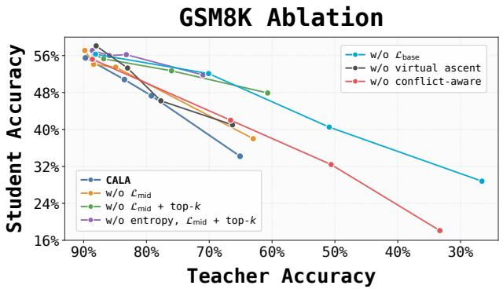  
(a) Utility-distillability trade-off

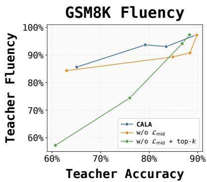  
(b) Teacher fluency  
Figure 5: GSM8K ablations. Panel (a) reports the utility-distillability trade-off for objective and support variants as well as individual removals of the base anchor, virtual ascent, and conflict-aware update. Panel (b) reports teacher fluency for variants with available fluency measurements. Lower student accuracy at comparable teacher accuracy indicates stronger protection.

Table 2: Adaptive PPL-filtering attack on GSM8K. Lower student accuracy indicates stronger protection.
<table><tr><td colspan="2">Teacher acc.↑</td><td colspan="2">Student acc. ↓ No filtering</td><td colspan="2">Student acc. ↓ PPL filtering</td></tr><tr><td>CALA</td><td>ADS</td><td>CALA</td><td>ADS</td><td>CALA</td><td>ADS</td></tr><tr><td>89.7</td><td>89.7</td><td>55.5</td><td>61.0</td><td>56.4</td><td>59.6</td></tr><tr><td>83.5</td><td>84.0</td><td>50.8</td><td>55.7</td><td>54.0</td><td>56.7</td></tr><tr><td>79.2</td><td>78.9</td><td>47.3</td><td>50.4</td><td>51.8</td><td>50.0</td></tr><tr><td>65.1</td><td>64.8</td><td>34.2</td><td>38.6</td><td>44.6</td><td>41.3</td></tr></table>

## 6 Conclusion

We presented CALA, a training-time defense for protecting reasoning traces against black-box distillation. By training a lightweight residual logit adapter on top of a frozen teacher, CALA amortizes proxy-guided anti-distillation pressure into the model and avoids proxy-student computation during decoding. Across reasoning benchmarks, CALA reduces downstream student imitation while preserving teacher utility in high-utility regimes, with better surface fluency than ADS on GSM8K.

CALA is limited to the studied black-box trace-distillation setting and should not be interpreted as protection against all forms of model extraction or adaptive distillation. Its effectiveness may depend on the training-time proxy, and the current proxy-size study assumes a compatible token space. Although we evaluate cross-student transfer and perplexity-based filtering, paraphrasing, verifier-based attacks, and tokenizer-mismatched training proxies remain open. Aggressive settings can also reduce teacher accuracy or fluency. More broadly, trace-modification defenses may help reduce unauthorized imitation but should be deployed carefully to avoid reducing readability or user trust.

## Acknowledgments

This research was funded by Vingroup Innovation Foundation (VINIF) under project code VINIF.2026.DA117.

## References

[1] Nicholas Carlini, Florian Tramer, Eric Wallace, Matthew Jagielski, Ariel Herbert-Voss, Katherine Lee, Adam Roberts, Tom Brown, Dawn Song, Ulfar Erlingsson, et al. Extracting training data from large language models. In 30th USENIX security symposium (USENIX Security 21), pages 2633–2650, 2021.

[2] Nicholas Carlini, Daniel Paleka, Krishnamurthy Dj Dvijotham, Thomas Steinke, Jonathan Hayase, A Feder Cooper, Katherine Lee, Matthew Jagielski, Milad Nasr, Arthur Conmy, et al. Stealing part of a production language model. arXiv preprint arXiv:2403.06634, 2024.

[3] Pham Khanh Chi, Quoc Phong Dao, Thuat Nguyen, Linh Ngo Van, Trung Le, and Thanh Hong Nguyen. MTA: Multi-granular trajectory alignment for large language model distillation. In Proceedings of the 64th Annual Meeting of the Association for Computational Linguistics, pages 32669–32684, 2026. doi: 10.18653/v1/2026.acl-long.1507.

[4] Yung-Sung Chuang, Yujia Xie, Hongyin Luo, Yoon Kim, James Glass, and Pengcheng He. DoLa: Decoding by contrasting layers improves factuality in large language models. In International Conference on Learning Representations, 2024.

[5] Karl Cobbe, Vineet Kosaraju, Mohammad Bavarian, Mark Chen, Heewoo Jun, Lukasz Kaiser, Matthias Plappert, Jerry Tworek, Jacob Hilton, Reiichiro Nakano, et al. Training verifiers to solve math word problems. arXiv preprint arXiv:2110.14168, 2021.

[6] Quoc Phong Dao, Hoang Son Nguyen, Pham Khanh Chi, Tung Nguyen, Linh Ngo Van, Nguyen Thi Ngoc Diep, and Trung Le. SRA: Span representation alignment for large language model distillation. In Proceedings ofthe 64th Annual Meeting ofthe Associationfor Computational Linguistics (Volume 1: Long Papers), pages 32961–32975, 2026. doi: 10.18653/v1/2026. acl-long.1522. URL https://aclanthology.org/2026.acl-long.1522/.

[7] Jonas Geiping, Liam H. Fowl, W. Ronny Huang, Wojciech Czaja, Gavin Taylor, Michael Moeller, and Tom Goldstein. Witches’ brew: Industrial scale data poisoning via gradient matching. arXiv preprint arXiv:2009.02276, 2020.

[8] Micah Goldblum, Dimitris Tsipras, Chulin Xie, Xinyun Chen, Avi Schwarzschild, Dawn Song, Aleksander M ˛adry, Bo Li, and Tom Goldstein. Dataset security for machine learning: Data poisoning, backdoor attacks, and defenses. IEEE Transactions on Pattern Analysis and Machine Intelligence, 45(2):1563–1580, 2022.

[9] Chenchen Gu, Xiang Lisa Li, Percy Liang, and Tatsunori Hashimoto. On the learnability of watermarks for language models. arXiv preprint arXiv:2312.04469, 2023.

[10] Yuxian Gu, Li Dong, Furu Wei, and Minlie Huang. Minillm: Knowledge distillation of large language models. In The twelfth international conference on learning representations, 2024.

[11] Arnav Gudibande, Eric Wallace, Charlie Snell, Xinyang Geng, Hao Liu, Pieter Abbeel, Sergey Levine, and Dawn Song. The false promise of imitating proprietary llms. arXiv preprint arXiv:2305.15717, 2023.

[12] Daya Guo, Dejian Yang, Haowei Zhang, et al. DeepSeek-R1 incentivizes reasoning in LLMs through reinforcement learning. Nature, 645:633–638, 2025.

[13] Dan Hendrycks, Collin Burns, Steven Basart, Andy Zou, Mantas Mazeika, Dawn Song, and Jacob Steinhardt. Measuring massive multitask language understanding. arXiv preprint arXiv:2009.03300, 2020.

[14] Dan Hendrycks, Collin Burns, Saurav Kadavath, Akul Arora, Steven Basart, Eric Tang, Dawn Song, and Jacob Steinhardt. Measuring mathematical problem solving with the math dataset. arXiv preprint arXiv:2103.03874, 2021.

[15] Ari Holtzman, Jan Buys, Li Du, Maxwell Forbes, and Yejin Choi. The curious case of neura text degeneration. In International Conference on Learning Representations, 2020.

[16] Cheng-Yu Hsieh, Chun-Liang Li, Chih-Kuan Yeh, Hootan Nakhost, Yasuhisa Fujii, Alex Ratner, Ranjay Krishna, Chen-Yu Lee, and Tomas Pfister. Distilling step-by-step! outperforming larger language models with less training data and smaller model sizes. In Findings ofthe Association for Computational Linguistics: ACL 2023, pages 8003–8017, 2023.

[17] W Ronny Huang, Jonas Geiping, Liam Fowl, Gavin Taylor, and Tom Goldstein. Metapoison: Practical general-purpose clean-label data poisoning. Advances in Neural Information Processing Systems, 33:12080–12091, 2020.

[18] Haozhe Ji, Pei Ke, Hongning Wang, and Minlie Huang. Language model decoding as direct metrics optimization. arXiv preprint arXiv:2310.01041, 2023.

[19] John Kirchenbauer, Jonas Geiping, Yuxin Wen, Jonathan Katz, Ian Miers, and Tom Goldstein. A watermark for large language models. In International conference on machine learning, pages 17061–17084. PMLR, 2023.

[20] Takeshi Kojima, Shixiang Shane Gu, Machel Reid, Yutaka Matsuo, and Yusuke Iwasawa. Large language models are zero-shot reasoners. In Advances in Neural Information Processing Systems, volume 35, pages 22199–22213, 2022.

[21] Nam Hai Le, Anh Duc Le, Tu Vu, and Linh Ngo Van. Discord: Enhancing knowledge distillation via cross-chain of thought and optimal transport alignment between models with different tokenizers. Knowledge-Based Systems, 351:116606, 2026. doi: 10.1016/j.knosys.2026.116606.

[22] Tue Le, Hoang Tran Vuong, Quyen Tran, Linh Ngo Van, Mehrtash Harandi, and Trung Le. Token-level self-play with importance-aware guidance for large language models. In Advances in Neural Information Processing Systems, volume 38, 2025. doi: 10.52202/ 085713-4030. URL https://proceedings.neurips.cc/paper\_files/paper/2025/ hash/aec7c15af9de0979b7c138e46d057c80-Abstract-Conference.html.

[23] Pingzhi Li, Zhen Tan, Yu-Chao Huang, Huaizhi Qu, Huan Liu, and Tianlong Chen. DOGe: Defensive output generation for LLM protection against knowledge distillation. arXiv preprint arXiv:2505.19504, 2025. URL https://arxiv.org/abs/2505.19504.

[24] Xiang Lisa Li, Ari Holtzman, Daniel Fried, Percy Liang, Jason Eisner, Tatsunori B Hashimoto, Luke Zettlemoyer, and Mike Lewis. Contrastive decoding: Open-ended text generation as optimization. In Proceedings of the 61st annual meeting of the association for computational linguistics (volume 1: Long papers), pages 12286–12312, 2023.

[25] Hunter Lightman, Vineet Kosaraju, Yuri Burda, Harrison Edwards, Bowen Baker, Teddy Lee, Jan Leike, John Schulman, Ilya Sutskever, and Karl Cobbe. Let’s verify step by step. In The Twelfth International Conference on Learning Representations, 2024. URL https: //openreview.net/forum?id=v8L0pN6EOi.

[26] Haoyu Ma, Tianlong Chen, Ting-Kuei Hu, Chenyu You, Xiaohui Xie, and Zhangyang Wang. Undistillable: Making a nasty teacher that cannot teach students. arXiv preprint arXiv:2105.07381, 2021.

[27] Xinhang Ma, William Yeoh, Ning Zhang, and Yevgeniy Vorobeychik. Protecting language models against unauthorized distillation through trace rewriting. arXiv preprint arXiv:2602.15143, 2026.

[28] Meta AI. Llama 3.2 model card. https://huggingface.co/meta-llama/Llama-3.2-3B, 2024. Accessed 2026-04-26.

[29] Sidharth Mudgal, Jong Lee, Harish Ganapathy, Yaguang Li, Tao Wang, Yanping Huang, Zhifeng Chen, Heng-Tze Cheng, Michael Collins, Trevor Strohman, Jilin Chen, Alex Beutel, and Ahmad Beirami. Controlled decoding from language models. In Proceedings of the 41st International Conference on Machine Learning, volume 235 of Proceedings of Machine Learning Research, pages 36486–36503. PMLR, 2024.

[30] Milad Nasr, Javier Rando, Nicholas Carlini, Jonathan Hayase, Matthew Jagielski, A Feder Cooper, Daphne Ippolito, Christopher A Choquette-Choo, Florian Tramèr, and Katherine Lee. Scalable extraction of training data from aligned, production language models. In The Thirteenth International Conference on Learning Representations, 2025.

[31] Truong Nguyen, Phi Van Dat, Ngan Nguyen, Linh Ngo Van, Trung Le, and Thanh Hong Nguyen. CTPD: Cross tokenizer preference distillation. Proceedings of the AAAI Conference on Artificial Intelligence, 40(44):37783–37790, 2026. doi: 10.1609/aaai.v40i44.41114. URL https://ojs.aaai.org/index.php/AAAI/article/view/41114.

[32] Lianhui Qin, Sean Welleck, Daniel Khashabi, and Yejin Choi. Cold decoding: Energy-based constrained text generation with langevin dynamics. Advances in Neural Information Processing Systems, 35:9538–9551, 2022.

[33] Javier Rando and Florian Tramèr. Universal jailbreak backdoors from poisoned human feedback. In International Conference on Learning Representations, 2024.

[34] Tom Sander, Pierre Fernandez, Alain Durmus, Matthijs Douze, and Teddy Furon. Watermarking makes language models radioactive. Advances in Neural Information Processing Systems, 37: 21079–21113, 2024.

[35] Yash Savani, Asher Trockman, Zhili Feng, Yixuan Even Xu, Avi Schwarzschild, Alexander Robey, Marc Anton Finzi, and J Zico Kolter. Antidistillation sampling. In The Thirty-ninth Annual Conference on Neural Information Processing Systems, 2025. URL https://openreview.net/forum?id=Vo2UHqMu8t.

[36] Kumar Shridhar, Alessandro Stolfo, and Mrinmaya Sachan. Distilling reasoning capabilities into smaller language models. In Findings of the Association for Computational Linguistics: ACL 2023, pages 7059–7073, 2023.

[37] Duc Trung Vu, Pham Khanh Chi, Dat Phi Van, Linh Ngo Van, Dinh Viet Sang, and Trung Le. DWA-KD: Dual-space weighting and time-warped alignment for cross-tokenizer knowledge distillation. In Findings of the Association for Computational Linguistics: EACL 2026, pages 3513–3527, 2026. doi: 10.18653/v1/2026.findings-eacl.181.

[38] Hoang Tran Vuong, Tue Le, Quyen Tran, Linh Ngo Van, and Trung Le. MCW-KD: Multi-cost wasserstein knowledge distillation for large language models. In Proceedings of the AAAI Conference on Artificial Intelligence, volume 40, 2026. doi: 10.1609/aaai.v40i39.40619.

[39] Xuezhi Wang, Jason Wei, Dale Schuurmans, Quoc V Le, Ed H. Chi, Sharan Narang, Aakanksha Chowdhery, and Denny Zhou. Self-consistency improves chain of thought reasoning in language models. In The Eleventh International Conference on Learning Representations, 2023. URL https://openreview.net/forum?id=1PL1NIMMrw.

[40] Jason Wei, Xuezhi Wang, Dale Schuurmans, Maarten Bosma, brian ichter, Fei Xia, Ed H. Chi, Quoc V Le, and Denny Zhou. Chain of thought prompting elicits reasoning in large language models. In Alice H. Oh, Alekh Agarwal, Danielle Belgrave, and Kyunghyun Cho, editors, Advances in Neural Information Processing Systems, 2022. URL https://openreview.net/ forum?id=\_VjQlMeSB\_J.

[41] Jing Wu, Trung Le, Munawar Hayat, and Mehrtash Harandi. Erasing undesirable influence in diffusion models. In Conference on Computer Vision and Pattern Recognition, pages 28263– 28273, 2025.

[42] An Yang, Baosong Yang, Beichen Zhang, et al. Qwen2.5 technical report. arXiv preprint arXiv:2412.15115, 2024.

[43] Longhui Yu, Weisen Jiang, Han Shi, Jincheng Yu, Zhengying Liu, Yu Zhang, James T Kwok, Zhenguo Li, Adrian Weller, and Weiyang Liu. Metamath: Bootstrap your own mathematical questions for large language models. In The Twelfth International Conference on Learning Representations, 2024.

[44] Xuandong Zhao, Yu-Xiang Wang, and Lei Li. Protecting language generation models via invisible watermarking. In International Conference on Machine Learning, pages 42187–42199. PMLR, 2023.

## A Analysis of the Conflict-Aware Update

This section gives a first-order interpretation of the conflict-aware optimization rule. The projection view is similar in spirit to the constrained first-order update of [41], which balances preservation and erasure by choosing an update direction that stays close to a utility gradient while satisfying a constraint on the forgetting objective. In our setting, the adapter is trained with the utility-preserving objective ${ \mathcal { L } } _ { \mathrm { u t i l } }$ , which anchors the adapted distribution to the frozen teacher, and the anti-distillation objective ${ \mathcal { L } } _ { \mathrm { a n t i } }$ , which moves the adapted distribution toward regions that are less useful for a proxy student. Because these objectives can induce conflicting gradients, the update combines them adaptively:

$$
\nabla _ { \theta } \mathcal { L } = \nabla _ { \theta } \mathcal { L } _ { \mathrm { u t i l } } + \lambda \nabla _ { \theta } \mathcal { L } _ { \mathrm { a n t i } } ,
$$

where

$$
\lambda = \operatorname* { m a x } \left( 0 , \kappa - \frac { \langle \nabla _ { \theta } \mathcal { L } _ { \mathrm { u t i l } } , \nabla _ { \theta } \mathcal { L } _ { \mathrm { a n t i } } \rangle } { \left\| \nabla _ { \theta } \mathcal { L } _ { \mathrm { a n t i } } \right\| _ { 2 } ^ { 2 } + \epsilon } \right) .
$$

We show that, up to the numerical stabilizer $\epsilon ,$ this rule is the closed-form solution of a constrained projection problem.

Let

$$
g _ { u } = \nabla _ { \theta } \mathcal { L } _ { \mathrm { u t i l } } ( \theta ) , \qquad g _ { a } = \nabla _ { \theta } \mathcal { L } _ { \mathrm { a n t i } } ( \theta ) .
$$

For a gradient-descent step $\theta ^ { + } = \theta - \eta d .$ , the utility-only choice is $d = g _ { u }$ . However, if $g _ { u }$ is poorly aligned with $g _ { a } ,$ this update can weaken the anti-distillation signal. We therefore choose the direction closest to $g _ { u }$ while enforcing a minimum first-order decrease in ${ \mathcal { L } } _ { \mathrm { a n t i } }$

Theorem 1 (Conflict-aware projection). Let $g _ { u } , g _ { a } \in \mathbb { R } ^ { p }$ , with $g _ { a } \neq 0 ,$ , and let $\kappa > 0$ . Consider the constrained projection problem:

$$
d ^ { \star } = \arg \operatorname* { m i n } _ { d } \frac { 1 } { 2 } \| d - g _ { u } \| _ { 2 } ^ { 2 } \quad \mathrm { s . t . } \quad \langle g _ { a } , d \rangle \geq \kappa \| g _ { a } \| _ { 2 } ^ { 2 } .
$$

The unique solution is

$$
d ^ { \star } = g _ { u } + \lambda ^ { \star } g _ { a } , \qquad \lambda ^ { \star } = \operatorname* { m a x } \left\{ 0 , \kappa - \frac { \langle g _ { u } , g _ { a } \rangle } { \| g _ { a } \| _ { 2 } ^ { 2 } } \right\} .
$$

Proof. The objective is strongly convex in $d ,$ and the feasible set is a closed half-space, so the projection problem has a unique optimum. Consider the Lagrangian

$$
\mathcal { I } ( d , \lambda ) = \frac 1 2 \| d - g _ { u } \| _ { 2 } ^ { 2 } + \lambda \left( \kappa \| g _ { a } \| _ { 2 } ^ { 2 } - \langle g _ { a } , d \rangle \right) , \qquad \lambda \ge 0 .
$$

The stationarity condition gives

$$
\nabla _ { d } \mathcal { T } ( d , \lambda ) = d - g _ { u } - \lambda g _ { a } = 0 ,
$$

and hence $d = g _ { u } + \lambda g _ { a } . \mathrm { ~ I f ~ } \langle g _ { a } , g _ { u } \rangle \geq \kappa \Vert g _ { a } \Vert _ { 2 } ^ { 2 } ,$ , the constraint is inactive, so ${ { \lambda } ^ { \star } } = 0$ and $d ^ { \star } = g _ { u }$ Otherwise, the constraint is active, and substituting $d = g _ { u } + \lambda g _ { a }$ into $\langle g _ { a } , d \rangle = \kappa \| g _ { a } \| _ { 2 } ^ { 2 }$ gives

$$
\langle g _ { a } , g _ { u } \rangle + \lambda \| g _ { a } \| _ { 2 } ^ { 2 } = \kappa \| g _ { a } \| _ { 2 } ^ { 2 } .
$$

Thus,

$$
\lambda = \kappa - \frac { \langle g _ { u } , g _ { a } \rangle } { \| g _ { a } \| _ { 2 } ^ { 2 } } .
$$

Combining the active and inactive cases gives the claimed $\lambda ^ { \star }$ , and therefore $d ^ { \star } = g _ { u } + \lambda ^ { \star } g _ { a }$ □

In practice, we replace $\| g _ { a } \| _ { 2 } ^ { 2 }  { \mathbf { b y } } \| g _ { a } \| _ { 2 } ^ { 2 } + \epsilon$ to avoid instability when the anti-distillation gradient is very small.

Corollary 1 (First-order anti-distillation progress). Let $d ^ { \star }$ be the direction from Theorem 1. $I f \mathcal { L } _ { \mathrm { a n t i } }$ is differentiable at $\theta ,$ then

$$
\mathcal { L } _ { \mathrm { a n t i } } ( \theta - \eta d ^ { \star } ) \leq \mathcal L _ { \mathrm { a n t i } } ( \theta ) - \eta \kappa \| g _ { a } \| _ { 2 } ^ { 2 } + O ( \eta ^ { 2 } ) .
$$

Proof. By Taylor expansion,

$$
\mathcal { L } _ { \mathrm { a n t i } } ( \theta - \eta d ^ { \star } ) = \mathcal { L } _ { \mathrm { a n t i } } ( \theta ) - \eta \langle g _ { a } , d ^ { \star } \rangle + O ( \eta ^ { 2 } ) .
$$

The constraint in Theorem 1 gives $\left. g _ { a } , d ^ { \star } \right. \geq \kappa \| g _ { a } \| _ { 2 } ^ { 2 }$ , which proves the claim.

Interpretation. The conflict-aware update is therefore not an arbitrary weighted sum. It follows the utility-preserving gradient when that direction already has sufficient anti-distillation alignment, and otherwise adds the smallest correction in the anti-distillation gradient direction needed to meet the margin. Thus, λ decreases when the gradients are aligned and increases when they are orthogonal or opposed, preventing the utility objective from washing out the anti-distillation signal.

## B Experimental Details

## B.1 Models and Training Setup

Table 3 summarizes the model roles used in our experiments. The defended teacher is DeepSeek-R1- Distill-Qwen-7B. We freeze the teacher backbone and the language-modeling head, and train only a residual logit adapter. The training-time proxy is Qwen2.5-1.5B, with its token embeddings resized to match the teacher vocabulary. Downstream trace-distillation is evaluated by training Llama-3.2-3B students on generated traces. The ADS baseline uses a Qwen2.5-3B proxy during decoding.

Table 3: Model roles used in the experiments.
<table><tr><td>Role</td><td>Model</td><td>Usage</td></tr><tr><td>Defended teacher</td><td>DeepSeek-R1-Distill-Qwen-7B</td><td>Frozen teacher</td></tr><tr><td>Training proxy</td><td>Qwen2.5-1.5B</td><td>Adapter-training signal</td></tr><tr><td>ADS proxy</td><td>Qwen2.5-3B</td><td>Decoding-time baseline</td></tr><tr><td>Downstream student</td><td>Llama-3.2-3B</td><td>Trace-distillation evaluation</td></tr></table>

The model and data licenses differ and are respected in our use: DeepSeek-R1-Distill-Qwen-7B and MetaMathQA use the MIT License, Qwen2.5 uses Apache 2.0, and Llama 3.2 uses the Llama 3.2 Community License. The GSM8K, MATH, and MMLU evaluation datasets are distributed under the MIT License.

We train the adapter on 6,800 MetaMathQA samples with teacher-generated responses. The proxy student is used only to construct the training signal: for each accumulation window, we compute masked next-token cross-entropy gradients, take one virtual gradient-ascent step, use the resulting proxy distribution to define the anti-distillation target, and then discard the virtual proxy update.

## B.2 Adapter Training Hyperparameters

All KL and JS terms are computed on restricted top-k supports with k = 50. This keeps both antidistillation and utility-preservation losses on plausible high-probability tokens. Table 4 summarizes the full adapter training configuration.

Table 4: Residual adapter training hyperparameters.
<table><tr><td>Hyperparameter</td><td>Value</td></tr><tr><td>Training samples</td><td>6,800</td></tr><tr><td>Epochs</td><td>5</td></tr><tr><td>Batch size</td><td>8</td></tr><tr><td>Proxy accumulation steps G</td><td>2</td></tr><tr><td>Optimizer</td><td>AdamW</td></tr><tr><td>Learning rate</td><td> $3 \times 1 0 ^ { - 4 }$ </td></tr><tr><td>Weight decay</td><td> $3 \times 1 0 ^ { - 2 }$ </td></tr><tr><td>Schedule / warmup ratio</td><td>Warmup cosine / 0.05</td></tr><tr><td>Adapter gradient clipping</td><td>1.0</td></tr><tr><td>Maximum sequence / prompt length</td><td>600 / 128</td></tr><tr><td>Proxy virtual step radius ρ</td><td> $1 0 ^ { - 3 }$ </td></tr><tr><td>Proxy gradient clipping</td><td>1.0</td></tr><tr><td>Top-k support</td><td>50</td></tr><tr><td>Conflict margin κ</td><td>0.5</td></tr><tr><td>Numerical stability €</td><td> $1 0 ^ { - 6 }$ </td></tr><tr><td>Seed</td><td>42</td></tr></table>

## B.3 Evaluation Details

Generation. Our evaluation across GSM8K, MATH, and MMLU involves generating traces from the defended teacher to train a downstream student. To construct the trade-off curves, we evaluate four operating points per method, which are summarized in Table 5. Specifically, for CALA, we vary the adapter strength δ and sampling temperature τ ; for ADS, we vary τ and the antidistillation weight λ<sub>ADS</sub>; and for the temperature baseline, we solely vary τ . Unless otherwise noted, trace generation for CALA utilizes top-k sampling with k = 50. Generation is capped at 1024 tokens across all three benchmarks.

Table 5: Evaluation-time operating points used for CALA, ADS, and the temperature baseline in the main figures.
<table><tr><td>Point</td><td>CALA (τ, δ)</td><td> $\mathrm { A D S } \left( \tau , \lambda _ { \mathrm { A D S } } \right)$ </td><td>Temp. τ</td></tr><tr><td>1</td><td>(0.50, 0.25)</td><td> $( 0 . 9 0 , 1 . 5 8 { \times } 1 0 ^ { - 2 } )$ </td><td>0.90</td></tr><tr><td>2</td><td>(0.75, 0.75)</td><td> $( 0 . 9 0 , 2 . 3 7 { \times } 1 0 ^ { - 2 } )$ </td><td>1.16</td></tr><tr><td>3</td><td>(0.50, 0.80)</td><td> $( 0 . 9 0 , 3 . 1 6 { \times } 1 0 ^ { - 2 } )$ </td><td>1.26</td></tr><tr><td>4</td><td>(0.50, 0.85)</td><td> $( 1 . 0 0 , 3 . 9 5 { \times } 1 0 ^ { - 2 } )$ </td><td>1.50</td></tr></table>

Trace Generation Prompts. We use fixed system prompts when generating teacher traces. For GSM8K and MATH, we use the following math-reasoning prompt:

Math trace-generation prompt

You are a math teacher. You will be given a math problem and you will solve it step by step. You will output your final solution like \boxed{ANSWER}. Be sure to include relevant units within the brackets and fully evaluate arithmetic expressions.

For MMLU, we use the following multiple-choice prompt:

MMLU trace-generation prompt

You are a teacher. You will be given a problem and you will solve it step by step.   
You will output your final solution like \boxed{X}, where X is exactly one capital letter corresponding to the correct option (A, B, C, or D).   
Do not include any extra text, punctuation, or words inside the box.

With answer forcing, we append a fixed prompt string immediately before the final short answer to enforce a consistent answer format:

Answer-forcing string

\n\n\*\*Final Answer\*\*\n\\[\boxed{

Distillation Protocol and Evaluation. To measure trace distillability, we train students on generated teacher traces using the same protocol for our method and ADS. Each example is formatted as a problem followed by the generated reasoning trace and final answer as the assistant completion. Prompt tokens are masked, so the loss is applied only to the assistant response. For GSM8K and MATH, we extract the final answer and compare it with the reference using numeric or symbolic verification; MATH additionally uses boxed-answer parsing when applicable. For MMLU, we extract the selected multiple-choice option and compare it with the ground-truth label. Table 6 summarizes the downstream student-distillation configuration.

Table 6: Downstream student-distillation hyperparameters.
<table><tr><td>Hyperparameter</td><td>Value</td></tr><tr><td>Fine-tuning method</td><td>LoRA</td></tr><tr><td>LoRA target modules LoRA rank / alpha / dropout</td><td>q, k, v, o, gate, up, down projections 128 / 128 / 0.0</td></tr><tr><td>LoRA bias</td><td>none</td></tr><tr><td>Optimizer</td><td>AdamW</td></tr><tr><td></td><td></td></tr><tr><td>Learning rate / weight decay</td><td> $5 \times 1 0 ^ { - 4 } / 0 . 1$ </td></tr><tr><td>Schedule / warmup ratio</td><td>Cosine / 0.03</td></tr><tr><td>Batch / per-device batch size</td><td>16/8</td></tr><tr><td>Epochs</td><td>3</td></tr><tr><td>Gradient clipping</td><td>1.0</td></tr><tr><td>Maximum sequence length</td><td>4096</td></tr><tr><td>Precision</td><td>bfloat16</td></tr><tr><td>Seed</td><td>69</td></tr></table>

## C Additional Experiments

Exact Operating-Point Results. Tables 7 and 8 report the original per-run numerical values for the operating points in Figures 3 and 4. The GSM8K panels in those figures show the three-seed means and standard deviations reported in Table 9; the MATH and MMLU panels use the values below.

For each defended method, we evaluate four operating points, summarized in Table 5. Table 8 reports the exact automatic fluency scores used in Figure 4.

Table 7: Exact utility-distillability results. Teacher and student accuracies are reported in percentage points. Point numbers follow Table 5.
<table><tr><td></td><td></td><td colspan="2">Point 1</td><td colspan="2">Point 2</td><td colspan="2">Point 3</td><td colspan="2">Point 4</td></tr><tr><td>Benchmark Method</td><td></td><td></td><td></td><td></td><td></td><td>Teacher Student Teacher Student Teacher Student Teacher Student</td><td></td><td></td><td></td></tr><tr><td rowspan="4">GSM8K</td><td>CALA</td><td>89.7</td><td>55.5</td><td>83.5</td><td>50.8</td><td>79.2</td><td>47.3</td><td>65.1</td><td>34.2</td></tr><tr><td>ADS</td><td>89.7</td><td>61.0</td><td>84.0</td><td>55.7</td><td>78.9</td><td>50.4</td><td>64.8</td><td>38.6</td></tr><tr><td>Temperature</td><td>90.0</td><td>59.7</td><td>88.3</td><td>57.0</td><td>89.4</td><td>61.2</td><td>52.5</td><td>54.1</td></tr><tr><td>Student undistilled</td><td>一</td><td>43.5</td><td>一</td><td>43.5</td><td>一</td><td>43.5</td><td>一</td><td>43.5</td></tr><tr><td rowspan="4">MATH</td><td>CALA</td><td>61.6</td><td>13.5</td><td>57.7</td><td>12.7</td><td>56.5</td><td>11.7</td><td>45.6</td><td>10.9</td></tr><tr><td>ADS</td><td>58.2</td><td>13.3</td><td>57.9</td><td>13.1</td><td>58.8</td><td>14.0</td><td>59.9</td><td>13.3</td></tr><tr><td>Temperature</td><td>59.2</td><td>14.1</td><td>58.1</td><td>14.2</td><td>57.0</td><td>13.0</td><td>43.6</td><td>11.7</td></tr><tr><td>Student undistilled</td><td>一</td><td>9.7</td><td>一</td><td>9.7</td><td>一</td><td>9.7</td><td>1</td><td>9.7</td></tr><tr><td rowspan="4">MMLU</td><td>CALA</td><td>72.2</td><td>50.9</td><td>68.4</td><td>49.9</td><td>67.7</td><td>48.0</td><td>63.5</td><td>47.0</td></tr><tr><td>ADS</td><td>69.5</td><td>50.4</td><td>68.0</td><td>49.4</td><td>65.4</td><td>47.9</td><td>62.3</td><td>43.6</td></tr><tr><td>Temperature</td><td>70.0</td><td>51.2</td><td>70.5</td><td>50.8</td><td>69.1</td><td>51.4</td><td>64.0</td><td>50.0</td></tr><tr><td>Student undistilled</td><td>一</td><td>25.6</td><td>一</td><td>25.6</td><td>1</td><td>25.6</td><td>1</td><td>25.6</td></tr></table>

Table 8: Exact automatic fluency scores and corresponding teacher accuracies. Fluency is scored from 1 to 100 by the automatic judge described in Appendix E. Point numbers follow Table 5.
<table><tr><td rowspan="2"></td><td rowspan="2"></td><td colspan="2">Point 1</td><td colspan="2">Point 2</td><td colspan="2">Point 3</td><td colspan="2">Point 4</td></tr><tr><td>Benchmark Method Teacher</td><td>Fluency</td><td>Teacher Fluency</td><td></td><td></td><td>Teacher Fluency</td><td></td><td>Teacher Fluency</td></tr><tr><td rowspan="3">GSM8K</td><td>CALA</td><td>89.7</td><td>97.30</td><td>83.5</td><td>93.05</td><td>79.2</td><td>93.68</td><td>65.1</td><td>85.63</td></tr><tr><td>ADS</td><td>89.7</td><td>96.54</td><td>84.0</td><td>89.81</td><td>78.9</td><td>69.68</td><td>64.8</td><td>47.84</td></tr><tr><td>Temp.</td><td>90.0</td><td>96.96</td><td>88.3</td><td>96.26</td><td>89.4</td><td>95.49</td><td>52.5</td><td>27.62</td></tr><tr><td rowspan="3">MATH</td><td>CALA</td><td>61.6</td><td>93.96</td><td>57.7</td><td>93.35</td><td>56.5</td><td>86.65</td><td>45.6</td><td>73.52</td></tr><tr><td>ADS</td><td>58.2</td><td>85.74</td><td>57.9</td><td>85.70</td><td>58.8</td><td>86.41</td><td>59.9</td><td>85.16</td></tr><tr><td>Temp.</td><td>59.2</td><td>91.93</td><td>58.1</td><td>92.07</td><td>57.0</td><td>91.22</td><td>43.6</td><td>43.65</td></tr><tr><td rowspan="3">MMLU</td><td>CALA</td><td>72.2</td><td>90.71</td><td>68.4</td><td>88.17</td><td>67.7</td><td>82.07</td><td>63.5</td><td>76.80</td></tr><tr><td>ADS</td><td>69.5</td><td>87.73</td><td>68.0</td><td>86.55</td><td>65.4</td><td>70.73</td><td>62.3</td><td>42.52</td></tr><tr><td>Temp.</td><td>70.0</td><td>88.03</td><td>70.5</td><td>88.12</td><td>69.1</td><td>83.61</td><td>64.0</td><td>23.59</td></tr></table>

Additional fluency result. Figure 6 provides the MATH fluency curve using the same automaticjudge protocol as Figure 4.

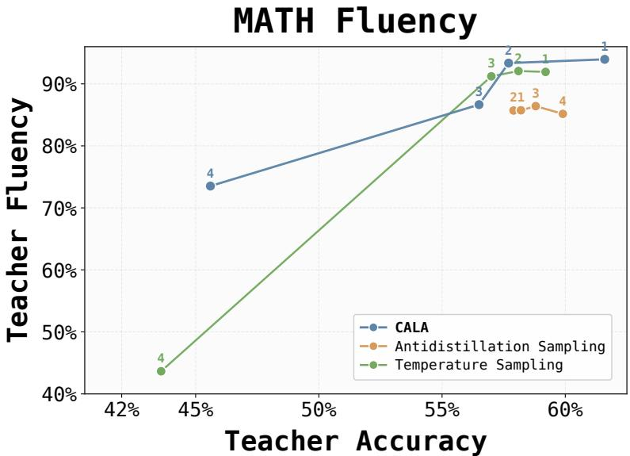  
Figure 6: MATH fluency evaluation using GPT-4o mini as an automatic judge.

Multi-seed robustness. We repeat GSM8K with seeds 42, 52, and 62. Table 9 reports mean ± standard deviation across seeds and supplies the central lines and shaded uncertainty bands in the GSM8K accuracy and fluency panels. The bands depict variability in the vertical metric; variability in teacher accuracy is reported numerically in the table. CALA has lower mean student accuracy than ADS at P1–P3 by 4.46, 4.10, and 3.13 points, respectively. Variance is much larger at P4, so we do not use that point as primary evidence or claim formal significance from three seeds.

Table 9: Three-seed GSM8K results. Accuracy and fluency values are mean ± standard deviation.
<table><tr><td>Method</td><td>Configuration</td><td>Teacher acc.</td><td>Student acc.</td><td>Fluency</td></tr><tr><td>CALA</td><td>(0.50, 0.25)</td><td> $8 9 . 4 3 \pm 0 . 4 6$ </td><td> $5 6 . 0 7 \pm 0 . 8 1$ </td><td> $9 7 . 5 1 \pm 0 . 3 0$ </td></tr><tr><td>CALA</td><td>(0.75, 0.75)</td><td> $8 2 . 9 7 \pm 0 . 6 8$ </td><td> $5 2 . 2 3 \pm 1 . 2 9$ </td><td> $9 4 . 0 6 \pm 1 . 4 2 $ </td></tr><tr><td>CALA</td><td>(0.50,0.80)</td><td> $7 9 . 9 3 \pm 0 . 6 7$ </td><td> $4 7 . 7 0 \pm 1 . 7 3$ </td><td> $8 7 . 5 4 \pm 8 . 6 9$ </td></tr><tr><td>CALA</td><td>(0.50, 0.85)</td><td> $6 8 . 2 3 \pm 3 . 4 3$ </td><td> $3 9 . 2 0 \pm 5 . 5 1$ </td><td> $7 9 . 3 2 \pm 8 . 9 2$ </td></tr><tr><td>ADS</td><td> $( 0 . 9 0 , 1 . 5 8 { \times } 1 0 ^ { - 2 } )$ </td><td> $8 9 . 2 0 \pm 1 . 9 0 $ </td><td> $6 0 . 5 3 \pm 1 . 5 5$ </td><td> $9 6 . 3 8 \pm 0 . 2 3$ </td></tr><tr><td>ADS</td><td> $\mathrm { \dot { ( 0 . 9 0 , 2 . 3 7 \times 1 0 ^ { - 2 } ) } }$ </td><td> $8 4 . 5 0 \pm 0 . 5 6$ </td><td> $5 6 . 3 3 \pm 0 . 6 0$ </td><td> $8 8 . 4 7 \pm 1 . 9 0 $ </td></tr><tr><td>ADS</td><td> $( 0 . 9 0 , 3 . 1 6 { \times } 1 0 ^ { - 2 } )$ </td><td> $7 9 . 1 0 \pm 1 . 2 1$ </td><td> $5 0 . 8 3 \pm 0 . 4 0$ </td><td> $6 4 . 5 3 \pm 7 . 2 9$ </td></tr><tr><td>ADS</td><td> $( 1 . 0 0 , 3 . 9 5 { \times } 1 0 ^ { - 2 } )$ </td><td> $6 6 . 3 3 \pm 1 . 6 0$ </td><td> $4 0 . 3 7 \pm 2 . 5 6$ </td><td> $3 6 . 5 7 \pm 1 5 . 9 4$ </td></tr><tr><td>Temperature</td><td> $\tau = 0 . 9 0$ </td><td> $8 9 . 3 7 \pm 1 . 2 7$ </td><td> $5 7 . 5 3 \pm 2 . 0 2$ </td><td> $9 7 . 3 1 \pm 0 . 4 9$ </td></tr><tr><td>Temperature</td><td> $\tau = 1 . 1 6$ </td><td> $8 8 . 4 7 \pm 0 . 1 5$ </td><td> $5 6 . 8 0 \pm 0 . 7 2$ </td><td> $9 7 . 0 3 \pm 1 . 0 8$ </td></tr><tr><td>Temperature</td><td> $\tau = 1 . 2 6$ </td><td> $8 8 . 2 7 \pm 1 . 3 3 $ </td><td> $5 7 . 6 7 \pm 3 . 0 7$ </td><td> $9 6 . 4 1 \pm 1 . 3 0$ </td></tr><tr><td>Temperature</td><td> $\tau = 1 . 5 0$ </td><td> $5 9 . 8 3 \pm 6 . 6 6$ </td><td> $5 6 . 1 3 \pm 1 . 8 4$ </td><td> $3 7 . 4 2 \pm 1 3 . 8 6$ </td></tr></table>

Additional ablation result. Table 10 provides the exact values corresponding to all variants in Figure 5. All variants use the same downstream-distillation and evaluation protocol as the main experiments. The table includes both joint objective/support removals and individual removals of ${ \mathcal { L } } _ { \mathrm { b a s e } } ,$ virtual ascent, and the conflict-aware update. Fluency is reported where available. At comparable $6 5 \mathrm { - } 6 7 \%$ teacher accuracy, full CALA achieves 34.2% student accuracy, compared with 41.0% without virtual ascent and 42.0% without the conflict-aware update.

Table 10: Exact GSM8K ablation results. Teacher fluency, teacher accuracy, and student accuracy are reported in percentage points. $\Delta = \mathrm { A c c } _ { \mathrm { t e a c h e r } } - \mathrm { A c c } _ { \mathrm { s t u d e n t } } ;$ dashes denote unavailable fluency measurements.
<table><tr><td>Variant</td><td>Config. (τ, δ)</td><td>Teacher Fluency</td><td>Teacher Acc.</td><td>Student Acc.</td><td>∆</td></tr><tr><td>Full objective</td><td>(0.50, 0.25)</td><td>97.30</td><td>89.7</td><td>55.5</td><td>34.2</td></tr><tr><td>Full objective</td><td>(0.75,0.75)</td><td>93.05</td><td>83.5</td><td>50.8</td><td>32.7</td></tr><tr><td>Full objective</td><td>(0.50, 0.80)</td><td>93.68</td><td>79.2</td><td>47.3</td><td>31.9</td></tr><tr><td>Full objective</td><td>(0.50, 0.85)</td><td>85.63</td><td>65.1</td><td>34.2</td><td>30.9</td></tr><tr><td>w/o  $\mathcal { L } _ { \mathrm { m i d } }$ </td><td>(0.50, 0.25)</td><td>97.19</td><td>89.8</td><td>57.1</td><td>32.7</td></tr><tr><td>w/o  $\mathcal { L } _ { \mathrm { m i d } }$ </td><td>(0.90, 0.25)</td><td>90.78</td><td>88.4</td><td>54.1</td><td>34.3</td></tr><tr><td>w/o  $\mathcal { L } _ { \mathrm { m i d } }$ </td><td>(0.50, 0.80)</td><td>89.31</td><td>84.9</td><td>53.5</td><td>31.4</td></tr><tr><td>w/o  $\mathcal { L } _ { \mathrm { m i d } }$ </td><td>(0.90, 1.00)</td><td>84.33</td><td>63.0</td><td>38.0</td><td>25.0</td></tr><tr><td>w/o  ${ \mathcal { L } } _ { \mathrm { m i d } } + \mathrm { t o p } { - } k$ </td><td>(0.50, 0.25)</td><td>97.33</td><td>88.3</td><td>56.2</td><td>32.1</td></tr><tr><td>w/o  ${ \mathcal { L } } _ { \mathrm { m i d } } + \mathrm { t o p } { - } k$ </td><td>(0.75, 0.75)</td><td>94.14</td><td>86.8</td><td>55.3</td><td>31.5</td></tr><tr><td>w/o  ${ \mathcal { L } } _ { \mathrm { m i d } } + \mathrm { t o p } { - } k$ </td><td>(0.90, 0.90)</td><td>74.42</td><td>76.0</td><td>52.7</td><td>23.3</td></tr><tr><td>w/o  ${ \mathcal { L } } _ { \mathrm { m i d } } + \mathrm { t o p } { - } k$ </td><td>(0.90, 1.00)</td><td>57.25</td><td>60.7</td><td>47.9</td><td>12.8</td></tr><tr><td>w/o entropy weighting  $+ \mathcal { L } _ { \mathrm { m i d } } + \mathrm { t o p } { - } k$ </td><td>(0.50, 0.25)</td><td></td><td>88.6</td><td>57.1</td><td>31.5</td></tr><tr><td>w/o entropy weighting  $+ \ { \mathcal { L } } _ { \mathrm { m i d } } + { \mathrm { t o p } } { - k }$ </td><td>(0.75,0.75)</td><td></td><td>85.9</td><td>56.0</td><td>29.9</td></tr><tr><td>w/o entropy weighting  $+ \mathcal { L } _ { \mathrm { m i d } } + \mathrm { t o p } { - } k$ </td><td>(1.00, 0.75)</td><td></td><td>83.2</td><td>56.2</td><td>27.0</td></tr><tr><td>w/o entropy weighting  $+ \mathcal { L } _ { \mathrm { m i d } } + \mathrm { t o p } { - } k$ </td><td>(0.90, 1.00)</td><td></td><td>71.0</td><td>51.8</td><td>19.2</td></tr><tr><td>w/o  $\mathcal { L } _ { \mathrm { b a s e } }$ </td><td>(0.50, 0.25)</td><td></td><td>88.1</td><td>56.3</td><td>31.8</td></tr><tr><td>w/o  $\mathcal { L } _ { \mathrm { b a s e } }$ </td><td>(0.75,0.75)</td><td></td><td>70.1</td><td>52.1</td><td>18.0</td></tr><tr><td>w/o  $\mathcal { L } _ { \mathrm { b a s e } }$ </td><td>(0.50, 0.80)</td><td></td><td>50.9</td><td>40.5</td><td>10.4</td></tr><tr><td>w/o  $\mathcal { L } _ { \mathrm { b a s e } }$ </td><td>(0.50, 0.85)</td><td></td><td>26.6</td><td>28.8</td><td>-2.2</td></tr><tr><td>w/o virtual ascent</td><td>(0.50, 0.25)</td><td></td><td>88.0</td><td>58.1</td><td>29.9</td></tr><tr><td>w/o virtual ascent</td><td>(0.75,0.75)</td><td></td><td>83.0</td><td>53.3</td><td>29.7</td></tr><tr><td>w/o virtual ascent</td><td>(0.50, 0.80)</td><td></td><td>77.7</td><td>46.2</td><td>31.5</td></tr><tr><td>w/o virtual ascent</td><td>(0.50, 0.85)</td><td></td><td>66.3</td><td>41.0</td><td>25.3</td></tr><tr><td>w/o conflict-aware update</td><td>(0.50, 0.25)</td><td></td><td>88.6</td><td>55.2</td><td>33.4</td></tr><tr><td>w/o conflict-aware update</td><td>(0.75, 0.75)</td><td></td><td>66.6</td><td>42.0</td><td>24.6</td></tr><tr><td>w/o conflict-aware update</td><td>(0.50, 0.80)</td><td></td><td>50.6</td><td>32.4</td><td>18.2</td></tr><tr><td>w/o conflict-aware update</td><td>(0.50, 0.85)</td><td></td><td>33.3</td><td>18.1</td><td>15.2</td></tr></table>

Manual reasoning-quality audit. We manually inspected 100 traces from 50 randomly sampled GSM8K problems (seed 42), using the same problems for CALA and ADS at matched teacher accuracy of approximately 79%. Method labels were hidden and traces were shuffled before annotation. We marked whether all substantive steps were correct, whether the final answer followed from the displayed rationale, and whether the rationale was sufficiently complete to verify. A trace was strictly valid only when it satisfied all three criteria.

Table 11: Blinded manual audit of GSM8K reasoning traces. “Correct but invalid” denotes a correct final answer with a rationale that fails at least one strict-validity criterion.
<table><tr><td>Method</td><td>Step-correct</td><td>Consistent</td><td>Complete</td><td>Strictly valid</td><td>Correct but invalid</td></tr><tr><td>CALA</td><td>36/50</td><td>45/50</td><td>47/50</td><td>36/50 (72%)</td><td>6/42</td></tr><tr><td>ADS</td><td>31/50</td><td>42/50</td><td>45/50</td><td>31/50 (62%)</td><td>9/40</td></tr></table>

In the paired breakdown, both methods were valid on 25 problems, only CALA was valid on 11, only ADS was valid on 6, and neither was valid on 8. The exact McNemar test gives $p = 0 . 3 3 2$ . The sample therefore does not establish a statistically significant difference; within this audit, we did not observe a higher invalid-rationale rate for CALA. This audit assesses observable correctness, answer consistency, and completeness; it does not establish mechanistic faithfulness to the teacher’s internal computation.

Cross-task distribution shift. We train the adapter only on MetaMathQA, distill the downstream student from MMLU traces, and evaluate both teacher and student on GPQA without training either component on GPQA examples. Table 12 reports teacher/student accuracy, and Figure 7 visualizes the corresponding utility-distillability operating points.

Table 12: GPQA results under the MetaMathQA→MMLU-traces→GPQA distribution shift.
<table><tr><td>Method</td><td>Configuration</td><td>Teacher/student acc.</td></tr><tr><td>CALA CALA CALA CALA</td><td> $( \tau , \delta ) = ( 0 . 5 0 , 0 . 2 5 )$   $( \tau , \delta ) = ( 0 . 7 5 , 0 . 7 5 )$   $( \tau , \delta ) = ( 0 . 5 0 , 0 . 8 0 )$   $( \tau , \delta ) = ( 0 . 5 0 , 0 . 8 5 )$ </td><td>39.8/26.2 37.9/27.2 36.9/23.3 23.3/19.4</td></tr><tr><td>ADS ADS ADS</td><td> $( \tau , \lambda _ { \mathrm { A D S } } ) = ( 0 . 9 0 , 1 . 5 8 { \times } 1 0 ^ { - 2 } )$   $( \tau , \lambda _ { \mathrm { A D S } } ) = ( 0 . 9 0 , 2 . 3 7 { \times } 1 0 ^ { - 2 } )$   $( \tau , \lambda _ { \mathrm { A D S } } ) = ( 0 . 9 0 , 3 . 1 6 \times 1 0 ^ { - 2 } )$ </td><td>36.9/23.1 35.0/27.5 32.0/29.6</td></tr><tr><td>ADS</td><td> $( \tau , \lambda _ { \mathrm { A D S } } ) = ( 1 . 0 0 , 3 . 9 5 { \times } 1 0 ^ { - 2 } )$ </td><td>37.9/31.2</td></tr><tr><td>Temperature</td><td>τ = 0.90</td><td>33.0/31.1</td></tr><tr><td>Temperature</td><td> $\tau = 1 . 1 6$ </td><td>36.9/25.2</td></tr><tr><td></td><td></td><td></td></tr><tr><td></td><td></td><td></td></tr><tr><td>Temperature</td><td></td><td></td></tr><tr><td></td><td> $\tau = 1 . 2 6$ </td><td>40.3/28.2</td></tr><tr><td>Temperature</td><td></td><td></td></tr><tr><td></td><td> $\tau = 1 . 5 0$ </td><td>32.0/22.4</td></tr><tr><td></td><td></td><td></td></tr></table>

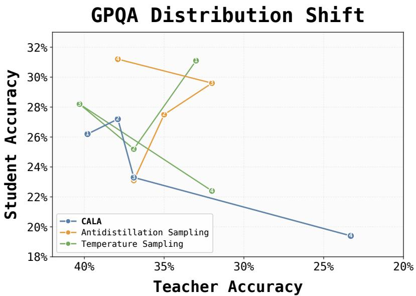  
Figure 7: Utility-distillability operating points under the MetaMathQA→MMLU-traces→GPQA distribution shift. Point numbers follow the configuration order in Table 12; lower student accuracy at comparable teacher accuracy indicates stronger protection.

At exactly matched 37.9% teacher accuracy, CALA reduces student accuracy from 31.2% under ADS to 27.2%. At the second exactly matched point of 36.9% teacher accuracy, CALA and ADS are effectively tied (23.3% versus 23.1%). We therefore limit the transfer claim to the evaluated shift and do not claim uniform dominance over ADS.

Transfer across downstream students. We repeat the GSM8K trace-distillation protocol with Gemma-2-2B-IT and Qwen2.5-3B downstream students. Table 13 reports student accuracy at the same four approximately matched CALA/ADS teacher-utility points used in the main evaluation.

CALA yields lower Gemma accuracy at all four points. For Qwen2.5-3B, the methods differ by only 0.9 and 1.2 points at the first two high-utility points, with one favoring each method; ADS is stronger at the two more aggressive points. Thus, transfer beyond the original Llama student is clear for Gemma but operating-point dependent for Qwen.

Table 13: Cross-student transfer on GSM8K. Each pair is CALA/ADS accuracy in percentage points. Lower student accuracy is better for the defense.
<table><tr><td>Teacher acc.</td><td>Gemma-2-2B-IT</td><td>Qwen2.5-3B</td></tr><tr><td>89.7/89.7</td><td>35.5/39.1</td><td>78.6/77.7</td></tr><tr><td>83.5/84.0</td><td>32.5/38.1</td><td>73.9/75.1</td></tr><tr><td>79.2/78.9</td><td>28.6/35.1</td><td>71.8/68.2</td></tr><tr><td>65.1/64.8</td><td>21.5/29.7</td><td>67.7/54.3</td></tr></table>

Additional proxy-sensitivity result. Figure 8 reports a proxy-size sensitivity study on GSM8K by replacing the default 1.5B training-time proxy with a 3B proxy.

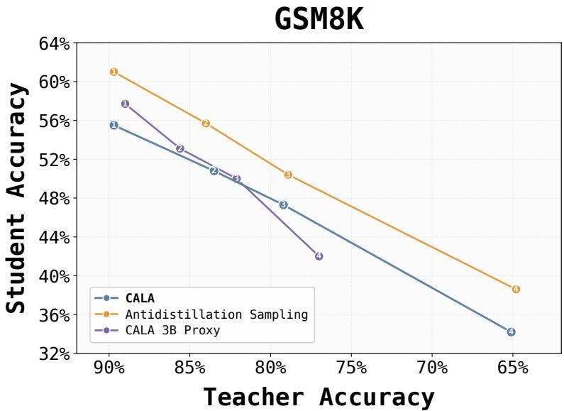  
Figure 8: Proxy-size sensitivity on GSM8K. We compare the default 1.5B training-time proxy with a 3B proxy.

Inference-strength control and DOGe comparison. Holding τ = 0.5 fixed, increasing δ from 0.25 to 0.80 and 0.85 changes teacher/student accuracy from 89.7/55.5 to 79.2/47.3 and 65.1/34.2, respectively. This isolates the expected monotone strengthening of protection together with a nonlinear loss of teacher utility.

We also reproduced DOGe [23] with its official implementation and tuned its main hyperparameters. The result was highly checkpoint-sensitive: some runs collapsed to approximately 31% teacher accuracy, while usable checkpoints reached 82.93–86.87% teacher accuracy and 55.03–57.03% student accuracy. These operating points give a weaker trade-off than CALA in our setup. Unlike CALA’s inference-time control through δ, changing DOGe’s defense strength requires retraining. Because the available DOGe runs are checkpoint-dependent and do not form matched operating points, we report them as an additional comparison rather than adding them to the main Pareto curves.

## D Limitations & Broader Impacts

Limitations. Our evaluation focuses on a specific trace-distillation setting in which an attacker trains a smaller student model from teacher-generated reasoning traces using standard next-token prediction. The results should therefore not be interpreted as protection against all forms of model extraction or adaptive distillation. We evaluate transfer to two additional students, one cross-task shift, and a PPL-based filter, but do not evaluate paraphrasing, verifier-selected traces, larger training budgets, or arbitrary auxiliary data. The method also depends on a training-time proxy student; the proxy-size study uses a compatible token space, and supporting tokenizer-mismatched proxies would require cross-tokenizer probability mapping or a sequence-level surrogate. Empirically, the defense is most consistent on structured reasoning tasks such as GSM8K and MATH, while the gains on MMLU and some aggressive settings are more mixed. Stronger defense settings can also reduce teacher accuracy or fluency, so the operating point should be chosen with the intended use case in mind.

Broader Impacts. This work may help reduce the risk that useful reasoning traces become direct supervision for model imitation. At the same time, methods that modify reasoning traces should be applied carefully. If the defense is too strong, it may reduce readability, make intermediate reasoning less helpful, or affect user trust. We therefore view the proposed adapter as one component of a broader deployment strategy, alongside evaluation of trace quality, access controls, and monitoring for misuse.

## E Fluency Judge Details

We evaluate surface-level fluency with GPT-4o mini. For each operating point, we sample 100 generated traces and ask the judge to assign a score from 1 to 100. The reported fluency score is the mean over all valid judged samples.

The judge receives the original problem and generated trace, but is instructed to ignore correctness and the final answer. It evaluates only surface quality: coherence, readability, natural English, absence of meaningless repetition, and absence of artifacts such as garbled fragments, mixed-language degeneration, or control tokens. Before judging, we remove model-specific control tokens and assistant delimiters, while preserving mathematical notation and raw LAT X commands and instructing the judge not to penalize them.

The prompt used for the automatic judge is:

## Fluency judge prompt

Evaluate the “Readability, Fluency, and Cleanliness” of an AI’s raw output.

Context. You are evaluating a raw text draft. Do not assume an everyday-user perspective.   
The text is expected to contain raw markup.

Absolute LaTeX immunity. Never penalize LaTeX syntax, such as \frac, \boxed, \text, \[, \], or other backslash commands. Treat them as valid text.

Your ONLY focus for penalties should be:

1. Literal Token Loops & Exact Block Repetition: Strongly penalize mechanical stuttering (e.g., ‘the the the the’) or copy-pasting the EXACT same sentence/paragraph multiple times.

2. Real Garbage Characters: Broken Unicode, unreadable encoding errors, or random non-alphanumeric noise (excluding math syntax).

## SCORING RUBRIC

• 90-100: Clear logic, coherent, zero meaningless repetition, zero garbage characters. (Raw LaTeX presence is completely ignored and gets full marks, Must be exclusively in English).

• 75-89: Coherent, might have minor awkward phrasing, but strictly zero meaningless repetition.

• 50-74: Noticeable flow issues or slight repetitive language.

• 25-49: Moderate meaningless repetition, lacks useful substance, or contains noticeable garbage characters.

• 1-24: Auto-Fail: Contains non-English characters/languages (e.g., Chinese, Thai, Arabic), severe repetitive token loops, overwhelmed by unreadable garbage characters, or completely broken text.

## SCORING GRANULARITY (CRITICAL)

AVOID defaulting to round numbers or multiples of 5 (e.g., 50, 70, 75, 80, 90, 100). You MUST utilize the entire spectrum of integers (e.g., 67, 73, 84, 91, 98).

METHOD: Start with a base score of 100. Apply precise, non-round point deductions for each specific error identified (e.g., deduct 3 points for minor awkwardness, deduct 17 points for a token loop).

• Step1: Strict Language Scan You MUST first scan the text for ANY non-English characters (e.g., Chinese, Japanese, Korean, Arabic, Thai).

• Step 2: Token Loop Scan. Check for mechanical stuttering.

• Step 3: Flow & Reasoning. Evaluate formatting and repetition.

Rules: Reason step-by-step, then strictly output ‘Rating: [[rating]]’ (1 to 100) (for example: “Rating: [[90]]”)

We use the same judging protocol for our method and the ADS baseline. The fluency judge is used only as a diagnostic for surface-level degeneration; it is not used for training, model selection, or correctness evaluation.

## F Example Traces

Qualitative GSM8K examples selected to illustrate a surface-degeneration failure mode observed under stronger ADS settings.

George has 45% more pears than bananas. If George has 200 bananas,   
Question. how many fruits does George have?   
Antidistillation Sampling Conflict-Aware Logit Adapters τ=0.5, δ=0.25   
Teacher acc.: 89.7% Teacher acc.: 89.7%   
<think> <think>   
To determine the number of pears George First, determine the number of pears. Since   
has, I'll start by using the percentage George has 45% more pears than bananas,   
calculate 45% of 200 and add it to 200.   
increase. George has 45% more pears than   
bananas. Since he has 200 bananas, I'll   
0.45 × 200 = 90 → pears = 290.   
calculate 45% of 200 to find the number of   
additional pears. This will give me 90   
Total fruits = 290 + 200 = 490.   
pears. </think>   
Next, I'll add the number of pears to the 1. Number of pears:   
number of bananas to find the total. So, Pears = 200 + 45% of 200   
200 bananas plus 90 pears equals 290 fruits = 200 + 0.45 × 200   
in total. = 200 + 90 = 290   
</think>   
2. Total fruits:   
1. Number of pears: 290 + 200 = 490   
200 + 0.45 × 200 = 200 + 90 = 290   
Final Answer   
2. Total fruits: \[\boxed{490}\]   
200 + 290 = 290   
However, wait a minute! This seems   
confusing. Let's re-examine:   
— Pears = 200 + 90 = 290   
— Total = 200 + 290 = 490   
However, there's an inconsistency...   
Let's correct it:   
— Pears = 200 + 0.45×200 = 290   
— Total = 200 + 290 = 490   
Final Answer   
\[\boxed{490}\]

Bill starts on the 3rd floor. He rides the elevator up to the floor Question. that's equal to 4 times his starting floor plus 6. What floor is Bill on now?

## Antidistillation Sampling

## Teacher acc.: 89.7%

```latex
<think>
Bill starts on the 3rd floor.
His starting floor is 3.
He rides the elevator up to a floor
calculated by 4 times his starting floor
plus 6.
So, first, calculate 4 times 3.
4 multiplied by 3 is 12.
Then, add 6 to that result.
12 plus 6 equals 18.
Therefore, Bill is now on the 18th floor.
</think>
1. Identify Bill's starting floor.
Bill starts on the 3rd floor.
2. Determine the formula for the new floor.
\[\text{New Floor} = 4 \times
\text{Starting Floor} + 6\]
3. Plug in the starting floor into the
formula.
\[\text{New Floor} = 4 \times 3 + 6\]
4. Calculate the multiplication first.
\[4 \times 3 = 12\]
5. Then add 6 to the result.
\[12 + 6 = 18\]
Final Answer
\[\boxed{18}\]
```

## Conflict-Aware Logit Adapters

## Teacher acc.: 89.7%

```latex
<think>
Bill starts on the 3rd floor.
His destination floor is calculated by
multiplying his starting floor by 4 and
then adding 6.
So, 4 times 3 is 12, plus 6 equals 18.
Therefore, Bill is now on the 18th floor.
</think>
Bill starts on the 3rd floor. His
destination floor is calculated by:
\[4 \times 3 + 6 = 12 + 6 = 18\]
Therefore, Bill is now on the \
(\boxed{18}\)th floor.
Final Answer
\[\boxed{18}\]
```

## Antidistillation Sampling

## Teacher acc.: 89.7%

```latex
<think>
Jean starts with a total of 30 lollipops.
She eats 2 of them, so we subtract those:
30 - 2 = 28 lollipops remaining.
Jean wants to package these into bags with
2 lollipops each.
28 ÷ 2 = 14.
Therefore, Jean can fill 14 bags.
</think>
1. Determine the remaining lollipops after
eating:
\[\text{Remaining} = 30 - 2 = 28\]
2. Calculate the number of bags:
\[\text{Number of bags} = \frac{28}{2} =
14\]
Answer: Jean can fill \(\boxed{14}\) bags.
Final Answer
\[\boxed{14}\]
```

## Conflict-Aware Logit Adapters

## Teacher acc.: 89.7%

<think>   
First, Jean starts with 30 lollipops.   
She eats 2 lollipops, leaving her with 28.   
Next, she wants to package the remaining 28   
lollipops into bags of 2.   
28 ÷ 2 = 14 bags.   
</think>   
1. Initial Lollipops: Jean has 30   
lollipops.   
2. After eating:   
\[30 - 2 = 28 \text{ lollipops   
remaining}\]   
3. Packaging:   
\[\frac{28}{2} = 14 \text{ bags}\]   
Final Answer: \(\boxed{14}\)   
Final Answer   
\[\boxed{14}\]

Four books are arranged on a shelf. The first book is 31 mm thick while the second book is 50 mm thick. The third book is 5 mm less thick than the second Question. book, and the fourth book is twice as thick as the first book. What is the total thickness of the four books?

## Antidistillation Sampling

Conflict-Aware Logit Adapters

## Teacher acc.: 84%

## <think>

To determine the total thickness of the four books, I will start by identifying the thickness of each book individually. The first book: 31 mm. The second: 50 mm. Third: 50 − 5 = 45 mm. Fourth: 31 × 2 = 62 mm.

\- First book: 31 mm. pist pornostar

\- Second book: 50 mm. pistötik

\- Third book: 50 − 5 = 45 mm. pistötik

\- Fourth book: 2 × 31 = 62 mm. pistötik

\- First book: 31 mm. pistotika

\- Second book: 50 mm. pistotik

\- Third book: 50 − 5 = 45 mm. pistotika

\- Fourth book: 2 × 31 = 62 mm. pistotika

Total: 31 + 50 + 45 + 62 = 188 mm. </think>

← entire block repeated again, followed by \~23 lines of junk

Pistons Pistons Pistons Pistons Pistons Pistons

Pistotika Pistotika Pistotika Pistotika Pistotika

Pistotika Pistotika Pistotika Pistotika Pistotika

Final Answer

\[\boxed{188}\] mm

## Teacher acc.: 83.5%

## <think>

The problem involves finding the total thickness of four books.

First book: 31 mm.   
Second book: 50 mm.   
Third book: 50 − 5 = 45 mm.   
Fourth book: 31 × 2 = 62 mm. Total: 31 + 50 = 81, + 45 = 126, + 62 = 188 mm.   
</think>

The total thickness of the four books is

\[\boxed{188\text{ mm}}\]

\[\boxed{188\text{ mm}}\]

<think>   
Quarters: 8 × \$0.25 = \$2.00   
Dimes: 6 × \$0.10 = \$0.60   
Nickels: 14 × \$0.05 = \$0.70   
Pennies: 15 × \$0.01 = \$0.15   
Total: \$2.00 + \$0.60 + \$0.70 + \$0.15 =   
\$3.45   
Each gumball costs \$0.05.   
\$3.45 ÷ \$0.05 = 69 gumballs.   
</think>   
Step 1: Total money in cents   
1. Quarters: \(8 \times 25 = 200\) cents   
2. Dimes: \(6 \times 10 = 60\) cents   
3. Nickels: \(14 \times 5 = 70\) cents   
4. Pennies: \(15 \times 1 = 15\) cents   
5. Total: \(200 + 60 + 70 + 15 = 345\)   
cents

Question. Colby wants to buy some gumballs that cost a nickel each. If he has 8 quarters,<sub>6</sub> <sub>dimes,</sub> <sub>14</sub> <sub>nickels,</sub> <sub>and</sub> <sub>15</sub> <sub>pennies,</sub> <sub>how</sub> <sub>many</sub> <sub>can</sub> <sub>he</sub> <sub>buy?</sub>

## Antidistillation Sampling

## Teacher acc.: 84%

## Step 2: Number of gumballs

```latex
\[\frac{345 \text{ cents}}{5 \text{
cents/gumball}} = 69\]
Final Answer
\[\boxed{69}\]
```

## Conflict-Aware Logit Adapters

## Teacher acc.: 83.5%

<think>   
Quarters: 8 × 25 = 200 cents.   
Dimes: 6 × 10 = 60 cents.   
Nickels: 14 × 5 = 70 cents.   
Pennies: 15 × 1 = 15 cents.   
Total: 200 + 60 + 70 + 15 = 345 cents.   
345 ÷ 5 = 69 gumballs.   
</think>   
← output truncated abruptly with a stray   
token "absurd:"   
absurd:   
Final Answer   
\[\boxed{69}\]

Bailey starts with a certain amount of money. Then she receives a weekly Question. allowance of \$5 for 8 weeks. At the end of the 8 weeks, if she has a total of \$100, how much money did Bailey start with?

## Antidistillation Sampling

## Teacher acc.: 78.9%

## Conflict-Aware Logit Adapters τ=0.5, δ=0.8

## Teacher acc.:79.2%

## <think>

## pistonsPenny

Question. A farmer extracts 5 liters of milk a day from a cow. Since he has 3 cows, how many more cows does he need to have to produce 25 liters of milk a day?

## Antidistillation Sampling

## Teacher acc.: 78.9%

<think>   
pistaStart by identifying the given data...   
piston Piston piston   
Current milk: 3 × 5 = 15 liters/day.   
Additional needed: 25 − 15 = 10 liters.   
Piston piston piston   
Extra cows: 10 ÷ 5 = 2 more cows.   
</think> pistonpistonpiston   
1. Current milk production:   
pistopistonpiston Piston Piston Piston   
Piston Piston   
← \~300 repetitions of "Piston" before   
continuing   
Final Answer   
\[\boxed{2}\]

## Conflict-Aware Logit Adapters τ=0.5, δ=0.8

## Teacher acc.:79.2%

<think>   
absurd first, I'll calculate total current   
milk.   
3 cows × 5 liters/cow = 15 liters/day.   
Additional milk needed: 25 − 15 = 10   
liters/day.   
Extra cows: 10 ÷ 5 = 2 cows.   
</think> ← outputs "Response #1:" then   
repeats the entire think block verbatim as   
the answer   
Response #1:   
absurd first, I'll calculate total current   
milk.   
3 cows × 5 liters/cow = 15 liters/day   
Additional milk needed: 25 − 15 = 10   
liters/day   
Extra cows: 10 ÷ 5 = 2 cows   
Therefore, the farmer needs to add 2 more   
cows.   
Final Answer   
\[\boxed{2}\]

## Teacher acc.: 64.8%

## <think>

Greg wants to provide 4 jello cups for each of the 30 kids, which totals 120 cups. Each box makes 10 cups, so he needs 12 boxes. Each box costs \$1.25, so multiplying gives the total cost of \$15.   
</think>ascup>

## ANTHONG

← \~900 repetitions of Chinese characters follow

水泵水泵水泵水泵水泵水泵水泵水泵水泵水泵水泵水泵水泵水泵水泵水泵水泵水泵水泵水泵水泵水泵水泵水泵水泵水泵水泵水泵水泵水泵水泵水泵水泵水泵水泵水泵水泵水泵水泵水泵水泵水泵水泵水泵水泵水泵水泵水泵水泵水泵水泵水泵水泵水泵水泵水泵水泵水泵水泵水泵水泵水泵水泵水泵水泵水泵水泵水泵水泵水泵水泵水泵水泵水泵水泵水泵水泵水泵水泵水泵水泵水泵水泵水泵水泵水泵水泵水泵水泵水泵水泵水泵水泵水泵水泵水泵水泵水泵水泵水泵...

Final Answer

\[\boxed{15}\]

## Teacher acc.: 65.1%

## <think>

1. Total jello cups needed: 30 kids × 4 cups/kid = 120 cups

2. Number of boxes needed: 120 cups ÷ 10 cups/box = 12 boxes

3. Total cost: 12 boxes × \$1.25/box = \$15

So, Greg will spend \$15 on jello. </think>

1. Total jello cups needed: \[30 \times 4 = 120 \text{ cups}\]

2. Number of boxes needed: \[\frac{120}{10} = 12 \text{ boxes}\]

3. Total cost: \[12 \times \$1.25 = \$15\]

## Final Answer

\[\boxed{\$15}\]


## Teacher acc.: 64.8%

## <think>

pist浭 Charmaine is currently 16 years old. ← misreads the problem; treats 16 as current age instead of future age 16 + 4 = 20. pistsPid<think><think>浭 </think></think> Rams。

pist拍拍拍拍拍拍拍拍拍拍拍拍拍拍拍拍拍拍拍拍拍拍拍 拍拍拍拍拍拍拍拍拍拍拍拍拍拍拍拍拍拍拍拍拍拍拍拍拍拍 拍拍拍拍拍拍拍拍拍拍拍拍拍拍拍拍拍拍拍拍拍拍拍拍拍拍 拍拍拍拍拍拍拍拍拍拍拍拍拍拍拍拍拍拍拍拍拍拍拍拍 拍...

← \~800 repetitions of 拍 ("clap") follow </think>

Charmaine will be 16 years old in 12 years...

← output cut off mid-sentence

Final Answer

\[\boxed{20}\]

## Teacher acc.: 65.1%

## <think>

[\~1000 lines of blank \r\n whitespace tokens]

← think block is entirely empty — model

## Final Answer

\[\boxed{20}\]

## NeurIPS Paper Checklist

## 1. Claims

Question: Do the main claims made in the abstract and introduction accurately reflect the paper’s contributions and scope?

Answer: [Yes]

Justification: The abstract and introduction state the proposed method, assumptions, evaluation scope, and limitations.

Guidelines:

• The answer [N/A] means that the abstract and introduction do not include the claims made in the paper.

• The abstract and/or introduction should clearly state the claims made, including the contributions made in the paper and important assumptions and limitations. A [No] or [N/A] answer to this question will not be perceived well by the reviewers.

• The claims made should match theoretical and experimental results, and reflect how much the results can be expected to generalize to other settings.

• It is fine to include aspirational goals as motivation as long as it is clear that these goals are not attained by the paper.

## 2. Limitations

Question: Does the paper discuss the limitations of the work performed by the authors?

Answer: [Yes]

Justification: The paper discusses limitations in the conclusion and Appendix D.

Guidelines:

• The answer [N/A] means that the paper has no limitation while the answer [No] means that the paper has limitations, but those are not discussed in the paper.

• The authors are encouraged to create a separate “Limitations” section in their paper.

• The paper should point out any strong assumptions and how robust the results are to violations of these assumptions (e.g., independence assumptions, noiseless settings, model well-specification, asymptotic approximations only holding locally). The authors should reflect on how these assumptions might be violated in practice and what the implications would be.

• The authors should reflect on the scope of the claims made, e.g., if the approach was only tested on a few datasets or with a few runs. In general, empirical results often depend on implicit assumptions, which should be articulated.

• The authors should reflect on the factors that influence the performance of the approach. For example, a facial recognition algorithm may perform poorly when image resolution is low or images are taken in low lighting. Or a speech-to-text system might not be used reliably to provide closed captions for online lectures because it fails to handle technical jargon.

• The authors should discuss the computational efficiency of the proposed algorithms and how they scale with dataset size.

• If applicable, the authors should discuss possible limitations of their approach to address problems of privacy and fairness.

• While the authors might fear that complete honesty about limitations might be used by reviewers as grounds for rejection, a worse outcome might be that reviewers discover limitations that aren’t acknowledged in the paper. The authors should use their best judgment and recognize that individual actions in favor of transparency play an important role in developing norms that preserve the integrity of the community. Reviewers will be specifically instructed to not penalize honesty concerning limitations.

## 3. Theory assumptions and proofs

Question: For each theoretical result, does the paper provide the full set of assumptions and a complete (and correct) proof?

Answer: [Yes]

Justification: Appendix A provides the assumptions, theorem statement, and proof for the conflict-aware update.

## Guidelines:

• The answer [N/A] means that the paper does not include theoretical results.

• All the theorems, formulas, and proofs in the paper should be numbered and crossreferenced.

• All assumptions should be clearly stated or referenced in the statement of any theorems.

• The proofs can either appear in the main paper or the supplemental material, but if they appear in the supplemental material, the authors are encouraged to provide a short proof sketch to provide intuition.

• Inversely, any informal proof provided in the core of the paper should be complemented by formal proofs provided in appendix or supplemental material.

• Theorems and Lemmas that the proof relies upon should be properly referenced.

## 4. Experimental result reproducibility

Question: Does the paper fully disclose all the information needed to reproduce the main experimental results of the paper to the extent that it affects the main claims and/or conclusions of the paper (regardless of whether the code and data are provided or not)?

Answer: [Yes]

Justification: See section 5 and Appendix B and E for relevant details.

Guidelines:

• The answer [N/A] means that the paper does not include experiments.

• If the paper includes experiments, a [No] answer to this question will not be perceived well by the reviewers: Making the paper reproducible is important, regardless of whether the code and data are provided or not.

• If the contribution is a dataset and/or model, the authors should describe the steps taken to make their results reproducible or verifiable.

• Depending on the contribution, reproducibility can be accomplished in various ways. For example, if the contribution is a novel architecture, describing the architecture fully might suffice, or if the contribution is a specific model and empirical evaluation, it may be necessary to either make it possible for others to replicate the model with the same dataset, or provide access to the model. In general. releasing code and data is often one good way to accomplish this, but reproducibility can also be provided via detailed instructions for how to replicate the results, access to a hosted model (e.g., in the case of a large language model), releasing of a model checkpoint, or other means that are appropriate to the research performed.

• While NeurIPS does not require releasing code, the conference does require all submissions to provide some reasonable avenue for reproducibility, which may depend on the nature of the contribution. For example

(a) If the contribution is primarily a new algorithm, the paper should make it clear how to reproduce that algorithm.

(b) If the contribution is primarily a new model architecture, the paper should describe the architecture clearly and fully.

(c) If the contribution is a new model (e.g., a large language model), then there should either be a way to access this model for reproducing the results or a way to reproduce the model (e.g., with an open-source dataset or instructions for how to construct the dataset).

(d) We recognize that reproducibility may be tricky in some cases, in which case authors are welcome to describe the particular way they provide for reproducibility. In the case of closed-source models, it may be that access to the model is limited in some way (e.g., to registered users), but it should be possible for other researchers to have some path to reproducing or verifying the results.

## 5. Open access to data and code

Question: Does the paper provide open access to the data and code, with sufficient instructions to faithfully reproduce the main experimental results, as described in supplemental material?

## Answer: [Yes]

Justification: The experiment code is provided in the supplemental material. The datasets used in the experiments are publicly available.

## Guidelines:

• The answer [N/A] means that paper does not include experiments requiring code.

• Please see the NeurIPS code and data submission guidelines (https://neurips.cc/ public/guides/CodeSubmissionPolicy) for more details.

• While we encourage the release of code and data, we understand that this might not be possible, so [No] is an acceptable answer. Papers cannot be rejected simply for not including code, unless this is central to the contribution (e.g., for a new open-source benchmark).

• The instructions should contain the exact command and environment needed to run to reproduce the results. See the NeurIPS code and data submission guidelines (https: //neurips.cc/public/guides/CodeSubmissionPolicy) for more details.

• The authors should provide instructions on data access and preparation, including how to access the raw data, preprocessed data, intermediate data, and generated data, etc.

• The authors should provide scripts to reproduce all experimental results for the new proposed method and baselines. If only a subset of experiments are reproducible, they should state which ones are omitted from the script and why.

• At submission time, to preserve anonymity, the authors should release anonymized versions (if applicable).

• Providing as much information as possible in supplemental material (appended to the paper) is recommended, but including URLs to data and code is permitted.

## 6. Experimental setting/details

Question: Does the paper specify all the training and test details (e.g., data splits, hyperparameters, how they were chosen, type of optimizer) necessary to understand the results?

Answer: [Yes]

Justification: Section 5 and Appendix B provide the training and evaluation details.

Guidelines:

• The answer [N/A] means that the paper does not include experiments.

• The experimental setting should be presented in the core of the paper to a level of detail that is necessary to appreciate the results and make sense of them.

• The full details can be provided either with the code, in appendix, or as supplemental material.

## 7. Experiment statistical significance

Question: Does the paper report error bars suitably and correctly defined or other appropriate information about the statistical significance of the experiments?

Answer: [No]

Justification: Appendix C reports mean and standard deviation over three seeds for the GSM8K robustness study and an exact McNemar test for the manual audit. We retain [No] because these analyses do not cover every experiment supporting the main claims.

Guidelines:

• The answer [N/A] means that the paper does not include experiments.

• The authors should answer [Yes] if the results are accompanied by error bars, confidence intervals, or statistical significance tests, at least for the experiments that support the main claims of the paper.

• The factors of variability that the error bars are capturing should be clearly stated (for example, train/test split, initialization, random drawing of some parameter, or overall run with given experimental conditions).

• The method for calculating the error bars should be explained (closed form formula, call to a library function, bootstrap, etc.)

• The assumptions made should be given (e.g., Normally distributed errors).

• It should be clear whether the error bar is the standard deviation or the standard error of the mean.

• It is OK to report 1-sigma error bars, but one should state it. The authors should preferably report a 2-sigma error bar than state that they have a 96% CI, if the hypothesis of Normality of errors is not verified.

• For asymmetric distributions, the authors should be careful not to show in tables or figures symmetric error bars that would yield results that are out of range (e.g., negative error rates).

• If error bars are reported in tables or plots, the authors should explain in the text how they were calculated and reference the corresponding figures or tables in the text.

## 8. Experiments compute resources

Question: For each experiment, does the paper provide sufficient information on the computer resources (type of compute workers, memory, time of execution) needed to reproduce the experiments?

Answer: [Yes]

Justification: Compute costs are reported in Table 1; setup details are in Appendix B.

Guidelines:

• The answer [N/A] means that the paper does not include experiments.

• The paper should indicate the type of compute workers CPU or GPU, internal cluster, or cloud provider, including relevant memory and storage.

• The paper should provide the amount of compute required for each of the individual experimental runs as well as estimate the total compute.

• The paper should disclose whether the full research project required more compute than the experiments reported in the paper (e.g., preliminary or failed experiments that didn’t make it into the paper).

## 9. Code of ethics

Question: Does the research conducted in the paper conform, in every respect, with the NeurIPS Code of Ethics https://neurips.cc/public/EthicsGuidelines?

Answer: [Yes]

Justification: This research conforms with the NeurIPS Code of Ethics.

Guidelines:

• The answer [N/A] means that the authors have not reviewed the NeurIPS Code of Ethics.

• If the authors answer [No], they should explain the special circumstances that require a deviation from the Code of Ethics.

• The authors should make sure to preserve anonymity (e.g., if there is a special consideration due to laws or regulations in their jurisdiction).

## 10. Broader impacts

Question: Does the paper discuss both potential positive societal impacts and negative societal impacts of the work performed?

Answer: [Yes]

Justification: The paper discusses the broader impacts in the conclusion and Appendix D. Guidelines:

• The answer [N/A] means that there is no societal impact of the work performed.

• If the authors answer [N/A] or [No], they should explain why their work has no societal impact or why the paper does not address societal impact.

• Examples of negative societal impacts include potential malicious or unintended uses (e.g., disinformation, generating fake profiles, surveillance), fairness considerations (e.g., deployment of technologies that could make decisions that unfairly impact specific groups), privacy considerations, and security considerations.

• The conference expects that many papers will be foundational research and not tied to particular applications, let alone deployments. However, if there is a direct path to any negative applications, the authors should point it out. For example, it is legitimate to point out that an improvement in the quality of generative models could be used to generate Deepfakes for disinformation. On the other hand, it is not needed to point out that a generic algorithm for optimizing neural networks could enable people to train models that generate Deepfakes faster.

• The authors should consider possible harms that could arise when the technology is being used as intended and functioning correctly, harms that could arise when the technology is being used as intended but gives incorrect results, and harms following from (intentional or unintentional) misuse of the technology.

• If there are negative societal impacts, the authors could also discuss possible mitigation strategies (e.g., gated release of models, providing defenses in addition to attacks, mechanisms for monitoring misuse, mechanisms to monitor how a system learns from feedback over time, improving the efficiency and accessibility of ML).

## 11. Safeguards

Question: Does the paper describe safeguards that have been put in place for responsible release of data or models that have a high risk for misuse (e.g., pre-trained language models, image generators, or scraped datasets)?

Answer: [N/A]

Justification: The paper does not release any data or models that have a high risk for misuse. Guidelines:

• The answer [N/A] means that the paper poses no such risks.

• Released models that have a high risk for misuse or dual-use should be released with necessary safeguards to allow for controlled use of the model, for example by requiring that users adhere to usage guidelines or restrictions to access the model or implementing safety filters.

• Datasets that have been scraped from the Internet could pose safety risks. The authors should describe how they avoided releasing unsafe images.

• We recognize that providing effective safeguards is challenging, and many papers do not require this, but we encourage authors to take this into account and make a best faith effort.

## 12. Licenses for existing assets

Question: Are the creators or original owners of assets (e.g., code, data, models), used in the paper, properly credited and are the license and terms of use explicitly mentioned and properly respected?

Answer: [Yes]

Justification: The paper credits the datasets and models used in the experiments. Meta-MathQA and the evaluation datasets use the MIT License; DeepSeek-R1-Distill-Qwen-7B uses the MIT License, Qwen2.5 uses Apache 2.0, and Llama 3.2 uses the Llama 3.2 Community License.

Guidelines:

• The answer [N/A] means that the paper does not use existing assets.

• The authors should cite the original paper that produced the code package or dataset.

• The authors should state which version of the asset is used and, if possible, include a URL.

• The name of the license (e.g., CC-BY 4.0) should be included for each asset.

• For scraped data from a particular source (e.g., website), the copyright and terms of service of that source should be provided.

• If assets are released, the license, copyright information, and terms of use in the package should be provided. For popular datasets, paperswithcode.com/datasets has curated licenses for some datasets. Their licensing guide can help determine the license of a dataset.

• For existing datasets that are re-packaged, both the original license and the license of the derived asset (if it has changed) should be provided.

• If this information is not available online, the authors are encouraged to reach out to the asset’s creators.

## 13. New assets

Question: Are new assets introduced in the paper well documented and is the documentation provided alongside the assets?

Answer: [N/A]

Justification: The paper does not introduce a new dataset, benchmark, or model checkpoint as a primary contribution.

Guidelines:

• The answer [N/A] means that the paper does not release new assets.

• Researchers should communicate the details of the dataset/code/model as part of their submissions via structured templates. This includes details about training, license, limitations, etc.

• The paper should discuss whether and how consent was obtained from people whose asset is used.

• At submission time, remember to anonymize your assets (if applicable). You can either create an anonymized URL or include an anonymized zip file.

## 14. Crowdsourcing and research with human subjects

Question: For crowdsourcing experiments and research with human subjects, does the paper include the full text of instructions given to participants and screenshots, if applicable, as well as details about compensation (if any)?

Answer: [N/A]

Justification: The paper does not involve crowdsourcing or research with human subjects.

Guidelines:

• The answer [N/A] means that the paper does not involve crowdsourcing nor research with human subjects.

• Including this information in the supplemental material is fine, but if the main contribution of the paper involves human subjects, then as much detail as possible should be included in the main paper.

• According to the NeurIPS Code of Ethics, workers involved in data collection, curation, or other labor should be paid at least the minimum wage in the country of the data collector.

## 15. Institutional review board (IRB) approvals or equivalent for research with human subjects

Question: Does the paper describe potential risks incurred by study participants, whether such risks were disclosed to the subjects, and whether Institutional Review Board (IRB) approvals (or an equivalent approval/review based on the requirements of your country or institution) were obtained?

Answer: [N/A]

Justification: The paper does not involve research with human subjects.

Guidelines:

• The answer [N/A] means that the paper does not involve crowdsourcing nor research with human subjects.

• Depending on the country in which research is conducted, IRB approval (or equivalent) may be required for any human subjects research. If you obtained IRB approval, you should clearly state this in the paper.

• We recognize that the procedures for this may vary significantly between institutions and locations, and we expect authors to adhere to the NeurIPS Code of Ethics and the guidelines for their institution.

• For initial submissions, do not include any information that would break anonymity (if applicable), such as the institution conducting the review.

## 16. Declaration of LLM usage

Question: Does the paper describe the usage of LLMs if it is an important, original, or non-standard component of the core methods in this research? Note that if the LLM is used only for writing, editing, or formatting purposes and does not impact the core methodology, scientific rigor, or originality of the research, declaration is not required.

Answer: [Yes]

Justification: We use GPT-4o mini as an automatic fluency judge for generated reasoning traces. The core experiments also use LLMs as the defended teacher, proxy models, and downstream student models, as described in Section 5 and Appendix B.

## Guidelines:

• The answer [N/A] means that the core method development in this research does not involve LLMs as any important, original, or non-standard components.

• Please refer to our LLM policy in the NeurIPS handbook for what should or should not be described.