# DUAL EXAM: CONTROLLED EVALUATION OF MULTI-MODAL AGENTS AND WORLD MODELS

Zhefan Rao, Meng Chu, Xuan Zhang, Jingfan Chen, Guohao Cai, Runyi Li, Shiyi Du, Ning Lu, Xu Huang, Zhixuan Chen, Feng Nie, Harold Haodong Chen, Hanwen Wang, Wen-Jie Shu, Yajing Bai, Xianfeng Wu, Xuanhua He, Shuhan Guo, Ziyue Ma, Ruichuan An, Long Bai, Miaosen Chai, Wenhao Chai, Jingye Chen, Qi Chen, Xuhang Chen, Wei Chow, Minghao Fu, Yunhao Gou, Haokun Gui, Dong Huang, Wei Huang, Zi Cheng Huang, Haibo Jin, Lingdong Kong, Leung Chun Ho, Tianqin Li, Yanheng Li, Jiayuan Liu, Jiyang Liu, Mingyu Liu, Shaoteng Liu, Xiaocheng Lu, Yawen Luo, Zeyu Qin, Tiancheng Shen, Yueqi Song, Zhaolong Su, Hengkai Tan, Tianhao Tang, Yiran Tao, Juncheng Wang, Qinghe Wang, Shangshang Wang, Yingying Wang, Fang Wu, Tiange Xiang, Qiushi Yang, Weicai Ye, Weichen Yu, Jiarui Zhang, Jize Zhang, Liuzhou Zhang, Renrui Zhang, Sheng Zhang, Wenhu Zhang, Junru Zhao, Lingting Zhu, Yuxin Zuo, Yutong Bai, Long Chen, Yang Deng, Ziqi Huang, Yeying Jin, Weijia Li, Kevin Qinghong Lin, Quande Liu, See-Kiong Ng, Hongliang Ren, Hongru Wang, Shujun Wang, Qifeng Chen, Haoxuan Che

The Hong Kong University of Science and Technology   
National University of Singapore   
The Hong Kong Polytechnic University   
The University of Tokyo   
Carnegie Mellon University   
University of California, Berkeley   
University of Central Florida   
University of North Carolina at Chapel Hill   
The Chinese University of Hong Kong   
University of Chicago   
Princeton University   
Johns Hopkins University   
University of Cambridge   
University of California, San Diego   
The University of Hong Kong   
City University of Hong Kong   
University of California, Merced   
Cornell University   
Massachusetts Institute of Technology   
University of Southern California   
Stanford University   
University of Maryland, College Park   
Singapore Management University   
Nanyang Technological University   
University of Oxford   
University of Edinburgh   
XGEN Labs

## ABSTRACT

World Models (WMs) can support Multimodal Agents (MAs) through simulated experience and action-conditioned predictions, while MA interaction trajectories can provide feedback for refining WMs. Assessing this potential relationship requires evidence about both components. A pilot study of one MA–WM pairing on 150 cases across ten scenarios illustrates why coupled outcomes alone are insufficient for diagnosing failure. We introduce Dual Exam, a framework that evaluates MAs under a fixed environment response mechanism and WMs under fixed action interventions. The Agent evaluation compares 10 configurations on 1,088 items in 15 reporting categories across physical, digital, social, and scientific domains. The World Model evaluation comprises 400 cases across eight scenarios, with 50 cases per scenario; 15 of 16 configurations cover all eight scenarios, and one covers six. GPT 6 Astra attains the highest Agent Index of 31.3 under the selected case-count weights, while GPT-Image-2 leads the full-coverage WM Overall scores at 21.7. These track-specific scores use different tasks and metrics and are not directly comparable. Agent strengths remain category-specific, and the aggregate ordering depends on the domain mixture. The evaluations characterize task-specific execution and state-transition performance. They provide a basis for studying reliable MA–WM interaction, while whether these capabilities predict coupled performance or sustained reciprocal improvement remains to be tested.

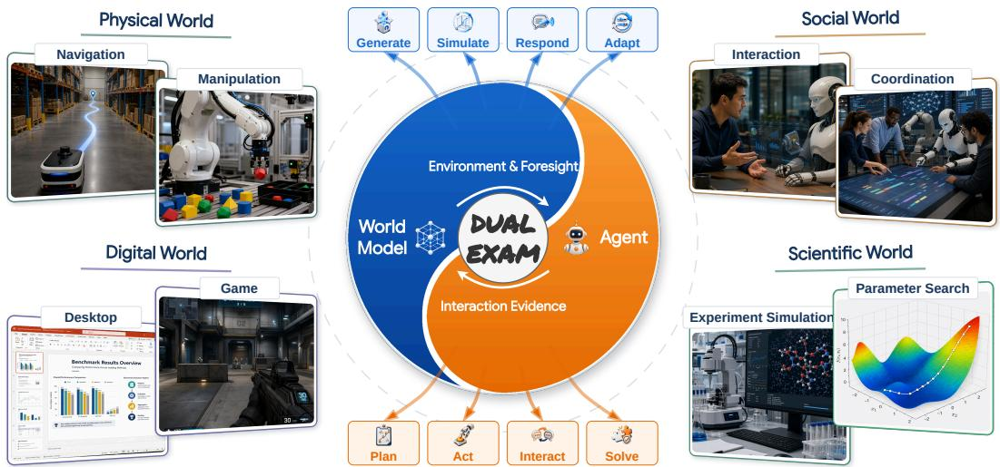  
Figure 1: Agent–World Model interaction and the scope of Dual Exam. World Models can provide simulated observations and action-conditioned predictions, while Agent trajectories can provide interaction evidence. The four domains illustrate complementary application settings. Dual Exam evaluates the two components separately under controlled conditions; the arrows describe potential uses of their interaction rather than demonstrated gains from joint training. The task labels in this overview are illustrative; the evaluated Agent categories and counts are specified in Table 5.

## 1 INTRODUCTION

World Models (WMs) and Multimodal Agents (MAs) can improve each other in complementary ways. WMs support MAs through simulated experience and action-conditioned predictions (Ha & Schmidhuber, 2018; Hafner et al., 2025; Gu et al., 2025), while MA interaction trajectories provide feedback for refining WMs (Zhang et al., 2026b; Yu et al., 2026). Recent work has coupled the two in specific settings (Fang et al., 2025; Guo et al., 2025; Liu et al., 2026). For example, a web agent can use a world model to anticipate candidate clicks, while its trajectories provide data for model refinement (Fang et al., 2025). Broader multimodal interaction requires both effective action selection and faithful responses to those actions. We assess these complementary requirements across physical, digital, social, and scientific domains (Chu et al., 2026). Our focus is task-specific component performance; the relationship between these measurements and gains from joint training requires separate validation.

However, reciprocal improvement requires both MAs and WMs to remain reliable over repeated interaction. MAs still struggle with visual grounding, action sequencing, and sustained task completion (Xie et al., 2024; Chen et al., 2025; Sun et al., 2026). WMs also face challenges in memory consistency and action control (Ye et al., 2026b). Visual fidelity or state similarity alone does not guarantee improved planning or successful task completion (Shang et al., 2026a; Huang et al., 2026). These weaknesses become more apparent when MAs and WMs are coupled. The output of one repeatedly becomes the input to the other. WM-based simulation can improve planning (Gu et al., 2025), but the planning benefits depend on behavioral coverage, environment complexity, and whether the MA can use the predicted outcomes (Li et al., 2025b; Qian et al., 2026a). Model bias may also accumulate over repeated rollouts (Janner et al., 2019). End-to-end performance can show that the coupled system fails, but not why. Failures may come from MA decisions, WM responses, or their interaction. A component-level evaluation is therefore needed to characterize the capabilities that end-to-end outcomes alone cannot reveal.

Our preliminary study tests one MA–WM pairing on 150 cases across ten scenarios, with 0% task success under the stated protocol (Section 2.1). The trajectories reveal state discrepancies and limited responses, but do not identify which component caused each failure. This motivates Dual Exam: controlled, separate assessments of MAs and WMs rather than causal attribution from coupled outcomes.

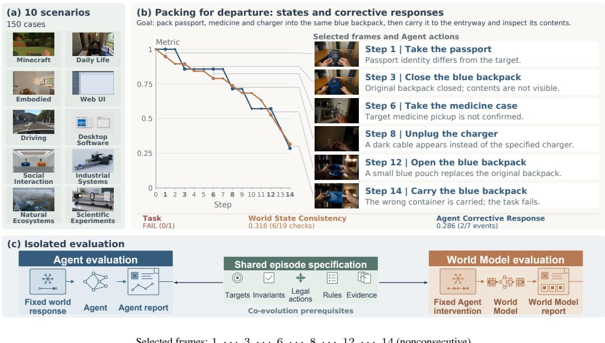  
Figure 2: From a failed packing rollout to controlled evaluation. (a) Coverage of 150 cases across ten scenarios. (b) Six selected frames and diagnostic curves covering all 14 steps of a GPT-5.6 Sol–Seedance 2.5 rollout. The displayed steps are 1, 3, 6, 8, 12, and 14; intervening steps are omitted. Blue text gives MA commands; images show WM responses. Gray lines mark same-step correspondence, not causal attribution. World State Consistency (orange) and Agent Corrective Response (blue) use cumulative deductions from an assigned unit baseline with fixed full-trajectory denominators. Later packing and carrying use a different blue pouch, violating the same-backpack requirement. (c) Dual Exam holds the environment response mechanism fixed to evaluate MAs and fixes action interventions to evaluate WMs under explicit task specifications; the two tracks need not use matched episodes.

We instantiate Dual Exam across four representative domains: physical, digital, social, and scientific. The two tracks share specification-based verification, assessing recorded evidence against explicit goals and state constraints while retaining track-specific cases and metrics. The Agent evaluation compares 10 configurations on 1,088 items organized into 15 reporting categories. The World Model evaluation contains 400 cases across eight scenarios, with 50 cases per scenario and configurationspecific coverage reported in the results. GPT 6 Astra attains the highest Agent Index of 31.3 under the configured case-count weights. GPT-Image-2 leads the full-coverage WM Overall scores at 21.7; 15 of the 16 WM configurations cover all eight scenarios, while Seedance 2.5 is reported separately on six. Performance varies substantially across task categories, and illustrative trajectories distinguish locally plausible behavior from satisfaction of complete task requirements. These measurements characterize the evaluated model–harness configurations under their recorded task specifications; execution settings are not fully matched across configurations. Whether their profiles predict coupled success or improvement through joint training remains an empirical question.

In summary, our contributions are:

• We introduce Dual Exam, a framework for separate, controlled evaluation of Multimodal Agents and World Models. Both tracks verify recorded evidence against task specifications, using fixed environment response mechanisms for Agents and fixed interventions for World Models.

• We compare 10 Agent configurations on 1,088 items in 15 reporting categories across four domains, and organize the World Model evaluation into 400 cases across eight scenarios. The results provide complementary task and scenario profiles, with explicit aggregation rules and configuration-specific coverage.

• We provide a 150-case pilot of one MA–WM pairing, together with trajectory audits and a packing example, to illustrate the diagnostic limits of coupled outcomes and motivate the separate evaluations.

Table 1: Coupled MA–WM evaluation across ten scenarios. GPT-5.6 Sol interacts with Seedance 2.5 on 15 cases per scenario (150 total), with one attempt of at most 20 steps and no episode-level retries. Initialization and technical failures are excluded. Scenario rates are case-averaged; Overall averages the ten displayed scenario rates equally and is rounded to one decimal place. Section 2.1 defines the metrics.
<table><tr><td>Metric (%)</td><td>Minecraft</td><td>Life</td><td>Daily Embodied Web Tasks</td><td>UI</td><td>Driving</td><td>Desktop Software</td><td>Industrial Systems</td><td>Natural</td><td>Scientific Ecosystems Experiments</td><td>Social Interaction</td><td>Overall</td></tr><tr><td>World State Consistency</td><td>12.7</td><td>37.9</td><td>16.5</td><td>18.7</td><td>14.7</td><td>22.9</td><td>34.4</td><td>39.5</td><td>29.5</td><td>38.9</td><td>26.6</td></tr><tr><td>Agent Corrective Response</td><td>0.0</td><td>13.3</td><td>16.7</td><td>6.7</td><td>0.0</td><td>0.0</td><td>20.0</td><td>10.0</td><td>0.0</td><td>25.0</td><td>9.2</td></tr><tr><td>Task success</td><td>0.0</td><td>0.0</td><td>0.0</td><td>0.0</td><td>0.0</td><td>0.0</td><td>0.0</td><td>0.0</td><td>0.0</td><td>0.0</td><td>0.0</td></tr></table>

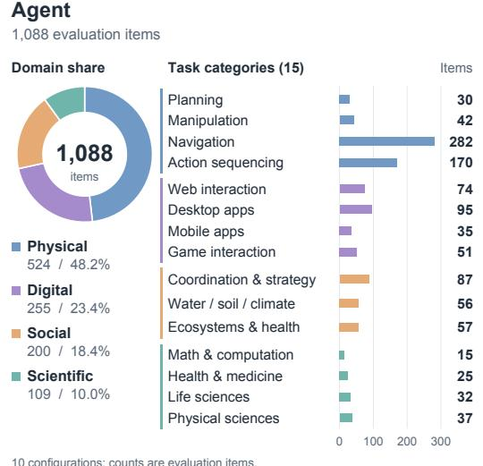

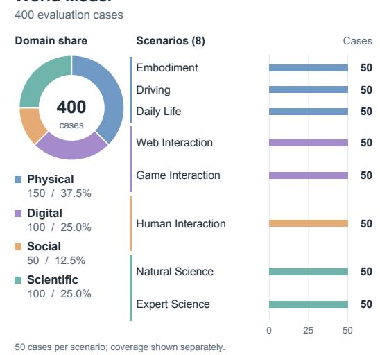  
Figure 3: Evaluation inventory across four domains. Rings show domain shares; bars show counts within each track, with separate horizontal scales. Agent labels are shortened reporting categories, not independent abilities; Table 5 gives their full names. The 1,088 items include ten derived ToolChoice checkpoints. World Model evaluation uses 50 cases in each of eight scenarios: 15 configurations cover all 400 cases; Seedance 2.5 covers six scenarios (300 cases), excluding Daily Life and Human Interaction. Counts are not multiplied by model configurations.

## 2 DUAL EXAM

We first present a preliminary study of coupled MA–WM interaction to motivate the design of Dual Exam. The framework evaluates Agents under fixed reference environment responses and World Models under fixed action interventions. Both tracks assess task-relevant behavior against specified goals and constraints, while retaining track-specific cases, interaction protocols, and verification procedures. The two tracks need not use one-to-one matched episodes. Evaluation relies on recorded execution evidence rather than self-reported completion. Across physical, digital, social, and scientific domains, Dual Exam comprises 1,088 Agent evaluation items and 400 World Model cases.

Figure 3 summarizes the inventory by domain and reporting category.

## 2.1 PRELIMINARY STUDY: MOTIVATION FOR DUAL EXAM

As a pilot study, we evaluate GPT-5.6 Sol with Seedance 2.5 on 150 cases across ten scenarios, with 15 cases per scenario. Each case has one attempt of at most 20 interaction steps, with no episode-level retries. Initialization and technical failures are excluded from the 150 cases and the task-success denominator. Table 1 reports a retrospective trajectory audit; Appendix D details the protocol.

Table 2: Comparison of benchmark scope. Representative Agent and World Model benchmarks are compared along interaction, diagnostic, and evaluation-scope dimensions.
<table><tr><td rowspan="2">Benchmark</td><td colspan="2">Interaction</td><td colspan="2">Diagnosis</td><td colspan="2">Scope</td><td rowspan="2"># Eval.</td></tr><tr><td>Multimodal Input</td><td>Interactive Rollout</td><td>Environment- grounded</td><td>Component Isolation</td><td>Persistent State</td><td>Four-domain Coverage</td></tr><tr><td colspan="8">Agent Benchmarks</td></tr><tr><td>GAIA (Mialon et al., 2024)</td><td>√</td><td>x</td><td>x</td><td>x</td><td>x</td><td>x</td><td>466</td></tr><tr><td>AgentBench (Liu et al., 2024)</td><td>x</td><td>√</td><td>√</td><td>x</td><td>x</td><td>x</td><td>1,141</td></tr><tr><td>WebArena (Zhou et al., 2024)</td><td>x</td><td>√</td><td>√</td><td>x</td><td>x</td><td>x</td><td>812</td></tr><tr><td>VisualWebArena (Koh et al., 2024)</td><td>√</td><td>√</td><td>√</td><td>x</td><td>x</td><td>x</td><td>910</td></tr><tr><td>OSWorld 2.0 (Yuan et al., 2026)</td><td>√</td><td>√</td><td>√</td><td>x</td><td>x</td><td>x</td><td>108</td></tr><tr><td>Agents&#x27; Last Exam (Sun et al., 2026)</td><td>√</td><td>√</td><td>√</td><td>x</td><td>x</td><td>x</td><td>1,500+</td></tr><tr><td>Dual Exam (Agent)</td><td>√</td><td>√</td><td>√</td><td>√</td><td>√</td><td>√</td><td>1,088</td></tr><tr><td colspan="8">World Model Benchmarks</td></tr><tr><td>VBench (Huang et al., 2024)</td><td>x</td><td>x</td><td>x</td><td>x</td><td>x</td><td>x</td><td>946</td></tr><tr><td>WorldScore (Duan et al., 2025)</td><td>√</td><td>√</td><td>x</td><td>x</td><td>x</td><td>x</td><td>3,000</td></tr><tr><td>WorldModelBench (Li et al., 2025a)</td><td>√</td><td>x</td><td>x</td><td>x</td><td>x</td><td>x</td><td>350</td></tr><tr><td>MIND (Ye et al., 2026b)</td><td>√</td><td>√</td><td>x</td><td>x</td><td>√</td><td>x</td><td>250</td></tr><tr><td>WorldArena (Shang et al., 2026a)</td><td>√</td><td>√</td><td>√</td><td>x</td><td>x</td><td>x</td><td>500</td></tr><tr><td>Omni-WorldBench (Wu et al., 2026)</td><td>√</td><td>√</td><td>x</td><td>x</td><td>√</td><td>x</td><td>1,068</td></tr><tr><td>WorldMark (Xu et al., 2026)</td><td>√</td><td>√</td><td>x</td><td>x</td><td>√</td><td>x</td><td>500</td></tr><tr><td>WBench (Ying et al., 2026)</td><td>√</td><td>√</td><td>x</td><td>x</td><td>√</td><td>x</td><td>289</td></tr><tr><td>WorldExam (Yang et al., 2026)</td><td>√</td><td>√</td><td>x</td><td>x</td><td>√</td><td>x</td><td>1,474</td></tr><tr><td>PlayWorld (Ding et al., 2026)</td><td>√</td><td>√</td><td>x</td><td>x</td><td>√</td><td>x</td><td>171</td></tr><tr><td>Dual Exam (World Model)</td><td>√</td><td>√</td><td>√</td><td>√</td><td>√</td><td>√</td><td>400</td></tr></table>

Notation. ✓ / ✗ indicate explicit / no explicit coverage, not model capability; coverage need not span all tasks. Multimodal Input: visua inputs paired with language or action/control inputs, initially or during interaction. Interactive Rollout: actions or controls affect subsequent observations or states, using predefined or adaptive sequences. Environment-grounded: evaluation against execution outcomes or independently verifiable environment states. Component Isolation: controlled reference conditions or interventions evaluate one component while fixing the other side. This indicates evaluation design, not causal attribution of failures in a coupled system. Persistent State: dedicated evaluation of state preservation or evolution across revisits, occlusion, or interaction turns, beyond generic temporal video quality. Four-domain Coverage: coverage of physical, digital, social, and scientific domains. # Eval. Units: benchmark-specific counts of questions, tasks, prompts, videos, or scenarios, not directly comparable.

World State Consistency measures preservation of task-relevant identity and state and realization of requested action effects, averaging supported checks over applicable checks, then over steps and cases. Agent Corrective Response measures eligible visible discrepancies receiving targeted verification, repositioning, or correction within two actions; it measures response behavior, not successful repair. Task Success requires satisfying the full goal and all constraints. Scenario rates are case-averaged. Overall is recomputed as the unweighted mean of the ten displayed scenario rates, Overall $\begin{array} { r } { = \frac { 1 } { 1 0 } \sum _ { s = 1 } ^ { 1 0 } r _ { s } , } \end{array}$ giving 26.6%, 9.2%, and 0.0% after rounding to one decimal place.

The packing rollout illustrates the gap between issuing task commands and meeting task requirements (Figure 2(b)). Three items must be packed into the same blue backpack and carried to the entryway for inspection. Commands continue despite unconfirmed acquisition, and later packing and carrying use a smaller blue pouch, violating the same-backpack requirement. Six selected frames accompany curves over all 14 steps, ending at 0.316 (6/19 state checks) and 0.286 (2/7 response events). Both responses are navigation retries; none of the four identity discrepancies receives a targeted response.

Unlike the table’s audit, the single-case state score excludes unknown checks. Its curves accumulate deductions from an assigned unit baseline using fixed full-trajectory denominators. Their decline follows from this definition, not measured monotonic capability degradation; they are retrospective diagnostics rather than isolated model scores. Appendix D gives the scoring details and limitations.

The pilot motivates a diagnostic question: how does each component perform when the other side is controlled? Dual Exam holds a fixed reference environment response mechanism fixed to test MAs and fixes action interventions to test WMs against specified goals and constraints (Figure 2(c)). These tests measure role-specific performance rather than retrospectively assigning causes to the pilot failures. Table 2 compares this scope with existing benchmarks.

Research questions. We ask (RQ1) how Agent task performance varies when the response mechanism is fixed, and (RQ2) how World Models realize prescribed actions while preserving task-relevant state. The pilot motivates these questions; it is not a third, matched factorial experiment. Our four domains provide diverse operational settings, not a complete or orthogonal taxonomy of intelligence.

The reporting categories organize tasks and results rather than define independent latent abilities;   
each task is scored against verifiable outcomes and constraints. The full inventory appears in Table 5.

## 2.2 DUAL EXAMINATION FRAMEWORK

Reliable MA–WM interaction requires both effective action selection and faithful action-conditioned state evolution. An Agent must choose actions that advance the task, while a WM must realize their consequences and preserve task-relevant state. These requirements are interdependent in coupled rollouts: WM outputs inform subsequent MA decisions, and MA actions determine the transitions the WM must generate. End-to-end outcomes therefore reflect both components and their interaction. Dual Exam examines these complementary requirements through two controlled evaluation tracks. The Agent track fixes the environment response mechanism to assess action selection and task completion, while the World Model track fixes action interventions to assess the resulting state evolution. Together, the tracks characterize capability gaps on both sides of the interaction loop. Specifically, the Agent track evaluates a candidate $A _ { \theta }$ against a fixed reference environment response process:

$$
a _ { t } \sim A _ { \theta } ( h _ { t } ) , \qquad o _ { t + 1 } ^ { * } = T ^ { * } ( s _ { t } , a _ { t } ) ,
$$

where $s _ { t }$ is the reference environment state, $h _ { t }$ is the observation–action history available to the Agent, and $o _ { t + 1 } ^ { * }$ is the returned reference observation. $\tau ^ { * }$ denotes the fixed response mechanism, including observation generation; it need not expose the underlying state to the Agent. The Agent is responsible for action selection, verification, recovery, and task completion. The World Model track instead fixes a specification-defined intervention sequence $a _ { 1 : T } ^ { * }$ and evaluates the resulting observations:

$$
\hat { o } _ { t + 1 } = M _ { \phi } ( \hat { s } _ { t } , a _ { t } ^ { * } ) .
$$

Here, $\hat { s } _ { t }$ denotes the generated context carried forward by the WM interface, rather than an observed ground-truth state, and $\hat { o } _ { t + 1 }$ is its next generated observation. The superscript ∗ identifies reference inputs or responses. Holding a mechanism fixed controls its variation across candidates; it does not certify its correctness. Appendix C distinguishes recorded validation evidence from unresolved reliability checks. Both tracks assess task-relevant behavior against specified goals and constraints, while retaining track-specific cases, interaction protocols, and verification procedures. Table 2 compares this scope with representative Agent and World Model benchmarks.

Shared specification, distinct measurements. Both tracks specify an initial condition, permitted intervention, required change, protected state, and evidence rule. For example, a specification can require moving an object into a particular container while preserving that container’s identity. In an Agent test, the reference environment executes the Agent’s chosen actions and the verifier checks the goal. In a WM test, a prescribed packing action is supplied and generated observations are checked for the requested change and preserved identity. This example explains how the same invariant can be expressed in both tracks; it does not report a matched pair of evaluated episodes. Shared specification principles do not imply shared tasks, numerical scores, or training data.

Diagnostic scope. The two tracks identify component-level capability gaps under controlled conditions. They do not by themselves establish the cause of a particular coupled failure or whether joint training will yield sustained reciprocal improvement. These questions require matched interaction experiments and evaluation across successive training rounds.

## 2.3 AGENT EXAMINATION: CONTROL THE WORLD, TEST THE AGENT

The Agent Examination tests whether a candidate MA can complete tasks in a controlled, specificationconsistent environment through observation interpretation, state reasoning, planning, action selection, progress verification, and error recovery. Figure 4 summarizes benchmark construction and evaluation.

Benchmark construction. The current Agent inventory contains 1,088 evaluation tasks in 15 reporting categories across four domains: 524 Physical, 255 Digital, 200 Social, and 109 Scientific. The Scientific domain combines 63 selected tasks from Agents’ Last Exam (ALE), 30 scientific code-repair tasks sourced from SWE-bench (Jimenez et al., 2023), ten ToolChoice tasks derived from the repair workflows, and six EdgeBench optimization tasks (Zhu et al., 2026a). Each ToolChoice task inherits its parent repair task’s subject category but constitutes a distinct evaluated decision checkpoint. The 109 tasks therefore include 99 full workflows and ten checkpoints; their related provenance does not imply independent observations. Six EdgeBench optimization tasks are included; the other 84 historical ALE tasks remain excluded. Table 5 gives the category counts, while Table 10 separates subject category from task source.

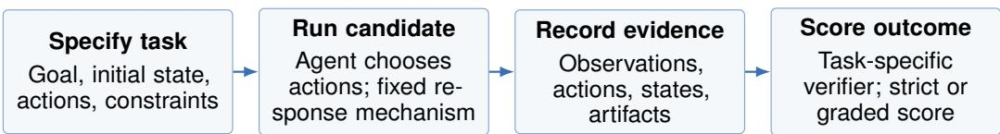

Figure 4: Agent task construction and evaluation. Tasks specify goals, initial states, allowed actions, rules, and required checks. Candidate Agents interact with controlled environments under predefined settings and budgets, with observations, actions, states, and artifacts recorded throughout. Task-specific scoring separates strict success from graded outcomes and marks technically invalid records separately.  
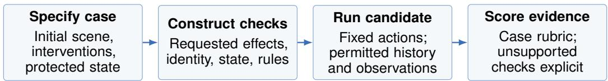  
Figure 5: World Model task construction and evaluation. Behavior traces provide case seeds, which are expanded into intervention sequences and case-specific rubrics. Automated screening and expert review are construction checks. Fixed-intervention rollouts are scored against the case rubrics; construction review does not constitute independent agreement testing of the resulting scores.

Evaluation and aggregation. Task-specific scores are reported on a 0–100 scale. A score can represent strict completion or graded performance according to the corresponding task’s evaluation rule; the values should not all be interpreted as binary success rates. For model configuration m, category score $s _ { m , c } ,$ and category count $n _ { c } ,$ the reported Index is

$$
I _ { m } = \frac { \sum _ { c } n _ { c } s _ { m , c } } { 1 0 8 8 } .
$$

Physical, Digital, Social, and Scientific tasks contribute approximately 48.16%, 23.44%, 18.38%, and 10.02%, respectively. These weights describe the selected inventory rather than domain importance. For each Scientific category $c ,$ let $n _ { c } ^ { \mathrm { A L E } }$ and $s _ { m , c } ^ { \mathrm { A L E } }$ denote its original count and displayed mean, and let $b _ { m , j } \in \{ 0 , 1 \}$ be strict success on an added task. We compute

$$
s _ { m , c } = \frac { n _ { c } ^ { \mathrm { A L E } } s _ { m , c } ^ { \mathrm { A L E } } + 1 0 0 \sum _ { j \in \mathrm { S W E } _ { \mathrm { c } } \cup \mathrm { T o o l C h o i c e } _ { c } } b _ { m , j } + \sum _ { j \in \mathrm { E d g e } _ { c } } e _ { m , j } } { n _ { c } ^ { \mathrm { A L E } } + n _ { c } ^ { \mathrm { S W E } } + n _ { c } ^ { \mathrm { T o o l C h o i c e } } + n _ { c } ^ { \mathrm { E d g e } } } .
$$

Here $e _ { m , j } \in [ 0 , 1 0 0 ]$ is the Edge task score under our aggregation convention. For Borden and DABIC we define $e = \operatorname* { m i n } ( 1 0 0 , \operatorname* { m a x } ( 0 , s _ { \mathrm { r a w } } ) )$ ; this clipping is introduced by Dual Exam and is not an official EdgeBench normalization rule. Raw values are retained in Appendix A.13. Original ALE and other category means retain their published one-decimal precision; derived Scientific means and Index are computed before final rounding. This preserves the published baseline rather than reconstructing unavailable unrounded means. ToolChoice uses strict full-pass scores, not its auxiliary partial-credit score. Appendix A.2 reports equal-domain weighting, and the Scientific evaluation notes document configuration differences and scoring limitations.

## 2.4 WORLD MODEL EXAMINATION: CONTROL THE ACTIONS, TEST THE WORLD MODEL

The World Model Examination fixes action selection and tests whether a candidate WM correctly realizes specification-valid interventions while preserving prior state, identities, and shared-state consistency and obeying active rules. Figure 5 summarizes case construction and evaluation.

Benchmark construction. The World Model evaluation comprises 400 cases across eight scenarios, with 50 cases per scenario: Embodiment, Driving, and Daily Life in the Physical domain; Web and Game in the Digital domain; Human Interaction in the Social domain; and Natural Science and

Expert Science in the Scientific domain. Cases specify interventions and checks for requested action effects, preservation of prior state and identities, shared-state consistency, and rule adherence. This allocation gives 150 Physical, 100 Digital, 50 Social, and 100 Scientific cases. Case construction and validation are distinct from independent verification of scores assigned to model outputs.

Evaluation and aggregation. Each rollout uses fixed interventions and the observations and history permitted by its configuration. Case-specific checks assess action effects, state and identity preservation, shared-state consistency, and rule adherence. Observable model errors remain evaluation outcomes; technical failures and unsupported scenarios must be recorded separately. WM Overall is the mean of the eight scenario scores on a 0–100 scale. With 50 cases per scenario, this is also a case-balanced aggregate when each scenario score averages the same number of equally weighted case scores. It is not an equal-domain average: the scenario allocation gives Physical, Digital, Social, and Scientific weights of 37.5%, 25%, 12.5%, and 25%. Missing scenario scores are not zeros. A mean over fewer scenarios must be labeled as partial coverage and must not enter the full-coverage Overall ranking.

Modality and execution scope. Table 4 separates image and video configurations. The shared target is observable task-consistent state evolution; video additionally supplies temporal evidence unavailable from a static checkpoint. A plausible still image cannot establish timing or an oscillation period. Text-only World Models are outside this visual-observation scope and would require a separately specified observation interface and rubric. Per-configuration histories, duration, budgets, and missing provenance limit cross-modality interpretation (Appendix C).

## 3 EXPERIMENTS

Following the coupled pilot, we evaluate the two components separately. Table 3 compares 10 Agent configurations across 15 reporting categories and 1,088 evaluation items. The World Model evaluation uses 400 cases across eight scenarios, with 50 cases per scenario; Table 4 reports scenario scores and distinguishes full from partial coverage. Agent Index and WM Overall use different tasks, metrics, and aggregation rules and are not directly comparable. Appendices A and B provide illustrative trajectories. These examples explain particular behaviors rather than estimate failure frequencies or establish controlled comparisons between historical configurations.

## 3.1 AGENT RESULTS: RQ1

Execution performance varies across task settings. The fixed-environment track measures Agent performance without variation from a candidate World Model. The highest displayed scores are 9.5 for Manipulation, 11.2 for Action Sequencing, and 5.6 for Desktop Application Interaction. Other settings yield higher maxima: 29.6 for Web Interaction, 42.9 for Mobile Application Interaction, and 47.1 for Game Environment Interaction. These contrasts describe performance under the respective task requirements and scoring rules; they do not isolate the effect of the interaction setting or establish equal difficulty across categories. The results nevertheless show that a high aggregate score can coexist with low scores on particular execution tasks.

Locally correct elements may fail to form a valid solution. The illustrative Navigation cases distinguish valid feasibility judgments from routes containing nonexistent edges. The Action Sequencing cases similarly distinguish correct clip membership from correct ordering. In each setting, recognizing relevant elements is insufficient when their combination violates the task’s constraints. These examples motivate explicit checks of route validity, ordering, and goal satisfaction during execution. They illustrate possible failure mechanisms but do not establish their frequency in the current evaluation or their causal contribution to model rankings.

Scientific scores combine distinct evaluation units. Across 109 Scientific items, GPT 6 Astra has the highest within-domain case-weighted score of 50.6, followed by DeepSeek V4.1 Flash at 44.0 and GPT 5.6 Sol at 42.2. The category leaders differ: Astra leads Mathematics & Computation (60.8) and Physical Sciences (52.2), Sol leads Health & Medicine (45.4), and DeepSeek leads Life Sciences (53.7). These scores combine 63 ALE tasks, 30 SWE-bench repair tasks, ten derived ToolChoice checkpoints, and six EdgeBench optimization tasks. SWE and ToolChoice contribute strict binary outcomes, while Edge contributes graded quality scores under the mapping in Appendix A.13, including our explicit clipping convention for Borden and DABIC. The domain mean is therefore not a uniform success rate, and the related ToolChoice checkpoints do not constitute independent full-workflow trials.

Table 3: Agent leaderboard by overall Index. 10 model configurations are compared across 15 task categories and 1,088 evaluation items on a 0–100 scale. N is the number of items. Index uses case-count weights (524 Physical, 255 Digital, 200 Social, and 109 Scientific); it is not an equal-domain average. Bold and underline indicate the highest and second-highest distinct scores, including ties. Model columns are ordered by Index from highest to lowest, using the aggregates recomputed from displayed category scores before final rounding for ordering and Index highlights.
<table><tr><td>Category</td><td>N</td><td>GPT 6 Astra</td><td>GPT 5.6 Sol</td><td>Gemini 3.6 Flash</td><td>Qwen 3.8 Max</td><td>Kimi K3</td><td>DeepSeek V4.1 Flash</td><td>GLM 5.3 Flash</td><td>Seed 2.1 Pro</td><td>MiniMax M3</td><td>MiMo V2.5</td></tr><tr><td colspan="10">OpenAI (2026b) OpenAI (2026a) Google (2026a) Alibaba (2026a) Moonshot AI (2026) DeepSeek (2026) Zhipu (2026) ByteDance (2026a) MiniMax (2026b) Xiaomi (2026) Physical World</td></tr><tr><td></td><td></td><td></td><td></td><td></td><td></td><td></td><td></td><td></td><td></td><td></td><td></td></tr><tr><td>PL MAN</td><td>30 42</td><td>63.3</td><td>16.7</td><td>10.0 4.8</td><td>20.0 7.1</td><td>16.7 4.8</td><td>23.2 4.8</td><td>10.0 7.1</td><td>3.3 0.0</td><td>3.3 0.0</td><td>6.7 7.1</td></tr><tr><td>NAV</td><td>282</td><td>7.1</td><td>9.5</td><td></td><td>36.2</td><td>33.3</td><td>23.1</td><td>23.1</td><td></td><td>22.0</td><td>15.6</td></tr><tr><td>AS</td><td>170</td><td>49.7 11.2</td><td>36.2 6.5</td><td>37.6 0.0</td><td>6.5</td><td>4.7</td><td>2.4</td><td>4.1</td><td>8.9 3.5</td><td>0.6</td><td>0.0</td></tr><tr><td colspan="10">Digital World</td></tr><tr><td></td><td></td><td></td><td></td><td></td><td></td><td></td><td></td><td></td><td></td><td></td><td></td></tr><tr><td>WI DAI</td><td>74</td><td>29.6</td><td>24.9</td><td>7.8</td><td>20.1</td><td>14.3</td><td>14.1</td><td>20.7</td><td>18.5</td><td>22.0</td><td>11.8</td></tr><tr><td>MAI</td><td>95</td><td>5.6</td><td>2.1</td><td>2.1</td><td>3.2</td><td>1.1</td><td>4.5</td><td>1.6</td><td>1.1</td><td>2.1</td><td>1.6 14.3</td></tr><tr><td>GEI</td><td>35 51</td><td>42.9 47.1</td><td>8.6 13.3</td><td>22.9 25.4</td><td>20.0 27.1</td><td>28.6 15.9</td><td>8.6 20.3</td><td>8.6 20.0</td><td>2.9 15.1</td><td>8.6 10.4</td><td>18.0</td></tr><tr><td colspan="10">Social World</td></tr><tr><td></td><td>87</td><td>31.5</td><td>15.7</td><td>48.0</td><td>18.1</td><td>32.5</td><td>10.1</td><td>14.2</td><td>50.6</td><td>13.5</td><td>13.5</td></tr><tr><td>CSI WSC-RG</td><td>56</td><td>8.3</td><td>10.9</td><td>8.9</td><td>11.7</td><td>9.3</td><td>43.9</td><td>9.5</td><td>11.0</td><td>10.2</td><td>12.9</td></tr><tr><td>TEH-RG</td><td>57</td><td>9.6</td><td>13.1</td><td>10.4</td><td>11.2</td><td>10.4</td><td>21.1</td><td>11.5</td><td>12.8</td><td>12.0</td><td>14.9</td></tr><tr><td colspan="10">Scientific World</td></tr><tr><td>MC</td><td></td><td></td><td></td><td></td><td>37.1</td><td></td><td></td><td>40.0</td><td>32.7</td><td></td><td>31.9</td></tr><tr><td>HM</td><td>15 25</td><td>60.8</td><td>45.2</td><td>38.5 10.2</td><td>22.8</td><td>49.5</td><td>45.5 37.8</td><td>41.8</td><td>22.8</td><td>10.3</td><td>18.6</td></tr><tr><td>LS</td><td>32</td><td>44.3 48.9</td><td>45.4</td><td>28.2</td><td>30.1</td><td>39.1 37.8</td><td>53.7</td><td>36.5</td><td>29.5</td><td>8.6 19.2</td><td>25.9</td></tr><tr><td>PS</td><td>37</td><td>52.2</td><td>46.6 35.0</td><td>25.3</td><td>19.7</td><td>20.9</td><td>39.2</td><td>39.1</td><td>14.5</td><td>7.9</td><td>15.2</td></tr><tr><td>Index ↑</td><td>1,088</td><td>31.3</td><td>20.7</td><td>20.1</td><td>20.0</td><td>19.8</td><td>18.3</td><td>16.1</td><td>12.7</td><td>11.7</td><td>11.4</td></tr><tr><td>Index</td><td>35 20</td><td>_</td><td>_</td><td></td><td></td><td></td><td></td><td></td><td></td><td></td><td></td></tr></table>

Category names describe reporting groups, not independent latent abilities. Physical Sciences includes physics, chemistry, materials, and Earth/space applications. Game Environment Interaction includes Godot and GameWorld without double counting. The bars show Index on a shared zero-based 0–35 axis with a light reference at 20; the score range remains 0–100. A light purple-to-orange palette follows the displayed model order; color differences do not indicate statistical significance. Six EdgeBench optimization tasks are included using the convention in Appendix A.13. Scientific scores combine the original ALE category means with 30 SWE-bench repair tasks, ten ToolChoice tasks, and six EdgeBench tasks. SWE and ToolChoice receive 100 for strict success and 0 otherwise; Edge uses graded scores. Borden and DABIC are clipped to [0,100] by Dual Exam, not by an official EdgeBench normalization rule. Derived scores and Index use the original displayed one-decima means as baseline and the added item-level scores before final rounding. These are model–harness configurations; scientific evaluation settings and limitations are described with Table 11.  
Abbreviations: PL = Planning; MAN = Manipulation; NAV = Navigation; AS = Action Sequencing; WI = Web Interaction; DAI = Desktop Application Interaction; MAI = Mobile Application Interaction; GEI = Game Environment Interaction; CSI = Coordination & Strategic Interaction; WSC-RG = Water, Soil & Climate Resource Governance; TEH-RG = Terrestrial Ecosystem & Health Resource Governance; MC = Mathematics & Computation; HM = Health & Medicine; LS = Life Sciences; PS = Physical Sciences.

Aggregate rank depends on task composition. GPT 6 Astra leads the case-weighted Agent Index with 31.3, followed by GPT 5.6 Sol at 20.7 and Gemini 3.6 Flash at 20.1. Qwen 3.8 Max ranks fourth at 20.0 and Kimi K3 fifth at 19.8. Four configurations attain the highest displayed score in at least one category: GPT 6 Astra leads nine categories, DeepSeek V4.1 Flash leads three, GPT 5.6 Sol leads two, and Seed 2.1 Pro leads one. No configuration leads every category. Equal-domain weighting changes several positions: DeepSeek moves from sixth to second and Kimi from fifth to fourth, while GPT 6 Astra remains first (Appendix A.2). Physical tasks account for 48.16% of Index and Scientific tasks for 10.02%; these weights reflect the inventory rather than equal domain importance. These rankings describe the chosen aggregation rules and evaluated model–harness configurations. Small differences derived from rounded baseline means do not establish statistically significant superiority.

Table 4: World Model scenario scores. Sixteen configurations are evaluated on eight scenarios (50 cases each; 400 cases for full coverage). Columns group image and video outputs, ordered by Overall within each full-coverage group. The separate final column covers six scenarios. Cross-modality comparisons are descriptive.
<table><tr><td colspan="5">Image outputs: full coverage</td><td colspan="10">Video outputs: full coverage</td></tr><tr><td rowspan="5">Scenario</td><td>S</td><td>女</td><td>1</td><td>0</td><td>小</td><td>8</td><td>@</td><td></td><td>A</td><td>荘</td><td>回</td><td>Q</td><td>∞</td><td>FR</td><td>Partial† 8 0</td></tr><tr><td>GPT</td><td>Qwen</td><td>Nano</td><td>Seedream MiniMax</td><td></td><td>Kling</td><td>Cosmos3</td><td>LTX</td><td>Alaya Zing</td><td>YUME</td><td>Matrix</td><td>Echo</td><td>LingBot</td><td>SANA</td><td>Seedance</td></tr><tr><td></td><td></td><td>Image 2 Image 3.0 Banana 2</td><td>5.0 Pro</td><td>H3</td><td>3.0</td><td>Super</td><td>2.5 World</td><td>0.5</td><td>1.5</td><td>Game 3.5</td><td>WM</td><td>World v2</td><td>WM</td><td>2.5†</td></tr><tr><td>OpenAl</td><td>Alibaba</td><td>Google</td><td>ByteDance</td><td>MiniMax</td><td>Kuaishou</td><td>NVIDIA</td><td>Lightricks Team et al. Seedleap.ai Mao et al.</td><td></td><td></td><td>Qian et al.</td><td>Zhang et al.</td><td>Gao et al.</td><td>Zhu et al.</td><td>ByteDance</td></tr><tr><td>(2026c)</td><td>(2026b)</td><td>(2026b)</td><td>(2026c)</td><td>(2026a)</td><td>(2026)</td><td>(2026)</td><td>(2026)</td><td>(2026)</td><td>(2026) (2025)</td><td>(2026b)</td><td>(2026a)</td><td>(2026)</td><td>(2026b)</td><td>(2026b)</td></tr><tr><td>Physical World</td><td></td><td></td><td></td><td></td><td></td><td></td><td></td><td></td><td></td><td></td><td></td><td></td><td></td><td></td><td></td></tr><tr><td>Emb.</td><td>20.9</td><td>20.5</td><td>25.8</td><td>13.7 53.8</td><td>38.7</td><td>44.7</td><td>41.9</td><td>21.1</td><td>12.8</td><td>27.9</td><td>14.3</td><td>14.4</td><td>25.9</td><td>21.6</td><td>51.2</td></tr><tr><td>Drive</td><td>15.0</td><td>19.8</td><td>17.3 12.0</td><td>12.7</td><td>11.3</td><td>7.3</td><td>10.5</td><td>3.9</td><td>8.0</td><td>6.0</td><td>6.2</td><td>6.2</td><td>3.0</td><td>1.1</td><td>12.3</td></tr><tr><td>Daily</td><td>45.2</td><td>46.1</td><td>32.6 33.9</td><td>23.3</td><td>28.7</td><td>31.5</td><td>25.1</td><td>40.7</td><td>22.5</td><td>20.9</td><td>20.4</td><td>19.4</td><td>16.5</td><td>19.5</td><td>一</td></tr><tr><td>Digital World</td><td></td><td></td><td></td><td></td><td></td><td></td><td></td><td></td><td></td><td></td><td></td><td></td><td></td><td></td><td></td></tr><tr><td>Web</td><td>16.5</td><td>10.7</td><td>11.8 9.5</td><td>3.7</td><td>2.7</td><td>1.8</td><td>5.0</td><td>5.8</td><td>3.4</td><td>5.9</td><td>4.0</td><td>0.7</td><td>1.5</td><td>2.4</td><td>6.0</td></tr><tr><td>Game</td><td>13.3</td><td>11.5 13.3</td><td>12.9</td><td>8.5</td><td>6.0</td><td>5.9</td><td>7.8</td><td>9.3</td><td>7.2</td><td>6.0</td><td>9.4</td><td>1.6</td><td>0.4</td><td>4.7</td><td>9.6</td></tr><tr><td>Social World</td><td></td><td></td><td></td><td></td><td></td><td></td><td></td><td></td><td></td><td></td><td></td><td></td><td></td><td></td><td></td></tr><tr><td>Human 22.9</td><td></td><td>21.6</td><td>20.0 4.7</td><td>10.7</td><td>18.2</td><td>12.6</td><td>11.5</td><td>18.9</td><td>19.3</td><td>10.1</td><td>7.7</td><td>12.1</td><td>6.5</td><td>2.6</td><td></td></tr><tr><td>Scientific World</td><td></td><td></td><td></td><td></td><td></td><td></td><td></td><td></td><td></td><td></td><td></td><td></td><td></td><td></td><td></td></tr><tr><td>Nat. Sci.</td><td>21.5</td><td>21.5</td><td>19.5</td><td>14.3 14.6</td><td>14.0</td><td>11.5</td><td>10.9</td><td>9.0</td><td>10.5</td><td>10.2</td><td>3.6</td><td>8.2</td><td>8.6</td><td>7.9</td><td>15.1</td></tr><tr><td>Exp. Sci.</td><td>18.6</td><td>17.4</td><td>15.5 7.6</td><td>11.2</td><td>17.3</td><td>11.9</td><td>10.7</td><td>14.3</td><td>15.7</td><td>5.5</td><td>12.9</td><td>8.1</td><td>6.7</td><td>2.3</td><td>17.9</td></tr><tr><td>Overall ↑ 21.7</td><td></td><td>21.1</td><td>19.5</td><td>13.6 17.3</td><td>17.1</td><td>15.9</td><td>15.4</td><td>15.4</td><td>12.4</td><td>11.6</td><td>9.8</td><td>8.8</td><td>8.6</td><td>7.8</td><td>18.7†</td></tr></table>

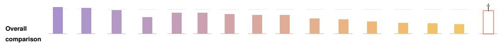  
Overall is the source eight-scenario mean for full-coverage configurations. Bold indicates the best and underline the second-highest distinct score (ties included); scenario highlights include all available values. The partial-coverage mean is excluded from fullcoverage Overall ranking.  
† Seedance 2.5 covers six scenarios (300 cases); Daily Life and Human Interaction are unavailable due to face-generation restrictions. Missing values are not zero. Its six-scenario mean is shown separately with an outlined bar. Bars use a shared zero-based 0–35 axis with a reference at 20; scores remain on a 0–100 scale.  
Abbreviations: Emb. = Embodiment; Drive = Driving; Daily = Daily Life; Web/Game/Human = Web/Game/Human Interaction; Nat./Exp. Sci. = Natural/Expert Science.

## 3.2 WORLD MODEL RESULTS: RQ2

Action responsiveness must preserve accumulated progress. The fixed-intervention track tests whether valid action inputs produce valid state evolution. Its illustrative failures show that responding to the current instruction is only part of this requirement. Qwen-Image-3.0 restores the apparatus view following an instruction in the pendulum case (Appendix Figure 21), but introduces additional cups in the cup-stacking case, violating the initial quantity constraint (Appendix Figure 23). MiniMax H3 preserves the cup count yet introduces an unrequested red tray, whereas GPT-Image-2 preserves the original tray colors (Appendix Figure 24). These cases illustrate distinct failures in realizing requested changes and preserving unaffected state; they do not establish the causes of aggregate ranking differences. In coupled interaction, such state errors can become misleading observations for the Agent.

Digital scenarios remain challenging across configurations. All evaluated configurations score at most 16.5 on Web and 13.3 on Game (Table 4). Even models with stronger results elsewhere remain weak in these scenarios: MiniMax H3 scores 53.8 on Embodiment but only 3.7 on Web and 8.5 on Game, while Qwen-Image-3.0 scores 46.1 on Daily Life but 10.7 on Web and 11.5 on Game. These results identify digital scenarios as a shared weakness under the evaluated protocol, although differences in task difficulty and scoring prevent attributing the gap solely to the domain.

Scenario averages do not establish suitability for a partner Agent. GPT-Image-2 leads WM Overall with 21.7 versus 17.3 for MiniMax H3, but their ordering reverses on Embodiment, at

20.9 versus 53.8. WM Overall weights the eight scenarios equally, whereas a particular Agent may encounter a different distribution of states and actions. A higher overall score therefore need not imply more reliable responses along that Agent’s trajectories. Scenario profiles narrow this uncertainty, but selecting an effective Agent–World Model pairing requires evaluation on the interactions the pair actually produces.

Joint perspective. Reliable task progress requires both effective Agent decisions and World Model responses that correctly realize action effects while preserving task-relevant state, since these responses also inform the Agent’s judgment of progress. The two tracks assess these complementary capabilities, but do not establish how their scores jointly predict coupled success.

## 4 DISCUSSION

## 4.1 RELATED WORK

Existing benchmarks typically assess one component. Agent benchmarks measure tool use, collaboration, workplace execution, transferable skills, and long-horizon computer operation (Liu et al., 2024; Yao et al., 2024; Barres et al., 2025; Xu et al., 2024; Li et al., 2026; Sun et al., 2026), whereas World Model benchmarks evaluate prediction, embodied functionality, latent dynamics, memory, action control, and behavioral consistency (Shang et al., 2026b; Chen et al., 2025; Vafa et al., 2024; Ye et al., 2026b; Huang et al., 2026). These benchmarks assess competence, not reciprocal improvement.

Prior work supports both directions. Dyna and learned World Models use simulated trajectories to improve planning and policies (Sutton, 1990; Ha & Schmidhuber, 2018; Hafner et al., 2025; Gu et al., 2025; Wang et al., 2026). Conversely, Agent-directed exploration and policy rollouts improve held-out World Model learning or adapt simulators (Kim et al., 2020; Chebotar et al., 2019), while recent methods refine World Models from interaction feedback (Zhang et al., 2026b; Yu et al., 2026). DreamZero jointly predicts video and actions for robot control and reports transfer to new tasks and embodiments (Ye et al., 2026a). Such results support studying action-conditioned visual models in embodied systems; they do not validate our cross-domain rankings or establish a reciprocal training loop. These gains are demonstrated within bounded task distributions. Narrow-domain systems begin to close the loop. WebEvolver (Fang et al., 2025) couples Agent experience with an evolving World Model, GenEnv co-evolves LLM Agents and environment simulators, and COMAP alternates World Model and policy updates (Fang et al., 2025; Guo et al., 2025; Liu et al., 2026).

## 4.2 TOWARD AGENT–WORLD MODEL CO-EVOLUTION

World Models can improve Agents through simulated experience, as DreamerV3 demonstrates across diverse control tasks (Hafner et al., 2025). Such benefits depend on controlling model bias: MBPO uses short simulated rollouts to support policy learning (Janner et al., 2019). The relevant test is whether this experience improves Agent behavior beyond the model used for training.

Agents can, in turn, improve World Models by collecting informative interaction data. Directed exploration improves predictive model learning (Kim et al., 2020), while SimOpt uses real policy rollouts to refine simulator parameter distributions and improve policy transfer (Chebotar et al., 2019). These updates improve the model or simulator; the Agent’s task score alone does not measure the collected data’s training value.

Connecting these directions offers a route to co-evolution, but separate gains do not establish a stable loop. WebEvolver links them by training a World Model on Agent trajectories and using it for policy training and look-ahead planning (Fang et al., 2025). We hypothesize that reciprocal improvement across broader multimodal tasks may become sustainable once both components reach sufficient task-specific competence, but neither this transition nor the required capability levels has been established.

Dual Exam diagnoses component capabilities rather than co-evolution itself. Our observed execution and state-consistency failures identify possible obstacles to useful interaction, not evidence of limited learnability. In the packing case, commands continue after the container changes (Figure 2); this observation motivates diagnosis but does not test whether either component can learn from the interaction. Future work should compare joint updates with Agent-only, World-Model-only, and no-update controls, using fixed held-out tests across rounds and seeds to track both components and closed-loop task success. This would test whether both components improve over successive rounds and whether these gains translate into more reliable joint task performance.

Implications for system design. The observed cases suggest concrete targets for subsequent experiments. Invalid routes and action orders motivate explicit checks of global constraints before committing to a sequence. Changes in container identity, object count, or unrelated scene attributes motivate verification that requested updates preserve protected state. Resource-allocation examples motivate checks of joint constraints rather than individual choices alone. These are hypotheses motivated by illustrative failures, not established explanations of aggregate performance. Their utility should be tested through controlled interventions on the same cases, measuring both strict task completion and any separately defined intermediate progress.

## 4.3 EVALUATION LIMITATIONS

Evaluation limitations. The reported scores depend on task selection, reference environments, verification rules, and configuration-specific execution settings. Fixed conditions reduce one source of variation but do not establish that the reference mechanism is error-free. The current presentation does not report an independent, stratified agreement estimate for the World Model output scores. The packing audit is additionally retrospective: its rubric was specified after inspecting the trajectory, and its labels have not been independently adjudicated. These limits should be addressed by documenting environment validation, auditing scored outputs independently, and reporting disagreements, ambiguous checks, and invalid-run counts. Such evidence is needed to quantify measurement reliability beyond the illustrative examples.

Scientific aggregation and evidence coverage. The Scientific scores combine binary repair and checkpoint outcomes with graded optimization results. Our clipping of Borden and DABIC to [0, 100] is a Dual Exam aggregation convention, not an official EdgeBench normalization rule; a shared range does not equate task difficulty. We retain valid Edge submissions recorded within the selected run’s allowance of at most 43,200 seconds, including submissions before early termination. This does not imply that every run completed the full horizon. The supplied trace archive is truncated: the four added configurations’ Wireless endpoints were checked against their best-submission judge reports, but the remaining added-task endpoints and evaluator-version equivalence have not all been independently verified. Execution harnesses also differ across configurations. Appendix A.13 preserves raw objectives and details these evidence limits.

Limits of the comparisons. The leaderboard reports descriptive point scores, without repeated-run uncertainty estimates or significance tests. Differences between configurations therefore do not establish statistically significant superiority. Original category means are available only to one decimal place, so derived aggregates retain this baseline precision limit. The separate tracks also do not establish how component scores predict coupled performance. Action-sensitive validation would benefit from controls such as unchanged-frame, no-op, and shuffled-intervention outputs, with scoring targets defined in advance for each control. Matched interaction experiments and repeated evaluations are needed to test robustness, partner suitability, and the effect of corrective feedback. These questions are distinct from the descriptive rankings reported here.

Unperformed controls and next tests. We have not run copy-last-frame, no-op, or shuffled-action baselines for the present WM scores. A copy-last-frame control should be scored against the original requested changes and protected-state checks separately; a true no-op intervention should instead use an identity-transition target, and shuffled interventions require targets derived from the shuffled sequence. These controls test different failure modes and should not share an incompatible target. Likewise, budget curves and correction-versus-repetition tests require matched cases and equal resources. Existing multi-attempt illustrations are descriptive and do not substitute for such controls. A stratified independent output audit remains necessary before claiming calibrated judge reliability.

## 5 CONCLUSION

Dual Exam evaluates Multimodal Agents under fixed environment response mechanisms and World Models under fixed action interventions, producing complementary performance profiles across four domains. The Agent evaluation compares 10 configurations on 1,088 items in 15 reporting categories; GPT 6 Astra achieves the highest case-weighted Index of 31.3. The World Model evaluation contains 400 cases across eight scenarios, with 50 cases per scenario. GPT-Image-2 leads the full-coverage WM Overall scores at 21.7. Configuration-specific coverage is reported separately, and the two tracks use different tasks and metrics, so their aggregate scores are not directly comparable. Scientific evaluation spans 109 items and combines strict repair and checkpoint outcomes with graded optimization scores; Astra leads its within-domain aggregate at 50.6. Category leaders differ, and equal-domain weighting changes the overall ordering below the leading configuration. The results characterize model–harness performance under the evaluated specifications and weighting choices, subject to the documented evidence and precision limits. Predicting coupled success and demonstrating sustained reciprocal improvement require matched interaction and learning experiments beyond these separate assessments.

## REFERENCES

Alibaba. Alibaba unveils Qwen3.8-Max: Its largest and most capable flagship model to date, August 2026a. URL https://www.alibabagroup.com/en-US/document-20210440321 25272064.

Alibaba. Qwen-Image-3.0: Rich content, authentic details, deep knowledge. https://www.al ibabacloud.com/blog/qwen-image-3-0-rich-content-authentic-detai ls-deep-knowledge\_603385, July 2026b. Official release announcement, republished on the Alibaba Cloud blog. Accessed September 12, 2026.

Victor Barres, Honghua Dong, Soham Ray, Xujie Si, and Karthik Narasimhan. τ2-bench: Evaluating conversational agents in a dual-control environment. CoRR, abs/2506.07982, 2025. doi: 10.48550 /arXiv.2506.07982. URL https://arxiv.org/abs/2506.07982.

ByteDance. Seed2.1 officially released: Advancing AI productivity, June 2026a. URL https: //seed.bytedance.com/en/blog/seed2-1-officially-released-advanci ng-ai-productivity.

ByteDance. One-take creation, flexible referencing: Introducing Seedance 2.5. https://seed.b ytedance.com/en/blog/one-take-creation-flexible-referencing-int roducing-seedance-2-5, July 2026b. Official release announcement. Accessed September 12, 2026.

ByteDance. Beyond generation, it understands design: Introducing Seedream 5.0 Pro. https: //seed.bytedance.com/en/blog/beyond-generation-it-understands-d esign-introducing-seedream-5-0-pro, July 2026c. Official release announcement. Accessed September 12, 2026.

Yevgen Chebotar, Ankur Handa, Viktor Makoviychuk, Miles Macklin, Jan Issac, Nathan D. Ratliff, and Dieter Fox. Closing the sim-to-real loop: Adapting simulation randomization with real world experience. In 2019 International Conference on Robotics and Automation (ICRA), pp. 8973–8979. IEEE, 2019. doi: 10.1109/ICRA.2019.8793789. URL https://doi.org/10.1109/ICRA .2019.8793789.

Delong Chen, Willy Chung, Yejin Bang, Ziwei Ji, and Pascale Fung. Worldprediction: A benchmark for high-level world modeling and long-horizon procedural planning. arXiv preprint arXiv:2506.04363, 2025.

Meng Chu, Xuan Billy Zhang, Kevin Qinghong Lin, Lingdong Kong, Jize Zhang, Teng Tu, Weijian Ma, Ziqi Huang, Senqiao Yang, Wei Huang, et al. Agentic world modeling: Foundations, capabilities, laws, and beyond. CoRR, abs/2604.22748, 2026. doi: 10.48550/arXiv.2604.22748. URL https://arxiv.org/abs/2604.22748.

DeepSeek. Deepseek-v4.1-flash: Pushing the limits of kv cache compression, 2026. URL https: //arxiv.org/abs/2609.19969.

Kaixin Ding, Xi Chen, Minghong Cai, Zhiyuan Xu, Yiyang Wang, Yuxiang Lu, Junyi Li, Shuyang Chen, Yuan Gao, Xin Tao, Pengfei Wan, and Hengshuang Zhao. Playworld: Benchmarking world models with agent players over long-horizon objectives, 2026. URL https://arxiv.org/ abs/2608.13552.

Haoyi Duan, Hong-Xing Yu, Sirui Chen, Li Fei-Fei, and Jiajun Wu. Worldscore: A unified evaluation benchmark for world generation. In Proceedings of the IEEE/CVF International Conference on Computer Vision, pp. 27713–27724, 2025.

Tianqing Fang, Hongming Zhang, Zhisong Zhang, Kaixin Ma, Wenhao Yu, Haitao Mi, and Dong Yu. WebEvolver: Enhancing web agent self-improvement with coevolving world model. CoRR, abs/2504.21024, 2025. doi: 10.48550/arXiv.2504.21024. URL https://arxiv.org/abs/ 2504.21024.

Zelin Gao, Qiuyu Wang, Jiapeng Zhu, Jingye Chen, Zichen Liu, Qingyan Bai, Jiahao Wang, Yufeng Yuan, Hanlin Wang, Yichong Lu, et al. Infinite worlds with versatile interactions. arXiv preprint arXiv:2607.07534, 2026.

Google. Introducing gemini 3.6 flash, 3.5 flash-lite, and 3.5 flash cyber, July 2026a. URL https: //blog.google/innovation-and-ai/models-and-research/gemini-model s/gemini-3-6-flash-3-5-flash-lite-3-5-flash-cyber/.

Google. Build with Nano Banana 2, Our Best Image Generation and Editing Model. https: //blog.google/innovation-and-ai/technology/developers-tools/bui ld-with-nano-banana-2/, 2026b. Accessed 2026-08-15.

Yu Gu, Kai Zhang, Yuting Ning, Boyuan Zheng, Boyu Gou, Tianci Xue, Cheng Chang, Sanjari Srivastava, Yanan Xie, Peng Qi, Huan Sun, and Yu Su. Is your LLM secretly a world model of the internet? model-based planning for web agents. CoRR, abs/2411.06559, 2025. doi: 10.48550/arXiv.2411.06559. URL https://arxiv.org/abs/2411.06559.

Jiacheng Guo, Ling Yang, Peter Chen, Qixin Xiao, Yinjie Wang, Xinzhe Juan, Jiahao Qiu, Ke Shen, and Mengdi Wang. GenEnv: Difficulty-aligned co-evolution between LLM agents and environment simulators. CoRR, abs/2512.19682, 2025. doi: 10.48550/arXiv.2512.19682. URL https: //arxiv.org/abs/2512.19682.

David Ha and Jurgen Schmidhuber. World models. ¨ arXiv preprint arXiv:1803.10122, 2018.

Danijar Hafner, Jurgis Pasukonis, Jimmy Ba, and Timothy Lillicrap. Mastering diverse control tasks through world models. Nature, pp. 1–7, 2025.

Youling Huang, Guanqiao Chen, Junchi Yao, Lu Wang, Fangkai Yang, Chao Du, Chenzhuo Zhao, Pu Zhao, Qingwei Lin, Saravan Rajmohan, and Dongmei Zhang. Beyond state consistency: Behavior consistency in text-based world models. arXiv preprint arXiv:2604.13824, 2026.

Ziqi Huang, Yinan He, Jiashuo Yu, Fan Zhang, Chenyang Si, Yuming Jiang, Yuanhan Zhang, Tianxing Wu, Qingyang Jin, Nattapol Chanpaisit, Yaohui Wang, Xinyuan Chen, Limin Wang, Dahua Lin, Yu Qiao, and Ziwei Liu. Vbench: Comprehensive benchmark suite for video generative models. In Proceedings of the IEEE/CVF Conference on Computer Vision and Pattern Recognition, pp. 21807–21818, 2024.

Michael Janner, Justin Fu, Marvin Zhang, and Sergey Levine. When to trust your model: Modelbased policy optimization. In Advances in Neural Information Processing Systems, volume 32, pp. 12498–12509, 2019. URL https://proceedings.neurips.cc/paper/2019/hash /5faf461eff3099671ad63c6f3f094f7f-Abstract.html.

Carlos E. Jimenez, John Yang, Alexander Wettig, Shunyu Yao, Kexin Pei, Ofir Press, and Karthik Narasimhan. Swe-bench: Can language models resolve real-world github issues? arXiv preprint arXiv:2310.06770, 2023.

Kuno Kim, Megumi Sano, Julian De Freitas, Nick Haber, and Daniel Yamins. Active world model learning with progress curiosity. In Proceedings ofthe 37th International Conference on Machine Learning, volume 119 of Proceedings of Machine Learning Research, pp. 5306–5315. PMLR, 2020. URL https://proceedings.mlr.press/v119/kim20e.html.

Jing Yu Koh, Robert Lo, Lawrence Jang, Vikram Duvvur, Ming Lim, Po-Yu Huang, Graham Neubig, Shuyan Zhou, Russ Salakhutdinov, and Daniel Fried. Visualwebarena: Evaluating multimodal agents on realistic visual web tasks. In Proceedings ofthe 62nd Annual Meeting ofthe Association for Computational Linguistics (Volume 1: Long Papers), pp. 881–905, 2024.

Kuaishou. Kling AI. https://kling.ai/, 2026. Official product website. Version evaluated: [FILL IN, e.g., Kling 2.x via API]. Accessed September 12, 2026.

Dacheng Li, Yunhao Fang, Yukang Chen, Shuo Yang, Shiyi Cao, Justin Wong, Michael Luo, Xiaolong Wang, Hongxu Yin, Joseph E Gonzalez, et al. Worldmodelbench: Judging video generation models as world models. arXiv preprint arXiv:2502.20694, 2025a.

Xiangyi Li, Yimin Liu, Wenbo Chen, Bingran You, Zonglin Di, Yifeng He, Shenghan Zheng, Kyoung Whan Choe, Jiankai Sun, Shuyi Wang, et al. Skillsbench: Benchmarking how well agent skills work across diverse tasks. CoRR, abs/2602.12670, 2026. doi: 10.48550/arXiv.2602.12670. URL https://arxiv.org/abs/2602.12670.

Yixia Li, Hongru Wang, Jiahao Qiu, Zhenfei Yin, Dongdong Zhang, Cheng Qian, Zeping Li, Pony Ma, Guanhua Chen, and Heng Ji. From word to world: Can large language models be implicit text-based world models? CoRR, abs/2512.18832, 2025b. doi: 10.48550/arXiv.2512.18832. URL https://arxiv.org/abs/2512.18832.

Lightricks. LTX-2.5 Supported Models. https://docs.ltx.io/models, 2026. Accessed 2026-08-15.

Xiao Liu, Hao Yu, Hanchen Zhang, Yifan Xu, Xuanyu Lei, Hanyu Lai, Yu Gu, Hangliang Ding, Kaiwen Men, Kejuan Yang, et al. Agentbench: Evaluating llms as agents. In International Conference on Learning Representations, 2024.

Youwei Liu, Jian Wang, Hanlin Wang, and Wenjie Li. COMAP: Co-evolving world models and agent policies for LLM agents. CoRR, abs/2606.02372, 2026. doi: 10.48550/arXiv.2606.02372. URL https://arxiv.org/abs/2606.02372.

Xiaofeng Mao, Zhen Li, Chuanhao Li, Xiaojie Xu, Kaining Ying, Tong He, Jiangmiao Pang, Yu Qiao, and Kaipeng Zhang. Yume-1.5: A Text-Controlled Interactive World Generation Model. arXiv preprint arXiv:2512.22096, 2025. URL https://arxiv.org/abs/2512.22096.

Gregoire Mialon, Cl´ ementine Fourrier, Thomas Wolf, Yann LeCun, and Thomas Scialom. Gaia: A´ benchmark for general ai assistants. In International Conference on Learning Representations, 2024.

MiniMax. MiniMax H3: An open model breaking the boundaries between tasks and modalities. ht tps://www.minimax.io/blog/minimax-h3, July 2026a. Official release announcement. Accessed September 12, 2026.

MiniMax. MiniMax M3: Frontier coding, 1m context, native multimodality—all in one model, June 2026b. URL https://www.minimax.io/blog/minimax-m3.

Moonshot AI. Kimi K3: Open frontier intelligence, July 2026. URL https://www.kimi.com /en/blog/kimi-k3.

NVIDIA. Cosmos 3: Omnimodal World Models for Physical AI. arXiv preprint arXiv:2606.02800, 2026. URL https://research.nvidia.com/labs/cosmos-lab/cosmos3/tec hnical-report.pdf.

OpenAI. GPT-5.6: Frontier intelligence that scales with your ambition, July 2026a. URL https: //openai.com/index/gpt-5-6/.

OpenAI. GPT-6 Astra: A new generation of intelligence, July 2026b. URL https://openai.c om/index/gpt-6-astra/.

OpenAI. GPT Image 2 Model. https://developers.openai.com/api/docs/model s/gpt-image-2, 2026c. Accessed 2026-08-15.

Cheng Qian, Emre Can Acikgoz, Bingxuan Li, Xiusi Chen, Yuji Zhang, Bingxiang He, Qinyu Luo, Dilek Hakkani-Tur, Gokhan Tur, Yunzhu Li, and Heng Ji. Current agents fail to leverage world model as tool for foresight. CoRR, abs/2601.03905, 2026a. doi: 10.48550/arXiv.2601.03905. URL https://arxiv.org/abs/2601.03905.

Runjia Qian, Zile Wang, Jihai Zhang, Kai Zou, Wei Yu, Jiaxing Li, Zexiang Liu, Yaokun Li, Fei Kang, Kaichen Huang, et al. Matrix-game 3.5: Enhancing real-time streaming interactive world models with patch memory. arXiv preprint arXiv:2608.29910, 2026b.

Seedleap.ai. Zing-0.5: An efficient real-time interactive world model. https://huggingface. co/seedleap/zing-0.5, 2026. Model card. Accessed 2026-09-11.

Yu Shang, Zhuohang Li, Yiding Ma, Weikang Su, Xin Jin, Ziyou Wang, Lei Jin, Xin Zhang, Yinzhou Tang, Haisheng Su, et al. Worldarena: A unified benchmark for evaluating perception and functional utility of embodied world models. arXiv preprint arXiv:2602.08971, 2026a.

Yu Shang, Yinzhou Tang, Yiding Ma, Zhuohang Li, Lei Jin, Weikang Su, Xin Jin, Zhaolu Wang, Ziyou Wang, Xin Zhang, et al. Worldarena 2.0: Extending embodied world model benchmarking on modality, functionality and platform. arXiv preprint arXiv:2605.17912, 2026b.

Yiyou Sun, Xinyang Han, Weichen Zhang, Yuanbo Pang, Tianyu Wang, Yuhan Cao, Yixiao Huang, Chris Duroiu, Haoyun Zhang, Jeffrey Lin, et al. Agents’ last exam. CoRR, abs/2606.05405, 2026. doi: 10.48550/arXiv.2606.05405. URL https://arxiv.org/abs/2606.05405.

Richard S. Sutton. Integrated architectures for learning, planning, and reacting based on approximating dynamic programming. In Proceedings of the Seventh International Conference on Machine Learning, pp. 216–224. Morgan Kaufmann, 1990. doi: 10.1016/B978-1-55860-141-3.50030-4. URL https://doi.org/10.1016/B978-1-55860-141-3.50030-4.

AlayaWorld Team, Kaipeng Zhang, Chuanhao Li, Yifan Zhan, Yongtao Ge, Yuanyang Yin, Jiaming Tan, Kang He, Liaoyuan Fan, Mingliang Zhai, et al. Alayaworld: Interactive long-horizon world modeling–full technical report. arXiv preprint arXiv:2607.18367, 2026.

Keyon Vafa, Justin Y. Chen, Ashesh Rambachan, Jon Kleinberg, and Sendhil Mullainathan. Evaluating the world model implicit in a generative model. arXiv preprint arXiv:2406.03689, 2024.

Zhaoyang Wang, Canwen Xu, Boyi Liu, Yite Wang, Siwei Han, Zhewei Yao, Huaxiu Yao, and Yuxiong He. Agent world model: Infinity synthetic environments for agentic reinforcement learning. CoRR, abs/2602.10090, 2026. doi: 10.48550/arXiv.2602.10090. URL https: //arxiv.org/abs/2602.10090.

Meiqi Wu, Zhixin Cai, Fufangchen Zhao, Xiaokun Feng, Rujing Dang, Bingze Song, Ruitian Tian, Jiashu Zhu, Jiachen Lei, Hao Dou, Jing Tang, Lei Sun, Jiahong Wu, Xiangxiang Chu, Zeming Liu, and Kaiqi Huang. Omni-worldbench: Towards a comprehensive interaction-centric evaluation for world models. arXiv preprint arXiv:2603.22212, 2026.

Xiaomi. MiMo-V2-5: A leap in agency and multimodality, July 2026. URL https://mimo.xia omi.com/mimo-v2-5/.

Tianbao Xie, Danyang Zhang, Jixuan Chen, Xiaochuan Li, Siheng Zhao, Ruisheng Cao, Toh Jing Hua, Zhoujun Cheng, Dongchan Shin, Fangyu Lei, et al. Osworld: Benchmarking multimodal agents for open-ended tasks in real computer environments. arXiv preprint arXiv:2404.07972, 2024.

Frank F. Xu, Yufan Song, Boxuan Li, Yuxuan Tang, Kritanjali Jain, Mengxue Bao, Zora Z. Wang, Xuhui Zhou, Zhitong Guo, et al. Theagentcompany: Benchmarking llm agents on consequential real world tasks. arXiv preprint arXiv:2412.14161, 2024.

Xiaojie Xu, Zhengyuan Lin, Kang He, Yukang Feng, Xiaofeng Mao, Yuanyang Yin, Kaipeng Zhang, and Yongtao Ge. Worldmark: A unified benchmark suite for interactive video world models. arXiv preprint arXiv:2604.21686, 2026.

Yuxue Yang, Shuyao Shang, Jiahe Wang, Zitong Zhou, Liang Tan, Junhan Zeng, Ruizhi Li, Junyan Li, Yu Liu, Xiao Yang, Yong Li, Jun Zhu, Hongsheng Li, Tieniu Tan, Lue Fan, and Zhaoxiang Zhang. Worldexam: Benchmarking world models from apparent appearance to inherent reactivity. arXiv preprint arXiv:2608.02603, 2026.

Shunyu Yao, Noah Shinn, Pedram Razavi, and Karthik Narasimhan. τ-bench: A benchmark for tool-agent-user interaction in real-world domains. arXiv preprint arXiv:2406.12045, 2024.

Seonghyeon Ye, Yunhao Ge, Kaiyuan Zheng, et al. World action models are zero-shot policies, 2026a. URL https://arxiv.org/abs/2602.15922.

Yixuan Ye, Xuanyu Lu, Yuxin Jiang, Yuchao Gu, Rui Zhao, Qiwei Liang, Jiachun Pan, Fengda Zhang, Weijia Wu, and Alex Jinpeng Wang. MIND: Benchmarking memory consistency and action control in world models. arXiv preprint arXiv:2602.08025, 2026b.

Kaining Ying, Hengrui Hu, Siyu Ren, Jiamu Li, Fengjiao Chen, Ziwen Wang, Xuezhi Cao, Xunliang Cai, and Henghui Ding. Wbench: A comprehensive multi-turn benchmark for interactive video world model evaluation. arXiv preprint arXiv:2605.25874, 2026.

Xiao Yu, Baolin Peng, Ruize Xu, Yelong Shen, Pengcheng He, Suman Nath, Nikhil Singh, Jiangfeng Gao, and Zhou Yu. Reinforcement world model learning for LLM-based agents. CoRR, abs/2602.05842, 2026. doi: 10.48550/arXiv.2602.05842. URL https://arxiv.org/ abs/2602.05842.

Mengqi Yuan, Zilong Zhou, Xinzhuang Xiong, Weiming Wu, Jiayang Sun, Jiamin Song, et al. Osworld2.0: Benchmarking computer use agents on long-horizon real-world tasks. arXiv preprint arXiv:2606.29537, 2026.

Songchun Zhang, Yaowei Li, Junhao Zhuang, Weiyang Jin, Haoyu Wang, Xin Lu, Yilang Sun, Shiyi Zhang, Haoran Li, Xiaoxiao Ma, et al. Echowm: Open and enterable omnimodal world models. arXiv preprint arXiv:2608.23189, 2026a.

Xuan Zhang, Wenxuan Zhang, See-Kiong Ng, and Yang Deng. Self-evolving world models for LLM agent planning. CoRR, abs/2606.30639, 2026b. doi: 10.48550/arXiv.2606.30639. URL https://arxiv.org/abs/2606.30639.

Zhipu. GLM-5.3-Flash: Frontier intelligence, flash cost, July 2026. URL https://z.ai/blog/ glm-5.3-flash.

Shuyan Zhou, Frank F. Xu, Hao Zhu, Xuhui Zhou, Robert Lo, Abishek Sridhar, Xianyi Cheng, Tianyue Ou, Yonatan Bisk, Daniel Fried, Uri Alon, and Graham Neubig. Webarena: A realistic web environment for building autonomous agents. In International Conference on Learning Representations, 2024.

Deyao Zhu, Xin Zhou, Shengling Qin, Xuekai Zhu, Hangliang Ding, Shu Zhong, Zixin Wen, Zhonglin Xie, Chenhui Gou, Linxuan Ren, et al. EdgeBench: Unveiling scaling laws of learning from real-world environments. arXiv preprint arXiv:2607.05155, 2026a. URL https://arxiv.or g/abs/2607.05155.

Haoyi Zhu, Haozhe Liu, Yuyang Zhao, Tian Ye, Junsong Chen, Jincheng Yu, Tong He, Song Han, and Enze Xie. Sana-wm: Efficient minute-scale world modeling with hybrid linear diffusion transformer. arXiv preprint arXiv:2605.15178, 2026b.

## A DETAILS OF AGENT EVALUATION

This appendix describes the Agent evaluation across four domains and distinguishes the current reporting inventory from historical illustrative cases. The current leaderboard contains 1,088 items in 15 categories: four Physical, four Digital, three Social, and four Scientific categories. Appendix A.1 defines their scope and counts.

The figures include reference demonstrations, execution screenshots, saved predictions, and recorded outcomes. Reference demonstrations illustrate intended behavior; model trajectories illustrate particular successes or failures. Historical workflow-oriented headings are not additional categories in the current leaderboard, and illustrative cases do not by themselves establish coverage or model rankings. Historical examples are used here to explain task requirements and scoring behavior, rather than to support quantitative conclusions about the current inventory.

## A.1 DOMAIN SELECTION, TASK CATEGORIES, AND INTERPRETATION

Purpose of the classification. We organize the agent evaluation using three levels: domains, task categories, and individual evaluation items. The four domains provide complementary settings for examining goal-directed behavior: Physical concerns actions and constraints in physical scenes; Digital concerns interaction with software interfaces; Social concerns decisions involving other agents and shared resources; and Scientific concerns technical workflows with checkable scientific or computational deliverables. This is an operational organization of the selected benchmark tasks, rather than an exhaustive taxonomy of intelligence or evidence that the domains measure independent latent abilities. In particular, scientific tasks can use digital interfaces, and physical tasks can involve both planning and manipulation.

<table><tr><td>Domain</td><td>Task category Items</td></tr><tr><td rowspan="4">Physical</td><td>Planning 30</td></tr><tr><td>Manipulation 42</td></tr><tr><td>Navigation 282</td></tr><tr><td>Action Sequencing 170</td></tr><tr><td rowspan="5">Digital</td><td>74</td></tr><tr><td>Web Interaction Desktop Application Interaction 95</td></tr><tr><td>35</td></tr><tr><td>Mobile Application Interaction Game Environment Interaction 51</td></tr><tr><td>Coordination &amp; Strategic Interaction</td></tr><tr><td rowspan="2">Social</td><td>87</td></tr><tr><td>Water, Soil &amp; Climate Resource Governance 56</td></tr><tr><td rowspan="5">Scientific Health &amp; Medicine Life Sciences</td><td>Terrestrial Ecosystem &amp; Health Resource Governance 57 15</td></tr><tr><td>Mathematics &amp; Computation</td></tr><tr><td>25</td></tr><tr><td>32 37</td></tr><tr><td></td></tr><tr><td>Physical Sciences Total 15 reporting categories</td><td>1,088</td></tr></table>

Table 5: Current agent inventory with descriptive category names. Counts follow the current leaderboard configuration and do not imply equal difficulty or statistical independence. Godot and GameWorld are included within Game Environment Interaction and are not counted again.

Category granularity. Within each domain, categories describe the distinctions supported by its task collection. Physical categories emphasize task demands, Digital categories emphasize interaction environments, Social categories distinguish strategic interaction and resource-governance settings, and Scientific categories organize subject matter. We therefore use task categories, rather than treating all category labels as equivalent, mutually exclusive cognitive capabilities. The mixed organizing criteria support interpretable reporting of this inventory but limit claims about universal capability coverage.

Physical: planning versus sequence reconstruction. The recorded task descriptions provide a concrete distinction. Planning involves organizing dependent actions to satisfy household goals, illustrated by dinner preparation and household restoration. Action Sequencing instead presents initial and target states together with a shuffled pool of action clips: each problem requires assigning clips to two tasks and reconstructing both reference orders. This distinction is between goal-directed planning and constrained sequence reconstruction, not between the presence and absence of planning ability. Navigation evaluates agent-specific traversability and valid routes, whereas Manipulation evaluates changes to object configurations. Success in one category should not be interpreted as isolating a single cognitive mechanism.

Digital: environments rather than independent faculties. The four categories identify the primary interaction setting. Web Interaction covers browser-based tasks; desktop and mobile categories identify application environments; game tasks are reported separately as game environments. These settings share requirements such as perception, planning, interface operation, and recovery from errors. A game accessed through a browser can consequently overlap conceptually with web interaction. For reproducible aggregation, each item retains one primary reporting assignment in the inventory; shared demands can be described separately without counting the item twice. The platform label alone does not establish a distinct underlying capability.

Social: three task families and their limits. The 200 social cases instantiate 40 task templates. Coordination & Strategic Interaction contains 87 cases from 17 templates, including bargaining, congestion coordination, public-goods dilemmas, negotiation, and persuasion. The remaining two families both involve shared-resource decisions: 56 cases from 11 templates concern aquatic, soil, and climate resources, while 57 cases from 12 templates concern terrestrial ecosystems, agricultural or forest resources, and health-related resources such as antibiotics. We retain these two settings for separate reporting because they specify different resource contexts; this is not evidence that they measure two independent governance abilities. Ecological boundaries can overlap, so the task’s recorded primary resource setting determines its reporting assignment. The older labels Natural Allocation and Society Access are replaced here by descriptions of the actual task content.

<table><tr><td>Configuration</td><td>Index</td><td>Rank</td><td>Equal-domain</td><td>Rank</td></tr><tr><td>GPT 6 Astra</td><td>31.26</td><td>1</td><td>32.48</td><td>1</td></tr><tr><td>GPT 5.6 Sol</td><td>20.73</td><td>2</td><td>22.74</td><td>3</td></tr><tr><td>Gemini 3.6 Flash</td><td>20.15</td><td>3</td><td>20.84</td><td>5</td></tr><tr><td>Qwen 3.8 Max</td><td>20.01</td><td>4</td><td>19.67</td><td>6</td></tr><tr><td>Kimi K3</td><td>19.77</td><td>5</td><td>21.53</td><td>4</td></tr><tr><td>DeepSeek V4.1 Flash</td><td>18.35</td><td>6</td><td>23.16</td><td>2</td></tr><tr><td>GLM 5.3 Flash</td><td>16.08</td><td>7</td><td>19.47</td><td>7</td></tr><tr><td>Seed 2.1 Pro</td><td>12.72</td><td>8</td><td>16.83</td><td>8</td></tr><tr><td>MiniMax M3</td><td>11.74</td><td>9</td><td>11.63</td><td>10</td></tr><tr><td>MiMo V2.5</td><td>11.42</td><td>10</td><td>13.53</td><td>9</td></tr></table>

Table 6: Sensitivity of Agent rankings to domain weights. Within each domain, category scores retain their case-count weights. Values combine the rounded baseline means and added task-level scores; rank changes do not establish statistical significance.

Scientific: subject areas and cross-disciplinary cases. The current scientific inventory contains 109 tasks: 63 ALE tasks, 30 SWE-bench repair tasks, ten derived ToolChoice tasks, and six EdgeBench optimization tasks. Its subject labels are reporting assignments, not an assertion that scientific disciplines have disjoint methods. Health & Medicine emphasizes health-related objectives, whereas Life Sciences emphasizes biological investigation; Mathematics & Computation includes tasks organized around mathematical or computational outputs. Existing assignments are retained for score traceability, including cross-disciplinary cases: for example, the quantum Ising-chain computation is assigned to Mathematics & Computation in the source mapping. A stricter subject-based reassignment would require an explicit revision and recomputation of category scores.

The original 13-item ALE Physical Sciences group includes materials and molecular calculations, but also climate simulation, lake-model calibration, orbital transfer, and Hubble-image processing. Consequently, neither Materials Science nor Physics & Chemistry fully describes this set. Here Physical Sciences denotes a scientific subject group spanning physics, chemistry, and Earth and space applications; Physical denotes the separate action-oriented domain. A more explicit display label is Physics, Chemistry, Earth & Space Sciences. Changing the display label does not move tasks between categories. The group also contains a stochastic chemical-kinetics task involving a gene-regulatory network, illustrating the limits of a single primary assignment.

Inventory scope and counting units. The current Agent inventory contains 1,088 evaluation tasks in 15 reporting categories across four domains: 524 Physical, 255 Digital, 200 Social, and 109 Scientific. The Scientific domain combines 63 selected tasks from Agents’ Last Exam (ALE), 30 scientific code-repair tasks sourced from SWE-bench (Jimenez et al., 2023), ten ToolChoice tasks derived from the repair workflows, and six EdgeBench optimization tasks. Each ToolChoice task inherits its parent repair task’s subject category but constitutes a distinct evaluated decision checkpoint. The 109 tasks therefore include 99 full workflows and ten checkpoints; their related provenance does not imply independent observations. Six EdgeBench optimization tasks are included; the other 84 historical ALE tasks remain excluded. Table 5 gives the category counts, while Table 10 separates subject category from task source.

## A.2 SENSITIVITY TO DOMAIN WEIGHTING

The reported Index weights task categories by their configured item counts. To examine dependence on the domain mixture, we additionally average the four within-domain case-weighted scores:

$$
I _ { m } ^ { \mathrm { e q u a l - d o m a i n } } = { \frac { 1 } { 4 } } \sum _ { d } { \frac { \sum _ { c \in d } n _ { c } s _ { m , c } } { \sum _ { c \in d } n _ { c } } } .
$$

Both calculations retain the original one-decimal category means as baseline and incorporate the added binary outcomes and graded Edge scores before final rounding. The extra decimal shown here explains the computed ordering but does not recover lost baseline precision. This is an aggregation sensitivity analysis, not an uncertainty estimate.

GPT 6 Astra ranks first under both mixtures, but several other positions change substantially. DeepSeek V4.1 Flash moves from sixth to second and Kimi K3 from fifth to fourth. The caseweighted Index should therefore be interpreted as performance on the configured inventory rather than a distribution-independent ordering of general Agent ability. Confidence intervals and paired model comparisons require the underlying evaluation records and a resampling unit that accounts for shared templates and the SWE/ToolChoice parent links. In particular, the 200 Social cases instantiate 40 templates and should not automatically be treated as independent observations.

## A.3 PLANNING

Planning tests whether an Agent can organize dependent actions to satisfy a household goal. The evaluation set contains 30 tasks. Figure 6 introduces four task workflows through reference demonstrations D1–D4, pairing a scene image with selected actions and the final goal indicators. These are demonstrations of the required behavior, rather than evaluated model predictions. The numbered events locate actions within the replay, while the separate timestamps identify the video moments used for the scene image and event annotations.

• D1: Dinner preparation. The 105-step demonstration combines food handling, tableware arrangement, and household tidying. The figure highlights placing chicken at step 16, moving near the dining table at step 56, and storing a board game at step 93. All six displayed goal groups are satisfied at the end of the episode, illustrating how a single household objective can require actions involving several kinds of objects.

• D2: Laundry and table restoration. The 108-step demonstration combines laundry handling with restoring objects in the dining area. The selected events are movement toward the bathroom at step 16, replacement of a red mug at step 55, and grasping a small vase at step 93. The endpoint satisfies all five goal groups, showing that completion depends on both the laundry workflow and restoration of the surrounding household state.

• D3: Robot vacuuming. The 65-step demonstration combines vacuuming with restoration of household objects. The figure shows approaching a cabinet at step 8, closing a bookshelf at step 30, and grasping the robot vacuum at step 58. The final event returns the vacuum to its charging dock, and all four goal groups are satisfied. The case connects cleaning with the additional requirement to restore household objects and return the vacuum to its dock.

• D4: Sunday housework. The 73-step demonstration spans several rooms, with selected movements toward the entrance hall at step 11, the living room at step 38, and the washing machine at step 63. The accompanying figure reports one satisfied final-state goal group. That group contains 23 conditions, all satisfied at the end of the episode; the group count therefore differs from the number of individual conditions checked within it.

## A.4 MANIPULATION

Manipulation tests whether an Agent can change object configurations to meet a physical task objective. The set contains 42 tasks. Figure 7 presents two successful and two unsuccessful episodes, using head-camera frames from the start, midpoint, and near the end. Each episode uses seed 0. Official results supply the success flag and the score on a 0–1 scale; the sampled frames describe the attempt without identifying its exact failure mechanism.

The physical model evaluations use reasoning effort high and each model’s maximum supported output-token limit. These settings do not apply to the planning reference demonstrations. The manipulation recordings also use different historical controller configurations, so they support case interpretation rather than a controlled model comparison. The stored InternVLA A15 / arx x5 label identifies the setup without separately verifying the upstream planning model.

• R1: Successful ball pouring. The frames show a gripper moving the yellow container over the vase and tipping it during the attempt. The official result records success and a score of 1.0. The case illustrates how the initial arrangement, intermediate pouring action, and recorded outcome together describe completion of the object-transfer task.

• R2: Successful bowl stacking. The initial frame shows three separate bowls, followed by a gripper moving a bowl toward the others. The official result records success and a score of 1.0. The sampled views illustrate the progression from separate objects toward a stack, while the episode result determines whether the final arrangement satisfies the task.

Planning I Logic D1-D4 I each scene and event sequence comes from the same reference video  
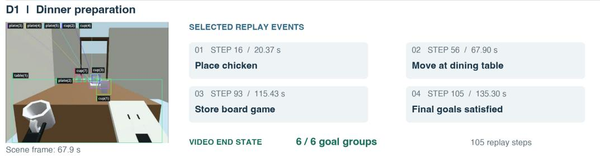

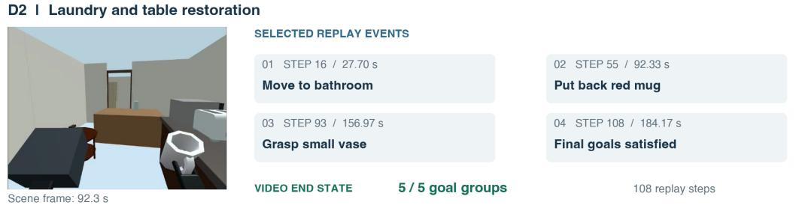

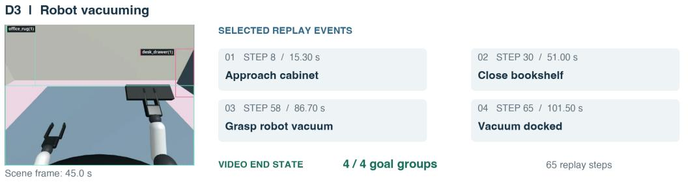

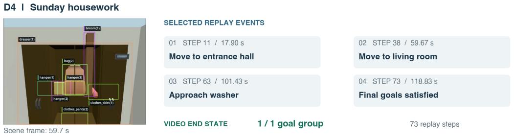  
Reference demonstrations; Ul goal groups are not model success rates. Only selected events are shown

Figure 6: Planning demonstrations D1–D4. Each row pairs a scene image with selected events from the same reference replay. The event boxes identify actions, replay steps, and video times; the scene image may come from another moment in that replay. The final counts denote satisfied goal groups in the interface, rather than model success rates. D4 has one group containing 23 satisfied conditions.

• R3: Incomplete cloth folding. The garment changes from a spread configuration to a more compact shape across the sampled frames. Nevertheless, the official result records failure with a score of 0.2. This contrast shows why visible deformation or partial folding should not be treated as completion: the episode does not satisfy the full folding objective.

• R4: Unsuccessful key insertion. The sampled frames show the grippers approaching and manipulating the key and its receiving object. The official result records failure with a score of 0.15. The nonzero score is partial evaluation credit; the three frames cannot determine exactly why insertion failed or how many required actions were completed.

## Manipulation I RoboDojo

Head-camera recordings / paired official episode results

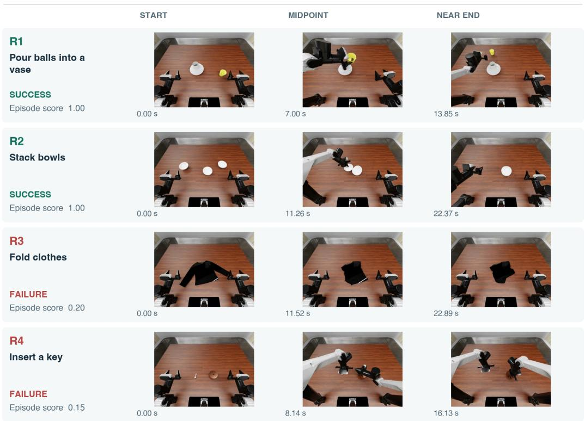  
Figure 7: Manipulation cases R1–R4, shown from left to right at the start, midpoint, and near the end of each episode. Pouring and stacking succeed with scores of 1.0; folding and key insertion fail with scores of 0.2 and 0.15. Labels and scores come from the official episode results. These selected frames illustrate object configurations but do not identify a precise grasp or contact failure.

## A.5 NAVIGATION

Navigation tests whether an Agent can infer who can traverse a scene and produce a valid route. Each of the 282 questions supplies a scene-tour video and asks for decisions for five agent types: HUMAN, WHEELCHAIR, HUMANOID, QUADRUPEDAL, and SWEEPER. A question passes only if all five feasibility decisions are correct and every required route connects the specified endpoints through existing, traversable graph edges. Figure 8 separates these two checks by showing feasibility decisions alongside the predicted HUMAN route.

The four cases use saved Gemini 3.6 Flash predictions and include two successes and two failures. We checked the predictions against the specified task maps and movement rules. Scene images identify the environment rather than the precise route endpoints, and the displayed reference is one valid route rather than the only permitted answer. The saved predictions are checked against the available task definitions; later responses and reindexed copies are excluded because the original API responses are unavailable.

• N1: Valid routes for two agent types. In scene HM3D00000 (question 00000011), the route runs from the living-room fireplace area to the master-bedroom wardrobe. The model correctly permits HUMAN and QUADRUPEDAL and rejects the other three types. Both required routes are valid, so all five outputs pass the combined feasibility and route checks.

• N2: Valid routes for three agent types. In scene HM3D00027 (question 00000871), the route runs from a living-room sofa to the kitchen stove. HUMAN, QUADRUPEDAL, and SWEEPER are feasible, and the evaluated model supplies valid routes for them. All five outputs pass; accessibility depends on the specific scene and destination.

• N3: Correct feasibility, invalid routes. In scene HM3D00002 (question 00000051), all five feasibility decisions are correct, but the HUMAN and QUADRUPEDAL routes include the nonexistent edge from node 6 to node 7. The accompanying figure shows this missing connection in red. Only three of five complete outputs pass, because correctly predicting that a destination is reachable does not guarantee that the proposed route reaches it.

• N4: Incorrect feasibility and routes. In scene MP3D00003 (question 00001471), the reference permits only HUMAN, whereas the evaluated model permits all five types. The model-predicted routes also contain the nonexistent edge from node 45 to node 40. Thus, one feasibility decision is correct but no complete output passes; the case illustrates separate errors in assessing accessibility and constructing a route through the scene.

Navigation I feasibility and route validity  
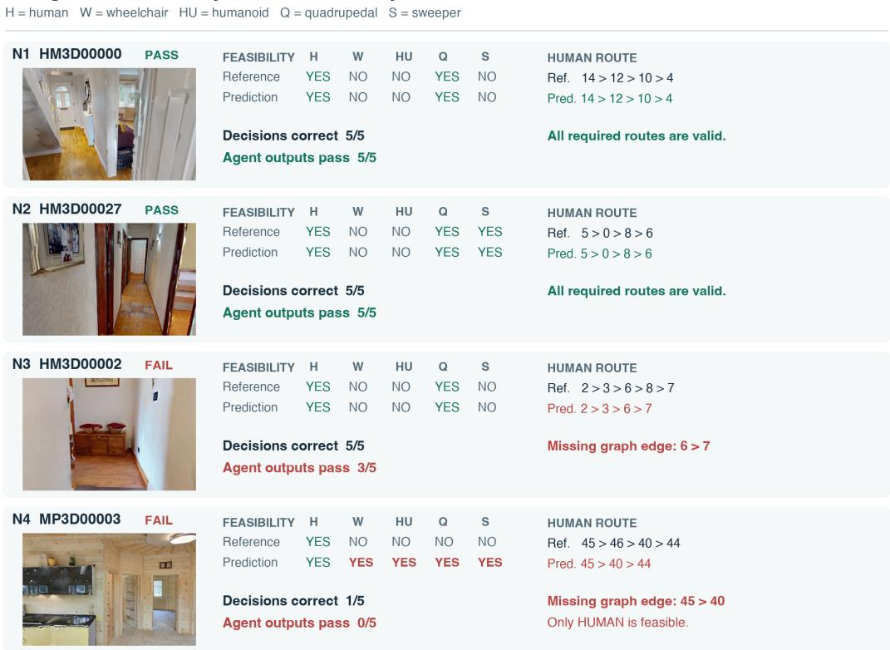  
Figure 8: Navigation cases N1–N4. Each row compares reference and model-predicted feasibility for five agent types and displays the HUMAN route using graph node IDs. N1 and N2 pass all checks. N3 has correct feasibility decisions but uses a missing edge; N4 also permits four infeasible agent types. The reference route illustrates one valid answer. Other routes can also pass if they satisfy the same endpoint, connectivity, and agent-specific movement requirements throughout the route.

## A.6 ACTION SEQUENCING

Action Sequencing assesses whether an Agent can reconstruct actions that connect an initial state to a target state. Each of the 170 problems contains two tasks and one shared, shuffled pool of action clips. The evaluated model must assign every clip to a task and order the resulting sequences without being told their lengths. Success requires an exact match to both reference sequences. Figures 9–12 place the initial and target states above the clip pool and compare the reference and model-predicted orders for each task for direct comparison.

The examples use saved Qwen3.8-max-preview predictions, checked against the fixed task definitions, with two successes and two failures. Clip IDs retain their original meaning within each problem. Blue tokens denote the reference; green and red prediction tokens mark agreement or disagreement at the same sequence position. Original API responses are not available, and later generated responses and reindexed copies are excluded from the analysis.

• W1: Correct sequences of different lengths. CrossTask pair 013 combines food preparation and a wheel-change task. The predicted sequences [7, 2, 6] and [5, 1, 4, 3] match both references, correctly dividing seven clips into groups of three and four. Figure 9 depicts exact reconstruction of both sequences without assuming equal lengths.

• W2: Correct sequences of equal lengths. COIN pair 136 involves applying screen protectors to different devices. The model predicts [3, 5, 4, 1] and [7, 6, 2, 8], matching both four-step references. Figure 10 shows that all eight clips are assigned and ordered correctly despite the visual similarity of the two preparation and application workflows.

• W3: Correct clips in the wrong order. COIN pair 002 combines a filter-replacement task with work on a bicycle. The references are [5, 3, 2] and [6, 4, 1], but the evaluated model predicts [3, 5, 2] and [4, 1, 6]. Each task receives the correct clips, yet neither order matches. The positional mismatches in Figure 11 demonstrate that identifying the relevant clips and ordering them correctly are separate requirements for task success in the required workflow.

• W4: Incorrect task lengths and clip assignment. IKEAASM pair 000 contains two furnitureassembly tasks with reference sequences [9, 8, 6, 3] and [2, 10, 7, 4, 1, 5]. The evaluated model instead returns [9, 6, 10, 4, 1] and [8, 2, 3, 7, 5]. Figure 12 depicts a five-plus-five division rather than the required four-plus-six division. Every clip is used once, but several belong to the other task, and neither sequence is correct for the assembly objective.

Digital evaluation. The digital set contains 255 tasks: Web Interaction (WI; 74), Desktop Application Interaction (DAI; 95), Mobile Application Interaction (MAI; 35), and Game Environment Interaction (GEI; 51). The numerical tables below use these abbreviations. These tasks assess whether an Agent can use interface observations and tool feedback to complete a concrete request. Table 7 summarizes the abilities and evidence examined in each category. The selected examples follow the specified task from its requirements through actions in the execution record to an evaluation result, with progress toward the objective distinguished from full completion.

<table><tr><td>Reporting category</td><td>Task demands</td><td>Observable evidence</td></tr><tr><td>Web Interaction</td><td>Search, constraint checking, and evidence-grounded synthesis</td><td>Exact purchase pages, supported claims, and verification credits</td></tr><tr><td>Desktop Application Inter- action</td><td>Cross-application coordination, visual selection, and artifact editing</td><td>Image composites, document changes, and completion checks</td></tr><tr><td>Mobile Application Interac- tion</td><td>Interface navigation, contextual text en- try, and action completion</td><td>Correct message selection, reply com- position, and sending</td></tr><tr><td>Game Environment Interac- tion</td><td>State tracking, temporal control, and planning under constraints</td><td>Valid actions, progress updates, con- tract completion, and terminal status</td></tr></table>

Table 7: Digital reporting categories, shared task demands, and observable evidence. Individual cases illustrate task-specific behavior rather than a universal measure of ability across the different task settings.

Evidence and scope. The browsing cases show five improvements and five contrasting failures across repeated attempts; none earns full credit. The desktop, mobile, and game-control cases meet their respective task criteria. A separate kitchen-planning demonstration and ten reference scene views explain interactive planning tasks. These sources have different purposes and are not combined into a single success rate; changes across browsing attempts also do not isolate the effect of memory from differences in tool activity or evaluation conditions.

Sequencing I W1 - CrossTask 013 SUCCESS: exact reconstruction  
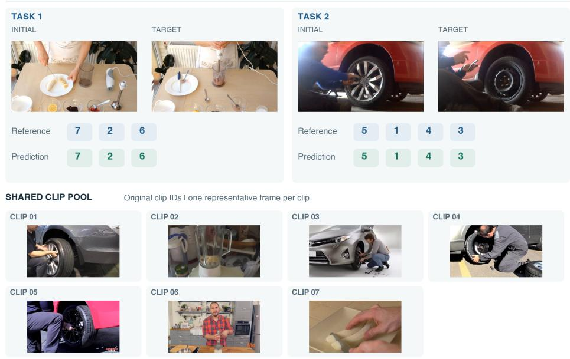  
Figure 9: Action Sequencing case W1: food preparation and wheel changing in CrossTask pair 013. Initial and target states appear above the shared clip pool, with one supplied frame per clip and the original IDs retained. Both model-predicted sequences match the references despite their different lengths. Throughout the four sequencing figures, blue tokens give the reference order, green prediction tokens match the same reference position, and red prediction tokens mark a mismatch.

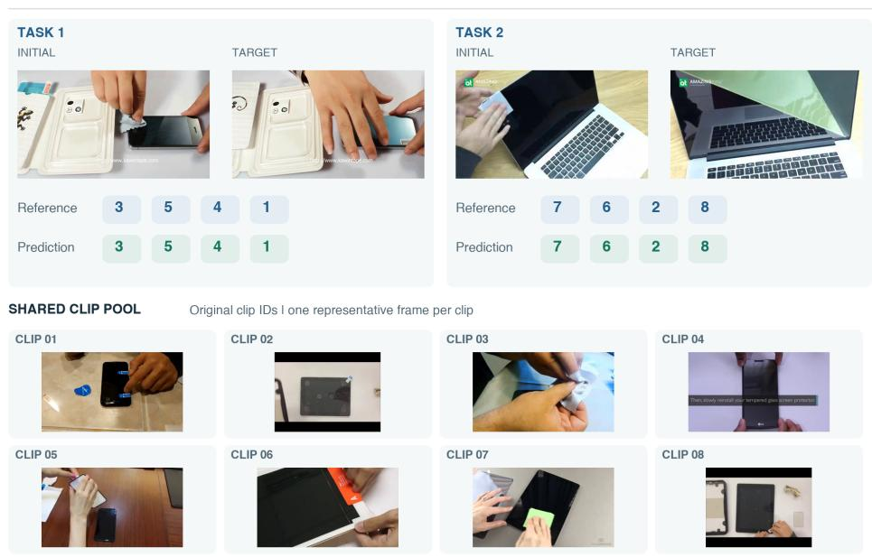  
Figure 10: Action Sequencing case W2: screen-protector application in COIN pair 136. The upper panels identify the two initial-to-target transitions, while the lower panel shows the eight available clips. Both predicted four-step sequences match their references. The case illustrates successful separation and ordering of two visually similar workflows without a supplied sequence length.

Sequencing I W4 - IKEAASM 000 FAILURE: length and assignment mismatch  
Sequencing I W3 - COIN 002 FAILURE: order mismatch  
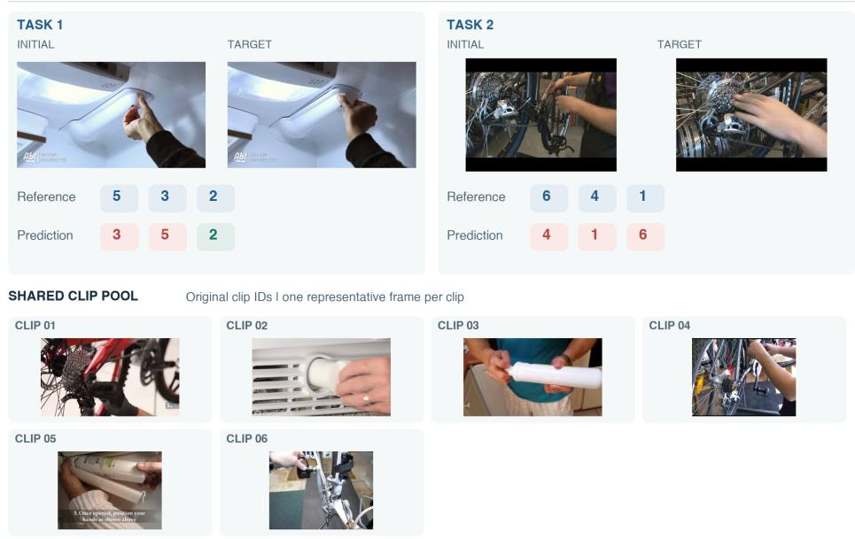  
Figure 11: Action Sequencing case W3: filter replacement and bicycle work in COIN pair 002. Each model-predicted sequence uses the correct clips, but their order differs from the reference. The first task swaps clips 5 and 3; the second moves clip 6 to the end. Red tokens therefore indicate ordering errors, even though all clips are assigned to the correct task despite errors at individual sequence positions.

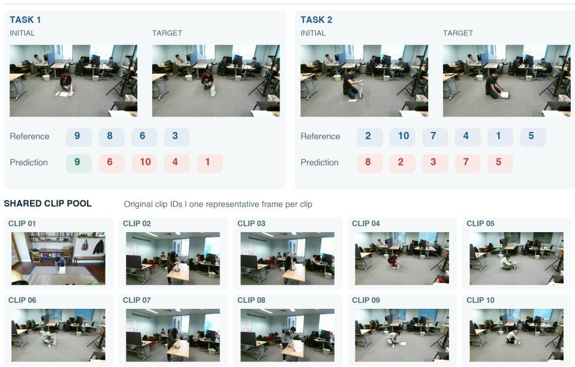  
Figure 12: Action Sequencing case W4: furniture assembly in IKEAASM pair 000. The reference divides ten clips into sequences of four and six, whereas the prediction assigns five clips to each task. Every clip appears once, but several are assigned to the wrong task and neither order matches. The initial and target views provide the task context for interpreting these assignment errors.

## A.7 WEB INTERACTION

Web browsing assesses whether an Agent can turn product requirements into purchasing information supported by identifiable sources. Each task requires finding suitable configurations, checking all requested properties, collecting exact purchase pages with displayed prices, and submitting a report. The evaluation distinguishes a filled answer field from a verified claim, so broad product coverage alone is insufficient for a high score and a fully supported report.

The eight selected cases cover seven tasks and five model labels. I1–I5 illustrate increasing verification credit, while F1–F3 illustrate declining scores, unsupported coverage, incomplete answers, or no score improvement. Each case has three attempts, denoted R1–R3. The largest displayed score is 27.50%, so an improvement remains partial instead of indicating completion of the task. The I labels retain source cases S1–S5 and mark improvement rather than success.

Each task requests 30 product/configuration entries and three purchase pages per entry. One compound attribute item is scored per entry, plus one item per purchase page:

$$
{ \mathrm { V e r i f i e d ~ s c o r e } } = { \frac { { \mathrm { a t t r i b u t e ~ c r e d i t s ~ ( o u t ~ o f ~ } } 3 0 ) + { \mathrm { p a g e ~ c r e d i t s ~ ( o u t ~ o f ~ } } 9 0 { \mathrm { ) } } } { 1 2 0 } } .
$$

Submission coverage and local evidence-save acceptance are separate diagnostics. A credited page does not establish that its product satisfies every hardware constraint.
<table><tr><td>Case</td><td>Task</td><td>Model</td><td>R1</td><td>R2</td><td>R3</td><td>∆</td></tr><tr><td>I1</td><td>Telescope</td><td>Qwen 3.8 Max</td><td>0.00</td><td>4.17</td><td>27.50</td><td>+27.50</td></tr><tr><td>I2</td><td>NAS</td><td>Kimi K3</td><td>2.50</td><td>9.17</td><td>25.00</td><td>+22.50</td></tr><tr><td>I3</td><td>Keyboard</td><td>MiniMax M3</td><td>2.50</td><td>7.50</td><td>20.00</td><td>+17.50</td></tr><tr><td>I4</td><td>Robot vacuum</td><td>GPT-5.6 Sol</td><td>6.67</td><td>6.67</td><td>21.67</td><td>+15.00</td></tr><tr><td>I5</td><td>Headphones</td><td>Gemini 3.6 Flash</td><td>16.67</td><td>20.83</td><td>23.33</td><td>+6.67</td></tr><tr><td>F1</td><td>Drone</td><td>Gemini 3.6 Flash</td><td>20.83</td><td>19.17</td><td>6.67</td><td>-14.17</td></tr><tr><td>F2</td><td>Thermal camera</td><td>MiniMax M3</td><td>11.67</td><td>0.83</td><td>0.00</td><td>-11.67</td></tr><tr><td>F3</td><td>NAS</td><td>Gemini 3.6 Flash</td><td>0.00</td><td>0.00</td><td>0.00</td><td>0.00</td></tr></table>

Scores are percentages, with ∆ giving the change from R1 to R3 in percentage points. These deliberately selected cases illustrate outcome patterns instead of representative differences between models.

Interpreting browsing outcomes. The analysis uses saved execution records, submitted answers, and evaluator results. It describes the recorded product evidence rather than current prices or availability. Different tool activity and the lack of a matched control without memory prevent causal or efficiency comparisons across attempts. Accepted quotations and final evaluation credits are distinct, and zero credit does not prove every claim false.

Descriptions of memory follow the actual inputs in each execution record. Separate memory files disagree with those inputs in six R2/R3 comparisons involving I1, I3, and I4, so they are not substituted for the recorded context. We also distinguish the original submissions from later answer files containing additional evidence. Some tool returns were shortened before archiving; their omitted content is unavailable for further verification.

• I1: Telescope selection with stronger supporting evidence. Qwen 3.8 Max is asked to find 30 complete telescope configurations with an aperture of at least eight inches, a computerized GoTo mount, and an included tripod or ground-standing base. Each configuration needs three exact purchasing pages with displayed prices; search and category pages do not qualify. The execution instructions require source inspection and saved quotations before factual claims are included in the report submitted through submit answer.

R1 receives the original request, while R2 and R3 also receive recorded memory and task state. The three attempts contain 322 messages and 223 tool calls in total. Each has 31 model calls, but the amount of tool activity differs, as shown below. The table separates accepted evidence saves from the attribute and purchase-page credits awarded to the final answer.

<table><tr><td>Round</td><td>Tool calls</td><td>Saves accepted/tried</td><td>Attr./30</td><td>Pages/90</td><td>Score (%)</td></tr><tr><td>R1</td><td>66</td><td>1/1</td><td>0</td><td>0</td><td>0.00</td></tr><tr><td>R2</td><td>57</td><td>1/2</td><td>2</td><td>3</td><td>4.17</td></tr><tr><td>R3</td><td>100</td><td>21/24</td><td>16</td><td>17</td><td>27.50</td></tr></table>

Save counts describe accepted quotations; attribute and page counts describe the final evaluation. The three rounds each contain 31 Agent model calls, with distinct amounts of retrieval and other tool activity.

In R1, the evaluated Agent retrieves a NexStar 8SE product record containing a price of \$1,699 and saves the quotation successfully. However, the price alone does not establish the required aperture, mount, and included support. After 54 JSON requests, seven page opens, and three searches, the Agent submits only a research-in-progress placeholder. No credit is awarded because the useful price evidence never becomes a usable final answer.

In R2, the Agent uses smaller retrieval batches and individual product records to recover usable prices. The final answer includes two configurations: NexStar 8SE, with Celestron and Astronomics pages priced at \$1,699, and Advanced VX 11 SCT, with a Celestron page priced at \$3,599. These are three pages in total, rather than three per configuration. Two attribute and three page credits yield 4.17%, leaving most of the requested report incomplete.

In R3, retrieval becomes more specific to each configuration. The evaluated Agent saves product prices and some tripod descriptions, and excludes candidates without preserved prices or with insufficient aperture. The final answer contains 16 configurations and 17 credited purchase pages, producing (16 + 17)/120 = 27.50%. NexStar 8SE has two pages and each remaining entry has one; no configuration meets the three-page requirement. Tripod evidence is explicit for only five configurations, so the archived attribute credits should not be interpreted as independent verification of every hardware condition.

The telescope case therefore progresses from an unusable submission to a small supported answer and then to a broader, still incomplete report. The increase concerns evidence preserveed in the answer, rather than the number of searches alone. It illustrates the practical distinction among discovering candidates, documenting their properties, and delivering all requested information, while leaving the contribution of memory unresolved.

• I2: Joint growth in eligibility and purchase evidence. Kimi K3 must identify 30 NAS appliances, each with four or more drive bays and a network port rated at least 2.5 GbE, and supply three priced purchase pages for every selected configuration.

<table><tr><td>Round</td><td>Attribute credits</td><td>Page credits</td><td>Score</td><td>Saves accepted/tried</td></tr><tr><td>R1</td><td>2</td><td>1</td><td>2.50%</td><td>1/3</td></tr><tr><td>R2</td><td>6</td><td>5</td><td>9.17%</td><td>4/4</td></tr><tr><td>R3</td><td>15</td><td>15</td><td>25.00%</td><td>7/12</td></tr></table>

R1 verifies few of the requested specifications or purchase pages. After 19 searches and 31 page openings, a QNAP TS-464-8G-US price quotation is accepted following failed saves. The evaluator credits QNAP and Synology DS925+ attributes, but only one QNAP store purchase page at the archived price of \$639. Product eligibility coverage exceeds purchase coverage.

In R2, the agent connects specifications with prices. Recorded memory asks for visible excerpts documenting prices and specifications and checks against the bay/network thresholds. Accepted official-store JSON evidence for TerraMaster F4-424 Max accompanies expansion to six attribute and five page credits; F4-424 Max and T6-423 enter the credited set. Credit for product-JSON URLs reflects the recorded evaluator, not an additional manual check.

In R3, the agent works to complete partially filled entries. Input memory prioritizes partially filled models. Retrieval shifts to 58 JSON calls, three searches and four page openings. A saved F4-424 record links the bay and network specifications to a \$499.99 variant price. Final credits reach 15 attributes and 15 pages, adding nine and ten items respectively over R2. Both kinds of credit increase, but 15 purchase pages remain far below the required 90.

• I3: Keyboard verification at the model level. MiniMax M3 is asked for 30 mechanical keyboards whose switches are hot-swappable and whose wireless connections include Bluetooth and 2.4 GHz. Each keyboard needs three purchase pages with displayed prices.

<table><tr><td>Round</td><td>Attribute credits</td><td>Page credits</td><td>Score</td><td>Saves accepted/tried</td></tr><tr><td>R1</td><td>1</td><td>2</td><td>2.50%</td><td>0/0</td></tr><tr><td>R2</td><td>4</td><td>5</td><td>7.50%</td><td>3/6</td></tr><tr><td>R3</td><td>14</td><td>10</td><td>20.00%</td><td>15/25</td></tr></table>

R1 relies heavily on search. The trace has 75 searches, 44 page openings and no evidence-save or submit-answer call. A final answer is nevertheless stored and evaluated, so the missing submission call does not indicate that the Agent produced no answer. Only three required items receive credit. This illustrates the gap between a substantial retrieval effort and an answer whose individual product properties and purchase pages can be verified.

R2 introduces a repeatable verification sequence. Actual memory specifies checking model specifica tions before collecting exact retailer pages with prices and add-to-cart evidence. A V Max collection excerpt is saved for tri-mode connectivity: useful specification/discovery evidence, but not a purchase page. The resulting answer receives four attribute credits and five page credits, with V1, V2, V5, and V6 Max appearing among the credited product entries.

R3 uses more exact supporting quotations. The recorded input requires price and add-to-cart evidence. An initial V3 Max quotation fails; a later exact sale-price excerpt is accepted. Fifteen saves and an explicit final submission accompany 14 attribute and ten page credits. The improvement is 3 to 9 to 24 credited items. Fewer searches do not establish efficiency because budgets differ; purchasing coverage is still incomplete across these three attempts.

• I4: An unchanged score before later improvement. The task asks GPT-5.6 Sol to find 30 LiDAR robot vacuums with an included self-emptying dock, each with three priced pages.

<table><tr><td>Round</td><td>Attribute credits</td><td>Page credits</td><td>Score</td><td>Submission coverage</td></tr><tr><td>R1</td><td>7</td><td>1</td><td>6.67%</td><td>9.17%</td></tr><tr><td>R2</td><td>6</td><td>2</td><td>6.67%</td><td>24.17%</td></tr><tr><td>R3</td><td>15</td><td>11</td><td>21.67%</td><td>25.00%</td></tr></table>

In R1, rejected evidence saves coexist with final evaluation credit. The agent makes 58 searches, 41 page opens and six JSON requests. All three saves fail because the quoted text is absent from the opened source. The final evaluator nevertheless credits seven attributes and one Narwal page. Local save acceptance and final evaluation are different measurements.

R2 expands the output without increasing the total score. Memory specifies exact prices, LiDAR and dock inclusion on product pages. Narrow Narwal quotations about navigation and a self-emptying dock are accepted; all five saves succeed. But one attribute credit is lost while one page credit is gained. Total credit remains eight despite coverage rising to 24.17%.

In R3, both evidence dimensions improve. Input memory again foregrounds on-page specifications and prices. Five saves succeed; the evaluator credits 15 attributes and 11 pages, including additional products such as Dreame Matrix10 Ultra. Each category gains nine items over R2. The progression is therefore 8 to 8 to 26, not uninterrupted per-round growth. More submitted content does not by itself explain the later rise in verified evidence.

• I5: Better evidence with unchanged submission coverage. The task asks Gemini 3.6 Flash to find 30 over-ear wireless headphones with ANC, multipoint for at least two devices and at least 30 hours of battery life with ANC on, each with three priced pages.
<table><tr><td>Round</td><td>Attribute credits</td><td>Page credits</td><td>Score</td><td>Submission coverage</td></tr><tr><td>R1</td><td>8</td><td>12</td><td>16.67%</td><td>100.00%</td></tr><tr><td>R2</td><td>9</td><td>16</td><td>20.83%</td><td>100.00%</td></tr><tr><td>R3</td><td>9</td><td>19</td><td>23.33%</td><td>100.00%</td></tr></table>

R1 generates a complete-looking report with limited verification credit. The agent fills all submission slots after 41 searches and three page openings, without local saves. Only eight attributes and 12 pages receive credit. Since all output slots are already filled in R1, later score increases reflect additional verification credit. The example thus separates apparent answer completeness from evidence-supported correctness in the submitted reports.

In R2, shorter quotations provide usable evidence. The recorded input includes task state but no reusable workflow or instructions for avoiding earlier mistakes. A combined Soundcore Q45 quote is rejected; a shorter exact multipoint excerpt is accepted. Credits rise to nine attributes and 16 pages, with Sennheiser Momentum 4 Wireless entering the credited attribute set.

In R3, page credits increase while attribute credits remain unchanged. The input now asks the Agent to validate retailer pages and match claims to exact source excerpts. Two saves cover Momentum 4 and Soundcore Space One claims. A multipoint excerpt alone cannot prove the complete ANC/battery requirement. The total progresses from 20 to 25 to 28 credited items, with submission coverage unchanged at 100%. The other 92 uncredited items show that the answer is still far from meeting the verification requirements.

• F1: Regression in drone verification. The drone example uses Gemini 3.6 Flash and depicts the largest net regression among the selected cases. Scores fall from 20.83% to 19.17% to 6.67%. Attributes fall from 14 to six and pages from 11 to two. R3 still claims 30 configurations, while extracted submission coverage is 33.33%. The report claims more coverage than the evaluator verifies. This discrepancy describes the observed outcome without identifying memory, retrieval, or scoring as the sole cause of the regression.

• F2: No verified thermal-camera entries in the final attempt. The thermal-camera example uses MiniMax M3. Scores fall from 11.67% to 0.83% to zero, the largest decline ending at zero. No round receives purchase-page credit. R3 reports one hardware-verified candidate and rejects an earlier low-resolution candidate, but receives no attribute credit. Retrieval and quotation failures accompany the decline without establishing its cause.

• F3: Full submission coverage without verified completion. The network-storage example uses Gemini 3.6 Flash. All three rounds have 100% submission coverage and zero verification credit. This case was selected from four all-zero curves with at least 90% coverage throughout, matching the NAS task in I2. Filling every output slot does not establish product eligibility or valid priced pages; zero credit alone does not prove every claim false.

<table><tr><td>Case</td><td>R1: attributes / pages</td><td>R2: attributes / pages</td><td>R3: attributes / pages</td></tr><tr><td>F1</td><td>14 / 11</td><td>13 / 10</td><td>6/2</td></tr><tr><td>F2</td><td>14/0</td><td>1/0</td><td>0/0</td></tr><tr><td>F3</td><td>0/0</td><td>0/0</td><td>0/0</td></tr></table>

Attribute counts are out of 30 and purchase-page counts out of 90.

Capability interpretation. The cases separate candidate discovery, submission coverage, evidence capture, and verified correctness. Progress occurs when retrieval is converted into specific supporting evidence in a report that the evaluator can assess. Failure persists when broad coverage masks missing purchase evidence, quotations do not support compound constraints, or the final answer remains incomplete. The telescope case illustrates a clearer path from retrieval to documented evidence, while its missing configurations and purchase pages explain why the higher score remains partial instead of complete.

## A.8 DESKTOP APPLICATION INTERACTION

Desktop tasks evaluate visual inspection, application operation, and file editing against task-specific deliverable checks. The current leaderboard contains 95 tasks in this category.

## A.9 MOBILE APPLICATION INTERACTION

Mobile tasks evaluate goal-directed interaction across interface states, with completion determined by the task-specific verifier. The current leaderboard contains 35 tasks in this category.

## A.10 GAME ENVIRONMENT INTERACTION

Game Environment Interaction examines two complementary capabilities: short-horizon timing from immediate visual feedback, and longer-horizon planning with changing state, resource constraints, and delayed rewards. The first case reaches its objective through nine valid control actions. The kitchen example adds ingredient choices, changing demand, recipe limits, and contract deadlines.

• G1: Timing actions from visual feedback. The Flappy Bird example follows MiniMax M3 in R1 of task 13 01, with a stored score of 1. The task is to clear at least one pipe in a single run. The agent can choose one registered semantic action per step: flap or wait. All nine recorded actions are valid, with one pipe cleared after the final action.

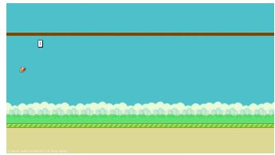

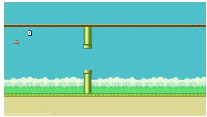

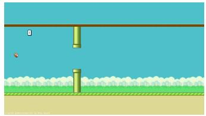

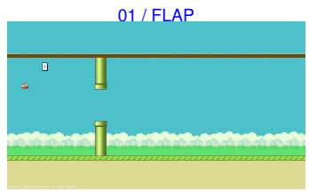

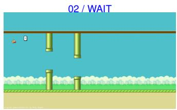

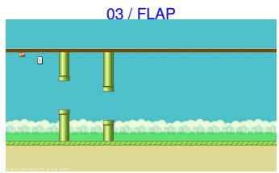

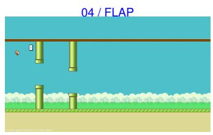  
07 / WAIT

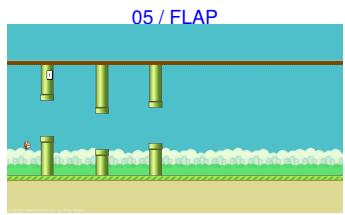  
08 / FLAP

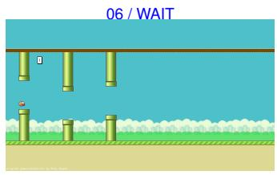  
09 / FLAP

Figure 13: Game-control example G1. All nine input observations, in order, with the action chosen for each. Structured post-action state is reported below; it is not inferred from screenshot coordinates.
<table><tr><td>Step</td><td>Action</td><td>Post-action bird y</td><td>Pipes passed</td></tr><tr><td>1</td><td>flap</td><td>85.70</td><td>0</td></tr><tr><td>2</td><td>wait</td><td>170.48</td><td>0</td></tr><tr><td>3</td><td>flap</td><td>110.00</td><td>0</td></tr><tr><td>4</td><td>flap</td><td>49.52</td><td>0</td></tr><tr><td>5</td><td>flap</td><td>0.00</td><td>0</td></tr><tr><td>6</td><td>wait</td><td>58.08</td><td>0</td></tr><tr><td>7</td><td>wait</td><td>294.06</td><td>0</td></tr><tr><td>8</td><td>flap</td><td>233.04</td><td>0</td></tr><tr><td>9</td><td>flap</td><td>172.56</td><td>1</td></tr></table>

After action 9, the returned state reports one pipe passed, full task progress, and success. The game itself remains in the playing state: the evaluation objective is to clear one pipe, rather than finish an entire game. The accompanying figure and table provide complementary views of the same sequence: screenshots show the information used to select an action, and the tabulated returns show its effect on bird position and task progress.

Planning across interactive scenes. The following ten interactive tasks exercise planning and environment interaction across five simulated scene families: an office, an apartment, a garden, a restaurant, and a staircase. Figure 14 summarizes their environments and objectives. We then examine a complete conveyor-kitchen demonstration, pairing every action batch with its returned observation and terminal outcome. All interfaces are in English. The kitchen run is a non-blind illustration, separate from the recorded benchmark evaluations.

01. Contract search  
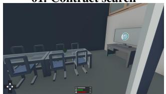  
Combine three contract records to unlock the archive.

02. Key retrieval  
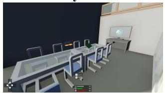  
Identify the key linked to the final signed contract.  
04. NPC meeting

03. Book placement  
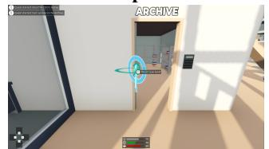  
Deliver three task books in low-to-high shelf order.

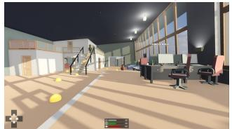  
Greet the assigned contact, escort them, and close the door.

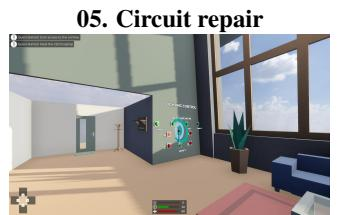  
Diagnose a tripped circuit and set four lighting groups.

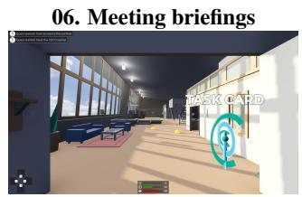

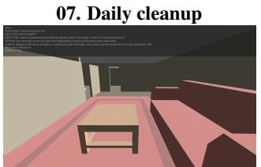  
Bin five items, empty your hands, and close the fridge.

Infer seating from records and place four briefings.  
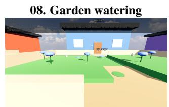

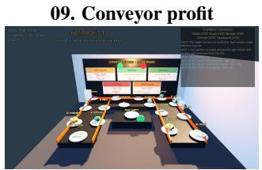  
Plan ten dishes to meet contracts and a profit target.

Water four target lawns and ring the orchid bell during rain.  
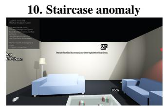  
Combine five rounds of clues to identify the true exit.  
Figure 14: Ten interactive planning tasks across five simulated scene families. Each panel pairs a reference environment view with its specified task objective, instead of a model outcome. The restaurant panel is the initial observation for the conveyor-kitchen demonstration G2.

## • G2: Deadline-aware planning in a conveyor kitchen.

The agent operates a conveyor-belt kitchen for ten one-minute windows. It observes 16 ingredient plates, a fixed recipe menu, current demand multipliers, and market forecasts, then selects ingredients and serves dishes to maximize net profit. Each window allows one dish; each recipe can be served at most twice. Ingredient selections are irreversible, recipes require exactly the listed ingredients, and invalid dishes incur ingredient costs and lock the window. Demand changes selling prices while ingredient costs remain fixed. Under this exact-ingredient rule, extra ingredients are a violation even if the dish looks plausible; the criterion is not relaxed after observing a rollout. A successful dish or a positive profit is intermediate evidence, not by itself satisfaction of the final profit threshold and all constraints.

This run requires two salads by window 3 (+\$8 reward / -\$10 penalty), one sandwich by window 6 (+\$10 / -\$12), and at least four dish categories by window 10 (+\$12 / -\$15). Rewards or penalties settle at the respective deadlines. Success requires net profit, after these adjustments, to reach 90% of the hidden online benchmark before the 150-call limit.

C denotes a tool-call index and O an observation ID. The notation $\mathtt { s e l e c t \_ f a , b , c } ]$ denotes ordered ingredient selections within one action batch. C01 requests the briefing, C02 obtains the starting observation, C03–C32 execute 30 action batches, and C33 stops the session. Figures 15–17 contain all 30 recorded observations O01–O30: the initial observation and 29 images returned after action batches. C32 supplies the terminal event without producing another image. The sequence consequently ends with observation O30, while the adjacent annotation records the outcome returned by the final action batch in this run.

Figures 15–17 show how early deadlines shape later choices. A burger in window 1 is followed by two salads, meeting the first contract by window 3. Soups occupy windows 4 and 5, and a sandwich meets the second deadline in window 6. The remaining windows contain an omelet, two sandwiches, and another omelet. Each row links the current window, selected ingredients, and accepted dish, while the annotations separate dish profit from contract payments.

Window 01: Avocado Burger  
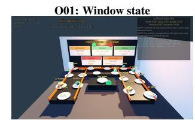  
C01 briefing(); C02 observe().

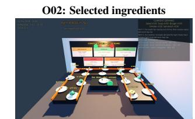  
C05 (O03): wait next window() -> O04; window 2; net profit \$18.  
+\$18; \$18 observed  
C03 (O01): select [bread, meat, avocado].

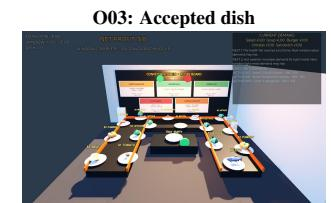  
C04 (O02): select [tomato]; make().

Window 02: Avocado Salad  
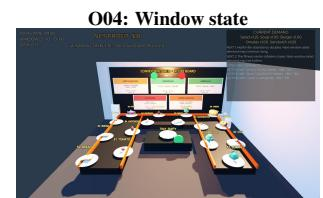  
C05: state after window advance.

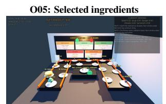  
C06 (O04): select [lettuce, tomato, avocado].  
+\$18; \$36 observed

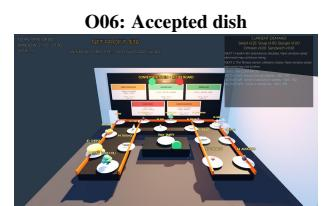  
C07 (O05): make().  
C08 (O06): wait next window() -> O07; window 3; net profit \$36.

Window 03: Avocado Salad  
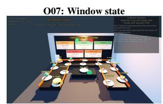  
C08: state after window advance.

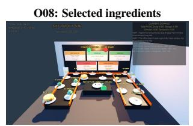  
C09 (O07): select [lettuce, tomato, avocado].  
+\$23; \$59 observed

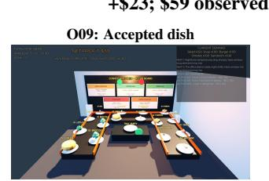  
C11 (O09): wait next window() -> O10; window 4; net profit \$67. Contract reward: +\$8.  
C10 (O08): make().

Figure 15: Planning demonstration G2, complete conveyor-kitchen trace, part 1 of 3: windows 1–3. Each row preserves the original observations and action-batch boundaries. Dollar amounts are observed cumulative net profits; the leading increment is the dish-specific change.

The terminal event reports success with reason efficiency target reached. It returns no new screenshot, exact efficiency percentage, or post-settlement balance; \$230 is the last observed pre-settlement balance. The demonstration exercises ten-window planning, recipe-limit tracking, and

Window 04: Pumpkin Sausage Soup  
  
C11: state after window advance.

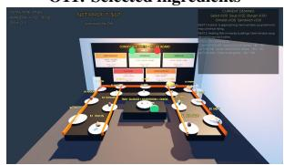  
C12 (O10): select [sausage, mushroom, onion].

## +\$21; \$88 observed

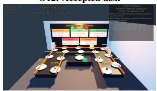  
C13 (O11): select [pumpkin]; make().  
C14 (O12): wait next window() -> O13; window 5; net profit \$88.

Window 05: Pumpkin Sausage Soup  
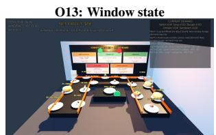  
C14: state after window advance.

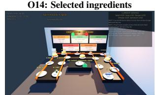  
C15 (O13): select [sausage, mushroom, onion].

## +\$27; \$115 observed

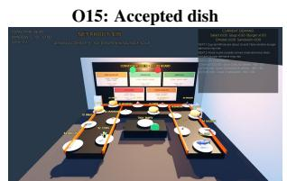  
C16 (O14): select [pumpkin]; make().  
C17 (O15): wait next window() -> O16; window 6; net profit \$115.

## Window 06: Avocado Fish Sandwich

  
C17: state after window advance.

  
C18 (O16): select [bread, fish, avocado].

+\$17; \$132 observed  
  
C19 (O17): select [onion]; make().  
C20 (O18): wait next window() -> O19; window 7; net profit \$142. Contract reward: +\$10.

Window 07: Corn Bacon Omelet  
  
C20: state after window advance.  
C23 (O21): wait next window() -> O22; window 8; net profit \$158.

  
C21 (O19): select [egg, cheese, bacon].  
+\$16; \$158 observed

  
C22 (O20): select [corn]; make().

Figure 16: Planning demonstration G2, complete conveyor-kitchen trace, part 2 of 3: windows 4–7. Each row preserves the original observations and action-batch boundaries. Dollar amounts are observed cumulative net profits; the leading increment is the dish-specific change.

Window 08: Garden Fish Sandwich  
  
C23: state after window advance.

  
C24 (O22): select [bread, fish, lettuce].

+\$11; \$169 observed  
  
C25 (O23): select [onion]; make().  
C26 (O24): wait next window() -> O25; window 9; net profit \$169.

Window 09: Avocado Fish Sandwich  
  
C26: state after window advance.

  
+\$31; \$200 observed  
C27 (O25): select [bread, fish, avocado].

  
C28 (O26): select [onion]; make().

C29 (O27): wait next window() -> O28; window 10; net profit \$200.  
Window 10: Corn Bacon Omelet  
  
C29: state after window advance.

  
C30 (O28): select [egg, cheese, bacon].

+\$30; \$230 observed  
  
C31 (O29): select [corn]; make().

C32 (O30): wait next window() -> game over; success / efficiency target reached. C33: stop().

Figure 17: Planning demonstration G2, complete conveyor-kitchen trace, part 3 of 3: windows 8–10. Each row preserves the original observations and action-batch boundaries. Dollar amounts are observed cumulative net profits; the leading increment is the dish-specific change.

deadline-aware contract completion. Prior exposure and an interrupted attempt make this a non-blind demonstration instead of a new benchmark evaluation.

## A.11 DIGITAL WORLD: HISTORICAL CROSS-ATTEMPT RESULTS

Table 8 retains the six configurations in the historical multi-attempt snapshot that belong to the current leaderboard. These historical means use all accepted records within each configuration and attempt; coverage can vary, so they are not replacements for the current leaderboard scores. Kimi K3 has no accepted Mobile Application Interaction results in attempts 2 and 3. We report model-specific means only; pooled statistics and fixed-cohort curves from the previous model set are not used for the revised inventory. These are descriptive trajectories, not controlled estimates of the effect of repetition or reflection.

Social evaluation inventory and example scope. The Social evaluation comprises 200 cases in three reporting categories: Coordination & Strategic Interaction (87), Water, Soil & Climate Resource Governance (56), and Terrestrial Ecosystem & Health Resource Governance (57). The cases instantiate 40 templates (17, 11, and 12, respectively); Appendix A.1 explains these assignments. Task counts are unaffected by the number of model runs or attempt stages.

The resource examples below illustrate the two resource-governance categories; they are selected historical traces, not representative coverage of all social templates.

Table 8: Model-level scores using all available results. Each cell reports Try 1, Try 2, and Try 3 from top to bottom. A dash indicates unavailable results. Desktop denominators can vary by attempt; Mobile coverage differs across models.
<table><tr><td>Model</td><td>WI</td><td>DAI</td><td>MAI</td><td>GEI</td></tr><tr><td rowspan="3">GPT-5.6 Sol</td><td>1.90</td><td>3.28</td><td>8.57</td><td>13.35</td></tr><tr><td>3.07</td><td>4.52</td><td>20.00</td><td>11.94</td></tr><tr><td>3.88</td><td>4.15</td><td>28.57</td><td>16.70</td></tr><tr><td rowspan="3">Gemini 3.6 Flash</td><td>6.00</td><td>2.51</td><td>22.86</td><td>25.35</td></tr><tr><td>7.62</td><td>3.63</td><td>28.57</td><td>24.07</td></tr><tr><td>7.89</td><td>4.61</td><td>42.86</td><td>22.30</td></tr><tr><td rowspan="3">Kimi K3</td><td>2.10</td><td>3.25</td><td>28.57</td><td>15.94</td></tr><tr><td>3.67</td><td>4.21</td><td>一</td><td>20.24</td></tr><tr><td>5.23</td><td>4.37</td><td></td><td>13.87</td></tr><tr><td rowspan="3">Qwen 3.8 Max</td><td>1.81</td><td>2.66</td><td>20.00</td><td>27.09</td></tr><tr><td>3.17</td><td>2.61</td><td>28.57</td><td>27.00</td></tr><tr><td>4.70</td><td>5.02</td><td>37.14</td><td>28.55</td></tr><tr><td rowspan="3">MiniMax M3</td><td>2.45</td><td>4.43</td><td>8.57</td><td>10.43</td></tr><tr><td>3.34</td><td>3.87</td><td>5.71</td><td>11.84</td></tr><tr><td>3.89</td><td>3.57</td><td>5.71</td><td>14.89</td></tr><tr><td rowspan="3">Doubao Seed 2.1 Pro</td><td>0.98</td><td>0.72</td><td>2.86</td><td>15.14</td></tr><tr><td>1.39</td><td>2.02</td><td>2.86</td><td>19.47</td></tr><tr><td>1.51</td><td>2.54</td><td>2.86</td><td>12.74</td></tr></table>

## A.12 RESOURCE-GOVERNANCE EXAMPLES: GROUNDWATER AND FORESTS

Reporting categories versus execution mechanisms. The resource inventory contains 56 Water, Soil & Climate Resource Governance cases and 57 Terrestrial Ecosystem & Health Resource Governance cases. Inspecting the available trajectories distinguishes two mechanisms within these scene-based categories: the first contains 20 resource-extraction cases and 36 capacity-allocation cases; the second contains six resource-extraction cases and 51 capacity-allocation cases. Thus 87 of the 113 resource-labelled cases execute a capacity-allocation game, while 26 execute a resourceextraction game. These are case counts by observed mechanism, not performance measurements or claims of independent governance abilities. For example, an antibiotics-labelled allocation trace asks twelve participants to choose among four channels of capacity three; it does not simulate antimicrobial resistance. The two examples below use the resource-extraction mechanism and illustrate one scene from each reporting category.

Source and shared rules. Both records retain the source model identifier anthropic/claude-fable-5; we do not infer equivalence to another leaderboard configuration. The groundwater record is task card social.commons.aquifer.v0, strict100 case suffix 018d88e51fdb6e3d; the forest record is task card social.commons.forest.v0, archive case1. Each provides 72 prompt–response entries and a six-round state log. These selected historical failure traces explain the task mechanism and do not estimate a failure rate or establish a model ranking.

In each simplified game, twelve independently queried operators choose their own extraction, with no communication or visibility into other operators’ choices. The initial stock is 100 units; the prompt specifies regeneration of the remaining stock, approximately doubling up to a cap of 100, and a sustainable total extraction of 50 units per round. A separate industrial operator always requests 46 units per round, leaving a sustainable allowance of four units for the twelve participants together (one third of a unit each under equal sharing). Participants are instructed to maximize their own cumulative income over six rounds. These are stylized resource games, not validated hydrological or ecological simulators.

Groundwater depletion (Water, Soil & Climate). The scene is an almond-orchard operator sharing a groundwater basin, with quantities measured in megaliters. The first-round responses, in operator order, are

$$
( 1 0 , 2 5 , 8 , 8 , 1 0 , 4 , 4 , 1 5 , 1 8 , 4 , 1 5 , 8 ) ,
$$

<table><tr><td>Scientific category</td><td>ALE</td><td>SWE</td><td>ToolChoice</td><td>Edge</td><td>Total</td></tr><tr><td>Mathematics &amp; Computation</td><td>9</td><td>2</td><td>1</td><td>3</td><td>15</td></tr><tr><td>Health &amp; Medicine</td><td>21</td><td>2</td><td>2</td><td>0</td><td>25</td></tr><tr><td>Life Sciences</td><td>20</td><td>9</td><td>3</td><td>0</td><td>32</td></tr><tr><td>Physical Sciences</td><td>13</td><td>17</td><td>4</td><td>3</td><td>37</td></tr><tr><td>Total</td><td>63</td><td>30</td><td>10</td><td>6</td><td>109</td></tr></table>

Table 10: Scientific task counts by subject category and source. All 109 tasks enter the current leaderboard. ToolChoice tasks are evaluated decision checkpoints derived from SWE workflows and inherit the parent subject assignment; source linkage is not an independence claim.

which sum to 129 requested units before the industrial operator’s request. The state log records a pool of zero after round one and zero participant extraction for rounds two through six. The record reports survived=false, constraint ok=false, and a raw score of 0.05. The requests exceed available stock and must not be read as 129 units of physically realized extraction.

Forest depletion (Terrestrial Ecosystem & Health). The second scene is clear-cutting a shared rainforest reserve, with quantities measured in hectares. Its first-round requests are

(20, 8, 10, 10, 30, 8, 10, 20, 8, 10, 15, 8),

which sum to 157 units before the industrial request. This record also reaches zero stock after round one and records zero participant extraction in rounds two through six, with survived=false, constraint ok=false, and raw score 0.05. The shared mechanism permits a direct description of the two trajectories, but their common failure does not establish broad ecological competence or incompetence.

<table><tr><td>Recorded quantity</td><td>Groundwater</td><td>Forest</td></tr><tr><td>Initial stock</td><td>100</td><td>100</td></tr><tr><td>Sustainable total per round</td><td>50</td><td>50</td></tr><tr><td>Fixed industrial request per round</td><td>46</td><td>46</td></tr><tr><td>Participant requests in round 1</td><td>129</td><td>157</td></tr><tr><td>Stock after round 1</td><td>0</td><td>0</td></tr><tr><td>Participant extraction in each of rounds 2–6</td><td>0</td><td>0</td></tr><tr><td>Final stock</td><td>0</td><td>0</td></tr><tr><td>Raw recorded score</td><td>0.05</td><td>0.05</td></tr></table>

Table 9: Two source-linked resource-extraction failure traces. Groundwater quantities are in megaliters and forest quantities in hectares within the respective game. First-round participant requests are sums of the twelve JSON responses, not realized yields; stock and later extraction follow the recorded state logs. Scores are on the original 0–1 scale and are not category averages.

Scientific evaluation context. The Scientific domain contains 109 evaluation tasks: 63 selected ALE tasks, 30 scientific code-repair tasks sourced from SWE-bench (Jimenez et al., 2023), ten ToolChoice tasks constructed from those repair workflows, and six EdgeBench optimization tasks. The SWE source collection used here is identified in the local materials as swe-public-30; the ten ToolChoice checkpoints are derived tasks, not an official SWE-bench split. Mathematics & Computation contains 15 tasks, Health & Medicine 25, Life Sciences 32, and Physical Sciences 37. Existing ALE assignments are retained; new repair tasks are assigned by their scientific objective, and ToolChoice inherits its parent task’s category. Physical Sciences includes physics, chemistry, materials, and Earth/space applications and differs from the action-oriented Physical domain.

All 109 tasks enter the Scientific category scores and the 1,088-task Agent Index. There are 99 full workflows and ten decision checkpoints, which need not be statistically independent of their parent workflows. The six EdgeBench optimization tasks are included; the other 84 historical ALE tasks remain excluded.

Added-task scores and evaluation settings. SWE tasks use the recorded binary verifier reward; ToolChoice tasks use strict full-pass outcomes requiring the prescribed tool, arguments, and call constraints. Each added task receives 100 on success and 0 otherwise. We retain the audited final records, including valid timeout outcomes, rather than selecting the best across alternate harnesses. The retained six configurations use the archived Claude Code SWE runs and ToolChoice records. The four added configurations use the supplied audit of GLM 5.3 Flash, DeepSeek V4.1 Flash, MiMo V2.5, and GPT 6 Astra. Astra uses a native Codex configuration, whereas the other three use API-based execution. Context, tools, and execution budgets are not fully matched. Seed 2.1 Pro’s 0/30 SWE result primarily reflects failure to enter the Claude Code/API tool loop. Thus these are configuration-level observations, not controlled measurements of model-only ability.

<table><tr><td>Configuration</td><td>SWE strict passes / 30</td><td>ToolChoice strict passes / 10</td></tr><tr><td>GPT-6 Astra</td><td>14</td><td>2</td></tr><tr><td>GPT-5.6 Sol</td><td>10</td><td>1</td></tr><tr><td>Gemini 3.6 Flash</td><td>5</td><td>2</td></tr><tr><td>Qwen 3.8 Max</td><td>7</td><td>2</td></tr><tr><td>Kimi K3</td><td>0</td><td>2</td></tr><tr><td>DeepSeek V4.1 Flash</td><td>8</td><td>2</td></tr><tr><td>GLM 5.3 Flash</td><td>8</td><td>1</td></tr><tr><td>Seed 2.1 Pro</td><td>0</td><td>2</td></tr><tr><td>MiniMax M3 MiMo V2.5</td><td>3</td><td>2</td></tr><tr><td></td><td>4</td><td>2</td></tr></table>

Table 11: Strict outcomes on the 40 added Scientific tasks. All 10 configurations have 30 SWE and ten ToolChoice records (400 task–configuration observations). Harness and specification limitations described above apply.

The four-model audit also identifies a ToolChoice specification limitation: six checkpoints (v01, v03, v05, v06, v08, v10) require a task id argument that is not supplied in the prompt. The archived strict scores are retained without retrospective rescoring; failures on these checkpoints cannot be attributed solely to tool-selection ability. The task manifest’s title for task 001 differs from the current instruction, although both map to Physical Sciences; task IDs and audited outcomes, rather than the ambiguous title, determine this aggregation. Exact upstream SWE-bench instance IDs and revision links remain necessary to establish complete instance-level provenance.

## A.13 EDGE TASK AGGREGATION AND RAW SCORES

We include six tasks from EdgeBench (https://arxiv.org/abs/2607.05155). Wireless Electricity Layout, BipedalWalker Locomotion RL, and Graph Node Classification are assigned to Mathematics & Computation; Borden Source Inversion, Molecular Self Assembly, and DABIC Gravity Inversion are assigned to Physical Sciences. These primary reporting assignments do not establish disciplinary exclusivity.

Dual Exam score convention. Wireless, Molecular, Graph, and BipedalWalker retain the archived task-specific mappings to a 0–100 scale. The public Borden and DABIC task configurations specify no separate rescaling. To combine them with the other Dual Exam tasks, we explicitly introduce

$$
e _ { m , j } = \operatorname* { m i n } \{ 1 0 0 , \operatorname* { m a x } \{ 0 , s _ { m , j } ^ { \mathrm { r a w } } \} \} , \qquad j \in \{ \mathrm { B o r d e n } , \mathrm { D A B I C } \} .
$$

This clipping is a Dual Exam aggregation convention, not an official EdgeBench normalization rule. It bounds each item’s contribution but does not establish equal task difficulty or make a score a success probability. Table 12 preserves the original values: Astra’s Borden score of 100.493 contributes 100 to the main table. Clipping does not explain why the raw score exceeds 100.

Budget and evidence. We use the best recorded valid submission within an allowance of 43,200 seconds in the selected archived run, including valid submissions before early termination. This is our budget-limited aggregation, not a claim that every run completed the full EdgeBench horizon. Confirmed absence of a valid submission receives zero; a missing record is not automatically zero. The retained six configurations use their selected frozen run IDs. The additional four use the supplied result summary, with all four Wireless endpoints additionally checked against their best-submission judge reports. DeepSeek and MiMo Wireless stopped at model context/resume limits, but both passed 50/50 tests; their normalized scores are 19.9172 and 0, respectively. The latter is a mapped quality score, not missing-data imputation. MiniMax Wireless has conflicting checkpoint-validity and final pass-rate fields; either interpretation contributes zero under the mapping. The transferred trace archive is truncated, so the other added-task endpoints and evaluator-version equivalence have not all been independently verified. Astra uses a native Codex executor; these results compare model–harness configurations, not matched model-only capability.

<table><tr><td>Configuration</td><td>Wireless</td><td>Borden</td><td>Molecular</td><td>Bipedal</td><td>Graph</td><td>DABIC</td></tr><tr><td>GPT-6 Astra</td><td>1.30310e+15</td><td>100.493</td><td>3.20779e+08</td><td>28.34</td><td>0.85042</td><td>15.877115</td></tr><tr><td>GPT-5.6 Sol</td><td>3.43635e+15</td><td>34.69</td><td>2.36472e+08</td><td>22.76</td><td>0.704273</td><td>16.797531</td></tr><tr><td>Gemini 3.6 Flash</td><td>3.03795e+16</td><td>7.224</td><td>1.73814e+08</td><td>17.79</td><td>0.513631</td><td>17.460083</td></tr><tr><td>Qwen 3.8 Max</td><td>3.45418e+15</td><td>7.298</td><td>2.56779e+08</td><td>20.35</td><td>0.414559</td><td>15.042482</td></tr><tr><td>Kimi K3</td><td>3.08015e+15</td><td>75.276</td><td>1.53309e+08</td><td>22.33</td><td>0.669031</td><td>9.45664</td></tr><tr><td>DeepSeek V4.1 Flash</td><td>2.46882e+15</td><td>50.646</td><td>2.85375e+08</td><td>30</td><td>0.610576</td><td>17.480643</td></tr><tr><td>GLM 5.3 Flash</td><td>1.51011e+16</td><td>41.463</td><td>2.13459e+08</td><td>29.41</td><td>0.500476</td><td>15.929143</td></tr><tr><td>Seed 2.1 Pro</td><td>6.63101e+17</td><td>7.432</td><td>6.92801e+07</td><td>2.5</td><td>0.284502</td><td>8.837336</td></tr><tr><td>MiniMax M3</td><td>1.00000e+17</td><td>7.048</td><td>1.86909e+08</td><td>13.6</td><td>0.369085</td><td></td></tr><tr><td>MiMo V2.5</td><td>6.41351e+16</td><td>38.967</td><td>1.48430e+08</td><td>19.83</td><td>0.596243</td><td>8.5838</td></tr></table>

Table 12: Raw Edge objectives before Dual Exam aggregation. Wireless is minimized; the other five objectives are maximized. Large objectives are abbreviated in scientific notation; exact source values are retained in the audit files. A dash denotes no recorded valid score (MiniMax DABIC), assigned zero in our aggregation. This table reports objective values, not pass rates; early-terminated valid results are retained under the stated budget rule.

Scope of the following workflow examples. The following examples are organized by workflow behavior: selecting a tool, executing an extended procedure, and searching for an improved solution. This organization explains the recorded trajectories and is separate from the four subject-based categories used by the current scientific leaderboard. Counts and scores from the historical source collections are not current leaderboard denominators or results. These examples provide qualitative workflow illustrations rather than a representative sample of the 109 Scientific tasks.

## A.14 HISTORICAL WORKFLOW EXAMPLE: TOOL SELECTION

Tool selection tests whether an Agent chooses an appropriate next action from the task information already available. At each of ten derived checkpoints, evaluation checks the tool name, arguments, and number of calls against explicit requirements. Figure 18 shows why reading the identified source file is the appropriate next step before editing.

• T1: Reading the missing source context. The checkpoint identifies lines 410–505 of source/ MACS3/Signal/PeakDetect.py as relevant to a code issue, but omits the surrounding changes in program state. It permits exactly one call and rules out another search or an immediate edit. GPT-5.6 Sol selects read source with the specified file and line range. The accompanying figure presents a comparison of this response with the accepted tool, path, line bounds, and call count, all of which pass. The score of 1.0 assesses this decision only: the chosen tool is not executed, and the case contains no subsequent repair.

## A.15 HISTORICAL WORKFLOW EXAMPLES: EXTENDED EXECUTION

Long Horizon tasks test whether an Agent can carry a sequence of dependent actions through to a verifiable output. The historical collection contains 147 tasks from Agents’ Last Exam (ALE) and 30 scientific code-repair tasks from SWE. The two examples illustrate complementary workflows: producing and checking numerical results, and diagnosing a software defect before submitting a tested patch. Both workflows depend on intermediate checks to reach the final deliverable.

• L1: Ising computation from specification to evaluated files. The ALE task asks for a ten-qubit critical state, probabilities for all 1,024 measurement outcomes, site-1 density matrices, and onebody correlators. Figure 19 follows the evaluated Agent from reading the numerical specification to generating and checking four output files. It chooses exact diagonalization, then resolves a missing SciPy dependency by replacing an unsupported Python 3.14.3 environment with the available Python 3.10 interpreter. The successful return reports an eigenvector residual of $8 . 0 9 3 \times 1 0 ^ { - 1 3 }$ and probabilities summing to one.

  
Figure 18: Tool Selection case T1 (ToolChoice-S02). The starting context identifies a source file and and complete argument values; the stored record retains the original call.line range, but more code must be read before a repair can be attempted. The panels show the missing information, the selected call, and a field-by-field comparison with the evaluation requirements. The MACS3 repair. No intermediate reasoning or continuation is reconstructed.response receives 1.0 for its proposed action, which the evaluator does not execute.

A second calculation using imaginary-time evolution produces observable differences below $5 . 7 1 \times 1 0 ^ { - 4 }$ , within the public tolerance of $1 0 ^ { - 2 }$ 2. These checks support retaining the generated arrays, and the separately recorded evaluation assigns 1.0 to the final files. The comparison shares helper code with the generator, so it is a consistency check rather than an independent replication. The source archive identifies Codex as the execution framework, records the alias kindle-alpha-api, and groups the run under the model label gpt-5-6-sol.

• L2: Propagating a tuned parameter into a DFT calculation. The code-repair task concerns a density-functional theory calculation whose tuned parameter does not affect the result. Figure 20 shows that pbe xc(omega) receives the parameter but returns the same PBE functional regardless of its value. The baseline therefore reports identical energies despite a tuned value near 0.67137. The Agent checks PySCF syntax, updates the function to use the parameter and reject invalid values, and fixes an import error in its verification script.

The rerun returns different functional strings and an energy difference of approximately −0.34018629 Hartree. The submitted patch receives reward 1 with all three verifier tests passing.

  
Figure 19: Long Horizon case L1 (ALE-S01). The four panels follow specification reading, recovery summarize sequential events from one episode, rather than four separate attempts.from a dependency error, numerical checks, and retention of the final arrays during a 41-step episode. The green panel identifies the four submitted files and the separately recorded score of 1.0. Shared independent scientific rerun was performed for this appendix.helper code limits the independence of the second calculation; the generator is unavailable.

  
Figure 20: Long Horizon case L2 (SWE-S01). Source inspection identifies the ignored parameter, while the failed checking script remains part of the record.parser checks establish valid syntax, and the patch makes the parameter affect the final calculation. The before-and-after outputs show this change, while the separate verifier reports three passing tests. Energy change alone does not establish greater physical accuracy.The figure marks omitted code and wrapped lines. The baseline ECP message is a warning, and the recorded baseline calculation completes despite the Agent’s description of a blocker.

This demonstrates that the parameter now affects the calculation; it does not establish that one functional is more physically accurate than another. The recorded GPT-5.6 Sol run uses Claude Code; the figure separates its checks from the external verifier.

## B DETAILS OF WORLD MODEL EVALUATION

This appendix illustrates how World Models are evaluated under fixed action instructions. The six cases cover scientific, social, physical, and digital settings, with checks for requested action effects, preservation of objects and participants, coordination, and adherence to changing rules. Figures 21–26 use six shared checkpoints per case: columns identify the same instructed step across models, while each row follows one model through the selected states. The reference image defines the starting scene, rather than a complete ground-truth trajectory.

The first four rows show image models, separated from eleven video models by a horizontal line. The first four cases use Seedream 5.0 Pro, while the two interface cases use Seedream 5.0. The panels retain the selected source runs, including the physical Yume runs hard v2 batch, the pendulum and mentorship yume-5b runs, and September 2026 Kling reruns. Generation histories and evaluation rubrics differ across packages, and the interface cases were preselected upstream; these panels illustrate behavior without supporting a controlled model ranking.

Modalities and comparability. Image and video configurations provide different temporal evidence. Both can be checked for visible identity, object state, and requested changes at matched checkpoints, whereas properties such as an oscillation period require temporally resolved outputs. The modality, supplied history, intervention duration, and applicable checks must therefore accompany each configuration’s results. A static checkpoint does not establish a temporal property. The illustrative panels separate image and video models, but historical runs with different histories or rubrics do not constitute a controlled cross-model comparison. They should be interpreted independently of the full-coverage aggregate ranking unless their provenance matches the current evaluation protocol.

Rule changes: single pendulum. Figure 21 tests whether a model preserves the apparatus while responding to a change in gravity. After release and a push, step 4 replaces Earth gravity with lunar gravity without requesting physical motion at that step. Steps 5 and 6 then request continued evolution under the new rule, and step 7 restores the original view. The copper bob, thin rod, and black support should remain identifiable throughout. Some displayed sequences instead alter or lose parts of the apparatus; for example, Alaya’s final view no longer depicts the original pendulum. Static checkpoints can reveal such changes, but verifying the specified oscillation period requires the video. For Yume, the archived step-4 image is inherited from the previous state. It should therefore be interpreted as a carried-forward checkpoint, rather than new visual evidence of the evaluated model’s response to the gravity change.

Participant-specific actions: painting-studio mentorship. Figure 22 tests whether changes are applied to the named participant while other attributes remain stable. A is the standing mentor and B the seated student. After a neutral baseline and restored view, A looks toward B and raises one hand; B later responds with a small nod. At step 9, A should lower only the hand while retaining the gaze toward B. The figure panels therefore support checks of identity, pose, and scene continuity. Changes in framing or appearance, visible in several rows, can make these checks difficult even when the generated image remains plausible. The selected states do not establish the timing of the student’s response within a video.

Coordinated actions: dual-arm cup manipulation. Figure 23 begins with two robot arms and three cups. The instructions require concurrent movements, resolution of competing nesting actions, a hand-over, a role exchange, an action by only one arm, and final withdrawal. Evaluation checks whether cup identities and orientations remain consistent and whether each arm realizes its assigned action. For example, the role change at step 7 must carry forward into step 8, when the right arm waits. The EchoWM and Yume rows visibly introduce human hands, illustrating an identity change that is distinct from an incorrect cup arrangement. End-state images can show these discrepancies, but cannot establish the order of actions within a step or whether an arm remained stationary throughout the sequence it.

Memory across interventions: dual trays. Figure 24 samples a 20-step task whose standing goal is to bring a glass jar to the blue tray and align both trays. The model must retain intermediate states while tray rules, arm roles, and camera views change. Steps 7 and 10 bracket a visit to another bench and therefore test whether returning to the first bench recovers its established state. Steps 5 and 18 change rules without requesting immediate motion. Several displayed sequences instead change tray appearance or leave the original workspace; Yume’s final checkpoint, for example, shows a wooden bench. The final state must still be checked against the standing goal; its presence alone does not certify completion.

Local actions and persistent state: Minesweeper. Figure 25 tests whether a model updates specified cells while preserving the rest of the board. The selected steps flag g1 and i1, reveal e5, and then flag g2, h2, and i2; the omitted step 2 flags h1. A correct sequence must retain earlier flags and avoid changing unrelated cells or the board layout. The figure panels show failures ranging from altered board geometry to replacement of the interface; LingBot, for example, produces a different graphic rather than the original grid. A visually stable board still requires cell-level inspection to establish that the requested changes occurred, so preservation of the overall layout alone is insufficient evidence of success.

Search and filtering: Google Shopping. Figure 26 follows six instructions: enter Google Pixel 7, select the query, enable Buy on Google, select 128 GB and Snow, and open the sorting menu. Earlier task values must persist, unrelated interface regions must remain unchanged, and an action is permitted only when its target is visible and usable. The panels therefore test both the requested update and continuity of the surrounding page. Some rows retain much of the starting layout, while others alter the interface substantially; Minimax eventually replaces the shopping page with a dialog. These examples illustrate why readable product imagery alone does not establish correct search, filtering, or preservation of prior selections.

# Single pendulum: changing the gravity rule

Track the same pendulum as gravity changes from Earth to lunar gravity at step 4.

Initial reference

Inspect apparatus identity and scene continuity. A static frame cannot establish the oscillation period.

  
Figure 21: Single pendulum: rule editing and persistent state. Steps 1, 3, 4, 5, 6, and 7 cover release, a push, the change to lunar gravity, subsequent evolution, and restoration of the original view. The apparatus should retain its identity; the static frames do not establish the oscillation period.

# Painting studio: retaining participant-specific state

  
Initial reference

A is the standing mentor; B is the seated student. Change only the named person and attribute.

At step 9, A should lower the hand while retaining gaze toward B. Inspect both people and the scene.

  
Figure 22: Painting-studio mentorship: participant-specific state. Steps 1, 3, 4, 5, 8, and 9 cover the baseline, view restoration, the mentor’s gaze and hand changes, the student’s response, and lowering of the mentor’s hand while the gaze remains directed toward the student throughout this final step.

# Dual-arm cup manipulation: coordination and role exchange

  
Initial reference

Two arms manipulate three cups through concurrent actions, a hand-over, and a change of roles.

Inspect cup count, orientation and arm roles. The selected states do not establish within-turn action order.

  
Figure 23: Dual-arm cup manipulation: coordination and role exchange. Steps 1, 3, 4, 7, 8, and 10 sample concurrent actions, a contested nesting action, a hand-over, role exchange, an action by the left arm while the right waits, and withdrawal. Cup identities and the updated arm roles should persist.

# Dual trays: rule changes over a 20-step episode

  
Initial reference

Bring the glass jar to the blue tray and align both trays, retaining state across rules and viewpoints.

Compare steps 7 and 10 across a visit to another bench. Rule edits at 5 and 18 request no immediate motion.

  
Figure 24: Dual trays: state checks across a 20-step sequence. Steps 5, 7, 10, 13, 18, and 20 cover rule relaxation, jar transfer, return from another bench, role exchange, rule removal, and the final goal-directed action. The rule edits at steps 5 and 18 do not request immediate object motion.

Minesweeper: preserving board state across actions

1 Flag cells in two rows and reveal cell e5 while preserving the state of unrelated cells.

  
Figure 25: Minesweeper: local actions and board-state continuity. Steps 1, 3, 4, 5, 6, and 7 cover flags in the first row, revealing cell e5, and subsequent flags in the second row. Step 2, which flags h1, is omitted from the panel but remains part of the original seven-step sequence.

## Google Shopping: search and filtering under rules

Search for Google Pixel 7, enable Buy on Google, 128 GB and Snow filters, then open Sort by.

Preserve prior task values and unrelated regions; act only when the target control is visible and actionable.

  
Figure 26: Google Shopping: search and filtering under persistent rules. Steps 1–6 cover query entry and selection, the Buy on Google, 128 GB, and Snow filters, and opening the sorting menu. Each action must preserve earlier task values and the state of unrelated interface regions.

## C EXECUTION PROVENANCE AND EVIDENCE BOUNDARIES

Reference conditions and validation coverage. A fixed reference mechanism supplies repeatable task rules, not a guarantee of an error-free environment. The collection includes scene and route tasks with reference constraints, software interaction with task-specific verification, rule-governed social scenarios, and scientific workflows checked by their original verifiers. The added SWE tasks use executable tests; ToolChoice uses a strict decision-checkpoint schema. These evidence types support different claims: a test pass certifies the tested behavior, while an observation or task score does not establish every latent property. We do not have a unified, independent error audit across all reference environments. Neither case-construction screening nor expert review of specifications supplies an agreement estimate for scores assigned to generated outputs. Unreported audit coverage must not be interpreted as zero reference error.
<table><tr><td>Evaluation block</td><td>Recoverable execution evidence</td><td>Limits of available provenance</td></tr><tr><td>Coupled pilot</td><td>GPT-5.6 Sol / Seedance 2.5; 150 cases; one attempt, at most 20 steps; no episode retries</td><td>Initialization/technical failures ex- cluded; excluded count and complete runtime build/date record unavail- able</td></tr><tr><td>Original Agent inventory</td><td>Category counts, displayed means, task-specific illustrative traces</td><td>No consolidated per-model snapshot of budgets, histories, retries, and run dates across all families</td></tr><tr><td>Added SWE, retained six</td><td>Claude Code 2.1.240; high reason- ing; one attempt; zero retries; 180 accepted records</td><td>Infrastructure replacements de- scribed below; these settings do not describe every Agent family</td></tr><tr><td>Added ToolChoice, retained six</td><td>OpenAI-compatible chat- completions interface; 11 tools; auto tool choice; high reasoning; one attempt; zero retries; 300 s timeout</td><td>Historical token limit differs from the native Astra interface; exact provider snapshots unavailable</td></tr><tr><td>Added SWE/ToolChoice, four</td><td>GLM, DeepSeek, MiMo official APIs; Astra native Codex; 160 scored task-configuration pairs</td><td>Harness/context differences; nu- meric SWE caps not recovered from the summary report</td></tr><tr><td>World Model leaderboard</td><td>400 cases; 15 full-coverage configu- rations; Seedance 2.5 covers 300</td><td>Per-model endpoint snapshots, gen- eration duration, complete history, retry and invalid-run counts not con- solidated</td></tr></table>

Table 13: Protocol evidence available for interpreting the reported configurations. Missing fields are provenance gaps, not assertions of identical settings. Report or manifest creation dates are not substituted for execution dates.

Scientific configuration identifiers. The added-task records identify the configurations as gpt-6-astra, gpt-5.6-sol, gemini-3.6-flash, qwen3.8-max, kimi-k3, deepseek-v4.1-flash, glm-5.3-flash, doubao-seed-2-1-pro-260628, MiniMax-M3, and mimo-v2.5. These identifiers do not recover immutable provider versions or imply the same harness across the other benchmark families. The historical examples retain their recorded configurations and are not evidence of switching models inside the fixed-pair pilot. Source differences among historical WM illustrations are documented in Appendix B.

Exclusions and retained failures in the added tasks. The retained six-configuration SWE collection contains 180 accepted records. Infrastructure replacements were used for failed executions; excluded-attempt totals for the retained subset are not separately consolidated. In contrast, observable model or harness behavior remains in the accepted scores: all 30 Seed runs produced thinking without task tools, and 26 Kimi runs had interrupted tool execution. These zeros describe the evaluated configuration, not an isolated estimate of the base model’s reasoning ability. The four-configuration extension retains 29 reported timeouts (GLM 14, DeepSeek one, MiMo ten, Astra four) and one Astra tool-cap termination as scored outcomes; its report lists no verifier errors. These audit facts do not determine invalid-run rates for the rest of the benchmark.

Known scoring and provenance limitations. Six added ToolChoice checkpoints require a task id argument that was not supplied in their prompts. We retain the original strict scores for traceability and disclose this schema/prompt mismatch; a corrected prompt would define a revised evaluation requiring consistent rescoring. One repair-task title differs from its recorded instruction, although both retain the same Physical Sciences reporting assignment. The local task mapping does not preserve upstream SWE-bench instance identifiers, so the stated SWE-bench provenance is not yet a complete reproducible source manifest. Task-source counts and scientific scores appear in Tables 10 and 11.

Response, repair, progress, and completion. A corrective response is an observable targeted action after an eligible discrepancy. A successful repair additionally requires subsequent evidence that the discrepancy was resolved. Partial progress describes satisfied intermediate requirements; strict task success requires the complete goal and all constraints. We do not infer successful repair from response counts. The pilot’s Social corrective-response value of 25% is an average of case-level eligible-event fractions, whereas its 0% task-success value counts fully successful cases; they use different denominators and measure different events. Zero strict success is compatible with local progress. Existing graded task scores remain task-specific; no new, post-hoc partial-credit metric is introduced here.

<table><tr><td>Packing requirement</td><td>Recorded evidence</td><td>Interpretation</td></tr><tr><td>Acquire and pack all three items</td><td>Acquisition is not confirmed throughout the selected trace</td><td>Unsupported checks remain un- known, not passes</td></tr><tr><td>Use the same blue backpack</td><td>Later packing/carrying uses a smaller blue pouch</td><td>Identity constraint violated; final strict success fails</td></tr><tr><td>Respond to discrepancies</td><td>Two responses among seven eligible events; both navigation retries</td><td>Response rate 2/7; no targeted re- sponse to four identity discrepancies</td></tr><tr><td>Maintain task-relevant state</td><td>Six passes, 13 failures, 22 un- knowns, one inapplicable check</td><td>Supported-only consistency 6/19; assessable coverage 19/41</td></tr></table>

Table 14: Evidence-to-verdict reading of the illustrative packing rollout. Unknowns are excluded only from this case’s supported-only consistency score, not silently counted as correct. Its retrospective rubric and denominators differ from the pilot table’s case-averaged audit.

Audit and uncertainty still needed. No independent stratified WM score agreement, repeated-run confidence interval, or full invalid-run audit is reported. A reproducible audit should bind each case identifier to its source, frozen specification, rubric and verifier version, configuration, attempts, raw trace, score, and exclusion reason. An independent sample should span scenarios and output modalities, report sample size and ambiguous checks, and record disagreements before adjudication. Resampling must account for shared Social templates and SWE/ToolChoice parent links. The present across-configuration standard deviations and equal-domain sensitivity analysis are not substitutes for that evidence.

## D PRELIMINARY STUDY PROTOCOL AND PACKING-CASE DIAGNOSTICS

Study configuration. The preliminary study uses the same model pairing throughout: GPT-5.6 Sol selects actions, and Seedance 2.5 generates the resulting observations. The 150 cases are evenly distributed across Minecraft, Daily Life, Embodied Tasks, Web UI, Driving, Desktop Software, Industrial Systems, Natural Ecosystems, Scientific Experiments, and Social Interaction, with 15 cases per scenario.

Excluded runs. Initialization failures and technical failures are excluded from the reported 150 cases and from the task-success denominator; they are not counted as task failures. The reported 0% success rate therefore corresponds to zero successes among the 150 included cases, rather than among all attempted runs.

Interaction budget. Each case is run once, with a maximum of 20 interaction steps and no episode-level retries. Repeating or revising an action within the ongoing trajectory is distinct from restarting a case and consumes the same step budget. The navigation retries discussed below are such within-trajectory actions, not additional evaluation attempts.

Response versus repair. Agent Corrective Response records a targeted action following a visible discrepancy, not whether that action restores the required state. Successful repair would require separate evidence from subsequent observations that the same discrepancy has been resolved; task success additionally requires the complete goal and all constraints. Thus the 25.0% response rate for Social Interaction is a case-averaged behavioral rate, not a repair-success rate or the fraction of successful tasks. It cannot be converted into event counts without the underlying case-level denominators. Differences in discrepancy types and response opportunities also prevent interpreting a higher response rate as stronger recovery ability. The current aggregate results do not establish which responses produce repairs, and response behavior alone is insufficient as an optimization objective: ineffective responses may still receive credit. Evaluating repair outcomes and checking credited responses against the original discrepancies are needed to assess this risk.

Evidence and scope. Figure 2(b) uses one recorded 14-step GPT-5.6 Sol–Seedance 2.5 rollout, not an aggregate over the preliminary collection. The six displayed frames are from steps 1, 3, 6, 8, 12, and 14; the curves use all 14 recorded steps. The task specifies a burgundy passport with a gold band, a red medicine case with a white cross, and a white charger with an orange cable, all packed into the same blue backpack with a yellow star. A single automated retrospective review inspected eight frames per four-second segment at 2 fps, together with the initialization image and selected full-resolution tail frames. The labels have not been independently adjudicated, and the rubric was specified after inspecting the case. The offline failure assessment rests on the use of a different blue pouch for later packing and carrying, rather than on an assumption that occluded items are missing; it does not certify completion of the original runner’s technical validation.

Checks and response windows. Each step is assessed for original-backpack identity, persistence of visibly acquired items, and task-conditioned action results. Of 42 candidate checks, 6 pass, 13 fail, 22 are unknown, and 1 is inapplicable. Unknown and inapplicable checks are excluded, giving an assessable coverage of 19/41 and a World State Consistency score of 6/19. For Agent Corrective Response, a qualifying response is targeted verification, reselection, replanning, or a retry within the next two actions after a visible discrepancy available to the MA. A persistent identity discrepancy is counted once; an event with only one subsequent action is excluded. Two of seven eligible events receive a response, both navigation retries. A retry does not establish successful repair.

Curve construction. Let $F _ { t }$ count failed state checks through step t, and let $M _ { t }$ count eligible discrepancies whose complete two-action windows have ended without a corrective response. The plotted retained scores for World State Consistency $( S _ { t } )$ and Agent Corrective Response $( R _ { t } )$ are

$$
S _ { t } = 1 - { \frac { F _ { t } } { 1 9 } } , \qquad R _ { t } = 1 - { \frac { M _ { t } } { 7 } } .
$$

Both denominators are fixed using the complete trajectory. Failures contribute one deduction each at steps 1, 2, 4, 6, 8, 9, and 11, and two each at steps 12–14. Missed-response deductions occur at steps 3, 8, 10, 13, and 14, when the corresponding windows close. Thus $\bar { S _ { 1 4 } } = 6 / 1 9$ and $R _ { 1 4 } = 2 / 7$ Unknown checks incur no deductions and are not labeled successful. Each score remains unchanged unless its corresponding failure or missed response is newly counted. Straight segments connect integer-step values only as visual guides.

Interpretation and sensitivity. The initial value of 1 is assigned, not measured: initialization already deviates from the specification, and the wrong-colored passport is visible at step 1. Monotonicity follows from cumulative deductions and does not demonstrate monotonic degradation of either model’s capability. Navigation checks use arrival inside the requested room by segment end. Treating doorway-only outcomes at steps 4 and 11 as unknown and excluding their response events changes the final rates to $6 / 1 7 = 0 . 3 5 3$ and $1 / 5 = 0 . 2 0 0$ . The absence of responses to the four identity discrepancies and the final wrong-container failure are unchanged.