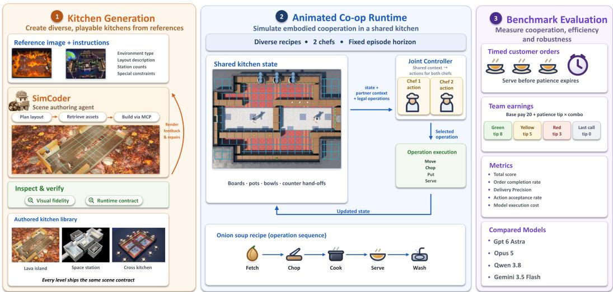
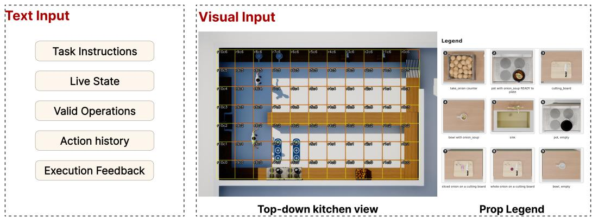
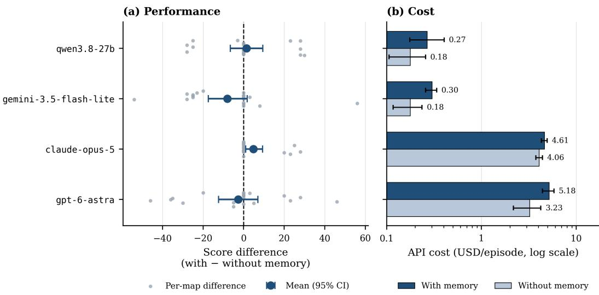
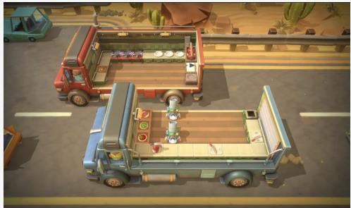
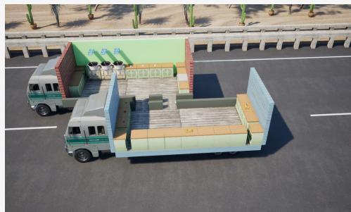
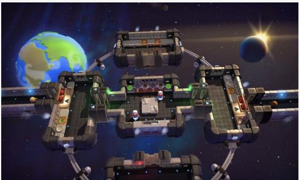
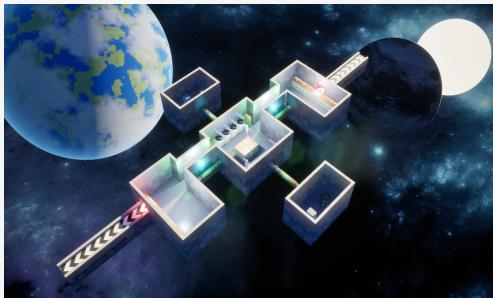
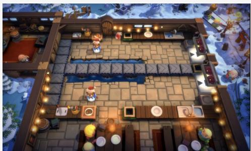
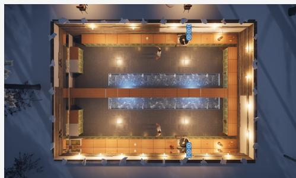

# DUOCOOK: AN OVERCOOKED-INSPIRED BENCH-MARK FOR VISUAL PLANNING AND COORDINATION

Ziyi Jiao1, Heng Zhang1, Drishti Regmi2 Xiaokang Ye2, Lianhui Qin2, Peter Yichen Chen1

1 Department of Computer Science, University of British Columbia

2 University of California, San Diego

## ABSTRACT

Coordinating two players in a cooking task requires a vision-language agent to track changing scene states, sequence recipe steps, and allocate shared resources under a time budget. We introduce an Overcooked-inspired benchmark for evaluating these capabilities in Unreal Engine environments constructed using coding agents. A single vision-language model controls both players from top-down visual observations, selecting high-level actions while the engine executes navigation. The benchmark contains 20 maps in five categories. These categories support evaluation of centralized coordination under equipment contention, changing terrain, and handoff dependencies. A prop legend and pot ingredient-count indicators provide explicit visual cues, while grid-based destinations support spatial grounding. The evaluation compares four VLMs on all 20 maps, measuring task score, order completion, delivery precision, action acceptance rate, and model API expenditure. A memory ablation on the same 20 maps examines the effect of a shared, self-authored notebook while retaining six-response action history in both conditions. The strongest evaluated model, gpt-6-astra, achieves 26.2% mean order completion. Notebook memory has mixed score effects across models, with positive mean differences for Claude and Qwen and negative differences for GPT and Gemini.

## 1 INTRODUCTION

A cooking task can fail even when individual actions appear sensible. A player may chop the correct ingredient while blocking a board needed for an urgent order, or wait beside a boiling pot instead of working elsewhere. Efficient cooking requires tracking unfinished operations, assigning complementary work, and revising schedules as equipment and ingredients become available. This raises a broader question: can a vision-language model (VLM) use visual observations and structured task information to coordinate interdependent work under order deadlines?

Overcooked-AI examines cooperation with humans (Carroll et al., 2019), MindAgent studies multiagent task allocation (Gong et al., 2024), and Collab-Overcooked introduces resource isolation and process-oriented evaluation (Sun et al., 2025). Visual-agent benchmarks evaluate interaction across games, embodied environments, and graphical interfaces (Paglieri et al., 2025; Liu et al., 2025; Yang et al., 2025). We study centralized scheduling across kitchens with different spatial and operational constraints, using a common multimodal interface to connect kitchen state, recipes, orders, and player assignments.

We introduce DuoCook, an Overcooked-inspired benchmark in Unreal Engine where a single VLM controls two players from a shared context. Its 20 maps span five categories: basic, shared equipment, dynamic, dynamic with shared equipment, and separated workspaces (Section 3.2), introducing equipment contention, terrain changes, and required handoffs. The model assigns both players’ work to maximize delivery score under deadlines, time-dependent tips, and a streak bonus, making centralized coordination the evaluation target. Coding agents construct kitchens through SimWorld Studio (Kang et al., 2026), followed by manual refinement and actor-contract verification (Section 3.1).

The controller receives a top-down kitchen image, prop legend, task instructions, live-state information, and legal operations. The model selects actions and destination coordinates while the engine handles navigation. State changes trigger model calls, with simulation paused during model inference. The interface thus evaluates destination selection and scheduling with structured state assistance.

The evaluation protocol compares four VLMs on all 20 maps across all five categories, reporting total score, order completion rate, delivery precision, action acceptance rate, and API expenditure per episode. A memory ablation on the same 20 maps removes only the shared, self-authored notebook, measuring its effect on performance and API cost while retaining all other inputs.

The paper makes two contributions:

• A benchmark of 20 agent-generated kitchens for centralized two-player planning and coordination, with five map categories and a shared multimodal interface.

• An evaluation protocol combining five performance, action-validity, and API-cost metrics with an ablation of shared notebook memory.

## 2 RELATED WORK

## 2.1 COOKING ENVIRONMENTS AND COOPERATIVE AGENTS

Overcooked-AI studies coordination and cooperation with humans (Carroll et al., 2019), while ProAgent uses language models to infer teammate intentions (Zhang et al., 2024a). MindAgent’s CuisineWorld supports centralized multi-agent scheduling (Gong et al., 2024), and Collab-Overcooked combines resource isolation, asymmetric knowledge, and communication to evaluate interdependent collaboration (Sun et al., 2025). DuoCook builds on these precedents with one visually grounded controller for both players and map variations that expose resource and spatial dependencies. It evaluates centralized scheduling rather than inference about an independently controlled partner; neither multi-cook control nor required handoffs alone constitutes its contribution.

ParaCookZhang et al. (2026) represents cooking tasks as directed acyclic graphs and measures concurrent execution efficiency. RobotouilleGonzalez-Pumariega et al. (2025) examines asynchronous, long-horizon planning, while CookbenchCai et al. (2025) combines recipe preparation with customer-intention recognition. Related planning benchmarks include WORKBENCHQiao et al. (2025) and Plan-over-GraphZhang et al. (2025b) for graph-structured workflows, AsyncHowLin et al. (2024) for ordering tasks with known durations, and TimeArenaZhang et al. (2024b) for scheduling in an interactive environment. PACEHuang et al. (2026) overlaps planning and execution through interleaved reasoning and action. These directions inform DuoCook’s scheduling demands, such as preparing another dish while soup boils.

## 2.2 VISUAL INTERACTION AND GAME BENCHMARKS

Balrog evaluates planning and exploration across games (Paglieri et al., 2025), while VisualAgent-Bench spans embodied interaction, graphical interfaces, and visual design (Liu et al., 2025). EmbodiedBench covers semantic tasks, navigation, and manipulation (Yang et al., 2025); VideoGameBench evaluates raw visual gameplay, including a paused setting that separates some inference-latency effects from action selection (Zhang et al., 2025a). DuoCook focuses on matched interventions within cooking workflows. Its engine-executed navigation, grid labels, and structured state assist the controller, so scores are not directly interchangeable with those from different observation and control interfaces.

## 2.3 PERSISTENT CONTEXT FOR INTERACTIVE AGENTS

ReAct interleaves reasoning and action using interaction feedback (Yao et al., 2023), while Reflexion stores verbal reflections across trials (Shinn et al., 2023). DuoCook evaluates a shared notebook of self-authored observations with age-dependent retention. Removing this notebook while retaining six-response action history and current visual and structured inputs tests its effect on performance and inference cost.

  
Figure 1: Benchmark pipeline. Left: coding-agent kitchen construction, manual refinement, and actor-contract verification. Center: joint control of two players from shared multimodal inputs, illustrated by onion-soup preparation. Right: timed-order scoring and evaluation of score, order completion, delivery precision, action acceptance, and API expenditure.

## 2.4 GENERATED ENVIRONMENTS FOR EVALUATION

Generated environments can support agent evaluation or serve as the output of a generative model. Procgen uses procedurally generated levels to evaluate agent generalization (Cobbe et al., 2020), while MarioGPT generates Mario levels from text (Sudhakaran et al., 2023). In DuoCook, coding agents build Unreal Engine kitchens from reference layouts and construction instructions, followed by manual refinement and actor-contract verification (Section 3.1). This process supplies the environments for evaluating cooking controllers.

## 3 SYSTEM AND TASK DESIGN

Figure 1 summarizes the benchmark workflow, from kitchen construction to controller execution and evaluation.

## 3.1 MAP GENERATION WITH CODING AGENTS

We construct kitchens in Unreal Engine using SimWorld Studio, which provides coding agents with Model Context Protocol (MCP) tools and Markdown skills for scene configuration and asset placement. Two separate claude-opus-5 processes author the generation prompt and build the scene, respectively. The authoring process reviews the SimWorld Studio architecture, then receives the game context, a reference image, and an actor naming and scene-structure contract. It produces a construction prompt with a completion checklist covering required appliances and VLM-controlled MetaHuman characters. The construction process executes this prompt with access to the game context, pipeline code, actor contract, and reference image. We then refine the scene manually and run a script to verify required actors and their names. Manual edits address decoration, collisions, visibility, and camera configuration. In a truck scene, for example, we moved rocks clear of the truck bed, adjusted the top-down camera’s yaw, added an isometric camera, and removed a truck wall to expose the kitchen.

## 3.2 MAP CONDITIONS

The benchmark contains 20 functional maps based on Overcooked layouts, grouped by equipment sharing, terrain changes, and item transfers. The main evaluation uses all 20 maps; the memory ablation uses the same 20 maps. Appendix A lists source levels and evaluation subsets.

Table 1: Base tips by elapsed waiting time for a non-expired order. The thresholds correspond to 45%, 70%, and 85% of the 3,000-step waiting limit.
<table><tr><td>Zone</td><td>Elapsed waiting time w (steps)</td><td>Base tip</td></tr><tr><td>Green</td><td> $\overline { { 0 \leq w \leq 1 , 3 5 0 } }$ </td><td>8</td></tr><tr><td>Yellow</td><td> $1 , 3 5 0 < w \leq 2 , 1 0 0$ </td><td>5</td></tr><tr><td>Red</td><td> $2 , 1 0 0 < w \leq 2 , 5 5 0$ </td><td>3</td></tr><tr><td>Last call</td><td> $2 , 5 5 0 < w < 3 , 0 0 0$ </td><td>0</td></tr></table>

All maps contain floors, counters, ingredient bins, pots, plates, chopping boards, and serving points. Bins, boards, and pots are fixed to counters, which block movement but support food and plate placement. Players move, carry and place objects, chop ingredients, plate food, and serve dishes. After serving, dirty plates appear in sinks for washing on sink-equipped maps; otherwise, clean plates reappear at their initial locations. The map categories vary the coordination required by these operations. Basic and shared-equipment maps have fixed terrain: the former allow independent order completion, while the latter require players to share stations such as chopping boards or pots. Dynamic maps introduce counters or floor sections that move back and forth every 1,000 steps, changing obstacles or traversable terrain; gaps remain inaccessible, preventing falls. Four dynamic maps require equipment sharing, and four do not. In separated workspaces, players cannot cross between regions and must pass ingredients or plates across counters, so neither can complete a dish alone.

## 3.3 COOKING TASK AND CONTROLLER OBJECTIVE

A single VLM controls two MetaHuman players to maximize the score from preparing and serving orders within the episode horizon (Section 4.1). Menus include salads and soups, with recipes and order queues configured by level. Chopping and dish washing occupy a player throughout execution, whereas soup boils unattended, allowing concurrent work.

Orders and scoring. Orders arrive every 1,000 steps, expire after 3,000 steps, and may be fulfilled in any order. Each delivery earns 20 points plus a time-dependent tip scaled by a combo multiplier:

$$
R _ { i } = 2 0 + m _ { i } b ( w _ { i } ) ,\tag{1}
$$

where $w _ { i }$ is the waiting time at delivery, $b ( w _ { i } )$ is the base tip (Table 1), and $m _ { i }$ follows the schedule (1, 1, 2, 3, 4), capped at 4. Deliveries build the combo streak; an expired order resets the streak to zero. The multiplier applies only to tips.

## 3.4 MULTIMODAL AGENT INPUTS

The controller receives kitchen images alongside task instructions, live state, legal operations, execution feedback, and six-response action history (Figure 2).

At each decision, both players share a top-down kitchen image with grid labels, a prop legend, and textual context (Figure 2). A map-specific system prompt of approximately 4,000 words provides kitchen rules and recipes, using the simulator’s menu, and is re-sent at every decision. Live-state reports player actions, positions, held items, and station claims, together with orders and preparation status. Game-UI information is supplied as text to reduce dependence on UI appearance. The engine lists legal operations based on kitchen state and station claims, without filtering by waiting orders; rejection feedback explains failures without suggesting corrective plans. Each player’s action history contains its six most recent responses, newest first, with actions, target cells, and execution acceptance. This history is retained in both experimental conditions. The memory-enabled condition additionally supplies a shared, self-authored notebook (Section 4.4).

## 3.5 GRID-BASED NAVIGATION AND HIGH-LEVEL ACTIONS

Each map has an $N \times M$ grid with coordinates rxcy, where x and y denote row and column. The origin is randomly assigned per map and then fixed; the controller reads image labels to locate targets (Figure 2). Commands pair a destination coordinate with an action, such as pickup, chopping, or serving. Station interactions target the station cell; the engine handles the approach using a navigation mesh (NavMesh) that excludes counters and gaps. Incompatible action-target pairs and unreachable destinations return errors for the controller to revise and retry. State-change events trigger VLM calls, including action or cooking completion, order arrival or expiration, and terrain changes. The engine updates observations and pauses simulation during VLM inference. When one player finishes, the controller assigns its next action while preserving the other player’s ongoing action, which resumes after inference. Terrain changes interrupt movement, prompting the controller to select a destination and action from the updated scene and the engine to plan a new route.

  
Figure 2: Input components retained in both memory conditions. Left: instructions, live-state JSON, legal operations, six-response action history, and execution feedback. Right: a top-down kitchen image with grid labels and pot indicators, plus a prop legend. The additional notebook used in the memory-enabled condition is not shown.

## 4 EXPERIMENTS

Our evaluation examines how a single model coordinates two players under equipment-sharing constraints, changing terrain, and required item transfers. It consists of the main benchmark on 20 maps and a memory ablation on the same 20 maps.

## 4.1 EVALUATION SETUP

The complete benchmark contains 20 functional maps. We evaluate all four VLMs on the same 20 maps spanning all five categories, and compare memory conditions on the same 20 maps for all four models. Appendix A specifies the maps in each subset. The ablation covers all five categories. All reported aggregates refer to the maps included in the corresponding experiment.

Evaluated models. The model roster consists of gpt-6-astra, claude-opus-5, qwen3.8-27b, and gemini-3.5-flash-lite. Each model controls both players through a single controller, and the two players can act concurrently. We access gpt-6-astra through the OpenAI API and claude-opus-5 through the Anthropic API; qwen3.8-27b and gemini-3.5-flash-lite are accessed through OpenRouter.

Episode protocol. Each episode runs for 4,000 steps. This horizon applies to the main benchmark and the memory ablation. Controller calls follow state-change events, and the simulation pauses during inference, as described in Section 3.5.

For each map, the initial state, number of orders, and order sequence are fixed and shared across models and memory conditions. Each model runs once on each of the 20 main-evaluation maps with memory enabled. For the ablation, we reuse those results on the same 20 maps and run each model once more on each of those maps with memory disabled. These settings match the starting conditions and order workload; subsequent trajectories depend on the model’s actions. We compute metrics for each episode and average them with equal weight across the 20 evaluation maps. Category summaries use only the evaluated maps in that category. For the memory ablation, we compute the difference between conditions on each of the 20 maps and then average these paired differences. With one run per model, map, and condition, results are descriptive and do not estimate variability across repeated model runs.

## 4.2 EVALUATION METRICS

We use five metrics to measure task performance, action acceptance, and inference cost. The same metrics apply to the main benchmark and the memory ablation.

Total score. The episode score measures accumulated points under the scoring rules in Section 3.3. Each fulfilled order earns the base reward and combo-adjusted tip in Equation 1; orders may be fulfilled in any sequence.

Order completion rate. Let $N _ { \mathrm { c o m p l e t e d } }$ denote the number of completed orders and $N _ { \mathrm { o r d e r s } }$ the total number of orders in an episode. Order completion rate is

$$
C = \frac { N _ { \mathrm { c o m p l e t e d } } } { N _ { \mathrm { o r d e r s } } } .\tag{2}
$$

This metric measures how much of the order workload the controller completes within the episode horizon.

Delivery precision. Let $N _ { \mathrm { c o r r e c t } }$ denote the number of correct deliveries and $N _ { \mathrm { s e r v e d } }$ the total number of dishes served. Delivery precision is

$$
P = \frac { N _ { \mathrm { c o r r e c t } } } { N _ { \mathrm { s e r v e d } } } .\tag{3}
$$

It measures the fraction of serving attempts that satisfy an order, complementing completion rate by distinguishing successful deliveries from unsuccessful attempts.

Action acceptance rate. Let $N _ { \mathrm { a c c e p t e d } }$ denote the number of player commands accepted by the engine and $\bar { N } _ { \mathrm { i s s u e d } }$ the total number issued. Action acceptance rate is

$$
A = { \frac { N _ { \mathrm { a c c e p t e d } } } { N _ { \mathrm { i s s u e d } } } } .\tag{4}
$$

Commands are counted separately for each player, so a response assigning both players contributes two commands. Each retry counts as another issued command. Rejections include unreachable destinations and incompatible action–target combinations. Accepted commands remain counted even if they are later interrupted or do not advance an order. The metric therefore measures command validity under the supplied interface, while score and order completion measure task performance. Episodes with no issued commands are reported as N/A.

Model execution cost. Model execution cost is the total amount spent on model API calls during an episode, reported in US dollars (USD). It includes all billed calls, including retries, and any charges for image inputs and action-history context. We report mean API expenditure per episode alongside task performance.

## 4.3 MAIN BENCHMARK EVALUATION

The main evaluation compares the four models across all 20 maps using the visual observations, legend, and memory described above. We report overall performance in Table 2 and results for each map category defined in Section 3.2. The five metrics capture complementary aspects of performance: accumulated reward, coverage of the order workload, delivery correctness, action acceptance, and execution cost.

The benchmark is far from saturated. The strongest controller completes 26.2% of the order workload and the rest complete 8.8–11.2%; most episodes end with nothing delivered, including 15 of

Table 2: Main benchmark performance, averaged with equal weight across 20 maps, with one episode per model and map. Arrows give the preferred direction. Delivery precision excludes maps with no deliveries; n gives the number of maps entering that mean. Bold values mark the best reported mean in each column.
<table><tr><td>Controller</td><td>Score ↑</td><td>Completion (%) ↑</td><td>Precision (%) ↑</td><td>Acceptance (%) ↑</td><td>USD/episode ↓</td></tr><tr><td>qwen3.8-27b</td><td>9.1</td><td>8.8</td><td> $\overline { { 9 1 . 7 \ : ( n = 6 ) } }$ </td><td>39.5</td><td>0.27</td></tr><tr><td> $\mathtt { g e m i n i - 3 . 5 - f l a s h - 1 i t e }$ </td><td>11.9</td><td>11.2</td><td> $8 1 . 0 ( n = 7 ) $ </td><td>32.1</td><td>0.30</td></tr><tr><td> $\mathtt { c l a u d e - o p u s - 5 }$ </td><td>8.2</td><td>8.8</td><td> ${ \bf 1 0 0 . 0 } \dot { ( } n = 5 )$ </td><td>52.7</td><td>4.61</td></tr><tr><td> $\mathtt { g p t - 6 - a s t r a }$ </td><td>25.6</td><td>26.2</td><td> $9 3 . 8 ( n = 1 6 )$ </td><td>64.6</td><td>5.18</td></tr></table>

<table><tr><td></td><td>Basic (4 maps)</td><td>Shared equip. (4 maps)</td><td>Dynamic (4 maps)</td><td>Dynamic + shared (4 maps)</td><td>Separated workspaces (4 maps)</td><td>100</td></tr><tr><td>qwen3.8-27b</td><td>6.2</td><td>12.5</td><td>12.5</td><td>0.0</td><td>12.5</td><td rowspan="3">80 Ordcor c(%) 60 40</td></tr><tr><td>gemini-3.5-flash-lite</td><td>25.0</td><td>6.2</td><td>25.0</td><td>0.0</td><td>0.0</td></tr><tr><td>claude-opus-5</td><td>12.5</td><td>12.5</td><td>18.8</td><td>0.0</td><td>0.0</td></tr><tr><td>gpt-6-astra</td><td>31.2</td><td>18.8</td><td>31.2</td><td>31.2</td><td>18.8</td><td>20 0</td></tr></table>

Figure 3: Mean order completion by map category. Each column averages the four maps in that category with equal weight.

20 for claude-opus-5 and 14 of 20 for qwen3.8-27b. Differences between controllers are therefore differences between low absolute levels of competence rather than a ceiling effect.

gpt-6-astra separates clearly from the rest, scoring more than twice the nearest alternative and leading on score, order completion, and action acceptance. Claude has the highest delivery precision, computed over the five maps on which it delivers at least one dish.

Two categories present the strongest barriers. On maps combining changing terrain with shared equipment, three of four controllers deliver no dishes; gpt-6-astra is the sole exception, scoring on all four maps in this category (mean score 29.0). On separated-workspace maps, gpt-6-astra again scores on three of four maps, and qwen3.8-27b scores on one; claude-opus-5 and gemini-3.5-flash-lite deliver nothing across all eight of their episodes in this category. Terrain change with equipment contention, and required hand-offs across disjoint workspaces, remain near-complete barriers for all but the strongest controller.

Where controllers deliver at all, most deliver the right dish: precision is 100% for claude-opus-5, 93.8% for gpt-6-astra, 91.7% for qwen3.8-27b, and 81.0% for gemini-3.5-flash-lite. These precision estimates exclude zero-delivery episodes and use different map subsets, so they do not identify the causes of failure. Selection errors could also prevent any delivery. Action acceptance and task performance can rank models differently: claude-opus-5 issues valid commands 52.7% of the time and scores 8.2, while gemini-3.5-flash-lite is valid 32.1% of the time and scores 11.9. This comparison motivates reporting both metrics but does not establish their overall association. Cost spans more than an order of magnitude and does not track performance: the strongest controller is also among the most expensive.

Each model-map result comes from a single episode, and each heatmap cell averages four such results. We report descriptive differences without estimating run-to-run variability. Low performance in the two hardest categories does not establish that those categories are unsolvable.

  
Figure 4: Effect of shared memory, as paired differences (with memory minus without) on the 20 ablation maps. (a) Score difference: grey points are per-map differences, the marker is the equal-weight mean with a 95% percentile bootstrap interval over resampled maps. (b) API cost per episode under each condition, log scale. Intervals resample maps rather than repeated runs, since each model-map-condition result is a single episode; they summarize sensitivity of the mean to resampling the observed maps, not the distribution of individual map effects or run-to-run variability. The constructed maps are not a random sample from a specified population, so these intervals do not establish generalization beyond this suite.

## 4.4 MEMORY ABLATION

We compare controllers with and without shared memory on all 20 maps. The memory-enabled results are reused from the corresponding main-benchmark episodes. For each model and map, the memory-disabled run uses the same initial state and order schedule, with only the shared memory removed.

The shared memory is a notebook the two players fill in themselves. With any decision a player may attach up to three observations, each a tuple of grid cell, object kind, status, and an optional free-text note. Both players read the resulting table back on every subsequent call, rendered one row per observed cell, and each row carries the identity of whoever wrote it. Entries decay on an exponential forgetting curve with a 600-step half-life and are displayed in three confidence bands (just seen, fairly sure, hazy); hearsay from the partner decays twice as fast as first-hand observation. Nothing in it is validated against the simulator: it records beliefs, and a stale or mistaken row is part of what the condition tests.

The shared store holds entries of the form (grid cell, object kind, status, optional note, author, write step). Entries are keyed by cell and kind, so a later write about the same cell replaces the earlier one; this is how a player corrects itself, and a write with status unknown deletes the row instead.

A belief loses force with age. For an entry written at step $t _ { i }$ and read at step t by player $p ,$ retention is

$$
r _ { i } ^ { ( p ) } ( t ) ~ = ~ 2 ^ { - ( t - t _ { i } ) / H _ { i } ^ { ( p ) } } , \qquad H _ { i } ^ { ( p ) } = \{ H , \qquad \mathrm { w r i t t e n ~ b y ~ } p \atop H / \rho , \quad \mathrm { w r i t t e n ~ b y ~ t h e ~ p a r t n e r } , \qquad\tag{5}
$$

with half-life $H = 6 0 0$ steps and hearsay ratio $\rho = 2 .$ A player’s own observation therefore keeps half its force after 600 steps, while the same observation read from its partner keeps half after 300. Retention depends only on the entry’s age and its authorship; it never consults simulator state, so a confidence value cannot encode anything the player has not been told.

The model never sees retention $r _ { i } ^ { ( p ) } ( t )$ as a number. It is shown as one of three ordinal bands: just seen above 0.75, fairly sure above 0.45, hazy above 0.20; and entries below 0.20 are dropped from the rendered table. Each surviving row is annotated with its band and with whether the reader wrote it.

The store holds at most 24 entries and at most 16 from any one author. When a cap is exceeded, the weakest beliefs are evicted first, ordered by retention with deterministic tie-breaking. Eviction never consults the simulator: dropping the entries that happen to be factually wrong would supply an answer key. The cap sits just below the number of addressable objects on these maps, so even a full store cannot amount to a complete description of the level.

Shared memory does not help uniformly. The clearest benefit is for claude-opus-5, which gains +4.8 points (bootstrap 95% CI: [+1.0, +9.4] over resampled maps); this is the only model whose reported bootstrap interval excludes zero. The largest mean score decrease occurs for gemini-3.5-flash-lite, which has a mean difference of −8.1 points (CI: [−17.4, +1.8]). For qwen3.8-27b (+1.4, CI: [−6.6, +9.4]) and gpt-6-astra (−2.7, CI: [−12.4, +7.0]), the intervals span zero. These are descriptive map-resampling summaries; none of the intervals quantifies repeatability across model runs.

Counting maps on which a controller scores at all, memory moves claude-opus-5 from 3 to 5 maps and gpt-6-astra from 13 to 16, while leaving qwen3.8-27b unchanged at 6 and reducing gemini-3.5-flash-lite from 11 to 7. For Gemini, fewer maps yield a positive score with shared memory; aggregate counts do not reveal the individual map transitions.

One hypothesis is that the notebook competes for attention with the task. For gemini-3.5-flash-lite, action acceptance falls from 56.4% to 32.1% with memory, and deliveries fall from 21 to 12 dishes. gpt-6-astra’s acceptance also declines (70.3% → 64.6%), while its total dish count remains 23 in both conditions. These summaries do not establish an attention mechanism; that interpretation requires trajectory-level evidence.

Memory increases mean API expenditure for all four models. Claude and Qwen have positive mean score differences (+4.8 and +1.4), although only Claude’s reported bootstrap interval excludes zero. GPT and Gemini incur higher mean cost with lower mean scores. For Claude and Qwen, the value of the observed gains depends on the acceptable cost per score improvement and their stability across repeated runs.

Conditions. The two conditions differ in one term. Both observations contain the scene image, the prop legend, the live-state JSON, the operation list, immediate failure feedback, and the six-response action history; the memory-enabled condition adds the rendered shared store. The action history appears in both conditions: it is written by the environment rather than the model, is never shared between players, and is held fixed so that the comparison isolates shared, self-authored memory from recency alone.

Across the memory-enabled episodes, 40.1% of the entries a player read had been written by its partner (10,732 of 26,750). This records partner-authored notebook use, but does not by itself show that the information was unavailable through other inputs.

This design tests whether a shared and decaying world model improves joint performance, and measures the additional inference cost of maintaining and reading it. Both conditions use the five benchmark metrics, aggregated over the same 20 maps.

## 5 LIMITATIONS

Centralized two-player control leaves communication, private information, and adaptation to independent teammates outside the primary evaluation. Top-down observations and engine navigation reduce demands that would be present under first-person sensing or direct motor control. The prop legend, pot indicators, live-state JSON, and engine-computed legal-operation list provide additional information and assistance. Results therefore reflect planning under this combined interface, includ ing selection among legal operations to advance waiting orders.

Differences between maps can reflect several task properties, so performance across map conditions does not isolate the effect of resource sharing. The evaluation also does not isolate the contribution of the visual legend or pot indicators, which remain fixed. The memory ablation examines the effect of adding a shared notebook while retaining action history, but memory can also change token usage and latency.

Each model is run once per map and memory condition. Fixed initial states and order sequences provide matched scenarios, but a single run does not quantify variability in model responses or establish the stability of model rankings and memory effects across repeated runs.

Generated maps can repeat structural patterns despite visual variation. Shared generation provenance and similar layouts must be considered when defining held-out evaluation. New maps also do not guarantee that recipes or task concepts are absent from model pretraining. Generalization beyond the tested kitchen distribution, including transfer to real collaborative work, would require additional evidence.

Supporting episode logs, per-map metric tables, and analysis scripts are not included in the current manuscript artifacts. Aggregate results alone do not support a trace-based diagnosis of failures or independent recomputation of the reported effects.

## 6 CONCLUSION AND FUTURE WORK

This paper develops the design of an Overcooked-inspired benchmark for visual planning and centralized coordination in agent-generated Unreal Engine kitchens. Its 20 maps span five categories covering independent work, shared equipment, changing terrain, and required item transfers. The evaluation protocol compares four VLMs on all 20 maps using task performance, action acceptance, and API cost, with a memory ablation on the same 20 maps. Experimental conclusions apply to this evaluated suite. This provides a concrete way to investigate how a controller turns visual observations into coordinated cooking actions.

gpt-6-astra achieves the highest mean score (25.6), order completion (26.2%), and action acceptance (64.6%), while Claude has the highest delivery precision among episodes with deliveries. Performance remains low, especially on dynamic maps with shared equipment and on separatedworkspace maps. Shared notebook memory increases mean API cost for every model and has mixed score effects: Claude and Qwen improve in the observed means, whereas GPT and Gemini decline. These results describe one run per model, map, and condition; repeated runs are needed to assess the stability of these differences.

## AI USE STATEMENT

We used claude-opus-5 to author scene-generation prompts and construct benchmark maps, as described in Section 3.1. We also used AI tools to polish the manuscript.

## REFERENCES

Muzhen Cai, Xiubo Chen, Yining An, Jiaxin Zhang, Xuesong Wang, Wang Xu, Weinan Zhang, and Ting Liu. Cookbench: A long-horizon embodied planning benchmark for complex cooking scenarios. arXiv preprint arXiv:2508.03232, 2025.

Micah Carroll, Rohin Shah, Mark K Ho, Tom Griffiths, Sanjit Seshia, Pieter Abbeel, and Anca Dragan. On the utility of learning about humans for human-ai coordination. Advances in neural information processing systems, 32, 2019.

Karl Cobbe, Chris Hesse, Jacob Hilton, and John Schulman. Leveraging procedural generation to benchmark reinforcement learning. In International conference on machine learning, pp. 2048– 2056. PMLR, 2020.

Ran Gong, Qiuyuan Huang, Xiaojian Ma, Yusuke Noda, Zane Durante, Zilong Zheng, Demetri Terzopoulos, Li Fei-Fei, Jianfeng Gao, and Hoi Vo. Mindagent: Emergent gaming interaction. In Findings of the Association for Computational Linguistics: NAACL 2024, pp. 3154–3183, 2024.

Gonzalo Gonzalez-Pumariega, Leong Yean, Neha Sunkara, and Sanjiban Choudhury. Robotouille: An asynchronous planning benchmark for llm agents. In International Conference on Learning Representations, volume 2025, pp. 83757–83792, 2025.

Yuchen Huang, Xijiang Ying, Zhenhua Ma, Xiaxiang Yuan, Zhijie Gao, Jiayi Huang, Ruichi Mao, Jiazheng Zhang, Hongsheng Ti, Maotao Tian, et al. Pace: Adaptive budget allocation for timeefficient embodied planning. arXiv preprint arXiv:2608.03034, 2026.

Haoqiang Kang, Xiaokang Ye, Yuhan Liu, Siddhant Hitesh Mantri, Lingjun Mao, James Fleming, Drishti Regmi, and Lianhui Qin. Simworld studio: Automatic environment generation with evolving coding agent for embodied agent learning. arXiv preprint arXiv:2605.09423, 2026.

Fangru Lin, Emanuele La Malfa, Valentin Hofmann, Elle Michelle Yang, Anthony G. Cohn, and Janet B. Pierrehumbert. Graph-enhanced large language models in asynchronous plan reasoning. In Proceedings of the 41st International Conference on Machine Learning, ICML’24. JMLR.org, 2024.

Xiao Liu, Tianjie Zhang, Yu Gu, Iat Long Iong, Yifan Xu, Xixuan Song, Shudan Zhang, Hanyu Lai, Xinyi Liu, Hanlin Zhao, Jiadai Sun, Xinyue Yang, Yu Yang, Zehan Qi, Shuntian Yao, Xueqiao Sun, Siyi Cheng, Qinkai Zheng, Hao Yu, Hanchen Zhang, Wenyi Hong, Ming Ding, Lihang Pan, Xiaotao Gu, Aohan Zeng, Zhengxiao Du, Chan Hee Song, Yu Su, Yuxiao Dong, and Jie Tang. Visualagentbench: Towards large multimodal models as visual foundation agents. In International Conference on Learning Representations, volume 2025, pp. 95650–95707, 2025.

Davide Paglieri, Bartłomiej Cupiał, Samuel Coward, Ulyana Piterbarg, Maciej Wołczyk, Akbir Khan, Eduardo Pignatelli, Łukasz Kucinski, Lerrel Pinto, Rob Fergus, et al. Balrog: Bench-´ marking agentic llm and vlm reasoning on games. In International Conference on Learning Representations, volume 2025, pp. 96666–96702, 2025.

Shuofei Qiao, Runnan Fang, Zhisong Qiu, Xiaobin Wang, Ningyu Zhang, Yong Jiang, Pengjun Xie, Fei Huang, and Huajun Chen. Benchmarking agentic workflow generation. In International Conference on Learning Representations, volume 2025, pp. 69679–69703, 2025.

Noah Shinn, Federico Cassano, Ashwin Gopinath, Karthik Narasimhan, and Shunyu Yao. Reflexion: Language agents with verbal reinforcement learning. Advances in neural information processing systems, 36:8634–8652, 2023.

Shyam Sudhakaran, Miguel Gonzalez-Duque, Matthias Freiberger, Claire Glanois, Elias Najarro,´ and Sebastian Risi. Mariogpt: Open-ended text2level generation through large language models. Advances in Neural Information Processing Systems, 36:54213–54227, 2023.

Haochen Sun, Shuwen Zhang, Lujie Niu, Lei Ren, Hao Xu, Hao Fu, Fangkun Zhao, Caixia Yuan, and Xiaojie Wang. Collab-overcooked: Benchmarking and evaluating large language models as collaborative agents. In Proceedings of the 2025 Conference on Empirical Methods in Natural Language Processing, pp. 4922–4951, 2025.

Rui Yang, Hanyang Chen, Junyu Zhang, Mark Zhao, Cheng Qian, Kangrui Wang, Qineng Wang, Teja Venkat Koripella, Marziyeh Movahedi, Manling Li, et al. Embodiedbench: Comprehensive benchmarking multi-modal large language models for vision-driven embodied agents. arXiv preprint arXiv:2502.09560, 2025.

Shunyu Yao, Jeffrey Zhao, Dian Yu, Nan Du, Izhak Shafran, Karthik Narasimhan, and Yuan Cao. ReAct: Synergizing reasoning and acting in language models. In The Eleventh International Conference on Learning Representations, 2023. doi: 10.48550/arXiv.2210.03629. URL https: //arxiv.org/abs/2210.03629.

Alex L Zhang, Thomas L Griffiths, Karthik R Narasimhan, and Ofir Press. Videogamebench: Can vision-language models complete popular video games? arXiv preprint arXiv:2505.18134, 2025a.

Ceyao Zhang, Kaijie Yang, Siyi Hu, Zihao Wang, Guanghe Li, Yihang Sun, Cheng Zhang, Zhaowei Zhang, Anji Liu, Song-Chun Zhu, et al. Proagent: building proactive cooperative agents with large language models. In Proceedings of the AAAI Conference on Artificial Intelligence, volume 38, pp. 17591–17599, 2024a.

Shiqi Zhang, Xinbei Ma, Zouying Cao, Zhuosheng Zhang, and Hai Zhao. Plan-over-graph: Towards parallelable llm agent schedule. arXiv preprint arXiv:2502.14563, 2025b.

Shiqi Zhang, Xinbei Ma, Yunqing Xu, Zouying Cao, Pengrui Lu, Haobo Yuan, Tiancheng Shen, Zhuosheng Zhang, Hai Zhao, and Ming-Hsuan Yang. Paracook: On time-efficient planning for multi-agent systems. In Findings of the Association for Computational Linguistics: ACL 2026, pp. 27683–27701, 2026.

Yikai Zhang, Siyu Yuan, Caiyu Hu, Kyle Richardson, Yanghua Xiao, and Jiangjie Chen. Timearena: Shaping efficient multitasking language agents in a time-aware simulation. In Proceedings of the 62nd Annual Meeting of the Association for Computational Linguistics (Volume 1: Long Papers), pp. 3894–3916, 2024b.

## A MAP CORRESPONDENCE

Table 3 lists all 20 functional maps and their evaluation membership. Both the main benchmark and the memory ablation use all 20 maps.

Evaluation identifiers use underscores in place of source-level hyphens, for example 1 3. Festive 1-6 and Festive 1-7 correspond to festive 1 6 and festive 1 7; Kevin 1 corresponds to kevin level one.

Table 3: Source-level correspondence and evaluation membership. Main denotes the full 20-map main evaluation; Memory denotes the 20-map memory ablation.
<table><tr><td>Map category</td><td>Source level</td><td>Main</td><td>Memory</td></tr><tr><td rowspan="4">Basic</td><td>1-1</td><td>Yes</td><td>Yes</td></tr><tr><td>1-3</td><td>Yes</td><td>Yes</td></tr><tr><td>1-4</td><td>Yes</td><td>Yes</td></tr><tr><td>1-5</td><td>Yes</td><td>Yes</td></tr><tr><td rowspan="4">Shared equipment</td><td>3-1</td><td>Yes</td><td>Yes</td></tr><tr><td>6-4</td><td>Yes</td><td>Yes</td></tr><tr><td>Festive 1-6</td><td>Yes</td><td>Yes</td></tr><tr><td>Festive 1-7</td><td>Yes</td><td>Yes</td></tr><tr><td rowspan="4">Dynamic</td><td>1-6</td><td>Yes</td><td>Yes</td></tr><tr><td>2-1</td><td>Yes</td><td>Yes</td></tr><tr><td>3-3</td><td>Yes</td><td>Yes</td></tr><tr><td>6-1</td><td>Yes</td><td>Yes</td></tr><tr><td rowspan="4">Dynamic with shared equipment</td><td>3-4</td><td>Yes</td><td>Yes</td></tr><tr><td>4-1</td><td>Yes</td><td>Yes</td></tr><tr><td>4-3</td><td>Yes</td><td>Yes</td></tr><tr><td>6-3</td><td>Yes</td><td>Yes</td></tr><tr><td rowspan="4">Separated workspaces</td><td>2-3</td><td>Yes</td><td>Yes</td></tr><tr><td>2-4</td><td>Yes</td><td>Yes</td></tr><tr><td>3-2</td><td>Yes</td><td>Yes</td></tr><tr><td>Kevin 1</td><td>Yes</td><td>Yes</td></tr><tr><td>Total</td><td>20 maps</td><td>20</td><td>20</td></tr></table>

## B SAMPLE SCENE GENERATION PROMPTS

## Overcooked Level 2-1 Prompt

  
Overcooked Level 2-1

  
Generated Image

Prompt:   
Overcooked level 2-1 -- two flatbed trucks on a desert highway   
Target: /Game/SavedScenes/overcooked\_level\_2\_1   
Reference: overcooked\_level\_2\_1.png (Overcooked 2, level 2-1)   
GOAL: A level with ˜149 actors where two flatbed truck beds sit side   
by   
side on a desert highway, staggered along the road, with open   
asphalt   
between them crossed by exactly two gangplanks.   
- North (red) truck cooks and serves: 3 stoves, 3 clean bowls, the   
delivery belt, and the plate return.   
- South (blue) truck preps: 3 ingredient stations, 2 cutting boards,   
and a long run of free counters.   
Both trucks use a real cab mesh (SM\_vehTruck\_vehicle08\_No\_Wheel)   
with 6 real wheel meshes each, positioned from the skeletal mesh’s   
sockets. Everything else (deck, skirt, walls, rails, gangplanks)   
is   
built from Cube/Plane primitives with materials applied.   
The desert reads as a desert: asphalt, lane paint, guardrail,   
cacti,   
mesas.   
- No signage of any kind -- a station is its actor label and nothing   
else.   
KEY DESIGN DECISIONS:   
1. Decks sit at z = 0; the road is 150 units below (z = -150), so   
all   
standard kitchen seating heights (counter 100, hob 100, bowl   
104.17, etc.) apply unchanged.   
2. The gap between the trucks is real open road -- not a trench --   
crossed only by two gangplanks. Do not widen the gap or add a   
third crossing; the bottleneck is the point of the level.   
3. All three ingredients are on the blue truck and all three stoves   
are on the red truck, so every dish crosses a gangplank at least   
twice.   
LAYOUT: Built on a 13-row x 9-column grid (BP\_Grid, tile size 102cm)   
Red truck occupies columns 1-4, rows 1-9. Blue truck occupies   
columns   
6-9, rows 5-13. Column 5 is the open gap. Counters, stoves, cutting   
boards, and ingredient stations are placed at specific grid cells   
following the standard kitchen palette (/Game/KitchenAssets/,

/Game/kitchenDatabase/Interactable/) -- never substituted with   
look-alike assets from elsewhere in the project.   
CAMERA: top\_down camera at (600, 561, 1500), pitch -90, yaw -90,   
28mm focal length -- offset from the grid’s true center so the red   
truck’s cab (which extends west of the grid) isn’t cut off frame.   
DELIVERABLE: The finished level, verified against a measured   
checklist (actor counts, seating heights, tag/label correctness,   
hidden-at-open state props), plus a top-down screenshot compared   
against the reference image.

## Overcooked Level 6-4 Prompt

  
Overcooked Level 6-4

  
Generated Image

Prompt:   
Overcooked level 6-4 -- "Space Station: the Docked Ring" -- scene   
prompt   
Target: /Game/SavedScenes/overcooked\_level\_6\_4   
Reference: overcooked\_level\_6\_4.png (Overcooked! 2 level 6-4)   
GOAL: A kitchen space station with ˜52 actors: a central hub for   
cooking, two side modules (west and east) docked to it via short   
corridors for serving and prep, and two unreachable decorative ring   
pods (north and south) that never turn in this build -- the station   
stays static.   
STATIONS:   
4 stoves in the hub’s north run, each with a full pot/spatula/pot   
counter stack (stove\_1..4, tags Stove\_1..4).   
2 cutting boards + knives on a 2x2 island in the hub’s center.   
3 ingredient stations (lettuce west, onion + tomato east), each   
with a pickup, 2 whole and 2 sliced ingredient props.   
1 delivery belt + pusher in the west module (dishes exit west);   
the east "hatch" is decorative -- just plain counters.   
1 sink in the hub’s south run; 1 plate return in the west module.   
4 clean bowls (2 west, 2 east).   
LAYOUT: Built on an 18-column x 7-row grid (BP\_Grid, 102cm tiles).   
West module (columns 1-4) and east module (columns 15-18) dock to a   
central hub (columns 7-12) via corridors (columns 5-6 and 13-14).   
Two ring pods sit off-grid to the north and south, closed and   
decorative only.   
KEY DESIGN DECISIONS:

1. The station doesn’t rotate -- both side modules stay permanently   
docked, matching the reference’s single frame.   
2. All stovetop items (pots and pans in the reference) become   
identical stove stations for consistency.   
3. Only one delivery belt and one plate return are built (west   
module); the reference’s second hatch/return on the east side   
are represented as plain, non-functional counters.   
4. Ingredients: lettuce (west crate), onion (east crate), and tomato   
(added to an east counter, since the reference’s north-pod crates   
are unreachable).   
5. Decoration (skybox, passing ship, pod crates/consoles, hull   
pipes) is added last, from existing library assets only -- never   
built from primitives, and always with collision disabled.   
STRUCTURE: Floors, walls, and metal hull plating define three rooms   
and two corridors, all built from primitives (the only place   
primitives are allowed). Five invisible collision blockers seal off   
non-walkable empty cells so the level doesn’t leak walkable space   
outside the intended rooms.   
LIGHTING: No sky atmosphere or fog (it’s space) -- lighting comes   
from a directional "sun," a skylight, and five point lights placed   
through the station’s rooms for legibility.   
CAMERAS: A top-down camera and an isometric camera, both framing the   
full station including both ring pods, placed in a dedicated   
"Cameras" outliner folder.   
DELIVERABLE: The finished level with every station present and   
correctly labeled/tagged, props resting properly on their surfaces,   
state props (raw/sliced ingredients, soup-in-pot props, dirty bowl)   
hidden at level open, verified against a measured checklist, plus   
top-down and isometric screenshots compared to the reference image.

Overcooked Festive Level 1-7 Prompt  
  
Overcooked Festive Level 1-7

  
Generated Image

## Prompt:

Overcooked festive 1-7 -- "The Frozen Brook Lodge" -- scene prompt

Target: /Game/SavedScenes/overcooked\_festive\_level\_1\_7

Reference: overcooked\_level\_festive\_1\_7.png (Overcooked! festive level)

GOAL: A ˜90-actor timber lodge kitchen split in half by a frozen

brook running east-west across the floor. A chevron-block bridge

crosses the brook mid-room, and a second walkway runs up the west   
wall. Each half of the kitchen is a mirror of the other, connected   
by the bridge and a walkable strip at the east end of the room.   
STATIONS:   
- 2 stoves, one per half, each with a full pot/spatula/pot counter   
stack (stove\_1, stove\_2).   
- 2 cutting boards + knives, one per half.   
- 2 ingredient stations: onion (north half, from the reference’s   
carrot crate) and meat (south half).   
- 2 separate delivery belts + pushers on the east wall, one per   
half -- dishes exit east through two chutes.   
- 1 sink (north-east corner) and 1 plate return (east wall, north   
half) -- sinkless-style return using a single hidden dirty-bowl   
prop.   
- 2 clean bowls, one per half.   
LAYOUT: A 14-column x 9-row grid (BP\_Grid, 102cm tiles). North and   
south counter runs face each other across the room; the brook cuts   
across the middle two rows, blocked to movement except at the   
bridge and the open strip at the east wall.   
KEY DESIGN DECISIONS:   
1. Two stoves rather than the reference’s single hob, so each half   
of the split kitchen has its own -- one per side of the water.   
2. Two ingredients: onion in the north half, meat in the south   
half, each with its own cutting board.   
3. The reference’s "bin" objects become plain, non-functional   
counters; kettles, a fire extinguisher, and bauble racks are   
decoration only.   
4. The brook is built from water planes with an invisible   
collision blocker -- chefs cross only via the bridge or the   
east-end strip, never through the water.   
5. No off-the-shelf Christmas assets exist in the library (no   
snowman, wreath, or bauble meshes) -- the festive read comes   
from warm string-light lighting against blue snow outside,   
not literal ornaments.   
STRUCTURE: A stone floor (deliberately cool-toned, not warm, so it   
reads distinctly from the timber counters and walls), four timber   
walls with a windowed band, and a snow-covered exterior are all   
built from primitives -- the only place primitives are allowed.   
Everything else is library assets.   
LIGHTING: Warm string-light and hearth-style point lights inside,   
a dim cool directional "sun" plus fog for a blue-hour winter   
atmosphere, and a small cold light glow along the brook itself.   
CAMERAS: A top-down and an isometric camera, both in a dedicated   
"Cameras" folder, framing the full room including the brook.   
DELIVERABLE: The finished level with both cooking/prep/serving   
setups complete and correctly labeled, all props resting properly   
on their surfaces, state props (sliced ingredients, cooked soup   
overlays, the dirty bowl) hidden at level open, both halves of the   
kitchen reachable from both chef spawns, checked against a measured   
checklist, plus top-down and isometric screenshots compared to the   
reference image.