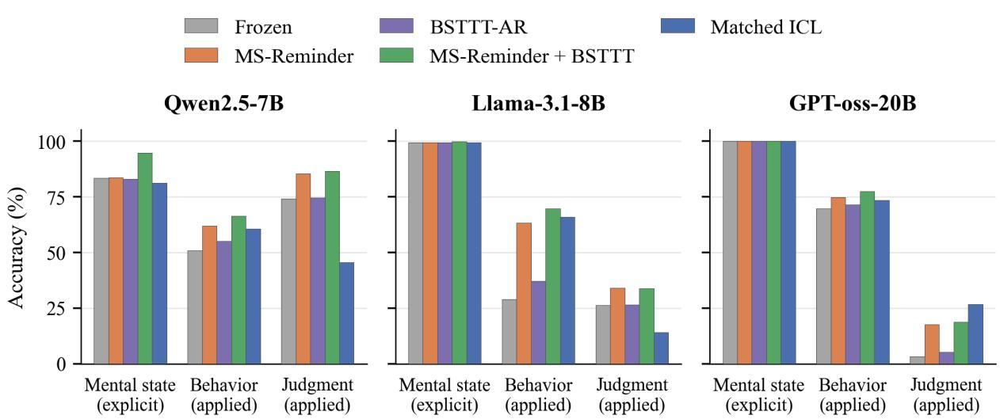
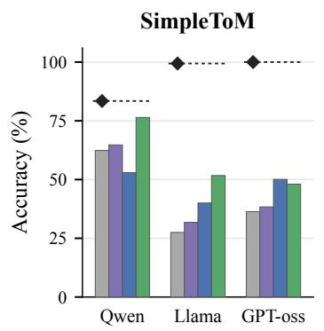
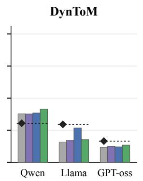
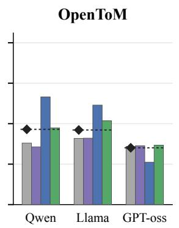
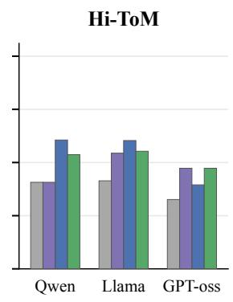

# Diagnosing the Explicit-to-Applied Theory of Mind Gap in LLMs

Prajvi Saxena<sup>1</sup>, Sabine Janzen<sup>1</sup>, Wolfgang Maaß<sup>1,2</sup>,

<sup>1</sup>German Research Center for Artificial Intelligence (DFKI), <sup>2</sup>Saarland University Correspondence: prajvi.saxena@dfki.de

## Abstract

As large language models are deployed in high stakes roles such as therapy, education, and personal assistance, their social cognition must be assessed reliably. Current Theory of Mind (ToM) benchmarks report aggregate scores that conflate two distinct competencies: explicit ToM (recognizing what someone believes) and applied ToM (using that belief to predict behavior). Building on this distinction, we investi gate the gap and its recoverability using four structurally diverse benchmarks. Aggregate re porting obscures uneven competence: on Sim pleToM, Llama-3.1-8B scores 51.5% overall while recognizing mental states at 99.4% and predicting behavior at only 28.9%. To assess recovery, we compare structured prompting, matched in-context learning, and our proposed Belief-State Test-Time Training (BSTTT), which adapts lightweight parameters on answered support questions through action reconstruction. Across Qwen2.5-7B, Llama-3.1- 8B, and GPT-oss-20B, recovery depends on the model, task, and intervention. On Sim pleToM, reminders combined with BSTTT im prove Llama’s behavior prediction by 40.8 per centage points; reminders account for most of the overall improvement, with BSTTT adding 1.3–5.5 points beyond reminders across models. Contextual examples often outperform weight updates, while BSTTT remains stronger in spe cific model–benchmark settings. Temporal be lief tracking remains difficult despite partial recovery. These findings show that aggregate ToM scores can overstate applied competence while hiding performance recoverable through targeted assistance. We recommend decom posed reporting of explicit and applied accu racy alongside intervention comparisons that establish which failures are recoverable and un der what conditions. Our code repository is available at <sup>1</sup>.

## 1 Introduction

Theory of Mind (ToM) is the capacity to attribute beliefs, intentions, and emotions to other agents and to reason about how those states shape behavior (Premack and Woodruff, 1978; Baron-Cohen et al., 1985). This capacity encompasses two qualitatively different competencies. Explicit ToM is recognizing that another agent holds a particular mental state. Applied ToM is using that recognition to predict behavior, anticipate consequences, or evaluate actions. The two can dissociate (Apperly, 2012). Reporting a single accuracy that averages recognition and application questions obscures this distinction. Figure 1 illustrates the dissociation on SimpleToM: Llama-3.1-8B recognizes mental states at 99.4% yet predicts the resulting behavior at only 28.9%, a 70.5-point explicit-toapplied gap. Its overall accuracy of 51.5% hides both near-perfect recognition and weak application. This explicit-to-applied gap motivates two hypotheses. Under a capacity-limitation hypothesis (H1), models lack some of the reasoning capabilities required to translate recognized mental states into reliable behavioral predictions. Under a latentcompetence hypothesis (H2), models possess relevant social knowledge but fail to consistently apply it under standard inference. These hypotheses motivate different remedies: improving the underlying capabilities or improving how existing capabilities are elicited.

Prompt-level interventions, including mental-state reminders, perspective taking (Wilf et al., 2024), and symbolic belief tracking (Sclar et al., 2023), test recoverability without parameter updates. To investigate parameter-based recovery, we introduce Belief-State Test-Time Training (BSTTT), which adapts lightweight LoRA modules (Hu et al., 2022) on answered support questions from each test episode before evaluating a held-out query. We compare a ToM-aligned action-reconstruction objective with generic next-token prediction under the same adapter configuration and update budget, and compare BSTTT with matched ICL using the same answered supports.

We evaluate three open-weight instruction-tuned models (Qwen-2.5-7B, Llama-3.1-8B, and GPToss-20B) across four ToM benchmarks: Simple-ToM (Gu et al., 2026), Hi-ToM (Wu et al., 2023), OpenToM (Xu et al., 2024), and DynToM (Xiao et al., 2025). SimpleToM directly separates mentalstate recognition, behavior prediction, and judgment. OpenToM and DynToM extend the analysis to multihop inference and temporal belief tracking, respectively, while Hi-ToM provides a complementary test of higher-order reasoning.

Three findings emerge. First, a substantial part of the explicit-to-applied gap is recoverable, supporting H2’s prediction that standard inference understates achievable performance. On SimpleToM, Llama’s behavior prediction accuracy increases from 28.9% to 63.2% with a mental-state reminder and to 69.7% with Reminder+BSTTT. Overall, input-level assistance and weight updates can contribute jointly to recovery.

Second, weight updates help, but substantial recovery does not require them. With the same answered supports, ICL can outperform BSTTT: on OpenToM, Llama reaches 56.4% with ICL versus 43.1% with BSTTT. Conversely, GPT-oss performs better with BSTTT, reaching 36.0% versus 28.9% with ICL. Thus, recovery depends both on the support answers and on how the model uses them; parameter adaptation is beneficial in some settings but is not a universal prerequisite for improved applied reasoning.

Third, recovery is selective rather than uniform. On SimpleToM, Llama’s ICL behavior accuracy rises from 28.9% to 66.0%, while judgment accuracy falls from 26.2% to 14.0%. DynToM also shows partial recovery: Llama improves from 19.7% to 32.6% with ICL, leaving substantial remaining error. These results support recoverable competence in specific tasks while leaving the capacity limitations proposed by H1 unresolved. Aggregate improvements therefore cannot establish reliable applied ToM across competencies.

Our contributions are as follows:

1. Diagnostic protocol: We introduce BSTTT and compare ToM-aligned and generic adaptation objectives, matched ICL, and structured prompting to investigate the capacitylimitation and latent-competence hypotheses through controlled intervention comparisons.

2. Cross-benchmark empirical analysis: Across three model families and four benchmarks, we show that substantial recovery is possible without weight updates, that BSTTT provides additional gains in some settings, and that recovery varies across competencies, with persistent errors in temporal belief tracking.

3. Actionable recommendations: We provide concrete guidelines for future ToM evaluation: separately report explicit and applied accuracy, include temporal reasoning as a distinct evaluation axis, and compare prompting, matched ICL, and weight adaptation to characterize recoverable competence.

## 2 The Explicit-to-Applied Theory of Mind Gap

We begin by formalizing the distinction that motivates our evaluation. Consider a ToM benchmark B of question-answer pairs $( q _ { i } , a _ { i } )$ grounded in narrative social scenarios. We partition B into two subsets:

Explicit questions $\begin{array} { r } { B _ { \mathrm { E } } \colon } \end{array}$ Can the model identify an agent’s mental state? These directly probe an agent’s beliefs, emotions, or intentions.

Applied questions $\lvert \ B _ { \mathrm { A } } \rvert$ : Can the model use that mental state to predict behavior, anticipate consequences, or evaluate actions?. These require using mental-state information together with relevant contextual, commonsense, or causal knowledge. Let $\operatorname { a c c } ( \mathcal { M } , \mathcal { B } _ { \mathrm { E } } )$ and $\operatorname { a c c } ( \mathcal { M } , \mathcal { B } _ { \mathrm { A } } )$ denote a model’s accuracy. The explicit-to-applied gap is:

$$
\Delta _ { \mathrm { g a p } } ( { \mathcal { M } } , { \mathcal { B } } ) = \operatorname { a c c } ( { \mathcal { M } } , { \mathcal { B } } _ { \mathrm { E } } ) - \operatorname { a c c } ( { \mathcal { M } } , { \mathcal { B } } _ { \mathrm { A } } )\tag{1}
$$

A positive $\Delta _ { \mathrm { g a p } }$ indicates higher accuracy on explicit than applied questions. A gap near zero indicates similar accuracy across the two subsets, which may reflect either strong or weak performance; we therefore report both accuracies alongside the gap.

## 2.1 Operationalization Across Benchmarks

Table 1 summarizes our operationalization across four ToM regimes; examples appear in Appendix F. SimpleToM (Gu et al., 2026) provides parallel mental-state, behavior, and judgment questions for each scenario, making the gap directly measurable. DynToM (Xiao et al., 2025) contrasts state identification with reasoning about withinscenario state relations and cross-scenario transformations. Hi-ToM (Wu et al., 2023) evaluates object locations and recursively nested beliefs. Without a paired recognition application decomposition OpenToM (Xu et al., 2024) contrasts attitude inference, used as an explicit proxy, with multihop first-order belief reasoning.

  
Figure 1: The explicit-to-applied Theory of Mind gap on SimpleToM Each scenario generates three matched questions: mental-state recognition (explicit), behavior prediction (applied), and judgment (applied).

Table 1: Each benchmark decomposes into explicit (mental-state recognition) and applied (behavioral inference) subsets. Hi-ToM provides a complementary test of higher-order reasoning recovery without a paired explicit subset. (|B|: Total number of questions; C = number of answer choices; |S|: support set size per episode.)
<table><tr><td>Benchmark</td><td>Explicit  $( \boldsymbol { B } _ { \mathrm { E } } )$ </td><td>Applied  $( B _ { \mathrm { A } } )$ </td><td>C</td><td>|B|</td><td>Regime</td><td>|S|</td></tr><tr><td>SimpleToM</td><td>Mental-state</td><td>Behavior, Judgment</td><td>2</td><td>3,441</td><td>Static, 1st-order</td><td>1</td></tr><tr><td>DynToM</td><td>Understand (A)</td><td>Transform (C,D)</td><td>7-8</td><td>3,000</td><td>Temporal, multi-step</td><td>≤4</td></tr><tr><td>Hi-ToM</td><td>(indirect)</td><td>Recursive belief, location</td><td>15</td><td>1,200</td><td>Static, higher-order</td><td>≤4</td></tr><tr><td>OpenToM</td><td>Attitude</td><td>Multihop first-order</td><td>3-6</td><td>2,000</td><td>Static, multi-agent</td><td>≤4</td></tr></table>

## 2.2 Diagnostic Question

A positive $\Delta _ { \mathrm { g a p } }$ under standard inference motivates two hypotheses:

H1 (Capacity limitation): The model lacks some reasoning capabilities needed to translate mentalstate recognition into reliable application.

H2 (Latent competence): The model possesses relevant social knowledge but fails to consistently apply it under standard inference.

We investigate these hypotheses through prompting, matched ICL, and BSTTT, comparing recovery from explicit belief cues, answered supports, and parameter updates. Recovery shows that standard inference understates achievable performance, but does not establish that all required knowledge was already encoded in the model. Persistent errors identify limitations of the tested interventions without proving an intrinsic capacity deficit.

## 3 Belief-State Test-Time Training

We introduce Belief-State Test-Time Training (BSTTT), it updates LoRA parameters on an episode’s support set and uses the adapted model to score candidate answers for a held-out query. The backbone parameters remain fixed, and the LoRA parameters are reset before each episode.

## 3.1 Episode Construction

BSTTT operates episodically. Each episode $e =$ (S, q) consists of a support set $\boldsymbol { S } = \{ ( x _ { j } , a _ { j } ^ { * } ) \} _ { j = 1 } ^ { | \boldsymbol { S } | }$ of answered questions and a held-out query $q =$ $( x _ { q } , a _ { q } ^ { * } )$ , with supports drawn from the query’s scenario family in SimpleToM, narrative group in Hi-ToM and OpenToM, or trial in DynToM. No data external to the benchmark is used. The held-out query is excluded from its support set, and its reference label is used only for evaluation. Support set sizes are benchmark-specific and reported as |S| in Table 1; Full episode construction details are in Appendix B.

## 3.2 Adaptation Objectives

We compare two objectives using the same model, support items, LoRA configuration, optimizer, and number of gradient steps.

Action Reconstruction (AR): AR minimizes cross-entropy over candidate answer scores. For support item $j ,$ let $s _ { j , c } = \log p ( o _ { j , c } \mid x _ { j } ; \theta + \Delta \theta )$ denote the log-likelihood of candidate $c ,$ and let $y _ { j }$ index the correct answer $a _ { j } ^ { * }$ among $C _ { j }$ candidates:

$$
\mathcal { L } _ { \mathrm { A R } } = - \frac { 1 } { \vert \mathcal { S } \vert } \sum _ { j = 1 } ^ { \vert \mathcal { S } \vert } \log \frac { \exp ( s _ { j , y _ { j } } ) } { \sum _ { c = 1 } ^ { C _ { j } } \exp ( s _ { j , c } ) } .\tag{2}
$$

Next-Token Loss (NTL): NTL applies causal language modeling to the narratives of the same support items. Let $z _ { j } = ( z _ { j , 1 } , \dotsc , z _ { j , T _ { j } } )$ denote the tokenized support narrative and $\begin{array} { r } { \dot { T } = \sum _ { j } ( T _ { j } - 1 ) } \end{array}$ the total number of prediction targets, excluding padding:

$$
\mathcal { L } _ { \mathrm { N T L } } = - \frac { 1 } { T } \sum _ { j = 1 } ^ { | \mathcal { S } | } \sum _ { t = 2 } ^ { T _ { j } } \log p ( z _ { j , t } \mid z _ { j , < t } ; \theta + \Delta \theta ) .\tag{3}
$$

This comparison measures the benefit of answersupervised adaptation over generic modeling of the support narratives.

## 3.3 Implementation

We attach rank-r LoRA adapters (Hu et al., 2022) to the top 25% of transformer layers, keeping the backbone parameters fixed. The adapters are initialized with a zero effective weight update. Before each episode, adapter parameters are restored to their initial values and optimizer state is cleared. Adaptation uses K gradient steps with AdamW (Loshchilov and Hutter, 2019). Default hyperparameters are r=8, α=16, K=3, and $\eta { = } 1 0 ^ { - 4 }$ with zero weight decay. Full configuration, runspecific settings, and scoring details appear in $\mathsf { A p - }$ pendix D.

Composition with prompting: The adapted model scores candidate answers conditioned on the prompt-transformed query:

$$
\begin{array} { r } { \hat { a } = \underset { o _ { c } } { \arg \operatorname* { m a x } } ~ \log p \big ( o _ { c } \mid f _ { \mathrm { p r o m p t } } ( x _ { q } ) ; } \\ { \theta + \Delta \theta _ { \mathrm { B S T T T } } \big ) . \qquad } \end{array}\tag{4}
$$

Here, $f _ { \mathrm { p r o m p t } }$ denotes the selected prompting procedure, including MS-Reminder, SimToM, SymbolicToM, or Scratchpad. Method-specific support

transformations and intermediate-state generation are detailed in Appendix D.

## 4 Experimental Setup

Benchmarks & Model Details: We evaluate across four benchmarks (Table 1) covering static/temporal scenarios, first/higher-order belief, and recognition/application. Full benchmark descriptions including question taxonomies and our operationalization choices are in Appendix B.

We evaluate three instruction-tuned open-weight models: Qwen-2.5-7B-Instruct (Team, 2024), Llama-3.1-8B-Instruct (Grattafiori et al., 2024), and GPT-oss-20B (OpenAI, 2025)

Method Configurations: We compare 12 configurations (Table 2). Matched ICL presents the same answered supports used by BSTTT as demonstrations, keeping model parameters fixed. We also evaluate cross-scenario ICL using answered supports from other scenario families or trials (Appendix G.1). BSTTT settings follow §3.3; prompt templates and benchmark-specific instantiations appear in Appendix C and Table 6. All experiments use three seeds {42, 43, 44}. We report mean accuracy, with 95% bootstrap confidence intervals based on 2,000 resamples in Appendix E.1.

## 5 Results

We examine the gap and its recoverability (§5.1), compare interventions (§5.2), and analyze variation across reasoning tasks (§5.3) and failure modes (§5.4). Table 3 provides a cross-model overview; Figure 2 shows the gap and intervention gains, with numerical values in Table 17. Full results appear in Appendix G.

## 5.1 Finding 1: The Gap Is Substantial and Partially Recoverable

The gap landscape: Figure 2 and Table 17 show substantial variation across benchmarks. On SimpleToM, frozen explicit-to-applied gaps range from 21.0 to 71.9 pp, with applied accuracy pooling behavior and judgment questions. Llama exhibits the largest difference: 99.4% mental-state recognition versus 27.5% applied accuracy. OpenToM gaps are smaller (−0.8 to 8.5 pp), while DynToM includes a reversal for Qwen, whose transformation accuracy exceeds understanding accuracy by 7.3 pp. Thus, the recognition–application disparity is pronounced on SimpleToM but varies with the model and reasoning task. Hi-ToM provides a separate measure of higher-order reasoning recovery without an explicit reference subset.

Table 2: Method configurations and their diagnostic purpose. See Table 6 for benchmark-specific instantiations
<table><tr><td>Method</td><td>Adapts θ?</td><td>Prompt</td><td>Objective</td><td>What it tests</td></tr><tr><td colspan="5">Frozen baselines</td></tr><tr><td>Frozen</td><td>x</td><td>Vanilla</td><td></td><td>Baseline gap</td></tr><tr><td>CoT</td><td>x</td><td>Step-by-step</td><td></td><td>Reasoning elicitation</td></tr><tr><td colspan="5">Structured prompting</td></tr><tr><td>Scratchpad</td><td>x</td><td>Belief scaffold</td><td></td><td>Externalizing tracking</td></tr><tr><td>SimToM</td><td>x</td><td>2-stage perspective</td><td></td><td>Perspective filtering</td></tr><tr><td>SymbolicToM</td><td>x</td><td>Symbolic tracker</td><td></td><td>Explicit state representation</td></tr><tr><td colspan="5">In-context learning</td></tr><tr><td>Matched ICL</td><td>x</td><td>Answered supports</td><td></td><td>Support use without weight updates</td></tr><tr><td>Cross-scenario ICL</td><td>X</td><td>Cross-scenario demonstrations</td><td></td><td>Support use without weight updates</td></tr><tr><td colspan="5">Test-time training</td></tr><tr><td>BSTTT-NTL</td><td>√</td><td>Vanilla</td><td>NTL (Eq. 3)</td><td>Generic exposure</td></tr><tr><td>BSTTT-AR</td><td>√</td><td>Vanilla</td><td>AR (Eq. 2)</td><td>ToM-aligned</td></tr><tr><td colspan="5">Composed (BSTTT + prompt)</td></tr><tr><td>Scratchpad+BSTTT</td><td>√</td><td>Scratchpad</td><td>AR</td><td>Weight + prompting</td></tr><tr><td>SimToM+BSTTT</td><td>√</td><td>SimToM</td><td>AR</td><td>Weight + prompting</td></tr><tr><td>SymbolicToM+BSTTT</td><td>√</td><td>SymbolicToM</td><td>AR</td><td>Weight + prompting</td></tr></table>

Frozen Matched ICL Explicit (Frozen) BSTTT-AR Best BSTTT







  
Figure 2: Explicit-to-applied gap and recovery across benchmarks Bars show accuracy pooled over applied questions; diamonds indicate frozen explicit accuracy. Their difference from the frozen bars gives the baseline gap. Hi-ToM shows overall accuracy without an explicit reference.“Best BSTTT” shows the applied accuracy of the configuration selected by overall accuracy in Table 3. Intervention gains are measured relative to the frozen bars; evaluation settings follow Table 3.

Recovery extends beyond weight adaptation: On SimpleToM, Llama’s applied accuracy increases from 27.5% to 51.7% with MS-Reminder+BSTTT and to 40.0% with matched ICL. Contextual examples also improve OpenToM multihop accuracy from 38.0% to 66.5% for Qwen and from 40.9% to 61.5% for Llama. On DynToM, Llama’s transformation accuracy rises from 15.9% to 26.8% with ICL, revising the earlier picture of minimal temporal recovery. These results support H2’s prediction that some failures under standard inference are recoverable, while showing that recovery can occur through both contextual assistance and parameter adaptation.

Is the gap a capacity limitation or recoverable competence? Table 4 compares answer-supervised adaptation with narrative modeling under the same adapter configuration and update budget. On Hi-ToM, AR exceeds NTL by 13.0 pp for Llama and 15.7 pp for GPT-oss, whereas NTL provides no improvement over frozen inference. On SimpleToM, AR’s overall advantage is smaller (1.8–2.5 pp). These results show that the adaptation objective and supplied supervision affect recovery. However, the comparison alone does not establish that the required knowledge was already encoded in the original parameters. On DynToM, AR–NTL differences range from −0.3 to +0.8 pp; the ICL gains reported above show that limited recovery under these adaptation objectives does not establish H1.

Table 3: Cross-model summary. Accuracy (%). “Best prompt” selects the strongest prompting method without demonstrations or weight updates; “Best BSTTT” selects the strongest BSTTT configuration, including prompting compositions. Bold indicates the highest listed accuracy per model and benchmark. $\Delta _ { \mathrm { b e s t } }$ is the highest listed accuracy minus Frozen, in percentage points. All accuracies are averaged over three seeds. Run-specific settings are reported in Appendix D.
<table><tr><td>Model</td><td>Condition</td><td>SimpleToM</td><td>Hi-ToM</td><td>OpenToM</td><td>DynToM</td></tr><tr><td rowspan="5">Llama-3.1-8B</td><td>Frozen</td><td>51.5</td><td>41.4</td><td>42.5</td><td>19.7</td></tr><tr><td>Best prompt</td><td>65.5h</td><td>47.5b</td><td>48.8b</td><td>24.5g</td></tr><tr><td>BSTTT-AR</td><td>54.2</td><td>54.4</td><td>43.1</td><td>20.7</td></tr><tr><td>Matched ICL</td><td>59.8</td><td>60.3</td><td>56.4</td><td>32.6</td></tr><tr><td>Best BSTTT  $\Delta _ { \mathrm { b e s t } }$ </td><td>67.7i +16.2</td><td>55.3d +18.9</td><td>50.0d</td><td>22.2º +12.9</td></tr><tr><td rowspan="6">Qwen-2.5-7B</td><td>Frozen</td><td>69.4</td><td></td><td>+13.9</td><td></td></tr><tr><td>Best prompt</td><td>77.0h</td><td>40.7 43.8ª</td><td>40.5</td><td>35.7</td></tr><tr><td>BSTTT-AR</td><td>70.8</td><td>40.7</td><td>45.6e 40.5</td><td>38.4ª</td></tr><tr><td>Matched ICL</td><td>62.4</td><td>60.6</td><td>60.4</td><td>35.4</td></tr><tr><td>Best BSTTT</td><td>82.5i</td><td>53.7c</td><td> $4 6 . 7 ^ { \mathrm { f } }$ </td><td>39.9</td></tr><tr><td> $\Delta _ { \mathrm { b e s t } }$ </td><td>+13.1</td><td>+19.9</td><td>+19.9</td><td>38.8c +4.2</td></tr><tr><td rowspan="6">GPT-oss-20B</td><td>Frozen</td><td>57.6</td><td></td><td></td><td></td></tr><tr><td>Best prompt</td><td>64.1h</td><td>32.6</td><td>35.6</td><td>13.0</td></tr><tr><td>BSTTT-AR</td><td>58.9</td><td>34.8a</td><td>35.8ª</td><td>14.4g</td></tr><tr><td>Matched ICL</td><td></td><td>47.3</td><td>36.0</td><td>13.2</td></tr><tr><td>Best BSTTT</td><td>66.7</td><td>39.5</td><td>28.9</td><td>13.3</td></tr><tr><td> $\Delta _ { \mathrm { b e s t } }$ </td><td>65.4i +9.1</td><td>47.3 +14.7</td><td>36.3c +0.7</td><td>14.1c +1.4</td></tr></table>

<sup>a</sup>Scratchpad; <sup>b</sup>SymbolicToM; <sup>c</sup>Scratchpad+BSTTT (Scratchpad-TTT on DynToM); <sup>d</sup>SymbolicToM+BSTTT; <sup>e</sup>SimToM; <sup>f</sup>SimToM+BSTTT; <sup>g</sup>CoT; <sup>h</sup>MS-Reminder; <sup>i</sup>MS-Reminder+BSTTT.

Separating recovery from the contribution of weight updates: Figure 1 and Table 16 decompose SimpleToM performance by question type. Llama’s behavior accuracy rises from 28.9% to 69.7% with MS-Reminder+BSTTT, while recognition remains near ceiling. This 40.8-point improvement supports recoverable application under H2, but its attribution requires the component comparisons: MS-Reminder alone reaches 63.2%, whereas BSTTT-AR alone reaches 37.1%. Recovery also depends on the applied task. GPT-oss judgment accuracy rises from 3.1% to 18.7% with MS-Reminder+BSTTT and to 26.8% with matched ICL. Thus, the strongest intervention can differ across competencies even within the same model and benchmark.

Where AR alone provides little benefit: Qwen’s accuracy remains unchanged under BSTTT-AR: 40.7% on Hi-ToM and 40.5% on OpenToM (Table 3). Nevertheless, prompting compositions reach 53.7% and 46.7%, respectively, and matched ICL reaches 60.6% and 60.4%. Failure to improve with AR alone therefore does not imply that the task is beyond the model’s achievable performance. These outcomes motivate the direct comparison of contextual assistance, adaptation, and their composition in §5.2.

## 5.2 Finding 2: Recovery Depends on the Intervention

Three patterns emerge.

Answered examples can outperform weight updates: Table 3 shows that contextual use of supports can yield substantial gains without adaptation. On OpenToM, matched ICL exceeds BSTTT-AR by 13.3 pp for Llama and 19.9 pp for Qwen, whereas GPT-oss favors BSTTT-AR by 7.1 pp. Hi-ToM exhibits the same model-dependent ordering: ICL reaches 60.3% and 60.6% for Llama and Qwen, compared with 54.4% and 40.7% under BSTTT-AR; GPT-oss instead reaches 47.3% with BSTTT-AR versus 39.5% with ICL. Thus, answered supports do not require weight updates to improve performance, and their more effective mode of use varies across models.

Recovery with cross-scenario supports: On SimpleToM, GPT-OSS achieves 73.4% behavior accuracy and 42.2% judgment accuracy with crossscenario ICL (Appendix G.1). These results show that useful applied performance is possible without demonstrations from the query’s scenario family, although they do not isolate answer-prior effects.

Weight adaptation can add to prompting gains: Table 5 separates the contribution of each component. On SimpleToM, composing MS-Reminder with BSTTT adds 2.2 pp for Llama, 5.5 pp for Qwen, and 1.3 pp for GPT-oss over the reminder alone. Complementarity is more pronounced for Qwen on Hi-ToM: Scratchpad achieves 43.8%, BSTTT-AR achieves 40.7%, and their composition reaches 53.7%, exceeding both components. On OpenToM, Llama’s SymbolicToM+BSTTT reaches 50.0%, but the gain over SymbolicToM alone is only 1.2 pp. Improvements over BSTTT alone therefore need to be read alongside improvements over prompting alone.

Table 4: AR vs. NTL: the diagnostic contrast. Both conditions use identical LoRA configuration, support data, and gradient budget. ∆(AR−NTL) reports the accuracy difference between answer-supervised adaptation and narrative modeling. All accuracies are averaged over three seeds.
<table><tr><td>Model</td><td>Benchmark</td><td>Frozen</td><td>BSTTT-NTL</td><td>BSTTT-AR</td><td>∆(AR-NTL)</td></tr><tr><td rowspan="4">Llama-8B</td><td>SimpleToM</td><td>51.5</td><td>51.7</td><td>54.2</td><td>+2.5</td></tr><tr><td>Hi-ToM</td><td>41.4</td><td>41.4</td><td>54.4</td><td>+13.0</td></tr><tr><td>OpenToM</td><td>42.5</td><td>42.7</td><td>43.1</td><td>+0.4</td></tr><tr><td>DynToM</td><td>19.7</td><td>19.9</td><td>20.7</td><td>+0.8</td></tr><tr><td rowspan="4">Qwen-7B</td><td>SimpleToM</td><td>69.4</td><td>69.0</td><td>70.8</td><td>+1.8</td></tr><tr><td>Hi-ToM</td><td>40.7</td><td>40.7</td><td>40.7</td><td>0.0</td></tr><tr><td>OpenToM</td><td>40.5</td><td>40.5</td><td>40.5</td><td>0.0</td></tr><tr><td>DynToM</td><td>35.7</td><td>35.7</td><td>35.4</td><td>-0.3</td></tr><tr><td rowspan="4">GPT-oss-20B</td><td>SimpleToM</td><td>57.6</td><td>56.9</td><td>58.9</td><td>+2.0</td></tr><tr><td>Hi-ToM</td><td>32.6</td><td>31.6</td><td>47.3</td><td>+15.7</td></tr><tr><td>OpenToM</td><td>35.6</td><td>35.1</td><td>36.0</td><td>+0.9</td></tr><tr><td>DynToM</td><td>13.0</td><td>13.2</td><td>13.2</td><td>0.0</td></tr></table>

Table 5: Component comparison for prompting compositions. Accuracy (%) averaged over three seeds. P: the selected prompting method; B: BSTTT-AR. $\Delta ( B { + } P { - } P ) $ : additional gain from adaptation over prompting alone. $\Delta ( B { + } P { - } B ) $ : additional gain from prompting over adaptation alone. Differences are reported in percentage points.
<table><tr><td>Model</td><td>Benchmark</td><td>P</td><td>B</td><td>B+P</td><td> $\Delta ( B + P - P )$ </td><td> $\Delta ( B + P - B )$ </td></tr><tr><td rowspan="4">Llama-8B</td><td>SimpleToMª</td><td>65.5</td><td>54.2</td><td>67.7</td><td>+2.2</td><td>+13.5</td></tr><tr><td>Hi-ToMb</td><td>47.5</td><td>54.4</td><td>55.3</td><td>+7.8</td><td>+0.9</td></tr><tr><td>OpenToMb</td><td>48.8</td><td>43.1</td><td>50.0</td><td>+1.2</td><td>+6.9</td></tr><tr><td>DynToMº</td><td>20.8</td><td>20.7</td><td>22.2</td><td>+1.4</td><td>+1.5</td></tr><tr><td rowspan="4">Qwen-7B</td><td>SimpleToMª</td><td>77.0</td><td>70.8</td><td>82.5</td><td>+5.5</td><td>+11.7</td></tr><tr><td>Hi-ToM</td><td>43.8</td><td>40.7</td><td>53.7</td><td>+9.9</td><td>+13.0</td></tr><tr><td>OpenToMd</td><td>45.6</td><td>40.5</td><td>46.7</td><td>+1.1</td><td>+6.2</td></tr><tr><td>DynToMº</td><td>38.4</td><td>35.4</td><td>38.8</td><td>+0.4</td><td>+3.4</td></tr><tr><td rowspan="4">GPT-oss-20B</td><td>SimpleToMª</td><td>64.1</td><td>58.9</td><td>65.4</td><td>+1.3</td><td>+6.5</td></tr><tr><td>Hi-ToMc</td><td>34.8</td><td>47.3</td><td>46.5</td><td>+11.7</td><td>-0.8</td></tr><tr><td>OpenToMc</td><td>35.8</td><td>36.0</td><td>36.3</td><td>+0.5</td><td>+0.3</td></tr><tr><td>DynToMº</td><td>14.3</td><td>13.2</td><td>14.1</td><td>-0.2</td><td>+0.9</td></tr></table>

Selected prompts: <sup>a</sup>MS-Reminder; <sup>b</sup>SymbolicToM; <sup>c</sup>Scratchpad (Scratchpad-Frozen and Scratchpad-TTT on DynToM); <sup>d</sup>SimToM.

Composition is not uniformly beneficial: For GPT-oss on Hi-ToM, adding Scratchpad reduces accuracy from 47.3% under BSTTT-AR to 46.5%. On DynToM, Scratchpad-TTT reaches 14.1%, below the 14.3% achieved by Scratchpad-Frozen. These cases show that a composition can exceed one component while underperforming the other.

The results support model and task-dependent benefits from combining interventions, rather than a general advantage of composition.

## 5.3 Finding 3: Recovery Varies Across Reasoning Tasks

The preceding findings show that recovery depends on the operation being evaluated: gains in behavior prediction can accompany regressions in judgment, and the relative benefits of ICL and adaptation vary across reasoning tasks (§5.1–5.2). Dyn-ToM: partial recovery with persistent errors. DynToM extends this analysis to within-scenario mental-state relations and cross-scenario transformations. Matched ICL improves Llama’s pooled applied accuracy from 15.9% to 26.8% (Figure 2), demonstrating partial recovery while leaving substantial remaining error. The Scratchpad-Oracle control further examines whether providing annotated mental-state tables resolves these difficulties. Overall accuracy reaches only 42.2% for Qwen, 22.0% for Llama, and 14.5% for GPT-oss. Making state information available is therefore insufficient for reliable performance under this prompting configuration. These results motivate evaluating state identification separately from reasoning about relations and changes between states and the capacitylimitation hypothesis remains unresolved. Full results appear in Table 15.

## 5.4 Error Analysis

Per-instance comparisons show that interventions succeed on partly different questions: ICL’s aggregate advantage on OpenToM coexists with cases where BSTTT-AR is more effective. These opposing outcomes motivate examining corrections and regressions alongside overall accuracy.

Qualitative review suggests three recurring failure patterns: (i) limited support transfer, where performance on support questions does not transfer to the query; (ii) multistep inference errors, involving incorrect intermediate beliefs or temporal transitions; and (iii) perspective errors, where predictions follow world knowledge rather than the agent’s available information. These patterns characterize remaining failures without establishing an intrinsic capacity limit.

## 6 Recommendations for Theory of Mind Evaluation

Our findings motivate four recommendations. R1: Decompose aggregate scores into explicit and applied subsets. Report recognition separately from application, and distinguish applied subtypes: gains in behavior prediction can coexist with regressions in judgment. R2: Evaluate temporal reasoning separately. Distinguish temporal belief tracking from static inference to identify difficulties in reasoning about state changes. R3: Compare recoverability under matched support. Evaluate ICL and weight adaptation using the same answered supports to distinguish contextual assistance from parameter updates. These comparisons characterize recovery under the tested interventions. R4: Evaluate compositions against both components. Compare prompting plus adaptation with prompting alone and adaptation alone, since their additional benefit depends on the model and task.

## 7 Related Work

ToM evaluation in LLMs: False-belief evaluations report strong LLM performance (Kosinski, 2024), while other studies identify failures under minor perturbations (Ullman, 2023), adversarial probes (Shapira et al., 2024), and broader social reasoning tasks (Sap et al., 2022). Additional background appears in Appendix A. Prompting and in-context learning for social reasoning: Reasoning instructions and in-context examples can improve ToM performance (Moghaddam and Honey, 2023). SimToM (Wilf et al., 2024) decomposes perspective-taking; Symbolic-ToM (Sclar et al., 2023) tracks beliefs symbolically; SimpleToM demonstrates gains from mental-state reminders (Gu et al., 2026). We compare prompting, ICL with matched answered supports, and BSTTT to examine recovery through contextual information, parameter updates, and their composition. Test-time training and episodic adaptation: Test-time training adapts parameters during evaluation, originally through self-supervision on test inputs (Sun et al., 2019; Liu et al., 2021). For language models, In-Place TTT updates existing MLP weights using a language-modeling-aligned objective (Feng et al., 2026), while TTT-Discover uses test-time RL for problem solving (Yuksekgonul et al., 2026). BSTTT performs adaptation with AR– NTL and ICL comparisons examins the adaptation objective and how support information is used.

## 8 Conclusion

Aggregate ToM scores obscure differences between recognizing mental states and applying them. Across four benchmarks, we examine recovery through prompting, ICL, and our proposed BSTTT method. Answered supports enable substantial recovery without weight updates, while adaptation provides additional benefits in specific model-task settings. Cross-scenario ICL also supports applied performance, showing that useful demonstrations need not come from the query’s scenario family. Recovery is selective: gains in behavior prediction can accompany regressions in judgment. On Dyn-ToM, partial recovery and persistent errors under annotated-state prompting leave capacity limitations unresolved. These findings motivate separate reporting of recognition and applied subtypes, together with matched-support and component comparisons to establish which failures are recoverable under what conditions.

## Limitations

Three limitations bound the scope of our conclusions. First, all experiments use instructiontuned models at the 7–20B scale. Whether the explicit-to-applied gap persists, narrows, or takes different forms at 70B+ or in frontier models remains an open question, though BSTTT is agnostic to scale and applies to any model supporting gradient-based adaptation. Second, all four benchmarks use multiple-choice formats; open-ended generation may reveal different gap, particularly for applied reasoning that requires constructing rather than selecting a behavioral prediction. Third, BSTTT’s episodic reset, which is essential for isolating per-scenario adaptation signal is structurally mismatched to temporally extended tasks like Dyn-ToM, where belief states evolve across episodes. Continual adaptation without reset is a natural direction for this regime. Our finding that applied ToM is often latent than absent means that standard frozen evaluation systematically underestimates what models can do but also what they reliably do in deployment may be considerably less. A model that reasons correctly about mental states under targeted adaptation presents a deceptive capability profile in social contexts. Decomposed evaluation (section: 6), is a concrete step towards making this gap visible.

## Ethical Considerations

Our evaluation uses existing Theory of Mind benchmarks. Performance on these tasks should not be interpreted as evidence of human-like social understanding or readiness for deployment in therapy, education, or personal assistance. Improvements under test-time interventions remain dependent on the model, task, and available support information. Applications involving judgments about people’s mental states require evaluation beyond these benchmarks.

## AI Assistants Usage

AI assistants are used in a limited and clearly defined manner in this work. AI-based writing assistants are used during manuscript preparation for grammar checking, language polishing, and improving clarity. These tools do not contribute to the scientific content, experimental design, analysis, or conclusions of the paper.

## References

Ian A Apperly. 2012. What is “theory of mind”? concepts, cognitive processes and individual differences. Quarterlyjournal ofexperimental psychology, 65(5):825–839.

Simon Baron-Cohen, Alan M. Leslie, and Uta Frith. 1985. Does the autistic child have a “theory of mind” ? Cognition, 21(1):37–46.

Guhao Feng, Shengjie Luo, Kai Hua, Ge Zhang, Wenhao Huang, Di He, and Tianle Cai. 2026. In-place test-time training. In The Fourteenth International Conference on Learning Representations.

ROBERT M. GORDON. 1986. Folk psychology as simulation. Mind & Language, 1(2):158–171.

Aaron Grattafiori, Abhimanyu Dubey, Abhinav Jauhri, Abhinav Pandey, Abhishek Kadian, Ahmad Al-Dahle, Aiesha Letman, Akhil Mathur, Alan Schelten, Alex Vaughan, et al. 2024. The llama 3 herd of models. arXiv preprint arXiv:2407.21783.

Yuling Gu, Oyvind Tafjord, Hyunwoo Kim, Jared Moore, Ronan Le Bras, Peter Clark, and Yejin Choi. 2026. Simpletom: Exposing the gap between explicit tom inference and implicit tom application in LLMs. In The Fourteenth International Conference on Learning Representations.

James Hiebert and Patricia Lefevre. 2013. Conceptual and procedural knowledge in mathematics: An introductory analysis. In Conceptual and procedural knowledge, pages 1–27. Routledge.

Edward J. Hu, Yelong Shen, Phillip Wallis, Zeyuan Allen-Zhu, Yuanzhi Li, Shean Wang, Liang Wang, and Weizhu Chen. 2022. Lora: Low-rank adaptation of large language models. In Proceedings ofthe 10th International Conference on Learning Representations (ICLR).

Tiffany L Hutchins, Patricia A Prelock, Hope Morris, Joy Benner, Timothy LaVigne, and Betsy Hoza. 2016. Explicit vs. applied theory of mind competence: A comparison of typically developing males, males with asd, and males with adhd. Research in Autism spectrum disorders, 21:94–108.

Michal Kosinski. 2024. Evaluating large language models in theory of mind tasks. Proceedings of the National Academy ofSciences, 121(45):e2405460121.

Yuejiang Liu, Parth Kothari, Bastien van Delft, Baptiste Bellot-Gurlet, Taylor Mordan, and Alexandre Alahi. 2021. Ttt++: When does self-supervised testtime training fail or thrive? In Advances in Neural Information Processing Systems, volume 34, pages 21808–21820. Curran Associates, Inc.

Ilya Loshchilov and Frank Hutter. 2019. Decoupled weight decay regularization. In International Conference on Learning Representations.

Shima Rahimi Moghaddam and Christopher J Honey. 2023. Boosting theory-of-mind performance in large language models via prompting. arXiv preprint arXiv:2304.11490.

OpenAI. 2025. gpt-oss-120b & gpt-oss-20b model card. Preprint, arXiv:2508.10925.

David Premack and Guy Woodruff. 1978. Does the chimpanzee have a theory of mind? Behavioral and Brain Sciences, 1(4):515–526.

François Quesque and Yves Rossetti. 2020. What do theory-of-mind tasks actually measure? theory and practice. Perspectives on psychological science, 15(2):384–396.

Maarten Sap, Ronan Le Bras, Daniel Fried, and Yejin Choi. 2022. Neural theory-of-mind? on the limits of social intelligence in large lms. In Proceedings of the 2022 conference on empirical methods in natural language processing, pages 3762–3780.

Prajvi Saxena, Sabine Janzen, and Wolfgang Maaß. 2025. Streamlining LLMs: Adaptive knowledge distillation for tailored language models. In Proceedings ofthe 2025 Conference ofthe Nations ofthe Americas Chapter of the Association for Computational Linguistics: Human Language Technologies (Volume 4: Student Research Workshop), pages 448–455, Albuquerque, USA. Association for Computational Linguistics.

Melanie Sclar, Sachin Kumar, Peter West, Alane Suhr, Yejin Choi, and Yulia Tsvetkov. 2023. Minding language models’ (lack of) theory of mind: A plug-andplay multi-character belief tracker. In Proceedings of the 61st Annual Meeting of the Association for Computational Linguistics (Volume 1: Long Papers), pages 13960–13980, Toronto, Canada. Association for Computational Linguistics.

Natalie Shapira, Mosh Levy, Seyed Hossein Alavi, Xuhui Zhou, Yejin Choi, Yoav Goldberg, Maarten Sap, and Vered Shwartz. 2024. Clever hans or neural theory of mind? stress testing social reasoning in large language models. In Proceedings of the 18th Conference of the European Chapter of the Association for Computational Linguistics (Volume 1: Long Papers), pages 2257–2273.

Yu Sun, X. Wang, Zhuang Liu, John Miller, Alexei A. Efros, and Moritz Hardt. 2019. Test-time training with self-supervision for generalization under distribution shifts. In International Conference on Machine Learning.

Qwen Team. 2024. Qwen2.5: A party of foundation models.

Sean Trott and Benjamin Bergen. 2020. When do comprehenders mentalize for pragmatic inference? Discourse Processes, 57(10):900–920.

Tomer Ullman. 2023. Large language models fail on trivial alterations to theory-of-mind tasks. arXiv preprint arXiv:2302.08399.

Jason Wei, Xuezhi Wang, Dale Schuurmans, Maarten Bosma, Brian Ichter, Fei Xia, Ed H. Chi, Quoc V. Le, and Denny Zhou. 2022. Chain-of-thought prompting elicits reasoning in large language models. In Proceedings ofthe 36th International Conference on Neural Information Processing Systems, NIPS ’22, Red Hook, NY, USA. Curran Associates Inc.

Alex Wilf, Sihyun Lee, Paul Pu Liang, and Louis-Philippe Morency. 2024. Think twice: Perspectivetaking improves large language models’ theory-ofmind capabilities. In Proceedings of the 62nd Annual Meeting of the Association for Computational Linguistics (Volume 1: Long Papers), pages 8292–8308.

Heinz Wimmer and Josef Perner. 1983. Beliefs about beliefs: Representation and constraining function of wrong beliefs in young children’s understanding of deception. Cognition, 13(1):103–128.

Yufan Wu, Yinghui He, Yilin Jia, Rada Mihalcea, Yulong Chen, and Naihao Deng. 2023. Hi-ToM: A benchmark for evaluating higher-order theory of mind reasoning in large language models. In Findings of the Association for Computational Linguistics: EMNLP 2023, pages 10691–10706, Singapore. Association for Computational Linguistics.

Yang Xiao, Jiashuo Wang, Qiancheng Xu, Changhe Song, Chunpu Xu, Yi Cheng, Wenjie Li, and Pengfei Liu. 2025. Towards dynamic theory of mind: Evaluating LLM adaptation to temporal evolution of human states. In Proceedings ofthe 63rd Annual Meeting of the Association for Computational Linguistics (Volume 1: Long Papers), pages 24036–24057, Vienna, Austria. Association for Computational Linguistics.

Hainiu Xu, Runcong Zhao, Lixing Zhu, Jinhua Du, and Yulan He. 2024. OpenToM: A comprehensive benchmark for evaluating theory-of-mind reasoning capabilities of large language models. In Proceedings of the 62nd Annual Meeting of the Association for Computational Linguistics (Volume 1: Long Papers), pages 8593–8623, Bangkok, Thailand. Association for Computational Linguistics.

Mert Yuksekgonul, Daniel Koceja, Xinhao Li, Federico Bianchi, Jed McCaleb, Xiaolong Wang, Jan Kautz, Yejin Choi, James Zou, Carlos Guestrin, and Yu Sun. 2026. Learning to Discover at Test Time. arXiv e-prints, arXiv:2601.16175.

## A Background on Theory of Mind

## A.1 What is Theory of Mind?

Theory of Mind (ToM) refers to the capacity to attribute mental states, beliefs, intentions, desires, emotions, knowledge to other agents, and to recognize that those states may differ from one’s own and from the actual state of the world (Premack and Woodruff, 1978). The term was introduced in the context of primate cognition and subsequently became central to developmental psychology, where the canonical test is the false belief task: a child must predict what an agent will do based on a belief the agent holds that the child knows to be false (Baron-Cohen et al., 1985; Wimmer and Perner, 1983). Two criteria, formalized by Quesque and Rossetti (2020), define tasks that genuinely validate ToM rather than measuring surface heuristics: (1) the task must require distinguishing another agent’s mental state from one’s own knowledge of the world; (2) lower-level processes such as associative learning or keyword matching must be ruled out as explanations for correct performance. Both criteria bear directly on how we evaluate LLMs, since models trained on large corpora may answer ToM questions correctly by pattern matching to similar training examples rather than by genuine mental-state inference.

## A.2 Explicit vs. Applied ToM: Grounding in Psychology

The distinction between explicit and applied ToM has roots in broader cognitive theories contrasting declarative and procedural knowledge (Hiebert and Lefevre, 2013), and in clinical and developmental psychology literature on ToM component processes (Hutchins et al., 2016; Gu et al., 2026). Explicit ToM is knowing that another agent holds a mental state, that is a representational capacity. Applied ToM uses that knowledge to predict behavior, anticipate consequences, or evaluate actions, which is a deployment capacity. The two can dissociate: individuals with certain clinical profiles demonstrate intact explicit ToM (correctly identifying others’ beliefs) alongside impaired applied ToM (failing to use those beliefs in social prediction) (Apperly, 2012). This maps onto a distinction Trott and Bergen (2020) draw between sampling mental state information and deploying it for pragmatic inference, and onto Apperly (2012) framework of inference, storage, and use. In our operationalization, explicit questions $\boldsymbol { B _ { \mathrm { E } } }$ assess mental-state identification, while applied questions $B _ { \mathrm { A } }$ assess the use of mental-state information to predict behavior or evaluate actions.

## A.3 Why the Gap Matters Beyond Benchmarks

The practical importance of applied ToM scales with the autonomy and social embeddedness of AI systems. Three deployment contexts illustrate the stakes: Assistive AI. A personal assistant that recognizes a user is unaware of a risk but fails to predict that the user will therefore take the risky action cannot intervene appropriately. The recognition is necessary but not sufficient; prediction is the action-relevant step. Evaluative AI. Systems used to assess the reasonableness of human actions in legal, medical, or institutional contexts must evaluate actions against the mental state of the actor at the time, not against the full information available to the evaluating system. Failing to apply a recognized false belief to a judgment of reasonableness produces systematically biased evaluations, penalizing actors for outcomes they could not have anticipated. Conversational AI. A dialogue system that models a user’s beliefs about a topic can provide genuinely personalized responses not just statistically likely ones. Applied ToM is the mechanism that converts a user model (explicit) into a communication strategy (applied).

## A.4 Connection to Classical ToM Tests

The benchmarks used in this paper extend classical false-belief tasks in several directions. Simple-ToM removes explicit mentalizing cues (words like "sees," "believes," "thinks") that allow keywordbased success, requiring commonsense inference about information asymmetry which is closer to how ToM operates in naturalistic settings. Hi-ToM extends to higher-order recursive beliefs (what Alice thinks Bob thinks), which have no direct analogue in classical developmental tasks but are common in adult social cognition. DynToM adds temporal evolution of belief states, reflecting the dynamic character of real social interaction. Open-ToM introduces multi-agent narratives with heterogeneous information access. Together these benchmarks span the space from simple false-belief tracking to temporally extended social inference, allowing us to ask not just whether models have ToM but where, structurally, the explicit-to-applied gap emerges and whether it is recoverable.

## B Benchmark Descriptions

This section provides descriptions of the four ToM benchmarks used in our evaluation. Each description covers the benchmark’s design rationale, question taxonomy, and the specific subset we evaluated.

Support–query separation. We verified that held-out queries are excluded from their support sets and that query reference labels are not supplied during prompting or adaptation. Answered supports may nevertheless provide facts relevant to the query. We therefore measure recovery under this assistance; matched ICL and BSTTT compare how the same answered supports are used.

## B.1 SimpleToM

SimpleToM (Gu et al., 2026) probes whether LLMs can move beyond recognizing an agent’s mental state to applying that state for behavior prediction and judgment. Each item is a concise two-sentence story grounded in an everyday scenario involving information asymmetry (e.g., hidden defects in grocery items, undisclosed conflicts of interest, or unobserved unethical actions). Crucially, the stories avoid explicit mentalizing verbs such as “sees,” “thinks,” or “believes”; instead, the character’s unawareness must be inferred through commonsense reasoning about the situation.

Each story generates a matched triplet of binarychoice questions:

1. Mental-state (explicit): “Is <Person X> likely to be aware that <key information>?” Tests whether the model can identify the character’s information state.

2. Behavior prediction (applied): “What will <Person X> likely do next?” with two options, the “unaware” action (what the character would do given their false belief) and the “aware” action (what they would do if they knew the hidden information).

3. Judgment (applied): Specifies that the character performed the “unaware” action and asks whether this was reasonable. Requires integrating the inferred mental state with evaluative commonsense.

The dataset contains 1,147 human-validated stories (3,441 questions) across ten informationasymmetry scenarios. All questions are binary (C=2, chance = 50%). The original paper (Gu et al., 2026) reports that frontier models achieve >95% on mental-state questions but drop to below 50% on behavior prediction and below 25% on judgment, a striking explicit-to-applied gap that directly motivates our work.

Our operationalization. We use the mental-state question as $\boldsymbol { B _ { \mathrm { E } } }$ and the behavior and judgment questions as $B _ { \mathrm { A } }$ . Each episode uses one answered behavior question from the family as support for a held-out query. We verified that each held-out query is excluded from its support set and that its reference label is not used during prompting or adaptation.

## B.2 Hi-ToM

Hi-ToM (Wu et al., 2023) evaluates higher-order recursive Theory of Mind reasoning. Each story describes a sequence of events involving multiple agents, objects, and locations, with interactions including communication, witnessed events, unwitnessed events, and both public and private deceptive claims.

Each story is paired with five questions targeting orders 0 through 4 of ToM reasoning:

• 0th-order: Factual world-state queries (“Where is the object?”).

• 1st-order: “Where does Agent A think the object is?”

• 2nd-order: “Where does Agent A think Agent B thinks the object is?”

• 3rd/4th-order: Deeper recursive nesting.

Each question has 15 answer choices (C=15, chance ≈ 6.7%). Performance degrades systematically with order, and the inclusion of deceptive claims makes higher-order questions particularly challenging.

Our operationalization. Hi-ToM does not provide a paired recognition–application decomposition. We therefore report overall accuracy and intervention gains without computing an explicit-toapplied gap.

## B.3 OpenToM

OpenToM (Xu et al., 2024) is a comprehensive ToM benchmark featuring multi-agent narratives with rich social interactions. Stories involve characters with varying degrees of access to information, and questions probe both attitude inference and multihop first-order reasoning.

Our evaluation uses two question families:

• Attitude questions (explicit): Probe a character’s sentiment, preference, or emotional state toward an entity.

• Multihop first-order questions (applied): Require chaining information across multiple events and characters to arrive at a first-order belief attribution.

Answer choices vary by question type $( C \in$ $\{ 3 , \ldots , 6 \}$ , chance ≈ 25%).

Our operationalization. Attitude questions serve as $B _ { \mathrm { E } } ;$ multihop questions serve as $B _ { \mathrm { A } }$ . For the episodes, questions from the pooled narrative serve as support $( | S | \leq 4 )$ .

## B.4 DynToM

DynToM (Xiao et al., 2025) extends ToM evaluation to the temporal domain. Unlike static benchmarks where mental states are fixed, DynToM requires tracking how beliefs, emotions, intentions, and actions evolve across a sequence of five temporally ordered social scenarios.

Each trial consists of:

• Character descriptions: Background information about the two characters involved.

• Five scenarios: Temporally ordered events that progressively change the characters’ mental states.

• Understanding questions (type\_a, explicit): Probe the character’s current belief, emotion, intention, or action at a specific scenario. These are local state-tracking questions.

• Transformation questions (type\_c, type\_d, applied): Require reasoning about how mental states shift across scenarios e.g., “How did Character A’s belief change from Scenario 2 to Scenario 4?”

Each question has 7–8 answer options (C ∈ {7, 8}, chance ≈ 14%). The benchmark comprises 1,100 social contexts, 5,500 scenarios, and 78,100 questions. State-of-the-art LLMs underperform humans by 44.7% on average (Xiao et al., 2025).

Our operationalization. Understanding questions (type\_a) serve as B<sub>E</sub>; transformation questions (type\_c, type\_d) serve as $B _ { \mathrm { A } }$ . For BSTTT episodes, the type\_a questions among the pooled trial serve as support.

## C Baseline Methods and Prompt Templates

This appendix describes the evaluated methods and their prompt formats. We cover direct scoring, structured prompting, matched ICL, and BSTTT

with its prompting compositions. Table 6 maps these methods to their benchmark-specific implementations.

## C.1 Frozen Baselines

Frozen / Vanilla. The frozen baseline performs direct multiple-choice scoring: each answer option is appended to the prompt, the model computes the log-likelihood of each option string, and the highest-scoring option is selected. No reasoning scaffold or chain-of-thought instruction is provided.

Vanilla Prompt Template   
Story:   
[story]   
Question:   
[question]   
Choices:   
A. [choice 1]   
B. [choice 2]   
Answer:

Chain-of-Thought (CoT). The CoT baseline adds an explicit step-by-step reasoning instruction before option scoring. This follows the standard CoT prompting paradigm (Wei et al., 2022), which has been shown to improve explicit ToM reasoning but with inconsistent effects on applied prediction (Moghaddam and Honey, 2023).

CoT Prompt Template   
Story:   
[story]   
Question:   
[question]   
Let’s think step by step to reason about this   
question, then give your final answer.   
Choices:   
A. [choice 1]   
B. [choice 2]   
Answer (state the letter or choice):

## C.2 Matched In-Context Learning

Matched ICL presents answered support questions in the query prompt without updating model parameters. Support selection follows the benchmarkspecific episode construction in Appendix B. Each demonstration contains a support question, its candidate answers, and its correct answer. Query options are scored by conditional log-likelihood, as in the frozen baseline. This comparison examines recovery through contextual demonstrations alongside recovery through BSTTT adaptation.

For SimpleToM, each demonstration includes the story. Hi-ToM and OpenToM present the shared narrative before the support questions; DynToM supplies the character descriptions and ordered trial scenarios.

Table 6: Benchmark-specific method map. Fixed-weight methods modify the input without updating model parameters. Adaptation methods use BSTTT alone or in combination with prompting. Scratchpad-Oracle supplies annotated mental states as a separate control.
<table><tr><td>Benchmark</td><td>Fixed-weight methods and controls</td><td>Adaptation and composed methods</td></tr><tr><td>SimpleToM</td><td>Vanilla, CoT, MS-Reminder, matched ICL</td><td>BSTTT-NTL, BSTTT-AR, MS- Reminder+BSTTT</td></tr><tr><td>Hi-ToM / OpenToM</td><td>Vanilla, CoT, Scratchpad, SimToM, SymbolicToM, matched ICL</td><td>BSTTT-NTL, BSTTT-AR, Scratchpad+BSTTT, SimToM+BSTTT, SymbolicToM+BSTTT</td></tr><tr><td>DynToM</td><td>Frozen, CoT, Scratchpad-Frozen, matched ICL, Scratchpad-Oracle</td><td>BSTTT-NTL, BSTTT-AR, Scratchpad-TTT, Hierarchical-TTT</td></tr></table>

Matched ICL: SimpleToM Prompt Template   
Use the answered examples from this scenario   
family to answer the final question.   
Answered support example 1:   
Story:   
[support story]   
Question:   
[support question]   
Choices:   
A. [support choice 1]   
B. [support choice 2]   
Correct answer: [support answer]   
Final story:   
[query story]   
Final question:   
[query question]   
Choices:   
A. [query choice 1]   
B. [query choice 2]   
Answer:

## C.3 SimpleToM-Specific Methods

Mental-State Reminder (MS-Reminder). This intervention was introduced and studied in the orig inal SimpleToM paper (Gu et al., 2026) as the “MS remind” condition. The key idea is to close the explicit-to-applied gap by patching the model’s own mental-state inference into the prompt when answering behavior or judgment questions.

The procedure has two steps:

1. Predict the mental state: The mental-state question for the same scenario is answered using the vanilla prompt. The model’s predicted answer (e.g., “No”) is recorded.

2. Inject the reminder: When scoring the behavior or judgment question, the mental-state question and the model’s predicted answer are prepended to the prompt as a one-line conversation history.

Gu et al. (2026) showed that this intervention boosts behavior prediction accuracy substantially (e.g., from 49.5% to 82.8% for GPT-4o) but has more modest effects on judgment. These results show that the benefits of mental-state reminders vary across applied question types.

MS-Reminder Prompt Template (from Gu et al. (2026))   
Story:   
[story]   
Question: Is [Person X] likely to be aware that   
“[key information]”?   
(A) No (B) Yes   
Answer: [model-predicted mental-state answer]   
Question: [behavior or judgment question]   
(A) [choice 1] (B) [choice 2]   
What is the correct answer? Respond with just   
“(A)” or “(B)”

MS-Reminder+BSTTT. The hybrid SimpleToM condition combines the mental-state reminder with episodic AR adaptation. Both support questions and the held-out query use the reminder-style prompt whenever the query target is behavior or judgment. This tests whether explicit input-level state reminders and weight-level adaptation are complementary on the cleanest explicit-to-applied split.

## C.4 SimToM: Perspective-Taking via Simulation Theory

SimToM (Wilf et al., 2024) is a two-stage prompting framework inspired by Simulation Theory from cognitive science (GORDON, 1986). The core insight is that ToM failures in LLMs often stem from the model reasoning from its omniscient perspective rather than from the character’s limited perspective. SimToM addresses this by explicitly decomposing ToM inference into perspective-taking and question-answering.

Stage 1: Perspective-Taking. The model is prompted to identify which events in the story are known to the queried character. This step filters the narrative to only the information accessible from that character’s viewpoint, effectively simulating their epistemic state. The prompt follows the template from Wilf et al. (2024):

SimToM Stage 1: Perspective-Taking (adapted   
from Wilf et al. (2024))   
You are performing perspective-taking for   
Theory of Mind.   
Task: extract only the facts that relevant   
agents can observe and infer.   
Do not answer the final question yet.   
Story:   
[story]   
Question:   
[question]   
Output format:   
1) Relevant agents   
2) Observable events per agent   
3) Inferred beliefs per agent

The model generates free-form perspective notes (up to 192 tokens, temperature 0).

Stage 2: Question-Answering from Filtered Perspective. The generated perspective notes are prepended to the multiple-choice prompt, which retains the original narrative and instructs the model to answer using the perspective-filtered notes:

SimToM Stage 2: Filtered QA   
Perspective-Taking Notes:   
[stage 1 output]   
Use only these perspective-filtered notes to   
answer.   
Story: [story]   
Question: [question]   
Choices: [options]   
Answer:

## C.5 SymbolicToM: Symbolic Belief-State Tracking

SymbolicToM (Sclar et al., 2023) takes a fundamentally different approach from SimToM: rather than filtering the narrative to a character’s perspective, it constructs an explicit symbolic belief graph that tracks each entity’s beliefs, their estimations of other entities’ beliefs, and higher-order nesting, all through graphical representations.

The original SymbolicToM system (Sclar et al., 2023) is a multi-step decoding-time algorithm that:

1. Parses the story sentence-by-sentence, extracting state updates as structured triples.

2. Maintains a belief graph where nodes represent entities and edges represent belief relations (including nested beliefs for higher-order reasoning).

3. Retrieves the relevant subgraph for the queried entity and reasoning depth.

4. Answers the question conditioned on the retrieved symbolic state.

Our operationalization. We implement SymbolicToM as a two-stage prompting baseline that captures the core logic of the original system by building an explicit belief tracker and then answering from that tracker, while remaining compatible with our log-likelihood scoring pipeline.

SymbolicToM Stage 1: Belief Tracker Construction   
(operationalizing Sclar et al. (2023))   
Build a symbolic belief tracker for this story.   
Represent each state update as:   
[time] agent | belief | evidence   
Include nested beliefs if present.   
Do not answer the final question yet.   
Story:   
[story]   
Question:   
[question]   
Belief Tracker:   
SymbolicToM Stage 2: Tracker-Conditioned Answer  
ing   
Belief Tracker State:   
[tracker output from Stage 1]   
Answer by following the tracker transitions and   
constraints.   
Story: [story]   
Question: [question]   
Choices: [options]   
Answer:

Comparison with SimToM. While SimToM filters information by perspective and SymbolicToM builds explicit state representations, both methods externalize latent variables that standard prompting leaves implicit. Their relative effectiveness varies across models (Table 13).

## C.6 Scratchpad: Structured Belief-State Scaffold

The Scratchpad baseline prepends a structured mental-state scaffold to the story prompt. Unlike SimToM and SymbolicToM, it does not require a separate generation pass; instead, it instructs the model to internally organize its reasoning around explicit state variables before answering. The scaffold identifies the key dimensions of ToM reasoning and directs the model to resolve conflicts between the world state and each agent’s belief.

The exact focus instruction is adapted to the question type:

• Attitude/emotion questions: “Prioritize latent mental states (beliefs, emotions, preferences, intentions).”

• Multihop/recursive questions: “Prioritize nested/recursive beliefs (who thinks what about whom).”

• Location questions: “Track physical state transitions and each agent’s belief about locations.”

Scratchpad Prompt Template   
Mental-State Scratchpad:   
- Entities: identify key agents and objects.   
- State variables: belief / emotion / intention   
/ action.   
- Focus for this question: [question-specific   
focus].   
- Resolve conflicts between world state and each   
agent’s belief before answering.   
Story:   
[story]   
Question:   
[question]   
Choices:   
[multiple-choice options]   
Answer:

## C.7 Composed Methods: Prompt+BSTTT Hybrids

Scratchpad+BSTTT, SimToM+BSTTT, and SymbolicToM+BSTTT all use the AR adaptation objective on in-scenario support questions. The prompt scaffold is applied at query time after adaptation. For the two-stage methods (SimToM, Symbolic-ToM), the stage-1 perspective notes or tracker are generated before adaptation using the frozen model, and the adapted model is then evaluated on the corresponding stage-2 multiple-choice prompt.

This design ensures that the composition is clean: BSTTT modifies the model’s internal representations through weight updates, while the prompt scaffold modifies the input structure. As shown in Eq. 4, the two interventions compose naturally because they operate on orthogonal dimensions.

## C.8 DynToM-Specific Methods

DynToM uses trial-level context rather than a single short narrative. Each trial contains five temporally ordered scenarios, and the state-tracking questions (type\_a) provide a natural substrate for constructing explicit scratchpads before evaluating the harder transformation questions (type\_c, type\_d).

Shared DynToM query prompt. All DynToM conditions use the full trial context: character information, the ordered scenario texts, the query, and the answer choices. CoT adds a single instruction to reason step by step about beliefs, emotions, intentions, and actions before scoring the options.

DynToM Base Prompt   
Characters:   
[character descriptions]   
[optional scratchpad block]   
Scenario 1: [text]   
Scenario 2: [text]   
Scenario 3: [text]   
Scenario 4: [text]   
Scenario 5: [text]   
Based on the scenarios above, answer the   
following multiple-choice question.   
Question: [question]   
Options:   
a. [choice 1]   
b. [choice 2]   
Answer:

Scratchpad-Frozen. For transformation questions, we first answer or predict the trial’s type\_a state-tracking questions with the frozen model and place those answers into a deterministic 5 × 4 table with rows for scenarios 1–5 and columns for belief, emotion, intention, and action. That table is then prepended to the transformation-question prompt.

Scratchpad-Oracle. Scratchpad-Oracle uses the same table format, but fills it with gold type\_a answers rather than model predictions. This is a diagnostic-only upper-bound control: it asks how much transformation accuracy could improve if local state tracking were perfect.

Scratchpad-TTT. Scratchpad-TTT first adapts LoRA weights on the trial-local type\_a questions using AR. The adapted model is then used to populate the same scratchpad table, and transformation questions are answered with both the explicit scratchpad and the adapted weights.

Hierarchical-TTT. Hierarchical-TTT uses the same trial-local AR adaptation on type\_a questions, but it removes the explicit scratchpad table at query time. Transformation questions are therefore answered directly from the adapted model with the full trial context, isolating the contribution of weight adaptation from the contribution of an externalized state summary.

```ini
DynToM Scratchpad Table Format
Mental State Scratchpad
Scenario 1: belief=[...]; emotion=[...];
intention=[...]; action=[...]
Scenario 2: belief=[...]; emotion=[...];
intention=[...]; action=[...]
Scenario 3: belief=[...]; emotion=[...];
intention=[...]; action=[...]
Scenario 4: belief=[...]; emotion=[...];
intention=[...]; action=[...]
Scenario 5: belief=[...]; emotion=[...];
intention=[...]; action=[...]
```

## D BSTTT Implementation Details

## D.1 LoRA Configuration

All BSTTT experiments use the following fixed configuration unless otherwise noted ((Hu et al., 2022; Sun et al., 2019; Saxena et al., 2025)):

Table 7: BSTTT hyperparameters. Fixed across all AR vs. NTL comparisons.
<table><tr><td>Parameter</td><td>Value</td></tr><tr><td>LoRA rank (r)</td><td>8</td></tr><tr><td>LoRA alpha (α)</td><td>16</td></tr><tr><td>LoRA dropout</td><td>0.0</td></tr><tr><td>Target modules</td><td>All attention and MLP projections in</td></tr><tr><td>top 25% of layers Gradient steps (K)</td><td>3</td></tr><tr><td>Optimizer</td><td>AdamW (Loshchilov and Hutter, 2019)</td></tr><tr><td>Learning rate (η)</td><td> $1 0 ^ { - 4 }$ </td></tr><tr><td>Weight decay</td><td> $0 . 0$ </td></tr><tr><td>Precision</td><td>bfloat16</td></tr></table>

## D.2 Episodic Reset Protocol

For query-level BSTTT, LoRA parameters are restored to their initial values and the AdamW optimizer state is cleared before each episode. After K gradient steps on the support set, the adapted model scores the held-out query by conditional log-likelihood over its answer options. Parameter updates are not retained across episodes. For the trial-level DynToM variants, Scratchpad-TTT and Hierarchical-TTT, adaptation is shared within a trial and reset between trials.

## D.3 Action Reconstruction (AR) vs. Next-Token Loss (NTL)

AR (Eq. 2). For each support example, we construct a multiple-choice prompt containing the story, question, and candidate answers, and compute each option’s conditional log-likelihood. The loss is the negative log-probability of the correct option under a softmax over these scores, averaged across support examples. This objective directly supervises answer selection.

Table 8: Evaluation time in minutes for one seed. Frozen and BSTTT-AR values are estimates for an 8Bclass model on one B200 GPU, with K=3 adaptation steps for BSTTT-AR. ICL values are recorded Llama-3.1-8B runtimes. GPU identifies the hardware used for ICL.
<table><tr><td>Benchmark</td><td>Frozen</td><td>BSTTT-AR</td><td>ICL</td><td>GPU</td></tr><tr><td>SimpleToM</td><td>6</td><td>25</td><td>3.9</td><td>A100</td></tr><tr><td>Hi-ToM</td><td>2</td><td>8</td><td>9.9</td><td>H100</td></tr><tr><td>OpenToM</td><td>4</td><td>15</td><td>3.4</td><td>H100</td></tr><tr><td>DynToM</td><td>6</td><td>22</td><td>54.5</td><td>A100</td></tr></table>

NTL (Eq. 3). We apply standard causal language modeling to the narrative text of the support examples, excluding padding tokens from the loss. This condition provides adaptation on episode narratives without answer supervision. Both objectives use the same LoRA configuration, learning rate, and number of gradient steps. Their comparison evaluates answer-supervised adaptation against narrative-only next-token adaptation.

## D.4 Scoring Protocol

All methods use log-likelihood scoring for answer selection. For each answer option $\mathit { O _ { C } } ,$ we compute log $p ( o _ { c }$ | prompt; θ) by summing per-token logprobabilities. The option with the highest total log-likelihood is selected. This avoids parsing artifacts that can arise from free-form generation and ensures consistent evaluation across all methods.

## D.5 Compute Resources

Experiments used NVIDIA B200, A100, and H100 GPUs. Table 8 summarizes the per-benchmark compute costs.

Per-episode overhead. Each BSTTT episode involves: (1) attaching and zero-initializing rank-8 LoRA modules to the top 25% of transformer layers, (2) K=3 forward–backward passes on the support set $( | S | \in \{ 1 , 4 \}$ items), and (3) one forward pass for query scoring. For a 7B/8B model, a single episode takes approximately 0.4 seconds; for the 20B model, approximately 0.9 seconds. The episodic reset (re-initializing LoRA weights and optimizer state) adds negligible overhead (<50 ms per episode).

Preliminary experiments. The total compute for the research project, including hyperparameter exploration, pilot studies on smaller dataset subsets, and failed configurations, was approximately 4× the compute reported above (around 100+ GPUhours total).

## E Ablation Studies

The main text compares AR and NTL under the same adaptation configuration (Table 4). Here we report additional scaffold comparisons and uncertainty estimates.

## E.1 Bootstrap Confidence Intervals

Table 9 reports SimpleToM accuracy by question type, averaged over three seeds, alongside 95% percentile bootstrap confidence intervals computed using 2,000 resamples.

Table 10 reports aggregate accuracy and bootstrap confidence intervals for Hi-ToM and Open-ToM.

Interpretation. The intervals support substantial but incomplete recovery. For Llama-8B, behavior accuracy increases from 28.9% [26.3, 31.6] under frozen inference to 69.7% [67.3, 72.3] with MS-Reminder+BSTTT. The 40.8 pp improvement is large relative to the estimated sampling uncertainty.

For GPT-oss-20B, judgment accuracy rises from 3.1% [2.2, 4.2] to 18.7% [16.5, 21.0] with MS-Reminder+BSTTT and 26.8% [24.3, 29.4] with matched ICL. Despite these gains, accuracy remains below the 50% chance level, showing that measurable recovery does not imply reliable evaluative reasoning.

## F Illustrative Benchmark Example

The following SimpleToM example (Gu et al., 2026) illustrates the distinction between mentalstate recognition, behavior prediction, and judgment within a shared narrative.

Story: The can of Pringles has moldy chips in it. Mary picks up the can in the supermarket and walks to the cashier.

Mental-state recognition: Is Mary likely to be aware that “The can of Pringles has moldy chips in it”?   
(A) No (B) Yes Behavior prediction: What will Mary likely do next?   
(A) Pay for the chips (B) Report the moldy chips

Judgment: Mary paid for the chips. Was that reasonable? (A) Reasonable (B) Not reasonable

The mental-state question assesses whether the model recognizes Mary’s unawareness. The behavior and judgment questions assess whether it uses that information to predict her action and evaluate its reasonableness. A model that identifies Mary’s unawareness but predicts that she will report the mold demonstrates successful recognition without corresponding application.

## OpenToM example.

This example (Xu et al., 2024) contrasts attitude inference with reasoning about the consequences of an object’s relocation.

Narrative (condensed): Diego dislikes scarves, while Amir likes them. Both see a scarf in a basket on the patio. Diego moves the scarf from the basket into a donation bin, and Amir witnesses the move.

Attitude question: As Amir, what is your attitude towards Diego’s action of moving scarf from basket to a donation bin? (A) Negative (B) Neutral (C) Positive

Multihop first-order question: From Amir’s perspective, how does basket’s fullness change by the end of the story? (A) Equally accessible (B) Equally full (C) Less accessible (D) Less full (E) More accessible (F) More full

The attitude question requires inferring Amir’s response to the action from his preference. The multihop question requires using his knowledge of the scarf’s relocation to infer a consequence for the basket. These illustrate our distinction between mental-state identification and further inference from an agent’s perspective.

Table 9: SimpleToM per-question-type accuracy (%) with 95% bootstrap CIs (n=1,147 items per question type, 2,000 resamples).
<table><tr><td>Model</td><td>Method</td><td>Mental-State</td><td>Behavior</td><td>Judgment</td></tr><tr><td rowspan="6">Qwen-7B</td><td>Frozen</td><td>83.4 [81.3, 85.6]</td><td>50.7 [47.9, 53.6]</td><td>74.0 [71.5, 76.5]</td></tr><tr><td>CoT</td><td>84.7 [82.6, 86.8]</td><td>46.6 [43.8, 49.4]</td><td>74.4 [71.8, 76.8]</td></tr><tr><td>MS-Reminder</td><td>83.6 [81.4, 85.8]</td><td>62.0 [59.4, 64.8]</td><td>85.4 [83.3, 87.4]</td></tr><tr><td>Matched ICL</td><td>81.2 [78.9, 83.4]</td><td>60.5 [57.6, 63.5]</td><td>45.4 [42.5, 48.4]</td></tr><tr><td>BSTTT-AR</td><td>83.0 [80.8, 85.2]</td><td>55.0 [52.1, 57.8]</td><td>74.5 [71.9, 77.0]</td></tr><tr><td>MS-Rem.+BSTTT</td><td>94.7 [93.4, 95.9]</td><td>66.4 [63.8, 69.0]</td><td>86.4 [84.3, 88.3]</td></tr><tr><td rowspan="6">Llama-8B</td><td>Frozen</td><td>99.4 [99.0, 99.8]</td><td>28.9 [26.3, 31.6]</td><td>26.2 [23.5, 28.7]</td></tr><tr><td>CoT</td><td>100.0 [100.0, 100.0]</td><td>32.7 [30.0, 35.4]</td><td>38.3 [35.4, 41.2]</td></tr><tr><td>MS-Reminder</td><td>99.2 [98.7, 99.7]</td><td>63.2 [60.4, 66.0]</td><td>34.0 [31.2, 36.5]</td></tr><tr><td>Matched ICL</td><td>99.4 [99.0, 99.8]</td><td>66.0 [63.4, 68.8]</td><td>14.0 [12.0, 16.1]</td></tr><tr><td>BSTTT-AR</td><td>99.2 [98.7, 99.7]</td><td>37.1 [34.4, 39.9]</td><td>26.4 [23.8, 28.9]</td></tr><tr><td>MS-Rem.+BSTTT</td><td>99.8 [99.6, 100.0]</td><td>69.7 [67.3, 72.3]</td><td>33.7 [31.0, 36.3]</td></tr><tr><td rowspan="6">GPT-oss-20B</td><td>Frozen</td><td>100.0 [100.0, 100.0]</td><td></td><td></td></tr><tr><td>CoT</td><td></td><td>69.6 [67.0, 72.2]</td><td>3.1 [2.2, 4.2]</td></tr><tr><td>MS-Reminder</td><td>100.0 [100.0, 100.0] 100.0 [100.0, 100.0]</td><td>71.8 [69.1, 74.5]</td><td>8.0 [6.5, 9.7]</td></tr><tr><td>Matched ICL</td><td>100.0 [100.0, 100.0]</td><td>74.8 [72.2, 77.3] 73.4 [70.7, 75.9]</td><td>17.6 [15.5, 19.9] 26.8 [24.3, 29.4]</td></tr><tr><td>BSTTT-AR</td><td>100.0 [100.0, 100.0]</td><td>71.4 [68.8, 74.1]</td><td>5.3 [4.0, 6.7]</td></tr><tr><td>MS-Rem.+BSTTT</td><td>100.0 [100.0, 100.0]</td><td>77.3 [74.8, 79.7]</td><td>18.7 [16.5, 21.0]</td></tr></table>

DynToM example.

This example (Xiao et al., 2025) contrasts identifying a local belief with tracking its evolution across a five-scenario trajectory. Answer options are omitted for brevity.

Context: Henry Lozano, a business analyst, and Charles Beyene, a security guard, work at the same hotel.

## Trajectory (condensed):

1. Henry notices suspicious activity in the hotel lobby and raises his concerns with Charles.

2. Charles suggests a misunderstanding; Henry believes Charles is underestimating the danger.

3. Further investigation reveals that the guests were participating in a scavenger hunt, resolving Henry’s initial suspicion.

4. A staff member reports possible internal thefts, prompting Henry to investigate hotel staff.

5. Henry identifies a staff member manipulating inventory records and confronts them.

Understanding question (type\_a): What is the belief of Henry Lozano in scenario 1?

Transformation question (type\_d): How does the belief of Henry Lozano change across the 5 scenarios?

The understanding question concerns a belief at one point in the narrative. The transformation question requires integrating successive revisions, including the resolution of the initial suspicion and the emergence of a different explanation.

Table 10: Hi-ToM and OpenToM accuracy (%) with 95% bootstrap confidence intervals. Results for GPT-oss-20B, using 2,000 resamples. Hi-ToM contains 1,200 evaluation items and OpenToM contains 2,000.
<table><tr><td>Benchmark</td><td>Method</td><td>Accuracy (%)</td><td>95% CI</td></tr><tr><td rowspan="7">Hi-ToM</td><td>Frozen</td><td>32.6</td><td>[30.0, 35.1]</td></tr><tr><td>CoT</td><td>32.7</td><td>[30.0, 35.2]</td></tr><tr><td>Scratchpad BSTTT-NTL</td><td>34.8</td><td>[32.2, 37.4] [28.9, 34.1]</td></tr><tr><td>BSTTT-AR</td><td>31.6 47.3</td><td>[46.3, 48.3]</td></tr><tr><td>Matched ICL</td><td>39.5</td><td>[36.7, 42.2]</td></tr><tr><td>Scratchpad+BSTTT</td><td>46.5</td><td></td></tr><tr><td>SimToM+BSTTT</td><td>41.2</td><td>[43.5, 49.2]</td></tr><tr><td rowspan="8">OpenToM</td><td></td><td></td><td>[37.0, 42.7]</td></tr><tr><td>Frozen</td><td></td><td></td></tr><tr><td>CoT</td><td>35.6 31.5</td><td>[33.6, 37.8]</td></tr><tr><td>Scratchpad</td><td>35.8</td><td>[29.6, 33.5] [33.7, 37.9]</td></tr><tr><td>BSTTT-NTL</td><td>35.1</td><td>[33.1, 37.2]</td></tr><tr><td>BSTTT-AR</td><td>36.0</td><td>[34.0, 38.2]</td></tr><tr><td>Matched ICL</td><td>28.9</td><td>[27.0, 30.9]</td></tr><tr><td>SimToM</td><td>34.4</td><td></td></tr><tr><td></td><td>SimToM+BSTTT</td><td>34.9</td><td>[32.3, 36.4] [32.3, 36.5]</td></tr></table>

## G Consolidated Per-Model Results

Tables 12, 13, 14, and 15 report per-model results for SimpleToM, Hi-ToM, OpenToM, and DynToM, respectively. They complement the cross-model summary in Table 3 by reporting the individual method configurations.

## G.1 Cross-Scenario In-Context Learning

To examine dependence on scenario-specific support information, we evaluate ICL with answered questions from other scenario families or trials. Support selection excludes the query’s family or trial and overlapping normalized narratives, while retaining the original support counts: one for SimpleToM and four for the other benchmarks. Model parameters remain fixed.

This control evaluates performance with demonstrations that exclude the query’s narrative.

For GPT-OSS on SimpleToM, cross-scenario ICL achieves 100.0% mental-state accuracy, 73.4% behavior accuracy, and 42.2% judgment accuracy, averaging 71.87% over 1,147 questions per type. Compared with the reported matched ICL results, the difference is concentrated in judgment (26.8% versus 42.2%), while recognition and behavior remain essentially unchanged.

Method names. BSTTT-AR and BSTTT-NTL denote adaptation with vanilla query prompting; composed methods explicitly name the accompanying prompt intervention. MS-Reminder denotes the SimpleToM mental-state reminder, while Scratchpad-Frozen denotes DynToM’s table of predicted states. Matched ICL uses answered demonstrations in context without parameter updates. Benchmark-specific implementations are described in Appendix C and summarized in Table 6.

## G.2 Cross-Model Patterns in Full Results

The consolidated tables show that recovery depends on both the model and the intervention.

Hi-ToM improves through both adaptation and ICL. The strongest BSTTT configuration improves accuracy over frozen inference by 13.0– 14.7 pp across models. However, matched ICL achieves the highest accuracy for Qwen and Llama, while BSTTT-AR remains strongest for GPT-oss. Recursive belief reasoning therefore shows substantial recoverability, but weight updates are not uniformly the most effective intervention.

Prompt scaffold rankings vary across models. On Hi-ToM, SymbolicToM is the strongest structured prompt for Llama (47.5%), whereas Scratchpad performs best for Qwen and GPT-oss. Composition also depends on the model: Qwen benefits substantially from Scratchpad+BSTTT, while GPT-oss performs better with BSTTT-AR alone than with any tested prompting composition. These differences motivate comparing each composition against both constituent methods.

Table 11: Cross-scenario ICL results across models. Accuracy (%) with answered supports drawn from other scenario families or trials.
<table><tr><td>Model</td><td>SimpleToM</td><td>Hi-ToM</td><td>OpenToM</td><td>DynToM</td></tr><tr><td>Llama-3.1-8B</td><td>57.37</td><td>42.50</td><td>48.50</td><td>30.41</td></tr><tr><td>Qwen2.5-7B</td><td>59.46</td><td>48.17</td><td>42.26</td><td>39.20</td></tr><tr><td>GPT-OSS-20B</td><td>71.87</td><td>29.33</td><td>27.80</td><td>13.60</td></tr></table>

Table 12: SimpleToM results across models. Overall accuracy (%) across 3,441 evaluation episodes, with 1,147 per question type. Bold identifies the best result for each model; underlining identifies the best result without parameter updates. MS-Reminder+BSTTT-AR combines the mental-state reminder with AR adaptation (Appendix C.3).
<table><tr><td>Method</td><td>Qwen-2.5-7B</td><td>Llama-3.1-8B</td><td>GPT-oss-20B</td></tr><tr><td>Frozen</td><td>69.4</td><td>51.5</td><td>57.6</td></tr><tr><td>CoT</td><td>68.5</td><td>57.0</td><td>59.9</td></tr><tr><td>MS-Reminder</td><td>77.0</td><td>65.5</td><td>64.1</td></tr><tr><td>Matched ICL</td><td>62.4</td><td>59.8</td><td>66.7</td></tr><tr><td>BSTTT-NTL</td><td>69.0</td><td>51.7</td><td>56.9</td></tr><tr><td>BSTTT-AR</td><td>70.8</td><td>54.2</td><td>58.9</td></tr><tr><td>MS-Reminder+BSTTT-AR</td><td>82.5</td><td>67.7</td><td>65.4</td></tr></table>

DynToM shows uneven temporal recovery. Matched ICL raises overall accuracy from 19.7% to 32.6% for Llama and from 35.7% to 39.9% for Qwen. GPT-oss benefits little from the tested interventions. The remaining errors, including those under Scratchpad-Oracle, indicate that supplying local state information is insufficient for reliable performance. They do not establish an intrinsic limit on temporal reasoning.

SimpleToM favors different interventions across models. MS-Reminder+BSTTT achieves the highest overall accuracy for Qwen and Llama, whereas matched ICL is strongest for GPT-oss. The composed intervention improves over the reminder alone for all three models, showing that weight adaptation can contribute beyond making mentalstate information explicit. Per-subtype results are needed to determine which competencies account for these aggregate gains.

OpenToM recovery does not require explicit scaffolds. Matched ICL outperforms every evaluated BSTTT configuration for Qwen and Llama, reaching 60.4% and 56.4%, respectively. GPT-oss shows the opposite pattern: ICL underperforms frozen inference, while BSTTT and its compositions provide small gains. Thus, multihop recovery depends on how a model uses the supplied information; it cannot be attributed exclusively to structured prompting or weight updates.

## G.3 Per-Subtype and Gap Recovery Breakdown

Table 16 separates mental-state recognition, behavior prediction, and judgment. For Llama, MS-Reminder+BSTTT-AR raises behavior accuracy from 28.9% to 69.7%, while mental-state accuracy remains at 99.4%. Matched ICL also improves behavior prediction, reaching 66.0%, but reduces judgment accuracy from 26.2% to 14.0%. Recovery in behavior prediction therefore does not necessarily transfer to evaluating the reasonableness of an action.

GPT-oss exhibits a different pattern: recognition remains at ceiling, while judgment accuracy improves from 3.1% to 18.7% with MS-Reminder+BSTTT-AR and 26.8% with ICL. For Qwen, the composed intervention improves all three question types, whereas ICL improves behavior prediction but reduces recognition and judgment accuracy. These differences show why overall accuracy alone cannot establish which aspects of

Table 13: Hi-ToM results across models. Accuracy (%) on 1,200 evaluation items over three seeds. Bold identifies the best result for each model; underlining identifies the best result without parameter updates. Hi-ToM evaluates factual and recursive belief questions without a paired explicit–applied decomposition (Appendix B.2).
<table><tr><td>Method</td><td>Qwen-2.5-7B</td><td>Llama-3.1-8B</td><td>GPT-oss-20B</td></tr><tr><td>Frozen</td><td>40.7</td><td>41.4</td><td>32.6</td></tr><tr><td>CoT</td><td>42.6</td><td>38.8</td><td>32.7</td></tr><tr><td>Scratchpad</td><td>43.8</td><td>43.0</td><td>34.8</td></tr><tr><td>SimToM</td><td>38.8</td><td>41.8</td><td>31.7</td></tr><tr><td>SymbolicToM</td><td>43.0</td><td>47.5</td><td>25.7</td></tr><tr><td>Matched ICL</td><td>60.6</td><td>60.3</td><td>39.5</td></tr><tr><td>BSTTT-NTL</td><td>40.7</td><td>41.4</td><td>31.6</td></tr><tr><td>BSTTT-AR</td><td>40.7</td><td>54.4</td><td>47.3</td></tr><tr><td>Scratchpad+BSTTT-AR</td><td>53.7</td><td>53.7</td><td>46.5</td></tr><tr><td>SimToM+BSTTT-AR</td><td>49.1</td><td>53.9</td><td>41.2</td></tr><tr><td>SymbolicToM+BSTTT-AR</td><td>52.7</td><td>55.3</td><td>32.5</td></tr></table>

Table 14: OpenToM results across models. Accuracy (%) on 2,000 evaluation items over three-seed averages. Bold identifies the best result for each model; underlining identifies the best result without parameter updates.
<table><tr><td>Method</td><td>Qwen-2.5-7B</td><td>Llama-3.1-8B</td><td>GPT-oss-20B</td></tr><tr><td>Frozen</td><td>40.5</td><td>42.5</td><td>35.6</td></tr><tr><td>CoT</td><td>41.0</td><td>41.6</td><td>31.5</td></tr><tr><td>Scratchpad</td><td>40.4</td><td>45.8</td><td>35.8</td></tr><tr><td>SimToM</td><td>45.6</td><td>48.1</td><td>34.4</td></tr><tr><td>SymbolicToM</td><td>42.7</td><td>48.8</td><td>28.9</td></tr><tr><td>Matched ICL</td><td>60.4</td><td>56.4</td><td>28.85</td></tr><tr><td>BSTTT-NTL</td><td>40.5</td><td>42.7</td><td>35.1</td></tr><tr><td>BSTTT-AR</td><td>40.5</td><td>43.1</td><td>36.0</td></tr><tr><td>Scratchpad+BSTTT-AR</td><td>36.9</td><td>43.2</td><td>36.3</td></tr><tr><td>SimToM+BSTTT-AR</td><td>46.7</td><td>47.7</td><td>34.9</td></tr><tr><td>SymbolicToM+BSTTT-AR</td><td>39.2</td><td>50.0</td><td>27.5</td></tr></table>

ToM an intervention improves.

Table 15: DynToM results across models. Accuracy (%) on 3,000 evaluation items report three-seed averages. Bold identifies the best result for each model; underlining identifies the best result without parameter updates, excluding the oracle control. Scratchpad-Oracle supplies annotated mental-state tables and is reported separately.
<table><tr><td>Method</td><td>Qwen-2.5-7B</td><td>Llama-3.1-8B</td><td>GPT-oss-20B</td></tr><tr><td>Frozen</td><td>35.7</td><td>19.7</td><td>13.0</td></tr><tr><td>CoT</td><td>35.7</td><td>24.5</td><td>14.4</td></tr><tr><td>Scratchpad-Frozen</td><td>38.4</td><td>20.8</td><td>14.3</td></tr><tr><td>Matched ICL</td><td>39.9</td><td>32.6</td><td>13.3</td></tr><tr><td>BSTTT-NTL</td><td>35.7</td><td>19.9</td><td>13.2</td></tr><tr><td>BSTTT-AR</td><td>35.4</td><td>20.7</td><td>13.2</td></tr><tr><td>Scratchpad-TTT</td><td>38.8</td><td>22.2</td><td>14.1</td></tr><tr><td>Hierarchical-TTT</td><td>37.9</td><td>16.0</td><td>12.4</td></tr><tr><td>Scratchpad-Oracle</td><td>42.2</td><td>22.0</td><td>14.5</td></tr></table>

Table 16: SimpleToM accuracy (%) by question type. Results are averaged over three seeds. MS-Reminder+BSTTT-AR combines mental-state prompting with parameter adaptation. The decomposition distinguishes improvements in behavior prediction from changes in recognition and judgment.
<table><tr><td>Model</td><td>Method</td><td>Mental-state</td><td>Behavior</td><td>Judgment</td></tr><tr><td rowspan="3">Qwen-2.5-7B</td><td>Frozen</td><td>83.4</td><td>50.7</td><td>74.0</td></tr><tr><td>Matched ICL</td><td>81.2</td><td>60.5</td><td>45.4</td></tr><tr><td>MS-Reminder+BSTTT-AR</td><td>94.7</td><td>66.4</td><td>86.4</td></tr><tr><td rowspan="3">Llama-3.1-8B</td><td>Frozen</td><td>99.4</td><td>28.9</td><td>26.2</td></tr><tr><td>Matched ICL</td><td>99.4</td><td>66.0</td><td>14.0</td></tr><tr><td>MS-Reminder+BSTTT-AR</td><td>99.8</td><td>69.7</td><td>33.7</td></tr><tr><td rowspan="3">GPT-oss-20B</td><td>Frozen</td><td>100.0</td><td>69.6</td><td>3.1</td></tr><tr><td>Matched ICL</td><td>100.0</td><td>73.4</td><td>26.8</td></tr><tr><td>MS-Reminder+BSTTT-AR</td><td>100.0</td><td>77.3</td><td>18.7</td></tr></table>

Table 17: Values underlying Figure 2. Accuracy (%) on the explicit and applied subsets. Explicit accuracy is reported under frozen inference; applied accuracy pools the applied question types. “Best BSTTT” denotes the BSTTT configuration selected by overall benchmark accuracy. $\Delta _ { \mathrm { g a p } }$ is frozen explicit accuracy minus frozen applied accuracy, in percentage points. Hi-ToM reports overall accuracy because it lacks a paired explicit–applied decomposition. Intervention gains are obtained by subtracting the corresponding frozen accuracy.
<table><tr><td rowspan="2">Benchmark</td><td rowspan="2">Model</td><td rowspan="2">Explicit</td><td colspan="4">Applied</td><td rowspan="2"> $\Delta _ { \mathbf { g a p } }$ </td></tr><tr><td>Frozen Frozen</td><td>BSTTT-AR</td><td>ICL</td><td>Best BSTTT</td></tr><tr><td rowspan="3">SimpleToM</td><td>Qwen-2.5-7B</td><td>83.4</td><td>62.4</td><td>64.7</td><td>53.0</td><td>76.4</td><td>21.0</td></tr><tr><td>Llama-3.1-8B</td><td>99.4</td><td>27.5</td><td>31.8</td><td>40.0</td><td>51.7</td><td>71.9</td></tr><tr><td>GPT-oss-20B</td><td>100.0</td><td>36.4</td><td>38.4</td><td>50.1</td><td>48.0</td><td>63.6</td></tr><tr><td rowspan="3">OpenToM</td><td>Qwen-2.5-7B</td><td>46.5</td><td>38.0</td><td>35.7</td><td>66.5</td><td>47.4</td><td>8.5</td></tr><tr><td>Llama-3.1-8B</td><td>46.1</td><td>40.9</td><td>41.0</td><td>61.5</td><td>51.8</td><td>5.2</td></tr><tr><td>GPT-oss-20B</td><td>35.1</td><td>35.9</td><td>36.3</td><td>26.2</td><td>36.7</td><td>-0.8</td></tr><tr><td rowspan="3">Hi-ToM</td><td>Qwen-2.5-7B</td><td></td><td>40.7</td><td>40.7</td><td>60.6</td><td>53.7</td><td></td></tr><tr><td>Llama-3.1-8B</td><td></td><td>41.4</td><td>54.4</td><td>60.3</td><td>55.3</td><td></td></tr><tr><td>GPT-oss-20B</td><td></td><td>32.6</td><td>47.3</td><td>39.5</td><td>47.3</td><td></td></tr><tr><td rowspan="3">DynToM</td><td>Qwen-2.5-7B</td><td>30.5</td><td>37.8</td><td>37.7</td><td>38.5</td><td>41.5</td><td>-7.3</td></tr><tr><td>Llama-3.1-8B</td><td>29.6</td><td>15.9</td><td>17.4</td><td>26.8</td><td>17.7</td><td>13.7</td></tr><tr><td>GPT-oss-20B</td><td>16.6</td><td>11.7</td><td>12.5</td><td>12.1</td><td>13.5</td><td>4.9</td></tr></table>