# Different Tasks, Different Timesteps: Temporal Task-Aware Quantization for Diffusion Language Models

Ofek Avivi1,2,\* Eliron Rahimi1,2,\* Avi Mendelson1 Chaim Baskin2

1Technion – Israel Institute of Technology 2INSIGHT Lab, Ben-Gurion University of the Negev

Equal contribution Project Page

## Abstract

Diffusion Language Models (DLMs) introduce unique quantization challenges due to their iterative denoising process. In this work, we reveal that quantization sensitivity is both taskand time-dependent, with different downstream tasks exhibiting distinct precision requirements across denoising steps. We further show that these patterns can be predicted without groundtruth labels or task-specific evaluation metrics. Building on these findings, we introduce T2Quant, a task and time-aware mixedprecision quantization framework that uses a label-free sensitivity signal to optimally allocate activation precision across denoising steps under a fixed bit-width budget. Extensive experiments across three DLMs and six benchmarks demonstrate that T2Quant consistently improves the average accuracy of existing quantization methods, achieving gains of up to 6.7 percentage points under the same budget.

## 1 Introduction

Diffusion Language Models (DLMs) have emerged as a compelling alternative to autoregressive (AR) language models, generating text through iterative denoising with bidirectional context and parallel token prediction (Nie et al., 2025; Ye et al., 2025). However, iterative denoising requires repeated model evaluations, making efficient inference increasingly important.

Quantization is a widely adopted technique for reducing the memory footprint and computational cost of large language models. However, methods developed for AR models may not directly transfer to DLMs due to their distinct step-wise decoding dynamics. Recent studies have identified DLMspecific quantization challenges, including activation outliers, timestep-dependent distributions, and accumulated quantization errors (Lin et al., 2026; Xu and Yang, 2025; Yan et al., 2026; Huang et al., 2026). While these methods improve quantization robustness, they generally maintain a fixed activation precision throughout the denoising process.

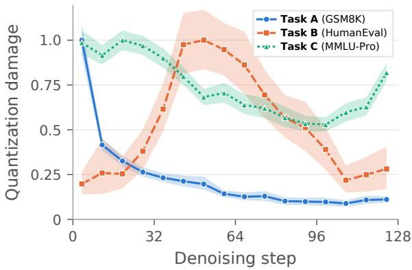  
Figure 1: Task-dependent temporal sensitivity to activation quantization. Each curve shows, per eight-step denoising window, the KL divergence $D _ { \mathrm { K L } } ( p _ { \mathrm { f p } } \parallel p _ { \mathrm { q } } )$ summed over the positions committed in that window that the task’s scoring function reads.

Meanwhile, temporal mixed-precision allocation has been explored in image diffusion models (Lewandowski et al., 2026), and recent studies on DLMs have highlighted how step-wise dynamics, intermediate predictions, and token commitment decisions influence generation behavior (Zhang et al., 2026b; Rahimi et al., 2026; Shlomi et al., 2026). Nevertheless, how quantization sensitivity varies jointly across downstream tasks and denoising steps in DLMs, and how these variations can guide effective mixed-precision allocation, remains largely unexplored.

To address this gap, we systematically investigate the sensitivity of DLMs to activation quantization across different tasks and denoising steps. Our analysis reveals that precision importance is both task-dependent and time-dependent (Figure 1): different tasks exhibit distinct temporal sensitivity patterns, with some benefiting more from higher precision during early denoising steps and others exhibiting greater sensitivity at intermediate stages.

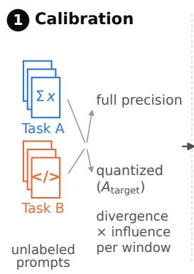

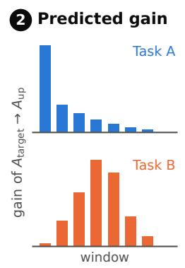

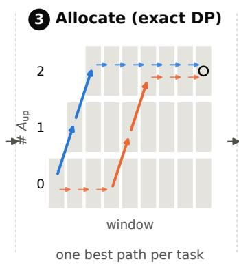

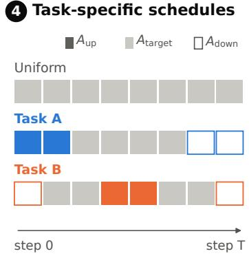  
Figure 2: T2Quant overview. (1) A few unlabeled prompts per task are profiled with the full-precision and quantized models. (2) Divergence × influence gives the predicted gain of upscaling each denoising window. (3) An exact dynamic program selects the windows to upscale under the bit budget. (4) The result is a task-specific schedule at the same average precision as uniform $A _ { \mathrm { t a r g e t } }$

Furthermore, we find that the benefit of additional precision can be predicted without ground-truth labels or downstream metric evaluations. Specifically, we develop a label-free sensitivity signal that combines quantization-induced divergence with the downstream influence of each denoising stage, enabling the identification of task-specific precision requirements using only unlabeled calibration prompts.

Building on these findings, we introduce T2Quant (Task and Time-Aware Quantization), a mixed-precision framework that allocates activation precision across denoising steps according to task-specific sensitivity patterns (Figure 2). T2Quant leverages the proposed sensitivity signal to determine an optimal precision schedule under a fixed average bit-width budget through budgetconstrained dynamic programming. Our framework is complementary to existing post-training quantization methods and can be integrated with different quantization approaches without modifying their underlying quantizers. Extensive experiments across three DLMs and six benchmarks demonstrate consistent improvements in average accuracy under a fixed budget, outperforming the strongest evaluated quantized baselines by up to 6.7 percentage points. Our main contributions are summarized as follows:

• Task and time-dependent precision sensitivity. We reveal distinct temporal precision sensitivity patterns across downstream tasks in DLMs.

• Label-free sensitivity prediction. We predict precision importance using internal model signals, without ground-truth labels or taskspecific evaluation metrics.

• Task and time-aware mixed-precision quantization. We introduce T2Quant, which optimally allocates activation precision under a fixed bit budget and improves existing quantization methods.

## 2 Related Work

DLM Quantization. DLMs such as LLaDA and Dream generate text by iterative masked denoising with bidirectional context rather than left-to-right decoding (Nie et al., 2025; Ye et al., 2025), which raises quantization challenges absent from autoregressive LLMs. DLLMQuant introduces diffusionaware calibration and quantization (Xu and Yang, 2025); STaR-Quant uses state-guided transformations and temporal compensation (Yan et al., 2026); FAIR-Calib targets fragile denoising states (Huang et al., 2026); and Quant-dLLM explores sensitivitybased mixed precision (Zhang et al., 2026a). These methods show that diffusion state and temporal error propagation matter, yet all keep a fixed activation bit-width across the denoising trajectory. We instead treat activation precision as a resource allocated over denoising steps under a fixed average bit budget.

Task-Aware Quantization. Task-Aware Quantization (TAQ) estimates layer importance from a small task-specific calibration set and assigns higher weight precision to task-relevant layers under a fixed bit budget (LeVi et al., 2026), and Task-Circuit Quantization (TaCQ) preserves task-relevant weight circuits, identified from quantization-induced weight changes and gradientbased impact estimates, at higher precision (Xiao et al., 2025). Both show that the best allocation of a quantization budget depends on the task, but they allocate precision spatially, across layers or weights of autoregressive LLMs. In contrast, T2Quant explores temporal task dependence, allocating activation precision across denoising steps according to task-specific sensitivity.

Temporal Precision Scheduling. Temporal variation is a recognized factor in image diffusion quantization: Q-Diffusion uses timestep-aware calibration for shifting activation distributions, and correction methods compensate for errors accumulated across denoising steps (Li et al., 2023). Most closely related, TMPDiff assigns different precisions to different denoising timesteps in image diffusion models, modeling the final latent deviation as an approximately additive sum of pertimestep errors and searching over schedules built from single-timestep sensitivities (Lewandowski et al., 2026). DLMs differ qualitatively: generation consists ofdiscrete, often irreversible token commitments, latent reconstruction error does not directly reflect downstream correctness, and a timestep’s importance depends on which task-relevant tokens it commits. Rather than a single global schedule, T2Quant allocates activation precision per task, linking where quantization disrupts task-relevant generation to where additional precision should be spent.

## 3 Task-Dependent Precision Sensitivity Across Diffusion Steps

The iterative generation process of DLMs raises a fundamental question for quantization: when does numerical precision matter most? Each denoising step operates on a different partially generated state, with token commitments potentially influencing subsequent predictions (Nie et al., 2025; Ye et al., 2025). Consequently, the impact of quantization may depend not only on the denoising step but also on the downstream task. Understanding these variations, and whether they can be predicted, motivates three research questions:

• RQ1: Where does quantization sensitivity occur in time?

• RQ2: Is temporal sensitivity task-dependent?

• RQ3: Can we predict where additional precision is most valuable?

We address RQ1 and RQ2 through temporal divergence analysis (Section 3.1), and RQ3 through a label-free precision-allocation proxy (Section 3.2).

Experimental setup. We evaluate LLaDA-8B-Instruct (Nie et al., 2025) on three tasks with distinct output structures: GSM8K (Cobbe et al., 2021), HumanEval (Chen et al., 2021), and MMLU-Pro (Wang et al., 2024). We use 512-token generations over 128 denoising steps with a single 512-token block, partitioning the trajectory into 16 non-overlapping windows of eight steps. We use the standard low-confidence remasking sampler of Nie et al. (2025) with temperature 0 and no classifier-free guidance. The quantized model uses QuaRot-style rotations (Ashkboos et al., 2024), 4- bit GPTQ weights (Frantar et al., 2023), and dynamic per-token 4-bit activations. The target precision is $\mathrm { A } _ { \mathrm { t a r g e t } } = 4$ bits and the upscaled precision is $\mathrm { A _ { u p } } = 8$ bits. Further details are given in Appendix E.

## 3.1 Temporal Sensitivity Diagnostic

Temporal sensitivity. Figure 1 shows that quantization sensitivity is highly non-uniform across the denoising trajectory. A uniform distribution would assign each of the 16 eight-step windows 6.25% of the task-relevant divergence. Instead, on GSM8K the first window alone carries 27% (4.4× uniform) and the first quarter 55%, while on HumanEval five mid-trajectory windows (steps 32–71) carry 52%. Even MMLU-Pro, the most evenly spread task, varies by nearly 2× between its most and least sensitive windows. This concentration suggests that activation precision need not be allocated uniformly over time and motivates selectively increasing precision at the most sensitive stages, as explored for image diffusion models (Lewandowski et al., 2026).

Key Takeaway Quantization sensitivity varies across denoising steps.

Task-dependent sensitivity. The location and spread of these sensitive regions vary substantially across tasks. GSM8K is strongly front-loaded, with its peak in the first 8 denoising steps and a rapid decay thereafter. MMLU-Pro is also early, but broad: its first four windows (steps 0–31) are all within 10% of its peak, after which sensitivity declines gradually. In contrast, HumanEval is insensitive early and exhibits a broad mid-trajectory peak, roughly around steps 40–63. Thus, a single task-independent temporal precision schedule is unlikely to suit all tasks. Whether these sensitivity profiles can predict where additional precision actually improves downstream performance is examined in Section 3.2.

Key Takeaway Sensitivity patterns differ across tasks, challenging fixed temporal precision schedules.

## 3.2 A Label-Free Signal for Precision Allocation

We now address RQ3: identifying, without downstream labels, which denoising windows benefit most from additional activation precision.

Denoising-window upscaling. Let $\mathrm { A _ { t a r g e t } }$ and $\mathrm { A _ { u p } }$ denote the target and higher activation precisions. We upscale each window w individually, keeping the remaining steps at $\mathrm { A _ { t a r g e t } }$ and weights fixed. The resulting gain is $\Delta \mathcal { M } _ { w } \ =$ $\mathcal { M } _ { \mathrm { A _ { u p } } ( w ) } - \mathcal { M } _ { \mathrm { A _ { t a r g e t } } }$ , where M is the task metric.

A label-free proxy. Local divergence alone cannot capture a window’s importance: its commitments must also influence subsequent denoising (Huang et al., 2026; Xu and Yang, 2025). Along the uniform $\mathrm { A _ { t a r g e t } }$ trajectory, we measure fullprecision divergence at committed positions $C _ { t } \mathrm { : }$

$$
K _ { w } = \sum _ { t \in w } \sum _ { j \in C _ { t } } D _ { \mathrm { K L } } \big ( p _ { \mathrm { f p } } ( \cdot \mid x _ { t } ) _ { j } \mid \mid p _ { \mathrm { A _ { t a r g e t } } } ( \cdot \mid x _ { t } ) _ { j } \big )\tag{1}
$$

$K _ { w }$ measures how much additional precision can change the window’s decisions. To measure how consequential those decisions are, let $x _ { \mathrm { b e f o r e } }$ and $x _ { \mathrm { a f t e r } }$ be the states immediately before and after window $w ,$ , and $F _ { w }$ the positions still masked afterwards. The window’s downstream influence is the change in the full-precision model’s beliefs about these positions:

$$
I _ { w } = \sum _ { j \in F _ { w } } D _ { \mathrm { K L } } ( p _ { \mathrm { f p } } ( \cdot \mid x _ { \mathrm { a f t e r } } ) _ { j } \mid \mid p _ { \mathrm { f p } } ( \cdot \mid x _ { \mathrm { b e f o r e } } ) _ { j } )\tag{2}
$$

Both are computed from the $\mathrm { A _ { t a r g e t } }$ trajectory alone, without labels.

Proposition 1. For an evaluation example, let $\Pi _ { \mathrm { u p } }$ and $\Pi _ { \mathrm { t g } }$ be the distributions of window w’s commitments (token values and positions) when the window runs at $\mathrm { A _ { u p } }$ and at $\mathrm { A _ { t a r g e t } }$ from the same state, let $J _ { w } = D _ { \mathrm { K L } } ( \Pi _ { \mathrm { u p } } \Vert \Pi _ { \mathrm { t g } } )$ , and let $R _ { w }$ be the range ofthe expectedfinal score over the window’s possible commitments. Then

$$
\begin{array} { r } { | \Delta \mathcal { M } _ { w } | ^ { 2 } \leq \frac { 1 } { 2 } \mathbb { E } [ J _ { w } ] \mathbb { E } [ R _ { w } ^ { 2 } ] , } \end{array}
$$

with expectations over evaluation examples.

The bound (proof in Appendix C.1) separates the effect of upscaling into commitment perturbation $( J _ { w } )$ and downstream score sensitivity $( R _ { w } )$ . Since neither is available from a single unlabeled trajectory, we use $K _ { w }$ and $I _ { w }$ as respective surrogates. Mirroring the bound, we rank windows by

$$
S _ { w } = \mathbb { E } [ K _ { w } ] \mathbb { E } [ I _ { w } ] .
$$

This is a motivated proxy, not a formal bound; we evaluate its predictive ability empirically.

Results. Figure 3 compares $S _ { w }$ with the measured gain $\Delta \mathcal { M } _ { w }$ . On GSM8K and MMLU-Pro, the proxy correctly identifies the most beneficial window, recovering 90% and 100% of the fullprecision gap, respectively. The proxy closely tracks window-level gains $( r ~ = ~ 0 . 9 8$ and 0.96), including beyond the highest-ranked window. On HumanEval, both the proxy and observed gains concentrate in the first two windows, although measurement noise limits correlation $( r = 0 . 6 3 )$ . Influence is essential: divergence alone incorrectly favors HumanEval’s final window, whose commitments cannot affect future tokens. Finally, just 16 unlabeled calibration prompts yield proxy estimates closely matching those computed from all prompts $( r \ge 0 . 9 6 $ across tasks; Figure 5).

Key Takeaway Precision importance can be predicted from internal model signals using only a few unlabeled calibration prompts, without requiring task-specific evaluation metrics.

## 4 Method

Section 3.1 establishes that activation-quantization sensitivity varies across denoising steps and downstream tasks. Section 3.2 further shows that a labelfree signal combining quantization divergence and downstream influence can identify windows where additional precision is most beneficial. Building on these findings, we introduce $\mathbf { T } ^ { 2 } \mathbf { Q u a n t } .$ , which extends single-window sensitivity analysis to a taskspecific activation-precision schedule under a fixed budget. Rather than designing a new quantizer, $\mathrm { T } ^ { 2 }$ Quant uses unlabeled task-specific prompts to estimate the value of each available precision and optimizes their allocation across the denoising trajectory.

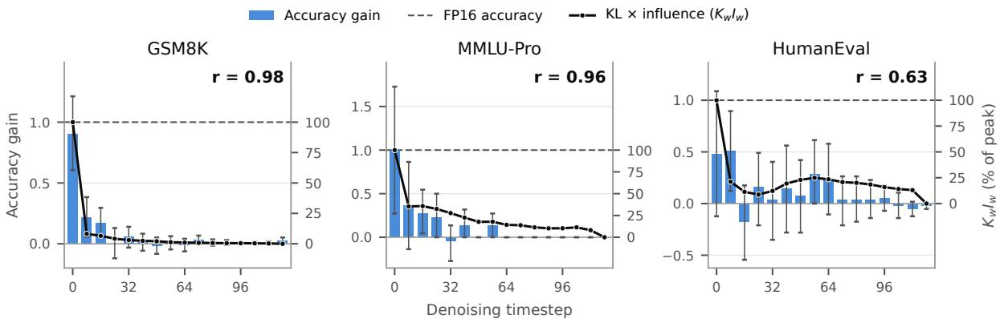  
Figure 3: $\mathbf { K L } \times$ influence predicts where additional precision pays off. Bars show the accuracy gain from upscaling a single denoising window from $\mathrm { A _ { t a r g e t } }$ to $\mathrm { A _ { u p } , }$ normalized by the full-precision gap (dashed line, $1 . 0 = \mathrm { f u l l } { \cdot }$ -precision accuracy), with 95% bootstrap intervals. The black curve shows the label-free proxy $K _ { w } I _ { w }$ normalized to its peak window. r is the Pearson correlation between the two across windows.

## 4.1 Problem Setup

Notation and objective. Let τ denote a target task and $\mathcal { D } _ { \tau } = \{ s _ { i } \} _ { i = 1 } ^ { N }$ a representative calibration set of prompts. A diffusion language model generates through $T$ denoising steps, with partially generated state $x _ { i , t }$ immediately before step t. Let $C _ { i , t }$ be the positions committed at that step. Following the window-based analysis of Section 3.1, we partition normalized denoising progress into K ordered, non-overlapping temporal windows $\{ \mathcal { W } _ { k } \} _ { k = 1 } ^ { K }$ , so a schedule can be applied across different step counts. Given a finite set of supported activation precisions B and a uniform reference precision $b _ { 0 } \in B .$ , our task-specific schedule is $\mathbf { b } _ { \tau } = ( b _ { 1 } , \dots , b _ { K } ) \in B ^ { K }$ where all denoising steps in $\mathcal { W } _ { k }$ use $b _ { k }$ . Denote the additive resource cost of assigning precision b to window k by $c _ { k } ( b )$ (e.g., the window’s activation work multiplied by b); the reference budget is $\begin{array} { r } { C _ { 0 } = \sum _ { k } c _ { k } ( b _ { 0 } ) } \end{array}$ . Ideally, the schedule maximizes the downstream task metric $\mathcal { M } _ { \tau } ( \mathbf { b } )$ subject to $\begin{array} { r } { \sum _ { k } c _ { k } ( b _ { k } ) = C _ { 0 } } \end{array}$ . Because evaluating this objective for candidate schedules would require labeled, closed-loop generations, we instead construct a label-free surrogate.

Calibration assumption. As in task-aware PTQ (LeVi et al., 2026; Xiao et al., 2025), we assume access to representative unlabeled calibration prompts from the target task. Following the label-free analysis of Section 3, T2Quant estimates precision importance using internal model signals, without ground-truth answers or task-specific evaluation metrics.

Quantizer-agnostic scheduling. T2Quant allocates activation precision across denoising steps without modifying the underlying quantizer or sampler. It can therefore be integrated with existing PTQ methods, including DLLMQuant (Xu and Yang, 2025), FAIR-Calib (Huang et al., 2026), and STaR-Quant (Yan et al., 2026).

## 4.2 Label-Free Calibration

Local quantization divergence. Following the committed-position KL signal in Eq. (1), we extend the analysis to every candidate activation precision $b \in B$ . For each $s _ { i } ~ \in ~ { \mathcal { D } } _ { \tau } .$ , we generate a fullprecision reference trajectory and save its states $x _ { i , t }$ and committed sets $C _ { i , t }$ . We replay each saved state under every b, keeping the input state fixed across precisions. Let $p _ { i , t , j } ^ { \mathrm { f p } }$ and $p _ { i , t , j } ^ { ( b ) }$ denote the resulting full-precision and quantized predictive distributions at position $j .$ . The average divergence over all positions committed in window k is

$$
\begin{array} { r } { \kappa _ { \tau , k } ( b ) = \frac { \displaystyle \sum _ { i } \sum _ { t \in \mathcal { W } _ { k } } \sum _ { j \in \mathcal { C } _ { i , t } } D _ { \mathrm { K L } } \left( p _ { i , t , j } ^ { \mathrm { f p } } \Vert p _ { i , t , j } ^ { ( b ) } \right) } { \displaystyle \sum _ { i } \sum _ { t \in \mathcal { W } _ { k } } \vert C _ { i , t } \vert } . } \end{array}\tag{3}
$$

This extends the single-precision divergence in Section 3.2 to multiple precision levels, normalized per committed position. For scheduling, the replay states come from the full-precision reference trajectory, whereas Section 3.2 evaluates its diagnostic on the uniform-precision trajectory. Holding each replay state fixed isolates local quantization effects from changes in the generated trajectory; no task-specific token selection is required.

Downstream influence. As demonstrated in Section 3.2, local divergence alone does not capture how a window’s commitments affect subsequent predictions. We therefore reuse the downstreaminfluence measure of Eq. (2), evaluated on the saved reference trajectory. For each prompt i and window $k ,$ let $x _ { i , k } ^ { - }$ and $x _ { i , k } ^ { + }$ be the states immediately before and after the window, and let $M _ { i , k }$ contain the positions still masked afterwards. $\mathsf { A p - }$ plying Eq. (2) to these states gives $\iota _ { i , k } ;$ we average across prompts as $\begin{array} { r } { \overline { { \iota } } _ { \tau , k } = N ^ { - 1 } \sum _ { i } \iota _ { i , k } } \end{array}$ . This measures the window’s downstream leverage using internal model predictions, without requiring task labels.

Influence-weighted precision benefit. Following the divergence–influence proxy of Section 3.2, we combine the change in local divergence with downstream influence to estimate the benefit of using precision b instead of $b _ { 0 }$ :

$$
g _ { \tau , k } ( b ) = \bar { \iota } _ { \tau , k } \left[ \kappa _ { \tau , k } ( b _ { 0 } ) - \kappa _ { \tau , k } ( b ) \right] .\tag{4}
$$

In particular, $g _ { \tau , k } ( b _ { 0 } ) = 0 ;$ positive values favor upgrading a window, while negative values quantify the estimated cost of reducing its precision. This generalizes the window-level signal of Section 3.2 to both precision upgrades and downgrades. The score is a surrogate for the marginal downstream benefit, not the true change in task accuracy. Algorithm 1 (Appendix D) describes the complete label-free profiling procedure.

## 4.3 Optimal Budget-Constrained Scheduling

While Section 3.2 studies the benefit of upscaling one window at a time, our method must distribute precision jointly across all windows under the same total budget. Given the task-specific scores, we solve

$$
\begin{array} { r l } { \mathbf { b } _ { \tau } ^ { * } \in \arg \underset { \mathbf { b } \in \mathcal { B } ^ { K } } { \operatorname* { m a x } } } & { \displaystyle \sum _ { k = 1 } ^ { K } g _ { \tau , k } ( b _ { k } ) } \\ { \mathrm { s . t . } } & { \displaystyle \sum _ { k = 1 } ^ { K } c _ { k } ( b _ { k } ) = C _ { 0 } . } \end{array}\tag{5}
$$

The equality constraint compares the learned schedule with uniform precision at the same modeled budget, and the uniform schedule is always feasible. We use dynamic programming over windows and the cumulative budget. For integer-valued costs (or costs expressed in a common integer unit), let $F _ { k } ( z )$ be the largest surrogate benefit attainable by allocating budget z to the first k windows. With $F _ { 0 } ( 0 ) = 0$ and $F _ { 0 } ( z ) = - \infty$ for $z \neq 0$ , the recurrence is

$$
F _ { k } ( z ) = \operatorname* { m a x } _ { b \in \mathcal { B } \atop c _ { k } ( b ) \leq z } \left\{ F _ { k - 1 } \big ( z - c _ { k } ( b ) \big ) + g _ { \tau , k } ( b ) \right\} .\tag{6}
$$

Backtracking from $F _ { K } ( C _ { 0 } )$ yields the selected schedule; the search also permits the all $\left. - b _ { 0 } \right.$ solution when the estimated gain from reallocating precision is insufficient. Algorithm 2 (Appendix D) gives the complete budgeted solver.

Proposition 2 (Optimality of temporal allocation). For a finite B and nonnegative, integer-valued additive costs $c _ { k } ( b )$ , the recurrence in Eq. (6) returns a globally optimal solution of Eq. (5) whenever the budget isfeasible.

The proof follows from the principle of optimality and is given in Appendix C.2. The guarantee concerns the calibrated additive surrogate, not the generally non-additive true downstream metric. Calibration produces one schedule per task; at inference, each step selects its assigned precision by a window-index lookup, with no additional diagnostic forward passes.

## 5 Experiments

## 5.1 Experimental Setup

Models. Three open DLMs: Dream-7B-Instruct (Ye et al., 2025), LLaDA-1.5-8B (Zhu et al., 2026) and LLaDA-8B-Instruct (Nie et al., 2025). Benchmarks. GSM8K (Cobbe et al., 2021), HumanEval (Chen et al., 2021), ARC-Challenge (Clark et al., 2018), MMLU-Pro (Wang et al., 2024), DROP (Dua et al., 2019) and BBH (Suzgun et al., 2023), evaluated on heldout prompts that are disjoint from every calibration prompt. Baselines. Full precision (FP16), round-to-nearest (RTN), and three recent post-training quantization methods for diffusion LMs, DLLMQuant (Xu and Yang, 2025), FAIR-Calib (Huang et al., 2026) and STaR-Quant (Yan et al., 2026), each evaluated as is and with T2Quant applied on top; a random schedule with the same activation budget controls for mixed precision itself. All quantized models and every row uses the same sampler and the same prompts, so all comparisons are paired. Splits, sampler, quantization setup, baseline implementations and statistical tests are given in Appendix E.2.

Table 1: W4A4 accuracy (%) of three diffusion-LM quantization methods, each with and without $\mathrm { T } ^ { 2 } \mathrm { Q u a n t } .$ , on three masked-diffusion LMs and six benchmarks at the same 4.00 average activation bits (bold: best, underline: second-best quantized result).
<table><tr><td rowspan="2">Method</td><td rowspan="2">Avg.</td><td colspan="6">Evaluation Benchmarks ↑</td></tr><tr><td>GSM8K</td><td>Hum.</td><td>ARC-C</td><td>MMLU-Pro</td><td>DROP</td><td>BBH</td></tr><tr><td colspan="8">Dream-7B-Instruct</td></tr><tr><td>FP16</td><td>44.05</td><td>62.50</td><td>19.00</td><td>87.30</td><td>29.69</td><td>37.89</td><td>27.93</td></tr><tr><td>RTN</td><td>0.00</td><td>0.00</td><td>0.00</td><td>0.00</td><td>0.00</td><td>0.00</td><td>0.00</td></tr><tr><td>DLLMQuant</td><td>33.99</td><td>35.55</td><td>9.00</td><td>79.30</td><td>24.80</td><td>38.09</td><td>17.19</td></tr><tr><td>FAIR-Calib</td><td>34.81</td><td>44.92</td><td>4.00</td><td>81.64</td><td>20.70</td><td>41.60</td><td>16.02</td></tr><tr><td>STaR-Quant</td><td>38.55</td><td>46.09</td><td>11.00</td><td>83.01</td><td>26.17</td><td>46.68</td><td>18.36</td></tr><tr><td>Random schedule</td><td>19.61</td><td>15.82</td><td>4.00</td><td>54.30</td><td>13.67</td><td>20.31</td><td>9.57</td></tr><tr><td> $\mathbf { D L L M Q u a n t } + \mathbf { T } ^ { 2 } \mathbf { Q u a n t } \left( \mathbf { O u r s } \right)$ </td><td>40.69</td><td>53.52</td><td>17.00</td><td>84.18</td><td>29.69</td><td>40.43</td><td>19.34</td></tr><tr><td> $\mathbf { F A I R - C a l i b + T ^ { 2 } Q u a n t \left( O u r s \right) }$ </td><td>40.61</td><td>57.03</td><td>12.00</td><td>82.81</td><td>26.95</td><td>39.45</td><td>25.39</td></tr><tr><td> $\mathbf { S T a R { \mathrm { - } } Q u a n t + T ^ { 2 } Q u a n t \left( O u r s \right) }$ </td><td>42.10</td><td>58.79</td><td>20.00</td><td>84.77</td><td>24.02</td><td>42.77</td><td>22.27</td></tr><tr><td colspan="8">LLaDA-1.5-8B</td></tr><tr><td>FP16</td><td>47.73</td><td>57.03</td><td>26.00</td><td>82.62</td><td>37.30</td><td>40.43</td><td>42.97</td></tr><tr><td>RTN</td><td>0.13</td><td>0.00</td><td>0.00</td><td>0.59</td><td>0.00</td><td>0.20</td><td>0.00</td></tr><tr><td>DLLMQuant</td><td>39.09</td><td>35.94</td><td>15.00</td><td>78.52</td><td>32.23</td><td>34.96</td><td>37.89</td></tr><tr><td>FAIR-Calib</td><td>42.88</td><td>47.07</td><td>18.00</td><td>80.86</td><td>35.16</td><td>36.33</td><td>39.84</td></tr><tr><td>STaR-Quant</td><td>44.09</td><td>48.63</td><td>20.00</td><td>79.49</td><td>34.96</td><td>39.26</td><td>42.19</td></tr><tr><td>Random schedule</td><td>39.11</td><td>31.64</td><td>20.00</td><td>76.56</td><td>30.86</td><td>35.55</td><td>40.04</td></tr><tr><td> $\mathbf { D L L M Q u a n t } + \mathbf { T } ^ { 2 } \mathbf { Q u a n t } \left( \mathbf { O u r s } \right)$ </td><td>42.47</td><td>45.51</td><td>15.00</td><td>83.79</td><td>33.59</td><td>37.11</td><td>39.84</td></tr><tr><td> $\mathbf { F A I R - C a l i b + T ^ { 2 } Q u a n t \left( O u r s \right) }$ </td><td>44.82</td><td>52.15</td><td>16.00</td><td>82.81</td><td>34.77</td><td>41.80</td><td>41.41</td></tr><tr><td> $\mathbf { S T a R - Q u a n t + T ^ { 2 } Q u a n t \left( O u r s \right) }$ </td><td>45.22</td><td>55.08</td><td>17.00</td><td>82.23</td><td>34.57</td><td>42.97</td><td>39.45</td></tr><tr><td colspan="8">LLaDA-8B-Instruct</td></tr><tr><td>FP16</td><td>46.32</td><td>52.93</td><td>25.00</td><td>81.84</td><td>36.52</td><td>39.26</td><td>42.38</td></tr><tr><td>RTN</td><td>0.26</td><td>0.39</td><td>0.00</td><td>0.98</td><td>0.00</td><td>0.20</td><td>0.00</td></tr><tr><td>DLLMQuant</td><td>37.35</td><td>31.84</td><td>12.00</td><td>77.73</td><td>30.66</td><td>34.96</td><td>36.91</td></tr><tr><td>FAIR-Calib</td><td>42.27</td><td>43.75</td><td>22.00</td><td>78.12</td><td>33.79</td><td>34.96</td><td>41.02</td></tr><tr><td>STaR-Quant</td><td>43.36</td><td>45.70</td><td>25.00</td><td>78.52</td><td>32.23</td><td>38.09</td><td>40.62</td></tr><tr><td>Random schedule</td><td>37.72</td><td>30.08</td><td>23.00</td><td>75.39</td><td>31.25</td><td>27.73</td><td>38.87</td></tr><tr><td> $\mathbf { D L L M Q u a n t } + \mathbf { T } ^ { 2 } \mathbf { Q u a n t } \left( \mathbf { O u r s } \right)$ </td><td>40.88</td><td>42.19</td><td>15.00</td><td>81.84</td><td>29.88</td><td>38.09</td><td>38.28</td></tr><tr><td> $\mathbf { F A I R - C a l i b + T ^ { 2 } Q u a n t \ : ( O u r s ) }$ </td><td>44.76</td><td>51.95</td><td>24.00</td><td>80.08</td><td>33.79</td><td>36.52</td><td>42.19</td></tr><tr><td> $\mathbf { S T a R { \mathrm { - } } Q u a n t + T ^ { 2 } Q u a n t \left( O u r s \right) }$ </td><td>43.70</td><td>48.83</td><td>21.00</td><td>80.47</td><td>32.62</td><td>38.28</td><td>41.02</td></tr></table>

## 5.2 Main Results

Table 1 reports W4A4 accuracy across three DLMs and six benchmarks, comparing DLLMQuant, FAIR-Calib, and STaR-Quant with and without $\mathrm { T } ^ { 2 } \mathrm { Q u a n t }$ . All configurations use 4-bit weights and the same average activation precision of 4.00 bits, ensuring a fair comparison under identical bit budgets.

Consistent improvements across methods and models. T2Quant improves average accuracy for all nine baseline/model combinations, with gains of up to 6.7 points on Dream, 3.4 on LLaDA-1.5, and 3.5 on LLaDA-8B-Instruct. Overall, 42 of 54 benchmark-level comparisons improve, with

GSM8K and ARC-Challenge improving in every combination.

Best quantized accuracy across all models. T2Quant achieves the two highest quantized averages on every model, outperforming the strongest standalone baselines by 3.55, 1.13, and 1.40 points on Dream, LLaDA-1.5, and LLaDA-8B-Instruct, respectively. The best configurations approach FP16 accuracy, with gaps of only 2.0, 2.5, and 1.6 points.

Substantial recovery from quantization degradation. The largest gains occur on Dream, where GSM8K accuracy rises from 35.6 to 53.5 with DLLMQuant and from 46.1 to 58.8 with STaR-Quant. On GSM8K, improvements also reach 9.6 points on LLaDA-1.5 and 10.4 on LLaDA-8B-Instruct. On several benchmarks, T2Quant even matches or exceeds FP16 accuracy.

Precision allocation matters. Random schedules with the same average bit budget perform substantially worse, falling 14–19 points below the original baselines on Dream. In contrast, $\mathrm { T } ^ { 2 } \mathrm { Q u a n t }$ achieves the best quantized average on every model, highlighting the importance of allocating precision to the appropriate denoising steps.

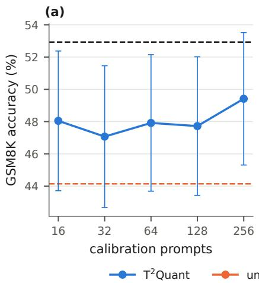

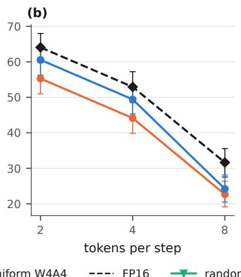

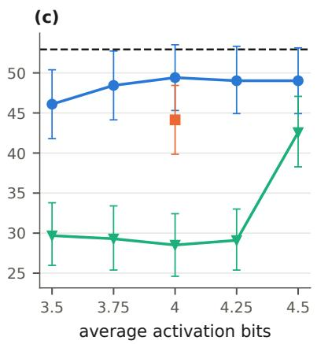  
Figure 4: Ablations on LLaDA-8B-Instruct, GSM8K $( n = 5 1 2 ;$ bars are 95% intervals): (a) calibration prompts (mean over three random subsets per size), (b) tokens per step with the schedule calibrated at 4, (c) average activation bits, with uniform W4A4 at 4 bits and, at every budget, a random schedule with the same bits as $\mathrm { T } ^ { 2 } \mathrm { Q u a n t }$

## 5.3 Ablation Study

Figure 4 evaluates three aspects of $\mathrm { T } ^ { 2 } \mathrm { Q u a n t }$ on LLaDA-8B-Instruct and GSM8K under W4A4 (uniform W4A4: 44.1, T2Quant: 49.4, FP16: 52.9). (a) Calibration size: Just 16 prompts recover roughly 75% of the full gain, with stable schedules consistently prioritizing early denoising steps. (b) Tokens per step: The schedule transfers from 4 to 2 tokens per step, maintaining an approximately 5- point improvement, while gains vanish at 8 tokens per step as overall accuracy deteriorates. (c) Activation budget: $\mathrm { T } ^ { 2 } \mathrm { Q u a n t }$ achieves 48.4% accuracy with only 3.75 average bits, outperforming uniform W4A4 (44.1%) despite using fewer bits. Moreover, $\mathrm { T } ^ { 2 } \mathrm { Q u a n t }$ consistently outperforms random schedules at the same bit budget, while increasing precision beyond 4 bits provides negligible additional benefit. These results demonstrate that effective precision allocation matters more than simply increasing the bit budget. Further ablations, including window size, precision levels, the set of activation widths (Table 2) additional quantization budgets, and calibration signals, are provided in Appendix B.

## 6 Discussion

Our findings demonstrate that quantization sensitivity in DLMs depends on both the downstream task and the denoising step, challenging uniform precision allocation. Building on this observation, we introduced $\mathrm { T } ^ { 2 } \mathrm { Q u a n t } ,$ , a task- and time-aware mixedprecision framework that predicts precision importance using unlabeled calibration prompts and allocates activation precision under a fixed bit-width budget. Across three DLMs and six benchmarks, $\mathrm { T } ^ { 2 } \mathrm { Q u a n t }$ consistently improves average accuracy when integrated with existing quantization methods, with gains of up to 6.7 percentage points under W4A4. These results highlight the importance of considering both task requirements and temporal generation dynamics when quantizing DLMs.

By improving accuracy under fixed precision budgets, T2Quant offers a promising direction for making DLM deployment more computationally efficient and accessible, potentially reducing memory and energy requirements. Its compatibility with existing quantization methods may further facilitate practical adoption. However, quantization can also alter model behavior beyond benchmark accuracy, including safety-related responses (Hong et al., 2024; Egashira et al., 2024). Future work should therefore examine the effects of task- and time-aware precision allocation on safety, robustness, and real-world inference efficiency.

## Limitations

Although T2Quant demonstrates strong results across three DLMs, six benchmarks, and three quantization methods, further evaluation of deployment-related aspects, including hardware efficiency (inference speed and energy consumption) and potential impacts on model safety, remains for future work.

## LLM Usage Statement

We used LLMs during manuscript preparation mainly as writing assistants, for grammar checking and for improving the clarity and naturalness of the text. All LLM-generated suggestions were manually reviewed and edited by the authors. LLMs did not play any important role in developing the core methods, experiments, analysis, or conclusions of this research.

## Ethical Considerations

This work aims to improve the efficiency and accessibility of diffusion language models through quantization. While quantization may affect model safety and robustness, investigating these effects is left for future work.

## References

Saleh Ashkboos, Amirkeivan Mohtashami, Maximilian L. Croci, Bo Li, Pashmina Cameron, Martin Jaggi, Dan Alistarh, Torsten Hoefler, and James Hensman. 2024. Quarot: Outlier-free 4-bit inference in rotated llms. In Advances in Neural Information Processing Systems, volume 37, pages 100213–100240. Curran Associates, Inc.

Mark Chen, Jerry Tworek, Heewoo Jun, Qiming Yuan, Henrique Ponde de Oliveira Pinto, Jared Kaplan, Harri Edwards, Yuri Burda, Nicholas Joseph, Greg Brockman, Alex Ray, Raul Puri, Gretchen Krueger, Michael Petrov, Heidy Khlaaf, Girish Sastry, Pamela Mishkin, Brooke Chan, Scott Gray, and 39 others. 2021. Evaluating large language models trained on code. Preprint, arXiv:2107.03374.

Peter Clark, Isaac Cowhey, Oren Etzioni, Tushar Khot, Ashish Sabharwal, Carissa Schoenick, and Oyvind Tafjord. 2018. Think you have solved question answering? try arc, the ai2 reasoning challenge. Preprint, arXiv:1803.05457.

Karl Cobbe, Vineet Kosaraju, Mohammad Bavarian, Mark Chen, Heewoo Jun, Lukasz Kaiser, Matthias Plappert, Jerry Tworek, Jacob Hilton, Reiichiro Nakano, Christopher Hesse, and John Schulman. 2021. Training verifiers to solve math word problems. Preprint, arXiv:2110.14168.

Dheeru Dua, Yizhong Wang, Pradeep Dasigi, Gabriel Stanovsky, Sameer Singh, and Matt Gardner. 2019. DROP: A reading comprehension benchmark requiring discrete reasoning over paragraphs. In Proceedings ofthe 2019 Conference ofthe North American Chapter of the Association for Computational Linguistics: Human Language Technologies, Volume 1 (Long and Short Papers), pages 2368–2378, Minneapolis, Minnesota. Association for Computational Linguistics.

Kazuki Egashira, Mark Vero, Robin Staab, Jingxuan He, and Martin Vechev. 2024. Exploiting llm quantization. In Advances in Neural Information Processing Systems, volume 37, pages 41709–41732. Curran Associates, Inc.

Elias Frantar, Saleh Ashkboos, Torsten Hoefler, and Dan Alistarh. 2023. Gptq: Accurate post-training quantization for generative pre-trained transformers. Preprint, arXiv:2210.17323.

Junyuan Hong, Jinhao Duan, Chenhui Zhang, Zhangheng Li, Chulin Xie, Kelsey Lieberman, James Diffenderfer, Brian Bartoldson, Ajay Jaiswal, Kaidi Xu, Bhavya Kailkhura, Dan Hendrycks, Dawn Song, Zhangyang Wang, and Bo Li. 2024. Decoding compressed trust: Scrutinizing the trustworthiness of efficient llms under compression. Preprint, arXiv:2403.15447.

Haoyu Huang, Linlin Yang, Sheng Xu, Boyu Liu, Guodong Guo, Zhongqian Fu, Hang Zhou, and Baochang Zhang. 2026. Fair-calib: Frontier-aware

instability-reweighted calibration for post-training quantization of diffusion large language models. Preprint, arXiv:2606.06547.

Amit LeVi, Raz Lapid, Rom Himelstein, Chaim Baskin, Ravid Shwartz Ziv, and Avi Mendelson. 2026. You had one job: Per-task quantization using llms’ hidden representations. Preprint, arXiv:2511.06516.

Basile Lewandowski, Simon Kurz, Aditya Shankar, Robert Birke, Jian-Jia Chen, and Lydia Y. Chen. 2026. Tmpdiff: Temporal mixed-precision for diffusion models. Preprint, arXiv:2603.14062.

Xiuyu Li, Yijiang Liu, Long Lian, Huanrui Yang, Zhen Dong, Daniel Kang, Shanghang Zhang, and Kurt Keutzer. 2023. Q-diffusion: Quantizing diffusion models. In 2023 IEEE/CVF International Conference on Computer Vision (ICCV), pages 17489– 17499.

Haokun Lin, Haobo Xu, Yichen Wu, Ziyu Guo, Renrui Zhang, Zhichao Lu, Ying Wei, Qingfu Zhang, and Zhenan Sun. 2026. Quantization meets dllms: A systematic study of post-training quantization for diffusion llms. Preprint, arXiv:2508.14896.

Stephen Merity, Caiming Xiong, James Bradbury, and Richard Socher. 2016. Pointer sentinel mixture models. Preprint, arXiv:1609.07843.

Shen Nie, Fengqi Zhu, Zebin You, Xiaolu Zhang, Jingyang Ou, Jun Hu, Jun Zhou, Yankai Lin, Ji-Rong Wen, and Chongxuan LI. 2025. Large language diffusion models. In Advances in Neural Information Processing Systems, volume 38, Main Conference, pages 50608–50646. Curran Associates, Inc.

Eliron Rahimi, Elad Hirshel, Rom Himelstein, Amit LeVi, Avi Mendelson, and Chaim Baskin. 2026. Step-wise refusal dynamics in autoregressive and diffusion language models. Preprint, arXiv:2602.02600.

Eliezer Shlomi, Eliron Rahimi, Avi Mendelson, and Chaim Baskin. 2026. On the spot: Enhancing speculative decoding for diffusion language models via commit-order prediction. Preprint, arXiv:2610.22543.

Mirac Suzgun, Nathan Scales, Nathanael Schärli, Sebastian Gehrmann, Yi Tay, Hyung Won Chung, Aakanksha Chowdhery, Quoc Le, Ed Chi, Denny Zhou, and Jason Wei. 2023. Challenging BIG-bench tasks and whether chain-of-thought can solve them. In Findings ofthe Associationfor Computational Linguistics: ACL 2023, pages 13003–13051, Toronto, Canada. Association for Computational Linguistics.

Yubo Wang, Xueguang Ma, Ge Zhang, Yuansheng Ni, Abhranil Chandra, Shiguang Guo, Weiming Ren, Aaran Arulraj, Xuan He, Ziyan Jiang, Tianle Li, Max Ku, Kai Wang, Alex Zhuang, Rongqi Fan, Xiang Yue, and Wenhu Chen. 2024. Mmlu-pro: A more robust and challenging multi-task language understanding

benchmark. In Advances in Neural Information Processing Systems, volume 37, pages 95266–95290. Curran Associates, Inc.

Hanqi Xiao, Yi-Lin Sung, Elias Stengel-Eskin, and Mohit Bansal. 2025. Task-circuit quantization: Leveraging knowledge localization and interpretability for compression. Preprint, arXiv:2504.07389.

Chen Xu and Dawei Yang. 2025. Dllmquant: Quantizing diffusion-based large language models. Preprint, arXiv:2508.14090.

Xin Yan, Aqiang Wang, Zhenglin Wan, Xingrui Yu, and Ivor Tsang. 2026. Star-quant: State-time consistent post-training quantization for diffusion large language models. Preprint, arXiv:2606.04945.

Jiacheng Ye, Zhihui Xie, Lin Zheng, Jiahui Gao, Zirui Wu, Xin Jiang, Zhenguo Li, and Lingpeng Kong. 2025. Dream 7b: Diffusion large language models. Preprint, arXiv:2508.15487.

Tianao Zhang, Zhiteng Li, Xianglong Yan, Haotong Qin, Yong Guo, and Yulun Zhang. 2026a. Quantdllm: Post-training extreme low-bit quantization for diffusion large language models. In International Conference on Learning Representations, volume 2026, pages 79492–79503.

Zeyang Zhang, Chengwei Liang, Xingyan Chen, Meiqi Gu, Minrui Luo, Jingzhao Zhang, and Tianxing He. 2026b. Differences in text generated by diffusion and autoregressive language models. Preprint, arXiv:2605.12522.

Fengqi Zhu, Rongzhen Wang, Shen Nie, Xiaolu Zhang, Chunwei Wu, Jun Zhou, Yankai Lin, Ji-Rong Wen, and Chongxuan Li. 2026. LLaDA 1.5: Variancereduced preference optimization for large language diffusion models. In Proceedings of the 64th Annual Meeting of the Association for Computational Linguistics (Volume 1: Long Papers), pages 11425– 11460, San Diego, California, United States. Association for Computational Linguistics.

## Appendix Overview

This appendix provides supplementary analyses, additional experimental results, ablation studies, theoretical proofs, and implementation details that complement the main paper. It is organized as follows:

• Section A presents further analyses and supplementary experimental results.

• Section B provides additional ablation studies to further examine the proposed method.

• Section C contains the theoretical proofs supporting the claims made in the main paper.

• Section D provides detailed algorithms and pseudocode for the proposed method.

• Section E details the experimental setup, implementation details, and evaluation protocols.

## A Further Analyses and Supplementary Results

## A.1 Temporal Sensitivity Diagnostic

We repeat the label-free diagnostic of Section 3 on two further masked-diffusion LMs: LLaDA-1.5 (Zhu et al., 2026) and Dream-v0-Instruct-7B (Ye et al., 2025).

• Generation: 512 tokens, 128 denoising steps in a single block, greedy decoding.

• Quantization: the same W4A4 recipe (rotation, GPTQ W4, per-token A4 with clip 0.7) and calibration data.

• Tasks: the same subsets, prompts and scorers.

Each model is quantized with a single rotation seed.

LLaDA-1.5. LLaDA-1.5 is LLaDA-8B-Instruct further trained with variance-reduced preference optimization (Zhu et al., 2026). Its architecture, tokenizer, sampler and EOS rules are unchanged. Figure 6 shows the resulting profiles, which closely match those of LLaDA-8B-Instruct (Figure 1). The Pearson correlation between the two models per-window profiles is 0.99 (GSM8K), 0.98 (HumanEval) and 0.92 (MMLU-Pro).

• GSM8K: damage peaks in the first window and decays.

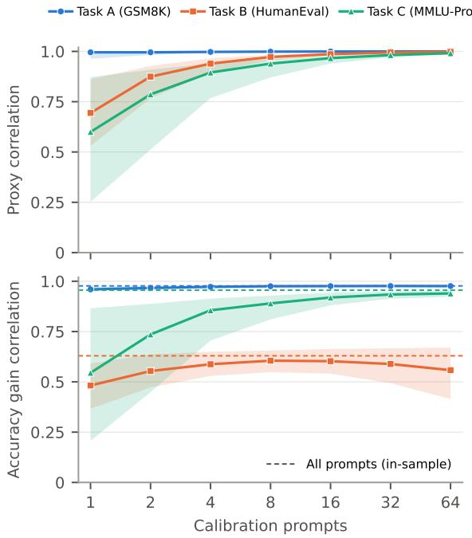  
Figure 5: A few unlabeled prompts suffice. Proxy computed from N random calibration prompts. Top: correlation with the all-prompt proxy. Bottom: correlation with held-out accuracy gains.

• HumanEval: damage rises to a broad peak over steps 40–64.

• MMLU-Pro: damage forms a broad early plateau, peaks at steps 16–23 and rises again in the last window.

LLaDA-1.5 is a fine-tuned LLaDA-8B, so this result shows that the temporal profile survives preference alignment. It does not test other architectures; Dream addresses that below.

Dream-v0-Instruct-7B. Dream uses its own sampler (Ye et al., 2025), which commits the lowest-entropy masked positions first. Everything else follows the shared setup; only the handling of the end-of-sequence (EOS) token differs. At the first denoising steps Dream predicts EOS at almost every masked position, so the EOS rule matters more than for LLaDA:

• No EOS rule (Dream’s default): padding is committed first, and the answer is squeezed into the last few steps.

• LLaDA’s rules: the few non-EOS positions are forced in first regardless of their confidence.

• Our choice: the confidence of positions predicting EOS or end-of-turn is lowered by

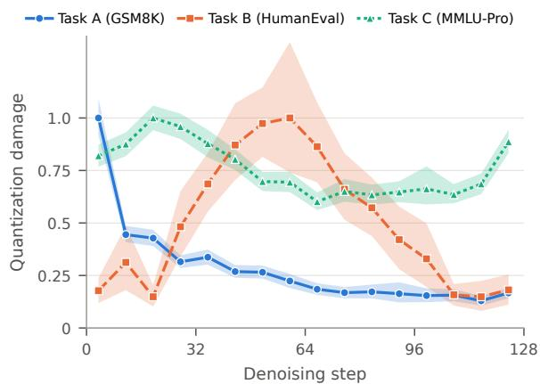  
Figure 6: Label-free diagnostic for LLaDA-1.5 under W4A4, computed as in Figure 1: score-relevant KL per 8-step window, normalized to each task’s peak, with 95% problem-bootstrap bands.

## $\alpha = 1$ nat, on all tasks.

We chose α, and entropy over top-2-margin ordering, among six variants by full-precision accuracy on the first 20 problems of each task. The criterion was fixed before any damage profile was computed.

The profiles in Figure 7 remain task-dependent, but the tasks peak at different points in denoising than on LLaDA.

• GSM8K: Dream answers directly under the shared answer-only few-shot prompt (about six tokens), so the damage concentrates in the first window, with a small rise in the last one.

• HumanEval: damage stays low until step 64, then rises to a peak at steps 96–104, late rather than mid-trajectory as on LLaDA.

• MMLU-Pro: after a first-window spike (most W4A4 responses state the answer first), damage ramps up steadily to the end.

## B Additional Ablation Studies

Window size (Figure 8a). From 16 steps per window down to a single step the accuracy stays within 1.7 points (47.7 to 49.4), and the coarsest windows are as good as the finest: the schedule needs few decisions, not many.

Number of 8-bit windows (Figure 8b). With three levels and a fixed 4.00-bit average, one 8-bit window is paid for by four 3-bit windows, so every schedule is described by the number m of 8-bit windows. Forcing m = 1 or m = 3 instead of the allocation’s own choice $m = 2$ costs 1.0 and 3.5 points, so the allocation lands on the optimum of this one-parameter family. For every m its schedule coincides with a calibration-free prior (8 bits on the first m windows, 3 bits on the last 4m); on GSM8K, choosing m is where the calibration earns its keep.

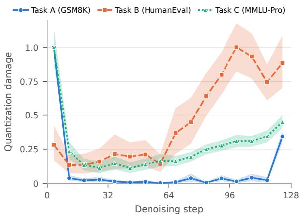

Figure 7: Label-free diagnostic for Dream-v0-Instruct-7B under W4A4, computed as in Figure 1: scorerelevant KL per 8-step window, normalized to each task’s peak, with 95% problem-bootstrap bands.  
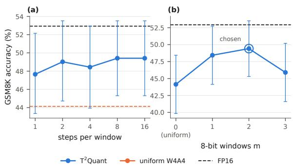  
Figure 8: Further ablations on LLaDA-8B-Instruct, GSM8K $( n = 5 1 2 ;$ bars are 95% intervals): (a) steps per window, (b) number of 8-bit windows m, the circle marking the allocation’s own choice. Orange: uniform W4A4; dashed: FP16.

Precision set (Table 2). Allowing all six widths {3, 4, 5, 6, 7, 8} instead of the four of the main table, {3, 4, 6, 8}, changes the accuracy little: over the 36 composed cells of Table 2, the mean rises from 45.7 to 46.3, by 0.6 points on GSM8K, 0.1 on ARC-C and MMLU-Pro, and 1.4 on HumanEval, whose 100-problem cells account for the largest single changes. $\mathbf { A } \ \mathbf { T } ^ { 2 } \mathbf { \Sigma }$ Quant row is the best quantized result in 11 of the 12 model–benchmark cells. The method therefore does not depend on a particular choice of intermediate widths; we keep {3, 4, 6, 8} in the main experiments because each additional width costs one more replay of the calibration trajectories.

Table 2: Precision-set ablation: W4A4 accuracy (%) with $\mathrm { T } ^ { 2 } \mathrm { Q u a n t }$ allocating over the six activation widths {3, 4, 5, 6, 7, 8} instead of the four of Table 1, {3, 4, 6, 8}, at the same 4.00 average activation bits. Avg. is over the four benchmarks shown (bold: best, underline: second-best quantized result).
<table><tr><td>Method</td><td>Avg.</td><td>GSM8K</td><td>HumanEval</td><td>ARC-C</td><td>MMLU-Pro</td></tr><tr><td>Dream-7B-Instruct</td><td></td><td></td><td></td><td></td><td></td></tr><tr><td>FP16</td><td>49.62</td><td>62.50</td><td>19.00</td><td>87.30</td><td>29.69</td></tr><tr><td>RTN</td><td>0.00</td><td>0.00</td><td>0.00</td><td>0.00</td><td>0.00</td></tr><tr><td>DLLMQuant</td><td>37.16</td><td>35.55</td><td>9.00</td><td>79.30</td><td>24.80</td></tr><tr><td>FAIR-Calib</td><td>37.81</td><td>44.92</td><td>4.00</td><td>81.64</td><td>20.70</td></tr><tr><td>STaR-Quant</td><td>41.57</td><td>46.09</td><td>11.00</td><td>83.01</td><td>26.17</td></tr><tr><td>Random schedule</td><td>21.95</td><td>15.82</td><td>4.00</td><td>54.30</td><td>13.67</td></tr><tr><td> $\mathrm { { D L L M Q u a n t } + T ^ { 2 } Q u a n t }$ </td><td>45.35</td><td>53.52</td><td>15.00</td><td>84.18</td><td>28.71</td></tr><tr><td> $\mathrm { F A I R  – C a l i b + T ^ { 2 } Q u a n t }$ </td><td>44.61</td><td>57.23</td><td>13.00</td><td>82.81</td><td>25.39</td></tr><tr><td> $\mathrm { S T a R \mathrm { - } Q u a n t + T ^ { 2 } Q u a n t }$ </td><td>46.74</td><td>59.38</td><td>18.00</td><td>84.77</td><td>24.80</td></tr><tr><td> $L L a D A  – I . S – 8 B$ </td><td></td><td></td><td></td><td></td><td></td></tr><tr><td>FP16</td><td>50.74</td><td>57.03</td><td>26.00</td><td>82.62</td><td>37.30</td></tr><tr><td>RTN</td><td>0.15</td><td>0.00</td><td>0.00</td><td>0.59</td><td>0.00</td></tr><tr><td>DLLMQuant</td><td>40.42</td><td>35.94</td><td>15.00</td><td>78.52</td><td>32.23</td></tr><tr><td>FAIR-Calib</td><td>45.27</td><td>47.07</td><td>18.00</td><td>80.86</td><td>35.16</td></tr><tr><td>STaR-Quant</td><td>45.77</td><td>48.63</td><td>20.00</td><td>79.49</td><td>34.96</td></tr><tr><td>Random schedule</td><td>39.77</td><td>31.64</td><td>20.00</td><td>76.56</td><td>30.86</td></tr><tr><td> $\mathrm { { D L L M Q u a n t } + T ^ { 2 } Q u a n t }$ </td><td>43.72</td><td>47.07</td><td>12.00</td><td>83.79</td><td>32.03</td></tr><tr><td> $\mathrm { F A I R  – C a l i b + T ^ { 2 } Q u a n t }$ </td><td>48.58</td><td>52.15</td><td>24.00</td><td>83.01</td><td>35.16</td></tr><tr><td> $\mathrm { S T a R \mathrm { - } Q u a n t + T ^ { 2 } Q u a n t }$ </td><td>49.85</td><td>57.23</td><td>24.00</td><td>82.23</td><td>35.94</td></tr><tr><td> $L L a D A { - } { 8 } B { - } I n s t r u c t$ </td><td></td><td></td><td></td><td></td><td></td></tr><tr><td>FP16</td><td>49.07</td><td>52.93</td><td>25.00</td><td>81.84</td><td>36.52</td></tr><tr><td>RTN</td><td>0.34</td><td>0.39</td><td>0.00</td><td>0.98</td><td>0.00</td></tr><tr><td>DLLMQuant</td><td>38.06</td><td>31.84</td><td>12.00</td><td>77.73</td><td>30.66</td></tr><tr><td>FAIR-Calib</td><td>44.41</td><td>43.75</td><td>22.00</td><td>78.12</td><td>33.79</td></tr><tr><td>STaR-Quant</td><td>45.36</td><td>45.70</td><td>25.00</td><td>78.52</td><td>32.23</td></tr><tr><td>Random schedule</td><td>39.93</td><td>30.08</td><td>23.00</td><td>75.39</td><td>31.25</td></tr><tr><td> $\mathrm { { D L L M Q u a n t } + T ^ { 2 } Q u a n t }$ </td><td>43.42</td><td>43.36</td><td>18.00</td><td>81.84</td><td>30.47</td></tr><tr><td> $\mathrm { F A I R  – C a l i b + T ^ { 2 } Q u a n t }$ </td><td>46.12</td><td>49.61</td><td>21.00</td><td>80.66</td><td>33.20</td></tr><tr><td> $\mathrm { S T a R \mathrm { - } Q u a n t + T ^ { 2 } Q u a n t }$ </td><td>47.95</td><td>50.98</td><td>25.00</td><td>80.66</td><td>35.16</td></tr></table>

Other precisions. Table 4 applies $\mathrm { T } ^ { 2 } \mathrm { Q u a n t }$ at two other budgets on LLaDA-1.5-8B and Dream-7B-Instruct. At W8A8 (8-bit weights, 8.00 average activation bits over the widths {4, 8, 16}) uniform quantization is already at full precision on every cell, and the schedule is a harmless no-op: one gain (LLaDA-1.5 GSM8K, $+ 3 . 5 , p = 0 . 0 4 )$ , otherwise ties, pooled 132 / 123. At W4A3 (3.00 average bits) uniform quantization collapses and the random schedule is catastrophic; the schedule recovers most of the loss, by up to 32 points on Dream ARC-C and 8.6 points on LLaDA-1.5 GSM8K, pooled 371 / 133 with the widths {2, 3, 4}. The {2, 3, 8} set is worse at this budget because one 8-bit window costs five 2-bit windows, and on two LLaDA-1.5 cells the allocation then declines to trade at all.

Proxy signal and aggregation (Table 3). On the window-upscaling experiments of Section 3.2, we compare the proxy $S _ { w } = \mathbb { E } [ K _ { w } ] \mathbb { E } [ I _ { w } ]$ with three alternatives. The per-example form $\mathbb { E } [ \sqrt { K _ { w } I _ { w } } ]$ suggested by the proof ranks windows no better on any task and worse on MMLU-Pro $( r = 0 . 8 5$ vs. 0.96). Divergence alone fails on HumanEval $( r =$ −0.08). Influence alone ranks windows nearly as well as $S _ { w }$ , so most of the ranking comes from $I _ { w } ;$ the divergence term is what the allocation needs to price each precision level, which influence cannot do.

Table 3: Label-free proxies vs. measured window gains (Figure 3): Pearson r over the 16 windows.
<table><tr><td>Proxy</td><td>GSM8K</td><td>MMLU-Pro</td><td>HumanEval</td></tr><tr><td> $\mathbb { E } [ K _ { w } ] \mathbb { E } [ I _ { w } ]$ </td><td>0.98</td><td>0.96</td><td>0.63</td></tr><tr><td> $\mathbb { E } [ \sqrt { K _ { w } I _ { w } } ]$ </td><td>0.98</td><td>0.85</td><td>0.61</td></tr><tr><td> $\mathbb { E } \dot { [ } K _ { w } ] \mathbf { o n l y }$ </td><td>0.97</td><td>0.68</td><td>-0.08</td></tr><tr><td> $\mathbb { E } \big [ I _ { w } \big ] \ : \mathrm { \dot { o n l y } }$ </td><td>0.98</td><td>0.93</td><td>0.66</td></tr></table>

## C Theoretical Proofs

## C.1 Proof of Proposition 1

Notation. Fix an evaluation example i and a denoising window $w ,$ and let $s _ { w }$ denote the state immediately before the window. We suppress the superscript (i) when unambiguous. Let $\Pi _ { \mathrm { u p } }$ and $\Pi _ { \mathrm { t g } }$ denote the distributions over the complete commitment outcomes within window $w ,$ conditioned on the common initial state $s _ { w } .$ , when the window is executed at $\mathrm { A _ { u p } }$ and $\mathrm { A _ { t a r g e t } }$ , respectively. A commitment outcome includes both the committed token values and their positions, and therefore determines the post-window state given $s _ { w }$

For a commitment outcome c, define

$$
g _ { w } ( c ) = \mathbb { E } \left[ m ( Y ) \mid s _ { w } , c \right] ,
$$

where $m ( Y ) \in [ 0 , 1 ]$ is the final task score and the expectation is over any randomness in the subsequent $\mathrm { A _ { t a r g e t } }$ continuation. For a distribution Π over commitment outcomes, let

$$
V _ { w } ( \Pi ) = \mathbb { E } _ { c \sim \Pi } [ g _ { w } ( c ) ] .
$$

The per-example effect of upscaling window w is

$$
\Delta m _ { w } = V _ { w } ( \Pi _ { \mathrm { u p } } ) - V _ { w } ( \Pi _ { \mathrm { t g } } ) ,
$$

and the average effect over evaluation examples is

$$
\Delta \mathcal { M } _ { w } = \mathbb { E } _ { i } [ \Delta m _ { w } ^ { ( i ) } ] .
$$

We define two theoretical quantities:

$$
\begin{array} { l } { { \displaystyle J _ { w } = D _ { \mathrm { K L } } \left( \Pi _ { \mathrm { u p } } \parallel \Pi _ { \mathrm { t g } } \right) , } } \\ { { \displaystyle R _ { w } = \operatorname* { s u p } _ { c } g _ { w } ( c ) - \operatorname* { i n f } _ { c } g _ { w } ( c ) . } } \end{array}
$$

Here, $J _ { w }$ measures the distributional change in window commitments induced by upscaling, while $R _ { w }$ measures the sensitivity of the expected downstream task score to those commitments.

Perturbation–sensitivity bound. For stochastic commitment laws with finite $J _ { w }$ , the expected taskscore change satisfies

$$
| \Delta \mathcal { M } _ { w } | ^ { 2 } \leq \frac { 1 } { 2 } \mathbb { E } _ { i } [ J _ { w } ^ { ( i ) } ] \mathbb { E } _ { i } [ ( R _ { w } ^ { ( i ) } ) ^ { 2 } ] .
$$

Proof. Since $g _ { w } ( c )$ takes values in an interval of length $R _ { w }$ , the variational characterization of total variation gives

$$
| V _ { w } ( \Pi _ { \mathrm { u p } } ) - V _ { w } ( \Pi _ { \mathrm { t g } } ) | \leq R _ { w } \mathrm { T V } \left( \Pi _ { \mathrm { u p } } , \Pi _ { \mathrm { t g } } \right) .
$$

Applying Pinsker’s inequality yields

$$
\begin{array} { l } { \displaystyle | \Delta m _ { w } | \leq R _ { w } \sqrt { \frac { 1 } { 2 } D _ { \mathrm { K L } } ( \Pi _ { \mathrm { u p } }  \Pi _ { \mathrm { t g } } ) } } \\ { \displaystyle = \sqrt { \frac { 1 } { 2 } J _ { w } R _ { w } ^ { 2 } } . } \end{array}
$$

Averaging over examples and applying the triangle inequality followed by Cauchy–Schwarz,

$$
\begin{array} { r l } & { | \Delta \mathcal { M } _ { w } | \leq \mathbb { E } _ { i } [ | \Delta m _ { w } ^ { ( i ) } | ] } \\ & { \qquad \leq \displaystyle \frac { 1 } { \sqrt { 2 } } \mathbb { E } _ { i } \left[ \sqrt { J _ { w } ^ { ( i ) } } R _ { w } ^ { ( i ) } \right] } \\ & { \qquad \leq \sqrt { \displaystyle \frac { 1 } { 2 } \mathbb { E } _ { i } [ J _ { w } ^ { ( i ) } ] \mathbb { E } _ { i } [ ( R _ { w } ^ { ( i ) } ) ^ { 2 } ] } . } \end{array}
$$

Squaring both sides establishes the result. □

From $J _ { w } , R _ { w }$ to $K _ { w } , I _ { w }$ . Neither factor of the bound is available from a single baseline trajectory: $J _ { w }$ compares the window’s complete commitment laws, and $R _ { w }$ requires task scores under alternative commitments. Section 3.2 therefore uses $K _ { w }$ (Eq. (1)) and $I _ { w } \left( \mathrm { E q . } \left( 2 \right) \right)$ as surrogates. They are not bounds on $J _ { w }$ and $R _ { w } ^ { 2 } \colon K _ { w }$ is measured along the baseline trajectory rather than between commitment laws, and $I _ { w }$ measures a shift in predictions rather than task-score sensitivity. The proposition thus motivates $S _ { w }$ , but it neither bounds $\Delta \mathcal { M } _ { w }$ by $S _ { w }$ nor guarantees its ranking, which we evaluate empirically.

Remarks. Deterministic decoding. Under greedy decoding the commitment laws are point masses, so $J _ { w }$ is infinite whenever the commitments differ and the bound is vacuous; there the decomposition motivates the proxy without a quantitative guarantee. Aggregation. The product of task-level averages in the bound motivates $S _ { w }$ . The per-example alternative $\mathbb { E } [ \sqrt { K _ { w } I _ { w } } ]$ can rank windows differently; $S _ { w }$ performs as well or better in our comparisons (Table 3).

## C.2 Proof of Proposition 2

For each k and integer budget z, let $A _ { k } ( z )$ denote the set of assignments to windows $1 , \ldots , k$ whose costs sum to z. We prove by induction on k that $\begin{array} { r } { F _ { k } ( z ) = \operatorname* { m a x } _ { \mathbf { b } \in \mathcal { A } _ { k } ( z ) } \sum _ { j = 1 } ^ { k } g _ { \tau , j } ( b _ { j } ) } \end{array}$ , with the maximum of an empty feasible set equal $\mathrm { t o } - \infty$ For $k = 0 .$ , only the zero-cost empty assignment exists, matching the initialization. For $k > 0 ,$ every feasible assignment has a unique final choice $b \in B$ with $c _ { k } ( b ) \leq z ,$ and its preceding $k - 1$ windows consume exactly $z - c _ { k } ( b )$ . By the induction hypothesis, the best possible value for that prefix is $F _ { k - 1 } ( z - c _ { k } ( b ) )$ . Maximizing over all possible final choices gives precisely Eq. (6), proving the invariant. $\operatorname { A t } k = K$ and $z = C _ { 0 }$ , the invariant is the objective and constraint of Eq. (5). Backtracking recovers an optimal assignment. □

Table 4: Other precisions (LLaDA-1.5-8B and Dream-7B-Instruct; GSM8K / HumanEval / ARC-C, n = 512 / 100 / 512): accuracy (%), in parentheses the paired difference to the uniform row $( ^ { * } \colon p < 0 . 0 5 ) ; ^ { = }$ : the allocation returned the uniform schedule.
<table><tr><td></td><td colspan="3">LLaDA-1.5-8B</td><td colspan="3">Dream-7B-Instruct</td></tr><tr><td>Row</td><td>GSM8K</td><td>HumanEval</td><td>ARC-C</td><td>GSM8K</td><td>HumanEval</td><td>ARC-C</td></tr><tr><td colspan="7">W8A8, levels {4, 8, 16}, 8.00 bits</td></tr><tr><td>FP16</td><td>57.0</td><td>26.0</td><td>82.6</td><td>62.5</td><td>19.0</td><td>87.3</td></tr><tr><td>uniform W8A8</td><td>58.0</td><td>24.0</td><td>82.4</td><td>62.3</td><td>15.0</td><td>86.1</td></tr><tr><td>random schedule</td><td>58.6 (+0.6)</td><td>25.0 (+1.0)</td><td>82.4 (+0.0)</td><td>62.3 (+0.0)</td><td>16.0 (+1.0)</td><td>85.7 (-0.4)</td></tr><tr><td>T²Quant</td><td>61.5 (+3.5*)</td><td>24.0=</td><td>83.0 (+0.6)</td><td>60.4 (-2.0)</td><td>14.0 (-1.0)</td><td>85.9 (-0.2)</td></tr><tr><td colspan="7">W4A3, 3.00 bits</td></tr><tr><td>FP16</td><td>57.0</td><td>26.0</td><td>82.6</td><td>62.5</td><td>19.0</td><td>87.3</td></tr><tr><td>uniform W4A3</td><td>30.3</td><td>12.0</td><td>76.8</td><td>5.3</td><td>1.0</td><td>46.9</td></tr><tr><td>random schedule</td><td>12.1 (-18.2*)</td><td>0.0 (-12.0*)</td><td>57.6 (-19.1*)</td><td>1.2 (-4.1*)</td><td>0.0 (-1.0)</td><td>20.5 (-26.4*)</td></tr><tr><td>T2Quant, levels {2, 3, 8}</td><td>30.3=</td><td>12.0=</td><td>81.2 (+4.5*)</td><td>4.5 (-0.8)</td><td>1.0 (+0.0)</td><td>78.9 (+32.0*)</td></tr><tr><td>T2Quant, levels {2, 3, 4}</td><td>38.9 (+8.6*)</td><td>13.0 (+1.0)</td><td>79.5 (+2.7)</td><td>9.6 (+4.3*)</td><td>1.0 (+0.0)</td><td>77.5 (+30.7*)</td></tr></table>

## D Algorithms

Algorithms 1 and 2 describe the calibration and allocation stages of $\mathrm { T ^ { 2 } } ($ Quant. Following Section 3.2, calibration combines quantization divergence at all committed positions with downstream influence. The candidate precisions and resource costs remain symbolic; their experimental values are given in Appendix E.

For each calibration prompt i, denoising step t, and activation precision b, define the committedposition divergence

$$
\delta _ { i , t } ( b ) = \sum _ { j \in C _ { i , t } } D _ { \mathrm { K L } } \Big ( p _ { i , t , j } ^ { \mathrm { f p } } \Vert p _ { i , t , j } ^ { ( b ) } \Big ) .
$$

Conventions. $\mathcal { W } _ { i , k }$ denotes the steps assigned to normalized window k for prompt i, and equals $\mathcal { W } _ { k }$ when all prompts use the same step count. The reference trajectory and all quantized replays use identical saved input states, as in Section 4.2. We assume $Z _ { k } > 0$ for every window. If no masked positions remain after a window, its downstream influence is zero by Eq. (2). No ground-truth labels, task-specific evaluation metrics, or score-relevant position sets are used.

The dynamic program requires $O ( K C _ { 0 } | B | )$ time and $O ( K C _ { 0 } )$ memory, where $C _ { 0 }$ is expressed in a common integer cost unit. Its optimality guarantee applies to the additive surrogate of Eq. (5), not to downstream task accuracy. Rational costs can be converted into integer costs using a common exact scaling.

## E Experimental Setup and Implementation Details

## E.1 Model, Sampler, and Quantization

Unless stated otherwise, all experiments use LLaDA-8B-Instruct with 512-token generations over 128 denoising steps in a single 512-token block, so four positions are committed at each step. We use the standard low-confidence remasking sampler (Nie et al., 2025) with temperature 0 and no classifier-free guidance, so decoding is deterministic. End-of-sequence handling follows the official LLaDA evaluation settings for each benchmark.

Rotations follow QuaRot (Ashkboos et al., 2024): the residual stream is rotated by a random Hadamard matrix, and online Hadamard transforms are applied before the attention output and MLP down projections. Weights of the transformer linear layers are quantized to 4 bits with GPTQ (Frantar et al., 2023) (per output channel, asymmetric, MSE-optimal clipping, act-order), calibrated on 128 WikiText (Merity et al., 2016) sequences of 512 tokens with random masking. The embeddings and language-model head remain in high precision. Activations are quantized dynamically per token, with a clipping ratio of 0.7, at the inputs to the QKV projection, the attention output projection, the MLP up/gate projections, and the MLP down projection. Attention scores and softmax remain unquantized. We refer to the configuration with 4-bit weights and 4-bit activations as W4A4. The reference model uses BF16 computation, denoted fp16 throughout for consistency. The random Hadamard matrix is drawn from a seed, which we refer to as the quantization seed: different seeds give different W4A4 models with the same configuration. The windowupscaling experiments of Section 3.2 average the measured gains over five quantization seeds for GSM8K, ten for HumanEval and one for MMLU-Pro; all other experiments use a single seed.

## E.2 Main Results (Section 5.2)

Models. Dream-7B-Instruct (Ye et al., 2025) (Dream-org/Dream-v0-Instruct-7B), LLaDA-1.5 (Zhu et al., 2026) (GSAI-ML/LLaDA-1.5) and LLaDA-8B-Instruct (Nie et al., 2025) (GSAI-ML/LLaDA-8B-Instruct), with their released weights and chat templates. All three are

Algorithm 1 Label-free temporal calibration Algorithm 2 Exact budget-constrained precision   
Require: Unlabeled task prompts $\mathcal { D } _ { \tau } ;$ full- allocation   
precision model $f _ { \mathrm { f p } } { \mathrm { : } }$ ; calibrated quantized mod- Require: Scores $g _ { \tau , k } ( b )$ ; nonnegative integer   
els $\{ f _ { b } : b \in B \}$ ; reference precision $b _ { 0 } ;$ K costs $c _ { k } ( b ) ;$ precision set $\begin{array} { r } { B ; { } } \end{array}$ reference pre  
temporal windows cision b0; K windows; budget $\begin{array} { r l } { C _ { 0 } } & { { } = } \end{array}$   
Ensure: Task-specific precision scores $\scriptstyle \sum _ { k = 1 } ^ { K } c _ { k } ( b _ { 0 } )$   
$\{ g _ { \tau , k } ( b ) \} _ { k , b }$ Ensure: Optimal schedule $\mathbf { b } _ { \tau } ^ { * }$ for Eq. (5)   
1: Initialize $H _ { k , b } \gets 0 , Z _ { k } \gets 0 , I _ { k } \gets 0$ for all 1: Initialize $F _ { k } ( z ) \gets - \infty , P _ { k } ( z ) \gets \bot$ for $0 \leq$   
$k , b$ $k \leq K$ and $0 \leq z \leq C _ { 0 }$   
2: for all $s _ { i } \in \mathcal { D } _ { \tau }$ do 2: $F _ { 0 } ( 0 ) \gets 0$   
3: Generate a reference trajectory with $f _ { \mathrm { f p } }$ 3: for $k = 1 , \ldots , K$ do   
4: Save states $x _ { i , t } .$ , committed sets $C _ { i , t } ,$ , and 4: for $z = 0 , \ldots , C _ { 0 }$ do   
$p _ { i , t , j } ^ { \mathrm { f p } }$ for $j \in C _ { i , t }$ 5: for all $b \in B$ with $c _ { k } ( b ) \leq z$ do   
5: for $k = 1 , \ldots , K$ do 6: $v  F _ { k - 1 } ( z - c _ { k } ( b ) ) + g _ { \tau , k } ( b )$   
6: $\begin{array} { r } { Z _ { k } \gets Z _ { k } + \sum _ { t \in \mathcal { W } _ { i , k } } | C _ { i , t } | } \end{array}$ 7: if $v > F _ { k } ( z )$ then   
7: Obtain boundary states $x _ { i , k } ^ { - } , x _ { i , k } ^ { + }$ and 8: $F _ { k } ( z ) \gets v ; P _ { k } ( z ) \gets b$   
9: end if   
remaining masked positions $M _ { i , k }$   
10: end for   
8: Compute $\iota _ { i , k }$ using Eq. (2)   
11: end for   
9: $I _ { k } \gets I _ { k } + \iota _ { i , k }$   
10: for all $t \in \mathcal { W } _ { i , k }$ do 12: end for   
11: for all $b \in B$ do 13: if $F _ { K } ( C _ { 0 } ) \leq 0$ then   
12: $p _ { i , t , \cdot } ^ { ( b ) } \gets f _ { b } ( x _ { i , t } )$ 14: return $( b _ { 0 } , \ldots , b _ { 0 } )$   
15: end if   
13: $H _ { k , b } \gets H _ { k , b } + \delta _ { i , t } ( b )$   
14: end for $1 6 \colon \ z  C _ { 0 }$   
17: for $k = K , K - 1 , \ldots , 1$ do   
15: end for   
18: $b _ { k } ^ { * } \gets P _ { k } ( z )$   
16: end for   
19: $z  z - c _ { k } ( b _ { k } ^ { * } )$   
17: end for   
18: for $k = 1 , \ldots , K$ do 20: end for   
21: return $( b _ { 1 } ^ { * } , \ldots , b _ { K } ^ { * } )$   
19: $\bar { \iota } _ { \tau , k } \gets I _ { k } / | \mathcal { D } _ { \tau } |$   
20: for all $b \in B$ do   
21: $\kappa _ { \tau , k } ( b ) \gets H _ { k , b } / Z _ { k }$   
22: $g _ { \tau , k } ( b ) \gets \bar { \iota } _ { \tau , k } \big [ \kappa _ { \tau , k } ( b _ { 0 } ) - \kappa _ { \tau , k } ( b ) \big ]$ masked-diffusion LMs that decode a fixed-length   
23: end for block by iteratively unmasking tokens; they differ   
in pre-training data, alignment recipe (LLaDA-1.5   
24: end for   
25: return $\{ g _ { \tau , k } ( b ) \} _ { k , b }$ adds preference optimization) and, for Dream, in   
architecture and initialization, which makes Dream   
the most sensitive of the three to activation quanti-

Benchmarks and splits. Table 5 lists the benchmarks, the number of held-out problems, the number of calibration prompts, and the output length. For each benchmark the problems are drawn once from the original evaluation set and split into a calibration pool and a held-out evaluation pool; the calibration pool is the only data any calibrated method (the baselines and $\mathrm { T } ^ { 2 } \mathrm { Q u a n t } )$ sees, and the heldout pool is the same for every row, so all comparisons in the paper are paired by problem. Accuracy is exact match of the extracted final answer after normalization (GSM8K, ARC-Challenge, MMLU-Pro, BBH; for DROP, exact match under the official

DROP answer normalization against any annotated answer span, on the validation split, rather than the usual F1) or pass@1 of the program on the benchmark’s tests (HumanEval). Averages are unweighted means over benchmarks.

Table 5: Benchmarks: held-out problems, calibration prompts, output tokens and denoising steps (4 tokens per step).
<table><tr><td>Benchmark</td><td>Eval.</td><td>Calib.</td><td>Tokens</td><td>Steps</td></tr><tr><td>GSM8K</td><td>512</td><td>256</td><td>512</td><td>128</td></tr><tr><td>HumanEval</td><td>100</td><td>50</td><td>512</td><td>128</td></tr><tr><td>ARC-Challenge</td><td>512</td><td>256</td><td>128</td><td>32</td></tr><tr><td>MMLU-Pro</td><td>512</td><td>256</td><td>512</td><td>128</td></tr><tr><td>DROP</td><td>512</td><td>256</td><td>64</td><td>16</td></tr><tr><td>BBH</td><td>512</td><td>256</td><td>256</td><td>64</td></tr></table>

Sampler. Every row uses the models’ upstream sampler unchanged: 4 tokens are unmasked per step with low-confidence remasking, at temperature 0, with the output lengths of Table 5. Rows therefore differ only in the quantization applied to the network.

Quantization setup. Quantization is simulated (the quantized integer values are used in bf16 arithmetic), the standard protocol for post-training quantization studies (Ashkboos et al., 2024; Frantar et al., 2023). Weights are quantized to 4 bits per channel with GPTQ after a Hadamard rotation of the hidden dimension (QuaRot-style, including the online rotation of the attention-output input). Activations, the inputs of all linear layers, are quantized dynamically per token; for widths below 8 bits the per-token range is clipped to 70% of its maximum. This rotated, GPTQ-quantized W4 model with pertoken A4 activations is the shared base of every quantized row except RTN, which uses round-tonearest 4-bit per-channel weights and per-token A4 activations without rotation or GPTQ. T2Quant keeps the base and varies only the activation width along the denoising trajectory: the trajectory is divided into 16 windows, each window uses one of {3, 4, 6, 8} bits, and the allocation is chosen on the calibration pool under an exact average of 4.00 bits (the method section gives the allocation). The random schedule assigns window widths at random under the same 4.00-bit average; one fixed draw (seed 0) is used for every model and benchmark.

Baselines. DLLMQuant (Xu and Yang, 2025), FAIR-Calib (Huang et al., 2026) and STaR-Quant (Yan et al., 2026) are reimplemented on the common rotated W4 base, so that every row shares the same weights, sampler and prompts and only the activation treatment differs: DLLMQuant’s calibration over sampled denoising states, FAIR-Calib’s calibration prior, and STaR-Quant’s training-free state-aware channel scaling with its attention correction are each calibrated on denoising states produced by the full-precision model from the calibration prompts. “Base + T2Quant” applies our window allocation on top of the baseline’s calibration, which is left unchanged.