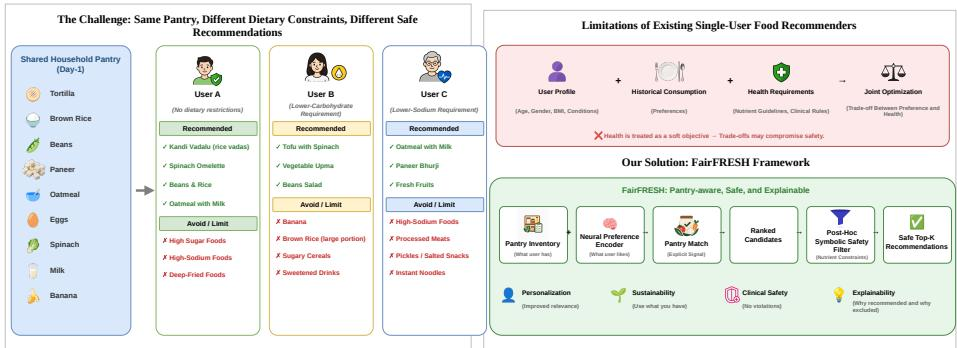
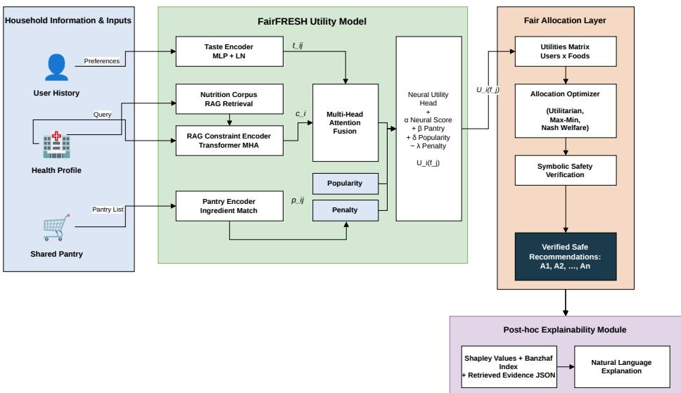
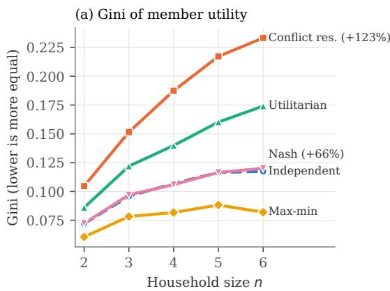
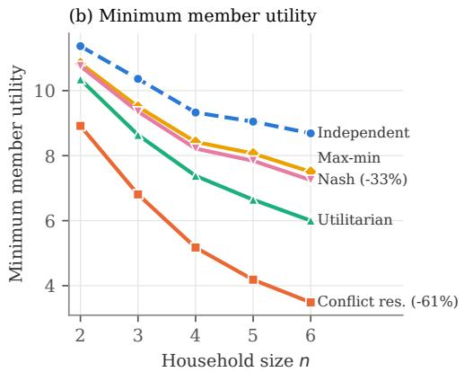
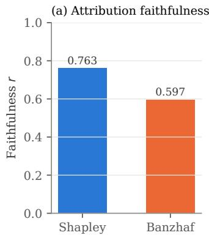
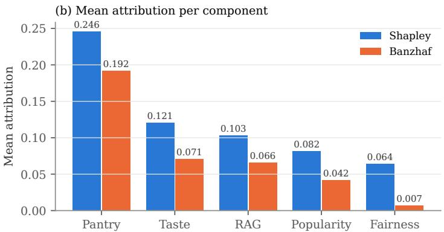

# FAIRFRESH: A NEURO-SYMBOLIC FRAMEWORK FOR FAIR AND EXPLAINABLE HOUSEHOLD FOOD RECOMMENDATION\*

Kodur Sai Vinay Sathvik, Kakoli Bora, and Tejaswini R. M.

Department of Artificial Intelligence and Machine Learning

BNM Institute of Technology

sathvik2004@gmail.com, kakolibora@bnmit.in, tejaswinirm@bnmit.in

## ABSTRACT

Recommender systems typically serve one user at a time. However in households, members share a finite pantry and follow different dietary rules, making independent recommendations prone to resource conflicts and dietary violations. We formulate household food recommendation as constrained fair division and present FairFRESH, a neuro-symbolic framework that learns per-member utilities, allocates foods under explicit welfare objectives, enforces dietary rules through a deterministic filter, and explains recommendations using Shapley and Banzhaf attributions. Theoretically, we show that no finite penalty guarantees compliance near a dietary-rule threshold, establish approximation guarantees for greedy allocation under utilitarian and smoothed Nash objectives in the stock-free model before filtering, and characterize the scale invariance of Nash welfare. We also use the minimax theorem to analyze rotating shared meals. On NHANES-derived data, the learned utility model achieves Recall@20 of 0.293, outperforming five learned recommenders (at most 0.244) but not a previous-day repetition heuristic (0.321). On held-out four-person households, Nash allocation reduces Gini disparity by 42% relative to conflict resolution while improving Recall@20 from 0.180 to 0.197. It comes within 2% of an upper bound on the smoothed Nash optimum, and rescaling one member’s utilities changes at most 1.5% of assignments. All recommendations satisfy the encoded dietary rules, while attribution scores correlate with utility loss upon component removal (r = 0.76). In simulation, shared meals reduce pantry use by about one-third, and weekly rotation increases the worst-off member’s utility by 38% over the best fixed meal.

Keywords food recommendation · fair division · multi-agent recommendation · pantry-aware recommendation · neuro-symbolic reasoning · Nash social welfare · envy-freeness

## 1 Introduction

Recommender systems usually model one user at a time. That assumption suits film or music, but not food: meals are planned around a shared pantry and shaped by the dietary needs of everyone at the table. When two members of a household are recommended the same scarce item, at most one of them can use it, however highly a per-user model scores it for both. When members follow different dietary rules, the same pantry supports different safe choices for each of them (Fig. 1). Household food recommendation is therefore not a ranking problem repeated for every member but an allocation problem over a shared, finite resource.

Existing systems address parts of this problem. Health-aware recommenders optimize nutrition jointly with preference, as in MOPI-HFRS [38], or reason over food knowledge graphs, as in SwissFKG [1], but they score each user against that user’s own history. Caldeira et al. [9] bring pantry state into the model, but only as a per-user ranking feature, which treats a shared, finite resource as if it were unlimited. Group recommenders aggregate preferences into one package that every member shares [28, 34], so they never divide a resource that one member’s choice depletes for another. Dietary safety is typically encoded as a learned penalty or a soft objective, which a strong taste or popularity signal can outweigh, and explanations, where present, address one user’s ranking rather than a household’s allocation.

Fair division studies how to divide a finite set of goods among agents with different preferences so that the outcome is efficient and equitable [29], which is the situation of a household sharing one pantry. We introduce FairFRESH, a neuro-symbolic framework that treats household food recommendation as fair division of indivisible goods under per-member dietary rules.

A three-stage pipeline produces each household recommendation. In the first stage, a learned utility model combines taste, pantry, and retrieval-augmented dietary encoders to score every member–food pair. In the second stage, an explicit welfare rule (utilitarian, max-min, or Nash) allocates foods from the resulting utility matrix, so that no item is promised to two members. In the third stage, a deterministic symbolic filter removes any food that breaks a member’s dietary rule. A post-hoc module then explains the verified recommendations with Shapley and Banzhaf attributions over the pipeline’s components. This division of labor allows the learned components to rank, while the filter alone decides safety and the explanation module never feeds back into a decision. Every final recommendation therefore satisfies the encoded dietary rules, whatever the learned scores.

We evaluate FairFRESH on NHANES-derived households of two to six members, comparing it with five recommender baselines and five allocation strategies. The evaluation addresses four research questions. RQ-A: does a food’s availability, measured by the member’s previous-day consumption, carry predictive signal beyond taste? RQ-B: how does the allocation rule change equity when members compete for one pantry, and at what cost in accuracy? RQ-C: does retrieval-augmented encoding of dietary constraints cover members’ requirements without weakening the safety guarantee? RQ-D: can cooperative-game attributions explain household recommendations faithfully, without changing the decisions they explain?

## Contributions This paper makes the following contributions.

1. We introduce FairFRESH, which formulates household food recommendation as fair division of a shared, finite pantry: servings are private goods allocated under per-member safe sets and a cap of K items (Section 3.1). We prove that no finite penalty weight can certify safety near a rule threshold (Proposition 1), so FairFRESH enforces the rules with a deterministic filter, and we show that, at the optimum, allocating within safe sets dominates filtering afterwards (Proposition 4).

2. The key component of FairFRESH is an explicit allocation layer. One greedy procedure implements the utilitarian, max-min, and Nash rules; we bound it for the utilitarian and smoothed Nash objectives before filtering (Proposition 2), find it within 1–5% of exact optima in practice, and show through bargaining theory that only the exact Nash rule is invariant to how members’ utilities are scaled (Proposition 3). Shapley and Banzhaf attributions then explain the household allocation, not one user’s ranking (Section 3.5).

3. We extend FairFRESH to dishes cooked once and shared by the household. Using the minimax theorem, we show that rotating shared dishes over days can only help the worst-off member, and that a linear program computes the best rotation (Proposition 5).

4. We provide a detailed empirical evaluation on households of two to six members, with all allocation results on users disjoint from training. The utility model ranks above five learned recommenders, and a repeat heuristic shows that previous-day consumption carries most of the signal. Under exclusive household allocation, Nash allocation lowers Gini by 42% relative to conflict resolution with higher Recall@20 and changes at most 1.5% of its assignments when utilities are rescaled. Shared meals save about a third of the pantry (Sections 5 and 6).

## 2 Related Work

Most food recommenders model one user at a time. Freyne and Berkovsky [16] personalize recipes from ratings, Ge et al. [17] add a health objective, and Trattner and Elsweiler [37] study the healthiness of online recipes. Food knowledge graphs [18, 27] and multimodal input [13] encode nutritional semantics, and MOPI-HFRS [38] optimizes nutrition jointly with preference. Where ingredient availability appears [9], it is a per-user ranking feature. None of these systems divides a pantry that one member’s choice depletes for another.

Fairness in recommender systems usually concerns exposure across items or disparities across large user groups [8]. A household is instead a small, fully known group sharing one pool of resources. Group recommenders aggregate member preferences [28] or impose proportionality and envy-freeness on a shared package [34], but every member receives the same items, so each item acts as a public good. These systems do not model private servings drawn from a common stock.

  
Figure 1: Motivation. One shared pantry yields different safe recommendations for members with different dietary rules, so household recommendation is an allocation problem rather than a ranking repeated for each member.

Fair division studies exactly this setting. For indivisible goods with additive valuations [29], envy-free allocations need not exist, but EF1 allocations do, and round robin finds one in polynomial time [10]. Without further constraints, every Nash-optimal allocation is Pareto-optimal and EF1 [10], but computing one is APX-hard [32, 25], and the max-min optimum is NP-hard to approximate within any factor below two [4]. Cardinality limits change which of these guarantees survive [36, 7].

Reviewer assignment poses a closely related constrained problem, where Stelmakh et al. maximize the quality of the most disadvantaged paper under load constraints [35]; members play the role of papers and foods that of reviewers. When every agent consumes an item, allocation becomes a public decision judged by how well the common choice serves each agent [12, 14]. This literature assumes known valuations and has not been connected to learned utilities or dietary constraints.

Neuro-symbolic methods such as logic tensor networks [11, 2] relax symbolic constraints into differentiable objectives, which a high taste or popularity score can outweigh. Post-hoc explanation methods such as the Shapley value [26] and the Banzhaf index [3], evaluated with the faithfulness correlation of Bhatt et al. [5], attribute a single prediction to its inputs. Neither line addresses a guarantee or an explanation at the level of a household allocation.

FairFRESH takes learned per-member utilities from the recommendation literature and passes them to a fair-division allocation layer, so the pantry is divided rather than scored separately for each member. Its soft penalty comes from the same symbolic rules as a deterministic filter, which alone decides compliance (Sections 3.2 and 3.4). Its attributions are defined over the household allocation rather than one user’s ranking, and shared dishes enter as public goods (Section 6).

## 3 Methodology

Figure 2 shows the architecture of FairFRESH. The pipeline has four stages: (1) the utility model, (2) the allocation layer, (3) the symbolic safety filter, and (4) the post-hoc explainability module.

Household inputs feed the utility model, whose scores form the household utility matrix. The allocation layer assigns foods from that matrix under an explicit welfare rule, and the safety filter removes any food that breaks its member’s dietary rules. The explainability module then explains the verified recommendations without feeding back into any earlier stage. We first define the problem and then describe each stage.

## 3.1 Preliminaries and Problem Definition

Model. A household is a set of members $N = \{ 1 , \ldots , n \}$ sharing a fixed pantry P. Each member i contributes stated preferences, an interaction history, and a health profile (conditions, dietary tags, and allergies) that determines a set of dietary rules $\mathcal { C } _ { i }$ . Over a food catalog $\mathcal { F } = \{ f _ { 1 } , \ldots , f _ { m } \}$ , FairFRESH learns a utility $\bar { U _ { i } ( f ) } \in ( 0 , 1 )$ for every member–food pair (Section 3.2) and recommends to each member a bundle $A _ { i } \subseteq { \mathcal { F } }$ . Bundles are disjoint, because an item allocated to one member is unavailable to another, and each holds at most K items; Section 6 relaxes disjointness for dishes cooked once and shared by the household. Since nK is far smaller than m, allocations are partial: most of the catalog stays unallocated. Utilities are additive, $\begin{array} { r } { U _ { i } ( A _ { i } ) = \sum _ { f \in A _ { i } } U _ { i } ( f ) } \end{array}$

  
Figure 2: FairFRESH. Taste, retrieval-augmented dietary, and pantry encoders, fused by multi-head attention, produce a utility for every member–food pair. An allocation rule (utilitarian, max-min, or Nash) assigns foods from the utility matrix, a symbolic filter removes unsafe foods, and a post-hoc module turns Shapley and Banzhaf attributions into natural-language explanations without affecting any decision.

Dietary rules. Each rule $c \in { \mathcal { C } } _ { i }$ is expressed as a normalized slack $g _ { c } ( f )$ , with $g _ { c } ( f ) \leq 0$ meaning that $f$ satisfies the rule. For a nutrient limit, $g _ { c } ( f ) = x _ { f , c } / \tau _ { c } - 1$ , where $x _ { f , c }$ is the amount of the limited nutrient in a serving of $f$ and $\tau _ { c }$ is the per-serving limit; for an exclusion such as an allergen, $g _ { c } ( f ) = 1$ if $f$ contains the excluded ingredient and −1 otherwise. Food f is safe for member i if $g _ { c } ( f ) \le 0$ for every $c \in { \mathcal { C } } _ { i }$ . We write $S _ { i }$ for member i’s safe set and $V _ { i } = { \mathcal { F } } \backslash S _ { i }$ for its complement.

Fairness and efficiency. We use the standard notions of fair division [29], adapted to safe sets. A member is never served an unsafe food, so when comparing bundles we value them by their safe part, $U _ { i } ^ { S } ( B ) = U _ { i } ( B \cap S _ { i } )$ . An allocation A is envy-free (EF) if $U _ { i } ^ { S } ( A _ { i } ) \geq U _ { i } ^ { S } ( A _ { j } )$ for all $i , j ,$ , and envy-free up to one good (EF1) if, for all $i , j$ with $A _ { j } \neq \varnothing$ , some $f \in A _ { j }$ satisfies $U _ { i } ^ { S } ( A _ { i } ) \geq U _ { i } ^ { S } ( \bar { A _ { j } } \setminus \{ f \} )$ . It is Pareto-optimal (PO) if no feasible allocation makes some member better off and no member worse off. We compare three welfare objectives, the utilitarian, egalitarian (max-min), and Nash social welfare:

$$
W _ { \mathrm { U T } } ( A ) = \sum _ { i = 1 } ^ { n } U _ { i } ( A _ { i } ) , \qquad W _ { \mathrm { E G } } ( A ) = \operatorname* { m i n } U _ { i } ( A _ { i } ) , \qquad W _ { \mathrm { N S W } } ( A ) = { \Bigl ( } \prod _ { i = 1 } ^ { n } U _ { i } ( A _ { i } ) { \Bigr ) } ^ { 1 / n } .\tag{1}
$$

Matroid structure. Encode an allocation as a set $X \subseteq \Omega = N \times \mathcal { F }$ of member–food pairs, with $A _ { i } = \{ f : ( i , f ) \in X \}$ Feasibility requires that (i) each food appears in at most one pair and (ii) each member appears in at most K pairs. Each condition defines a partition matroid on Ω, so the feasible allocations are exactly the common independent sets of two matroids. Section 3.3 uses this structure to bound the quality of greedy allocation.

## 3.2 Utility Model

The utility of food $f _ { j }$ for member i combines three encoders.

Taste encoder. The user embedding $\mathbf { e } _ { u _ { i } }$ is a TF-IDF weighted mean of sentence embeddings of the member’s previous-day foods, so a user unseen in training is represented by the same function of their history. We concatenate it with the food embedding $\mathbf { e } _ { f _ { j } }$ , the sentence embedding of the food’s description, and pass the result through a small feedforward network with GELU activations and layer normalization, giving a taste representation $\mathbf { t } _ { i j } \in \mathbb { R } ^ { 1 2 8 }$ that captures preference independently of pantry or dietary state.

Retrieval-augmented constraint encoder. We represent dietary requirements by retrieving evidence for a health query $q _ { i }$ from a nutrition corpus $D ,$ ranked by cosine similarity:

$$
R _ { i } = \underset { r \in D } { \mathrm { T o p K } } \ \frac { E ( q _ { i } ) ^ { \top } E ( r ) } { \| E ( q _ { i } ) \| \| E ( r ) \| } .\tag{2}
$$

The retrieved passages are projected into the latent space and passed through self-attention, so that, for example, a note on potassium restriction can interact with one on kidney function, and are then pooled by learned attention into a constraint vector $\mathbf { c } _ { i } \in \mathbb { R } ^ { 1 2 8 }$ . Grounding this vector in retrieved evidence rather than in parameters alone allows the explanation module (Section 3.5) to cite the specific evidence behind a recommendation.

Pantry (availability) encoder. NHANES records no household inventory, so we use what a member ate the day before as a proxy for what is at hand. With $H _ { i }$ the foods in member i’s previous-day record,

$$
p _ { i j } = \mathbf { 1 } \big [ f _ { j } \in H _ { i } \big ] ,\tag{3}
$$

which we project into the same latent space as $\mathbf { t } _ { i j }$ and $\mathbf { c } _ { i } ,$ giving the model a per-pair availability signal to weigh against taste and dietary fit.

Fusion and utility. We stack the three vectors and apply multi-head attention, so the model can learn how to weight each signal for a given pair. The result is flattened, combined with explicit recency and popularity features $\mathbf { z } _ { i j }$ , and passed through an MLP that outputs a neural score $s _ { i j }$ . The utility combines this score with the raw pantry match and popularity and subtracts a soft constraint penalty:

$$
U _ { i } ( f _ { j } ) = \sigma \big ( \underbrace { \alpha s _ { i j } + \beta p _ { i j } + \delta \mathrm { P o p } ( f _ { j } ) } _ { \ell _ { i } ( f _ { j } ) } - \lambda \mathrm { S C P } ( u _ { i } , f _ { j } ) \big ) ,\tag{4}
$$

where $\alpha , \beta , \delta , \lambda$ weight the neural, pantry, popularity, and penalty terms and $\ell _ { i } ( f _ { j } )$ denotes the unpenalized logit.

Soft constraint penalty. The penalty is built from the same rules $\mathcal { C } _ { i }$ that the safety filter enforces:

$$
\mathrm { S C P } ( u _ { i } , f ) = \sum _ { c \in \mathcal { C } _ { i } } w _ { c } \rho _ { \kappa } \big ( g _ { c } ( f ) \big ) , \qquad \rho _ { \kappa } ( z ) = \frac { 1 } { \kappa } \log \big ( 1 + e ^ { \kappa z } \big ) ,\tag{5}
$$

with rule weights $w _ { c } > 0$ and a temperature $\kappa > 0$ . Because max $( 0 , z ) \le \rho _ { \kappa } ( z ) \le \operatorname* { m a x } ( 0 , z ) + \kappa ^ { - 1 }$ ln 2, the penalty is a smoothed form of the exact penalty $\begin{array} { r } { \sum _ { c } w _ { c } \operatorname* { m a x } ( 0 , g _ { c } ( f ) ) } \end{array}$ and converges to it as $\kappa  \infty ;$ the hard filter is the all-or-nothing form of the same rules. With unit rule weights, $w _ { c } = 1$ , and logistic noise in the nutrient data, $- \kappa \mathrm { S C P }$ is the log-probability that the food is safe, so the penalized utility approximates the probability that a food is both chosen and safe when $\lambda = \kappa$ (Appendix A.1); this reading is a special case and is not needed for Proposition 1. The penalty supplies gradients that a step-function rule cannot, but it cannot replace the filter.

Proposition 1 (Limits of a soft penalty). Fix member i. Let $| \ell _ { i } ( f ) | \leq L$ for all $f ,$ and let $w _ { \mathrm { m i n } } = \operatorname* { m i n } _ { c \in \mathcal { C } _ { i } } w _ { c }$

(a) Clear violations. Let $\gamma > 0$ . If

$$
\lambda \Bigl ( w _ { \mathrm { m i n } } \rho _ { \kappa } ( \gamma ) - \frac { \ln 2 } { \kappa } \sum _ { c \in \mathcal { C } _ { i } } w _ { c } \Bigr ) > 2 L ,
$$

then every food that violates a rule of member i by at least $\gamma$ ranks below every safe food.

(b) Near-threshold violations. Let $f ^ { + }$ be safe with $g _ { c } ( f ^ { + } ) = 0$ , and let $f ^ { - }$ differ from $f ^ { + }$ only in rule $c ,$ with $g _ { c } ( f ^ { - } ) = \eta > 0$ . For every finite λ, the unsafe $f ^ { - }$ ranks above $f ^ { + }$ whenever $\ell _ { i } ( f ^ { - } ) - \ell _ { i } ( f ^ { + } ) > \lambda w _ { c } \eta$

Part (a) shows that a learned penalty can push clear violations down the ranking, but only when the logit is bounded, and its condition fails as $\gamma  0$ . Part (b) shows that, for any finite weight, foods just over a limit cannot be separated from foods just under it, since the required margin $\lambda w _ { c } \eta$ vanishes as $\eta  0$ . Certifying near-threshold foods therefore requires the deterministic filter of Section 3.4. Proofs are given in Appendix A.

## 3.3 Allocation Rules and Greedy Allocation

Independent top-K lists ignore that the pantry is shared, so FairFRESH selects a feasible allocation with one of the welfare rules of Eq. 1. The utilitarian rule maximizes total utility but may leave a member underserved; the egalitarian (max-min) rule protects the worst-off member at some cost in total utility; and the Nash rule balances the two, because the product falls sharply when any member’s utility approaches zero. Proposition 3 below characterizes this balance.

Algorithm 1 Greedy household allocation as an adaptive picking sequence   
Require: utilities $U _ { i } ( f ) ;$ cap K; rule ∈ {UT, EG, NSW}; ϵ > 0   
1: $A _ { i }  \varnothing$ for every member i; $F _ { \mathrm { r e m } } \doteq \mathcal { F }$   
2: while $F _ { \mathrm { r e m } } \neq \emptyset$ and some member has $| A _ { i } | < K$ do   
3: $I \gets \{ i : | A _ { i } | < K \} ; f _ { i } ^ { \star } \gets \arg \operatorname* { m a x } _ { f \in F _ { \mathrm { r e m } } } U _ { i } ( f )$ for every $i \in I$   
$\big ( \mathrm { a r g } \mathrm { m a x } _ { i \in I } U _ { i } ( f _ { i } ^ { \star } )$ if UT   
4: $i ^ { \star } \gets \left\{ \mathop { \mathrm { a r g m i n } } _ { i \in I } U _ { i } ( A _ { i } ) \right.$ if EG ▷ ties: lowest index   
$\begin{array} { r } { \big \vert \operatorname * { a r g m a x } _ { i \in I } U _ { i } ( f _ { i } ^ { \star } ) / ( \epsilon + U _ { i } ( A _ { i } ) ) } \end{array}$ if NSW   
$\begin{array} { r l r } { 5 \mathrm { : } } & { { } \ } & { A _ { i ^ { \star } } \gets A _ { i ^ { \star } } \cup \{ f _ { i ^ { \star } } ^ { \star } \} ; \ F _ { \mathrm { r e m } } \gets F _ { \mathrm { r e m } } \setminus \{ f _ { i ^ { \star } } ^ { \star } \} } \end{array}$   
6: end while   
7: $\hat { A } _ { i }  A _ { i } \setminus V _ { i }$ for every i ▷ safety filter, Section 3.4   
8: return Aˆ

Greedy allocation. Exact optimization is intractable for the Nash and egalitarian rules (Section 2), so all three rules share one greedy procedure (Algorithm 1). Starting from empty bundles, each step gives one member its best remaining food, until every member holds K items or no food remains; the rules differ only in which member moves next. The utilitarian rule picks the member whose best remaining food has the highest utility, which adds the feasible pair of largest marginal gain in $W _ { \mathrm { U T } }$ . The Nash rule does the same for the smoothed objective

$$
\Phi _ { \epsilon } ( A ) = \sum _ { i = 1 } ^ { n } \log \Big ( 1 + \frac { U _ { i } ( A _ { i } ) } { \epsilon } \Big ) , \qquad \epsilon > 0 ,\tag{6}
$$

which keeps gains finite while bundles are empty; because the set of allocations is finite, for sufficiently small ϵ its maximizers also maximize the Nash product. The gain of giving $f$ to i is log $\big ( 1 + U _ { i } ( f ) / ( \epsilon + U _ { i } ( A _ { i } ) ) \big )$ , so the Nash rule picks the member with the largest ratio $U _ { i } ( f _ { i } ^ { \star } ) / ( \epsilon + U _ { i } ( A _ { i } ) )$ , where $f _ { i } ^ { \star }$ is that member’s best remaining food.

The egalitarian rule gives the next food to the currently worst-off member, a max-min heuristic rather than a marginalgain step. Greedy allocation is thus an adaptive picking sequence, of which round robin is the fixed-order counterpart. With each member’s candidates sorted once, Algorithm 1 runs in $O ( n m \log m + n ^ { 2 } K )$ time.

Proposition 2 (Greedy allocation). Consider Algorithm 1 on the feasible allocations of Section 3.1, before filtering and without a stock limit.

(a) Nash. $\Phi _ { \epsilon }$ is monotone and submodular, and greedy Nash allocation attains at least $1 / 3$ of its maximum [15].

(b) Utilitarian. Greedy utilitarian allocation attains at least $1 / 2$ of the optimum [24]. The optimum is a maximumweight bipartite b-matching, computable in polynomial time.

(c) Egalitarian. Approximating the egalitarian optimum within any factor below 2 is NP-hard [4]. We claim no guarantee for the greedy egalitarian rule.

Part (a) bounds the smoothed objective, not the Nash product. Neither bound carries over to the filtered output in general, since removing unsafe foods can lower utilities unevenly; in our experiments, however, the filter removes nothing (Section 3.4). The experiments also enforce a pantry stock (Section 4), a knapsack constraint outside the matroid model, so Appendix B compares greedy allocation with exact optima instead.

The EF1 guarantee of the exact Nash optimum [10] does not transfer either: it holds for complete allocations without constraints, whereas under our cap the Nash optimum is PO within the feasible set but not known to be EF1. Round robin over safe foods, stopped after K rounds, is EF1 under safe-part valuations and is the natural benchmark for an EF1 audit (Appendix B).

A bargaining view of the three rules. Household allocation is an n-person bargaining problem $( F , d )$ [30, Ch. 26]: F is the set of utility vectors ${ \bigl ( } U _ { 1 } ( A _ { 1 } ) , \ldots , U _ { n } ( A _ { n } ) { \bigr ) }$ of feasible allocations, and the disagreement point $d = \mathbf { 0 }$ is what every member receives if no allocation is agreed, an empty bundle. The utilitarian and egalitarian rules correspond to the utilitarian and egalitarian solutions of bargaining theory [30, Sec. 26.6], and the Nash rule to the Nash bargaining solution of (F, 0) [31], the only one of the three characterized by Nash’s axioms. The smoothed objective is the Nash product with disagreement point $^ { - \epsilon 1 }$ , since $\begin{array} { r } { \Phi _ { \epsilon } ( A ) = \sum _ { i } \log \left( U _ { i } ( A _ { i } ) + \epsilon \right) - n \log \epsilon } \end{array}$ . Nash’s axioms assume a convex feasible set. Convexity arises here when the household rotates allocations over repeated meals: a rotation that uses allocation A on a fraction of the meals yields expected utilities in the convex hull conv(F), which is the rationale for convexity in bargaining theory [30, Sec. 26.2].

Proposition 3 (Bargaining properties). Let F be the set of utility vectors of feasible allocations.

(a) Scale covariance. For constants $a _ { i } > 0$ , replacing each $U _ { i }$ by $a _ { i } U _ { i }$ leaves the Nash-optimal allocations unchanged. The utilitarian and egalitarian rules lack this property, both exactly and greedily.

(b) Synthesis. Suppose $F$ contains a vector with positive entries, and let $x ^ { \star }$ maximize $\prod _ { i } x _ { i }$ over conv(F). With $\dot { \lambda _ { i } } = 1 / x _ { i } ^ { \star }$

$$
x ^ { \star } \in \arg \operatorname* { m a x } _ { x \in \mathrm { c o n v } ( F ) } \sum _ { i } \lambda _ { i } x _ { i } \qquad \mathrm { a n d } \qquad \lambda _ { 1 } x _ { 1 } ^ { \star } = \cdot \cdot \cdot = \lambda _ { n } x _ { n } ^ { \star } .
$$

Conversely, any positive $x ^ { \star } \in$ conv $( F )$ with both properties for some $\lambda > 0$ is the Nash solution.

(c) Greedy step. Let $\lambda _ { i } = 1 / ( \epsilon + U _ { i } ( A _ { i } ) )$ ). The Nash rule of Algorithm 1 selects the member maximizing $\lambda _ { i } U _ { i } ( f _ { i } ^ { \star } )$ As $\epsilon  0 .$ , this choice is invariant to rescaling among members that already hold an item.

Part (a) matters because utilities are model estimates whose scale may differ across members, for instance when a longer history yields more confident scores. The Nash optimum does not depend on how utilities compare across members [22], whereas there are instances in which the utilitarian rule favors a member whose utilities are scaled up and the egalitarian rule one whose utilities are scaled down (Appendix A).

Part (b) extends Proposition 26.1 of [30] from two members to n: the Nash rule is a utilitarian rule that weights each member by the inverse of its utility, and an egalitarian rule in those weighted units, which is why it lands between the other two rules in Table 2. Part (c) shows that greedy Nash allocation applies this reweighting one pick at a time, with weights $\lambda _ { i } = 1 / ( x _ { i } + \epsilon )$ for disagreement point −ϵ1; rescaling can affect only the order in which members with empty bundles make their first pick. It is scale-free once every member holds an item, and fixing the order of first picks removes the remaining dependence as $\epsilon \to 0$ . Section 5.3 tests (a) and (c).

## 3.4 Symbolic Safety Filter

The penalty in Eq. 4 shapes the ranking but, by Proposition 1, cannot guarantee safety. After allocation, a deterministic verifier therefore removes from each bundle every food that breaks a rule of its member, regardless of score:

$$
{ \hat { A } } _ { i } = A _ { i } \setminus V _ { i } = A _ { i } \cap S _ { i } .\tag{7}
$$

In the allocation experiments, the rules limit sodium to 500 mg per serving for members with hypertension and carbohydrates to 50 g per serving for members with diabetes; the coverage evaluation of Section 5.5 adds chronic kidney disease (CKD) and cardiovascular disease (CVD). The filter guarantees compliance with these encoded per-serving rules; it does not establish clinical safety, which would also depend on rule completeness, nutrient data, portion sizes, and whole-day intake.

We measure compliance with the constraint satisfaction rate of an allocation $B ,$

$$
\mathrm { C S R } ( B ) = \frac { 1 } { n } \sum _ { i = 1 } ^ { n } \frac { | B _ { i } \setminus V _ { i } | } { | B _ { i } | } .\tag{8}
$$

Before filtering, $\operatorname { C S R } ( A )$ measures what the learned components achieve alone; after filtering, $\mathrm { C S R } ( \hat { A } ) = 1$ whenever the filter has the full rule set. In the ablation of Section 5.6, rules are removed from the filter, and CSR, still measured against the full rule set, can fall below one.

Filter placement. The filter runs after allocation so that it stays independent of the allocation rule and can audit any upstream policy. The cost is that removed foods are not replaced, so a verified bundle can hold fewer than K items, and the loss falls mostly on members with the most restrictive rules. The alternative is to allocate within the safe sets $S _ { i }$ which never does worse at the optimum:

Proposition 4 (Safe-set allocation at the optimum). For any welfare objective W, let $A ^ { \mathrm { a l l } }$ maximize W over all feasible allocations, and let $A ^ { \mathrm { s a f e } }$ maximize $W$ over feasible allocations with $A _ { i } \subseteq S _ { i }$ for every i. Then

$$
W ( A ^ { \mathrm { s a f e } } ) \geq W ( \hat { A } ^ { \mathrm { a l l } } ) ,
$$

where $\hat { A } ^ { \mathrm { a l l } }$ is $A ^ { \mathrm { a l l } }$ after filtering.

In practice the filter has nothing to remove: across the 219,539 recommendations of the held-out allocation runs, the soft penalty already keeps every recommendation within the rules, so $\mathrm { C S R } ( A ) = \mathrm { C S R } ( \hat { A } ) = 1$ . The shared-meal extension of Section 6 allocates within the safe sets.

## 3.5 Post-Hoc Explainability Module

The verified recommendations ${ \hat { A } } _ { i }$ feed a post-hoc explainability module, which computes attributions only after the utility, allocation, and safety decisions are final. FairFRESH explains why a food reaches a member by treating the pipeline as a cooperative game whose players K are the five components that shape a member’s utility and allocation: Taste, Pantry, RAG, Popularity, and Fairness. Safety is not a player: the filter is a hard constraint that stays active in every coalition, since crediting it with utility would treat safety as something that can be traded off.

The value function is defined for each member–food pair that the full pipeline recommends. For a coalition $T \subseteq { \cal K } .$ , we recompute the utilities and rerun the allocation with only the components in $T$ active; with $U ^ { T }$ and $A ^ { T }$ the resulting utilities and allocation, the value of the pair $( i , f )$ is $v _ { i f } ( { \bf \dot { T } } ) = U _ { i } ^ { T } { \bf \dot { ( } } f { \bf ) }$ if $f \in A _ { i } ^ { T }$ and 0 otherwise.

Removing Taste sets the user embedding to zero, removing Pantry sets $p _ { i j }$ to zero, removing RAG replaces the retrieved evidence $R _ { i }$ of Eq. 2 by padding, removing Popularity sets $\operatorname { P o p } ( f _ { j } )$ to zero, and removing Fairness replaces exclusive Nash allocation by independent top-K lists. The dietary rules stay active in every coalition, and unsafe foods are excluded before allocation. Thus $\dot { v } ( T \cup \{ k \} ) - v ( T )$ is the utility that component k adds once the components in $T$ are present, and attributions are averaged over pairs. Averaging this marginal over all orderings gives the Shapley attribution of component k,

$$
\phi _ { k } = \sum _ { T \subseteq K \setminus \{ k \} } { \frac { | T | ! \left( | K | - | T | - 1 \right) ! } { | K | ! } } { \big [ } v ( T \cup \{ k \} ) - v ( T ) { \big ] } ,\tag{9}
$$

and averaging it uniformly over coalitions gives the Banzhaf index,

$$
\psi _ { k } = \frac { 1 } { 2 ^ { | \mathcal { K } | - 1 } } \sum _ { T \subseteq \mathcal { K } \backslash \{ k \} } \left[ v ( T \cup \{ k \} ) - v ( T ) \right] .\tag{10}
$$

Both indices are linear in v [30, Ch. 29], so the mean attributions over households that Section 5.7 reports are the attributions of the household-averaged game. The Shapley value is efficient, $\begin{array} { r } { \sum _ { k } \phi _ { k } = v ( \mathcal { K } ) - v ( \emptyset ) } \end{array}$ ; the Banzhaf index is not.

The two indices also weight coalitions differently. The Shapley value gives each coalition size $| T | \in \{ 0 , \ldots , 4 \}$ total weight $1 / 5$ , and the Banzhaf index gives size s weight ${ \overline { { { \left( { \frac { 4 } { s } } \right) } } } } / 1 6 .$ , so the coalitions with none or all of the other components count for $1 / 5$ under Shapley but $1 / 1 6$ under Banzhaf. Since every size receives Banzhaf weight at least $1 / 1 6 ,$ a component whose mean marginal contribution is non-negative at every coalition size satisfies $\psi _ { k } \ge \frac { 5 } { 1 6 } \phi _ { k }$

We pass these attributions, together with the retrieved evidence, the pantry overlap, and allocation metadata, to a lightweight language model whose only task is to render them in natural language. The generated text is checked against the same evidence and rejected if it introduces a condition, ingredient, nutrient, or line of reasoning that was not used. The module can therefore explain the pipeline’s decisions but cannot change ranking, allocation, or safety.

## 4 Experimental Setup

We evaluate FairFRESH on households of two to six members built from a national health and diet survey. We first measure the individual accuracy of the utility model and then compare allocation strategies that share this model, so that differences between strategies come from the allocation layer alone.

## 4.1 Data

User profiles come from the National Health and Nutrition Examination Survey (NHANES), pooling public releases from cycle C through the March 2023 release (2003–2023). For each respondent, we join the demographic, medicalcondition, body-measurement, blood-pressure, and two-day dietary-recall components by sequence number; BMI, diabetes status, and hypertension are read directly from these records. Each recall lists the USDA food codes the respondent consumed; together they form the 8,704-item catalog F. The first recall day is a respondent’s history and the second the test interactions. The utility model is trained on 1,000 respondents, with each user’s first-day foods as input and second-day foods as positives. The allocation experiments use 1,000 other respondents, drawn from the $^ { 6 0 , 8 1 4 }$ eligible respondents not used in training, and the individual comparison of Section 5.2 uses 400 further test users.

Because NHANES records individuals rather than households, we form households of $n = 2 – 6$ by sampling respondents without replacement within each size (100 households per size); households of different sizes may share respondents. The utility model is trained once and held fixed across all allocation strategies.

Availability and stock. NHANES records no household inventory, so we use two proxies. In the utility model, a food is available to a member if the member reported it on the first recall day (Eq. 3). In allocation, each household receives a stock of 2 to 7 units of each of the 100 most frequent words in food descriptions, which stand in for ingredients; a food requires one unit of each of its description words, and strategies B–E allocate a food only if the remaining stock can supply it, deducting its requirements.

## 4.2 Baselines

For individual accuracy, we compare FairFRESH’s utility model with BPRMF [33], NeuMF [19], LightGCN [20], GRU4Rec [21], and SASRec [23], and with two heuristics: Popularity, and Repeat-D1, which ranks a user’s first-day foods by popularity ahead of all other foods. The ID-based models are trained with the test users’ first-day interactions, so every test user has a trained embedding. For household allocation, five strategies share the same utility model: (A) independent top-K lists per member, which may give the same food to several members; (B) conflict resolution, which merges the members’ top-K lists in order of utility and skips any food already held by another member; and the (C) utilitarian, (D) egalitarian (max-min), and (E) Nash rules of Section 3.3. Strategies B–E allocate each food to at most one member, as Section 3.1 requires; strategy A does not and serves only as an uncoordinated reference.

## 4.3 Evaluation Protocol and Metrics

We report accuracy against held-out interactions (Recall@20 and NDCG@20); the pantry utilization rate (PUR), the share of a member’s recommendations drawn from the household’s first-day foods, normalized by min(|P|, K); equity over members’ utilities, namely the Gini coefficient, minimum utility, and Nash social welfare (NSW, the geometric mean of member utilities); and dietary coverage, namely retrieval success, evidence relevance, and CSR (Eq. 8). Each member receives $K = 2 0$ items, matching the metric cutoff, and the Nash rule uses $\epsilon = 1 0 ^ { - 5 }$

Minimum utility and NSW are the objectives of the egalitarian and Nash rules, so we compare rules mainly on the other metrics. Equity is computed on predicted utilities, which assumes they are comparable across members; Section 5.3 tests how much each rule depends on this assumption. We report 95% bootstrap confidence intervals (2,000 resamples over households, or over users for Table 1) and compare strategies with paired t-tests over households, reporting the paired effect size $d _ { z } .$ . Training and baseline settings are in Appendix B.

Tables 2 and 3 use the same 100 four-person households, so the full model in the ablation is Nash allocation in Table 2. The size sweep draws its own households; at $n = 4 .$ , its Nash results (Recall@20 0.218, Gini 0.106) differ from Table 2 (0.197 and 0.112) within sampling variation, with overlapping confidence intervals. The attribution analysis uses 500 households of two to six members (2,000 members) from the same held-out pool.

## 5 Results

## 5.1 RQ-A: Does Availability Provide Useful Signal?

On the 400 test users, zeroing the availability input of the trained utility model, a state it sees for every food a member did not eat the day before, cuts Recall@20 from 0.293 to 0.083 and NDCG@20 from 0.311 to 0.091. Replacing each member’s first-day foods with a random set of the same size gives 0.045 and 0.027. With the real input, 96.6% of the top 20 recommendations are first-day foods, against 8.5% when the input is zeroed. Most of the model’s accuracy therefore comes from predicting that people eat again the foods they ate the day before.

## 5.2 Comparison with Recommender Baselines

Table 1 reports individual-level accuracy. Repeat-D1 is the most accurate method (Recall@20 0.321), which confirms how much of the signal lies in previous-day consumption. The utility model is second (0.293) and above every learned baseline; the strongest of these are LightGCN (0.244) and BPRMF (0.220), and Popularity alone reaches 0.235. Individual ranking is therefore not where FairFRESH’s contribution lies. The allocation layer needs a utility for every member–food pair that combines availability with taste, popularity, and the dietary penalty, and the utility model supplies these at an accuracy close to the repeat heuristic.

To test what the learned utilities add, we allocate the held-out households of Table 2 with Repeat-D1 scores as utilities. Nash allocation then reaches a slightly higher Recall@20 (0.210 against 0.197) but leaves dietary compliance entirely to the filter: 2.7% of allocated foods break a member’s rule, and after filtering, members with diabetes or hypertension hold 17.8 items instead of $2 0 ( d _ { z } = 0 . 8 7 , p < 1 0 ^ { - 1 3 }$ , paired over households). With learned utilities, the dietary penalty keeps every allocated food within the rules before filtering, at a small cost in accuracy.

Table 1: Individual-level accuracy on 400 test users (mean over five seeds for trained baselines; 95% user-bootstrap confidence intervals in brackets).
<table><tr><td>Method</td><td>Recall@20</td><td>NDCG@20</td></tr><tr><td>Popularity Repeat-D1</td><td>0.235 [0.221, 0.248] 0.321 [0.304, 0.339]</td><td>0.253 [0.241, 0.265] 0.376 [0.358, 0.393]</td></tr><tr><td>BPRMF NeuMF LightGCN</td><td>0.220 [0.206, 0.234] 0.111 [0.105, 0.117] 0.244 [0.231, 0.258]</td><td>0.234 [0.220, 0.249] 0.141 [0.133, 0.149] 0.262 [0.250, 0.274]</td></tr><tr><td>GRU4Rec SASRec FairFRESH utility model</td><td>0.207 [0.195, 0.220] 0.012 [0.004, 0.022] 0.293 [0.276, 0.311]</td><td>0.234 [0.220, 0.247] 0.005 [0.002, 0.008]</td></tr></table>

## 5.3 RQ-B: Does Fairness Improve Household Recommendation?

Table 2 compares the five strategies on 100 held-out four-person households. Conflict resolution (B) is the least equitable coordinated strategy on every equity metric. A member displaced from a contested food moves down their own list, and because the lists hold only each member’s top 20 foods, displaced members can end with fewer than 20 items (Table 6, Appendix B). Among the three allocation rules, the egalitarian rule is the most equal, the utilitarian rule the least equal, and Nash allocation sits between them with the highest Recall@20 of any coordinated strategy.

Table 2: Household allocation on 100 held-out four-person households, with 95% household-bootstrap confidence intervals. Higher is better except for Gini. Bold marks the best coordinated strategy (B–E) in each column; A is an uncoordinated reference that may give the same food to several members.
<table><tr><td>Strategy</td><td>Recall@20</td><td>Min Util.</td><td>Gini</td><td>NSW</td></tr><tr><td>A) Independent</td><td>0.266 [0.250, 0.282]</td><td>9.79 [9.36, 10.21]</td><td>0.109 [0.100, 0.118]</td><td>12.76 [12.42, 13.09]</td></tr><tr><td>B) Conflict resolution</td><td>0.180 [0.165, 0.194]</td><td>5.35 [5.00, 5.70]</td><td>0.192 [0.180, 0.205]</td><td>8.54 [8.25, 8.81]</td></tr><tr><td>C) Utilitarian</td><td>0.194 [0.180, 0.209]</td><td>7.64 [7.31, 7.96]</td><td>0.146 [0.136, 0.155]</td><td>10.72 [10.45, 10.99]</td></tr><tr><td>D) Max-Min</td><td>0.188 [0.173, 0.202]</td><td>8.75 [8.41, 9.08]</td><td>0.088 [0.079, 0.096]</td><td>10.56 [10.27, 10.87]</td></tr><tr><td>E) Nash</td><td>0.197 [0.182, 0.211]</td><td>8.56 [8.23, 8.89]</td><td>0.112 [0.103, 0.121]</td><td>10.98 [10.70, 11.27]</td></tr></table>

Strategy A is more accurate (Recall@20 0.266) only because it gives contested foods to several members at once, so its accuracy is a ceiling rather than a feasible baseline. Paired over the 100 households, Nash allocation lowers Gini relative to conflict resolution by 42%, from 0.192 to $0 . 1 1 2 ( d _ { z } = - 1 . 9 4 , p < 1 0 ^ { - 3 4 } )$ , raises NSW from 8.54 to 10.98 $( d _ { z } = 3 . 5 7 , p < 1 0 ^ { - 5 7 } )$ ), and raises Recall@20 from 0.180 to $0 . 1 9 7 ( d _ { z } = 0 . 4 4 , p = 3 \times 1 0 ^ { - 5 } )$ . Strategies C, D, and E are EF1 in every household, and conflict resolution in 92–99% depending on household size. Round robin over safe foods, the EF1 benchmark of Section 3.3, is a strong simple alternative: on a separate set of four-person households it matches Nash allocation on Recall@20 (0.216 against 0.218) with lower Gini (0.097 against 0.106) and lower NSW (10.47 against 10.63; Appendix B).

Robustness to utility scale. Proposition 3(a) predicts that the utilitarian and egalitarian rules respond to how one member’s utilities are scaled, while the Nash rule does not. We multiply the utilities of one randomly chosen member of each household by $a \in \{ 0 . 5 , 2 \}$ and rerun allocation. Doubling a member’s utilities changes 35% of utilitarian assignments and raises that member’s true utility by 16%; halving them changes 41% of egalitarian assignments and raises it by 13%. Greedy Nash allocation changes 1.5% of assignments at a = 0.5 and 0.2% at $a = 2$ , and the rescaled member gains nothing (changes of −0.010 and +0.002 in utility). With the order of first picks fixed (Proposition 3(c)), no assignment changes. Round robin uses only each member’s ranking and is invariant to rescaling by construction.

## 5.4 Scaling with Household Size

Fig. 3 plots Gini and minimum utility against household size for $n = 2 – 6 ;$ Table 6 in Appendix B reports all metrics.

Conflict resolution degrades steadily as households grow (Fig. 3): its minimum utility falls by 61% from n = 2 to $n = 6$ and its Gini more than doubles. Part of the loss is that displaced members run out of candidates: the merged lists hold only each member’s top 20 foods, so members receive 15.1 items on average at $n = 2$ and 9.7 at $n = 6$ . Nash allocation degrades more gently, its minimum utility falling by 33%, so its lead over conflict resolution on that measure widens from 1.84 at n = 2 to 3.76 at n = 6. The egalitarian rule shows the smallest Gini increase but ends with the lowest Recall@20 of any coordinated strategy (0.160 at $n = 6 )$ . Nash allocation attains the highest NSW at every size, and its Recall@20 is within 0.002 of the most accurate coordinated strategy throughout. CSR remains 1.00 for every strategy and household size. The advantage of fair allocation therefore grows with household size.

  
Figure 3: Scaling with household size, plotted from Table 6. (a) Gini of per-member utility (lower is more equal). (b) Minimum member utility (higher is better). Percentages mark the changes from $n = 2 \tan = 6$ discussed in the text. Independent recommendation (dashed) is an uncoordinated reference (Section 5.3).

## 5.5 RQ-C: Retrieval-Augmented Constraint Coverage

Retrieval for the constraint encoder succeeds for all four conditions tested. Before filtering, the retrieval-augmented encoder alone attains constraint satisfaction of 100% for diabetes and hypertension, 96% for CKD, and 98% for cardiovascular disease (CVD), with evidence-relevance scores of 0.95, 0.94, 0.88, and 0.91. These figures measure retrieval and evidence quality, not clinical validity.

## 5.6 Component Ablation

Table 3 compares the full model with four single-component ablations under the protocol of Table 2; removing the fairness optimizer means allocating by the utilitarian rule.

Table 3: Component ablation on the held-out four-person households of Table 2, under Nash allocation unless stated. The full model’s Recall@20 (0.197) lies below its individual-level value in Table 1 (0.293) because each food goes to one member. CSR is measured against the full rule set.
<table><tr><td>Model</td><td>Recall@20</td><td>CSR</td><td>Gini</td><td>NSW</td></tr><tr><td>Full FairFRESH</td><td>0.197</td><td>1.000</td><td>0.112</td><td>10.98</td></tr><tr><td>w/o Pantry (availability) Encoder</td><td>0.064</td><td>1.000</td><td>0.160</td><td>5.58</td></tr><tr><td>w/o Medical Constraint</td><td>0.194</td><td>0.856</td><td>0.124</td><td>9.23</td></tr><tr><td>w/o Fairness Optimizer (utilitarian)</td><td>0.194</td><td>1.000</td><td>0.146</td><td>10.72</td></tr><tr><td>w/o RAG Constraint Encoder</td><td>0.200</td><td>1.000</td><td>0.087</td><td>10.06</td></tr></table>

Removing the availability encoder cuts Recall@20 from 0.197 to 0.064 and NSW from 10.98 to 5.58, the largest loss of any component. Without the medical-constraint input, which removes the dietary rules from both the utility model and the filter, Recall@20 barely moves but 14.4% of recommendations break a member’s dietary limit. Utilitarian allocation in place of the fairness optimizer lowers Recall@20 slightly (0.194) and raises Gini from 0.112 to 0.146. (In the attribution game of Section 3.5, removing Fairness instead means independent lists, which isolates its effect on utility.) Removing the retrieval-augmented encoder leaves CSR at 1.000, since the encoder supplies no rules to the filter; Recall@20 changes little (0.200), Gini falls to 0.087, and NSW falls to 10.06. With only diabetes and hypertension present, its role is the coverage of Section 5.5 and the evidence behind explanations.

  
Figure 4: Game-theoretic explainability on 500 held-out households of two to six members. (a) Attribution faithfulness: correlation r between each component’s attribution and the utility drop observed when that component is removed. (b) Mean Shapley and Banzhaf attribution per component, sorted by Shapley value. Safety is not a player, since the filter is a hard constraint rather than a source of utility (Section 3.5).

## 5.7 RQ-D: Are Post-Hoc Explanations Faithful?

Fig. 4 reports attributions on 500 held-out households of two to six members (2,000 members, 40,000 member–food pairs). We measure faithfulness as the correlation between a component’s attribution and the utility lost when that component is removed, the single-component case of the faithfulness correlation of Bhatt et al. [5]. Shapley attributions track these losses closely $( r = 0 . 7 6 3 )$ and Banzhaf attributions less closely $( r = 0 . 5 9 7$ ; Fig. 4a). The test removes components with the same operator as the value function $v ,$ so it shows that the attributions agree with the pipeline’s own removal behavior, not causal faithfulness in a stronger sense.

By efficiency, the mean Shapley values sum to $v ( \mathcal { K } ) - v ( \emptyset ) = 0 . 6 1 6 ;$ the Banzhaf indices sum to 0.378. Pantry receives the most credit under both indices (Shapley 0.246, Banzhaf 0.192), 40% of the Shapley total and about twice the credit of taste (0.121 and 0.071), in line with RQ-A and the ablation. RAG is third (0.103 and 0.066), followed by Popularity (0.082 and 0.042) and Fairness (0.064 and 0.007).

Fairness redistributes utility rather than creating it, so its effect shows in Gini and minimum utility (Tables 2 and 6) rather than in total utility. It is also the only component that violates $\psi _ { k } \ge \frac { 5 } { 1 6 } \phi _ { k }$ (Section 3.5): its Shapley value of 0.064 would require a Banzhaf index of at least 0.020 if its mean marginal contribution were non-negative at every coalition size, against the observed 0.007. Fairness therefore lowers total utility in coalitions of some intermediate size and earns its Shapley credit in the smallest and largest coalitions, which the Shapley value weights more heavily.

Four automated checks of 1,000 generated explanations against the retrieved evidence give 98.7% text faithfulness, 100.0% evidence-citation accuracy, 99.8% completeness, and 99.1% attribution consistency.

## 6 Extension: Shared Household Meals

The formulation of Section 3.1 gives each member a disjoint bundle, which models meals assembled from individua servings. Household dining, however, often centers on dishes cooked once and eaten by everyone, such as a common pot of rice or dal. A shared dish is a public good, while the remaining slots stay private goods (Section $2 ) ,$ , so we choose shared dishes by a max-min criterion over members rather than by envy, and evaluate the extension with simulated and with learned utilities.

Setting. As in the main experiments, the pantry is a stock vector $q \geq 0$ over ingredients and, for each dish $f ,$ a requirement vector $r ( f )$ , which is one serving for an individual item and one household batch for a shared dish. A dish is in stock if $r ( f ) \leq q$ componentwise, and allocating it sets $q  q - r ( f )$ . We use two settings, each with 100 four-person households under five seeds, $K = 6 .$ , and $\epsilon = 1 0 ^ { - 5 } \colon 3 { , } 5 9 7$ Indian recipes from RecipeNLG [6] with simulated utilities and randomly assigned exclusion rules, and the NHANES foods of the held-out evaluation pool with the trained model’s utilities and dietary rules. Appendix B gives the details.

Two-stage allocation. Algorithm 2 (Appendix B) first chooses one grain $g ^ { \star }$ and one dal $d ^ { \star }$ that are cooked once and added to every member’s bundle, so their ingredients are charged to the pantry a single time. Because every member eats a shared dish, it must lie in every member’s safe set, $g ^ { \star } , d ^ { \star } \in \cap _ { i } S _ { i }$ , and the pair is chosen to maximize the utility of the worst-off member. The remaining $K - 2$ slots of each bundle are then filled by the Nash rule of Algorithm 1, starting from the utility each member already receives from the shared dishes and skipping any item that is unsafe for its member or that the remaining pantry cannot supply.

If no safe grain–dal pair is in stock, Stage 1 is skipped and the procedure reduces to Nash allocation within the safe sets. As in Section 3.1, each dish is allocated to at most one member per meal, even when the stock could supply a second serving; the stock limits which dishes can be prepared, and the exclusivity rule keeps bundles distinct.

Stage 1 is exact: it enumerates all safe pairs in $O ( n | \mathcal { G } | | \mathcal { L } | )$ time. Stage 2 is the Nash step of Algorithm 1 with $U _ { i } ( A _ { i } )$ initialized to the utility of the shared dishes, and it ends after at most $n K$ picks. Proposition 2 does not carry over: shared dishes break the disjointness of Section 3.1, and the stock constraint $r ( f ) \leq q$ is a knapsack constraint rather than a matroid, so we claim no approximation guarantee for Stage 2. Both stages choose only from safe sets, so no post-hoc filter is needed, as Proposition 4 recommends.

Rotating shared meals. Stage 1 is a matrix game [30, Ch. 9] whose rows are the safe pairs $\pi = ( g _ { \pi } , d _ { \pi } ) \in \Pi$ , whose columns are the members, and whose payoff is $M _ { \pi i } = U _ { i } ( g _ { \pi } ) + U _ { i } ( d _ { \pi } ) ;$ : a planner chooses a pair and an adversary chooses the member on whom it is judged. Stage 1 returns the planner’s maxmin value in pure strategies [30, Sec. 6.6]. A household that plans shared meals for T days need not cook one pair every day, and in practice rarely does. A rotation that cooks pair π on a fraction $p _ { \pi }$ of the days is a mixed strategy of the planner, under which the worst-off member’s average utility from the shared dishes is mini $\textstyle \sum _ { \pi } p _ { \pi } M _ { \pi i }$ .

Proposition 5 (Rotating shared meals). Consider the rotation problem without stock limits. Let $v _ { \mathrm { p u r e } }$ be the best worst-off utility from a single pair and $v ^ { \star }$ the best from a rotation:

$$
v _ { \mathrm { p u r e } } = \operatorname* { m a x } _ { \pi \in \Pi } \operatorname* { m i n } _ { i } M _ { \pi i } , \qquad v ^ { \star } = \operatorname* { m a x } _ { p \in \Delta ( \Pi ) } \operatorname* { m i n } _ { i } \sum _ { \pi } p _ { \pi } M _ { \pi i } .
$$

(a) Minimax. $v ^ { \star } \geq v _ { \mathrm { p u r e } } ,$ and

$$
v ^ { \star } = \operatorname* { m i n } _ { w \in \Delta ( N ) } \operatorname* { m a x } _ { \pi \in \Pi } \sum _ { i } w _ { i } M _ { \pi i } .
$$

An optimal rotation $p ^ { \star }$ and member weighting $w ^ { \star }$ solve a linear program and its dual.

(b) Support. Some optimal rotation uses at most n distinct pairs.

(c) Binding members. If $w _ { i } ^ { \star } > 0$ , member i receives exactly $v ^ { \star }$ under $p ^ { \star } . \mathrm { I f } p _ { \pi } ^ { \star } > 0$ , pair π maximizes $\textstyle \sum _ { i } w _ { i } ^ { \star } M _ { \pi i }$

Part (a) follows from the minimax theorem [30, Thm. 9.2]: rotation can only help the worst-off member, and the best rotation is computed exactly. By (b), a four-person household needs at most four shared meals. By (c), $w ^ { \star }$ names the members whose preferences bind the plan, which the explanation module can report. Every pair in Π is safe for every member, so every rotation is safe.

Without stock limits we round $p ^ { \star }$ to a $T \cdot$ -day plan by largest remainders. Stock limits over the plan, $T \sum _ { \pi } p _ { \pi } ( r ( g _ { \pi } ) +$ $\begin{array} { r } { r ( d _ { \pi } ) \leq q , } \end{array}$ , are linear, so the problem remains a linear program, and each binding stock constraint adds at most one pair to the bound in (b). With stock limits, the linear program still gives the best fractional rotation, but rounding can violate the stock. We therefore compute the T-day plan exactly as an integer program and compare it with the best pair that can be cooked on all T days.

Results. Table 4 compares three strategies in each setting over 500 households. Per-item utilities are min-max normalized to [0, 1], so a bundle’s utility lies between 0 and 6. Unstructured allocation applies the single-serving procedure of Section 3.3 with no meal structure. Structured individual allocation gives each member, in index order, the safe and in-stock grain–dal pair with the highest utility for that member, cooked for that member alone, and fills the remaining slots by the Nash rule. Structured shared allocation is Algorithm 2. Full meal is the share of members whose bundle contains both a grain and a legume, and pantry used is the share of the pantry stock consumed.

Unstructured allocation attains the highest mean and minimum utility but rarely forms a complete meal: 28.6% of members receive both a grain and a legume with Indian recipes, and 0.6% with NHANES foods, where grains and legumes are a small part of the catalog. Individual servings complete every meal but raise pantry use, since each member’s grain and dal are cooked separately. Shared meals also complete every meal and use the least stock: 32% less than individual meals with Indian recipes and 31% less with NHANES foods. They also lower Gini, from 0.030 to 0.024 and from 0.045 to 0.030, while mean utility falls by 4% and 3%, since a shared dish must suit every member. All three differences are significant in both settings $\dot { ( p < 1 0 ^ { - 1 5 } }$ , paired over 500 households; $| d _ { z } |$ between 0.56 and 4.06). Without the all-member safety constraint of Stage 1, 11.8% of members are served a shared dish that violates one of their rules with simulated utilities, against 0.0% with learned utilities, whose soft penalty already scores unsafe dishes low.

Table 4: Shared versus individual meals on four-person households (K = 6; 100 households under each of five seeds). Values are means over seeds; standard deviations across seeds are at most 0.05 for utilities, 0.003 for Gini, 2.3 points for full meal, and 0.12 points for pantry used. Per-item utilities are min-max normalized. Higher is better except for Gini and pantry used. Bold marks the best value in each column within a setting.
<table><tr><td>Strategy</td><td>Mean Util.</td><td>Min Util.</td><td>Gini</td><td>Full Meal</td><td>Pantry Used</td></tr><tr><td colspan="6">Indian recipes, simulated utilities</td></tr><tr><td>Unstructured</td><td>5.34</td><td>4.92</td><td>0.029</td><td>28.6%</td><td>4.59%</td></tr><tr><td>Structured individual</td><td>5.26</td><td>4.86</td><td>0.030</td><td>100%</td><td>5.12%</td></tr><tr><td>Structured shared</td><td>5.06</td><td>4.74</td><td>0.024</td><td>100%</td><td>3.47%</td></tr><tr><td colspan="6">NHANES foods, learned utilities</td></tr><tr><td>Unstructured</td><td>5.58</td><td>5.10</td><td>0.029</td><td>0.6%</td><td>10.74%</td></tr><tr><td>Structured individual</td><td>4.45</td><td>3.97</td><td>0.045</td><td>100%</td><td>11.63%</td></tr><tr><td>Structured shared</td><td>4.32</td><td>4.01</td><td>0.030</td><td>100%</td><td>8.02%</td></tr></table>

Appendix B (Table 7) shows both allocations for one held-out NHANES household. The shared white bread and pinto beans are safe for every member, including one with hypertension, every member gets a complete meal, and pantry use falls from 14.4% to 10.7%, at a cost of 0.6 to 1.6 in each member’s utility.

Rotation. Over a seven-day plan in the Indian-recipe setting (68,523 to 464,610 safe pairs per household), the rounded optimal rotation raises the worst-off member’s average utility from shared dishes from 1.329 to 1.365, improves on the fixed pair in 88.6% of households, and uses 2.6 distinct pairs on average; w⋆ is positive for 3.2 of the 4 members.

Depletion matters more: cooking the Stage 1 pair every day exceeds the stock in 99.4% of households. Under the stock constraint, we compute the seven-day plan exactly as an integer program over the linear program’s support and the 200 pairs with the highest minimum utility; every instance solves to optimality. The integer plan gives the worst-off member 1.334 against 0.978 for the best pair that can be cooked all week, a gain of 38%, improves on that pair in every household, and lies within 0.005 of the linear-programming bound. It uses 5.0 distinct pairs on average, more than n = 4, as the stock constraints allow. With NHANES foods, only 150 of 500 households have any pair that can be cooked all week; in those, the integer rotation improves on it by 43%, and every household has a feasible rotation. Under a finite pantry, rotation is usually the only feasible weekly plan.

## 7 Discussion

Because the utility model is fixed while the allocation rule varies, the equity differences we report come from allocation alone, and the default procedure, conflict resolution, is the least equitable rule we tested.

Nash allocation and round robin. Round robin performs almost as well as Nash allocation in our experiments and is EF1 by construction. The two rules use different information. Round robin uses only each member’s ranking, so it is scale-free but cannot tell a strong preference from a weak one; the Nash rule uses utility intensities, its exact optimum is Pareto-optimal and maximizes NSW, and greedy Nash allocation attains higher NSW than round robin at the same accuracy (10.63 against 10.47). When utility differences are meaningful, the Nash rule trades them off across members and round robin cannot; when only rankings can be trusted, round robin is the safer simple choice.

Strategic reporting. Stated preferences enter the utility model, so a member could misreport them. Households do not use money, so VCG transfers are unavailable [30, Ch. 18], and by the Gibbard–Satterthwaite theorem [30, Ch. 17] a strategy-proof deterministic rule that can select every safe shared pair is dictatorial when preferences over three or more pairs are unrestricted. Pair utilities in Stage 1 are additive over a grain and a dal, which restricts the preference domain, so this is a conditional impossibility rather than a proof that Stage 1 can be manipulated. By Proposition 3(a), rescaling one’s reported utilities can pay under the utilitarian rule (by exaggerating) and the egalitarian rule (by understating), but not under the exact Nash rule; scale invariance does not make the Nash rule strategy-proof against other misreports.

Limitations. Households are random groupings of NHANES respondents, availability is measured by previous-day consumption, and the allocation stock uses description words as ingredients, so households, availability, and stock are all proxies. The utility model was trained without a validation set, and the baselines were not tuned. In the shared-meal extension, pantry quantities are approximated, the Indian-recipe utilities are simulated, and Stage 2 has no approximation guarantee. Equity is measured on predicted rather than realized utilities. The greedy egalitarian rule has no guarantee. The main experiments filter after allocation; allocation within safe sets, which Proposition 4 favors, is evaluated only for shared meals. Dietary coverage is assessed through retrieval and evidence relevance rather than clinical review, the allocation experiments cover only diabetes and hypertension, and CKD and CVD coverage (96% and 98%) falls short of the 100% reached for those two conditions. The explanation metrics are automated checks, not human judgments.

## 8 Conclusion and Future Work

We introduced FairFRESH, a neuro-symbolic framework for household food recommendation. Existing food recommenders score each member in isolation, although a shared pantry turns independently high-scoring recommendations into competition for the same foods. FairFRESH instead treats household recommendation as constrained fair division. A learned utility model scores every member–food pair, an explicit welfare rule allocates foods from the resulting utility matrix, and a deterministic filter enforces dietary safety, which is needed because no finite penalty can certify foods near a rule threshold. Shapley and Banzhaf attributions then explain each allocation without changing it.

On NHANES-derived data, previous-day consumption carried most of the predictive signal: the utility model ranked above five learned recommenders but below a heuristic that repeats previous-day foods. On held-out households of two to six members with exclusive allocation, conflict resolution, the natural default, was the least equitable strategy, while Nash allocation removed most of that inequity with higher accuracy, came within a few percent of exact optima, and was EF1 in every household; round robin performed almost as well.

Bargaining theory explains this result: the Nash rule is utilitarian and egalitarian at once under natural weights and does not depend on how members’ utilities are scaled. For dishes cooked once for the household, sharing saved about a third of the pantry, and a rotation of shared dishes was usually the only weekly plan a finite pantry could supply. These results come from households built from individual survey respondents, with predicted rather than observed utilities and dietary rules that have not been clinically reviewed; within that setting, they show that the allocation rule shapes the balance between accuracy and equity as much as the ranking model does.

Future work. We see several directions for extending this work. First, we will replace the fixed pantry of the main evaluation with an inventory that tracks depletion, and extend rotation from shared dishes to whole allocations, which realizes the convexified bargaining problem of Proposition 3(b). Second, we will move allocation within the safe sets so that verified bundles always hold K items. Third, we will compute the egalitarian rule with an assignment algorithm that carries a max-min guarantee and compare Nash allocation with round robin across more settings. Finally, we plan a blinded human evaluation of the explanations, a clinical review of the dietary rules, and validation of the cohorts against observed households.

## Acknowledgments

The authors thank Vedant Balasubramaniam for his valuable suggestions and insights, and Jonnalagadda Kowshik and Gannem Sai Shankar Narayana for their contributions during the early stages of this work. AI-based language models, including GPT and Claude, were used for language refinement and source summarization. All AI-assisted content was reviewed and verified by the authors for accuracy and factual integrity.

## References

[1] L. Abdur Rahman, I. Papathanail, and S. Mougiakakou. Introducing the Swiss food knowledge graph: AI for context-aware nutrition recommendation. arXiv:2507.10156, 2025.

[2] S. Badreddine, A. d’Avila Garcez, L. Serafini, and M. Spranger. Logic tensor networks. Artificial Intelligence, 303:103649, 2022.

[3] J. F. Banzhaf, III. Weighted voting doesn’t work: A mathematical analysis. Rutgers Law Review, 19:317–343, 1965.

[4] I. Bezáková and V. Dani. Allocating indivisible goods. ACM SIGecom Exchanges, 5(3):11–18, 2005.

[5] U. Bhatt, A. Weller, and J. M. F. Moura. Evaluating and aggregating feature-based model explanations. In Proc. IJCAI, pages 3016–3022, 2020.

[6] M. Bien, M. Gilski, M. Maciejewska, W. Taisner, D. Wisniewski, and A. Lawrynowicz. RecipeNLG: A cooking´ recipes dataset for semi-structured text generation. In Proceedings ofthe 13th International Conference on Natural Language Generation (INLG), pages 22–28, 2020.

[7] A. Biswas and S. Barman. Fair division under cardinality constraints. In Proc. IJCAI, pages 91–97, 2018.

[8] R. Burke. Multisided fairness for recommendation. In Workshop on Fairness, Accountability and Transparency in Machine Learning (FAT/ML), 2017.

[9] J. Caldeira, R. S. Oliveira, L. B. Marinho, and C. Trattner. Healthy menus recommendation: Optimizing the use of the pantry. In Proc. HealthRecSys at RecSys, volume 2216 of CEUR Workshop Proceedings, 2018.

[10] I. Caragiannis, D. Kurokawa, H. Moulin, A. D. Procaccia, N. Shah, and J. Wang. The unreasonable fairness of maximum Nash welfare. ACM Transactions on Economics and Computation, 7(3):1–32, 2019.

[11] T. Carraro, A. Daniele, F. Aiolli, and L. Serafini. Logic tensor networks for Top-N recommendation. In AIxIA 2022 – Advances in Artificial Intelligence, pages 110–123. Springer, 2022.

[12] V. Conitzer, R. Freeman, and N. Shah. Fair public decision making. In Proceedings ofthe 2017 ACM Conference on Economics and Computation (EC), pages 629–646, 2017.

[13] X. Deng and W. Tu. Personalized nutrition-aware dietary recommendation with multimodal large language models. IEEE Access, 14:21791–21804, 2026.

[14] B. Fain, K. Munagala, and N. Shah. Fair allocation of indivisible public goods. In Proceedings ofthe 2018 ACM Conference on Economics and Computation (EC), pages 575–592, 2018.

[15] M. L. Fisher, G. L. Nemhauser, and L. A. Wolsey. An analysis of approximations for maximizing submodular set functions—II. In Polyhedral Combinatorics, volume 8 of Mathematical Programming Studies, pages 73–87. Springer, 1978.

[16] J. Freyne and S. Berkovsky. Intelligent food planning: Personalized recipe recommendation. In Proc. ACM IUI, pages 321–324, 2010.

[17] M. Ge, F. Ricci, and D. Massimo. Health-aware food recommender system. In Proc. ACM RecSys, pages 333–334, 2015.

[18] S. Haussmann, O. Seneviratne, Y. Chen, Y. Ne’eman, J. Codella, C.-H. Chen, D. L. McGuinness, and M. J. Zaki FoodKG: A semantics-driven knowledge graph for food recommendation. In Proc. ISWC, pages 146–162, 2019.

[19] X. He, L. Liao, H. Zhang, L. Nie, X. Hu, and T.-S. Chua. Neural collaborative filtering. In Proc. WWW, pages 173–182, 2017.

[20] X. He, K. Deng, X. Wang, Y. Li, Y. Zhang, and M. Wang. LightGCN: Simplifying and powering graph convolution network for recommendation. In Proc. ACM SIGIR, pages 639–648, 2020.

[21] B. Hidasi, A. Karatzoglou, L. Baltrunas, and D. Tikk. Session-based recommendations with recurrent neural networks. In Proc. ICLR, 2016.

[22] M. Kaneko and K. Nakamura. The Nash social welfare function. Econometrica, 47(2):423–435, 1979.

[23] W.-C. Kang and J. McAuley. Self-attentive sequential recommendation. In Proc. IEEE ICDM, pages 197–206, 2018.

[24] B. Korte and D. Hausmann. An analysis of the greedy heuristic for independence systems. Annals ofDiscrete Mathematics, 2:65–74, 1978.

[25] E. Lee. APX-hardness of maximizing Nash social welfare with indivisible items. Information Processing Letters, 122:17–20, 2017.

[26] S. M. Lundberg and S.-I. Lee. A unified approach to interpreting model predictions. In Advances in Neural Information Processing Systems (NeurIPS), pages 4765–4774, 2017.

[27] W. Ma, M. Li, J. Dai, J. Ding, Z. Chu, and H. Chen. Nutrition-related knowledge graph neural network for food recommendation. Foods, 13(13):2144, 2024.

[28] J. Masthoff. Group modeling: Selecting a sequence of television items to suit a group of viewers. User Modeling and User-Adapted Interaction, 14(1):37–85, 2004.

[29] S. Mishra, M. Padala, and S. Gujar. Fair allocation of goods and chores: Tutorial and survey of recent results. arXiv:2307.10985, 2023.

[30] Y. Narahari. Game Theory and Mechanism Design, volume 4 of IISc Lecture Notes Series. World Scientific and IISc Press, Singapore, 2014.

[31] J. F. Nash. The bargaining problem. Econometrica, 18(2):155–162, 1950.

[32] T. T. Nguyen, N. D. Nguyen, M. Roos, and J. Rothe. Computational complexity and approximability of social welfare optimization in multiagent resource allocation. Autonomous Agents and Multi-Agent Systems, 28(2): 256–289, 2014.

[33] S. Rendle, C. Freudenthaler, Z. Gantner, and L. Schmidt-Thieme. BPR: Bayesian personalized ranking from implicit feedback. In Proc. UAI, pages 452–461, 2009.

[34] D. Serbos, S. Qi, N. Mamoulis, E. Pitoura, and P. Tsaparas. Fairness in package-to-group recommendations. In Proc. WWW, pages 371–379, 2017.

[35] I. Stelmakh, N. B. Shah, and A. Singh. PeerReview4All: Fair and accurate reviewer assignment in peer review. Journal ofMachine Learning Research, 22(163):1–66, 2021.

[36] W. Suksompong. Constraints in fair division. ACM SIGecom Exchanges, 19(2):46–61, 2021.

[37] C. Trattner and D. Elsweiler. Investigating the healthiness of internet-sourced recipes: Implications for mea planning and recommender systems. In Proc. WWW, pages 489–498, 2017.

[38] Z. Zhang, Z. Wang, T. Ma, V. S. Taneja, S. Nelson, N. H. L. Le, K. Murugesan, M. Ju, N. V. Chawla, C. Zhang, and Y. Ye. MOPI-HFRS: A multi-objective personalized health-aware food recommendation system with LLMenhanced interpretation. In Proc. ACM SIGKDD (KDD), 2025. arXiv:2412.08847.

## A Derivations and Proofs

Throughout, $\sigma ( z ) = 1 / ( 1 + e ^ { - z } )$ is the logistic function. Each proof treats the parts of its proposition in order. Proposition 2, Proposition $3 ( \mathrm { a } )$ , and Proposition 5(a) specialize known results to our setting, and we cite the source in each case; the contribution there lies in the formulation and in the conditions under which each result applies.

## A.1 The Soft Constraint Penalty

Lemma 1. For every $\kappa > 0$ , the function $\rho _ { \kappa }$ of Eq. 5 is convex, increasing, and 1-Lipschitz, and for all $z ,$

$$
\operatorname* { m a x } ( 0 , z ) \ \leq \ \rho _ { \kappa } ( z ) \ \leq \ \operatorname* { m a x } ( 0 , z ) + { \frac { \ln 2 } { \kappa } } .
$$

Proof. The first two derivatives are

$$
\begin{array} { r } { \rho _ { \kappa } ^ { \prime } ( z ) = \sigma ( \kappa z ) \in ( 0 , 1 ) , \qquad \rho _ { \kappa } ^ { \prime \prime } ( z ) = \kappa \sigma ( \kappa z ) \bigl ( 1 - \sigma ( \kappa z ) \bigr ) > 0 , } \end{array}
$$

which give monotonicity, convexity, and the Lipschitz bound. For the sandwich bound,

$$
\rho _ { \kappa } ( z ) - \mathrm { m a x } ( 0 , z ) = \frac { 1 } { \kappa } \log \big ( 1 + e ^ { - \kappa | z | } \big ) \in \Big ( 0 , \frac { \ln 2 } { \kappa } \Big ] .
$$

Lemma 2 (Probabilistic reading of the penalty). Suppose the true slack of rule c is $g _ { c } ( f ) + \xi _ { c }$ , where the $\xi _ { c }$ are independent logistic variables with location 0 and scale $1 / \kappa ,$ and let $w _ { c } = 1$ . Then

$$
- \kappa \operatorname { S C P } ( u _ { i } , f ) = \sum _ { c \in \mathcal { C } _ { i } } \log \sigma \big ( - \kappa g _ { c } ( f ) \big ) = \log \operatorname* { P r } \big [ f \mathrm { ~ s a t i s f i e s ~ e v e r y ~ r u l e ~ i n ~ } \mathcal { C } _ { i } \big ] .
$$

Moreover, with $\lambda = \kappa ,$ the utility of Eq. 4 satisfies

$$
U _ { i } ( f ) \geq \sigma ( \ell _ { i } ( f ) ) \cdot \operatorname* { P r } [ f { \mathrm { ~ i s ~ s a f e ~ f o r ~ } } i ] ,
$$

with near equality when relevance probabilities are small.

Proof. The logistic distribution with scale $1 / \kappa$ has distribution function $z \mapsto \sigma ( \kappa z )$ , so each rule holds with probability $\operatorname* { P r } [ \dot { \xi _ { c } } \le - g _ { c } ( \dot { f } ) ] = \sigma ( - \kappa g _ { c } ( f ) )$ ). Since log $\sigma ( - x ) = - \log ( 1 + e ^ { x } )$

$$
\log \sigma \big ( - \kappa g _ { c } ( f ) \big ) = - \kappa \rho _ { \kappa } \big ( g _ { c } ( f ) \big ) ,
$$

and summing over the independent rules gives the identity.

For the bound, write $b = \lambda \mathrm { S C P } ( u _ { i } , f ) \ge 0$ , so that $U _ { i } ( f ) = \sigma ( \ell _ { i } ( f ) - b )$ and $e ^ { - b } = \operatorname* { P r } [ f$ is safe for i]. For all $\ell \in \mathbb { R }$

$$
\frac { \sigma ( \ell - b ) } { \sigma ( \ell ) e ^ { - b } } = \frac { e ^ { b } + e ^ { b - \ell } } { 1 + e ^ { b - \ell } } \ \geq \ 1 ,
$$

because $e ^ { b } \geq 1$ , and the ratio tends to 1 as $\ell \to - \infty$

If relevance and safety are treated as independent events, the right-hand side $\sigma ( \ell _ { i } ( f ) ) \cdot \operatorname* { P r } [ f$ is safe for i] is the probability that the food is both relevant and safe, which is the reading given in Section 3.2.

## A.2 Proof of Proposition 1

Since σ is increasing, ranking by $U _ { i }$ is ranking by the penalized logit

$$
s _ { i } ( f ) = \ell _ { i } ( f ) - \lambda \mathrm { S C P } ( u _ { i } , f ) .
$$

Part (a). Let $f ^ { + }$ be safe, and let $f ^ { - }$ violate some rule $c ^ { \prime }$ by at least $\gamma .$ Every slack of $f ^ { + }$ is non-positive, so Lemma 1 gives an upper bound on its penalty. Every term of the penalty is positive, so the violated rule alone gives a lower bound on the penalty of $f ^ { - } \colon$

$$
\mathrm { S C P } ( u _ { i } , f ^ { + } ) \leq \frac { \ln 2 } { \kappa } \sum _ { c } w _ { c } , \qquad \mathrm { S C P } ( u _ { i } , f ^ { - } ) \geq w _ { c ^ { \prime } } \rho _ { \kappa } ( \gamma ) \geq w _ { \operatorname* { m i n } } \rho _ { \kappa } ( \gamma ) .
$$

Since $\ell _ { i } ( f ^ { + } ) - \ell _ { i } ( f ^ { - } ) \geq - 2 L$

$$
s _ { i } ( f ^ { + } ) - s _ { i } ( f ^ { - } ) \geq - 2 L + \lambda \Big ( w _ { \operatorname* { m i n } } \rho _ { \kappa } ( \gamma ) - \frac { \ln 2 } \kappa \sum _ { c } w _ { c } \Big ) > 0
$$

under the condition of the proposition. $\mathrm { A s } \gamma \to 0 , \rho _ { \kappa } ( \gamma ) \to \kappa ^ { - 1 }$ ln 2, so the bracket tends to

$$
\frac { \ln 2 } { \kappa } \Big ( w _ { \mathrm { m i n } } - \sum _ { c } w _ { c } \Big ) \leq 0 ,
$$

and no finite λ satisfies the condition.

Part (b). The two foods differ only in rule c, so by the Lipschitz bound of Lemma 1,

$$
\mathrm { S C P } ( u _ { i } , f ^ { - } ) - \mathrm { S C P } ( u _ { i } , f ^ { + } ) = w _ { c } \big ( \rho _ { \kappa } ( \eta ) - \rho _ { \kappa } ( 0 ) \big ) \leq w _ { c } \eta .
$$

Hence, i $\ ` \ell _ { i } ( f ^ { - } ) - \ell _ { i } ( f ^ { + } ) > \lambda w _ { c } \eta$ , then $s _ { i } ( f ^ { - } ) > s _ { i } ( f ^ { + } )$ , and the unsafe $f ^ { - }$ ranks above $f ^ { + }$

## A.3 Proof of Proposition 2

Let $\Omega = N \times \mathcal { F }$ , and define

$$
\begin{array} { r } { \mathcal { Z } _ { 1 } = \big \{ X \subseteq \Omega : | X \cap ( N \times \{ f \} ) | \leq 1 \mathrm { ~ f o r ~ a l l ~ } f \big \} , \qquad \mathcal { Z } _ { 2 } = \big \{ X \subseteq \Omega : | X \cap ( \{ i \} \times \mathcal { F } ) | \leq K \mathrm { ~ f o r ~ a l l ~ } i \big \} . } \end{array}
$$

$\mathcal { T } _ { 1 }$ is a partition matroid with one block per food, $\mathcal { T } _ { 2 }$ a partition matroid with one block per member, and the feasible allocations are exactly $\mathcal { T } _ { 1 } \cap \mathcal { T } _ { 2 }$

Part (a). Write

$$
\Phi _ { \epsilon } ( X ) = \sum _ { i } h \Big ( \sum _ { f : ( i , f ) \in X } U _ { i } ( f ) \Big ) , \qquad h ( t ) = \log ( 1 + t / \epsilon ) .
$$

The function h is concave and increasing with $h ( 0 ) = 0 .$ A concave, non-decreasing function of a non-negative additive set function is monotone and submodular, and so is a sum of such functions. Hence Φ is normalized $( \Phi _ { \epsilon } ( \mathcal { O } ) = 0 )$ monotone, and submodular. The marginal gain of adding (i, f) is

$$
\log \left( 1 + \frac { U _ { i } ( f ) } { \epsilon + U _ { i } ( A _ { i } ) } \right) > 0 ,
$$

so Algorithm 1 with the Nash rule adds, at each step, the feasible pair of largest gain, until no pair can be added. Fisher et al. [15] show that this greedy algorithm attains at least $1 / ( p + 1 )$ of the optimum of a normalized monotone submodular function over the intersection of $p$ matroids. Here $p = 2 .$

Part (b). $W _ { \mathrm { U T } }$ is additive with non-negative weights, and the utilitarian rule adds the feasible pair of largest weight. Over the intersection of $p$ matroids, this greedy algorithm attains at least $1 / p$ of the optimum [24]; here $p = 2$ . The exact optimum assigns each food to at most one member and at most K foods to each member at maximum total weight. This is a maximum-weight bipartite b-matching, which minimum-cost flow computes in polynomial time.

Part (c). Setting $K \geq m$ recovers the unconstrained max-min allocation problem, which is NP-hard to approximate within any factor below two [4]. □

## A.4 Proof of Proposition 3

Part (a). For constants $a _ { i } > 0 ,$

$$
\prod _ { i } a _ { i } U _ { i } ( A _ { i } ) = \Big ( \prod _ { i } a _ { i } \Big ) \prod _ { i } U _ { i } ( A _ { i } ) ,
$$

so the Nash product changes by a positive constant and its maximizers are unchanged. For the other two rules, two-member examples suffice; in each, the optimum is unique.

• Utilitarian. Let $K = 1 , U _ { 1 } = ( 0 . 1 , 0 . 3 )$ , and $U _ { 2 } = ( 0 . 2 , 0 . 5 )$ over two foods. The exact and greedy rules both give member 1 the first food, worth 0.1. After member 1’s utilities are doubled, both give it the second food, worth 0.3 to it.

• Egalitarian. Let $K = 2 , U _ { 1 } = ( 0 . 5 , 0 . 4 , 0 . 3 )$ , and $U _ { 2 } = ( 0 . 5 , 0 . 4 5 , 0 . 0 2 )$ over three foods. The exact optimum gives member 1 utility 0.7, and the greedy rule gives it 0.5. After member 1’s utilities are halved, both give it the first and third foods, worth 0.8.

Part (b). Let $\begin{array} { r } { G ( x ) = \sum _ { i } \log x _ { i } . } \end{array}$ . The set $\operatorname { c o n v } ( F )$ is compact and convex and contains a point with positive entries, and G is strictly concave, so G has a unique maximizer $x ^ { \star } > 0$ over conv(F), which also maximizes the Nash product. Necessity. For $y \in \operatorname { c o n v } ( F )$ and $\tau \in ( 0 , 1 ]$ , the point $x ^ { \star } + \tau ( y - x ^ { \star } )$ lies in $\operatorname { c o n v } ( F )$ . Optimality of $x ^ { \star }$ gives a non-positive directional derivative,

$$
\sum _ { i } \frac { y _ { i } - x _ { i } ^ { \star } } { x _ { i } ^ { \star } } \leq 0 .
$$

With $\lambda _ { i } = 1 / x _ { i } ^ { \star }$ , this reads $\begin{array} { r } { \sum _ { i } \lambda _ { i } y _ { i } \le \sum _ { i } \lambda _ { i } x _ { i } ^ { \star } } \end{array}$ , and $\lambda _ { i } x _ { i } ^ { \star } = 1$ for every i.

Sufficiency. Suppose $x ^ { \star } > 0$ maximizes $\sum _ { i } \lambda _ { i } x _ { i }$ over conv(F) and $\lambda _ { i } x _ { i } ^ { \star } = c$ for all i. Then $\lambda _ { i } ~ = ~ c / x _ { i } ^ { \star }$ , so $\textstyle \sum _ { i } y _ { i } / x _ { i } ^ { \star } \leq n$ for every $y \in \operatorname { c o n v } ( F )$ . For $y > 0$ , concavity of G gives

$$
G ( y ) \leq G ( x ^ { \star } ) + \sum _ { i } { \frac { y _ { i } } { x _ { i } ^ { \star } } } - n \leq G ( x ^ { \star } ) ,
$$

and $G ( y ) = - \infty$ if some $y _ { i } = 0$ . Hence $x ^ { \star }$ is the Nash solution. For $n = 2 ,$ , this is Proposition 26.1 of [30].

Part (c). With $\lambda _ { i } = 1 / ( \epsilon + U _ { i } ( A _ { i } ) )$ , the gain of giving f to member i is log $\left( 1 + \lambda _ { i } U _ { i } ( f ) \right)$ . It increases in $\lambda _ { i } U _ { i } ( f )$ and each member’s best remaining food $f _ { i } ^ { \star }$ does not depend on $\lambda _ { i } ,$ so the Nash rule selects arg maxi $\lambda _ { i } U _ { i } ( f _ { i } ^ { \star } )$ . These are the weights of (b) at the point $\overset { \cdot } { x } _ { i } = \overset { \cdot } { U } _ { i } ( A _ { i } )$ for disagreement point −ϵ.

Rescaling member i’s utilities by $a _ { i } > 0$ leaves $f _ { i } ^ { \star }$ unchanged and turns its score into

$$
\frac { a _ { i } U _ { i } ( f _ { i } ^ { \star } ) } { \epsilon + a _ { i } U _ { i } ( A _ { i } ) } \longrightarrow \left\{ \begin{array} { l l } { U _ { i } ( f _ { i } ^ { \star } ) / U _ { i } ( A _ { i } ) } & { \mathrm { i f ~ } A _ { i } \not = \emptyset , } \\ { a _ { i } U _ { i } ( f _ { i } ^ { \star } ) / \epsilon } & { \mathrm { i f ~ } A _ { i } = \emptyset , } \end{array} \right. \quad \mathrm { a s ~ } \epsilon \to 0 .
$$

The first limit does not depend on $a _ { i } .$ . The second exceeds the score of every member holding an item for small $\epsilon ,$ so members with empty bundles pick first, in decreasing order of $a _ { i } U _ { i } ( f _ { i } ^ { \star } )$ , and only this order depends on the scaling. When it is fixed and there are no ties, induction over the finitely many steps shows that, for sufficiently small $\epsilon ,$ every scaling produces the same allocation. □

## A.5 Proof of Proposition 4

Filtering only removes foods, so the bundles of $\hat { A } ^ { \mathrm { a l l } }$ remain disjoint, hold at most K items, and satisfy ${ \hat { A } } _ { i } ^ { \mathrm { a l l } } = A _ { i } ^ { \mathrm { a l l } } { \cap S _ { i } } \subseteq$ $S _ { i }$ . Hence $\hat { A } ^ { \mathrm { a l l } }$ is feasible for the problem that $A ^ { \mathrm { s a f e } }$ solves, and $W ( A ^ { \mathrm { s a f e } } ) \geq W ( \hat { A } ^ { \mathrm { a l l } } )$ . The argument requires exact maximizers; with greedy allocation, the inequality is expected but not guaranteed instance by instance. □

## A.6 Proof of Proposition 5

Part (a). Each pure strategy is a vertex of $\Delta ( \Pi )$ , so $v ^ { \star } \geq v _ { \mathrm { p u r e } }$ . By the minimax theorem [30, Thm. 9.2],

$$
\operatorname* { m a x } _ { p \in \Delta ( \Pi ) } \operatorname* { m i n } _ { w \in \Delta ( N ) } p ^ { \top } M w = \operatorname* { m i n } _ { w \in \Delta ( N ) } \operatorname* { m a x } _ { p \in \Delta ( \Pi ) } p ^ { \top } M w .
$$

For fixed $p ,$ the linear function $w \mapsto p ^ { \intercal } M w$ attains its minimum over the simplex at a vertex, which gives mini $\textstyle \sum _ { \pi } { \dot { p _ { \pi } } } M _ { \pi i } ;$ likewise, the inner maximum on the right is max $\textstyle \sum _ { i } w _ { i } M _ { \pi i }$ . The planner’s problem and its dual [30, Sec. 9.4] are the linear programs

$$
\begin{array} { r l r l } { \operatorname* { m a x } } & { t } & & { \quad \mathrm { m i n } \quad s } \\ { \mathrm { s . t . } } & { \sum _ { \pi } p _ { \pi } M _ { \pi i } \geq t \quad ( i \in N ) , } & & { \mathrm { s . t . } \quad \sum _ { i } w _ { i } M _ { \pi i } \leq s \quad ( \pi \in \Pi ) , } \\ & { \sum _ { \pi } p _ { \pi } = 1 , \ p \geq 0 , } & & { \sum _ { i } w _ { i } = 1 , \ w \geq 0 . } \end{array}
$$

Part (b). Utilities are non-negative, so $v ^ { \star } \geq 0 . \mathrm { ~ H ~ } v ^ { \star } = 0$ , every single pair is optimal. Otherwise the constraint $t \geq 0$ does not change the optimum, and adding slack variables $s _ { i } \geq 0$ gives a program with $n + 1$ equality constraints and non-negative variables. The program is feasible and bounded, so it has an optimal basic feasible solution with at most $n + 1$ non-zero variables. One of them is $t = v ^ { \star } > 0 .$ , so at most n components of $p$ are non-zero. With stock constraints, the slack of every non-binding stock constraint is also non-zero, so the support is at most n plus the number of binding stock constraints.

Part (c). This is complementary slackness for the primal–dual pair in (a). If $w _ { i } ^ { \star } > 0 .$ , member $i \mathbf { \ ' } _ { \mathbf { S } }$ constraint binds, $\begin{array} { r } { \sum _ { \pi } p _ { \pi } ^ { \star } M _ { \pi i } = v ^ { \star } . \operatorname { I f } p _ { \pi } ^ { \star } > 0 } \end{array}$ , pair $\bar { \boldsymbol { \pi } ^ { \prime } \boldsymbol { s } }$ dual constraint binds,

$$
\sum _ { i } w _ { i } ^ { \star } M _ { \pi i } = v ^ { \star } = \operatorname* { m a x } _ { \pi ^ { \prime } \in \Pi } \sum _ { i } w _ { i } ^ { \star } M _ { \pi ^ { \prime } i } .
$$

## B Additional Results

Implementation details. The utility model uses 384-dimensional all-MiniLM-L6-v2 sentence embeddings for foods and evidence, a 128-dimensional latent space, a two-layer transformer encoder (4 heads) with attention pooling for the retrieved evidence, and 4-head attention for fusion. It is trained with binary cross-entropy on the training users’ second-day foods as positives, with four negatives per positive sampled in proportion to first-day popularity raised to 0.75, using Adam (learning rate $1 0 ^ { - 3 } )$ for 3 epochs with batch size 256; the last epoch is kept, without a validation set. User embeddings are TF-IDF weighted means of first-day food embeddings, with inverse document frequencies from the training users. The retrieval corpus consists of six dietary guideline statements, indexed by cosine similarity with $\mathbf { t o p } \mathbf { - } k = 6$ , and each condition has a fixed health query. The baselines are in-house implementations with one setting each and no tuning: 64-dimensional embeddings, learning rate 0.005, 15 epochs, BPR with one uniform negative for BPRMF, NeuMF, and LightGCN, and cross-entropy for GRU4Rec and SASRec. SASRec returns the same rankings for every seed, so its training appears not to change its scores.

Exact optima and EF1. Table 5 compares greedy allocation with exact optima computed by integer programming on the union of the members’ top 30 safe foods, for 100 held-out households per size; every instance solves to proven optimality. For the Nash rule we compare the smoothed objective with an upper bound from a piecewise-linear relaxation of the logarithm. Greedy allocation attains 95–99% of the optimum, far above the worst-case bounds of Proposition 2. The utilitarian, egalitarian, and Nash allocations and round robin are EF1 under safe-part valuations in every household; conflict resolution is EF1 in 99%, 98%, and 92% of households for $n = 2 , 3$ , and 4. On these four-person households, round robin reaches a Recall@20 of 0.216, Gini 0.097, and NSW 10.47, against 0.218, 0.106, and 10.63 for Nash allocation.

Table 5: Greedy allocation relative to exact optima (mean over 100 held-out households per size, with 95% bootstrap intervals).
<table><tr><td>n</td><td>Utilitarian: greedy/opt.</td><td>Max-min: greedy/opt.</td><td>Nash: Φ€/upper bound</td></tr><tr><td>2</td><td>0.986 [0.982, 0.990]</td><td>0.978 [0.973, 0.983]</td><td>0.996 [0.995, 0.997]</td></tr><tr><td>3</td><td>0.975 [0.971, 0.980]</td><td>0.957 [0.950, 0.964]</td><td>0.990 [0.988, 0.992]</td></tr><tr><td>4</td><td>0.976 [0.972, 0.980]</td><td>0.946 [0.937, 0.955]</td><td>0.987 [0.985, 0.989]</td></tr></table>

Shared-meal settings. The pantry records ingredient quantities: a stock vector $q \geq 0$ over ingredients, and for each dish f a requirement vector $r ( f )$ , the quantity of each ingredient needed to prepare $f$ as allocated. For an individual item this is one serving; for a shared dish it is one batch cooked for the whole household. A dish is in stock if $r ( f ) \leq q$ componentwise, and allocating it sets $q  q - r ( f )$ . We evaluate the extension in two settings, each with 100 four-person households under each of five seeds, $K = 6 ,$ , and $\epsilon = 1 0 ^ { - 5 }$

Algorithm 2 Two-stage shared-meal allocation   
Require: utilities $U _ { i } ( f ) ;$ safe sets $S _ { i } ;$ stock $q ;$ requirements $r ( \cdot ) ;$ cap $K \geq 2 ; \epsilon > 0$   
Stage 1: max-min shared dishes   
1: G ← grains in $\textstyle \bigcap _ { i } S _ { i } ; { \mathcal { L } }  \operatorname { d a l s }$ in $\cap _ { i } S _ { i }$   
2: $\Pi  \bigcup \{ ( g , d ) \in \dot { \mathcal { G } } \times \mathcal { L } : r ( g ) + r ( \dot { d } ) \overset { \cdot \cdot } { \leq } q \}$ ▷ componentwise   
3: if Π $\neq \infty$ then   
4: $( g ^ { \star } , d ^ { \star } ) \gets \arg \operatorname* { m a x } _ { ( g , d ) \in \Pi }$ mini $\left( U _ { i } ( g ) + U _ { i } ( d ) \right)$ ▷ exhaustive; ties: lowest index   
5: $A _ { i } \gets \{ g ^ { \star } , d ^ { \star } \}$ for every i; $q  q - r ( g ^ { \star } ) - r ( d ^ { \star } ) ; ~ F _ { \mathrm { r e m } }  \mathcal { F } \setminus \{ g ^ { \star } , d ^ { \star } \}$   
6: else   
7: $A _ { i }  \varnothing$ for every i; $F _ { \mathrm { r e m } } \gets \mathcal { F }$ ▷ no safe shared meal exists   
8: end if   
Stage 2: Nash-greedy individual slots   
9: $C _ { i } \stackrel { \smile } {  } \{ f \in F _ { \mathrm { r e m } } \cap \bar { S _ { i } } : r ( f ) \le q \}$ for every i; $I  \{ i : | A _ { i } | < K , C _ { i } \neq \emptyset \}$   
10: while $\dot { I } \neq \emptyset$ do   
11: $f _ { i } ^ { \star } \gets \arg \operatorname* { m a x } _ { f \in C _ { i } } U _ { i } ( f )$ for every $i \in I$   
12: $i ^ { \star } \gets \arg \operatorname* { m a x } _ { i \in I } U _ { i } ( f _ { i } ^ { \star } ) / \big ( \epsilon + U _ { i } ( A _ { i } ) \big )$ ▷ ties: lowest index   
13: $A _ { i ^ { \star } }  A _ { i ^ { \star } } \cup \{ f _ { i ^ { \star } } ^ { \star } \} ; \ F _ { \mathrm { r e m } }  F _ { \mathrm { r e m } } \setminus \{ f _ { i ^ { \star } } ^ { \star } \} ; \ q  q - r ( f _ { i ^ { \star } } ^ { \star } )$   
14: recompute $C _ { i }$ for every i and I   
15: end while   
16: return A

Indian recipes, simulated utilities. A corpus of 3,597 Indian recipes (911 grains and breads, 510 legumes and dals, and 2,176 sides and curries) selected from the RecipeNLG corpus [6]. Each member is vegetarian with probability 0.35, avoids nuts with probability 0.08, and avoids dairy with probability 0.10; a dish violates a rule when its title or ingredient list matches the excluded category. The corpus has no interaction histories, so the utility model of Section 3.2 cannot be trained on it; member utilities are simulated from random ingredient-affinity vectors, correlated across the members of a household with coefficient 0.5. The pantry stocks the 200 most frequent ingredients of the corpus with 2 to 7 units each, and a dish uses one unit of each of its ingredients.

NHANESfoods, learned utilities. The households, utilities, and dietary rules of the main evaluation, so utilities come from the trained utility model. Keyword matching on food descriptions identifies 171 grains and breads and 114 legumes among the 8,704 foods. NHANES foods have no ingredient lists, so we approximate ingredients by the 100 most frequent words in food descriptions (2.9 per food on average) and stock each with 2 to 7 units.

In both settings, the rules are expressed as slacks $g _ { c } ( f )$ as in Section 3.1, so a dish is safe for a member exactly when it would pass the filter of Section 3.4.

Table 6 reports all metrics of the household-size sweep plotted in Fig. 3, and Table 7 gives the household-level example referred to in Section 6.

Table 7 shows how the two allocations differ for one held-out NHANES household with learned utilities. Member 4 has hypertension and the others have no condition. Under single servings, no member receives both a grain and a legume; member 4 receives toasted wheat bread but no legume. Structured shared allocation cooks white bread and pinto bean once, both safe for every member including member 4’s sodium limit, so every member gets a complete meal and pantry use falls from 14.35% to 10.71%. Each member’s four individual foods are exactly their first four single-serving picks, so the shared dishes replace each member’s two lowest-ranked foods. Members value the shared dishes at 0.14–0.23. Members 1, 2, and 4 lose 1.4–1.6 in utility, while member 3, whose two lowest-ranked foods were worth little (0.74 and 0.28), loses 0.65, so the spread of totals narrows from 4.74–5.85 to 4.09–4.33.

Table 6: Household allocation across household sizes n = 2–6 (100 held-out households per size). CSR is 1.00 in every row. Items is the mean number of foods each member receives; strategies A and C–E always fill all K = 20 slots. Bootstrap confidence intervals are released with the code.
<table><tr><td>n</td><td>Strategy</td><td>Recall@20</td><td>NDCG@20</td><td>PUR</td><td>Min Util.</td><td>Gini</td><td>NSW</td><td>Items</td></tr><tr><td>2</td><td>A) Independent</td><td>0.292</td><td>0.292</td><td>0.187</td><td>11.37</td><td>0.072</td><td>12.96</td><td>20.0</td></tr><tr><td>2</td><td>B) Conflict resolution</td><td>0.252</td><td>0.263</td><td>0.142</td><td>8.92</td><td>0.105</td><td>10.82</td><td>15.1</td></tr><tr><td>2</td><td>C) Utilitarian</td><td>0.264</td><td>0.270</td><td>0.184</td><td>10.34</td><td>0.086</td><td>12.16</td><td>20.0</td></tr><tr><td>2</td><td>D) Max-Min</td><td>0.260</td><td>0.268</td><td>0.185</td><td>10.84</td><td>0.061</td><td>12.13</td><td>20.0</td></tr><tr><td>2</td><td>E) Nash</td><td>0.267</td><td>0.273</td><td>0.185</td><td>10.75</td><td>0.072</td><td>12.30</td><td>20.0</td></tr><tr><td>3</td><td>A) Independent</td><td>0.283</td><td>0.291</td><td>0.279</td><td>10.36</td><td>0.096</td><td>12.87</td><td>20.0</td></tr><tr><td>3</td><td>B) Conflict resolution</td><td>0.203</td><td>0.232</td><td>0.182</td><td>6.81</td><td>0.152</td><td>9.47</td><td>13.1</td></tr><tr><td>3</td><td>C) Utilitarian</td><td>0.221</td><td>0.242</td><td>0.270</td><td>8.64</td><td>0.122</td><td>11.33</td><td>20.0</td></tr><tr><td>3</td><td>D) Max-Min</td><td>0.215</td><td>0.242</td><td>0.270</td><td>9.50</td><td>0.078</td><td>11.22</td><td>20.0</td></tr><tr><td>3</td><td>E) Nash</td><td>0.219</td><td>0.246</td><td>0.271</td><td>9.36</td><td>0.097</td><td>11.52</td><td>20.0</td></tr><tr><td>4</td><td>A) Independent</td><td>0.299</td><td>0.308</td><td>0.370</td><td>9.33</td><td>0.107</td><td>12.40</td><td>20.0</td></tr><tr><td>4</td><td>B) Conlict resolution</td><td>0.206</td><td>0.237</td><td>0.215</td><td>5.17</td><td>0.187</td><td>8.31</td><td>11.7</td></tr><tr><td>4</td><td>C) Utilitarian</td><td>0.219</td><td>0.245</td><td>0.355</td><td>7.38</td><td>0.140</td><td>10.43</td><td>20.0</td></tr><tr><td>4</td><td>D) Max-Min</td><td>0.207</td><td>0.239</td><td>0.358</td><td>8.42</td><td>0.082</td><td>10.23</td><td>20.0</td></tr><tr><td>4</td><td>E) Nash</td><td>0.218</td><td>0.248</td><td>0.359</td><td>8.22</td><td>0.106</td><td>10.63</td><td>20.0</td></tr><tr><td>5</td><td>A) Independent</td><td>0.274</td><td>0.283</td><td>0.466</td><td>9.05</td><td>0.116</td><td>12.62</td><td>20.0</td></tr><tr><td>5</td><td>B) Conlict resolution</td><td>0.171</td><td>0.204</td><td>0.250</td><td>4.18</td><td>0.217</td><td>7.73</td><td>10.8</td></tr><tr><td>5</td><td>C) Utilitarian</td><td>0.184</td><td>0.212</td><td>0.435</td><td>6.64</td><td>0.160</td><td>10.10</td><td>20.0</td></tr><tr><td>5</td><td>D) Max-Min</td><td>0.173</td><td>0.207</td><td>0.437</td><td>8.07</td><td>0.088</td><td>9.94</td><td>20.0</td></tr><tr><td>5</td><td>E) Nash</td><td>0.184</td><td>0.216</td><td>0.438</td><td>7.84</td><td>0.117</td><td>10.42</td><td>20.0</td></tr><tr><td>6</td><td>A) Independent</td><td>0.282</td><td>0.288</td><td>0.563</td><td>8.69</td><td>0.117</td><td>12.60</td><td>20.0</td></tr><tr><td>6</td><td>B) Conflict resolution</td><td>0.162</td><td>0.195</td><td>0.271</td><td>3.49</td><td>0.233</td><td>6.97</td><td>9.7</td></tr><tr><td>6</td><td>C) Utilitarian</td><td>0.171</td><td>0.201</td><td>0.508</td><td>6.00</td><td>0.174</td><td>9.51</td><td>20.0</td></tr><tr><td>6</td><td>D) Max-Min</td><td>0.160</td><td>0.195</td><td>0.512</td><td>7.50</td><td>0.082</td><td>9.25</td><td>20.0</td></tr><tr><td>6</td><td>E) Nash</td><td>0.171</td><td>0.204</td><td>0.513</td><td>7.25</td><td>0.120</td><td>9.86</td><td>20.0</td></tr></table>

Table 7: Worked example: one held-out NHANES household with learned utilities, K = 6. Single-serving allocation gives each member six foods; structured shared allocation cooks white bread and pinto beans once for all members and adds four individual foods. Totals are bundle utilities on the min-max-normalized scale. Both shared dishes are safe for every member.
<table><tr><td>Member</td><td>Single-serving foods</td><td>Total</td><td>Shared dishes (utility) + individual foods</td><td>Total</td></tr><tr><td>1 (none)</td><td>Baby oatmeal cereal, sweetened tea, fruit yogurt, coffee cake, barbecue chicken, corn puffs</td><td>5.84</td><td>Bread 0.20, beans 0.14; oatmeal cereal, tea, fruit yogurt, coffee cake</td><td>4.28</td></tr><tr><td>2 (none)</td><td>Froot Loops, yeast doughnut, mozzarella, hamburger, cola, chocolate sandwich cookie</td><td>5.57</td><td>Bread 0.23, beans 0.16; Froot Loops, doughnut, mozzarella, hamburger</td><td>4.19</td></tr><tr><td>3 (none)</td><td>Low-fat fruit yogurt, whole milk, salted pretzels, cheese pizza, French fries,</td><td>4.74</td><td>Bread 0.22, beans 0.16; yogurt, whole milk, pretzels, cheese pizza</td><td>4.09</td></tr><tr><td>4 (hypertension)</td><td>banana Bacon, fried eggs, French dressing, tap water, toasted wheat bread, heavy cream</td><td>5.85</td><td>Bread 0.23, beans 0.17; bacon, fried eggs, French dressing, tap water</td><td>4.33</td></tr></table>