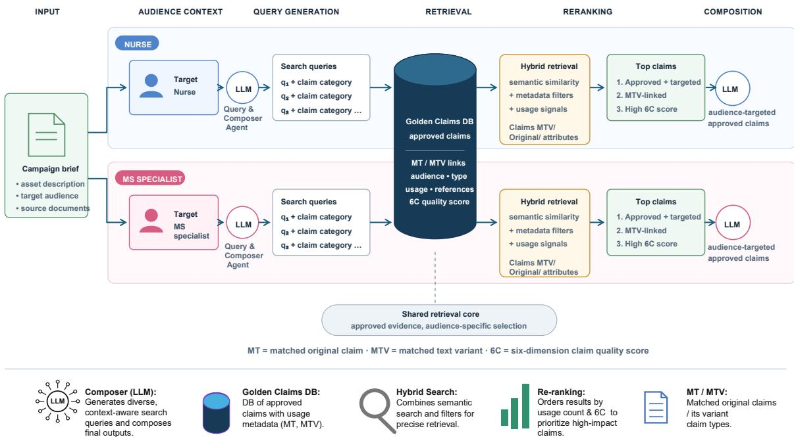
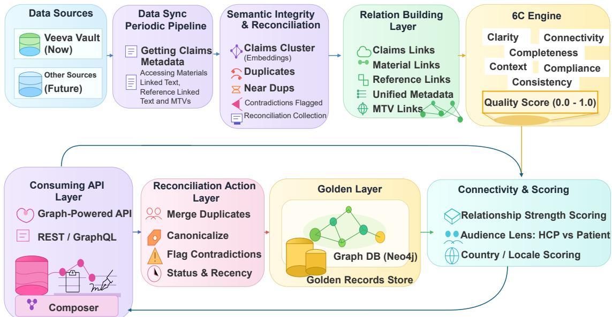
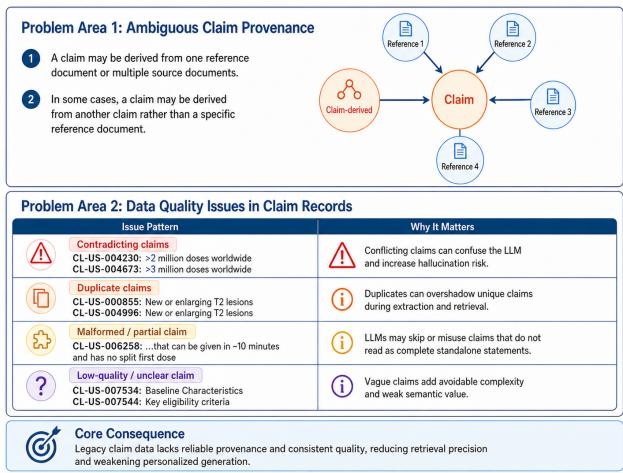
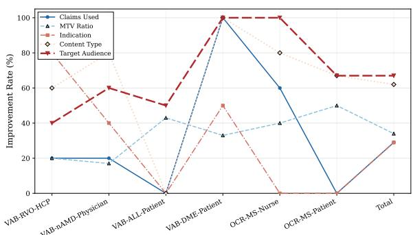
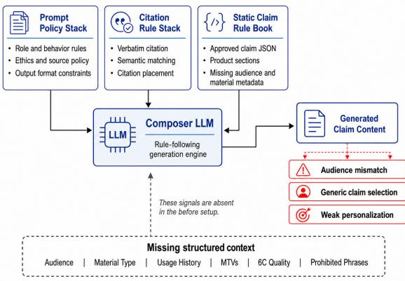
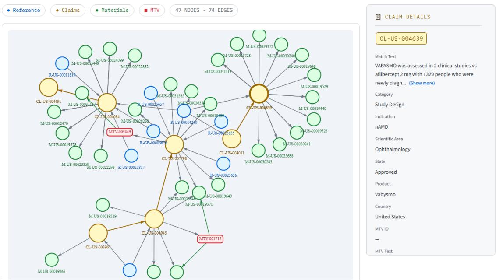
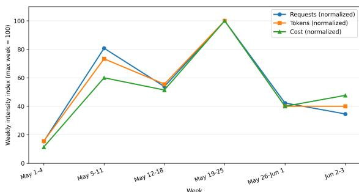
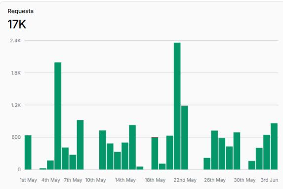
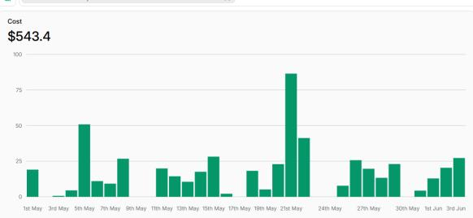
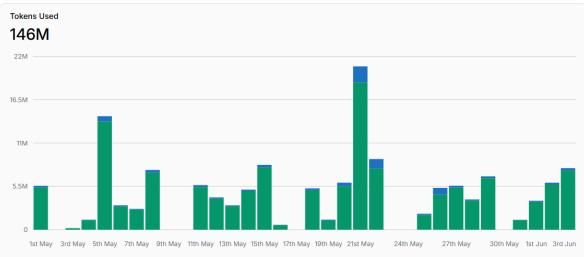

# From Prompt Rules to Golden Data Model: Production-Scale Generation of Personalized, Compliant Pharmaceutical Claims

Suyash Mishra<sup>a</sup>, Qiang Li<sup>b</sup>, Subhabrata Adak<sup>c</sup>,

Upender Phogat<sup>c</sup>, Srikanth Patil<sup>c</sup>, Satyanarayan Pati<sup>c</sup>,

<sup>a</sup>Roche, <sup>b</sup>Accenture, <sup>c</sup>Involead,

Correspondence: suyash.mishra@roche.com, qiang.i.li@accenture.com, subhabrata.adak@involead.com upender.phogat@involead.com, srikanth.patil@involead.com, satyanarayan.pati@involead.com

## Abstract

Large language models (LLMs) are increasingly used to generate domain-specific commercial & medical content (e.g., claims, statements, and promotional phrases) in regulated industries such as pharmaceuticals. However, ensuring its regulatory compliance, factual accuracy, and audience-specific personalization remains a major challenge. We report a production case study asking whether moving compliance and personalization signal from promptlevel rules into retrieval-time structured context improves pharmaceutical claims generation, using Composer, a deployed internal tool built on a Golden Data Model (GDM) of 1,867 pharmaceutical claims spanning four products. The GDM integrates claim metadata, references, audience labels, material type, usage history, Match Text Variant (MTV) links, and a six-dimension quality score (6C). Across six product-audience segments, the context pipeline improves intended indication (+29%), intended content type (+62%) and intended target audience (+67%), 6C quality score (+86%), and claim reuse (+34%). Production log analysis over the deployment period shows a 29.5% reduction in weekly API cost. We report this as descriptive deployment evidence. This work is a systems and data-architecture contribution: it shows that in a regulated, high-stakes domain, restructuring claim data for retrieval-time filtering is a more scalable lever than expanding prompt-level rules, and documents the engineering path data cleaning, graph linking, and quality scoring Check our Composer Video.

## 1 Introduction

AI-generated text has been detected increasingly in medical literature (Wolfrath et al., 2026). A 2025 market forecast projected the AI in medical writing market to reach USD 1,760.02 million by 2030, with a CAGR of 12.52% from 2025 to 2030 (Grand View Research, 2025). However, their deployment in regulated domains such as healthcare and pharmaceuticals remains constrained by persistent concerns around hallucination, regulatory compliance, and limited controllability (Hager et al., 2024).

Pharmacy content generation is particularly challenging. Claims must be: (i) factually grounded in approved sources, (ii) compliant with regulatory constraints, (iii) tailored to specific audiences such as healthcare professionals (HCPs) or patients (Barrias et al., 2024).

Our baseline relies on rule-based prompting and strict templates. In our deployment, this baseline often failed to produce personalized and contextually appropriate outputs. As observed in realworld systems, rule-based approaches can lead to mismatches in target audience, low relevance, and overuse of inactive or general claims.

In contrast, context-rich approaches leverage structured data, usage history, and semantic relationships to guide generation. However, the effectiveness of such approaches has not been experimentally studied. In this paper, we address following core research question:

Does shifting compliance and personalization signals from prompt-level rules to structured retrieval-time data improve the quality and production efficiency of pharmaceutical claim generation in a deployed system?

To answer this, we propose a golden data model schema that transforms fragmented claim data into a structured, graph-based representation with quality-aware filtering. We further evaluate rule-based and context-based generation pipelines across multiple dimensions, including compliance (e.g., prohibited words / phrases, target indication / type, MTV-Variant claims reuse), personalization (e.g. target audience), and quality (6C scores). We note that the context pipeline does not eliminate rules outright, claim-level guardrails and prohibited-word constraints still persist, but relocates them from static, product-level prompt text to claim-level, retrieval-gated metadata.

  
Figure 1: Business Solution Map for Composer Tool Compliant Claims Generation.

## 2 Related Work

Pharmaceutical content management: Veeva PromoMats supports promotional content and claims management, including substantiation and contextual claim variations (Veeva Systems, n.d.). IQVIA provides HCP engagement solutions (IQVIA, n.d.). These product descriptions do not establish the internal generation architectures of the platforms. Our contribution is a production evaluation of an explicit claimcentered schema and audience-conditioned generation pipeline. Prior research has examined the informational and emotional content of prescriptiondrug advertising (Frosch et al., 2007) and the distinction between promotion and scientific exchange (Kessler, 1991).

Retrieval-augmented generation (RAG) in biomedical NLP: RAG (Gao et al., 2023; Asai et al., 2024) improves grounding by incorporating external knowledge sources. RAG has improved factuality in knowledge-intensive generation (Lewis et al., 2020), whereas chain-of-thought prompting has improved arithmetic, commonsense, and symbolic reasoning (Wei et al., 2022); the latter does not by itself establish reduced hallucination. However, standard RAG systems lack domain-specific constraints such as regulatory compliance and structured claim validation. RAG alone is insufficient for pharmaceutical claim generation because it does not enforce the audience-specific stylistic transformation that distinguishes a KOLfacing mechanism statement from a patient-facing aspirational statement derived from the same input. Prior work in biomedical NLP, has mostly focused on information extraction and summarization, but less attention has been given to controlled, personalized generation under strict regulatory requirements. Our work differs in two key aspects: (1) we introduce a data-centric framework for controlling generation, and (2) we provide an empirical comparison between rule-based and context-based approaches in real-world setting.

Verification and hallucination evaluation: Recent benchmarks such as SciVer (Wang et al., 2025) evaluate multimodal scientific claim verification with expert-annotated supporting evidence. HonestVQA (Tripathi et al., 2025) studies confidence calibration in document visual question answering, while Decomposed NLI (DNLI) (Yanuka et al., 2025) evaluates individual propositions in image captions. MLLMGuard (Gu et al., 2024) assesses multimodal safety across privacy, bias, toxicity, truthfulness, and legality. Industrial traffic-incident benchmarks also examine LLM hallucination (Li et al., 2025). These studies concern distinct tasks and do not directly validate pharmaceutical claim generation.

  
Figure 2: Comprehensive Functional Layer for Compliant Claims Generation.

## 3 Methodology

Given a target audience (e.g., HCP, Patient), content type (e.g., Email, Banner), and a set of claims, the goal is to generate compliant and personalized text. The rule-based approach relies on predefined instructions, including: strict citation rules, verbatim claim usage constraints, and template-based generation. While this ensures high compliance, it limits flexibility and personalization. We propose a golden data model schema that enhances claim usability via 4 key components as shown in Fig 2:

1. Semantic Integrity Layer: periodic pipeline executing high-volume "upserts" from Veeva Vault and other sources into the central library. Claims are clustered using keywords and embeddings to identify duplicates, near-duplicates, contradictions.

2. Graph-Based Representation: Claims are linked to: references, materials, audience metadata, forming a relational graph structure (as shown in Appendix Figure 6. This is the relationship building layer. Establishes the structural links between Claims, References, and Materials. It aggregates metadata to provide a unified view of derivation and utilization, stored in Graph DB.

3. 6C Quality Framework: Each claim is then scored along six dimensions: Clarity, Completeness, Consistency, Connectivity, Compliance, Context, as shown in Table 10 how weights differ, Table 11 why each dimension is scored this way, Table 12 what it evaluates. It translates relational evidence into a mathematical "Strength Score", quantifies how firmly a claim to its supporting scientific text.

4. Alignment Annotation Protocol. Indication, content-type, and target audience alignment were then judged by internal US medical-content writers team not involved in system development, using binary match against the campaign brief’s stated indication/content-type/ audience fields. Judgment was BLINDED to pipeline (Pre vs. Post).

5. Audience Lens: Claims are filtered and ranked based on target audience, region, and usage patterns. This is the reconciliation action layer - the final decision gate. Based on 6C scores, status, and recency, it executes the "Golden Actions" (Merge/Suppress/Flag), publishing the final, highintegrity records to the Gold Layer Graph DB.

In our context-based approach, the LLM then retrieves top-ranked claims, applies semantic filtering and ranking, generates outputs conditioned on high-quality, audience-specific claims.

## 4 Dataset and Experimental Settings

We construct our dataset of more than 1,800 pharmaceutical claims across 4 products: Hemlibra, Ocrevus, Ocrevus Zunovo, and Vabysmo. The claims span 11 categories, including disease education, efficacy, safety, dosing and administration, clinical practice guidelines, and patient access. All claims are retrieved from Veeva and are associated with metadata such as references, usage history, and audience annotations. We evaluate the two pipelines using Claude Sonnet 4.5, the production model for Composer; we additionally report pertoken cost benchmarks for Gemini 2.5 Pro/Flash, the deployment comparison in §5 uses Sonnet 4.5 throughout (Google Cloud, n.d.; Anthropic, 2025b)

Table 1: Golden Data Model Schema for claim-level records. The schema integrates cleaned raw claim data with LLM-derived tagging layers and 6C quality scores. It also extracts tone signals and constraint-aware key phrases, enabling more controlled, compliant, and personalized downstream claim generation.
<table><tr><td>Field</td><td>Type</td><td>Description</td></tr><tr><td>Claim ID</td><td>String</td><td>Unique claim identifier, e.g., CL-US-000754.</td></tr><tr><td>Create Date</td><td>Datetime</td><td>Timestamp when the claim record was created.</td></tr><tr><td>Modified Date</td><td>Datetime</td><td>Timestamp when the claim record was last modified.</td></tr><tr><td>Product</td><td>String</td><td>Product associated with the claim, e.g., Ocrevus.</td></tr><tr><td>Country</td><td>String</td><td>Country or market where the claim is approved.</td></tr><tr><td>Match Text</td><td>Text</td><td>Original approved claim text. e.g., OCREVUS is proven effective in</td></tr><tr><td>Claim Category</td><td>Categorical</td><td>reducing relapses in RMS, slowing disability progression in RMS. Business or medical category of the claim, e.g., Disease Education, Efficacy, Safety, Dosing.</td></tr><tr><td>Scientific Area</td><td>String</td><td>Scientific or therapeutic area, e.g., Neuroscience.</td></tr><tr><td>Indication</td><td>String</td><td>Disease or indication linked to the claim, e.g., Multiple Sclerosis.</td></tr><tr><td>Lifecycle State</td><td>Categorical</td><td>Approval or lifecycle status, e.g., Approved, Archived, Draft.</td></tr><tr><td>Source Claim ID</td><td>String</td><td>Optional parent or source claim identifier.</td></tr><tr><td>Reference IDs</td><td>List[Štring]</td><td>Linked reference identifiers supporting the claim.</td></tr><tr><td>Reference Texts</td><td>List[Text]</td><td>Extracted reference snippets linked to the claim.</td></tr><tr><td>Content Type</td><td>Categorical</td><td>Material or asset type, e.g., Slide Deck, Email, Website.</td></tr><tr><td>Target Audience</td><td>Categorical</td><td>Intended audience, e.g., Patient, HCP, Nurse.</td></tr><tr><td>AI Guardrails Hallucina- tion Prevention</td><td>JSON/List</td><td>Claim-specific rules derived from match text, reference text, audi- ence, material type, and claim category. Used to prevent unsupported</td></tr><tr><td>Claim Specific Business</td><td>JSON</td><td>modification or hallucination. Marketing vector store metadata, including tone signals and primary</td></tr><tr><td>Rule Prohibited Words Nega- tive Constraints</td><td>JSON</td><td>message type. Important anchor phrases, prohibited transformations, and phrases</td></tr><tr><td>6C Score</td><td>Float</td><td>to avoid or not overstate. Quality score from 0.0 to 1.0 based on Clarity, Completeness, Consis- tency, Connectivity, Compliance, and Context.</td></tr></table>

  
Figure 3: Failure modes in legacy Veeva claim data. We observe two primary problem areas: ambiguous provenance, where the source of a claim is not always uniquely grounded, and heterogeneous data quality issues, including contradictory, duplicate, malformed, and low-value claims. These failure modes introduce retrieval ambiguity and reduce the effectiveness of downstream claim personalization.

across multi-dimensions: 1. Compliance Rate & Claim Utilization: The percentage of outputs that correctly use approved claims, the proportion of relevant claims used, and content-type alignment with intended format. 2. Personalization Accuracy & 6C Score: Alignment with target audience and the average quality of selected claims measured by 6C scoring (A.2). 3. Deployment API Cost & Latency: Request-level scalability metrics, including success rate, average latency, P50 latency, request tokens per week, total cost, and tokens per request.

## 5 Main Results

Our results show that context-based generation outperforms rule-based pipeline, Fig. 7 Pre-pipeline legacy rule diagram.

Compliance & Personalization: Context-based generation achieves near-perfect compliance across all segments, compared to lower compliance in rulebased setups. In the existing Pre-setup "rule-based pipeline" only 71% of the claims are aligned with the intended indication, only 38% of the claims are aligned with the intended content type, only 33% of the claims are aligned with the intended target audience. However, as shown Table 3, post context pipeline 100% claims are matching with intended indication, intended content type and intended target audience. Furthermore, examining Table 6 shows that this improvement generalizes across product level, specifically for Vabysmo and Ocrevus, as well as across role types, including HCPs, nurses, and patients’ physicians.

We distinguish two classes of metric in this evaluation. Structurally guaranteed metrics — indication, content-type, and target-audience alignment, and "approved claims used" — are enforced by the Post pipeline’s retrieval filters by construction: Composer only retrieves claims that already match the requested indication/content-type/audience, so 100% alignment on these dimensions reflects the filter design. We report them because the Pre pipeline’s failure to enforce the same constraints (33–71%). Learned or judged metrics — MTV utilization, 6C quality score of selected claims are not guaranteed by construction and are the metrics that actually test whether structured context improves outcomes.

Table 2: Overview of claims, references, materials, and MTV (Match Text Variation, i.e. variant claims) availability and utilization across products. A total of 1,867 claims are identified across (Hemlibra, Ocrevus, Ocrevus Zunovo, Vabysmo) products for the US market. 72% of claims are utilized in materials, indicating strong adoption in content. But, for Ocrevus Zunovo it is only 37%. 98% of claims are Sourced from references, while the remaining 2% do not have any linked reference.
<table><tr><td>Product</td><td>#Claims</td><td>#Refs</td><td>#Materials</td><td>%Used</td><td>%With Ref</td><td>#MTV</td><td>#MTV Used</td><td>%MTV</td><td>%MTV Used</td></tr><tr><td>Hemlibra</td><td>745</td><td>721</td><td>593</td><td>80%</td><td>97%</td><td>297</td><td>187</td><td>39.87%</td><td>25.10%</td></tr><tr><td>Ocrevus</td><td>357</td><td>355</td><td>215</td><td>60%</td><td>99%</td><td>113</td><td>31</td><td>31.65%</td><td>8.68%</td></tr><tr><td>Ocrevus Zunovo</td><td>122</td><td>122</td><td>45</td><td>37%</td><td>100%</td><td>29</td><td>8</td><td>23.77%</td><td>6.56%</td></tr><tr><td>Vabysmo</td><td>643</td><td>640</td><td>489</td><td>76%</td><td>100%</td><td>358</td><td>102</td><td>55.68%</td><td>15.86%</td></tr><tr><td>Total</td><td>1867</td><td>1838</td><td>1342</td><td>72%</td><td>98%</td><td>797</td><td>328</td><td>42.69%</td><td>17.57%</td></tr></table>

Alignment with target audience rate improves substantially, with context-based pipeline, the content generation (Post) achieved 100% compliance with approved claims, compared to 71% in previously created content.

Table 3: Performance comparison between rule-based (Pre) and context-based (Post) systems. Here, we reports MTV utilization within the Pre/Post evaluation sample specifically.
<table><tr><td>Metric</td><td>Pre</td><td>Post</td><td>Δ</td></tr><tr><td>Approved Claims</td><td>71%</td><td>100%</td><td>+29%</td></tr><tr><td>MTV Utilization</td><td>0%</td><td>34%</td><td>+34%</td></tr><tr><td>Indication Alignment</td><td>71%</td><td>100%</td><td>+29%</td></tr><tr><td>Content-Type Alignment</td><td>38%</td><td>100%</td><td>+62%</td></tr><tr><td>Target Audience Alignment</td><td>33%</td><td>100%</td><td>+67%</td></tr></table>

Claim Utilization: as shown in Table 2 and Table 13, the use of high-quality claims increases, particularly for previously underutilized claim variants. Raw claim repositories are structurally rich but operationally underutilized without contextual modeling, e.g., Ocrevus: 31.65% MTV (Variants of Claim) exists but only 8.68% used. High claims coverage but low MTV usage with avg only 17.68%. Vabysmo leads in MTV coverage (55.68%) with relatively higher linkage, Hemlibra has the highest absolute MTV usage (187 used in materials), Ocrevus & Ocrevus Zunovo show low utilization, indicating a higher reliance on direct claim text instead of MTVs (Only 6.56 % - 8.68%).

Overall, MTV availability is 42.69%, while only 17.68% are utilized in materials, highlighting a significant usage gap. Further shown in Table 3, after the context pipeline, the MTV claim utilization increased 34%, unlocking previously unused claim across all segments (see Table 6: MTV).

Table 4: Comparison of API cost, latency, and token-usage. The context pipeline reduces weekly API cost by 29.5%, lowers total weekly token usage, and substantially decreases response-token generation by 65.4%. It also improves request success rate from 99.2% to 100%. Although the average cost per request increases from 0.0234 dollar to 0.0316 due to richer contextual retrieval, the overall weekly cost decreases because it improves first-pass usefulness, decreases responsetoken generation, and reduces the number of repeated requests.

<table><tr><td colspan="4">Metric Pre: Rule-heavy Pipeline Post: Context Pipeline Change</td></tr><tr><td>Model configuration Model provider</td><td>Anthropic</td><td>Anthropic</td><td></td></tr><tr><td>Model</td><td>Claude Sonnet 4.5</td><td>Claude Sonnet 4.5</td><td></td></tr><tr><td>Request-level scalability</td><td></td><td></td><td></td></tr><tr><td>Total requests per week</td><td>5,485</td><td>2,871</td><td>↓47.7%</td></tr><tr><td>Success rate</td><td>99.2%</td><td>100%</td><td>↑0.8 %</td></tr><tr><td>Average latency</td><td>~2.8k ms</td><td>~3.0k ms</td><td>↑7.1%</td></tr><tr><td>Latency (P50)</td><td>2,100 ms</td><td>1,956 ms</td><td>↓ 6.9%</td></tr><tr><td>Maximum latency</td><td>2,909.07 ms</td><td>3,819.86 ms</td><td>↑31.3%</td></tr><tr><td>Token and cost efficiency</td><td></td><td></td><td></td></tr><tr><td>Total tokens / week</td><td>~31.4M</td><td>~26.2M</td><td>↓ 16.6%</td></tr><tr><td>Request tokens / week</td><td>~28.42M</td><td>~25.2M</td><td>↓ 11.3%</td></tr><tr><td>Response tokens / week</td><td>~2.92M</td><td>~1.01M</td><td>↓ 65.4%</td></tr><tr><td>Total cost / week</td><td>$128.70</td><td>$90.69</td><td>↓ 29.5%</td></tr><tr><td>Tokens / request</td><td>~5,714</td><td>9,126</td><td>↑59.7%</td></tr><tr><td>Average cost / request</td><td>~$0.0234</td><td>~$0.0316</td><td>↑35.0%</td></tr></table>

Quality & 6C: As shown in Table 5, the Average 6C scores are higher in the context-based approach, indicating improved clarity, consistency, and contextual relevance. POST dominates PRE in almost all segments, especially: VAB DMe Patient: 0.0 → 0.86, OCR MS Nurse: 0.83 → 0.91, VAB-DME-Patient: 0 re-used claims to all re-used claims. This is clear evidence our golden data model improves quality. With the higher-scoring 6C claims are used in content generation, we also see the cost reduced, as shown in left side Table 4, the deployed context pipeline substantially reduces response-token generation by 65.4%, suggesting cleaner and more controlled outputs. It also improves the request success rate from 99.2% to 100%. In practice, the total cost is not determined only by the cost of a single generation call, but also by user behavior and re-generation frequency. When generated outputs are better aligned with the user’s intent, target audience, and content constraints, users may need fewer repeated requests to obtain satisfactory results. Therefore, the cost profile is not a simple binary outcome. If the context pipeline were used at the same request volume as Pre, the total cost would increase by roughly 35%, consistent with the higher average cost per request. In the observed deployment, however, the number of requests decreased from 5,485 to 2,871, resulting in a lower total weekly cost.

Table 5: Quality vs. usage comparison before/after the Golden Data Model. C number of claims, U number of re-used claims
<table><tr><td>Segment</td><td>Stage</td><td>C U</td><td>Avg 6C score</td><td>Min Max</td></tr><tr><td rowspan="2">OCR-MS-Nurse</td><td>Pre</td><td>5 2</td><td>0.83</td><td>0.83 0.83</td></tr><tr><td>Post</td><td>5 5</td><td>0.91</td><td>0.83 1.00</td></tr><tr><td rowspan="2">OCR-MS-Patient</td><td>Pre</td><td>3 3</td><td>0.91</td><td>0.83 1.00</td></tr><tr><td>Post</td><td>66</td><td>0.93</td><td>0.83 1.00</td></tr><tr><td rowspan="2">VAB-DME-Patient</td><td>Pre</td><td>2 0</td><td>0.00</td><td>0.00 0.00</td></tr><tr><td>Post</td><td>3 3</td><td>0.86</td><td>0.83 0.89</td></tr><tr><td rowspan="2">VAB-RVO-HCP</td><td>Pre</td><td>5 4</td><td>0.87</td><td>0.83 0.90</td></tr><tr><td>Post</td><td>5 5</td><td>0.87</td><td>0.79 0.90</td></tr><tr><td>VAB-nAMD-</td><td>Pre</td><td>5 4</td><td>0.88</td><td>0.85 0.89</td></tr><tr><td>Physician</td><td>Post</td><td>66</td><td>0.91</td><td>0.880.95</td></tr></table>

Table 6: Segment-level performance comparison. Metrics: Used = reused claims, MTV = variation usage, Ind = indication, Type = content-type, Aud = audience.
<table><tr><td>Input</td><td colspan="2">Used</td><td colspan="2">MTV</td><td colspan="2">Ind</td><td colspan="2">Type</td><td colspan="2">Aud</td></tr><tr><td></td><td>Pre</td><td>Post</td><td>Pre</td><td>Post</td><td>Pre</td><td>Post</td><td>Pre</td><td>Post</td><td>Pre</td><td>Post</td></tr><tr><td>VAB-RVO-HCP</td><td>80</td><td>100</td><td>0</td><td>20</td><td>20</td><td>100</td><td>40</td><td>100</td><td>60</td><td>100</td></tr><tr><td>VAB-nAMD-Physician</td><td>80</td><td>100</td><td>0</td><td>17</td><td>60</td><td>100</td><td>20</td><td>100</td><td>40</td><td>100</td></tr><tr><td>VAB-ALL-Patient</td><td>100</td><td>100</td><td>0</td><td>43</td><td>100</td><td>100</td><td>100</td><td>100</td><td>50</td><td>100</td></tr><tr><td>VAB-DME-Patient</td><td>0</td><td>100</td><td>0</td><td>33</td><td>50</td><td>100</td><td>0</td><td>100</td><td>0</td><td>100</td></tr><tr><td>OCR-MS-Nurse</td><td>40</td><td>100</td><td>0</td><td>40</td><td>100</td><td>100</td><td>20</td><td>100</td><td>0</td><td>100</td></tr><tr><td>OCR-MS-Patient</td><td>100</td><td>100</td><td>0</td><td>50</td><td>100</td><td>100</td><td>33</td><td>100</td><td>33</td><td>100</td></tr><tr><td>Total avg. in %</td><td>71</td><td>100</td><td>0</td><td>34</td><td>71</td><td>100</td><td>38</td><td>100</td><td>33</td><td>100</td></tr></table>

In addition, with Figure 5 and Appendix Table 11, it is suggested that rule-based constraints alone are insufficient for complex generation tasks. While they enforce correctness, they fail to capture contextual nuances required for personalization. In contrast, structured contextual data enables the model to select more relevant claims, adapt to audience-specific needs, and maintain compliance via data filtering rather than prompt constraints. This also highlights the importance of data-centric approaches in controlling LLM behavior.

  
Figure 4: Improvement rates from the rule-based baseline to the Golden Data Model across customer segments. We report gains in claim usage, MTV utilization, indication alignment, content-type alignment, and target-audience alignment. The most pronounced improvements occur in audience and content alignment, suggesting that structured contextual retrieval better supports personalized claim generation.

Table 7: Issue Examples in Veeva Vault claims database.
<table><tr><td>Issue</td><td>Example Impact</td></tr><tr><td>Claims</td><td>Contradicting(CL-US-004230) &gt;2M doses vs Confusion for LLM, (CL-US-004673) &gt;3M doses increases hallucina- tion risk</td></tr><tr><td>Duplicate Claims</td><td>(CL-US-000855) vs (CL-US-Over- 004996) same T2 lesion claim representation, suppresses diver- sity</td></tr><tr><td>Malformed (CL-US-006258) starts with in- Violates Claims complete sentence</td><td>brand rules, reduces usability</td></tr><tr><td>Low-quality (CL-US-007534) “Baseline Char-Adds noise, no se- Claims acteristics&quot;</td><td>mantic value</td></tr></table>

## 6 Conclusion

This work demonstrates that structured context moving compliance and personalization signal from prompt-level rules into retrieval-time claim metadata provides a more scalable and effective architecture for content generation in a regulated industry than expanding prompt-level rules alone. We evaluated across compliance, target-audience, indication, content-type alignment, MTV reuse, latency, token usage, request success rate, and API cost. We also formalized 6C Algorithm for evaluating claim quality across Clarity, Completeness, Consistency, Connectivity, Compliance, and Context Availability. Our results show that the context-based pipeline improves compliance while reducing total weekly cost. Although richer retrieval increases the average cost per request, the overall system becomes more efficient - cleaner outputs, and a higher success rate. This work demonstrates that structured context rather than explicit rule instructions provides a more effective LLM solution for regulated industry.

## 7 Limitations and Ethic Statements

This study focuses on a real-world pharmaceutical content generation setting, where regulatory compliance, claim traceability, and audience-specific adaptation are central requirements. The dataset reflects approved claim assets from selected pharmaceutical products and specific market context, which enables detailed analysis of compliancesensitive generation. Due to the regulated and proprietary nature of the underlying claim data, we cannot release the full production dataset. To support transparency and reproducibility, we also provide representative cleaned examples, schemalevel records, scoring rubrics, and system-level descriptions, logs, tool videos in the appendix. The observed efficiency gains are based on production log analysis. These results should therefore be interpreted as deployment-level evidence rather than a purely model-intrinsic efficiency claim.

Our current experiments focus on pharmaceutical compliance because it represents a high-stakes domain where controllable and evidence-grounded generation is especially important. Future work will extend the proposed data-centric approach to additional regulated domains, such as financial services and manufacturing, to further assess its generalizability across different compliance and contentgovernance settings.

Composer generates promotional and medical content for real pharmaceutical products.All generated content passes through existing MLR (Medical, Legal, Regulatory) review before reaching end users; Composer does not publish directly to patients or HCPs. LLM-derived guardrails and prohibited-phrase constraints (Table 1) are validated and derived from and cross-checked against the original approved claim text at generation time, with human review flagged in the schema. Provenance and approval status are preserved through canonicalization process when records are reconciled in the Golden Layer.

## 8 Acknowledgments

We sincerely thank Samik Adhikary and Puneet Srivastava for their sponsorship support from Roche. We also appreciate the insightful discussions and technical assistance provided by Qiang Li from Accenture; Jennifer McGuire, Christopher Chu, Alex Connor, and Liz Stutz for business support from Roche; and Upender Phogat and Akshat Gupta for US MLP Composer development support from Involead. (Li et al., 2025; Mishra et al., 2026a)

This Composer use case, as well as the GenAI platform (Mishra et al., 2026b) (Mishra et al., 2026c), would not have been possible without their contributions. We further extend our gratitude to the backend engineering teams who supported development, and to the healthcare professionals (HCPs), testers, and Roche Lab users whose consistent feedback brought our use cases, particularly the Agent to life and enabled continuous improvement.

This paper represents our academic contribution, in which we formalize experiments and evaluation methodologies using academic benchmarks. Through this work, we aim to share industry lessons learned and report valuable large-scale GenAI experiments in the pharmaceutical domain.

## References

Anthropic. 2025a. Claude 4 System Card. May 2025 system card for Claude Sonnet 4 and Opus 4; accessed 2026-10-22.

Anthropic. 2025b. Claude Sonnet 4.5 system card. Accessed 2026-05.

Akari Asai, Zeqiu Wu, Yizhong Wang, Avirup Sil, and Hannaneh Hajishirzi. 2024. Self-rag: Learning to retrieve, generate, and critique through self-reflection. In International Conference on Learning Representations.

A. Barrias, E. Di Lauro, S. Dunnett, et al. 2024. European pharmaceutical industry medical information: A role to play in the provision of medicine-related information to patients. Pharmaceutical Medicine, 38(6):399–405.

Dominick L. Frosch, Patrick M. Krueger, Robert C. Hornik, Peter F. Cronholm, and Frances K. Barg. 2007. Creating demand for prescription drugs: A content analysis of television direct-to-consumer advertising. Annals ofFamily Medicine, 5(1):6–13.

Yunfan Gao, Yun Xiong, Xinyu Gao, Kangxiang Jia, Jinliu Pan, Yuxi Bi, Yi Dai, Jiawei Sun, Meng Wang, and Haofen Wang. 2023. Retrieval-augmented generation for large language models: A survey. arXiv preprint arXiv:2312.10997.

Google Cloud. n.d. Gemini 2.5 pro. https://cloud.google.com/ gemini-enterprise-agent-platform/ models/gemini/2-5-pro. Accessed: 2026- 10-22.

Grand View Research. 2025. AI In Medical Writing Market To Reach \$1,760.02Mn By 2030. Historical 2025–2030 forecast; accessed 2026-10-22.

Tianle Gu, Zeyang Zhou, Kexin Huang, Dandan Liang, Yixu Wang, Haiquan Zhao, Yuanqi Yao, Xingge Qiao, Keqing Wang, Yujiu Yang, Yan Teng, Yu Qiao, and Yingchun Wang. 2024. Mllmguard: A multidimensional safety evaluation suite for multimodal large language models. Preprint, arXiv:2406.07594.

Paul Hager, Friederike Jungmann, Robbie Holland, et al. 2024. Evaluation and mitigation of the limitations of large language models in clinical decision-making. Nature Medicine, 30:2613–2622.

IQVIA. n.d. HCP Engagement. Undated product webpage; accessed 2026-10-22.

David A. Kessler. 1991. Drug promotion and scientific exchange: The role of the clinical investigator. New England Journal ofMedicine, 325(3):201–203.

Patrick Lewis, Ethan Perez, Aleksandra Piktus, Fabio Petroni, Vladimir Karpukhin, Naman Goyal, Heinrich Küttler, Mike Lewis, Wen tau Yih, Tim Rocktäschel, Sebastian Riedel, and Douwe Kiela. 2020. Retrieval-augmented generation for knowledgeintensive nlp tasks. Preprint, arXiv:2005.11401.

Qiang Li, Mingkun Tan, Xun Zhao, Dan Zhang, Daoan Zhang, Shengzhao Lei, Anderson S. Chu, Lujun Li, and Porawit Kamnoedboon. 2025. How LLMs react to industrial spatio-temporal data? assessing hallucination with a novel traffic incident benchmark dataset. In Proceedings of the 2025 Conference of the Nations ofthe Americas Chapter ofthe Associationfor Computational Linguistics: Human Language Technologies (Volume 3: Industry Track), pages 36–53. Association for Computational Linguistics.

Yang Liu, Dan Iter, Yichong Xu, Shuohang Wang, Ruochen Xu, and Chenguang Zhu. 2023. G-eval: Nlg evaluation using gpt-4 with better human alignment. arXiv preprint arXiv:2303.16634.

Suyash Mishra, Qiang Li, and Anubhav Girdhar. 2026a. Are two llms better than one? a student-teacher dualhead llms architecture for pharmaceutical content optimization. Preprint, arXiv:2602.11957.

Suyash Mishra, Qiang Li, Anubhav Girdhar, and Srikanth Patil. 2026b. From understanding to engagement: Personalized pharmacy video clips via vision language models (VLMs). In Proceedings of the Second Workshop on Customizable NLP: Progress and Challenges in Customizing NLPfor a Domain, Application, Group, or Individual (CustomNLP4U), pages 24–43, San Diego, California, USA. Association for Computational Linguistics.

Suyash Mishra, Qiang Li, Srikanth Patil, Satyanarayan Pati, and Baddu Narendra. 2026c. Scaling vision– language models for pharmaceutical long-form video reasoning on industrial GenAI platform. In Proceedings of the 4th Workshop on Advances in Language

and Vision Research (ALVR), pages 85–104, San Diego, California, USA. Association for Computational Linguistics.

Ian Robinson, Jim Webber, and Emil Eifrem. 2015. Graph Databases: New Opportunitiesfor Connected Data. O’Reilly Media.

Sahil Tripathi, Md Tabrez Nafis, Imran Hussain, and Jiechao Gao. 2025. The confidence paradox: Can llm know when it’s wrong. Preprint, arXiv:2506.23464.

Veeva Systems. n.d. Veeva PromoMats: Claims Management. Undated product webpage; accessed 2026- 10-22.

Chengye Wang, Yifei Shen, Zexi Kuang, Arman Cohan, and Yilun Zhao. 2025. Sciver: Evaluating foundation models for multimodal scientific claim verification. arXiv preprint arXiv:2506.15569.

Jason Wei, Xuezhi Wang, Dale Schuurmans, Maarten Bosma, Brian Ichter, Fei Xia, Ed H. Chi, Quoc V. Le, and Denny Zhou. 2022. Chain-of-thought prompting elicits reasoning in large language models. In Proceedings of the 36th International Conference on Neural Information Processing Systems, NIPS ’22, Red Hook, NY, USA. Curran Associates Inc.

Nathan Wolfrath, Simrin Patel, Madelyn Flitcroft, Anjishnu Banerjee, Melek Somai, Bradley H. Crotty, and Anai N Kothari. 2026. Rising prevalence of detected ai-generated text in medical literature: Longitudinal analysis in open access articles. Preprint, arXiv:2603.19316.

Moran Yanuka, Assaf Ben-Kish, Yonatan Bitton, Idan Szpektor, and Raja Giryes. 2025. Bridging the visual gap: Fine-tuning multimodal models with knowledge-adapted captions. In Proceedings ofthe 2025 Conference of the Nations of the Americas Chapter of the Association for Computational Linguistics: Human Language Technologies (Volume 1: Long Papers), page 10497–10518. Association for Computational Linguistics.

Lianmin Zheng, Wei-Lin Chiang, Ying Sheng, Siyuan Zhuang, Zhanghao Wu, Yonghao Zhuang, Zi Lin, Zhuohan Li, Dacheng Li, Eric P. Xing, Hao Zhang, Joseph E. Gonzalez, and Ion Stoica. 2023. Judging llm-as-a-judge with mt-bench and chatbot arena. In Advances in Neural Information Processing Systems.

## A Appendix

In this section we provide the supplementary compiled together with the main paper includes:

• Ablation study of the framework’s performance in terms of token usage, latency, and monetary cost, mathematical rationale of 6C, the 6C Claim Quality Scoring algorithm, and associated loss functions;

• Property dataset including the example claim record (CL-US-002291) represented in the Golden Data Model Schema format, and a comprehensive claims graph view;

• Failure mode matrix for Veeva claim records. The table summarizes observed data quality and governance pain points that motivate the Golden Data Model;

• Legacy product-level rule JSON used in the rule-based Composer pipeline;

• The prompt instruction lists;

## A.1 Ablation study: framework perform in terms of token count, latency, and monetary cost

In addition, we record per-request token usage and billing of production logs from different model providers. Gemini 2.5 Flash requests cost subcent (e.g., 0.38–0.64¢ for 1.8–1.9K tokens), while Gemini 2.5 Pro typically costs a few cents per request. For Anthropic endpoints, observed costs were also low (e.g., 1.46–3.93¢ for 4–11.9K tokens; 0.32–0.37¢ per 1K tokens), which enables scalability for industry application.

The model used in Table 4 both settings is us.anthropic.claude-sonnet-4-5. The cost comparison reveals an interesting tradeoff. After integrating the context pipeline, The observed weekly API cost fell from 128.70to90.69 (−29.5%) across the measurement window, driven by a drop in request volume $( 5 , 4 8 5  2 , 8 7 1 )$ that outweighs the 35% higher average cost per request. We hypothesize this reflects fewer re-generation requests as output quality improves, consistent with the 65.4% drop in response-token generation. Here we did not measure regeneration rate, active-user counts, or campaign mix directly. We therefore report this as descriptive deployment evidence of an association between the context pipeline and lower weekly spend.

Table 8: Example per-request costs from system logs. Costs depend on provider/model tier, motivating cost-aware routing in multi-pass verification.
<table><tr><td>Provider/Model</td><td>Cost / 1K tokens</td></tr><tr><td>Gemini 2.5 Pro</td><td>1.41¢- 1.49¢</td></tr><tr><td>Gemini 2.5 Flash</td><td>0.21¢-0.34¢</td></tr><tr><td>Anthropic (Claude)</td><td>0.32¢-0.37¢</td></tr></table>

However, the deployed context pipeline substantially reduces response-token generation by 65.4%. It also improves the request success rate from 99.2% to 100%. In practice, the total cost is not determined only by the cost of a single generation call, but also by user behavior and regeneration frequency. When generated outputs are better aligned with the user’s intent, target audience, and content constraints, users may need fewer repeated requests to obtain satisfactory results.

Therefore, the cost profile is not a simple binary outcome. This suggests that business-level efficiency depends jointly on API cost per request, request volume, success rate, and perceived output quality.

## A.2 Ablation study: the 6C Scoring Framework

The 6C Scoring Framework evaluates claims across six dimensions (the "6 C’s"). Each dimension scores between 0.0 and 1.0. Connectivity is evaluated first based on the presence of references, materials, and archived references. Compliance is evaluated next, it requires that connectivity has passed (score >= 0.9) and checks life-cycle approval status. Context Availability is evaluated only after both connectivity and compliance have been established. Clarity, Completeness, and Consistency are evaluated in parallel via LLM calls.

The scoring pipeline follows these steps:

• Data retrieval: Claims and MTV (Match Text Variant) data are fetched from the Neo4j graph database (Robinson et al., 2015) along with their linked References and Materials.

• Connectivity scoring: Each claim is scored based on the presence of its linked references, archived references, and materials.

• Compliance scoring: Claims that pass connectivity are checked for life-cycle approval status.

• Parallel LLM evaluation: Three concurrent API calls to Claude Sonnet 4 evaluate Clarity, Completeness, and Consistency. LLMbased assessment is motivated by prior evaluation studies (Zheng et al., 2023; Liu et al., 2023); Claude Sonnet 4 is documented separately (Anthropic, 2025a).

• Context Availability scoring: Computed deterministically from metadata column availability (requires connectivity and compliance first).

• Final aggregation: The 6C Score is the weighted arithmetic mean of all six dimension scores.

Here, for LLM Configuration Model,we use us.anthropic.claude-sonnet-4-20250514-v1:0 (AWS Bedrock) (Anthropic, 2025a), Temperature we set 0.0 (low-temperature sampling)and Max Tokens: 65,000, Concurrency: 40 parallel evaluations.

For each claim $x _ { i } ,$ , we compute a six-dimensional quality vector:

$$
\mathbf { s } _ { i } = [ s _ { i } ^ { \mathrm { c l a r } } , s _ { i } ^ { \mathrm { c o m p } } , s _ { i } ^ { \mathrm { c o n s } } , s _ { i } ^ { \mathrm { c o n n } } , s _ { i } ^ { \mathrm { c o m p l } } , s _ { i } ^ { \mathrm { c t x } } ] ,
$$

where each dimension score is bounded in [0, 1]. The final 6C score is a weighted arithmetic mean:

$$
S _ { 6 C } ( x _ { i } ) = \sum _ { k = 1 } ^ { 6 } w _ { k } s _ { i } ^ { ( k ) } , \quad \sum _ { k = 1 } ^ { 6 } w _ { k } = 1 , \quad s _ { i } ^ { ( k ) } \in [ 0 , 1 ] .
$$

In our experiments, we assign equal weights to all six dimensions:

$$
w _ { k } = { \frac { 1 } { 6 } } .
$$

Thus:

$$
\begin{array} { l } { { \displaystyle S _ { 6 C } ( x _ { i } ) = \frac { 1 } { 6 } \Big ( s _ { i } ^ { \mathrm { c l a r } } + s _ { i } ^ { \mathrm { c o m p } } + s _ { i } ^ { \mathrm { c o n s } } } } \\ { { \displaystyle ~ + s _ { i } ^ { \mathrm { c o n n } } + s _ { i } ^ { \mathrm { c o m p l } } + s _ { i } ^ { \mathrm { c t x } } \Big ) . } } \end{array}
$$

Clarity. Clarity evaluates whether a claim is clearly written and scientifically precise:

$$
\begin{array} { r l } & { s _ { i } ^ { \mathrm { c l a r } } = 0 . 1 5 h _ { 1 } + 0 . 1 5 h _ { 2 } + 0 . 1 5 h _ { 3 } + 0 . 1 5 h _ { 4 } } \\ & { ~ + 0 . 1 5 h _ { 5 } + 0 . 1 5 h _ { 6 } + 0 . 1 0 h _ { 7 } } \end{array}
$$

Inputs: Product, Indication, Claim Text, and Reference Text.

<table><tr><td>Dimension</td><td>Evaluation Method</td><td>Range</td></tr><tr><td>Clarity</td><td>LLM, 7 weighted heuris- [0, 1] tics</td><td></td></tr><tr><td>Completeness</td><td>LLM, 5 weighted heuris- [0, 1] tics</td><td></td></tr><tr><td>Consistency</td><td>LLM, 4 weighted heuris- [0, 1] tics</td><td></td></tr><tr><td>Connectivity</td><td>Data-driven checks</td><td>linkage [0, 1]</td></tr><tr><td>Compliance</td><td>Lifecycle and connectiv- [0, 1] ity checks</td><td></td></tr><tr><td>Context Avail- Metadata ability</td><td>checks</td><td>availability [0, 1]</td></tr></table>

Table 9: Overview of the 6C scoring dimensions. Each dimension is normalized to [0, 1] and combined into the final 6C score.

Completeness. Completeness evaluates whether the claim is structurally whole, self-contained, and legally anchored:

$$
s _ { i } ^ { \mathrm { c o m p } } = 0 . 3 0 h _ { 1 } + 0 . 2 5 h _ { 2 } + 0 . 1 5 h _ { 3 } + 0 . 1 5 h _ { 4 } + 0 . 1 5 h _ { 5 }
$$

Inputs: Product, Indication, Claim Text, and Reference Text.

Consistency. Consistency evaluates semantic alignment across the claim text, Match Text Variant, and material text:

$$
s _ { i } ^ { \mathrm { c o n s } } = 0 . 3 5 h _ { 1 } + 0 . 2 5 h _ { 2 } + 0 . 2 0 h _ { 3 } + 0 . 2 0 h _ { 4 }
$$

Inputs: Product, Indication, Claim Text, Reference Text, Matched Variation Text, and Material Text.

Let M denote the set of required metadata fields:

M = {Indication, ScientificArea, PrimaryLocation, ClaimCategory, REFAnchorID, , MaterialLinkedText, TargetAudience, ContentType}.

For claim $x _ { i } ,$ , let $m _ { i }$ be the number of missing fields in M. The Context Availability score is:

$$
s _ { i } ^ { \mathrm { c t x } } = \operatorname* { m a x } \left( 0 , 1 - \frac { m _ { i } } { \vert \mathcal { M } \vert } \right) = \operatorname* { m a x } \left( 0 , 1 - \frac { m _ { i } } { 8 } \right) .
$$

Dependency structure. The data-driven dimensions are evaluated with gating dependencies:

$$
s _ { i } ^ { \mathrm { c o n n } } = f _ { \mathrm { c o n n } } ( r _ { i } , a _ { i } , m _ { i } ) ,
$$

where $r _ { i } , ~ a _ { i }$ , and $m _ { i }$ indicate the availability of active references, archived references, and linked materials.

Compliance is conditioned on connectivity:

$$
s _ { i } ^ { \mathrm { c o m p l } } = f _ { \mathrm { c o m p l } } ( s _ { i } ^ { \mathrm { c o n n } } , \ell _ { i } ) ,
$$

where $\ell _ { i }$ denotes the lifecycle state. In our implementation, a claim receives full compliance credit only when:

$$
s _ { i } ^ { \mathrm { c o n n } } \geq 0 . 9 \quad \land \quad \ell _ { i } \in \{ \mathrm { A p p r o v e d , A p p r o v e d S t a t e } \} .
$$

Context availability is evaluated after connectivity and compliance have been established:

$$
s _ { i } ^ { \mathrm { c t x } } = \mathbb { I } [ s _ { i } ^ { \mathrm { c o n n } } \geq 0 . 9 ] \cdot \mathbb { I } [ s _ { i } ^ { \mathrm { c o m p l } } > 0 ] \cdot \operatorname* { m a x } \left( 0 , 1 - \frac { m _ { i } } { 8 } \right) .
$$

Algorithm 1 6C Claim Quality Scoring   
Require: Claim $x _ { i } ,$ reference texts $R _ { i } .$ material texts $M _ { i } ,$ , metadata fields $\mathcal { M } _ { i } ,$ lifecycle state $\ell _ { i }$   
Ensure: Final score $S _ { 6 C } ( x _ { i } )$   
1: Retrieve linked references, archived references, materials, MTVs, and metadata from the claim graph.   
2: Compute connectivity score $s _ { i } ^ { \mathrm { c o n n } }$ from linked references, archived references, and materials.   
3: Compute compliance score $s _ { i } ^ { \mathrm { c o m p l } }$ using $s _ { i } ^ { \mathrm { c o n n } }$ and lifecycle state $\ell _ { i } .$   
4: $\mathbf { i f } \ s _ { i } ^ { \mathrm { c o n n } } \geq 0 . 9$ and $s _ { i } ^ { \mathrm { c o m p l } } > 0$ then   
5: Compute context score $s _ { i } ^ { \mathrm { c t x } } =$ max $( 0 , 1 - m _ { i } / 8 )$   
6: else   
7: Set or defer $s _ { i } ^ { \mathrm { c t x } }$ according to the gating policy.   
8: end if   
9: In parallel, evaluate LLM-based scores:   
10: $s _ { i } ^ { \mathrm { c l a r } } \gets \mathrm { L L M } _ { c l a r i t y } ( x _ { i } , R _ { i } )$   
11: $s _ { i } ^ { \mathrm { c o m p } } \gets \mathrm { L L M }$ completeness $\left( { { x } _ { i } } , { { R } _ { i } } \right)$   
12: $s _ { i } ^ { \mathrm { { \acute { c o n s } } } } \gets \mathrm { { L L M } }$ <sub>consistency</sub>(x<sub>i</sub>, R<sub>i</sub>, M<sub>i</sub>)   
13: Aggregate:   
$S _ { 6 C } ( x _ { i } ) = \frac { 1 } { 6 } \left( s _ { i } ^ { \mathrm { c l a r } } + s _ { i } ^ { \mathrm { c o m p } } + s _ { i } ^ { \mathrm { c o n s } } + s _ { i } ^ { \mathrm { c o n n } } + s _ { i } ^ { \mathrm { c o m p l } } + s _ { i } ^ { \mathrm { c t x } } \right)$   
14: return S<sub>6C</sub>(x<sub>i</sub>)



Figure 5: Rule-heavy Composer setup before the Golden Data Model. The LLM receives separate prompt policies, citation constraints, and static claim rule book. Although this design enforces basic compliance, it does not provide structured audience, material, usage, or claim-quality signals, leading to generic outputs, audience mismatch, weak personalization.  
  
Figure 6: Comprehensive Graph View of Claims.

Table 10: Unified 6C scoring rubric. Clarity, Completeness, and Consistency are evaluated with LLM-based weighted heuristics, while Connectivity, Compliance, and Context Availability are computed from graph, lifecycle, and metadata signals.
<table><tr><td>Dimension</td><td>Type</td><td>Heuristic / Criterion</td><td>Weight</td><td>Interpretation</td></tr><tr><td rowspan="7">Clarity</td><td rowspan="7">LLM</td><td>Structure</td><td>0.15</td><td>Clear subject, verb, and outcome</td></tr><tr><td>Quantification precision</td><td>0.15</td><td>Precise numerical or statistical values</td></tr><tr><td>Clinical specificity</td><td>0.15</td><td>Specific endpoints, adverse events, or targets</td></tr><tr><td>Context completeness</td><td>0.15</td><td>Population, setting, or usage context is de-</td></tr><tr><td>Actionability</td><td>0.15</td><td>fined Clinically or practically usable</td></tr><tr><td>Scientific alignment</td><td>0.15</td><td>Aligned with reference evidence</td></tr><tr><td>Completeness depth</td><td>0.10</td><td>Covers relevant claim elements</td></tr><tr><td rowspan="5">Completeness</td><td rowspan="5">LLM</td><td>Structural integrity</td><td>0.30</td><td>Clear claim structure</td></tr><tr><td>Self-containment</td><td>0.25</td><td>Understandable without external context</td></tr><tr><td>Entity specificity</td><td>0.15</td><td>Key entities are explicitly defined</td></tr><tr><td>Outcome explicitness</td><td>0.15</td><td>Outcome is explicitly stated</td></tr><tr><td>Legal assertion clarity</td><td>0.15</td><td>Definitive, non-ambiguous assertion</td></tr><tr><td rowspan="4">Consistency</td><td rowspan="4">LLM</td><td>Semantic alignment</td><td>0.35</td><td>Meaning is aligned across claim, MTV, and material</td></tr><tr><td>Factual consistency</td><td>0.25</td><td>Facts match exactly</td></tr><tr><td>Contextual alignment</td><td>0.20</td><td>Same population, indication, and scenario</td></tr><tr><td>Omission distortion</td><td>0.20</td><td>No critical information is removed</td></tr><tr><td>Connectivity</td><td>Data- driven</td><td>Evidence linkage</td><td>1</td><td>Presence of active references, archived ref- erences, and linked materials</td></tr><tr><td rowspan="2">Compliance</td><td>Data-</td><td>lifecycle state and con- 1</td><td></td><td>Connectivity score ≥ 0.9 and lifecycle state</td></tr><tr><td>driven</td><td>nectivity</td><td></td><td>is approved</td></tr><tr><td>Context Availability</td><td>Data- driven</td><td>Metadata completeness 1</td><td></td><td>Fraction of required metadata fields popu- lated</td></tr></table>

Table 11: Failure mode matrix for Veeva claim records. The table summarizes observed data quality and governance pain points that motivate the Golden Data Model.
<table><tr><td>6C Lens</td><td>Observed Pain Point</td><td>Example</td></tr><tr><td>Clarity</td><td>Frequent use of clinical shorthand and noun-only claims, which limits stan- dalone interpretability.</td><td>CL-US-000853:“T1 Gd+ lesions&quot; lacks a verb, benefit, or complete claim structure.</td></tr><tr><td>Connectivity</td><td>Claims are often linked to materials, but parent-child claim relationships re- main weak, making it difficult to ver- ify whether semantically similar claims communicate the same message.</td><td>137 unique materials were tracked to claim IDs; 236 of 480 claims were refer- enced in at least one material.</td></tr><tr><td>Context</td><td>Statistical or numerical claims may ap- pear without required qualifiers or sup- porting context, increasing the risk of unsupported downstream generation.</td><td>CL-US-000132: numerical claims may “float&quot; without the supporting mes- saging required for CMLR review.</td></tr><tr><td>Consistency</td><td>Overlap across formulations or variants can create identity conflicts when similar wording is reused across distinct product contexts.</td><td>Identical VA access claims were ob- served for IV and SC formulations.</td></tr><tr><td>Completeness</td><td>Long-form claims, especially safety- related claims, are prone to truncation and loss of legally relevant details.</td><td>CL-US-004992: detailedIgG moni- toring instructions are vulnerable to trun- cation.</td></tr><tr><td>Compliance</td><td>Core efficacy claims generally show strong reference-to-use linkage, but com- pliance still depends on lifecycle status and evidence availability.</td><td>High reference count was observed for core efficacy statements.</td></tr></table>

Table 12: Definition of the 6C evaluation framework.
<table><tr><td>Dimension</td><td>Definition</td><td>Core Question</td><td>What It Evaluates</td></tr><tr><td>Clarity</td><td>Linguistic clarity and inter- pretability</td><td>Can I understand this?</td><td>Precision, readability</td></tr><tr><td>Completeness</td><td>Self-contained structured claim</td><td>Is everything included?</td><td>Structure, entities, outcomes</td></tr><tr><td>Consistency</td><td>Alignment across claim variants</td><td>Is it consistent across versions?</td><td>Message fidelity</td></tr><tr><td>Connectivity</td><td>Strength of supporting evidence</td><td>How strong is the evi- dence?</td><td>Reference linkage</td></tr><tr><td>Compliance</td><td>Regulatory validity</td><td>Is it allowed to be used?</td><td>Approval + evidence</td></tr><tr><td>Context</td><td>Availability of metadata</td><td>Is required info present?</td><td>Audience, material, metadata</td></tr></table>

Table 13: Example claim record (CL-US-002291) represented in the Golden Data Model schema format.
<table><tr><td>Field</td><td>Value</td></tr><tr><td>Claim ID</td><td>CL-US-002291</td></tr><tr><td>Create Date</td><td>2023-10-17T19:48:36.000Z</td></tr><tr><td>Modified Date</td><td>2024-08-10T14:14:09.000Z</td></tr><tr><td>Product</td><td>Ocrevus</td></tr><tr><td>Country</td><td>United States</td></tr><tr><td>Match Text (Original Claim)</td><td>OCREVUS is proven effective in reducing relapses in RMS, slowing disability progression in RMS and PPMS, and reducing brain lesions in RMS and PPM$</td></tr><tr><td>Claim Category</td><td>Dosing Administration</td></tr><tr><td>Scientific Area</td><td>Neuroscience</td></tr><tr><td>Indication</td><td>Multiple Sclerosis</td></tr><tr><td>Lifecycle State</td><td>Approved</td></tr><tr><td>Source Claim ID</td><td></td></tr><tr><td>Reference IDs</td><td>[LT-018562, LT-018566, LT-033069, LT-033060, LT-033147, LT-033129, LT- 033185, LT-033159]</td></tr><tr><td>Reference Texts</td><td>Clinical trials demonstrate efficacy in relapse reduction, disability progression delay, and MRI lesion reduction across RMS and PPMS populations.</td></tr><tr><td>Content Type</td><td>Social Media Post</td></tr><tr><td>Target Audience</td><td>Patient</td></tr><tr><td>AI Guardrails Hallucination Prevention</td><td>[evidence_alignment: keep wording aligned to reference text; audience_alignment: patient-friendly language; claim_category_alignment: do not change dose, timing, route, or preparation details]</td></tr><tr><td>Claim Specific Business Rule</td><td>{tone_signals: [patient-friendly, consumer-facing, instructional, outcome-oriented], primary_message_type: Dosing Administration}</td></tr><tr><td>Prohibited Words Negative Constraints</td><td>{important_phrases: [OCREVUS, RMS, PPMS, proven effectivel, avoid: [absolute benefit claims, guaranteed outcomes, cure or reverse disease, modifying dosing detailsl, status: human_review}</td></tr><tr><td>6C Score</td><td>1.00</td></tr></table>

```ipynb
{
"documentInfo": {
"title": "<product> Approved Claims Analysis",
"content_about": "<product-level claim summary> e.g., This document contains a compilation of approved
claims for the drug Ocrevus, covering various categories such as Dosing & Administration,
Efficacy, Safety, Mechanism of Action, Disease Education, Study Design, Utilization, and others.
It details rules, guidelines, and findings from clinical trials and real-world data",
"other_comments": "<coverage notes and data quality limitations> e.g., The document aggregates 847
claims across 7 primary categories, with additional claims grouped into other relevant sections.
Based on the provided context, a significant portion of the source data for these claims
reportedly lacks complete information, such as claim category or assigned agency. Claims without a
clear, explicit category in the source text have been contextually assigned or placed in an
’Others’ section."
},
"sections": [
"title": "<section title, e.g., 1. Dosing & Administration>",
"content_about": "<section-level summary>, e.g., 1.1 This section details the rules and guidelines
for the preparation, administration, and management of Ocrevus infusions. It includes information
on patient counseling, premedication, dosing schedules, infusion rates, storage, and handling of
infusion-related reactions (IRs)",
"what_to_do": [
"<approved rule or claim 1>, e.g., 1.1 Contraception: Advise female patients of childbearing
potential to use effective contraception while receiving OCREVUS and for 6 months after the
last infusion of OCREVUS",
"<approved rule or claim 2>",
],
"what_to_prohibit": [
"<prohibited wording or constraint 1>",
]
}
```  
Figure 7: BEFORE: Legacy product-level rule JSON used in the rule-based Composer setup. The structure stores product summaries and section-level rule lists, but lacks explicit audience, material type, usage history, MTV, and claim-quality signals required for personalized claim generation.

Table 14: Foundation Prompt System Instruction.
<table><tr><td>System Prompt</td><td>Content</td></tr><tr><td>Role and Context</td><td>Process claim-level data into a structured data model. Extract information from each claim match text to populate layer_ai_guardrails_hallucination_prevention. Derive claim_specific_business_rule by combining the reference text and match claim text. Populate marketing_vector_store_content with tone signals such as patient-friendly, benefit-led, or HCP-focused. The primary_message_type, such as Efficacy, should be inherited from the claim classification. Populate prohibited_words_negative_constraints by extracting important phrases and</td></tr><tr><td>Output Format</td><td>phrases to avoid or not overstate from the original claim text. Output should be an Excel file. Keep the output structured at the claim-row level, not one row per unique claim ID. Include the follow- ing fields: layer_ai_guardrails_hallucination_prevention, claim_specific_business_rule, marketing_vector_store_content,</td></tr><tr><td>Tool and Processing Pol- icy</td><td>andprohibited_words_negative_constraints. Do not rewrite the claims themselves. Match each row by its own claim ID and target audience combination. Do not collapse multiple rows into one row per claim ID, since the true unique unit is the combination of claim ID and target audience.</td></tr><tr><td>AI Guardrails Hallucina- tion Prevention</td><td>{&quot;rule_type&quot;: &quot;evidence_alignment&quot;, &quot;derived_from&quot;: [&quot;Reference Texts&quot;, &quot;Match Text&quot;], &quot;rule&quot;: &quot;Keep wording aligned to the match text and supported by the available reference text.&quot;}</td></tr><tr><td>Alignment</td><td>{&quot;rule_type&quot;: &quot;audience_alignment&quot;, &quot;target_audience&quot;: &quot;Patient/Consumer-facing&quot;, &quot;rule&quot;: &quot;Prefer plain-language wording and avoid adding HCP-only terminology unless already present in the source text.&quot;} {&quot;rule_type&quot;: &quot;material_alignment&quot;, &quot;material_type&quot;:&quot;Post Service / Mail&quot;, &quot;rule&quot;: &quot;Keep the wording appropriate for the material type without changing claim meaning.&quot;} {&quot;rule_type&quot;: &quot;claim_category_alignment  $\ = \mathrm { ~ \ " ~ } \frac { } { } , \quad \mathrm { ~ \ " ~ } \subset \mathbb { 1 }$  aim_category&quot;: &quot;Efficacy&quot;, &quot;rule&quot;: &quot;Retain benefit wording without upgrading to guaranteed, universal, or curative outcomes.&quot;}</td></tr><tr><td>Marketing Vector Store Content Analysis</td><td>{&quot;tone_signals&quot;: [&quot;patient-friendly&quot;, &quot;consumer-facing&quot;, &quot;HCP-focused&quot;, &quot;clinical&quot;, &quot;web-ready&quot;, &quot;email-ready&quot;, &quot;benefit-led&quot;, &quot;outcome-oriented&quot;, &quot;explanatory&quot;], &quot;primary_message_type&quot;:&quot;Efficacy&quot;}</td></tr><tr><td>Prohibited Words and Negative Constraints</td><td>{&quot;source&quot;: &quot;derived_from_match_text&quot;, &quot;exact_claim_anchor&quot;: &quot;VABYSMO can help quickly dry vision-damaging fluid in your eye&quot;, &quot;important_phrases_from_claim&quot;: [&quot;VABYSMO&quot;, &quot;eye&quot;, &quot;quickly dry vision-damaging fluid&quot;], &quot;phrases_to_avoid_or_not_overstate&quot;: [&quot;remove qualifier such as can&quot;, &quot;remove qualifier such as help&quot;, &quot;overstating efficacy beyond the source wording&quot;, &quot;medical advice replacing a healthcare professional&quot;, &quot;overly promotional language not supported by the source text&quot;], &quot;status&quot;: &quot;derived_needs_human_review&quot;}</td></tr></table>

  
(a) Weekly intensity index.

  
(b) Requests.



(c) API cost.  
  
(d) Token usage.  
Figure 8: Post-deployment Composer usage patterns. The analyzed logs contain 16,963 requests, 146 million tokens, and an estimated monthly API cost of \$543.39. The temporal distribution suggests human usage.

Problem:Can Composer generate emails and banners that better match the target audience, user intent, indication, and content format while reducing production API costs?

What we did: We compared the original rulebased pipeline with a new context-based pipeline powered by the Golden Data Model. The original pipeline primarily relied on prompt instructions and approved-claim rules. In contrast, the Golden Data Model provides structured claim-level context, including references, audience labels, MTV links, 6C scores, and LLM-derived tags for hallucination prevention and prohibited wording.

Outcome: The logs contain 16,963 requests, 146 million tokens,and an estimated monthly API cost of \$543.39. We evaluated model-side measures, including input and output tokens, latency, and success rate, and user-side measures, including daily activity, request volume, and likely regeneration behavior. The results indicate systematic human usage rather than random API traffic. Wednesdays generally show lower activity, whereas Mondays, Tuesdays, and Fridays show higher activity, which helps identify safer windows for system updates and support planning. Our context-based pipeline also required fewer repeated requests and increased the target-audience match rate by 67%.