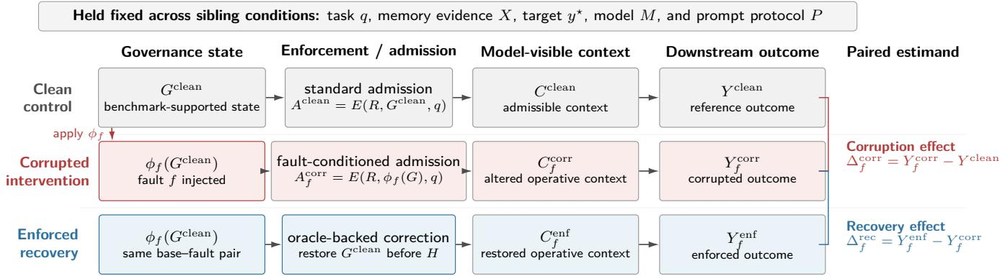

# Governance-State Corruption in Long-Term Memory for LLM Agents: A Cross-Model Stress Test

Bowen Liua,∗ Youting Wangb Bonan Shenc Dingyan Shangd

aIndependent Researcher, South San Francisco, CA, USA

bIndependent Researcher, Mountain View, CA, USA

cIndependent Researcher, Long Island City, NY, USA

dIndependent Researcher, Frisco, TX, USA

∗Corresponding author: Bowen Liu (chris3494285@gmail.com)

## Abstract

An LLM agent can retrieve a memory correctly yet use it incorrectly after its validity state changes. We study governance-state corruption: faults that alter which retained records enter model-visible context while stored content and tasks remain fixed. Across six providers, 731 benchmark-grounded bases yield 2,080 matched fault pairs. In ofline control-plane checks, corruption changes the operative projection in 96.25% of pairs, while oraclebacked enforcement restores it in 100%. For downstream evaluation, a deterministically selected, non-probability LongMemEval/Memora panel resolves 298 of 300 matched triplets (238 distinct bases). Clean-minus-corrupted contrasts are 40.54 percentage points in LongMemEval binary correctness (95% base-cluster interval [30.32, 50.71]) and 30.60 points in rescaled Memora FAMA ([23.31, 37.69]); both sources also show recovery. OAKS Novel native op tion parity holds for all 6,714 resolved outputs. Full-cohort frozen-scorer corruption/recovery efects (−27.55/ + 27.51 points) remain descriptive proxies, not validated native semantic population efects. These bounded findings motivate evaluating memory control-state integrity alongside retrieval accuracy.

Keywords: Large language model agents; Long-term memory; Memory governance; Control-state corruption; Reliability; Trustworthy AI

## 1 Introduction

Consider an assistant asked to list a user’s current weekly to-do items. In an audited Memora case, two relevant items, u and v, remain stored. With source-supported governance metadata, both enter model-visible context. When a missing-metadata fault excludes u, however, only v remains visible to the model, although the task and stored item content do not change. Oracle-backed restoration makes both items visible again. In existing sixprovider runs, frozen-proxy correctness follows a correct– incorrect–correct pattern. This case illustrates a controlplane failure; it does not establish native FAMA correctness independently (Section 4.5).

We separate stored evidence (the data plane) from lifecycle and validity state (the control plane) governing what enters the model’s context. Deletion, supersession, and temporal updates can invalidate retained evidence without altering its content. Our question is: How does an agent behave when retrieved memory content is held fixed but the state controlling its use is corrupted? Here, governance denotes benchmark-supported currentness and lifecycle validity; it does not always represent an explicit user authorization policy.

We create matched clean, corrupted, and enforced conditions for the same task, oracle, evidence, prompt, and model. Clean uses source-supported control state; corrupted injects a supported fault; enforced restores the source-supported state before context construction. Thus, enforcement tests an oracle-backed upper bound, not autonomous repair. We study the pathway G→A→C →Y (governance, admission, model-visible context, output) while measuring operative context directly rather than identifying each mediator separately.

Across LongMemEval (Wu et al., 2025), Memora (Uddin et al., 2026), and OAKS (Kim et al., 2026), 731 benchmark-grounded bases yield 2,080 supported fault pairs and 4,891 conditions, evaluated with six providers. An ofline audit finds projection changes in 96.25% of pairs and restoration in 100%. A separate, non-probability native-style Formal-300 validation resolves 298 Long-MemEval/Memora triplets (238 distinct bases): corruption reduces LongMemEval binary correctness by 40.54 points and Memora FAMA by 30.60 points, with recovery under both metrics. The full-panel −27.55/ + 27.51 point efects are frozen deterministic-scorer proxies, not validated population-native efects; OAKS has a separate resolved-option parity check.

Our research questions examine (RQ1) control-plane and downstream sensitivity, (RQ2) supported fault differences, (RQ3) event-associated diferences, and (RQ4) oracle-backed recovery and provider/source robustness. We contribute: (i) a governance-state corruption formulation distinct from retrieval or content errors; (ii) a matched sibling-intervention benchmark with explicit source–event– fault support; (iii) six-provider frozen-proxy results and source-specific native-style validation with dependenceaware resampling; and (iv) audited context propagation and bounded recovery evidence. We explicitly separate source-confounded descriptive contrasts from supported intervention claims.

## 2 Related Work

Long-term agent memory. MemGPT introduced virtual-context management for persistent agents (Packer et al., 2023); Mem0, A-Mem, and LangMem develop extraction, organization, consolidation, and retrieval mechanisms (Chhikara et al., 2025; Xu et al., 2025; LangChain, 2025). LongMemEval and its successor evaluate retention, multi-session reasoning, updates, and abstention (Wu et al., 2025, 2026). These systems and benchmarks mainly ask whether an agent retains or retrieves the right evidence. That is necessary but insuficient: a retrieved item may be authentic evidence of an earlier state while no longer being valid as the current answer. We evaluate this distinction without modifying the content retrieved from the frozen benchmark.

Governance, forgetting, and temporal validity. GateMem studies shared-memory access control and active forgetting; Memora evaluates deletion and updateaware memory through forgetting-sensitive criteria (Ren et al., 2026; Uddin et al., 2026). Safety-governed memory and MemGuard propose verification, lifecycle signals, and controlled admission (Lam et al., 2026; Wang et al., 2026). MemConflict distinguishes temporal validity, factual correctness, and contextual applicability (Tao et al., 2026). These works motivate explicit control state but difer from our paired state-corruption stress test, which fixes task and stored evidence and changes the state selecting what becomes operative. In particular, Memora’s FAMA evaluates memory-presence and forgetting-absence criteria, while our full-panel frozen scorer is a Boolean proxy. This makes scoring correspondence part of the empirical question rather than an assumption. Our independent native-style subset is explicitly limited to cases where the corresponding source-specific evaluation can be carried out.

Control-plane foundations. Complete mediation and fail-safe defaults require trustworthy authorization checks (Saltzer and Schroeder, 1975); Usage Control (UCON) treats access-related attributes and decisions as mutable (Park and Sandhu, 2004). We adapt this controlstate perspective to agent memory as a $G  A  C  Y$ pipeline. This lineage motivates a measurable boundary between lifecycle state, admission, and the resulting context, rather than assuming the language model can repair invalid evidence after receiving it. Our work neither introduces a new access-control model nor demonstrates autonomous recovery: it measures projection integrity, scorer-dependent behavioral degradation, and restoration when benchmark-supported control state is provided. Unlike an end-to-end compliance benchmark, it deliberately leaves the original memory evidence and task fixed, making the control-plane transformation inspectable; it does not make event types or benchmark datasets causally interchangeable.

## 3 Problem Formulation

We distinguish retained memory evidence from the governance state that determines whether it can enter modelvisible context.

## 3.1 Memory Content and Governance State

Let a benchmark base example be

$$
{ \boldsymbol { b } } = ( q , X , y ^ { \star } ) ,
$$

where $q$ is the downstream query or task, X denotes the benchmark-native memory evidence associated with that task, and $y ^ { \star }$ is the benchmark-supported scoring target.

We represent an individual memory item as

$$
m = ( x , g ) ,
$$

where $x$ is the underlying content and $g$ is governance state associated with its use. Governance state is sourcedependent: it may encode whether a memory is current, active, superseded, deleted, or otherwise admissible for the present task.

For a collection of retrieved memory items $R \subseteq X$ , let

$$
G = \{ g _ { m } : m \in R \}
$$

denote the corresponding governance state.

A retrieved item can therefore be factually accurate yet invalid to use.

## 3.2 Governance-State Corruption

Let Gclean denote the benchmark-supported governance state. A fault operator $f$ transforms it into

$$
G _ { f } ^ { \mathrm { c o r r } } = \phi _ { f } \left( G ^ { \mathrm { c l e a n } } \right) ,
$$

while leaving the underlying benchmark task $( q , X , y ^ { \star } )$ unchanged.

We study four recurring fault operators:

• Missing: governance information needed to determine admissibility or currentness is removed.

• Stale: a superseded or expired state is made operative.

• Flipped: a benchmark-supported governance decision or state is inverted.

• Conflicting: incompatible governance states are made simultaneously operative without preserving the benchmark-supported winner.

The concrete realization of each operator is source- and event-dependent: a stale version in ordered narrative evidence is not an authorization revocation, and a deletion state in Memora has diferent native semantics. We instantiate interventions only when benchmark-native evidence identifies both the clean state and its supported corrupted projection. No generic policy ontology is imposed across the three benchmarks.

Importantly, $\phi _ { f }$ is a control-state intervention rather than a content corruption:

$$
X ^ { \mathrm { c o r r } } = X ^ { \mathrm { c l e a n } } = X .
$$

## 3.3 Four-Stage Control Pipeline

We model downstream execution as

$$
G  A  C  Y ,
$$

where $G$ is governance state, A is the enforcement or admission decision, C is model-visible context, and $Y$ is downstream behavior.

More explicitly,

$$
A = E ( R , G , q ) ,
$$

$$
C = H ( R , A , q ) ,
$$

and

$$
Y = M ( q , C ) ,
$$

where $E$ denotes enforcement, H constructs the modelvisible context, and M is the downstream language model.

We observe operative context changes, not every arrow as a separately identified statistical mediator.

Figure 1 shows the three siblings. Enforcement measures recoverability when the correct control state is supplied.

## 3.4 Controlled Sibling Intervention

For each eligible base example, we construct clean, corrupted, and enforced siblings.

For the enforced sibling, we define

$$
G _ { f } ^ { \mathrm { e n f } } = G ^ { \mathrm { c l e a n } } ,
$$

where restoration is performed using the benchmark supported governance state identified during cohort construction. The same base–fault pair and corruption specification are retained so that recovery remains paired to the corresponding corruption intervention.

Across siblings, we hold fixed

$$
( q , X , { y } ^ { \star } , M , P ) ,
$$

where $P$ denotes the frozen prompt protocol.

The paired contrasts are:

$$
Y _ { f } ^ { \mathrm { c o r r } } - Y ^ { \mathrm { c l e a n } }
$$

for corruption sensitivity, and

$$
Y _ { f } ^ { \mathrm { e n f } } - Y _ { f } ^ { \mathrm { c o r r } }
$$

for oracle-backed recovery.

The exact correctness-based estimands are defined in Section 4.

## 3.5 Scope of the Causal Claim

Causal sensitivity refers only to these fixed-input sibling interventions. Oracle-backed enforcement does not show autonomous state reconstruction, deployed fault prevalence, or downstream harm, and a fault need not propagate to an output error.

## 4 Method

We instantiate the control-plane formulation as a frozen intervention benchmark designed to isolate the efect of governance-state corruption from variation in task content, oracle, prompt, or model identity.

## 4.1 Benchmark Sources and Native Governance Evidence

We construct the main cohort from LongMemEval, Memora, and OAKS, retaining only examples whose sourcenative evidence identifies both a benchmark-supported operative state and a corresponding governance intervention.

LongMemEval. LongMemEval (Wu et al., 2025) contributes long-horizon conversational examples in which benchmark history distinguishes current from superseded state, supporting temporal-state and update interventions.

Memora. Memora (Uddin et al., 2026) contributes personalized memory examples with source-native deletion, invalidation, preference, and update signals.

OAKS. OAKS (Online Adaptation to Continual Knowledge Streams) (Kim et al., 2026) evaluates online adaptation under continually evolving knowledge. We use OAKS-Novel, constructed from 19 public-domain novels as ordered knowledge streams whose answers may change with new evidence. It supports temporal-state and update interventions; each base has one analysis event label. Across all sources, questions and reference targets come from the source benchmark, not synthetic question generation.

LongMemEval uses ordered conversational evidence of current versus superseded facts; Memora supplies deletion and invalidation signals; OAKS Novel supplies ordered narrative answer-state evidence. These operationalize source-native validity, not a shared consent or authorization ontology.

  
Figure 1: Control-plane intervention design. The underlying benchmark task and memory evidence are held fixed. The clean condition uses benchmark-supported governance state; the corrupted condition injects a governance-state fault that can alter model-visible context; and the enforced condition uses the same base–fault pair but restores the benchmark-supported governance projection before context construction. The enforced path is an oracle-backed mediation condition used to measure recoverability, not an autonomous deployment-time repair algorithm.

Table 1: Frozen source × event × fault support. Fault counts denote pairs, not distinct bases; dashes are unsupported operators. Event and source are not independently crossed.
<table><tr><td>Source</td><td>Event</td><td>Bases Miss. Stale Flip. Conf.</td><td></td><td></td><td></td><td></td></tr><tr><td>LongMemEval Temporal</td><td></td><td>113</td><td>113</td><td>113</td><td></td><td></td></tr><tr><td>LongMemEval Update</td><td></td><td>78</td><td>78</td><td>78</td><td></td><td>78</td></tr><tr><td>Memora</td><td>Deletion</td><td>380</td><td>380</td><td></td><td>380</td><td>380</td></tr><tr><td>OAKS Novel</td><td>Temporal</td><td>56</td><td>56</td><td>56</td><td>一</td><td>56</td></tr><tr><td>OAKS Novel</td><td>Update</td><td>104</td><td>104</td><td>104</td><td>一</td><td>104</td></tr><tr><td>Total</td><td></td><td>731</td><td>731</td><td>351</td><td>380</td><td>618</td></tr></table>

## 4.2 Frozen Main Cohort

All eligibility decisions and intervention manifests were frozen before the formal cross-provider runs.

The 731-base manifest contains 380 deletion, 169 temporal, and 182 update examples, yielding 4,891 conditions: 731 clean, 2,080 corrupted, and 2,080 enforced. All 380 deletion bases come from Memora, so deletion-versusother-event contrasts also compare diferent datasets and evaluation targets. Balanced event sampling does not remove this source–event confounding.

Source-specific condition totals are 1,111 (Long-MemEval), 2,660 (Memora), and 1,120 (OAKS); event totals are 2,660 deletion, 957 temporal, and 1,274 update conditions. These are condition counts, not distinct bases.

Table 1 contains 14 populated source–event–fault cells across five observed source–event strata; four source–event combinations are absent and six further fault cells are structurally inapplicable. Exactly 618 bases support three faults and 113 LongMemEval temporal bases two, giving $6 1 8 \times 3 + 1 1 3 \times 2 = 2 , 0 8 0$ pairs and $7 3 1 + 2 ( 2 , 0 8 0 ) = 4 , 8 9 1$ conditions. Fault columns repeat bases; their counts must not be interpreted as distinct examples. Deletion coincides with Memora, while temporal and update have diferent source mixtures; neither event balancing nor this table removes confounding.

The condition manifest is identical across all formal model runs; provider execution never changes example eligibility, fault assignment, event assignment, or scoring targets.

## 4.3 Governance Fault Operators

Missing, stale, flipped, and conflicting operators are deterministic source-grounded state projections (Section 3). Across the corrupted and enforced conditions, they account for 1,462 missing, 702 stale, 760 flipped, and 1,236 conflicting rows. Source-native support is intentionally unequal; no downstream outputs determine eligibility or fault assignment.

## 4.4 Condition Construction and Oracle-Backed Enforcement

We instantiate the clean, corrupted, and enforced siblings defined in Section 3.4 from the frozen manifest. Clean exposes the benchmark-supported projection; corrupted applies a supported fault; enforced begins from the same base–fault pair and restores the benchmark-supported projection before context construction.

The enforcement transformation is deterministic and operator-matched. A missing-state corruption is corrected using the supported governance fields that were omitted; a stale corruption restores the supported current state; a flipped corruption restores the benchmark-supported decision or state; and a conflicting corruption resolves the projection to the benchmark-supported operative state. We do not use the downstream answer produced by the model to perform this correction.

No downstream answer is used for correction; model, task, evidence, oracle, prompt, and inference settings are identical across siblings.

## 4.5 Case Trace: Missing Governance Metadata

To make the intervention concrete, Table 2 gives a contentabstracted trace of a previously selected Memora weeklytodo case in our ofline paper-evidence audit. The fixed benchmark task asks for current to-do items; we denote the two task items by u and v instead of reprinting benchmark-derived text. The task, underlying evidence, reference answer, and model configuration do not change across siblings. The missing operator removes required governance metadata for u, changing the operative projection from two items to one. Oracle-backed enforcement restores that metadata and the two-item projection.

The case-trace audit verifies the two–one–two context pattern. A separate, read-only v2–v3 comparison confirmed identical case content, corruption and restoration, and six-provider correct–incorrect–correct frozen-proxy labels without new calls. Per-case source text and responses remain private; the example does not establish native-style validity.

## 4.6 Downstream Outcome and Paired Effects

The full-panel downstream outcome is a frozen, sourceaware deterministic correctness proxy, scored on generated responses; it is not the benchmark-native semantic evaluator. In particular, the Memora proxy checks extracted content facts as a Boolean decision, whereas native Memora uses per-question memory-presence and forgetting-absence criteria (FAMA). The full-panel proxy and native Memora score must not be interpreted as the same measurement unit.

For base example i, fault $f ,$ and model $m ,$ let

$$
S _ { i , m } ^ { \mathrm { c l e a n } } , \quad S _ { i , f , m } ^ { \mathrm { c o r r } } , \quad S _ { i , f , m } ^ { \mathrm { e n f } } \in \{ 0 , 1 \}
$$

denote the binary frozen-scorer decision in the three sibling conditions.

All full-panel contrasts below use the same frozen proxy, so pairing controls input diferences but does not by itself remove scorer bias. We define

$$
\Delta _ { i , f , m } ^ { \mathrm { c o r r } } = S _ { i , f , m } ^ { \mathrm { c o r r } } - S _ { i , m } ^ { \mathrm { c l e a n } } ,
$$

and

$$
\Delta _ { i , f , m } ^ { \mathrm { r e c } } = S _ { i , f , m } ^ { \mathrm { e n f } } - S _ { i , f , m } ^ { \mathrm { c o r r } } .
$$

A negative corruption contrast denotes a lower frozen proxy score under corrupted state; a positive recovery contrast denotes a higher proxy score under oracle-backed enforcement.

## 4.7 Primary and Secondary Estimands

Because event categories difer in size and not every base supports the same number of faults, our primary proxyscore estimand gives equal weight to each base within an event, followed by equal weight to the three events. Let $\boldsymbol { B _ { e } }$ be the set of bases assigned event $e ,$ and ${ \mathcal { F } } _ { i }$ the supported fault operators for base i. For provider $m$ , we first compute

$$
\bar { \Delta } _ { i , m } ^ { \mathrm { c o r r } } = \frac { 1 } { | \mathcal { F } _ { i } | } \sum _ { f \in \mathcal { F } _ { i } } \Delta _ { i , f , m } ^ { \mathrm { c o r r } } ,
$$

then the base-equal event mean

$$
\bar { \Delta } _ { e , m } ^ { \mathrm { c o r r } } = \frac { 1 } { \left| \mathcal { B } _ { e } \right| } \sum _ { i \in \mathcal { B } _ { e } } \bar { \Delta } _ { i , m } ^ { \mathrm { c o r r } } ,
$$

for $e \in \{ \mathrm { d e l e t i o n }$ , temporal, update}. The reported event macro is

$$
\Delta _ { \mathrm { m a c r o } , m } ^ { \mathrm { c o r r } } = \frac { 1 } { 3 } \sum _ { e } \bar { \Delta } _ { e , m } ^ { \mathrm { c o r r } } ,
$$

with recovery defined by the identical three-stage aggregation. The bootstrap resamples bases within events, preserving within-base fault pairs, and then averages the three event means.

This difers from an unweighted fault-pair event average, where bases with three supported faults receive more weight than bases with two. The distinction matters only for the temporal event: 113 LongMemEval bases support two faults, while 56 OAKS Novel bases support three (169 temporal bases but 394 fault pairs). Deletion and update each have three supported faults per base, so the two event summaries coincide for those events. Table 7 reports the base-equal event means from which the primary macro can be reconstructed. Original fault-pair-weighted event summaries are retained in the aggregate audit artifacts for transparency. Other source/fault descriptive breakdowns may use their declared pair-level estimands rather than this event macro. Providers are not treated as independent statistical replicates.

## 4.8 Governance-Evidence Audit

The provider-independent audit (scripts/audit governance evidence.py) checks frozen manifest provenance and clean-state support: ordered current-state evidence for LongMemEval, memory/forgetting fields for Memora, and document/chunk/answer order for OAKS. It verifies task–oracle links, source locators, operator-support rationales, and sibling structure without reading model outputs. The 731/731 pass rate therefore measures deterministic schema/provenance consistency. Because the audit uses the same frozen construction manifests, oracle states, and support declarations, it checks traceability and internal consistency rather than independently establishing the semantic correctness of those source interpretations. Licensed source text is excluded from the aggregate-only release.

<table><tr><td>Pipeline stage</td><td>Clean</td><td>Corrupted: missing</td><td>Enforced</td></tr><tr><td>G: governance state</td><td>Required source-supported control fields present</td><td>Required metadata for item u omit- ted</td><td>Benchmark-supported fields re- stored</td></tr><tr><td>A: admitted memory C: model-visible mem- [u, v] ory</td><td>Two items:  $u , v$ </td><td>Only item v [v]</td><td>Two items:  $u , v$  [u, v]</td></tr><tr><td>proxy correctness</td><td>Y: downstream frozen- Six of six providers correct</td><td>Six of six providers incorrect</td><td>Six of six providers correct</td></tr></table>

Table 2: De-identified audited Memora case trace (existing frozen outputs). $u , v$ replace licensed to-do text; Y is six-provider frozen-proxy correctness, not native FAMA. Per-case evidence is private; the audit is in scripts/audit paper evidence counts.py.

## 4.9 Models and Inference Protocol

We use DeepSeek V4 Pro, GPT-5.6 Sol, Claude Sonnet 5, Gemini 3 Flash, Kimi K2.6 no-thinking, and Grok 4.3 no-reasoning, holding each provider’s inference configu ration and source/task-class output budget fixed across siblings. Condition labels are hidden; provider transport is normalized before scoring.

Prompt and parameter provenance. All providers share render prompt in scripts/run final main smoke deepseek.py: the model is told to use only supplied context, avoid unsupported facts, and return a JSON answer string. Requests include the task query and admitted context; multiple-choice tasks provide labeled options. The public repo includes rendering code, provider adapters, defaults, and token-budget configs, not licensed instantiated prompts or complete per-request traces. For example, Kimi no-thinking uses temperature 0.6/top-p 0.95; Grok sets reasoning effort=none without unsupported sampling controls. API-side revisions, timestamps, and retry histories cannot be independently reconstructed from shipped aggregates.

## 4.10 Scoring and Failure Handling

Full-panel scoring is deterministic, but its independent semantic validity is source dependent. In a separate scorervalidity check of the frozen scorer against separately generated native-style reference judgments, LongMemEval agrees on 60/96 answers (62.50%, Cohen’s κ = 0.259). Memora’s 508 reference units are atomic criteria spanning 42 answers, whereas the frozen scorer assigns one Boolean per answer; no defensible same-unit agreement estimate exists for Memora. The unaligned pooled 604-unit percentage is therefore not an interpretable scorer-validity measure. We retain the original frozen results as proxyscore efects, without treating them as validated full-panel semantic accuracy. OAKS has a separate native optionparity comparison, described next.

After configured retries, genuine final provider or parse failures are retained and scored as zero in the primary analysis. A complete-case analysis is used as a sensitivity check.

Systematic truncation caused by insuficient outputtoken budget is treated as a measurement artifact rather than model failure. Afected rows are rerun under a documented larger budget and merged into the formal artifact before analysis.

## 4.11 Complementary Native-Style Validation and Sampling

Formal-300 evaluates existing answers with the frozen final-native-evaluation-v2 protocol. A seed-keyed greedy stratification (seed 20261010) selects 25 complete answer triplets per provider–source cell for six providers and two sources (LongMemEval, Memora): 300 matched triplets. The full panel contains 12,480 provider–fault pairs, which have diferent counting units and do not define a comparable sampling percentage. Selection is nonprobabilistic; the 300 triplets contain 239 distinct bases. Two LongMemEval conflicting-fault blocks are unresolved, leaving 298 complete triplets, 238 bases, and 894 analyzed observations. Of 898 individually resolved observations, no incomplete triplet is used; one recorded blinded human adjudication is reflected in the final version.

LongMemEval uses answer-level correctness/abstention judgments and blinded semantic judging where necessary (native-style, not the exact upstream harness); Memora aggregates native atomic presence/forgetting criteria into FAMA. These diferent outcome units are shown separately. Combined block-weighted point diferences merely summarize two scaled measures, not native accuracy or population efect. OAKS is absent from this panel and instead has a deterministic native option check (6,714 resolved and concordant of 6,720; six ambiguous/unscored).

Subgroup uncertainty. We preserve the 10,000- resample paired-block percentile bootstrap and add a 10,000-resample (seed 20261010) base-cluster bootstrap within source, retaining shared-provider blocks and sibling triplets. These intervals describe stability within this selected non-probability panel, not population precision. Provider–source subsets of 24–25 blocks cannot establish model rankings.

## 4.12 Statistical Analysis

Uncertainty is estimated using paired bootstrap resampling over base examples with seed 42. Sibling conditions from the same base remain grouped during resampling. We report two-sided 95% bootstrap confidence intervals for the primary corruption and recovery efects.

We perform three robustness analyses.

Balanced event support. A balanced cohort contains 169 bases from each event category (507 total).

OAKS document clustering. Because multiple OAKS examples can originate from the same document, we repeat the source-level analysis using document-level clustered resampling.

Leave-one-document-out analysis. We recompute the OAKS efect while omitting each source document in turn.

These robustness analyses are secondary to the frozen primary event-macro estimand and are not used to redefine the main cohort after formal model execution.

## 4.13 Ofline Control-Plane Propagation Diagnostic

For the 2,080 supported base–fault pairs, we compare clean, corrupted, and enforced ordered model-visible projections $C _ { i , f } ^ { s }$ . For base i and fault $f ,$ we define projectionchange and restoration indicators

$$
Z _ { i , f } ^ { \mathrm { c h g } } = \mathbb { I } \left[ C _ { i , f } ^ { \mathrm { c o r r } } \neq C _ { i , f } ^ { \mathrm { c l e a n } } \right] , \qquad Z _ { i , f } ^ { \mathrm { r e s t } } = \mathbb { I } \left[ C _ { i , f } ^ { \mathrm { e n f } } = C _ { i , f } ^ { \mathrm { c l e a n } } \right] .
$$

Projection-change and restoration rates are computed over the 2,080 unique base–fault pairs rather than over provider-replicated rows.

We stratify the existing paired corruption contrast by projection change,

$$
\mathbb { E } \left[ \Delta _ { i , f , m } ^ { \mathrm { c o r r } } \mid Z _ { i , f } ^ { \mathrm { c h g } } = 1 \right] \quad \mathrm { v e r s u s } \quad \mathbb { E } \left[ \Delta _ { i , f , m } ^ { \mathrm { c o r r } } \mid Z _ { i , f } ^ { \mathrm { c h g } } = 0 \right] ,
$$

and report induced-failure and recovery rates among clean-correct, projection-changed cases. These are descriptive provider-level diagnostics. A separate admissiondecision artifact was not persisted, so this analysis tests the admitted/model-visible boundary rather than independently identifying admission and context as separate mediators.

## 4.14 Matched-Support Fault Analysis

Because fault operators have diferent native support sets, we compare them on bases supporting both interventions.

For provider $m ,$ , base example i, and faults $f _ { 1 }$ and $f _ { 2 }$ we compute

$$
D _ { i , m } ( f _ { 1 } , f _ { 2 } ) = \Delta _ { i , f _ { 1 } , m } ^ { \mathrm { c o r r } } - \Delta _ { i , f _ { 2 } , m } ^ { \mathrm { c o r r } } .
$$

Negative values indicate greater degradation under $f _ { 1 }$ The cohort contains 351 stale–missing and 238 stale– conflicting matched bases, but no stale–flipped overlap. We report provider-specific mean paired diferences and 95% paired-bootstrap intervals over matched base IDs (seed 42).

## 4.15 Governance-Evidence Audit

All 731 selected bases pass the frozen schema/provenance audit (191 LongMemEval, 380 Memora, 160 OAKS), with zero schema-flagged unsupported or provenancemissing bases. These rule-based consistency checks use the frozen construction evidence and support declarations (Section 4.8).

## 5 Results

We first report the native-style validation panel, then the frozen deterministic-scorer panel. Both evaluate matched governance interventions, but they difer in sampling, outcome units, and estimands. Unless otherwise noted, RQ1–RQ4 and the remaining full-panel analyses use frozen proxy-score contrasts, not benchmark-native semantic accuracy. Their bootstrap intervals describe sampling variation under that proxy, not uncertainty caused by scoring mismatch.

## 5.1 Native-Style Behavioral Validation on a Selected Panel

The fixed Formal-300 protocol selected 300 matched triplets from LongMemEval and Memora across all six providers (25 blocks per provider–source cell). The finalized native-style evaluation, including one blinded human adjudication, resolves 298/300 triplets (238 distinct bases); two unresolved triplets are excluded. Sourcespecific results are reported first in Table 3. Long-MemEval $( n = 1 4 8$ , binary correctness) has a +40.54- point clean-minus-corrupted contrast and +39.19-point enforced-minus-corrupted recovery. Memora (n = 150, native continuous FAMA) has corresponding +30.60-point damage and +26.24-point recovery. The 95% base-cluster resampling intervals for damage are [30.32, 50.71] and [23.31, 37.69] points, respectively; both sources show the same direction under their own native-style score units.

The mixed-unit, equal-block-weight descriptive combined scores are 0.6903, 0.3349, and 0.6617 for clean, corrupted, and enforced. Their clean-minus-corrupted diference is +35.54 points (original paired-block 95% interval [29.78, 41.12]; base-cluster interval [29.40, 41.90]), and the enforced-minus-corrupted diference is +32.67 points (original [26.94, 38.36]; base-cluster [26.42, 39.09]). These pooled values are a descriptive average of two diferent metrics, not one benchmark-native accuracy. One observation required recorded human adjudication;

Table 3: Final Formal-300 native-style results on 298 resolved triplets. Damage is clean minus corrupted; recovery is enforced minus corrupted, scaled to points. LongMemEval is binary; Memora is continuous FAMA. Brackets: descriptive 95% base-cluster bootstrap intervals (10,000 resamples; seed 20261010) on this selected panel.
<table><tr><td>Source / unit</td><td>Triplets</td><td>Bases</td><td>Clean</td><td>Corrupted</td><td></td><td>Enforced Damage [95% interval]</td><td></td><td>Recovery [95% interval]</td></tr><tr><td>LongMemEval / binary</td><td>148</td><td>105</td><td>.709</td><td>.304</td><td></td><td>.696 +40.54 [30.32, 50.71]</td><td></td><td>+39.19 [28.85, 49.66]</td></tr><tr><td>Memora / FAMA Combined descriptive index</td><td>150</td><td>133</td><td>.671</td><td>.365</td><td></td><td>.628 +30.60 [23.31, 37.69]</td><td></td><td>+26.24 [19.09, 33.34]</td></tr><tr><td>(mixed metrics)</td><td>298</td><td>238</td><td>.690</td><td>.335</td><td></td><td>.662 +35.54 [29.40, 41.90]</td><td></td><td>+32.67 [26.42, 39.09]</td></tr></table>

the older aggregate-only pre-adjudication analysis resolved 297 triplets and reported +35.66 points. The final 298-triplet analysis uses 894 observations from com plete triplets rather than all 898 individually resolved observations.

Across the six generating-provider subsets, the nativestyle damage and recovery contrasts are positive (Table 4). Each provider contributes only 49–50 triplets; base content is shared across some providers, and source units difer. The base-cluster bootstrap makes the pooled intervals modestly wider but does not reverse their direction. Provider–source cells are particularly limited: DeepSeek– Memora (+2.22 damage, interval [−10.73, 15.12]) and Grok–Memora (+12.54, [−3.89, 29.14]) have intervals spanning zero. Accordingly, these estimates do not support claims of provider superiority or uniformly stable behavior in every provider–source cell.

Recovery does not always regain clean performance. Memora’s enforced-minus-clean residual is −4.35 points (base-cluster interval [−8.29, −0.66]); LongMemEval’s is −1.35 points ([−5.88, 3.29]). The separate native-style panel is a deterministically stratified, non-probability selection with no OAKS cases; its resampling intervals are descriptive of this panel, not population confidence statements. It neither estimates nor calibrates the full-panel −27.55-point proxy efect, whose magnitude difers by roughly eight points and uses another scorer and weighting scheme.

## 5.2 Independent Scorer-Validity and OAKS Option Checks

A separate scorer-validity audit compares frozen deterministic decisions against native-style reference judgments. The same-unit LongMemEval result is 60/96 agreeing answer-level decisions (62.50%, Cohen’s κ = 0.259), with known paraphrase and abstention disagreements. For Memora, 508 atomic criteria cover only 42 answers and cannot be compared as 508 independent Boolean decisions; neither their raw agreement nor a 604-unit pooled rate is valid answer-level calibration. The full-panel LongMemEval/Memora score magnitudes remain proxydependent.

OAKS Novel uses a native deterministic optioncomparison rule. On 6,720 OAKS response rows, 6,714 are resolved and all 6,714 agree with the native comparator;

the remaining six are ambiguous and excluded from the agreement denominator. OAKS option-score parity is thus independently checked for the resolved rows. This does not turn the combined full-panel LME/Memora/OAKS event macro into a validated common semantic outcome.

## 5.3 RQ1: Negative Corruption Efects under the Frozen Scorer

Under the frozen proxy scorer, the corruption contrast is negative for every provider in the six-provider panel. These are historical measured contrasts, not six independently validated semantic-correctness estimates.

The primary event-macro corruption efect ranges from −31.88 percentage points for Gemini 3 Flash to −18.47 points for Grok 4.3. The descriptive six-provider mean is

## −27.55 percentage points.

All six provider-level frozen-proxy intervals exclude zero.

The direction is consistent across providers for this fixed scoring rule. The native-style panel measures a separate selected subset and does not calibrate this six-provider table.

## 5.4 RQ2: Fault Semantics Are Associated with Diferent Severities

Observed degradation varies substantially by fault semantics. Among the benchmark-supported instances for each operator, stale corruption has the largest negative efect for every provider, ranging from −32.19 to −58.40 points. Conflicting faults have the smallest observed degradation across the panel, while flipped and missing faults occupy an intermediate regime.

Because the benchmark does not support every fault operator on the same set of base examples, these values should not be interpreted as a randomized head-to-head comparison among fault classes. The stable ordering nevertheless shows that the evaluated stale-state interventions are associated with particularly large downstream degradation across all six providers.

To reduce the possibility that this pattern is explained by diferences in fault-support composition, we repeat the stale comparisons on matched bases. Across the 351 bases supporting both stale and missing faults, stale produces an additional 12.25–13.68 percentage-point degradation across the six providers, with every provider-specific paired-bootstrap 95% confidence interval strictly below zero.

Table 4: Selected Formal-300 provider-level damage and recovery. Brackets: descriptive 95% base-cluster intervals; each row averages LongMemEval binary and Memora FAMA diferences, not a shared native-accuracy metric. Cells are too small for provider rankings.
<table><tr><td>Generating provider</td><td>Triplets</td><td>LME Memora</td><td>Damage [95% interval]</td><td></td><td>Recovery [95% interval]</td></tr><tr><td>GPT-5.6 Sol</td><td>50</td><td>25 / 25</td><td>+51.13 [38.02, 64.07]</td><td></td><td>+50.03 [36.52, 63.32]</td></tr><tr><td>Claude Sonnet 5</td><td>50</td><td>25 / 25</td><td>+50.60 [36.96, 64.07]</td><td></td><td>+40.38 [26.48, 54.52]</td></tr><tr><td>DeepSeek V4 Pro</td><td>49</td><td>24 / 25</td><td>+17.46 [6.25, 29.23]</td><td></td><td>+19.94 [8.87, 31.68]</td></tr><tr><td>Gemini 3 Flash</td><td>49</td><td>24/ 25</td><td>+44.04 [29.68, 58.09]</td><td></td><td>+41.52 [26.06, 56.19]</td></tr><tr><td>Kimi K2.6</td><td>50</td><td>25 / 25</td><td>+31.53 [18.78, 44.37]</td><td></td><td>+26.11 [13.96, 38.64]</td></tr><tr><td>Grok 4.3</td><td>50</td><td>25 / 25</td><td>+18.27 [3.78, 32.55]</td><td></td><td>+17.97 [5.34, 31.05]</td></tr></table>

Table 5: Six-provider frozen deterministic-scorer results (not independently validated native semantic accuracy). Clean, corrupted, and enforced columns report overall condition-level proxy-score rates (%). Corruption and recovery columns use base-equal fault averaging within each event, followed by equal weighting of the three event means (Table 7); values are percentage points; brackets denote 95% paired-bootstrap confidence intervals. Because the accuracy columns and efect columns use diferent aggregation schemes, their arithmetic diferences need not equal the reported macro efects.
<table><tr><td>Model</td><td>Clean</td><td>Corrupted</td><td>Enforced</td><td colspan="2">Corruption macro</td><td colspan="2">Recovery macro</td></tr><tr><td>DeepSeek V4 Pro</td><td>45.96</td><td>19.47</td><td>47.07</td><td></td><td>-28.05 [-31.30, -24.82]</td><td></td><td>+28.10 [24.97, 31.21]</td></tr><tr><td>GPT-5.6 Sol</td><td>43.23</td><td>17.02</td><td>43.51</td><td>-31.10</td><td>[-34.11, -28.09]</td><td></td><td>+31.11 [28.15, 34.07]</td></tr><tr><td>Claude Sonnet 5</td><td>43.23</td><td>18.03</td><td>43.85</td><td>-28.19</td><td>[-31.30, -25.02]</td><td></td><td>+28.36 [25.51, 31.23]</td></tr><tr><td>Gemini 3 Flash</td><td>43.78</td><td>16.35</td><td>44.13</td><td>-31.88</td><td>[-35.00, -28.75]</td><td></td><td>+31.29 [28.21, 34.36]</td></tr><tr><td>Kimi K2.6 no-thinking</td><td>42.95</td><td>19.23</td><td>45.29</td><td>-27.63</td><td>[-30.78, -24.46]</td><td></td><td>+28.59 [25.75, 31.42]</td></tr><tr><td>Grok 4.3 no-reasoning</td><td>28.59</td><td>12.02</td><td>28.56</td><td>-18.47</td><td>[−21.82, −15.14]</td><td></td><td>+17.58 [14.65, 20.54]</td></tr></table>

Across the 238 bases supporting both stale and conflicting faults, stale produces an additional 31.09–62.61 points of degradation, again with every provider-specific confidence interval below zero. The frozen cohort contains no base supporting both stale and flipped faults, so that comparison cannot be estimated on common support.

Thus, a larger proxy-score stale efect persists relative to missing and conflicting on the matched support. This does not establish a universal fault-severity order; stale versus flipped is not identified.

## 5.5 RQ3: Sensitivity Varies by Governance Event

The event means exactly reconstruct the main macro: for DeepSeek, $( - 2 3 . 2 5 - 2 4 . 6 5 - 3 6 . 2 6 ) / 3 = - 2 8 . 0 5$ points. Its historical pair-weighted temporal estimate was −28.93, because 113 LongMemEval temporal bases contribute two faults and 56 OAKS bases three. All-provider reconciliation and original pair-weighted values remain in the supplemental audit. Deletion equals Memora in this cohort and cannot identify an event efect separately from source/task/scoring diferences.

## 5.6 RQ4: Oracle-Backed Enforcement Recovers Most of the Lost Performance

Under the frozen proxy scorer, the controlled enforced condition ofsets most of the measured corruption-associated score drop for every provider.

The event-macro recovery efect ranges from +17.58 points for Grok 4.3 to +31.29 points for Gemini 3 Flash. The descriptive six-provider mean is

## +27.51 percentage points.

Every provider-specific 95% bootstrap confidence interval lies strictly above zero.

For all six providers, enforced condition-level accuracy lies within approximately 2.4 percentage points of the corresponding clean accuracy. Thus, after benchmarksupported restoration, the deterministic proxy score returns close to its clean baseline. The separate nativestyle Formal-300 assessment also shows recovery (+32.67 points, base-cluster 95% interval [+26.42, +39.09]) on its selected two-source panel. Neither estimate establishes a population-level semantic recovery rate for the entire cohort.

These recovery efects measure the amount of degradation that is reversible under oracle-backed controlstate restoration. They do not measure the ability of a deployment-time system to discover the correct state autonomously.

Table 6: Observed frozen-scorer proxy efect by governance fault operator (points). Fault operators have diferent native support sets, so these estimates describe severity within the supported benchmark instances rather than a balanced causal comparison among fault classes.
<table><tr><td>Model</td><td>Conflicting</td><td>Flipped</td><td>Missing</td><td>Stale</td></tr><tr><td>DeepSeek V4 Pro</td><td>-5.50</td><td>-37.37</td><td>-33.11</td><td>-45.30</td></tr><tr><td>GPT-5.6 Sol</td><td>-8.41</td><td>-19.47</td><td>-30.23</td><td>-58.40</td></tr><tr><td>Claude Sonnet 5</td><td>-6.15</td><td>-27.11</td><td>-30.64</td><td>-49.29</td></tr><tr><td>Gemini 3 Flash</td><td>-8.25</td><td>-26.58</td><td>-32.56</td><td>-55.84</td></tr><tr><td>Kimi K2.6 no-thinking</td><td>-2.59</td><td>-26.58</td><td>-30.10</td><td>-50.71</td></tr><tr><td>Grok 4.3 no-reasoning</td><td>-5.83</td><td>-19.74</td><td>-19.43</td><td>-32.19</td></tr></table>

Table 7: Base-equal, event-associated frozen proxy-score corruption/recovery (in percentage points; corruption/recovery in each cell). Within each event, we first average the supported fault efects for each base, then weight bases equally. The three event columns therefore reproduce the primary event macro in Table 5 by an unweighted mean. Deletion coincides with Memora; these are descriptive, not source-adjusted causal contrasts.
<table><tr><td>Model</td><td>Deletion (380 bases)</td><td></td><td>Temporal (169 bases) Update (182 bases)</td></tr><tr><td>DeepSeek V4 Pro</td><td> $- 2 3 . 2 5 / + 2 2 . 6 3$ </td><td> $- 2 4 . 6 5 / + 2 5 . 0 5$ </td><td> $- 3 6 . 2 6 / + 3 6 . 6 3$ </td></tr><tr><td>GPT-5.6 Sol</td><td> $- 1 3 . 6 8 / + 1 3 . 5 1$ </td><td> $- 3 5 . 3 1 / + 3 5 . 5 0$ </td><td> $- 4 4 . 3 2 / + 4 4 . 3 2$ </td></tr><tr><td>Claude Sonnet 5</td><td> $- 1 7 . 3 7 / + 1 7 . 0 2$ </td><td> $- 2 6 . 5 3 / + 2 7 . 2 2$ </td><td> $- 4 0 . 6 6 / + 4 0 . 8 4$ </td></tr><tr><td>Gemini 3 Flash</td><td> $- 1 7 . 8 9 / + 1 7 . 7 2$ </td><td> $- 3 7 . 0 8 / + 3 5 . 5 0$ </td><td> $- 4 0 . 6 6 / + 4 0 . 6 6$ </td></tr><tr><td>Kimi K2.6 no-thinking</td><td> $- 1 3 . 8 6 / + 1 6 . 2 3$ </td><td> $- 2 3 . 9 6 / + 2 6 . 1 3$ </td><td> $- 4 5 . 0 5 / + 4 3 . 4 1$ </td></tr><tr><td>Grok 4.3 no-reasoning</td><td> $- 1 3 . 1 6 / + 1 1 . 6 7$ </td><td> $- 1 9 . 9 2 / + 1 8 . 5 4$ </td><td> $- 2 2 . 3 4 / + 2 2 . 5 3$ </td></tr></table>

## 5.7 Control-Plane Propagation Diagnostic

The ofline propagation diagnostic shows that large frozen proxy-score contrasts co-occur with changes to the operative model-visible projection.

Of the 2,080 supported base–fault pairs, 2,002 (96.25%) have

$$
C ^ { \mathrm { c o r r } } \ne C ^ { \mathrm { c l e a n } } ,
$$

while oracle-backed enforcement restores the clean operative projection in all 2,080 pairs (100%). These rates are computed over unique base–fault pairs; the same deterministic projection is used for all six providers.

Across providers, the descriptive mean paired corruption efect is −26.04 percentage points among pairs whose operative projection changes, compared with only −1.28 points among pairs whose projection remains unchanged.

The same pattern is visible when conditioning on cases that the model answers correctly under clean governance. Among clean-correct cases whose operative projection changes under corruption, 68.5%–76.9% become incorrect across the six providers. Among these corruption-induced failures, oracle-backed enforcement restores correctness in 71.9%–98.1% of cases.

The projection-change and projection-restoration counts are deterministic control-plane observations; the induced-failure and recovery fractions use the lessvalidated frozen answer proxy. Their conjunction is consistent with the proposed pathway but does not independently establish semantic outcome recovery or identify admission and context as separate mediators.

## 5.8 Cross-Provider, Source, and Support Robustness

The frozen proxy contrasts are negative under corruption and positive under oracle-backed restoration for all six providers, despite diferent proxy baselines. Stale has the largest unadjusted fault-associated proxy drop on each provider’s supported cases, while the smaller deletionassociated drop is inseparable from the Memora source. Grok 4.3 has a lower proxy baseline and smaller overall efect magnitude. These are cross-provider consistencies conditional on the same scoring rule, not independent semantic replication or evidence of a source-adjusted severity ranking.

Proxy efects remain negative for every provider on Memora and OAKS; Grok’s LongMemEval contrast instead reverses sign. OAKS has the largest source-specific observed efect for every provider; document-clustered and leave-one-document-out checks preserve that withinsource direction. A balanced set of 169 bases per event (507 total) retains the overall proxy contrast directions, but it cannot decouple event type from benchmark source.

## 5.9 Clean-Repeat Stochasticity Control

To assess baseline repeat-generation variability without manipulating governance state, we generated one additional response (Clean-B) for each of 60 frozen clean inputs (Clean-A), holding the provider configuration and evaluation criteria fixed. The paired sample contains 30 LongMemEval and 30 Memora blocks; the former uses binary correctness, whereas the latter uses native continuous FAMA. All 60 repeat responses were resolved with the frozen evaluator, using 88 planned judge requests, two protocol-triggered escalation judgments, and one ofline deterministic case.

Table 8: Ofline propagation diagnostic by provider. The two efect columns use frozen proxy-score corruption efects in percentage points, stratified by whether the operative model-visible projection changes. “Induced failure” is the percentage of clean-correct, projection-changed cases that become incorrect under corruption. “Recovered” is the percentage of those induced failures that return to correct under oracle-backed enforcement.
<table><tr><td>Model</td><td>Changed effect</td><td>Unchanged effect</td><td>Induced failure</td><td>Recovered</td></tr><tr><td>DeepSeek V4 Pro</td><td>-28.72</td><td>-2.56</td><td>68.48%</td><td>97.05%</td></tr><tr><td>GPT-5.6 Sol</td><td>-27.57</td><td>0.00</td><td>69.58%</td><td>98.14%</td></tr><tr><td>Claude Sonnet 5</td><td>-26.67</td><td>-5.13</td><td>71.58%</td><td>85.46%</td></tr><tr><td>Gemini 3 Flash</td><td>-29.32</td><td>+1.28</td><td>73.43%</td><td>95.19%</td></tr><tr><td>Kimi K2.6 no-thinking</td><td>-25.57</td><td>-3.85</td><td>69.91%</td><td>89.07%</td></tr><tr><td>Grok 4.3 no-reasoning</td><td>-18.38</td><td>+2.56</td><td>76.90%</td><td>71.89%</td></tr></table>

Table 9: Source-level frozen proxy-score corruption/oracle recovery (points). Each cell reports corruption/recovery. Source estimates are descriptive because benchmark composition difers across LongMemEval, Memora, and OAKS.
<table><tr><td>Model</td><td>LongMemEval</td><td>Memora</td><td>OAKS</td></tr><tr><td>DeepSeek V4 Pro</td><td> $- 1 3 . 2 6 / + 1 1 . 9 6$ </td><td> $- 2 3 . 2 5 / + 2 2 . 6 3$ </td><td> $- 5 2 . 2 9 / + 5 4 . 3 8$ </td></tr><tr><td>GPT-5.6 Sol</td><td> $- 2 3 . 9 1 / + 2 3 . 9 1$ </td><td> $- 1 3 . 6 8 / + 1 3 . 5 1$ </td><td> $- 5 9 . 5 8 / + 5 9 . 7 9$ </td></tr><tr><td>Claude Sonnet 5</td><td> $- 2 1 . 0 9 / + 2 1 . 0 9$ </td><td> $- 1 7 . 3 7 / + 1 7 . 0 2$ </td><td> $- 5 0 . 6 3 / + 5 1 . 2 5$ </td></tr><tr><td>Gemini 3 Flash</td><td> $- 2 1 . 9 6 / + 2 0 . 8 7$ </td><td> $- 1 7 . 8 9 / + 1 7 . 7 2$ </td><td> $- 5 8 . 5 4 / + 5 8 . 3 3 $ </td></tr><tr><td>Kimi K2.6 no-thinking</td><td> $- 1 6 . 3 0 / + 1 5 . 8 7$ </td><td> $- 1 3 . 8 6 / + 1 6 . 2 3$ </td><td> $- 5 8 . 7 5 / + 5 9 . 1 7 $ </td></tr><tr><td>Grok 4.3 no-reasoning</td><td> $+ 3 . 7 0 / - 4 . 3 5$ </td><td> $- 1 3 . 1 6 / + 1 1 . 6 7$ </td><td> $- 4 8 . 5 4 / + 4 8 . 1 3$ </td></tr></table>

Table 10: Clean-repeat stochasticity control (60 paired blocks). ∆ is Clean-A minus Clean-B, in percentage points. Confidence intervals use 10,000 paired-bootstrap resamples. LongMemEval uses binary correctness; Memora uses continuous native FAMA.
<table><tr><td>Subset</td><td>n</td><td>Clean-A</td><td>Clean-B</td><td></td><td>∆ [95% CI]</td></tr><tr><td>Overall</td><td>60</td><td>.6906</td><td>.6927</td><td></td><td>-0.21 [−11.16, +10.75]</td></tr><tr><td>LongMemEval</td><td>30</td><td>.7333</td><td>.7000</td><td></td><td>+3.33 [-16.67, +23.33]</td></tr><tr><td>Memora</td><td>30</td><td>.6479</td><td>.6853</td><td></td><td>-3.75 [−12.71, +6.25]</td></tr></table>

Within LongMemEval, 9/30 binary outcomes flip between clean generations (70% agreement), although their mean Clean-A minus Clean-B diference is +3.33 points. Within Memora, 24/30 blocks share the same FAMA value and the mean absolute FAMA change is 0.1041; the mean signed diference is −3.75 points. The pooled −0.21- point diference (95% CI [−11.16, +10.75]) mixes binary correctness and continuous FAMA, so we show it only as a descriptive summary, not a common-unit variance estimate.

Formal-300 and clean-repeat use diferent cohorts and scoring units; the control’s wide intervals preclude equivalence or exact attribution claims.

## 5.10 Governance-Evidence Audit

The frozen-manifest consistency audit marks all 731 bases as supported: 191 LongMemEval, 380 Memora, and 160 OAKS-Novel. There are zero cases flagged by its schema tests as unsupported, heuristic-only, ambiguous, or missing a source locator. These rule-based audit outputs reflect the frozen evidence and support declarations used to build the intervention cohort.

## 6 Discussion

State integrity versus retrieval quality. A faithfully retrieved memory can be invalidated, superseded, or deleted. Our interventions isolate governance projection changes while holding stored evidence fixed. The selected LongMemEval/Memora native-style panel supports damage and recovery within its respective outcome units; OAKS option parity is a separate check, and fullpanel efects remain scorer-dependent proxies.

Confounding and heterogeneity. Stale-state corruption has the largest observed frozen-proxy damage on its supported bases, including matched stale–missing and stale–conflicting comparisons, but stale–flipped lacks common support. Deletion is present only in Memora, precluding source-adjusted event rankings. Across the six provider subsets, Formal-300 efects have consistent overall directions, although small provider–source cells can have intervals spanning zero; shared-base resampling does not make non-probability samples representative. The full-panel provider agreement under the same proxy is therefore not six independent confirmations of semantic accuracy. Conversely, the selected native-style panel provides convergent evidence for the direction of damage without calibrating the magnitude of the broader proxy results.

Recovery and architecture. Oracle-backed enforcement restores every audited model-visible projection, but native-style Memora scoring retains a residual clean– enforced gap. This is not evidence of autonomous inference of missing state or identification of admission and context as distinct causal mediators. In practice, memory systems should preserve provenance and current-version status, fail closed on unverifiable control state, separate historical records from operative records, and log admission decisions alongside model-visible projections. The 60-block clean-repeat control shows that generation noise is nonzero; its wide intervals do not support an exact decomposition of intervention and stochastic efects. A deployment-ready extension would need to verify the state reference without access to the benchmark oracle, retain provenance for conflicting versions, and independently log whether failure originated in state assignment, admission, context assembly, or the model response. The present propagation audit covers the operative-context boundary, not each stage as a separately estimated causal mediator.

## 7 Limitations

Scoring and sampling. The full-panel six-provider effects (−27.55/+27.51 points) use a frozen Boolean correctness proxy. Against independently evaluated native-style answers, only 60/96 same-unit LongMemEval decisions agree (κ = 0.259); Memora’s 508 criteria spanning 42 answers cannot be compared to Boolean proxy decisions as though they shared a unit. OAKS native option parity holds on 6,714 resolved outputs, but does not validate the mixed-source event macro. Formal-300 uses a deterministic, non-probability selection (300 selected triplets; 298 resolved; 238 distinct bases) excluding OAKS. Its LongMemEval binary and Memora continuous FAMA outcomes are not one shared accuracy metric; pooled point diferences and base-cluster bootstrap intervals are descriptive within this selected panel, not population precision. Small provider–source cells, including DeepSeek– Memora and Grok–Memora, can have damage intervals covering zero. The Memora enforced-minus-clean gap is −4.35 points. No full-panel LongMemEval/Memora native re-evaluation was performed.

Identification and generality. Causal claims apply to paired governance interventions with task, evidence, oracle, model, and protocol fixed, not to deployed fault prevalence or user harm. Source/event/fault support is incomplete: deletion occurs only in Memora, no base supports both stale and flipped, and source-specific validity rules are not a universal authorization ontology. Balancing and matched support cannot identify all independent severity efects. The ofline projection diagnostic does not observe admission and context as distinct mediators. Providers also difer in API behavior and baseline performance. Clean-repeat includes only one additional response per 60 blocks and has wide intervals; its crosssource mixed-unit average is not a shared metric.

Audit and reproducibility boundaries. The deidentified case-trace example is a single existing frozenproxy trace; local v2–v3 correspondence was verified, but original text and model responses cannot be publicly inspected. The 731/731 governance evidence audit verifies provenance and schema consistency against the same construction assumptions, so shared interpretation errors remain possible. The aggregate-only repository ships code, prompt templates, configurations, hashes and summary statistics, not licensed source texts, instantiated prompts, per-request outputs, retry/timestamp histories, or adjudication records. It does not permit independent endto-end reproduction from the ZIP alone. Finally, oraclebacked restoration assumes correct state is available and is not a deployment-ready mechanism for authentication, malicious-state detection, or synchronization.

## 8 Conclusion

Accurate retrieval does not ensure that retained memory is valid to use. Across 731 benchmark-grounded bases, state faults change the operative projection in 96.25% of supported pairs, and oracle-backed enforcement restores the clean projection in 100%. A separate native-style selected panel resolves 298 LongMemEval/Memora triplets (238 distinct bases): LongMemEval binary correctness shows +40.54 points of corruption-associated damage and +39.19 points of recovery, while Memora native FAMA shows +30.60 points of damage and +26.24 points of re covery on its rescaled metric. All six generating-provider subsets have directionally positive within-panel efects; base-cluster resampling preserves the qualitative pattern, but some smaller subgroups remain uncertain and Memora shows a residual recovery gap. OAKS native option parity holds on all 6,714 resolved outputs. Neither the selected non-probability validation nor OAKS option parity validates the full-panel frozen-scorer proxy contrasts (−27.55/ + 27.51 points) as native semantic population effects. These bounded findings motivate explicit integrity checks for memory control state alongside benchmarkappropriate downstream outcome evaluation.

## Data and Code Availability

An aggregate-only reproducibility package is available at https://github.com/chris3494285/ govmem-paper-reproducibility. It provides code, prompt templates, tests, configurations, and summary outputs. Licensed benchmark text, instantiated prompts, individual answers, and private adjudication records are not redistributed; consequently, the public release does not permit full case-level reruns. The repository documents required upstream datasets, licensing restrictions, and reproducibility boundaries.

## Funding

This research did not receive any specific grant from funding agencies in the public, commercial, or not-forprofit sectors.

## Declaration of generative AI and AI-assisted technologies in the manuscript preparation process

During the preparation of this manuscript, OpenAI Chat-GPT was used to assist with manuscript organization, English-language editing, and LATEX drafting and revision. The core research idea, experimental design, execution of experiments, interpretation of results, and verification of the reported findings were carried out by the authors. AI assistance did not constitute an independent verification of experimental data or references. The authors retain responsibility for reviewing the assisted material and for the correctness of the submitted work.

## References

Chhikara, P., Khant, D., Aryan, S., Singh, T., Yadav, D., 2025. Mem0: Building production-ready AI agents with scalable longterm memory. arXiv preprint arXiv:2504.19413 .

Kim, J., Lee, H., Zhou, D., Park, S.H., Yoon, S., Bui, T., Dernoncourt, F., Cha, S., Seo, M., 2026. Can large language models keep up? benchmarking online adaptation to continual knowledge streams, in: Proceedings of the 64th Annual Meeting of the Association for Computational Linguistics (Volume 1: Long Papers), Association for Computational Linguistics, San Diego, California, United States. pp. 42240–42272. doi:10.18653/v1/2026.acl-long.1956.

Lam, C., Li, J., Zhang, L., Zhao, K., 2026. Governing evolving memory in LLM agents: Risks, mechanisms, and the stability and safety governed memory (SSGM) framework. arXiv preprint arXiv:2603.11768 .

LangChain, 2025. LangMem sdk for agent long-term memory. https://www.langchain.com/blog/langmem-sdk-launch. Software documentation and release.

Packer, C., Wooders, S., Lin, K., Fang, V., Patil, S.G., Stoica, I., Gonzalez, J.E., 2023. MemGPT: Towards LLMs as operating systems. arXiv preprint arXiv:2310.08560 .

Park, J., Sandhu, R.S., 2004. The UCONABC usage control model. ACM Transactions on Information and System Security 7, 128– 174.

Ren, Z., Yang, Y., Chen, Y., Zhao, Z., Fu, B., Shu, Z., Zhang, B., Xu, Y., Guo, D., Yan, S., 2026. GateMem: Benchmarking memory governance in multi-principal shared-memory agents. arXiv preprint arXiv:2606.18829 .

Saltzer, J.H., Schroeder, M.D., 1975. The protection of information in computer systems. Proceedings of the IEEE 63, 1278–1308.

Tao, Z., Zhao, J., Liu, P., Xi, D., Chen, Y., Xu, W., Li, Z., 2026. MemConflict: Evaluating long-term memory systems under memory conflicts. arXiv preprint arXiv:2605.20926 .

Uddin, M.N., Shubham, K., Blanco, E., Baral, C., Wang, G., 2026. From recall to forgetting: Benchmarking long-term memory for personalized agents, in: Findings of the Association

for Computational Linguistics: ACL 2026, pp. 26814–26841. doi:10.18653/v1/2026.findings-acl.1337.

Wang, H., Dong, G., Liang, H., Zhang, Z., Luo, J., Liu, C., Xue, C., Tang, H., 2026. MemGuard: Persisting verifier signals for LLM-agent memory governance. arXiv preprint arXiv:2608.21867

Wu, D., Ji, Z., Kawatkar, A., Kwan, B., Gu, J.C., Peng, N., Chang, K.W., 2026. LongMemEval-V2: Evaluating long-term agent memory toward experienced colleagues. arXiv preprint arXiv:2605.12493 .

Wu, D., Wang, H., Yu, W., Zhang, Y., Chang, K.W., Yu, D., 2025. LongMemEval: Benchmarking chat assistants on long-term interactive memory, in: International Conference on Learning Representations.

Xu, W., Liang, Z., Mei, K., Gao, H., Tan, J., Zhang, Y., 2025. A-Mem: Agentic memory for LLM agents, in: Advances in Neural Information Processing Systems. doi:10.52202/085713-0593.