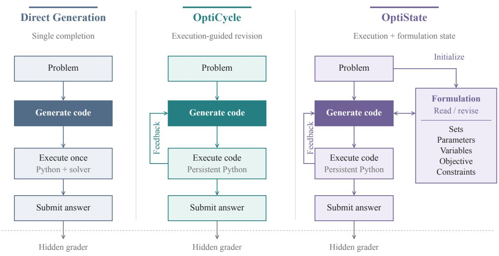
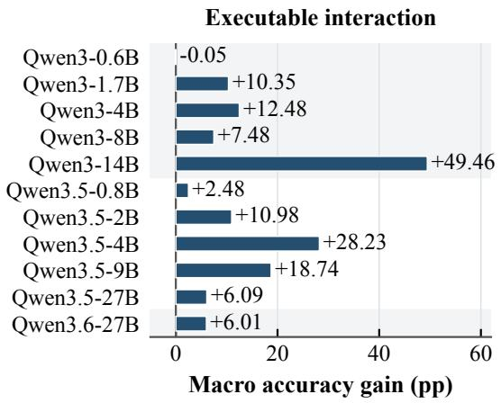
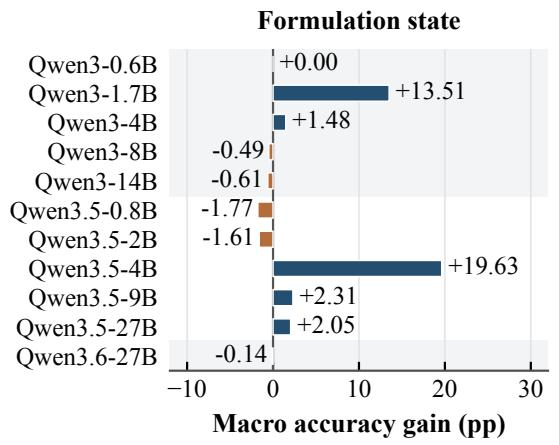
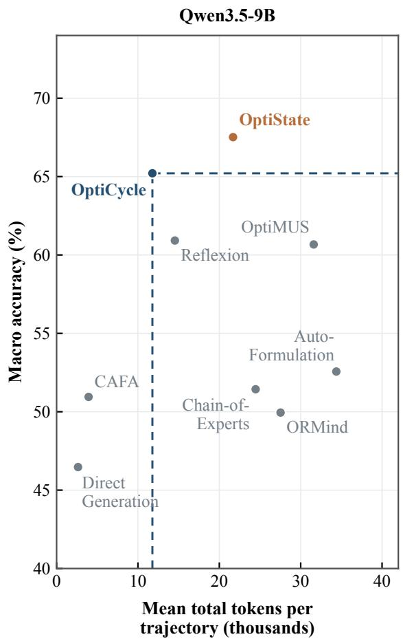
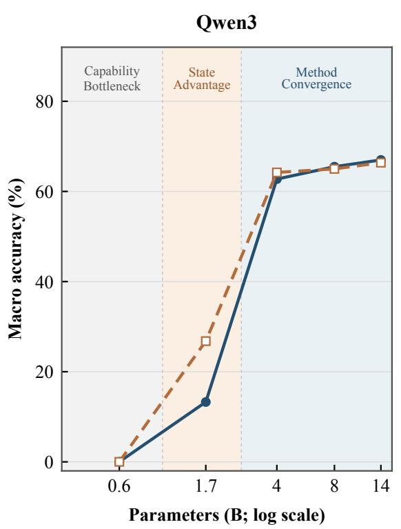
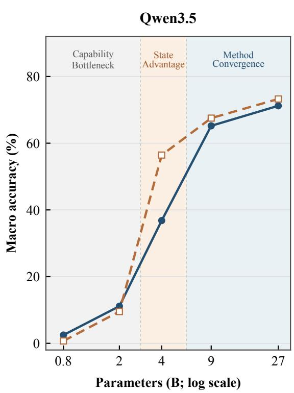
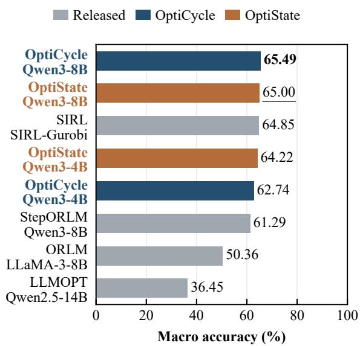
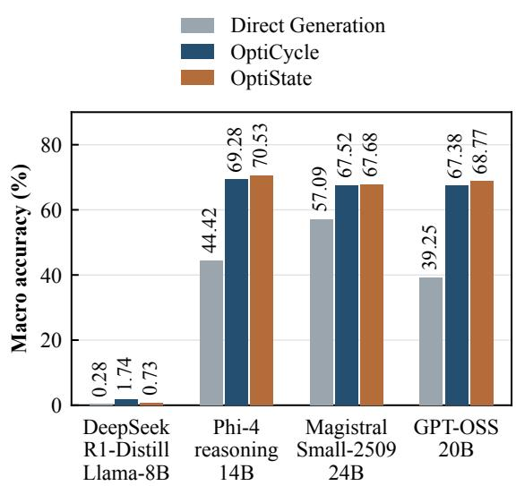

# Harnessing Language Models as Optimization Modeling Agents

Yunxiang Luo1\*, Xin Xu1\*, Tianhao Chen1\*, Zhixi Xiong1, Peiqi Jiang1, Fan Zhang1, Wei Shao2, Xuejian Gao2, Yuwei Fan2, Can Yang1,†

1The Hong Kong University of Science and Technology, 2Huawei

## Abstract

Large language models (LLMs) can translate natural-language optimization problems into solver programs, but reliably producing correct formulations and implementations remains challenging. Existing approaches improve optimization modeling through agentic workflows or task-specific post-training. This raises a practical question: can a lightweight harness using a single model role achieve competitive performance without additional training? We introduce OPTICYCLE and OPTISTATE, two lightweight inference harnesses for optimization modeling, and evaluate them on nine benchmarks comprising 2,634 problems using 11 Qwen variants spanning 0.6B–27B parameters. Our results show that execution-guided revision consistently improves macro accuracy over direct generation for all evaluated models, with gains of up to 49.46 percentage. Despite the simplicity, both harnesses outperform six adapted agentic workflows under same model comparisons and four evaluated post-trained optimization models at comparable model sizes without additional training. Explicit formula tion state provides further but model-dependent improvements, suggesting that additional structure is not universally beneficial.

## 1 Introduction

Operations research (OR) provides a principled foundation for decision-making in resourceconstrained settings, with optimization models supporting applications such as supply-chain management and transportation (Dantzig, 1963; Hillier et al., 1995). In practice, an optimization problem often begins as a natural-language description of the decision context, available resources, and desired outcomes. Translating this description into a correct optimization model requires identifying decision variables, an objective, and constraints while preserving the semantics of the original problem (Ramamonjison et al., 2023). Natural-language optimization modeling therefore connects language understanding, mathematical formulation, and executable problem solving.

Large language models (LLMs) offer a way to automate this translation from problem descriptions to executable optimization models. Existing approaches pursue two complementary directions. One organizes inference through specialized agents or stages for formulation, coding, and debugging (Xiao et al., 2024; AhmadiTeshnizi et al., 2024). The other treats it as a reasoning task and develops domain-specific capabilities through supervised fine-tuning (SFT) or reinforcement learning (RL) (Huang et al., 2025; Chen et al., 2025). The two directions differ in whether they modify the inference workflow or the model parameters.

Agentic post-training further connects model capabilities with the systems surrounding them: models can be trained to use tools and interact with environments (Kimi Team, 2025; GLM-4.5 Team, 2025), but the opportunities to exercise these capabilities depend on the inference procedure. The same frozen LLM can act as a direct generator or repeatedly execute and revise a solver program. An inference harness is the layer that organizes an LLM’s tools, context, state, and control flow (Meng et al., 2026). Comparisons across optimization systems are difficult to interpret when backbones, benchmarks, inference procedures, and grading protocols all differ. This motivates our central question: how do different harnesses shape the optimization-modeling performance of a frozen LLM, and when does explicitformulation state add value?

In this paper, we study this question through a unified harness view of optimization modeling (Figure 1). Direct Generation is the single-step setting: the model produces a solver program without an opportunity to revise it after execution.

  
Figure 1: Three inference interfaces for the same frozen model. OptiCycle adds execution feedback and persistent Python state; OptiState additionally maintains a revisable five-element formulation. The hidden grader evaluates submitted answers and provides no feedback during inference.

We design two OR-oriented harnesses for interactive modeling. OPTICYCLE organizes code generation, solver execution, feedback interpretation, and revision into a cycle within a persistent Python environment. OPTISTATE adds a structured and revisable formulation comprising sets, parameters, variables, the objective, and constraints. This state makes intermediate modeling decisions explicit and available for reconsideration during subsequent interaction. Both harnesses use a single model role with frozen weights; reference answers remain hidden, and grading occurs only after submission.

We evaluate these settings on nine benchmarks comprising 2,634 problems and 11 Qwen variants from 0.6B to 27B parameters. OPTICYCLE improves Qwen3.5-9B macro accuracy by 18.74 percentage points over Direct Generation. In a shared-backbone comparison with six adapted OR workflows, it achieves 62.74% on Qwen3-4B and 65.21% on Qwen3.5-9B, exceeding the strongest competing baselines by 8.53 and 4.29 percentage points, respectively. These comparisons share the backbone and evaluation protocol while retaining method-specific inference budgets.

Our contributions are as follows:

• A unified harness view of optimization modeling for LLMs. We compare direct generation, execution-guided revision, and formulationstate-guided revision while keeping model

weights fixed.

• Two simple and effective modeling harnesses. OPTICYCLE enables iterative code execution and repair, while OPTISTATE adds a revisable representation of the optimization formulation.

• Comprehensive evaluation across diverse benchmarks and baselines. We evaluate 11 Qwen variants on nine benchmarks containing 2,634 problems and compare against six adapted workflows under shared backbones and grading.

• An analysis of effectiveness and cost. Execution-guided revision produces broad gains, whereas formulation state provides model-dependent benefits at higher token consumption.

## 2 Related Work

## 2.1 LLMs for Optimization Modeling

Recent work on LLM-based optimization modeling broadly follows two methodological directions: improving inference-time modeling procedures and adapting model parameters specifically for optimization tasks.

Agent Systems for OR. One direction improves optimization modeling through task-specific prompting and structured inference workflows. Existing systems organize formulation, coding, execution and debugging into coordinated stages or specialized roles (Deng et al., 2024; Xiao et al., 2024; AhmadiTeshnizi et al., 2024; Monteiro et al., 2026). Beyond stage decomposition, recent approaches explore formulation search, execution-aware verification, iterative repair, and the reuse of correction experiences (Astorga et al., 2024; Wang et al., 2025; Song et al., 2026; Xie et al., 2026). These methods improve the inference process without necessarily changing the underlying model. Our work focuses on this setting, studying OR-oriented harnesses that support iterative modeling within a single agent role while holding model weights fixed.

Reasoning Models for Optimization Modeling. A complementary direction develops optimizationspecific reasoning through parameter adaptation. Data synthesis and SFT provide supervision for formulation and code generation (Huang et al., 2025; Wang et al., 2024; Lu et al., 2025; Wu et al., 2025), while solver-grounded RL and process supervision further develop optimization reasoning (Chen et al., 2025; Xiao et al., 2026; Tang et al., 2026; Guan et al., 2026). Related approaches extend parameter adaptation to test time (Ding et al., 2026; Li et al., 2026b). Our study keeps model weights fixed. In particular, OPTISTATE draws on LLMOPT’s five-element formulation (Jiang et al., 2025) as a revisable inference-time state rather than training supervision.

Benchmarks for Optimization Modeling. Optimization-modeling benchmarks have progressively expanded in scope and difficulty. NL4Opt focuses on natural-language linear programming problems (Ramamonjison et al., 2023), while NLP4LP covers both linear and mixed-integer programming (AhmadiTeshnizi et al., 2024). MAMO and ComplexOR broaden the range of modeling tasks and problem structures (Huang et al., 2024; Xiao et al., 2024). IndustryOR, OptiBench, and OptMATH further extend the evaluation to more diverse domains, formulations, and levels of complexity (Huang et al., 2025; Wang et al., 2024; Lu et al., 2025). We use existing optimization-modeling tasks as a controlled testbed for comparing inference-time harness designs.

## 2.2 Agentic Language Models and Harnesses

LLM-based agents have developed through both externally organized workflows and improvements in model capabilities. Approaches such as AutoGen and MetaGPT coordinate specialized roles, while ReAct and Reflexion connect reasoning with actions and feedback without updating model weights (Wu et al., 2023; Hong et al., 2024; Yao et al., 2023; Shinn et al., 2023). More recently, agentic RL incorporates tool use and environment interaction into model posttraining (Kimi Team, 2025; GLM-4.5 Team, 2025). Evaluating the resulting capabilities calls for both task-level benchmarks and an explicit account of the harness used at inference time.

Agentic Benchmarks. General-purpose evaluations assess software maintenance, terminal tasks, and program reconstruction, as exemplified by SWE-bench, Terminal-Bench, and ProgramBench (Jimenez et al., 2024; Merrill et al., 2026; Yang et al., 2026). Within OR, recent benchmarks evaluate end-to-end workflows and solver-guided model repair (Li et al., 2026a; Ao et al., 2026). Related combinatorial optimization benchmarks focus on algorithm and heuristic design (Sun et al., 2025; Chen et al., 2026a). We use existing optimization modeling tasks to investigate how harnesses affect frozen LLMs under a shared evaluation protocol.

Inference Harnesses. A harness organizes the tools, context, state, and control flow surrounding an LLM (Meng et al., 2026). Coding-agent systems such as Claude Code, Codex CLI, and OpenCode provide implementations of this inference-time layer, whereas Harbor provides shared evaluation interfaces for running agents across tasks and environments (Anthropic, 2026; OpenAI, 2026; OpenCode, 2026; Harbor, 2026). Recent research examines how harness choices affect measured performance and how harnesses can be composed and adapted (Yao et al., 2026; Chen et al., 2026b). We investigate this design space for optimization modeling through OPTICYCLE and OPTISTATE, treating Direct Generation as the single-step special case.

## 3 A Unified Harness View

We organize optimization modeling around a frozen language model and a harness that controls its execution environment, interaction history, and persistent state. Within this view,

Direct Generation is the single-step setting, OPTICYCLE introduces execution-guided revision, and OPTISTATE additionally exposes a revisable formulation (Figure 1). Both of our harnesses use one model role and keep its weights fixed throughout inference.

## 3.1 Task and Harness Interface

Given a natural-language problem q and its numerical data, the model must infer decision variables and their domains, the objective, and the constraints, then implement and solve the formulation as a solver program. The submitted answer is an optimal objective value or a status in {infeasible, unbounded}. Missing or unparseable submissions count as failures.

The harness separates the model’s proposed computation from its execution. The model produces code, the environment runs it, and the controller determines what feedback and state are available for the next call and when to stop. Direct Generation makes one model call to produce a complete solver program and executes it once. It has no opportunity to revise the program after observing its behavior. Our interactive harnesses maintain execution state across calls and provide summaries of recent actions and observations, allowing the same model to revise its work.

## 3.2 Iterative Refinement through Execution Feedback

OPTICYCLE organizes optimization modeling as a sequence of code generation, execution, observation, and revision. The model can build a solver program incrementally, inspect its behavior, and choose its next operation from the execution results. Each trajectory runs in a persistent Python interpreter, so imported modules, variables, and solver objects remain available across turns. This continuity lets the model resume from its current work: it can repair an indexing error, modify a constraint, or rerun a solver using objects it has already created.

The harness separates persistent execution state from the context presented to the model. The interpreter retains live objects, workspace files store intermediate artifacts, and the prompt combines the original problem with a bounded summary of recent actions and execution feedback. These summaries record the purpose of each action and the resulting output or exception. Together with optimization-specific modeling instructions and recovery hints, they guide the next code operation while keeping the interaction context compact.

Each action $a _ { t }$ specifies a purpose and code $c _ { t }$ . The loop proceeds as

$$
\begin{array} { l } { { a _ { t } \sim M _ { \theta } ( \cdot \mid q , \mathcal { C } ( H _ { t } ) ) , } } \\ { { \ } } \\ { { ( s _ { t + 1 } , o _ { t } ) = \mathcal { E } ( c _ { t } , s _ { t } ) , } } \\ { { \ } } \\ { { H _ { t + 1 } = H _ { t } \mid \mid ( a _ { t } , o _ { t } ) . } } \end{array}\tag{1}
$$

where $s _ { t }$ is the persistent execution state, $o _ { t }$ is the execution feedback, and C constructs the bounded context from the recorded history $H _ { t }$ . The operator ∥ appends the latest action and observation. The loop ends upon valid submission or exhaustion of the execution budget.

## 3.3 Explicit Formulation as Revisable State

OPTISTATE extends this design by making the model’s interpretation of the optimization problem an explicit part of the workspace. A separate formulation records the decisions that guide implementation: which entities are indexed, which quantities are known, what can be chosen and how the objective and constraints relate to these quantities. Keeping these decisions together gives the model a structured reference as it develops the solver program.

Before code execution begins, an initial model call constructs a five-element formulation, following LLMOPT (Jiang et al., 2025):

$$
z _ { 0 } = ( z ^ { \mathrm { s e t } } , z ^ { \mathrm { p a r a m } } , z ^ { \mathrm { v a r } } , z ^ { \mathrm { o b j } } , z ^ { \mathrm { c o n } } ) .\tag{2}
$$

The components describe sets and indices, known parameters, decision variables and their domains, the objective, and constraints. The formulation is saved in the workspace and supplied as a context for code generation. The model translates this representation into solver operations within the same persistent execution loop as OPTICYCLE.

The formulation remains editable throughout the trajectory. The model can inspect the stored representation, update its variable definitions or constraints, and revise the corresponding solver code. For example, a change in how a quantity is indexed can be recorded in the formulation and carried through to variable creation and constraint construction. This makes formulation part of the ongoing modeling process, extending the agent’s working state beyond Python objects and execution history. OPTISTATE retains the execution feedback and submission workflow of OPTICYCLE, with an additional check for a parseable formulation containing the required fields at submission.

Table 1: Benchmark accuracy (%) for Direct Generation, adapted agent baselines, and our inference harnesses with shared backbones. Values are avg@k; Macro is the unweighted mean over nine benchmarks. Bold and underline mark the highest and second-highest values within each backbone and column, respectively, including ties.
<table><tr><td rowspan=2 colspan=2>|Complex |MethodOR</td><td rowspan=1 colspan=1>IndustryOR</td><td rowspan=1 colspan=1>OptiBench</td><td rowspan=1 colspan=1>MAMOeasy</td><td rowspan=1 colspan=1>MAMOcomplex</td><td rowspan=1 colspan=1>NL4Opt</td><td rowspan=1 colspan=1>NLP4LP</td><td rowspan=1 colspan=1>OptMath</td><td rowspan=1 colspan=1>ICMLComp.</td><td rowspan=1 colspan=1>Macro</td></tr><tr><td rowspan=1 colspan=1>avg@64</td><td rowspan=1 colspan=1>avg@16</td><td rowspan=1 colspan=1>avg@4</td><td rowspan=1 colspan=1>avg@4</td><td rowspan=1 colspan=1>avg@8</td><td rowspan=1 colspan=1>avg@8</td><td rowspan=1 colspan=1>avg@8</td><td rowspan=1 colspan=1>avg@8</td><td rowspan=1 colspan=1>avg@8</td><td rowspan=1 colspan=1>Avg.</td></tr><tr><td rowspan=1 colspan=11>Qwen3-4B</td></tr><tr><td rowspan=1 colspan=1>Direct Generation</td><td rowspan=1 colspan=1>29.08</td><td rowspan=1 colspan=1>33.88</td><td rowspan=1 colspan=1>54.38</td><td rowspan=1 colspan=1>80.06</td><td rowspan=1 colspan=1>27.61</td><td rowspan=1 colspan=1>72.45</td><td rowspan=1 colspan=1>72.88</td><td rowspan=1 colspan=1>9.41</td><td rowspan=1 colspan=1>72.62</td><td rowspan=1 colspan=1>50.26</td></tr><tr><td rowspan=1 colspan=1>CAFA</td><td rowspan=1 colspan=1>46.09</td><td rowspan=1 colspan=1>35.06</td><td rowspan=1 colspan=1>60.79</td><td rowspan=1 colspan=1>79.49</td><td rowspan=1 colspan=1>30.15</td><td rowspan=1 colspan=1>79.24</td><td rowspan=1 colspan=1>69.16</td><td rowspan=1 colspan=1>11.14</td><td rowspan=1 colspan=1>76.77</td><td rowspan=1 colspan=1>54.21</td></tr><tr><td rowspan=1 colspan=1>Reflexion</td><td rowspan=1 colspan=1>43.84</td><td rowspan=1 colspan=1>25.50</td><td rowspan=1 colspan=1>50.99</td><td rowspan=1 colspan=1>82.52</td><td rowspan=1 colspan=1>13.27</td><td rowspan=1 colspan=1>77.17</td><td rowspan=1 colspan=1>70.71</td><td rowspan=1 colspan=1>7.15</td><td rowspan=1 colspan=1>70.52</td><td rowspan=1 colspan=1>49.07</td></tr><tr><td rowspan=1 colspan=1>Chain-of-Experts</td><td rowspan=1 colspan=1>28.30</td><td rowspan=1 colspan=1>23.31</td><td rowspan=1 colspan=1>48.84</td><td rowspan=1 colspan=1>71.09</td><td rowspan=1 colspan=1>6.93</td><td rowspan=1 colspan=1>71.25</td><td rowspan=1 colspan=1>72.68</td><td rowspan=1 colspan=1>4.14</td><td rowspan=1 colspan=1>65.12</td><td rowspan=1 colspan=1>43.52</td></tr><tr><td rowspan=1 colspan=1>OptiMUS</td><td rowspan=1 colspan=1>47.92</td><td rowspan=1 colspan=1>29.94</td><td rowspan=1 colspan=1>57.77</td><td rowspan=1 colspan=1>85.70</td><td rowspan=1 colspan=1>15.23</td><td rowspan=1 colspan=1>76.09</td><td rowspan=1 colspan=1>76.55</td><td rowspan=1 colspan=1>10.54</td><td rowspan=1 colspan=1>73.20</td><td rowspan=1 colspan=1>52.55</td></tr><tr><td rowspan=1 colspan=1>AutoFormulation</td><td rowspan=1 colspan=1>42.80</td><td rowspan=1 colspan=1>32.25</td><td rowspan=1 colspan=1>57.64</td><td rowspan=1 colspan=1>73.66</td><td rowspan=1 colspan=1>20.62</td><td rowspan=1 colspan=1>73.37</td><td rowspan=1 colspan=1>69.63</td><td rowspan=1 colspan=1>11.22</td><td rowspan=1 colspan=1>69.51</td><td rowspan=1 colspan=1>50.08</td></tr><tr><td rowspan=1 colspan=1>ORMind</td><td rowspan=1 colspan=1>51.74</td><td rowspan=1 colspan=1>33.88</td><td rowspan=1 colspan=1>55.62</td><td rowspan=1 colspan=1>83.90</td><td rowspan=1 colspan=1>15.58</td><td rowspan=1 colspan=1>72.66</td><td rowspan=1 colspan=1>75.77</td><td rowspan=1 colspan=1>8.89</td><td rowspan=1 colspan=1>70.52</td><td rowspan=1 colspan=1>52.06</td></tr><tr><td rowspan=1 colspan=1>OptiCycleOptiState</td><td rowspan=1 colspan=1>66.5865.45</td><td rowspan=1 colspan=1>40.0640.13</td><td rowspan=1 colspan=1>70.1273.18</td><td rowspan=1 colspan=1>85.7087.58</td><td rowspan=1 colspan=1>33.0636.49</td><td rowspan=1 colspan=1>86.2589.46</td><td rowspan=1 colspan=1>74.6475.67</td><td rowspan=1 colspan=1>23.0421.76</td><td rowspan=1 colspan=1>85.1888.23</td><td rowspan=1 colspan=1>62.7464.22</td></tr><tr><td rowspan=1 colspan=11>Qwen3.5-9B</td></tr><tr><td rowspan=1 colspan=1>Direct Generation</td><td rowspan=1 colspan=1>34.64</td><td rowspan=1 colspan=1>27.50</td><td rowspan=1 colspan=1>51.20</td><td rowspan=1 colspan=1>69.13</td><td rowspan=1 colspan=1>22.22</td><td rowspan=1 colspan=1>71.79</td><td rowspan=1 colspan=1>62.86</td><td rowspan=1 colspan=1>11.37</td><td rowspan=1 colspan=1>67.53</td><td rowspan=1 colspan=1>46.47</td></tr><tr><td rowspan=2 colspan=1>CAFAReflexion</td><td rowspan=1 colspan=1>45.05</td><td rowspan=1 colspan=1>34.06</td><td rowspan=1 colspan=1>59.09</td><td rowspan=1 colspan=1>73.62</td><td rowspan=1 colspan=1>24.17</td><td rowspan=1 colspan=1>71.85</td><td rowspan=1 colspan=1>65.55</td><td rowspan=1 colspan=1>12.20</td><td rowspan=1 colspan=1>72.93</td><td rowspan=1 colspan=1>50.95</td></tr><tr><td rowspan=1 colspan=1>54.69</td><td rowspan=1 colspan=1>39.00</td><td rowspan=1 colspan=1>69.75</td><td rowspan=1 colspan=1>84.93</td><td rowspan=1 colspan=1>32.94</td><td rowspan=1 colspan=1>88.21</td><td rowspan=1 colspan=1>71.64</td><td rowspan=1 colspan=1>22.44</td><td rowspan=1 colspan=1>84.70</td><td rowspan=1 colspan=1>60.92</td></tr><tr><td rowspan=1 colspan=1>Chain-of-Experts</td><td rowspan=1 colspan=1>44.62</td><td rowspan=1 colspan=1>36.06</td><td rowspan=1 colspan=1>58.22</td><td rowspan=1 colspan=1>70.94</td><td rowspan=1 colspan=1>22.51</td><td rowspan=1 colspan=1>72.72</td><td rowspan=1 colspan=1>68.70</td><td rowspan=1 colspan=1>15.74</td><td rowspan=1 colspan=1>73.41</td><td rowspan=1 colspan=1>51.44</td></tr><tr><td rowspan=1 colspan=1>OptiMUS</td><td rowspan=1 colspan=1>55.30</td><td rowspan=1 colspan=1>40.50</td><td rowspan=1 colspan=1>68.80</td><td rowspan=1 colspan=1>85.74</td><td rowspan=1 colspan=1>29.56</td><td rowspan=1 colspan=1>82.17</td><td rowspan=1 colspan=1>77.32</td><td rowspan=1 colspan=1>24.70</td><td rowspan=1 colspan=1>81.95</td><td rowspan=1 colspan=1>60.67</td></tr><tr><td rowspan=1 colspan=1>AutoFormulation</td><td rowspan=1 colspan=1>45.57</td><td rowspan=1 colspan=1>34.00</td><td rowspan=1 colspan=1>61.12</td><td rowspan=1 colspan=1>69.17</td><td rowspan=1 colspan=1>24.64</td><td rowspan=1 colspan=1>73.80</td><td rowspan=1 colspan=1>69.83</td><td rowspan=1 colspan=1>20.48</td><td rowspan=1 colspan=1>74.45</td><td rowspan=1 colspan=1>52.56</td></tr><tr><td rowspan=1 colspan=1>ORMind</td><td rowspan=1 colspan=1>46.70</td><td rowspan=1 colspan=1>37.94</td><td rowspan=1 colspan=1>56.86</td><td rowspan=1 colspan=1>76.96</td><td rowspan=1 colspan=1>27.73</td><td rowspan=1 colspan=1>62.66</td><td rowspan=1 colspan=1>58.68</td><td rowspan=1 colspan=1>16.94</td><td rowspan=1 colspan=1>65.06</td><td rowspan=1 colspan=1>49.95</td></tr><tr><td rowspan=2 colspan=1>OptiCycleOptiState</td><td rowspan=2 colspan=1>64.0665.54</td><td rowspan=2 colspan=1>43.6247.19</td><td rowspan=2 colspan=1>73.6875.33</td><td rowspan=1 colspan=1>89.00</td><td rowspan=1 colspan=1>31.93</td><td rowspan=1 colspan=1>87.66</td><td rowspan=1 colspan=1>77.79</td><td rowspan=2 colspan=1>31.4033.81</td><td rowspan=2 colspan=1>87.7490.49</td><td rowspan=2 colspan=1>65.2167.52</td></tr><tr><td rowspan=1 colspan=1>86.66</td><td rowspan=1 colspan=1>38.39</td><td rowspan=1 colspan=1>92.66</td><td rowspan=1 colspan=1>77.58</td></tr></table>

## 4 Experiments

## 4.1 Experimental Settings

We summarize the baselines and evaluation protocols here. Samples Per-benchmark , workflow budgets, and execution details are provided in Appendix A.

Baselines. We compare OPTICYCLE and OPTISTATE with Direct Generation across 11 frozen Qwen variants spanning 0.6B–27B parameters. On Qwen3-4B and Qwen3.5-9B, we additionally compare with CAFA (Deng et al., 2024), Reflexion (Shinn et al., 2023), Chain-of-Experts (Xiao et al., 2024), OptiMUS (AhmadiTeshnizi et al., 2024), AutoFormulation (Astorga et al., 2024), and ORMind (Wang et al., 2025). Adaptations and method-specific budgets are detailed in Appendix A.2.

Evaluation settings. We evaluate on nine benchmarks comprising 2,634 problems and report avg@k (average sampled-trajectory accuracy) and its unweighted macro average across benchmarks. Missing scores count as failures. All model calls allow up to 16,384 output tokens. Dataset, sampling, execution, and grading details are provided in Appendix A.

## 4.2 Gains from Executable Interaction

Table 2 shows that OPTICYCLE consistently improves macro accuracy over direct generation for the evaluated models above one billion parameters, whereas the smallest models remain weak under all three methods. Figure 3 shows that harness accuracy generally increases with model size within each family, with a sharper rise at intermediate scales and smaller gains among the larger variants. Executable interaction thus benefits a broad range of backbones, but does not eliminate the performance gap between model scales.

## 4.3 Comparison with Adapted Agent Baselines

Both OPTICYCLE and OPTISTATE achieve higher macro accuracy than all six adapted baselines on Qwen3-4B and Qwen3.5-9B (Table 1).

  
Figure 2: Accuracy gains and token consumption across nine benchmarks. Left, upper: OptiCycle gains over direct generation; left, lower: OptiState gains over OptiCycle, in percentage points. Background bands separate model series; the gain panels use different horizontal scales and differences between rounded scores. Right: macro accuracy versus mean recorded input plus output tokens per trajectory on Qwen3.5-9B, with both metrics averaged equally across benchmarks. Dashed lines mark OptiCycle’s accuracy and token consumption.

Table 2: Macro-average accuracy (%) across nine optimization benchmarks. † marks evaluations with missing scores counted as failures; see Appendix A.1.
<table><tr><td>Model</td><td>direct</td><td>OptiCycle</td><td>OptiState</td></tr><tr><td>Qwen3-0.6B</td><td>0.06%</td><td>0.01%</td><td>0.01%</td></tr><tr><td>Qwen3-1.7B</td><td>2.93%</td><td>13.28%</td><td>26.79%</td></tr><tr><td>Qwen3-4B</td><td>50.26%</td><td>62.74%</td><td>64.22%</td></tr><tr><td>Qwen3-8B</td><td>58.01%</td><td>65.49%</td><td>65.00%</td></tr><tr><td>Qwen3-14B</td><td>17.53%</td><td>66.99%</td><td>66.38%</td></tr><tr><td>Qwen3.5-0.8B</td><td>0.00%</td><td>2.48%</td><td>0.71%</td></tr><tr><td>Qwen3.5-2B</td><td>0.15%</td><td>11.13%</td><td>9.52%†</td></tr><tr><td>Qwen3.5-4B</td><td>8.58%</td><td>36.81%</td><td>56.44%</td></tr><tr><td>Qwen3.5-9B</td><td>46.47%</td><td>65.21%</td><td>67.52%</td></tr><tr><td>Qwen3.5-27B</td><td>65.12%</td><td>71.21%†</td><td>73.26%</td></tr><tr><td>Qwen3.6-27B</td><td>66.47%</td><td>72.48%</td><td>72.34%</td></tr></table>

OPTISTATE achieves the highest macro accuracy in both comparisons.

## 4.4 Accuracy and Token Consumption

On Qwen3.5-9B, OPTICYCLE achieves higher macro accuracy with fewer recorded tokens than Reflexion, Chain-of-Experts, OptiMUS, AutoFormulation, and ORMind (Figure 2, right). It uses 11.77 thousand input plus output tokens per trajectory, versus 14.54 for Reflexion, 31.60 for OptiMUS, and 34.38 for AutoFormulation. Compared with Reflexion, it gains 4.29 percentage points in accuracy while using 19.0% fewer tokens. Direct Generation and CAFA use fewer tokens but achieve lower accuracy. OPTISTATE adds 2.31 percentage points over OPTICYCLE at 84.2% higher token consumption. See Appendix A for token accounting.

## 4.5 Comparison with Post-Trained Models

Without any additional training or fine-tuning, our harnesses outperform several post-trained optimization models in macro accuracy (Figure 4).

  
Figure 3: Model-size scaling within the Qwen3 (left) and Qwen3.5 (right) families. Model size is shown in billions of parameters on a logarithmic scale; accuracy is the macro average across nine benchmarks. Blue solid lines with circles denote OptiCycle; orange dashed lines with squares denote OptiState. Shaded bands mark three qualitative regimes: Capability Bottleneck, State Advantage, and Method Convergence.

Both frozen Qwen3-8B configurations exceed StepORLM, SIRL, ORLM, and LLMOPT.

## 4.6 Selective Benefits of Formulation Structure

Adding explicit formulation state produces selective gains (Figure 2, left). The largest improvements occur on Qwen3.5-4B and Qwen3-1.7B, while several other backbones show little benefit or a decline relative to OPTICYCLE. This pattern is not monotonic in model size: structured state helps some smaller models substantially but does not reliably improve the smallest variants. Its contribution is therefore more dependent on the backbone than the gains from executable interaction.

## 5 Analysis

## 5.1 Where Interaction Helps Most

Our results suggest that a simple executionand-revision harness is most useful when tasks challenge direct generation but remain within the model’s capabilities. ComplexOR illustrates this pattern: OPTICYCLE substantially improves over Direct Generation on both shared backbones. Gains are smaller on MAMO-easy for Qwen3-4B and Qwen3-8B, where direct generation accuracy is already high. Interaction also offers little benefit for some difficult model–task pairs, such as Qwen3-8B on MAMO-complex (Tables 5 and 6).

These findings are consistent with a harness helping models make better use of their existing capabilities, with limited headroom on easier tasks and persistent capability constraints on harder ones. Difficulty alone, however, does not determine the gains: OptMath improves substantially despite low final accuracy, showing that interaction can help even when reliable task completion remains out of reach.

  
Figure 4: Macro accuracy (%) across nine benchmarks, ordered by accuracy. Blue and orange highlight OptiCycle and OptiState; gray denotes released models. Bold and underline mark the highest and second-highest values, respectively.

## 5.2 Formulation State Helps Some Models and Tasks

Explicit formulation state provides additional gains beyond executable interaction, but its value depends on the backbone and task. For Qwen3-1.7B and Qwen3.5-4B, OPTISTATE improves over OPTICYCLE on all nine benchmarks, indicating broad benefits for these two models (Tables 5 and 6).

For Qwen3-8B and Qwen3-14B, the effects are mixed. Both models improve on NL4Opt and ICML Competition but lose accuracy on OptMath and ComplexOR. The small changes in macro accuracy therefore mask opposing effects across individual benchmarks. These results suggest that the value of explicit formulation state should be assessed for each model and task, rather than assumed to improve the execution loop uniformly.

## 5.3 Performance Beyond the Qwen Family

Executable interaction also benefits non-Qwen models (Figure 5). OPTICYCLE raises macro accuracy from 44.42% to 69.28% on Phi-4-reasoning and from 57.09% to 67.52% on Magistral-Small-2509; OPTISTATE adds 1.25 and 0.16 percentage points, respectively. On

  
Figure 5: Macro accuracy (%) across nine benchmarks on non-Qwen models, including GPT-OSS-20B. Values are unweighted means of benchmark avg@k scores.

GPT-OSS-20B, accuracy rises from 39.25% (Direct Generation) to 67.38% (OPTICYCLE) and 68.77% (OPTISTATE), gains of 28.13 and a further 1.39 percentage points. OPTICYCLE accounts for most of the gains on these three models.

DeepSeek-R1-Distill-Llama-8B remains below 2%: 0.28% with Direct Generation, 1.74% with OPTICYCLE, and 0.73% with OPTISTATE. The benefits therefore vary across backbones.

## 6 Conclusion and Future Work

We studied optimization modeling as an executable inference task for frozen language models. Across nine benchmarks and 11 Qwen variants, a lightweight execution-and-repair harness substantially improves performance over direct generation for models above 1B parameters and outperforms the evaluated adapted architectures with Qwen3-4B and Qwen3.5-9B. Explicit formulation state provides additional, model-dependent gains. The same workflow also improves accuracy on Phi, Magistral, and GPT-OSS.

Future work. An important direction is a self-evolving harness that improves its inference workflow across tasks while keeping the underlying model frozen. Rather than revising only a task’s code or formulation, such a framework could use historical execution trajectories to propose changes to prompts, feedback processing, state representations, and repair-budget allocation. Candidate harnesses could be evaluated on a separate development set and retained when they improve accuracy under explicit cost constraints.

## Limitations

While our harnesses improve optimizationmodeling performance across the evaluated benchmarks, the experiments compare complete workflows with method-specific inference budgets. In particular, OPTISTATE adds both an initial formulation call and a revisable representation to OPTI-CYCLE. We report recorded token consumption for the Qwen3.5-9B comparison; matched-budget ablations, trajectory-level repair analysis, and latency measurements can further clarify the contributions and costs of individual components.

We have primarily evaluated 11 Qwen variants, with additional experiments on DeepSeek-R1-Distill-Llama-8B, Phi-4-reasoning, Magistral-Small-2509, and GPT-OSS-20B. Configuration revisions differ across model generations, so these results characterize the evaluated model–harness settings. The reported accuracies are point estimates without uncertainty intervals; broader model coverage and uncertainty quantification would further strengthen the empirical findings.

Finally, our evaluation uses objective-value or status agreement as a common outcome-level measure across benchmarks. Extending verification to decision-vector feasibility, constraint satisfaction, and formulation equivalence would provide a more comprehensive assessment of modeling correctness.

## Ethical Considerations

This work studies the use of language models for automated optimization modeling. Incorrect formulations or solver implementations may produce misleading solutions, especially in consequential decision-making settings. Our evaluation focuses on benchmark accuracy and does not establish reliability for real-world deployment. Human verification remains important before applying generated optimization models. Additionally, repeated model inference and solver execution incur computational costs.

## References

Ali AhmadiTeshnizi, Wenzhi Gao, and Madeleine Udell. 2024. Optimus: Scalable optimization modeling with (mi) lp solvers and large language models. arXiv preprint arXiv:2402.10172.

AI for Math Workshop. 2024. ICML 2024 Challenges on Automated Math Reasoning—Track 3: Automated Optimization Problem-Solving with Code. Competition website. Accessed October 11, 2026.

Anthropic. 2026. How Claude Code works. Online documentation. Accessed September 11, 2026.

Ruicheng Ao, David Simchi-Levi, and Xinshang Wang. 2026. ORLoopBench: Solver-in-the-loop benchmarks for self-correction and behavioral rationality in operations research. ArXiv:2601.21008.

Nicolás Astorga, Tennison Liu, Yuanzhang Xiao, and Mihaela Van Der Schaar. 2024. Autoformulation of mathematical optimization models using llms. arXiv preprint arXiv:2411.01679.

Hongzheng Chen, Yingheng Wang, Yaohui Cai, Hins Hu, Jiajie Li, Shirley Huang, Chenhui Deng, Rongjian Liang, Shufeng Kong, Haoxing Ren, et al. 2026a. HeuriGym: An agentic benchmark for LLMcrafted heuristics in combinatorial optimization. In International Conference on Learning Representations, volume 2026, pages 27466–27520.

Tingyang Chen, Shuo Lu, Kang Zhao, Weicheng Meng, Hanlin Teng, Tianhao Li, Chao Li, Xule Liu, Jian Liang, Zhizhong Zhang, et al. 2026b. HarnessX: A composable, adaptive, and evolvable agent harness foundry. arXiv preprint arXiv:2606.14249.

Yitian Chen, Jingfan Xia, Siyu Shao, Dongdong Ge, and Yinyu Ye. 2025. Solver-informed rl: Grounding large language models for authentic optimization modeling. Advances in Neural Information Processing Systems, 38:106027–106069.

George B. Dantzig. 1963. Linear Programming and Extensions. Princeton University Press.

Haoxuan Deng, Bohao Zheng, Yirui Jiang, and Trung Hieu Tran. 2024. Cafa: Coding as autoformulation can boost large language models in solving linear programming problem. In The 4th Workshop on Mathematical Reasoning and AI at NeurIPS’24.

Zezhen Ding, Zhen Tan, Jiheng Zhang, and Tianlong Chen. 2026. Or-r1: Automating modeling and solving of operations research optimization problem via test-time reinforcement learning. In Proceedings of the AAAI Conference on Artificial Intelligence, volume 40, pages 228–236. Issue 1.

GLM-4.5 Team. 2025. GLM-4.5: Agentic, reasoning, and coding (ARC) foundation models. ArXiv:2508.06471.

Runda Guan, Xiangqing Shen, Jiajun Zhang, Yifan Zhang, Jian Cheng, and Rui Xia. 2026. Executionverified reinforcement learning for optimization modeling. ArXiv:2604.00442.

Harbor. 2026. Harbor: Motivation. Online documentation. Accessed September 11, 2026.

Frederick S Hillier, Gerald J Lieberman, Karl Schmedders, Molly Stephens, Mark Hillier, and Michael O’Sullivan. 1995. Introduction to operations research, volume 9. McGraw-Hill New York.

Sirui Hong, Mingchen Zhuge, Jonathan Chen, Xiawu Zheng, Yuheng Cheng, Jinlin Wang, Ceyao Zhang, Zili Wang, Steven Yau, Zijuan Lin, Liyang Zhou, Chenyu Ran, Lingfeng Xiao, Chenglin Wu, and Jürgen Schmidhuber. 2024. MetaGPT: Meta programming for a multi-agent collaborative framework. The Twelfth International Conference on Learning Representations.

Chenyu Huang, Zhengyang Tang, Shixi Hu, Ruoqing Jiang, Xin Zheng, Dongdong Ge, Benyou Wang, and Zizhuo Wang. 2025. Orlm: A customizable framework in training large models for automated optimization modeling. Operations Research, 73(6):2986– 3009.

Xuhan Huang, Qingning Shen, Yan Hu, Anningzhe Gao, and Benyou Wang. 2024. Llms for mathematical modeling: Towards bridging the gap between natural and mathematical languages. arXiv preprint arXiv: 2405.13144.

Caigao Jiang, Xiang Shu, Hong Qian, Xingyu Lu, Jun Zhou, Aimin Zhou, and Yang Yu. 2025. LLMOPT: Learning to define and solve general optimization problems from scratch. In The Thirteenth International Conference on Learning Representations.

Carlos E. Jimenez, John Yang, Alexander Wettig, Shunyu Yao, Kexin Pei, Ofir Press, and Karthik Narasimhan. 2024. SWE-bench: Can language models resolve real-world GitHub issues? The Twelfth International Conference on Learning Representations.

Kimi Team. 2025. Kimi k2: Open agentic intelligence. ArXiv:2507.20534.

Jiajun Li, Mingshu Cai, Yixuan Li, Yu Ding, Ran Hou, Guanyu Nie, Xiongwei Han, and Wanyuan Wang. 2026a. ORAgentBench: Can LLM agents solve challenging operations research tasks end to end? ArXiv:2606.19787.

Jiajun Li, Yu Ding, Shisi Guan, Ran Hou, and Wanyuan Wang. 2026b. StarOR: Synergizing tree search and test-time reinforcement learning for optimization modeling. ArXiv:2606.15197.

Hongliang Lu, Zhonglin Xie, Yaoyu Wu, Can Ren, Yuxuan Chen, and Zaiwen Wen. 2025. Optmath: A scalable bidirectional data synthesis framework for optimization modeling. arXiv preprint arXiv:2502.11102.

Qianyu Meng, Yanan Wang, Liyi Chen, Yihang Li, Wei Wu, Wenyuan Jiang, Qimeng Wang, Chengqiang Lu, Yan Gao, Yi Wu, et al. 2026. Agent harness for large language model agents: A survey.

Mike A. Merrill, Alexander G. Shaw, Nicholas Carlini, Boxuan Li, Harsh Raj, Ivan Bercovich, et al. 2026. Terminal-Bench: Benchmarking agents on hard, realistic tasks in command line interfaces. ArXiv:2601.11868.

Adriana Laurindo Monteiro, Nayse Fagundes, Gabriel Mattos Langeloh, Gustavo de Oliveira Kanno, Priscila Louise Aguirre, Thiago Costa Rizuti da Rocha, and Victor Leme Beltran. 2026. OptiAgent: End-to-end optimization modeling via multi-agent iterative refinement. ArXiv:2607.05346.

OpenAI. 2026. Codex CLI. Software repository. Accessed September 11, 2026.

OpenCode. 2026. OpenCode documentation. Online documentation. Accessed September 11, 2026.

Rindranirina Ramamonjison, Timothy Yu, Raymond Li, Haley Li, Giuseppe Carenini, Bissan Ghaddar, Shiqi He, Mahdi Mostajabdaveh, Amin Banitalebi-Dehkordi, Zirui Zhou, et al. 2023. Nl4opt competition: Formulating optimization problems based on their natural language descriptions. In NeurIPS 2022 competition track, pages 189–203. PMLR.

Noah Shinn, Federico Cassano, Ashwin Gopinath, Karthik Narasimhan, and Shunyu Yao. 2023. Reflexion: Language agents with verbal reinforcement learning. Advances in neural information processing systems, 36:8634–8652.

Yang Song, Anoushka Vyas, Zirui Wei, Sina Khoshfetrat Pakazad, Henrik Ohlsson, and Graham Neubig. 2026. Nemo: Execution-aware optimization modeling via autonomous coding agents. arXiv preprint arXiv:2601.21372.

Weiwei Sun, Shengyu Feng, Shanda Li, and Yiming Yang. 2025. CO-Bench: Benchmarking language model agents in algorithm search for combinatorial optimization. ArXiv:2504.04310.

Zhengyang Tang, Zihan Ye, Chenyu Huang, Xuhan Huang, Chengpeng Li, Sihang Li, Guanhua Chen, Ming Yan, Zizhuo Wang, Hongyuan Zha, Dayiheng Liu, and Benyou Wang. 2026. CALM before the STORM: Unlocking native reasoning for optimization modeling. In Proceedings of the 43rd International Conference on Machine Learning.

Zhiyuan Wang, Bokui Chen, Yinya Huang, Qingxing Cao, Ming He, Jianping Fan, and Xiaodan Liang. 2025. ORMind: A cognitive-inspired end-to-end reasoning framework for operations research. In Proceedings of the 63rd Annual Meeting of the Associationfor Computational Linguistics (Volume 6: Industry Track), pages 104–131.

Zhuohan Wang, Ziwei Zhu, Yizhou Han, Yufeng Lin, Zhihang Lin, Ruoyu Sun, and Tian Ding. 2024. Optibench: Benchmarking large language models in optimization modeling with equivalence-detection evaluation.

Qingyun Wu, Gagan Bansal, Jieyu Zhang, Yiran Wu, Beibin Li, Erkang Zhu, Li Jiang, Xiaoyun Zhang, Shaokun Zhang, Jiale Liu, Ahmed Hassan Awadallah, Ryen W. White, Doug Burger, and Chi Wang. 2023. AutoGen: Enabling next-gen LLM applications via multi-agent conversation. ArXiv:2308.08155.

Yang Wu, Yifan Zhang, Yurong Wu, Yuran Wang, Junkai Zhang, and Jian Cheng. 2025. Training llms for optimization modeling via iterative data synthesis and structured validation. In EMNLP (Findings), pages 12880–12896.

Ziyang Xiao, Yuan Jessica Wang, Xiongwei Han, Shisi Guan, Jingyan Zhu, Jingrong Xie, Lilin Xu, Han Wu, Wing Yin Yu, Zehua Liu, et al. 2026. DeepOR: A deep reasoning foundation model for optimization modeling. In Proceedings of the AAAI Conference on Artificial Intelligence, volume 40, pages 34052– 34060. Issue 40.

Ziyang Xiao, Dongxiang Zhang, Yangjun Wu, Lilin Xu, Yuan Wang, Xiongwei Han, Xiaojin Fu, Tao Zhong, Jia Zeng, Mingli Song, et al. 2024. Chain-of-experts: When llms meet complex operations research problems. In International Conference on Learning Representations, volume 2024, pages 48519–48537.

Wantong Xie, Yinghao Chen, Yi-Xiang Hu, Feng Wu, Jieyang Xu, Sijia Zhang, and Xiangyang Li. 2026. Escaping the Sisyphus Dilemma: Experience Replay for Robust Text-to-Optimization Modeling. In Findings of the Association for Computational Linguistics: ACL 2026, pages 14100–14116.

John Yang, Kilian Lieret, Jeffrey Ma, Parth Thakkar, Dmitrii Pedchenko, Sten Sootla, Emily McMilin, Pengcheng Yin, Rui Hou, Gabriel Synnaeve, Diyi Yang, and Ofir Press. 2026. ProgramBench: Can language models rebuild programs from scratch? ArXiv:2605.03546.

Shunyu Yao, Jeffrey Zhao, Dian Yu, Nan Du, Izhak Shafran, Karthik Narasimhan, and Yuan Cao. 2023. ReAct: Synergizing reasoning and acting in language models. The Eleventh International Conference on Learning Representations.

Yilun Yao, Xinyu Tan, Chao-Hsuan Liu, Yaoming Li, Zhengyang Wang, Wenhan Yu, Zhewen Tan, Yuxuan Tian, Guangxiang Zhao, Lin Sun, et al. 2026. Harness-Bench: Measuring harness effects across models in realistic agent workflows. arXiv preprint arXiv:2605.27922.

## A Experimental Details

ICML Competition. This benchmark uses test problems from the ICML 2024 Challenges on Automated Math Reasoning—Track 3: Automated Optimization Problem-Solving with Code (AI for Math Workshop, 2024). We refer to it as ICML Competition throughout the paper and abbreviate it as ICML Comp. in result tables.

## A.1 Models and Sampling

The model-scale comparison uses Qwen3-0.6B, 1.7B, 4B, 8B, and 14B; Qwen3.5-0.8B, 2B, 4B, 9B, and 27B; and Qwen3.6-27B. The nine-method comparison uses Qwen3-4B and Qwen3.5-9B. Model weights remain fixed in all evaluations. Configuration revisions differ across model generations.

Table 3 lists the number of planned trajectories per problem. Each model–method evaluation plans 17,852 trajectories over 2,634 problems. We use temperature 0.6, top-p 0.95, top-k 20, and seed 42+ j for sample index $j .$ All model calls, including individual stages of the baseline workflows, use a maximum output length of 16,384 tokens. This per-call limit is shared across experiments; total inference budgets still differ with the workflow’s number of calls.

Table 3: Per-problem sampling counts used to estimate average accuracy.
<table><tr><td>Benchmark</td><td>Trajectories per problem (k)</td></tr><tr><td>ComplexOR</td><td>64</td></tr><tr><td>IndustryOR</td><td>16</td></tr><tr><td>OptiBench</td><td>4</td></tr><tr><td>MAMO-easy</td><td>4</td></tr><tr><td>MAMO-complex</td><td>8</td></tr><tr><td>NLP4LP</td><td>8</td></tr><tr><td>NL4Opt</td><td>8</td></tr><tr><td>ICML Competition</td><td>8</td></tr><tr><td>OptMath</td><td>8</td></tr></table>

Token accounting. For the Qwen3.5-9B comparison, we use the current evaluated runs and exclude archived retries. Each method has 17,852 scored trajectories with recorded input and output token counts. We sum input and output tokens over the model calls within each trajectory, compute the mean within each benchmark, and then average the nine benchmark means without weighting. Recorded zero-token pairs are retained. This metric measures recorded token consumption rather than monetary cost or latency.

Qwen3.5 scoring coverage. Across the three methods, Qwen3.5-0.8B, Qwen3.5-4B, and the Qwen3.5-9B subset each have all 53,556 scores. Qwen3.5-2B has 53,555 scores: one OptiState trajectory on OptMath has no recorded score. Qwen3.5-27B has 53,553 scores: three OptiCycle trajectories remain without recorded scores, affecting IndustryOR, MAMO-complex, and OptMath. The Qwen3.5-27B results also include one scored trajectory with a timeout exception. We assign zero to all missing scores and retain every planned trajectory in the accuracy denominator. The † marks identify affected evaluations, and all tables and figures use this scoring rule.

## A.2 Baseline Adaptations and Budgets

We adapt the baseline workflows from their papers and original code to the shared OptAgentBench runner. Table 4 summarizes the implemented procedures and their budgets. The methods share data, solver access, sampling, execution infrastructure, and grading within each backbone comparison, but differ in the number and organization of model calls. Table 4 gives the call or step limits for each workflow.

## A.3 Execution and Grading

Generated programs execute in Python with SciPy, PuLP, and PySCIPOpt. The runner uses host subprocesses within temporary task directories; hidden grader files are not copied into these directories. Baseline inference used eight independent vLLM endpoints. Structured JSON, routing, and compilation stages may use direct decoding, while stages involving semantic analysis, search, or traceback debugging retain reasoning, according to each harness’s configuration.

For each benchmark, avg@k is the percentage of correct trajectories among all planned samples over all problems. Trajectories with missing scores count as incorrect and remain in the denominator. It is an estimate of average single-trajectory accuracy, not the probability that at least one of k samples succeeds. Macro accuracy is the unweighted mean of these benchmark accuracies. The grader compares numerical objective values using absolute tolerance 10−2 and relative tolerance 10−4, or checks agreement on infeasible/unbounded status. Missing or unparseable answers count as failures. Grading is performed after inference and is not used for search, reflection, or candidate selection.

Table 4: Implemented workflows and method-specific inference budgets.
<table><tr><td>Method</td><td>Adapted procedure</td><td>Budget</td></tr><tr><td>Direct Generation</td><td>Generate a complete solver program and execute it once.</td><td>One model call</td></tr><tr><td>CAFA</td><td>Use compact OR-specific prompting and examples.</td><td>One model call</td></tr><tr><td>Reflexion</td><td>Generate tests and an initial program, execute it, reflect on the observations, and revise.</td><td>At most one revision</td></tr><tr><td>Chain-of-Experts</td><td>A conductor selects three of seven expert types; a reducer combines Three experts and a reducer their outputs.</td><td></td></tr><tr><td>OptiMUS</td><td>A manager schedules Formulator, Programmer, and Evaluator roles At most ten scheduling steps over structured state.</td><td></td></tr><tr><td>AutoFormulation</td><td>Use UCT search over parameters, variables, the objective, equalities, and inequalities.</td><td>Eight search steps; branching factor three</td></tr><tr><td>ORMind</td><td>Run a Semantic Encoder, Formalizer, Compiler, Supervisor, and System-2 checker.</td><td>One runtime repair</td></tr><tr><td>OPTICYCLE</td><td>Generate and repair code in a persistent Python interpreter.</td><td>At most ten code turns</td></tr><tr><td>OPTISTATE</td><td>Add an initial formulation and revisable five-element state to OPTICYCLE.</td><td>Formulation call plus at most ten code turns</td></tr></table>

## B Benchmark-Level Results

Tables 5 and 6 report benchmark-level accuracy for all 11 model variants, including Qwen3-4B and Qwen3.5-9B. Each model forms a separate block with methods as rows and benchmarks as columns. Accuracy is measured by avg@k (%), with sampling counts shown in the second header row; Macro is the unweighted mean across the nine benchmarks. Bold and underlined values mark the best and second-best results, respectively, among Direct Generation, OPTICYCLE, and OPTISTATE within each model and column, including ties. Sampling and grading follow Appendix A.

Table 5: Qwen3 benchmark accuracy (%). Model blocks compare the three inference interfaces.
<table><tr><td rowspan="2">Method</td><td>Complex | OR</td><td>Industry OR</td><td>OptiBench</td><td>MAMO easy</td><td>MAMO complex</td><td>NLP4LP</td><td>NL4Opt</td><td>ICML Comp.</td><td>OptMath</td><td>Macro</td></tr><tr><td>avg@64</td><td>avg@16</td><td>avg@4</td><td>avg@4</td><td>avg@8</td><td>avg@8</td><td>avg@8</td><td>avg@8|</td><td>avg@8</td><td>Avg.</td></tr><tr><td colspan="9">Qwen3-0.6B</td><td></td></tr><tr><td>Direct Generation</td><td>0.00</td><td>0.12</td><td>0.04</td><td>0.00</td><td>0.18</td><td>0.05</td><td>0.00</td><td>0.00</td><td>0.15</td><td>0.06</td></tr><tr><td>OptiCycle</td><td>0.00</td><td>0.06</td><td>0.00</td><td>0.00</td><td>0.00</td><td>0.00</td><td>0.00</td><td>0.00</td><td>0.00</td><td>0.01</td></tr><tr><td>OptiState</td><td>0.00</td><td>0.00</td><td>0.04</td><td>0.04</td><td>0.00</td><td>0.00</td><td>0.05</td><td>0.00</td><td>0.00</td><td>0.01</td></tr><tr><td colspan="9">Qwen3-1.7B</td></tr><tr><td>Direct Generation</td><td>2.17</td><td>2.69</td><td>3.55</td><td>0.96</td><td>1.66</td><td>5.68</td><td>4.73</td><td>3.78</td><td>1.13</td><td>2.93</td></tr><tr><td>OptiCycle</td><td>4.43</td><td>4.88</td><td>15.50</td><td>25.04</td><td>1.18</td><td>21.75</td><td>23.37</td><td>22.90</td><td>0.53</td><td>13.28</td></tr><tr><td>OptiState</td><td>17.10</td><td>10.94</td><td>30.21</td><td>48.77</td><td>2.61</td><td>42.61</td><td>45.11</td><td>42.44</td><td>1.28</td><td>26.79</td></tr><tr><td colspan="9">Qwen3-4B</td></tr><tr><td>Direct Generation</td><td>29.08</td><td>33.88</td><td>54.38</td><td>80.06</td><td>27.61</td><td>72.88</td><td>72.45</td><td>72.62</td><td>9.41</td><td>50.26</td></tr><tr><td>OptiCycle</td><td>66.58</td><td>40.06</td><td>70.12</td><td>85.70</td><td>33.06</td><td>74.64</td><td>86.25</td><td>85.18</td><td>23.04</td><td>62.74</td></tr><tr><td>OptiState</td><td>65.45</td><td>40.13</td><td>73.18</td><td>87.58</td><td>36.49</td><td>75.67</td><td>89.46</td><td>88.23</td><td>21.76</td><td>64.22</td></tr><tr><td colspan="9">Qwen3-8B</td></tr><tr><td>Direct Generation</td><td>46.61</td><td>40.56</td><td>59.38</td><td>85.93</td><td>37.62</td><td>73.81</td><td>81.03</td><td>80.34</td><td>16.79</td><td>58.01</td></tr><tr><td>OptiCycle</td><td>67.88</td><td>42.56</td><td>72.93</td><td>87.77</td><td>36.73</td><td>75.52</td><td>87.72</td><td>86.19</td><td>32.08</td><td>65.49</td></tr><tr><td>OptiState</td><td>64.50</td><td>42.69</td><td>73.22</td><td>88.34</td><td>36.67</td><td>76.86</td><td>89.46</td><td>88.78</td><td>24.47</td><td>65.00</td></tr><tr><td colspan="9">Qwen3-14B</td></tr><tr><td>Direct Generation</td><td>12.59</td><td>14.56</td><td>15.87</td><td>27.22</td><td>15.28</td><td>19.21</td><td>22.39</td><td>22.47</td><td>8.13</td><td>17.53</td></tr><tr><td>OptiCycle OptiState</td><td>69.88</td><td>47.12</td><td>73.88</td><td>88.31</td><td>38.80</td><td>78.00</td><td>89.08</td><td>88.23</td><td>29.59</td><td>66.99 66.38</td></tr><tr><td></td><td>65.89</td><td>46.69</td><td>75.25</td><td>87.38</td><td>37.14</td><td>75.88</td><td>92.34</td><td>90.85</td><td>25.98</td><td></td></tr></table>

Table 6: Qwen3.5 and Qwen3.6 benchmark accuracy (%), grouped by model. † marks evaluations with missing scores counted as failures.
<table><tr><td rowspan="2">Method</td><td>OR</td><td>Complex | Industry | OR</td><td>OptiBench</td><td>MAMO easy</td><td>MAMO complex</td><td>NLP4LP</td><td>NL4Opt</td><td>ICML Comp.</td><td>OptMath</td><td>Macro</td></tr><tr><td>avg@64</td><td>avg@16</td><td>avg@4</td><td>avg@4</td><td>avg@8</td><td>avg@8</td><td>avg@8</td><td>avg@8|</td><td>avg@8</td><td>Avg.</td></tr><tr><td colspan="9">Qwen3.5-0.8B</td><td></td></tr><tr><td>Direct Generation</td><td>0.00</td><td>0.00</td><td>0.00</td><td>0.00</td><td>0.00</td><td>0.00</td><td>0.00</td><td>0.00</td><td>0.00</td><td>0.00</td></tr><tr><td>OptiCycle</td><td>0.43</td><td>0.31</td><td>2.73</td><td>8.82</td><td>0.00</td><td>3.31</td><td>3.21</td><td>3.29</td><td>0.23</td><td>2.48</td></tr><tr><td>OptiState</td><td>0.17</td><td>0.00</td><td>0.74</td><td>2.80</td><td>0.06</td><td>0.72</td><td>0.82</td><td>1.07</td><td>0.00</td><td>0.71</td></tr><tr><td colspan="9">Qwen3.5-2B</td><td></td></tr><tr><td>Direct Generation</td><td>0.09</td><td>0.06</td><td>0.12</td><td>0.31</td><td>0.12</td><td>0.31</td><td>0.16</td><td>0.15</td><td>0.00</td><td>0.15</td></tr><tr><td>OptiCycle</td><td>5.03</td><td>4.31</td><td>11.78</td><td>27.07</td><td>1.01</td><td>16.32</td><td>17.45</td><td>16.31</td><td>0.90</td><td>11.13</td></tr><tr><td>OptiState</td><td>4.25</td><td>3.75</td><td>11.20</td><td>20.40</td><td>0.89</td><td>13.64</td><td>16.68</td><td>14.05</td><td>0.83†</td><td>9.52†</td></tr><tr><td colspan="9">Qwen3.5-4B</td></tr><tr><td>Direct Generation</td><td>4.86</td><td>8.75</td><td>10.58</td><td>7.32</td><td>7.17</td><td>11.47</td><td>11.47</td><td>13.54</td><td>2.03</td><td>8.58</td></tr><tr><td>OptiCycle</td><td>22.57</td><td>18.25</td><td>44.34</td><td>60.39</td><td>8.06</td><td>55.22</td><td>58.91</td><td>55.58</td><td>7.98</td><td>36.81</td></tr><tr><td>OptiState</td><td>48.70</td><td>35.38</td><td>66.78</td><td>80.90</td><td>20.91</td><td>71.49</td><td>86.20</td><td>82.53</td><td>15.06</td><td>56.44</td></tr><tr><td colspan="9">Qwen3.5-9B</td><td></td><td></td></tr><tr><td>Direct Generation</td><td>34.64</td><td>27.50</td><td>51.20</td><td>69.13</td><td>22.22</td><td>62.86</td><td>71.79</td><td>67.53</td><td>11.37</td><td>46.47</td></tr><tr><td>OptiCycle OptiState</td><td>64.06</td><td>43.62 47.19</td><td>73.68</td><td>89.00 86.66</td><td>31.93 38.39</td><td>77.79 77.58</td><td>87.66 92.66</td><td>87.74</td><td>31.40 33.81</td><td>65.21 67.52</td></tr><tr><td></td><td>65.54</td><td></td><td>75.33</td><td></td><td></td><td></td><td></td><td>90.49</td><td></td><td></td></tr><tr><td colspan="9">Qwen3.5-27B</td></tr><tr><td>Direct Generation</td><td>53.12</td><td>50.44</td><td>68.22</td><td>85.77</td><td>44.79</td><td>76.14</td><td>88.04</td><td>84.66</td><td>34.86</td><td>65.12</td></tr><tr><td>OptiCycle OptiState</td><td>68.84 68.49</td><td>49.38† 56.50</td><td>77.19 78.51</td><td>88.31 87.58</td><td>48.05† 52.90</td><td>77.79 78.05</td><td>89.73 93.48</td><td>89.48 90.95</td><td>52.11† 52.86</td><td>71.21† 73.26</td></tr><tr><td></td><td></td><td></td><td></td><td></td><td></td><td></td><td></td><td></td><td></td><td></td></tr><tr><td colspan="9">Qwen3.6-27B</td></tr><tr><td>Direct Generation</td><td>58.94</td><td>49.06</td><td>71.61</td><td>83.78</td><td>46.56</td><td>76.29</td><td>89.46</td><td>85.88</td><td>36.67</td><td>66.47</td></tr><tr><td>OptiCycle</td><td>73.70</td><td>57.06</td><td>76.61</td><td>88.65</td><td>48.46</td><td>76.08</td><td>90.38</td><td>90.40</td><td>50.98</td><td>72.48</td></tr><tr><td>OptiState</td><td>73.44</td><td>57.00</td><td>78.88</td><td>88.73</td><td>46.09</td><td>76.76</td><td>90.82</td><td>90.61</td><td>48.72</td><td>72.34</td></tr></table>