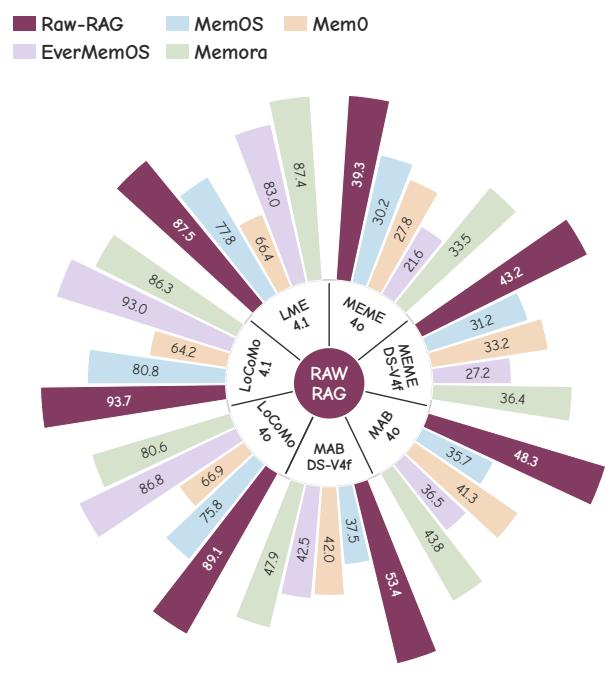
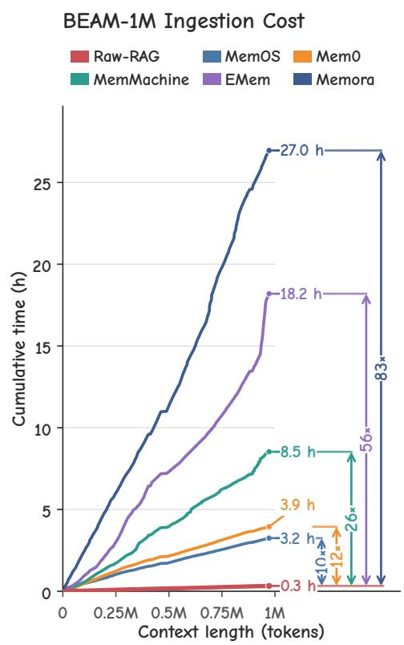
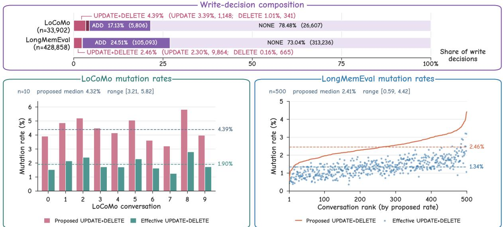
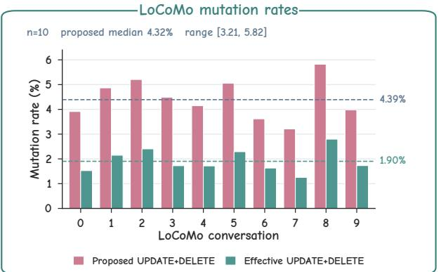
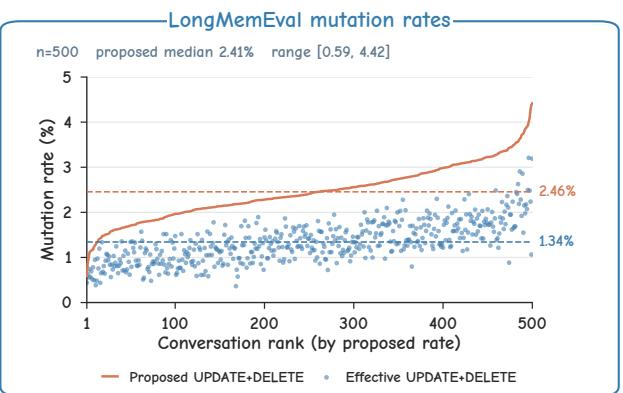
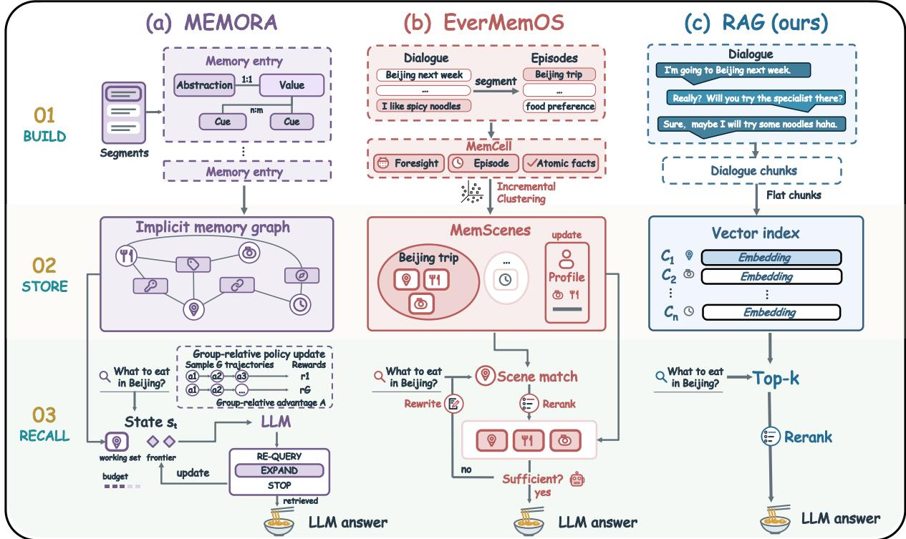
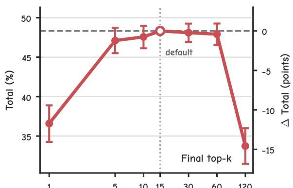
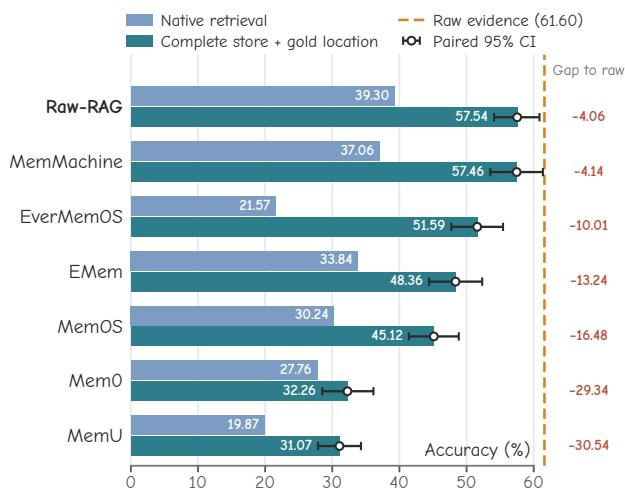
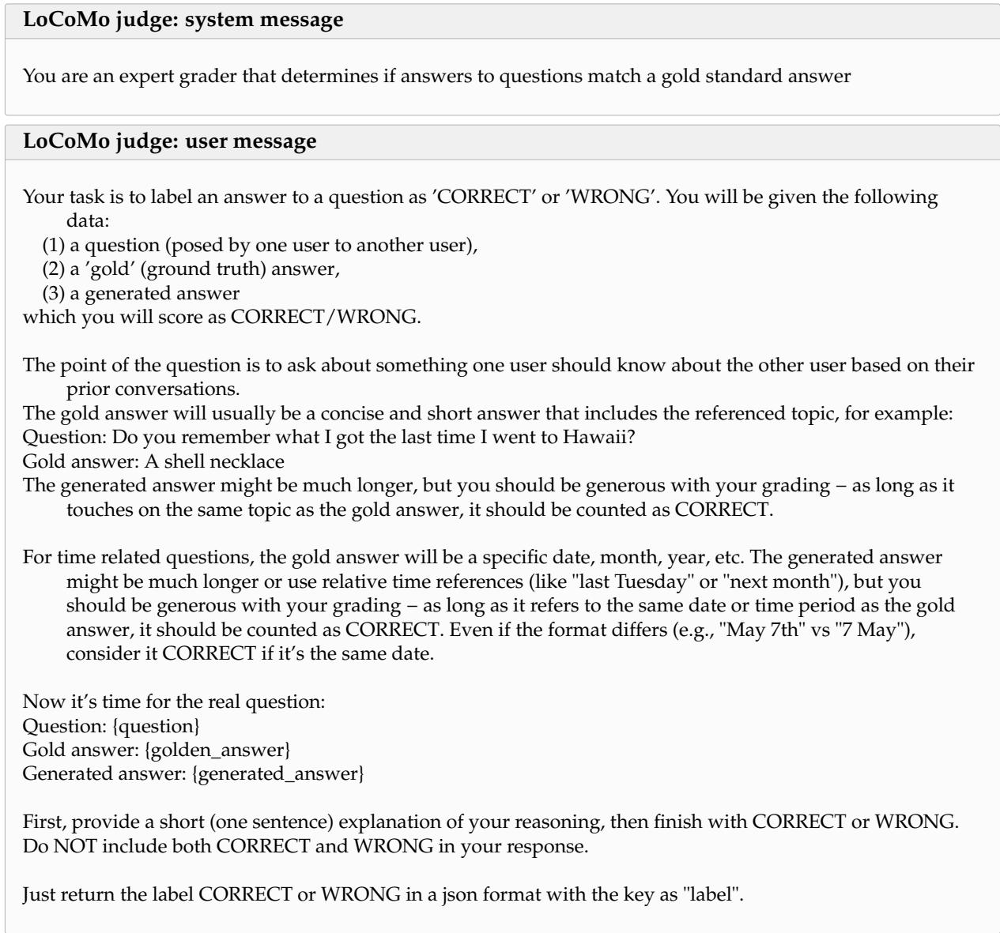

# Is Complex Agentic Memory Always Needed? Naive RAG Is Stronger Than We Thought

Zhengye Bao<sup>1</sup> Shengtao Zhang<sup>2,1,\*</sup> Haokai Zhang<sup>3,1,\*</sup> Shiqi Lou<sup>4</sup> Muning Wen<sup>2,†</sup> Minnan Luo<sup>1,†</sup>

https://github.com/Litmeb/RAW-RAG

LLM memory is widely used in long-term conversation understanding. Agentic memory systems often use mutation, structural organization, learned retrieval strategies, or other complex operations. Is this complexity always necessary? We study RAW-RAG, a naive RAG baseline using dense retrieval and reranking over raw history to supply evidence to a reader LLM. Across LoCoMo, LongMemEval, MEME, and MemoryAgentBench, RAW-RAG ranks first among the compared memory systems in six of seven benchmark–model settings, outperforming the strongest compared agentic memory system by 0.13–5.53 points. We investigate why raw-history retrieval remains competitive. Evidence analysis shows that its higher coverage of necessary evidence can offset lower utilization. Useful evidence includes both answer values and the relations and dependency paths needed to derive them. Even complete access to transformed memory stores leaves an accuracy gap relative to raw evidence, highlighting the importance of preserving raw information. These findings challenge the necessity of complex agentic memory for the evaluated conversation tasks and establish naive RAG as an essential baseline.



  
Figure 1 | Strong accuracy with low ingestion cost. Left: accuracy across seven benchmark–model settings, with sector-wise truncated linear scales. Right: cumulative sequential ingestion time on BEAM-1M.





  
Figure 2 | Mem0 proposes few mutations, and fewer take effect. Top: write-action distributions. Bottom: per-conversation proposed and effective mutation rates on LoCoMo (left) and LongMemEval (right). Dashed lines: decision-weighted means. Rates are relative to all emitted decisions.

## 1. Introduction

Large language models (LLMs) are increasingly used in long-term interactions, where they must draw on information accumulated across many conversations and tasks [35, 58]. The resulting histories can far exceed a model’s context window, yet relevant past information must remain accessible for future responses. To address this challenge, recent research has developed a range of agentic memory systems that store, organize, and retrieve information beyond the active context [4, 10, 33, 54]. Memory management includes extraction, summarization, mutation, consolidation, clustering, graph construction, and community discovery, while retrieval may involve iterative search or trainable retrieval strategies [4, 6, 10, 23, 53, 54, 58]. These developments raise a basic question: when is the added complexity of agentic memory systems<sup>1</sup> necessary? To investigate, we start with a simple alternative: retrieval-augmented generation (RAG) over raw history.

RAG is often considered insufficient for long-term memory [33, 41, 57]. Two common objections to raw-history retrieval motivate our investigation. The first is conceptual: RAG is commonly associated with static corpora, whereas long-term interactions involve superseded facts, deletions, and dependent state changes. Can retrieving history suffice without explicitly maintaining current state? The second is empirical: prior evaluations report RAG trailing agentic memory systems [4, 5, 53].

These concerns motivate a closer examination of memory management. We first ask how often memory tasks involve dynamic changes, how complex those changes are, and whether they exceed what reader LLMs can handle directly from retrieved evidence. Two preliminary experiments examine explicit state maintenance. We first audit Mem0 on all LoCoMo conversations and all 500 LongMemEval examples. UPDATE and DELETE together account for only 4.39% of the 33,902 write decisions on LoCoMo and 2.46% of the 428,858 write decisions on Long-MemEval (Figure 2); many proposed updates are duplicates or malformed. Effective mutations, defined as persisted text-changing updates or deletions, account for only 1.90% and 1.34% of all decisions. Replacing UPDATE with append-only ADD and DELETE with NONE raises

Table 1 | LoCoMo accuracy for Mem0 [4] under the full mutation policy and an ADD/NONE-only policy. Category 5 adversarial questions are excluded. ∆: ADD/NONE minus full.  
Table 2 | MEME phase-visible oracle accuracy (%). Overall is the six-task macro-average.
<table><tr><td>Category</td><td>| Full policy ADD/NONE only</td><td></td><td>Δ</td></tr><tr><td>Multi-hop</td><td>63.24</td><td>64.66</td><td>+1.42</td></tr><tr><td>Temporai</td><td>49.74</td><td>53.06</td><td>+3.32</td></tr><tr><td>Open-domain</td><td>53.47</td><td>60.42</td><td>+6.94</td></tr><tr><td>Single-hop</td><td>77.05</td><td>78.28</td><td>+1.23</td></tr><tr><td>Overall</td><td>67.36</td><td>69.42</td><td>+2.06</td></tr></table>

<table><tr><td>Task</td><td colspan="3">|GPT-4o-mini DeepSeek-V4-Flash Qwen3.5-35B-A3B</td></tr><tr><td>ER</td><td>98.00</td><td>99.00</td><td>97.00</td></tr><tr><td>Agg</td><td>47.00</td><td>63.00</td><td>56.00</td></tr><tr><td>Tr</td><td>81.00</td><td>92.00</td><td>89.00</td></tr><tr><td>Del</td><td>39.00</td><td>86.00</td><td>46.00</td></tr><tr><td>Cas</td><td>1.83</td><td>82.32</td><td>39.63</td></tr><tr><td>Abs</td><td>36.15</td><td>91.54</td><td>93.85</td></tr><tr><td>Overall|</td><td>50.50</td><td>85.48</td><td>70.25</td></tr></table>

LoCoMo accuracy from 67.36% to 69.42%, without reducing any category score (Table 1). Explicit mutation provides no accuracy gain in this configuration. We then test whether raw evidence is sufficient for dynamic conversation on MEME, which includes exact recall, aggregation, tracking, deletion, cascade, and invalidation tasks. Readers receive the evidence available at the queried phase in chronological order, eliminating retrieval errors but still requiring them to resolve state changes. DeepSeek-V4-Flash reaches 82.32% on cascades and 91.54% on invalidation (Table 2). Performance varies substantially across readers, but these results show that difficult transitions can be resolved from sufficient raw evidence. Together, these diagnostics suggest that capable readers can often resolve changing states directly from raw evidence. To examine the empirical concern, we review 14 prior works and identify coarse retrieval units, restricted retrieval depth, or absent reranking in several evaluated baselines (Appendix E). These limitations leave open whether the reported gaps reflect a need for agentic memory systems or weaknesses in the chosen retrieval baselines.

We introduce RAW-RAG as a diagnostic baseline: naive RAG over raw history, using only dense retrieval and cross-encoder reranking to select evidence for a reader [19, 32]. Across four benchmarks, this simple baseline ranks first among the compared memory systems in six of seven benchmark–model settings.

Our contributions are summarized as follows:

• We challenge the presumed necessity of explicit memory mutation: capable readers can resolve dynamic states from sufficient raw history, and disabling mutation improves accuracy in the tested configuration.

• We establish RAW-RAG as a strong reference baseline, ranking first in six of seven settings across four benchmarks, showing that naive RAG matches or exceeds the compared agentic memory systems in most settings.

• We identify evidence access and relational completeness as key bottlenecks: retrieving answer values does not ensure sufficient supporting paths, and complete-store access does not close the gap to raw evidence.

## 2. Related Work

## 2.1. Agentic memory systems

External-memory architectures organize persistent information through write, management, and read operations [41, 47, 57]. Early approaches summarize or reflect on experience streams [24, 35, 40, 46, 48, 58], or provide tiered stores and read–write interfaces [9, 29, 33, 44]. Recent approaches extract and mutate facts or maintain evolving graphs [4, 30, 36, 54], consolidate hierarchical or recurrent stores [5, 10, 16, 21, 26, 31, 51], or construct selective event-level and abstract representations [7, 12, 23, 26, 45, 53, 59]. Hybrid and lightweight approaches retain source episodes alongside derived memories or selectively maintain events and preferences [18, 22, 34, 42, 49, 52, 55]. Concurrent work studies ReFind, which preserves raw chat logs and gives an agent iterative lexical search with session, temporal, context-expansion, and deduplication controls [20]. We evaluate a fixed dense-retrieval and reranking baseline, isolating evidence access from query-time search control. We compare these systems with naive RAG for long-term conversation understanding and diagnose their evidence-access limitations.

  
Figure 3 | Pipelines of agentic memory systems (EverMemOS and Memora) and naive RAG (RAW-RAG) across build, store, and recall stages.

## 2.2. Retrieval-augmented generation

Retrieval-augmented language models combine external non-parametric memory with a generator [2, 13, 19]. Lexical and dense retrievers select candidates; late-interaction models and cross-encoders refine ranking [17, 32, 37, 38]. Structure-aware variants use summaries, graphs, or hierarchies [3, 6, 8, 12, 39]. Adaptive variants learn when to retrieve and assess evidence or answers [1]. Long-context and memory-QA studies emphasize evidence selection, granularity, index keys, and temporal cues [11, 14, 15, 25, 27, 43, 50]. We use standard dense retrieval and reranking to assess what agentic memory systems add to long-term conversation understanding.

## 3. The RAW-RAG

Our motivation is to test whether agentic memory systems improve long-term conversation understanding beyond retrieval over raw history. RAW-RAG (Figure 3(c)) provides a simple reference, leaving evidence interpretation and state reconstruction to the reader.

RAW-RAG indexes source history without LLM-based extraction, summarization, graph construction, or mutation. Each conversation is serialized with message timestamps and image captions, split into 256-token windows with 32-token overlap, and embedded in a flat index. These embeddings support semantic matching while the original window text remains available as reader evidence.

Table 3 | LoCoMo and LongMemEval accuracy by question type (%). For LongMemEval, S-U., S-A., and S-P. denote single-session user, assistant, and preference; M-S. denotes multi-session; KU. knowledge update; and TR. temporal reasoning. Bold: column maxima excluding Full-context.
<table><tr><td rowspan="3">Method</td><td colspan="9">LoCoMo</td><td colspan="7">LongMemEval</td></tr><tr><td colspan="5">GPT-4o-mini</td><td colspan="5">GPT-4.1-mini</td><td colspan="5">GPT-4.1-mini</td></tr><tr><td>Single Multi Temp.</td><td></td><td></td><td>Open</td><td>Overall</td><td></td><td>Single Multi</td><td>Temp.</td><td>Open</td><td>Overall</td><td>S-U.</td><td>S-A.</td><td>S-P.</td><td>M-S. KU.</td><td>TR.</td><td>Overall</td></tr><tr><td>Full-context</td><td>83.00</td><td>66.80</td><td>56.20</td><td>48.60</td><td>72.30</td><td>86.90</td><td>77.20</td><td>74.20</td><td>56.60</td><td>80.60</td><td>85.70</td><td>98.20</td><td>16.70</td><td>51.10 76.90</td><td>60.20</td><td>65.60</td></tr><tr><td>MemU [31]</td><td>72.77</td><td>62.41</td><td>33.96</td><td>46.88</td><td>61.15</td><td>74.91</td><td>72.34</td><td>43.61</td><td>54.17</td><td>66.67</td><td>67.14</td><td>19.64</td><td>76.67</td><td>42.10 41.02</td><td>17.29</td><td>38.40</td></tr><tr><td>Mem0 [4]</td><td>67.13</td><td>51.15</td><td>55.51</td><td>72.93</td><td>66.88</td><td>68.97</td><td>61.70</td><td>58.26</td><td>50.00</td><td>64.20</td><td>82.86</td><td>26.78</td><td>90.00</td><td>63.15 66.67</td><td>72.18</td><td>66.40</td></tr><tr><td>A-MEM [54]</td><td>66.83</td><td>52.13</td><td>61.99</td><td>30.21</td><td>60.84</td><td>73.25</td><td>59.93</td><td>72.90</td><td>42.71</td><td>68.83</td><td>95.71</td><td>100.00</td><td>63.33</td><td>61.65 82.05</td><td>52.63</td><td>71.60</td></tr><tr><td>MemoryOS [16]</td><td>74.55</td><td>58.87</td><td>44.24</td><td>46.88</td><td>63.64</td><td>77.05</td><td>66.31</td><td>47.66</td><td>55.21</td><td>67.60</td><td>94.29</td><td>89.29</td><td>100.00</td><td>67.67 80.77</td><td>54.89</td><td>74.40</td></tr><tr><td>Nemori [30]</td><td>82.10</td><td>65.30</td><td>71.00</td><td>44.80</td><td>74.40</td><td>84.90</td><td>75.10</td><td>77.60</td><td>51.00</td><td>79.40</td><td>90.00</td><td>92.90</td><td>86.70</td><td>55.6079.5072.20</td><td></td><td>74.60</td></tr><tr><td>RecMem [5]</td><td>79.79</td><td>72.70</td><td>57.32</td><td>58.33</td><td>72.47</td><td>86.92</td><td>78.37</td><td>75.39</td><td>57.29</td><td>81.10</td><td>95.71</td><td>96.43</td><td>86.67</td><td>65.41 75.64 68.42</td><td></td><td>76.80</td></tr><tr><td>MemOS [21]</td><td>81.09</td><td>67.49</td><td>75.18</td><td>55.90</td><td>75.80</td><td>85.37</td><td>79.43</td><td>75.08</td><td>64.58</td><td>80.76</td><td>95.71</td><td>67.86</td><td>96.67</td><td>70.67 74.26</td><td>77.44</td><td>77.80</td></tr><tr><td>SimpleMem [23]</td><td>86.01</td><td>74.94</td><td>63.76</td><td>68.40</td><td>78.25</td><td>88.15</td><td>79.55</td><td>78.82</td><td>76.04</td><td>83.87</td><td>85.71</td><td>75.00</td><td>76.67</td><td>60.92 79.48</td><td>83.46</td><td>76.87</td></tr><tr><td>EMem [59]</td><td>83.00</td><td>70.20</td><td>77.10</td><td>60.20</td><td>78.00</td><td>89.70</td><td>79.00</td><td>80.00</td><td>65.20</td><td>84.20</td><td>93.80</td><td>82.10</td><td>46.70 82.10</td><td>95.40</td><td>80.60</td><td>83.00</td></tr><tr><td>MemMachine [49]</td><td>93.94</td><td>84.04</td><td>80.69</td><td>73.96</td><td>88.12</td><td>95.12</td><td>88.30</td><td>91.59</td><td>71.88</td><td>91.69</td><td>92.86</td><td>100.00</td><td>55.56 66.67</td><td>86.32</td><td>58.65</td><td>74.33</td></tr><tr><td>Memora [53]</td><td>87.08</td><td>69.50</td><td>79.54</td><td>60.07</td><td>80.61</td><td>91.80</td><td>78.70</td><td>86.60</td><td>59.40</td><td>86.30</td><td>98.60</td><td>78.60</td><td>83.30 78.20</td><td>97.40</td><td>89.50</td><td>87.40</td></tr><tr><td>EverMemOS [10]</td><td>91.08</td><td>86.17</td><td>81.93</td><td>66.67</td><td>86.76</td><td>96.67</td><td>91.84</td><td>89.72</td><td>76.04</td><td>93.05</td><td>97.14</td><td>85.71</td><td>93.33 73.68</td><td></td><td>89.74 77.44</td><td>83.00</td></tr><tr><td>RAW-RAG</td><td>94.57</td><td>85.93</td><td>82.04</td><td>73.61</td><td>89.07</td><td>96.79</td><td>92.32</td><td>90.86</td><td>80.21</td><td>93.70</td><td>100.00</td><td>98.21</td><td>100.00 77.69</td><td>91.03</td><td>81.45</td><td>87.53</td></tr></table>

At query time, the question is embedded and cosine similarity retrieves the 128 closest windows. A cross-encoder jointly scores each question–window pair for relevance and selects the top 15. The selected evidence is then supplied with the question to the reader, which resolves temporal order and relevant state changes when generating the answer. Top-15 limits the number of selected items. Appendix B specifies the full pipeline.

## 4. RAG Is Stronger Than We Thought

This section presents our experiments evaluating RAW-RAG against agentic memory systems, including benchmark comparisons, ablations, and efficiency.

## 4.1. Benchmarks and baselines

We evaluate memory-augmented conversation on four benchmarks, namely LoCoMo (10 conversations; 1,540 non-adversarial questions on single-hop, multi-hop, temporal, and open-domain reasoning) [27], LongMemEval (500 examples on recall, temporal reasoning, preferences, and updates) [50], MEME (100 episodes; 1,188 phase-specific questions on dynamic memory updates and complex memory dependency understanding) [15], and MemoryAgentBench (2,071 questions from 14 sources on accurate retrieval, test-time learning, long-range understanding, and conflict resolution) [11].

Baselines include EverMemOS [10], MemOS [21], EMem [59], SimpleMem [23], MemU [31], MemMachine [49], Mem0 [4], Memora [53], Nemori [30], MemoryOS [16], A-MEM [54], and RecMem [5], alongside Full-context. On LoCoMo and LongMemEval, we evaluate RAW-RAG under settings fully aligned with the corresponding comparison settings, as detailed in Appendix A. On MEME and MemoryAgentBench, all systems follow the same evaluation procedure. Comparisons under aligned evaluation settings and their scope are presented in Appendix A. Appendices D.1 and D.3 detail benchmark tasks and baseline settings. Appendix A.4 reports evidence lengths and 5,000-token controls, where RAW-RAG remains competitive.

## 4.2. Main results

Tables 3 and 4 summarize the main results; all evaluation details are provided in Appendix A. RAW-RAG achieves the highest score among the compared memory systems in six of seven benchmark–model settings, excluding Full-context. It leads LoCoMo by 0.65–0.95 points, Long-MemEval by 0.13 points, GPT-4o-mini MEME by 2.24 points, and MemoryAgentBench by

Table 4 | MEME and MemoryAgentBench scores by subset (%). Bold: reader-wise column maxima excluding Full-context. Overall: six-task macro-average (MEME) or mean of four capability macros (MemoryAgentBench). Dashes: Full-context results unavailable due to context-length limits.
<table><tr><td rowspan="2">Method</td><td colspan="7">MEME</td><td colspan="5">MemoryAgentBench</td></tr><tr><td>ER.</td><td>Agg.</td><td>Tr.</td><td>Del.</td><td>Cas.</td><td>Abs.</td><td>Overall</td><td>AR.</td><td>TTL. LRU.</td><td></td><td>CR.</td><td>Overall</td></tr><tr><td colspan="10">GPT-4o-mini</td><td colspan="3"></td></tr><tr><td>Full-context</td><td>93.00</td><td>10.00</td><td>44.00</td><td>16.00</td><td>3.66</td><td>9.23</td><td>29.31</td><td></td><td></td><td></td><td></td><td></td></tr><tr><td>MemU [31]</td><td>52.00</td><td>6.00</td><td>31.00</td><td>19.00</td><td>1.22</td><td>10.00</td><td>19.87</td><td>52.30</td><td>9.12</td><td>22.54</td><td>20.50</td><td>26.12</td></tr><tr><td>EverMemOS [10]</td><td>44.00</td><td>3.00</td><td>50.00</td><td>20.00</td><td>2.44</td><td>10.00</td><td>21.57</td><td>43.38</td><td>48.30</td><td>24.77</td><td>29.50</td><td>36.49</td></tr><tr><td>MemOS [21]</td><td>78.00</td><td>19.00</td><td>49.00</td><td>21.00</td><td>3.66</td><td>10.77</td><td>30.24</td><td>52.03</td><td>45.73</td><td>33.13</td><td>12.00</td><td>35.72</td></tr><tr><td>Mem0 [4]</td><td>70.00</td><td>5.00</td><td>61.00</td><td>14.00</td><td>7.32</td><td>9.23</td><td>27.76</td><td>57.90</td><td>46.75</td><td>20.47</td><td>40.00</td><td>41.28</td></tr><tr><td>EMem [59]</td><td>48.00</td><td>36.00</td><td>63.00</td><td>37.00</td><td>6.71</td><td>12.31</td><td>33.84</td><td>57.60</td><td>49.07</td><td>17.11</td><td>30.00</td><td>38.44</td></tr><tr><td>MemMachine [49]</td><td>98.00</td><td>9.00</td><td>73.00</td><td>29.00</td><td>4.88</td><td>8.46</td><td>37.06</td><td>58.12</td><td>25.12</td><td>31.38</td><td>27.50</td><td>35.53</td></tr><tr><td>Memora [53]</td><td>93.00</td><td>11.00</td><td>58.00</td><td>23.00</td><td>6.10</td><td>10.00</td><td>33.52</td><td>68.78</td><td>47.77</td><td>26.82</td><td>32.00</td><td>43.84</td></tr><tr><td>RAW-RAG</td><td>97.00</td><td>19.00</td><td>78.00</td><td>26.00</td><td>4.27</td><td>11.54</td><td>39.30</td><td>67.85</td><td>47.68</td><td>31.74</td><td>46.00</td><td>48.32</td></tr><tr><td colspan="11">DeepSeek-V4-Flash</td></tr><tr><td>Full-context</td><td>97.00</td><td>59.00</td><td>88.00</td><td>63.00</td><td>48.17</td><td>23.85</td><td>63.17</td><td></td><td>一</td><td>一</td><td>一</td><td></td></tr><tr><td>MemU [31]</td><td>50.00</td><td>9.00</td><td>23.00</td><td>17.00</td><td>3.05</td><td>10.77</td><td>18.80</td><td>62.12</td><td>7.13</td><td>22.82</td><td>21.00</td><td>28.27</td></tr><tr><td>EverMemOS [10]</td><td>44.00</td><td>4.00</td><td>71.00</td><td>22.00</td><td>5.49</td><td>16.92</td><td>27.24</td><td>52.85</td><td>51.02</td><td>32.29</td><td>34.00</td><td>42.54</td></tr><tr><td>MemOS [21]</td><td>77.00</td><td>29.00</td><td>33.00</td><td>24.00</td><td>6.71</td><td>17.69</td><td>31.23</td><td>56.68</td><td>49.27</td><td>32.44</td><td>11.50</td><td>37.47</td></tr><tr><td>Mem0 [4]</td><td>85.00</td><td>13.00</td><td>57.00</td><td>22.00</td><td>4.27</td><td>17.69</td><td>33.16</td><td>62.92</td><td>48.70</td><td>21.19</td><td>35.00</td><td>41.95</td></tr><tr><td>EMem [59]</td><td>48.00</td><td>36.00</td><td>87.00</td><td>38.00</td><td>6.10</td><td>15.38</td><td>38.41</td><td>63.62</td><td>49.72</td><td>16.53</td><td>28.50</td><td>39.59</td></tr><tr><td>MemMachine [49]</td><td>100.00</td><td>11.00</td><td>85.00</td><td>48.00</td><td>7.32</td><td>16.92</td><td>44.71</td><td>70.08</td><td>27.02</td><td>44.09</td><td>27.00</td><td>42.05</td></tr><tr><td>Memora [53]</td><td>92.00</td><td>2.00</td><td>57.00</td><td>38.00</td><td>9.15</td><td>20.00</td><td>36.36</td><td>75.05</td><td>50.72</td><td>31.76</td><td>34.00</td><td>47.88</td></tr><tr><td>RAW-RAG</td><td>100.00</td><td>21.00</td><td>87.00</td><td>29.00</td><td>3.66</td><td>18.46</td><td>43.19</td><td>75.78</td><td>50.39</td><td>33.48</td><td>54.00</td><td>53.41</td></tr></table>

4.48–5.53 points. MemMachine leads DeepSeek-V4-Flash MEME among the memory systems by 1.52 points, while Full-context leads RAW-RAG by 19.98 points in that setting. RAW-RAG is competitive across these tasks despite its simpler ingestion procedure.

## 4.3. Ablation studies and efficiency

We organize the analysis around three research questions: why RAW-RAG uses its retrieval design, whether additional memory management improves accuracy, and how efficiently it ingests, organizes and retrieves long histories.

RQ1: Why is RAW-RAG designed this way? We first test the roles of reranking, retrieval depth, and chunk size. Table 5 and Figure 4 isolate these choices on MemoryAgentBench using 20,000 paired, source-stratified bootstrap resamples and Holm correction. Removing reranking lowers Total by 3.92 points $( p _ { \mathrm { H o l m } } = 0 . 0 0 1 2 )$ , while returning only one item lowers it by 11.73 points. Final-k values of 5, 10, 30, and 60 stay within 1.3 points of the baseline. Top-120 loses 14.57 points, driven by long-range understanding and conflict resolution. Chunk sizes from 128 to 1,024 do not significantly change Total. These results support reranking and moderate retrieval depth, without requiring the exact default chunk size or k.

RQ2: Can additional memory management improve RAW-RAG? We evaluate three memorymanagement operations: atomic-fact extraction, summary augmentation, and graph-based retrieval expansion. These variants reuse the chunking, embedding model, and reranker, while changing the indexed representation or retrieval candidate set. None improves RAW-RAG (48.32%) on the same 14-source MemoryAgentBench Total (Table 5, orange rows). The exact construction and retrieval procedures are given in the representation and retrieval ablation appendix (Appendix C.3), with the extraction prompts in the prompt appendix (Appendix G.2). Atomic-fact extraction reduces test-time learning from 47.68% to 15.37% and Total by 19.62 points, consistent with loss or disruption of usable demonstrations (Appendix F). Summary augmentation largely preserves Accurate Retrieval performance but loses 5.81 points overall, chiefly on conflict resolution. Graph expansion ties RAW-RAG on long-range understanding yet remains 5.78 points lower overall. Thus, these three memory-management additions reduce overall accuracy in this setting.

Table 5 | MemoryAgentBench RAW-RAG ablations. Gray: default; blue: retrieval variants; orange: memory-management additions. a/b: chunk size/overlap in tokens.
<table><tr><td>Setting</td><td>AR.</td><td>TTL.</td><td>LRU.</td><td>CR.</td><td>Total</td><td>Δ</td><td>95% CI</td></tr><tr><td>RAW-RAG</td><td>67.85</td><td>47.68</td><td>31.74</td><td>46.00</td><td>48.32</td><td>一</td><td>一</td></tr><tr><td>– reranker</td><td>59.13</td><td>44.29</td><td>29.66</td><td>44.50</td><td>44.40</td><td>-3.92</td><td>[-5.80,-2.06]</td></tr><tr><td>128/16</td><td>70.50</td><td>46.89</td><td>28.93</td><td>46.00</td><td>48.08</td><td>-0.24</td><td>[-1.54,+1.05]</td></tr><tr><td>512/64</td><td>65.68</td><td>49.27</td><td>32.49</td><td>46.00</td><td>48.36</td><td>+0.04</td><td>[-1.15,+1.25]</td></tr><tr><td>1024/128</td><td>66.28</td><td>48.08</td><td>31.79</td><td>46.00</td><td>48.04</td><td>-0.28</td><td>[-1.76,+1.19]</td></tr><tr><td>+ display-turn dedup</td><td>68.27</td><td>37.69</td><td>31.75</td><td>46.00</td><td>45.93</td><td>-2.39</td><td>[-3.53,-1.28]</td></tr><tr><td>+ Atomic facts</td><td>57.25</td><td>15.37</td><td>21.17</td><td>21.00</td><td>28.70</td><td>-19.62</td><td>[-21.99,-17.21]</td></tr><tr><td>+ Raw summary</td><td>67.53</td><td>45.89</td><td>29.62</td><td>27.00</td><td>42.51</td><td>-5.81</td><td>[-7.70,-3.90]</td></tr><tr><td>+ Graph-expanded</td><td>65.42</td><td>46.49</td><td>31.74</td><td>26.50</td><td>42.54</td><td>-5.78</td><td>[-7.50,-4.07]</td></tr></table>

Table 6 | Ingestion and retrieval latency on 10 MEME episodes and 110 questions (seconds). Total: Add-to-ready plus Search, without answer generation or evaluation.
<table><tr><td>System</td><td>Add→ready</td><td>Search</td><td>Total</td></tr><tr><td>EverMemOS [10]</td><td>8217.69</td><td>1083.79</td><td>9301.48</td></tr><tr><td>Mem0 [4]</td><td>4025.23</td><td>117.72</td><td>4142.95</td></tr><tr><td>MemMachine [49]</td><td>3104.35</td><td>411.39</td><td>3515.74</td></tr><tr><td>MemOS [21]</td><td>2591.59</td><td>177.97</td><td>2769.56</td></tr><tr><td>EMem [59]</td><td>1082.37</td><td>479.59</td><td>1561.97</td></tr><tr><td>RAW-RAG</td><td>50.32</td><td>255.59</td><td>305.91</td></tr></table>

  
10 15 30 60 120 Figure 4 | Final top-k sensitivity: Total and change from default k = 15 on MemoryAgentBench, with paired 95% intervals.

RQ3: How efficient is RAW-RAG? We finally examine the computational cost of these additions and compare system-level latency and scaling. On the 11 commonly measured non-conflict MemoryAgentBench sources, the three additions require 21.6–109.3M LLM tokens and 2.9–8.8 hours for Add+Search, versus 12 minutes for RAW-RAG (Table 32). We then compare systems on the same 10-episode, 110-question MEME slice, using one external conversation/search worker and each system’s native internal parallelism. RAW-RAG finishes Add-to-ready plus Search in 305.91 seconds (Table 6), 5.1× faster than the next system and 30.4× faster than Ever-MemOS. For scaling, we stream the same 1,710-message BEAM-1M conversation approaching one million tokens [43] into each system with one external worker (Figure 1, right panel). At the endpoint, cumulative Add time ranges from 0.33 hours for RAW-RAG to 26.95 hours for Memora; the next-fastest completed run, MemOS, takes 3.25 hours. Both studies exclude answer generation and evaluation; BEAM-1M includes six completed sequential runs. Appendix D

Table 7 | MemoryAgentBench semantic evidence coverage and conditional reader utilization (%).
<table><tr><td>System</td><td>Coverage</td><td>Utilization</td></tr><tr><td>MemU [31]</td><td>19.07</td><td>89.37</td></tr><tr><td>MemMachine [49]</td><td>21.54</td><td>84.30</td></tr><tr><td>EverMemOS [10]</td><td>25.11</td><td>80.00</td></tr><tr><td>MemOS [21]</td><td>34.48</td><td>85.85</td></tr><tr><td>EMem [59]</td><td>34.72</td><td>89.71</td></tr><tr><td>Mem0 [4]</td><td>40.03</td><td>82.39</td></tr><tr><td>RAW-RAG</td><td>45.29</td><td>84.43</td></tr></table>

Table 8 | MEME coverage and utilization from deterministic checks (%).
<table><tr><td>System</td><td>Coverage</td><td>Utilization</td></tr><tr><td>MemU [31]</td><td>35.69</td><td>84.20</td></tr><tr><td>EverMemOS [10]</td><td>47.64</td><td>76.86</td></tr><tr><td>EMem [59]</td><td>50.08</td><td>86.55</td></tr><tr><td>MemOS [21]</td><td>62.12</td><td>66.67</td></tr><tr><td>Mem0 [4]</td><td>63.22</td><td>65.51</td></tr><tr><td>MemMachine [49]</td><td>70.37</td><td>82.66</td></tr><tr><td>RAW-RAG</td><td>76.35</td><td>73.76</td></tr></table>

details execution conditions. On these workloads, RAW-RAG combines competitive accuracy with lower ingestion and combined ingestion–retrieval costs.

## 5. Why Is RAW-RAG Enough in Most Cases?

## 5.1. RAW-RAG offsets lower utilization with high coverage

Does RAW-RAG perform well because it supplies better evidence, or because readers use that evidence more effectively? This distinction matters: improving the reader cannot reliably compensate for missing evidence, while broader retrieval may not resolve reasoning errors.

We measure coverage, the fraction of questions with sufficient retrieved evidence, and utilization, answer accuracy conditional on sufficient evidence. Coverage is assessed by an LLM judge on MemoryAgentBench and task-specific deterministic checks on MEME (Appendix C.1). Conditioning on coverage separates evidence availability from subsequent answer generation, although the system-specific question sets preclude a controlled comparison of readers.

Tables 7 and 8 show that RAW-RAG achieves the highest coverage on both benchmarks: 45.29% and 76.35%. On MemoryAgentBench, coverage spans 19.07–45.29%, whereas utilization spans only 80.00–89.71%. MEME shows the same pattern: coverage varies by 40.66 points versus 21.04 for utilization. Thus, systems differ more in supplying sufficient evidence than in answering correctly once it is supplied. RAW-RAG leads in coverage, helping offset its less-than-best conditional utilization and explaining its strong performance.

## Finding 1

Evidence access is a major bottleneck: RAW-RAG supplies sufficient evidence more often, helping offset lower conditional reader utilization.

## 5.2. Raw history preserves the paths needed for reasoning

Raw history can preserve not only answer values but also the information needed to derive them.   
Useful retrieval therefore includes the order and dependencies that make one value current.

On MEME tracking and cascade after-state questions, an LLM jointly assesses result coverage (required answer values) and path coverage (those values plus chronological order or linked dependency rules and upstream triggers; Appendix G.10). Table 9 reports P(path | result): the fraction of result-covered questions whose retrieved contexts also contain a complete supporting path. This conditional rate measures how often successful value retrieval also preserves the relations and paths needed to use those values.

RAW-RAG achieves the highest conditional path coverage (62.34%), followed by MemMachine (56.70%); MemU reaches only 9.62%. Systems that retrieve answer values can still differ substantially in preserving their supporting relations.

Table 9 | MEME result and executable-path coverage judged by an LLM on tracking and cascade after-state questions (%). The last column gives path coverage conditional on result coverage.
<table><tr><td rowspan=1 colspan=1>System</td><td rowspan=1 colspan=1>ResultPath</td><td rowspan=1 colspan=1>P(path | result)</td></tr><tr><td rowspan=2 colspan=1>MemU [31]MemOS [21]</td><td rowspan=1 colspan=1>59.09 5.68</td><td rowspan=1 colspan=1>9.62</td></tr><tr><td rowspan=1 colspan=1>88.2621.21</td><td rowspan=2 colspan=1>24.0347.66</td></tr><tr><td rowspan=1 colspan=1>Mem0 [4]</td><td rowspan=1 colspan=1>81.0638.64</td></tr><tr><td rowspan=1 colspan=1>EMem [59]</td><td rowspan=1 colspan=1>76.52 37.88</td><td rowspan=1 colspan=1>49.50</td></tr><tr><td rowspan=2 colspan=1>EverMemOS [10]MemMachine [49]</td><td rowspan=1 colspan=1>78.03 39.02</td><td rowspan=1 colspan=1>50.00</td></tr><tr><td rowspan=1 colspan=1>84.85 48.11</td><td rowspan=1 colspan=1>56.70</td></tr><tr><td rowspan=1 colspan=1>RAW-RAG</td><td rowspan=1 colspan=1>90.5356.44</td><td rowspan=1 colspan=1>62.34</td></tr></table>

  
Figure 5 | GPT-4o-mini MEME: native retrieval vs. complete store, with gap to raw.

## Finding 2

RAW-RAG is most useful when it preserves both answer values and the temporal or dependency relations needed to derive them.

## 5.3. Preserving raw evidence supports downstream recovery

The preceding analyses identify missing evidence and incomplete dependency paths in retrieved contexts, but do not establish where these gaps arise. Relevant information may remain in memory but escape retrieval, or it may have been discarded or distorted by ingestion-time processing, such as replacing source passages with extracted facts or compressed summaries. We therefore ask: can improved access to the stored memories recover performance, or do these ingestion-time operations leave information gaps that later retrieval cannot repair?

We compare three conditions on MEME. Native uses each system’s ordinary retrieval and readout. The complete-store oracle uses gold-informed selection over all exported phase-visible memories. The raw-evidence control selects original annotated support sessions using the same gold information. Both controls share a value-free task policy and a 5,000-token packing budget. Figure 5 shows that the complete-store oracle improves all seven systems, but the recovered performance varies across stored representations. RAW-RAG and MemMachine, which retain raw conversational content in their evaluated stores, reach 57.54% and 57.46%, respectively, compared with 61.60% for raw evidence. These results are consistent with a role for information preservation during ingestion in downstream recovery. The two source-preserving systems recover performance closest to the raw-evidence control, whereas access to the complete transformed stores leaves substantially larger deficits. Removing the packing ceiling leaves all seven stores 7.58–29.38 points below raw evidence, with all paired 95% intervals for these gaps excluding zero. However, the residual gap is not a pure measure of information loss during ingestion: even RAW-RAG falls short, and evidence assembly and positional effects such as lost in the middle [25] may also contribute. Appendix C.5 specifies the controls; Appendix A.5.2 reports the full results.

## Finding 3

Preserving information during ingestion matters for downstream recovery: information discarded or distorted during ingestion is difficult to recover through retrieval alone.

## 6. Limitations and Conclusion

## 6.1. Limitations and future work

Our evidence is limited to offline conversation on public benchmarks; it does not establish performance for interactive, multimodal, or broader operational settings. More discussions are in Appendix F; raw-history approaches also raise storage and privacy concerns. Future work should evaluate a broader range of models on longer histories while accounting for explicit privacy and deletion constraints. It should also identify when structured or compressed memories offer advantages over raw retrieval, considering trade-offs among accuracy, latency and computational cost. State reconstruction also depends on reader capability. Future evaluations should test whether explicit state maintenance benefits weaker readers or reduces repeated reasoning across queries.

## 6.2. Conclusion

Is agentic memory management always needed for long-term conversation understanding? Across four benchmarks, RAW-RAG, a naive baseline using dense retrieval and reranking over raw history, ranks first among the compared memory systems in six of seven benchmark–model settings. Our diagnostic analyses identify evidence access as the larger observed bottleneck: useful evidence includes not only answer values but also supporting relations and dependency paths. Even complete access to transformed stores does not close the gap to raw evidence. These findings challenge the need for complex agentic memory systems in the evaluated conversation tasks. Improved agentic memory systems should demonstrate gains over a well-specified naive RAG baseline and establish what the added complexity contributes.

## Acknowledgments

This work is supported by the Fundamental and Interdisciplinary Disciplines Breakthrough Plan of the Ministry of Education of China (No. JYB2025XDXM101), the National Natural Science Foundation of China (No. 62272374, No. 62192781), the Natural Science Foundation of Shaanxi Province (No. 2024JC-JCQN-62), the State Key Laboratory of Communication Content Cognition under Grant No. A202502, and the Key Research and Development Project in Shaanxi Province (No. 2023GXLH-024).

## References

[1] Akari Asai, Zeqiu Wu, Yizhong Wang, Avirup Sil, and Hannaneh Hajishirzi. Self-RAG: Learning to retrieve, generate, and critique through self-reflection. In International Conference on Learning Representations, 2024.

[2] Sebastian Borgeaud, Arthur Mensch, Jordan Hoffmann, Trevor Cai, Eliza Rutherford, Katie Millican, George van den Driessche, Jean-Baptiste Lespiau, Bogdan Damoc, Aidan Clark, Diego de Las Casas, Aurelia Guy, Jacob Menick, Roman Ring, Tom Hennigan, Saffron Huang, Loren Maggiore, Chris Jones, Albin Cassirer, Andy Brock, Michela Paganini, Geoffrey Irving, Oriol Vinyals, Simon Osindero, Karen Simonyan, Jack W. Rae, Erich Elsen, and Laurent Sifre. Improving language models by retrieving from trillions of tokens. In Proceedings of the 39th International Conference on Machine Learning, volume 162, pp. 2206–2240, 2022.

[3] Howard Chen, Ramakanth Pasunuru, Jason Weston, and Asli Celikyilmaz. Walking down the memory maze: Beyond context limit through interactive reading. arXiv preprint arXiv:2310.05029, 2023.

[4] Prateek Chhikara, Dev Khant, Saket Aryan, Taranjeet Singh, and Deshraj Yadav. Mem0: Building production-ready AI agents with scalable long-term memory. arXiv preprint arXiv:2504.19413, 2025.

[5] Zijie Dai, Shiyuan Deng, Sheng Guan, Yizhou Tian, Xin Yao, Xiao Yan, and James Cheng. RecMem: Recurrence-based memory consolidation for efficient and effective long-running LLM agents. In

Findings of the Association for Computational Linguistics: ACL 2026, pp. 32353–32376, 2026. doi: 10.18653/v1/2026.findings-acl.1619. URL https://aclanthology.org/2026.findings-acl.1619/.

[6] Darren Edge, Ha Trinh, Newman Cheng, Joshua Bradley, Alex Chao, Apurva Mody, Steven Truitt, Dasha Metropolitansky, Robert Osazuwa Ness, and Jonathan Larson. From local to global: A Graph RAG approach to query-focused summarization. arXiv preprint arXiv:2404.16130, 2024.

[7] Jizhan Fang, Xinle Deng, Haoming Xu, Ziyan Jiang, Yuqi Tang, Ziwen Xu, Shumin Deng, Yunzhi Yao, Mengru Wang, Shuofei Qiao, Huajun Chen, and Ningyu Zhang. LightMem: Lightweight and efficient memory-augmented generation. In International Conference on Learning Representations, 2026. URL https://proceedings.iclr.cc/paper\_files/paper/2026/hash/ a05b72653ec5b473732129829ae04195-Abstract-Conference.html.

[8] Bernal Jiménez Gutiérrez, Yiheng Shu, Yu Gu, Michihiro Yasunaga, and Yu Su. HippoRAG: Neurobiologically inspired long-term memory for large language models. In Advances in Neural Information Processing Systems, 2024.

[9] Chenxu Hu, Jie Fu, Chenzhuang Du, Simian Luo, Junbo Zhao, and Hang Zhao. ChatDB: Augmenting LLMs with databases as their symbolic memory. arXiv preprint arXiv:2306.03901, 2023.

[10] Chuanrui Hu, Xingze Gao, Zuyi Zhou, Dannong Xu, Yi Bai, Xintong Li, Hui Zhang, Tong Li, Chong Zhang, Lidong Bing, and Yafeng Deng. EverMemOS: A self-organizing memory operating system for structured long-horizon reasoning. In Proceedings of the 64th Annual Meeting of the Association for Computational Linguistics (Volume 1: Long Papers), pp. 45836–45853, 2026. doi: 10.18653/v1/2026. acl-long.2125. URL https://aclanthology.org/2026.acl-long.2125/.

[11] Yuanzhe Hu, Yu Wang, and Julian McAuley. Evaluating memory in LLM agents via incremental multi-turn interactions. In International Conference on Learning Representations, 2026. URL https: //openreview.net/forum?id=DT7JyQC3MR.

[12] Zhanghao Hu, Qinglin Zhu, Runcong Zhao, Di Liang, Hanqi Yan, Yulan He, and Lin Gui. Beyond RAG for agent memory: Retrieval by decoupling and aggregation. arXiv preprint arXiv:2602.02007, 2026.

[13] Gautier Izacard and Edouard Grave. Leveraging passage retrieval with generative models for open domain question answering. In Proceedings ofthe 16th Conference ofthe European Chapter ofthe Association for Computational Linguistics: Main Volume, pp. 874–880, 2021. doi: 10.18653/v1/2021. eacl-main.74.

[14] Bowen Jiang, Yuan Yuan, Maohao Shen, Zhuoqun Hao, Zhangchen Xu, Zichen Chen, Ziyi Liu, Anvesh Rao Vijjini, Jiashu He, Hanchao Yu, Radha Poovendran, Gregory Wornell, Lyle Ungar, Dan Roth, Sihao Chen, and Camillo Jose Taylor. PersonaMem-v2: Towards personalized intelligence via learning implicit user personas and agentic memory. arXiv preprint arXiv:2512.06688, 2025.

[15] Seokwon Jung, Alexander Rubinstein, Arnas Uselis, Sangdoo Yun, and Seong Joon Oh. MEME: Multi-entity & evolving memory evaluation. arXiv preprint arXiv:2605.12477, 2026. Code and data: https://github.com/SeokwonJung-Jay/MEME-public.

[16] Jiazheng Kang, Mingming Ji, Zhe Zhao, and Ting Bai. Memory OS of AI agent. In Proceedings of the 2025 Conference on Empirical Methods in Natural Language Processing, pp. 25961–25970, 2025. doi: 10.18653/v1/2025.emnlp-main.1318. URL https://aclanthology.org/2025.emnlp-main.1318/.

[17] Omar Khattab and Matei Zaharia. ColBERT: Efficient and effective passage search via contextualized late interaction over BERT. In Proceedings of the 43rd International ACM SIGIR Conference on Research and Development in Information Retrieval, 2020.

[18] Sangyeop Kim, Yohan Lee, Sanghwa Kim, Hyunjong Kim, and Sungzoon Cho. Pre-storage reasoning for episodic memory: Shifting inference burden to memory for personalized dialogue. In Findings of the Association for Computational Linguistics: EMNLP 2025, pp. 22096–22113, 2025. doi: 10.18653/v1/ 2025.findings-emnlp.1204. URL https://aclanthology.org/2025.findings-emnlp.1204/.

[19] Patrick Lewis, Ethan Perez, Aleksandra Piktus, Fabio Petroni, Vladimir Karpukhin, Naman Goyal, Heinrich Küttler, Mike Lewis, Wen-tau Yih, Tim Rocktäschel, Sebastian Riedel, and Douwe Kiela. Retrieval-augmented generation for knowledge-intensive NLP tasks. In Advances in Neural Information Processing Systems, volume 33, 2020.

[20] Ruizhe Li, Licheng Zhang, Benfeng Xu, Mingxuan Du, Zheren Fu, and Weidong Chen. When your agent opens the chat app: Agent-controlled search over raw chat logs rivals structured memory. arXiv preprint arXiv:2608.12888, 2026.

[21] Zhiyu Li, Shichao Song, Hanyu Wang, Simin Niu, Ding Chen, Jiawei Yang, Chenyang Xi, Huayi Lai, Jihao Zhao, Yezhaohui Wang, Junpeng Ren, Zehao Lin, Jiahao Huo, Tianyi Chen, Kai Chen, Kehang Li, Zhiqiang Yin, Qingchen Yu, Bo Tang, Hongkang Yang, Zhi-Qin John Xu, and Feiyu Xiong. MemOS: An operating system for memory-augmented generation (MAG) in large language models. arXiv preprint arXiv:2505.22101, 2025.

[22] Yuxin Liao, Le Wu, Min Hou, Hao Liu, Han Wu, and Zishu Wang. Leanmem: Simple and efficient long-term memory for LLM agents. arXiv preprint arXiv:2608.03463, 2026.

[23] Jiaqi Liu, Yaofeng Su, Peng Xia, Siwei Han, Zeyu Zheng, Cihang Xie, Mingyu Ding, and Huaxiu Yao. SimpleMem: Efficient lifelong memory for LLM agents. arXiv preprint arXiv:2601.02553, 2026.

[24] Lei Liu, Xiaoyan Yang, Yue Shen, Binbin Hu, Zhiqiang Zhang, Jinjie Gu, and Guannan Zhang. Think-in-memory: Recalling and post-thinking enable LLMs with long-term memory. arXiv preprint arXiv:2311.08719, 2023.

[25] Nelson F. Liu, Kevin Lin, John Hewitt, Ashwin Paranjape, Michele Bevilacqua, Fabio Petroni, and Percy Liang. Lost in the middle: How language models use long contexts. Transactions of the Associationfor Computational Linguistics, 12:157–173, 2024.

[26] Wenquan Ma, Jiayan Nan, and WenLong Wu. What deserves memory: Adaptive memory distillation for LLM agents. In Proceedings of the 64th Annual Meeting of the Association for Computational Linguistics (Volume 1: Long Papers), pp. 34789–34812, 2026.

[27] Adyasha Maharana, Dong-Ho Lee, Sergey Tulyakov, Mohit Bansal, Francesco Barbieri, and Yuwei Fang. Evaluating very long-term conversational memory of LLM agents. In Proceedings of the 62nd Annual Meeting of the Association for Computational Linguistics (Volume 1: Long Papers), pp. 13851–13870, 2024. doi: 10.18653/v1/2024.acl-long.747.

[28] Memobase Team. LoCoMo benchmark for various memory backends. https://github.com/ memodb-io/memobase/tree/main/docs/experiments/locomo-benchmark, 2025. Public evaluation configuration and results; accessed September 26, 2026.

[29] Ali Modarressi, Ayyoob Imani, Mohsen Fayyaz, and Hinrich Schütze. RET-LLM: Towards a general read-write memory for large language models. arXiv preprint arXiv:2305.14322, 2023.

[30] Jiayan Nan, Wenquan Ma, Wenlong Wu, and Yize Chen. Nemori: Self-organizing agent memory inspired by cognitive science. arXiv preprint arXiv:2508.03341v1, 2025.

[31] NevaMind-AI. memU. https://github.com/NevaMind-AI/memU, 2025. Accessed September 26, 2026.

[32] Rodrigo Nogueira and Kyunghyun Cho. Passage re-ranking with BERT. arXiv preprint arXiv:1901.04085, 2019.

[33] Charles Packer, Sarah Wooders, Kevin Lin, Vivian Fang, Shishir G. Patil, Ion Stoica, and Joseph E. Gonzalez. MemGPT: Towards LLMs as operating systems. arXiv preprint arXiv:2310.08560, 2023.

[34] Zhuoshi Pan, Qianhui Wu, Huiqiang Jiang, Xufang Luo, Hao Cheng, Dongsheng Li, Yuqing Yang, Chin-Yew Lin, H. Vicky Zhao, Lili Qiu, and Jianfeng Gao. SeCom: On memory construction and retrieval for personalized conversational agents. In International Conference on Learning Representations, 2025. URL https://proceedings.iclr.cc/paper\_files/paper/2025/hash/ e56f394bbd4f0ec81393d767caa5a31b-Abstract-Conference.html.

[35] Joon Sung Park, Joseph C. O’Brien, Carrie J. Cai, Meredith Ringel Morris, Percy Liang, and Michael S. Bernstein. Generative agents: Interactive simulacra of human behavior. In Proceedings ofthe 36th Annual ACM Symposium on User Interface Software and Technology, 2023.

[36] Preston Rasmussen, Pavlo Paliychuk, Travis Beauvais, Jack Ryan, and Daniel Chalef. Zep: A temporal knowledge graph architecture for agent memory. arXiv preprint arXiv:2501.13956, 2025.

[37] Nils Reimers and Iryna Gurevych. Sentence-BERT: Sentence embeddings using siamese BERTnetworks. In Proceedings of the 2019 Conference on Empirical Methods in Natural Language Processing and the 9th International Joint Conference on Natural Language Processing (EMNLP-IJCNLP), pp. 3982–3992, 2019. doi: 10.18653/v1/D19-1410.

[38] Stephen Robertson and Hugo Zaragoza. The probabilistic relevance framework: BM25 and beyond. Foundations and Trends in Information Retrieval, 3(4):333–389, 2009.

[39] Parth Sarthi, Salman Abdullah, Aditi Tuli, Shubh Khanna, Anna Goldie, and Christopher D. Manning. RAPTOR: Recursive abstractive processing for tree-organized retrieval. In International Conference on Learning Representations, 2024.

[40] Noah Shinn, Federico Cassano, Ashwin Gopinath, Karthik Narasimhan, and Shunyu Yao. Reflexion: Language agents with verbal reinforcement learning. In Advances in Neural Information Processing Systems, 2023.

[41] Theodore R. Sumers, Shunyu Yao, Karthik Narasimhan, and Thomas L. Griffiths. Cognitive architectures for language agents. Transactions on Machine Learning Research, 2024.

[42] Haoran Sun, Zekun Zhang, and Shaoning Zeng. Preference-aware memory update for long-term LLM agents. arXiv preprint arXiv:2510.09720, 2025.

[43] Mohammad Tavakoli, Alireza Salemi, Carrie Ye, Mohamed Abdalla, Hamed Zamani, and J. Ross Mitchell. Beyond a million tokens: Benchmarking and enhancing long-term memory in LLMs. In International Conference on Learning Representations, 2026.

[44] Bing Wang, Xinnian Liang, Jian Yang, Hui Huang, Zhenhe Wu, ShuangZhi Wu, Zejun Ma, and Zhoujun Li. SCM: Enhancing large language model with self-controlled memory framework. In Database Systems for Advanced Applications: 30th International Conference, DASFAA 2025, Singapore, Singapore, May 26–29, 2025, Proceedings, Part VI, volume 15991 of Lecture Notes in Computer Science, pp. 188–203, 2026. doi: 10.1007/978-981-95-4158-4\_12.

[45] Changjian Wang, Rongzhen Li, Weili Guan, Shuming Shi, Quan Lu, and Ning Jiang. Cuemem: Cueguided context reconstruction for long-term conversational memory. arXiv preprint arXiv:2609.12354, 2026.

[46] Guanzhi Wang, Yuqi Xie, Yunfan Jiang, Ajay Mandlekar, Chaowei Xiao, Yuke Zhu, Linxi Fan, and Anima Anandkumar. Voyager: An open-ended embodied agent with large language models. Transactions on Machine Learning Research, 2024.

[47] Lei Wang, Chen Ma, Xueyang Feng, Zeyu Zhang, Hao Yang, Jingsen Zhang, Zhiyuan Chen, Jiakai Tang, Xu Chen, Yankai Lin, Wayne Xin Zhao, Zhewei Wei, and Ji-Rong Wen. A survey on large language model based autonomous agents. Frontiers of Computer Science, 18(6):186345, 2024.

[48] Qingyue Wang, Yanhe Fu, Yanan Cao, Shuai Wang, Zhiliang Tian, and Liang Ding. Recursively summarizing enables long-term dialogue memory in large language models. Neurocomputing, 639: 130193, 2025. doi: 10.1016/j.neucom.2025.130193.

[49] Shu Wang, Edwin Yu, Oscar Love, Tom Zhang, Tom Wong, Steve Scargall, and Charles Fan. Mem-Machine: A ground-truth-preserving memory system for personalized AI agents. arXiv preprint arXiv:2604.04853, 2026.

[50] Di Wu, Hongwei Wang, Wenhao Yu, Yuwei Zhang, Kai-Wei Chang, and Dong Yu. LongMemEval: Benchmarking chat assistants on long-term interactive memory. In International Conference on Learning Representations, 2025.

[51] Ming Wu and Pengyuan Zhu. Agent zero memory: Provenance-aware long-term memory for LLM agents. arXiv preprint arXiv:2608.29606, 2026.

[52] Yaxiong Wu, Yongyue Zhang, Sheng Liang, and Yong Liu. SGMem: Sentence graph memory for long-term conversational agents. arXiv preprint arXiv:2509.21212, 2025.

[53] Menglin Xia, Xuchao Zhang, Shantanu Dixit, Paramaguru Harimurugan, Rujia Wang, Victor Rühle, Robert Sim, Chetan Bansal, and Saravan Rajmohan. Memora: A harmonic memory representation balancing abstraction and specificity. arXiv preprint arXiv:2602.03315, 2026.

[54] Wujiang Xu, Zujie Liang, Kai Mei, Hang Gao, Juntao Tan, and Yongfeng Zhang. A-Mem: Agentic memory for LLM agents. In Advances in Neural Information Processing Systems, 2025.

[55] Xiucheng Xu, Bingbing Xu, Xueyun Tian, Zihe Huang, Rongxin Chen, Yunfan Li, and Huawei Shen. Chain-of-memory: Lightweight memory construction with dynamic evolution for LLM agents. In Proceedings of the 64th Annual Meeting of the Association for Computational Linguistics (Volume 1: Long Papers), pp. 11618–11631, 2026. doi: 10.18653/v1/2026.acl-long.534.

[56] Yanzhao Zhang, Mingxin Li, Dingkun Long, Xin Zhang, Huan Lin, Baosong Yang, Pengjun Xie, An Yang, Dayiheng Liu, Junyang Lin, Fei Huang, and Jingren Zhou. Qwen3 Embedding: Advancing text embedding and reranking through foundation models. arXiv preprint arXiv:2506.05176, 2025. Reranker model card: https://huggingface.co/Qwen/Qwen3-Reranker-4B.

[57] Zeyu Zhang, Quanyu Dai, Xiaohe Bo, Chen Ma, Rui Li, Xu Chen, Jieming Zhu, Zhenhua Dong, and Ji-Rong Wen. A survey on the memory mechanism of large language model-based agents. ACM Transactions on Information Systems, 43(6):155:1–155:47, 2025. doi: 10.1145/3748302.

[58] Wanjun Zhong, Lianghong Guo, Qiqi Gao, He Ye, and Yanlin Wang. MemoryBank: Enhancing large language models with long-term memory. In Proceedings of the AAAI Conference on Artificial Intelligence, volume 38, pp. 19724–19731, 2024.

[59] Sizhe Zhou and Jiawei Han. A simple yet strong baseline for long-term conversational memory of LLM agents. arXiv preprint arXiv:2511.17208, 2025.

## Appendix Table of Contents

A Experimental Settings and Complete Results 16   
A.1 LoCoMo results 16   
A.1.1 Text-embedding-3-small setting 16   
A.1.2 Qwen3 retrieval setting 17   
A.1.3 Short-answer evaluation 17   
A.2 LongMemEval-S results 18   
A.2.1 Text-embedding-3-small setting 18   
A.2.2 Qwen3 retrieval setting 18   
A.2.3 Non-abstention evaluation 19   
A.3 PersonaMem-v2 results 20   
A.4 Ablation studies 22   
A.4.1 Retrieval and memory ablations 22   
A.4.2 Evidence-length analysis 22   
A.4.3 Cross-system budget control 23   
A.4.4 Raw-RAG budget sensitivity 25   
A.5 Diagnostic analyses .   
A.5.1 Coverage and utilization   
A.5.2 Complete-store evaluation   
A.6 Efficiency and scalability   
B Raw-RAG: Method Details 30   
B.1 Indexing and evidence assembly   
B.2 Query construction   
B.3 Context-length policies   
C Diagnostic Procedures and Statistical Methods   
C.1 Coverage, utilization, and path retention   
C.2 Write-policy and evidence controls   
C.3 Memory-management ablations 33   
C.4 Context-budget interventions 34   
C.5 Complete-store and oracle evaluations 34   
C.6 Statistical inference 37   
D Experimental Implementation and Reproducibility 38   
D.1 Benchmark descriptions 38   
D.1.1 LoCoMo   
D.1.2 LongMemEval-S   
D.1.3 MEME   
D.1.4 MemoryAgentBench 40   
D.1.5 PersonaMem-v2 40   
D.1.6 BEAM ingestion workload 41   
D.2 Evaluation workflow 41   
D.3 Baseline configurations 41   
D.3.1 RAW-RAG 41   
D.3.2 EverMemOS . 42   
D.3.3 MemOS 42   
D.3.4 EMem and EMem-G <sup>42</sup><sub>43</sub>   
D.3.5 SimpleMem   
D.3.6 MemU 43   
D.3.7 MemMachine 43   
D.3.8 Mem0 44   
D.3.9 Memora 44   
D.3.10 Full-context 45   
D.4 Experimental controls 45   
D.5 Scoring and benchmark-level summaries . 45   
D.6 Latency measurement . 45   
D.7 Computational environment 46   
E Review of Prior RAG Evaluations 46   
E.1 Review scope . 46   
E.2 Comparative analysis 47   
E.3 Synthesis 48   
F Extended Discussion and Limitations 49   
G Prompt Templates 49   
G.1 Qwen3 reranker 49   
G.2 Memory-management variants 50   
G.3 LoCoMo LLM judge . 52   
G.4 LoCoMo reader 53   
G.5 LongMemEval reader 55   
G.6 MEME reader 55   
G.7 MemoryAgentBench reader 55   
G.8 PersonaMem-v2 reader 58   
G.9 Semantic sufficiency judge 58   
G.10 Result and path assessment 59   
G.11 Dependency-validity control 60   
G.12 Complete-store task policy 61

## A. Experimental Settings and Complete Results

We supplement the main-table comparisons with evaluations of RAW-RAG under settings fully aligned with the corresponding prior studies. Each comparison first specifies its evaluation setting and then presents the corresponding results. Published baseline scores are retained, and RAW-RAG results are measured in this study. All scores use a 0–100 scale unless stated otherwise; “–” means unavailable. Full-context uses no embeddings.

The remaining sections report retrieval and memory-management ablations, context-budget controls, diagnostic analyses with uncertainty estimates, and efficiency measurements.

## A.1. LoCoMo results

Evaluation and score averaging. For RAW-RAG, judge accuracy is the mean of the binary correctness judgments across questions and judge repetitions. LoCoMo excludes category 5 and contains 1,540 questions: single-hop (category 4; 841), multi-hop (category 1; 282), temporal (category 2; 321), and open-domain (category 3; 96). The RAW-RAG configurations use 256- token windows, 32-token overlap, 128 dense candidates, and 15 reranked chunks expanded to complete turns. Appendix G.3 specifies the inherited judge instructions, response parsing, failure scoring, and the limits of retrospective format-failure accounting.

## A.1.1. Text-embedding-3-small setting

This setting uses text-embedding-3-small, with separate GPT-4o-mini and GPT-4.1-mini reader blocks. RAW-RAG uses Cohere Rerank-v3.5 and follows the corresponding evaluation setting for history access, answer generation, and scoring. Each fixed answer receives three GPT-4omini judgments; category and overall accuracy are question-weighted means of these binary judgments. Table 10 reports the matched comparison, with published baseline scores from Dai et al. [5], our evaluations of SimpleMem [23], and the MemMachine and Memora results from

Table 3. SimpleMem, MemMachine, and GPT-4o-mini Memora are evaluated in this study; GPT-4.1-mini Memora uses the published policy-retriever result [53].  
Table 10 | LoCoMo accuracy (%) under the text-embedding-3-small evaluation setting, scored by a large language model (LLM) judge. Single, Multi, and Open denote single-hop, multi-hop, and open-domain questions. Overall is question-weighted; adversarial questions are excluded. Bold marks the highest score in each column within each reader block.
<table><tr><td>Method</td><td>Single</td><td>Multi</td><td>Temporal</td><td>Open</td><td>Overall</td></tr><tr><td colspan="6">GPT-4o-mini</td></tr><tr><td>MemoryOS [16]</td><td>74.55</td><td>58.87</td><td>44.24</td><td>46.88</td><td>63.64</td></tr><tr><td>Mem0 [4]</td><td>65.52</td><td>52.84</td><td>52.02</td><td>37.50</td><td>58.64 60.84</td></tr><tr><td>A-MEM [54]</td><td>66.83</td><td>52.13</td><td>61.99</td><td>30.21</td><td></td></tr><tr><td>RecMem [5]</td><td>79.79</td><td>72.70 74.94</td><td>57.32</td><td>58.33</td><td>72.47</td></tr><tr><td>SimpleMem [23]</td><td>86.01</td><td></td><td>63.76</td><td>68.40</td><td>78.25</td></tr><tr><td>MemMachine [49]</td><td>93.94</td><td>84.04 69.50</td><td>80.69 79.54</td><td>73.96</td><td>88.12</td></tr><tr><td>Memora [53]</td><td>87.08</td><td></td><td></td><td>60.07</td><td>80.61</td></tr><tr><td>RAW-RAG</td><td>94.57</td><td>85.93 GPT-4.1-mini</td><td>82.04</td><td>73.61</td><td>89.07</td></tr><tr><td colspan="6"></td></tr><tr><td>MemoryOS [16]</td><td>77.05</td><td>66.31</td><td>47.66</td><td>55.21</td><td>67.60</td></tr><tr><td>Mem0 [4]</td><td>66.23</td><td>58.16</td><td>63.86</td><td>44.79</td><td>62.92</td></tr><tr><td>A-MEM [54]</td><td>73.25</td><td>59.93</td><td>72.90</td><td>42.71</td><td>68.83</td></tr><tr><td>RecMem [5]</td><td>86.92</td><td>78.37</td><td>75.39</td><td>57.29</td><td>81.10</td></tr><tr><td>SimpleMem [23]</td><td>88.15</td><td>79.55</td><td>78.82</td><td>76.04</td><td>83.87</td></tr><tr><td>MemMachine [49]</td><td>95.12</td><td>88.30</td><td>91.59</td><td>71.88</td><td>91.69</td></tr><tr><td>Memora [53]</td><td>91.80</td><td>78.70</td><td>86.60</td><td>59.40</td><td>86.30</td></tr><tr><td>RAW-RAG</td><td>96.79</td><td>92.32</td><td>90.86</td><td>80.21</td><td>93.70</td></tr></table>

## A.1.2. Qwen3 retrieval setting

This setting uses Qwen3-Embedding-4B and Qwen3-Reranker-4B, with GPT-4o-mini and GPT-4.1-mini reader blocks over all 1,540 questions. RAW-RAG follows the EverMemOS evaluation setting [10], including history access, answer generation, grading prompts, and score averaging. The judge is GPT-4o-mini-2024-07-18 at temperature zero, called three times per fixed answer; accuracy is the mean of the three question-weighted accuracies. Table 11 presents the corresponding results, with baseline scores from Hu et al. [10].

## A.1.3. Short-answer evaluation

This comparison aligns RAW-RAG with the short-output evaluation setting used for the Mem0 and Nemori comparisons. We report LLM-judge accuracy (J), token F1, and BLEU-1 (B<sub>1</sub>) for the resulting answers. We keep the results published by Mem0 [4] separate from Nemori’s version-1 re-evaluations [30]: even the same named baseline has different reported scores. Table 12 gives overall results, and Tables 13 and 14 give the category-level metrics. Our evaluation averages three binary judge decisions per answer.

For RAW-RAG, J, F1, and BLEU-1 evaluate the same generated answers. The lexical metrics follow Nemori’s definitions. F1 uses sets of lowercased tokens after replacing periods, commas, exclamation marks, and question marks with spaces. BLEU-1 uses lowercased word tokenization, unigram weights, and sentence-level scoring with method-1 smoothing; scores are averaged over questions. The RAW-RAG “minimal” rows use GPT-4o-mini and GPT-4.1-mini with the same shortest-answer instruction and retrieved evidence, obtained using text-embedding-3-small and Cohere Rerank-v3.5. The instruction asks for only the entity, date, number, or list needed to answer the question, without explanation or background.

Published overall scores. Mem0’s published GPT-4o-mini category scores, in Single / Multi / Temporal / Open order, are 67.13 / 51.15 / 55.51 / 72.93. Weighting these by 841 / 282 / 321 / 96 questions gives 62.14, rather than the published overall score of 66.88. Question-level judgments are unavailable, so the tables preserve both the published category scores and the published aggregate without recomputing either.

Table 11 | LoCoMo LLM-judge accuracy (%) with Qwen3-Embedding-4B and Qwen3-Reranker-4B. Single, Multi, and Open denote single-hop, multi-hop, and open-domain questions. Overall is question-weighted; adversarial questions are excluded. Bold marks column maxima within each reader block, including ties at the displayed precision.
<table><tr><td>Method</td><td>Single</td><td>Multi</td><td>Temporal</td><td>Open</td><td>Overall</td></tr><tr><td colspan="6">GPT-4o-mini</td></tr><tr><td>MemoryOS [16] Mem0 [4]</td><td>62.43</td><td>56.50 58.16</td><td>37.18 55.45</td><td>40.28 40.62</td><td>54.70 61.00</td></tr><tr><td>MemU [31]</td><td>66.71 72.77</td><td>62.41</td><td>33.96</td><td>46.88</td><td>61.15</td></tr><tr><td>MemOS [21]</td><td>81.45</td><td>69.15</td><td>72.27</td><td>60.42</td><td>75.87</td></tr><tr><td>Zep [36]</td><td>88.11</td><td>71.99</td><td>74.45</td><td>66.67</td><td>81.06</td></tr><tr><td>EverMemOS [10]</td><td>91.08</td><td>86.17</td><td>81.93</td><td>66.67</td><td>86.76</td></tr><tr><td>RAW-RAG</td><td>95.28</td><td>86.88</td><td>79.96</td><td>72.57</td><td>89.13</td></tr><tr><td></td><td colspan="4">GPT-4.1-mini</td><td></td></tr><tr><td>MemoryOS [16]</td><td>67.30</td><td>59.34</td><td>42.26</td><td>59.03</td><td>60.11</td></tr><tr><td>Mem0 [4]</td><td>68.97</td><td>61.70</td><td>58.26</td><td>50.00</td><td>64.20</td></tr><tr><td>MemU [31]</td><td>74.91</td><td>72.34</td><td>43.61</td><td>54.17</td><td>66.67</td></tr><tr><td>MemOS [21]</td><td>85.37</td><td>79.43</td><td>75.08</td><td>64.58</td><td>80.76</td></tr><tr><td>Zep [36]</td><td>90.84</td><td>81.91</td><td>77.26</td><td>75.00</td><td>85.22</td></tr><tr><td>EverMemOS [10]</td><td>96.67</td><td>91.84</td><td>89.72</td><td>76.04</td><td>93.05</td></tr><tr><td>RAW-RAG</td><td>96.67</td><td>94.68</td><td>92.94</td><td>80.90</td><td>94.55</td></tr></table>

## A.2. LongMemEval-S results

We evaluate RAW-RAG under the corresponding matched LongMemEval-S settings with GPT-4.1-mini as the reader. The two full-set retrieval settings use all 500 questions; the non-abstention setting uses the 470 answerable questions. Overall accuracy is question-weighted.

## A.2.1. Text-embedding-3-small setting

This setting uses text-embedding-3-small and includes all 500 questions, including abstention items. The category counts in S-U./S-A./S-P./M-S./KU./TR. order are 70/56/30/133/78/133. RAW-RAG uses Cohere Rerank-v3.5 and follows the corresponding history-access, answergeneration, evidence-budget, and scoring settings. Each fixed answer receives three GPT-4omini judgments, averaged over questions and repetitions. Table 15 reports MemoryOS, A-MEM, RecMem, Nemori, MemMachine, Memora, and RAW-RAG in this setting. Published results are from Dai et al. [5], Nan et al. [30], Xia et al. [53]; Memora uses its published policy retriever. Full-context is omitted because it performs no embedding-based retrieval. EMem and EMem-G belong to the 470-question setting in Appendix A.2.3.

## A.2.2. Qwen3 retrieval setting

This setting uses Qwen3-Embedding-4B and Qwen3-Reranker-4B over all 500 questions. RAW-RAG follows the EverMemOS evaluation setting [10], including history access, answer generation, and the repeated-judge scoring procedure. As on LoCoMo, the shared grading prompts are evaluated with three GPT-4o-mini judgments per fixed answer, and overall accuracy averages correctness over questions and repetitions. Table 16 reports the corresponding results, retaining the published EverMemOS baseline set.

Table 12 | Overall LoCoMo scores under the short-answer evaluation setting (0–100). Metrics are LLMjudge accuracy (J), token F1, and unigram BLEU (B ). Sources M, N, and L denote the Mem0 [4] paper, the Nemori [30] paper, and this study. RAG (256/2) uses 256-token chunks and top-2 retrieval; Mem0<sup>g</sup> [4] is the graph variant. “Minimal” requests only the shortest sufficient answer. Dashes indicate unavailable scores; bold marks column maxima per reader, excluding Full-context.
<table><tr><td>Method</td><td>Source</td><td>J</td><td>F1</td><td> $B _ { 1 }$ </td></tr><tr><td colspan="5">GPT-4o-mini</td></tr><tr><td>Full-context</td><td>M</td><td>72.90</td><td>一</td><td>一</td></tr><tr><td>A-MEM [54]</td><td>M</td><td>48.38</td><td>一</td><td>一</td></tr><tr><td>LangMem</td><td>M</td><td>58.10</td><td>一</td><td></td></tr><tr><td>Zep [36]</td><td>M</td><td>65.99</td><td>一</td><td>一</td></tr><tr><td>OpenAI</td><td>M</td><td>52.90</td><td>一</td><td>一</td></tr><tr><td>Mem0 [4]</td><td>M</td><td>66.88</td><td>一</td><td></td></tr><tr><td>Mem08 [4]</td><td>M</td><td>68.44</td><td>一</td><td>一</td></tr><tr><td>Full-context</td><td>N</td><td>72.30</td><td>46.20</td><td>37.80</td></tr><tr><td>LangMem</td><td>N</td><td>51.30</td><td>35.80</td><td>29.40</td></tr><tr><td>Zep [36]</td><td>N</td><td>58.50</td><td>37.50</td><td>30.90</td></tr><tr><td>Mem0 [4]</td><td>N</td><td>61.30</td><td>41.50</td><td>34.20</td></tr><tr><td>Nemori [30]</td><td>N</td><td>74.40</td><td>49.50</td><td>38.50</td></tr><tr><td>RAG (256/2)</td><td>M</td><td>60.97</td><td></td><td></td></tr><tr><td>RAG</td><td>N</td><td>30.20</td><td>20.80</td><td>16.40</td></tr><tr><td>RAW-RAG (minimal)</td><td>L</td><td>85.78</td><td>52.58</td><td>44.50</td></tr><tr><td colspan="5">GPT-4.1-mini</td></tr><tr><td>Full-context</td><td>N</td><td>80.60</td><td>53.30</td><td>45.00</td></tr><tr><td>LangMem</td><td>N</td><td>73.40</td><td>47.60</td><td></td></tr><tr><td>Zep [36]</td><td>N</td><td>61.60</td><td>36.90</td><td>40.00 30.90</td></tr><tr><td>Mem0 [4]</td><td>N</td><td>66.30</td><td>43.50</td><td>36.50</td></tr><tr><td>Nemori [30]</td><td>N</td><td>79.40</td><td>53.40</td><td>45.60</td></tr><tr><td>RAG</td><td></td><td></td><td></td><td></td></tr><tr><td>RAW-RAG (minimal)</td><td>N L</td><td>32.90 90.87</td><td>23.50 49.57</td><td>19.20 41.35</td></tr></table>

## A.2.3. Non-abstention evaluation

This setting follows EMem and its graph variant EMem-G [59]: it contains 470 non-abstention questions, with category counts 64/56/30/121/72/127 in the S-U./S-A./S-P./M-S./KU./TR. order. It removes the 30 annotated abstention items from the full set: six S-U., twelve M-S., six $\mathrm { K U . , }$ and six TR. questions. The RAW-RAG comparison uses the corresponding matched evaluation conditions, including answer generation, judge prompts, and three GPT-4o-mini judge repetitions. The textemb3 configuration pairs text-embedding-3-small with Cohere Rerank-v3.5; Qwen3 pairs Qwen3-Embedding-4B with Qwen3-Reranker-4B. We reuse the existing GPT-4.1- mini answers and their three binary GPT-4o-mini judgments, remove only the 30 annotated abstention items, and recompute question-weighted accuracy. For the remaining question set $Q \mathrm { { a n s } }$ and correctness judgment $y _ { i r } \in \{ 0 , 1 \}$

$$
\mathrm { A c c } _ { \mathrm { a n s } } = \frac { 1 0 0 } { 3 | Q _ { \mathrm { a n s } } | } \sum _ { i \in Q _ { \mathrm { a n s } } } \sum _ { r = 1 } ^ { 3 } y _ { i r } , | Q _ { \mathrm { a n s } } | = 4 7 0 .\tag{1}
$$

Table 13 | LoCoMo short-answer scores by question type with GPT-4o-mini (0–100). Metrics are LLMjudge accuracy (J), token F1, and unigram BLEU $( B _ { 1 } )$ . Single, Multi, and Open mean single-hop, multi-hop, and open-domain. Src. identifies the source: M, Mem0 [4] paper; N, Nemori [30] paper; L, this study. Mem0<sup>g</sup> [4] is the graph variant; “minimal” requests the shortest sufficient answer. Bold marks column maxima excluding Full-context.
<table><tr><td rowspan="2">Method</td><td rowspan="2">Src.</td><td colspan="3">Single</td><td colspan="3">Multi</td><td colspan="3">Temporal</td><td colspan="3">Open</td></tr><tr><td></td><td>F1</td><td></td><td>J</td><td>F1</td><td> $B _ { 1 }$ </td><td>J</td><td>F1</td><td> $B _ { 1 }$ </td><td>J</td><td>F1</td><td> $B _ { 1 }$ </td></tr><tr><td colspan="10"></td><td></td><td></td><td></td><td></td><td></td></tr><tr><td>A-MEM [54] (rerun)</td><td>M</td><td>39.79</td><td>20.76</td><td>14.90</td><td>18.85</td><td>9.22</td><td>8.81</td><td>49.91</td><td>35.40</td><td>31.08</td><td>54.05</td><td>33.34</td><td>27.58</td></tr><tr><td>LangMem</td><td>M</td><td>62.23</td><td>35.51</td><td>26.86</td><td>47.92</td><td>26.04</td><td>22.32</td><td>23.43</td><td>30.75</td><td>25.84</td><td>71.12</td><td>40.91</td><td>33.63</td></tr><tr><td>Zep [36]</td><td>M</td><td>61.70</td><td>35.74</td><td>23.30</td><td>41.35</td><td>19.37</td><td>14.82</td><td>49.31</td><td>42.00</td><td>34.53</td><td>76.60</td><td>49.56</td><td>38.92</td></tr><tr><td>OpenAI</td><td>M</td><td>63.79</td><td>34.30</td><td>23.72</td><td>42.92</td><td>20.09</td><td>15.42</td><td>21.71</td><td>14.04</td><td>11.25</td><td>62.29</td><td>39.31</td><td>31.16</td></tr><tr><td>Mem0 [4]</td><td>M</td><td>67.13</td><td>38.72</td><td>27.13</td><td>51.15</td><td>28.64</td><td>21.58</td><td>55.51</td><td>48.93</td><td>40.51</td><td>72.93</td><td>47.65</td><td>38.72</td></tr><tr><td>Mem08 [4]</td><td>M</td><td>65.71</td><td>38.09</td><td>26.03</td><td>47.19</td><td>24.32</td><td>18.82</td><td>58.13</td><td>51.55</td><td>40.28</td><td>75.71</td><td>49.27</td><td>40.30</td></tr><tr><td>Full-context</td><td>N</td><td>83.00</td><td>53.10</td><td>44.70</td><td>66.80</td><td>35.40</td><td>26.10</td><td>56.20</td><td>44.10</td><td>36.10</td><td>48.60</td><td>24.50</td><td>17.20</td></tr><tr><td>LangMem</td><td>N</td><td>61.40</td><td>38.80</td><td>33.10</td><td>52.40</td><td>33.50</td><td>23.90</td><td>24.90</td><td>31.90</td><td>26.20</td><td>47.60</td><td>29.40</td><td>23.50</td></tr><tr><td>Zep [36]</td><td>N</td><td>63.20</td><td>39.70</td><td>33.70</td><td>50.50</td><td>27.50</td><td>19.30</td><td>58.90</td><td>44.80</td><td>38.10</td><td>39.60</td><td>22.90</td><td>15.70</td></tr><tr><td>Mem0 [4]</td><td>N</td><td>68.10</td><td>44.40</td><td>37.70</td><td>60.30</td><td>34.30</td><td>25.20</td><td>50.40</td><td>44.40</td><td>37.60</td><td>40.60</td><td>27.10</td><td>19.40</td></tr><tr><td>Nemori [30]</td><td>N</td><td>82.10</td><td>54.40</td><td>43.20</td><td>65.30</td><td>36.50</td><td>25.60</td><td>71.00</td><td>56.70</td><td>46.60</td><td>44.80</td><td>20.80</td><td>15.10</td></tr><tr><td>RAG</td><td>N</td><td>32.00</td><td>22.20</td><td>18.60</td><td>31.30</td><td>18.60</td><td>11.70</td><td>23.70</td><td>19.50</td><td>15.70</td><td>32.60</td><td>19.00</td><td>13.50</td></tr><tr><td>RAW-RAG (minimal)</td><td>L</td><td>91.84</td><td>55.47</td><td>46.71</td><td>84.40</td><td>44.69</td><td>37.36</td><td>80.06</td><td>61.53</td><td>52.88</td><td>55.90</td><td>20.60</td><td>18.10</td></tr></table>

Table 14 | LoCoMo short-answer scores by question type with GPT-4.1-mini (0–100). Metrics are LLMjudge accuracy (J), token F1, and unigram BLEU $\bar { ( B _ { 1 } ) }$ . Single, Multi, and Open mean single-hop, multi-hop, and open-domain. Baseline scores are from the Nemori [30] paper; RAW-RAG uses the shortest-sufficient-answer instruction. Bold marks column maxima excluding Full-context.
<table><tr><td rowspan="2">Method</td><td colspan="3">Single</td><td colspan="3">Multi</td><td colspan="3">Temporal</td><td colspan="3">Open</td></tr><tr><td>J</td><td>F1</td><td> $B _ { 1 }$ </td><td>J</td><td>F1</td><td> $B _ { 1 }$ </td><td>J</td><td>F1</td><td> $B _ { 1 }$ </td><td>J</td><td>F1</td><td> $B _ { 1 }$ </td></tr><tr><td colspan="10">GPT-4.1-mini</td><td></td><td></td><td></td><td></td></tr><tr><td>Full-context</td><td>86.90</td><td>61.40</td><td>53.40</td><td>77.20</td><td>44.20</td><td>33.70</td><td>74.20</td><td>47.50</td><td>40.00</td><td>56.60</td><td>28.40</td><td>22.20</td></tr><tr><td>LangMem</td><td>84.50</td><td>51.00</td><td>43.60</td><td>71.00</td><td>41.50</td><td>32.50</td><td>50.80</td><td>48.50</td><td>40.90</td><td>59.00</td><td>32.80</td><td>26.40</td></tr><tr><td>Zep [36]</td><td>66.90</td><td>45.50</td><td>40.00</td><td>53.70</td><td>30.50</td><td>20.40</td><td>60.20</td><td>23.90</td><td>20.00</td><td>43.80</td><td>24.20</td><td>19.30</td></tr><tr><td>Mem0 [4]</td><td>71.40</td><td>48.60</td><td>42.00</td><td>68.20</td><td>40.10</td><td>30.30</td><td>56.90</td><td>39.20</td><td>33.20</td><td>47.90</td><td>23.70</td><td>17.70</td></tr><tr><td>Nemori [30]</td><td>84.90</td><td>58.80</td><td>51.50</td><td>75.10</td><td>41.70</td><td>31.90</td><td>77.60</td><td>57.70</td><td>50.20</td><td>51.00</td><td>25.80</td><td>19.30</td></tr><tr><td>RAG</td><td>35.90</td><td>25.80</td><td>22.00</td><td>31.70</td><td>20.10</td><td>12.80</td><td>27.40</td><td>22.30</td><td>19.10</td><td>28.80</td><td>17.90</td><td>13.90</td></tr><tr><td>RAW-RAG (minimal)</td><td>95.80</td><td>56.21</td><td>46.66</td><td>87.12</td><td>42.61</td><td>35.65</td><td>87.12</td><td>44.33</td><td>37.88</td><td>71.18</td><td>29.43</td><td>23.21</td></tr></table>

This recalculation reuses the existing answers and judgments. The textemb3 and Qwen3 RAW-RAG configurations yield respectively 1,238/1,410 and 1,277/1,410 correct judgments, or 87.80 and 90.57. Their full-set scores remain 87.53 and 89.93. Table 17 reports the matched nonabstention comparison. The textemb3-configured RAW-RAG exceeds EMem and EMem-G by 4.80 and 2.90 points; the Qwen3-configured RAW-RAG exceeds them by 7.57 and 5.67 points. The separate 5,000-token textemb3-configured control in Appendix A.4 scores 90.14 (1,271/1,410) on this subset, compared with its full-set 89.20.

## A.3. PersonaMem-v2 results

Table 18 extends the evaluation to PersonaMem-v2 [14], covering nine conversational scenarios. The RAW-RAG run uses GPT-4.1-mini as the answer model and is evaluated by multiple-choice

Table 15 | LongMemEval-S accuracy (%) with GPT-4.1-mini under the text-embedding-3-small evaluation setting, using all 500 questions. S-U., S-A., and S-P. denote single-session user, assistant, and preference questions; M-S., multi-session; KU., knowledge update; TR., temporal reasoning. Overall is questionweighted. Bold marks column maxima.
<table><tr><td>Method</td><td>S-U.</td><td>S-A.</td><td>S-P.</td><td>M-S.</td><td>KU.</td><td>TR.</td><td>Overall</td></tr><tr><td colspan="8">GPT-4.1-mini</td></tr><tr><td>MemoryOS [16]</td><td>94.29</td><td>89.29</td><td>100.00</td><td>67.67</td><td>80.77</td><td>54.89</td><td>74.40</td></tr><tr><td>A-MEM [54]</td><td>95.71</td><td>100.00</td><td>63.33</td><td>61.65</td><td>82.05</td><td>52.63</td><td>71.60</td></tr><tr><td>RecMem [5]</td><td>95.71</td><td>96.43</td><td>86.67</td><td>65.41</td><td>75.64</td><td>68.42</td><td>76.80</td></tr><tr><td>Nemori [30]</td><td>90.00</td><td>92.90</td><td>86.70</td><td>55.60</td><td>79.50</td><td>72.20</td><td>74.60</td></tr><tr><td>MemMachine [49]</td><td>92.86</td><td>100.00</td><td>55.56</td><td>66.67</td><td>86.32</td><td>58.65</td><td>74.33</td></tr><tr><td>Memora [53]</td><td>98.60</td><td>78.60</td><td>83.30</td><td>78.20</td><td>97.40</td><td>89.50</td><td>87.40</td></tr><tr><td>RAW-RAG</td><td>100.00</td><td>98.21</td><td>100.00</td><td>77.69</td><td>91.03</td><td>81.45</td><td>87.53</td></tr></table>

Table 16 | LongMemEval-S LLM-judge accuracy (%) with GPT-4.1-mini, Qwen3-Embedding-4B, and Qwen3-Reranker-4B, using all 500 questions. S-U., S-A., and S-P. denote single-session user, assistant, and preference questions; M-S., multi-session; KU., knowledge update; TR., temporal reasoning. Overall is question-weighted. Bold marks column maxima.
<table><tr><td>Method</td><td>S-U.</td><td>S-A.</td><td>S-P.</td><td>M-S.</td><td>KU.</td><td>TR.</td><td>Overall</td></tr><tr><td colspan="8">GPT-4.1-mini</td></tr><tr><td>MemU [31]</td><td>67.14</td><td>19.64</td><td>76.67</td><td>42.10</td><td>41.02</td><td>17.29</td><td>38.40</td></tr><tr><td>Zep [36]</td><td>92.90</td><td>75.00</td><td>53.30</td><td>47.40</td><td>74.40</td><td>54.10</td><td>63.80</td></tr><tr><td>Mem0 [4]</td><td>82.86</td><td>26.78</td><td>90.00</td><td>63.15</td><td>66.67</td><td>72.18</td><td>66.40</td></tr><tr><td>MemOS [21]</td><td>95.71</td><td>67.86</td><td>96.67</td><td>70.67</td><td>74.26</td><td>77.44</td><td>77.80</td></tr><tr><td>EverMemOS [10]</td><td>97.14</td><td>85.71</td><td>93.33</td><td>73.68</td><td>89.74</td><td>77.44</td><td>83.00</td></tr><tr><td>RAW-RAG</td><td>100.00</td><td>96.43</td><td>95.56</td><td>79.20</td><td>92.31</td><td>89.97</td><td>89.93</td></tr></table>

Table 17 | LongMemEval-S accuracy (%) with GPT-4.1-mini on the 470 non-abstention questions. The textemb3 setting uses text-embedding-3-small; Qwen3 uses Qwen3-Embedding-4B. EMem-G [59] is EMem [59]’s graph variant. ${ \mathrm { S - U } } . , { \mathrm { S - A } } . ,$ and S-P. denote single-session user, assistant, and preference questions; M-S., multi-session; KU., knowledge update; TR., temporal reasoning. Overall is questionweighted. Bold marks column maxima.
<table><tr><td>Method</td><td>S-U.</td><td>S-A.</td><td>S-P.</td><td>M-S.</td><td>KU.</td><td>TR.</td><td>Overall</td></tr><tr><td colspan="8">GPT-4.1-mini</td></tr><tr><td>EMem [59]</td><td>93.80</td><td>82.10</td><td>46.70</td><td>82.10</td><td>95.40</td><td>80.60</td><td>83.00</td></tr><tr><td>EMem-G [59]</td><td>94.80</td><td>87.50</td><td>50.00</td><td>82.60</td><td>94.40</td><td>83.70</td><td>84.90</td></tr><tr><td>RAw-RAG (textemb3)</td><td>100.00</td><td>98.21</td><td>100.00</td><td>76.31</td><td>94.44</td><td>81.36</td><td>87.80</td></tr><tr><td>RAW-RAG (Qwen3)</td><td>100.00</td><td>96.43</td><td>95.56</td><td>78.79</td><td>94.44</td><td>91.08</td><td>90.57</td></tr></table>

accuracy on 5,000 questions. We report scenario-level percentages; its overall score is the question-weighted accuracy.

Experimental configuration. We fully align the evaluation design and retrieval backbones with the EverMemOS comparison [10]: the PersonaMem-v2 text benchmark with 32k histories, the 5,000-question multiple-choice task, GPT-4.1-mini as the reader, and exact-match answer-letter accuracy. Specifically, RAW-RAG uses Qwen3-Embedding-4B for dense retrieval and Qwen3- Reranker-4B for reranking [56]. It indexes 256-token windows with 32-token overlap, retrieves 128 candidates, and selects the top 15 reranked windows, expanding them to complete source turns for the reader. The reader uses temperature 0 and a maximum of $^ { 1 6 , 3 8 4 }$ output tokens.

RAW-RAG uses no persona profile; EverMemOS uses its profile-enabled memory-management pipeline. Appendix B.2 specifies the retrieval query; Appendix G.8 gives the exact reader input.

Table 18 | PersonaMem-v2 multiple-choice accuracy (%) with GPT-4.1-mini and 32k-token histories. RAW-RAG’s Overall score is question-weighted over 5,000 questions. Subset abbreviations: CON = Consultation; EP = Email (Personal); TR = Translation; EPR = Email (Professional); CW = Creative Writing; WP = Writing (Professional); KQ = Knowledge Query; SM = Social Media; CH = Chat. Profile indicates use of persona profiles. Bold marks the highest accuracy in each scenario and overall.
<table><tr><td>Method</td><td>Profile</td><td>CON</td><td>EP</td><td>TR</td><td>EPR</td><td>CW</td><td>WP</td><td>KQ</td><td>SM</td><td>CH</td><td>Overall</td></tr><tr><td colspan="14">GPT-4.1-mini</td></tr><tr><td>Zep [36]</td><td>No</td><td>39.51</td><td>42.51</td><td>36.92</td><td>37.59</td><td>41.22</td><td>40.54</td><td>63.43</td><td></td><td>32.35</td><td>44.87</td><td>43.40</td></tr><tr><td>Mem0 [4]</td><td>No</td><td>43.21</td><td>41.30</td><td>43.08</td><td>42.41</td><td>42.86</td><td>34.75</td><td></td><td>59.20</td><td>38.66</td><td>40.30</td><td>43.85</td></tr><tr><td>MemU [31]</td><td>Yes</td><td>37.86</td><td>33.20</td><td>38.46</td><td>32.76</td><td>35.51</td><td>35.14</td><td></td><td>56.97</td><td>34.03</td><td>34.22</td><td>38.70</td></tr><tr><td>MemoryOS [16]</td><td>Yes</td><td>35.80</td><td>36.84</td><td>40.00</td><td>35.86</td><td>35.51</td><td>35.91</td><td></td><td>57.96</td><td>35.29</td><td>36.88</td><td>40.05</td></tr><tr><td>MemOS [21]</td><td>Yes</td><td>48.15</td><td>49.80</td><td>51.92</td><td>50.00</td><td>48.16</td><td>48.26</td><td></td><td>61.94</td><td>46.64</td><td>44.87</td><td>50.72</td></tr><tr><td>EverMemOS [10]</td><td>Yes</td><td>51.03</td><td>53.85</td><td>50.00</td><td>53.79</td><td>55.10</td><td>45.56</td><td></td><td>63.68</td><td>47.90</td><td>52.09</td><td>53.25</td></tr><tr><td>RAW-RAG</td><td>No</td><td>46.51</td><td>50.20</td><td>50.09</td><td>46.52</td><td>48.80</td><td>48.25</td><td>57.89</td><td></td><td>47.84</td><td>45.58</td><td>49.62</td></tr></table>

Comparative performance. RAW-RAG achieves 49.62% accuracy (2,481/5,000), ranking third among seven systems behind MemOS and EverMemOS, without leading any individual scenario. The comparison measures overall system performance with each system’s native profile configuration; statistical significance remains untested.

## A.4. Ablation studies

This section reports retrieval-design and memory-management ablations, followed by controls on reader-visible evidence. Table 5 compares chunking and reranking choices with three added memory-management operations. We first give the full final-k sweep, then measure actual reader context and report two distinct 5k controls: a six-system MemoryAgentBench intervention and RAW-RAG-only interventions on the other three benchmarks.

## A.4.1. Retrieval and memory ablations

The retrieval-depth sweep uses the same MemoryAgentBench setting and official capabilitylevel averaging as Table 5. Its paired intervals compare each final-k condition with the default k = 15; statistical procedures are specified in Appendix C.6. Totals and differences are computed from unrounded scores and rounded independently; a displayed difference can therefore differ by 0.01 points from subtraction of the displayed totals.

Although top-10 and top-60 do not significantly change Total after Holm correction, top-60 improves Long-Range Understanding by 2.22 points with a Holm-adjusted p = 0.025 within that task family, illustrating that one global context size need not be optimal for every capability. The memory-management additions in Table 5 use the stated retrieval configuration and change the named representation or expansion operation. Evidence length varies across these conditions. Their computation and latency results are reported in Appendix A.6.

## A.4.2. Evidence-length analysis

We measure the evidence actually supplied to the main RAW-RAG readers before comparing capped conditions. The selected top-k windows can vary in token count after expansion and formatting. Native overflow and truncation policies are specified in Appendix B.3.

Table 19 | Effect of retrieval depth on RAW-RAG with GPT-4o-mini on MemoryAgentBench. Final k is the number of reranked chunks selected for the reader; Total (%) averages the four capability scores. Gray marks the default k = 15. ∆ and its paired-bootstrap 95% confidence interval (CI) compare each setting with the default, in percentage points.
<table><tr><td>Final k</td><td>Total ∆</td><td>95% CI</td></tr><tr><td colspan="3">GPT-4o-mini</td></tr><tr><td>1</td><td>36.59 -11.73</td><td>[-14.05,-9.43]</td></tr><tr><td>5</td><td>47.10 -1.21</td><td>[-2.81,+0.40]</td></tr><tr><td>10</td><td>47.57 -0.75</td><td>[-2.19,+0.66]</td></tr><tr><td>15 48.32</td><td>一</td><td></td></tr><tr><td>30</td><td>48.10 -0.22</td><td>[-1.40,+0.93]</td></tr><tr><td>60</td><td>47.91 -0.41</td><td>[-1.80,+0.94]</td></tr><tr><td>120</td><td>33.74 -14.57</td><td>[-16.83,-12.34]</td></tr></table>

Measurement scope. Table 20 measures the evidence text saved with the answers underlying the main RAW-RAG results, after display-time expansion and formatting. Counts include memory headers, timestamps, separators, and repeated evidence, but exclude the question, fixed prompt, chat-message framing, and generated answer. For comparability we count all rows with tiktoken’s o200k\_base encoding across readers. Index construction uses the GPT-4 encoding for its 256-token windows. Length statistics weight questions equally. Percentiles use linear interpolation. LoCoMo excludes adversarial questions. Evidence-length distributions are identical across the two readers on LoCoMo, MEME, and MemoryAgentBench; only GPT-4.1- mini is used on LongMemEval.

Table 20 | Length of the evidence supplied to RAW-RAG readers, in tokens, including formatting but excluding the question and fixed prompt. N is the number of questions per reader; P95 is the 95th percentile; > 5,000 counts questions exceeding 5,000 evidence tokens.
<table><tr><td>Benchmark</td><td>N</td><td>Mean</td><td>Median</td><td>P95</td><td>Maximum</td><td>&gt; 5,000</td></tr><tr><td>LoCoMo</td><td>1,540</td><td>4,778.8</td><td>4,778.0</td><td>4,966.1</td><td>5,177</td><td>41</td></tr><tr><td>LongMemEval</td><td>500</td><td>11,355.6</td><td>11,248.5</td><td>13,915.3</td><td>27,375</td><td>500</td></tr><tr><td>MEME</td><td>1,188</td><td>11,986.1</td><td>10,186.0</td><td>21,329.6</td><td>42,490</td><td>1,188</td></tr><tr><td>MemoryAgentBench</td><td>2,071</td><td>3,915.8</td><td>4,173.0</td><td>4,209.5</td><td>4,262</td><td>0</td></tr></table>

Expansion overhead. The mean lengths of the selected chunk bodies before display expansion and headers are 3,734.9, 3,784.9, and 3,813.3 tokens, on LoCoMo, LongMemEval, and MEME, respectively. The larger means in Table 20 reflect expansion and formatting of those selected chunks. MemoryAgentBench has a mean selected-body length of 3,550.5 tokens. Evidenceassembly rules are defined in Appendix B.

## A.4.3. Cross-system budget control

This intervention freezes each system’s retrieved evidence and imposes a 5,000-token ceiling on formatted reader evidence, excluding the outer prompt and question. It keeps a prefix of complete entries, with token-prefix clipping only when the first entry alone is too long. The full rule is defined in Appendix C.4. The reader receives at most 5,000 evidence tokens per question. The completed control covers six systems and all 14 sources (2,071 questions per system). Mem0 and MemOS use earlier hosted-service configurations, rather than their locally hosted counterparts in the main comparison. Of 84 system–source conditions, 44 required new answers and evaluation after clipping; the remaining 40 reused their unchanged answers and judgments.

The rerun reader is GPT-4o-mini-2024-07-18 and the rerun judge is GPT-4o-2024-11-20 where the source metric uses an LLM judge; reused evaluations record the GPT-4o alias. The historical clipping log records 5,545 changed system–question contexts, including 1,479 first-entry cuts. Scores follow the official weighting scheme: TTL averages the five-source ICL macro with ReDial, and Overall averages the four capabilities.

Table 21 | Reader-evidence lengths before and after applying a 5,000-token cap on MemoryAgentBench (2,071 questions per system). Native mean, Median, P95 (95th percentile), and Maximum describe evidence before capping; 5k mean describes capped evidence. Cut counts questions whose evidence changes. Mem0 [4] uses the earlier hosted-service configuration.
<table><tr><td>System</td><td>Native mean</td><td>Median</td><td>P95</td><td>Maximum</td><td>5k mean</td><td>Cut</td></tr><tr><td>EMem [59]</td><td>2,637.7</td><td>171</td><td>7,081.0</td><td>125,646</td><td>1,417.7</td><td>511</td></tr><tr><td>Mem0 [4]</td><td>3,572.8</td><td>1,033</td><td>6,319.0</td><td>39,485</td><td>1,961.3</td><td>500</td></tr><tr><td>EverMemOS [10]</td><td>15,394.8</td><td>9,443</td><td>50,750.0</td><td>70,861</td><td>4,160.6</td><td>2,011</td></tr><tr><td>MemMachine [49]</td><td>26,296.9</td><td>21,806</td><td>82,868.5</td><td>88,967</td><td>4,479.2</td><td>2,030</td></tr><tr><td>RAW-RAG</td><td>3,915.8</td><td>4,173</td><td>4,209.5</td><td>4,262</td><td>3,915.8</td><td>0</td></tr></table>

Table 21 summarizes the distribution of uncapped reader-evidence lengths and the effect of the 5,000-token ceiling. RAW-RAG stays below the ceiling for every question, so its mean evidence length remains 3,915.8 tokens. EMem and Mem0 have lower median lengths but long upper tails: their 95th percentiles exceed 5,000 tokens, and clipping affects 511 and 500 questions, respectively. Their mean lengths fall to 1,417.7 and 1,961.3 tokens under the ceiling. EverMemOS and MemMachine supply substantially longer uncapped evidence, with means of 15,394.8 and 26,296.9 tokens. Clipping affects nearly all their questions (2,011 and 2,030 of 2,071), reducing their means to 4,160.6 and 4,479.2 tokens. Thus, the same ceiling leaves RAW-RAG unchanged, shortens the upper tails of EMem and Mem0, and substantially reduces evidence length for most EverMemOS and MemMachine questions.

Table 22 | MemoryAgentBench scores (%) with GPT-4o-mini and a 5,000-token evidence cap. AR denotes Accurate Retrieval; TTL, Test-Time Learning; LRU, Long-Range Understanding; CR, Conflict Resolution. Overall averages the four capabilities; Native is the corresponding score before capping, and ∆ is 5k minus Native in percentage points. Mem0 [4] and MemOS [21] use earlier hosted-service configurations. Bold marks the highest capped score in each column.
<table><tr><td>System</td><td>AR</td><td>TTL</td><td>LRU</td><td>CR</td><td>Overall (5k)</td><td>Native</td><td>Δ</td></tr><tr><td></td><td colspan="5">GPT-4o-mini</td><td></td><td></td></tr><tr><td>EMem [59]</td><td>57.60</td><td>45.87</td><td>16.94</td><td>30.00</td><td>37.60</td><td>38.44</td><td>-0.84</td></tr><tr><td>Mem0 [4]</td><td>65.10</td><td>46.25</td><td>21.13</td><td>46.50</td><td>44.74</td><td>45.27</td><td>-0.53</td></tr><tr><td>EverMemOS [10]</td><td>42.42</td><td>41.38</td><td>22.62</td><td>28.50</td><td>33.73</td><td>36.49</td><td>-2.76</td></tr><tr><td>MemMachine [49]</td><td>53.55</td><td>23.39</td><td>26.13</td><td>23.50</td><td>31.64</td><td>35.53</td><td>-3.89</td></tr><tr><td>MemOS [21]</td><td>52.72</td><td>46.06</td><td>21.83</td><td>15.00</td><td>33.90</td><td>34.18</td><td>-0.28</td></tr><tr><td>RAW-RAG</td><td>67.85</td><td>47.68</td><td>31.74</td><td>46.00</td><td>48.32</td><td>48.32</td><td>0.00</td></tr></table>

Interpretation. Table 22 reports the completed control. RAW-RAG requires no clipping on any MemoryAgentBench source: its largest evidence input is 4,262 tokens and its Overall remains 48.32%, versus 44.74% for the strongest baseline in this control. Overall scores for all five baselines decrease under the historical 5k intervention, although individual sources can improve. RAW-RAG thus remains ahead under the 5k ceiling. Clipping can remove useful items or disrupt their format, and all systems use their original tuning. This control covers the six listed systems with GPT-4o-mini. The controls below extend the evidence ceiling to RAW-RAG on the other three benchmarks.

## A.4.4. Raw-RAG budget sensitivity

These controls use the main GPT-4o-mini LoCoMo and MEME conditions and the GPT-4.1-mini LongMemEval condition. Selected top-15 chunks and their ordering are frozen. For over-budget questions, turn expansion is disabled before any clipping is considered; the complete policy is specified in Appendix C.4. No other baseline is rerun under this policy.

In the completed experiments, disabling expansion alone suffices for every over-budget question: all 15 selected chunks remain, with no additional chunk dropped or clipped. Contexts change for 41 of 1,540 LoCoMo questions and all 500 LongMemEval and 1,188 MEME questions. All 3,228 answers and their evaluations are rerun, including LoCoMo’s 1,499 unchanged-context questions. The reruns use the same reader aliases and benchmark prompts as their native conditions. Each answer is evaluated three times, using GPT-4o-mini-2024-07-18 for LoCoMo, the GPT-4o-mini alias for LongMemEval, and GPT-4o-2024-11-20 for MEME. LoCoMo and LongMemEval average binary judgments across questions and repetitions; MEME uses its six-task macro-average with the original before/after filtering. Evidence-token counts include formatting but exclude the outer prompt and question.

Table 23 | RAW-RAG results with a 5,000-token evidence cap, using GPT-4o-mini on LoCoMo and MEME and GPT-4.1-mini on LongMemEval. N counts questions; Changed counts contexts shortened by disabling turn expansion, with all selected chunks retained. Scores are percentages; ∆ is 5k minus Native in percentage points. Bold marks the higher score for each benchmark.
<table><tr><td colspan="4"></td><td colspan="2">5k evidence tokens</td><td colspan="3">Score</td></tr><tr><td>Benchmark</td><td>N</td><td>Changed</td><td>Mean</td><td>Maximum</td><td>Native</td><td></td><td>5k</td><td>Δ</td></tr><tr><td>LoCoMo</td><td>1,540</td><td>41</td><td>4,753.5</td><td>4,999</td><td>89.07</td><td>89.42</td><td></td><td>+0.35</td></tr><tr><td>LongMemEval</td><td>500</td><td>500</td><td>4,144.4</td><td>4,271</td><td>87.53</td><td></td><td>89.20</td><td>+1.67</td></tr><tr><td>MEME</td><td>1,188</td><td>1,188</td><td>4,173.1</td><td>4,273</td><td>39.30</td><td></td><td>38.21</td><td>-1.09</td></tr></table>

Findings and limitations. Table 23 shows higher rerun scores on LoCoMo and LongMemEval and a 1.09-point decrease on MEME. Relative to Table 20, mean evidence length falls by 63.5% on LongMemEval and 65.2% on MEME. Category-level changes are reported in Table 24. Direct verification of all rerun reader inputs confirms agreement with the selected display policy, the 5,000-token ceiling, and no recorded answer-generation error responses.

Disabling turn expansion shortens the evidence without dropping or clipping any selected chunk. All answers and judgments are regenerated, so the score changes also include reader and judge variability. On LoCoMo, the 41 modified contexts contribute +0.065 points, while the 1,499 unchanged contexts contribute +0.281 points. Most of its observed gain therefore comes from questions whose evidence did not change. These RAG-only reruns describe performance under the smaller budget; significance and equivalence have not been tested. Comparisons with other systems use their original scores and evidence budgets.

Baseline comparison. Table 24 gives the native and capped RAW-RAG category scores; baseline scores remain in Tables 3 and 4. The 5k Overall scores exceed the strongest non-RAG memorysystem baseline by 1.30 points on LoCoMo (MemMachine, 88.12), 1.80 points on LongMemEval (Memora, 87.40), and 1.15 points on MEME (MemMachine, 37.06), using the original baseline scores. The category-level results also remain mixed: for example, RAW-RAG (5k) trails EMem on LongMemEval multi-session questions and MEME aggregation, deletion, and cascades, despite its higher Overall scores.

Table 24 | RAW-RAG accuracy (%) by task with native evidence and a 5,000-token cap (fixed). For LoCoMo, Single, Multi, Temp., and Open denote single-hop, multi-hop, temporal, and open-domain questions. For LongMemEval, S-U., S-A., and S-P. denote single-session user, assistant, and preference questions; M-S., multi-session; KU., knowledge update; TR., temporal reasoning. For MEME, ER denotes exact recall; Agg, aggregation; Tr, tracking; Del, deletion; Cas, cascade; Abs, invalidation requiring abstention. Bold marks the higher score in each column, including ties.
<table><tr><td colspan="6">LoCoMo: GPT-4o-mini</td></tr><tr><td>Condition</td><td>Single</td><td>Multi Temp.</td><td>Open</td><td></td><td>Overall</td></tr><tr><td>Native fixed</td><td>94.57</td><td>85.93</td><td>82.04 73.61</td><td></td><td>89.07 89.42</td></tr><tr><td></td><td>95.05</td><td>88.06</td><td>80.17 75.00</td><td></td><td></td></tr><tr><td colspan="6">LongMemEval: GPT-4.1-mini</td></tr><tr><td>Condition</td><td>S-U.</td><td>S-A. S-P.</td><td>M-S.</td><td>KU. TR.</td><td>Overall</td></tr><tr><td>Native fixed</td><td>100.00</td><td>98.21 100.00</td><td>77.69</td><td>91.03 81.45</td><td>87.53</td></tr><tr><td></td><td>98.57 98.21</td><td>96.67 MEME: GPT-4o-mini</td><td>74.94</td><td>95.30 89.47</td><td>89.20</td></tr><tr><td colspan="6"></td></tr><tr><td>Condition</td><td>ER</td><td>Agg Tr</td><td>Del</td><td>Cas</td><td>Abs Overall</td></tr><tr><td>Native</td><td>97.00</td><td>19.00 78.00</td><td>26.00</td><td>4.27</td><td>11.54 39.30</td></tr><tr><td>fixed</td><td>93.00</td><td>13.00 81.00</td><td>24.00</td><td>3.66</td><td>14.62 38.21</td></tr></table>

## A.5. Diagnostic analyses

The diagnostics address different questions: whether a particular mutation policy helps longterm conversation understanding, whether readers can reconstruct state from supplied source evidence, whether retrieved contexts contain sufficient evidence and paths, and what changes under privileged access to stored representations. Each diagnostic has its own evidence access and reader conditions, defined with the statistical methods in Appendix C.

The main text reports the mutation audit (Figure 2 and Table 1), source oracle (Table 2), and result/path assessment (Table 9). We next report uncertainty and complete-store results.

## A.5.1. Coverage and utilization

Tables 7 and 8 give the main estimates. The following tables supply omnibus tests, confidence intervals, and all pairwise comparisons for the same evidence assessments. Coverage and utilization are defined in Appendix C.1; resampling units, test choices, and multiplicity correction are specified in Appendix C.6. The omnibus comparison uses Cochran’s Q for MemoryAgentBench coverage and the centered max-range bootstrap for the other three assessments. Pairwise tests use exact McNemar tests for MemoryAgentBench coverage and two-sided bootstrap sign tests for utilization; both MEME metrics use episode-clustered two-sided bootstrap sign tests.

Table 25 | Tests of cross-system differences in evidence coverage and utilization across seven systems. MemoryAgentBench coverage uses Cochran’s Q with six degrees of freedom; the remaining tests use a centered bootstrap of the maximum-minus-minimum range, measured in percentage points (pp). Holm sig. counts significant contrasts among the 21 system pairs after Holm correction at α = 0.05.
<table><tr><td>Benchmark</td><td>Metric</td><td>Statistic/range</td><td>p</td><td>Holm sig.</td></tr><tr><td>MemoryAgentBench</td><td>Coverage</td><td>Q(6) = 897.802</td><td>1.12×10-190</td><td>20/21</td></tr><tr><td>MemoryAgentBench</td><td>Utilization</td><td>9.71 pp</td><td>6.00×10-5</td><td>7/21</td></tr><tr><td>MEME</td><td>Coverage</td><td>40.66 pp</td><td>2.00×10−5</td><td>19/21</td></tr><tr><td>MEME</td><td>Utilization</td><td>21.04 pp</td><td>2.00×10−5</td><td>17/21</td></tr></table>

All four omnibus nulls are rejected. More pairwise contrasts are significant for coverage than utilization on both benchmarks (20 versus 7 on MemoryAgentBench and 19 versus 17 on MEME), and the observed coverage range is larger in each case. The uncertainty analysis supports coverage as the broader cross-system bottleneck, with significant variation in utilization as well.

Table 26 | Evidence coverage and conditional reader accuracy (utilization), with paired-bootstrap 95% confidence intervals (CIs). Separate columns give each percentage, its supporting count n/N, and its CI. For coverage, n/N counts sufficient contexts among all questions; for utilization, correct answers among sufficient contexts. Bold marks the highest estimate per benchmark and metric.
<table><tr><td rowspan="2">System</td><td colspan="3">Coverage</td><td colspan="3">Utilization</td></tr><tr><td>%</td><td> $n / N$ </td><td>95% CI</td><td>%</td><td>n/N</td><td>95% CI</td></tr><tr><td colspan="7">MemoryAgentBench</td></tr><tr><td>Mem0 [4]</td><td>40.03</td><td>829/2071</td><td>[38.29, 41.77]</td><td>82.39</td><td>683/829</td><td>[79.84, 84.86]</td></tr><tr><td>EMem [59]</td><td>34.72</td><td>719/2071</td><td>[33.17, 36.26]</td><td>89.71</td><td>645/719</td><td>[87.46, 91.87]</td></tr><tr><td>MemOS [21]</td><td>34.48</td><td>714/2071</td><td>[32.83, 36.17]</td><td>85.85</td><td>613/714</td><td>[83.33, 88.30]</td></tr><tr><td>EverMemOS [10]</td><td>25.11</td><td>520/2071</td><td>[23.56, 26.65]</td><td>80.00</td><td>416/520</td><td>[76.60, 83.30]</td></tr><tr><td>MemMachine [49]</td><td>21.54</td><td>446/2071</td><td>[19.99, 23.08]</td><td>84.30</td><td>376/446</td><td>[80.89, 87.59]</td></tr><tr><td>MemU [31]</td><td>19.07</td><td>395/2071</td><td>[17.62, 20.57]</td><td>89.37</td><td>353/395</td><td>[86.24, 92.31]</td></tr><tr><td>RAW-RAG</td><td>45.29</td><td>938/2071</td><td>[43.65, 46.93]</td><td>84.43</td><td>792/938</td><td>[82.15, 86.66]</td></tr><tr><td colspan="7">MEME</td></tr><tr><td>MemMachine [49]</td><td>70.37</td><td>836/1188</td><td>[68.47, 72.23]</td><td>82.66</td><td>691/836</td><td>[80.57, 84.75]</td></tr><tr><td>Mem0 [4]</td><td>63.22</td><td>751/1188</td><td>[60.41, 65.94]</td><td>65.51</td><td>492/751</td><td>[62.28, 68.83]</td></tr><tr><td>MemOS [21]</td><td>62.12</td><td>738/1188</td><td>[59.59, 64.65]</td><td>66.67</td><td>492/738</td><td>[63.99, 69.37]</td></tr><tr><td>EMem [59]</td><td>50.08</td><td>595/1188</td><td>[47.90, 52.31]</td><td>86.55</td><td>515/595</td><td>[83.89, 89.15]</td></tr><tr><td>EverMemOS [10]</td><td>47.64</td><td>566/1188</td><td>[44.87, 50.42]</td><td>76.86</td><td>435/566</td><td>[73.64, 79.96]</td></tr><tr><td>MemU [31]</td><td>35.69</td><td>424/1188</td><td>[33.33, 38.05]</td><td>84.20</td><td>357/424</td><td>[80.50, 87.78]</td></tr><tr><td>RAW-RAG</td><td>76.35</td><td>907/1188</td><td>[74.32, 78.31]</td><td>73.76</td><td>669/907</td><td>[70.98, 76.44]</td></tr></table>

Tables 27 and 28 report every pairwise contrast, including nonsignificant ones, as system-bysystem matrices with a shared ordering. The upper triangle reports coverage and the lower triangle utilization. Each cell gives the row-minus-column difference in percentage points, its paired-bootstrap 95% percentile interval, and the Holm-adjusted $p _ { \mathrm { H } } ,$ from top to bottom. Bold differences and stars mark $p _ { \mathrm { H } } < 0 . 0 5$

## A.5.2. Complete-store evaluation

Evaluation scope. The diagnostic covers the same 100 MEME episodes with 32k distractor tokens and 1,188 question IDs in every condition: 494 before-phase and 694 after-phase questions. Native (N) uses the designated system’s ordinary retrieval and reader path. Complete-store (C) replaces native retrieval with privileged selection over the exported persisted representations, subject to the phase/provenance rules in Appendix $C . 5 ,$ and adds a task-aware reader policy. Raw evidence (R) selects original support sessions with the same gold signals and task policy. All three columns use GPT-4o-mini answers; Overall is the macro-average of the six after-phase task accuracies, including the benchmark’s before-pass gate for Del, Cas, and Abs. The repeated R column reports one shared raw-evidence run.

Packing-cap sensitivity. To test whether the nominal 5,000-token packing ceiling drives the complete-store results, we repeat the diagnostic with that ceiling removed while holding the exported candidate set, gold-informed selector, ordering, task policy, reader, and scoring fixed. The raw control is subjected to the same intervention. Table 30 reports paired results over the same 100 episodes and 1,188 question IDs. “Affected” counts questions whose assembled reader evidence changes; dropped tokens are counted before the outer prompt and question are added. All seven stores and the raw control have complete results for all 1,188 questions. Removing the ceiling lowers MemMachine’s Overall from 57.46% to 54.02%, a change of −3.44 points [−6.49, −0.37]; the other six stores $C _ { \infty } - C _ { 5 k }$ intervals include zero. MemMachine’s mean assembled evidence grows from 4,982.8 to 29,459.7 tokens, with no context-window failures. Its uncapped ER, Agg, Tr, Del, Cas, and Abs scores are 95.00, 50.00, 55.00, 61.00, 46.95, and 16.15%, respectively. On the subset whose reader evidence changes, MemU improves by 2.70 points [0.30, 5.23], whereas MemMachine declines by 3.46 points [−6.49, −0.40]; the other subset intervals include zero. These subset results describe questions with changed inputs. Every raw-minus-uncapped-store interval remains positive. The residual gap in Table 29 therefore cannot be attributed solely to the nominal packing ceiling.

Table 27 | Pairwise differences in MemoryAgentBench evidence coverage (upper triangle, blue) and utilization (lower triangle, gray). Each cell lists the row-minus-column difference in percentage points (pp), its paired-bootstrap 95% confidence interval (CI), and the Holm-adjusted p-value p<sub>H</sub>. Bold and <sup>∗</sup> mark $p _ { \mathrm { H } } < 0 . 0 5$ , with correction over 21 pairs per metric. MemMach. [49] denotes MemMachine [49].
<table><tr><td rowspan=2 colspan=11>Mem0      EMem    MemOS  EverMemOS MemMach.     MemUSystem                 [4]        [59]       [21]        [10]          [49]          [31]</td><td rowspan=1 colspan=1></td></tr><tr><td rowspan=1 colspan=1>RAW-RAG</td></tr><tr><td rowspan=3 colspan=1>Mem0 [4]</td><td rowspan=1 colspan=1></td><td rowspan=1 colspan=2>+5.31*</td><td rowspan=1 colspan=4>+5.55*</td><td rowspan=1 colspan=1>+14.92*</td><td rowspan=1 colspan=1>+18.49*</td><td rowspan=1 colspan=1>+20.96*</td><td rowspan=1 colspan=1>-5.26*</td></tr><tr><td rowspan=2 colspan=1></td><td rowspan=1 colspan=2>[+3.43,+7.19]</td><td rowspan=1 colspan=4>[+3.77,+7.34]</td><td rowspan=1 colspan=1>[+12.99,+16.85]</td><td rowspan=1 colspan=1>[+16.37,+20.57]</td><td rowspan=1 colspan=1>[+18.98,+22.89]</td><td rowspan=1 colspan=1>[-7.39,-3.14]</td></tr><tr><td rowspan=1 colspan=2>4.96×10-7</td><td rowspan=1 colspan=4>2.91×10−7</td><td rowspan=1 colspan=1>5.02×10-46</td><td rowspan=1 colspan=1>3.12×10-54</td><td rowspan=1 colspan=1>3.47×10-67</td><td rowspan=1 colspan=1>9.84×10-6</td></tr><tr><td rowspan=3 colspan=1>EMem [59]</td><td rowspan=3 colspan=1>+7.32*[+4.43,+10.22]0.00084</td><td rowspan=1 colspan=2></td><td rowspan=1 colspan=4>+0.24</td><td rowspan=1 colspan=1>+9.61*</td><td rowspan=1 colspan=1>+13.18*</td><td rowspan=1 colspan=1>+15.64*</td><td rowspan=1 colspan=1>-10.57*</td></tr><tr><td rowspan=2 colspan=2></td><td rowspan=1 colspan=1></td><td rowspan=1 colspan=4>[-1.64,+2.12]</td><td rowspan=1 colspan=1>[+7.63,+11.59]</td><td rowspan=1 colspan=1>[+11.25,+15.11]</td><td rowspan=1 colspan=1>[+13.71,+17.58]</td><td rowspan=1 colspan=1>[-12.51,-8.64]</td></tr><tr><td rowspan=1 colspan=2>0.853</td><td rowspan=1 colspan=3>53</td><td rowspan=1 colspan=1>3.27×10-18</td><td rowspan=1 colspan=1> $1 . 7 4 \times 1 0 ^ { - 3 3 }$ </td><td rowspan=1 colspan=1>1.40×10-37</td><td rowspan=1 colspan=1>4.84×10-23</td></tr><tr><td rowspan=3 colspan=1>MemOS [21]</td><td rowspan=3 colspan=1>+3.47[+0.54,+6.41]0.225</td><td rowspan=3 colspan=2>-3.85[-6.76,-0.94]0.124</td><td rowspan=1 colspan=3></td><td rowspan=1 colspan=1></td><td rowspan=1 colspan=1>+9.37*</td><td rowspan=1 colspan=1>+12.94*</td><td rowspan=1 colspan=1>+15.40*</td><td rowspan=1 colspan=1>-10.82*</td></tr><tr><td rowspan=2 colspan=4></td><td rowspan=2 colspan=1>[+7.44,+11.35]6.64×10-18</td><td rowspan=2 colspan=1>[+10.91,+14.97]6.02×10-27</td><td rowspan=2 colspan=1>[+13.42,+17.38]7.51×10-37</td><td rowspan=1 colspan=1>[-12.80,-8.84]</td></tr><tr><td rowspan=1 colspan=1>1.26×10-19</td></tr><tr><td rowspan=2 colspan=1>EverMemOS [10]</td><td rowspan=2 colspan=1>-2.39[-6.01,+1.20]1.000</td><td rowspan=2 colspan=2>-9.71*[-13.23,-6.22]0.00084</td><td rowspan=2 colspan=4>-5.85*[-9.63,-2.10]0.0352</td><td rowspan=2 colspan=1></td><td rowspan=2 colspan=1>+3.57*[+1.69,+5.46]0.00235</td><td rowspan=2 colspan=1>+6.04*[+4.01,+8.06]1.76×10−6</td><td rowspan=1 colspan=1>-20.18*</td></tr><tr><td rowspan=1 colspan=1>[-22.11,-18.25]3.86×10-73</td></tr><tr><td rowspan=2 colspan=1>MemMachine [49]</td><td rowspan=1 colspan=1>+1.92[-1.89,+5.71]</td><td rowspan=1 colspan=2>-5.40*[-8.94,-1.88]</td><td rowspan=2 colspan=4>-1.55[-5.28,+2.09]1.000</td><td rowspan=2 colspan=1>+4.30[+0.22,+8.42]0.355</td><td rowspan=2 colspan=1></td><td rowspan=2 colspan=1>+2.46*[+0.48,+4.44]0.0445</td><td rowspan=2 colspan=1>-23.76*[-25.64,-21.87]3.18×10−107</td></tr><tr><td rowspan=1 colspan=1>1.000</td><td rowspan=1 colspan=2>0.0408</td></tr><tr><td rowspan=3 colspan=1>MemU [31]</td><td rowspan=1 colspan=1>+6.98*</td><td rowspan=2 colspan=2>-0.34[-3.88,+3.11]</td><td rowspan=2 colspan=4>+3.51[-0.16,+7.12]</td><td rowspan=2 colspan=1>+9.37*[+5.07,+13.61]</td><td rowspan=2 colspan=1>+5.06[+0.77,+9.30]</td><td rowspan=3 colspan=1></td><td rowspan=3 colspan=1>-26.22*[-28.25,-24.19]1.22×10-95</td></tr><tr><td rowspan=1 colspan=1>[+3.36,+10.46]</td></tr><tr><td rowspan=1 colspan=1>0.00408</td><td rowspan=1 colspan=2>1.000</td><td rowspan=1 colspan=4>0.492</td><td rowspan=1 colspan=1>0.00084</td><td rowspan=1 colspan=1>0.225</td></tr><tr><td rowspan=2 colspan=1>RAW-RAG</td><td rowspan=1 colspan=1>+2.05[-0.95,+5.06]</td><td rowspan=1 colspan=2>-5.27*[-7.92,-2.62]</td><td rowspan=1 colspan=4>-1.42[-4.34,+1.50]</td><td rowspan=2 colspan=1>+4.43[+0.95,+7.98]0.163</td><td rowspan=2 colspan=1>+0.13[-3.33,+3.59]1.000</td><td rowspan=2 colspan=1>-4.93[-8.31,-1.46]0.0689</td><td rowspan=2 colspan=1></td></tr><tr><td rowspan=1 colspan=1>1.000</td><td rowspan=1 colspan=2>0.00216</td><td rowspan=1 colspan=4>1.000</td></tr></table>

Table 28 | Pairwise differences in MEME evidence coverage (upper triangle, blue) and utilization (lower triangle, gray). Each cell lists the row-minus-column difference in percentage points (pp), its paired episode-bootstrap 95% confidence interval (CI), and the Holm-adjusted p-value p . Bold and <sup>∗</sup> mark p<sub>H</sub> < 0.05, with correction over 21 pairs per metric. MemMach. [49] denotes MemMachine [49].
<table><tr><td rowspan=1 colspan=12>Mem0      EMem     MemOS   EverMemOS MemMach.    MemUSystem                 [4]          [59]         [21]         [10]         [49]         [31]     RAW-RAG</td></tr><tr><td rowspan=3 colspan=4>Mem0 [4]</td><td rowspan=2 colspan=1></td><td rowspan=2 colspan=3>+13.13*       +1.09       +15.57*[+9.98,+16.22] [-1.51,+3.66]</td><td rowspan=1 colspan=2>-7.15*       +27.53*</td><td rowspan=2 colspan=2>-13.13*6] [-15.95,-10.35]</td></tr><tr><td rowspan=1 colspan=1>[+12.23,+18.92]</td><td rowspan=1 colspan=2>[-10.03,-4.28][+24.06,+30.9</td></tr><tr><td rowspan=1 colspan=1></td><td rowspan=1 colspan=2>0.00084        0.432</td><td rowspan=1 colspan=1>0.00084</td><td rowspan=1 colspan=2>0.00084      0.00084</td><td rowspan=1 colspan=2>0.00084</td></tr><tr><td rowspan=3 colspan=4>EMem [59]</td><td rowspan=1 colspan=1>+21.04</td><td rowspan=1 colspan=1></td><td rowspan=1 colspan=1>-12.04*</td><td rowspan=1 colspan=1>+2.44</td><td rowspan=1 colspan=2>-20.29*       +14.39*</td><td rowspan=1 colspan=2>-26.26*</td></tr><tr><td rowspan=1 colspan=1>[+16.94,+25.08]</td><td rowspan=1 colspan=1></td><td rowspan=1 colspan=1>[-14.80,-9.26]</td><td rowspan=1 colspan=1>[-0.82,+5.68]</td><td rowspan=2 colspan=2>[-22.85,-17.63] [+11.66,+17.00.00084      0.00084</td><td rowspan=1 colspan=2>6] [-28.78,-23.69]</td></tr><tr><td rowspan=1 colspan=1>0.00084</td><td rowspan=1 colspan=1></td><td rowspan=1 colspan=1>0.00084</td><td rowspan=1 colspan=1>0.294</td><td rowspan=1 colspan=2>0.00084</td></tr><tr><td rowspan=3 colspan=4>MemOS [21]</td><td rowspan=2 colspan=1>+1.15[-2.93,+5.25]</td><td rowspan=2 colspan=1>-19.89*[-23.18,-16.55]</td><td rowspan=1 colspan=1></td><td rowspan=1 colspan=1>+14.48*</td><td rowspan=1 colspan=2>-8.25*       +26.43*</td><td rowspan=1 colspan=2>-14.23*</td></tr><tr><td rowspan=1 colspan=1></td><td rowspan=1 colspan=1>[+11.39,+17.64]</td><td rowspan=1 colspan=2>[-11.34,-5.16] [+23.40,+29.4</td><td rowspan=1 colspan=2>3] [-17.15,-11.24]</td></tr><tr><td rowspan=1 colspan=1>0.890</td><td rowspan=1 colspan=1>0.00084</td><td rowspan=1 colspan=1></td><td rowspan=1 colspan=1>0.00084</td><td rowspan=1 colspan=2>0.00084       0.00084</td><td rowspan=1 colspan=2>0.00084</td></tr><tr><td rowspan=3 colspan=4>EverMemOS [10]</td><td rowspan=2 colspan=1>+11.34*[+6.41,+16.11]</td><td rowspan=1 colspan=1>-9.70*</td><td rowspan=1 colspan=1>+10.19*</td><td rowspan=1 colspan=1></td><td rowspan=2 colspan=4>-22.73*       +11.95       -28.70*[-25.54,-19.93][+8.53,+15.38][-31.71,-25.67]</td></tr><tr><td rowspan=1 colspan=1>[-13.57,-5.91]</td><td rowspan=1 colspan=1>[+6.14,+14.14]</td><td rowspan=1 colspan=1></td></tr><tr><td rowspan=1 colspan=1>0.00084</td><td rowspan=1 colspan=1>0.00084</td><td rowspan=1 colspan=1>0.00084</td><td rowspan=1 colspan=1></td><td rowspan=1 colspan=4>0.00084      0.00084       0.00084</td></tr><tr><td rowspan=2 colspan=4>MemMachine [49][+</td><td rowspan=1 colspan=1>+17.14*</td><td rowspan=1 colspan=1>-3.90*</td><td rowspan=1 colspan=2>+15.99*       +5.80*</td><td rowspan=1 colspan=1></td><td rowspan=1 colspan=3>+34.68*       -5.98*</td></tr><tr><td rowspan=1 colspan=1>9</td><td rowspan=1 colspan=1>13.10,+21.11]</td><td rowspan=1 colspan=1>[-6.86,-0.95]</td><td rowspan=1 colspan=2>[+12.57,+19.34][+2.37,+9.36]</td><td rowspan=1 colspan=1></td><td rowspan=1 colspan=3>[+31.42,+37.94] [-7.65,-4.34]</td></tr><tr><td rowspan=1 colspan=3></td><td rowspan=1 colspan=1></td><td rowspan=1 colspan=1>0.00084</td><td rowspan=1 colspan=1>0.0474</td><td rowspan=1 colspan=1>0.00084</td><td rowspan=1 colspan=1>0.00512</td><td rowspan=1 colspan=1></td><td rowspan=1 colspan=3>0.00084      0.00084</td></tr><tr><td rowspan=3 colspan=3>MemU [31]</td><td rowspan=1 colspan=1></td><td rowspan=1 colspan=1></td><td rowspan=1 colspan=1>+18.69*</td><td rowspan=1 colspan=1>-2.36</td><td rowspan=1 colspan=1>+17.53*</td><td rowspan=1 colspan=1>+7.34*</td><td rowspan=1 colspan=2>+1.54</td><td rowspan=1 colspan=1></td></tr><tr><td></td><td rowspan=2 colspan=1>[+13.87,+23.40]</td><td rowspan=2 colspan=1>[-6.42,+1.80]</td><td rowspan=2 colspan=1>[+13.71,+21.42]</td><td rowspan=2 colspan=1>[+2.92,+11.90]</td><td rowspan=2 colspan=1>[-2.48,+5.53]</td><td rowspan=2 colspan=2></td><td rowspan=2 colspan=1>[-43.70,-37.60]</td></tr><tr><td rowspan=2 colspan=4></td></tr><tr><td rowspan=1 colspan=1>0.00084</td><td rowspan=1 colspan=1>0.789</td><td rowspan=1 colspan=1>0.00084</td><td rowspan=1 colspan=1>0.00744</td><td rowspan=1 colspan=1>0.890</td><td rowspan=1 colspan=2></td><td rowspan=1 colspan=1>0.00084</td></tr><tr><td rowspan=3 colspan=4>RAW-RAG</td><td rowspan=2 colspan=1>+8.25[+3.52,+12.90]</td><td rowspan=1 colspan=1>-12.79*</td><td rowspan=1 colspan=1>+7.09*</td><td rowspan=1 colspan=1>-3.10</td><td rowspan=1 colspan=1>-8.90*</td><td rowspan=1 colspan=2>-10.44*</td><td rowspan=1 colspan=1></td></tr><tr><td rowspan=1 colspan=1>[-16.33,-9.15]</td><td rowspan=1 colspan=1>[+3.71,+10.47]</td><td rowspan=1 colspan=1>[-7.01,+0.89]</td><td rowspan=1 colspan=1>[-11.74,-6.10]</td><td rowspan=1 colspan=2>[-14.78,-6.12]</td><td rowspan=2 colspan=1></td></tr><tr><td rowspan=1 colspan=4>0.00512      0.00084       0.00084        0.504</td><td rowspan=1 colspan=1>0.00084</td><td rowspan=1 colspan=2>0.00084</td></tr></table>

Table 29 | MEME complete-store diagnostic with GPT-4o-mini, reported as six-task macro-accuracy (%). N uses native retrieval; C uses gold-informed selection from the complete store; R is the shared rawevidence control. Both C and R use a 5,000-token budget and task-aware reader instructions. Differences and paired episode-bootstrap 95% confidence intervals (CIs) are in percentage points. Bold marks the highest score in N and C.
<table><tr><td>System</td><td>N</td><td>C</td><td>R</td><td>C − N [95% CI]</td><td>R − C [95% CI]</td></tr><tr><td></td><td colspan="5">GPT-4o-mini</td></tr><tr><td>MemMachine [49]</td><td>37.06</td><td>57.46</td><td></td><td>61.60+20.40 [17.30, 23.40]</td><td>+4.14 [0.23, 8.07]</td></tr><tr><td>EverMemOS [10]</td><td>21.57</td><td>51.59</td><td></td><td>61.60+30.02 [26.53, 33.47]</td><td>+10.01 [6.17, 13.87]</td></tr><tr><td>EMem [59]</td><td>33.84</td><td>448.36</td><td></td><td>61.60+14.52 [10.58, 18.42]</td><td>+13.24 [9.27, 17.19]</td></tr><tr><td>MemOS [21]</td><td>30.24 45.12</td><td></td><td></td><td>61.60+14.88 [11.04, 18.57]</td><td>+16.48 [12.76, 20.19]</td></tr><tr><td>Mem0 [4]</td><td>27.76</td><td>632.26 </td><td>61.60</td><td>+4.50 [1.75, 7.27]</td><td>+29.34 [25.47, 33.10]</td></tr><tr><td>MemU [31]</td><td>19.87</td><td>31.07</td><td>61.60</td><td>+11.20 [8.48, 13.93]</td><td>+30.54 [27.33, 33.73]</td></tr><tr><td>RAW-RAG</td><td>39.30</td><td>057.54</td><td>61.60</td><td>+18.24 [14.78, 21.65]</td><td>+4.06 [0.74, 7.50]</td></tr></table>

Table 30 | Effect of removing the 5,000-token evidence cap in the MEME complete-store diagnostic with GPT-4o-mini. $C _ { 5 k }$ and $C _ { \infty }$ are capped and uncapped six-task macro-accuracies (%); R is the shared raw control. Affected counts questions whose evidence changes; Dropped is the percentage of evidence tokens omitted by the cap. Differences and paired episode-bootstrap 95% confidence intervals (CIs) are in percentage points. Bold marks score-column maxima excluding the raw control.
<table><tr><td>Condition</td><td>Affected Dropped</td><td></td><td> $C _ { 5 k }$   $C _ { \infty }$ </td><td> $C _ { \infty } - C _ { 5 k }$  [95% CI]</td><td> $R - C _ { \infty } [ 9 5 \% \mathrm { C I } ]$ </td></tr><tr><td colspan="6">GPT-4o-mini</td></tr><tr><td>Raw control</td><td>0</td><td>0.00%</td><td>61.60</td><td>61.60 +0.00 [+0.00, +0.00]</td><td>+0.00 [+0.00, +0.00]</td></tr><tr><td>MemMachine [49]</td><td>1,172</td><td>83.39%</td><td>57.46 54.02</td><td>-3.44 [-6.49, −0.37]</td><td>+7.58 [+3.03, +12.15]</td></tr><tr><td>Mem0 [4]</td><td>62</td><td>1.45%</td><td>32.2632.22</td><td>−0.04 [−1.04, +0.96]</td><td>+29.38 [+25.58, +33.18]</td></tr><tr><td>MemOS [21]</td><td>408</td><td>12.79%</td><td>45.1244.58</td><td>-0.53 [-1.60, +0.44]</td><td>+17.02 [+13.22, +20.80]</td></tr><tr><td>MemU [31]</td><td>604</td><td>63.07%</td><td>31.0732.55</td><td>+1.49 [-0.33, +3.28]</td><td>+29.05 [+25.77, +32.36]</td></tr><tr><td>EMem [59]</td><td>171</td><td>26.33%</td><td>48.36 48.19</td><td>-0.17 [−0.83, +0.50]</td><td>+13.41 [+9.53, +17.20]</td></tr><tr><td>EverMemOS [10]</td><td>920</td><td>65.77%</td><td>51.59 51.19</td><td>-0.40 [-2.67, +1.82]</td><td>+10.42 [+6.54, +14.39]</td></tr><tr><td>RAW-RAG</td><td>1,188</td><td>84.59%</td><td>57.54</td><td>53.85 -3.69 [–7.92, +0.55]</td><td> $+ 7 . 7 6 \left[ + 3 . 1 2 , + 1 2 . 4 6 \right]$ </td></tr></table>

Content-filter sensitivity. The full results count nine content-filtered reader responses for RAW-RAG and seven for MemMachine as empty, incorrect answers. As a sensitivity check, we exclude the union of filtered questions and their paired before/after questions used in gating from every condition: 12 questions in total, leaving 687 after-phase questions. On this common subset, MemMachine changes from 57.46% to 54.85%, or −2.61 points [−5.56, +0.36], and RAW-RAG changes from 57.54% to 54.68%, or −2.86 points [−6.92, +1.28]; the raw control is 61.53%. All seven cap-removal intervals now include zero. Thus MemMachine’s negative full-set interval is sensitive to provider filtering.

Condition alignment. Table 29 uses the same Native conditions as Figure 5. RAG Native averages three judge decisions per answer (39.30%); the first decision alone gives 39.80%. EMem, EverMemOS, and MemMachine Native answers are scored with GPT-4o. Each C − N comparison pairs question-level scores from the stated Native condition with its complete-store condition. Mem0 uses the local memory system (27.76%); its cloud counterpart scores 29.12%. MemOS uses fine-grained extraction. MemU uses local item-only memory (Appendix D.3).

The paired episode-bootstrap procedure and its uncertainty scope are specified in Appendix C.6.

Source-oracle comparisons. Table 31 compares the two GPT-4o-mini raw-source conditions defined in Appendix C.5. Their selection, packing, and reader instructions differ, and their score difference reflects these combined changes.

Table 31 | MEME accuracy (%) with GPT-4o-mini under two raw-source oracle configurations that differ in evidence selection, context assembly, and reader instructions. ER denotes exact recall; Agg, aggregation; Tr, tracking; Del, deletion; Cas, cascade; Abs, invalidation requiring abstention. Overall is the six-task macro-average. Bold marks the higher score in each column.
<table><tr><td>Raw-source setting</td><td>ER Agg</td><td>Tr</td><td>Del</td><td></td><td>Cas</td><td>Abs</td><td>Overall</td></tr><tr><td></td><td colspan="5">GPT-40-mini</td><td></td><td></td></tr><tr><td>Answer-location oracle</td><td>98</td><td>47</td><td>81</td><td>39</td><td>1.83</td><td>36.15</td><td>50.50</td></tr><tr><td>Gold-informed raw control</td><td>94</td><td>52</td><td>69</td><td>92</td><td>34.15</td><td>28.46</td><td>61.60</td></tr></table>

All R − C intervals in Table 29 exclude zero; Appendix C.5 discusses limitations.

## A.6. Efficiency and scalability

We distinguish system-level latency, scaling with history length, and the cost of additional memory-management operations. Table 6 reports Add-to-ready and Search for the same 10- conversation, 110-question MEME slice. Figure 1 reports cumulative sequential ingestion over one 1,710-message BEAM-1M conversation. Both use one outer worker and allow each system’s native internal parallelism; neither includes answer generation or evaluation. Timing boundaries, readiness rules, and execution environments are detailed in Appendices D.6 and D.7.

Table 32 separately reports the computation and latency of the memory-management additions on the 11 commonly measured non-conflict MemoryAgentBench sources. The timing totals cover Add and Search in this deployment; Table 5 compares accuracy across all 14 sources.

Table 32 | LLM usage and elapsed time for RAW-RAG and its memory-management variants on the 11 MemoryAgentBench sources outside Conflict Resolution. Calls counts LLM requests; Prompt, Compl. (completion), and Tokens report input, output, and total tokens in millions (M). Add and Search measure ingestion and retrieval time; Total is their sum. All times are in seconds (s). Measurements exclude answer generation and evaluation. Bold marks column minima.
<table><tr><td>Configuration</td><td>Calls</td><td>Prompt (M)</td><td>Compl. (M)</td><td>Tokens (M)</td><td>Add (s)</td><td>Search (s)</td><td>Total (s)</td></tr><tr><td>Atomic facts</td><td>40,248</td><td>24.0</td><td>22.3</td><td>46.3</td><td>28,837.0</td><td>2,836.8</td><td>31,673.8</td></tr><tr><td>Raw summary</td><td>32,144</td><td>14.8</td><td>6.8</td><td>21.6</td><td>8,804.4</td><td>1,523.1</td><td>10,327.5</td></tr><tr><td>Graph-expanded</td><td>33,748</td><td>105.7</td><td>3.7</td><td>109.3</td><td>11,506.3</td><td>4,093.3</td><td>15,599.6</td></tr><tr><td>RAW-RAG</td><td>0</td><td>0</td><td>0</td><td>0</td><td>272.6</td><td>445.8</td><td>718.4</td></tr></table>

## B. Raw-RAG: Method Details

This appendix details the RAW-RAG pipeline, from source-preserving indexing and retrieval to evidence assembly and reader input construction. We describe query construction, benchmarkspecific adaptations, and the distinction between retrieval selection and reader-visible evidence.

We also specify native context-length and overflow policies, separating them from the diagnostic and context-budget interventions.

## B.1. Indexing and evidence assembly

Source-preserving representation. Let $H = \left( m _ { 1 } , \dots , m _ { T } \right)$ denote the available history. Each message is represented by its date, speaker, and content; missing dates are marked as unknown. Supplied image captions enter as text. “Raw” denotes preservation of this source text. Token windows have length 256 and stride $2 5 6 - 3 2 = 2 2 4 .$ , measured with the GPT-4 tokenizer. Each window remains linked to its original messages so that complete turns can be recovered when assembling evidence for the reader.

Retrieval and evidence assembly. For question $q ,$ an embedding encoder e selects a candidate set $D _ { q } ,$ , and a reranker r selects the reader evidence $S _ { q } \mathrm { : }$

$$
D _ { q } = { \mathrm { T o p } } _ { 1 2 8 } \left\{ \cos ( e ( q ) , e ( c ) ) : c \in { \mathrm { c h u n k s } } ( H ) \right\} ,\tag{2}
$$

$$
S _ { q } = \mathrm { T o p } _ { 1 5 } \left\{ r ( q , c ) : c \in D _ { q } \right\} .\tag{3}
$$

The index computes cosine similarity within the relevant conversation. The index is fixed after ingestion, and selection uses a fixed top-k budget. Where turn expansion is enabled, each selected window is rendered as the complete source turns that overlap it. Expansion changes only the reader-visible text; selection scores remain unchanged. Repeated turns across selected windows are included in the default configuration. The turn-deduplication condition is a separate ablation. Headers, overlapping content, and turn expansion determine the actual reader context length for the 15 selected windows.

Benchmark adaptations. MEME presents the selected chunks in source order after relevancebased selection to preserve temporal progression. We use the condition with 32k tokens of distractor content; before/after questions use the evidence available at the corresponding phase. MemoryAgentBench disables display-time turn expansion. For its two fact-consolidation sources, each fact is treated as one message, and the index uses one complete message per chunk with no overlap. These atomic facts preserve their serial-number cues for conflict resolution. Other MemoryAgentBench sources use the token-window configuration.

## B.2. Query construction

Retrieval query. For RAW-RAG, the retrieval query is the original question or user request supplied by the benchmark: the same question text is sent to the embedding encoder and paired with each candidate passage for reranking.

Task conditioning. LoCoMo, LongMemEval, MEME, and PersonaMem-v2 use the original question text. When a question date or evaluation phase is available, it determines evidence visibility. MemoryAgentBench likewise retrieves with the original task question; the instructions for each source are added only when constructing the reader input.

Reranker formulation. The Qwen3 reranker inserts the unchanged query and candidate passage into a relevance-classification template: “Given a question and a passage, determine if the passage contains information relevant to answering the question.” A system instruction restricts its relevance decision to yes or no. See the full template in Appendix G.1.

Reader input. Retrieval queries are distinct from the final answer-generation prompts. After evidence selection, the reader receives the retrieved context and the benchmark-specific question instructions: a question-date reminder where applicable, the appropriate MemoryAgentBench task template, or the PersonaMem-v2 personalization reminder followed by lettered response options. Appendix G reproduces the reader templates and defines all per-example substitutions.

## B.3. Context-length policies

The following rules distinguish ordinary reader-input assembly from the explicit context-budget interventions. Actual evidence-length distributions and the resulting capped scores are reported in Appendix A.4.

Truncation and overflow. The main RAW-RAG conditions have no additional evidence-token cap and no automatic head–tail clipping after turn expansion. In all seven examined benchmark– model conditions, the saved reader evidence is identical to the assembled retrieval evidence, with no recorded answer-generation error responses. The reader receives the evidence plus its task prompt and question, and the configured output allowance is separate. The pipeline submits the full input with that allowance. If a provider rejects an oversized request, the default three-attempt retry policy resends the same input. A request that exhausts these attempts is scored as an answer-generation failure.

Other evaluated configurations have different, explicit policies. The 100,000-token evidence cap used for SimpleMem and Memora keeps the beginning of the assembled context in its existing order, clips at the token boundary, and omits a truncation marker. It uses the reader’s recognized tiktoken encoding, falling back to o200k\_base; the evidence cap excludes the question and fixed prompt. The local Full-context condition instead budgets the assembled request within 128,000 tokens, reserving 4,096 output tokens and a 256-token margin. When needed, it keeps approximately equal character-length prefixes and suffixes of the history, inserts an explicit truncation marker, and checks the resulting request length; it fails if the prompt and question alone cannot fit. The MEME complete-store packing rules are specified separately in Appendix C.5.

## C. Diagnostic Procedures and Statistical Methods

This appendix defines the diagnostic procedures and statistical methods used in our analyses. We formalize evidence coverage, utilization, and executable-path retention, and describe memorymanagement ablations, write-policy and context-budget interventions, and source-oracle and complete-store controls. We also clarify the limits of their interpretation and specify the paired statistical tests, bootstrap confidence intervals, and multiple-comparison corrections.

## C.1. Coverage, utilization, and path retention

For question i and system $s ,$ let $C _ { i s } ~ \in ~ \{ 0 , 1 \}$ indicate assessed evidence sufficiency and let $Y _ { i s } \in [ 0 , 1 ]$ be its evaluated answer score. The question-weighted summaries are

$$
\widehat { C } _ { s } = \frac { 1 } { N } \sum _ { i } C _ { i s } , \qquad \widehat { U } _ { s } = \frac { \sum _ { i } C _ { i s } Y _ { i s } } { \sum _ { i } C _ { i s } } .\tag{4}
$$

Utilization is undefined if no question is judged sufficient. The product $\widehat { C } _ { s } \widehat { U } _ { s }$ is the score contributed by questions with sufficient evidence. Total accuracy additionally includes $N ^ { - 1 } \textstyle \sum _ { i } ( 1 -$ $C _ { i s } ) Y _ { i s }$ . Correct answers outside the sufficient set may reflect sufficiency-label errors, partial evidence, prior knowledge, or guessing. Official macro-averages use different weights.

MemoryAgentBench uses semantic sufficiency judgments, whereas the MEME task-specific assessment checks required values, temporal cues, deletion evidence, and dependency triggers. Deletion coverage requires an explicit deletion event. For chain-sensitive after-state questions, result coverage and executable-path coverage are judged separately. Conditional path retention is the fraction of result-covered questions whose context also contains the required path. Taskspecific sufficiency rules are given below. Paired uncertainty estimates appear in Appendix A.5.1, with statistical procedures in Appendix C.6.

Task-specific sufficiency. ER requires the target value; Agg all aggregated values; Tr also requires chronology; Del-after an explicit deletion event; Cas-after the new target, dependency rule, and upstream trigger; and Abs-after the old target, dependency, and invalidating trigger.

## C.2. Write-policy and evidence controls

Mem0 mutation audit. This analysis distinguishes emitted decisions, returned actions, and persisted history records. Proposed mutation rates count UPDATE and DELETE decisions relative to all emitted decisions, including NONE. An effective update must have a persisted record with available old and new text that differ; a persisted deletion also counts as effective mutation. Effectiveness is defined by persisted text changes. In the ADD/NONE-only intervention, proposed updates become additions and proposed deletions become no-ops. Figure 2 orders all 500 LongMemEval conversations by proposed mutation rate, pairing each proposed rate (orange) with its effective rate (blue). The experiment tests the usefulness of that mutation policy for downstream QA.

Evidence interventions. The candidate sets, selection rules, packing budgets, and reader instructions for the answer-location source oracle and gold-informed complete-store diagnostic are specified below.

## C.3. Memory-management ablations

The three memory-management variants in Table 5 reuse the RAW-RAG retrieval and reader stack, changing the representation built at ingestion or the candidate set passed to reranking. Unless stated otherwise, all conditions tokenize each conversation into 256-token windows with 32-token overlap, embed the resulting items with text-embedding-3-small, retrieve the 128 highest cosine-similarity candidates, rerank those candidates with the same cross-encoder, and pass the final 15 items to the reader. All LLM calls for these operations use gpt-4o-mini-2024-07-18, temperature zero, and a JSON object containing only the requested fields; malformed or empty outputs are retried, and repeated failure aborts the build.

Atomic facts. For each raw window, the extractor returns at most six standalone facts. Each fact contains the fact text, speaker, time, within-window order, serial/newness marker, up to five entities, and a short supporting quote. Facts are restricted to information explicitly supported by the window; names, dates, speaker labels, event order, and serial numbers are preserved. Each fact is capped at 28 words and each source quote at 12 words. The raw window is then replaced in the searchable memory index by one retrieval item per extracted fact. Each item retains the source-window identifier and token span, and is rendered with the fact fields and provenance before embedding. Thus, the atomic-fact condition does not present the original window as reader evidence.

Raw summary. For each raw window, a companion summary is generated with five fields: a dense factual summary, ordered key events, important entities, temporal or serial-order cues, and conflicts or updates. The searchable item contains both the complete raw window and this structured summary, so the summary augments rather than replaces the source text. The item retains the source-window identifier and token span. This condition therefore changes the indexed text and its embedding while preserving the raw evidence in each retrieved item.

Graph-expanded raw. The graph nodes are the original raw windows. During ingestion, each new window is compared by embedding similarity with up to its ten nearest earlier windows. An LLM then selects any genuinely related candidates and returns a short reason for each accepted link. Links are accepted only from this candidate set and are stored as undirected edges, even though they are created from an earlier window to the new window. At query time, the question embedding first selects 32 seed windows. The candidate set is expanded by adding every one-hop graph neighbor of each seed; no positive candidate cap is applied in the evaluated configuration. The expanded raw windows, rather than graph descriptions, are then reranked and the top 15 are shown to the reader. Graph cues are disabled in the reader context. Thus, graph expansion changes candidate recall but preserves reader-visible source text.

Shared configuration. The three variants use separate local, conversation-scoped indices. Ingestion-time memory management is concurrent, with configured maxima of 80, 16, and 32 concurrent calls for atomic facts, raw summaries, and graph-expanded raw, respectively. Embeddings are requested in batches of 128. The MemoryAgentBench condition disables display-time turn expansion and treats each prepared fact as a complete message with no overlap; other benchmark conditions retain the ordinary display-time policy. The exact prompts and JSON schemas are reproduced in the prompt appendix, Appendix G.2.

## C.4. Context-budget interventions

The two 5k interventions start from the original retrieved items and alter only their display and packing. The outer prompt and question are outside this budget. Appendix A.4 reports the results for each display policy and set of systems.

Prefix-based truncation. This separate control freezes the retrieved evidence and applies a 5,000- token ceiling to the formatted evidence, including its headers and separators, using o200k\_base. It preserves the longest prefix of complete ranked entries that fits. At the first non-fitting entry it stops. If the first entry alone is too long, it keeps that entry’s first 5,000 tokens. This is the sole partial-entry case. The resulting prefix is passed to the reader without a truncation marker, with any remaining budget unused.

Expansion-aware budgeting. We additionally freeze the selected top-15 chunks and their ordering for the main GPT-4o-mini LoCoMo and MEME conditions and the GPT-4.1-mini LongMemEval condition. Evidence already within 5,000 o200k\_base tokens is left verbatim. For each over-budget question, we first disable turn expansion for all selected chunks and display their original token-window text, including headers and separators. If this still exceeds the ceiling, the fallback is the longest prefix of complete entries in the existing display order, with token-prefix clipping only when the first entry alone exceeds the budget. This fallback uses the same prefix rule as the six-system intervention, including omission of a truncation marker. MEME uses chronological order; LoCoMo and LongMemEval use relevance order. No deduplication or task-specific readout instruction is added, and the ceiling excludes the outer prompt and question.

## C.5. Complete-store and oracle evaluations

The following diagnostic conditions provide source-oracle evidence or gold-informed access to the complete store and its raw control.

Answer-location source oracle. The source oracle in Table 2 supplies all annotated supporting sessions at or before the question’s cutoff, in chronological order. Selection uses neither the question, gold answer, nor entity values to choose among those sessions, and applies no token cap or truncation. Non-Abs tasks use the standard reader prompt; Abs alone uses the value-free dependency-validity instruction in Appendix G.11.

Complete-store access. We denote native retrieval by N, the complete-store condition by C, and its raw-evidence control by R. The complete-store condition replaces native retrieval with goldinformed selection over exported persisted representations. Its raw control filters phase-visible annotated source sessions using the same gold fields. Both pack evidence within a nominal 5,000-token context budget and append the task policy in Appendix G.12. That policy supplies phase, task type, target identifiers, and transition semantics to every task. In particular, its after-phase Abs branch states that the upstream entity changed without a replacement target. The policy is value-free and supplies this task/status information explicitly. Compared with the answer-location oracle, selection, context assembly, budget, and readout instructions all change.

Gold-informed selection. The selector matches each question to its annotated task and collects target-entity before values, plus after values and history for after-phase questions; it also collects before/after values of a cascade source when present, the question’s annotated entity values, the expected answer, and target/cascade entity names with underscores replaced by spaces. Strings are lowercased, normalized to word sequences, and deduplicated. For a stored object m, let H(m) be the set of normalized phrases occurring as substrings and let Q be the question’s word set. The memory-object ranking is

$$
s ( m ) = \sum _ { h \in H ( m ) } \left( 4 + \operatorname* { m i n } ( 4 , | h | / 3 ) \right) + 2 \frac { | \operatorname { w o r d s } ( m ) \cap Q | } { \operatorname* { m a x } ( 1 , | Q | ) } ,\tag{5}
$$

where |h| counts words. No retrieval-similarity term contributes to this complete-store ranking. Objects without a phrase hit or query-word overlap are not selected; ties in descending score are resolved by the order in which objects were enumerated from the store. Gold values and answers guide this offline selector only. The reader’s context contains the selected memory text and the task policy.

Temporal eligibility and provenance. “Complete” refers to enumerating persisted readervisible representations. Table 33 specifies each export. For provenance-filtered stores, a candidate must have a nonempty mapped source-session set whose maximum index does not exceed the question cutoff. Normalized duplicate texts are removed, keeping the first exported occurrence. EMem instead uses its actual before/after snapshot and deduplicates within that snapshot. Raw provenance text is used for provenance checks or session mapping, never substituted for an extracted memory. Exported model-control-token literals are escaped as text.

Snapshot limitation. Except for EMem’s explicit phase snapshots, exports reflect the final store and are filtered using source metadata. Overwritten or deleted objects are unavailable, and surviving objects may contain later revisions. Mem0 is particularly subject to this limitation because it maps object creation time. Missing or unmappable required provenance invalidates an export unless an explicit conservative rule applies; the MemMachine rule above is an explicit exception for uncited consolidated objects. “Phase-visible” refers to visibility under these export and filtering rules.

Ordering and truncation. The diagnostic uses o200k\_base token counting and reserves the task-policy tokens before evidence packing. The nominal 5,000-token budget covers formatted evidence and policy; the outer reader prompt and question are excluded, and the joining newline is added afterward. Token counts refer to the formatted context actually supplied to the reader. The following packing rules are part of the reported conditions:

1. Ordinary memory objects. Mem0, MemOS, MemU, EverMemOS, and MemMachine present separately delimited memory blocks in gold-relevance order. If the first block exceeds the available evidence budget, retain its token prefix; subsequently skip any non-fitting block and continue to later candidates. Headers count toward the budget.

2. RAG whole chunks. Add one point to $s ( m )$ when a chunk overlaps an annotated phasevisible evidence session, and admit location-matching chunks even without lexical hits.

Table 33 | Stored evidence and temporal eligibility rules for the seven systems in the MEME complete-store diagnostic. The complete store comprises the listed reader-visible representations; source provenance or before/after snapshots determine eligibility at the question’s temporal cutoff. EDUs are elementary discourse units.
<table><tr><td>System</td><td>Exported reader evidence</td><td>Provenance and scope</td></tr><tr><td>Mem0 [4]</td><td>All stored textual memories, excluding the auxiliary entity graph.</td><td>Match each memory to its conversation and map its creation time (or recorded timestamp if unavailable) to the source session. This is the final local mutable store.</td></tr><tr><td>MemOS [21]</td><td>All memories in the fine-grained stores used Map source-message timestamps to source by the Native condition, including preference, sessions. Source-message content is excluded tool, and skill memories.</td><td>from reader text.</td></tr><tr><td>MemU [31]</td><td>All item summaries and any nonempty linked Resource timestamps map items to sessions, category summaries in the local stores; no original resource text.</td><td>including segmented resources. Category-item links supply the union of source sessions; a category is visible only after all mapped sources. Empty category summaries are checked but excluded.</td></tr><tr><td>EMem [59]</td><td>All elementary discourse units (EDUs) in the 200 stored before/after snapshots.</td><td>Use the largest completed snapshot when multiple copies exist. Snapshot boundaries determine visibility; graph attributes map EDU IDs to source sessions for display order. No source transcript is appended. Task-specific packing is described below.</td></tr><tr><td>EverMemOS [10]</td><td>Every episode text and atomic-fact text in the Map original-message timestamps to source per-conversation persisted vector-index files. sessions; original-message content is excluded.</td><td>Historical versions are unavailable in this export.</td></tr><tr><td>[49]</td><td>MemMachine All episodic and semantic memories, plus persisted working-memory summaries. Render episodic text with timestamp/speaker current summaries conservatively depend on all and semantic text as category/name/value.</td><td>Use episodic source metadata and database citation episodes. Uncited semantic features and conversation sessions. Citations serve only to</td></tr><tr><td>RAW-RAG</td><td>All stored 256-token chunks with 32-token overlap; embeddings are excluded from reader evidence.</td><td>locate source episodes. Chunk turn ranges map through turn timestamps to MEME sessions. Exclude chunks crossing the cutoff; never crop a chunk or expand it into unselected source turns.</td></tr></table>

Greedily select fitting chunks by new phrase coverage, then score, then enumeration order; finally display them in source-text order. Skip oversized chunks without truncating them.

3. EMem. Agg and Del use the ordinary relevance-order packer. ER keeps the full ranked list but packs whole EDUs and then restores chronology. Tr, Cas, and Abs first select a compact set covering each available gold-value phrase once, add at most two target/cascade-label EDUs, and fall back to the first three ranked EDUs if none were selected. Pack fitting whole EDUs, then sort by earliest source session and enumeration order; EDUs without session provenance appear last. This chronological packer skips non-fitting EDUs rather than truncating them.

4. Raw control. Among annotated sessions at or before the cutoff, retain sessions with at least one gold-phrase hit; if none match, fall back to all visible annotated sessions. Display selected sessions chronologically. Truncate an oversized first session to the evidence budget; skip later non-fitting sessions and continue. This differs both from untruncated answer-location readout and from RAG’s indivisible chunk packing.

Budget relaxation. The no-cap intervention removes only the 5,000-token stopping condition from the packers above. It preserves each condition’s exported candidate set, gold-informed relevance scores, admission rules, display order, task policy, reader model, and scoring procedure. Thus every admitted candidate appears in the same final display order; the raw control is unchanged because all of its selected evidence already fits. Reader inputs that are byte-identical to the 5,000-token condition reuse the corresponding answer and judgment; changed inputs are answered with the same GPT-4o-mini snapshot, and identical answer strings reuse judgments. Before-phase gates are recomputed over the full paired set before after-phase task scores and affected-subset scores are formed. The resulting contrasts are reported in Table 30. All accepted new reader responses identify the GPT-4o-mini-2024-07-18 snapshot; responses identifying a different model are discarded and the original requests are retried. Each accepted request is checked against its prepared input fingerprint, and its server-reported prompt token count must match the full prepared prompt. No condition exceeds the context window. For MemMachine, 16 unchanged inputs reuse historical results and 1,172 inputs receive new reader responses. Intervals use 20,000 paired episode-bootstrap resamples, conditional on the observed outputs.

Interpretive limitations. The raw-to-store gap reflects both stored information and the process used to present it to the reader. Export coverage and temporal provenance define the candidate evidence; selection, ordering, packing, and reading determine how that evidence is used. The comparison therefore does not isolate information loss during ingestion. Native-to-complete gains likewise combine broader access to stored evidence with changes to task information and readout policy. Relations missed by native retrieval may remain in the store.

Task scores in Appendix A.5.2 show where the aggregate comparison needs care: raw evidence scores below 100%, and system rankings vary by task. On MEME Abs, missing evidence can elicit an “uncertain” answer that receives credit, so a correct answer does not necessarily indicate successful dependency reconstruction.

## C.6. Statistical inference

All procedures below operate on paired outcomes from the stated completed conditions. The resampling unit follows the benchmark structure and keeps repeated judgments of each answer together. Reported intervals cover question/episode sampling uncertainty conditional on the observed reader and semantic-judge outputs, store builds, and sufficiency labels, including those from the deterministic MEME verifier.

Coverage and utilization. Table 25 gives the four omnibus tests underlying Section 5. MemoryAgentBench coverage uses Cochran’s Q on the seven paired binary sufficiency outcomes, followed by exact paired McNemar tests. Its intervals use 50,000 source-stratified paired bootstrap samples. Because utilization has a system-specific denominator, its omnibus and pairwise tests instead use a centered max-range bootstrap and two-sided bootstrap sign tests. The MemoryAgentBench resampling shares question indices across systems within each of the 14 sources. The MEME analyses resample 100 whole episodes with shared indices across systems, including all questions and before/after pairs from each sampled episode. They use 50,000 replicates. In every case, Holm adjustment is applied over the 21 pairwise comparisons within one benchmark–metric family.

Retrieval-design ablations. The MemoryAgentBench design ablations use 20,000 paired, source-stratified bootstrap resamples and Holm correction, as reported in Section 4.3. Source scores are recomputed under the benchmark’s capability-weighting scheme rather than pooling all questions. Final-k intervals compare each condition with the default k = 15; capabilityspecific contrasts use their stated task family.

Complete-store contrasts. For each contrast, 20,000 paired bootstrap replicates sample 100 episodes with replacement, keeping all questions and both phases of an episode together. Each replicate recomputes the six-task macro-average in both conditions and then their difference; the 2.5th and 97.5th percentiles give the interval. The R − C intervals use the same after-phase scores as Figure 5. The C − N intervals use those same complete-store scores and the aligned Native scores. These are pointwise intervals, without multiplicity correction, conditional on the observed reader and judge outputs and store builds. RAG Native aggregates three judge calls, while its complete-store and raw controls use one.

Question identities and after-phase scores are aligned across the compared conditions. The original random seeds for the R − C bootstrap are unavailable, so new resamples may yield slightly different interval endpoints.

## D. Experimental Implementation and Reproducibility

This appendix specifies the experimental settings needed to reproduce our evaluations, including benchmark inputs and task definitions, baseline memory construction and retrieval configurations, and shared evaluation procedures. We also document scoring and averaging rules, timing and readiness criteria, and the software and hardware environment.

## D.1. Benchmark descriptions

Alongside the four main benchmarks, we describe PersonaMem-v2 for the supplementary accuracy comparison and BEAM for ingestion timing only.

## D.1.1. LoCoMo

Data and tasks. LoCoMo [27] supplies long, multi-session conversations between two named speakers, with session dates, dialogue identifiers, and, for some turns, images and textual captions. A question refers to the history of one conversation and requests a free-form answer. We use the 10-conversation release, with 1,540 questions after excluding adversarial category 5. The remaining types are single-hop (category 4, 841 questions), multi-hop (category 1, 282), temporal (category 2, 321), and open-domain (category 3, 96).

Capability requirements. Single-hop questions test precise recovery of an entity or fact from a particular interaction. Multi-hop questions require combining facts distributed across turns or sessions, including resolving who said or experienced what. Temporal questions require anchoring relative dates to the conversation timeline and reasoning about event order. Opendomain questions connect conversational evidence with broader knowledge or reasonable inference. The shared difficulty is finding sparse evidence in a long, personally grounded history while preserving speaker attribution, names, and time references.

Evaluation setup. Each dialogue history forms one memory store shared by its questions. Session boundaries and speaker attribution are preserved. Images are represented by the supplied caption in message text. All included questions reuse their conversation’s memory store; question category and reference evidence are reserved for evaluation. The different published judge and lexical-metric conventions remain separated in Appendix A.

## D.1.2. LongMemEval-S

Data and tasks. Each LongMemEval-S example [50] contains a user–assistant question, its question date, and a dated collection of historical chat sessions containing both relevant and distractor interactions. Our standalone evaluation uses 500 examples. Its six reported question types are single-session-user (recall a user-provided fact), single-session-assistant (recall an assistantprovided fact), single-session-preference (use a preference expressed within a session), multi-session (combine evidence across sessions), knowledge-update (select the valid information after a change), and temporal-reasoning (reason about dates, intervals, or order). Unanswerable/abstention examples form an additional evaluation condition across these types.

Capability requirements. Unlike LoCoMo, where multiple questions share a small fixed set of histories, LongMemEval supplies a separate conversation history for each example. The benchmark tests whether a system can distinguish user from assistant knowledge, recover preferences, integrate dispersed evidence, resolve superseded facts, and avoid answering when the history lacks support. The question date is the reference time for phrases such as “current” or “last month”.

Evaluation setup. Each example has an isolated memory store that preserves session dates and speaker roles. Annotated answer sessions are used only for evaluation. The reader receives the question-date instruction shown in Appendix G.5. Published non-abstention scores use their specified question subsets; our full-set scores use all 500 examples.

## D.1.3. MEME

Data and tasks. MEME [15] supplies chronological episodes in personal-life and softwareproject domains. Each contains evidence sessions, distractor sessions, entity values, and explicit dependency rules, with questions before and after a designated change. We use the condition with 32k tokens of distractor content: 100 episodes and 1,188 phase-specific questions. Its six types distinguish different operations:

• Exact Recall (ER): reproduce a stable entity value.

• Aggregation (Agg): collect several entities’ required values from distributed evidence.

• Tracking (Tr): reconstruct an entity’s sequence of historical values in chronological order.

• Deletion (Del): acknowledge removal without revealing the deleted value.

• Cascade (Cas): apply a stated conditional rule after an upstream change to derive a dependent entity’s new value, including one- and two-hop dependencies.

• Absence (Abs): recognize that a dependent old value is no longer trustworthy when an upstream condition changes and no applicable replacement value is supplied.

Capability requirements. Fictitious values reduce the usefulness of parametric factual knowledge. The task crosses single- versus multi-entity reasoning with static versus evolving information. In particular, Cas requires executing an update rule, whereas Abs requires withholding an unsupported current value. Del evaluates whether the answer respects a removal request; physical erasure from storage is outside its scoring criteria.

Evaluation setup. Questions carry their episode, before/after phase, target entities, dependency depth, and temporal cutoff. All systems receive the official short-answer prompt. Scoring uses task-specific judgments: Tr checks the ordered history, Agg checks the required values, and Cas, Abs, and Del have different correctness conditions. Task scores use after-phase answers. For Cas, Abs, and Del, an after-phase pass receives credit only if the corresponding before-phase answer was also correct, preventing a system that never knew a value from receiving credit merely for failing to report it. Overall is the six-task macro-average. Phase visibility is a requirement of each run; retrieval-time timestamp filtering and the explicit phase-scoped oracle controls are distinguished below and in Appendix B.

## D.1.4. MemoryAgentBench

Data and tasks. MemoryAgentBench [11] presents a long source context as a sequence of memory-ingestion units, followed by multiple questions over the same context. The evaluated suite has 2,071 questions from 14 sources, organized into four capabilities:

• Accurate Retrieval (AR): LongMemEval chat-history questions, EventQA next-event questions over narrative evidence, and the two RULER QA sources over long document collections. These test locating the correct conversational fact, event, or document-supported answer amid distractors.

• Test-Time Learning (TTL): five in-context classification sources (Banking77, CLINC150, NLU, TREC-coarse, and TREC-fine) supply labeled demonstrations and ask for a numerical label for a new input. ReDial supplies recommendation dialogues and asks for movie recommendations. These test remembering and applying examples or preferences acquired during ingestion, with model weights fixed.

• Long-Range Understanding (LRU): DetectiveQA asks for answers requiring narrativelevel reasoning, while InfBench asks for book summarization. These test integrating globally distributed clues or salient content.

• Conflict Resolution (CR): single-hop and multi-hop FactConsolidation supply numbered, potentially conflicting facts. A larger serial number denotes newer information. Questions require selecting the latest valid fact and, for multi-hop cases, composing relations under that rule instead of relying on real-world knowledge.

Capability requirements. The “ingest once, query many” structure measures how a reusable memory representation supports heterogeneous downstream tasks. Exact example-to-label associations matter for TTL; narrative coverage matters for LRU; provenance and precedence matter for CR. Compression that benefits one capability can remove precisely the information needed by another.

Evaluation setup. Each source context forms one shared memory store, using that source’s ingestion units and question wording. Splitting the source into ingestion units is distinct from the subsequent retrieval-window construction in RAW-RAG. Original LongMemEval session dates are preserved where available. For otherwise undated sources, assigned timestamps encode source order; FactConsolidation precedence comes from its original serial numbers. Scoring follows each source’s task: substring matching, numerical-label or choice accuracy, recommendation recall, or LLM-based judging and summary scoring. The aggregate combines these native task metrics using the nested capability weights specified below. The embedded LongMemEval source uses separate evaluation settings from the standalone 500-example benchmark.

## D.1.5. PersonaMem-v2

Data and tasks. Our supplementary evaluation uses the PersonaMem-v2 text benchmark [14] and 32k chat histories, with 5,000 multiple-choice questions. Each input pairs a personalized user request with candidate responses. The nine scenario types are consultation, personal email, translation, professional email, creative writing, professional writing, knowledge query, social media, and chat.

Capability requirements. The task asks whether a response fits the user’s preferences and circumstances from past interactions. Preference attribution and updates can determine which plausible response is appropriate, testing personalization grounded in conversational evidence.

Evaluation setup. Questions referring to the same 32k history share a memory store. Systemrole persona messages are excluded from the ingested dialogue; user and assistant turns are included. The persona name can appear as a speaker label; full persona profiles are excluded from RAW-RAG’s memory evidence. The reader receives the question and lettered response options; accuracy is exact agreement between the selected and reference letters. Preference annotations and reference snippets are reserved for evaluation. Option order and the corresponding answer letters must remain fixed across compared runs. Table 18 reports the results under this multiple-choice evaluation condition.

## D.1.6. BEAM ingestion workload

BEAM [43] supplies the long conversation used for the scaling study. Our input is one ordered, 1,710-message conversation approaching one million tokens. Each message is added before the next timed Add operation begins. We use BEAM solely to measure ingestion throughput, readiness cost, and persistence under a growing history.

## D.2. Evaluation workflow

Each experiment separates four operations: ingesting the available history, retrieving evidence for a question, generating an answer, and scoring that answer. Histories preserve speaker attribution and available dates. Questions and reference answers remain separate from memory construction; references are used only for evaluation and the explicitly identified diagnostic controls. Each system uses its own memory construction and retrieval procedure. The selected evidence is then presented to a reader under the stated prompt condition and scored according to the benchmark.

The configurations below specify system-specific memory units, speaker scope, and retrieval budgets; comparison scope is summarized in Appendix A.

Temporal visibility. Where supported, retrieval uses the question date to exclude later memories. Several systems first retrieve a larger candidate set, filter it by timestamp, and then apply the final evidence budget; memories with unknown timestamps are kept by default. A transformed item can combine evidence from multiple times. EMem has explicit question-date-scoped indexing for applicable datasets, while oracle analyses use their specified phase-visible sources or snapshots. Timestamp filtering alone does not establish temporal validity for revised memories or undated semantic features; their visibility also depends on how each system constructs and updates its store.

## D.3. Baseline configurations

The configurations below specify each agentic memory system’s memory-management operations and ordinary execution settings, alongside the RAW-RAG and Full-context reference conditions. Concurrency denotes a configured upper bound. Conversation-level ingestion, concurrent queries, and internal model calls are different levels of parallelism. Benchmark-specific conditions are identified separately; in particular, the timing experiments use the single-worker setup described below. The shared answer stage defaults to 50 concurrent requests unless a method or run overrides it.

## D.3.1. RAW-RAG

The source-preserving representation, retrieval and reranking procedure, benchmark-specific evidence assembly, and query construction are defined in Appendix B. Ablation conditions change only their stated operation while keeping the corresponding benchmark inputs and scoring procedure. Here we specify the execution configuration.

Execution settings. The default limits are two concurrent conversations during indexing, eight search requests, and 50 answer requests. Embeddings are requested in batches of 128. The default store is a local index maintained separately for each conversation.

## D.3.2. EverMemOS

Memory construction. EverMemOS constructs organized episodic memories and associated structured information [10]. Histories are segmented into coherent memory units called Mem-Cells, from which episodic representations and atomic facts are extracted. Lexical and embedding indices support retrieval. We also enable incremental profile extraction.

Retrieval and readout. Retrieval combines lexical and semantic search with query refinement and checks for evidence sufficiency. By default, 10 results are returned and presented as subject– episode blocks. Answer generation follows the system’s own procedure, with benchmarkspecific prompts where specified.

Execution settings. EverMemOS runs locally. Its extraction concurrency is 20, with a separate atomic-fact concurrency limit of 20. Index construction permits five concurrent embedding batches. Agentic retrieval limits concurrent questions to 20, and its native response stage allows 50 concurrent requests.

## D.3.3. MemOS

Memory construction. MemOS manages extracted text memories and preference information within its memory operating-system abstraction [21]. We use its fine-grained extraction setting and wait for each ingestion step to finish before proceeding. Memories are extracted and stored by MemOS itself.

Retrieval and readout. Retrieval requests the top 20 text memories and preferences using the fine search mode, reranking, and maximal-marginal-relevance deduplication. We choose fine rather than the default fast mode to evaluate MemOS’s memory-management capabilities. For two named conversational speakers, the system writes and searches separate speaker perspectives and formats both sets of memories, including returned preferences, for the reader. In MemoryAgentBench it instead uses a context-scoped identity. For its ICL sources, the reader additionally receives up to five original label-mapping chunks selected by lexical overlap with the question. These chunks supply raw labeled demonstrations from the ingested context.

Execution settings. We use locally hosted MemOS 2.0.23. Ordinary evaluation allows 10 conversation workers and 10 concurrent searches. Add batches contain 10 messages, reduced to six for LongMemEval and two for MemoryAgentBench, with a 0.1-second request interval. Storage uses Qdrant 1.15.3 and Neo4j, with version 5.26.6 specified and version 5.26.4 permitted as a fallback.

## D.3.4. EMem and EMem-G

Memory construction. EMem represents conversations using extracted elementary discourse units (EDUs); EMem-G additionally uses graph-based retrieval [59]. We use contextual extraction of EDUs without a further context-generation step. Session and turn structure is preserved. Where question dates define different visible histories, separate stores can be built from the corresponding history prefixes.

Retrieval and readout. EMem retrieves without personalized PageRank, whereas EMem-G uses it to propagate relevance through the graph; the two variants are distinct. The default QA budget is 10, overridden to 20 for MEME and MemoryAgentBench. Retrieved EDUs, or session documents when EDUs are unavailable, provide the reader evidence. For ICL it also prepends up to five lexical-overlap-selected raw demonstration chunks, as in MemOS. MEME and MemoryAgentBench can use the aligned benchmark reader over this evidence; other conditions use EMem’s own answer-generation procedure. These answer conditions are distinguished in the experiment records.

Execution settings. EMem processes conversations and date-scoped histories sequentially with internal batched model calls; it allows up to 50 in-flight requests. Embedding batches contain up to 256 items, and answer generation uses up to 32 workers. The random seed is 42. Extracted memories and indices are reused only when inputs and experimental settings match.

## D.3.5. SimpleMem

Memory construction. SimpleMem converts dialogue windows into compact, structured memory entries and combines several retrieval channels [23]. Our direct evaluation covers LoCoMo. Each conversation has a separate memory store, built from timestamped windows of 40 messages with a two-message overlap. The final partial window is also included.

Retrieval and readout. Retrieval combines semantic, keyword, and structured retrieval, with configured channel budgets of 25, 5, and 5, planning enabled, and up to two reflection rounds. We preserve the merged native order and pass at most 20 entries to the reader, using each entry’s factual restatement and timestamp. Embeddings follow the experiment’s stated backbone. Final answering uses the shared benchmark reader and prompt. The published SimpleMem LongMemEval result is attributed to its source separately.

Execution settings. Two conversations may be ingested concurrently, and search uses four query workers. Within a query, parallel retrieval is enabled with up to three channel workers. Each conversation has its own LanceDB store. Search has a 600-second timeout and two configured attempts; the shared reader has a separate 100,000-token context cap. These settings apply to our LoCoMo evaluation.

## D.3.6. MemU

Memory construction. MemU extracts profile, event, knowledge, and behavior items from interaction resources [31]. Each conversation is treated as a separate user’s history, and its messages are ingested in order.

Retrieval and readout. We use the default configuration of MemU 1.5.1. Retrieval stays within the same conversation and includes intention routing and evidence-sufficiency checks. Retrieved items are supplied to the shared reader. The final result cap is 20 by default and 10 for MemoryAgentBench; internal candidate retrieval has a separate budget.

Execution settings. We use MemU 1.5.1. Ingestion permits five concurrent conversations but preserves the order of writes within each conversation. Ingestion batches contain up to 128 messages, with one message per MemU resource. Persistence uses PostgreSQL with pgvector. Search batches up to eight questions at a time and reuses a conversation-scoped GPU item index for exact cosine similarity on the GPU; index loading fetches 512 items per batch. GPU similarity computation is separate from API-based embeddings and LLM routing and sufficiency checks.

## D.3.7. MemMachine

Memory construction. MemMachine combines source-grounded episodic memory with extracted semantic memory [49]. Each conversation has an isolated store with both memory types enabled. Semantic extraction may continue after message ingestion, so ingestion completion and readiness for retrieval are distinct timing boundaries.

Retrieval and readout. We use the default configuration of MemMachine 0.3.4. Episodes, episode summaries, and semantic features appear in separate context sections. Episodic and semantic lists have independent top-20 budgets and keep their separate rankings. Episodic candidates are date-filtered, but undated semantic features bypass the filter. The date cutoff therefore does not establish temporal validity for semantic evidence. The formatted sections are sent to the shared reader for final answer generation.

Execution settings. We use MemMachine 0.3.4 with model access through OpenRouter. Storage uses PostgreSQL 16 with pgvector and Neo4j 5.23 Community. Ordinary evaluation configures 10 ingestion workers and 10 search workers, with 10-message Add batches (two for MemoryAgentBench). Ordinary evaluation uses a 1,800-second post-Add wait. Timing runs instead wait for semantic ingestion to finish.

## D.3.8. Mem0

Memory management. Classic Mem0 extracts candidate facts, retrieves related existing memories, and chooses ADD, UPDATE, DELETE, or NONE operations [4]. Message batches are ingested chronologically into separate conversation stores, with memory changes recorded for the mutation audit. This also defines the unmodified-policy control.

Retrieval and readout. We use the default configuration of each evaluated Mem0 version. For two named speakers, the system maintains separate perspectives and queries both; MemoryAgentBench instead uses one context-scoped identity. Native memory search supplies the text facts, with a configured top-20 budget per searched identity. Retrieved facts undergo temporal filtering before being supplied to the shared reader. The extraction model is selected separately from the answer model; the default reader uses the structured reasoning prompt in Appendix G. The ADD/NONE-only policy converts proposed UPDATE to ADD and DELETE to NONE.

Execution settings. The general local evaluation uses Mem0 2.0.11, including the MEME store used in the evidence analyses, whereas the classic mutation audit and ADD/NONE intervention use Mem0 1.0.11. Ordinary evaluation permits five conversation workers and five search workers, with five-message Add batches (two for MemoryAgentBench) and an 8,000-character per-message limit. Writes remain sequential within a conversation; the sharded configuration uses separate on-disk Qdrant and SQLite files per conversation to avoid concurrent-writer conflicts. Model requests have a 60-second timeout and no HTTP-client retries. Failed ingestion stages can be retried, and timeout-triggered splitting can further subdivide a message batch.

## D.3.9. Memora

Memory construction. Memora separates stored memory values from indexed primary abstractions and cue anchors, linking compact retrieval representations to more specific factual and episodic content [53]. Each conversation has an isolated store. Messages are grouped by session and segmented before memory extraction, with source attribution preserved. MemoryAgentBench skips this extra segmentation and ingests its prepared source chunks directly.

Retrieval and readout. Search uses a prompted-policy retriever with at most five steps. The evaluated configuration enables cue indexing, BM25 hybrid search, and episodic memory, with top-20 output before applicable temporal processing. For each returned factual memory, the reader receives its value and history together with linked episodic memories, supplying both specific conversation evidence and factual details to the common reader. The answer context has a separate 100,000-token cap. This condition combines Memora’s memory-management pipeline with a shared reader; the published policy-retriever scores are attributed separately.

Execution settings. Ordinary evaluation permits 10 ingestion workers and 10 search workers, with a separate limit of two segmentation workers; resumed runs can reduce conversation concurrency. Each conversation uses an isolated Chroma persistent directory. LLM-based segmentation determines the ordinary ingestion units; the configured two-message batch size applies to non-LLM segmentation. MemoryAgentBench disables the extra segmentation and ingests one prepared source chunk at a time. Extraction inputs are bounded to 10,000 characters and can be recursively split down to 1,000 characters after output-length failures. The modelrequest timeout is 600 seconds with three retries; extraction uses seed 42 and zero temperature.

## D.3.10. Full-context

Full-context omits both memory transformation and retrieval: the reader receives the visible chronological history directly, filtered by question date when supplied, under the boundedhistory policy in Appendix B.3. Published Full-context results retain their original settings.

Execution settings. No memory transformation or vector index is used. History preparation uses four workers and 10 answer workers. These limits and the context truncation rule apply only to our direct evaluation.

## D.4. Experimental controls

We save the reader context, answer, and score for each question to distinguish retrieval, generation, and judging changes under the conditions defined in Appendix A.

Evaluation comparability. A complete evaluation requires the expected question count and a unique identifier linking each question to its context, answer, and judgments within a source. For MEME, evidence must also respect the question’s phase. Two implementation choices affect which condition is being evaluated: falling back to dense ordering omits reranking, and changing chunking or embeddings requires a rebuilt index. Interpreting a score also requires the dataset version, model identities, experimental settings, and source-specific exclusions.

## D.5. Scoring and benchmark-level summaries

Benchmark weights. LoCoMo averages correctness over the 1,540 included questions and the specified judge repetitions. LongMemEval averages over its 500 examples under the stated judging procedure. MEME reports the macro-average of the six task scores. PersonaMem-v2 uses question-weighted multiple-choice accuracy over 5,000 questions. MemoryAgentBench first computes source scores and then the four capability scores. In Test-Time Learning, the five ICL source scores are averaged before being combined with ReDial:

$$
\mathrm { T T L } = \frac { 1 } { 2 } \left( \mathrm { R e D i a l } + \frac { 1 } { 5 } \sum _ { j = 1 } ^ { 5 } \mathrm { I C L } _ { j } \right) , \qquad \mathrm { O v e r a l l } = \frac { \mathrm { A R } + \mathrm { T T L } + \mathrm { L R U } + \mathrm { C R } } { 4 } .\tag{6}
$$

Accurate Retrieval, Long-Range Understanding, and Conflict Resolution average their constituent source scores. A flat average over all questions or over the six TTL sources would assign different weights. Full-benchmark results require complete source coverage.

## D.6. Latency measurement

Sequential-ingestion measurements record the duration of each message’s ingestion. The BEAM comparison includes complete runs over the same 1,710-message conversation, and cumulative Add time is the sum of the recorded message-level durations. Both conversationlevel and outer ingestion concurrency are set to one: each single-message Add finishes before the next starts, with native internal parallelism unchanged. For MemMachine, the timer also includes a semantic-ingestion readiness barrier, polled every second with a one-hour timeout; its sequential-run configuration triggers semantic ingestion after one message rather than waiting for a multi-message batch.

The separate MEME latency experiment measures Add-to-ready and Search over 10 conversations and 110 questions, with both outer conversation and search concurrency set to one. MemOS uses synchronous Add; MemMachine readiness is determined by an empty pendingingestion queue rather than the ordinary fixed post-Add wait. Total latency sums the unrounded Add-to-ready and Search times, excluding overhead outside these stages; the displayed entries are rounded independently. Neither timing experiment includes reader generation or evaluation. Both run on the host described in Appendix D.7. Within the measured stages, wall-clock time includes local computation and storage, API-service latency, network communication, and retries. The comparison is influenced by each system’s readiness rules and internal parallelism, as well as the available CPU, memory, disk, container resources, and endpoint load.

## D.7. Computational environment

Deployment configuration. All experiments conducted in this study, including the latency and sequential-ingestion experiments, were orchestrated on the same local machine. Evaluation processes, local memory stores, and the self-hosted MemOS and MemMachine services ran on that machine. LLM, embedding, and reranking inference used API endpoints. Published comparison scores were obtained in the environments described by their respective studies.

Hardware. The host has an Intel Core i9-13900HX CPU with 24 physical cores and 32 logical processors, 16 GiB of installed RAM, an NVIDIA GeForce RTX 5070 Ti Laptop GPU with approximately 12 GB of dedicated memory, and a 1 TB YMTC PC411 NVMe SSD. The recorded host software is 64-bit Windows 11 Home, build 26200, with NVIDIA driver 581.29. The GPU accelerates enabled local operations, notably MemU’s exact item-similarity search.

Software environment. Methods with incompatible dependencies run in separate environments. The general evaluation environment uses Python 3.12 and PyTorch 2.9.1 with CUDA 12.8. MemU uses Python 3.13, MemU 1.5.1, PostgreSQL with pgvector, and PyTorch-based exact similarity search rather than FAISS-GPU. SimpleMem uses Python 3.12, OpenAI client 2.3.0, LanceDB 0.25.3, PyArrow 22.0.0, and pylance 0.39.0; its embeddings are obtained through model APIs. Memora uses Chroma for persistent storage and BM25 for lexical retrieval.

The Mem0 mutation audit and ADD/NONE intervention use Mem0 1.0.11, whereas the MEME store used for evidence analysis uses Mem0 2.0.11. MemOS and MemMachine run as locally hosted Docker services. Software versions and operating conditions are given where recorded; some historical dependency versions are unavailable.

## E. Review of Prior RAG Evaluations

This appendix reviews raw and naive RAG baselines in prior studies. Weak baseline configurations may partly explain the reported poor performance of RAG. These observations motivate stronger retrieval controls.

## E.1. Review scope

We examine retrieval-design limitations that may explain weak historical RAG baselines relative to RAW-RAG: overly large chunks, overly low top-k, and absent reranking. We examine studies that independently evaluated raw or naive RAG, along with the public RAG configuration accompanying Memobase’s LoCoMo evaluation. For Memobase, we examine only the configuration. The published reference scores use different readers, prompts, question sets, budgets, and scoring across papers.

## E.2. Comparative analysis

Table 34 names the configuration limitations directly. “Too large” and “too low” are our diagnoses of coarse retrieval granularity and restricted evidence coverage, respectively. “Not reported” denotes a reporting gap. Unless specified otherwise, scores are LLM-judge accuracies on a 0–100 scale.

Table 34 | Review of raw-history retrieval-augmented generation (RAG) baselines in 14 prior evaluations. k is the number of retrieved units; listed scores are on a 0–100 scale. Retrieval limitations are our assessments of the reported configurations, not controlled estimates of their effects. Scores are not directly comparable across studies. For Memobase, only the public configuration is reviewed.
<table><tr><td>Work and locator</td><td>Reported RAG configuration and reference score</td><td>Missing or under-tuned design choice</td></tr><tr><td>Mem0 [4] Sec. 3.3; Tab. 2</td><td>LoCoMo RAG (256/2) reaches 60.97 with GPT-4o-mini. The paper searches small-chunk configurations retrieve at seven chunk sizes, 128–8192 tokens, but most two evidence locations across the always uses k ∈ {1,2} and embedding similarity only.</td><td>Top-k is too low (k ≤ 2): even the chunk-size search.</td></tr><tr><td>Memobase [28] LoCoMo evaluation</td><td>The public raw-RAG configuration uses Top-k is too low (k = 1): only one 500-token chunks and k = 1, ranked by 500-token chunk reaches the reader, so embedding cosine similarity. No independent RAG score is reported; the chunks cannot be combined. comparison scores for other methods are imported from Mem0.</td><td>evidence distributed across multiple</td></tr><tr><td>Nemori [30] Sec. 4</td><td>RAG-4096 uses 4096-token chunks; its LoCoMo RAG reference is 30.20 with GPT-4o-mini and 32.90 with GPT-4.1-mini.</td><td>Chunk size is too large (4096 tokens): each retrieval unit bundles many dialogue details, reducing the specificity of dense retrieval and spending context on unrelated material.</td></tr><tr><td>RecMem [5] App. E.1, E.5</td><td>Message-preserving ~2048-token chunks; k = 3/5 on LoCoMo/LongMemEval-S. Scores: LoCoMo 49.68/54.42; LongMemEval-S 59.40/67.00</td><td>Chunk size is too large (~2048 tokens), and top-k is too low (k = 3/5). The matched budgets still use coarse retrieval units and restrict evidence to a few locations.</td></tr><tr><td>Memora [53] Sec. 5.1</td><td>(GPT-4o-mini/GPT-4.1-mini). 500-token chunks, k = 3; LoCoMo 63.30 Top-k is too low (k = 3): only three with GPT-4.1-mini. The reported 65.60 chunks, totaling at most 1500 source LongMemEval result belongs to Full-context and is excluded here.</td><td>tokens, can supply evidence from the conversation.</td></tr><tr><td>xMemory [12] Secs. 4.1, 5.3</td><td>Top-20 original-message chunks by vector similarity; LoCoMo 27.95 BLEU-1 / 36.48 F1 with Qwen3-8B.</td><td>Cross-encoder reranking is absent from the reported raw baseline. LLMLingua-2 is evaluated separately as a pruning control.</td></tr><tr><td>BEAM / LIGHT [43] Sec. 4.1; App. C.3</td><td>On BEAM, RAG indexes each user-assistant pair and returns the five most similar pairs; BGE-small and BGE-large are compared.</td><td>Top-k is too low (k = 5): only five user-assistant pairs can cover evidence dispersed across a long conversation.</td></tr><tr><td colspan="2">Table 34 continued</td><td></td></tr><tr><td>Work and locator</td><td>Reported RAG configuration and reference score</td><td>Missing or under-tuned design choice</td></tr><tr><td>PREMem [18] Secs. 4.1, 5.3</td><td>Turn/session retrieval with Stella-400M; context-budget experiments are included.</td><td>Short-turn retrieval can separate evidence from adjacent context; whole-session retrieval can bundle unrelated material. These structural units vary in token length.</td></tr><tr><td>LightMem [7] Tab. 1; App. D.1-D.2</td><td>NaiveRAG scores 61.00 on LongMemEval-S with GPT-4o-mini.</td><td>Chunk size, final k, and candidate/reranking policy are underspecified; an independently tuned raw baseline is not documented.</td></tr><tr><td>LoCoMo [27]</td><td>DRAGON retrieval with Secs. 5–6; App. C.1 GPT-3.5-Turbo-16k; dialogue units, observations, summaries, and retrieval counts are compared.</td><td>No separate cross-encoder reranker is reported for the raw-dialogue baseline.</td></tr><tr><td>LongMemEval [50] Sec. 5; App. E</td><td>Studies session/round units, fact-expanded keys, temporal filtering, budgets, and reading policies.</td><td>Extensive retrieval tuning is already present; the remaining omission is cross-encoder reranking over a larger candidate pool.</td></tr><tr><td>SeCom [34] Tab. 1; App. A.5</td><td>MPNet turn retrieval: 57.99 GPT4Score on author-generated LoCoMo QA; 54.77 turns occupy 3288 tokens on average under a 4k-token budget.</td><td>Turns average only about 60 tokens, so evidence can be separated from adjacent context. A token-window raw alternative could preserve this local context within</td></tr><tr><td>SGMem [52] Sec. 4.3; Tab. 1</td><td>Tests turn/round/session units at k = 5, 10. Top-10 turn/session RAG: 54.4/57.6 on LongMemEval; 33.0/40.8 on a 500-question LoCoMo sample.</td><td>each retrieval unit. Turn units can isolate evidence from adjacent context, whereas session units can bundle unrelated details. Retrieved token volume and granularity vary across these units at a shared k</td></tr><tr><td>MemoryAgent- Bench [11] Secs. 4.1, 4.3; App. E, F</td><td>The benchmark evaluates 512- and 4096-token input units, sweeps k ∈ {2, 5, 10}, and reports additional budget analyses.</td><td>Chunk-size/top-k tuning is already present; the missing component is cross-encoder reranking of a broad dense candidate pool.</td></tr></table>

## E.3. Synthesis

Several reviewed baselines have concrete configuration bottlenecks: Nemori and RecMem use overly large chunks, while Mem0, Memobase’s public RAG configuration, RecMem, Memora, and BEAM restrict retrieval to too few evidence locations. Addressing these concerns requires changing chunk size and retrieval depth alongside ranking. Other evaluations already explore granularity and depth more extensively, making reranking a distinct remaining control. These diagnoses motivate joint chunk-size and retrieval-depth tuning under matched budgets. Quantifying their contribution to published score gaps requires controlled reruns.

## Review Finding

Several prior RAG baselines use chunks that are too large or top-k that is too low, limiting retrieval specificity or evidence coverage. Establishing a need for agentic memory systems requires comparison with RAW-RAG that addresses these basic design constraints.

## F. Extended Discussion and Limitations

Operational memory management. The evaluated tasks ask for answers from recorded histories. Operational memory systems may also need to expose authoritative state to other tools, trigger actions after updates, or erase stored information. These requirements introduce memory-management objectives beyond answer accuracy.

Reader dependence. The large, task-dependent reader differences in the phase-visible MEME oracle (Table 2) show that state reconstruction depends on reader capability. Cross-system utilization estimates also depend on which questions each system supplies with sufficient evidence. Whether state construction during ingestion helps weaker readers or reduces repeated inference remains an open question. Retrieval should be evaluated with the intended reader.

Demonstration structure. MemoryAgentBench’s test-time-learning split combines few-shot classification with recommendation. For classification, usable demonstrations require factual content, recognizable input–label pairings, example boundaries, and presentation format. Atomic-fact extraction or summarization can disrupt that format even when much of the underlying content survives. The drop from 47.68% to 15.37% under atomic-fact extraction may reflect reduced evidence volume at fixed item count, disrupted demonstration structure, and reader–format mismatch, alongside factual loss. Both token volume and demonstration format vary in this ablation; the separate six-system 5k control in Appendix A.4 leaves these factors coupled. The result shows that the tested representation and reader combination performs poorly on TTL.

Scalability and generalizability. Raw storage grows with history length, and a fixed candidate and reader budget can miss dispersed or low-similarity evidence. Turn expansion and overlapping windows may also spend context on repeated text. Retrieval quality across history lengths and the cost of repeated query-time reasoning remain to be measured alongside ingestion. Hosted model and service behavior can change, and outputs can vary across temperature-zero requests and repeated judgments. Longer interactive workloads, bounded-storage settings, and broader multimodal evidence may favor different memory-management trade-offs.

## G. Prompt Templates

We reproduce memory-management, reranker, reader, and judge templates, with long lines wrapped for typesetting. In the LoCoMo judge prompt, a non-grading aside is omitted; all grading criteria and output requirements are unchanged. Braced fields denote per-example substitutions. In reader prompts, {context} is the retrieved evidence supplied to the reader, and {question} is the question after any benchmark-specific formatting described below. Gold answers and hidden-gold evidence requirements are judge-side inputs. In the complete-store control, gold fields also guide evidence selection, while the reader-visible policy supplies task metadata and transition semantics but no gold answer or entity values.

## G.1. Qwen3 reranker

For Qwen3-Reranker-4B, we use the chat template from the official model card accompanying Zhang et al. [56], with the question–passage relevance instruction shown below. Here {retrieval\_query} is the question defined in Appendix B.2, and {passage} is one candidate retrieval window, before display-time expansion to complete turns.

Qwen3 reranker: query–passage relevance template   
<|im\_start|>system   
Judge whether the Document meets the requirements based on the Query and the Instruct provided. Note   
that the answer can only be "yes" or "no".<|im\_end|>   
<|im\_start|>user   
<Instruct>: Given a question and a passage, determine if the passage contains information relevant to   
answering the question.   
<Query>: {retrieval\_query}   
<Document>: {passage}<|im\_end|>   
<|im\_start|>assistant   
<think>   
</think>

## G.2. Memory-management variants

The three memory-management variants share the following system message:

Ingestion-time memory management: system message   
You are a careful memory extraction engine. Return one valid JSON object and no prose.

The following user prompts are instantiated once per raw 256-token window. The fields {conversation\_id}, {source\_chunk\_id}, {source\_chunk\_index}, and {source\_memory\_chunk} are filled from the current conversation and window. The numeric limits in the atomic-fact prompt are the evaluated limits.

Atomic-fact extraction   
Extract explicit atomic facts from the source memory chunk.   
Rules:   
− Use only facts directly supported by the text. Do not infer hidden causes.   
− Preserve names, titles, locations, dates, event order, speaker labels, and serial numbers exactly.   
− For conflict−resolution facts, keep the original serial number. Larger serial numbers mean newer facts; do   
not drop this ordering clue.   
− Return at most 6 high−salience facts for retrieval and question answering.   
− Prefer concrete events, state changes, decisions, locations, dates, names, and conflict/newness cues.   
− Omit generic commentary, style descriptions, duplicate details, and low−value micro−actions when the   
chunk has many candidates.   
− Keep each fact under 28 words.   
− Keep each source quote under 12 words.   
− Keep entities to at most 5 names.   
− Ignore wrapper instructions such as "I have memorized"; extract from the actual remembered content.   
− Return JSON only.   
Required JSON schema:   
"facts": [   
{   
"fact": "one concise standalone fact",   
"speaker": "speaker if present, else empty string",   
"time": "time/date if present, else empty string",   
"order": 0,   
"serial\_number": "exact serial/newness marker if present, else empty string",   
"entities": ["up to 5 entity names"],   
"source\_quote": "short exact quote supporting the fact"

Conversation ID: {conversation\_id}   
Source chunk id: {source\_chunk\_id}   
Source chunk index: {source\_chunk\_index}   
SOURCE MEMORY CHUNK:   
{source\_memory\_chunk}   
Raw-summary extraction   
Summarize this source memory chunk for retrieval and question answering.   
Rules:   
− Use only source−supported information.   
− Preserve event order, entities, dates/times, speaker names, and serial numbers.   
− For conflict−resolution facts, explicitly mention serial numbers and newer/older ordering.   
− Do not replace the raw text; produce a compact structured companion summary.   
− Return JSON only.   
Required JSON schema:   
"summary": "dense factual summary",   
"key\_events": ["ordered event or state update"],   
"entities": ["important entities"],   
"time\_order": ["date/time/order/serial cues"],   
"conflicts\_or\_updates": ["conflicts, revisions, newest facts, if any"]   
}   
Conversation ID: {conversation\_id}   
Source chunk id: {source\_chunk\_id}   
Source chunk index: {source\_chunk\_index}   
SOURCE MEMORY CHUNK:   
{source\_memory\_chunk}   
Graph-link judgment   
Judge which existing chunks are genuinely related to the new chunk and should   
be connected by an undirected graph edge.   
Link chunks only when their connection would be useful for multi−hop retrieval   
or joint question answering: for example, they describe the same entity,   
event, relationship, evolving state, cause/effect chain, or a concrete follow−up.   
Topical or stylistic similarity alone is not enough. Use only the supplied text.   
It is valid to return no related chunks. Return JSON only.   
Required JSON schema:   
"related\_chunks": [   
{"chunk\_index": 0, "reason": "brief source−supported connection"}   
}   
Conversation ID: {conversation\_id}   
New chunk index: {new\_chunk\_index}

NEW CHUNK:   
{new\_chunk}   
CANDIDATE EXISTING CHUNKS (embedding Top−10):   
{candidate\_existing\_chunks}

## G.3. LoCoMo LLM judge

The evaluator sends the following system and user messages. The fields {golden\_answer} and {generated\_answer} are replaced by the reference answer and the evaluated model answer. The reasoning request and final JSON-label instruction are both reproduced from the Mem0 and EverMemOS grading prompts [4, 10]. This preserves the evaluated wording; response parsing and repetition counts are specified below.



Response parsing and scoring. Our judge requests use temperature zero without a JSONonly response constraint. The parser first selects a brace-delimited object in the first matching Markdown code block (with an optional json language tag). If none is found, it selects the first non-nested brace-delimited object containing a quoted label key and string value, including when that object is embedded in explanatory text. Otherwise, it attempts to parse the entire whitespace-trimmed response as JSON. The selected text must decode to an object; the label value is stripped of surrounding whitespace and converted to uppercase, and only an exact CORRECT scores 1. Explanatory text around a valid JSON label is accepted; bare CORRECT or WRONG text is rejected.

A WRONG label scores 0. Empty responses, malformed JSON, missing or unusable labels, and other labels also score 0, as do request exceptions that reach the evaluator. All outcomes remain in the denominator with their assigned scores. There is no format-repair retry at the evaluator level. Three independent judgments are requested per fixed answer, and the reported accuracy is their question-weighted mean, $\begin{array} { r } { 1 0 0 ( 3 N ) \dot { - 1 } \sum _ { i = 1 } ^ { N } \dot { \sum _ { r = 1 } ^ { 3 } } y _ { i r } , } \end{array}$ with N = 1,540 and $y _ { i r } \in \{ 0 , 1 \}$

Failure attribution. The historical evaluation records contain binary scores. Raw judge responses and per-judgment parse and request status are unavailable. A zero may represent a valid WRONG judgment, a formatting failure, or a failed request, leaving the exact format-failure count unknown. For the four RAW-RAG conditions in Tables 10 and 11, we verify all 4,620 expected binary judgments per condition (18,480 in total), with zero missing judgment slots. Their zero-score counts are 505 and 291 for the text-embedding-3-small conditions, and 502 and 252 for the Qwen3 conditions, in GPT-4o-mini/GPT-4.1-mini reader order. For each condition, the number of format failures is bounded between zero and its zero-score count. Scores are reported unchanged; recovering the historical failure rate would require the original responses and diagnostic status.

## G.4. LoCoMo reader

The standard RAW-RAG reader receives the following structured reasoning prompt as one user message, without a separate system message. Evaluation uses the text following FINAL ANSWER:, or the full response if that marker is absent. The minimal-answer variant is reported separately in Appendix A.

LoCoMo reader: user message (also shared by LongMemEval)   
You are an intelligent memory assistant tasked with retrieving accurate information from episodic memories.   
# CONTEXT:   
You have access to episodic memories from conversations between two speakers. These memories contain   
timestamped information that may be relevant to answering the question.   
# INSTRUCTIONS:   
Your goal is to synthesize information from all relevant memories to provide a comprehensive and accurate   
answer.   
You MUST follow a structured Chain−of−Thought process to ensure no details are missed.   
Actively look for connections between people, places, and events to build a complete picture. Synthesize   
information from different memories to answer the user’s question.   
It is CRITICAL that you move beyond simple fact extraction and perform logical inference. When the   
evidence strongly suggests a connection, you must state that connection. Do not dismiss reasonable   
inferences as "speculation." Your task is to provide the most complete answer supported by the available   
evidence.   
# CRITICAL REQUIREMENTS:   
1. NEVER omit specific names − use "Amy’s colleague Rob" not "a colleague"   
2. ALWAYS include exact numbers, amounts, prices, percentages, dates, times   
3. PRESERVE frequencies exactly − "every Tuesday and Thursday" not "twice a week"   
4. MAINTAIN all proper nouns and entities as they appear   
# RESPONSE FORMAT (You MUST follow this structure):

```markdown
## STEP 1: RELEVANT MEMORIES EXTRACTION
[List each memory that relates to the question, with its timestamp]
− Memory 1: [timestamp] − [content]
− Memory 2: [timestamp] − [content]
...
## STEP 2: KEY INFORMATION IDENTIFICATION
[Extract ALL specific details from the memories]
− Names mentioned: [list all person names, place names, company names]
− Numbers/Quantities: [list all amounts, prices, percentages]
− Dates/Times: [list all temporal information]
− Frequencies: [list any recurring patterns]
− Other entities: [list brands, products, etc.]
## STEP 3: CROSS−MEMORY LINKING
[Identify entities that appear in multiple memories and link related information. Make reasonable inferences
when entities are strongly connected.]
− Shared entities: [list people, places, events mentioned across different memories]
− Connections found: [e.g., "Memory 1 mentions A moved from hometown → Memory 2 mentions A’s
hometown is LA → Therefore A moved from LA"]
− Inferred facts: [list any facts that require combining information from multiple memories]
## STEP 4: TIME REFERENCE CALCULATION
[If applicable, convert relative time references]
− Original reference: [e.g., "last year" from May 2022]
− Calculated actual time: [e.g., "2021"]
## STEP 5: CONTRADICTION CHECK
[If multiple memories contain different information]
− Conflicting information: [describe]
− Resolution: [explain which is most recent/reliable]
## STEP 6: DETAIL VERIFICATION CHECKLIST
− [ ] All person names included: [list them]
− [ ] All locations included: [list them]
− [ ] All numbers exact: [list them]
− [ ] All frequencies specific: [list them]
− [ ] All dates/times precise: [list them]
− [ ] All proper nouns preserved: [list them]
## STEP 7: ANSWER FORMULATION
[Explain how you’re combining the information to answer the question]
## FINAL ANSWER:
[Provide the concise answer with ALL specific details preserved]
{context}
Question: {question}
Now, follow the Chain−of−Thought process above to answer the question:
```

Minimal-answer CoT variant. The minimal-answer condition in Appendix A keeps the sevenstep CoT structure, context and question placeholders, single-user-message format, and finalanswer extraction described above. It shortens the final answer by replacing the instruction under FINAL ANSWER: with:

LoCoMo minimal-answer CoT: replacement final-answer instruction   
## FINAL ANSWER:   
[Output only the shortest answer span that directly answers the question. Prefer exactly the entity, date,   
number, or list requested. Do not explain, restate the question, or add background, evidence,   
introductory phrases, or concluding remarks. For list questions, output only a comma−separated list.   
Preserve only the specific details required for correctness.]

The template also makes three minor wording or notation changes: in Step 2, list any recurring patterns becomes list all recurring patterns; in Step 3, mentioned across different memories becomes mentioned in multiple memories, and the arrows in the Connections found example are written as ->. All other prompt text is unchanged.

## G.5. LongMemEval reader

The standalone LongMemEval benchmark uses the same structured reasoning prompt reproduced in Appendix G.4; there is no separate system message. For examples with an annotated question date, the reader receives the following date-aware query in place of {question} in that shared template. {raw\_question} below denotes the original benchmark question. If no question date is present, the original question is used directly. This standalone configuration differs from MemoryAgentBench’s LongMemEval source (prompt in Appendix G.7).

LongMemEval: date-aware replacement for {question}   
Question date: {question\_date}   
Treat this as the current time when resolving relative phrases such as "recently", "last month", "previous",   
"current", or "now". Only use memories dated at or before this question date.   
Question: {raw\_question}

## G.6. MEME reader

The main MEME evaluation uses the following official short-answer prompt, sent as one user message without a separate system message. The context contains the evidence available at the corresponding evaluation phase. This is the standard answer prompt; the value-free dependencyvalidity control for Abs is a separate oracle condition (Appendix G.11). The complete-store control instead appends the task policy in Appendix G.12 to its selected context.

MEME reader: user message   
Answer the user’s question based ONLY on the context provided below.   
If the information is not in the context, say you don’t have that information.   
Answer with ONLY the value. Do not explain or add context.   
Context:   
{context}   
Question: {question}

## G.7. MemoryAgentBench reader

The MemoryAgentBench reader receives the following system and user messages. {task\_query} is one of the eight RAG query templates reproduced below, selected by source. The appended {current\_time} is the local date and time at evaluation, formatted as YYYY-MM-DD HH:MM:SS.

<table><tr><td>MemoryAgentBench reader: system message</td></tr><tr><td>You are a helpful AI. Answer the question based on query and memories. {context}</td></tr><tr><td>MemoryAgentBench reader: user message</td></tr><tr><td>{task_query}</td></tr><tr><td>Current Time: {current_time}</td></tr><tr><td>Accurate Retrieval. The source selects the LongMemEval, EventQA, or RULER QA query template. In all task templates below, {question} denotes the original source question.</td></tr><tr><td>MemoryAgentBench: LongMemEval query</td></tr><tr><td>The history chats are between you and a user. Based on the relevant chat history, answer the question as concisely as you can, using a single phrase if possible.</td></tr><tr><td>{question}</td></tr><tr><td>Answer:</td></tr><tr><td>MemoryAgentBench: EventQA query</td></tr><tr><td>Based on the context you memorized, complete the task below:</td></tr><tr><td>{question}</td></tr><tr><td>The event that happens next is:</td></tr><tr><td>MemoryAgentBench: RULER QA query</td></tr><tr><td>Answer the question based on the memorized documents. Only give me the answer and do not output any other words.</td></tr><tr><td>Now Answer the Question: {question}</td></tr><tr><td>Test-Time Learning. The five ICL sources share the numerical-label template. The string {1abel} in that template is sent literally. ReDial uses the recommendation template.</td></tr><tr><td>MemoryAgentBench: in-context learning query</td></tr><tr><td>Use the provided mapping from the context to numerical label to assign a numerical label to the context. Only output &quot;label: {label}&quot; and nothing else.</td></tr><tr><td>Question:{question}</td></tr><tr><td>label:</td></tr></table>

MemoryAgentBench: ReDial query   
Pretend you are a movie recommender system. You need to recommend movies based on the dialogues you   
have memorized. Now I will give you a new conversation between a user and you (a recommender   
system). Based on the conversation, you reply me with 20 recommendations without extra sentences.   
For Example:   
[Conversation]   
The recommendations are:   
1.movie1   
2.movie2   
Here is the conversation: {question}   
The recommendations are:

Long-Range Understanding. DetectiveQA and InfBench use the respective question-answering and summarization templates below.

Based on the context you memorized, answer the question below. You are required to answer the question based on the strict output format.

MemoryAgentBench: InfBench summarization query

You are given a book above and you are tasked to summarize it.

Conflict Resolution. The single-hop and multi-hop fact-consolidation sources share the following template. Its illustrative answer is part of the original synthetic-knowledge instruction.

Question: Based on the provided Knowledge Pool, what is the name of the current president of Russia? Answer: Donald Trump

Now Answer the Question: Based on the provided Knowledge Pool, {question}

Answer:

## G.8. PersonaMem-v2 reader

For the multiple-choice results in Appendix A.3, the reader receives the evidence, original query, personalization reminder, response options, and selection instruction in the single user message shown below; no system message is added. {raw\_question} denotes the original user request, before the personalization reminder is appended; only this original request is used for retrieval in the reported run. {options\_text} contains all options in dataset order, one per line in the form A. option text.

PersonaMem-v2 reader: fully assembled user message   
{context}   
{raw\_question} Please recall my related preferences from our conversation history to give personalized   
responses.   
Please choose the best answer from the following options:   
{options\_text}   
Think step by step about which answer best fits the user’s query and conversation context. Provide your   
reasoning first, then give your final answer as ’Final Answer: [Letter]’

## G.9. Semantic sufficiency judge

The MemoryAgentBench coverage/utilization analysis uses the following system and user messages. The same template supplies the original MEME semantic-answerability assessment. The full evaluations use DeepSeek-V4-Flash, temperature zero, and JSON-object response format. Neither system identity nor the evaluated reader answer is included in these messages. The boolean answerable is the sufficiency label; support and notes provide diagnostic information.

Semantic sufficiency judge: system message   
You are a strict evidence answerability judge.   
Semantic sufficiency judge: user message   
You are judging retrieval answerability.   
Return JSON only with:   
{"answerable": true/false, "support": "sufficient|partial|none|contradictory", "notes": "short reason"}   
Mark answerable=true only if the retrieved context contains enough information to derive the gold answer   
without relying on world knowledge or the model’s prior memory. Exact wording is not required.   
Question:   
{question}   
Gold answer:   
{golden\_answer}   
Retrieved context excerpt:   
{excerpt}

Evidence selection. The judge receives a selected excerpt of the reader context. Selection uses the ordered list of reference-answer values, ignores values shorter than three characters, and finds the first case-insensitive literal match of each remaining value in the formatted context. Each match contributes up to 900 characters before and after the matched span. Snippets are concatenated in value-list order with [...] separators, without deduplication, and clipped to the 9,000-character limit. If no value matches, the first 9,000 characters of context are used. The resulting judgment measures the sufficiency of this excerpt for the reference answer.

## G.10. Result and path assessment

The task-aware assessment judges result and path coverage jointly. It reassesses Tr in both phases and Del, Cas, and Abs after the update; other task/phase rows keep the original semantic label. The judge uses DeepSeek-V4-Flash, temperature zero, JSON-object response format, and complete formatted contexts without a character limit or the gold-localized excerpt above.

MEME result/path judge: system message   
You audit complete reasoning−chain evidence and return JSON only.   
MEME result/path judge: user message   
You are a strict MEME retrieval−evidence auditor.   
Judge whether the RETRIEVED CONTEXT satisfies the task−specific evidence contract. The hidden−gold   
contract tells you what to look for, but it is NOT evidence. Only statements in RETRIEVED CONTEXT   
count. Do not use the question, contract, world knowledge, or assumptions to fill a missing link.   
For cascade/invalidation, isolated mentions are insufficient: the dependency rule, trigger state,   
and target state must be related. For deletion, absence of an old value is never proof of deletion.   
Return one JSON object with exactly these keys:   
{"sufficient": true/false, "value\_complete": true/false,   
"temporal\_chain": true/false, "deletion\_targeted": true/false,   
"dependency\_rule": true/false, "upstream\_trigger\_state": true/false,   
"linked": true/false, "notes": "brief evidence−based reason"}   
Use false for component fields that do not apply.   
QUESTION:   
{question\_text}   
HIDDEN−GOLD EVIDENCE CONTRACT (requirements only; not evidence):   
{contract\_json}   
RETRIEVED CONTEXT:   
{context}  
Evidence requirements. The placeholder {contract\_json} is a JSON object serialized with two-space indentation. Its fields are shown below; braced placeholders are replaced by JSON strings or arrays. Targets and the upstream entity come from the matching annotated MEME task. History values come from the question’s annotated entity values; old/new target values and upstream before/after values come from episode entity metadata. Value lists are flattened and deduplicated in order. These evidence criteria are supplied only to the judge.

```json
MEME result/path judge: evidence-requirement fields

"task_type": "{task_type}",
"phase": "{phase}",
"target_entities": {target_entities_json_array},
"history_values": {history_values_json_array},
"old_target_values": {old_target_values_json_array},
"new_target_values": {new_target_values_json_array},
"upstream_entity": "{upstream_entity}",
"upstream_before_values": {upstream_before_values_json_array},
"upstream_after_values": {upstream_after_values_json_array},
"sufficiency_rule": "{task_specific_rule}"
}
```

The task type selects exactly one of these four strings for sufficiency\_rule:

MEME result/path criteria: Tr rule   
Every history value must appear, and the context must establish their chronological order using dates or   
explicit temporal language such as then/later/after.   
MEME result/path criteria: Del rule   
An explicit deletion instruction/event must point to the target entity or old value. Merely failing to retrieve   
the old value is not deletion evidence.   
MEME result/path criteria: Cas rule   
The new target value, the dependency rule, and the upstream post−trigger state must all appear and be   
linked into one executable causal chain.   
MEME result/path criteria: Abs rule   
The old target value, its dependency rule, and the upstream state that invalidates it must all appear and be   
linked into one executable causal chain.

Coverage labels. For the Tr-after and Cas-after comparison, value\_complete is result coverage and sufficient is path coverage. The analysis checks that no path-positive row is result-negative before computing P(path | result). It uses the judge’s sufficiency label directly. Tr requires the complete history plus ordering; Cas requires the new target plus a linked dependency and trigger. Del and Abs are excluded from this nested result/path comparison because a deleted or invalidated old value is invalid as a current result. They remain part of the broader task-aware assessment. Both labels in the nested comparison come from the joint full-context judgment.

## G.11. Dependency-validity control

The source-oracle Abs control adds the dependency-validity instruction reproduced below.

Abs source-oracle control: prefix to reader context   
<DEPENDENCY\_VALIDITY\_RULE>   
For a current−answer question, a fact explicitly stated to depend on another   
fact becomes stale if the context later says that dependency changed. Do not   
report that earlier dependent value as the current answer. If no explicit new

value for the dependent fact is stated after the change, answer exactly: I   
don’t have that information.   
</DEPENDENCY\_VALIDITY\_RULE>

In Table 2, Abs uses this condition; Overall therefore combines those task-specific conditions.   
“Value-free” means that the added instruction does not disclose the answer value.

## G.12. Complete-store task policy

In the complete-store diagnostic, the reader receives the selected evidence followed by a newline and the policy block below, inside {context} of the standard MEME reader prompt. The phase, task type, and comma-separated target-entity identifiers are filled from the question specification. Exactly one branch instruction replaces {task\_rule}. The policy’s token count is reserved before evidence packing within the 5,000-token context budget.

Complete-store readout: policy appended to selected evidence   
<MEME\_READOUT\_POLICY>   
Question phase: {phase}.   
Task type: {task\_type}.   
Target entities only: {target\_entities}.   
Treat the evidence as a chronological state log. Later applicable state updates override earlier values; do not   
combine superseded and current values.   
{task\_rule}   
Use only the evidence below. Do not infer a value that the evidence and the stated transition rule do not   
support.   
</MEME\_READOUT\_POLICY>

The wording “evidence below” is reproduced exactly as presented to the reader, although the policy follows the evidence. The branch rules are selected in the following order, with the first matching condition used:

<table><tr><td rowspan=1 colspan=1>Complete-store policy: Tr (either phase)</td></tr><tr><td rowspan=1 colspan=1>Tracking rule: list every target value in chronological order, earliest to latest, without adding unrelated items.</td></tr><tr><td rowspan=1 colspan=1>Complete-store policy: Agg (either phase)</td></tr><tr><td rowspan=1 colspan=1>Aggregation rule: return one value for every listed target entity and exclude facts belonging to other entities.</td></tr><tr><td rowspan=1 colspan=1>Complete-store policy: ER (either phase)</td></tr><tr><td rowspan=1 colspan=1>Exact-recall rule: reproduce the target value verbatim, preserving its wording and order.</td></tr><tr><td rowspan=1 colspan=1>Complete-store policy: fallback (including before-phase Del)</td></tr><tr><td rowspan=1 colspan=1>Return the latest phase-visible value for the target entity.</td></tr></table>

The raw-evidence control uses the same policy. Its information scope and distinction from the source oracle are defined in Appendix C.5.