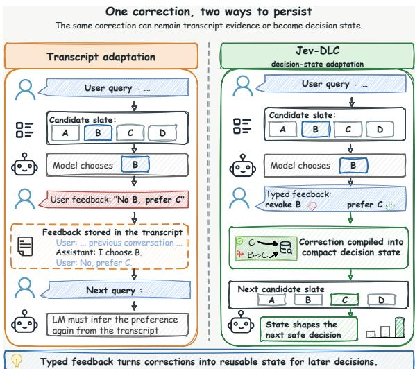
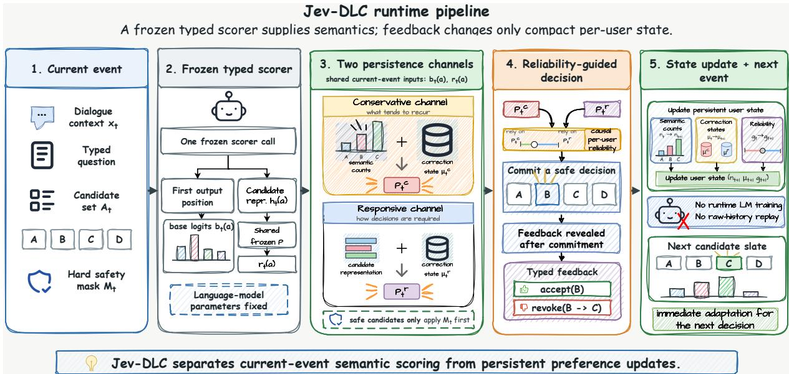

# Jev-DLC: Decision-Level Continual Learning from Typed Feedback

Yangyang Feng1,† Jianle Gan1,† Zhuoyan Feng2 Chengwei Qin1,∗

1The Hong Kong University of Science and Technology (Guangzhou)

2Sun Yat-sen University

yfeng044@connect.hkust-gz.edu.cn jgan307@connect.hkust-gz.edu.cn fengzhy28@mail2.sysu.edu.cn chengweiqin@hkust-gz.edu.cn †Equal contribution ∗Corresponding author

## Abstract

Individual preferences often become visible only after deployment, when a user accepts one decision or revokes it in favor of another. Jev-style typed interfaces make this feedback explicit by identifying the selected action and, under revocation, the decision it replaces. We study how these consequences persist across requests as Decision-Level Continual Learning from Typed Feedback (Jev-DLC). Jev-DLC treats each correction as both evidence about a recurring action identity and a directed relation between the preferred and rejected choices. It preserves these signals in complementary bounded channels above a frozen scorer and combines their scores to shape the next decision. The method retains no raw interaction history, adds no scorer call, and performs no runtime language-model backward pass. We also introduce TCPA-BENCH, a chronological suite that credits a correction only through its effect on later decisions. On TCPA-Repeat, Jev-DLC reaches 44.83% user-macro accuracy overall, 2.43 points above Recent-4 history replay. After at least two earlier feedback events, it reaches 56.07%, a 7.54-point margin over the strongest reported comparison at this depth. These results show how explicit typed corrections can become compact causal state for continual personalization.

## 1 Introduction

Individual preference often becomes visible only after deployment. A user may accept one choice, replace another, or correct a system only after seeing its decision. Personalization methods use this information by retrieving or replaying past interactions, or by adapting a user-specific representation or model from accumulated behavior (Lau et al., 2024; Li et al., 2024; Salemi et al., 2024). These approaches preserve rich evidence, while later predictions must reinterpret that evidence or consult additional mutable parameters. A typed interface offers another possibility. When feedback already identifies the accepted action and the one it replaces, the system can preserve the consequence of the correction rather than reconstruct it from the original interaction.

  
Figure 1: A typed correction exposes two forms of persistence. The selected action contributes evidence about what may recur, while the preferred–rejected pair gives a direction for repairing later decisions. Jev-DLC combines both through complementary bounded channels above a frozen scorer.

Jev-style systems make the consequence of a correction explicit. Given a finite set of candidate actions, the model commits a typed decision that the user can accept or revoke in favor of a named alternative (TypeSafe AI, 2026; Almeida, 2026). Jev supplies the judgment for the current request, but the interface leaves open how that correction should affect the next one. Jev-DLC addresses this persistence problem above a frozen typed scorer. A separate per-user state carries the consequences of earlier feedback into the next decision.

A typed correction exposes two forms of persistence. The identity of the preferred action records what the user chose and can reveal a categorical tendency when actions recur. The preferred–rejected pair records how one decision should replace another and defines a local direction that can transfer to related candidate slates. Jev-DLC preserves both through a conservative channel that combines repeated action evidence with local repair and a responsive channel that carries correction direction without the count prior. Their combined scores allow earlier feedback to influence the next decision while the frozen scorer continues to interpret its context and candidates.

Causal per-user weights combine the channels before each decision. After the runtime commits its prediction, accept or revoke feedback updates both bounded channels and their weights for the same user’s next request. Each directional update makes the smallest capped change needed to repair the exposed ordering, while revealed channel losses adjust their relative contribution. The system retains no raw interaction history, adds no scorer call, and performs no runtime language-model backward pass.

We evaluate this formulation with TCPA-BENCH, which counts a correction only through its effect on later decisions. On TCPA-Repeat, the chronological repeated-action track derived from LaMP-2 (Salemi et al., 2024), Jev-DLC reaches 44.83% user-macro accuracy on the full stream, compared with 39.44% for the frozen scorer and 42.40% for Recent-4 history replay. After at least two earlier feedback events, it reaches 56.07%, a 7.54-point margin over the strongest reported comparison at this depth. The results connect the retained correction state to later decision quality under a bounded serving budget. The experiments also examine feedback depth, changing candidate items, and alternative fusion strategies to characterize where this persistence is useful.

The paper makes three contributions.

• We formulate typed continual preference alignment as a chronological decision problem in which accept and revoke feedback can affect only later decisions for the same user, and instantiate this contract in TCPA-BENCH.

• We develop Jev-DLC, which preserves recurring action evidence and correction direction in complementary bounded channels above a frozen scorer. Our analysis connects typed action sufficiency, local minimum-change repair, and the geometry through which a correction influences later decisions.

• We show how this compact state improves repeated-action decisions without raw-history replay or runtime language-model training. Comparisons with history replay, user encoding, temporal memory, and meta-adaptation characterize its accuracy and serving tradeoff under the same chronological feedback protocol.

## 2 Related Work

## 2.1 Personalization from User History

Personalization systems often treat past behavior as evidence that must be revisited. In-context and retrieval-based methods place previous interactions back into the prompt, while other approaches learn user representations or personalized parameters (Jang et al., 2023; Ramé et al., 2023; Siththaranjan et al., 2023; Lau et al., 2024; Li et al., 2024). LaMP makes this history-based formulation explicit across classification and generation tasks (Salemi et al., 2024); MIND provides a large sequential recommendation setting built from newsclick histories (Wu et al., 2020). Recent-K is the closest system comparison for our setting because it preserves recent evidence and asks the same frozen scorer to reinterpret it at every event, following the history-based personalization protocol used by LaMP (Salemi et al., 2024). Jev-DLC studies the setting in which feedback has already exposed the decision relation and therefore lets that relation persist as a direct influence on future decisions rather than retaining the full evidence that produced it. Existing work thus solves how to infer a user’s preference from past behavior; we study how an explicit typed correction persists after that inference has already occurred.

## 2.2 Continual and Online Adaptation

Continual-learning methods manage the stability– plasticity trade-off through replay, regularization, parameter isolation, or dynamic capacity (Kirkpatrick et al., 2017; Lopez-Paz and Ranzato, 2017; Parisi et al., 2019; De Lange et al., 2022). Language-model studies apply related ideas to sequential tasks, instructions, and knowledge updates (Jang et al., 2022; Scialom et al., 2022). These methods make a model, adapter, or shared memory mutable as new information arrives. Jev-DLC instead freezes the scorer and restricts mutability to a per-user decision state above it. Replay, subspace, first-order, and second-order learners remain useful comparisons because they represent different choices about what is allowed to change and what must be retained. Jev-DLC places the stability– plasticity trade-off at the level of a per-user decision state and uses PA-I as its minimum-change update. Existing work therefore studies how a mutable model remains useful across changing tasks; we study how a frozen scorer can adapt for one user through a small persistent decision state.

## 2.3 Typed Decisions and Online Decision Updates

Jev-style systems expose finite candidate choices and read a typed decision from the model output (OpenJev contributors, 2026). This interface makes an accept or revoke an explicit decisionlevel correction, but it does not by itself define how that correction should alter later requests. Pairwise preference models provide the corresponding relative-decision language (Bradley and Terry, 1952). Passive-aggressive learning supplies a minimum-change online update with an optional slack cap (Crammer et al., 2006), while adaptivegradient and online Newton methods provide alternative update geometries (Duchi et al., 2011; Shalev-Shwartz, 2012). Jev-DLC uses PA-I to connect an explicit accept/revoke interface to that update under a frozen typed scorer and a chronological per-user serving contract, then tests whether the resulting state changes later decisions. Conversation benchmarks and preference arenas evaluate broader response quality without making this state transition the object of evaluation (Zheng et al., 2023; Chiang et al., 2024). Existing work separately provides a typed readout or a minimumchange online update; we connect the two layers and measure the resulting adaptation trajectory.

## 3 Problem Setup

Continual preference alignment studies whether a user’s typed correction can improve later decisions without changing the scorer or replaying the interaction. We make the information boundary explicit before describing any particular update rule or evaluation set.

## 3.1 Ordered Typed Interaction

For user u, events arrive in chronological order as $E _ { u , 1 } , \ldots , E _ { u , T _ { u } }$ . Event $E _ { u , t }$ contains a context $x _ { t }$ and a finite candidate slate $\boldsymbol { A } _ { t }$ . A frozen scorer assigns a score to each candidate, and a fixed mask $M _ { t } ( a )$ removes actions that violate hard constraints.

The learner predicts from the safe slate $\boldsymbol { \mathcal { A } } _ { t } ^ { \mathrm { s a f e } }$ and commits a decision $\hat { a } _ { t }$ before any feedback is available. The committed prediction is the object evaluated at event t.

## 3.2 Typed Feedback

After the prediction has been committed, the interface emits either accept $\left( \hat { a } _ { t } \right)$ or revoke $( \hat { a } _ { t }  a _ { t } ^ { \star } )$ Acceptance confirms the committed action. Revocation identifies both the rejected action $a _ { t } ^ { - } = \hat { a } _ { t }$ and its replacement $a _ { t } ^ { + } = a _ { t } ^ { \star }$ . Thus feedback supervises a decision that has already been made and, in the revoke case, specifies the replacement relation directly. It is decision-level supervision, not an unconstrained free-text critique.

## 3.3 Persistent State and Causality

The learner maintains a state $\mu _ { u , t }$ for each user and updates it with the current event and the feedback revealed after prediction,

$$
\begin{array} { r } { \mu _ { u , t + 1 } = U ( \mu _ { u , t } , E _ { u , t } , F _ { t } ) . } \end{array}\tag{1}
$$

The prediction at event t may depend on feedback from events 1:t − 1 only. The feedback $F _ { t }$ can affect events $t + 1 { : } T _ { u } ,$ but cannot change the prediction that exposed it. State is reset between users and is subject to a bounded-state serving constraint. For a fixed user, we write this state as $\mu _ { t }$ . The main state-based path retains neither raw previous interactions nor candidate text, and scorer parameters remain fixed at runtime. The scorer evaluates the current slate; $\mu _ { u , t }$ carries only the user’s accumulated consequences of earlier typed feedback.

## 3.4 Evaluation Objective

The central question is whether past typed feedback improves later decisions for the same user. The objective is therefore to evaluate the state induced by the prefix of a stream, rather than to refit the event whose target has just been revealed. User-macro accuracy is the primary metric because the unit of personalization is the user. Other statistical inference details and serving measurements are reported with the experiments and in Appendix A.6.

## 4 Method

Jev-DLC separates current-request interpretation from persistent preference. A frozen typed scorer supplies the base judgment for the current candidate slate. Two bounded user-state channels preserve the recurring action evidence and correction direction exposed by earlier feedback. Their combined scores let these consequences shape the next decision without revisiting the original interactions.

## 4.1 Frozen Typed Decision Layer

Given a rendered context and a candidate slate, JEV-SFT scores the option tokens at the first output position. Each safe candidate a receives a base logit $b _ { t } ( a )$ and a frozen hidden representation $h _ { t } ( a ) \in \mathbb { R } ^ { D }$ . A shared linear map $P \in \mathbb { R } ^ { d \times D }$ projects the representation into the state space,

$$
r _ { t } ( a ) = \frac { P h _ { t } ( a ) } { \| P h _ { t } ( a ) \| _ { 2 } } , \qquad d = 3 2 .\tag{2}
$$

The map is fitted once on chronological streams from training users, shared by all users, and frozen before development and test replay. The scorer parameters, projection, candidate order, and hard mask remain fixed at runtime. Alternative representation maps are reported in Appendix E.

## 4.2 A Typed Correction Provides a Prior and a Direction

The runtime commits $\hat { a } _ { t }$ before feedback is revealed. A revoke identifies the rejected prediction and its replacement. An accept confirms the committed action, which is paired with its highestprobability safe competitor. We denote the preferred and paired actions by $a _ { t } ^ { + }$ and $a _ { t } ^ { - }$ , respectively. The correction then provides two related signals.

First, the preferred action contributes evidence to an observable semantic identity $c ( a _ { t } ^ { + } )$ . Let $n _ { t } ( k )$ be the number of previous corrections assigned to semantic identity $k ,$ let $\begin{array} { r } { N _ { t } = \sum _ { k } { n _ { t } ( k ) } } \end{array}$ , and let $K _ { t }$ be the number of semantic identities represented in the current slate. The resulting smoothed prior adjustment is

$$
q _ { t } ( a ) = \lambda _ { c } \log \frac { n _ { t } ( c ( a ) ) + \alpha } { N _ { t } + \alpha K _ { t } } .\tag{3}
$$

Second, the same correction identifies a directed relation in the frozen candidate space,

$$
d _ { t } = r _ { t } ( a _ { t } ^ { + } ) - r _ { t } ( a _ { t } ^ { - } ) , \qquad \beta _ { t } = b _ { t } ( a _ { t } ^ { + } ) - b _ { t } ( a _ { t } ^ { - } ) .\tag{4}
$$

The prior records what the user repeatedly chooses. The contrast records how one committed decision should be replaced by another.

## 4.3 Conservative and Responsive Channels

The conservative channel combines the semantic prior with a local correction vector $\mu _ { t } ^ { \mathrm { c } } \in \mathbb { R } ^ { d }$ . Its score is

$$
\begin{array} { r l } & { x _ { t } ^ { \mathrm { c } } ( a ) = \lambda _ { p } r _ { t } ( a ) , } \\ & { s _ { t } ^ { \mathrm { c } } ( a ) = b _ { t } ( a ) + q _ { t } ( a ) + \mu _ { t } ^ { \mathrm { c } \top } x _ { t } ^ { \mathrm { c } } ( a ) . } \end{array}\tag{5}
$$

The responsive channel omits the count prior and stores the correction geometry directly in $\mu _ { t } ^ { \mathrm { r } } \in \mathbb { R } ^ { d }$

$$
\begin{array} { r l } & { x _ { t } ^ { \mathrm { r } } ( a ) = r _ { t } ( a ) , } \\ & { s _ { t } ^ { \mathrm { r } } ( a ) = b _ { t } ( a ) + \mu _ { t } ^ { \mathrm { r } } { } ^ { \top } x _ { t } ^ { \mathrm { r } } ( a ) . } \end{array}\tag{6}
$$

Each channel yields a distribution $\begin{array} { r l } { p _ { t } ^ { j } } & { { } = } \end{array}$ softma $\mathrm { x } _ { a \in \mathcal { A } _ { \epsilon } ^ { \mathrm { s a f e } } } s _ { t } ^ { j } ( a )$ for $j \in \{ \mathrm { c } , \mathrm { r } \}$

After feedback, both channels receive the pair elicited by the same committed mixture decision. Their contrasts and base margins are

$$
\begin{array} { r l } & { d _ { t } ^ { j } = x _ { t } ^ { j } ( a _ { t } ^ { + } ) - x _ { t } ^ { j } ( a _ { t } ^ { - } ) , } \\ & { \beta _ { t } ^ { \mathrm { c } } = b _ { t } ( a _ { t } ^ { + } ) + q _ { t } ( a _ { t } ^ { + } ) - b _ { t } ( a _ { t } ^ { - } ) - q _ { t } ( a _ { t } ^ { - } ) , } \\ & { \beta _ { t } ^ { \mathrm { r } } = b _ { t } ( a _ { t } ^ { + } ) - b _ { t } ( a _ { t } ^ { - } ) . } \end{array}\tag{7}
$$

For $j \in \{ \mathrm { c } , \mathrm { r } \}$ , the margin violation and minimumchange transition are

$$
\begin{array} { c } { { \ell _ { t } ^ { j } = \left[ \gamma - \beta _ { t } ^ { j } - \mu _ { t } ^ { j } ^ { \top } d _ { t } ^ { j } \right] _ { + } , } } \\ { { \mu _ { t + 1 } ^ { j } = \mu _ { t } ^ { j } + \tau _ { t } ^ { j } d _ { t } ^ { j } . } } \end{array}\tag{8}
$$

$$
\tau _ { t } ^ { j } = \operatorname* { m i n } \left( C , \frac { \ell _ { t } ^ { j } } { \| d _ { t } ^ { j } \| _ { 2 } ^ { 2 } } \right) ,\tag{9}
$$

with $\tau _ { t } ^ { j } = 0$ when $d _ { t } ^ { j } = 0$ . If a channel already respects the correction, it remains unchanged. Otherwise, it moves only as far as needed to repair the ordering, subject to the cap. The semantic count is incremented only after the current decision has been evaluated. We use $\gamma = C = 1$ and freeze all channel parameters before test replay.

## 4.4 Combining the Two Channels

The two channels need not be equally reliable for every user or at every point in a stream. Jev-DLC therefore maintains two log weights $g _ { t } ^ { \mathrm { c } }$ and $g _ { t } ^ { \mathrm { r } }$ . Before event t, their normalized values define the responsive weight

$$
\rho _ { t } = \frac { \exp ( g _ { t } ^ { \mathrm { r } } ) } { \exp ( g _ { t } ^ { \mathrm { c } } ) + \exp ( g _ { t } ^ { \mathrm { r } } ) } .\tag{10}
$$

The runtime combines the expert distributions geometrically,

$$
\begin{array} { l } { \bar { p } _ { t } ( a ) = p _ { t } ^ { \mathrm { c } } ( a ) ^ { 1 - \rho _ { t } } p _ { t } ^ { \mathrm { r } } ( a ) ^ { \rho _ { t } } , } \\ { p _ { t } ( a ) = \displaystyle \frac { \bar { p } _ { t } ( a ) } { \sum _ { a ^ { \prime } } \bar { p } _ { t } ( a ^ { \prime } ) } , } \\ { \hat { a } _ { t } = \arg \operatorname* { m a x } _ { a } p _ { t } ( a ) . } \end{array}\tag{11}
$$

Only after the target $a _ { t } ^ { + }$ is revealed does the runtime observe each channel’s zero-one loss $L _ { t } ^ { j } =$ 1[arg maxa $p _ { t } ^ { j } ( a ) \neq a _ { t } ^ { + } ]$ . It applies the exponential update $\tilde { g } _ { t + 1 } ^ { j } = g _ { t } ^ { j } - \eta L _ { t } ^ { j }$ , normalizes the two weights, and mixes a fixed share σ back toward the uniform distribution,

$$
\begin{array} { r l } & { \bar { w } _ { t + 1 } ^ { j } = \frac { \exp ( \tilde { g } _ { t + 1 } ^ { j } ) } { \sum _ { k } \exp ( \tilde { g } _ { t + 1 } ^ { k } ) } , } \\ & { w _ { t + 1 } ^ { j } = ( 1 - \sigma ) \bar { w } _ { t + 1 } ^ { j } + \frac { \sigma } { 2 } , } \\ & { g _ { t + 1 } ^ { j } = \log w _ { t + 1 } ^ { j } . } \end{array}\tag{12}
$$

This update lets reliability change as evidence accumulates while preventing either channel from becoming permanently unreachable. The initialization and frozen configuration are given in Appendix B.

## 4.5 Serving Contract and State Budget

At each event, one frozen scorer call produces the candidate logits and representations. The two channels form their distributions from the current user state, the reliability weights mix them, and the runtime commits the result. The revealed accept or revoke then updates the reliability weights, the two correction vectors, and the semantic count state for the user’s next event. Every update uses the feedback produced by the committed mixture rather than a counterfactual decision from either channel.

The complete state is zu,t $( n _ { u , t } , \mu _ { u , t } ^ { \mathrm { c } } , \mu _ { u , t } ^ { \mathrm { r } } , g _ { u , t } ^ { \mathrm { c } } , g _ { u , t } ^ { \mathrm { r } } )$ Its maximum observed size is 324 bytes on TCPA-Repeat and 320 bytes on TCPA-Open. Jev-DLC retains no raw interaction history, adds no scorer forward pass, and performs no runtime language-model backward pass. Resetting the counts, correction vectors, and reliability weights restores the frozen scorer over the same safe slate. The runtime interface, state accounting, and frozen configuration are detailed in Appendix B.

## 5 Theory

The analysis explains what a typed correction preserves and how that information can influence a later decision. Action sufficiency identifies when the selected action retains the preference information in its realization. Minimum-change repair then converts the exposed ordering into a local state transition, whose candidate-space geometry determines transfer to future pairs.

## 5.1 What Typed Feedback Preserves

A typed action can replace its language realization when the surface form adds no preference information after the action is known. Let realization R map deterministically to action $A = g _ { x } ( R )$ , and suppose

$$
p _ { w , \zeta } ( R \mid x ) = q _ { \zeta } ( R \mid A , x ) p _ { w } ( A \mid x ) ,\tag{13}
$$

where $q _ { \zeta }$ is independent of preference parameter w.

Proposition 1 (action sufficiency). Under Eq. 13, A is sufficient for w conditional on x. For any square-integrable realization-dependent update $V ( R , F )$ and ${ \bar { V } } ( A , F ) = \mathbb { E } [ V \mid A , F ]$

$$
\operatorname { C o v } ( V ) = \operatorname { C o v } ( { \bar { V } } ) + \mathbb { E } [ \operatorname { C o v } ( V \mid A , F ) ] .\tag{14}
$$

Proof sketch. The likelihood depends on w only through $p _ { w } ( A \mid x )$ , so the factorization criterion gives sufficiency. The second statement is the law of total covariance. Its final term is positive semidefinite and measures variation among realizations of the same typed action. Typed conditioning therefore removes realization nuisance while retaining the preference information specified by the factorization. Appendix C gives the complete sequence-level result.

## 5.2 Two Persistence Geometries

The action identity and pairwise direction influence future decisions in different ways. The semantic term in Eq. 3 is a Dirichlet-smoothed log-frequency score. Up to a candidate-independent constant, it increases with the number of earlier corrections selecting the same semantic identity. It therefore carries repeated categorical tendency without retaining the events that produced the counts.

The pairwise signal instead defines, for each channel j, a feasible half-space

$$
\mathcal { H } _ { t } ^ { j } = \{ \mu : \beta _ { t } ^ { j } + \mu ^ { \top } d _ { t } ^ { j } \geq \gamma \} .\tag{15}
$$

Proposition 2 (local minimum-change repair). For $d _ { t } ^ { j } \neq 0$ , Eq. 9 is the unique PA-I state transition for the exposed ordering. If the state already lies in $\mathcal { H } _ { t } ^ { j }$ , it remains unchanged. Otherwise, an uncapped step is the Euclidean projection onto the boundary; the cap limits the same directed move.

  
Figure 2: Typed feedback becomes persistent state above a frozen scorer. Conservative and responsive channels retain recurring action evidence and correction geometry. Causal per-user weights combine their distributions before commitment, and revealed feedback updates the channels and weights for later requests.

Proof sketch. KKT stationarity makes the minimizing displacement parallel to $d _ { t } ^ { \jmath }$ . Complementary slackness gives coefficient $\ell _ { t } ^ { j } / \| d _ { t } ^ { j } \| _ { 2 } ^ { 2 }$ , clipped at $C ,$ and strict convexity gives uniqueness. Thus the correction changes no state direction orthogonal to $d _ { t } ^ { j }$ . The complete derivation and comparatorrelative violation bound appear in Appendix C.

The geometry determines transfer to a later event $s > t :$

$$
{ d _ { s } ^ { j } } ^ { \top } ( \mu _ { t + 1 } ^ { j } - \mu _ { t } ^ { j } ) = \tau _ { t } ^ { j } { d _ { s } ^ { j } } ^ { \top } d _ { t } ^ { j } .\tag{16}
$$

A later pair inherits the repair according to its alignment with the earlier correction. If $\| x _ { t } ^ { j } ( a ) \| _ { 2 } \leq \kappa _ { j }$ then

$$
\| \mu _ { t + 1 } ^ { j } - \mu _ { t } ^ { j } \| _ { 2 } \leq 2 C \kappa _ { j } , \qquad \kappa _ { \mathrm { c } } = \lambda _ { p } , \quad \kappa _ { \mathrm { r } } = 1 .\tag{17}
$$

The state remains fixed-dimensional, while the prior and direction encode respectively what recurs and which candidate relation was corrected.

## 5.3 From Local Repair to Persistent Decisions

The mixture in Eq. 11 brings the two persistence geometries into one decision. The count term carries evidence across events sharing an action identity, while the correction vectors transfer repair according to candidate-space alignment. Because the conservative margin includes the prior and the responsive margin does not, the same feedback can produce different updates in the two channels. The user state preserves both trajectories, and the predecision weights determine their contribution.

Together, action sufficiency and local repair explain how a correction can be retained without its original language realization and reused on a later slate. The experiments measure the resulting decision quality. Appendix C gives the channelweighting analysis; Appendix E.4 reports other implementations of the same two-channel fusion.

## 6 TCPA: Chronological Evaluation of Typed Adaptation

TCPA evaluates whether typed feedback changes later decisions for the same user. Every track follows one causal serving contract. The runner predicts and commits, the evaluator then reveals typed feedback, the runner updates the user state, and only subsequent decisions receive the benefit of that update. This ordering separates continual adaptation from refitting the event that revealed its target.

## 6.1 Predict-Then-Update Protocol

For each user, events remain in source order and users are disjoint across training, development, and test. At event t, the runner sees the current context and candidate slate, applies the frozen hard mask, and commits a prediction before the evaluator exposes the target or feedback. The evaluator returns either an acceptance or a revocation with its replacement. The runner then updates the user’s persistent state. The state is reset when a new user stream begins, and event t is scored before its feedback can affect event t + 1 or any later event. Targets are isolated from the serving process until the committed prediction has been recorded. Each scored event exposes the correction prefix available before commitment. Any measured gain can therefore be attributed to information genuinely available online.

## 6.2 TCPA-Repeat

TCPA-Repeat is our chronological repeated-action personalization track derived from LaMP-2. It presents repeated decisions under a stable finite ontology and preserves chronological user streams with enough repeated interaction to test whether accumulated feedback improves later decisions. This setting makes the central continual-adaptation question observable because the corrected action can reappear after the correction. The converter, label mapping, filtering rules, hashes, and split construction are specified in Appendix A.3.

## 6.3 Additional Diagnostic Tracks

TCPA-Open is a changing-item weak-transfer boundary track derived from MIND. TCPA-Dynamics provides controlled stability, shift, recurrence, and noise diagnostics. Together, these tracks complement TCPA-Repeat by probing transfer across changing items and controlled temporal regimes. Their full construction and results appear in Appendices A.4 and F.

User-macro accuracy is the primary metric. System accounting records persistent state, retained history, and extra model computation so that accuracy and serving cost are evaluated together. Bootstrap inference and the complete metric definitions are provided in Appendix A.6; representation analyses appear in Appendix E.

## 7 Experiments

The experiments test whether persistent typed state improves later decisions and what that improvement requires at serving time. TCPA-Repeat evaluates reuse across recurring actions; feedbackdepth strata show the decisions made after different amounts of prior feedback. All methods use the frozen JEV-SFT decision layer, whose current-event anchors appear in Appendix D.1. The main tables report one Jev-DLC implementation. Complete channel and fusion results appear in Appendix E.4.

<table><tr><td>Method</td><td>Full</td><td>d ≥ 2</td><td>d ≥ 4</td><td>d ≥ 8</td></tr><tr><td>Frozen</td><td>39.44</td><td>41.58</td><td>36.48</td><td>40.38</td></tr><tr><td>Recent-4</td><td>42.40</td><td>46.40</td><td>37.56</td><td>42.17</td></tr><tr><td>AdaGrad</td><td>41.99</td><td>48.53</td><td>39.33</td><td>41.68</td></tr><tr><td>PPlug</td><td>40.37</td><td>41.77</td><td>37.86</td><td>43.38</td></tr><tr><td>TAP-PER</td><td>41.99</td><td>46.48</td><td>46.45</td><td>44.25</td></tr><tr><td>MRM-style</td><td>40.67</td><td>42.14</td><td>47.18</td><td>51.88</td></tr><tr><td>Jev-DLC</td><td>44.83</td><td>56.07</td><td>50.47</td><td>53.01</td></tr></table>

Table 1: TCPA-Repeat user-macro accuracy (%). Every depth column evaluates decisions made after at least d earlier feedback events. Counts, paired bootstrap intervals, and the complete baseline ladder appear in Appendix D.

## 7.1 Later-Decision Accuracy

The comparisons span different ways of carrying user feedback into the next decision. Recent-4 retains four typed interactions and asks JEV-SFT to reinterpret them in an enlarged prompt. PPlug encodes user behavior, TAP-PER queries bounded temporal memory, and MRM adapts a low-dimensional head. Our TCPA instantiations of these three methods share Jev-DLC’s frozen scorer cache and learned candidate projection. All comparisons use the same safe slates, targets, chronological order, and predict-then-update protocol. Shared components are fitted on training users and configurations selected on development users. Appendix B.5 gives the source method adaptations and representation provenance of the archived online references, including AdaGrad.

Persistent typed state improves TCPA-Repeat decisions above the frozen scorer. Jev-DLC reaches 44.83% on the full stream, a 5.39-point gain over Frozen and a 2.43-point higher accuracy than Recent-4. It has the highest point estimate among the reported external comparisons on Full and at each reported feedback depth. After at least two earlier feedback events, it reaches 56.07%, 7.54 points above the strongest reported comparison at this depth. Because every prediction precedes its feedback, these differences measure the use of earlier corrections rather than refitting the decisions that elicited them.

At d ≥ 4 and d ≥ 8, Jev-DLC reaches 50.47% and 53.01%, compared with 47.18% and 51.88% for MRM-style, the strongest external reference in these strata. Each stratum evaluates decisions with at least the specified number of earlier feedback events. The deepest stratum contains 15 users; Appendix D.2 gives the eligible counts and paired intervals.

Appendix D reports sample sizes and paired userbootstrap intervals. The evaluation protocol is specified in Appendix H.

## 7.2 Contribution of the Two Channels

Retaining both correction trajectories improves later decisions over either channel alone. Table 2 compares the count-informed conservative channel (C), the directional responsive channel (R), and Jev-DLC under the same frozen representation and channel parameters. Each variant receives feedback from its own committed predictions.

<table><tr><td>State</td><td>Full</td><td>d≥ 2</td><td>d≥ 4</td><td>d ≥ 8</td></tr><tr><td>C only</td><td>43.12</td><td>54.85</td><td>48.60</td><td>44.30</td></tr><tr><td>R only</td><td>41.50</td><td>44.20</td><td>43.85</td><td>50.45</td></tr><tr><td>Jev-DLC</td><td>44.83</td><td>56.07</td><td>50.47</td><td>53.01</td></tr></table>

Table 2: Channel retention on TCPA-Repeat, in usermacro accuracy (%). Both channels contribute to the full Jev-DLC decision state.

Jev-DLC reaches 44.83% on Full, 1.71 points above C and 3.33 points above R. The single channels have different depth profiles. C reaches 54.85% after at least two earlier feedback events, while R reaches 50.45% in the deepest stratum, compared with 44.30% for C. Jev-DLC reaches 56.07% and 53.01% in these two strata, respectively, and has the highest accuracy in every reported column. The retained action counts and pairwise repair therefore support complementary uses of earlier feedback within the same decision state.

The fusion analysis further compares adaptive weighting with equal and development-fixed coefficients. Relative to the development-fixed combination, adaptive Jev-DLC gains 0.68 points on Full and 4.86 points at d ≥ 8. Appendix E.4 reports the complete configurations and paired intervals. Together, these comparisons distinguish the benefit of retaining both channels from the benefit of adapting their relative weights.

## 7.3 Serving State and Computation

The methods reach later decisions through different serving objects. Recent-4 preserves textlike evidence and expands the next scorer input. PPlug stores a learned user vector, TAP-PER adds bounded vector memory, and MRM optimizes a low-dimensional head. Jev-DLC stores two 32- dimensional correction vectors, bounded semantic counts, and two reliability weights.

<table><tr><td>Method</td><td>State</td><td>Retained</td><td>Input</td><td>Runtime</td></tr><tr><td>Recent-4</td><td>0B</td><td>1,166.5 B raw</td><td>+262.8 tok.</td><td>Longer fwd.</td></tr><tr><td>PPlug</td><td>132 B</td><td>0B</td><td>0</td><td>Projection</td></tr><tr><td>TAP-PER</td><td>128 B</td><td>1,040 B vec.</td><td>0</td><td>Query</td></tr><tr><td>MRM</td><td>16 B</td><td>0B</td><td>0</td><td>3 low-D steps</td></tr><tr><td>Jev-DLC</td><td>324 B</td><td>0B</td><td>0</td><td>Vector update</td></tr></table>

Table 3: Maximum per-user serving objects on TCPA-Repeat. State excludes the shared frozen scorer and train-time shared parameters.

The accuracy gain over Frozen comes from a bounded decision state, without raw-history replay, an additional scorer forward, or runtime languagemodel training. Its 324-byte maximum state is independent of stream length because the semantic identities come from the fixed TCPA-Repeat ontology. This is a different deployment tradeoff from replay, bounded vector memory, or low-dimensional runtime optimization. Appendix B.5 reports latency, extra model computation, and complete state accounting.

After the frozen scorer output is available, state computation takes 0.1781 ms for prediction and 0.0810 ms for feedback updates on TCPA-Repeat. These measurements cover CPU state operations.

Additional representation, accumulation, projection-size, seed, accept/revoke, and direction controls appear in Appendix E. TCPA-Open and TCPA-Dynamics results appear in Appendix F.

## 8 Conclusion

A typed correction exposes information that can outlive the request that elicited it. Jev-DLC preserves recurring action evidence and the preferred– rejected relation in complementary bounded channels above a frozen scorer. TCPA-BENCH makes this persistence measurable by crediting feedback only through later decisions. On repeated actions, the resulting state improves decision accuracy without retaining raw interactions or training the language model at runtime. Together, the method and evaluation provide a decision-level path to continual personalization in which user corrections remain useful after their original requests have passed.

## Limitations

The current formulation uses immediate accept and revoke feedback over a finite candidate set, so each correction maps directly to a decision relation. Future work can recover this relation from delayed or free-form feedback, represent richer signals such as ranked alternatives or partial acceptance, and place a typed decision layer above open-ended generation. State migration when the scorer or action ontology is upgraded is another useful direction, allowing accumulated preferences to persist across system versions.

The repeated-action setting provides the clearest evidence for this state. Changing-item recommendation favors PPlug overall. The storage bound also depends on the evaluated semantic vocabularies; an expanding action ontology requires a corresponding policy for count storage.

## References

Diogo Almeida. 2026. Introducing system one models & jev. TypeSafe AI blog. Accessed 2026-09-28.

Ralph Allan Bradley and Milton E. Terry. 1952. Rank analysis of incomplete block designs: I. the method of paired comparisons. Biometrika, 39(3/4):324– 345.

Hongru Cai, Yongqi Li, Tiezheng Yu, Fengbin Zhu, Wenjie Wang, Fuli Feng, and Wenjie Li. 2026. One adapts to any: Meta reward modeling for personalized LLM alignment. arXiv preprint arXiv:2601.18731.

Heng Cao, Fan Zhang, Jian Yao, Yujie Zheng, Changlin Zhao, Lu Hao, Yuxuan Wei, Wangze Ni, Huaiyu Fu, Yuqian Sun, and Xuyan Mo. 2026. Beyond retrieval: Learning compact user representations for scalable LLM personalization. arXiv preprint arXiv:2606.04547.

Wei-Lin Chiang, Lianmin Zheng, Ying Sheng, Anastasios Nikolas Angelopoulos, Tianle Li, Dacheng Li, Hao Zhang, Banghua Zhu, Michael Jordan, Joseph E. Gonzalez, et al. 2024. Chatbot arena: An open platform for evaluating llms by human preference. arXiv preprint arXiv:2403.04132.

Koby Crammer, Ofer Dekel, Joseph Keshet, Shai Shalev-Shwartz, and Yoram Singer. 2006. Online passive-aggressive algorithms. Journal ofMachine Learning Research, 7:551–585.

Matthias De Lange, Rahaf Aljundi, Marc Masana, Sarah Parisot, Xu Jia, Aleš Leonardis, Gregory Slabaugh, and Tinne Tuytelaars. 2022. A continual learning survey: Defying forgetting in classification tasks. IEEE Transactions on Pattern Analysis and Machine Intelligence, 44(7):3366–3385.

John Duchi, Elad Hazan, and Yoram Singer. 2011. Adaptive subgradient methods for online learning and stochastic optimization. Journal of Machine Learning Research, 12:2121–2159.

Joel Jang, Seungone Kim, Bill Yuchen Lin, Yizhong Wang, Jack Hessel, Luke Zettlemoyer, Hannaneh Hajishirzi, Yejin Choi, and Prithviraj Ammanabrolu. 2023. Personalized soups: Personalized large language model alignment via post-hoc parameter merging. arXiv preprint arXiv:2310.11564.

Joel Jang, Seonghyeon Ye, Sohee Yang, Joongbo Shin, Janghoon Han, Gyeonghun Kim, Stanley Jungkyu Choi, and Minjoon Seo. 2022. Towards continual knowledge learning of language models. In International Conference on Learning Representations.

James Kirkpatrick, Razvan Pascanu, Neil Rabinowitz, Joel Veness, Guillaume Desjardins, Andrei A. Rusu, Kieran Milan, John Quan, Tiago Ramalho, Agnieszka Grabska-Barwinska, et al. 2017. Overcoming catastrophic forgetting in neural networks. Proceedings of the National Academy of Sciences, 114(13):3521–3526.

Allison Lau, Younwoo Choi, Vahid Balazadeh, Keertana Chidambaram, Vasilis Syrgkanis, and Rahul G. Krishnan. 2024. Personalized adaptation via in-context preference learning. arXiv preprint arXiv:2410.14001.

Xinyu Li, Ruiyang Zhou, Zachary C. Lipton, and Liu Leqi. 2024. Personalized language modeling from personalized human feedback. arXiv preprint arXiv:2402.05133.

Jiongnan Liu, Yutao Zhu, Shuting Wang, Xiaochi Wei, Erxue Min, Yu Lu, Shuaiqiang Wang, Dawei Yin, and Zhicheng Dou. 2025. LLMs + persona-plug = personalized LLMs. In Proceedings of the 63rd Annual Meeting ofthe Associationfor Computational Linguistics (Volume 1: Long Papers), pages 9373– 9385.

David Lopez-Paz and Marc’Aurelio Ranzato. 2017. Gradient episodic memory for continual learning. In Advances in Neural Information Processing Systems.

OpenJev contributors. 2026. Openjev: Typed decisions about text, web pages and screenshots. Hugging Face model card. Accessed 2026-09-23.

German I. Parisi, Ronald Kemker, Jose L. Part, Christopher Kanan, and Stefan Wermter. 2019. Continual lifelong learning with neural networks: A review. Neural Networks, 113:54–71.

Alexandre Ramé, Guillaume Couairon, Mustafa Shukor, Corentin Dancette, Jean-Baptiste Gaya, Laure Soulier, and Matthieu Cord. 2023. Rewarded soups: Towards pareto-optimal alignment by interpolating weights fine-tuned on diverse rewards. arXiv preprint arXiv:2306.04488.

Alireza Salemi, Sheshera Mysore, Michael Bendersky, and Hamed Zamani. 2024. LaMP: When large language models meet personalization. In Proceedings of the 62nd Annual Meeting of the Association for Computational Linguistics.

Thomas Scialom, Tuhin Chakrabarty, and Smaranda Muresan. 2022. Fine-tuned language models are continual learners. arXiv preprint arXiv:2205.12393.

Shai Shalev-Shwartz. 2012. Online learning and online convex optimization. Foundations and Trends in Machine Learning, 4(2):107–194.

Anand Siththaranjan, Cassidy Laidlaw, and Dylan Hadfield-Menell. 2023. Distributional preference learning: Understanding and accounting for hidden context in rlhf. arXiv preprint arXiv:2312.08358.

TypeSafe AI. 2026. TypeSafe API. Online documentation. Accessed 2026-09-28.

Fangzhao Wu, Ying Qiao, Jiun-Hung Chen, Chuhan Wu, Tao Qi, Jianxun Lian, Danyang Liu, Xing Xie, Jianfeng Gao, Winnie Wu, and Ming Zhou. 2020. MIND: A large-scale dataset for news recommendation. In Proceedings ofthe 58th Annual Meeting of the Association for Computational Linguistics.

Lianmin Zheng, Wei-Lin Chiang, Ying Sheng, Siyuan Zhuang, Zhanghao Wu, Yonghao Zhuang, Zi Lin, Zhuohan Li, Dacheng Li, Eric P. Xing, et al. 2023. Judging llm-as-a-judge with mt-bench and chatbot arena. arXiv preprint arXiv:2306.05685.

## Contents of Appendix

A Protocol, Notation, and Benchmark Con  
struction 12   
A.1 Causal Serving Contract 12   
A.2 Runtime and Evaluator Boundary 12   
A.3 TCPA-Repeat Construction . 12   
A.4 Additional Track Construction 12   
A.5 Validation and Leakage Audits 12   
A.6 Metrics and Statistical Inference 12   
B Model, Representation, and Baseline De  
tails 13   
B.1 Typed Interface and Scorer Imple  
mentation 13   
B.2 Frozen Scorer Training 13   
B.3 Learned Candidate Projection 13   
B.4 Jev-DLC Configuration 14   
B.5 Matched Baseline Contracts 14   
B.6 Timing Protocol 14   
B.7 Other Fusion Configurations 15   
C Theory and Proofs 15   
C.1 Closed-Form PA-I Solution . 15   
C.2 KKT Cases and Degenerate Events 15   
C.3 Bounded Movement and Minimality 15   
C.4 Comparator-Relative Cumulative   
Bound . . 16   
C.5 Action Sufficiency and Realization   
Nuisance 16   
C.6 Tracking Channel Reliability 16   
C.7 Mask and Reset Invariance 17   
D TCPA-Repeat Results and System Com  
parisons 17   
D.1 Frozen Scorer Anchors 17   
D.2 Feedback-Depth Results 17   
D.3 Fixed-Cohort Depth Check 17   
D.4 Representative Baseline Ladder . 17   
D.5 Action-Frequency Variants 17   
D.6 History Replay and Serving Cost 18   
D.7 Chronological Linear Reference 18   
D.8 Paired External Comparisons . . 18   
E Representation and Mechanism Analy   
ses 19   
E.1 Directional Representation and Ac  
cumulation Controls . 19   
E.2 Depth Behavior across Representa  
tions . 19   
E.3 Future-Predictive Geometry 19   
E.4 Jev-DLC Channel and Fusion Con  
figurations . 19   
F Additional Diagnostic Tracks 20   
F.1 TCPA-Open 20   
F.2 TCPA-Open Chronological Linear   
Reference 20   
F.3 TCPA-Dynamics 20   
F.4 Full-Method Fusion Diagnostic on   
Existing Dynamics Caches 21   
G Prompts and External API Protocol 21   
G.1 Frozen Local Prompt 21   
G.2 Recent-K History Block 21   
G.3 Hosted Jev Frozen Anchor 21   
G.4 Runtime State API 22   
H Reproducibility, Ethics, and Scope 22   
H.1 Artifact Chain 22   
H.2 Compute 22   
H.3 Privacy and Data Use . . 22   
H.4 Scope 23

<table><tr><td>Symbol</td><td>Meaning</td></tr><tr><td> $x _ { t }$ </td><td>current context</td></tr><tr><td> $\boldsymbol { A } _ { t }$ </td><td>current candidate slate</td></tr><tr><td> $M _ { t } ( a )$ </td><td>immutable hard mask</td></tr><tr><td> $b _ { t } ( a )$ </td><td>frozen option logit</td></tr><tr><td> $h _ { t } ( a )$ </td><td>frozen candidate representation</td></tr><tr><td> $P$ </td><td>shared train-only linear projection</td></tr><tr><td> $r _ { t } ( a )$ </td><td>normalized projected representation</td></tr><tr><td> $n _ { t } ( k )$ </td><td>revealed count for semantic identity k</td></tr><tr><td> $\mu _ { t } ^ { \mathrm { c } } , \mu _ { t } ^ { \mathrm { r } }$ </td><td>conservative and responsive correction states</td></tr><tr><td> $g _ { t } ^ { \mathrm { c } } , g _ { t } ^ { \mathrm { r } }$ </td><td>causal channel log weights</td></tr><tr><td> $\rho _ { t }$ </td><td>responsive-channel mixture weight</td></tr><tr><td> ${ a } _ { t } ^ { + } , { a } _ { t } ^ { - }$ </td><td>preferred and rejected typed actions</td></tr><tr><td> $d _ { t } ^ { j }$ </td><td>channel-j preferred-rejected contrast</td></tr><tr><td> $\beta _ { t } ^ { j }$ </td><td>channel  $- j$  frozen-plus-prior margin</td></tr><tr><td> $\gamma , C$ </td><td>margin and PA-I cap</td></tr></table>

Table 4: Notation shared by the frozen scorer, persistent state, and proofs.

## A Protocol, Notation, and Benchmark Construction

## A.1 Causal Serving Contract

Every track uses the same predict-then-update order. The runtime loads the current public event and the user’s state, commits a prediction, and only then receives the evaluator-owned target as typed feedback. The feedback may update the state for later events, but it cannot alter the decision that exposed it. State is reset at user boundaries.

An accepted event sets $a _ { t } ^ { + } = \hat { a } _ { t }$ and uses the highest-scoring remaining safe action as $a _ { t } ^ { - }$ . A revoked event sets $a _ { t } ^ { - } = \hat { a } _ { t }$ and $a _ { t } ^ { + } = a _ { t } ^ { \star }$ . Candidate identifiers must be unique within the event before either action is dereferenced. An event without a valid typed correction causes no state update.

## A.2 Runtime and Evaluator Boundary

The implementation serializes model-visible events and evaluator-owned targets separately. Table 5 lists the fields crossing each boundary. A runtime adapter can therefore be audited without access to target files.

## A.3 TCPA-Repeat Construction

TCPA-Repeat converts LaMP-2 into 15-way movietag decisions while preserving the order of each user’s source records. Users are disjoint across training, development, and test. Candidate text and context remain in the runtime record, while the selected tag appears only in the evaluator sidecar. Conversion is deterministic and retains the sourcerecord locator.

The stable action vocabulary creates repeated decision identities without reordering the stream. The first event for each user has feedback depth zero. At later events, depth counts only corrections revealed before the current prediction. This differs from filtering users by total stream length, which is reported separately when used.

## A.4 Additional Track Construction

TCPA-Open is derived from MIND impression logs. Each event presents a four-item slate sampled within one impression, and each later impression introduces a new set of items. Its train, development, and test partitions contain 79,849, 10,221, and 9,845 events; the test partition contains 4,209 users. This track tests whether feedback transfers through representation rather than through a recurring action identity.

TCPA-Dynamics contains stable, partial-shift, recurrence, and 20%-label-noise streams. Each test regime contains eight users and 512 evaluated events. Partial shift changes only part of the latent preference, recurrence restores its initial value after a shifted phase, and the evaluator sidecar retains the clean target and phase labels required for recovery, retention, obsolete-persistence, and recurrence metrics.

## A.5 Validation and Leakage Audits

The validator rejects duplicate event IDs, targets outside the current slate, runtime/evaluator mismatches, and target-like fields in model-visible records. User grouping precedes splitting. Cache exporters read runtime files only and record the runtime, prompt, model, representation, and output hashes. The runner scores the committed prediction before reading feedback.

Each frozen result records the source locator, candidate-order hash, runtime hash, evaluator hash, model revision, representation revision, and output hash. These fields distinguish target leakage, row mismatch, and accidental reuse of a result under another method key. The runner also checks that each prediction contains one normalized probability per safe candidate, user streams are ordered before replay, and the state version advances only after feedback.

## A.6 Metrics and Statistical Inference

User-macro accuracy averages within user before averaging across users. Event-micro accuracy pools events. NLL, ten-bin ECE, and the slatenormalized multiclass Brier score are secondary metrics. Confidence intervals use 10,000 paired bootstrap draws over users. Each draw samples user IDs with replacement and includes both methods’ complete records for every sampled user.

<table><tr><td>Object</td><td>Fields</td><td>Visibility and role</td></tr><tr><td>Candidate Runtime event Prediction Target</td><td>candidate ID, type ID, text, metadata user ID, event ID, time, context, slate, track event ID, choice, probability map, confidence, state version event ID, target candidate/type, time, diagnostic labels</td><td>visible before prediction visible before prediction committed before reveal evaluator sidecar only</td></tr></table>

Table 5: Serializable objects in the chronological protocol. Target and diagnostic fields never enter the model-visible runtime event.

<table><tr><td>Split</td><td>Users</td><td>Events</td><td>Slate size</td></tr><tr><td>Train</td><td>747</td><td>5,216</td><td>15</td></tr><tr><td>Development</td><td>90</td><td>556</td><td>15</td></tr><tr><td>Test</td><td>92</td><td>711</td><td>15</td></tr></table>

Table 6: TCPA-Repeat partitions after chronological user-disjoint compilation.

For feedback-depth subsets, eligibility is determined from the common stream before either method is scored. A prediction at depth k has exactly k earlier feedback events available. This causal definition prevents current or future targets from deciding whether an event enters a reported stratum.

## B Model, Representation, and Baseline Details

## B.1 Typed Interface and Scorer Implementation

Jev serves as a typed decision model in our setting. Given the current context and a finite set of candidate actions, it selects an action and returns its identifier. Acceptance confirms that choice; revocation names the preferred replacement. This interaction exposes the decision relation that Jev-DLC retains for later requests.

The complete DLC implementation uses local JEV-SFT, trained offline for typed decisions. It exposes candidate logits and hidden representations for the shared projection and two-channel state. The scorer remains frozen while revealed feedback updates the per-user state.

The hosted Jev runs evaluate current-event decision quality without replaying earlier TCPA interactions or maintaining continual adaptation state. They cover all 711 Repeat and 9,845 Open events and provide frozen anchors. Local JEV-SFT supplies the representations used by the complete DLC experiments. The hosted run and prompt contract are specified in Appendix G.

## B.2 Frozen Scorer Training

JEV-SFT adapts Qwen3.8-27B with LoRA rank 8 and scale 16. The prompt ends before the answer token, and the objective normalizes only the candidate letter logits,

$$
\mathcal { L } _ { \mathrm { S F T } } = - \log \frac { \exp b _ { t } ( a _ { t } ^ { \star } ) } { \sum _ { a \in \mathcal { A } _ { t } } \exp b _ { t } ( a ) } .
$$

Training alternates balanced TCPA-Repeat and TCPA-Open records for 300 optimizer steps, with gradient accumulation 4, learning rate 10−4, and maximum length 2,048. Training, development, and test users are disjoint.

## B.3 Learned Candidate Projection

For every candidate, the target-free exporter records the base option logit and the final-layer hidden vector at the candidate’s option line. The hidden dimension is 5,120. Runtime records, model and adapter revisions, event order, candidate counts, and cache hashes are checked before the representation is used. The exporter reads no evaluator fields.

The shared projection $P \in \mathbb { R } ^ { 3 2 \times 5 1 2 0 }$ is fitted on training users only. Training replays each user chronologically. At event t, the loss scores the current target using state formed from events before t, then uses the revealed training feedback to update that state for the next event. We use six AdamW epochs, learning rate .03, weight decay $1 0 ^ { - 4 }$ , gradient clipping at 5, and seed 20260927. Projection rows are normalized after each epoch. Development and test users never update P.

At serving time, each hidden vector is projected and unit normalized. The projection is shared model state rather than personalized storage. Both Jev-DLC channels use this same frozen representation.

## B.4 Jev-DLC Configuration

Both correction vectors and all semantic counts begin at zero. The conservative channel uses Dirichlet smoothing $\alpha = 0 . 5 .$ , count weight 2.0, and representation weight $\lambda _ { p } = 2 . 0$ ; the responsive channel uses the unscaled representation. Both PA-I repairs use margin $\gamma = 1$ and cap $C = 1$ . Revocation uses the explicit withdrawn-to-corrected pair. Acceptance contrasts the accepted decision with its highest-probability remaining safe action.

The conservative log weight begins at 2.0 and the responsive log weight at zero. Channel weighting uses zero-one loss, learning rate $\eta = . 2 5$ , geometric probability mixing, and fixed share $\sigma = . 1$ Each prediction is committed before feedback updates the counts, correction vectors, or channel weights. The same configuration is used on TCPA-Repeat and TCPA-Open. The evaluated maximum state occupies 324 bytes on Repeat and 320 bytes on Open, including two float32 log weights. The count-state bound depends on the evaluated semantic vocabulary. Appendix H records the evaluation protocol; Appendix B.7 specifies the other fusion configurations.

## B.5 Matched Baseline Contracts

All methods share event identity, safe slates, revealed targets, user grouping, and chronological evaluation. PPlug, TAP-PER, MRM, and Jev-DLC use the learned projection of the frozen JEV-SFT cache. Recent-4 reruns the same checkpoint with a history-augmented prompt and therefore does not share identical cached representations. The archived AdaGrad and older online ladder are retained without refitting; their representation provenance requires reconciliation before calling them learned-projection-matched controls. Shared trainable components use training users, and the fusion configurations are specified separately below.

Recent-4. Recent-4 retains the four most recent typed interactions, reconstructs the history block, and reruns JEV-SFT on the enlarged prompt. It represents the history-replay alternative in which stored evidence is reinterpreted for every new decision.

AdaGrad and the complete online ladder. Ada-Grad stores a 32-dimensional state and a diagonal squared-gradient accumulator. ONS, DER++- 8, and Directional Drift extend this comparison with full-matrix geometry, bounded vector replay, and covariance-aware drift, respectively. These archived rows use causal pairwise feedback; their representation provenance is qualified above. Complete results appear in Appendix D.4.

PPlug. PPlug learns a compact representation of user behavior rather than replaying a profile at inference time (Liu et al., 2025). Our matched instantiation fits a shared $3 2 \times 3 2$ projection on training users and applies it to the causal running mean of preferred candidate representations. The per-user object is the 32-dimensional sum and its count; no test feedback updates the shared map.

TAP-PER. TAP-PER separates a persistent user representation from a temporally weighted, queryconditioned component (Cao et al., 2026). The matched TCPA version maintains a global 32- dimensional correction state and a bounded memory of eight slate-key and correction-vector pairs. The current slate queries this memory with development-selected temporal decay and temperature before the next decision is committed.

MRM. MRM represents a personalized reward model as a low-dimensional combination of shared reward functions and adapts the coefficients from limited user feedback (Cai et al., 2026). Our matched instantiation learns a shared rank-four basis on training users and retains four coefficients per test user. Each revealed typed correction performs three gradient steps only in this four-dimensional space; the frozen scorer and shared basis remain unchanged.

## B.6 Timing Protocol

State latency is averaged after the shared scorer output exists. On TCPA-Repeat, Jev-DLC uses 0.1781 ms for prediction-side state computation and 0.0810 ms for the feedback update in the current CPU replay. Recent-4 and the K = 0 reference are measured end to end on the same server, checkpoint, adapter, batch size 4, maximum length 4,096, and test stream. CUDA synchronization brackets each forward. The K = 0 forward takes 300.54 ms per event and Recent-4 takes 449.90 ms.

Update-only timing and a full model forward measure different work. The system comparison therefore reports retained bytes, added input tokens, scorer calls, and backward passes alongside latency rather than collapsing them into one number.

<table><tr><td>Method</td><td>Per-user state</td><td>Retained history</td><td>Extra input</td><td>Runtime update</td><td>Bytes</td></tr><tr><td>Frozen</td><td>none</td><td>none</td><td>0</td><td>none</td><td>0</td></tr><tr><td>Recent-4</td><td>none</td><td>4 typed interactions</td><td>+262.8 tok./event 0</td><td>scorer forward</td><td>1,166.5 mean</td></tr><tr><td>AdaGrad</td><td>state + diagonal accumulator</td><td>none</td><td></td><td>vector update</td><td>256</td></tr><tr><td>PPlug</td><td>sum + count</td><td>none</td><td>0</td><td>projection</td><td>132</td></tr><tr><td>TAP-PER</td><td>global state</td><td>8 vector pairs</td><td>0</td><td>memory query</td><td>1,168</td></tr><tr><td>MRM</td><td>4 coefficients</td><td>none</td><td>0</td><td>3 low-D steps</td><td>16</td></tr><tr><td>JEV-DLC</td><td> $\mathrm { t w o \ s t a t e s + c o u n t s + r e l i a b i l i t y }$ </td><td>none</td><td>0</td><td>vector update</td><td>324</td></tr></table>

Table 7: Matched serving contracts on TCPA-Repeat. Byte counts exclude the shared frozen scorer, projection, and train-time shared parameters. TAP-PER’s total includes its 128-byte state and at most 1,040 bytes of vector memory.

## B.7 Other Fusion Configurations

Fixed fusion uses one responsive coefficient throughout each replay and disables the complete channel-weight transition, including fixed share. Equal fusion uses $\rho = . 5 ;$ development-fixed fusion selects its coefficient on development users before test evaluation. All variants retain the frozen representation and channel parameters and receive feedback from their own committed predictions. Appendix E.4 reports the collaborator experiment comparing these configurations.

## C Theory and Proofs

## C.1 Closed-Form PA-I Solution

For either channel $j ,$ , abbreviate $d = d _ { t } ^ { j } , \beta = \beta _ { t } ^ { j }$ $\mu _ { 0 } = \mu _ { t } ^ { \mathcal { I } }$ , and $\ell = [ \gamma - \beta - \mu _ { 0 } ^ { \top } d ] _ { + }$ . The primal problem is

$$
\operatorname* { m i n } _ { \mu , \xi \geq 0 } \frac { 1 } { 2 } \| \mu - \mu _ { 0 } \| ^ { 2 } + C \xi \quad \mathrm { s . t . } \quad \gamma - \xi - \beta - \mu ^ { \top } d \leq 0 .
$$

Local repair proposition. If $d \neq 0 ,$ , the unique state solution is $\begin{array} { r c l } { \mu ^ { \star } } & { = } & { \mu _ { 0 } + \tau d } \end{array}$ with $\tau =$ min $( C , \ell / \| d \| ^ { 2 } )$ . If $d = 0$ , the implementation leaves the state unchanged and absorbs any violation in slack.

Proof. Introduce multipliers $\tau \geq 0$ for the margin constraint and $\lambda \geq 0$ for $\xi \ge 0$ . The Lagrangian is $\begin{array} { r } { L = \frac 1 2 \| \mu - \mu _ { 0 } \| ^ { 2 } + C \xi + \tau ( \gamma - \xi - \beta - \mu ^ { \top } d ) - \lambda \xi . } \end{array}$ Stationarity gives $\mu - \mu _ { 0 } = \tau d$ and $C - \tau - \lambda = 0$ hence $0 \leq \tau \leq C$ . Substitution into the dual leaves the concave quadratic

$$
\operatorname* { m a x } _ { 0 \leq \tau \leq C } \quad \tau \ell - \frac { 1 } { 2 } \tau ^ { 2 } \| d \| ^ { 2 } .
$$

Its maximizer is the stated clipped ratio. The objective is strictly convex in $\mu ,$ so the state component is unique. When $\ell = 0$ , the maximizer is zero and the update is passive. □

## C.2 KKT Cases and Degenerate Events

The clipped ratio separates the update into three cases. $\operatorname { I f } \ell = 0$ , the current state already lies in the feasible half-space and the unique minimizer is $\mu _ { 0 }$ If $0 < \ell < C \| d \| ^ { 2 }$ , the cap is inactive, the margin constraint is tight, and the solution is the orthogonal projection onto its boundary. If $\ell \geq C \| d \| ^ { 2 }$ , the dual variable reaches $C$ and the remaining violation is absorbed by positive slack. Thus $C$ limits the influence of one event without changing the update direction.

When $d = 0 ,$ , the feedback pair is indistinguishable under the frozen representation. No state in this representation can alter its pairwise score, so the implementation records the event but leaves $\mu$ unchanged. This is a representation boundary rather than an optimization failure. If the current pairwise margin $\beta _ { t } + \mu _ { t } ^ { \top } d _ { t }$ already meets the required margin $\gamma$ , the feedback leaves the correction vector unchanged.

## C.3 Bounded Movement and Minimality

Bounded-step corollary. If $\lVert x _ { t } ^ { j } ( a ) \rVert \leq \kappa _ { j }$ for every candidate, then each channel transition obeys $\| \mu _ { t + 1 } ^ { j } - \mu _ { t } ^ { j } \| \leq 2 C \kappa _ { j }$

Proof. The triangle inequality gives $\lVert d _ { t } ^ { j } \rVert \leq 2 \kappa _ { j }$ while the local repair proposition gives $\tau _ { t } ^ { j } \leq C$ Thus $\| \mu _ { t + 1 } ^ { j } - \mu _ { t } ^ { j } \| ~ = ~ \tau _ { t } ^ { j } \| d _ { t } ^ { j } \| ~ \le ~ 2 C \kappa _ { j }$ Each channel remains fixed-dimensional independent of stream length. □

When $C$ is not active, the solution is the Euclidean projection of $\mu _ { t }$ onto the half-space $\{ \mu ~ :$ $\beta _ { t } + \mu ^ { \top } d _ { t } \geq \gamma \}$ . Consequently, every zero-slack state satisfying the new constraint lies at least $\ell _ { t } / \| d _ { t } \|$ from $\mu _ { t }$ , and JEV-DLC attains this distance. This is the precise minimum-change statement; with an active cap, PA-I instead chooses the optimum of the stated slack-penalized problem.

C.4 Comparator-Relative Cumulative Bound Define $\ell _ { t } ( u ) = [ \gamma - \beta _ { t } - u ^ { \top } d _ { t } ] .$ + for any fixed comparator $u \in \mathbb { R } ^ { d }$

Comparator-relative violation bound. For $\mu _ { 1 } = 0$ and the PA-I trajectory,

$$
\begin{array} { r l r } {  { 2 \sum _ { t = 1 } ^ { T } \tau _ { t } \ell _ { t } - \sum _ { t = 1 } ^ { T } \tau _ { t } ^ { 2 } \| d _ { t } \| ^ { 2 } } } \\ & { } & { \leq \| u \| ^ { 2 } + 2 C \sum _ { t = 1 } ^ { T } \ell _ { t } ( u ) . } \end{array}
$$

Proof. Only rounds with $\ell _ { t } > 0$ move. On such a round, $\mu _ { t } ^ { \top } d _ { t } = \gamma - \beta _ { t } - \ell _ { t }$ . Since $u ^ { \top } d _ { t } \geq$ $\gamma - \beta _ { t } - \ell _ { t } ( u )$

$$
d _ { t } ^ { \top } ( \mu _ { t } - u ) \leq - \ell _ { t } + \ell _ { t } ( u ) .
$$

Expanding the squared distance after $\mu _ { t + 1 } = \mu _ { t } +$ $\tau _ { t } d _ { t }$ yields

$$
\begin{array} { r l } & { \| \mu _ { t + 1 } - u \| ^ { 2 } \leq \| \mu _ { t } - u \| ^ { 2 } } \\ & { \qquad - 2 \tau _ { t } \ell _ { t } + 2 \tau _ { t } \ell _ { t } ( u ) } \\ & { \qquad + \tau _ { t } ^ { 2 } \| d _ { t } \| ^ { 2 } . } \end{array}
$$

Rearrange, sum over $t ,$ use the nonnegativity of the final squared distance, $\mu _ { 1 } = 0$ , and $\tau _ { t } \leq C$ . This gives the result. □

If one comparator satisfies all constraints and the cap is inactive, then $\ell _ { t } ( u ) = 0$ and $\tau _ { t } = \ell _ { t } / \| d _ { t } \| ^ { 2 }$ Substitution gives

$$
\sum _ { t } \frac { \ell _ { t } ^ { 2 } } { \| d _ { t } \| ^ { 2 } } \leq \| u \| ^ { 2 } .
$$

The theorem is comparator-relative. The controlled shift and recurrence tracks complement it by measuring how fixed-state updates behave as preferences move.

## C.5 Action Sufficiency and Realization Nuisance

Action-sufficiency proposition. Let realization R map deterministically to action $A = g _ { x } ( R )$ . If $p _ { w , \zeta } ( R \ | \ x ) = q _ { \zeta } ( R \ | \ A , x ) p _ { w } ( A \ | \ x )$ and $q _ { \zeta }$ is independent of $w ,$ , then A is sufficient for w conditional on $x .$

Proof. The likelihood factors into a term independent of w and a term depending on $R$ only through A. The Neyman–Fisher factorization criterion gives the claim. Products of conditionally independent events preserve the factorization. □

Typed Rao–Blackwellization. For any squareintegrable update $V ( R , F )$ and $\bar { V } ( A , F ) = \mathbb { E } [ V \mid$ $A , F ]$

$$
\operatorname { C o v } ( V ) = \operatorname { C o v } ( { \bar { V } } ) + \mathbb { E } [ \operatorname { C o v } ( V \mid A , F ) ] .
$$

Hence $\operatorname { C o v } ( \bar { V } ) \preceq \operatorname { C o v } ( V )$ , with strict trace reduction exactly when realization-dependent conditional variance is nonzero.

Proof. The tower property gives equal expectations. Write $V - \mathbb { E } V = ( V - { \bar { V } } ) + ( { \bar { V } } - \mathbb { E } V )$ . The cross terms vanish because $\mathbb { E } [ V - { \bar { V } } \mid A , F ] = 0$ Taking outer products and expectations gives the covariance decomposition. The remaining conditional covariance is positive semidefinite, and its trace is $\mathbb { \bar { \Omega } } \| V - \bar { V } \| ^ { 2 }$ □

These statements define an equality boundary. If a token-level update already depends on text only through the same action identity, typed conditioning does not improve its statistical efficiency.

For a conditionally independent sequence of realizations, the factorization extends by multiplication. The typed action sequence is then sufficient for the preference parameter given the context sequence. This sequence statement justifies accumulating decision-level state without asserting that arbitrary free-form feedback can be reduced to actions. If the realization mechanism itself depends on $w ,$ or if two surface forms mapped to the same action carry different preference information, the sufficient-statistic argument no longer applies.

## C.6 Tracking Channel Reliability

Let $w _ { t } ^ { j }$ be the pre-decision weight of channel $j \in$ $\{ \mathrm { c } , \mathrm { r } \}$ and let $L _ { t } ^ { j } \in [ 0 , 1 ]$ be its revealed loss. The fixed-share transition is

$$
Q ( j ^ { \prime } \mid j ) = ( 1 - \sigma ) { \bf 1 } [ j ^ { \prime } = j ] + \frac { \sigma } { 2 } .
$$

For a channel path $j _ { 1 : T }$ with m switches, its prior mass is

$$
\Pi ( j _ { 1 : T } ) = \pi _ { 1 } ^ { j _ { 1 } } \prod _ { t = 1 } ^ { T - 1 } Q ( j _ { t + 1 } \mid j _ { t } ) .
$$

Fixed-share tracking theorem. For $0 < \sigma < 1$ define $\begin{array} { r } { \mathcal { R } _ { T } = \sum _ { t = 1 } ^ { T } ( \sum _ { j } w _ { t } ^ { j } L _ { t } ^ { j } - L _ { t } ^ { j _ { t } } ) } \end{array}$ . The reliability update satisfies

$$
\begin{array} { c c c } { \displaystyle \mathcal { R } _ { T } \leq \frac { - \log \pi _ { 1 } ^ { j _ { 1 } } - ( T - 1 - m ) \log ( 1 - \sigma / 2 ) } { \eta } } \\ { \displaystyle + \frac { - m \log ( \sigma / 2 ) } { \eta } + \frac { \eta T } { 8 } . } \end{array}
$$

Proof. Regard each channel path as an expert with prior mass $\Pi ( j _ { 1 : T } )$ . Exponential weighting over these path experts produces the same channel marginals as the fixed-share recursion, because multiplying by $Q$ after each loss update exactly redistributes the posterior mass between channels. The standard exponential-weights potential argument and Hoeffding’s lemma give

$$
\sum _ { t } \sum _ { j } w _ { t } ^ { j } L _ { t } ^ { j } - \sum _ { t } L _ { t } ^ { j _ { t } } \leq \frac { - \log \Pi ( j _ { 1 : T } ) } { \eta } + \frac { \eta T } { 8 } .
$$

The path contains m transitions of probability $\sigma / 2$ and $T { - } 1 { - } m$ stay transitions of probability $1 - \sigma / 2$ Substituting their product yields the stated result. □

The theorem bounds the weighted channel loss $\textstyle \sum _ { j } w _ { t } ^ { j } L _ { t } ^ { j }$ relative to a switching channel path. This quantity is distinct from the zero-one loss of the deterministic argmax of the geometrically mixed distribution. The bound describes the weighting recursion and does not establish an accuracy advantage over another fusion implementation.

## C.7 Mask and Reset Invariance

Masked actions are excluded before either channel softmax. They therefore retain probability zero after geometric mixing. Reset clears semantic counts, sets both correction vectors to zero, and returns the reliability weights to their initialization. With the preference components disabled, the serving path restores the frozen distribution over the unchanged safe set. These properties follow from the serving order and do not depend on the observed feedback sequence.

## D TCPA-Repeat Results and System Comparisons

## D.1 Frozen Scorer Anchors

The scorer comparison fixes current-event decision quality before any adaptation. Raw Qwen ranks the candidate option tokens with the unadapted base model. JEV-SFT uses the frozen local checkpoint described in Appendix B.2. Hosted Jev receives the same current event through its typed choice API and receives no user history.

## D.2 Feedback-Depth Results

Table 9 reports the full causal evaluation behind the main accuracy table. Depth is measured immediately before the current prediction. Every confidence interval is obtained by paired resampling of the eligible users.

<table><tr><td>Frozen scorer</td><td>User-macro accuracy (%)</td></tr><tr><td>Raw Qwen option logprob</td><td>26.93</td></tr><tr><td>JEV-SFT</td><td>39.44</td></tr><tr><td>Hosted Jev</td><td>41.22</td></tr></table>

Table 8: Current-event scorer anchors on the TCPA-Repeat test stream.
<table><tr><td>Prior depth Users Events</td><td></td><td></td><td></td><td>Frozen Jev-DLC</td><td>Gain</td><td>95% CI</td></tr><tr><td>≥0</td><td>92</td><td>711</td><td>39.44</td><td>44.83</td><td>+5.39</td><td>[+2.04, +8.74]</td></tr><tr><td>1</td><td>85</td><td>619</td><td>39.21</td><td>46.67</td><td>+7.46</td><td>[+2.12, +12.76]</td></tr><tr><td>2</td><td>63</td><td>534</td><td>41.58</td><td>56.07</td><td>+14.49</td><td>[+7.42, +22.63]</td></tr><tr><td>4</td><td>29</td><td>434</td><td>36.48</td><td>50.47</td><td>+13.99</td><td>[+2.01, +27.42]</td></tr><tr><td>IVAVIAIAIAI 8</td><td>15</td><td>339</td><td>40.38</td><td></td><td>53.01+12.63</td><td>[+2.31, +27.23]</td></tr></table>

Table 9: TCPA-Repeat user-macro accuracy for Jev-DLC. Gains and paired user-bootstrap intervals are in percentage points.

The number of eligible users decreases with depth, but the point estimates and paired intervals preserve the same causal unit. The depth- $\geq 8$ result uses 339 decisions from 15 users, rather than selecting users by their eventual labels or method outcomes.

## D.3 Fixed-Cohort Depth Check

The archived directional PA-I diagnostic uses the same 15 users at every reported depth threshold. It measures how the local correction state behaves under a fixed cohort, separately from the C/R fusion experiment. Its within-user slope is +0.71 points per prior feedback, with a 95% bootstrap interval of $[ - 0 . 3 4 , + 2 . 0 4 ]$ . The main depth tables report accuracy on events with at least the stated amount of earlier feedback; their eligible cohorts change with the threshold.

## D.4 Representative Baseline Ladder

The complete depth matrix in Table 11 supplements the compact main-text table. Every cell reports absolute user-macro accuracy on the common eligible events. Representation and mutable state for each row are given in Table 7.

## D.5 Action-Frequency Variants

The action-frequency variants provide a simple alternative to typed pairwise state. Both consume only feedback revealed before the current event and never inspect the current target. The count prior adds a smoothed per-user count for each action. The recency prior uses the same count signal with exponential decay. Development selection gives the count prior $\alpha = 0$ .1 and weight 1.0; the recency prior uses $\alpha = 0 . 1$ , weight 1.0, and decay 0.97.

<table><tr><td>Prior depth Events</td><td>Gain</td><td>95% CI</td></tr><tr><td>≥0 459</td><td>+7.08</td><td> $[ + 3 . 1 8 , + 1 2 . 1 8 ]$ </td></tr><tr><td>444</td><td>+7.57</td><td> $\bar { [ + 3 . 3 5 , + 1 3 . 1 4 ] }$ </td></tr><tr><td>2 429</td><td>+7.65</td><td> $\bar { [ + 2 . 9 2 , + 1 3 . 9 0 ] }$ </td></tr><tr><td>4 399</td><td>+8.13</td><td> $\left[ + 2 . 3 1 , + 1 6 . 2 4 \right]$ </td></tr><tr><td>RININIAIAI 339</td><td> $+ 1 2 . 2 0$ </td><td> $[ + 2 . 5 4 , + 2 6 . 7 5 ]$ </td></tr></table>

Table 10: Fixed-cohort depth diagnostic for the archived directional PA-I replay. All rows use the same 15 users; gains are in percentage points over Frozen.
<table><tr><td>Method</td><td>Full</td><td>d≥ 2 d ≥ 4</td><td> $d \geq 8$ </td></tr><tr><td>Frozen</td><td>39.44</td><td>41.58</td><td>36.48 40.38</td></tr><tr><td>Recent-4</td><td>42.40</td><td>46.40 37.56</td><td>42.17</td></tr><tr><td>AdaGrad</td><td>41.99</td><td>48.53 39.33</td><td>41.68</td></tr><tr><td>DER++-8</td><td>41.94</td><td>48.45 39.14</td><td>41.20</td></tr><tr><td>Directional Drift</td><td>41.76</td><td>43.26 38.61</td><td>44.71</td></tr><tr><td>ONS</td><td>40.70</td><td>42.14 37.85</td><td>42.01</td></tr><tr><td>PPlug</td><td>40.37</td><td>41.77 37.86</td><td>43.38</td></tr><tr><td>TAP-PER</td><td>41.99</td><td>46.48 46.45</td><td>44.25</td></tr><tr><td>MRM</td><td>40.67</td><td>42.14 47.18</td><td>51.88</td></tr><tr><td>JEV-DLC</td><td>44.83</td><td>56.07</td><td>50.47 53.01</td></tr></table>

Table 11: TCPA-Repeat user-macro accuracy across prior feedback depth. The table reports absolute usermacro accuracy at each prior-feedback depth. Other fusion configurations are reported separately in Table 20.

Action counts retain which identities recur. Jev-DLC additionally preserves the preferred–rejected relation, so a correction can change the ordering of later candidates according to their representation alignment. The two-channel design retains both forms of evidence instead of reconstructing them from interaction text.

Table 12 reports the separately retained local frequency-control replay. Relative to the recency prior, Jev-DLC gains +0.96 points on Full and +6.58 at $d \ \geq \ 8 ;$ the paired 95% intervals are $[ - 1 . 2 9 , + 3 . 4 3 ]$ and [−0.57, +20.16], respectively. Table 20 evaluates the contribution of each channel and their combination.

## D.6 History Replay and Serving Cost

Recent-K serializes only interactions revealed before the current event. An accept record names the accepted candidate, while a revoke record names both the withdrawn and corrected candidates. Development selects K = 4 over K = 8 by usermacro accuracy, then NLL, then smaller K.

At event t, the history block contains at most the previous K feedback records and never the current target. The byte and token means include early events whose available histories are shorter than four records. The fresh K = 0 forward is used only as the latency anchor; frozen-cache accuracy remains the common accuracy reference for online methods.

<table><tr><td>Method</td><td>Full</td><td> $d \geq 1$ </td><td> $d \geq 2$ </td><td> $d \geq 4$ </td><td> $d \geq 8$ </td></tr><tr><td>Frozen</td><td>39.44</td><td>0.00</td><td>0.00</td><td>0.00</td><td>0.00</td></tr><tr><td>Action count prior</td><td>43.74</td><td>+5.69</td><td>+12.76</td><td>+13.23</td><td>+6.08</td></tr><tr><td>Recency action prior</td><td>43.87</td><td>+5.86</td><td>+13.01</td><td> $+ 1 4 . 0 7$ </td><td>+6.05</td></tr><tr><td>JEV-DLC</td><td>44.83</td><td>+7.46</td><td>+14.49</td><td>+13.99</td><td>+12.63</td></tr></table>

Table 12: Causal action-frequency variants on TCPA-Repeat. Full reports user-macro accuracy in percent; depth columns report gain over Frozen in percentage points.
<table><tr><td>Split/K</td><td> $\operatorname { A c c } .$ </td><td>NLL</td><td>Extra tok.</td><td>Hist. B</td><td>Forward ms</td></tr><tr><td>Dev/4</td><td>48.20</td><td>1.549</td><td>241.5</td><td>1,082.2</td><td>453.10</td></tr><tr><td>Dev/8</td><td>47.89</td><td>1.547</td><td>392.8</td><td>1,759.7</td><td>296.75</td></tr><tr><td>Test/0</td><td>38.98</td><td>1.963</td><td>0</td><td>0</td><td>300.54</td></tr><tr><td>Test/4</td><td>42.40</td><td>1.791</td><td>262.8</td><td>1,166.5</td><td>449.90</td></tr></table>

Table 13: Prompt reconstruction with the frozen scorer. The matched test runs provide the serving comparison; development latency is descriptive because K = 4 and K = 8 ran sequentially. Test/0 reports a separate emptyhistory forward run of the same checkpoint for matched latency measurement; Frozen reports predictions from the scorer cache used for online adaptation.

## D.7 Chronological Linear Reference

The chronological reference fits a per-user linear head only on the prefix available before each event. It never uses the current or future target for scoring. The reference is diagnostic rather than a deployable baseline because it repeatedly fits a user-specific model.

## D.8 Paired External Comparisons

The paired bootstrap resamples users with replacement for 10,000 draws using seed 20260928. The following intervals compare the main Jev-DLC implementation with every external row on the full Repeat stream. These marginal intervals are reported without a multiplicity adjustment.

<table><tr><td>Method</td><td>Acc.</td><td>Retained Extra tokens Backward</td><td></td></tr><tr><td>Frozen</td><td>39.44</td><td>0 B</td><td>0 No</td></tr><tr><td>JEV-DLC  44.83</td><td></td><td>324 B state</td><td>0 No</td></tr><tr><td></td><td></td><td>Recent-4 42.40 1,166.5 B history 262.8/event</td><td>No</td></tr></table>

Table 14: TCPA-Repeat serving footprint. Jev-DLC uses 0.1781 ms for prediction-side state computation and 0.0810 ms for the feedback update; Recent-4 reruns the scorer over its enlarged prompt.
<table><tr><td>TCPA-Repeat stratum</td><td>Frozen</td><td>Prefix-fit ref.</td><td>Gain</td></tr><tr><td>Full stream</td><td>39.44</td><td>42.56</td><td>+3.11</td></tr><tr><td>Length ≥ 4</td><td>43.56</td><td>49.51</td><td>+5.94</td></tr><tr><td>Length ≥ 8</td><td>48.56</td><td>54.86</td><td>+6.30</td></tr></table>

Table 15: Chronological personalization headroom in user-macro accuracy percentage points. Stream length is distinct from prior feedback depth.

## E Representation and Mechanism Analyses

## E.1 Directional Representation and Accumulation Controls

Both Jev-DLC channels use the train-only learned linear projection described in Appendix B.3. Separately archived directional PA-I controls compare this map with a one-hidden-layer MLP of width 64 and compare PA-I with running-mean accumulation. These controls isolate representation and update choices; C/R retention is evaluated in Table 20. Every learned encoder is shared across users, fitted on training users, frozen at test time, and outputs a 32-dimensional representation.

In the directional controls, MLP64 PA differs from learned linear PA by +0.55 points on TCPA-Repeat and +0.08 on TCPA-Open. The corresponding paired 95% intervals, [−1.02, +2.32] and [−0.18, +0.33], include zero.

## E.2 Depth Behavior across Representations

MLP64 has the larger point estimate on the full stream and at depth $\geq 4 .$ , while the learned linear projection reaches the larger gain at $\mathrm { { d e p t h } } \geq 8$ The two representations therefore show different depth profiles without an established overall advantage. The full method uses the learned linear map shared by both channels; MLP64 remains a nonlinear diagnostic.

## E.3 Future-Predictive Geometry

For correction direction $d _ { u , t }$ , the past-centroid diagnostic compares the mean of $d _ { u , 1 : t - 1 }$ with $d _ { u , t }$ The matched-state diagnostic compares the state built from the same user’s past with the future direction; the shuffled control replaces it with another user’s state. These cosines diagnose whether earlier corrections align with later pairs, rather than identifying a global user direction.

<table><tr><td>Comparison</td><td>Difference</td><td>95% CI</td></tr><tr><td>Recent-4</td><td>+2.43</td><td>[−1.33, +6.30]</td></tr><tr><td>Archived AdaGrad</td><td>+2.84</td><td>[−0.60, +6.20]</td></tr><tr><td>PPlug</td><td>+4.47</td><td>[+1.15, +7.71]</td></tr><tr><td>TAP-PER</td><td>+2.84</td><td>[−0.39, +6.13]</td></tr><tr><td>MRM</td><td>+4.16</td><td>[+0.64, +7.71]</td></tr></table>

Table 16: Main Jev-DLC minus each archived external comparison on TCPA-Repeat Full, in percentage points.
<table><tr><td>Representation</td><td>Update</td><td>TCPA-Repeat</td><td>TCPA-Open</td></tr><tr><td>Frozen scorer</td><td>none</td><td>39.44</td><td>28.04</td></tr><tr><td>Learned linear</td><td>Mean</td><td>40.50</td><td>28.63</td></tr><tr><td>Learned linear</td><td>PA-I</td><td>41.95</td><td>28.70</td></tr><tr><td>MLP64</td><td>Mean</td><td>43.05</td><td>28.69</td></tr><tr><td>MLP64</td><td>PA-I</td><td>42.50</td><td>28.78</td></tr></table>

Table 17: User-macro test accuracy for archived directional representation and accumulation controls. These rows vary the local correction path separately from the two-channel fusion experiment.

## E.4 Jev-DLC Channel and Fusion Configurations

Jev-DLC preserves both recurrence evidence and correction geometry. Here, we systematically evaluate alternative channel retention and score-combination strategies while holding the frozen representation and channel parameters fixed. Throughout this analysis, C and R denote the conservative and responsive channels, respectively. Each variant traces its own committed-feedback trajectory under identical causal evaluation protocols. Appendix B.7 describes the fixed-weight variants and their development-based selection.

The combined state reaches 44.83% on Full, compared with 43.12% for C and 41.50% for R, and has the highest accuracy among these configurations at each reported feedback depth. Adaptive weighting improves on the development-fixed combination by 0.68 points on Full and 4.86 points at $d \ \geq \ 8 .$ with the paired intervals reported in Table 21. The channel comparison measures the value of retaining both correction trajectories; the fixed/adaptive comparison measures how their combination affects later decisions.

<table><tr><td>Projection with PA-I</td><td>Full</td><td> $d \geq 1$ </td><td>d≥ 4</td><td> $d \geq 8$ </td></tr><tr><td>Learned linear</td><td>+2.50</td><td>+3.76</td><td>+8.51 +12.20</td><td></td></tr><tr><td>MLP64</td><td>+3.06</td><td></td><td>+5.04+10.08+10.85</td><td></td></tr></table>

Table 18: TCPA-Repeat gain over Frozen in percentage points.
<table><tr><td>Track</td><td>Past centroid Matched Shuffled</td><td></td><td></td></tr><tr><td>TCPA-Repeat</td><td>.340</td><td>.285</td><td>-.046</td></tr><tr><td>TCPA-Open</td><td>-.027</td><td>-.027</td><td>.005</td></tr></table>

Table 19: Cosine diagnostics between past state and future correction directions. TCPA-Repeat exhibits alignment-conditioned reuse; TCPA-Open does not show the same geometry.

## F Additional Diagnostic Tracks

## F.1 TCPA-Open

TCPA-Open presents news candidate slates from successive impressions to evaluate feedback reuse as candidate items change. The count channel retains news-category preferences, while the directional channel transfers correction information through candidate representations. Table 22 reports the same causal depth protocol used for TCPA-Repeat.

The full through depth-four gains are positive, while the depth-eight stratum contains fewer eligible users and does not preserve the same pattern. The representation geometry in Table 19 provides the corresponding mechanism diagnostic.

<table><tr><td>Method</td><td>Full d ≥ 4</td></tr><tr><td>Frozen</td><td>28.04 28.39</td></tr><tr><td>PPlug</td><td>31.30 34.04</td></tr><tr><td>TAP-PER</td><td>29.03 30.27</td></tr><tr><td>MRM</td><td>29.13 29.63</td></tr><tr><td>Responsive channel</td><td>28.70 29.97</td></tr><tr><td>JEV-DLC</td><td>29.74 33.83</td></tr></table>

Table 23: TCPA-Open user-macro accuracy for matched representation, memory, meta-adaptation, and Jev-DLC comparisons.

Full-stream comparison. Jev-DLC reaches 29.74% overall on TCPA-Open, and PPlug reaches 31.30%. The paired Jev-DLC-minus-PPlug interval is [−2.17, −0.92] points. The other fusion configurations are reported in Appendix E.4.

<table><tr><td>Configuration</td><td>Full</td><td> $d \geq 2$ </td><td>d≥ 4</td><td>d ≥ 8</td></tr><tr><td>C only</td><td>43.12</td><td>54.85</td><td>48.60</td><td>44.30</td></tr><tr><td>R only</td><td>41.50</td><td>44.20</td><td>43.85</td><td>50.45</td></tr><tr><td>C + R, equal weights</td><td>42.65</td><td>50.70</td><td>47.90</td><td>51.20</td></tr><tr><td> $C + R ,$  dev-fixed weights</td><td>44.15</td><td>55.42</td><td>49.85</td><td>48.15</td></tr><tr><td>C + R, adaptive (Jev-DLC)</td><td>44.83</td><td>56.07</td><td>50.47</td><td>53.01</td></tr></table>

Table 20: Jev-DLC channel and fusion configurations on TCPA-Repeat, reported in user-macro accuracy (%). The adaptive two-channel configuration (Jev-DLC) achieves the highest accuracy among the evaluated configurations on Full and at each reported feedback depth.
<table><tr><td>Stratum</td><td>Difference</td><td>95% CI</td></tr><tr><td>Full</td><td>+0.68</td><td>[+0.16, +1.20]</td></tr><tr><td>≥2</td><td>+0.65</td><td>[−0.45, +1.75]</td></tr><tr><td>≥4</td><td>+0.62</td><td>[−1.30, +2.54]</td></tr><tr><td>≥8</td><td>+4.86</td><td>[+0.35, +9.37]</td></tr></table>

Table 21: Accuracy improvement of adaptive over development-fixed two-channel fusion (in percentage points). Paired confidence intervals are computed using 10,000 user-level bootstrap resamples.

F.2 TCPA-Open Chronological Linear Reference
<table><tr><td>Stratum</td><td>Frozen</td><td>Prefix-fit ref.</td><td>Gain</td></tr><tr><td>Full stream</td><td>28.04</td><td>27.89</td><td>-.15</td></tr><tr><td>Length ≥ 4</td><td>27.25</td><td>27.31</td><td>+.06</td></tr><tr><td>Length ≥ 8</td><td>28.02</td><td>27.42</td><td>-.61</td></tr></table>

Table 24: Strict chronological linear-head reference on TCPA-Open. The head is fitted only from each user’s available prefix.

The chronological linear reference does not expose substantial additional gain in this representation. This complements the small future-direction cosines and locates TCPA-Open as a transfer diagnostic rather than a second instance of the repeatedaction mechanism.

## F.3 TCPA-Dynamics

TCPA-Dynamics isolates the online update from the natural-track representations. Its synthetic 32- dimensional representation is fixed across methods, so the table below evaluates update behavior rather than the learned candidate projection.

<table><tr><td>Update</td><td></td><td>Stable Shift recovery</td><td>Valid retention Obsolete↓</td><td></td><td>Noise</td><td>Recurrence</td></tr><tr><td>Frozen</td><td>.256</td><td>.227</td><td>.222</td><td>.329</td><td>.285</td><td>.232</td></tr><tr><td>AdaGrad</td><td>.232</td><td>.266</td><td>.319</td><td>.226</td><td>.293</td><td>.256</td></tr><tr><td>ONS</td><td>.275</td><td>.242</td><td>.245</td><td>.274</td><td>.303</td><td>.250</td></tr><tr><td>GPM</td><td>.283</td><td>.242</td><td>.238</td><td>.212</td><td>.285</td><td>.292</td></tr><tr><td>DER++-8</td><td>.248</td><td>.195</td><td>.242</td><td>.255</td><td>.275</td><td>.268</td></tr><tr><td>Directional Drift</td><td>.238</td><td>.266</td><td>.321</td><td>.245</td><td>.266</td><td>.256</td></tr><tr><td>Typed PA</td><td>.238</td><td>.266</td><td>.321</td><td>.245</td><td>.270</td><td>.256</td></tr><tr><td>Directional Reopen</td><td>.223</td><td>.227</td><td>.286</td><td>.206</td><td>.285</td><td>.214</td></tr><tr><td>Prior depth</td><td>Users</td><td></td><td></td><td>Events Frozen Jev-DLC</td><td>Gain</td><td>95% CI</td></tr><tr><td>ΛVIAIAIAIAII 0</td><td>4,209</td><td>9,845</td><td>28.04</td><td>29.74+1.71</td><td></td><td>[+1.14, +2.27]</td></tr><tr><td>1</td><td>2,348</td><td>5,636</td><td>28.01</td><td>32.76+4.75</td><td></td><td>[+2.95, +6.52]</td></tr><tr><td></td><td>1,292</td><td>3,288</td><td>26.82</td><td>31.94+5.13</td><td></td><td>[+2.65, +7.60]</td></tr><tr><td>24</td><td>408</td><td>1,278</td><td>28.39</td><td></td><td>33.83 +5.44</td><td>[+1.41, +9.45]</td></tr><tr><td>8</td><td>84</td><td>290</td><td>28.37</td><td>27.78</td><td>-0.59</td><td>[−9.88, +8.34]</td></tr></table>

Table 22: TCPA-Open user-macro accuracy for Jev-DLC. Gains and paired user-bootstrap intervals are in percentage points.
<table><tr><td>Regime</td><td>Frozen</td><td>Fixed fusion</td><td>Dynamic fusion</td></tr><tr><td>Stable</td><td>25.59</td><td>23.83</td><td>24.02</td></tr><tr><td>Partial shift</td><td>24.02</td><td>23.24</td><td>23.05</td></tr><tr><td>Noise</td><td>28.91</td><td>27.54</td><td>27.54</td></tr><tr><td>Recurrence</td><td>24.80</td><td>25.00</td><td>25.20</td></tr></table>

Table 27: User-macro accuracy (%) on the existing Dynamics caches.

Table 25: Controlled update-rule diagnostics. Obsoletepreference persistence is lower better; every other column is higher better.

Typed PA and Directional Drift have identical rounded top-1 aggregates on five columns. We therefore compared their event trajectories. State vectors are never identical after an update, probability and state hashes differ, and the mean maximum probability difference is .043–.046 across regimes. The rounded tie is an aggregate coincidence rather than reused output.

<table><tr><td>Regime</td><td>Same top-1</td><td>Exact prob.</td><td>Exact state</td><td>Mean max state diff.</td></tr><tr><td>Noise</td><td>.9961</td><td>8/512</td><td>0/512</td><td>.0326</td></tr><tr><td>Partial shift</td><td>.9922</td><td>8/512</td><td>0/512</td><td>.0356</td></tr><tr><td>Recurrence</td><td>.9980</td><td>8/512</td><td>0/512</td><td>.0360</td></tr><tr><td>Stable</td><td>1.0000</td><td>8/512</td><td>0/512</td><td>.0358</td></tr></table>

Table 26: Event-level audit of Typed PA and Directional Drift.

## F.4 Full-Method Fusion Diagnostic on Existing Dynamics Caches

We separately replay the existing synthetic TRP diagnostic test streams with the fixed channel configuration. Each regime has eight users and 512 events; the representation is unchanged and no parameter is selected on these results. This full-method replay is distinct from the earlier update-rule table above.

## G Prompts and External API Protocol

## G.1 Frozen Local Prompt

For TCPA-Repeat, the prompt includes the movie description and 15 tagged candidate options. For TCPA-Open, it includes up to 20 recent clicked news IDs and the four candidate news items from the current impression. Each option is assigned a neutral letter. The prompt asks for exactly one letter; thinking is disabled, and local probability evaluation normalizes only those option logits at the first output position. Targets, source labels, and evaluator fields never enter the rendering.

The frozen local template has the following logical form; dataset adapters fill only the bracketed public fields:

Context: <current context>   
Candidates:   
A. <candidate text>   
B. <candidate text>   
Return exactly one option letter.

The prompt ends before the answer token. Candidate probabilities are computed from the firstposition logits for the listed letters and renormalized over the current safe slate. No generated rationale is parsed into the decision.

## G.2 Recent-K History Block

History is ordered oldest to newest. Each record contains a bounded context summary and either ACCEPT: learner choice <target> was correct or REVOKE: learner choice <old> -> correct choice <new>. The current item follows this block in the unchanged local prompt. Inputtoken and UTF-8 byte deltas are measured against the same item with an empty history.

The history block contains only events already revealed to the learner:

Recent feedback, oldest to newest:   
<context summary>   
REVOKE: learner choice B -> correct   
choice C   
<context summary>   
ACCEPT: learner choice A was correct

Candidate letters are local to each historical event and remain paired with their bounded context summaries. The current event begins after this block and uses a fresh candidate mapping.

## G.3 Hosted Jev Frozen Anchor

The external anchor uses endpoint https://api. typesafe.ai/v1/systemone, requested model jev-latest, and the API’s typed choice question. Candidate keys are neutral option\_1, option\_2, and so on; the client maps the returned option back to the source candidate ID. Hosted Jev receives the public context and candidate slate of the current event, without replaying earlier TCPA interactions or maintaining continual adaptation state. On TCPA-Open, the current context includes up to 20 recent clicked news IDs supplied by the dataset. This protocol follows the hosted Jev interface documented by TypeSafe (TypeSafe AI, 2026; Almeida, 2026). The template is frozen as tcpa-frozen-external-v1 after a 20-record development smoke test on each track. Test calls are resumable by event ID and record endpoint, returned model version, UTC date, prompt hash, candidate map, usage, latency, and probabilities when supplied. Accuracy is reported over all test records only after transient failures are retried. The completed run returned jev-1.13.0 for all 711 TCPA-Repeat and 9,845 TCPA-Open events, with zero residual failures. User-macro accuracy is 41.22% on TCPA-Repeat and 24.05% on TCPA-Open; the API receives no replayed TCPA interactions and maintains no continual adaptation state.

<table><tr><td>Hosted run</td><td>Events</td><td>Failures</td><td>Macro acc.</td></tr><tr><td>TCPA-Repeat</td><td>711</td><td>0</td><td>41.22</td></tr><tr><td>TCPA-Open</td><td>9,845</td><td>0</td><td>24.05</td></tr></table>

Table 28: Completed hosted Jev calls. Natural-stream rows are frozen current-event anchors, not online personalized methods.

The client records the returned model version for every event. All completed natural-track calls report jev-1.13.0; transient transport failures are retried by event ID, and aggregation begins only after the expected event set is complete. A missing probability vector affects calibration fields but not the option choice mapping or accuracy denominator.

## G.4 Runtime State API

The controller exposes predict, update, and reset. A revoke update contains the prediction cache, previous choice ID, corrected choice ID, user-state version, and model/projection revisions. Compare-and-swap versioning rejects concurrent stale updates. Reset clears the semantic counts, both correction vectors, and the reliability weights; because the state contains no prior text, no additional replay store is required for the method.

The controller also checks that model revision and projection revision match the state metadata before applying an update. A mismatch requires reset or an explicit migration; silently combining a state with a different learned projection would invalidate both score channels and their state accounting.

## H Reproducibility, Ethics, and Scope

## H.1 Artifact Chain

The reproducible chain runs from source conversion and user-disjoint compilation through validation, SFT, target-free cache export, causal replay, aggregation, and plotting. The frozen result package retains canonical results, source hashes, and prediction-level files for Recent-K, chronological heads, base-forward timing, and hosted runs. The approved Recent-4 prediction trace and hosted API traces are linked to the package by hash.

<table><tr><td>Artifact class Primary contents</td><td></td><td>Audit purpose</td></tr><tr><td>Compiled split Scorer cache logits,</td><td>runtime JSONL, evalu- chronology and tar- ator JSONL, manifest get isolation</td><td>candidate matched online in-</td></tr><tr><td>Prediction</td><td>representations, prompt/model hashes choice, probabilities, event-level trajec-</td><td>puts</td></tr><tr><td>trace Aggregate</td><td>feedback, state diag- tory audit nostics user metrics, intervals, paper tables and fig-</td><td></td></tr><tr><td>result</td><td>cost fields, source ures hashes</td><td></td></tr><tr><td></td><td>Hosted trace event ID, model ver- external API com- sion, usage, latency, re- pleteness sponse</td><td></td></tr></table>

Table 29: Artifact chain retained for the frozen result package.

The source-of-truth manifest links the online ladders, projection results, Recent-K trace, baseforward timing, hosted runs, and consolidated summaries by hash. Paper tables and plots read these frozen JSON artifacts. The channel and fusion comparison additionally uses the collaborator-supplied aggregate results, retained in a separate source package.

## H.2 Compute

SFT, cache export, Recent-K, and matched baseforward measurement each use one scheduled GPU job; online ladders, paired bootstraps, and offline linear heads run on CPU. Slurm accounting confirms successful completion and release.

The matched latency experiment holds server, checkpoint, adapter, batch size, and maximum sequence length fixed for K = 0 and K = 4. The result schema keeps post-cache CPU update timing separate from end-to-end model latency.

## H.3 Privacy and Data Use

The benchmark uses public research datasets under their documented terms. User IDs are used only for grouping and paired evaluation; they are not interpreted as demographics. The method stores a numeric state rather than raw history, but that state may still encode user behavior and must be governed, isolated, and deleted as personal data in deployment.

Public release artifacts should preserve source licenses and avoid publishing raw user histories beyond what each source permits. The evaluator sidecar is an evaluation boundary, not a privacy boundary: access control is still required for both sidecar targets and derived per-user states.

## H.4 Scope

The evidence covers finite-slate, immediate typed correction with a frozen scorer and the reported train-only learned projection. TCPA-Repeat reports later-decision accuracy across strata defined by the amount of previously revealed feedback. TCPA-Open and TCPA-Dynamics record transfer and update behavior under changing items and controlled preference dynamics.

Jev-DLC in the main paper combines a countinformed conservative channel and a directional responsive channel through causal per-user weights. The scorer, projection, and shared parameters remain frozen during test replay. Other fusion configurations are specified separately in this appendix.

Evaluation protocol. Training, development, and test users are disjoint. Shared parameters are fitted on training users and frozen for causal evaluation. Each prediction precedes its feedback. Paired confidence intervals resample users and are reported without a multiplicity adjustment. The channel/fusion comparisons use the aggregate package associated with Table 20; the frequency and directional controls retain their own replay artifacts.