# LLM Multi-Agent Systems Are Vulnerable to Herding and Runaway Cascades

Farnoosh Hashemi1 Shiyu Ji1 Joice Chen2 Michael W. Macy1 1Cornell University 2Stanford University

## Abstract

Large language models (LLMs) increasingly operate in multi-agent systems where they collaborate by responding to others’ choices, creating endogenous feedback loops with vulnerability to social influence, herding behavior and runaway cascades. Following the design of the classic Music Lab experiment, we tested this vulnerability in large populations of LLM agents that recommended unfamiliar songs, with or without exposure to cumulative recommendation counts. Exposure led to runaway cascades that generated extreme and unpredictable collective recommendations increasingly divergent from a song’s intrinsic appeal. Compared to humans, LLM populations were generally far more susceptible to herding behavior, and unlike humans, LLM cascades were less able to self-correct. This vulnerability has implications for multi-agent collaboration in recommender systems, automated evaluation, complex problem-solving, and unauthorized conspiracies.

## 1 Introduction

Large language models (LLMs) increasingly operate in multi-agent systems in which each model’s decision becomes an input for other models, creating endogenous feedback loops with self-reinforcing collective behavior [Rahwan et al., 2019, Grossmann et al., 2023, Zheng et al., 2023, Park et al., 2023, Brinkmann et al., 2023]. Yet little is known about the vulnerability of these systems to runaway cascades that fail to self-correct. Evaluating an isolated model may reveal whether it produces accurate, useful, or biased judgments on its own but not how the collective behavior of agent populations shapes the subsequent individual choices that then aggregate as collective behavior.

In human populations, theories of herd behavior and information cascades show how people may discount their own judgment after observing the choices of others [Banerjee, 1992, Bikhchandani et al., 1992]. An initial advantage can make an option more visible or credible, attracting further choices that strengthen the original signal. This cumulative advantage can concentrate success among a few alternatives [Merton, 1968], leading to unpredictable outcomes that are highly sensitive to early choices [Salganik et al., 2006].

In the classic “Music Lab” study, Salganik, Dodds, and Watts placed participants in parallel online markets containing the same 48 previously unfamiliar songs. In each of two experiments, eight “social influence worlds” displayed accumulated download counts, whereas one “independent world” omitted them. With exposure to social influence, initial popularity became self-reinforcing, turning an arbitrary early leader into a “cultural winner,” even with relatively weak intrinsic appeal in the independent condition. Compared to the independent world, success was both more unequal and more unpredictable in the social influence worlds, especially when songs were listed in order of popularity rather than arranged randomly on a grid [Salganik et al., 2006].

Nevertheless, songs with high intrinsic appeal were able to eventually recover [Salganik and Watts, 2008], and a reanalysis of the Music Lab data found that popularity became increasingly aligned with intrinsic appeal as choices accumulated, indicating that the cascade could self-correct [Van de Rijt, 2022]. Related experiments found that social influence reduced the diversity underlying the “wisdom of crowds” [Lorenz et al., 2011], that one arbitrary positive rating generated herding [Muchnik et al., 2013], that small arbitrary initial advantages produced further success across multiple social domains [van de Rijt et al., 2014], and that variability in early choices led partisan populations to switch sides on policy issues from one trial to another [Macy et al., 2019]. As with Music Lab, subsequent analyses of some of these studies revealed a tendency for errant cascades to self-correct.

The same feedback structure increasingly appears in human interaction with AI agents and algorithmic systems. Individual LLMs are known to favor responses that agree with a user’s stated position even when agreement conflicts with accuracy, a behavior described as sycophancy [Sharma et al., 2024], and feedback between humans and AI systems could amplify initially small AI biases beyond the amplification observed among humans [Glickman and Sharot, 2025]. In recommender systems, past user behavior shapes what algorithms make visible, and exposure reinforces subsequent behavior. These feedback loops have been shown to alter the diversity of consumption [Fleder and Hosanagar, 2009], homogenize choices, reduce utility [Chaney et al., 2018], and amplify existing popularity biases [Mansoury et al., 2020].

A growing literature examines whether LLMs can approximate human collective judgments, reproduce aggregate survey patterns, and replicate findings from human behavioral experiments [Argyle et al., 2023, Aher et al., 2023]. However, LLMs remain imperfect substitutes for human data [Santurkar et al., 2023, Bisbee et al., 2024], and similarity in aggregate responses does not establish that LLMs reproduce human social dynamics. Interacting LLM agents have been found to exhibit consensus and fragmentation dynamics [Chuang et al., 2024], to conform to peer responses to a degree that varied with interaction structure [Han et al., 2026], and to spontaneously develop shared conventions, collective biases, and tipping dynamics in which committed minorities shifted population-wide norms [Flint Ashery et al., 2025].

Experiments on conformity and sycophancy have tested LLM susceptibility to social influence using a majority answer, peer judgment, or user opinion as an externally supplied input [Sharma et al., 2024, Han et al., 2026]. However, social influence does not necessarily lead to a cascade without a feedback loop created by an endogenous social signal, and a cascade may fail to self-correct, depending on the strength of social influence relative to independent judgment.

The risk of herding behavior and runaway cascades in multi-agent AI systems motivates seven research questions:

1. Does exposure to collective behavior generate self-reinforcing herd behavior?

2. Does herding generate errant cascades that diverge from independent judgments?

3. Are cascades sensitive to initial choices that make outcomes unpredictable?

4. Does susceptibility to cascade failure increase with the strength of social influence?

5. Do these cascades eventually self-correct?

6. Are LLMs more susceptible to cascades compared to a human benchmark?

7. Are reasoning models and models with higher intelligence less susceptible compared to other models?

In our study, the social signal is generated within the population: recommendations by earlier agents become the popularity counts observed by later agents. Using replicate influence worlds and an independent baseline, we test whether LLMs are susceptible to cascades that fail to self-correct, measure changes in this susceptibility as we vary the strength of social influence, and compare LLM collective behavior with a human benchmark. As multi-agent AI systems continue to rapidly proliferate, these contributions will be increasingly relevant. A more detailed discussion of related work is provided in appendix A.

## 2 Methods

We studied whether feedback from earlier LLM recommendations changes subsequent choices and collective outcomes. Agents sequentially selected and evaluated items from a shared catalog; in the influence conditions, their recommendations updated counts observed by later agents. The social signal was therefore endogenous, capturing a feedback structure in which model-generated evaluations become inputs to subsequent decisions. Following the parallel-world design of Music Lab [Salganik et al., 2006], independent decisions provided a model-specific baseline, while replicate influence worlds allowed us to measure variation in collective outcomes under the same model, stimuli, and procedures (fig. 1).

## 2.1 Task and stimuli

All models evaluated the same 48 songs, newly generated using Suno v4.5 [Team Suno, 2025]. Each stimulus consisted of a title and lyrics, without audio. Newly generated songs reduced the risk that training exposure or established popularity would introduce an external signal into the experiment. Lyrics provided a common text input across all models and made large-scale evaluation practical, aligning the task with language-based recommendation and automated evaluation.

Each persona-conditioned agent completed two stages, issued as separate prompts (figs. S1 and S2). In the selection stage, it viewed all 48 titles and selected exactly four distinct songs to assess. In the recommendation stage, it received the full lyrics of those songs and made a yes/no recommendation decision for each, allowing zero to four recommendations. In the influence conditions, current recommendation counts were visible at both stages. After the agent completed its decisions, each affirmative recommendation increased that song’s count by one before the next agent acted. Unselected songs could not receive a recommendation from that agent.

The fixed selection budget standardized evaluation opportunities across agents; four approximated the average number of songs sampled by Music Lab participants [Salganik et al., 2006]. The budget also captured a bottleneck relevant to LLM applications: downstream evaluation can only act on candidates selected upstream. Recommender systems separate candidate generation from ranking [Covington et al., 2016]; retrieval-augmented generation (RAG) conditions on a restricted set of retrieved documents [Lewis et al., 2020]; and LLM rankers evaluate retrieved candidates [Hou et al., 2024]. Our task captures this shared selection constraint. Popularity can therefore affect both which items enter the consideration set and how those items are evaluated, allowing these influences to accumulate through sequential feedback.

## 2.2 Parallel worlds and feedback conditions

For each model, we created 17 worlds: one independent world of 1,440 agents, eight weak-influence worlds of 720 agents, and eight strong-influence worlds of 720 agents. This yielded 12,960 agents per model and 168,480 agents across 13 models. All worlds began with zero recommendation counts and evolved separately. In the independent world, agents received no information about the choices of others. In the influence worlds, agents saw the number of recommendations each song had accumulated from previous agents in the same world, updated after every agent. Agents acted sequentially, were unaware of other worlds, and did not exchange messages. Earlier choices were conveyed only through cumulative counts and, under strong influence, the resulting title order.

In the independent condition, titles were randomly ordered for each agent and recommendation counts were omitted. In the weak-influence condition, counts were displayed, but title order was randomized independently for each agent. In the strong-influence condition, counts were displayed and titles were ordered by decreasing count, with ties broken randomly. The strong-influence prompt also stated that titles were ordered by recommendation counts. Comparing weak influence with independent evaluation isolated the effect of displaying counts; comparing strong with weak influence tested the additional effect of linking popularity to list position. Because LLM outputs can depend on where information appears in the input [Liu et al., 2024] and LLM rankers exhibit position and popularity biases [Hou et al., 2024], this contrast tested whether making popular items more prominent in the input further strengthened feedback. The same independent world served as the baseline for both influence conditions. Replicate worlds shared the same model, stimuli, persona-generating procedure, and inference settings, but each accumulated its own recommendation history. Comparing their variability with the independent baseline tested whether feedback amplified variation beyond that observed under independent evaluation.

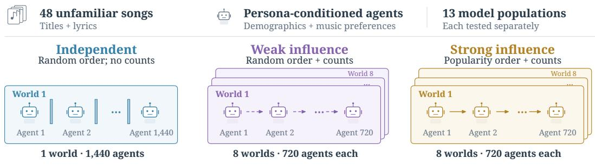

One agent’s turn in the strong-influence condition  
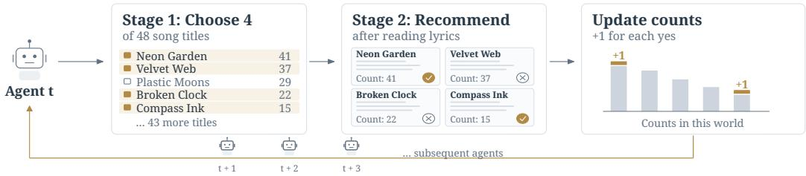  
Influence: counts shown in both stages. Independent: counts never shown.

Figure 1: Experimental design. Each of 13 model populations evaluated the same 48 unfamiliar songs, with agents assigned personas combining demographic attributes and preferred music genres. For each model, one independent world contained 1,440 agents, and eight worlds in each influence condition contained 720 agents each. Titles were randomly ordered without recommendation counts in the independent condition, randomly ordered with counts under weak influence, and ordered by decreasing counts under strong influence. Walls indicate the absence of social feedback; dashed and solid arrows indicate feedback under weak and strong influence, respectively. The bottom sequence illustrates one agent’s turn in the strong-influence condition. Agents first selected four titles, then read the lyrics and decided whether to recommend each song. In the influence conditions, cumulative counts were visible in both the selection and recommendation stages and never shown in the independent condition. Each recommendation increased the song’s count by one, updating the information available to subsequent agents in the same world. All worlds began with zero counts and evolved separately.

## 2.3 Model populations

We evaluated five reasoning models (GPT-5, GPT-5 nano, Gemini 3 Flash, DeepSeek-R1, and Claude Sonnet 4.6) and eight non-reasoning models (GPT-4o, GPT-4o mini, Gemma 3 4B, Gemma 3 12B, Gemma 3 27B, DeepSeek-V3.1, Claude Haiku 4.5, and Qwen3-Next 80B), classified according to their developers’ designations of the inference mode. Each population used a single model. We also assessed capability using the Artificial Analysis Intelligence Index v4.1.1 [Artificial Analysis, 2026], a composite benchmark spanning agentic tasks, coding, general problem-solving, and scientific reasoning (table S3).

To introduce structured heterogeneity, each agent was assigned a persona combining demographic attributes and primary and secondary preferred music genres. The same persona-generating procedure was used across models and conditions. Persona construction, complete prompts, and inference settings are provided in appendix B.

## 2.4 Outcome measures

A song’s market share was the proportion of all recommendations it received within its world:

$$
p _ { w } ( i ) = r _ { i } ^ { ( w ) } / R ^ { ( w ) } ,\tag{1}
$$

where $r _ { i } ^ { ( w ) }$ is the number received by song i in world w and $\begin{array} { r } { R ^ { ( w ) } = \sum _ { i = 1 } ^ { K } r _ { i } ^ { ( w ) } } \end{array}$ is the total over all $K = 4 8$ songs. Market shares in the independent world provided a population-specific measure of each song’s relative intrinsic appeal.

Our primary outcome measures were Kullback–Leibler (KL) divergence and unpredictability. $D _ { \mathrm { K L } }$ measures how far the distribution of recommendations in each influence world departed from the independent distribution:

$$
D _ { \mathrm { K L } } ^ { ( w ) } = \sum _ { i = 1 } ^ { K } \widetilde { p } _ { w } ( i ) \log \frac { \widetilde { p } _ { w } ( i ) } { \widetilde { p } _ { \mathrm { i n d } } ( i ) } ,\tag{2}
$$

where $\widetilde { p }$ denotes market shares after Jeffreys smoothing (pseudocount 0.5), applied to both distributions (appendix B.6). Larger values indicate greater divergence from independent evaluation. We report the arithmetic mean across the eight worlds in each influence condition.

Unpredictability (U) measures the extent to which parallel worlds with the same model, songs, and experimental procedures evolved toward different collective outcomes [Salganik et al., 2006]:

$$
u _ { i } = \binom { W } { 2 } \sum _ { j = 1 } ^ { - 1 } \sum _ { k = j + 1 } ^ { W - 1 } | p _ { j } ( i ) - p _ { k } ( i ) | , \qquad U = \frac { 1 } { K } \sum _ { i = 1 } ^ { K } u _ { i } ,\tag{3}
$$

where $W = 8$ and market shares were unsmoothed. For the independent world, we randomly divided agents into two groups of 720, matching the size of an influence world, and averaged their market-share differences over 1,000 splits.

To test for self-correction, we followed the procedure applied to the Music Lab data [Van de Rijt, 2022]. For each influence world, we split the chronological recommendation sequence into two approximately equal halves and computed the Spearman correlation between song recommendation counts within each half and independent-world counts. Second-half counts excluded first-half recommendations. A positive change, $\Delta \rho ^ { ( w ) } = \rho _ { 2 } ^ { ( w ) } - \rho _ { 1 } ^ { ( w ) } > 0$ , indicates that later recommendations aligned more closely with intrinsic appeal.

Together, these measures distinguish displacement from independent judgment, variation across replicate worlds, and self-correction over time. For the capability analysis, we used relative unpredictability, $U _ { \mathrm { i n f } } / U _ { \mathrm { i n d } }$ , to measure proportional amplification above each model’s independent baseline; absolute U remained the primary measure in the other analyses. Additional measures (Gini inequality, Pearson correlation with independent shares, and persistence of early recommendations), robustness checks, and position-bias analyses are reported in the Supplementary Materials.

## 2.5 Human benchmark

We applied the same outcome definitions to the original Music Lab data as a human benchmark [Salganik et al., 2006], with downloads in place of recommendations. Weak influence corresponded to Music Lab experiment 1, in which download counts were shown but songs were arranged in a randomized grid, and strong influence corresponded to experiment 2, in which songs were listed by download count. Because stimuli, response tasks, and presentation differed, the human results provide a qualitative benchmark rather than a controlled estimate of human–LLM differences; appendix B.5 details this comparison.

## 3 Results

## 3.1 LLM susceptibility to herding

Fig. 2 shows how exposure to current recommendations generated herding behavior in which agents recommendations diverged from independent judgment $( p < 0 . 0 0 1$ for every model under both influence conditions). Mean KL divergence was about nine times the human benchmark under weak influence and four times under strong influence (fig. 2A). Among LLMs, non-reasoning models diverged 2.4 and 3.2 times as far as reasoning models under weak and strong influence, respectively. Under strong influence, four of the five reasoning models diverged less than every non-reasoning model; GPT-5 nano was the exception (fig. 2, B and $\bar { \mathrm { { C } ) } }$ . GPT-5 approached human divergence, whereas Gemma 3 4B diverged more than eight times as far. Except for Claude Sonnet 4.6, strong influence increased mean divergence by 65%, with greater divergence in 12 of 13 models (two-sided Wilcoxon signed-rank test across models, $p < 0 . 0 1 $ .

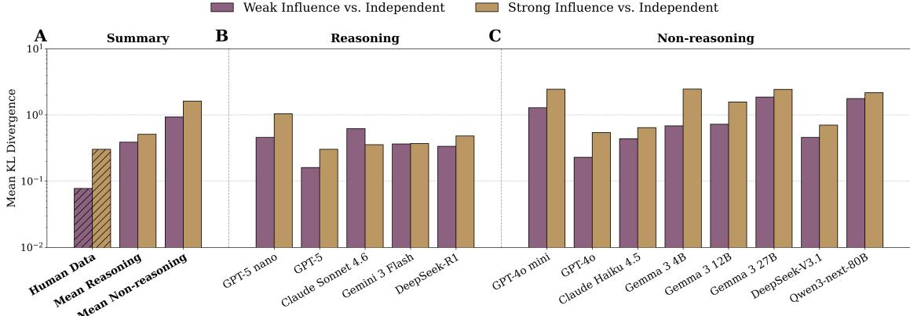

Figure 2: Compared with humans, LLM populations showed greater divergence from independent judgment. Kullback–Leibler (KL) divergence measures departure of influence-world market shares from the corresponding independent baseline, averaged over eight worlds per condition. Higher values on the logarithmic vertical axis indicate greater divergence. Divergence was computed with Jeffreys smoothing (pseudocount 0.5 per song). Gold and purple denote strong and weak influence, respectively. Hatched bars show human values from the original Music Lab data [Salganik et al., 2006]. (A) Mean divergence was greater among non-reasoning models than among reasoning models, and greater in both classes than among humans. (B and C). GPT-5 nearly matched the human benchmark under strong influence; Gemma 3 4B had the greatest divergence under strong influence and Gemma 3 27B under weak influence. Differences between independent and social influence conditions were significant for all 13 LLMs under both influence conditions (p < 0.001).

## 3.2 Social feedback can turn herding behavior into a stampede

Divergence from independent judgment can indicate herding behavior but not necessarily a stampede. The latter also requires an endogenous feedback loop that can amplify small initial differences, making outcomes highly unpredictable. Fig. 3A shows that unpredictability in the independent condition was close to zero across all models and slightly below the level observed among humans. Compared to the independent condition, unpredictability was far greater in the influence conditions for humans and LLMs, especially among non-reasoning models in the strong-influence condition.

Given the similarly low independent baselines, the more instructive comparison is within influence conditions. Non-reasoning models were nearly twice as unpredictable as reasoning models at both influence levels. Mean unpredictability among reasoning models was modestly above the human benchmark, whereas non-reasoning models were more than twice as unpredictable as humans under both influence conditions.

All 13 models exceeded human unpredictability under weak influence (fig. 3, B and C). Under strong influence, three reasoning models—Gemini 3 Flash, GPT-5, and Claude Sonnet 4.6—fell slightly below the human benchmark. Strong influence increased unpredictability in 12 of 13 models, with Gemini 3 Flash the lone exception (two-sided Wilcoxon signed-rank test across models, $p < 0 . 0 0 1 )$ .

Unpredictability reflects sensitivity to early choices, which can also be measured directly. We also correlated market shares among the first 30 agents in each influence world with market shares among all later agents in the same world. In LLM populations, early movers predicted later popularity better than intrinsic appeal did in 12 of 13 models under weak influence and in all 13 under strong influence, with the largest gaps among non-reasoning models (table S2). Among humans, early movers were the better predictor only under strong influence (appendix C.4).

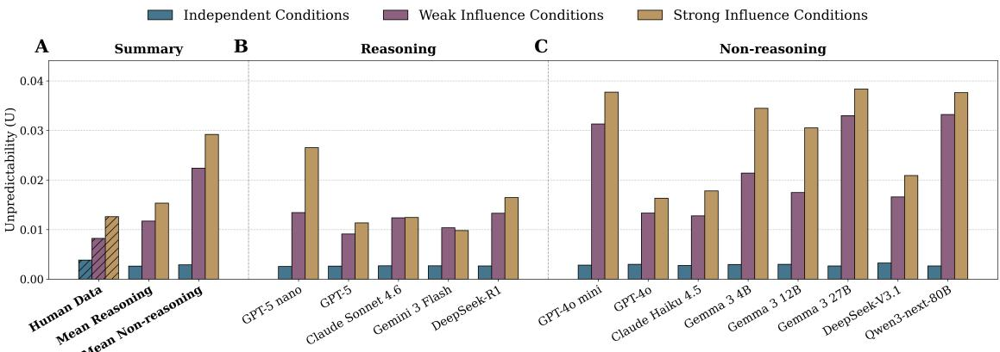

Figure 3: Social influence increased unpredictability, especially among non-reasoning models. As in the original Music Lab experiment [Salganik et al., 2006], unpredictability (U) measures the mean absolute difference in a song’s market share across all 28 pairs of eight influence worlds, averaged over the 48 songs. Unpredictability in the independent world was estimated by randomly splitting the population into two equal groups of 720 agents and averaging over 1,000 random splits. Gold, purple, and blue denote strong influence, weak influence, and independent evaluation, respectively. The hatched bar is the human benchmark for comparison with unweighted class means among the five reasoning and eight non-reasoning models. (A) Unpredictability was greater among non-reasoning models compared to reasoning models and humans, regardless of influence level. (B and C) Model-specific results show that unpredictability in the independent condition was near zero for each model and only slightly higher among humans, indicating stable aggregate shares under independnet evaluation. Social influence increased unpredictability in every model, although some reasoning models fell slightly below the human benchmark. In every population, unpredictability was greater in both influence conditions than in the independent condition $( p < 0 . 0 0 1 )$ , except for humans $( p < 0 . 0 1 )$ ) and DeepSeek-R1 under weak influence $( p < 0 . 0 5 )$ .

## 3.3 Susceptibility to herding and cascades decreased with model intelligence scores.

A continuous measure of model intelligence provides a more refined analysis compared to the binary reasoning classification. Fig. 4 reports results using the Artificial Analysis Intelligence Index (AAII), an established composite performance benchmark. Stars and dots denote reasoning and non-reasoning models, respectively. The dashed line is the human benchmark. Each association is summarized with a least squares linear fit and Spearman correlation. Across the 13 models, both KL divergence (fig. 4A and B) and relative unpredictability (fig. 4C and D) decline as intelligence scores increase, regardless of influence condition (although the association is stronger for divergence in the strong-influence condition). For KL divergence, $\rho = - 0 . 8 5 1$ and ρ = −0.551 for strong and weak influence, respectively. For relative unpredictability, $\rho = - 0 . 7 3 3$ and $\rho = - 0 . 7 1 9$ . Models are clustered by reasoning class, as expected.

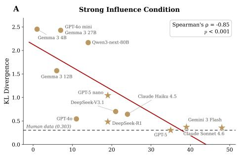

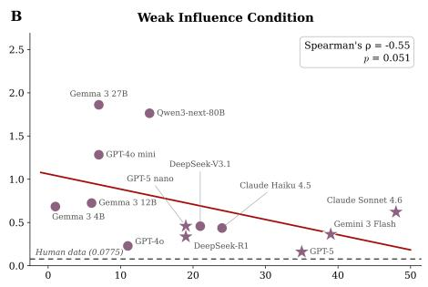

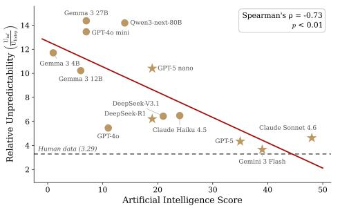

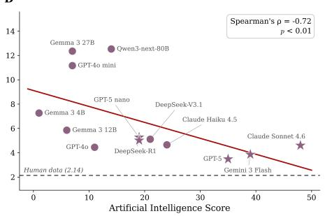  
Figure 4: Higher model intelligence is associated with lower divergence and relative unpredictability. Each point represents one of 13 LLMs plotted against its Artificial Analysis Intelligence Index score, version 4.1.1 [Artificial Analysis, 2026]. The index aggregates performance across benchmark agentic tasks, coding, general problem-solving, and scientific reasoning; higher scores indicate higher intelligence. The associations are summarized as a least-squares linear fit and Spearman correlation. Stars denote reasoning models and dots denote non-reasoning. The dashed line is the human benchmark. Within each influence condition, KL divergence is the mean over eight influence worlds and unpredictability is the mean over 28 pairs of influence worlds, normalized by unpredictability in the independent condition $( U _ { \mathrm { i n f } } / U _ { \mathrm { i n d } } )$ . The association with divergence depends on the strength of social influence, going from $\rho = - 0 . 8 5 1 \ : ( p < 0 . 0 0 1 )$ ) when influence is strong (A) to $\rho = - 0 . 5 5 1 \ : ( p = 0 . 0 5 1 )$ when influence is weak (B). The association with unpredictability (C and D) remains strong regardless of influence condition $( \rho = - 0 . 7 3 3 , p < 0 . 0 1$ and $\rho = - 0 . 7 1 9 , p < 0 . 0 1$ for strong and weak influence, respectively). The models are clustered by reasoning class, indicating the expected association with intelligence score.

## 3.4 Human cascades self-corrected; LLM cascades generally did not

Cascades can self-correct if independent preferences are sufficiently strong relative to social influence [Van de Rijt, 2022]. Fig. 5 reports self-correction using the same diagnostic procedure that was used with the original Music Lab data – the change in the Spearman correlation between popularity and intrinsic appeal between the first and second halves of the experiment. A larger second-half correlation indicates movement toward the independent ranking; negative changes indicate movement away.

Across the entire experiment, market shares remained positively correlated with intrinsic appeal in every population, but this correspondence weakened in 11 of 13 models under strong influence (table S2). Splitting each experiment in half, human cascades self-corrected in 15 of 16 influence worlds, with the popularity-appeal correlation increasing from $\rho = 0 . 6 3 3 \mathrm { t o } 0 . 7 7 3$ under weak influence (all eight worlds; one-sided Wilcoxon signed-rank test, $p < 0 . 0 1 )$ ) and from 0.575 to 0.660 under strong influence (seven of eight worlds; $p < 0 . 0 5 )$ . Among LLMs, changes varied in direction across models and worlds, averaging close to zero under strong influence. The human benchmark therefore exhibited a corrective dynamic that was much less consistent across LLM populations. In short, LLMs were more susceptible to “runaway cascades,” persistent, history-dependent departures without reliable self-correction over the observed experimental horizon. However, the results do not establish that correction could never occur over longer sequences.

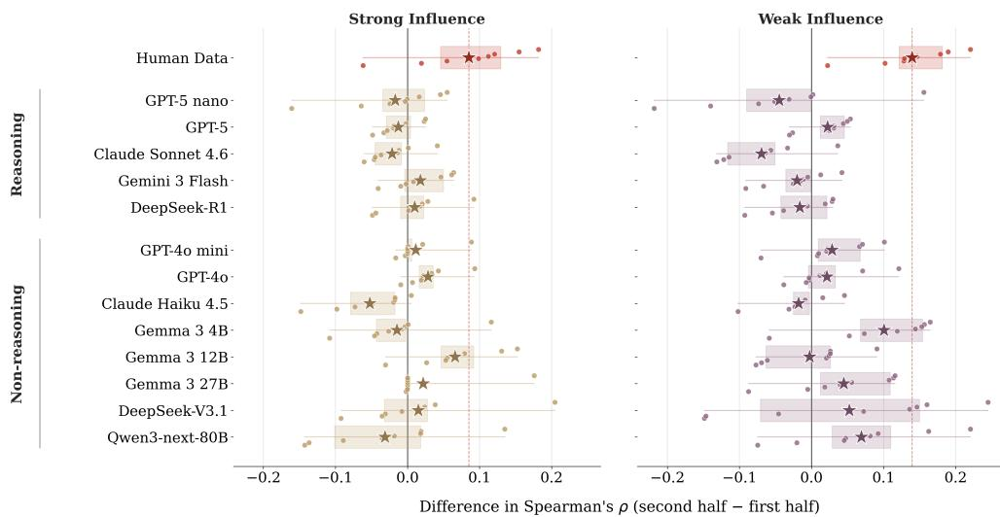  
Average across influence conditions IQR across influence conditions Individual influence condition

Figure 5: Human cascades consistently self-corrected; LLM cascades generally did not. Following van de Rijt [Van de Rijt, 2022], self-correction was measured as the change in Spearman correlation between popularity and intrinsic appeal between the first and second halves of the sequential recommendations. The change in correlation was calculated for each of the eight influence worlds in each influence condition (indicated by a dot) and then averaged over the eight worlds (indicated by a star). A higher second-half correlation indicates closer alignment with the independent ranking; negative changes indicate movement of popularity away from intrinsic appeal. Shaded boxes and lines show the interquartile range and total range respectively. Human correlations increased in seven of eight strong-influence worlds and all eight weak-influence worlds, with mean changes of +0.085 $( p < 0 . 0 5 )$ and +0.140 (p < 0.01), respectively. In contrast, LLM changes varied in direction across models and worlds and averaged near zero under strong influence. As expected, self-correction requires intrinsic appeal that is strong relative to social influence.

## 3.5 Supplementary results

Social influence increased inequality (measured as the Gini coefficient) in all 13 models under strong influence and in 12 under weak influence (fig. S3). Relative to their independent baselines, non-reasoning models showed larger mean increases in inequality than humans, whereas reasoning models showed smaller increases.

Popularity-ordered lists in the strong-influence condition could confound responses to recommendation counts with responses to display position. We tested for position bias using the fraction of first-stage selections at each of the 48 display positions (not songs) in the independent condition (fig. S4). Selections were approximately uniform across positions for most LLMs, although Gemma 3 4B and GPT-4o mini showed a modest preference for higher-ranked positions. Because agents were randomly distributed across conditions, those in the influence conditions should not be expected to have greater position bias than those in the independent condition. As expected, position bias was much stronger among humans, given the lack of the cognitive resources to process all 48 songs. Net of position bias, susceptibility to self-reinforcing social influence among humans may be substantially weaker than we reported, which means we may have understated the difference in susceptibility with LLMs. See “Position bias” in the SM for details and an extended discussion of the implications.

Chain-of-thought reasoning traces in DeepSeek-R1 revealed explicit references to song popularity in every log and in both influence conditions, consistent with responsiveness to social influence.

Finally, we ran two robustness checks. Under strong influence, lowering the temperature from 1.0 to 0.7 did not attenuate overall divergence or unpredictability among non-reasoning models (fig. S7). Increasing the number of titles that could be chosen for assessment from four to 12 reduced divergence and unpredictability but preserved the main patterns across models (figs. S8 and S9).

## 4 Discussion

Large language models increasingly collaborate in multi-agent systems in which model-generated judgments may become inputs for subsequent agents, creating endogenous feedback loops. Evaluating collective AI behavior therefore requires going beyond individual responses to a fixed signal to test how model outputs shape subsequent inputs.

Across 13 experiments, comparisons with a human benchmark revealed generally greater LLM susceptibility to herding and cascades and less consistent self-correction. When popularity influences recommendation, songs with an early advantage are more likely to be chosen for assessment and to then be assessed more favorably.

Reasoning and higher-intelligence models were less susceptible to herding behavior, but lower susceptibility did not ensure self-correction. Going forward, as models rapidly advance, susceptibility to influence on simple tasks like recommendation can be expected to decline. However, our experiment precluded more powerful influence mechanisms like communication, task incentives, and social sanctioning. If task complexity increases alongside intelligence and influence is reinforced with social pressure and incentives, susceptibility to errant cascades may increase.

Our design preserved the feedback structure of Music Lab but adapted its implementation to LLM agents: agents read the lyrics of newly generated songs rather than listening to songs by unknown bands, recommended rather than downloaded songs, assessed a fixed four songs rather than choosing how many to sample, and saw a text list rather than a grid when songs were not ordered by popularity (appendix B.5). These differences limit attribution of human–LLM contrasts to population type. A matched human replication of this study is needed to rule out these design differences as the explanation for observed behavioral differences. Our experiment also studied homogeneous populations of a single model, precluded explicit collaboration, and lacked incentives for conformity or ground-truth accuracy. Generalization to heterogeneous teams, more challenging tasks, multimodal systems, incentives for compliance, and verba influence remain to be tested. Nevertheless, self-reinforcing departures from independent judgment identify a potential risk for recommender systems, automated evaluation, and collaborative problem-solving.

## Acknowledgments

This study was supported by the U.S. National Science Foundation (SBE 2611776) and Amazon Research during the time this study was conducted.

## References

Gati V. Aher, Rosa I. Arriaga, and Adam Tauman Kalai. Using large language models to simulate multiple humans and replicate human subject studies. In Proceedings of the 40th International Conference on Machine Learning, volume 202 of Proceedings of Machine Learning Research, pages 337–371, 2023.

Lisa P. Argyle, Ethan C. Busby, Nancy Fulda, Joshua R. Gubler, Christopher Rytting, and David Wingate. Out of one, many: Using language models to simulate human samples. Political Analysis, 31(3): 337–351, 2023. doi: 10.1017/pan.2023.2.

Artificial Analysis. Artificial analysis intelligence index v4.1. https://artificialanalysis.ai/ articles/artificial-analysis-intelligence-index-v4-1, 2026.

Ashwini Ashokkumar, Luke Hewitt, Isaias Ghezae, and Robb Willer. Large language models can predict the results of social science experiments. Nature, 656(8126):115–122, 2026. doi: 10.1038/ s41586-026-10742-x.

Razan Baltaji, Babak Hemmatian, and Lav Varshney. Conformity, confabulation, and impersonation: Persona inconstancy in multi-agent LLM collaboration. In Vinodkumar Prabhakaran, Sunipa Dev, Luciana Benotti, Daniel Hershcovich, Laura Cabello, Yong Cao, Ife Adebara, and Li Zhou, editors, Proceedings of the 2nd Workshop on Cross-Cultural Considerations in NLP, pages 17–31, Bangkok, Thailand, August 2024. Association for Computational Linguistics. doi: 10.18653/v1/2024.c3nlp-1.2. URL https://aclanthology.org/2024.c3nlp-1.2/.

Abhijit V Banerjee. A simple model of herd behavior. The quarterly journal of economics, 107(3):797–817, 1992.

Alessandro Bellina, Giordano De Marzo, and David Garcia. Conformity and social impact on ai agents. arXiv preprint arXiv:2601.05384, 2026.

Sushil Bikhchandani, David Hirshleifer, and Ivo Welch. A theory of fads, fashion, custom, and cultural change as informational cascades. Journal ofPolitical Economy, 100(5):992–1026, 1992. doi: 10.1086/ 261849.

James Bisbee, Joshua D. Clinton, Cassy Dorff, Brenton Kenkel, and Jennifer M. Larson. Synthetic replacements for human survey data? The perils of large language models. Political Analysis, 32(4): 401–416, 2024. doi: 10.1017/pan.2024.5.

Levin Brinkmann, Fabian Baumann, Jean-François Bonnefon, Maxime Derex, Thomas F. Müller, Anne-Marie Nussberger, Agnieszka Czaplicka, Alberto Acerbi, Thomas L. Griffiths, Joseph Henrich, Joel Z. Leibo, Richard McElreath, Pierre-Yves Oudeyer, Jonathan Stray, and Iyad Rahwan. Machine culture. Nature Human Behaviour, 7(11):1855–1868, 2023. doi: 10.1038/s41562-023-01742-2.

Allison J. B. Chaney, Brandon M. Stewart, and Barbara E. Engelhardt. How algorithmic confounding in recommendation systems increases homogeneity and decreases utility. In Proceedings ofthe 12th ACM Conference on Recommender Systems, pages 224–232, 2018. doi: 10.1145/3240323.3240370.

Young-Min Cho, Sharath Chandra Guntuku, and Lyle Ungar. Herd behavior: Investigating peer influence in llm-based multi-agent systems. arXiv preprint arXiv:2505.21588, 2025.

Min Choi, Keonwoo Kim, Sungwon Chae, and Sangyeop Baek. An empirical study of group conformity in multi-agent systems. In Wanxiang Che, Joyce Nabende, Ekaterina Shutova, and Mohammad Taher Pilehvar, editors, Findings ofthe Associationfor Computational Linguistics: ACL 2025, pages 5123– 5139, Vienna, Austria, July 2025. Association for Computational Linguistics. ISBN 979-8-89176-256-5. doi: 10.18653/v1/2025.findings-acl.265. URL https://aclanthology.org/2025.findings-acl. 265/.

Yun-Shiuan Chuang, Agam Goyal, Nikunj Harlalka, Siddharth Suresh, Robert Hawkins, Sijia Yang, Dhavan Shah, Junjie Hu, and Timothy T. Rogers. Simulating opinion dynamics with networks of LLM-based agents. In Findings ofthe Associationfor Computational Linguistics: NAACL 2024, pages 3326–3346, 2024. doi: 10.18653/v1/2024.findings-naacl.211.

Paul Covington, Jay Adams, and Emre Sargin. Deep neural networks for YouTube recommendations. In Proceedings of the 10th ACM Conference on Recommender Systems, pages 191–198, New York, NY, USA, 2016. Association for Computing Machinery. doi: 10.1145/2959100.2959190.

Nick Craswell, Onno Zoeter, Michael Taylor, and Bill Ramsey. An experimental comparison of click position-bias models. In Proceedings ofthe 2008 International Conference on Web Search and Data Mining, pages 87–94. ACM, 2008. doi: 10.1145/1341531.1341545.

Giordano De Marzo, Alessandro Bellina, Claudio Castellano, Viola Priesemann, and David Garcia. Conformity generates collective misalignment in AI agents societies. arXiv:2605.10721, 2026. URL https://arxiv.org/abs/2605.10721.

Yilun Du, Shuang Li, Antonio Torralba, Joshua B. Tenenbaum, and Igor Mordatch. Improving factuality and reasoning in language models through multiagent debate. In Proceedings ofthe 41st International Conference on Machine Learning, ICML’24. JMLR.org, 2024.

Aaron Fanous, Jacob Goldberg, Ank Agarwal, Joanna Lin, Anson Zhou, Sonnet Xu, Vasiliki Bikia, Roxana Daneshjou, and Sanmi Koyejo. Syceval: Evaluating llm sycophancy. In Proceedings ofthe AAAI/ACM Conference on AI, Ethics, and Society, volume 8, pages 893–900, 2025.

Giorgos Filandrianos, Angeliki Dimitriou, Maria Lymperaiou, Konstantinos Thomas, and Giorgos Stamou. Bias beware: The impact of cognitive biases on llm-driven product recommendations. In Proceedings ofthe 2025 Conference on Empirical Methods in Natural Language Processing, pages 22408–22437, 2025.

Daniel Fleder and Kartik Hosanagar. Blockbuster culture’s next rise or fall: The impact of recommender systems on sales diversity. Management Science, 55(5):697–712, 2009. doi: 10.1287/mnsc.1080.0974.

Ariel Flint Ashery, Luca Maria Aiello, and Andrea Baronchelli. Emergent social conventions and collective bias in LLM populations. Science Advances, 11(20):eadu9368, 2025. doi: 10.1126/sciadv.adu9368.

Leon Fröhling, Gianluca Demartini, and Dennis Assenmacher. Personas with attitudes: Controlling LLMs for diverse data annotation. In Agostina Calabrese, Christine de Kock, Debora Nozza, Flor Miriam Plazadel Arco, Zeerak Talat, and Francielle Vargas, editors, Proceedings ofthe 9th Workshop on Online Abuse and Harms (WOAH), pages 468–481, Vienna, Austria, August 2025. Association for Computational Linguistics. ISBN 979-8-89176-105-6. URL https://aclanthology.org/2025.woah-1.43/.

Léna Gaubert, Rémi Devaux, Elif Çelen, Raja Marjieh, Diana Mangalagiu, Antoine Jardin, and Nori Jacoby. An experimental method to study opinion diffusion in human-ai hybrid societies. arXiv preprint arXiv:2605.09197, 2026.

Moshe Glickman and Tali Sharot. How human–AI feedback loops alter human perceptual, emotional and social judgements. Nature Human Behaviour, 9(2):345–359, 2025. doi: 10.1038/s41562-024-02077-2.

Igor Grossmann, Matthew Feinberg, Dawn C. Parker, Nicholas A. Christakis, Philip E. Tetlock, and William A. Cunningham. AI and the transformation of social science research. Science, 380(6650): 1108–1109, 2023. doi: 10.1126/science.adi1778.

C. Han, J. Tan, B. Yu, W. Zheng, and X. Tang. Conformity dynamics in LLM multi-agent systems: The roles of topology and self-social weighting. arXiv:2601.05606, 2026. URL https://arxiv.org/ abs/2601.05606.

Farnoosh Hashemi and Michael Macy. Collective social behaviors in llms: an analysis of llms social networks. In Large Language Modelsfor Scientific and Societal Advances, 2025.

Farnoosh Hashemi and Michael Macy. An empirical study of collective behaviors and social dynamics in large language model agents. In Vera Demberg, Kentaro Inui, and Lluís Marquez, editors, Proceedings of the 19th Conference of the European Chapter of the Association for Computational Linguistics (Volume 1: Long Papers), pages 7327–7351, Rabat, Morocco, March 2026. Association for Computational Linguistics. ISBN 979-8-89176-380-7. doi: 10.18653/v1/2026.eacl-long.344. URL https://aclanthology.org/2026.eacl-long.344/.

Yupeng Hou, Junjie Zhang, Zihan Lin, Hongyu Lu, Ruobing Xie, Julian McAuley, and Wayne Xin Zhao. Large language models are zero-shot rankers for recommender systems. In European conference on information retrieval, pages 364–381. Springer, 2024.

Zafar Hussain and Kristoffer Nielbo. Conformity mitigations in large language models lie on a single resistance-receptivity frontier. arXiv preprint arXiv:2608.11247, 2026.

Adit Jain and Vikram Krishnamurthy. Interacting large language model agents. bayesian social learning based interpretable models. IEEE Access, 13:25465–25504, 2025. doi: 10.1109/ACCESS.2025.3538599.

Thorsten Joachims, Laura Granka, Bing Pan, Helene Hembrooke, and Geri Gay. Accurately interpreting clickthrough data as implicit feedback. In Proceedings ofthe 28th Annual International ACM SIGIR Conference on Research and Development in Information Retrieval, pages 154–161. ACM, 2005. doi: 10.1145/1076034.1076063.

Patrick Lewis, Ethan Perez, Aleksandra Piktus, Fabio Petroni, Vladimir Karpukhin, Naman Goyal, Heinrich Küttler, Mike Lewis, Wen-tau Yih, Tim Rocktäschel, Sebastian Riedel, and Douwe Kiela. Retrievalaugmented generation for knowledge-intensive NLP tasks. In Advances in Neural Information Processing Systems, volume 33, pages 9459–9474. Curran Associates, Inc., 2020.

Hsien-Tsung Lin, Pei-Cing Huang, Chan-Tung Ku, Chan Hsu, Pei-Xuan Shieh, and Yihuang Kang. Towards simulating social influence dynamics with llm-based multi-agents. In 2025 IEEE International Conference on Information Reuse and Integration and Data Science (IRI), pages 307–312. IEEE, 2025.

Nelson F. Liu, Kevin Lin, John Hewitt, Ashwin Paranjape, Michele Bevilacqua, Fabio Petroni, and Percy Liang. Lost in the middle: How language models use long contexts. Transactions of the Association for Computational Linguistics, 12:157–173, 2024. doi: 10.1162/tacl\_a\_00638.

Jan Lorenz, Heiko Rauhut, Frank Schweitzer, and Dirk Helbing. How social influence can undermine the wisdom of crowd effect. Proceedings of the National Academy of Sciences, 108(22):9020–9025, 2011. doi: 10.1073/pnas.1008636108.

Michael Macy, Sebastian Deri, Alexander Ruch, and Natalie Tong. Opinion cascades and the unpredictability of partisan polarization. Science Advances, 5(8):eaax0754, 2019. doi: 10.1126/sciadv.aax0754.

Masoud Mansoury, Himan Abdollahpouri, Mykola Pechenizkiy, Bamshad Mobasher, and Robin Burke. Feedback loop and bias amplification in recommender systems. In Proceedings of the 29th ACM International Conference on Information & Knowledge Management, CIKM ’20, page 2145–2148, New York, NY, USA, 2020. Association for Computing Machinery. ISBN 9781450368599. doi: 10.1145/3340531.3412152. URL https://doi.org/10.1145/3340531.3412152.

Robert K. Merton. The Matthew effect in science. Science, 159(3810):56–63, 1968. doi: 10.1126/science. 159.3810.56.

Lev Muchnik, Sinan Aral, and Sean J. Taylor. Social influence bias: A randomized experiment. Science, 341(6146):647–651, 2013. doi: 10.1126/science.1240466.

Joon Sung Park, Joseph O’Brien, Carrie Jun Cai, Meredith Ringel Morris, Percy Liang, and Michael S. Bernstein. Generative agents: Interactive simulacra of human behavior. In Proceedings of the 36th Annual ACM Symposium on User Interface Software and Technology, UIST ’23, New York, NY, USA, 2023. Association for Computing Machinery. ISBN 9798400701320. doi: 10.1145/3586183.3606763. URL https://doi.org/10.1145/3586183.3606763.

Tai-Quan Peng, Yuan Tian, Songsong Liang, Dazhen Deng, and Yingcai Wu. Do llm-driven agents exhibit engagement mechanisms? controlled tests of information load, descriptive norms, and popularity cues. arXiv preprint arXiv:2603.20911, 2026.

Ethan Perez, Sam Ringer, Kamile Lukosiute, Karina Nguyen, Edwin Chen, Scott Heiner, Craig Pettit, Catherine Olsson, Sandipan Kundu, Saurav Kadavath, Andy Jones, Anna Chen, Benjamin Mann, Brian Israel, Bryan Seethor, Cameron McKinnon, Christopher Olah, Da Yan, Daniela Amodei, Dario Amodei, Dawn Drain, Dustin Li, Eli Tran-Johnson, Guro Khundadze, Jackson Kernion, James Landis, Jamie Kerr, Jared Mueller, Jeeyoon Hyun, Joshua Landau, Kamal Ndousse, Landon Goldberg, Liane Lovitt, Martin Lucas, Michael Sellitto, Miranda Zhang, Neerav Kingsland, Nelson Elhage, Nicholas Joseph, Noemi Mercado, Nova DasSarma, Oliver Rausch, Robin Larson, Sam McCandlish, Scott Johnston, Shauna Kravec, Sheer El Showk, Tamera Lanham, Timothy Telleen-Lawton, Tom Brown, Tom Henighan, Tristan Hume, Yuntao Bai, Zac Hatfield-Dodds, Jack Clark, Samuel R. Bowman, Amanda Askell, Roger Grosse, Danny Hernandez, Deep Ganguli, Evan Hubinger, Nicholas Schiefer, and Jared Kaplan. Discovering language model behaviors with model-written evaluations. In Anna Rogers, Jordan Boyd-Graber, and Naoaki Okazaki, editors, Findings of the Association for Computational Linguistics: ACL 2023, pages 13387–13434, Toronto, Canada, July 2023. Association for Computational Linguistics. doi: 10.18653/ v1/2023.findings-acl.847. URL https://aclanthology.org/2023.findings-acl.847/.

Pouya Pezeshkpour and Estevam Hruschka. Large language models sensitivity to the order of options in multiple-choice questions. In Findings ofthe Associationfor Computational Linguistics: NAACL 2024, pages 2006–2017. Association for Computational Linguistics, 2024. doi: 10.18653/v1/2024. findings-naacl.130.

Jiaming Qu, Lucheng Fu, and Yibo Hu. Easier to mislead than to correct: Harmful and beneficial revision in llm conformity. arXiv preprint arXiv:2606.01637, 2026.

Iyad Rahwan, Manuel Cebrian, Nick Obradovich, Josh Bongard, Jean-François Bonnefon, Cynthia Breazeal, Jacob W Crandall, Nicholas A Christakis, Iain D Couzin, Matthew O Jackson, et al. Machine behaviour. Nature, 568(7753):477–486, 2019.

Matthew J Salganik and Duncan J Watts. Leading the herd astray: An experimental study of self-fulfilling prophecies in an artificial cultural market. Social psychology quarterly, 71(4):338–355, 2008.

Matthew J. Salganik, Peter Sheridan Dodds, and Duncan J. Watts. Experimental study of inequality and unpredictability in an artificial cultural market. Science, 311(5762):854–856, 2006. doi: 10.1126/ science.1121066.

Shibani Santurkar, Esin Durmus, Faisal Ladhak, Cinoo Lee, Percy Liang, and Tatsunori Hashimoto. Whose opinions do language models reflect? In Proceedings ofthe 40th International Conference on Machine Learning, volume 202 of Proceedings of Machine Learning Research, pages 29971–30004, 2023.

Mrinank Sharma, Meg Tong, Tomasz Korbak, David Duvenaud, Amanda Askell, Samuel R. Bowman, Newton Cheng, Esin Durmus, Zac Hatfield-Dodds, Scott R. Johnston, Shauna Kravec, Timothy Maxwell, Sam McCandlish, Kamal Ndousse, Oliver Rausch, Nicholas Schiefer, Da Yan, Miranda Zhang, and Ethan Perez. Towards understanding sycophancy in language models. In International Conference on Learning Representations, 2024.

Shota Shiiku, Raja Marjieh, Thomas L. Griffiths, Manuel Anglada-Tort, and Nori Jacoby. Hybrid human– AI societies balance creativity and diversity. PsyArXiv preprint, 2026. URL https://osf.io/ preprints/psyarxiv/wzh2x\_v1.

Liron Soffer, Ravid Shwartz-Ziv, and Chen Shani. LLMs trust their own: Identity-dependent conformity in multi-agent systems. arXiv:2609.33495, 2026. URL https://arxiv.org/abs/2609.33495.

Maojia Song, Tej Deep Pala, Ruiwen Zhou, Weisheng Jin, Amir Zadeh, Chuan Li, Dorien Herremans, and Soujanya Poria. Measuring and mitigating rapport bias of large language models under multi-agent social interactions. In International Conference on Learning Representations, volume 2026, pages 7066–7099, 2026.

Team Suno. Introducing v4.5. https://suno.com/blog/introducing-v4-5, 2025.

Arnout Van de Rijt. Self-correcting dynamics in social influence processes. In Handbook of Sociological Science, pages 446–473. Edward Elgar Publishing, 2022.

Arnout van de Rijt, Soong Moon Kang, Michael Restivo, and Akshay Patil. Field experiments of successbreeds-success dynamics. Proceedings ofthe National Academy ofSciences, 111(19):6934–6939, 2014. doi: 10.1073/pnas.1316836111.

Benno Weck, Ilaria Manco, Emmanouil Benetos, Elio Quinton, György Fazekas, and Dmitry Bogdanov. Muchomusic: Evaluating music understanding in multimodal audio-language models. In Proceedings of the 25th International Societyfor Music Information Retrieval Conference (ISMIR), 2024.

Zhiyuan Weng, Guikun Chen, and Wenguan Wang. Do as we do, not as you think: The conformity of large language models. In International Conference on Learning Representations, 2025.

Weidong Wu, Qinlin Zhao, Hao Chen, Lexin Zhou, Defu Lian, and Hong Xie. Exploring the choice behavior of large language models. In Wanxiang Che, Joyce Nabende, Ekaterina Shutova, and Mohammad Taher Pilehvar, editors, Findings ofthe Associationfor Computational Linguistics: ACL 2025, pages 5194– 5214, Vienna, Austria, July 2025. Association for Computational Linguistics. ISBN 979-8-89176-256-5. doi: 10.18653/v1/2025.findings-acl.270. URL https://aclanthology.org/2025.findings-acl. 270/.

Andrea Wynn, Harsh Satija, and Gillian Hadfield. Talk isn’t always cheap: Understanding failure modes in multi-agent debate. arXiv:2509.05396, 2025. URL https://arxiv.org/abs/2509.05396.

Jiayi Ye, Yanbo Wang, Yue Huang, Dongping Chen, Qihui Zhang, Nuno Moniz, Tian Gao, Werner Geyer, Chao Huang, Pin-Yu Chen, et al. Justice or prejudice? quantifying biases in llm-as-a-judge. In International Conference on Learning Representations, volume 2025, pages 102351–102390, 2025.

Jintian Zhang, Xin Xu, Ningyu Zhang, Ruibo Liu, Bryan Hooi, and Shumin Deng. Exploring collaboration mechanisms for LLM agents: A social psychology view. In Lun-Wei Ku, Andre Martins, and Vivek Srikumar, editors, Proceedings of the 62nd Annual Meeting of the Association for Computational Linguistics (Volume 1: Long Papers), pages 14544–14607, Bangkok, Thailand, August 2024. Association for Computational Linguistics. doi: 10.18653/v1/2024.acl-long.782. URL https://aclanthology. org/2024.acl-long.782/.

Chujie Zheng, Hao Zhou, Fandong Meng, Jie Zhou, and Minlie Huang. Large language models are not robust multiple choice selectors. In The Twelfth International Conference on Learning Representations, 2024. URL https://openreview.net/forum?id=shr9PXz7T0.

Lianmin Zheng, Wei-Lin Chiang, Ying Sheng, Siyuan Zhuang, Zhanghao Wu, Yonghao Zhuang, Zi Lin, Zhuohan Li, Dacheng Li, Eric P. Xing, Hao Zhang, Joseph E. Gonzalez, and Ion Stoica. Judging LLM-as-a-judge with MT-Bench and Chatbot Arena. In Advances in Neural Information Processing Systems, volume 36, pages 46595–46623, 2023.

Mingze Zhong, Meng Fang, Zijing Shi, Yuxuan Huang, Shunfeng Zheng, Yali Du, Ling Chen, and Jun Wang. Spiral of silence in large language model agents. In Christos Christodoulopoulos, Tanmoy Chakraborty, Carolyn Rose, and Violet Peng, editors, Findings ofthe Associationfor Computational Linguistics: EMNLP 2025, pages 23238–23253, Suzhou, China, November 2025. Association for Computational Linguistics. ISBN 979-8-89176-335-7. doi: 10.18653/v1/2025.findings-emnlp.1262. URL https://aclanthology.org/2025.findings-emnlp.1262/.

Xiaochen Zhu, Caiqi Zhang, Tom Stafford, Nigel Collier, and Andreas Vlachos. Conformity in large language models. In Proceedings of the 63rd Annual Meeting of the Association for Computational Linguistics (Volume 1: Long Papers), pages 3854–3872, 2025.

## A Related Work

## A.1 Conformity and sycophancy in individual LLMs

A large literature documents how individual LLMs shift their responses toward opinions presented in their input. Studies of sycophancy found that agreement with users increased with model size [Perez et al., 2023], appeared across free-form tasks and was favored by human preference judgments [Sharma et al., 2024], and led models to abandon correct answers after user rebuttals [Fanous et al., 2025]. A second line of work adapted the Asch paradigm by displaying peer answers before the model responds. Weng et al. introduced five interaction protocols, including multi-round histories of correct guidance followed by incorrect guidance; all eleven models exhibited conformity, while larger models were more independent [Weng et al., 2025]. Zhu et al. found that conformity increased with the number and confident tone of unanimous confederates and was predicted by the model’s uncertainty [Zhu et al., 2025]. Other studies linked conformity to group size and task difficulty [Bellina et al., 2026], peers’ group identity [Soffer et al., 2026], prior agreement with peers [Song et al., 2026], and relative confidence between the model and its peers [Cho et al., 2025]. Models were easier to mislead than to correct: wrong peer agreement increased harmful revision more than correct agreement increased beneficial revision [Qu et al., 2026]. Across 23 models, mitigations generally traded resistance to incorrect peers against receptivity to correct ones; reasoning improved both on derivable MMLU tasks, but the trade-off persisted on GPQA and SimpleQA [Hussain and Nielbo, 2026]. Popularity cues also influenced LLM judges [Ye et al., 2025] and product recommendations [Filandrianos et al., 2025].

These studies primarily examine how individual models respond to controlled social information, rather than how successive decisions update a cumulative popularity signal. Our study asks how individual susceptibility develops into population-level cascades when recommendations generate the signal seen by subsequent agents. The outcomes are divergence from independent judgment, unpredictability across replicate worlds, and self-correction, rather than whether a model adopts a supplied answer.

## A.2 Collective dynamics in interacting LLM populations

When agents respond to one another, social influence becomes endogenous. Multi-agent debate improved factuality [Du et al., 2024], but also produced conformity [Zhang et al., 2024, Baltaji et al., 2024], deference to larger or more capable groups [Choi et al., 2025], and accuracy losses when agents abandoned correct answers [Wynn et al., 2025]. In a seven-agent misinformation task, denser networks accelerated convergence but raised the risk of confident incorrect consensus [Han et al., 2026]. Larger populations developed shared conventions, collective biases, and minority-driven tipping [Flint Ashery et al., 2025], reached consensus or fragmented depending on prompted bias [Chuang et al., 2024], and became trapped in states opposed to their intrinsic preferences [De Marzo et al., 2026]. Forum simulations found greater conformity in smaller models and greater resistance in reasoning-optimized models [Lin et al., 2025]. Observational analyses of Chirper.ai, a platform populated by LLM agents, documented homophily and social influence among approximately 32,000 agents [Hashemi and Macy, 2026, 2025].

Sequential decisions and accumulating social signals provide closer comparisons. Jain and Krishnamurthy combined LLM outputs with Bayesian decision mechanisms to study social learning and information cascades [Jain and Krishnamurthy, 2025]. Zhong et al. had 100 agents rate a film in sequence while observing earlier agents’ mean rating, producing anchoring and, with personas, majority dominance [Zhong et al., 2025]. In a simulated microblogging platform, responses to endogenous popularity counts varied with information load and normative context [Peng et al., 2026]. Wu et al. studied choices on a question-answering platform with independent conditions, accumulating engagement counts, and experimentally seeded popularity, finding reinforcement of existing preferences and shifts toward socially favored alternatives [Wu et al., 2025].

Our study extends this work by connecting individual susceptibility to the distribution, unpredictability, and self-correction of collective recommendations in one controlled design. Agents act once in sequence and choose among fixed alternatives whose intrinsic appeal is measured independently. We combine this design with a fixed selection budget, separate selection and endorsement stages, and a manipulation of whether popularity also determines list position. Separating selection from endorsement makes attention a bottleneck: an item must first be selected before it can receive a recommendation. Popularity can therefore reinforce both exposure and evaluation. Comparing 13 models tests whether greater individual capability is associated with collective robustness. Replicated worlds reveal whether early choices redirect collective outcomes, while temporal comparisons test whether accumulating recommendations restore alignment with independent appeal. A human benchmark places the magnitude of these effects in context.

## A.3 Hybrid human–AI societies and feedback loops

Human–AI interaction can amplify initially small judgment biases [Glickman and Sharot, 2025]. In story-revision networks, AI-only populations lost diversity whereas hybrid populations better balanced creativity and diversity [Shiiku et al., 2026]; opinion-diffusion experiments reported preliminary evidence of lower final polarization in hybrid networks [Gaubert et al., 2026]. Recommender-system research likewise shows that feedback can homogenize choices and amplify popularity bias [Fleder and Hosanagar, 2009, Chaney et al., 2018, Mansoury et al., 2020]. Our experiment isolates a loop operating through cumulative recommendations, without changing model weights or the alternatives available. It tests how the population’s own choices reshape subsequent decisions within homogeneous LLM populations; extending this design to mixed human–AI populations would test whether population composition changes cascade strength and correction.

## B Materials and Methods

The multiple-worlds design, population sizes, and influence conditions are described in the main text. The following sections provide additional design details, implementation procedures, and statistical methods.

## B.1 Song stimuli

Lyrics ranged from 131 to 172 words, with a mean length of 153.8 words. Table S1 lists all 48 titles and their lyric lengths.

Table S1: Song stimuli and lyric length. Word counts were computed using whitespace-separated tokens, including section markers.
<table><tr><td>Title</td><td>Words</td><td>Title</td><td>Words</td></tr><tr><td>Map Beneath the Stars</td><td>172</td><td>Briefly Burning</td><td>156</td></tr><tr><td>Voice Like Silk</td><td>158</td><td>Electric Soulmates</td><td>155</td></tr><tr><td>Neon Garden</td><td>137</td><td>Concrete Undertow</td><td>145</td></tr><tr><td>Uncaught Thoughts</td><td>165</td><td>Plastic Moons</td><td>150</td></tr><tr><td>Where the Day Gives Up</td><td>158</td><td>Clouds in My Tea</td><td>137</td></tr><tr><td>Drift Until It Ends</td><td>144</td><td>Stealing Stars</td><td>162</td></tr><tr><td>Broken Clock</td><td>172</td><td>Fractured Beams</td><td>150</td></tr><tr><td>Pixelated Dreams</td><td>159</td><td>Helium Strings</td><td>158</td></tr><tr><td>Edge of the Unknown</td><td>161</td><td>Parking Lot Marquee</td><td>140</td></tr><tr><td>Running Uphill at Midnight</td><td>162</td><td>Someone Else&#x27;s Name</td><td>162</td></tr><tr><td>Paint the Silence</td><td>170</td><td>Steering Clear</td><td>152</td></tr><tr><td>Golden Streams</td><td>154</td><td>The Sun Borrowed My Smile</td><td>149</td></tr><tr><td>Before the Day</td><td>161</td><td>On the Fire Escape</td><td>142</td></tr><tr><td>Digital Driftwood</td><td>153</td><td>Friend to the Lost</td><td>167</td></tr><tr><td>Velvet Web</td><td>168</td><td>Sparks in the Power Lines</td><td>141</td></tr><tr><td>Through the Cracks</td><td>133</td><td>Falling Satellites</td><td>142</td></tr><tr><td>Compass Ink</td><td>160</td><td>Colors I Could Be</td><td>138</td></tr><tr><td>The Alley Understands</td><td>164</td><td>Soaked and Torn</td><td>142</td></tr><tr><td>Voltage Reverie</td><td>148</td><td>Not the Sailor</td><td>154</td></tr><tr><td>Midnight Conversations</td><td>172</td><td>Where Whispers Go</td><td>162</td></tr><tr><td>Lazy Eye on the Tide</td><td>156</td><td>Moonlight Laundry</td><td>131</td></tr><tr><td>Matches on Water</td><td>145</td><td>Brick and Mortar Heart</td><td>171</td></tr><tr><td>Storm-Folded Letters</td><td>142</td><td>Blue-Light Crowd</td><td>167</td></tr><tr><td>Asphalt Symphony</td><td>162</td><td>Cactus in the Rain</td><td>135</td></tr></table>

## B.2 Persona construction and agent heterogeneity

Persona conditioning introduced structured variation in the inputs guiding agents’ preferences. With a fixed model, prompt, and stimuli, stochastic decoding can produce different responses across repeated calls, but these responses remain draws from the same underlying conditional distribution. Assigning distinct demographic profiles and musical preferences varied the conditioning information itself, allowing us to study social feedback in a population with heterogeneous preference prompts.

Persona conditioning is widely used to construct heterogeneous LLM populations by conditioning model responses on individual characteristics [Argyle et al., 2023, Aher et al., 2023, Ashokkumar et al., 2026]. Prior work has also found that persona prompting increased the diversity of model responses in a systematic and repeatable manner [Fröhling et al., 2025]. Each persona was assigned a primary and secondary preferred music genre drawn from the following: Classical, Jazz, Blues, Rock, Pop, Folk, Country, Gospel/Religious, Hip-Hop/Rap, R&B/Soul, Electronic/Dance, Reggae, Latin, Metal, and World/Global. The persona also included age, gender, and country of residence, sampled to approximate the demographic composition of participants in the original Music Lab experiment [Salganik et al., 2006]. However, we do not claim that individual agents reproduced individual human listeners. Persona-conditioned synthetic samples can still underrepresent human variation [Santurkar et al., 2023, Bisbee et al., 2024]. The same personagenerating procedure was used in the independent and influence conditions to avoid systematic differences in population construction alongside exposure to recommendation counts.

## B.3 Prompts

Figs. S1 and S2 provide the complete prompt templates. All prompts began with the agent’s age, gender, country of residence, and primary and secondary preferred music genres. No conversational history was shared across agents. Apart from the count and ordering manipulations described in the main text, prompt structure was held constant across conditions. The clause describing popularity-based ordering was omitted from the weak-influence selection prompt. Agents returned four song indices in the selection task and a yes or no decision for each selected song in the recommendation task, without additional comments or explanation. These constrained outputs standardized parsing across models and conditions; for reasoning models, the returned answers were constrained but not the reasoning process preceding them.

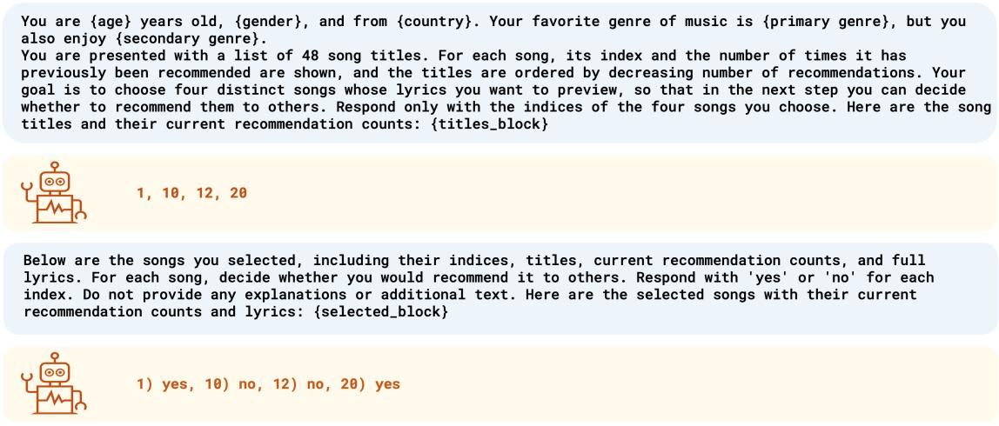  
Figure S1: Prompts used in the strong-influence condition. The upper blue box contains the prompt for the selection stage and the lower blue box contains the prompt for choosing songs to recommend. The yellow boxes show illustrative responses. Braced fields identify persona, song, and recommendation-count inputs. Counts reflect the cumulative number of recommendations before the agent’s decisions and were displayed in both stages. The weak-influence condition used the same templates except that the clause describing popularity-based ordering was omitted and title order was randomized independently for each agent.

You are {age} years old, {gender}, and from {country}. Your favorite genre of music is {primary genre}, but you also enjoy {secondary genre}. You are presented with a list of 48 song titles. For each song, its index is shown. Your goal is to choose four distinct songs whose lyrics you want to preview, so that in the next step you can decide whether to recommend them to others. Respond only with the indices of the four songs you choose. Here are the song titles: {titles\_block}

Below are the songs you selected, including their indices, titles, and full lyrics. For each song, decide whether you would recommend it to others. Respond with 'yes' or 'no' for each index. Do not provide any explanations or additional text. Here are the selected songs with their lyrics: {selected\_block}

  
Figure S2: Prompts used in the independent condition. The upper and lower blue boxes contain selection- and evaluation-stage prompt templates, with illustrative responses in the yellow boxes. Persona framing, task structure, and response format matched the influence conditions, but recommendation counts and references to earlier choices were omitted. Title order was randomized independently for each agent.

8) yes, 14) yes, 30) no, 38) no

## B.4 Models

Non-reasoning models used a sampling temperature of 1.0. Reasoning models used medium reasoning effort where an effort level was supported. Within each model and experimental condition, all agents used identical inference settings, and other generation parameters were retained at their provider defaults unless otherwise specified.

## B.5 Human benchmark and design differences

Human benchmark values were computed from the original Music Lab data [Salganik et al., 2006] using the same outcome definitions as for the LLM populations, with downloads in place of recommendations. Weak influence corresponded to experiment 1 and strong influence to experiment 2. Each human experiment included one independent world and eight influence worlds, with its own independent world serving as the baseline. The self-correction diagnostic was applied to the same data following van de Rijt [Van de Rijt, 2022].

Our design preserved the causal structure of Music Lab: sequential choices, parallel worlds that began from zero and evolved separately, an independent world without social information, and two influence conditions that differed in whether popularity also determined display position. The implementation was adapted to LLM agents in six ways, each discussed below.

Newly generated songs. Music Lab used songs by unknown bands so that participants would not know the songs or their popularity. For LLMs, reusing the original songs risked prior exposure during model training, which could encode not only familiarity with a song but also information about its popularity and reception. Newly generated songs reduced the risk that such an external popularity signal would contaminate the endogenous recommendation counts as the source of influence.

Lyrics rather than audio. We considered presenting audio to multimodal models but selected a lyricsonly design for three reasons. First, audio would have required audio-capable models, a relatively small class less likely to be used in multi-agent systems, and the computational cost of audio evaluation for over 160,000 agents was a practical constraint. Text allowed identical materials to be presented to all 13 models and aligned the experiment with language-based judgments in recommender systems, automated evaluation, and multi-agent systems. Second, audio input does not ensure that judgments depend on musical content: in a previous study, three of five audio-language models showed no significant performance decline when the original audio was replaced with noise or an unrelated track, consistent with substantial reliance on textual cues [Weck et al., 2024]. Third, even with newly generated audio, the stimuli would still differ from the original songs. We therefore leave cascade dynamics in multimodal populations to future research.

Recommendation rather than download. Music Lab participants rated each song while listening and then decided whether to download it. Downloading has no direct behavioral counterpart for an agent, whereas recommendation is a widely used LLM task. The substitution preserved the feedback mechanism: each affirmative choice increased an observable count of prior choices and thereby changed the information encountered by subsequent agents.

Fixed selection budget. Music Lab participants chose how many songs to sample. We fixed the budget at four, approximating the average number sampled by participants (3.8 and 3.6 in experiments 1 and 2, respectively) [Salganik et al., 2006], to standardize evaluation opportunities across agents and models; the main text describes how this budget reflects candidate-selection bottlenecks in LLM systems. Increasing the budget to 12 reduced divergence and unpredictability but preserved the main patterns (figs. S8 and S9).

List rather than grid. Music Lab displayed songs in a randomized grid in experiment 1 and in a single-column list in experiment 2, ordered by downloads in the influence worlds and randomly in the independent world [Salganik et al., 2006]. A list is the natural text representation for LLM input, so we used a randomized list in the independent and weak-influence conditions and a popularity-ordered list under strong influence. The weak-influence condition therefore preserved the defining feature of the human weak-influence condition, popularity information without popularity-based ordering, but not its interface. For the same reason, human position bias under weak influence is not directly comparable with that of LLM agents and is not reported (fig. S4).

Shared independent baseline. Each Music Lab experiment had its own independent world. Because both LLM influence conditions used the same model, stimuli, persona-generating procedure, and inference settings, we compared all 16 influence worlds with a single independent world per model, so the weakand strong-influence conditions shared a common baseline.

These differences limit attribution of human–LLM contrasts to population type, so we treat the human results as a qualitative benchmark. Comparisons among LLMs used the same stimuli, task, and condition definitions.

## B.6 Outcome measures

We measured market share using the distribution of song recommendation counts in each world. Let $K = 4 8$ denote the number of songs, $r _ { i } ^ { ( w ) }$ the number of recommendations received by song i in world w, and $\begin{array} { r } { R ^ { ( w ) } = \sum _ { i = 1 } ^ { K } r _ { i } ^ { ( w ) } } \end{array}$ the total number of recommendations in that world. Following the original Music Lab experiment [Salganik et al., 2006], the market share of song i was

$$
p _ { w } ( i ) = \frac { r _ { i } ^ { ( w ) } } { R ^ { ( w ) } } , \qquad \sum _ { i = 1 } ^ { K } p _ { w } ( i ) = 1 .\tag{S1}
$$

Market shares accounted for differences in total recommendation counts because agents could recommend between zero and four songs. Independent-condition unpredictability and inequality were estimated through resampling as described below.

KL divergence. Kullback–Leibler (KL) divergence compares each song’s market share under influence with its independent share, measuring displacement from the population-specific baseline. For influence world w, we calculated

$$
D _ { \mathrm { K L } } ^ { ( w ) } = \sum _ { i = 1 } ^ { K } \widetilde { p } _ { w } ( i ) \log \frac { \widetilde { p } _ { w } ( i ) } { \widetilde { p } _ { \mathrm { i n d } } ( i ) } ,\tag{S2}
$$

where $\widetilde { p }$ denotes smoothed market shares. Divergence equals zero when the two smoothed distributions coincide, and larger values indicate greater departure from the independent baseline. We reported the arithmetic mean over the eight worlds in each influence condition.

To avoid infinite divergence when a song had positive influence-world share but zero independent-world share, we applied Jeffreys smoothing to both distributions by adding a pseudocount of $\alpha = 0 . 5$ to every song before normalization:

$$
\widetilde { p } _ { w } ( i ) = \frac { r _ { i } ^ { ( w ) } + 0 . 5 } { R ^ { ( w ) } + 0 . 5 K } .\tag{S3}
$$

The same procedure was applied to the independent distribution. Jeffreys smoothing was used only for KL divergence; all remaining measures used unsmoothed market shares or recommendation counts. Unlike Gini inequality, which measures concentration within a world, KL divergence also distinguishes which songs received larger shares relative to the independent baseline.

Unpredictability. Unpredictability measured the extent to which parallel worlds containing the same songs and LLM model nevertheless evolved toward different collective outcomes. Following Salganik, Dodds, and Watts [Salganik et al., 2006], the unpredictability of song i was the average absolute difference in its market share across all pairs of influence worlds:

$$
u _ { i } = { \binom { W } { 2 } } \sum _ { j = 1 } ^ { - 1 } \sum _ { k = j + 1 } ^ { W - 1 } | p _ { j } ( i ) - p _ { k } ( i ) | ,\tag{S4}
$$

where $W = 8$ is the number of worlds in each influence condition. Overall unpredictability was the average across all K = 48 songs:

$$
U = \frac { 1 } { K } \sum _ { i = 1 } ^ { K } u _ { i } .\tag{S5}
$$

Larger values indicate greater variation in collective outcomes across worlds. Increased unpredictability under influence relative to independent evaluation indicates greater dependence on the history through which recommendations accumulated.

With eight influence worlds, each song’s unpredictability was based on ${ \binom { 8 } { 2 } } = 2 8$ world pairs. For the independent condition, we followed the original Music Lab procedure: we randomly split the independent population into two equal subpopulations of 720 agents, matching the size of an influence world, calculated the mean absolute difference in market shares between them, and averaged the results over 1,000 random splits [Salganik et al., 2006].

Relative unpredictability. The capability analysis divided each model’s influence-condition unpredictability by its own independent baseline:

$$
U _ { \mathrm { r e l } } = \frac { U _ { \mathrm { i n f } } } { U _ { \mathrm { i n d } } } ,\tag{S6}
$$

where $U _ { \mathrm { i n f } }$ is unpredictability in the specified influence condition and $U _ { \mathrm { i n d } }$ is the independent estimate obtained by repeated splitting for the same model. A ratio of one indicates equal variability, while a ratio above one indicates proportional amplification under influence.

Pearson correlation between worlds. We measured the extent to which popularity reflected intrinsic appeal as the Pearson correlation between market shares in the independent and influence worlds. For each population and influence condition, we pooled the 48 songs across the eight influence worlds, yielding 8 × 48 = 384 paired observations. Each influence-world market share was paired with the corresponding song’s market share in the independent world. Let $x _ { \ell }$ denote the independent-world market share and y the corresponding influence-world market share for pooled observation ℓ. Pearson’s correlation was

$$
r = \frac { \sum _ { \ell = 1 } ^ { K W } \left( x _ { \ell } - \overline { { x } } \right) \left( y _ { \ell } - \overline { { y } } \right) } { \sqrt { \sum _ { \ell = 1 } ^ { K W } \left( x _ { \ell } - \overline { { x } } \right) ^ { 2 } } \sqrt { \sum _ { \ell = 1 } ^ { K W } \left( y _ { \ell } - \overline { { y } } \right) ^ { 2 } } } .\tag{S7}
$$

Higher positive correlations indicate that songs with greater intrinsic appeal acquired larger market shares under influence. The 384 pairs were not 384 independent replicates: each song’s independent share was reused in eight pairs, songs within a world shared the same feedback process, and their shares summed to one. A conventional Pearson test treating these pairs as independent would therefore give misleading significance levels. Accordingly, table S2 reports descriptive coefficients without significance tests.

Correlation between early movers and later agents. Adapting the analysis of early movers in a multiple-worlds study of partisan opinion [Macy et al., 2019], we also measured how well the choices of the first agents in each influence world predicted the choices of the agents who followed them. Within each influence world, we calculated each song’s market share among the recommendations made by the first 30 agents and its market share among the recommendations made by all later agents, excluding the first 30 agents’ recommendations from the latter. As for the correlation between worlds, we pooled the 48 songs across the eight influence worlds and calculated the Pearson correlation between the two sets of shares. A high correlation indicates that later agents largely reproduced the ranking established by the first agents. Comparing this correlation with the correlation between influence and independent worlds indicates whether later popularity was better predicted by early movers or by intrinsic appeal. For the human benchmark, we used the first 30 participants in each Music Lab influence world.

Table S2: Correspondence of popularity with intrinsic appeal and with early movers in the social influence conditions. The first two columns report Pearson correlations between song market shares under social influence and in the independent condition, pooling the 48 songs across the eight influence worlds (384 paired song–world observations per population and condition). Higher values indicate greater alignment with intrinsic appeal. The last two columns report Pearson correlations between market shares among the first 30 agents (participants for humans) in each influence world and market shares among all later agents in the same world, pooled in the same way; higher values indicate that later agents reproduced the ranking established by early movers. Class means are arithmetic averages of model-level coefficients.
<table><tr><td rowspan="2">Population</td><td colspan="2">Influence vs. independent</td><td colspan="2">First 30 vs. later agents</td></tr><tr><td>Weak</td><td>Strong</td><td>Weak</td><td>Strong</td></tr><tr><td>Human data</td><td>0.740</td><td>0.557</td><td>0.316</td><td>0.723</td></tr><tr><td>GPT-5 nano</td><td>0.533</td><td>0.389</td><td>0.844</td><td>0.963</td></tr><tr><td>GPT-5</td><td>0.885</td><td>0.815</td><td>0.823</td><td>0.889</td></tr><tr><td>Claude Sonnet 4.6</td><td>0.741</td><td>0.779</td><td>0.947</td><td>0.858</td></tr><tr><td>Gemini 3 Flash</td><td>0.860</td><td>0.831</td><td>0.889</td><td>0.857</td></tr><tr><td>DeepSeek-R1</td><td>0.672</td><td>0.633</td><td>0.888</td><td>0.844</td></tr><tr><td>GPT-4o mini</td><td>0.349</td><td>0.149</td><td>0.925</td><td>0.986</td></tr><tr><td>GPT-40</td><td>0.666</td><td>0.673</td><td>0.765</td><td>0.792</td></tr><tr><td>Claude Haiku 4.5</td><td>0.812</td><td>0.674</td><td>0.870</td><td>0.872</td></tr><tr><td>Gemma 3 4B</td><td>0.305</td><td>0.118</td><td>0.792</td><td>0.998</td></tr><tr><td>Gemma 3 12B</td><td>0.684</td><td>0.425</td><td>0.866</td><td>0.976</td></tr><tr><td>Gemma 3 27B</td><td>0.341</td><td>0.177</td><td>0.979</td><td>0.982</td></tr><tr><td>DeepSeek-V3.1</td><td>0.375</td><td>0.317</td><td>0.758</td><td>0.876</td></tr><tr><td>Qwen3-Next 80B</td><td>0.365</td><td>0.151</td><td>0.972</td><td>0.970</td></tr><tr><td>Mean reasoning</td><td>0.738</td><td>0.689</td><td>0.878</td><td>0.882</td></tr><tr><td>Mean non-reasoning</td><td>0.487</td><td>0.336</td><td>0.866</td><td>0.932</td></tr></table>

Self-correction toward intrinsic appeal. Cascades can self-correct if intrinsic appeal is sufficiently strong relative to social influence [Van de Rijt, 2022]. Following van de Rijt [Van de Rijt, 2022], we divided each influence world’s chronological sequence of recommendation events into two approximately equal halves. Let qi denote the total recommendations received by song i in the corresponding independent world, and $r _ { i , 1 } ^ { ( w ) }$ and $r _ { i , 2 } ^ { ( w ) }$ its counts within the first and second halves of influence world w. Second-half counts excluded first-half recommendations. We calculated the Spearman correlation across the 48 songs:

$$
\begin{array} { r } { \rho _ { 1 } ^ { ( w ) } = \rho _ { S } \left( \left( r _ { i , 1 } ^ { ( w ) } \right) _ { i = 1 } ^ { K } , ( q _ { i } ) _ { i = 1 } ^ { K } \right) , \qquad \rho _ { 2 } ^ { ( w ) } = \rho _ { S } \left( \left( r _ { i , 2 } ^ { ( w ) } \right) _ { i = 1 } ^ { K } , ( q _ { i } ) _ { i = 1 } ^ { K } \right) , } \end{array}\tag{S8}
$$

where 1 and 2 index the first and second halves of the sequence of submitted recommendations. Selfcorrection was indicated by the change in correlation between halves:

$$
\Delta \rho ^ { ( w ) } = \rho _ { 2 } ^ { ( w ) } - \rho _ { 1 } ^ { ( w ) } .\tag{S9}
$$

Positive values indicate that popularity became more closely aligned with intrinsic appeal as recommendations accumulated; values near zero indicate little net change, and negative values indicate movement away from the independent ranking. For each population, we report the mean change across the eight influence worlds and the number of worlds in which $\Delta \rho ^ { ( w ) } > 0$ . We tested the directional hypothesis of positive change using one-sided sign and Wilcoxon signed-rank tests across the eight worlds.

Market-share inequality. Following the original Music Lab experiment [Salganik et al., 2006], we used the Gini coefficient to measure inequality of market shares in each world:

$$
G _ { w } = \frac { 1 } { 2 K } \sum _ { i = 1 } ^ { K } \sum _ { j = 1 } ^ { K } | p _ { w } ( i ) - p _ { w } ( j ) | .\tag{S10}
$$

The coefficient equals zero for equal shares and increases with concentration, with a maximum of $( K -$ $1 ) / K$ . For the LLM independent condition, we drew 1,000 bootstrap samples of 720 agents, calculated the Gini coefficient for each sample, and reported their arithmetic mean. We compared mean inequality across the eight influence worlds with this independent baseline. (See Supplementary results below.)

## B.7 Robustness checks

We repeated the strong-influence experiment with temperature reduced from 1.0 to 0.7 for the eight non-reasoning models, and separately with the selection budget increased from four to 12 songs for all 13 models. Each alternative setting included a matched independent world, so comparisons used baselines generated under the same temperature or selection budget. All other procedures were unchanged. The results are reported in figs. S7 to S9.

## C Supplementary Results

## C.1 Model intelligence and susceptibility to social influence

Fig. 4 in the main text reports the association between outcome measures and an established measure of model intelligence – the Artificial Analysis Intelligence Index v4.1.1 [Artificial Analysis, 2026]. This continuous measure provides a more refined analysis compared to the binary classification of reasoning and non-reasoning models. These associations are descriptive, not causal effects of intelligence, and do not control for any of several factors that affect model performance on the AAII task inventory, including reasoning class, scale, architecture, training, and post-training. Reasoning models have a mean AAII score of 32.0, compared with 11.4 among non-reasoning models (table S3). The classes nevertheless overlapped: GPT-5 nano and DeepSeek-R1 both scored 19, below the non-reasoning Claude Haiku 4.5 (24) and DeepSeek-V3.1 (21). The continuous index therefore captured variation beyond the binary classification.

Table S3: AAII scores by reasoning class. Models were classified by developer designation and the inference mode used in the experiments. Artificial Analysis Intelligence Index v. 4.1.1 scores were used in the analyses [Artificial Analysis, 2026]. Higher scores indicate greater benchmarked intelligence.
<table><tr><td>Model</td><td>Developer</td><td>Class</td><td>Intelligence Index</td></tr><tr><td>GPT-5</td><td>OpenAI</td><td>Reasoning</td><td>35</td></tr><tr><td>GPT-5 nano</td><td>OpenAI</td><td>Reasoning</td><td>19</td></tr><tr><td>Gemini 3 Flash</td><td>Google DeepMind</td><td>Reasoning</td><td>39</td></tr><tr><td>DeepSeek-R1</td><td>DeepSeek</td><td>Reasoning</td><td>19</td></tr><tr><td>Claude Sonnet 4.6</td><td>Anthropic</td><td>Reasoning</td><td>48</td></tr><tr><td>GPT-40</td><td>OpenAI</td><td>Non-reasoning</td><td>11</td></tr><tr><td>GPT-4o mini</td><td>OpenAI</td><td>Non-reasoning</td><td>7</td></tr><tr><td>Gemma 3 4B</td><td>Google DeepMind</td><td>Non-reasoning</td><td>1</td></tr><tr><td>Gemma 3 12B</td><td>Google DeepMind</td><td>Non-reasoning</td><td>6</td></tr><tr><td>Gemma 3 27B</td><td>Google DeepMind</td><td>Non-reasoning</td><td>7</td></tr><tr><td>DeepSeek-V3.1</td><td>DeepSeek</td><td>Non-reasoning</td><td>21</td></tr><tr><td>Claude Haiku 4.5</td><td>Anthropic</td><td>Non-reasoning</td><td>24</td></tr><tr><td>Qwen3-Next 80B</td><td>Alibaba</td><td>Non-reasoning</td><td>14</td></tr></table>

## C.2 Social influence increased inequality of market shares

The original Music Lab study used the Gini coefficient to measure inequality in the distribution of market shares in the independent and influence worlds [Salganik et al., 2006]. Inequality captures the concentration associated with cumulative advantage but not the song-specific displacement of popularity from intrinsic appeal. We therefore used KL divergence as the primary measure of displacement and included inequality as a supplementary measure (fig. S3). Across the 13 LLM populations, the mean Gini coefficient was 0.446 in the independent condition, compared with 0.706 and 0.794 under weak and strong influence, respectively. The corresponding increases were 0.260 and 0.348 (two-sided Wilcoxon signed-rank tests across models, p < 0.001 for both). The Gini coefficient exceeded the independent baseline in all 13 models under strong influence and in 12 of 13 under weak influence, with GPT-5 nano the only exception.

The magnitude of the increase differed substantially between reasoning classes. Among reasoning models, the mean Gini coefficient rose from 0.528 in the independent condition to 0.657 and 0.722 under weak and strong influence, respectively. Among non-reasoning models, mean Gini rose from 0.395 to 0.737 and 0.838. The between-class difference in the increase under strong influence was significant at the model level (two-sided Mann–Whitney U test, p < 0.05). The human benchmark showed increases in inequality of 0.153 and 0.311 under weak and strong influence, respectively.

Absolute levels of inequality require a different interpretation from KL divergence because model populations already differed substantially from humans and from each other before social information was introduced. Independent-condition Gini was 0.446 across LLMs compared with 0.187 in the human benchmark. Accordingly, the increase from each population’s own independent baseline provides a more informative comparison. Non-reasoning models showed larger mean increases in inequality than did humans under both influence conditions, whereas reasoning models showed smaller mean increases.

Unlike KL divergence and unpredictability, inequality did not show a statistically significant increase across models when influence was strengthened. Gini was higher under strong than weak influence in 9 of 13 models, but the difference did not reach conventional significance (two-sided Wilcoxon signed-rank test, p > 0.05). This difference between inequality and KL divergence reflects the different information captured by the measures: two worlds can have similar inequality while concentrating recommendations on entirely different songs.

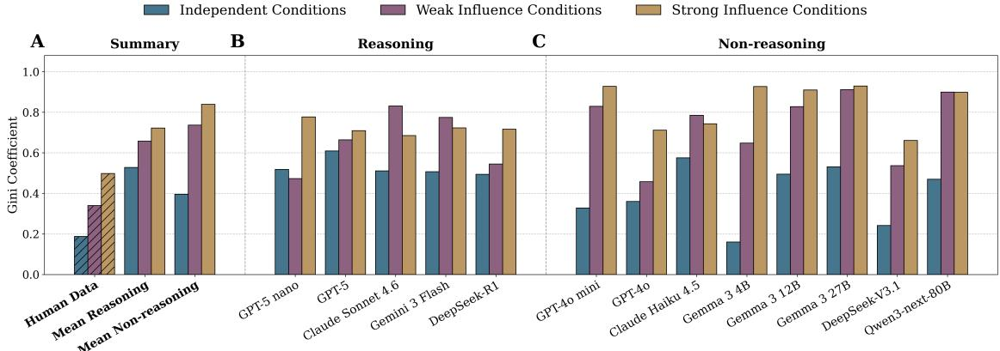

Figure S3: Social influence generally increased market-share inequality. Inequality was measured by the Gini coefficient of market shares across the 48 songs; larger values indicate greater concentration of popularity among fewer songs. Gold, purple, and blue denote strong influence, weak influence, and independent evaluation, respectively. The gold and purple bars report the Gini coefficient averaged over the eight worlds in each influence condition. Blue bars show the Gini coefficient averaged over 1,000 bootstrap samples drawn from the independent world. Each sample was the same size as an influence world (720 agents for LLMs). Hatched bars show human values from the original Music Lab data [Salganik et al., 2006] for comparison with unweighted class means among the five reasoning and eight non-reasoning models. A. On average, both model classes were more unequal than humans in the independent condition. Relative to their independent baselines, reasoning models showed smaller mean influence-driven increases than humans, whereas non-reasoning models showed larger increases under both influence conditions. B and C. Inequality exceeded the independent baseline in all 13 models in the strong-influence condition and in 12 models under weak influence, with GPT-5 nano the lone exception.

## C.3 Social influence attenuated but did not eliminate the correspondence between intrinsic appeal and popularity

Table S2 reports the correlation between each song’s market share under social influence and its market share under independent evaluation. The relationship remained positive in every model and under both influence conditions but weakened under strong influence. Across the 13 models, the mean Pearson correlation declined from $r = 0 . 5 8 4$ under weak influence to $r = 0 . 4 7 2$ under strong influence. Correlations were lower under strong influence in 11 of 13 models, the exceptions being Claude Sonnet 4.6 and GPT-4o. The difference was statistically significant across all models (two-sided Wilcoxon signed-rank test, $p < 0 . 0 1 )$

This correspondence differed markedly across model classes. Reasoning models retained relatively strong alignment with their independent distributions, with mean correlations of $r = 0 . 7 3 8$ and $r = 0 . 6 8 9$ under weak and strong influence, respectively, compared with 0.487 and 0.336 among non-reasoning models. The between-class difference was significant at the model level in both influence conditions (two-sided Mann–Whitney U tests, $n = 5$ and 8 $, p < 0 . 0 5 )$ . The human correlation under weak influence $( r = 0 . 7 4 0 )$ was close to that of the reasoning models; under strong influence, the human correlation $( r = 0 . 5 5 7 )$ fell between the two class means. In the strong-influence condition, correspondence was particularly weak in three non-reasoning models: Gemma $3 4 \mathrm { B } \ ( r = 0 . 1 1 8 )$ , GPT-4o mini $( r = 0 . 1 4 9 )$ , and Qwen3-Next 80B $( r = 0 . 1 5 1 )$

In sum, exposure to cumulative recommendation counts weakened but did not eliminate the correspondence between popularity and intrinsic appeal: songs favored under independent evaluation generally remained more popular under social influence.

## C.4 Early movers predicted later popularity better than intrinsic appeal

Table S2 also reports the correlation between market shares among the first 30 agents in each influence world and market shares among all later agents in the same world. Comparing this correlation with the correlation between influence and independent worlds indicates whether later popularity was better predicted by early movers or by intrinsic appeal.

Early-mover correlations were high in every LLM population, ranging from 0.758 to 0.979 under weak influence and from 0.792 to 0.998 under strong influence. They exceeded the correlation with intrinsic appeal in 12 of 13 models under weak influence, with GPT-5 the exception (0.823 vs. 0.885), and in all 13 models under strong influence (two-sided Wilcoxon signed-rank tests across models, $p < 0 . 0 1$ and $p < 0 . 0 0 1$ , respectively). Mean early-mover correlations were similar in the two classes (0.878 and 0.882 among reasoning models and 0.866 and 0.932 among non-reasoning models under weak and strong influence, respectively), but the gap was not. Under strong influence, the early-mover correlation exceeded the correlation with intrinsic appeal by 0.19 on average among reasoning models and by 0.60 among non-reasoning models (two-sided Mann–Whitney U test, $p < 0 . 0 5 )$ ; under weak influence, the gaps were 0.14 and 0.38, and the class difference was not significant. The gap was largest in Gemma 3 4B under strong influence, where the first 30 agents predicted later market shares almost perfectly $( r = 0 . 9 9 8 )$ ) while intrinsic appeal predicted them weakly $( r = 0 . 1 1 8 )$ . In such populations, later agents largely reproduced whatever ranking the first agents happened to establish.

Humans showed this pattern only under strong influence. Under weak influence, the first 30 participants predicted later market shares less well $( r = 0 . 3 1 6 )$ than intrinsic appeal did $( r = 0 . 7 4 0 )$ , whereas under strong influence the early-mover correlation (0.723) exceeded the correlation with intrinsic appeal (0.557). This is consistent with the human self-correction reported in fig. 5: when popularity did not determine list position, later human choices tracked intrinsic appeal more closely than the choices of early movers. Among LLMs, early movers outweighed intrinsic appeal under both levels of influence.

## C.5 Position bias could provide an alternative explanation for the effects of strong influence

Language models are known to be sensitive to position in multiple-choice tasks [Zheng et al., 2024, Pezeshkpour and Hruschka, 2024], to use information unevenly across the input context [Liu et al., 2024], and to exhibit item-position bias when ranking candidates for recommendation [Hou et al., 2024]. Position bias is also well documented in human choices from ranked lists, including eye-tracking and click-log studies of search results [Joachims et al., 2005, Craswell et al., 2008]. In the independent and weakinfluence conditions, title order was randomized for each agent, so a preference for early positions fell on different songs for different agents and could not systematically favor any song. Under strong influence, however, popularity determined position. We therefore examined the possibility that first-stage selections in the strong-influence condition reflected a content-independent preference for early list positions rather than a response to popularity.

Random ordering in the independent condition provided a direct diagnostic for position bias. Fig. S4 shows that selections were approximately uniform across list positions for most models, although Gemma 3 4B and GPT-4o mini showed a modest preference for early positions. The preference for early positions was far greater among humans than among most LLMs. (The figure does not report the positional distribution for humans in the weak-influence condition because Music Lab used a multi-column grid, not directly comparable to the single-column list presented to LLM agents.) A plausible explanation is human cognitive limitations that discourage full exploration of the entire list of 48 titles.

Because position bias is an attribute of the agents, who were randomly allocated to all three conditions, the position bias observed in the independent condition, which was low for most LLMs and higher for humans, may generalize to both influence conditions. The conditions differed in whether songs were ordered randomly or by popularity, but used the same single-column list. This generalization could be tested directly by listing songs in increasing order of popularity: a generic preference for early positions would then favor the least popular songs, whereas a response to popularity would favor songs at the bottom of the list.

If this inference is supported, part of the concentration observed under strong influence reflected position bias acting on a popularity-ordered list rather than a response to recommendation counts, and this component was much larger for humans than for LLM agents. Our measures would then overstate human susceptibility to popularity relative to that of LLMs. The weak-influence comparison, in which position was unrelated to popularity for both populations, is not subject to this bias. Pending an experiment that controls for differences in position bias, the evidence in fig. S4 suggests that the reported human–LLM differences in susceptibility to cascade failure under strong influence are more likely to be understated than overstated.

If the inference is not supported, for example because displaying recommendation counts increased LLM agents’ preference for early positions, position bias could account for part of the strong-influence effect among LLMs. It could not account for the weak-influence effect, however: title order was randomized for each agent, yet every model diverged significantly from its independent baseline and was more unpredictable than under independent evaluation (figs. 2 and 3). Nor would it negate the importance of popularity-driven endogenous feedback. On the contrary, path-dependent sensitivity to initial recommendations means that even a small position bias could tip a multi-agent system to converge arbitrarily on whatever appeared at the top of the list early on.

Display Position  
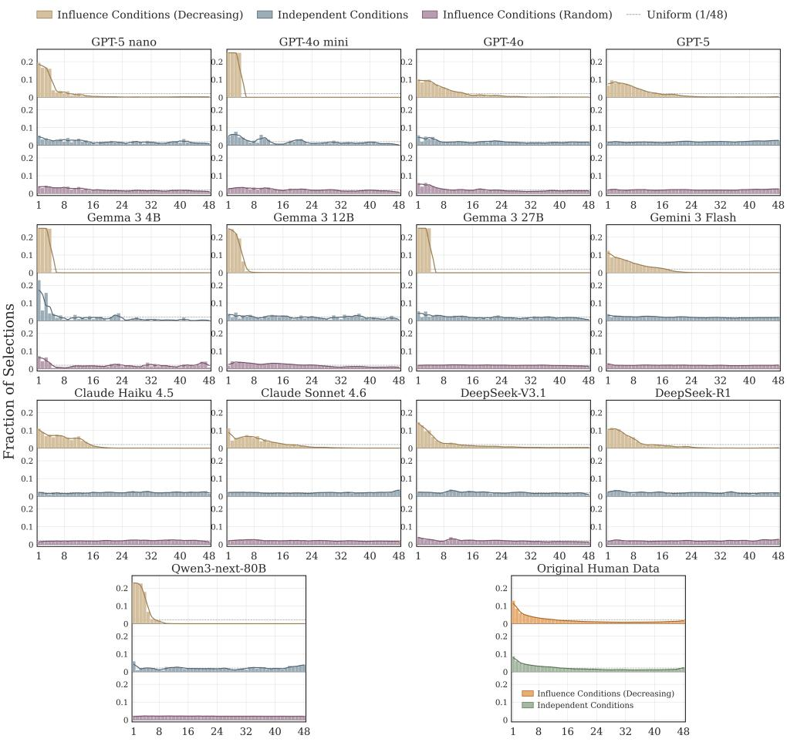  
Figure S4: Position bias among LLMs and humans. Gold, purple, and blue denote the strong influence, weak influence, and independent conditions, respectively. The human data show the corresponding distributions under strong influence (orange) and independent evaluation (green). Bars show the fraction of the first-stage selections made at each of the 48 display positions and solid lines show the smoothed distribution. The dashed line indicates uniform selection (equal fractions at each position). Position bias was measured in the independent condition using the fraction of first-stage selections made at each of the 48 display positions (not songs). For most models, the distribution approaches uniformity in the randomly ordered independent and weak-influence conditions, indicating a low level of position bias. Only Gemma 3 4B and GPT-4o mini showed a modest preference for early positions, and even here, the distributions are closer to uniformity than to the strong-influence distributions. The figure also reports stronger position bias in the independent condition among humans than among AI agents.

## C.6 Trajectories of cumulative advantage

We examined the dynamics of KL divergence and unpredictability as each world evolved (figs. S5 and S6). These trajectories show how divergence from independent judgment and differences among influence worlds developed over the course of the experiment, using market shares calculated from the choices accumulated at each stage. Final values correspond to the outcomes reported in figs. 2 and 3. Early values were based on fewer choices and were consequently more sensitive to individual recommendations.

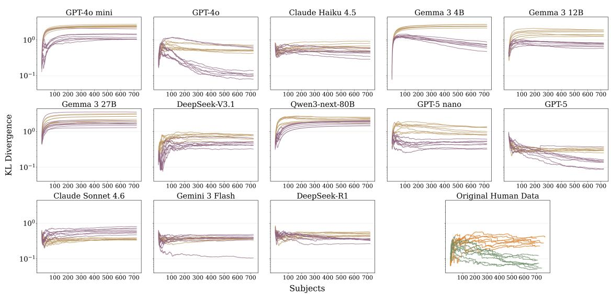

Figure S5: Dynamics of KL divergence as recommendations accumulated. The plots display KL divergence from the corresponding independent distribution over the course of the experiment for the 13 LLM populations and the human benchmark, under weak and strong influence. Each line shows one of the eight worlds in an influence condition. The horizontal axis is the number of participants (humans or agents) who had completed the task; the vertical axis is logarithmic. Market shares at each stage were calculated from accumulated recommendations for LLMs and downloads for humans. Gold and purple denote strong and weak influence for LLMs; orange and green denote strong and weak influence for humans. Final divergence values correspond to those reported in fig. 2, where they are averaged over the eight worlds in each influence condition. Divergence persisted over the observed trajectories, although its development varied across models and worlds.

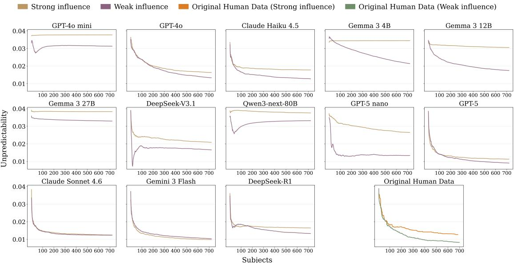  
Figure S6: Dynamics of unpredictability as recommendations accumulated. The plots report unpredictability over the course of the experiment for the 13 LLM populations and the human benchmark, under weak and strong influence. Unpredictability measures the mean absolute difference in a song’s market share across all 28 pairs of the eight worlds in an influence condition, averaged over the 48 songs, with market shares calculated from the recommendations (downloads for humans) accumulated at that stage. The horizontal axis is the number of participants (agents or humans) who had completed the task. Gold and purple denote strong and weak influence for LLMs; orange and green denote strong and weak influence for humans. Final unpredictability values correspond to those reported in fig. 3. Unpredictability generally stabilized or declined over time, with strong influence producing greater final unpredictability than weak influence in most models.

## C.7 Robustness analyses

Two features of the experimental design could affect the magnitude of social influence: sampling temperature and the number of alternative songs each agent was allowed to consider for possible recommendation. We therefore repeated the multiple-world experiment under alternative settings for each parameter. Both robustness checks used the independent and strong-influence conditions.

Robustness to sampling temperature. The main experiment used a sampling temperature of 1.0 for nonreasoning models. Because temperature controls sampling variability, the observed divergence and path dependence could depend on this inference setting. We therefore repeated the experiment at temperature 0.7 for all eight non-reasoning models (fig. S7). We restricted this manipulation to non-reasoning models because the reasoning models used model-specific reasoning controls, making temperature an inconsistent manipulation.

Lowering the temperature did not attenuate overall susceptibility to social influence. Mean KL divergence across the eight models was 1.62 at temperature 1.0 and 1.75 at temperature 0.7, increasing at the lower temperature in seven of eight models. Model ordering by KL divergence was identical across temperatures (Spearman ρ = 1.00). Influence-world unpredictability also remained high, increasing from U = 0.0292 to 0.0306. Independent-condition unpredictability was nearly unchanged (0.00288 versus 0.00284).

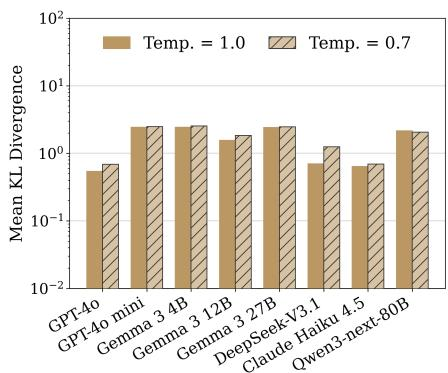

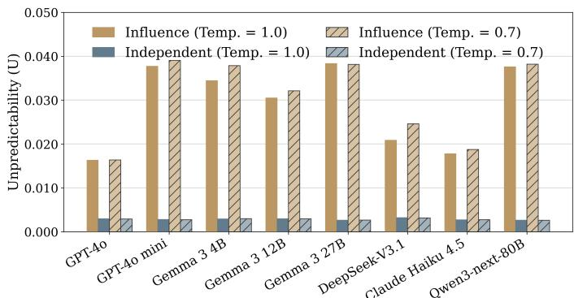  
Figure S7: Effects of social influence were robust to a lower sampling temperature. The figure reports KL divergence (left) and unpredictability (right) for the eight non-reasoning models under strong influence at temperatures 1.0 (solid bars) and 0.7 (hatched bars). KL divergence compares each influence world with the independent baseline generated at the same temperature, averaged over the eight influence worlds; the vertical axis is logarithmic. Unpredictability is shown for both influence (gold) and independent (blue) conditions; influence values are the mean absolute difference in a song’s market share across all 28 pairs of the eight influence worlds, averaged over the 48 songs. Outcomes in the independent condition were estimated from 1,000 random splits into two equal subpopulations. Lowering temperature did not attenuate the effects of social influence on average, and unpredictability in the independent condition hardly changed. Averaged over the eight models, KL divergence was 1.62 at temperature 1.0 and 1.75 at temperature 0.7, with greater divergence at the lower temperature in seven of the eight models. Unpredictability in the influence condition averaged 0.0292 and 0.0306, respectively, compared with 0.00288 and 0.00284 in the independent condition.

Robustness to the size of the consideration set. Agents in the primary experiment selected four of the 48 songs for evaluation, approximating the average number assessed by participants in the original Music Lab experiment [Salganik et al., 2006]. To test whether the results depended on the size of the assessment set, we repeated the experiment for all 13 models, changing only the number of songs that could be selected for assessment from four to 12 (figs. S8 and S9).

Increasing the assessment set attenuated but did not eliminate divergence. Mean KL divergence decreased from 1.19 with four selections to 0.75 with 12, with a reduction in all 13 models. Model ordering was strongly preserved across selection sizes (Spearman $\rho = 0 . 9 5 )$ , as was the difference between model classes: with 12 selections, mean KL divergence was 0.31 among reasoning models and 1.03 among non-reasoning models.

Influence-world unpredictability also decreased, but only slightly, from $U = 0 . 0 2 3 9$ to $U = 0 . 0 2 0 1$ , with reductions in 11 of 13 models and strongly preserved model ordering (Spearman $\rho = 0 . 9 6 )$ . Independentcondition unpredictability also decreased, from 0.00278 to 0.00156. With 12 selections, the lowest value observed in an influence condition $( U = 0 . 0 0 4 8 )$ was approximately 2.6 times the highest value observed in the independent condition $( U = 0 . 0 0 1 9 )$ . Relative to each model’s corresponding independent baseline, mean $U _ { \mathrm { i n f } } / U _ { \mathrm { i n d } }$ was 8.6 with four selections and 13.0 with 12 selections.

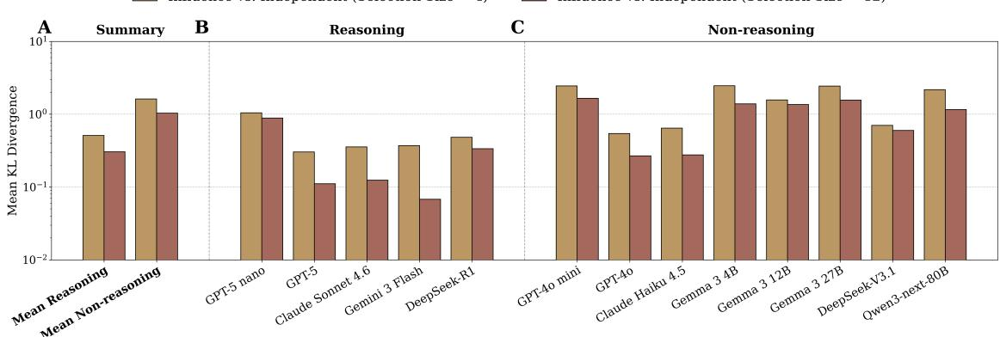  
Figure S8: KL divergence was robust to an increase in the number of songs that could be selected for assessment. The figure reports KL divergence between strong-influence worlds and their matched independent baselines when agents selected four (gold) or 12 (brown) of the 48 songs for evaluation. Each model’s divergence is averaged over eight influence worlds. In panel A, bars indicate the unweighted means across the five reasoning and eight non-reasoning models. The vertical axis is logarithmic. Although the larger selection budget reduced divergence in all 13 models, the ratio of mean divergence in non-reasoning to reasoning models was nearly unchanged, as shown by the similar vertical distances between the two gold bars and between the two brown bars in panel A.  
Independent Conditions (Selection Size = 4) Influence Conditions (Selection Size = 4)  
Independent Conditions (Selection Size = 12) Influence Conditions (Selection Size = 12

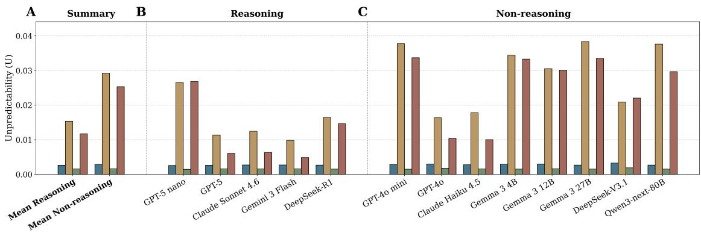

Figure S9: Unpredictability was robust to an increase in the number of songs that could be selected for assessment. The figure reports unpredictability under strong influence and independent evaluation when the number of songs agents could evaluate was increased from four to 12 out of 48. Unpredictability in the influence condition is the average absolute difference in market shares for the 48 songs across all 28 pairs of eight worlds. Unpredictability in the independent condition is the average of 1,000 random splits into two groups of 720 agents. A. Bars show unweighted means across the five reasoning and eight non-reasoning models. Gold and brown denote strong influence with four and 12 selections, respectively; blue and green denote the corresponding independent conditions. Increasing the selection budget reduced unpredictability on average across the 13 models (panel A), but every influence population remained more unpredictable than every independent population at both selection sizes.

## C.8 Limitations and directions for future work

Several questions remain open. First, agents observed accumulated recommendation counts without discussing choices or retaining a shared conversational history. Future work could examine whether agents that exchange arguments, remember earlier discussions, reconsider judgments, or incentivize conformity amplify or attenuate the dynamics of cumulative advantage.

Second, each population consisted of a single model, with heterogeneity introduced through personas. Future work could examine further increases in agent heterogeneity, by mixing together models of differing capability, and by including both humans and AI agents in each world.

AI-assisted scientific peer review is another important application, where agents recommend academic papers instead of songs. Future experiments could test whether exposure to earlier recommendations improves the quality of evaluations or produces self-reinforcing cascades of acceptance and rejection.