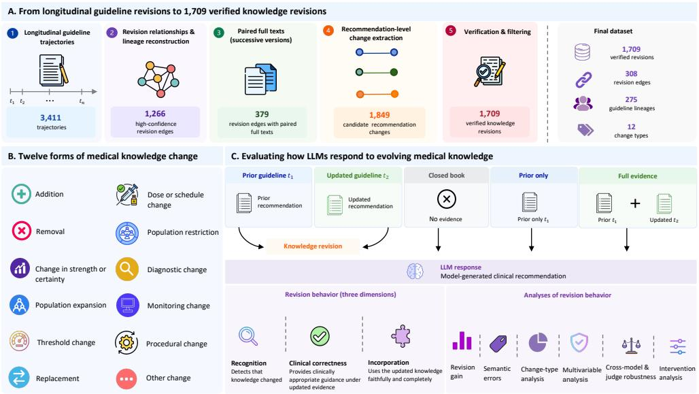
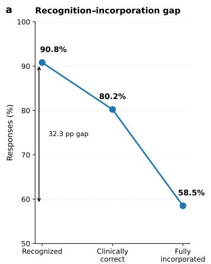
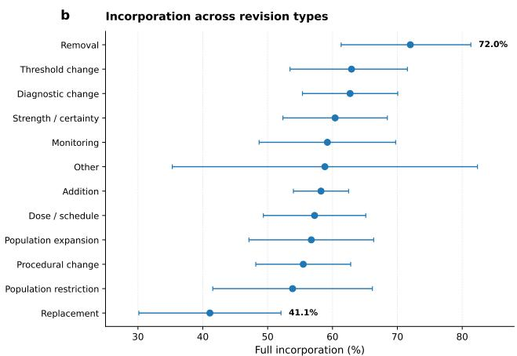
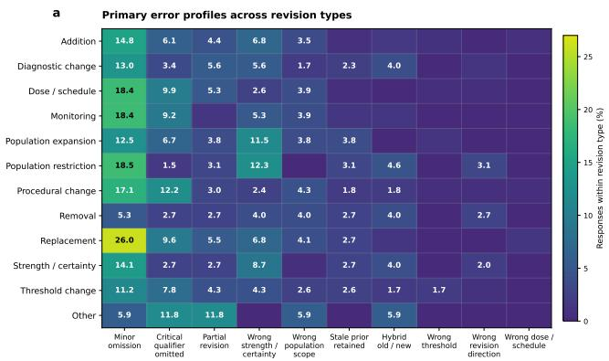
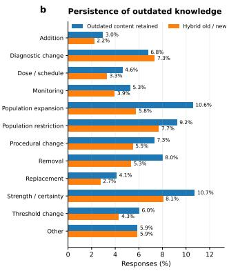
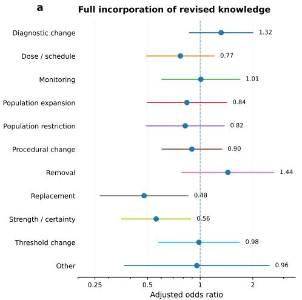
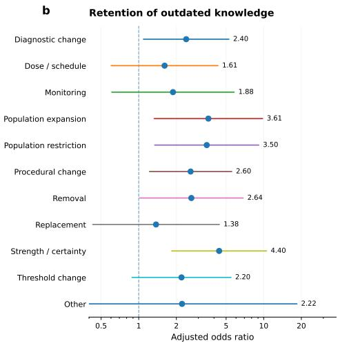

# Large language models show systematic failures in incorporating evolving medical knowledge

Min Zeng, Zaifu Zhan, Kai Yu, Rui Zhang

1Division of Computational Health Sciences, Department of Surgery, University of Minnesota, Minneapolis, 55455, MN, USA.

\*Corresponding author(s). E-mail(s): ruizhang@umn.edu;

## Abstract

Medical knowledge evolves as clinical guidelines revise recommendations, yet whether large language models (LLMs) faithfully incorporate such changes remains unclear. We introduce ChronoEvo, comprising 1,709 recommendationlevel revisions across 12 forms of medical knowledge change, to distinguish recognition of revised guidance from incorporation into clinical recommendations. In the primary model, 90.8% of responses recognized revisions and 80.2% were clinically correct, but only 58.5% fully incorporated guidance, yielding a 32.3-percentage-point recognition–incorporation gap. This dissociation persisted across 14 models and was corroborated by two clinicians’ adjudicated assessment of 300 responses, yielding a 40.3-percentage-point gap in the validation sample. Changes in recommendation strength and patient eligibility were associated with retention of outdated guidance. A revision-salience intervention reduced outdated-content retention and improved clinical correctness but did not significantly improve full incorporation. These findings identify faithful incorporation of evolving medical knowledge as a distinct challenge for clinical LLM reliability, even when updated guideline evidence is available.

## Introduction

Medical knowledge is continually revised as new evidence emerges, clinical guidelines are updated, treatment indications change, and previously accepted recommendations are refined or withdrawn. For large language models (LLMs) increasingly considered for clinical decision support [1–4], reliability therefore depends not only on possessing accurate medical knowledge at a given point in time, but also on responding appropriately when that knowledge changes. A model may reflect awareness that a recommendation has been updated yet continue to rely on superseded knowledge when answering a clinical question. Such failures could be particularly consequential in medicine, where seemingly subtle revisions can alter which patients should receive an intervention, how strongly a treatment is recommended, or whether a previously accepted practice remains appropriate.

Many evaluations of medical LLMs, however, primarily assess performance under a fixed knowledge state. Common benchmarks examine biomedical factual knowledge, examination-style questions, and medical reasoning [1, 5–8]. More recent evaluation frameworks extend beyond conventional question answering to broader medical tasks and open-ended clinical interactions [9, 10]. Studies of diagnostic reasoning, clinical decision-making, and guideline adherence have also examined the reliability and limitations of LLM-generated clinical recommendations [2, 11–16]. Importantly, recent evaluations using script concordance testing have examined how LLMs revise diagnostic or therapeutic judgments in response to additional clinical evidence [17]. Such evaluations address changing patient-level evidence, rather than the incorporation of revisions to the underlying medical guidance.

Beyond conventional medical benchmarks, research on temporally evolving knowl edge has examined the challenges of representing time-dependent facts, answering temporally grounded questions, and adapting language models to new information [18– 21]. Related work on knowledge editing has developed methods for modifying factual associations in language models [22, 23] and investigated whether such changes propagate consistently to related questions and downstream inferences [24–26].

In medicine, longitudinal guideline datasets such as TempoMed-Traj provide a foundation for examining how clinical recommendations evolve across guideline versions [27]. However, identifying or characterizing changes in medical guidance is distinct from determining whether an LLM faithfully propagates those changes into a downstream clinical recommendation when the revised evidence is explicitly provided. Together, these research directions motivate a more specific evaluation of whether LLMs can translate explicitly provided medical knowledge revisions into clinically appropriate recommendations.

A central question is whether recognizing a medical knowledge revision is suficient for faithfully incorporating its consequences into a clinical recommendation. Medical knowledge rarely changes through simple factual replacement alone. Recommendations may be strengthened or weakened, eligibility populations expanded or restricted, decision thresholds modified, interventions removed, or prior guidance replaced altogether. Correct adaptation therefore requires models to identify not only that a change has occurred, but also what changed, which components of prior knowledge remain valid, and how the revision should alter subsequent clinical conclusions. We therefore distinguish two capabilities—revision recognition and revision incorporation—and ask whether they dissociate in ways that conventional evaluations of medical knowledge accuracy may fail to capture.

Here, we introduce ChronoEvo, a benchmark of 1,709 recommendation-level revisions spanning 12 forms of medical knowledge change, to evaluate whether LLMs faithfully update clinical recommendations when provided with revised guideline evidence. We distinguish response-level recognition of a revision from incorporation of its clinically relevant consequences. Across models, we identify a persistent recognition– incorporation gap, characterize the revision types and response features associated with updating failures, and examine whether explicitly prioritizing revised evidence improves incorporation. We further assess the finding using an independent semantic evaluator and adjudicated clinician assessments. Together, these analyses establish faithful incorporation of evolving medical knowledge as a distinct dimension of clinical LLM reliability.

## Results

## A longitudinal framework for evaluating evolving medical knowledge

To study how LLMs respond when established medical knowledge changes, we constructed ChronoEvo from longitudinal revisions of clinical practice guidelines (Fig. 1a). ChronoEvo comprises 1,709 recommendation-level revisions retained after structured extraction and a separate model-based verification stage, spanning 308 guideline revision edges and 275 longitudinal guideline lineages. Rather than treating temporal knowledge change as a binary distinction between outdated and current information, we represented each revision as a transition from a prior recommendation to its updated recommendation, grounded in evidence from the corresponding guideline versions.

The resulting revisions captured substantial heterogeneity in how clinical knowledge evolved. We identified 12 semantically distinct forms of change, including the addition and removal of recommendations, replacement of prior guidance, changes in recommendation strength or certainty, expansions or restrictions of eligible populations, threshold changes, dose or scheduling changes, diagnostic changes, monitoring changes, and procedural changes (Fig. 1b). Additions were the most frequent form of revision $( n = 5 4 1 )$ , followed by diagnostic changes (n = 177), procedural changes $( n = 1 6 4 )$ , dose or scheduling changes $( n = 1 5 2 )$ , and changes in recommendation strength or certainty $( n = 1 4 9 )$ . This heterogeneity enables us to test whether LLM responses difer across forms of medical knowledge revision.

We evaluated model behavior under three controlled evidence conditions that varied access to guideline information (Fig. 1c). In the full-evidence condition, models were provided with the prior recommendation together with evidence from the updated guideline; in the prior-only condition, the updated evidence was withheld; and in the closed-book condition, models received no guideline evidence. This design allowed us to quantify how model responses changed when explicit updated evidence became available relative to conditions in which that evidence was unavailable.

  
Fig. 1 | Overview of the ChronoEvo study framework. a, Construction of ChronoEvo from longitudinal guideline trajectories through revision-relationship reconstruction, identification of revision edges with paired full texts, recommendationlevel change extraction and verification, yielding 1,709 verified knowledge revisions from 308 revision edges across 275 guideline lineages. b, Twelve semantic forms of medical knowledge change represented in the benchmark. c, Evaluation framework for testing how LLMs respond to evolving medical knowledge under closed-book, prior-only and full-evidence conditions. Model responses are evaluated along three dimensions—revision recognition, clinical correctness and full incorporation—and further examined using revision-gain, semantic-error, change-type, multivariable, cross-model and evaluator-robustness, and intervention analyses. Icon attributions are provided in Table S1.

## Recognition does not guarantee incorporation of revised medical knowledge

In an initial evaluation using Qwen3-4B, responses generated with updated guideline evidence were more lexically aligned with the verified current recommendations than a no-update baseline that retained the prior recommendations (mean token-F1 revision gain, 0.276; 95% CI, 0.265–0.286). Revision gain was positive for 90.2% of revisions, indicating improvement relative to retaining the superseded recommendation.

We next examined whether these shifts reflected faithful semantic incorporation of the revised knowledge. Using GPT-5 as the primary semantic evaluator, blinded to the benchmark-assigned revision type, we found that 90.8% of responses reflected recognition of the underlying revision and 80.2% were clinically correct, whereas only

58.5% fully incorporated the revised guidance $\left( \mathrm { F i g . \ 2 a } \right)$ . This corresponds to a 32.3- percentage-point recognition–incorporation gap, indicating that responses frequently reflected the direction or meaning of a knowledge revision without faithfully translating all clinically relevant consequences of that revision into the updated recommendation.

  
Fig. 2 | Recognition and incorporation of evolving medical knowledge. a, Proportion of responses that recognized the revision, were clinically correct, and fully incorporated the revised knowledge. b, Full-incorporation rates across the 12 semantic revision types. Error bars indicate 95% confidence intervals. Semantic outcomes were evaluated by an evaluator blinded to the benchmark-assigned revision type.

## Replacement revisions illustrate a pronounced recognition–incorporation gap

The recognition–incorporation dissociation was descriptively heterogeneous across forms of medical knowledge change (Fig. 2b). Full-incorporation rates ranged from 41.1% for replacement revisions to 72.0% for removals. This variation, however, did not yield a statistically significant overall association between revision type and full incorporation $( \chi ^ { 2 } = 1 8 . 6 5 , P = 0 . 0 6 8 )$ , and broad diferences across the 12 revision categories should therefore be interpreted cautiously.

Within this broader pattern, replacement revisions provided a particularly clear example of recognition without complete incorporation. Although 94.5% of responses recognized the underlying replacement, only 41.1% fully incorporated the revised guidance, yielding a 53.4-percentage-point within-category gap. In exploratory pairwise comparisons with FDR correction, replacement revisions showed a lower fullincorporation rate than removal revisions (41.1% versus 72.0%; FDR-adjusted $q =$ 0.016), the only pairwise comparison for full incorporation that remained significant after multiple-comparison correction. These findings suggest that recognizing that one recommendation has replaced another does not ensure that the superseded guidance is fully displaced in the resulting clinical recommendation.

## Outdated-content retention varies with the semantics of knowledge revision

We next asked whether incorporation failures took systematically diferent forms across types of knowledge revision. Primary error profiles varied descriptively across revision categories (Fig. 3a), but the overall association between revision type and primary error category was not statistically significant $( \chi ^ { 2 } = 1 6 6 . 4 7$ 2 $P = 0 . 0 8 7$ ; Cramer’s $V = 0 . 0 9 4 )$ . Common error modes included minor omissions, critical qualifier omissions, incorrect recommendation strength or certainty, partial revisions, and incorrect population scope.

A more specific relationship emerged for persistence of superseded knowledge $( \mathrm { F i g . ~ 3 b ) }$ . Outdated-content retention difered significantly across revision types $( \chi ^ { 2 } = 2 2 . 4 6 , P = 0 . 0 2 1 )$ , reaching 10.7% for changes in recommendation strength or certainty, 10.6% for population expansions, and 9.2% for population restrictions, compared with 3.0% for additions. Pairwise analyses further showed that outdated-content retention was significantly more frequent for strength or certainty changes than for additions (10.7% versus 3.0%; FDR-adjusted $q = 0 . 0 1 7 )$ . Hybrid old–new responses showed descriptive variation across revision types, but the overall association was not statistically significant $\left( P = 0 . 0 8 5 \right)$

Thus, revision type did not strongly partition the overall landscape of incorporation errors, but it was associated with whether superseded guidance persisted in model responses. Revisions that modify an existing recommendation—particularly its strength, certainty, or applicable population—may therefore pose a diferent updating challenge from revisions that introduce entirely new guidance.

  
Fig. 3 | Failure patterns across forms of medical knowledge evolution. a, Distribution of primary error types across revision categories. Values indicate the percentage of responses within each revision type exhibiting the corresponding primary error. b, Two forms of persistence of superseded knowledge across revision categories: outdated-content retention and hybrid old–new responses.

## Revision-specific outdated-content retention persists after multivariable adjustment

We next tested whether the revision-specific patterns persisted after accounting for measurable diferences between revision instances. We fitted multivariable logisticregression models for full incorporation and outdated-content retention, adjusting for prior–current lexical overlap, the year gap between guideline versions, and the lengths of the prior recommendation, updated recommendation, and supporting evidence. Standard errors were clustered by guideline revision edge to account for dependence among recommendation-level revisions arising from the same guideline update.

For full incorporation, replacement revisions had lower adjusted odds than additions (adjusted OR, 0.48; 95% CI, 0.27–0.85; $\begin{array} { l } { P \ = \ 0 . 0 1 3 ) } \end{array}$ as did changes in recommendation strength or certainty (adjusted OR, 0.56; 95% CI, 0.36–0.88; P = 0.013) (Fig. 4a). Neither association remained significant after Benjamini–Hochberg correction across the 11 revision-type coeficients (both FDR-adjusted $q \ = \ 0 . 0 7 0 )$ . In contrast, several instance-level characteristics showed associations with full incorporation. Greater prior–current lexical similarity was associated with higher odds of full incorporation (adjusted OR per s.d. increase, 1.65; 95% CI, 1.47–1.86), whereas longer updated recommendations were associated with lower odds (adjusted OR per s.d. increase, 0.47; 95% CI, 0.38–0.57). Longer prior recommendations were associated with modestly higher odds of incorporation (adjusted OR per s.d. increase, 1.17; 95% CI, 1.03–1.32), whereas greater temporal separation between guideline versions was associated with slightly lower odds (adjusted OR per s.d. increase, 0.90; 95% CI, 0.81–1.00).

A diferent pattern emerged for outdated-content retention (Fig. 4b). Relative to additions, changes in recommendation strength or certainty were associated with substantially higher odds of retaining outdated content (adjusted OR, 4.40; 95% CI, 1.84–10.54; FDR-adjusted $q ~ = ~ 0 . 0 1 0 )$ . Population expansions (adjusted OR, 3.61; 95% CI, 1.33–9.80; $q = 0 . 0 3 7 )$ , population restrictions (adjusted OR, 3.50; 95% CI, 1.34–9.14; $q \ : = \ : 0 . 0 3 7 )$ , and procedural changes (adjusted OR, 2.60; 95% CI, 1.22– 5.55; $q \ = \ 0 . 0 3 7 )$ were likewise associated with greater outdated-content retention after multiple-comparison correction. None of the measured continuous instancelevel characteristics was significantly associated with outdated-content retention after multivariable adjustment.

These associations were insensitive to the level at which dependence was modeled. When standard errors were instead clustered by longitudinal guideline lineage, the same four revision categories remained significantly associated with outdated-content retention after FDR correction. Together, these analyses suggest diferent patterns of association for the two outcomes: full incorporation was associated with several instance-level characteristics, whereas outdated-content retention showed significant associations with specific revision types after multiple-comparison correction.

  
Fig. 4 | Revision-type associations after adjustment for measured instance characteristics. ${ \mathbf { a } } ,$ Adjusted odds ratios for full incorporation of revised knowledge across revision types. b, Adjusted odds ratios for retention of outdated knowledge across revision types. Addition served as the reference category. Models were adjusted for prior–current lexical overlap, year gap between guideline versions, and the lengths of the prior recommendation, updated recommendation, and supporting evidence. Points indicate adjusted odds ratios and horizontal lines indicate 95% confidence intervals; dashed vertical lines denote an odds ratio of 1. Standard errors were clustered by guideline revision edge.

## The recognition–incorporation gap persists across LLMs

The recognition–incorporation gap was not specific to the primary model. Across all 14 evaluated models, spanning multiple model families, parameter scales, medical specialization, and capability tiers, revision recognition consistently exceeded full incorporation of the revised knowledge (Table 1). Among open-weight models, recognition ranged from 87.4% to 94.1%, whereas full incorporation ranged from 50.7% to 67.5%, leaving gaps of 26.4–37.4 percentage points. Cluster-bootstrap confidence intervals for the gap excluded zero for every evaluated model (Table S3) , indicating that the dissociation generalized beyond the primary experimental setting.

Increasing model scale improved absolute performance in several families but did not reliably close this gap. Scaling Qwen3 from 4B to 32B increased recognition by 3.2 percentage points (95% CI, 1.7 to 4.7), clinical correctness by 2.8 points (0.6 to 4.9), and full incorporation by 4.7 points (2.2 to 7.2), yet changed the gap by only -1.5 points (-3.9 to 0.8). Similarly, scaling Llama-3.1 from 8B to 70B improved all three absolute endpoints while changing the gap by -2.2 points (-4.6 to 0.1), and scaling MedGemma from 4B to 27B changed the gap by -1.4 points (-3.9 to 1.1). For Mistral, the larger model improved recognition and clinical correctness without improving full incorporation, and the gap increased numerically. None of the paired within-family scale comparisons produced a statistically significant reduction in the recognition–incorporation gap (Table S4).

Greater frontier-model capability likewise reduced, but did not eliminate, the absolute dissociation. GPT-5.6 Luna, Terra, and Sol achieved full-incorporation rates of 75.9%, 76.5%, and 77.9%, respectively, compared with recognition rates of 97.2%, 97.1%, and 98.0%. GPT-5.6 Sol, the strongest model evaluated, therefore retained a 20.1-percentage-point gap (95% CI, 17.9 to 22.4). Relative to Luna, Sol significantly improved clinical correctness and full incorporation, but the change in the gap was not statistically significant (-1.2 percentage points; 95% CI, -2.8 to 0.3). Improvements in overall model capability therefore translated into better updated recommendations without proportionately eliminating the distinction between recognizing and fully incorporating a knowledge revision.

Finally, the central finding was robust to the choice of semantic evaluator. Independent re-evaluation of all 1,709 primary-model predictions with GPT-5.6 Sol yielded raw agreement of 94.5% for revision recognition, 90.0% for clinical correctness, and 88.5% for full incorporation, with Cohen’s κ values of 0.566, 0.699, and 0.758, respectively (Table S2) . Although the evaluators difered in their absolute endpoint rates, they produced nearly identical recognition–incorporation gaps: 32.3 percentage points with GPT-5 and 31.4 percentage points with GPT-5.6 Sol. The observed dissociation therefore did not depend on a particular model family, scale, capability tier, or semantic evaluator.

Table 1 | The recognition–incorporation gap persists across model scales and families. All models were evaluated on the same 1,709 knowledge revisions using a semantic evaluator blinded to the benchmark-assigned revision type. Qwen3- 4B, shown in bold, is the primary backbone used in the main experiments. Clinical denotes clinical correctness; gap denotes the percentage-point diference between revision recognition and full incorporation.
<table><tr><td>Model</td><td>Recognition (%)</td><td>Clinical (%)</td><td>Full incorporation (%)</td><td>Gap (pp)</td></tr><tr><td>Qwen3-4B</td><td>90.8</td><td>80.2</td><td>58.5</td><td>32.3</td></tr><tr><td>Qwen3-14B</td><td>91.3</td><td>82.4</td><td>62.3</td><td>29.0</td></tr><tr><td>Qwen3-32B</td><td>94.0</td><td>83.0</td><td>63.2</td><td>30.8</td></tr><tr><td>Mistral-7B-Instruct-v0.3</td><td>89.8</td><td>78.0</td><td>58.2</td><td>31.6</td></tr><tr><td>Mistral-Small-24B-Instruct-2501</td><td>91.9</td><td>80.7</td><td>57.7</td><td>34.2</td></tr><tr><td>Phi-4</td><td>93.9</td><td>84.6</td><td>67.5</td><td>26.4</td></tr><tr><td>Gemma-3-12B-IT</td><td>92.5</td><td>86.0</td><td>55.1</td><td>37.4</td></tr><tr><td>MedGemma-4B-IT</td><td>88.9</td><td>81.9</td><td>53.8</td><td>35.1</td></tr><tr><td>MedGemma-27B-Text-IT</td><td>94.1</td><td>82.6</td><td>60.4</td><td>33.7</td></tr><tr><td>Llama-3.1-8B-Instruct</td><td>87.4</td><td>74.0</td><td>50.7</td><td>36.7</td></tr><tr><td>Llama-3.1-70B-Instruct</td><td>94.1</td><td>84.1</td><td>59.6</td><td>34.5</td></tr><tr><td>GPT-5.6 Luna</td><td>97.2</td><td>89.2</td><td>75.9</td><td>21.3</td></tr><tr><td>GPT-5.6 Terra</td><td>97.1</td><td>91.0</td><td>76.5</td><td>20.6</td></tr><tr><td>GPT-5.6 Sol</td><td>98.0</td><td>91.6</td><td>77.9</td><td>20.1</td></tr></table>

Table 2 | Efect of revision-salience prompting on knowledge updating. Diferences are paired percentage-point changes relative to the standard full-evidence condition. Confidence intervals were obtained using 10,000 bootstrap resamples clustered by guideline revision edge. Diferences were calculated from unrounded case-level estimates and may therefore difer by 0.1 percentage points from diferences obtained from the displayed rounded values.
<table><tr><td>Outcome</td><td>Standard (%)</td><td>Revision salience (%)</td><td>∆ (pp; 95% CI)</td></tr><tr><td>Revision recognition</td><td>90.8</td><td>91.7</td><td>+0.9 [-0.4, +2.3]</td></tr><tr><td>Clinical correctness</td><td>80.2</td><td>82.6</td><td> $+ 2 . 4 \ [ + 0 . 7 , + 4 . 0 ]$ </td></tr><tr><td>Full incorporation</td><td>58.5</td><td>59.3</td><td> $+ 0 . 8 \ [ - 1 . 1 , + 2 . 7 ]$ </td></tr><tr><td>Outdated retention</td><td>5.9</td><td>4.3</td><td>-1.6 [-2.6, -0.6]</td></tr><tr><td>Hybrid old/new</td><td>4.5</td><td>2.7</td><td>-1.8 [-2.7, -0.9]</td></tr><tr><td>Recognition-incorporation gap</td><td>32.3</td><td>32.4</td><td>+0.1 [-2.0, +2.2]</td></tr></table>

## Revision salience reduces outdated-content errors but does not close the incorporation gap

We next tested a simple explanation for incomplete incorporation: that models recognized the revision but failed to give the updated evidence suficient priority over the prior recommendation. We therefore introduced a revision-salience intervention that explicitly instructed the model to prioritize updated guideline evidence over conflicting or outdated prior guidance (Table 2).

Increasing revision salience improved several aspects of model behavior. Clinical correctness increased from 80.2% to 82.6% $( \Delta = + 2 . 4$ percentage points, 95% clusterbootstrap CI, +0.7 to +4.0; $P = 0 . 0 0 5 )$ , while outdated-content retention decreased from 5.9% to $4 . 3 \% \ ( \Delta = - 1 . 6 \ \mathrm { p p } , \ 9 5 \% \ \mathrm { C I } , \ - 2 . 6 \ \mathrm { t o } \ - 0 . 6 ; \ P = 0 . 0 0 1 )$ . Hybrid old– new responses likewise decreased from 4.5% to 2.7% $( \Delta = - 1 . 8 ~ \mathrm { p p }$ , 95% CI, -2.7 to $- 0 . 9 ; P < 0 . 0 0 0 1 )$ . Explicitly prioritizing the updated evidence therefore reduced overt carryover and mixing of superseded guidance.

These improvements were not accompanied by a statistically detectable increase in full incorporation. Recognition changed only modestly from 90.8% to 91.7% $( \Delta = + 0 . 9$ pp, 95% CI, -0.4 to +2.3), while full incorporation remained essentially unchanged at 58.5% versus 59.3% (∆ = +0.8 pp, 95% CI, -1.1 to +2.7). Consequently, the recognition–incorporation gap was virtually identical under standard and revisionsalience prompting (32.3 versus 32.4 percentage points; $\Delta = + 0 . 1$ pp, 95% CI, -2.0 to +2.2).

The intervention therefore separates suppression of overt outdated content from faithful incorporation of revised knowledge. Making the updated evidence more salient reduced residual old guidance and improved clinical correctness, but was insuficient to ensure that all clinically relevant consequences of the revision were propagated into the final recommendation. These findings suggest that insuficient prioritization of updated evidence alone does not fully account for the observed recognition–incorporation gap, although other approaches to evidence prioritization remain to be tested.

## Clinician assessment corroborates the recognition–incorporation gap

To assess whether the recognition–incorporation gap identified by automated semantic evaluation reflected clinically meaningful diferences rather than evaluator-specific artifacts, we conducted a clinical assessment of 300 model responses comprising 250 cases from the primary analysis set and 50 cases from a targeted enrichment set. Two clinician annotators, blinded to the automated labels, independently evaluated whether each response recognized the underlying knowledge revision, provided a clinically correct recommendation, and fully incorporated the updated guidance. Disagreements were resolved by consensus discussion to establish an adjudicated reference assessment.

Clinician evaluation reproduced the central recognition–incorporation gap. Of the 300 responses, 277 (92.3%) were judged to recognize the underlying revision and 238 (79.3%) were clinically correct, whereas only 156 (52.0%) fully incorporated the updated recommendation, corresponding to a 40.3-percentage-point gap between recognition and full incorporation. Evaluation of the same responses by the automated semantic judge (GPT-5) yielded recognition and full incorporation rates of 91.3% and 57.3%, respectively, corresponding to a 34.0-percentage-point gap. Thus, the discrepancy between recognizing revised medical knowledge and fully incorporating it persisted under clinician assessment. Moreover, among the 144 responses judged not to have fully incorporated the revision, 61 (42.4%) were judged clinically incorrect, demonstrating that a substantial subset of incomplete incorporations involved clinically substantive errors.

Inter-annotator agreement was 96.3%, 86.0%, and 88.0% for revision recognition, clinical correctness, and full incorporation, respectively, with Cohen’s κ values of 0.683, 0.644, and 0.760; the comparatively lower κ for revision recognition, despite high raw agreement, is consistent with the high prevalence of positive labels. Agreement between GPT-5 and the adjudicated clinician assessments was 99.0%, 89.7%, and 85.3% (κ = 0.933, 0.698, and 0.705), indicating substantial concordance with clinician assessments and providing empirical support for the use of automated semantic evaluation to characterize revision behavior at scale, while highlighting residual disagreement in clinically nuanced judgments. Within the validation sample, GPT-5 classified a higher proportion of responses as fully incorporating the revision than clinicians (57.3% versus 52.0%).

Together, these findings provide clinician-based corroboration of the recognition– incorporation gap observed in the large-scale automated evaluation. Although models frequently reflected updated medical knowledge, they substantially less often incorporated the revised recommendations in full, indicating that recognition alone is insuficient to establish reliable clinical knowledge updating.

## Discussion

Our findings reveal a systematic dissociation between recognizing revised medical knowledge in a generated response and faithfully incorporating its consequences into an updated clinical recommendation. Across 1,709 recommendation-level revisions, the primary model achieved 90.8% revision recognition but only 58.5% full incorporation, yielding a 32.3-percentage-point gap. The dissociation persisted across 14 models and two semantic evaluators and was further corroborated by an adjudicated assessment of 300 responses by two clinicians. A targeted revision-salience intervention reduced outdated-content errors but did not produce a statistically detectable improvement in full incorporation. Together, these results identify faithful incorporation of revised guidance as a distinct dimension of observable clinical LLM behavior.

This distinction extends existing concerns about temporal knowledge in LLMs. Prior work on knowledge currency has established that models may retain outdated information or fail to identify the most current medical knowledge. ChronoEvo addresses a complementary downstream problem: even when updated guideline evidence is explicitly available, models may fail to translate that evidence faithfully into the recommendation that follows from it. The full-evidence condition generally shifted responses toward current guidance, with positive revision gain for 90.2% of revisions, indicating that models were responsive to the updated evidence. Nevertheless, semantic evaluation revealed substantially lower rates of full incorporation. Access to current evidence therefore does not, by itself, guarantee reliable knowledge updating. Evaluations that assess only whether a model can identify or retrieve current information may consequently overestimate its ability to revise downstream recommendations when the underlying knowledge changes.

The structure of these failures provides further insight into the challenge. Although broad diferences in full incorporation and primary error profiles across all revision categories did not reach conventional statistical significance, specific patterns were evident. Replacement revisions exhibited a particularly pronounced descriptive recognition–incorporation gap, whereas outdated-content retention varied significantly across revision types. Changes in recommendation strength or certainty, population scope, and procedures remained associated with greater outdated-content retention after multivariable adjustment and multiple-comparison correction. These findings suggest that knowledge updating is not a homogeneous operation: diferent forms of revision may impose diferent requirements on how prior and current information must be reconciled, with some revisions being particularly prone to residual persistence of superseded guidance.

The persistence of the recognition–incorporation gap across models also has implications for model scaling and domain specialization. Larger models generally achieved higher absolute performance, and the evaluated frontier models exhibited smaller recognition–incorporation gaps than most open-weight models. Nevertheless, the gap remained substantial even in the strongest model evaluated, and within-family scaling did not produce a statistically significant reduction in the gap. Medically specialized models also exhibited substantial recognition–incorporation gaps. These findings do not imply that scale or domain-specific training is unhelpful; both may improve overall clinical performance. Rather, they indicate that improvements in general capability or medical knowledge do not necessarily produce proportionate improvements in faithful knowledge updating. This distinction may become increasingly important as benchmark performance approaches ceiling levels on tasks that primarily measure factual knowledge or recognition.

The revision-salience intervention helps clarify the limits of a simple promptingbased approach to knowledge updating. Explicitly instructing the model to prioritize updated guideline evidence improved clinical correctness and reduced outdatedcontent retention and hybrid old–new responses. However, the intervention did not yield a statistically detectable improvement in full incorporation or a reduction in the recognition–incorporation gap. These findings suggest that emphasizing the priority of revised evidence, at least through the prompting strategy tested here, is insuficient to ensure that all clinically relevant consequences of a guideline revision are reflected in the final recommendation.

These findings have practical implications for the evaluation and deployment of clinical LLMs. In settings where guidelines evolve, a response can appear current and clinically plausible while retaining an outdated qualifier, population restriction, recommendation strength, or component of a superseded treatment strategy. Incomplete incorporation does not necessarily imply clinical incorrectness, because a response may remain clinically consistent with updated guidance while omitting some components of the revision. Nevertheless, in the clinician-assessed sample, 61 of 144 responses (42.4%) judged to have incompletely incorporated the revision were also judged clinically incorrect. This distinction underscores the importance of evaluating both clinical correctness and completeness of revision incorporation. Evaluation of clinical LLMs under evolving knowledge should therefore distinguish whether models recognize that guidance has changed from whether they faithfully incorporate the consequences of that change. Revision-aware evaluation may be particularly important for revisions with potentially consequential clinical implications, including changes in treatment eligibility, recommendation strength, or the replacement or withdrawal of prior guidance. In such cases, incomplete updating could alter the clinical meaning of an otherwise plausible recommendation.

Several limitations should be considered. First, ChronoEvo evaluates knowledge evolution through revisions to clinical practice guidelines. Guidelines provide an unusually well-defined setting in which prior and updated recommendations can be compared longitudinally, but they represent only one pathway through which medical knowledge changes. Future work should extend this framework to drug safety communications, regulatory actions, emerging trial evidence, consensus statements, and other sources of evolving medical knowledge. Second, our evaluation focuses on model outputs and does not establish the internal mechanisms responsible for the observed recognition– incorporation gap. Revision recognition is operationalized behaviorally from generated responses rather than as a direct measurement of a model’s internal knowledge state. Accordingly, the present findings demonstrate a dissociation in observable behavior but do not imply a specific mechanistic separation within the model. Third, although we evaluated diverse open-weight, medically specialized, and proprietary models, the model landscape continues to evolve, and the magnitude of the gap may change with future architectures and training strategies. Fourth, benchmark construction and large-scale semantic evaluation relied partly on automated model judgments. GPT-5 was used for recommendation extraction, verification, and primary response evaluation, creating potential shared model-dependent biases despite the separation of these stages. Independent re-evaluation with GPT-5.6 Sol and clinician assessment of 300 responses provide complementary evidence for the central finding, but do not constitute exhaustive expert verification of the benchmark revisions. The clinician sample also included targeted enrichment of selected revision types and was assessed by two physicians from diferent surgical specialties; its absolute endpoint rates should therefore be interpreted as descriptive of the validation sample rather than generalized to the full benchmark or all clinical specialties. Finally, ChronoEvo evaluates whether models can incorporate revised knowledge when relevant guideline evidence is provided; it does not test the separate challenges of retrieving the correct guideline, determining which version applies to a particular patient or time point, or maintaining updated knowledge over prolonged real-world deployment. How these additional challenges interact with the incorporation failures identified here remains an important question for future research.

More broadly, our results suggest that keeping an LLM clinically current requires more than exposing it to current information. A model must determine how new evidence changes prior guidance, preserve components that remain valid, remove those that have been superseded, and propagate the revision faithfully into the recommendation it produces. ChronoEvo provides a framework for evaluating this process directly. The persistent gap between revision recognition and full incorporation identifies faithful knowledge incorporation as a distinct challenge for clinical LLMs and motivates evaluation and adaptation methods designed not merely to recognize evolving medical knowledge, but to update the recommendations that depend on it.

## Methods

## Construction of longitudinal medical knowledge revisions

We constructed a collection of naturally occurring medical knowledge revisions from longitudinal versions of clinical practice guidelines. We started from the 3,411 guideline trajectories in TempoMed-Traj [27], which organize historical and current guideline documents addressing related clinical topics. Because document-level temporal relations in these trajectories do not necessarily correspond to direct successive revisions of the same guideline, we first reconstructed a conservative graph of guideline evolution before extracting recommendation-level changes.

For each TempoMed-Traj trajectory, historical–current guideline relations were treated as candidate revision links and enriched with bibliographic metadata. Candidate links were validated using GPT-5 (temperature = 1) with structured output. The validator classified each document pair as a direct revision, probable revision, sameversion parallel publication, summary or companion publication, related guideline, commentary or review, or uncertain relationship. Validation considered the clinical topic, publication chronology, document titles, issuing organizations, journals, publication types, PubMed identifiers, the original TempoMed relationship rationale, and pair-level similarity signals. The validation prompt was deliberately precision-oriented: chronological ordering, topic or title similarity, organizational overlap, or citation of an earlier guideline was not by itself considered suficient evidence of a direct revision. A direct-revision label required positive evidence that the later document updated, revised, replaced, superseded, or otherwise succeeded the earlier guideline.

To construct the high-precision revision graph, we retained only candidate relations classified as direct revisions for which the validator additionally confirmed membership in the same guideline lineage and an explicit revision signal. Probable revisions and relations classified as parallel publications, summaries or companion documents, related but distinct guidelines, commentaries or reviews, or uncertain were excluded from the primary graph. Publication-level records were then canonicalized to reduce duplicate manifestations of the same guideline version. Within the same clinical-topic context, records from the same year whose normalized titles had a token Jaccard similarity of at least 0.82 were grouped as candidate parallel or co-publication manifestations and collapsed into a single canonical guideline-version node. Publication-level revision relations were subsequently collapsed onto these canonical nodes, and relations whose source and target collapsed to the same canonical version were removed.

We next reconstructed longitudinal guideline families from the canonical revision graph and searched for potentially missing revision relations between chronologically adjacent canonical versions. Each candidate missing link underwent a second structured GPT-5 validation (temperature = 1) using the complete chronological family context, already established adjacent relationships, and pair-level signals including year gap, title similarity, organizational overlap, and shared clinical topics. Candidate links were classified as direct revision, probable revision, not revision, or uncertain. Chronological adjacency or metadata similarity alone was explicitly considered insufficient evidence of revision. Direct revisions recovered at this stage were incorporated into the primary Core graph. Probable revisions were excluded from the Core graph and retained only in a separate Extended graph when validation confidence was at least 0.75 and both same-guideline lineage and temporal consistency were confirmed.

We used the Core graph for construction of the primary ChronoEvo benchmark. Before deriving final lineages, edges inconsistent with forward chronology were removed, any residual graph cycles were resolved by removing the lowest-confidence edge in the cycle, and transitive reduction was performed such that a direct edge was removed only when an alternative graph path already connected the same source and target. This procedure produced a high-confidence graph containing 1,266 guideline-level revision edges.

We next identified 379 revision edges for which usable full text was available for both the earlier and updated guideline versions. For each paired edge, guideline documents in XML/NXML, HTML, or plain-text format were converted to plain text and whitespace-normalized, with each document limited to the first 120,000 characters. The earlier and updated guideline texts, together with their publication years and titles, were provided to GPT-5 (temperature = 1) using a structured extraction prompt. The model was instructed to identify clinically substantive changes in recommendations rather than diferences limited to wording, formatting, organization, citations, background discussion, literature review, methodology, or evidence summaries, and to favor precision over recall. Both the prior and updated recommendations were required to be supported by their respective source documents, and increased detail in the later guideline alone was not treated as evidence of a clinical change.

Extraction used a predefined structured-output schema. For each candidate revision, GPT-5 returned the clinical focus, prior recommendation, updated recommendation, semantic change type, a concise change summary, supporting evidence spans from the earlier and updated guidelines, and an indicator of whether the diference represented a substantive clinical change. The semantic change type was constrained to one of 12 predefined categories: addition, removal, replacement, strength or certainty change, population expansion, population restriction, threshold change, dose or schedule change, diagnostic change, monitoring change, procedural change, or other. A single guideline revision edge could yield multiple independent recommendationlevel changes; when no reliable substantive change could be established, an empty set was returned. This procedure yielded 1,849 candidate recommendation-level revisions.

Candidate revisions were subsequently subjected to a separate structured GPT-5 verification stage (temperature = 1). For each candidate, the verifier was provided with the candidate revision and the earlier and updated guideline texts and was instructed to independently reassess the candidate rather than trust the extraction output or its supporting evidence spans. The verifier separately determined whether (1) the earlier guideline supported the stated prior recommendation, (2) the later guideline supported the stated updated recommendation, (3) the two recommendations concerned the same or directly comparable clinical focus, (4) the recommendation meaningfully changed across guideline versions, and (5) the diference constituted a clinically substantive change rather than stylistic rewriting, clarification, reorganization, or a background or evidence-summary update.

A candidate was retained only when all five verification criteria were satisfied and the verification confidence was at least 0.80. The verifier additionally assessed whether the semantic change type assigned during extraction appropriately characterized the verified revision. When the original category was judged incorrect and a corrected category was provided, the corrected category was used without otherwise excluding the candidate. Of the 1,849 extracted candidates, 1,709 satisfied these verification criteria.

We additionally applied conservative within-edge duplicate detection to the verified revisions. Two candidates were considered duplicates only when their clinical focus, prior recommendation, and updated recommendation each had a token-level Jaccard similarity of at least 0.85. Candidates were processed in descending order of verification confidence so that higher-confidence candidates were preferentially retained. No additional duplicates met these criteria. Of the 379 guideline revision edges with paired full texts, 308 contributed at least one retained recommendation-level revision. The final ChronoEvo benchmark therefore contained 1,709 verified recommendation-level revisions derived from these 308 edges and 275 longitudinal guideline lineages.

Each verified revision was represented by its clinical focus, prior recommendation, updated recommendation, supporting evidence from the corresponding guideline versions, publication years, and semantic change type. The final collection comprised 541 additions, 75 removals, 73 replacements, 149 strength or certainty changes, 104 population expansions, 65 population restrictions, 116 threshold changes, 152 dose or schedule changes, 177 diagnostic changes, 76 monitoring changes, 164 procedural changes, and 17 revisions categorized as other. Each recommendation-level revision contained a single semantic change-type field in the structured representation. Semantic change type was retained as benchmark metadata for stratified analyses and was not provided to the generation models or to the semantic evaluator.

For dataset partitioning, we used lineage-level rather than sample-level splitting to prevent leakage across related guideline versions. All revisions belonging to the same reconstructed lineage group were restricted to a single partition, and lineage groups were allocated to training, development, and test sets with target proportions of 80%, 10%, and 10%, respectively, while approximately balancing the number of recommendation-level revisions. This yielded 1,367 training, 171 development, and 171 test revisions, with no lineage group, guideline revision edge, or guideline version shared across partitions. These partitions are provided as leakage-safe benchmark splits for future model-development settings; the zero-shot evaluations reported in this study used all 1,709 revisions because no ChronoEvo samples were used for model training or adaptation.

## Evaluation tasks and evidence conditions

We evaluated whether LLMs could update clinical recommendations under diferent levels of access to longitudinal guideline information. Each evaluation instance was defined by a clinical focus and a verified transition from a prior to an updated recommendation. The updated recommendation served exclusively as the reference target for evaluation and was never included in the generation prompt. Models were not provided with the semantic change type or other benchmark annotations.

We evaluated three evidence conditions. In the full-evidence condition, the model received the clinical focus, the earlier recommendation with its publication year, and supporting evidence from the updated guideline with the corresponding publication year. The model was explicitly asked to update the earlier recommendation on the basis of the newly available guideline evidence and to provide the resulting recommendation directly and concisely. This condition therefore tested whether a model could translate explicit evidence of a guideline revision into an updated recommendation.

In the prior-only condition, the model received the clinical focus and the earlier recommendation with its publication year, but no evidence from the updated guideline or information about the updated guideline year. It was asked to provide the recommendation according to current clinical guidance. This condition assessed the recommendation produced from the model’s existing knowledge when anchored by the earlier recommendation but without access to the evidence supporting its revision.

In the closed-book condition, the model received only the clinical focus and was asked to provide the recommendation according to current clinical guidance. Neither the earlier recommendation, guideline evidence, nor guideline-version years were provided. This condition assessed the recommendation available from the model’s existing knowledge without longitudinal guideline context.

The full-evidence condition served as the primary setting for subsequent analyses of revision recognition, clinical correctness, full incorporation, failure modes, and cross-model robustness. The complete system and user prompts for all three evidence conditions are provided in Supplementary Note 2.

## Model generation and experimental settings

Qwen3-4B was designated as the primary model for detailed analyses of knowledge updating. The same set of 1,709 verified recommendation-level revisions was evaluated under each of the three evidence conditions. Model outputs were generated independently for each revision without access to the reference updated recommendation, semantic change type, or evaluation labels.

Qwen3-4B was evaluated using the Hugging Face Transformers library with its instruction-tuned chat template. Each input was formatted as a two-message conversation comprising a condition-specific system instruction and the corresponding user prompt. Qwen3’s thinking mode was disabled (enable thinking=False). Each benchmark instance was processed in an independent conversational context, such that information from other guideline revisions could not enter the model context.

Inputs were tokenized with left padding and right truncation to a maximum input length of 2,048 tokens. Responses were generated using deterministic greedy decoding (do sample=False) with a maximum of 256 new tokens. Generation used the model-specific end-of-sequence token for termination and cached key–value states during autoregressive decoding. Samples were processed in batches of four. No sampling temperature, top- $^ { - p , }$ or other stochastic decoding parameters were used.

For all evidence conditions, the reference updated recommendation was used only for post-generation evaluation and was never included in the model prompt. The semantic change type and all evaluation labels were likewise withheld from the generation model. Condition-specific inputs were constructed as described above, and the complete system and user prompts are provided in Supplementary Note 2.

## Evaluation of knowledge revision and incorporation

We evaluated model responses using complementary lexical and semantic measures. To quantify whether access to updated guideline evidence moved a generated recommendation away from superseded guidance and toward the reference updated recommendation, we defined a per-instance revision gain. Let $\hat { y } _ { i } ^ { \mathrm { f u l l } }$ denote the recommendation generated under the full-evidence condition, $y _ { i } ^ { \mathrm { { p r i o r } } }$ the earlier guideline recommendation, and $y _ { i } ^ { \mathrm { c u r r e n t } }$ the verified updated recommendation. Revision gain was defined as

$$
G _ { i } = \mathrm { F } 1 \big ( \hat { y } _ { i } ^ { \mathrm { \tiny ~ f u l l } } , y _ { i } ^ { \mathrm { \tiny ~ c u r r e n t } } \big ) - \mathrm { F } 1 \Big ( y _ { i } ^ { \mathrm { \tiny ~ p r i o r } } , y _ { i } ^ { \mathrm { \tiny ~ c u r r e n t } } \Big ) ,\tag{1}
$$

where F1 denotes token-level F1 after lowercasing, whitespace normalization, and removal of punctuation. The second term represents a natural no-update baseline in which the earlier recommendation is retained as the answer to the currentrecommendation question. Positive revision gain therefore indicates that the response generated with updated guideline evidence was lexically closer to the verified current recommendation than the superseded recommendation itself. A value of zero indicates no improvement over retaining the earlier recommendation, whereas a negative value indicates movement away from the current recommendation relative to this baseline.

Because lexical similarity does not establish clinical fidelity, we also performed structured semantic evaluation of each full-evidence response. A GPT-5 evaluator received the clinical focus, the earlier recommendation, the updated guideline evidence, the verified current recommendation, and the model-generated recommendation. The evaluator was explicitly blinded to the benchmark-assigned semantic revision type and did not receive any downstream analysis labels. Evaluation focused on clinically meaningful changes rather than lexical overlap or stylistic similarity.

For each response, the evaluator produced five binary semantic outcomes: whether the generated response reflected the substantive direction or meaning of the guideline revision (revision recognition); whether the response was clinically consistent with the verified current recommendation (clinically correct); whether all clinically important components of the revision were faithfully incorporated (fully incorporates revision); whether clinically meaningful superseded guidance was incorrectly retained (preserves outdated content); and whether incompatible elements of the earlier and updated recommendations were combined (mixes old and new). The evaluator additionally assigned a single primary error category, an error-severity level, the direction of the revision, a brief explanation, and an evaluation confidence score.

Primary error categories comprised fully correct, minor omission, partial revision, stale prior retained, hybrid old/new, wrong revision direction, critical qualifier omitted, unsupported addition, wrong replacement, wrong population scope, wrong threshold, wrong dose or schedule, wrong strength or certainty, and other substantive error. The evaluator was instructed to ignore harmless paraphrases and to judge clinical meaning, including changes in population scope, direction, recommendation strength, thresholds, treatment choice, dose or schedule, monitoring, procedures, and diagnostic implications. The verified current recommendation served as the reference state, with the earlier recommendation used to determine what had changed and the updated guideline evidence used as supporting context.

Semantic evaluation was implemented using structured output with GPT-5 through the OpenAI API. The evaluator was run with temperature 1 and up to eight parallel workers; failed requests were retried up to six times with Supplementary Note 3.

## Characterization of knowledge-updating failures

To characterize how incomplete knowledge updating manifested in generated recommendations, responses were additionally classified according to a predefined taxonomy of primary error modes. The taxonomy comprised fully correct, minor omission, partial revision, stale prior retained, hybrid old/new, wrong revision direction, critical qualifier omitted, unsupported addition, wrong replacement, wrong population scope, wrong threshold, wrong dose or schedule, wrong strength or certainty, and other substantive error.

Outdated-content retention was defined as the persistence of clinically relevant guidance that had been superseded by the updated recommendation. Hybrid old– new responses contained elements of both the superseded and updated guidance in a manner that did not faithfully represent the current recommendation. Partial revision indicated that the response implemented only a subset of the substantive change, whereas omission categories captured components of the updated recommendation that were absent from the generated response. Critical qualifier omissions were distinguished from minor omissions according to whether the omitted element materially changed the clinical scope, conditions, strength, or interpretation of the recommendation.

Each response was assigned a single primary error category by the semantic evaluator. The complete taxonomy and operational definitions are provided in Table S5.

## Cross-model and evaluator robustness analyses

To determine whether the recognition–incorporation gap was specific to the primary model, we repeated the full-evidence evaluation across models spanning multiple architectures, parameter scales, medical specialization, and proprietary capability tiers. The evaluated models were Qwen3-4B, Qwen3-14B, Qwen3-32B, Mistral-7B-Instructv0.3, Mistral-Small-24B-Instruct-2501, Phi-4, Gemma-3-12B-IT, MedGemma-4B-IT, MedGemma-27B-Text-IT, Llama-3.1-8B-Instruct, Llama-3.1-70B-Instruct, GPT-5.6 Luna, GPT-5.6 Terra, and GPT-5.6 Sol. All models were evaluated on the same 1,709 recommendation-level revisions using the same full-evidence task definition. For each model, we calculated revision recognition, clinical correctness, full incorporation, and the recognition–incorporation gap, defined as the percentage-point diference between recognition and full incorporation.

We separately assessed robustness to the semantic evaluator. All 1,709 predictions from the primary Qwen3-4B full-evidence experiment were independently re-evaluated using GPT-5.6 Sol as a second semantic evaluator. The second evaluator applied the same endpoint definitions for revision recognition, clinical correctness, and full incorporation. Agreement between the primary and secondary evaluators was quantified using raw percentage agreement and Cohen’s κ for each endpoint. We additionally compared the recognition–incorporation gap estimated by the two evaluators.

## Revision-salience intervention

We designed a revision-salience intervention to test whether incomplete incorporation primarily reflected insuficient prioritization of updated evidence over prior knowledge. The intervention used the same clinical inputs and generation task as the standard full-evidence condition, but strengthened both the system and user instructions to explicitly prioritize updated guideline evidence over conflicting or outdated information in the earlier recommendation. No additional clinical information was introduced by the intervention.

We applied the intervention to the same 1,709 recommendation-level revisions evaluated in the standard Qwen3-4B full-evidence condition, using otherwise identical gen eration settings. Outputs were evaluated using the same semantic evaluation protocol. We compared revision recognition, clinical correctness, full incorporation, outdatedcontent retention, hybrid old–new responses, and the recognition–incorporation gap between the standard and revision-salience conditions. Because both conditions were evaluated on the same revisions, diferences were calculated at the paired case level. The exact standard and revision-salience prompts are provided in Supplementary Note 4.

## Clinician evaluation

To independently assess the clinical validity of the automated semantic evaluation, we conducted a clinician assessment of 300 model responses from the ChronoEvo evaluation set. The assessment sample comprised 250 cases from the primary analysis set and 50 additional cases from an enrichment set, covering all 12 knowledge-revision types. The enrichment cases comprised replacement revisions $( n = 2 0 )$ , changes in recommendation strength or certainty $( n ~ = ~ 1 0 )$ , population expansions $( n ~ = ~ 5 )$ population restrictions $( n = 5 )$ , recommendation removals $( n = 5 )$ , and threshold changes $( n = 5 )$ . The 300 cases represented 183 distinct guideline revision edges and 169 longitudinal guideline lineages. Given the enrichment of selected revision types, clinician-assessed proportions were reported descriptively for the validation sample and were not extrapolated to the full benchmark.

Two licensed physicians, specializing in orthopedic surgery and cardiac surgery, independently assessed each response. For every case, the clinicians were provided with the prior recommendation, updated guideline evidence, verified current recommendation, and model-generated response. Both clinicians were blinded to the automated semantic evaluation labels and to each other’s initial assessments.

Each response was evaluated on three binary endpoints. Revision recognition indicated whether the response reflected the substantive direction of the guideline change. Clinical correctness indicated whether the response was clinically consistent with the updated guidance. Full incorporation required faithful integration of all clinically relevant components of the revision, including applicable population criteria, thresholds, doses, schedules, and recommendation strength. These endpoints were assessed separately, allowing a response to recognize a revision without fully incorporating it.

Following independent annotation, disagreements were resolved through consensus discussion to establish adjudicated clinician labels. Inter-clinician reliability was quantified using raw percentage agreement and Cohen’s κ, calculated separately for each endpoint.

The adjudicated clinician labels were compared with the corresponding judgments of the primary automated semantic evaluator (GPT-5) on the same 300 responses. Agreement was quantified using raw percentage agreement and Cohen’s κ for each endpoint. We calculated the proportions of responses satisfying revision recognition, clinical correctness, and full incorporation, together with the recognition–incorporation gap, defined as the percentage-point diference between revision recognition and full incorporation. Finally, we cross-tabulated clinical correctness and full incorporation to determine the proportion of incompletely incorporated responses that were also judged clinically incorrect.

## Statistical analysis

All analyses were conducted at the recommendation-revision level unless otherwise specified. Continuous quantities are reported as means or mean diferences, and binary outcomes as proportions. Statistical tests were two-sided with a nominal significance level of 0.05. Where multiple comparisons were performed within an analysis family, P values were adjusted using the Benjamini–Hochberg false-discovery-rate (FDR) procedure.

For lexical revision gain, we summarized the mean per-instance gain and the proportion of instances with positive gain $\left( G _ { i } > 0 \right)$ . Uncertainty was estimated using 10,000 bootstrap resamples, with percentile-based 95% confidence intervals. Comparisons of revision gain across semantic revision types used bootstrap confidence intervals for mean diferences and two-sided permutation tests with 10,000 permutations, with pairwise P values adjusted using the Benjamini–Hochberg procedure. Randomized revision-gain analyses used a fixed seed of 42.

For semantic outcomes, we first quantified heterogeneity across the 12 benchmarkassigned revision types using Pearson $\chi ^ { 2 }$ tests of independence. Revision-type labels were used only for post-evaluation stratification and were not provided to the semantic evaluator. As secondary exploratory analyses, pairwise comparisons between revision types were performed irrespective of the omnibus-test result, with $P$ values corrected across all pairwise comparisons using the Benjamini–Hochberg procedure. The association between revision type and the distribution of primary error categories was similarly assessed using a Pearson $\chi ^ { 2 }$ test, with Cramer’s V used to quantify efect size.

To assess whether revision-specific associations persisted after accounting for measured characteristics of individual revisions, we fitted multivariable binomial logistic-regression models for full incorporation of the revision and retention of outdated content. Revision type was entered as a categorical predictor, with addition as the reference category. Models additionally adjusted for token-level lexical similarity between the earlier and updated recommendations, the temporal interval between guideline versions, the length of the earlier recommendation, the length of the updated recommendation, and the length of the updated evidence. Continuous covariates were standardized before model fitting. Results are reported as odds ratios with 95% confidence intervals. In the primary analysis, cluster-robust standard errors were calculated at the guideline-revision-edge level to account for dependence among multiple recommendation revisions arising from the same guideline update. Benjamini–Hochberg correction was applied across the 11 non-reference revision-type coeficients separately within each outcome. As a sensitivity analysis for broader within-lineage dependence, the models were repeated with cluster-robust standard errors calculated at the reconstructed guideline-lineage level.

For cross-model analyses, each model was evaluated on the same set of 1,709 recommendation revisions. The recognition–incorporation gap was defined as the diference between the revision-recognition rate and the full-incorporation rate. Confidence intervals for revision recognition, clinical correctness, full incorporation, and the recognition–incorporation gap were estimated using 10,000 cluster-bootstrap resamples at the guideline-revision-edge level. In each bootstrap replicate, revision edges were sampled with replacement and all recommendation-level observations belonging to a sampled edge were retained. Comparisons across model scales were performed using paired cluster bootstrap after alignment by benchmark instance; the same sampled guideline-revision-edge clusters were used for both models within each bootstrap replicate. Diferences were defined as the larger or more capable model minus the smaller or less capable model and are reported with percentile-based 95% bootstrap confidence intervals.

The revision-salience intervention was evaluated in a paired design by aligning standard and salience-enhanced responses for the same benchmark instances. Revision recognition, clinical correctness, full incorporation, outdated-content retention, and hybrid old–new responses were compared using exact two-sided McNemar tests. Efect sizes were expressed as paired diferences in outcome proportions (salience-enhanced minus standard), with 95% confidence intervals estimated using 10,000 paired cluster-bootstrap resamples at the guideline-revision-edge level. In each bootstrap replicate, revision edges were sampled with replacement and all paired recommendation-level observations belonging to a sampled edge were retained. The recognition–incorporation gap was calculated within each condition as the recognition rate minus the full-incorporation rate and compared between conditions using the same paired cluster-bootstrap procedure.

Robustness to semantic-evaluator choice was assessed by independently reevaluating the primary-model responses with GPT-5.6 Sol using the same change-typeblinded evaluation framework. For each binary semantic endpoint, we calculated raw inter-evaluator agreement and Cohen’s κ. We additionally compared the recognition– incorporation gaps obtained from the two evaluators to assess whether the principal dissociation was sensitive to evaluator choice.

## Semantic taxonomy of medical knowledge revisions

Each verified recommendation-level revision was assigned a primary semantic change type describing how the updated recommendation difered from the prior recommendation. The taxonomy comprised 12 categories: addition, removal, replacement, strength or certainty change, population expansion, population restriction, threshold change, dose or schedule change, diagnostic change, monitoring change, procedural change, and other.

Addition denoted the introduction of a clinically substantive recommendation that was not present in the prior guideline, whereas removal denoted withdrawal of previously recommended guidance without a corresponding replacement. Replacement denoted substitution of prior guidance with substantively diferent guidance addressing the same clinical focus. Strength or certainty change captured revisions to the strength, confidence, or evidentiary certainty of an otherwise related recommendation. Population expansion and population restriction captured broadening and narrowing, respectively, of the population to which a recommendation applied. Threshold change denoted a change in a quantitative or categorical decision threshold. Dose or schedule change captured changes in treatment dose, frequency, duration, or timing. Diagnostic change captured revisions to diagnostic criteria, testing, or diagnostic strategy; monitoring change captured revisions to surveillance or follow-up recommendations; and procedural change captured changes in the recommended use or conduct of clinical procedures. Revisions that were clinically substantive but did not fit these prespecified categories were assigned to the other category.

Each verified recommendation-level revision was assigned one primary semantic change type. The initial category assigned during structured extraction was independently reassessed during the verification stage and was corrected when the verifier judged another category to better characterize the revision. The resulting single category was retained as benchmark metadata for post-evaluation stratified analyses and was not provided to either the generation model or the semantic evaluator. Operational definitions for all 12 categories are provided in Supplementary Note 5.

## Data Availability

The source TempoMed-Traj dataset is publicly available from its original repository (https://huggingface.co/datasets/anonymous2509/TempoMed-Traj). Source clinicalguideline documents are not redistributed where restricted by the terms or licensing conditions of the original publishers or repositories. The code and provenance-based reconstruction procedures for ChronoEvo will be publicly available through Zenodo upon publication.

## Code Availability

Code for constructing ChronoEvo and reproducing the experiments and analyses reported in this study is available to editors and reviewers through a Zenodo preview link.

The released code includes benchmark-construction, model-generation, semanticevaluation, and statistical-analysis scripts. The code will be made publicly available on Zenodo upon publication.

## Acknowledgements

This work was supported by the National Center for Complementary and Integrative Health, United States [grant numbers R01AT009457, U01AT012871]; the National Institute on Aging, United States [grant number R01AG078154]; the National Cancer Institute, United States [grant number R01CA287413]; the National Institute of Diabetes and Digestive and Kidney Diseases, United States [grant number R01DK115629]; the National Institute on Minority Health and Health Disparities, United States [grant number R21MD019134]; and the Food and Drug Administration, United States [grant number U01FD008720].

## Competing Interests

The authors declare no competing financial or non-financial interests.

## References

[1] Singhal, K., Azizi, S., Tu, T. et al. Large language models encode clinical knowledge. Nature 620, 172–180 (2023).

[2] Hager, P., Jungmann, F., Holland, R. et al. Evaluation and mitigation of the limitations of large language models in clinical decision-making. Nature Medicine 30, 2613–2622 (2024).

[3] Lee, P., Bubeck, S. & Petro, J. Benefits, limits, and risks of gpt-4 as an ai chatbot for medicine. New England Journal of Medicine 388, 1233–1239 (2023).

[4] Tu, T., Schaekermann, M., Palepu, A. et al. Towards conversational diagnostic artificial intelligence. Nature 642, 442–450 (2025).

[5] Jin, Q., Dhingra, B., Liu, Z., Cohen, W. & Lu, X. PubMedQA: A dataset for biomedical research question answering. Proceedings of the 2019 Conference on Empirical Methods in Natural Language Processing and the 9th International Joint Conference on Natural Language Processing (EMNLP-IJCNLP) 2567–2577 (2019).

[6] Jin, D. et al. What disease does this patient have? a large-scale open domain question answering dataset from medical exams. Applied Sciences 11, 6421 (2021).

[7] Pal, A., Umapathi, L. K. & Sankarasubbu, M. MedMCQA: A large-scale multisubject multi-choice dataset for medical domain question answering. Proceedings of the Conference on Health, Inference, and Learning, PMLR 174, 248–260 (2022).

[8] Singhal, K., Tu, T., Gottweis, J. et al. Toward expert-level medical question answering with large language models. Nature Medicine 31, 943–950 (2025).

[9] Bedi, S., Cui, H., Fuentes, M. et al. Holistic evaluation of large language models for medical tasks with MedHELM. Nature Medicine (2026).

[10] Arora, R. K., Wei, J., Hicks, R. S. et al. Healthbench: Evaluating large language models towards improved human health. arXiv preprint arXiv:2505.08775 (2025).

[11] Kanjee, Z., Crowe, B. & Rodman, A. Accuracy of a generative artificial intelligence model in a complex diagnostic challenge. JAMA 330, 78–80 (2023).

[12] Goh, E., Gallo, R., Hom, J. et al. Large language model influence on diagnostic reasoning: A randomized clinical trial. JAMA Network Open 7, e2440969 (2024).

[13] Williams, C. Y. K., Miao, B. Y., Kornblith, A. E. & Butte, A. J. Evaluating the use of large language models to provide clinical recommendations in the emergency department. Nature Communications 15, 8236 (2024).

[14] Fast, D. et al. Autonomous medical evaluation for guideline adherence of large language models. npj Digital Medicine 7, 358 (2024).

[15] McDuf, D. et al. Towards accurate diferential diagnosis with large language models. Nature 642, 451–457 (2025).

[16] Tordjman, M., Liu, Z., Yuce, M. et al. Comparative benchmarking of the deepseek large language model on medical tasks and clinical reasoning. Nature Medicine 31, 2550–2555 (2025).

[17] McCoy, L. G., Swamy, R., Sagar, N. et al. Assessment of large language models in clinical reasoning: A novel benchmarking study. NEJM AI 2 (2025).

[18] Dhingra, B. et al. Time-aware language models as temporal knowledge bases. Transactions of the Association for Computational Linguistics 10, 257–273 (2022).

[19] Liska, A., Kocisky, T., Gribovskaya, E. et al. Streamingqa: A benchmark for adaptation to new knowledge over time in question answering models. Proceedings of the 39th International Conference on Machine Learning, PMLR 162, 13604–13622 (2022). URL https://proceedings.mlr.press/v162/liska22a.html.

[20] Jang, J. et al. TemporalWiki: A lifelong benchmark for training and evaluating ever-evolving language models. Proceedings of the 2022 Conference on Empirical Methods in Natural Language Processing 6237–6250 (2022).

[21] Mousavi, S. M., Alghisi, S. & Riccardi, G. DyKnow: Dynamically verifying time-sensitive factual knowledge in LLMs. Findings of the Association for Computational Linguistics: EMNLP 2024 8014–8029 (2024).

[22] Meng, K., Bau, D., Andonian, A. & Belinkov, Y. Locating and editing factual associations in gpt. Advances in Neural Information Processing Systems, volume 35 (2022). URL https://papers.neurips.cc/paper files/paper/2022/hash/ 6f1d43d5a82a37e89b0665b33bf3a182-Abstract-Conference.html.

[23] Meng, K., Sharma, A. S., Andonian, A., Belinkov, Y. & Bau, D. Mass-editing memory in a transformer. International Conference on Learning Representations (2023). URL https://openreview.net/forum?id=MkbcAHIYgyS.

[24] Zhong, Z., Wu, Z., Manning, C. D., Potts, C. & Chen, D. MQuAKE: Assessing knowledge editing in language models via multi-hop questions. Proceedings of the 2023 Conference on Empirical Methods in Natural Language Processing 15686– 15702 (2023).

[25] Cohen, R., Biran, E., Yoran, O., Globerson, A. & Geva, M. Evaluating the ripple efects of knowledge editing in language models. Transactions of the Association for Computational Linguistics 12, 283–298 (2024).

[26] Jiang, Y. et al. Learning to edit: Aligning LLMs with knowledge editing. Proceedings of the 62nd Annual Meeting of the Association for Computational Linguistics

4689–4705 (2024).

[27] Guan, Z. et al. Large language models lack temporal awareness of medical knowledge. arXiv preprint arXiv:2605.13045 (2026).