# MUFFIN - A SHARED MEMORY BUFFER FOR ASYN-CHRONOUS AI AGENTS

Ping-Lin Kuo, Suman Navaratnarajah, Christian Frey, Gresa Shala, Josif Grabocka   
Department of Computer Science & Artificial Intelligence   
University of Technology Nuremberg   
Dr.-Luise-Herzberg-Straße 4, 90461 Nuremberg, Germany   
firstname.lastname @utn.de

## ABSTRACT

The rise of Agentic AI systems has changed the landscape of artificial intelligence by enabling strong reasoning capabilities through specialized multi-agent interaction with structured self-reflection. However, in target-driven reasoning tasks, single- and multi-agent systems are often on par in terms of performance gains. A major challenge is that failures often arise from an ineffective exchange of critical information during inter-agent interaction and coordination. Different from existing multi-agent debate paradigms that rely on synchronous turn-taking and sharing information across different agents, we propose an inter-agent protocol based on shared memory buffer inference - referred to as Muffin - in an asynchronous agentic framework. In the first step, an orchestrator routes queries based on their reasoning demands and delegates demanding ones to a multi-agent setting, where a shared memory buffer provides asynchronous exchange of intermediate findings while an agent’s private reasoning remains local. Our experiments show that our framework Muffin outperforms established competitors, achieving the best accuracy in 17 out of 20 of our benchmark settings, and provides a better quality-cost trade-off than multi-agent debate: Muffin improves accuracy by 19.2 accuracy points while using 77.4% fewer tokens, without requiring full-trace sharing.

## 1 INTRODUCTION

Frontier models like Opus (Anthropic, 2026), Gemini (Google DeepMind, 2026), ChatGPT (OpenAI, 2026) have made a substantial leap in artificial intelligence by demonstrating reasoning capabilities that approach human performance in a variety of domains (Luo et al., 2024; Bermejo et al., 2025; Alohali et al., 2025; Street et al., 2026). In the current era of Agentic AI, we see a shift towards systems that are able to plan, act, use tools, and apply feedback loops for enhanced performance (Abou Ali et al., 2025; Pati, 2025; Xi et al., 2025). However, strong single-agent reasoning does not remove the need for collaboration. More complex tasks often require decomposing the problem, checking partial information, and integrating the conclusions generated by different reasoning parts. This motivates goal-oriented multi-agent behavior that goes beyond single-agent responses toward agent collaboration supported by memory (Zhang et al., 2025), reasoning (Subramaniam et al., 2025), or environmental interaction (Lan et al., 2024).

Recent multi-agent research has been applied to scientific experimentation (Ghareeb et al., 2026), embodied agents (Huang et al., 2023), or societal simulation (Gao et al., 2023). Nevertheless, recent studies suggest that multi-agent systems do not automatically outperform strong single-agent or repeated-sampling baselines (Xia et al., 2024; Kapoor et al., 2025), because critical information is lost during inter-agent coordination and verification processes fail (Cemri et al., 2025). In particular, a key limitation is that many multi-agent systems communicate after an agent has produced a complete output, leaving partial critical findings unavailable to peer agents while simultaneously overwhelming them with verbose, task-irrelevant reasoning traces that increase context overhead (Liu et al., 2024; Ning et al., 2024; Du et al., 2024). This motivates our core question, whether agents can collaborate more effectively by asynchronously sharing the intermediate findings, and allowing other agents to retrieve and reuse information during inference without exposing full reasoning traces.

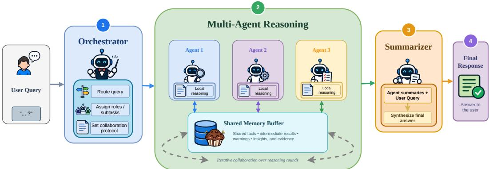  
Figure 1: General workflow of Muffin - a shared memory buffering system.

We propose an asynchronous system based on shared memory buffer inference, referred to as Muffin, that enables exchange of agents’ novel insights. The general workflow is visualized in Figure 1. In the first step, an Orchestrator routes a user query based on the expected reasoning demands, i.e., whether a query can be solved directly or a multi-step reasoning is required. For more demanding queries, multiple agents are instantiated by assigning each of them a specialized role, and a subtask, both provided by the orchestrator. For an efficient exchange of relevant insights, a shared memory provides a controlled and selective exchange of intermediate findings. An agent only pushes relevant information into the buffer which is expected to help in making progress in a collaborative problem solving manner. We keep an agent’s own reasoning local. After a finite reasoning horizon, a Summarizer is fed the final messages from each agent along the agents’ meta information and the initial user query, to produce the final response.

In our empirical study, we show how Muffin provides reasoning capabilities that are on the Pareto front w.r.t. the downstream accuracy and the token consumption. We evaluate on four reasoning benchmarks and report performance gains across four open-weight language models. By applying Muffin, we improve the strongest baseline by 4.4 accuracy points on average across all benchmarks, with larger gains on OlymMATH-E of 11.8 accuracy points. Moreover, we show that it reaches a better quality-cost trade-off compared to multi-agent debate architectures, improving accuracy by 19.2 accuracy points while using 77.4% fewer tokens in the step-wise analysis, as in our pipeline we exchange only selected findings instead of full reasoning traces.

The key contributions of our work:

• Shared Memory Buffer: We propose Muffin, an LLM-based multi-agent workflow in which agents asynchronously exchange selected intermediate findings through a shared buffer.

• Asynchronously Selective Information Sharing: Muffin keeps each agent’s local reasoning information private and shares partial intermediate findings through the buffer asynchronously, enabling agent collaboration without exposing full reasoning traces.

• Accuracy-Cost Trade-off: Muffin outperforms single-agent and majority-vote baselines across four reasoning benchmarks, while lying on the accuracy-token Pareto frontier.

## 2 RELATED WORK

Multi-agent collaboration. Recent research has shown that agentic systems can improve reasoning and performance by organizing multiple specialized agents rather than relying on a single language model inference (Hong et al., 2024; Chen et al., 2024a; Xi et al., 2025; Abou Ali et al., 2025). Several systems instantiate this idea through task decomposition (Chen et al., 2024b; Qian et al., 2024), where agents will have specialized roles while working on different parts of a task, including general reasoning workflows and software development pipelines. General-purpose agent frameworks make this coordination more flexible by allowing LLM-backed agents, tools, and humans to be composed into different interaction patterns (Wu et al., 2024; Moura & CrewAI Inc., 2023; LangChain AI, 2024). Despite these differences, a common denominator of most multi-agent systems is that they still integrate outputs only after full messages, subtasks, or rounds have completed, limiting how agents can adapt to one another’s reasoning while inference is still unfinished.

Aggregation and shared intermediate information. Some studies on aggregation show how outputs from other inference processes can be used as additional context for improving final answers (Jiang et al., 2023; Wang et al., 2024b). Layered aggregation uses responses from earlier model calls to condition later ones, enhancing the complement of strengths across models (Wang et al., 2025). Debate-based systems instead expose agents to peer answers and critiques over multiple rounds before selecting a final answer (Du et al., 2024; Liang et al., 2024; Xiong et al., 2023). These results support the value of shared intermediate information, but the shared object is usually a complete response, critique, or round output, rather than having the LLM judge which information is useful enough to share. This leaves open how agents should share and use partial information before a full answer has been completed.

Fine-grained and streaming interaction. More recent work studies collaboration below the level of complete turns through token-level collaboration (Hsu et al., 2025), which lets other agents observe generation progress and adjust their reasoning before a complete answer is produced. Similarly, streaming communication sends reasoning steps to downstream agents during generation, reducing the delay caused by waiting for complete turns (Ning et al., 2024; Yang et al., 2026). This direction suggests that sharing partial reasoning during inference can reduce coordination latency and enable earlier reactions, while leaving room to study how partial information can be selected, maintained, and jointly reused. A key challenge is to support asynchronous sharing, where agents can make useful findings available to others without exposing their full reasoning traces. This frames a middle ground between isolated final-answer aggregation and full-trace exchange.

## 3 METHODOLOGY

## 3.1 GENERAL MULTI-AGENT PROBLEM SETTING

In a multi-agent system, a team of N agents $\mathcal { A } = \{ a _ { i } \} _ { i = 1 } ^ { N }$ tries to solve a given query x. We initialize each agent $a _ { i }$ with a language model $p _ { \theta _ { i } }$ having an agent-specific role $r _ { i }$ and a subtask $\tau _ { i } .$ executing T reasoning steps. An agent holds a local history $h _ { i } ^ { ( t ) }$ for each step $t ,$ and conditions on a prompt $c _ { i } ^ { ( t ) }$ constructed by the shared context formatting function $C _ { a g e n t }$ , i.e.:

$$
c _ { i } ^ { ( t ) } = C _ { a g e n t } ( \boldsymbol { x } , \boldsymbol { r } _ { i } , \tau _ { i } , h _ { i } ^ { ( t ) } )
$$

The message generated by the agent is denoted as $m _ { i } ^ { ( t ) }$ :

$$
m _ { i } ^ { ( t ) } \sim p _ { \theta _ { i } } ( \cdot \mid c _ { i } ^ { ( t ) } ) .
$$

In standard multi-agent inference, agents usually communicate using completed messages. The agents can work sequentially and respond one after another (Hong et al., 2024), or in parallel, where multiple agents generate their outputs independently before a final aggregation or selection step (Wang et al., 2025).

After one or more inference rounds, a final answer is produced by an aggregation function $G ,$ which may select one agent’s output, combine multiple outputs, apply a majority vote, or synthesize a new response:

$$
y = G ( c _ { \mathrm { s u m } } ) , \qquad \mathrm { w i t h } \ c _ { \mathrm { s u m } } = C _ { \mathrm { s u m } } ( x , m _ { 1 } ^ { ( 1 : T ) } , \dots , m _ { N } ^ { ( 1 : T ) } )
$$

where $c _ { \mathrm { s u m } }$ is the aggregation context constructed from the query and completed agent messages by the formatting function $C _ { \mathrm { s u m } }$ . Therefore, the standard setting treats communication mainly as completed messages rather than explicitly modeling how information from each round is organized and reused in later inference steps.

## 3.2 MUFFIN - SHARED MEMORY BUFFER INFERENCE

To support asynchronous sharing of intermediate findings, we introduce a shared memory buffer. First, an orchestrator routes the input query according to the expected demands to a single-agent or multi-agent setting. In the latter case, it configures a team of agents. The agents reason concurrently

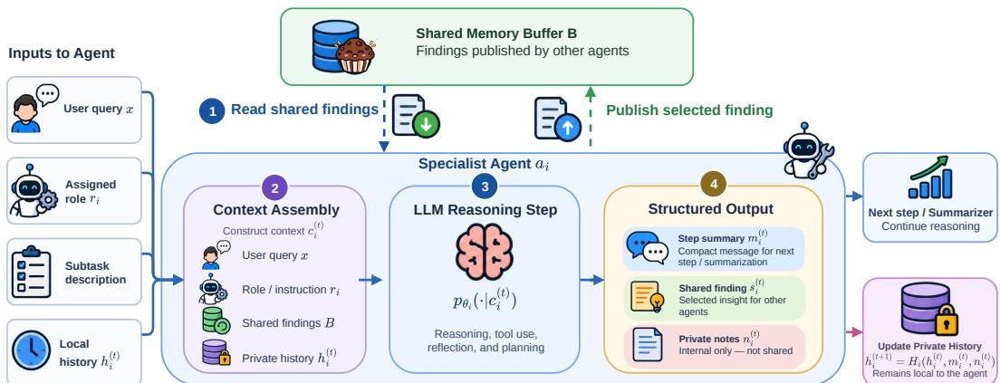  
Figure 2: An agent’s internal workflow.

and exchange insights through a shared memory buffer. Finally, a summarizer produces the final answer. Our general workflow is illustrated in Figure 1.

Orchestrator. The orchestrator is a language model $p _ { \theta _ { \mathsf { C } } }$ that maps a query x to an inference plan:

$$
\pi = ( z , \{ \alpha _ { i } \} _ { i = 1 } ^ { N } , \rho ) \sim p _ { \theta _ { O } } ( \cdot \mid x ) , \qquad \mathrm { w i t h } \ \alpha _ { i } = ( a _ { i } , r _ { i } , \tau _ { i } ) ,
$$

where $z \in \{ \mathrm { d i r e c t , m u l t i } \}$ is the routing decision, $\alpha _ { i }$ assigns each agent $a _ { i }$ a role $r _ { i }$ and a nonoverlapping subtask $\tau _ { i }$ , and $\rho$ denotes the collaboration protocol. The protocol specifies what kind of information is shared $( \mathrm { e . g . }$ ., critique, warnings, etc.), defines what to keep only in an agent’s local reasoning sphere, and sets whether new findings may trigger reactive steps of other peers. In case of $z = { \mathrm { d i r e c t } }$ , a single call $y \sim p _ { \theta } ( \cdot | x )$ terminates the pipeline without memory buffer or summarizer. For cases where more demanding reasoning is expected, the pipeline triggers the multi-agent route.

Asynchronous Multi-Agent Reasoning via a Shared Memory Buffer. In the multi-agent route, the set of agents can share insights via a shared memory buffer.

• Shared Memory Buffer. Due to an asynchronous sharing of information over a shared memory buffer, we refer to the memory’s state at time step d with ℓ-many entries as:

$$
B ^ { ( d ) } = ( e _ { 1 } , \ldots , e _ { \ell } ) , \qquad { \mathrm { w i t h ~ } } e _ { j } = ( a _ { i } , s _ { i } ^ { ( t ) } , t ) \qquad { \mathrm { a n d ~ } } B ^ { ( 0 ) } = \emptyset .
$$

Each entry $e _ { j }$ stores the information about the source agent $a _ { i } \in A .$ , the agent’s finding in the t-th reasoning step $s _ { i } ^ { ( t ) }$ , and an identifier of the source step t. We define the memory buffer as an appendonly data structure, i.e., any existing data is immutable, and the only permitted mutation is adding new information. Hence, $B ^ { ( d ) } { \preceq } B ^ { ( d ^ { \prime } ) }$ for two time stamps $d \leq d ^ { \prime }$ . Since agents can only append information, there are no write conflicts and no locking beyond atomicity of the append operation. When retrieving information from the buffer, agents access the stored data through a bounded window denoted as $R _ { k } ( B ^ { ( d ) } , i )$ to retrieve the k most recent findings of B at time d contributed by other agents. In particular, it scans backward and skips the agent’s $a _ { i }$ own shared findings, which are available in the agent’s private history.

• Agent step. The agent’s internal workflow is summarized in Figure 2. At reasoning step t, we denote the agent’s dispatch time as $\beta _ { i , s t a r t } ^ { ( t ) }$ . Given a generation latency of $\delta _ { i } ^ { ( t ) }$ , the agent ends the t-th inference step at $\beta _ { i , e n d } ^ { ( t ) } = \beta _ { i , s t a r t } ^ { ( t ) } + \delta _ { i } ^ { ( t ) }$ . At dispatch, the agent reads the k most recent findings of other peers from the memory buffer and constructs its context information:

$$
c _ { i } ^ { ( t ) } = C _ { a g e n t } ( \boldsymbol { x } , \boldsymbol { r } _ { i } , \tau _ { i } , h _ { i } ^ { ( t ) } , R _ { k } ( \boldsymbol { B } ^ { \beta _ { i , s t a r t } ^ { ( t ) } } , i ) , \rho ) ,
$$

where $h _ { i } ^ { ( t ) }$ denotes the agent’s local history. An agent generates a structured output according to:

$$
( m _ { i } ^ { ( t ) } , s _ { i } ^ { ( t ) } , n _ { i } ^ { ( t ) } ) \sim p _ { \theta _ { i } } ( \cdot | c _ { i } ^ { ( t ) } ) ,
$$

where $m _ { i } ^ { ( t ) }$ denotes an agent’s step summary, $s _ { i } ^ { ( t ) }$ refers to the optional shared finding, and $n _ { i } ^ { ( t ) }$ are local notes only visible for the respective agent. In case of a finding is shared, the buffer is updated:

$$
B ^ { \beta _ { i , e n d } ^ { ( t ) } } = B ^ { \beta _ { i , e n d } ^ { ( t ) - } } \circ ( a _ { i } , s _ { i } ^ { ( t ) } , t ) ,
$$

where  appends a new entry to the memory buffer, $B ^ { \beta _ { i , e n d } ^ { ( t ) - } }$ denotes the buffer state immediately before agent $a _ { i }$ commits its new finding. The private history is updated independently,

$$
h _ { i } ^ { ( t + 1 ) } = H _ { i } ( h _ { i } ^ { ( t ) } , m _ { i } ^ { ( t ) } , n _ { i } ^ { ( t ) } )
$$

The history update $H _ { i }$ retains only a compact summary rather than a full trajectory to keep the agents’ local states small.

• Asynchronous execution. In contrast to prior research, our work does not rely on a global round index. Specifically, an agent $a _ { i }$ is dispatched $\beta _ { i , s t a r t } ^ { ( t ) }$ as soon as it completes the last committing $\beta _ { i , e n d } ^ { ( t - 1 ) }$ , independently of the progress of any other agent. Therefore, agents run as concurrent requests and the generation $\delta _ { i } ^ { ( t ) }$ dominates latency during which other agents continue to read and write from the buffer. W.l. $\mathrm { _ { o . g . } }$ , assuming two agents $a _ { i } , a _ { j } \in { \mathcal { A } }$ and two reasoning time steps $t , t ^ { \prime }$ , a finding that is committed at $\beta _ { i , e n d } ^ { ( t ) }$ by the i-th agent is visible for other agent $a _ { j }$ iff $\beta _ { i , e n d } ^ { ( t ) } \leq \beta _ { j , s t } ^ { ( t ^ { \prime } ) }$ <sub>art</sub>, and lies within the k most recent findings. Hence, any two overlapping intervals $[ \beta _ { i , s t a r t } ^ { ( t ) } , \beta _ { i , e n d } ^ { ( t ) } ]$ and $[ \beta _ { j , s t a r t } ^ { ( t ^ { \prime } ) } , \beta _ { j , e n d } ^ { ( t ^ { \prime } ) } ]$ with $( \beta _ { j , s t a r t } ^ { ( t ^ { \prime } ) } > \beta _ { i , s t a r t } ^ { ( t ) } ) \land ( \beta _ { j , s t a r t } ^ { ( t ^ { \prime } ) } < \beta _ { i , e n d } ^ { ( t ) } )$ cannot share new findings that are not yet committed. If the collaboration protocol $\rho$ enables re-activation, an agent executes exactly one additional reasoning step and we define the agent’s own reasoning horizon as $T _ { i } = T { + } 1$ dispatched at $\beta _ { i , s t a r t } ^ { ( T + 1 ) } = \operatorname* { m a x } _ { j } ( \beta _ { j , e n d } ^ { ( \stackrel { . } { T } ) } )$ , i.e., when all agents finished at least T reasoning steps.

Summarizer. After each agent finishes its reasoning up to $T _ { i }$ steps, our system builds a structured input for the summarizer rather than giving the full interaction trace from each agent. We feed the summarizer the query $x ,$ the agents’ assignments $\alpha _ { i } ,$ , and the last step summary $m _ { i } ^ { ( T _ { i } ) }$ of each agent. Since each $m _ { i } ^ { ( T _ { i } ) }$ was produced after reading the buffer, findings from the buffer $B$ reach the Summarizer module through the agents’ summaries. The answer is produced by a separate language model $p _ { \theta _ { \mathrm { s u m } } }$ (in our experiments the same served model):

$$
y \sim p _ { \theta _ { \mathrm { s u m } } } ( \cdot \mid c _ { \mathrm { s u m } } ) , \qquad \mathrm { w i t h } \ c _ { \mathrm { s u m } } = C _ { \mathrm { s u m } } \left( x , \left\{ ( \alpha _ { i } , m _ { i } ^ { ( T _ { i } ) } ) \right\} _ { i = 1 } ^ { N } \right)
$$

The summarizer is focusing on the task of choosing and summarizing the best-supported answer from the agents’ last message summaries, using the candidate summary as evidence rather than trusting it completely. It is also instructed not to solve the task again, introduce new assumptions, or choose an answer which is not supported by the agent outputs unless no candidate can be extracted. We analyze the summary’s design choice in Section 4.3 by comparing the summarizer output with the agents’ last individual outputs.

## 4 EXPERIMENTS

Our experiments are organized around three questions. First, we evaluate whether our method improves reasoning accuracy. Second, we study the inference-cost trade-off introduced by multi-agent collaboration. Third, we analyze whether the shared buffer helps agents use intermediate findings from other agents before final summarization.

## 4.1 SETUP

We first describe the overall experimental setting, including the benchmarks, baselines, and implementation details.

Benchmarks. We evaluate on four benchmarks that cover complementary reasoning tasks. The first two follow the evaluation protocol of prior work (Du et al., 2024):

• Chess Move Validity, derived from the BIG-Bench Chess State Tracking benchmark (bench authors, 2023), measures a system’s predictive performance of a valid move in a chess setting.

• MMLU-Pro (Wang et al., 2024a) for broad multi-domain multiple-choice reasoning.

• GPQA-Diamond (Rein et al., 2024) tests difficult, knowledge-intensive scientific reasoning.

• OlymMATH (Sun et al., 2025), which evaluates mathematical problem solving that often requires multi-step derivation, proof-like reasoning, and verification.

For Chess Move Validity and MMLU-Pro, we use the 100 examples from each dataset, following the 100-example evaluation setting of prior work (Du et al., 2024). For GPQA-Diamond, we evaluate on the full Diamond split of 198 examples. For OlymMATH, we use 100 examples from the English easy (-E) subset and 100 examples from the English hard (-H) subset, and report the results for the two subsets separately.

Baselines. We compare Muffin with single-agent, majority-voting based multi-agent, and multiagent debate:

• Single-Agent uses only one language model agent to solve the task. We explicitly allow for multiple reasoning steps and not just one-shot inference.

• Majority Vote leverages multiple independent single-agent, and gathers their final results and choose the majority answer from them.

• Multi-Agent Debate follows the setting of the Multi-agent Debate (Du et al., 2024), where the agents will revise their responses after observing other agents’ output.

Implementation Details. We evaluate all methods with four LLMs: gemma-4-E4B-it, gemma-4-31B-it, Qwen3.8-27B, and Qwen3.5-4B (Team, 2026; Qwen Team, 2026b;a). All models are served on a compute cluster through a vLLM (Kwon et al., 2023) OpenAI-compatible endpoint. All baselines and our method call the same served model in each comparison. We serve the models using tensor parallelism from vLLM, utilizing two H100 GPUs for the smaller models and four H100 GPUs for the larger models. As LLM inference might introduce small run-to-run difference, we repeat each experiment three times and report averaged results. For method execution and agent parameters, unless explicitly stated otherwise, we set the number of steps to five for all methods and fix the number of agents to three for Majority Vote, Multi-Agent Debate, and Muffin. Our code is publicly available: https://anonymous.4open.science/r/Muffin

## 4.2 EFFECTIVENESS AND EFFICIENCY

Hypothesis 1: Asynchronous sharing of intermediate findings through a memory buffer improves accuracy over single-agent, majority-vote, and multi-agent debate baselines under the same step budget.

For the first experiment, we want to support the hypothesis that sharing intermediate findings rather than the full output from others can improve accuracy. Under the default setting defined in Section 4.1, we compare the task performance of Muffin against the baselines across all selected benchmarks and models.

Table 1 shows that Muffin achieves the best accuracy in 17 out of 20 in our evaluation settings and is second-best in the remaining three. The largest improvements appear on the OlymMATH benchmark, and relative to the strongest baseline, Muffin improves accuracy by 11.8 points on OlymMATH-E and 2.6 points on OlymMATH-H on average. On benchmarks where the baselines perform better, the margin is smaller, showing that the main benefit appears when the task leaves room for multi-step collaborative reasoning. Muffin also shows slightly higher standard deviations in some settings, which is expected because dynamic agent roles and LLM-decided shared-finding exchange introduce more variation across runs.

## Hypothesis 2: Asynchronous problem solving provides a better quality-cost trade-off.

We evaluate this hypothesis through three complementary comparisons on the OlymMATH-Easy, a representative benchmark that requires multi-step mathematical reasoning and allows us to compare how accuracy and token usage evolve across inference steps. First we compare different inference methods over ten reasoning steps. Second, we vary the number of agents in Muffin to check whether adding more agents improves accuracy enough to cover the additional token cost. Third, we compare Muffin with full-trace sharing to evaluate the benefit of selective sharing. In terms of token usage, we measure both input and output tokens. Regarding accuracy, baseline results can be obtained directly after each step, whereas in our method, we extract the outputs at each step and take a majority vote across them. For both accuracy and token usage, we report the average over three independent runs.

Table 1: Accuracy by model, method, and benchmark. For OlymMATH, we report the English easy (OlymMATH-E) and English hard (OlymMATH-H) subsets separately. For each model and benchmark, the best result is in bold and the second-best is underlined. The value after denotes the standard deviation across three independent runs. <sup>†</sup>Low due to the answer-extraction failures, counted as incorrect.
<table><tr><td>Model</td><td>Method</td><td>Chess</td><td>GPQA</td><td></td><td></td><td>MMLU-Pro OlymMATH-E OlymMATH-H</td></tr><tr><td rowspan="4">gemma-4-E4B-it</td><td>Single-Agent</td><td> $\overline { { 0 . 2 2 3 \pm 0 . 0 0 6 } }$ </td><td> $\overline { { 0 . 5 1 3 \pm 0 . 0 0 7 } }$ </td><td> $\overline { { 0 . 7 4 0 \pm 0 . 0 2 0 } }$ </td><td> $\overline { { 0 . 3 5 0 \pm 0 . 0 0 0 } }$ </td><td> $\overline { { 0 . 0 7 3 \pm 0 . 0 0 6 } }$ </td></tr><tr><td>Majority Vote</td><td> $0 . 2 6 0 \pm 0 . 0 0 0$ </td><td> $0 . 5 3 4 \pm 0 . 0 0 3$ </td><td> $0 . 7 5 0 \pm 0 . 0 1 0$ </td><td> $0 . 3 5 0 \pm 0 . 0 0 0$ </td><td> $0 . 0 7 3 \pm 0 . 0 0 6$ </td></tr><tr><td>Multi-Agent Debate</td><td> $\underline { { 0 . 3 0 0 } } \pm 0 . 0 0 0$ </td><td> $\mathbf { 0 . 6 5 8 \bot 0 . 0 1 0 }$ </td><td> $\underline { { 0 . 7 7 0 } } \pm \mathbf { 0 . 0 0 0 }$ </td><td> $\underline { { 0 . 4 2 3 } } \pm 0 . 0 0 3$ </td><td> $\underline { { 0 . 1 0 3 } } \pm 0 . 0 0 6$ </td></tr><tr><td>Muffin</td><td> $\mathbf { 0 . 3 1 0 \pm 0 . 0 1 3 }$ </td><td> $0 . 6 3 2 \pm 0 . 0 3 0$ </td><td> $\mathbf { 0 . 7 9 0 \bot 0 . 0 2 0 }$ </td><td> $\mathbf { 0 . 5 9 3 \pm 0 . 0 1 2 }$ </td><td> $\mathbf { 0 . 1 3 3 \pm 0 . 0 3 2 }$ </td></tr><tr><td rowspan="4"> $\overline { { \mathrm { g e m m a } - 4 - 3 1 \mathrm { B } \mathrm { - i t } } }$ </td><td>Single-Agent</td><td> $\overline { { 0 . 6 6 0 \pm 0 . 0 0 0 } }$ </td><td> $\overline { { 0 . 6 9 1 \pm 0 . 0 5 4 } }$ </td><td> $\overline { { 0 . 8 5 0 \pm 0 . 0 0 0 } }$ </td><td> $\overline { { 0 . 7 0 3 \pm 0 . 0 2 1 } }$ </td><td> $\overline { { 0 . 1 9 0 \pm 0 . 0 1 0 } }$ </td></tr><tr><td>Majority Vote</td><td> $0 . 6 6 0 \pm 0 . 0 0 0$ </td><td> $\underline { { 0 . 7 1 5 } } \pm 0 . 0 4 3$ </td><td> $\underline { { 0 . 8 5 0 } } \pm \mathbf { 0 . 0 0 0 }$ </td><td> $0 . 7 0 7 \pm 0 . 0 1 2$ </td><td> $0 . 1 9 3 \pm 0 . 0 1 5$ </td></tr><tr><td>Multi-Agent Debate</td><td> $\mathbf { 0 . 8 5 0 \bot 0 . 0 0 0 }$ </td><td> $0 . 3 7 9 \pm 0 . 0 1 6 ^ { \dagger }$ </td><td> $\underline { { 0 . 8 5 0 } } \pm \mathbf { 0 . 0 0 0 }$ </td><td> $\underline { { 0 . 7 6 7 } } \pm 0 . 0 4 0$ </td><td> $\underline { { 0 . 3 8 3 } } \pm \mathbf { 0 . 0 2 1 }$ </td></tr><tr><td>Muffin</td><td> $\underline { { 0 . 7 9 3 } } \pm \mathbf { 0 . 0 2 1 }$ </td><td> $\mathbf { 0 . 8 2 8 \bot 0 . 0 5 0 }$ </td><td> $\mathbf { 0 . 8 6 3 \pm 0 . 0 0 6 }$ </td><td> $\mathbf { 0 . 8 5 0 \AA } \mathrm { \pm 0 . 0 1 0 }$ </td><td> $\mathbf { 0 . 4 0 7 \mathop { \pm } 0 . 0 0 6 }$ </td></tr><tr><td rowspan="4">Qwen3.5-4B</td><td>Single-Agent</td><td> $\overline { { 0 . 2 8 3 \pm 0 . 0 0 6 } }$ </td><td> $\overline { { 0 . 5 9 9 \pm 0 . 0 2 8 } }$ </td><td> $\overline { { 0 . 7 2 0 \pm 0 . 0 9 5 } }$ </td><td> $\overline { { 0 . 3 7 0 \pm 0 . 0 2 0 } }$ </td><td> $\overline { { 0 . 1 2 0 \pm 0 . 0 3 5 } }$ </td></tr><tr><td>Majority Vote</td><td> $0 . 3 8 0 \pm 0 . 0 1 0$ </td><td> $0 . 6 5 5 \pm 0 . 0 3 1$ </td><td> $\underline { { 0 . 7 5 7 } } \pm \mathbf { 0 . 0 7 6 }$ </td><td> $\underline { { 0 . 3 9 7 } } \pm 0 . 0 0 6$ </td><td> $0 . 1 3 0 \pm 0 . 0 3 5$ </td></tr><tr><td>Multi-Agent Debate</td><td> $\underline { { 0 . 4 1 0 } } \pm \mathbf { 0 . 0 1 0 }$ </td><td> $0 . 5 6 7 \pm 0 . 0 2 5$ </td><td> $0 . 7 4 0 \pm 0 . 0 9 5$ </td><td> $\underline { { 0 . 3 9 7 } } \pm 0 . 0 0 6$ </td><td> $\underline { { 0 . 2 1 3 } } \pm \mathbf { 0 . 0 1 5 }$ </td></tr><tr><td>Muffin</td><td> $\mathbf { 0 . 5 6 0 \bot 0 . 0 2 0 }$ </td><td> $\mathbf { 0 . 7 1 2 \bot 0 . 0 4 0 }$ </td><td> $\mathbf { 0 . 7 8 0 \bot 0 . 0 6 2 }$ </td><td> $\mathbf { 0 . 5 9 7 \pm 0 . 0 4 5 }$ </td><td> $\mathbf { 0 . 2 3 7 \pm 0 . 0 2 1 }$ </td></tr><tr><td rowspan="4">Qwen3.8-27B</td><td>Single-Agent</td><td> $\overline { { 0 . 9 8 7 \pm 0 . 0 1 5 } }$ </td><td> $\overline { { 0 . 8 5 9 \pm 0 . 0 1 0 } }$ </td><td> $\overline { { 0 . 8 4 0 \pm 0 . 0 2 0 } }$ </td><td> $\overline { { 0 . 7 9 0 \pm 0 . 0 1 0 } }$ </td><td> $\overline { { 0 . 6 7 0 \pm 0 . 0 1 0 } }$ </td></tr><tr><td>Majority Vote</td><td> $0 . 9 9 3 { \scriptstyle \pm 0 . 0 0 6 }$ </td><td> $\mathbf { 0 . 8 9 7 \pm 0 . 0 2 0 }$ </td><td> $0 . 8 5 3 { \scriptstyle \pm 0 . 0 3 1 }$ </td><td> $0 . 7 9 7 \pm 0 . 0 1 5$ </td><td> $0 . 6 8 0 \pm 0 . 0 1 0$ </td></tr><tr><td>Multi-Agent Debate</td><td> $0 . 9 9 0 \pm 0 . 0 1 0$ </td><td> $0 . 8 7 9 \pm 0 . 0 1 6$ </td><td> $0 . 8 1 7 \pm 0 . 0 4 9$ </td><td> $\underline { { 0 . 8 3 0 } } \pm 0 . 0 3 0$ </td><td> $\underline { { 0 . 6 8 3 } } \pm \mathbf { 0 . 0 1 5 }$ </td></tr><tr><td>Muffin</td><td> $\mathbf { 1 . 0 0 0 } \pm 0 . 0 0 0$ </td><td> $\underline { { 0 . 8 9 1 } } \pm 0 . 0 3 0$ </td><td> $\mathbf { 0 . 8 6 0 \mathop { \pm } { 0 . 0 3 6 } }$ </td><td> $\mathbf { 0 . 8 5 0 \bot 0 . 0 3 5 }$ </td><td> $\mathbf { 0 . 7 1 0 \bot 0 . 0 2 6 }$ </td></tr></table>

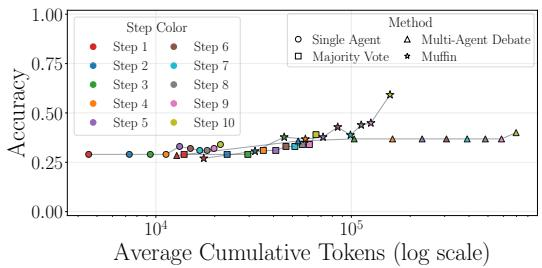

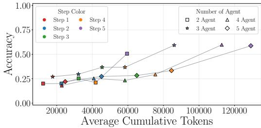  
Figure 3: Step-wise accuracy and token usage on OlymMATH-Easy with gemma-4-E4B-it.  
Figure 4: Accuracy-token trade-off on OlymMATH-Easy when varying the number of agents with $\mathtt { g e m m a - 4 - E 4 B - i t }$

• Method comparison over inference rounds. As shown in Figure 3, sharing the intermediate findings provides a better quality-cost trade-off on the selected benchmark. Each symbol represents a different method and reasoning steps are colorized, respectively. All methods improve in accuracy as the number of reasoning steps increases, with our approach achieving the highest performance by the 6-th step and gaining a boost in the final round after incorporating the summarizer, increasing from 44.9% to 59.2%. Overall, Muffin reaches the highest final accuracy and dominates the multi-agent baselines, outperforming the strongest baseline by 19.2 accuracy points while using 77.4% fewer tokens than multi-agent debate. The remaining benchmarks follow the same trend, with detailed results reported in Appendix B.1.

• Effect of the number of agents. We next study the effect of the number of agents on the performance of Muffin. We vary the number of agents from two to five while fixing the reasoning to five steps. The results shown in Figure 4 demonstrate that moving from two to three agents improves accuracy from 50.6% to 59.3%, showing a clear benefit from additional collaboration. However, increasing to four or five agents gives only slight performance changes, reaching 59.7% and 58.7%, but token usage continues to increase. This indicates that the benefit of the collaboration does not scale linearly with the number of agents and shows a convergence behavior where additional token usage does not pay off.

• Full-trace sharing versus our method. Lastly, we compare our method with a more standard full-trace approach. As described in Section 3.2, Muffin only passes local notes but not the full reasoning content to the next step. The Summarizer only receives the last output from each agent but not their full reasoning trace. In this experiment, we disable the selective sharing and pass the full trace to both the agents and the summarizer to evaluate whether the additional context improves the quality-cost trade-off.

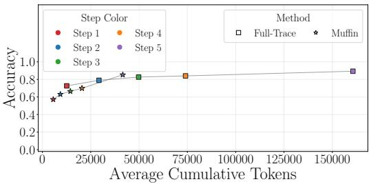

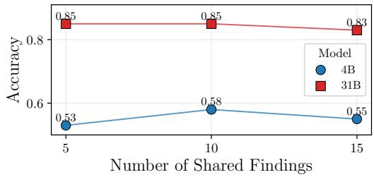  
Figure 6: Accuracy under different sharedfinding budgets with both sizes of gemma-4.

Figure 5: Accuracy-token trade-off on OlymMATH-Easy on full-trace sharing with gemma-4-31B-it.  
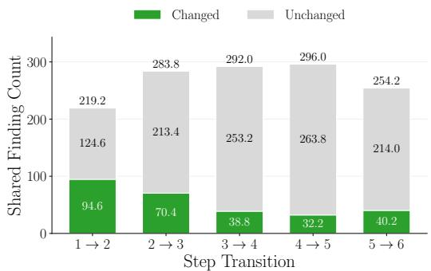  
Figure 7: Mean number of shared findings that change or do not change an agent’s answer on Chess with gemma- $\mathtt { - 4 - 3 1 B - i t }$

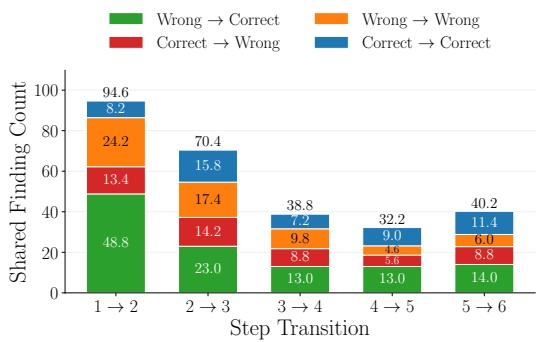  
Figure 8: Outcome breakdown for shared findings that change an agent’s answer on Chess with gemma- $\mathtt { \Gamma } \mathtt { \backslash } 4 - 3 1 \mathtt { B } \mathtt { - } \mathrm { i } \mathtt { t }$

Figure 5 shows that the full-trace approach reaches higher accuracy in the early steps, but it requires substantially more tokens. At the final step, full-trace sharing improves accuracy from 85.0% to 87.3%, while Muffin reduces token usage from 160.6K to 41.9K, corresponding to 73.9% fewer tokens. This suggests that passing the full reasoning trace can add some useful information, but much of this benefit can be recovered by sharing compact intermediate findings. Overall, Muffin provides a better quality-cost trade-off than the full-trace variant.

## Hypothesis 3: Shared findings actively steer the agents’ reasoning and move them toward correct answers.

After each step, we check whether the agents’ answers change after a finding is published. Further, we inspect the change in terms of switching from wrong to correct ones, correct to wrong, or whether the correctness status is kept. We report the mean count per run for each step transition.

Figure 7 shows that, on Chess with gemma-4-31B-it, 20.5% of all findings induced a change in the answer. Notably, this insight is highest directly in the first step transition with 43.2% and decreases over all step transitions to 15.8% in the last recorded step, indicating agents’ convergence as the memory buffer is filled with insights.

Figure 8 provides more in-depth insights into the changes. Across all step transitions, we observe a majority for wrong-to-correct changes in contrast to correct-to-wrong changes showing a decreasing behavior. The effect is most prominent in the early stage, where 51.6% turn a wrong answer into a correct one, while only 14.2% show the opposite. In later steps, the shared findings show a more bal anced view with 34.8% vs. 21.9%. Therefore, early findings shared via the memory buffer have the highest marginal value. The same analysis for the remaining benchmarks with gemma-4-31B-it and Qwen3.8-27B is reported in Appendix B.2.

Table 2: Comparison between the last agent output and the final summarizer output.
<table><tr><td colspan="2">All examples</td><td colspan="2">Changed examples only</td></tr><tr><td>Category</td><td> $\%$ </td><td>Category</td><td> $\%$ </td></tr><tr><td>Same as last agent</td><td>83.62</td><td>Wrong → Correct</td><td>32.05</td></tr><tr><td>Different from last agent</td><td>11.14</td><td>Correct → Wrong</td><td>21.20</td></tr><tr><td rowspan="2">Direct route</td><td>5.24</td><td>Wrong → Wrong</td><td>39.26</td></tr><tr><td></td><td>Correct → Correct</td><td>7.49</td></tr></table>

## 4.3 ABLATION STUDIES

We conduct ablation studies to inspect which parts of our method contribute to the final performance. These experiments focus on two design choices: whether the final summarizer improves over the agents’ last inference outputs, and how the number of shared findings affects the performance.

• Agents’ final outputs versus summarizer output. We compare the final answer produced by the summarizer with the last individual outputs generated by the agents, which include the last findings from the shared buffer in their input. This evaluates whether the summarizer is giving additional benefit by combining agents’ final evidence. We compute this comparison across all benchmarks and two model sizes from the Gemma-4 family. As shown in Table 2, the summarizer changes the last agent answer in 11.14% of cases. Among those changed cases, wrong-to-correct changes account for 32.05%, while correct-to-wrong changes account for 21.20%. This means beneficial corrections are 10.85 percentage points more than harmful changes. This suggests that the summarizer does more than copy or choose the majority from the final agent outputs, and can recover correct answers from the agents’ final evidence while introducing less harmful noise.

• Number of shared findings. Next, we control how much information an agent can retrieve from the buffer, and test whether more shared context always improves collaboration. We use OlymMATH-Easy with the Gemma-4 models. Figure 6 shows that increasing the number of shared findings does not always improve accuracy. For gemma-4-E4B-it, the best result appears at k = 10, improving over k = 5 by 5.0 accuracy points, but adding more findings reduces perfor mance. By contrast, gemma-4-31B-it is less sensitive to this budget, with accuracy changing by only 2.0 points. This suggests that a moderate number of shared findings is sufficient, while adding more findings can introduce noise by including redundant or outdated findings.

## 4.4 LIMITATIONS AND DISCUSSION

Our results show that shared intermediate findings in an asynchronous manner can improve multiagent reasoning without agents exchanging or using the full reasoning traces. Our evaluation is focused on question-answering and reasoning benchmarks. Future work should evaluate shared buffer collaboration on tasks that require tool use, planning, environment interaction, or long-horizon execution. Our experiments are also limited by compute cost. Although we test multiple models, benchmarks, and agent configurations, we cannot cover all closed- and open-weight models with different experimental settings. Broader evaluation would help to clarify how the shared buffer can adapt across different agentic usages.

## 5 CONCLUSION

Existing multi-agent debate methods rely on synchronous turn-taking and sharing information across different agents. We introduce Muffin, an agentic memory buffer inference framework in which an orchestrator first routes queries by expected reasoning demand. For more demanding queries, the collaborating agents exchange intermediate findings asynchronously through a shared memory buffer while keeping private reasoning local. Finally, a summarizer produces the final answer from compact agent summaries. Across four reasoning benchmarks and four language models, Muffin achieves the best accuracy in 17 out of 20 benchmark settings and reaches a better accuracy-token trade-off than multi-agent debate. Muffin improves final accuracy by 19.2 accuracy points while using 77.4% fewer tokens than multi-agent debate, showing that selective sharing of findings is a lightweight alternative to full-trace exchange. Future work includes a dynamic scaling of the number of agents, and extending the buffer to tool-using and long-horizon tasks.

## AI USE STATEMENT

In this work, we used generative AI tools to assist with code modifications, generate scripts for higher-quality figure plotting, and formulate prompts. We have not used generative AI tools for research ideas, designing core methodology, or writing initial text from scratch. Additionally, we used generative AI tools to improve sentence fluency while still using our original wording and arguments. We have reviewed all AI-assisted work: all modified code and plotting scripts were manually inspected, executed, and verified for correctness by the authors, and all edited text was carefully checked to ensure it had the same semantic meaning as our original version. We take responsibility for the final content of this work, including text, claims or artifacts produced with the aid of generative AI.

## REPRODUCIBILITY STATEMENT

We provide the Muffin implementation and experiment scripts in the anonymous code repository linked in the Implementation Details paragraph in Section 4.1. Section 4 describes the benchmark selection, dataset subsets, baselines, model choices, serving setup, repeated-run setting, and accuracy/token usage measurements. The ablation settings are also described in Section 4.3. Appendix A provides the prompt templates that we use for the orchestrator, agents, summarizer, and directanswer route. Appendix B reports additional experiment results. Together, the resources mentioned above provide all settings required to reproduce the reported results.

## ACKNOWLEDGMENTS

We acknowledge funding from the Bayerisches Staatsministerium fur Wirtschaft, Landesentwick-¨ lung und Energie under the research programme BayVFP Forderlinie Digitalisierung ¨ (grant reference DIK-2507-0024// DIK0836/01).

We also acknowledge the funding support from the Bayerisches Landesamtfur Steuer for the Bavarian AI Taxation Laboratory. Moreover, we gratefully acknowledge the scientific support and HPC resources provided by the Erlangen National High Performance Computing Center (NHR@FAU) of the Friedrich-Alexander-Universitat Erlangen-N¨ urnberg (FAU) under the NHR project DeepSmall -¨ Meta-learning for regularizing deep networks under small data regimes. NHR funding is provided by federal and Bavarian state authorities. NHR@FAU hardware is partially funded by the German Research Foundation (DFG) – 440719683.

## REFERENCES

Mohamad Abou Ali, Fadi Dornaika, and Jinan Charafeddine. Agentic ai: a comprehensive survey of architectures, applications, and future directions. Artificial Intelligence Review, 59(1), November 2025. ISSN 1573-7462. doi: 10.1007/s10462-025-11422-4. URL http://dx.doi.org/ 10.1007/s10462-025-11422-4.

Khalid Ibraheem Alohali, Laura Asaad Almusaeeb, Abdulaziz Abdulrahman Almubarak, Ahmad Ibraheem Alohali, and Ruaim Abdullah Muaygil. Reasoning-based llms surpass average human performance on medical social skills. Scientific Reports, 15(1), October 2025. ISSN 2045-2322. doi: 10.1038/s41598-025-20496-7. URL http://dx.doi.org/10.1038/ s41598-025-20496-7.

Anthropic. Claude opus 5 system card. alphaXiv Preprint, 2026. URL https://www. alphaxiv.org/abs/2607.claude-opus-5. Accessed: 2026-09-14.

BIG bench authors. Beyond the imitation game: Quantifying and extrapolating the capabilities of language models. Transactions on Machine Learning Research, 2023. ISSN 2835-8856. URL https://openreview.net/forum?id=uyTL5Bvosj. Featured Certification.

Vicente J. Bermejo, Andres Gago, Ramiro H. G ´ alvez, and Nicol ´ as Harari. Llms outperform out- ´ sourced human coders on complex textual analysis. Scientific Reports, 15(1), November 2025. ISSN 2045-2322. doi: 10.1038/s41598-025-23798-y. URL http://dx.doi.org/10. 1038/s41598-025-23798-y.

Mert Cemri, Melissa Z Pan, Shuyi Yang, Lakshya A Agrawal, Bhavya Chopra, Rishabh Tiwari, Kurt Keutzer, Aditya Parameswaran, Dan Klein, Kannan Ramchandran, Matei A Zaharia, Joseph Gonzalez, and Ion Stoica. Why do multi-agent llm systems fail? In D. Belgrave, C. Zhang, H. Lin, R. Pascanu, P. Koniusz, M. Ghassemi, and N. Chen (eds.), Advances in Neural Information Processing Systems, volume 38, Main Conference. Curran Associates, Inc., 2025. doi: 10.52202/085713-4082. URL https://proceedings.neurips.cc/paper\_files/ paper/2025/file/b1041e52d3be19f0a9bc491657488e4a-Paper-Datasets\_ and\_Benchmarks\_Track.pdf.

Guangyao Chen, Siwei Dong, Yu Shu, Ge Zhang, Jaward Sesay, Borje Karlsson, Jie Fu, and Yemin¨ Shi. Autoagents: a framework for automatic agent generation. In Proceedings ofthe Thirty-Third International Joint Conference on Artificial Intelligence, IJCAI ’24, 2024a. ISBN 978-1-956792- 04-1. doi: 10.24963/ijcai.2024/3. URL https://doi.org/10.24963/ijcai.2024/3.

Weize Chen, Yusheng Su, Jingwei Zuo, Cheng Yang, Chenfei Yuan, Chi-Min Chan, Heyang Yu, Yaxi Lu, Yi-Hsin Hung, Chen Qian, Yujia Qin, Xin Cong, Ruobing Xie, Zhiyuan Liu, Maosong Sun, and Jie Zhou. Agentverse: Facilitating multi-agent collaboration and exploring emergent behaviors. In B. Kim, Y. Yue, S. Chaudhuri, K. Fragkiadaki, M. Khan, and Y. Sun (eds.), International Conference on Learning Representations, volume 2024, pp. 20094– 20136, 2024b. URL https://proceedings.iclr.cc/paper\_files/paper/2024/ file/578e65cdee35d00c708d4c64bce32971-Paper-Conference.pdf.

Yilun Du, Shuang Li, Antonio Torralba, Joshua B. Tenenbaum, and Igor Mordatch. Improving factuality and reasoning in language models through multiagent debate. In Ruslan Salakhutdinov, Zico Kolter, Katherine Heller, Adrian Weller, Nuria Oliver, Jonathan Scarlett, and Felix Berkenkamp (eds.), Proceedings of the 41st International Conference on Machine Learning, volume 235 of Proceedings of Machine Learning Research, pp. 11733–11763. PMLR, 21–27 Jul 2024. URL https://proceedings.mlr.press/v235/du24e.html.

Chen Gao, Xiaochong Lan, Zhihong Lu, Jinzhu Mao, Jinghua Piao, Huandong Wang, Depeng Jin, and Yong Li. S3: Social-network simulation system with large language model-empowered agents. 2023. doi: 10.2139/ssrn.4607026. URL http://dx.doi.org/10.2139/ssrn. 4607026.

Ali E. Ghareeb, Benjamin Chang, Ludovico Mitchener, Angela Yiu, Caralyn J. Szostkiewicz, Dmytro Shved, Gavin J. Gyimesi, Jon M. Laurent, Samantha M. Wright, Muhammed T. Raz zak, Andrew D. White, Silvia C. Finnemann, Michaela M. Hinks, and Samuel G. Rodriques. A multi-agent system for automating scientific discovery. Nature, 655(8122):497–505, May 2026. ISSN 1476-4687. doi: 10.1038/s41586-026-10652-y. URL http://dx.doi.org/ 10.1038/s41586-026-10652-y.

Google DeepMind. Gemini 3.8 flash model card. Online, 2026. URL https://storage.googleapis.com/deepmind-media/Model-Cards/ Gemini-3-8-Flash-Model-Card.pdf. Accessed: October 23, 2026.

Sirui Hong, Mingchen Zhuge, Jonathan Chen, Xiawu Zheng, Yuheng Cheng, Jinlin Wang, Ceyao Zhang, Zili Wang, Steven Ka Shing Yau, Zijuan Lin, Liyang Zhou, Chenyu Ran, Lingfeng Xiao, Chenglin Wu, and Jurgen Schmidhuber. MetaGPT: Meta programming for a multi-agent collab-¨ orative framework. In The Twelfth International Conference on Learning Representations, 2024. URL https://openreview.net/forum?id=VtmBAGCN7o.

Chan-Jan Hsu, Davide Buffelli, Jamie McGowan, Feng-Ting Liao, Yi-Chang Chen, Sattar Vakili, and Da shan Shiu. Group think: Multiple concurrent reasoning agents collaborating at token level granularity, 2025. URL https://arxiv.org/abs/2505.11107.

Wenlong Huang, Fei Xia, Ted Xiao, Harris Chan, Jacky Liang, Pete Florence, Andy Zeng, Jonathan Tompson, Igor Mordatch, Yevgen Chebotar, Pierre Sermanet, Tomas Jackson, Noah Brown, Linda Luu, Sergey Levine, Karol Hausman, and brian ichter. Inner monologue: Embodied reasoning through planning with language models. In Karen Liu, Dana Kulic, and Jeff Ichnowski (eds.), Proceedings of The 6th Conference on Robot Learning, volume 205 of Proceedings of Machine Learning Research, pp. 1769–1782. PMLR, 14–18 Dec 2023. URL https://proceedings. mlr.press/v205/huang23c.html.

Dongfu Jiang, Xiang Ren, and Bill Yuchen Lin. LLM-blender: Ensembling large language models with pairwise ranking and generative fusion. In Anna Rogers, Jordan Boyd-Graber, and Naoaki Okazaki (eds.), Proceedings of the 61st Annual Meeting of the Association for Computational Linguistics (Volume 1: Long Papers), pp. 14165–14178, Toronto, Canada, July 2023. Association for Computational Linguistics. doi: 10.18653/v1/2023.acl-long.792. URL https://aclanthology.org/2023.acl-long.792/.

Sayash Kapoor, Benedikt Stroebl, Zachary S Siegel, Nitya Nadgir, and Arvind Narayanan. AI agents that matter. Transactions on Machine Learning Research, 2025. ISSN 2835-8856. URL https://openreview.net/forum?id=Zy4uFzMviZ.

Woosuk Kwon, Zhuohan Li, Siyuan Zhuang, Ying Sheng, Lianmin Zheng, Cody Hao Yu, Joseph Gonzalez, Hao Zhang, and Ion Stoica. Efficient memory management for large language model serving with pagedattention. In Proceedings of the 29th Symposium on Operating Systems Principles, SOSP ’23, pp. 611–626, New York, NY, USA, 2023. Association for Computing Machinery. ISBN 9798400702297. doi: 10.1145/3600006.3613165. URL https: //doi.org/10.1145/3600006.3613165.

Xiaruiqi Lan, Meiqin Liu, Zhirong Luan, Yan He, and Badong Chen. Enhancing robot task planning: Integrating environmental information and feedback insights through large language models. In 2024 43rd Chinese Control Conference (CCC), pp. 4475–4480, 2024. doi: 10.23919/CCC63176. 2024.10661782.

LangChain AI. Langgraph: Building resilient language agents as graphs. https://github. com/langchain-ai/langgraph, 2024.

Tian Liang, Zhiwei He, Wenxiang Jiao, Xing Wang, Yan Wang, Rui Wang, Yujiu Yang, Shuming Shi, and Zhaopeng Tu. Encouraging divergent thinking in large language models through multi-agent debate. In Yaser Al-Onaizan, Mohit Bansal, and Yun-Nung Chen (eds.), Proceedings of the 2024 Conference on Empirical Methods in Natural Language Processing, pp. 17889–17904, Miami, Florida, USA, November 2024. Association for Computational Linguistics. doi: 10.18653/v1/2024.emnlp-main.992. URL https://aclanthology.org/2024. emnlp-main.992/.

Nelson F. Liu, Kevin Lin, John Hewitt, Ashwin Paranjape, Michele Bevilacqua, Fabio Petroni, and Percy Liang. Lost in the middle: How language models use long contexts. Transactions of the Associationfor Computational Linguistics, 12:157–173, 2024. doi: 10.1162/tacl a 00638. URL https://aclanthology.org/2024.tacl-1.9/.

Xiaoliang Luo, Akilles Rechardt, Guangzhi Sun, Kevin K. Nejad, Felipe Ya´nez, Bati Yilmaz,˜ Kangjoo Lee, Alexandra O. Cohen, Valentina Borghesani, Anton Pashkov, Daniele Marinazzo, Jonathan Nicholas, Alessandro Salatiello, Ilia Sucholutsky, Pasquale Minervini, Sepehr Razavi, Roberta Rocca, Elkhan Yusifov, Tereza Okalova, Nianlong Gu, Martin Ferianc, Mikail Khona, Kaustubh R. Patil, Pui-Shee Lee, Rui Mata, Nicholas E. Myers, Jennifer K. Bizley, Sebastian Musslick, Isil Poyraz Bilgin, Guiomar Niso, Justin M. Ales, Michael Gaebler, N. Apurva Ratan Murty, Leyla Loued-Khenissi, Anna Behler, Chloe M. Hall, Jessica Dafflon, Sherry Dongqi Bao, and Bradley C. Love. Large language models surpass human experts in predicting neuroscience results. Nature Human Behaviour, 9(2):305–315, November 2024. ISSN 2397-3374. doi: 10.1038/s41562-024-02046-9. URL http://dx.doi.org/10.1038/ s41562-024-02046-9.

Joao Moura and CrewAI Inc. CrewAI: Framework for orchestrating role-playing, autonomous AI˜ agents. https://github.com/crewAIInc/crewAI, 2023.

Xuefei Ning, Zinan Lin, Zixuan Zhou, Zifu Wang, Huazhong Yang, and Yu Wang. Skeleton-of-thought: Prompting llms for efficient parallel generation. In B. Kim, Y. Yue, S. Chaudhuri, K. Fragkiadaki, M. Khan, and Y. Sun (eds.), International Conference on Learning Representations, volume 2024, pp. 917–967, 2024. URL https://proceedings.iclr.cc/paper\_files/paper/2024/file/ 03d7e13f0092405804f3a381ade8f3f0-Paper-Conference.pdf.

OpenAI. GPT-6 Astra System Card, September 2026. URL https://deploymentsafety. openai.com/gpt-6-astra/gpt-6-astra.pdf.

Ashis Kumar Pati. Agentic ai: A comprehensive survey of technologies, applications, and societal implications. IEEE Access, 13:151824–151837, 2025. doi: 10.1109/ACCESS.2025.3585609.

Chen Qian, Wei Liu, Hongzhang Liu, Nuo Chen, Yufan Dang, Jiahao Li, Cheng Yang, Weize Chen, Yusheng Su, Xin Cong, Juyuan Xu, Dahai Li, Zhiyuan Liu, and Maosong Sun. Chat-Dev: Communicative agents for software development. In Lun-Wei Ku, Andre Martins, and Vivek Srikumar (eds.), Proceedings of the 62nd Annual Meeting of the Association for Computational Linguistics (Volume 1: Long Papers), pp. 15174–15186, Bangkok, Thailand, August 2024. Association for Computational Linguistics. doi: 10.18653/v1/2024.acl-long.810. URL https://aclanthology.org/2024.acl-long.810/.

Qwen Team. Qwen3.5: Towards native multimodal agents, February 2026a. URL https:// qwen.ai/blog?id=qwen3.5.

Qwen Team. Qwen3.8-Max: A new bar for coding and cowork, August 2026b. URL https: //qwen.ai/blog?id=qwen3.8.

David Rein, Betty Li Hou, Asa Cooper Stickland, Jackson Petty, Richard Yuanzhe Pang, Julien Dirani, Julian Michael, and Samuel R. Bowman. GPQA: A graduate-level google-proof q&a benchmark. In First Conference on Language Modeling, 2024. URL https://openreview. net/forum?id=Ti67584b98.

Winnie Street, John Oliver Siy, Geoff Keeling, Adrien Baranes, Benjamin Barnett, Michael McKibben, Tatenda Kanyere, Alison Lentz, Blaise Aguera y Arcas, and Robin I. M.¨ Dunbar. Llms achieve adult human performance on higher-order theory of mind tasks. Frontiers in Human Neuroscience, Volume 19 - 2025, 2026. ISSN 1662-5161. doi: 10.3389/fnhum.2025.1633272. URL https://www.frontiersin.org/journals/ human-neuroscience/articles/10.3389/fnhum.2025.1633272.

Vighnesh Subramaniam, Yilun Du, Joshua B. Tenenbaum, Antonio Torralba, Shuang Li, and Igor Mordatch. Multiagent finetuning: Self improvement with diverse reasoning chains. In The Thirteenth International Conference on Learning Representations, 2025. URL https: //openreview.net/forum?id=JtGPIZpOrz.

Haoxiang Sun, Yingqian Min, Zhipeng Chen, Wayne Xin Zhao, Zheng Liu, Zhongyuan Wang, Lei Fang, and Ji-Rong Wen. Challenging the boundaries of reasoning: An olympiad-level math benchmark for large language models, 2025. URL https://arxiv.org/abs/2503. 21380.

Gemma Team. Gemma 4 technical report, 2026. URL https://arxiv.org/abs/2607. 02770.

Junlin Wang, Jue Wang, Ben Athiwaratkun, Ce Zhang, and James Y Zou. Mixture-of-agents enhances large language model capabilities. In Y. Yue, A. Garg, N. Peng, F. Sha, and R. Yu (eds.), International Conference on Learning Representations, volume 2025, pp. 33944–33963, 2025. URL https://proceedings.iclr.cc/paper\_files/paper/2025/file/ 5434be94e82c54327bb9dcaf7fca52b6-Paper-Conference.pdf.

Yubo Wang, Xueguang Ma, Ge Zhang, Yuansheng Ni, Abhranil Chandra, Shiguang Guo, Weiming Ren, Aaran Arulraj, Xuan He, Ziyan Jiang, Tianle Li, Max Ku, Kai Wang, Alex Zhuang, Rongqi Fan, Xiang Yue, and Wenhu Chen. MMLU-pro: A more robust and challenging multitask language understanding benchmark. In The Thirty-eight Conference on Neural Information Processing Systems Datasets and Benchmarks Track, 2024a. URL https://openreview. net/forum?id=y10DM6R2r3.

Zhenhailong Wang, Shaoguang Mao, Wenshan Wu, Tao Ge, Furu Wei, and Heng Ji. Unleashing the emergent cognitive synergy in large language models: A task-solving agent through multipersona self-collaboration. In Kevin Duh, Helena Gomez, and Steven Bethard (eds.), Proceedings of the 2024 Conference of the North American Chapter of the Association for Computational

Linguistics: Human Language Technologies (Volume 1: Long Papers), pp. 257–279, Mexico City, Mexico, June 2024b. Association for Computational Linguistics. doi: 10.18653/v1/2024. naacl-long.15. URL https://aclanthology.org/2024.naacl-long.15/.

Qingyun Wu, Gagan Bansal, Jieyu Zhang, Yiran Wu, Beibin Li, Erkang Zhu, Li Jiang, Xiaoyun Zhang, Shaokun Zhang, Jiale Liu, Ahmed Hassan Awadallah, Ryen W White, Doug Burger, and Chi Wang. Autogen: Enabling next-gen LLM applications via multi-agent conversations. In First Conference on Language Modeling, 2024. URL https://openreview.net/forum?id= BAakY1hNKS.

Zhiheng Xi, Wenxiang Chen, Xin Guo, Wei He, Yiwen Ding, Boyang Hong, Ming Zhang, Junzhe Wang, Senjie Jin, Enyu Zhou, Rui Zheng, Xiaoran Fan, Xiao Wang, Limao Xiong, Yuhao Zhou, Weiran Wang, Changhao Jiang, Yicheng Zou, Xiangyang Liu, and Tao Gui. The rise and potential of large language model based agents: a survey. Science China Information Sciences, 68, 01 2025. doi: 10.1007/s11432-024-4222-0.

Chunqiu Steven Xia, Yinlin Deng, Soren Dunn, and Lingming Zhang. Agentless: Demystifying llmbased software engineering agents, 2024. URL https://arxiv.org/abs/2407.01489.

Kai Xiong, Xiao Ding, Yixin Cao, Ting Liu, and Bing Qin. Examining inter-consistency of large language models collaboration: An in-depth analysis via debate. In Houda Bouamor, Juan Pino, and Kalika Bali (eds.), Findings of the Association for Computational Linguistics: EMNLP 2023, pp. 7572–7590, Singapore, December 2023. Association for Computational Linguistics. doi: 10.18653/v1/2023.findings-emnlp.508. URL https://aclanthology.org/2023. findings-emnlp.508/.

Zhen Yang, Xiaogang Xu, Wen Wang, Cong Chen, Xander Xu, and Ying-Cong Chen. Streaming communication in multi-agent reasoning, 2026. URL https://arxiv.org/abs/2606. 05158.

Guibin Zhang, Muxin Fu, Kun Wang, Frank Wan, Miao Yu, and Shuicheng Yan. Gmemory: Tracing hierarchical memory for multi-agent systems. In D. Belgrave, C. Zhang, H. Lin, R. Pascanu, P. Koniusz, M. Ghassemi, and N. Chen (eds.), Advances in Neural Information Processing Systems, volume 38, Main Conference, pp. 12988–13018. Curran Associates, Inc., 2025. doi: 10.52202/085713-0439. URL https://proceedings.neurips.cc/paper\_files/paper/2025/file/ 136a45cd9b841bf785625709a19c6508-Paper-Conference.pdf.

## A PROMPT TEMPLATES

This appendix lists the main prompt templates used by Muffin.

## A.1 ORCHESTRATOR PROMPT

The orchestrator decides whether a query should be answered directly or routed to a multi-agent workflow. In the multi-agent route, it also assigns agent roles, subtasks, and collaboration rules.

```csv
You are the dynamic subagent orchestrator for a local multi-agent
system.
Only valid JSON.
Routing:
Default to multi_agent mode.
Use direct mode only when the answer is truthfully 100% certain from
explicit prompt evidence or a deterministic trivial fact.
Use multi_agent for uncertainty, ambiguity, missing context,
calculation risk, domain reasoning, verification, critique, or
multiple viewpoints.
The reason must explain why direct or multi_agent was selected.
For direct, name the exact evidence or deterministic property and
explain why multi-agent verification would not help.
If multi_agent, create {min_dynamic_subagents} to {
max_dynamic_subagents} subagents.
Do not create overlapping roles or duplicate subtasks.
Each role must own a distinct evidence source, check, or perspective.
At least one subagent must challenge assumptions and contradictions.
Rules should be short, specific operating or communication rules.
For multi_agent, output:
"mode": "multi_agent",
"task_type": "{short task type}",
"task_summary": "{one sentence summary}",
"reason": "{why multi-agent reasoning is needed}",
"selected_agents": [
{
"name": "{agent name}",
"role": "{agent role}",
"description": "{unique evidence, constraints, or checks}",
"rules": ["{operating rule}"],
"subtask": "{non-overlapping subtask}",
"expected_output": "{expected output}",
"critical_debate": false,
"workspace_access": "none"
}
],
"collaboration_protocol": {
"event_types_to_share": ["finding", "critique", "warning"],
"reactive_steps": true,
"notes": "{how agents should use shared findings}"
}
For direct, output:
"mode": "direct",
"task_type": "{short task type}",
"task_summary": "{one sentence summary}",
```

"reason": "{why the answer is certain and verification would not help   
}",   
"direct\_certainty": "100\_percent",   
"selected\_agents": [],   
"collaboration\_protocol": {   
"event\_types\_to\_share": ["finding", "critique", "warning"],   
"reactive\_steps": false,   
"notes": "No agent collaboration is needed."   
}   
}   
User task:   
{task}

## A.2 AGENT REASONING PROMPT

Each agent receives the original task, its role and subtask assignment, its private local notes, and the current shared findings. The agent can only writes a concise shared finding to the buffer while keeping private reasoning local.

{task}   
Shared protocol:   
Work independently on the assigned subtask.   
Share concise findings that may help other agents.   
Check shared findings before answering.   
Shared findings may include an answer candidate plus a short reason.   
Verify shared findings before adopting them.   
If a shared finding is used or rejected, mention the source briefly   
in SUMMARY or LOCAL\_NOTES.   
Do not reveal private chain-of-thought.   
If assigned as a critical agent, challenge assumptions,   
contradictions, and overconfident claims.   
Output format:   
Respond with concise summaries only. Use this exact format:   
SUMMARY:   
{brief reasoning summary}   
SHARE\_FINDING:   
{one useful finding for other agents, or blank}   
LOCAL\_NOTES:   
ANSWER\_CHOICE: {current answer candidate, or "undecided"}   
ANSWER\_REASON: {one sentence reason for the current answer}   
Agent name:   
{agent\_name}   
Agent role:   
{role}   
Agent description:   
{description}   
Agent rules:   
- {rule\_1}   
- {rule\_2}   
Assigned subtask:

{assigned\_subtask}   
Expected output:   
{expected\_output}   
Current step:   
{step\_index} of {max\_steps}   
Local notes:   
{notes}   
Shared findings:   
{shared findings}

## A.3 SUMMARIZER PROMPT

After the multi-agent reasoning steps, the summarizer selects the final answer from the agents’ last summaries and extracted answer candidates.

You are the Summarizer for a dynamic multi-agent benchmark run.   
Your job is to choose and summarize the best-supported answer from the   
agents’ last summaries.   
Do not solve the task again.   
Do not introduce new calculations, new assumptions, or a new answer   
that was not supported by the agent outputs.   
Original task:   
{task}   
Agent last summaries:   
{agents’ rule and agents’ last summaries}   
Candidate aggregation:   
{candidate answer aggregation}   
Instructions:   
- Identify the final answer candidates already present in the agent   
summaries.   
- Use the candidate aggregation as evidence, not as automatic authority   
- If needs\_review is false and a selected\_candidate exists, keep that   
candidate unless the agent summaries clearly contradict it.   
- If needs\_review is true, audit the candidate reasons and choose the   
best-supported candidate from the agent outputs.   
- Treat weak majority, ties, and single-candidate-only cases as   
requiring evidence review.   
- Use each agent’s role, subtask, description, and explanation excerpt   
when candidates conflict.   
- Do not introduce a new answer absent from the agent candidate list   
unless no candidate was extractable.   
- If the agent outputs include a clear final-answer format, keep that   
format.   
- Keep the response concise.   
- End with exactly one final answer line.

## A.4 DIRECT-ANSWER PROMPT

When the orchestrator selects the direct route, the system bypasses the multi-agent workflow and asks the model to answer the task directly.

Answer the user task directly with one concise response.   
User task:   
{task}

## B ADDITIONAL EXPERIMENTAL RESULTS

## B.1 STEP-WISE ACCURACY AND TOKEN USAGE

Figures 9–13 and Figures 14–18 show the 5-step accuracy and token usage across all benchmarks using gemma-4-31B-it and Qwen3.8-27B, respectively.

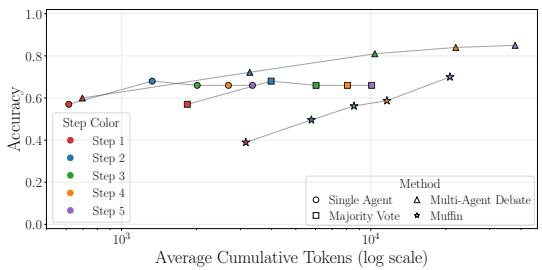

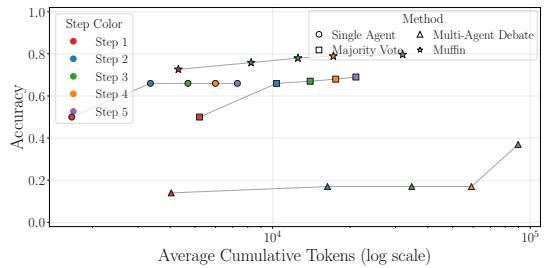  
Figure 9: Step-wise accuracy and token usage on Chess with gemma-4-31B-it.  
Figure 10: Step-wise accuracy and token usage on GPQA with gemma-4-31B-it.

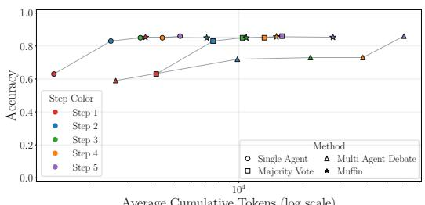  
Average Cumulative Tokens (log scale)

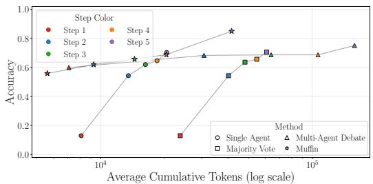  
Figure 11: Step-wise accuracy and token usage on MMLU-Pro with gemma-4-31B-it.  
Figure 12: Step-wise accuracy and token usage on OlymMATH-Easy with gemma-4-31B-it.

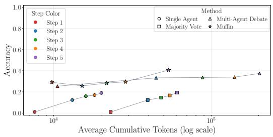

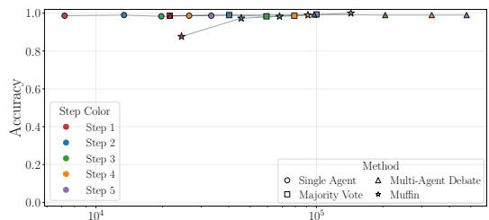  
Average Cumulative Tokens (log scale)  
Figure 13: Step-wise accuracy and token usage Figure 14: Step-wise accuracy and token usage on OlymMATH-Hard with gemma-4-31B-it. on Chess with Qwen3.8-27B.

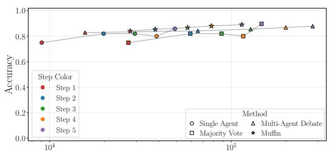  
Average Cumulative Tokens (log scale)

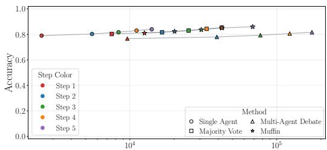  
Average Cumulative Tokens (log scale)  
Figure 15: Step-wise accuracy and token usage on GPQA with Qwen3.8-27B.  
Figure 16: Step-wise accuracy and token usage on MMLU-Pro with Qwen3.8-27B.

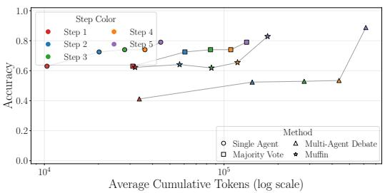  
Figure 17: Step-wise accuracy and token usage on OlymMATH-Easy with Qwen3.8-27B.

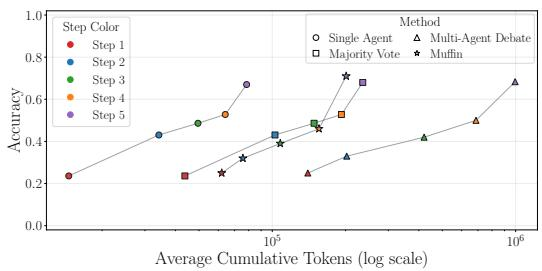  
Figure 18: Step-wise accuracy and token usage on OlymMATH-Hard with Qwen3.8-27B.

## B.2 SHARED FINDINGS INSIGHTS

Figures 19–26 show the shared-finding answer-change analysis for the remaining benchmarks with gemma-4-31B-it, while Figures 27–36 provide the corresponding results for Qwen3.8-27B.

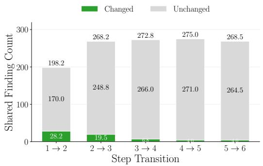  
Figure 19: Mean number of shared findings that change or do not change an agent’s answer on GPQA with gemma-4-31B-it.

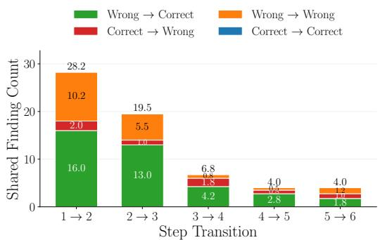  
Figure 20: Outcome breakdown for shared findings that change an agent’s answer on GPQA with gemma-4-31B-it.

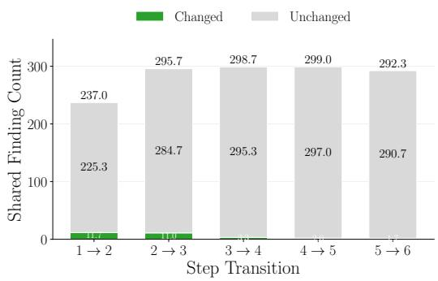  
Figure 21: Mean number of shared findings that change or do not change an agent’s answer on MMLU-Pro with gemma-4-31B-it.

Figure 22: Outcome breakdown for shared findings that change an agent’s answer on MMLU-Pro with gemma-4-31B-it.  
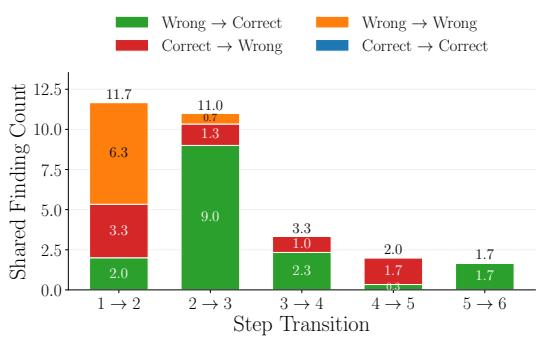

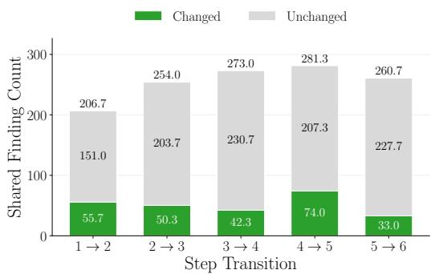  
Figure 23: Mean number of shared findings that change or do not change an agent’s answer on OlymMATH-Easy with gemma-4-31B-it.

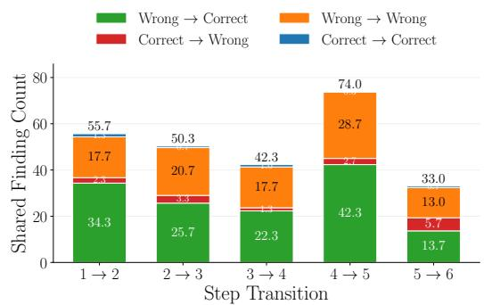  
Figure 24: Outcome breakdown for shared findings that change an agent’s answer on OlymMATH-Easy with gemma-4-31B-it.

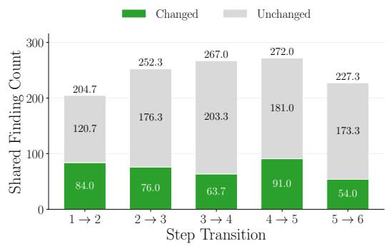  
Figure 25: Mean number of shared findings that change or do not change an agent’s answer on OlymMATH-Hard with gemma-4-31B-it.

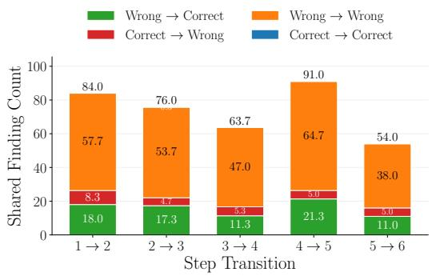  
Figure 26: Outcome breakdown for shared findings that change an agent’s answer on OlymMATH-Hard with gemma-4-31B-it.

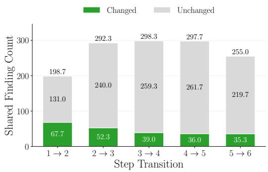  
Figure 27: Mean number of shared findings that change or do not change an agent’s answer on Chess with Qwen3.8-27B.

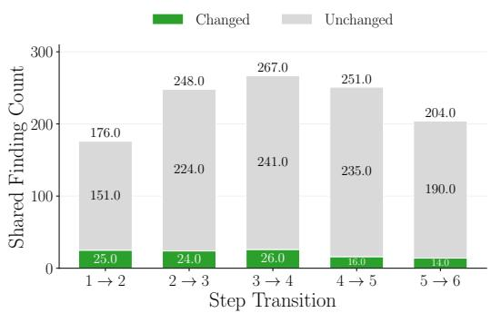  
Figure 29: Mean number of shared findings that change or do not change an agent’s answer on GPQA with Qwen3.8-27B.  
Figure 31: Mean number of shared findings that change or do not change an agent’s answer on MMLU-Pro with Qwen3.8-27B.

Figure 28: Outcome breakdown for shared findings that change an agent’s answer on Chess with Qwen3.8-27B.  
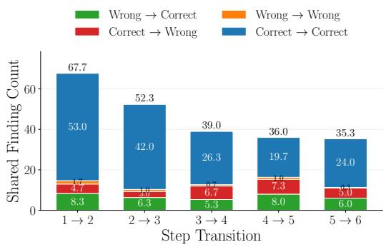

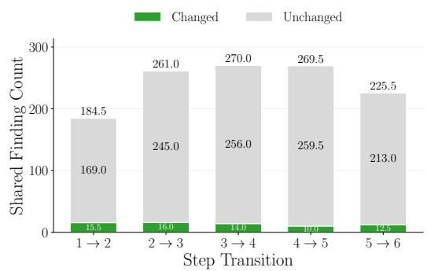

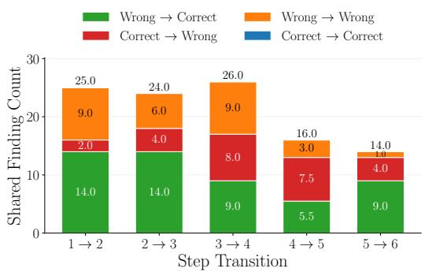  
Figure 30: Outcome breakdown for shared findings that change an agent’s answer on GPQA with Qwen3.8-27B.

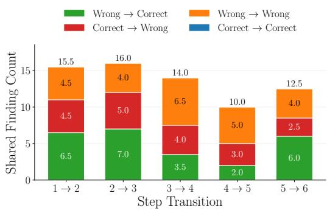  
Figure 32: Outcome breakdown for shared findings that change an agent’s answer on MMLU-Pro with Qwen3.8-27B.

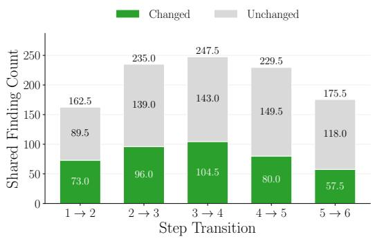  
Figure 33: Mean number of shared findings that change or do not change an agent’s answer on OlymMATH-Easy with Qwen3.8-27B.

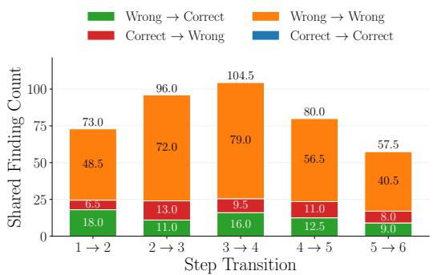  
Figure 34: Outcome breakdown for shared findings that change an agent’s answer on OlymMATH-Easy with Qwen3.8-27B.

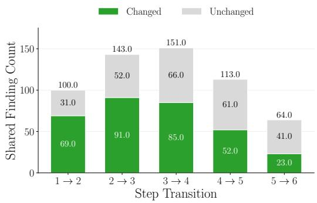  
Figure 35: Mean number of shared findings that change or do not change an agent’s answer on OlymMATH-Hard with Qwen3.8-27B.

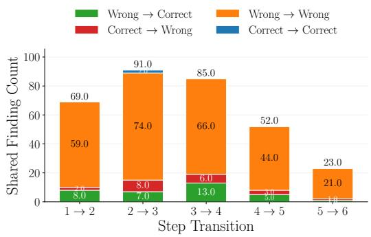  
Figure 36: Outcome breakdown for shared findings that change an agent’s answer on OlymMATH-Hard with Qwen3.8-27B.