# Metacognitive Scafolds Create Productive Friction for AI-Assisted Knowledge Work

VIKTOR KEWENIG∗, Microsoft Research, United Kingdom

LEV TANKELEVITCH∗, Microsoft Research, United Kingdom

SEAN RINTEL, Microsoft Research, United Kingdom

ADVAIT SARKAR, Microsoft Research, United Kingdom

ABIGAIL SELLEN, Microsoft Research, United Kingdom

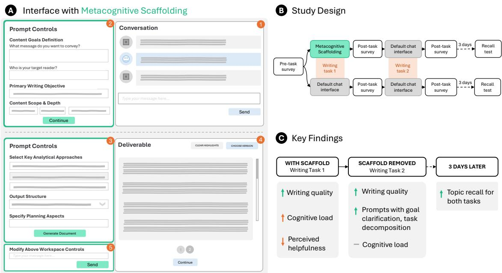

Fig. 1. A, The AI-assisted writing interface with the metacognitive scafold: after an initial request (1), dynamically generated controls prompt goal specification (2) and task decomposition (3) before a draft is generated (4); controls could be revised in natural language (5).B, Randomized experimental design: 297 knowledge workers wrote two briefs, with the scafold available only for one group in Task 1, followed by a recall test three days later. C, Key findings: beter briefs with the scafold, at the cost of higher load and lower perceived helpfulness; the quality advantage and more deliberate prompting persisted after removal; evidence of beter topic recall three days later.

Generative AI imposes new metacognitive demands on knowledge workers as their work shifts from production to planning, evaluation, and orchestration. In a randomized, between-subjects experiment on AI-assisted writing (297 workers, 594 essays), we test dynamicallygenerated metacognitive scafolds supporting goal specification and task decomposition. We find that scafolds improve writing quality,

with this boost persisting in short-lag transfer when scafolds are removed. We also find evidence of improved topic recall three days later. These efects are consistent with observed changes in how people learn to prompt AI systems after exposure to scafolding However, scafolded participants rate the AI as less helpful and more cognitively demanding even as they perform better, suggesting that subjective ease can understate the value of support. Our findings make the case for metacognitive scafolds in AI-assisted knowledge work, revealing a productive friction worth designing for as workers increasingly delegate work to agentic AI.

CCS Concepts: • Human-centered computing → Empirical studies in HCI; User studies.

Additional Key Words and Phrases: metacognition, generative AI, human–AI interaction, knowledge work, prompting, productive friction

## 1 Introduction

Generative AI (hereafter, AI) is rapidly reshaping knowledge workflows across professional, educational, and creative settings. Increasing experimental evidence demonstrates that access to large language models (LLMs) can raise both productivity and output quality for tasks such as writing, analysis, and problem-solving [11, 28, 32, 33, 84]. Yet these gains come with a fundamental shift in the nature of human contribution: rather than executing work directly, the human role increasingly centers on steering and orchestrating model behavior, including specifying goals, decomposing tasks, and evaluating generated output [52, 59, 71, 75, 83, 85, 93, 115]. This redistribution of efort imposes metacognitive demands on people that are poorly supported by current AI interfaces [112, 115]. Accordingly, many workers struggle with adopting AI tools or use them inefectively, slowing their workflows or hampering output quality [28, 69]. Metacognitive demands intensify further as AI systems become more agentic, with autonomous systems executing multi-step plans, invoking tools, and iterating towards goals on workers’ behalf [30, 87, 95].

Alongside these challenges of steering and orchestration, using AI increasingly entails ofloading material production to the model itself. Workers may no longer write sentences, generate code, or produce other artifacts directly, a shift demonstrated in both experimental and observational studies [63, 69, 102]. If workers are increasingly specifying goals or task breakdowns for AI, then these metacognitive processes by definition become a key part of how workers engage with and understand their own work. Consequently, insuficient support for these processes risks not only poorer steering of AI systems, but also reduced cognitive engagement with the work itself.

Recent research has begun to address this by exploring AI interfaces that scafold the articulation of evolving goals [37, 46, 65], tracking goals across conversations [21], decomposing tasks into sub-tasks [37, 41, 61, 125], and other metacognitive processes important for human-AI interaction. Yet despite this progress, prior work has primarily examined proximal interaction outcomes, such as usability and model steerability. Value in knowledge work depends on more distal outcomes, including output quality, whether benefits persist in the short or long term once support is removed, and cognitive engagement with the work itself. We make progress on all three.

We present a randomized between-subjects experiment in AI-assisted writing (297 participants, 594 essays), evaluating the impact of metacognitive scafolding on multiple outcomes key to AI-assisted knowledge work: output quality, prompting ability, cognitive load, and topic recall of work material, as one key aspect of cognitive engagement. We focus on goal specification and task decomposition as the primary targets for metacognitive scafolding. These processes sit at the beginning of AI-assisted workflows and are therefore key for human-GenAI interaction, as the quality of goa specification and task structure determines how efectively all downstream activities can proceed [115, 116]. As such, we implemented metacognitive scafolds as AI-generated, context-specific interface controls for goal specification and task decomposition (the interface and interaction sequence are described in Section 3.2).

We first compare the scafolds’ impact on written output quality, cognitive load, and other aspects of user experience to a baseline interface without scafolds. Unlike prior work, we then test whether the scafolds’ impact on human-AI interaction persists into short-lag transfer when support is removed. That is, in a subsequent writing task in the same session where we remove the scafolds, we evaluate how scafold exposure afects written output quality and prompting behavior. Finally, to test one aspect of how scafolds afect cognitive engagement with task material, we follow up with participants three days later to assess their topic recall for both writing tasks.

We find that metacognitive scafolding improves AI-assisted output quality, helping participants produce written outputs that are more actionable, better organized, and more clearly framed for the task. This efect persists after removal of support. We also find that participants learn to prompt the AI toward clearer goals and stronger task decomposition, ofering a potential explanation for this carryover efect. Finally, we find evidence for improved topic recall. However, all of these gains carry a subjective cost: despite better performance, scafolded participants rate the AI as less helpful and report an increase in immediate post-task cognitive load. We argue that this productive friction—support that increases felt efort and dampens perceived helpfulness while improving outcomes—is a crucial challenge in designing AI systems for knowledge work.

In sum, we make the following contributions with respect to dynamic metacognitive scafolding for goal specification and task decomposition in AI-assisted writing:

(1) We show that dynamic metacognitive scafolding improves writing quality and prompt quality, and is associated with improved topic recall, and that these improvements survive short-lag transfer when scafolds are removed.

(2) We find that the benefits of dynamic metacognitive scafolding come with key trade-ofs against perceived cognitive load and helpfulness.

(3) We ofer research and design implications for advancing the development of metacognitive support for AIassisted knowledge work.

## 2 Related Work

## 2.1 Generative AI’s Reshaping of Knowledge Workflows

Generative AI has rapidly difused through knowledge work [8]. Across a representative sample of ChatGPT conversations, practical guidance, information seeking and writing account for nearly 80% of use, and writing dominates work-related messages [15]; similar patterns occur across millions of enterprise Microsoft Copilot Chat [22] and Claude conversations [50]. This applicability is broad but shallow, concentrated in creating, processing and communicating information rather than end-to-end automation [117].

Controlled experiments across various professions find that LLM access cut writing time and raised quality among professionals [84], accelerated customer support resolutions [11], and increased completed programming tasks [25]. The gains are uneven, falling away beyond a “jagged frontier” of suitable tasks [28], and their distribution across expertise depends on the tool, with diferent studies finding largest gains among less experienced workers [11, 24, 25], more experienced workers [27], and contradictory efects between perception and reality [7].

In some cases the composition of work changes, and in others simply the volume of work, depending on what the tool does. A two-year study of inline code completion found developers shifting activity toward core coding and away from non-core project management, interpreted as a move from collaborative toward independent work [55]. That reallocation runs between joint and solo work rather than between producing and directing. Nor does reallocation follow automatically from access: a large-scale field experiment among knowledge workers found time savings without detectable task recomposition [32].

Where the model produces the entire artifact rather than completing small portions, however, the axis itself changes Conceptually, the shift has been described as one from material production to critical integration [93]. Where automation can be applied within a workflow influences which forms of human contribution are considered most valuable. In this framing, people contribute primarily by specifying objectives, planning work, selecting and combining outputs, and critically evaluating what the model provides. This shift raises obvious questions about people’s cognitive engagement with their work: what is ofloaded and what cognitive tasks remain essential, or become more important, for AI-assisted work? We discuss each in turn.

## 2.2 Cognitive Ofloading and Engagement

Delegating production to AI can entail cognitive ofloading: recruiting external resources to reduce a task’s cognitive demands [91]. Prior research has found that among knowledge workers, greater confidence in AI was associated with less perceived efort for critical thinking, and the remaining efort shifted from producing information toward verifying and integrating it [69]. Workers may not notice that such ofloading is happening. They may misjudge the division of labour: in real world task-focused conversation logs, the model is credited with 11-26% of ‘goal-shaping’ contributions, revealing an over-estimation in users of their own contributions [63]. They may also misjudge the result’s quality: across studies, participants tend to over-rely on AI assistance, inappropriately adopting its output with little scrutiny, while gaining self-confidence [19, 42, 102].

Recent work has begun to measure the efects of ofloading. Across recent large field studies of students, AI assistance tended to improve performance when available, e.g., during homework or non-proctored tests, but impaired performance when withdrawn, such as in closed-book exams [6, 92, 111]. Similar efects appear for memory of authorship [130], for metacognitive accuracy [42, 76], and for professional skill such as clinical diagnostic detection [13]. Such erosion can be asymptomatic: in one high-stakes workplace, early operational gains masked a dulling of expert judgment that only later surfaced as skill atrophy [40]. On the other hand, using records from a large U.S. university, a study comparing AI-exposed to non-exposed courses found no significant efect of ChatGPT’s arrival on grades, and no diference in self-reported understanding [38]. Caution in interpreting these prior results is warranted, as publication bias and methodological heterogeneity across studies makes any overarching verdict on AI and learning premature [5]. The evidence also comes chiefly from learning settings rather than knowledge work, and seldom measures cognitive engagement and output quality within a single design, a gap we address

In knowledge work, cognitive engagement is a complex constellation of elements at both the individual level (e.g. critical thinking [69, 127]) and collaborative level (e.g. articulation work [90, 96, 110]). At the individual level, memory (often measured as topic recall or source attribution) is a key aspect, and also a key fragility. Prior research has found that AI assistance may be detrimental to memory [6, 16, 67, 127, 130]. For example, Zindulka et al. [130]’s participants generated and elaborated ideas with and without AI. One week later, correct source attribution had fallen significantly, with the largest decline in mixed human-AI workflows. Other work has found negative impacts of AI assistance on content recall and comprehension [67, 127]. Topic recall can function as a simple indicative measure of individual cognitive engagement.

However, cognitive ofloading is not monolithic, and nor are its efects on memory and other aspects of cognition. The type of cognitive tasks that people ofload and how they direct their efort matters for downstream impact. For example, when given an AI writing tool that provided exposure to high-quality AI-generated examples, participants exerted less efort while practicing, but then wrote better cover letters in later unaided tests, outperforming both web search and personalized feedback from human editors [73]. In studies of programmers [104] and students [20], those who delegated wholesale lost conceptual understanding, yet certain ‘augmentation’ interaction patterns actually preserved learning. Guardrails or engagement techniques that structure learning interactions reversed the harm of unguarded AI assistance [6] and improved learning without withdrawing assistance altogether [60].

The timing of cognitive engagement also matters. Requiring students to generate ideas before consulting an LLM conferred no immediate advantage but the largest gains on a later unassisted task [120]. In knowledge work tasks with suficient time available, avoiding unfettered LLM access specifically when initiating work preserved critical thinking and memory retention of materials, while improving overall quality [127]. Overall, scafolding early-stage thinking during AI-assisted work may be efective in driving cognitive engagement with work material. This early stage entails specifying goals and decomposing tasks for AI, key metacognitive demands that are the counterpart of ofloading, and the focus of our study.

## 2.3 Metacognitive Demands of Generative AI

The efort AI displaces from producing information reappears as activities necessary for efective delegation. For example, workers experienced in AI are distinguished chiefly by planning in their opening messages [95] and more robust verification processes [26]. These activities recruit metacognitive processes, including self-monitoring, confidence calibration, and cognitive flexibility [43, 115]. The shift from material production to critical integration therefore imposes metacognitive demands on users as they decide what to delegate to AI [43, 58, 93, 115], and then grapple with the open-ended loop of prompting–evaluating–interaction, i.e., how to delegate to AI [74, 94, 112]. Recent work has further demonstrated the role of these metacognitive processes in human–AI interaction [69, 108, 114], including in reasoning [10, 42], planning [19], information seeking [77, 89], software engineering [95], and data science [35]. These demands may intensify as AI systems take on longer, multi-step workflows. Longer autonomous task horizons leave users with fewer opportunities to intervene, while increasing the consequences of their initial specifications and later verification decisions [30, 68, 87]. Addressing the metacognitive demands of AI through interface support therefore remains a priority [115].

## 2.4 Metacognitive Scafolds for Goal and Task Specification in AI-Assisted Workflows

Research on metacognitive scafolds has begun to explore the range of activities and associated metacognitive processes that span AI-assisted workflows, from goal/intent specification [21, 37, 47, 65, 113] and task decomposition [41, 62, 121, 122, 125], to verification and appropriate reliance [2, 3, 10, 18, 44, 62–64, 125]. Our study focuses on goal specification and task decomposition as two key interrelated activities that most commonly initiate and structure AI-assisted workflows [115, 116].

2.4.1 Goal and Intent specification. Prior work has explored several ways of helping users articulate, explore, clarify, and manage their goals and intents across multi-turn LLM interactions [65]. In co-creation workflows, Luminate [113] surfaces a multi-dimensional design space from users’ prompts, helping them discover relevant combinations, while Intent Tagging [47] represents intentions as granular, reusable units that support flexible, non-linear expression and steering. OnGoal [21] surfaces goals throughout a conversation, using an LLM-assisted pipeline to infer, merge, and evaluate goals against model responses. Dynamic Prompt Middleware [37] augments users’ prompts through dynamically generated interface controls, and IntentFlow [65] similarly extracts goals and intents into editable components that let users iteratively articulate, verify, and curate their intents. In line with metacognition research, [79, 80], a key design pattern across this work is dynamic, activity-contingent support that can be tied to the user’s current problem state and that can therefore be more efective than generic static scafolds [36, 65].

2.4.2 Task Decomposition. A complementary line of work externalizes task structure to help users decompose complex goals, clarify their intentions, and remain aware and in control of their intent at each step. AI Chains [121, 122] introduced editable multi-step LLM workflows, an approach echoed in Cocoa’s agentic workflows [41] and CoLadder’s links between hierarchical intentions and corresponding code [125]. Kazemitabaar et al. [62] compared phasewise decomposition (separating assumptions, planning, and code into larger phases) with stepwise decomposition into smaller subgoals, finding that both facilitated steering and verification. Brickify similarly externalizes design intent as manipulable visual tokens, allowing users to specify both the desired elements and how they should be composed; our scafold applies a related principle to goals and task structure in writing [106].

## 2.5 Synthesis and Current Study

Prior work demonstrates how scafolds can improve users’ goal and intent discovery, clarification, task decomposition planning, and steering of model behavior. Beyond these UX and interaction outcomes, a few studies suggest that scafolds can increase output quality in coding [125] and other tasks [122], and even improve code comprehension [125]. They also reveal a tension around cognitive load, with mixed findings about whether scafolds’ added options and interaction complexity increase or decrease load compared to common chat interfaces. Together, this work establishes both the promise of metacognitive support for human-AI interaction and its central design challenges.

Our work builds on these design approaches and their formative insights, drawing on the positive results of dynamically-generated interface controls [37] to support goal specification and task decomposition. We ask how such scafolds impact the value of outcomes in knowledge work. As noted above, prior evaluations have largely measured proximal interaction outcomes. Value, however, depends on more distal work outcomes that remain largely untested: objective output quality, whether scafolds shape users’ interaction patterns in subsequent tasks, and, as one key aspect of cognitive engagement, users’ topic recall of work material. We take a step toward these outcomes, while acknowledging that durable skill change and in-depth cognitive engagement entail complexities well beyond what can be accomplished by an individual worker in a single session. Methodologically, we complement the largely small-scale, within-subjects prior work with a large-scale, between-subjects evaluation designed to isolate scafolds’ causal efects with greater generalizability.

We examine the impact of metacognitive scafolding for goal specification and task decomposition through the following research questions. Compared to a standard chat-and-canvas interface:

• RQ1: Do scafolds improve AI-assisted writing quality, and do efects carry over when working with AI in the absence of scafolds?

• RQ2: As a mechanism for potential carry-over efects, do scafolds change how people prompt AI systems in the absence of scafolds?

• RQ3: Do scafolds improve people’s topic recall of work materials, as a component of cognitive engagement?

• RQ4: How do scafolds impact perceived helpfulness, sense of control, and cognitive load?

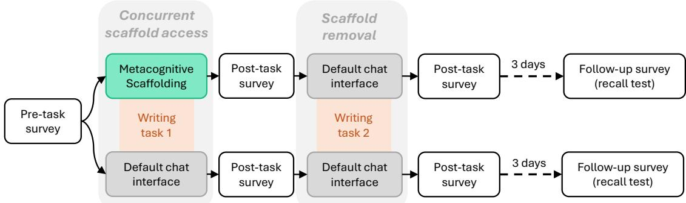  
Fig. 2. Participant flow in the study.

## 3 Methods

We conducted a randomized between-subjects experiment focusing on AI-assisted writing (Figure 2). In a main study session, participants completed two comparable professional-writing tasks in counterbalanced order. In Task 1, participants assigned to the metacognitive scafold condition used an interface with dynamically generated controls to support goal specification and task decomposition, whereas control group participants used the otherwise identical chat-and-canvas interface without these panels. This contrast therefore evaluates the efect of concurrent scafold access. In Task 2, participants in both conditions used the unscafolded interface. This contrast tests short-lag transfer after scafold removal.

Participants completed a baseline pre-task survey measuring AI usage, metacognition and writing skills, and a post-task survey after each task: after Task 1, metacognitive self-report, perceived helpfulness, control and cognitive load; after Task 2, cognitive load only. Approximately three days later, they completed a follow-up survey assessing topic recall for both writing tasks. We also collected and analyzed their written outputs and prompts. The study was not preregistered.

## 3.1 Participants and Recruitment

Following ethics authorization1, we recruited participants from Prolific. Participants provided informed consent electronically before taking part. A total of 342 participants entered the study and were compensated £20/hour. Of these, 44 participants did not submit a final essay or their essay could not be recovered; one participant’s baseline questionnaire was not saved due to technical dificulties. The final analytic sample for the primary analyses of writing quality and prompting therefore comprised 297 participants who completed both writing tasks (control = 144; treatment = 153) and 594 essays. Survey analyses used all participants with complete data on the relevant baseline and post-task items (279–295 per item; Table A12). Cognitive-load analyses used 277 participants with measurements at both analyzed timepoints. Despite a reward being announced at the end of the session (a chance to win one of 20 extra Prolific rewards of over £30 for completing the follow-up), attrition for the follow-up survey was high: 159 participants returned (we address this in Section 3.5.3). All participants were based in the United States and reported English as their first language (Table 1 summarizes participant characteristics).

Table 1. Participant characteristics of final analytic sample. Values are � (%) unless otherwise indicated. IQR, interquartile range; SD, standard deviation.
<table><tr><td colspan="2"></td><td>Control (n = 144)</td><td>Treatment (n = 153)</td></tr><tr><td>Age</td><td>Mean (SD)</td><td>34.2 (12.0)</td><td>33.6 (11.9)</td></tr><tr><td></td><td>Median [IQR]</td><td>31 [26, 41]</td><td>31 [24, 42]</td></tr><tr><td>Gender</td><td>Male</td><td>71 (49.3%)</td><td>78 (51.0%)</td></tr><tr><td></td><td>Female</td><td>71 (49.3%)</td><td>69 (45.1%)</td></tr><tr><td></td><td>Non-binary or other</td><td>2 (1.4%)</td><td>6 (3.9%)</td></tr><tr><td>Country</td><td>USA</td><td>144 (100%)</td><td>153 (100%)</td></tr><tr><td>First language</td><td>English</td><td>144 (100%)</td><td>153 (100%)</td></tr><tr><td>Highest educational qualification</td><td>High school</td><td>18 (12.5%)</td><td>30 (19.6%)</td></tr><tr><td></td><td>Bachelor&#x27;s degree</td><td>74 (51.4%)</td><td>88 (57.5%)</td></tr><tr><td></td><td>Master&#x27;s degree</td><td>29 (20.1%)</td><td>17 (11.1%)</td></tr><tr><td></td><td>Doctoral or professional degree</td><td>23 (16.0%)</td><td>18 (11.8%)</td></tr><tr><td>AI usage frequency</td><td>Monthly</td><td>10 (6.9%)</td><td>9 (5.9%)</td></tr><tr><td></td><td>Weekly</td><td>58 (40.3%)</td><td>85 (55.6%)</td></tr><tr><td></td><td>Daily</td><td>76 (52.8%)</td><td>59 (38.6%)</td></tr><tr><td></td><td>Missing</td><td>0 (0.0%)</td><td>0 (0.0%)</td></tr></table>

## 3.2 Research Probe and Interface Design

In both conditions, participants completed each task in a browser-based writing environment consisting of a chat pane connected to GPT-5.3 with medium reasoning efort and an editable canvas panel. Participants could prompt the AI freely, insert generated text into the document, and edit manually at any point; there was no minimum and no limit on the number of turns. AI-generated changes were indicated via text highlighting, and participants could toggle between diferent version histories of their document. After completing the main AI-assisted writing phase, participants were able to do a final manual review of the document before submitting.

3.2.1 Dynamic Metacognitive Scafold. The scafold was motivated by work on dynamic prompt middleware, showing that context-sensitive interface controls can increase steering precision, perceived control and task reflection when interacting with AI [37]. Broadly, its metacognitive support focused on intent articulation and exploration as defined by Kim et al. [65]. Concretely, it was implemented as a two-phase dynamic interface (Section A.1).

After the participant entered a high-level request, the system rendered a goal specification panel that externalized the rhetorical problem through editable fields for the message to convey, target reader, desired reader outcome, primary writing objective and desired scope/depth (see figure 1, panels A.1 and A.2). This phase targeted explicit problem representation, reducing ambiguity about what would count as a good response. Once those inputs were specified, the interface rendered a task decomposition panel that generated task-specific controls for analytical approaches, writing structure and critical considerations to address in the brief. This phase targeted actionability and verification (see figure 1, panels A.3 and A.4). Participants could also request modifications to these controls in natural language through a dedicated workspace control panel (see figure 1, panel A.5). This mapping from clarified goals to decomposed sub-goals follows classic theories of hierarchical problem solving [82, 105] and recent human–AI interface work on decomposable steering [62, 65, 122]. Importantly, the scafold was not a fixed prompt template: the options shown were generated and updated from the participant’s current request, prior selections and current phase of work. The selected controls then informed the writing interaction for Task 1 only.

3.2.2 Baseline Interface. The control condition presented the same conversational AI and editable canvas without the goal specification and task decomposition panels. We selected this naturalistic control because our primary interest was the total efect of adding the complete dynamic scafold to a familiar AI-assisted writing workflow: a standard chat-and-canvas interface is the workflow into which such a scafold would ordinarily be introduced and therefore a pragmatically meaningful baseline. It also preserves user agency: control participants could clarify goals, plan and decompose the task through ordinary prompting if they chose to, but the interface did not require or prime those activities.

3.2.3 Technical implementation. Both prototypes were browser-based web applications (React and Node.js). In the scafold condition, an interface-generation service returned a structured specification of the controls to render from the participant’s initial request, which the browser client rendered as interactive components while maintaining the participant’s selections across the two phases; a separate service handled chat responses and document drafting using the task brief, conversation history and current control state. The application logged participant messages, scafold phase, control changes, document generations, canvas interactions and timing.

## 3.3 Tasks

We defined open-ended but bounded knowledge-work tasks that required persuasion, synthesis, audience sensitivity, and explicit coordination with AI. Each task consisted of producing a realistic knowledge-work brief: (1) a city-planning proposal on whether to adopt a 4-day work week for municipal employees; and (2) a consulting brief on how to launch a hybrid-work model for a major client (see Appendix A.2). Participants saw the full scenario description at the start of each task and could open a brief task reminder while working. Sessions were self-paced with a maximum completion time of 80 minutes and time on task was recorded for each writing task. To increase motivation and efort, all participants were ofered a £20 bonus (or equivalent) for each brief ranked in the top five.

## 3.4 Measures

3.4.1 Essay quality. The primary outcome was essay quality, scored using GPT-5.4 with high reasoning efort against a seven-item analytic rubric, each item rated 1–4: context and purpose, recommendation clarity, argument quality, evidence credibility, feasibility, impact and organization (items A–G; Appendix B), and averaged across the seven items. The judge was calibrated against a human rating benchmark as described below [49, 70, 72, 86, 100, 123, 126].

An initial scoring pass on formatted essay text showed sensitivity to layout cues: scafold-condition essays contained more visible headings and denser section marking, and these features explained additional variance in judge scores beyond the human benchmark. Scoring was therefore conducted on de-formatted essays, stripped of all markup and visual formatting (headings, emphasis, list markers, indentation, rules and repeated whitespace); heading text was retained as ordinary lines, paragraph breaks were normalized, and all lexical content and sentence order were preserved.

Human ratings for calibration and comparison. A separate sample of Prolific raters (£25 per hour) rated 117 essays (20% of the 594-essay corpus; selected at random, stratified by task and condition), two raters per essay, as participants had formatted them, on the seven rubric dimensions shared with the LLM judge (items A–G) in a custom interface (Section B.2); the two ratings were averaged within essay to form the human benchmark.

Judge calibration. Each de-formatted essay was scored in five consecutive runs, averaged into the final judge score. The scoring prompt contained the full rubric and 10 human-rated calibration essays (capped at 1,800 characters) carrying their averaged human ratings on A–G; these were excluded from agreement statistics.

Judge comparison. Because the primary outcome depended on an LLM judge, we compared its scores with the human benchmark on the remaining 107 essays, using the essay-level composites averaged across the seven shared dimensions The primary agreement statistic was the absolute-agreement intraclass correlation, ICC(A,1), supplemented by the metrics in Table A8. Its 95% confidence interval was obtained from 2,000 author-cluster bootstrap resamples.

3.4.2 Prompt Behavior. To characterize participants’ process after scafold removal, we analyzed the participantauthored prompt sequences from the participant–AI chat logs in Task 2. Each sequence was coded on two dimensions using the codebook in Appendix C: goal clarity (GC), which captures how explicitly participants stated the intended outcome, audience, constraints and success criteria (seven indicators), and task decomposition (TD), which captures whether they divided the work into concrete steps or components (six indicators). Because goal specification and task decomposition can unfold over several conversational turns, the unit of analysis was the entire participant-authored prompt sequence rather than any single message. All sequences were supplied to coders in a standardized plain-text form with condition labels and assignment metadata removed.

Codebook reliability. To establish that the codebook could be applied consistently, three of the researchers independently coded 60 of the sequences (20%), blind to condition, assigning the codebook’s ordinal GC and TD ratings (0–3) and marking each of the 13 indicators as present or absent. An LLM coder (GPT-5.4, temperature 0, no extended reasoning) then applied the same codebook to the same 60 sequences, making one request per indicator and one per overall rating, without access to the human codes. Agreement among the human coders, and between the LLM coder and the human coders, is reported in Table A2.

Analysis scoring. For the transfer analysis itself, the LLM coder scored every Task 2 sequence with a graded version of the same 13 indicators: rather than marking each as present or absent, it rated each from 0 (absent) to 3 (well specified), quoting the passages of the participant’s text on which the rating rested, in five independent runs. The GC (0–21), TD (0–18) and Combined (0–39) scores are the sums of these indicator ratings, averaged across the five runs. The coder saw the task brief and reminder but no information about condition. Some participants pasted the task wording verbatim as their prompt, so their process could not be meaningfully coded: if any prompt reproduced at least half of the task reminder (13 consecutive words of its 26) or at least half of the scenario description, every indicator in that sequence was set to zero, and the sequence was retained in the analyses

3.4.3 Metacognitive Self-Report. Participants completed 13 pre- and post-task items concerning goal specification, planning, task decomposition, and writing metacognition. Eight items were adapted from the Metacognitive Awareness Inventory [97], and five drew on the Metacognitive Strategies in Writing questionnaire [88] (of which four were adapted from the Metacognitive Strategies of Writing Survey [1]). The wording and sources of all items are reported in Table A12.

3.4.4 Subjective Experience Outcomes. Participants rated perceived AI helpfulness and control on 1–5 scales. Cognitive load was measured after each task using five NASA-TLX dimensions: mental demand, temporal demand, perceived performance, efort and frustration [51]; physical demand was not administered. Items were rated from 1 to 10; the positively worded performance item was reverse-coded as 11 − � so that higher values indicated greater load, and the five items were averaged with equal weight when all five were observed into an unweighted raw NASA-TLX score. Nine additional study-specific questions about the demands of AI-assisted writing were analyzed at item level (Table 4) and not included in the overall score; their equal-weight mean, requiring all nine responses, was used as a recall auxiliary.

3.4.5 Topic Recall Outcomes. Three days after the writing session, participants were invited to complete a voluntary follow-up survey about the topics of both essays. Among the returners, 20 randomly picked participants received an extra £30 reward through Prolific as incentive. Despite the potential reward being announced at the end of task 2, attrition was high: 159 participants returned to complete the follow-up survey (we address this in Section 3.5.3). The analyzed topic-recall outcome was free recall of the writing topic for each of the tasks, in answer to: “What topic did you write about in your [first/second] essay? If you don’t remember, you can write “Don’t remember”.” (see Table A6 for full survey wording). The open-text responses for each task were coded manually into binary correct/incorrect, scored leniently: a response was credited for each task if it identified the assigned topic or the other task’s topic, allowing for confusion about task order

3.4.6 Covariates. Unless otherwise stated, analysis models were adjusted for six baseline indicators: whether participants reported using AI for writing, baseline AI-use frequency, self-rated essay-writing skill, task decomposition, AI prompting (preparing appropriate information for the AI), and AI evaluating (reviewing one’s judgment before accepting or rejecting an AI recommendation), the latter two taken from the AI metacognition scale of Sidra and Mason [107]. This subset covers writing-specific experience, perceived task competence and relevant metacognitive processes while limiting overlapping item content. Models also included outcome-specific design terms described below.

## 3.5 Statistical Analysis

3.5.1 Writing quality. Essay quality for the two tasks was analyzed with linear mixed-efects models including a participant random intercept (for the repeated measures across tasks), fixed efects for task order, treatment condition and their interaction, topic fixed efects for scenario diferences, and the common covariate set (Section 3.4.6). Because the scafold added an explicit planning stage, Task 1 time on task was partly a mechanism of the intervention, so the primary model omitted it; as a robustness check, we re-estimated the model with log-transformed time on task (seconds) as an additional covariate. The Task 1 and Task 2 contrasts were essentially unchanged.

Rubric item-level contrasts were estimated for each of the seven dimensions separately, in two samples. For the judge across the full 594-essay corpus, each dimension was analyzed with the same mixed-model specification as the composite. For the 107-essay human benchmark, analyzed for both the judge (de-formatted text) and the human raters (formatted text), the composite and dimension-level models used the same fixed efects without a random intercept, estimated by ordinary least squares with standard errors clustered by participant. The benchmark analyses estimate separate between-subjects condition contrasts within Task 1 and Task 2; we do not test their diference. The rubric-level analyses are exploratory and are reported with uncorrected � values; the composite contrasts are the primary tests. Standardized efect sizes for the essay-quality contrasts were computed at the participant level within each task as Hedges’ �, using the pooled raw standard deviation of the de-formatted essay score; we additionally report the covariate-adjusted between-condition diference divided by the same pooled raw standard deviation.

3.5.2 Survey Measures. For each of the 13 metacognitive self-report items, we fitted a separate linear regression with HC3 heteroskedasticity-robust standard errors, estimating the post-task condition contrast adjusted for the corresponding baseline response, first-task topic, baseline AI-use frequency and writing skill, with Benjamini–Hochberg correction across the 13 tests. AI helpfulness and perceived control were analyzed with analogous models. The unweighted five-dimension NASA-TLX score for both tasks was analyzed with a linear mixed model including condition, timepoint and their interaction, with a participant random intercept; simple condition contrasts were derived for Task 1 and Task 2. The supplementary demand items were analyzed separately and not included in the composite.

3.5.3 Topic Recall. A total of 159 participants provided recall outcomes for both tasks. Binary recall outcomes were analyzed using logistic mixed-efects models with a participant random intercept. Fixed efects included scafold condition, task position (first or second), their interaction, writing scenario, and the six common covariates (Section 3.4.6) Planned condition contrasts for each task were calculated from the fixed-efect coeficients and their covariance matrix and exponentiated to obtain conditional odds ratios (ORs) for the treatment efect (scafold versus control in Task 1; previously scafolded versus control in Task 2).

Accounting for attrition. Attrition in the follow-up survey was high, though follow-up rates were similar across conditions (49.1% of scafolded participants and 49.7% of controls). We therefore examined the nature of the missing data and assessed sensitivity via multiple imputation [118, 119].

Treatment assignment did not predict missingness (OR = 1.03, 95% CI [0.66, 1.59], � = .911; logistic regression on the recall cohort, with one indicator per participant, since both recall outcomes were always jointly observed or jointly missing). To test whether other observed characteristics predicted missingness, we fitted a Firth-penalized logistic regression [53] on 26 predictors, including treatment, baseline and outcome survey scores, essay quality scores and other predictors, using the 234 participants with complete predictor data; coeficients are reported uncorrected in Table A11. Jointly, observed characteristics did not predict missingness (penalized likelihood-ratio $\chi ^ { 2 } ( 2 6 ) = 2 6 . 4 0 \ :$ $P = . 4 4 1 )$ . Two of 26 coeficients had uncorrected $P < . 0 5$ , against 1.3 expected under a global null: higher Task 1 essay quality was associated with lower odds of missingness (OR per $\mathrm { S D } = 0 . 6 7 ,$ , 95% CI [0.47, 0.94], $P = . 0 2 1 )$ and higher combined Task 2 prompt quality with higher odds (OR per SD = 1.36, 95% CI [1.02, 1.80], $\textstyle P = . 0 3 3 )$ . The imputation model included essay quality as an auxiliary variable but excluded coded prompt quality.

To assess sensitivity to missing follow-up data, we additionally imputed the missing recall data using multiple imputation by chained equations (MICE) [118, 119]. The imputation model represented the two recall outcomes in separate columns and included condition, first-task scenario, their interaction and the six common baseline covariates. Auxiliaries comprised ten complete-item survey means covering general and writing metacognition, AI metacognition, prompting, workload and AI-writing demand at their administered timepoints; both essay-quality scores; log durations; log-transformed prompt and essay-word counts (log(1 + �)); helpfulness and perceived control; and submission, cohortmembership, repeated/missing-form, follow-up-intent and incentive-awareness indicators. Specifically, binary variables were imputed by logistic regression and other numeric variables by predictive mean matching with five donors, observed values were preserved, and 50 completed datasets were generated for the recall cohort (100 iterations per chain). The recall model was fitted in each dataset and task-specific log-odds contrasts were pooled with Rubin’s rules and � inference.

3.5.4 Prompt coding. Prompt-coding analyses were conducted at the prompt-sequence level. To measure Task 2 transfer behavior, we compared previously scafolded and previously unscafolded participants on the GC, TD and Combined scores using ordinal logistic regression with the six common covariates (Section 3.4.6). For the 60-sequence reliability subset, agreement between each pair of coders, human–human and LLM–human, was summarized with quadratic weighted Cohen’s �. Because the average of three human coders is a more dependable reference than any one of them, we also report agreement between the LLM coder and the mean of the three human ratings as an absolute-agreemen intraclass correlation, ICC(A,1), together with the reliability of that mean, ICC(A,3). Confidence intervals were obtained from 2,000 sequence-level bootstrap resamples. Validation of the essay judge is described under Measures.

## 4 Results

We report the results in the order in which they bear on the study’s main argument: essay quality, transfer and process, short-lag topic recall, and subjective experience. Task 1 contrasts compare concurrent scafold use with the control interface; Task 2 contrasts compare previously scafolded with previously unscafolded participants, when neither group had access to the scafold. Full model summaries are reported in the appendix.

## 4.1 The scafold improved essay quality

Our primary question was whether the scafold improved writing quality while it was available and whether any advantage carried into the subsequent unscafolded task. Essay quality was assessed along seven rubric dimensions (A–G), each on a 1–4 scale, using the de-formatted essay text and calibrated LLM judge described in Methods. We report the overall score before examining the dimensions separately.

4.1.1 Overall Essay Quality. For the primary measure, we computed an overall quality score averaged across the seven rubric dimensions (see Section 4.1.2 for per-rubric analyses). Scafolded writers scored higher than controls (mixed-model treatment coeficient $b = 0 . 0 8 9$ , 95% confidence interval (CI) [0.023, 0.155], $P = . 0 0 8 \mathrm { ; }$ composite row of Table $2 ;$ full model in Table A7). The treatment-by-order interaction was negative but not statistically reliable $( b = - 0 . 0 1 9 , 9 5 \% \mathrm { C I } [ - 0 . 1 0 2 , 0 . 0 6 5 ] , P = . 6 6 5 )$ , providing no clear evidence that the condition diference varied between tasks. The Task 2 contrast remained positive $( b = 0 . 0 7 0 , 9 5 \% \mathrm { C I } [ 0 . 0 0 4 , 0 . 1 3 6 ] , P = . 0 3 7 )$ , where both groups wrote without the scafold (Figure 3 shows the raw score distributions). The corresponding raw standardized diferences on the 1–4 essay scale were Hedges $g = 0 . 2 9$ in Task 1 and $g = 0 . 2 1$ in Task 2; covariate-adjusted diferences divided by the same pooled raw standard deviations were 0.28 and 0.23, respectively (Table A9).

Essay quality across the scaffolded and transfer tasks  
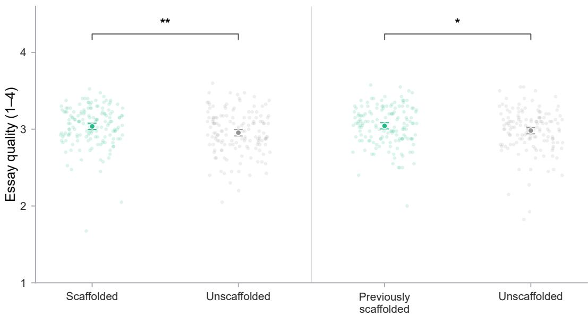  
Task 1 (scaffold task)  
Task 2 (transfer task)  
Fig. 3. Essay quality by condition and task. Scores are means across the seven 1–4 rubric ratings. Faint points show observed essay-level scores; larger markers show condition means with 95% confidence intervals. Neither group had the scafold in Task 2. Both planned adjusted contrasts were statistically reliable $^ { * * } P < . 0 1 ; ^ { * } P < . 0 5$

Because the scafold introduced an additional planning stage, we asked whether the quality advantage simply reflected time spent. Scafolded participants spent longer on Task 1 (27.84 versus 16.35 minutes; time ratio 1.56 from a log-duration mixed model with the same fixed efects and participant random intercept as the primary quality model, $P \ < \ . 0 0 1 )$ but not on Task 2 (10.78 versus 10.62 minutes). Adding log elapsed time left both contrasts unchanged (Table A7), and time on task was not independently associated with quality conditional on treatment $( b = - 0 . 0 0 1 3 ,$ � = .951); the advantage was therefore not accounted for by time on task.

Judge-validation check. Because the primary quality outcome was LLM-scored, we used the 107-essay human benchmark as a measurement check. Agreement between the essay-level human and judge composites was ICC(A,1) = 0.456, 95% CI [0.349, 0.547], with Pearson � = 0.662 (Table A8). More importantly for interpreting the treatment efect, the analysis on the human-rated essays supported the scafold advantage in both tasks, and in the same 107 essays the judge’s contrasts on the seven-dimension composite were smaller than the human raters’ (Table 2); the LLM-based estimate therefore does not appear inflated relative to human judgment of the essays as delivered

4.1.2 Individual Rubric Analysis. The overall score raises a further question: which aspects of writing benefited from the scafold? We therefore analyzed each of the seven dimensions separately (Table 2), first for the LLM judge across the full set of 594 essays, using the same mixed model as the composite, and then for both the judge and the human raters within the 107-essay benchmark. The full-corpus analysis provides the broadest picture of the scafold’s contribution, while the benchmark ofers a complementary comparison of the two rating approaches on the same essays. These rubric-level analyses are exploratory and use uncorrected � values to characterize the pattern across dimensions. With 52 Task 1 and 55 Task 2 essays, the benchmark yields less precise estimates, but helps assess whether the direction of the composite advantage is shared across rating approaches and which qualities each approach emphasizes. Its contrasts describe the advantage within each task; persistence within individuals is assessed using the full corpus.

Table 2. Rubric-level scafold contrasts, reported as � [95% CI], �. Full-set models include a participant random intercept, condition × task, topic and the common set of six baseline covariates (Section 3.4.6); models for the 107-essay benchmark include the same fixed efects without a random intercept, with participant-clustered standard errors. Task 1: scafold minus control; Task 2: previously scafolded minus previously unscafolded. Rubric-level analyses are exploratory; all � values are uncorrected.
<table><tr><td>Dimension</td><td>Task 1</td><td>Task 2</td></tr><tr><td colspan="3">LLM judge: full set of 594 essays 0.083</td></tr><tr><td>Context and purpose</td><td> $[ - 0 . 0 0 7 , 0 . 1 7 3 ] , P = . 0 7 1$ </td><td>0.144  $[ 0 . 0 5 4 , 0 . 2 3 4 ] , P = . 0 0 2$ </td></tr><tr><td>Recommendation clarity</td><td> $\bar { [ } - 0 . 0 3 3 , 0 . 1 4 7 \bar { ] } , P = . 2 1 6$ </td><td>0.030  $[ - 0 . 0 6 0 , 0 . 1 2 0 ] , P = . 5 1 4$ </td></tr><tr><td>Argument quality</td><td>0.122 [0.040, 0.204], P = .004</td><td> $0 . 0 7 8 [ - 0 . 0 0 4 , 0 . 1 6 0 ] , P = . 0 6 2$ </td></tr><tr><td>Evidence credibility</td><td> $0 . 1 1 5 \ : [ 0 . 0 2 6 , 0 . 2 0 4 ] , P = . 0 1 1$ </td><td> $0 . 0 3 9 \ [ - 0 . 0 5 0 , 0 . 1 2 8 ] , P = . 3 9 0$ </td></tr><tr><td>Feasibility</td><td> $0 . 0 8 5 \ : [ - 0 . 0 0 8 , 0 . 1 7 7 ] , P = . 0 7 4$ </td><td> $0 . 0 5 6 \ [ - 0 . 0 3 6 , 0 . 1 4 9 ] , P = . 2 3 4$ </td></tr><tr><td>Impact</td><td> $[ 0 . 0 1 8 , 0 . 1 9 7 ] , P = . 0 1 9$ </td><td>0.094  $\bar { [ } 0 . 0 0 5 , 0 . 1 8 4 ] , \bar { P } = . 0 3 9$ </td></tr><tr><td>Organization</td><td> $[ - 0 . 0 3 1 , 0 . 1 3 5 ] , P = . 2 1 7$ </td><td> $0 . 0 5 0 [ - 0 . 0 3 3 , 0 . 1 3 3 ] , P = . 2 3 9$ </td></tr><tr><td>Seven-dimension composite (A-G)</td><td> $[ 0 . 0 2 3 , 0 . 1 5 5 ] , P = . 0 0 8$ </td><td> $0 . 0 7 0 [ 0 . 0 0 4 , 0 . 1 3 6 ] , P = . 0 3 7$ </td></tr><tr><td colspan="3">LLM judge: 107-essay benchmark</td></tr><tr><td>Context and purpose</td><td>0.048 [−0.186, 0.282], P = .689</td><td>0.073  $[ - 0 . 1 7 1 , 0 . 3 1 8 ] , P = . 5 5 6$ </td></tr><tr><td>Recommendation clarity</td><td>0.075 [−0.135, 0.286], P = .485</td><td> $0 . 0 8 1 [ - 0 . 1 2 9 , 0 . 2 9 2 ] , P = . 4 4 9$ </td></tr><tr><td>Argument quality</td><td> $0 . 1 0 6 \ \bar { [ - 0 . 0 6 0 , 0 . 2 7 3 \bar { ] } } , P = . 2 1 1$ </td><td> $0 . 0 3 0 [ - 0 . 1 8 6 , 0 . 2 4 5 ] , P = . 7 8 6$ </td></tr><tr><td>Evidence credibility</td><td> $0 . 0 9 6 \ [ - 0 . 1 5 6 , 0 . 3 4 9 ] , P = . 4 5 4$ </td><td> $0 . 0 2 3 \ : [ - 0 . 1 6 2 , 0 . 2 0 8 ] , P = . 8 0 6$ </td></tr><tr><td>Feasibility</td><td>0.004 [−0.197, 0.205], P = .969</td><td> $0 . 0 5 7 \ : [ - 0 . 1 8 9 , 0 . 3 0 2 ] , P = . 6 5 1$ </td></tr><tr><td>Impact</td><td> $0 . 0 9 4 \ [ - 0 . 1 2 3 , 0 . 3 1 2 ] , P = . 3 9 6$ </td><td> $0 . 0 4 9 \ [ - 0 . 1 8 5 , 0 . 2 8 3 ] , P = . 6 8 3$ </td></tr><tr><td>Organization</td><td> $0 . 0 4 9 \ \hat { [ - 0 . 1 4 9 , 0 . 2 4 6 ] } , P = . 6 2 9$ </td><td> $0 . 1 5 1 \ \bar { [ - 0 . 0 5 9 , 0 . 3 6 1 ] } , P = . 1 6 0$ </td></tr><tr><td>Seven-dimension composite (A-G)</td><td> $0 . 0 6 8 [ - 0 . 0 7 6 , 0 . 2 1 1 ] , P = . 3 5 7$ </td><td> $0 . 0 6 6 [ - 0 . 1 0 1 , 0 . 2 3 3 ] , P = . 4 3 7$ </td></tr><tr><td colspan="3">Human ratings: 107-essay benchmark</td></tr><tr><td>Context and purpose</td><td> $0 . 4 8 6 \ : [ - 0 . 0 2 8 , 0 . 9 9 9 ] , P = . 0 6 4$ </td><td> $0 . 4 8 2 \ : [ 0 . 0 5 1 , 0 . 9 1 2 ] , P = . 0 2 8$ </td></tr><tr><td>Recommendation clarity</td><td> $0 . 4 9 7 \ [ 0 . 0 7 5 , 0 . 9 2 0 ] , P = . 0 2 1$ </td><td> $0 . 2 6 7 \ : [ - 0 . 0 9 7 , 0 . 6 3 2 ] , P = . 1 5 0$ </td></tr><tr><td>Argument quality</td><td> $0 . 0 3 2 [ - 0 . 4 3 1 , 0 . 4 9 4 ] , P = . 8 9 4$ </td><td> $0 . 3 8 1 [ 0 . 0 1 3 , 0 . 7 4 9 ] , P = . 0 4 3$ </td></tr><tr><td>Evidence credibility</td><td> $- 0 . 0 4 8 \ [ - 0 . 5 5 6 , 0 . 4 6 0 ] , P = . 8 5 3$ </td><td> $0 . 4 6 1 \ \bar { [ 0 . 0 3 1 , 0 . 8 9 0 ] } , P = . 0 3 6$ </td></tr><tr><td>Feasibility</td><td> $1 . 1 9 8 [ 0 . 7 5 2 , 1 . 6 4 4 ] , P < . 0 0 1$ </td><td>1.008  $[ 0 . 5 7 4 , 1 . 4 4 2 ] , P < . 0 0 1$ </td></tr><tr><td>Impact</td><td> $0 . 3 5 5 [ - 0 . 2 4 5 , 0 . 9 5 5 ] , P = . 2 4 7$ </td><td> $0 . 1 3 7 \ : [ - 0 . 4 1 2 , 0 . 6 8 5 ] , P = . 6 2 5$ </td></tr><tr><td>Organization</td><td>0.562  $[ 0 . 1 5 5 , 0 . 9 6 9 ] , P = . 0 0 7$ </td><td> $0 . 2 9 3 [ - 0 . 0 9 9 , 0 . 6 8 6 ] , P = . 1 4 3$ </td></tr><tr><td>Seven-dimension composite (A-G)</td><td> $0 . 4 4 0 \ [ 0 . 1 5 7 , 0 . 7 2 4 ] , P = . 0 0 2$ </td><td>0.433  $[ 0 . 1 2 0 , 0 . 7 4 6 ] , P = . 0 0 7$ </td></tr></table>

Rubric-level results across the full set. Across all 594 essays, the judge’s results suggest that the scafold supported several substantive aspects of writing. In Task 1, advantages were reliable for Argument quality $( P = . 0 0 4 )$ , Evidence credibility $( P = . 0 1 1 )$ and Impact $( P = . 0 1 9 )$ , suggesting stronger arguments, more credible supporting evidence and better consideration of consequences. Estimates for Context and purpose and Feasibility were also positive, although they did not reach statistical significance $( P = . 0 7 1$ and $P = . 0 7 4 )$ . In Task 2, after the scafold was removed, advantages remained evident in Context and purpose $( P = . 0 0 2 )$ and Impact $( P = . 0 3 9 )$ , alongside a positive estimate for Argument quality $( P = . 0 6 2 )$ . Recommendation clarity and Organization did not difer reliably between conditions in either task. Taken together, this exploratory pattern suggests that the scafold’s contribution extended across several substantive dimensions during use, with evidence of subsequent benefits in how writers framed their briefs and considered their consequences.

Robustness across raters. The 107-essay benchmark provides a complementary perspective on the scafold’s benefits. Human raters of the formatted essays identified the largest advantage in Feasibility, reliable in both tasks $( P < . 0 0 1 )$ together with Organization $( P = . 0 0 7 )$ and Recommendation clarity $\left( P = . 0 2 1 \right)$ in Task 1 and Context and purpose (� = .028), Evidence credibility (� = .036) and Argument quality (� = .043) in Task 2. All seven of their Task 2 estimates were positive, and removing any single dimension left their composite advantage reliable in both tasks, indicating that the human-rated result was not dependent on one dimension alone. The de-formatted judge’s benchmark composite estimates also pointed in a positive direction in both tasks (0.068 and 0.066), although they were smaller than the human-rated estimates (0.440 and 0.433). Its dimension-level contrasts were not individually significant in this smaller sample; nevertheless, its largest Task 1 estimates were for Argument quality, Evidence credibility and Impact, the same three dimensions that showed reliable advantages in the full corpus. The two rating approaches therefore agree in the direction of the composite estimates while highlighting diferent aspects of writing: human ratings particularly emphasize feasibility, and the full-corpus judge results emphasize argument quality, evidence credibility and impact. These exploratory findings suggest that the scafold’s contribution can be visible through complementary perspectives on writing quality.

The Organization results bear on concerns that LLM judges favor surface presentation or formatting cues [126]: the de-formatted judge showed no Organization advantage in either task, in the full set or the subset, whereas human raters of the formatted essays did in Task 1, so whatever structural cues survived de-formatting did not drive the judge-rated efect.

## 4.2 The scafold improved later prompting

The Task 2 quality advantage could reflect transfer of a more deliberate way of specifying work to the AI. To examine this, we compared the prompt sequences participants produced after the scafold had been removed, coded blind to condition for goal clarity (GC) and task decomposition (TD; Methods). Reliability estimates are reported in Table A2 and the codebook in Appendix C: the three human coders agreed with one another moderately to substantially, and the LLM coder agreed with their consensus about as well as they agreed with each other on GC and the combined score, and somewhat less closely on TD.

Sequences that reproduced the task wording verbatim were scored zero (see Methods): 56 of 153 previously scafolded participants (36.6%) and 63 of 144 previously unscafolded participants (43.8%), visible as the concentration at zero in Figure 4. By itself, this indicates that a substantial proportion of participants ofloaded the task to the AI despite being incentivized for high performance.

Nevertheless, previously scafolded participants scored reliably higher than previously unscafolded participants on the combined GC+TD score (14.43 versus 11.07 of a possible 39) and on GC and TD separately (ordinal logistic regressions; Table 3; score distributions in Figure 4).

Table 3. Task 2 prompt behavior by condition: descriptive statistics, standardized efect sizes and ordinal logistic regression estimates with the six common covariates (Section 3.4.6). OR is the treatment efect of prior scafolding versus control on the odds of a higher score; � = 297.
<table><tr><td>Measure</td><td>Prior-scaffold M (SD)</td><td>Control M (SD)</td><td>Mean difference</td><td>Cohen&#x27;s d</td><td>Rank-biserial r</td><td>Probability of superiority</td><td>OR [95% CI]</td><td></td><td>P</td></tr><tr><td>Goal clarity</td><td>8.49 (7.25)</td><td>6.43 (6.25)</td><td>2.067</td><td>0.30</td><td>0.19</td><td>0.60</td><td></td><td>1.862 [1.225, 2.828]</td><td>.0036</td></tr><tr><td>Task decomposition</td><td>5.94 (5.37)</td><td>4.65 (4.66)</td><td>1.291</td><td>0.26</td><td>0.14</td><td>0.57</td><td></td><td>1.537 [1.013, 2.332]</td><td>.0431</td></tr><tr><td>Combined GC+TD</td><td>14.43 (12.29)</td><td>11.07 (10.67)</td><td>3.358</td><td>0.29</td><td>0.18</td><td>0.59</td><td></td><td>1.779 [1.173, 2.698]</td><td>.0067</td></tr></table>

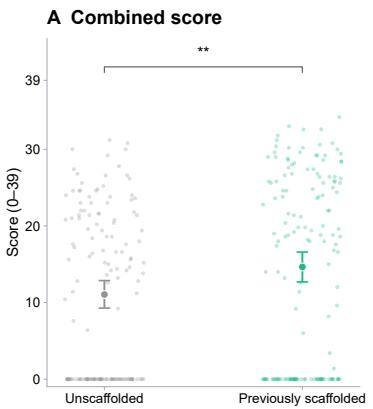

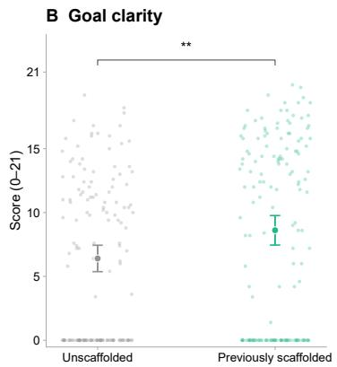

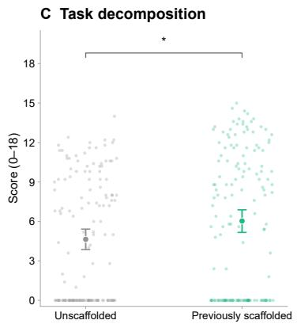  
Fig. 4. Blind coding of prompt behavior in the unscafolded Task 2. A, Combined goal-clarity and task-decomposition score (0–39); B, goal clarity (seven indicators; 0–21); C, task decomposition (six indicators; 0–18). Faint points: participants’ mean scores across five LLM coder runs $( N = 2 9 7 )$ ; circles: condition means with 95% participant-bootstrap CIs (10,000 resamples). Brackets: ordinal regressions with the six common covariates (Section 3.4.6); Combined $P = . 0 0 6 7 _ { \cdot }$ , GC $P = . 0 0 3 6 ,$ TD $P = . 0 4 3 1$

## 4.3 The scafold was associated with improved short-lag topic recall

Memory is a key requirement of cognitive engagement with work. We asked participants to complete a voluntary follow-up survey approximately three days after their session to test recall of their writing topics. Given this delay, attrition was high: 159 participants supplied scored follow-up responses for both tasks. As a robustness check on the complete-case analysis, we therefore also conducted a multiple imputation analysis.

4.3.1 Complete-case analysis. Observed recall percentages in the complete-case analysis were 64.6% for scafolded participants versus 45.6% for controls in Task 1, and 54.4% for previously scafolded participants versus 38.0% for controls in Task 2. In the complete-case analysis (model in Section 3.5.3), scafolded participants had better topic recall than controls for Task 1 (treatment-efect OR = 5.07, 95% CI [1.21, 21.25], $P = . 0 2 6 )$ and Task 2 (OR = 4.24, 95% CI [1.02, 17.57], $P = . 0 4 6 ;$ Table A10; observed rates in Figure 5).

4.3.2 Multiple imputation analysis. After multiple imputation for the recall cohort (Section 3.5.3), the scafold efect remained positive for Task 1 $( \mathrm { O R } = 3 . 2 4 , 9 5 \% \mathrm { C I } [ 1 . 1 1 , 9 . 4 9 ] , P = . 0 3 2 )$ and Task 2 (OR = 3.06, 95% CI [1.04, 9.02], $P = . 0 4 2 )$ . The positive pattern therefore extended to recall of the task completed after scafold removal.

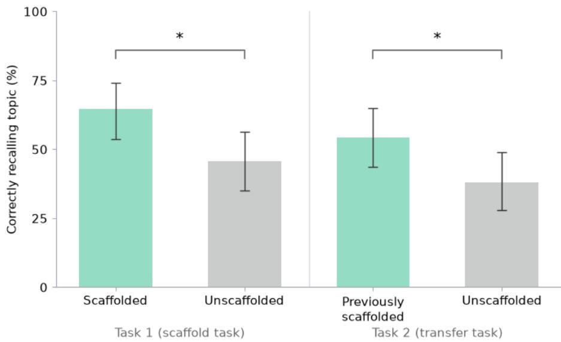  
Fig. 5. Correct topic recall by condition and task. Bars show observed recall percentages with 95% Wilson confidence intervals Asterisks indicate adjusted logistic mixed-model contrasts (Task 1 ${ } , P = . 0 2 6 ;$ Task 2, $P = . 0 4 6 )$

## 4.4 The scafold had mixed efects on subjective perceptions

Objective performance benefits need not correspond to an easier or more positively experienced interaction. We therefore examined whether the scafold changed participants’ metacognitive self-reports, perceived helpfulness and control, and cognitive load.

4.4.1 Metacognitive self-report. Of the 13 items (Methods), the scafold selectively increased participants’ reports that they broke the task into smaller steps: in the baseline-adjusted regression, this item was higher in the scafold condition at post-task $( b = 0 . 7 5 3$ , 95% CI [0.546, 0.959], $P _ { \mathrm { B H } } < . 0 0 1 )$ . The staged composing-process item showed a positive association that did not survive correction (� = 0.225, 95% CI [0.010, 0.440], $P _ { \mathrm { B H } } = . 2 3 3 ) $ ; no other item-level condition efect was reliable after correction (Table A12).

4.4.2 Helpfulness and perceived control. Scafolded participants rated the AI as less helpful than unscafolded participants $( b = - 0 . 3 4 2$ , 95% CI [−0.510, −0.174], � < .001) and reported lower perceived control $( b = - 0 . 2 5 1$ , 95% CI [−0.486, −0.017], $P = . 0 3 6 ;$ ; Table A13). Both subjective ratings therefore moved in the opposite direction from the objective Task 1 quality efect.

4.4.3 Cognitive load. The NASA-TLX summary score (Methods; Table 4) showed a transient increase in load: during Task 1, scafolded participants reported higher load than controls $( M = 4 . 7 1$ versus 3.96; � = 0.745, 95% CI [0.381, 1.110], $P < . 0 0 1 )$ . During Task 2, when neither group received the scafold, the corresponding diference was smaller and not statistically reliable (� = 4.08 versus 3.93; � = 0.147, 95% CI [−0.218, 0.512], � = .429). The condition-by-task interaction was reliable $( b = 0 . 5 9 8 , 9 5 \% \mathrm { C I } [ 0 . 2 7 0 , 0 . 9 2 6 ] , P < . 0 0 1 )$ , localizing the additional load to scafold use.

The item-level models localized this transient increase (Table 4; Figure 6). During scafold use, 7 of the 13 items remained reliable after correction, with the largest elevations for prompting demand, dificulty tracking ideas, the burden of managing the AI, stress or frustration, and rushed pace, and smaller elevations for maintaining consistency and focus. None of the 13 items difered reliably during the subsequent unscafolded task; the additional burden was concentrated in coordinating and managing the scafolded interaction while it was active.

Table 4. Item-level cognitive-load outcomes during the scafolded and subsequent unscafolded tasks
<table><tr><td></td><td colspan="4">Task 1: scaffold active</td><td colspan="4">Task 2: no scaffold</td></tr><tr><td>Question</td><td>Control M</td><td>Scaffold M</td><td>b [95% CI]</td><td> $P _ { \mathrm { B H } }$ </td><td>Control M</td><td>Prior-scaffold M</td><td>b [95% CI]</td><td> $P _ { \mathrm { B H } }$ </td></tr><tr><td>&quot;latex How mentally demanding was the essay writing task?</td><td>4.88</td><td>5.40</td><td>0.526 [−0.036, 1.087]</td><td>.087</td><td>4.86</td><td>4.73</td><td>-0.154 [−0.730, 0.421]</td><td>.906</td></tr><tr><td>How hurried or rushed was the pace of the task?</td><td>4.20</td><td>5.23</td><td>0.983 [0.359, 1.607]</td><td>.005</td><td>3.79</td><td>4.06</td><td>0.215 [−0.353, 0.782]</td><td>.906</td></tr><tr><td>How hard did you have to work to accomplish your level of performance?</td><td>5.44</td><td>5.85</td><td>0.441 [−0.115, 0.997]</td><td>.130</td><td>4.91</td><td>5.12</td><td>0.215 [-0.380, 0.811]</td><td>.906</td></tr><tr><td>How insecure, discouraged, irritated, stressed, or annoyed were you?</td><td>2.59</td><td>3.59</td><td>0.960 [0.425, 1.495]</td><td>.002</td><td>2.85</td><td>3.04</td><td>0.146 [-0.373, 0.665]</td><td>.906</td></tr><tr><td>How mentally demanding was the essay topic itself to understand and write about?</td><td>4.55</td><td>4.83</td><td>0.272 [-0.322, 0.867]</td><td>.369</td><td>4.23</td><td>4.34</td><td>0.062 [-0.523, 0.647]</td><td>.906</td></tr><tr><td>How much mental effort did developing coherent arguments for this essay demand?</td><td>4.91</td><td>5.38</td><td>0.496 [−0.062, 1.055]</td><td>.096</td><td>5.01</td><td>4.88</td><td>-0.119 [-0.678, 0.440]</td><td>.906</td></tr><tr><td>How much mental burden did managing the AI tool add for writing the essay?</td><td>3.34</td><td>4.27</td><td>0.936 [0.377, 1.495]</td><td>.003</td><td>3.37</td><td>3.62</td><td>0.225 [-0.321, 0.770]</td><td>.906</td></tr><tr><td>How mentally demanding was prompting the AI?</td><td>3.37</td><td>4.40</td><td>1.029 [0.489, 1.568]</td><td>.001</td><td>3.64</td><td>3.83</td><td>0.184 [−0.347, 0.715]</td><td>.906</td></tr><tr><td>Did you have to think hard about how to structure your essay effectively?</td><td>4.76</td><td>5.36</td><td>0.605 [−0.004, 1.215]</td><td>.074</td><td>4.86</td><td>4.70</td><td>-0.175 [−0.779, 0.430]</td><td>.906</td></tr><tr><td>Did integrating AI suggestions require careful mental processing?</td><td>4.76</td><td>5.30</td><td>0.583 [0.024, 1.142]</td><td>.067</td><td>4.76</td><td>4.68</td><td>-0.074 [−0.662, 0.515]</td><td>.906</td></tr><tr><td>Did you struggle to keep track of all the ideas you wanted to include?</td><td>3.30</td><td>4.36</td><td>1.031 [0.483, 1.579]</td><td>.001</td><td>3.20</td><td>3.61</td><td>0.381 [-0.130, 0.892]</td><td>.906</td></tr><tr><td>Was it mentally challenging to maintain consistency throughout the essay?</td><td>3.83</td><td>4.53</td><td>0.714 [0.168, 1.261]</td><td>.019</td><td>3.72</td><td>3.76</td><td>0.015 [-0.526, 0.556]</td><td>.957</td></tr><tr><td>Was it difficult to maintain focus throughout the task?</td><td>2.78</td><td>3.38</td><td>0.621 [0.153, 1.089]</td><td>.019</td><td>2.87</td><td>2.96</td><td>0.092 [−0.389, 0.572]</td><td>.906</td></tr></table>

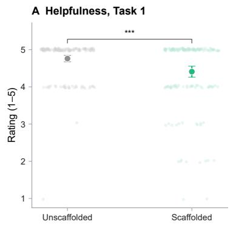

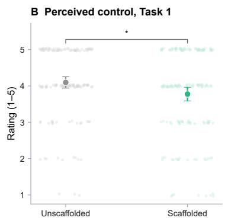

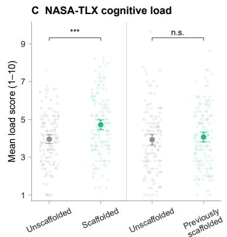  
Fig. 6. Subjective experience by condition. A, AI helpfulness and $\mathbf { B } ,$ perceived control after Task 1; C, unweighted NASA-TLX load after Tasks 1 and 2 (higher, more load). Faint points: participant ratings with slight vertical jiter (up to ±0.04 scale units); markers: condition means with 95% confidence intervals from the unjitered data. ∗∗∗� < .001; ∗� < .05; n.s., not significant

## 5 Discussion

As generative AI shifts knowledge work from production toward planning and evaluation, this study found that dynamic metacognitive scafolds improved written output quality, both while the scafold was available and after it was removed. Participants who had used the scafold also later wrote prompts with greater goal clarity and task decomposition on their own. We also found evidence for improvement in topic recall three days later. However, even as their written output and prompting improved, scafolded participants rated the system as less helpful, felt less in control, and reported greater cognitive load while the scafold was active. Our discussion focuses on the implications of these finding fo diferent levels of knowledge work, the divergence between subjective and objective measures, designing productive friction with visible value into AI assistance, and implications as agentic autonomy increases. Finally, our results have important limitations and present opportunities for future research.

## 5.1 Scafolding diferent levels of knowledge work

Our results suggest that metacognitive scafolding may matter at three diferent levels of knowledge work: how people approach a task, how they work with the AI on it, and how well they understand the work itself.

5.1.1 How people approach the task. The first level includes engaging in metacognitive processes and becoming aware of them. The scafold improved output quality across tasks, and scafolded participants engaged in more goal specification and task decomposition in their prompts. This latter aspect is where the scafold had its most reliable efect, with participants both reporting more task structuring and actively doing so after scafold removal. They did not, however, report setting clearer goals. Clarifying goals may need more than one supported episode, or a diferent kind of support, before people both do it and notice that they have improved [98, 115, 129]; we return to this divergence in Section 5.3.

5.1.2 How people work with the AI. The second level is how people learn to direct AI systems. We have some evidence of short-lag transfer [4]: participants who had used the scafold went on to write better essays and clearer, better structured prompts on their own. Scafold removal was part of our experimental design, but we are not suggesting that metacognitive support must eventually be removed. Such support, however, cannot be guaranteed in diverse knowledge work contexts. How well someone directs an AI system is much of what separates people who get value from these tools from those who do not, and that skill is unevenly distributed [62, 95]. A brief scafold that leads people to prompt more deliberately is a cheap way to build a scarce skill, and one that may follow the user from one tool to the next, whether scafolds are available or not.

5.1.3 How people understand and engage with the work itself. The third level is that the efort of goal specification and task decomposition, and the sharper prompting it brings, may help people better understand how tasks fit into larger outcomes and the nature of their work overall [109, 116]. This third level arguably matters the most to the future of work.

We suggest that the initiating role of goal specification and task decomposition in AI-assisted workflows is key to this, aligning with prior work. In Xu et al. [124], when AI asked questions, compared to simply generating outputs for review, participants spent more time generating and revising, yet also felt more confident in the process. Compared to no AI support, they also reflected more on the framing and underlying problems, and produced more practical solutions: hallmarks of cognitive engagement that, as in our study, seem to follow from structuring the task. Likewise, when time permits, independently initiating work before using AI leads to better critical thinking outcomes [127].

Memory of work materials is key to understanding the nature of one’s work. Prior research has found AI assistance to be detrimental [6, 16, 67, 127, 130]: one week after generating and elaborating ideas with and without AI, Zindulka et al. [130]’s participants misattributed sources significantly more, most of all in mixed human–AI workflows. Our scafolded participants also engaged in mixed-human-AI workflows, yet were more likely to recall the topics of their writing three days later. Our comparison is between two AI-assisted conditions, so it does not contradict evidence tha

AI impairs retention relative to unaided work. Rather, it suggests that metacognitive scafolds may mitigate this impact relative to default chat interfaces. Memory, and cognitive engagement more broadly, is also richer than topic recall, and future work should explore this. Finally, we interpret our findings cautiously: the contrasts were significant across analyses but estimated imprecisely, and rest on the half of the cohort who returned (see Limitations in Section 5.5).

## 5.2 Divergence Between Subjective and Objective Measures

A tension in our results is that scafolded participants performed better yet rated the AI as less helpful. This is not unexpected [115], as the scafolds required participants to analyze the task and make decisions, demanding cognitive efort and time. This echoes the concept of ‘desirable dificulties’ in learning sciences, where certain efortful engagement can feel aversive, yet lead to better learning outcomes [9]. For example, active learning that cognitively engages students improves objective learning yet is rated lower by students who subjectively experience poorer learning [29]. Conversely, fluent instructors can increase interest and perceptions of learning without afecting objective performance [14] However, not all dificulties are desirable: designing for productive friction is key as we discuss in Section 5.3.

A similar dissociation appeared in the subjective and objective measures of metacognition: participants reported breaking the task into smaller steps but not setting clearer goals, whereas their prompts in the unscafolded task showed gains in both. One reading is that the two processes difer in how visible they are to those performing them. Decomposition leaves inspectable traces, such as a list of parts, whereas a clearer goal may simply feel like knowing what one wants, without any awareness that one now specifies it more explicitly [39, 81, 115]; self-report registers the process that generates such cues.

More broadly, subjective and objective measures of AI-assisted work can diverge, which in itself reflects a limitation of metacognition. The pattern recurs across the literature: self-rated critical thinking varied little across conditions whose measured performance difered substantially [127]; users’ estimates of their own contribution shifted once they were shown goal-level traces of their conversations [63]; the cognitive forcing function that most reduced over-reliance on AI-generated plans was not the one participants found most helpful [44]; and experienced developers believed AI had sped them up when it had slowed them down [7] (see also [12, 42]). Ofloading feels helpful precisely because it removes the efort that constitutes engagement [34, 69]; in co-writing research, support that improves the product can still feel less satisfying or less like one’s own [31, 34, 54, 56, 57, 66, 71]; and dynamic controls demand inspection and choice even when they improve steering [37]. This suggests that studies evaluating AI’s impact on cognition, including system evaluations, should include objective measures of performance and cognitive processes [114, 127, 128].

## 5.3 Designing productive friction with visible value into AI assistance

A tool that feels less helpful is likely to be declined when it is optional: its benefits arrive only once the task is done, and often only in comparison with others’ work, which may never happen. Our data show how strong the pull toward the low-efort path is: despite a bonus for the best briefs, 119 of the 297 participants (40%) produced Task 2 prompt sequences that met the task-text copying criterion (Figure 4), delegating not just production but the specification of the work itself. This may partly reflect our cohort, but it is also overreliance on AI in its most complete form [12, 44, 102].The design challenge is to treat friction as a design material rather than a cost to be minimized [17, 48, 99, 103], extending a long line of HCI research from microboundaries that interrupt automatic interaction to seamful designs that keep a system’s workings in view [23].

Not all friction is productive, however. Although we designed our scafold to be supportive, participants’ open-ended comments after Task 1, which we did not analyze systematically, are suggestive. The clearest theme was the cost of specifying everything up front “in a short time to meet requirements”. This aligns with Zhi et al. [127]: the cognitive benefits of independently structuring a task in an AI-assisted workflow requires suficient time. A related point was the need for “more time to learn how to use it efectively”, which also afected participants “ownership of the writing”. A second theme was that choosing between goals itself demands expertise, for example “prioritising being persuasive or using emotional appeal”–this is partly a limitation of the simulated nature of our task. Finally, another concern was the gap between control over planning and control over revision, such as simple document-wide corrections and ways to “lock” sentences. One participant valued the planning support but desired “options to refine what I had done first time”. These comments point to scafolds that stage specification across the draft rather than front-loading it, that explain the choices they ask for, and that pair metacognitive support for planning with support for revision [61, 65]

More generally, showing the seams of breaking the task down should be part of producing work that one can stand behind and will remember, rather than an obstacle the AI has imposed [52, 66, 71]. This requires making the value legible at three points where it is easy to miss: (a) in the moment, so that instructing and steering the AI carries its own payof, experienced as thinking by doing rather than as friction before the ‘real work’ begins; (b) across the workflow, so that the structure a scafold imposes is seen to pay of as work moves from one phase to the next rather than registering only as an upfront cost; and (c) in the outcome, so that people can recognize how a result was achieved and feed that recognition into the next piece of work

## 5.4 Supporting Human Metacognition as Agentic Autonomy Grows

These findings should be read against a rapidly moving frontier. It is tempting to assume that more capable agentic systems will simply absorb goal-setting and decomposition. But as autonomous task horizons lengthen [68], a single instruction sets of longer chains of action, and human involvement shrinks to fewer, higher-stakes moments of specifying and verifying what the system produces [30, 87, 95]. What most remains with the person, and what they are most anxious to keep, is the understanding and direction of the work itself [101]. The socio-technical problem is thus to design for the regulation of work as much as its generation: for the disposition that an AI system can cultivate in a person, with scafolds that fade as the relevant skills are internalized [78, 115]. Here that means specifying goals, breaking work into checkable parts, and eliciting both from whatever system is at hand, so that tools leave workers more capable as and when AI systems change or are unavailable.

## 5.5 Limitations

A key limitation is the LLM judge. Firstly, there is a possible bias toward structure rather than content. However, the judge found a smaller treatment advantage than human raters who saw the formatted essays (Table 2), providing little evidence that structure inflated the primary estimate. The 107-essay benchmark adds a useful comparison of rating approaches on the same essays, with human ratings supporting an advantage in both tasks and the judge’s composite estimates pointing in the same direction. Its smaller size limits precision, and its between-subjects comparisons address the advantage within each task; evidence concerning persistence within individuals comes from the full-corpus analysis. Secondly, the judge’s ‘conservatism’ is defined relative to human-perceived quality, which itself incorporates presentation, so we have no ‘structure-free’ benchmark. Thirdly, agreement with human ratings was moreover moderate rather than strong, and the judge compressed the human score range (calibration slope = 0.375; Table A8). The essay-quality result should therefore be read together with the prompting, metacognitive self-report and recall evidence, which do not depend on the judge and converge on the same conclusion.

Another limitation concerns our recall analysis. Both contrasts underlying the recall efect were positive across analyses, but the confidence intervals were wide (Table A10), so the data are compatible with anything from a small to a large efect. Recall was also scored under a lenient rule that credited any correct topic identification, a deliberately low bar that leaves open whether the efect extends to deeper understanding or retention ofessay content. Follow-up attrition was substantial (50.6% of participants in the recall cohort had no scored recall outcome). Although attrition is expected in an online sample, it introduces potential for sample biases that limit interpretation and generalizability. Treatment did not predict missingness, whereas other observed factors did, and the complete-case and multiple-imputation analyses agree, which limits the risk of bias in the treatment contrast. However, we can only rule out dependence on what we measured. Finally, topic recall is a narrow index of cognitive engagement, which also involves critical thinking about material [69, 127] and communicating about work with collaborators [90]; future work should use tasks that require evaluating and integrating source material [127] and communicating outputs

Our experimental design has two limitations. Since previous research already demonstrates the value of dynamic over static scafolds [37], and we prioritized ecological validity in our baseline, we did not have a static scafold condition. It is possible that the cognitive load efects could be partly mitigated with a static scafold, particularly longitudinally. Second, our study tests the combined impact of a goal specification and task decomposition scafold, rather than the distinct interface components. We opted for this as both aspects are theoretically interwined and function synergistically [65, 115].

Finally, the Task 2 findings of improved prompting and output quality show short-lag transfer to a subsequent unscafolded task, not long-term persistence across weeks or months. The study used one-shot online writing tasks with U.S.-based Prolific adults rather than embedded classroom or workplace deployments, and could not separate efects by experience. Future work should test longitudinal efects in more ecologically valid settings; whether scafolds close the gap between strong and weak planners or lift workers equally; other domains, such as data science and engineering, that could equally benefit from metacognitive support [115]; and, as agentic workflows gain popularity, long-horizon multi-step tasks, with completion rates and token eficiency as additional outcomes.

## 6 Conclusion

We tested whether a dynamic metacognitive scafold for goal specification and task decomposition improved AIassisted writing compared with a standard chat interface. Despite clear benefits to writing and prompting, the scafold was perceived as imposing additional efort and reduced perceived helpfulness. Designers should focus not only on optimizing ease and output, but also on users’ capacity to calibrate their work practices and outcomes with and without AI. When working with AI, there is a need to design for the visible value of productive friction, to bring AI the benefit of human judgment while ensuring meaningful human contribution.

## References

[1] Ibtisam Sultan Al Moqbali, Salma Al Humaidi, Abdo Al Mekhlafi, and Maher Abu Hilal. 2020. Metacognitive Writing Strategies Used by Omani Grade Twelve Students. International Journal ofLearning, Teaching and Educational Research 19, 8 (2020), 214–232. doi:10.26803/ijlter.19.8.12

[2] Sai Keerthana Arun and Joel E Fischer. 2026. Encouraging Thought Before Completion: The Role of Task-Specific Selective Friction in AI-Assisted Knowledge Work. In Proceedings of the 5th Annual Symposium on Human-Computer Interaction for Work (CHIWORK ’26). Association for Computing Machinery, New York, NY, USA, 1–17. doi:10.1145/3808045.3808049

[3] Zahra Ashktorab, Qian Pan, Werner Geyer, Michael Desmond, Marina Danilevsky, James M. Johnson, Casey Dugan, and Michelle Bachman. 2025. Emerging Reliance Behaviors in Human-AI Content Grounded Data Generation: The Role of Cognitive Forcing Functions and Hallucinations arXiv:2409.08937 [cs.HC]. doi:10.48550/arXiv.2409.08937

[4] Susan M. Barnett and Stephen J. Ceci. 2002. When and Where Do We Apply What We Learn? A Taxonomy for Far Transfer. Psychological Bulletin 128, 4 (2002), 612–637. doi:10.1037/0033-2909.128.4.612

[5] František Bartoš, Oliwia Z. Bujak, Patrícia Martinková, and Eric-Jan Wagenmakers. 2026. Efect of Artificial Intelligence on Learning: A Meta-Meta-Analysis. Preprint. doi:10.31234/osf.io/h529e\_v1

[6] Hamsa Bastani, Osbert Bastani, Alp Sungu, Haosen Ge, Özge Kabakcı, and Rei Mariman. 2025. Generative AI without guardrails can harm learning: Evidence from high school mathematics. Proceedings of the National Academy of Sciences of the United States of America 122, 26 (2025), e2422633122 doi:10.1073/pnas.2422633122

[7] Joel Becker, Nate Rush, Elizabeth Barnes, and David Rein. 2025. Measuring the Impact of Early-2025 AI on Experienced Open-Source Developer Productivity. arXiv:2507.09089 [cs.AI] https://arxiv.org/abs/2507.0908

[8] Alexander Bick, Adam Blandin, and David J. Deming. 2026. The Rapid Adoption of Generative AI. Management Science (2026). Published online 20 January 2026. doi:10.1287/mnsc.2025.02523

[9] Elizabeth L Bjork, Robert A Bjork, et al. 2011. Making things hard on yourself, but in a good way: Creating desirable dificulties to enhance learning. Psychology and the real world: Essays illustrating fundamental contributions to society 2, 59-68 (2011), 56–64.

[10] Jessica Y Bo, Sophia Wan, and Ashton Anderson. 2025. To Rely or Not to Rely? Evaluating Interventions for Appropriate Reliance on Large Language Models. In Proceedings of the 2025 CHI Conference on Human Factors in Computing Systems (CHI ’25). Association for Computing Machinery, New York, NY, USA, 1–23. doi:10.1145/3706598.3714097

[11] Erik Brynjolfsson, Danielle Li, and Lindsey Raymond. 2025. Generative AI at Work. The Quarterly Journal of Economics 140, 2 (2025), 889–942 doi:10.1093/qje/qjae044

[12] Zana Buçinca, Maja Barbara Malaya, and KrzysztofZ. Gajos. 2021. To Trust or to Think: Cognitive Forcing Functions Can Reduce Overreliance on AI in AI-Assisted Decision-Making. Proceedings ofthe ACM on Human-Computer Interaction 5, CSCW1, Article 188 (2021), 21 pages. doi:10.1145/344928

[13] Krzysztof Budzyń, Marcin Romańczyk, Diana Kitala, Paweł Kołodziej, Marek Bugajski, Hans-Olov Adami, Johannes Blom, Marek Buszkiewicz, Natalie Halvorsen, Cesare Hassan, Tomasz Romańczyk, Øyvind Holme, KrzysztofJarus, Shona Fielding, Melina Kunar, Maria Pellisé, Nastazja Pilonis, Michał Filip Kamiński, Mette Kalager, Michael Bretthauer, and Yuichi Mori. 2025. Endoscopist deskilling risk after exposure to artificial intelligence in colonoscopy: a multicentre, observational study. The LancetGastroenterology & Hepatology 10, 10 (2025), 896–903. doi:10.1016/S2468-1253(25)00133-5

[14] Shana K Carpenter, Paige E Northern, Sarah Tauber, Alexander R Toftness, et al. 2020. Efects of lecture fluency and instructor experience on students’ judgments of learning, test scores, and evaluations of instructors. Journal ofExperimental Psychology: Applied 26, 1 (2020), 26.

[15] Aaron Chatterji, Thomas Cunningham, David Deming, Zoe Hitzig, Christopher Ong, Carl Yan Shan, and Kevin Wadman. 2025. How People Use ChatGPT. NBER Working Paper 34255. National Bureau of Economic Research, Cambridge, MA. doi:10.3386/w34255

[16] Xinyue Chen, Kunlin Ruan, Kexin Phyllis Ju, Nathan Yap, and Xu Wang. 2025. More AI Assistance Reduces Cognitive Engagement: Examining the AI Assistance Dilemma in AI-Supported Note-Taking. arXiv:2509.03392 [cs]. doi:10.1145/3757632

[17] Zeya Chen and Ruth Schmidt. 2024. Exploring a Behavioral Model of “Positive Friction” in Human-AI Interaction. In Design, User Experience, and Usability, Aaron Marcus, Elizabeth Rosenzweig, and Marcelo M. Soares (Eds.). Springer Nature Switzerland, Cham, 3–22.

[18] Furui Cheng, Vilém Zouhar, Simran Arora, Mrinmaya Sachan, Hendrik Strobelt, and Mennatallah El-Assady. 2024. RELIC: Investigating Large Language Model Responses using Self-Consistency. In Proceedings ofthe 2024 CHI Conference on Human Factors in Computing Systems (CHI ’24). Association for Computing Machinery, New York, NY, USA, 1–18. doi:10.1145/3613904.3641904

[19] Clara Colombatto, Sean Rintel, and Lev Tankelevitch. 2025. Metacognition and Confidence Dynamics in Advice Taking from Generative AI. arXiv:2510.26508 [cs]. doi:10.48550/arXiv.2510.26508

[20] Zara Contractor and Germán Reyes. 2026. Experimental Evidence on the Learning Impact of Generative AI. arXiv:2607.08849 [econ.GN] doi:10.48550/arXiv.2607.08849

[21] Adam J. Coscia, Shunan Guo, Eunyee Koh, and Alex Endert. 2025. OnGoal: Tracking and Visualizing Conversational Goals in Multi-Turn Dialogue with Large Language Models. In Proceedings of the 38th Annual ACM Symposium on User Interface Software and Technology (UIST ’25). Association for Computing Machinery.

[22] Scott Counts, Yan Chen, Jing Dong, Himanshu Sharma, Andrey Zaikin, Rui Hu, Alperen Kok, Gorkem Ozer Yilmaz, Siddharth Suri, Kiran Tomlinson, SoniaJafe, and Will Wang. 2026. AI in the Enterprise: How People Use M365 Copilot Chat. arXiv:2605.23958 [cs.CY] https://arxiv.org/abs/2605.23958

[23] Anna L. Cox, Sandy J. J. Gould, Marta E. Cecchinato, Ioanna Iacovides, and Ian Renfree. 2016. Design Frictions for Mindful Interactions: The Case for Microboundaries. In Proceedings ofthe 2016 CHI Conference Extended Abstracts on Human Factors in Computing Systems (CHI EA ’16). ACM

1389–1397. doi:10.1145/2851581.2892410

[24] Guillermo Cruces, Diego Fernández Meijide, Sebastian Galiani, Ramiro H. Gálvez, and María Lombardi. 2026. Does Generative AI Narrow Education-Based Productivity Gaps? Evidence from a Randomized Experiment. NBER Working Paper 34851. National Bureau of Economic Research, Cambridge, MA. doi:10.3386/w34851

[25] Kevin Zheyuan Cui, Mert Demirer, Sonia Jafe, Leon Musolf, Sida Peng, and Tobias Salz. 2026. The Efects of Generative AI on High-Skilled Work: Evidence from Three Field Experiments with Software Developers. Management Science (2026). Articles in Advance. doi:10.1287/mnsc.2025.00535

[26] Shamse Tasnim Cynthia, Joy Krishan Das, and Banani Roy. 2026. Are We All Using Agents the Same Way? An Empirical Study of Core and Peripheral Developers Use of Coding Agents. arXiv:2601.20106 [cs.SE]. doi:10.1145/3793302.3793377

[27] Simone Daniotti, Johannes Wachs, Xiangnan Feng, and Frank Nefke. 2026. Who is using AI to code? Global difusion and impact of generative AI Science 391, 6787 (2026), 831–835. doi:10.1126/science.adz931

[28] Fabrizio Dell’Acqua, Edward McFowland III, Ethan R. Mollick, Hila Lifshitz-Assaf, Katherine C. Kellogg, Saran Rajendran, Lisa Krayer, François Candelon, and Karim R. Lakhani. 2023. Navigating the Jagged Technological Frontier: Field Experimental Evidence of the Efects of AI on Knowledge Worker Productivity and Quality. Technology & Operations Mgt. Unit Working Paper 24-013. Harvard Business School. doi:10.2139/ssrn.4573321

[29] Louis Deslauriers, Logan S. McCarty, Kelly Miller, Kristina Callaghan, and Greg Kestin. 2019. Measuring actual learning versus feeling of learning in response to being actively engaged in the classroom. Proceedings ofthe National Academy ofSciences 116, 39 (Sept. 2019), 19251–19257. doi:10.1073/pnas.1821936116

[30] Shipi Dhanorkar, Samir Passi, and Mihaela Vorvoreanu. 2026. Human oversight of agentic systems in practice: Examining the oversight work challenges, and heuristics of developers using software agents. arXiv:2606.05391 [cs.SE]. doi:10.48550/arXiv.2606.0539

[31] Paramveer S. Dhillon, Somayeh Molaei, Jiaqi Li, Maximilian Golub, Shaochun Zheng, and Lionel P. Robert. 2024. Shaping human–AI collaboration: Varied scafolding levels in co-writing with language models. In Proceedings ofthe 2024 CHI Conference on Human Factors in Computing Systems. Association for Computing Machinery, 1–18. doi:10.1145/3613904.3642134

[32] Eleanor Wiske Dillon, Sonia Jafe, Nicole Immorlica, and Christopher T. Stanton. 2025. Shifting work patterns with generative AI. Working Paper 33795. National Bureau of Economic Research. doi:10.3386/w33795

[33] Eleanor Wiske Dillon, Sonia Jafe, Sida Peng, and Alexia Cambon. 2025. Early Impacts of M365 Copilot. arXiv preprint arXiv:2504.11443 (2025). doi:10.48550/arXiv.2504.1144

[34] Fiona Draxler, Anna Werner, Florian Lehmann, Matthias Hoppe, Albrecht Schmidt, Daniel Buschek, and Robin Welsch. 2024. The AI ghostwriter efect: When users do not perceive ownership of AI-generated text but self-declare as authors. ACM Transactions on Computer-Human Interaction 31, 2 (2024), 1–40. doi:10.1145/3637875

[35] Ian Drosos, Advait Sarkar, Xiaotong Xu, Carina Negreanu, Sean Rintel, and Lev Tankelevitch. 2024. "It’s like a rubber duck that talks back": Understanding Generative AI-Assisted Data Analysis Workflows through a Participatory Prompting Study. In Proceedings ofthe 3rd Annual Meeting ofthe Symposium on Human-Computer Interaction for Work. ACM, Newcastle upon Tyne United Kingdom, 1–21. doi:10.1145/3663384.3663389

[36] Ian Drosos, Jack Williams, Advait Sarkar, and Nicholas Wilson. 2024. Dynamic Prompt Middleware: Contextual Prompt Refinement Controls for Comprehension Tasks. arXiv:2412.02357 [cs]. doi:10.48550/arXiv.2412.02357

[37] Ian Drosos, Jack Williams, Advait Sarkar, Nicholas Wilson, Sean Rintel, and Payod Panda. 2025. Dynamic Prompt Middleware: Contextual Prompt Refinement Controls for Comprehension Tasks. In Proceedings ofthe 4th Annual Symposium on Human-Computer Interaction for Work (ACM Other conferences). 1–23. doi:10.1145/3729176.3729203

[38] James M. Zumel Dumlao, Meng Wang, Zhonghan Xie, Junyao Hu, Ivan Bar, George Chaney, Henry Gold, and Misha Teplitskiy. 2026. Generative AI Availability, Grades, and Student Satisfaction at a Large University. arXiv:2607.21534 [cs.CY] https://arxiv.org/abs/2607.21534

[39] Anastasia Efklides. 2008. Metacognition: Defining its facets and levels of functioning in relation to self-regulation and co-regulation. European Psychologist 13, 4 (2008), 277–287

[40] Upol Ehsan, Samir Passi, Koustuv Saha, Todd McNutt, Mark O. Riedl, and Sara Alcorn. 2026. From Future of Work to Future of Workers: Addressing Asymptomatic AI Harms to Foster Dignified Human-AI Interaction. In Proceedings ofthe 2026 CHI Conference on Human Factors in Computing Systems (CHI ’26). Association for Computing Machinery, New York, NY, USA, 1–21. doi:10.1145/3772318.3791081

[41] K. J. Kevin Feng, Kevin Pu, Matt Latzke, Tal August, Pao Siangliulue, Jonathan Bragg, Daniel S Weld, Amy X. Zhang, and Joseph Chee Chang. 2026. Cocoa: Co-Planning and Co-Execution with AI Agents. In Proceedings ofthe 2026 CHI Conference on Human Factors in Computing Systems (CHI ’26). Association for Computing Machinery, New York, NY, USA, 1–23. doi:10.1145/3772318.3791673

[42] Daniela Fernandes, Steeven Villa, Salla Nicholls, Otso Haavisto, Daniel Buschek, Albrecht Schmidt, Thomas Kosch, Chenxinran Shen, and Robin Welsch. 2026. AI makes you smarter but none the wiser: The disconnect between performance and metacognition. Computers in Human Behavior 175 (2026), 108779. doi:10.1016/j.chb.2025.108779

[43] Andreas Fügener, Jörn Grahl, Alok Gupta, and Wolfgang Ketter. 2022. Cognitive Challenges in Human–Artificial Intelligence Collaboration: Investigating the Path Toward Productive Delegation. Information Systems Research 33, 2 (June 2022), 678–696. doi:10.1287/isre.2021.1079

[44] Ahana Ghosh, Advait Sarkar, Siân Lindley, and Christian Poelitz. 2026. An Experimental Comparison of Cognitive Forcing Functions for Execution Plans in AI-Assisted Writing: Efects On Trust, Overreliance, and Perceived Critical Thinking. arXiv:2601.18033 [cs]. doi:10.48550/arXiv.2601.18033

[45] Omer Gibreel and Ibrahim Arpaci. 2025. Development and validation of the prompt engineering competence scale (PECS). Information Development (April 2025), 02666669251336455. doi:10.1177/02666669251336455

[46] Frederic Gmeiner, Kaitao Luo, Ye Wang, Kenneth Holstein, and Nikolas Martelaro. 2025. Exploring the potential of metacognitive support agents for human–AI co-creation. In Proceedings ofthe 2025 ACM Designing Interactive Systems Conference. Association for Computing Machinery, 1244–1269 doi:10.1145/3715336.3735785

[47] Frederic Gmeiner, Nicolai Marquardt, Michael Bentley, Hugo Romat, Michel Pahud, David Brown, Asta Roseway, Nikolas Martelaro, Kenneth Holstein, Ken Hinckley, and Nathalie Riche. 2025. Intent Tagging: Exploring Micro-Prompting Interactions for Supporting Granular Human-GenAI Co-Creation Workflows. In Proceedings ofthe 2025 CHI Conference on Human Factors in Computing Systems (CHI ’25). Association for Computing Machinery, New York, NY, USA, 1–31. doi:10.1145/3706598.3713861

[48] Sandy J. J. Gould, Lewis L. Chuang, Ioanna Iacovides, Diego Garaialde, Marta E. Cecchinato, Benjamin R. Cowan, and Anna L. Cox. 2021. A Special Interest Group on Designed and Engineered Friction in Interaction. In Extended Abstracts of the 2021 CHI Conference on Human Factors in Computing Systems (Yokohama, Japan) (CHI EA ’21). Association for Computing Machinery, New York, NY, USA, Article 158, 4 pages. doi:10.1145/3411763.3450404

[49] Jiawei Gu et al. 2024. A survey on LLM-as-a-judge. arXiv (2024). arXiv:2411.15594

[50] Kunal Handa, Alex Tamkin, Miles McCain, Safron Huang, Esin Durmus, Sarah Heck, Jared Mueller, Jerry Hong, Stuart Ritchie, Tim Belonax, Kevin K. Troy, Dario Amodei, Jared Kaplan, Jack Clark, and Deep Ganguli. 2025. Which Economic Tasks are Performed with AI? Evidence from Millions of Claude Conversations. arXiv:2503.04761 [cs.CY] https://arxiv.org/abs/2503.04761

[51] Sandra G. Hart and Lowell E. Staveland. 1988. Development of NASA-TLX (Task Load Index): Results of Empirical and Theoretical Research. In Human Mental Workload, Peter A. Hancock and Najmedin Meshkati (Eds.). Advances in Psychology, Vol. 52. North-Holland, Amsterdam, The Netherlands, 139–183. doi:10.1016/S0166-4115(08)62386-9

[52] Jessica He, David Piorkowski, Michael Muller, Kristina Brimijoin, Stephanie Houde, and Justin Weisz. 2023. Rebalancing Worker Initiative and AI Initiative in Future Work: Four Task Dimensions. In Proceedings ofthe 2nd Annual Meeting ofthe Symposium on Human-Computer Interaction for Work. ACM, Oldenburg Germany, 1–16. doi:10.1145/3596671.3598572

[53] Georg Heinze and Meinhard Ploner. 2002. SAS and SPLUS programs to perform Cox regression without convergence problems. Computer Methods and Programs in Biomedicine 67, 3 (2002), 217–223. doi:10.1016/S0169-2607(01)00149-3

[54] Yuk Mui Elly Heung and Thomas K. F. Chiu. 2025. How ChatGPT impacts student engagement from a systematic review and meta-analysis study Computers and Education: Artificial Intelligence 8 (2025), 100361. doi:10.1016/j.caeai.2025.100361

[55] Manuel Hofmann, Sam Boysel, Frank Nagle, Sida Peng, and Kevin Xu. 2025. Generative AI and the Nature of Work. Harvard Business School Working Paper 25-021. Harvard Business School, Boston, MA. doi:10.2139/ssrn.5007084

[56] Angel Hsing-Chi Hwang, Q. Vera Liao, Su Lin Blodgett, Alexandra Olteanu, and Adam Trischler. 2025. “It was 80% me, 20% AI”: Seeking authenticity in co-writing with large language models. Proceedings of the ACM on Human-Computer Interaction 9, CSCW2 (2025), 1–41. doi:10.1145/3711020

[57] Nikhita Joshi and Daniel Vogel. 2024. Writing with AI Lowers Psychological Ownership, but Longer Prompts Can Help. arXiv:2404.03108 [cs.HC] doi:10.48550/arXiv.2404.03108

[58] Ekaterina Jussupow, Kai Spohrer, Armin Heinzl, and Joshua Gawlitza. 2021. Augmenting Medical Diagnosis Decisions? An Investigation into Physicians’ Decision-Making Process with Artificial Intelligence. Information Systems Research 32, 3 (Sept. 2021), 713–735. doi:10.1287/isre.2020.0980

[59] Enkelejda Kasneci, Kathrin Sessler, Stefan Küchemann, Maria Bannert, Daryna Dementieva, Frank Fischer, Urs Gasser, Georg Groh, Stephan Günnemann, Eyke Hüllermeier, et al. 2023. ChatGPT for good? On opportunities and challenges of large language models for education. Learning and Individual Diferences 103 (2023), 102274.

[60] Majeed Kazemitabaar, Oliver Huang, Sangho Suh, Austin Z. Henley, and Tovi Grossman. 2025. Exploring the Design Space of Cognitive Engagement Techniques with AI-Generated Code for Enhanced Learning. In Proceedings ofthe 30th International Conference on Intelligent User Interfaces (IUI ’25). Association for Computing Machinery, New York, NY, USA, 695–714. doi:10.1145/3708359.3712104

[61] Majeed Kazemitabaar, Jack Williams, Ian Drosos, Tovi Grossman, Austin Zachary Henley, Carina Negreanu, and Advait Sarkar. 2024. Improving Steering and Verification in AI-Assisted Data Analysis with Interactive Task Decomposition. In Proceedings of the 37th Annual ACM Symposium on User Interface Software and Technology (UIST ’24). Association for Computing Machinery, New York, NY, USA, 1–19. doi:10.1145/3654777.3676345

[62] Majeed Kazemitabaar, Jack Williams, Ian Drosos, Tovi Grossman, Austin Z. Henley, Carina Negreanu, and Advait Sarkar. 2024. Improving Steering and Verification in AI-Assisted Data Analysis with Interactive Task Decomposition. In Proceedings ofthe 37th Annual ACM Symposium on User Interface Software and Technology (UIST ’24). ACM, 1–19. doi:10.1145/3654777.3676345

[63] Eunsu Kim, Jessica R. Mindel, Kyungjin Kim, and Sherry Tongshuang Wu. 2026. "I Didn’t Make the Micro Decisions": Measuring, Inducing, and Exposing Goal-Level AI Contributions in Collaboration. arXiv:2605.21363 [cs.CL]. doi:10.48550/arXiv.2605.21363

[64] Sunnie S. Y. Kim, Jennifer Wortman Vaughan, Q. Vera Liao, Tania Lombrozo, and Olga Russakovsky. 2025. Fostering appropriate reliance on large language models: The role of explanations, sources, and inconsistencies. In Proceedings of the 2025 CHI Conference on Human Factors in Computing Systems. Association for Computing Machinery, Article 420. doi:10.1145/3706598.3714020

[65] Yoonsu Kim, Kihoon Son, Seoyoung Kim, Brandon Chin, and Juho Kim. 2026. IntentFlow: Investigating Fluid Dynamics of Intent Communication in Generative AI. In Proceedings ofthe 2026 Designing Interactive Systems Conference (ACM Conferences). 3804–3837. doi:10.1145/3800645.3812999

[66] Colleen P. Kirk and Julian Givi. 2025. The AI-authorship efect: Understanding authenticity, moral disgust, and consumer responses to AI-generated marketing communications. Journal ofBusiness Research 186 (2025), 114984. doi:10.1016/j.jbusres.2024.114984

[67] Pia Kreijkes, Viktor Kewenig, Martina Kuvalja, Mina Lee, Sylvia Vitello, Jake M. Hofman, Abigail Sellen, Sean Rintel, Daniel G. Goldstein, David M Rothschild, Lev Tankelevitch, and Tim Oates. 2025. Efects of LLM Use and Note-Taking On Reading Comprehension and Memory: A Randomised

Experiment in Secondary Schools. doi:10.2139/ssrn.5095149

[68] Thomas Kwa, Ben West, Joel Becker, Amy Deng, Katharyn Garcia, Max Hasin, Sami Jawhar, Megan Kinniment, Nate Rush, Sydney Von Arx, Ryan Bloom, Thomas Broadley, Haoxing Du, Brian Goodrich, Nikola Jurkovic, Luke Harold Miles, Seraphina Nix, Tao Lin, Neev Parikh, David Rein, Lucas Jun Koba Sato, Hjalmar Wijk, Daniel M. Ziegler, Elizabeth Barnes, and Lawrence Chan. 2025. Measuring AI Ability to Complete Long Software Tasks. arXiv preprint arXiv:2503.14499 (2025). https://arxiv.org/abs/2503.14499

[69] Hao-Ping (Hank) Lee, Advait Sarkar, Lev Tankelevitch, Ian Drosos, Sean Rintel, Richard Banks, and Nicholas Wilson. 2025. The impact of generative AI on critical thinking: Self-reported reductions in cognitive efort and confidence efects from a survey of knowledge workers. In Proceedings of the 2025 CHI Conference on Human Factors in Computing Systems. Association for Computing Machinery, 1–22. doi:10.1145/3706598.3713778

[70] Dawei Li, Bohan Jiang, Liangjie Huang, Alimohammad Beigi, Chengshuai Zhao, Zhen Tan, Amrita Bhattacharjee, Yuxuan Jiang, Canyu Chen, Tianhao Wu, Kai Shu, Lu Cheng, and Huan Liu. 2025. From Generation to Judgment: Opportunities and Challenges of LLM-as-a-judge. (Nov. 2025), 2757–2791. doi:10.18653/v1/2025.emnlp-main.138

[71] Zhuoyan Li, Chen Liang, Jing Peng, and Ming Yin. 2024. The value, benefits, and concerns of generative AI-powered assistance in writing. In Proceedings of the 2024 CHI Conference on Human Factors in Computing Systems. Association for Computing Machinery, 1–25. doi:10.1145/3613904. 3642625

[72] Pei Yee Liew and Ian K. T. Tan. 2025. On automated essay grading using large language models. In Proceedings of the 2024 8th International Conference on Computer Science and Artificial Intelligence. Association for Computing Machinery, 204–211. doi:10.1145/3709026.3709030

[73] Benjamin Lira, Todd Rogers, Daniel G. Goldstein, Lyle Ungar, and Angela L. Duckworth. 2026. Coach not Crutch: Evidence that AI Can Improve Writing Skill Despite Reducing Efort. arXiv:2502.02880 [cs.HC] https://arxiv.org/abs/2502.02880

[74] Michael Xieyang Liu, Advait Sarkar, Carina Negreanu, Benjamin Zorn, Jack Williams, Neil Toronto, and Andrew D. Gordon. 2023. “What It Wants Me To Say”: Bridging the Abstraction Gap Between End-User Programmers and Code-Generating Large Language Models. In Proceedings of the 2023 CHI Conference on Human Factors in Computing Systems (CHI ’23). Association for Computing Machinery, New York, NY, USA, 1–31. doi:10.1145/3544548.3580817

[75] Chung Kwan Lo. 2023. What is the impact of ChatGPT on education? A rapid review of the literature. Education Sciences 13, 4 (2023), 410.

[76] Chiara Marcoccia, Walter Quattrociocchi, and Valerio Capraro. 2026. AI advice suppresses people’s willingness to say “I don’t know”, even when the advice is wrong and accuracy is incentivized. PsyArXiv preprint. doi:10.31234/osf.io/5y6m4\_v1

[77] Shravika Mittal, Su Lin Blodgett, and Q. Vera Liao. 2026. Learning by Chatting? Investigating the Impact of Generative AI on Information Seeking and Learning. arXiv:2606.11669 [cs.HC]. doi:10.48550/arXiv.2606.11669

[78] Inge Molenaar. 2022. The concept of hybrid human-AI regulation: Exemplifying how to support young learners’ self-regulated learning. Computers and Education: Artificial Intelligence 3 (2022), 100070. doi:10.1016/j.caeai.2022.100070

[79] Inge Molenaar, Carla van Boxtel, and P. J. C. Sleegers. 2013. Dynamic Computerized Scafolding of Metacognitive Activities in Small Groups. In International Handbook ofMetacognition and Learning Technologies, Roger Azevedo and Vincent Aleven (Eds.). Springer, New York, NY, 561–574. doi:10.1007/978-1-4419-5546-3\_36

[80] Inge Molenaar, Carla A. M. van Boxtel, and Peter J. C. Sleegers. 2011. Metacognitive Scafolding in an Innovative Learning Arrangement. Instructional Science 39, 6 (2011), 785–803

[81] Thomas O. Nelson and Louis Narens. 1990. Metamemory: A theoretical framework and new findings. The Psychology of Learning and Motivation 26 (1990), 125–173.

[82] Allen Newell and Herbert A. Simon. 1972. Human Problem Solving. Prentice-Hall, Englewood Clifs, NJ.

[83] Andy Nguyen, Yvonne Hong, Belle Dang, and Xiaoshan Huang. 2024. Human-AI collaboration patterns in AI-assisted academic writing. Studies in Higher Education 49, 5 (2024), 847–864. doi:10.1080/03075079.2024.2323593

[84] Shakked Noy and Whitney Zhang. 2023. Experimental evidence on the productivity efects of generative artificial intelligence. Science 381, 6654 (2023), 187–192. doi:10.1126/science.adh2586

[85] Srishti Palani and Gonzalo Ramos. 2024. Evolving Roles and Workflows of Creative Practitioners in the Age of Generative AI. In Creativity and Cognition. ACM, Chicago IL USA, 170–184. doi:10.1145/3635636.3656190

[86] Qian Pan, Zahra Ashktorab, Michael Desmond, Martín Santillán Cooper, James Johnson, Rahul Nair, Elizabeth Daly, and Werner Geyer. 2024. Human-Centered Design Recommendations for LLM-as-a-judge. In Proceedings ofthe 1st Human-Centered Large Language Modeling Workshop Association for Computational Linguistics, 16–29. doi:10.18653/v1/2024.hucllm-1.2

[87] Samir Passi. 2025. Agentic AI has a Human Oversight Problem. SSRN Scholarly Paper. Social Science Research Network (SSRN), Rochester, NY. doi:10.2139/ssrn.5529058

[88] Chenghai Qin, Ruru Zhang, and Yanling Xiao. 2022. A Questionnaire-Based Validation of Metacognitive Strategies in Writing and Their Predictive Efects on the Writing Performance of English as Foreign Language Student Writers. Frontiers in Psychology 13 (2022), 1071907 doi:10.3389/fpsyg.2022.1071907

[89] Shri Harini Ramesh, Foroozan Daneshzand, Babak Rashidi, Shriti Raj, Hariharan Subramonyam, and Fateme Rajabiyazdi. 2026. Metacognitive Demands and Strategies While Using Of-The-Shelf AI Conversational Agents for Health Information Seeking. In Proceedings ofthe 2026 CHI Conference on Human Factors in Computing Systems (CHI ’26). Association for Computing Machinery, New York, NY, USA, 1–16. doi:10.1145 3772318.3791647

[90] Christoph Riedl, Saiph Savage, and Josie Zvelebilova. 2026. Cognitive Spillover in Human-AI Teams. ACM Transactions on Computer-Human Interaction (April 2026). Just Accepted. doi:10.1145/3805039

[91] Evan F. Risko and Sam J. Gilbert. 2016. Cognitive ofloading. Trends in Cognitive Sciences 20, 9 (2016), 676–688. doi:10.1016/j.tics.2016.07.002

[92] Sina Rismanchian, Hasan Uzun, Jefrey Matayoshi, Eric Cosyn, and Eyad Kurd-Misto. 2026. Faster Completion, Less Learning: Generative AI Reduced Study Time on Math Problems and the Knowledge They Build. arXiv:2605.21629 [cs.CY] https://arxiv.org/abs/2605.21629

[93] Advait Sarkar. 2023. Exploring Perspectives on the Impact of Artificial Intelligence on the Creativity of Knowledge Work: Beyond Mechanised Plagiarism and Stochastic Parrots. In Proceedings of the 2nd Annual Meeting of the Symposium on Human-Computer Interaction for Work. ACM, Oldenburg Germany, 1–17. doi:10.1145/3596671.3597650

[94] Advait Sarkar, Andrew D. Gordon, Carina Negreanu, Christian Poelitz, Sruti Srinivasa Ragavan, and Ben Zorn. 2022. What is it like to program with artificial intelligence? arXiv:2208.06213 [cs]. doi:10.48550/arXiv.2208.06213

[95] Suproteem K. Sarkar. 2026. AI Agents and Higher-Order Work. Technical Report 5713646. Social Science Research Network (SSRN). doi:10.2139/ ssrn.5713646

[96] Kjeld Schmidt and Liam Bannon. 1992. Taking CSCW seriously: Supporting articulation work. Computer supported cooperative work (CSCW) 1, 1 (1992), 7–40.

[97] Gregory Schraw and Rayne Sperling Dennison. 1994. Assessing metacognitive awareness. Contemporary Educational Psychology 19, 4 (1994), 460–475.

[98] Gregory Schraw and David Moshman. 1995. Metacognitive theories. Educational Psychology Review 7, 4 (1995), 351–371.

[99] Ava Elizabeth Scott, Lev Tankelevitch, Payod Panda, Rishi Vanukuru, Xinyue Chen, and Sean Rintel. 2025. What Does Success Look Like? Catalyzing Meeting Intentionality with AI-Assisted Prospective Reflection. In Proceedings ofthe 4th Annual Symposium on Human-Computer Interaction for Work (CHIWORK ’25). Association for Computing Machinery, New York, NY, USA, 1–32. doi:10.1145/3729176.3729204

[100] Kathrin Seßler, Maurice Fürstenberg, Babette Bühler, and Enkelejda Kasneci. 2025. Can AI grade your essays? A comparative analysis of large language models and teacher ratings in multidimensional essay scoring. In Proceedings ofthe 15th International Learning Analytics and Knowledge Conference. Association for Computing Machinery.

[101] Yijia Shao, Humishka Zope, Yucheng Jiang, Jiaxin Pei, David Nguyen, Erik Brynjolfsson, and Diyi Yang. 2025. Future of Work with AI Agents: Auditing Automation and Augmentation Potential across the U.S. Workforce. arXiv preprint arXiv:2506.06576 (2025).

[102] Steven D. Shaw and Gideon Nave. 2026. Thinking—Fast, Slow, and Artificial: How AI is Reshaping Human Reasoning and the Rise ofCognitive Surrender. SSRN Scholarly Paper. Social Science Research Network (SSRN), Rochester, NY. doi:10.2139/ssrn.609764

[103] Jacob Sheahan, David Chatting, Robert Collins, Jessica Bley, Alexander Eriksson, Nick Taylor, and Marco C. Rozendaal. 2024. Designing with Friction: Inverting Notions of Seamless Technology. In Adjunct Proceedings ofthe 2024 Nordic Conference on Human-Computer Interaction (Uppsala, Sweden) (NordiCHI ’24 Adjunct). Association for Computing Machinery, New York, NY, USA, Article 59, 4 pages. doi:10.1145/3677045.3685504

[104] Judy Hanwen Shen and Alex Tamkin. 2026. How AI Impacts Skill Formation. arXiv:2601.20245 [cs.CY] https://arxiv.org/abs/2601.20245

[105] Andrew Shepherd. 2001. Hierarchical Task Analysis. Taylor & Francis, London.

[106] Xinyu Shi, Yinghou Wang, Ryan Rossi, and Jian Zhao. 2025. BRICKIFY: Enabling Expressive Design Intent Specification through Direct Manipulation on Design Tokens. In Proceedings of the 2025 CHI Conference on Human Factors in Computing Systems. Association for Computing Machinery, New York, NY, USA. doi:10.1145/3706598.3714087

[107] Sidra Sidra and Claire Mason. 2025. Generative AI in Human-AI Collaboration: Validation of the Collaborative AI Literacy and Collaborative AI Metacognition Scales for Efective Use. International Journal ofHuman–Computer Interaction (Aug. 2025), 1–25. doi:10.1080/10447318.2025.2543997

[108] Muskan Singh, Horia A. Maior, Max L Wilson, and Jeremie Clos. 2025. Exploring the role of metacognitive abilities and trust in interaction with Generative AI. In Proceedings ofthe 7th ACM Conference on Conversational User Interfaces. ACM, Waterloo ON Canada, 1–6. doi:10.1145/3719160 3737629

[109] Aeneas Stankowski, Daniel Varab, Morgan Clarke, Philipp Gschwendtner, and Eleftherios Avramidis. 2026. Design for Cognitive Outcomes First: Countering Instrumental Drift in Generative AI for Knowledge Work. In Proceedings ofthe 2026 Designing Interactive Systems Conference (DIS ’26). Association for Computing Machinery, New York, NY, USA, 1205–1222. doi:10.1145/3800645.3813061

[110] Anselm Strauss. 1988. The articulation of project work: An organizational process. Sociological Quarterly 29, 2 (1988), 163–178.

[111] David Strömberg, Victor Lei, and Yanhui Wu. 2026. The Generative AI Learning Penalty: Evidence from Chinese Secondary Education. CEPR Discussion Paper DP21577. Centre for Economic Policy Research, Paris and London. https://cepr.org/publications/dp21577

[112] Hariharan Subramonyam, Roy Pea, Christopher Lawrence Pondoc, Maneesh Agrawala, and Colleen Seifert. 2024. Bridging the Gulf of Envisioning: Cognitive Challenges in Prompt Based Interactions with LLMs. In Proceedings ofthe 2024 CHI Conference on Human Factors in Computing Systems. Association for Computing Machinery, 1–19. doi:10.1145/3613904.3642754

[113] Sangho Suh, Meng Chen, Bryan Min, Toby Jia-Jun Li, and Haijun Xia. 2024. Luminate: Structured Generation and Exploration of Design Space with Large Language Models for Human-AI Co-Creation. In Proceedings ofthe CHI Conference on Human Factors in Computing Systems. ACM, Honolulu HI USA, 1–26. doi:10.1145/3613904.3642400

[114] Lev Tankelevitch, Elena L. Glassman, Jessica He, Aniket Kittur, Mina Lee, Srishti Palani, Advait Sarkar, Gonzalo Ramos, Yvonne Rogers, and Hari Subramonyam. 2025. Understanding, Protecting, and Augmenting Human Cognition with Generative AI: A Synthesis of the CHI 2025 Tools for Thought Workshop. arXiv:2508.21036 [cs]. doi:10.48550/arXiv.2508.21036

[115] Lev Tankelevitch, Viktor Kewenig, Auste Simkute, Ava Elizabeth Scott, Advait Sarkar, Abigail Sellen, and Sean Rintel. 2024. The metacognitive demands and opportunities of generative AI. In Proceedings ofthe 2024 CHI Conference on Human Factors in Computing Systems. Association for Computing Machinery, 1–24. doi:10.1145/3613904.3642902

[116] Lev Tankelevitch and Sean Rintel. 2026. Goals as First-Class Abstractions in Human-AI Collaboration. In CHI2026 - AutomationXP26 Workshop ACM. https://www.microsoft.com/en-us/research/publication/goals-as-first-class-abstractions-in-human-ai-collaboration

[117] Kiran Tomlinson, Sonia Jafe, Will Wang, Scott Counts, and Siddharth Suri. 2025. Working with AI: Measuring the Applicability of Generative AI to Occupations. arXiv:2507.07935 [cs.AI] https://arxiv.org/abs/2507.07935

[118] Ian R. White, Patrick Royston, and Angela M. Wood. 2011. Multiple imputation using chained equations: Issues and guidance for practice. Statistics in Medicine 30, 4 (2011), 377–399. \_eprint: https://onlinelibrary.wiley.com/doi/pdf/10.1002/sim.4067. doi:10.1002/sim.4067

[119] Rushani Wijesuriya, Margarita Moreno-Betancur, John B. Carlin, Ian R. White, Matteo Quartagno, and Katherine J. Lee. 2025. Multiple Imputation for Longitudinal Data: A Tutorial. Statistics in Medicine 44, 3-4 (2025), e10274. \_eprint: https://onlinelibrary.wiley.com/doi/pdf/10.1002/sim.10274. doi:10.1002/sim.10274

[120] Sarah Shi Hui Wong and Sophia Xuefei Qiu. 2026. Think First, ChatGPT Later: Guiding Human–AI Collaboration for Learning Gains in Independent Human Creativity. Educational Psychology Review 38, 1 (2026), 45. doi:10.1007/s10648-026-10118-7

[121] Tongshuang Wu, Ellen Jiang, Aaron Donsbach, Jef Gray, Alejandra Molina, Michael Terry, and Carrie J Cai. 2022. PromptChainer: Chaining Large Language Model Prompts through Visual Programming. In Extended Abstracts ofthe 2022 CHI Conference on Human Factors in Computing Systems (CHI EA ’22). Association for Computing Machinery, New York, NY, USA, 1–10. doi:10.1145/3491101.3519729

[122] Tongshuang Wu, Michael Terry, and Carrie Jun Cai. 2022. AI Chains: Transparent and Controllable Human-AI Interaction by Chaining Large Language Model Prompts. In Proceedings of the 2022 CHI Conference on Human Factors in Computing Systems (CHI ’22). Association for Computing Machinery, New York, NY, USA, 1–22. doi:10.1145/3491102.3517582

[123] Changrong Xiao, Wenxing Ma, Qingping Song, Sean Xin Xu, Kunpeng Zhang, Yufang Wang, and Qi Fu. 2025. Human–AI collaborative essay scoring: A dual-process framework with LLMs. In Proceedings ofthe 15th International Learning Analytics and Knowledge Conference. Association for Computing Machinery. doi:10.1145/3706468.3706507

[124] Xiaotong (Tone) Xu, Arina Konnova, Bianca Gao, Cindy Peng, Dave Vo, and Steven P. Dow. 2025. Productive vs. Reflective: How Diferent Ways of Integrating AI into Design Workflows Afect Cognition and Motivation. In Proceedings ofthe 2025 CHI Conference on Human Factors in Computing Systems (CHI ’25). Association for Computing Machinery, New York, NY, USA, Article 24, 15 pages. doi:10.1145/3706598.3713649

[125] Ryan Yen, Jiawen Stefanie Zhu, Sangho Suh, Haijun Xia, and Jian Zhao. 2024. CoLadder: Manipulating Code Generation via Multi-Level Blocks. In Proceedings ofthe 37th Annual ACM Symposium on User Interface Software and Technology. ACM, Pittsburgh PA USA, 1–20. doi:10.1145/3654777. 3676357

[126] Lianmin Zheng, Wei-Lin Chiang, Ying Sheng, Siyuan Zhuang, Zhanghao Wu, Yonghao Zhuang, Zi Lin, Zhuohan Li, Dacheng Li, Eric P. Xing, Hao Zhang, Joseph E. Gonzalez, and Ion Stoica. 2023. Judging LLM-as-a-Judge with MT-Bench and Chatbot Arena. In Advances in Neural Information Processing Systems, Vol. 36. doi:10.52202/075280-2020

[127] Jiayin Zhi, Harsh Kumar, and Mina Lee. 2026. Investigating the Efects of LLM Use on Critical Thinking Under Time Constraints: Access Timing and Time Availability. arXiv:2603.08849 [cs]. doi:10.1145/3772318.3791796

[128] Jiayin Zhi and Mina Lee. 2026. Combining Structured Tasks and Behavioral Logs for Measuring AI’s Impact on Cognition. In Tools for Thought: Understanding, Protecting, and Augmenting Human Cognition with Generative AI—From Vision to Implementation. Published at the CHI 2026 Tools for Thought workshop.

[129] Barry J. Zimmerman. 2000. Attaining self-regulation: A social cognitive perspective. In Handbook ofSelf-Regulation, Monique Boekaerts, Paul R. Pintrich, and Moshe Zeidner (Eds.). Academic Press, 13–39.

[130] Tim Zindulka, Sven Goller, Daniela Fernandes, Robin Welsch, and Daniel Buschek. 2026. The AI Memory Gap: Users Misremember What They Created With AI or Without. In Proceedings of the 2026 CHI Conference on Human Factors in Computing Systems (CHI ’26). Association for Computing Machinery, New York, NY, USA, 1–22. doi:10.1145/3772318.3791494

Appendix guide. The appendix follows the order of the paper. Appendices A–D document the materials and instruments: the dynamic scafold interface and scenario briefs, the essay-scoring rubric and human-rating interface, the promptcoding codebook with coder agreement, and all survey items. Appendices E–G report supplementary model summaries in the order of the Results: essay quality, topic recall and follow-up missingness, and subjective outcomes.

## A Research probe and tasks

## A.1 Dynamic scafold interface

The scafold used during Task 1 was implemented as a two-phase dynamic interface inspired by Dynamic Prompt Middleware / Dynamic Prompt Refinement Controls [37]. Rather than exposing all controls at once, the interface staged the metacognitive support. This sequencing was intended to mirror a simple logic of knowledge work: first make the goal explicit, then decide how to break the work down.

Goal Clarity phase. The first phase translated an initially underspecified request into an explicit rhetorical problem Participants were asked what message they wanted to convey, who the target reader was, what outcome they wanted in that reader, what the primary writing objective was and how deep or comprehensive the response should be. In theoretical terms, this phase externalized core goal parameters that are often implicit in AI prompting. In design terms, it created inspectable fields that the participant could edit before substantial text generation began.

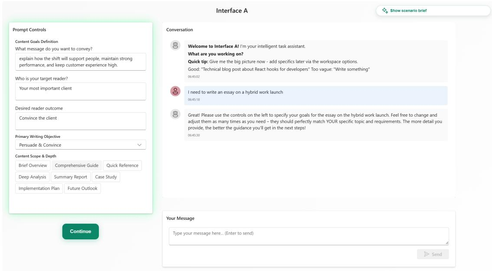  
Fig. A1. Goal Clarity interface. After the participant entered an initial request, the system rendered editable controls for message, audience, intended reader outcome, primary writing objective and desired scope/depth. This phase operationalized goal specification as an explicit, inspectable interface step rather than leaving it embedded only in free-form prompting.

Task Decomposition phase. After the participant specified the goal-clarity controls, the interface rendered a second panel tailored to the current scenario and the participant’s prior selections. In this phase, the system generated task-specific planning controls, including candidate analytical approaches, a selectable essay structure and a field for critical considerations. Participants could accept these controls, revise them directly or request alternative controls through a natural-language workspace box. This phase operationalized decomposition as a structured but editable breakdown of the task into manageable analytical and rhetorical components.

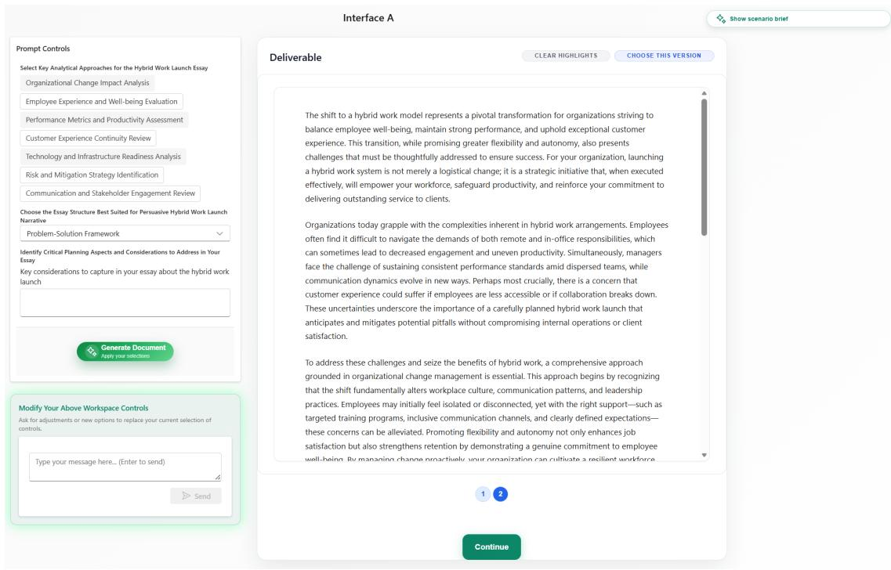  
Fig. A2. Task Decomposition interface. Once goal-clarity information was specified, the system generated task-specific planning controls for analytical approaches, essay structure and critical considerations. A dedicated natural-language box allowed participants to ask for adjustments or replacement controls, making the decomposition adaptive to their evolving intent.

Together, these two phases instantiated the central design claim of the intervention: metacognitive support for AI-assisted writing can be rendered as dynamic interface controls that respond to the user’s current request and stage of work, rather than as a single static checklist. Goal clarity was intended to constrain the target, and task decomposition was intended to organize execution and evaluation. The interface therefore scafolded not just what to ask the model, but how to represent and manage the task itself.

## 4-Day Work-Week, Yes or No?

  
Start Writing →

Fig. A3. Scenario brief 1 | 4-Day Work-Week, Yes or No? Participants were cast as a senior policy analyst in a city-planning department and asked to write a proposal about whether a city should adopt a 4-day work week for municipal employees. The brief framed the task as a persuasive knowledge-work assignment requiring trade-of analysis, audience awareness and justification of recommendations.

## Hybrid-Work Launch on the Line

You are the Strategic Operations Lead for Crestfield Consulting. The client you

  
Fig. A4. Scenario brief 2 | Hybrid-Work Launch on the Line. Participants were cast as a strategic operations lead at a consulting firm and asked to write a persuasive brief for a client considering a major hybrid-work rollout. The brief emphasized decision quality, productivity, employee well-being, talent atraction and client outcomes.

## B Essay scoring: rubric and human-rating interface

## B.1 Essay-scoring rubric

Table A1 shows the seven analytic criteria (A–G), each rated on a 1–4 scale, that were used by the human raters and supplied to the LLM judge. The human-rating interface is described in Section B.2.

Table A1. Essay-scoring rubric for the seven shared criteria $( \mathsf { A } \mathrm { - } \mathsf { G } ) ,$ , used by the human raters and supplied to the LLM judge.
<table><tr><td rowspan=1 colspan=12>Criterion         Score 1                    Score 2                    Score 3                    Score 4</td></tr><tr><td rowspan=6 colspan=12>A. Context &amp; Purpose Little/no problem framing; unclear  Vague or generic framing; audience Frames the problem and audience   Clearly frames the decisionaudience; substantial off-task      needs are mostly implicit; parts feel reasonably well; mild mismatch in  problem; explicitly tailors to thecontent.                    templated or only loosely tied to   emphasis but remains on task.     intended decision-maker; staysthe decision context.                                      tightly aligned to the task.B. Recommendation No clear recommendation/position. Stance is implied or wobbly;      Clear stance, but key specifics     States a clear recommendation earlyClarity                                     proposal details are underspecified  (scope/model) are incomplete,     and specifies what is beingor contradictory.              delayed, or mildly inconsistent.    proposed (scope, model, key designchoices); provides a concisesummary of the rationale.C. Argument Quality Disorganized, internally         Relies on assertions or one-step    Mostly logical and persuasive; some Builds a coherent chain from claimsinconsistent, or largely</td></tr><tr><td rowspan=1 colspan=2>recomme</td><td rowspan=1 colspan=3>mendation/p</td></tr><tr><td rowspan=1 colspan=3>or contradict</td></tr><tr><td rowspan=1 colspan=1> of the rationale.</td></tr><tr><td rowspan=1 colspan=1>oherent chain from claims</td></tr><tr><td rowspan=1 colspan=2>reasoning; weak linkage between</td><td rowspan=3 colspan=2>assumptions.                 assumptions/warrants legible.Some evidence, but uneven (claims  Uses specific supporting material</td><td rowspan=1 colspan=1>sons → support; makes</td></tr><tr><td rowspan=1 colspan=2></td><td rowspan=1 colspan=6>non-argumentative.</td><td rowspan=1 colspan=2>points.</td></tr><tr><td rowspan=1 colspan=2>D. Evidence and</td><td rowspan=1 colspan=6>Virtually no support; repeated</td><td rowspan=1 colspan=2>Mostly generalities; evidence is</td></tr><tr><td rowspan=1 colspan=2>Credibility</td><td rowspan=1 colspan=6>overclaims; credibility is</td><td rowspan=1 colspan=2>thin/generic; numbers (if any) feel</td><td rowspan=1 colspan=2>without support in places).       (examples, comparisons); avoids</td></tr><tr><td rowspan=3 colspan=2>E. Feasibility</td><td rowspan=3 colspan=8>questionable.No implementation thinking;     Implementation is largely</td><td rowspan=1 colspan=1>ungrounded.</td><td rowspan=1 colspan=1>overclaims; support is relevant and</td></tr><tr><td rowspan=1 colspan=2></td><td rowspan=1 colspan=2>credible.</td></tr><tr><td rowspan=1 colspan=2>Mentions implementation with    Presents a realistic implementation</td></tr><tr><td rowspan=1 colspan=1></td><td rowspan=1 colspan=1></td><td rowspan=1 colspan=8>proposal would be difficult to     aspirational; feasibility concerns are</td><td rowspan=1 colspan=2>some concrete steps; gaps remain   path: key steps, timeline or pilot,</td></tr><tr><td rowspan=4 colspan=2>F. Impact</td><td rowspan=1 colspan=8>execute as described.           waved away; limited operational</td><td rowspan=1 colspan=2>(timeline vague, risks not fully     operational coverage plan,</td></tr><tr><td rowspan=3 colspan=8>detail.Ignores stakeholder impacts or    Narrow focus (e.g., only employee</td><td rowspan=1 colspan=2>addressed, success metrics thin).   governance/roles, and how success</td></tr><tr><td rowspan=2 colspan=2>will be measured.Identifies key stakeholders</td></tr><tr><td rowspan=1 colspan=1>Discusses stakeholder impacts, but</td></tr><tr><td rowspan=1 colspan=2></td><td rowspan=1 colspan=6>makes one-sided claims without</td><td rowspan=1 colspan=2>wellbeing or only productivity);</td><td rowspan=1 colspan=1>not deeply; consequences lightly</td><td rowspan=1 colspan=1>(employees, managers); anticipates</td></tr><tr><td rowspan=1 colspan=2></td><td rowspan=1 colspan=6>considering harms.</td><td rowspan=1 colspan=2>description of impacts are minimal.</td><td rowspan=1 colspan=1>addressed.</td><td rowspan=1 colspan=1>impacts and (unintended)</td></tr><tr><td rowspan=8 colspan=10>G. Organization</td><td rowspan=2 colspan=1></td><td rowspan=2 colspan=1></td></tr><tr><td rowspan=1 colspan=1></td></tr><tr><td rowspan=1 colspan=6>Poorly organized; difficult to follow.</td><td rowspan=1 colspan=2>Some structure but hard to scan;</td><td rowspan=1 colspan=1>Generally well organized</td><td rowspan=1 colspan=1>The sequence of ideas and semantic</td></tr><tr><td rowspan=1 colspan=2>repeated points; unclear</td><td rowspan=1 colspan=1>occasional digressions or weak</td><td></td></tr><tr><td rowspan=2 colspan=2>prioritization.</td><td rowspan=2 colspan=1>transitions; still coherent and</td><td></td></tr><tr><td rowspan=1 colspan=1>signposting make therecommendation, rationale and</td></tr><tr><td rowspan=1 colspan=1>readable.</td><td rowspan=1 colspan=1>implementation easy to follow;</td></tr><tr><td rowspan=1 colspan=2>decision-making and redundancy isminimal.</td></tr></table>

## B.2 Human-rating interface

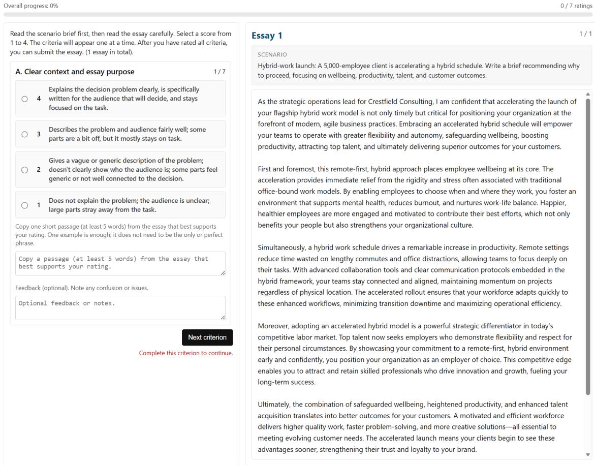  
Fig. A5. Human-rating interface for scoring and citing supporting essay evidence.

## C Prompt-coding codebook and coder agreement

Table A2. Prompt-coding reliability on the 60-sequence subset (original categorical codebook ratings), human–essay-judge agreement, and reliability across five essay-judge runs. R1–R3 are the three human coders; LLM is the automated coder applying the same codebook.
<table><tr><td>Comparison</td><td>Measure</td><td>N</td><td>Estimate</td><td>95% CI</td></tr><tr><td colspan="5">Prompt coding: goal clarity (0-3)</td></tr><tr><td>R1-R2</td><td> $\kappa _ { w }$ </td><td>60</td><td>0.703</td><td>[0.463, 0.844]</td></tr><tr><td>R1-R3</td><td> $\kappa _ { w }$ </td><td>60</td><td>0.587</td><td>[0.315, 0.755]</td></tr><tr><td>R2-R3</td><td> $\kappa _ { w }$ </td><td>60</td><td>0.654</td><td>[0.368, 0.813]</td></tr><tr><td>LLM-R1</td><td> $\kappa _ { w }$ </td><td>60</td><td>0.458</td><td>[0.269, 0.613]</td></tr><tr><td>LLM-R2</td><td> $\kappa _ { w }$ </td><td>60</td><td>0.435</td><td>[0.196, 0.604]</td></tr><tr><td>LLM-R3</td><td> $\kappa _ { w }$ </td><td>60</td><td>0.740</td><td>[0.510, 0.854]</td></tr><tr><td>LLM versus three-coder mean</td><td> $\mathrm { I C C } ( \mathrm { A } , 1 )$ </td><td>60</td><td>0.621</td><td>[0.403, 0.751]</td></tr><tr><td>Three-coder mean</td><td>ICC(A,3)</td><td>60</td><td>0.849</td><td>[0.686, 0.917]</td></tr><tr><td colspan="5">Prompt coding: task decomposition (0-3)</td></tr><tr><td>R1-R2</td><td> $\kappa _ { w }$ </td><td>60</td><td>0.648</td><td>[0.401, 0.831]</td></tr><tr><td>R1-R3</td><td> $\kappa _ { w }$ </td><td>60</td><td>0.520</td><td>[0.278, 0.697]</td></tr><tr><td>R2-R3</td><td> $\kappa _ { w }$ </td><td>60</td><td>0.621</td><td>[0.328, 0.818]</td></tr><tr><td>LLM-R1</td><td> $\kappa _ { w }$ </td><td>60</td><td>0.363</td><td>[0.059, 0.575]</td></tr><tr><td>LLM-R2</td><td> $\kappa _ { w }$ </td><td>60</td><td>0.364</td><td>[0.043, 0.606]</td></tr><tr><td>LLM-R3</td><td> $\kappa _ { w }$ </td><td>60</td><td>0.482</td><td>[0.172, 0.727]</td></tr><tr><td>LLM versus three-coder mean</td><td> $\mathrm { I C C } ( \mathrm { A } , 1 )$ </td><td>60</td><td>0.517</td><td>[0.155, 0.748]</td></tr><tr><td>Three-coder mean</td><td>ICC(A,3)</td><td>60</td><td>0.817</td><td>[0.647, 0.900]</td></tr><tr><td colspan="5">Prompt coding: combined GC+TD</td></tr><tr><td>R1-R2</td><td> $\kappa _ { w }$ </td><td>60</td><td>0.677</td><td>[0.447, 0.837]</td></tr><tr><td>R1-R3</td><td> $\kappa _ { w }$ </td><td>60</td><td>0.578</td><td>[0.376, 0.723]</td></tr><tr><td>R2-R3</td><td> $\kappa _ { w }$ </td><td>60</td><td>0.699</td><td>[0.479, 0.830]</td></tr><tr><td>LLM-R1</td><td> $\kappa _ { w }$ </td><td>60</td><td>0.462</td><td>[0.287, 0.602]</td></tr><tr><td>LLM-R2</td><td> $\kappa _ { w }$ </td><td>60</td><td>0.517</td><td>[0.297, 0.663]</td></tr><tr><td>LLM-R3</td><td> $\kappa _ { w }$ </td><td>60</td><td>0.681</td><td>[0.488, 0.799]</td></tr><tr><td>LLM versus three-coder mean</td><td>ICC(A,1)</td><td>60</td><td>0.662</td><td>[0.482, 0.780]</td></tr><tr><td>Three-coder mean</td><td>ICC(A,3)</td><td>60</td><td>0.848</td><td>[0.714, 0.915]</td></tr><tr><td colspan="5">Human-essay-judge agreement: seven shared dimensions</td></tr><tr><td>Human versus judge</td><td>ICC(A,1)</td><td>107</td><td>0.456</td><td>[0.349, 0.547]</td></tr><tr><td colspan="5">Essay-judge inter-run reliability: seven-dimension composite</td></tr><tr><td>Single run</td><td>ICC(A,1)</td><td>594</td><td>0.711</td><td>[0.666, 0.747]</td></tr><tr><td>Mean of five runs</td><td>ICC(A,5)</td><td>594</td><td>0.925</td><td>[0.909, 0.937]</td></tr></table>

## C.1 Prompt-coding codebook

Purpose of the codebook. This codebook was used to structure the manual prompt-coding stage that preceded LLM-based extension of the prompt annotations. It was designed to capture metacognitive properties of participant prompting, especially the extent to which conversations made the goal of the writing task explicit and decomposed the task into manageable sub-goals. The framework draws on Flower and Hayes’ cognitive process account of writing, hierarchical task analysis, cognitive task analysis, and the 4D AI Fluency framework.

Coding workflow. The unit of analysis was the participant-authored prompt sequence within an AI-assisted writing session. A 20% subset of sequences (60 conversations) was independently coded by three researchers using the codebook below, and an LLM coder applied the same codebook to the same sequences; these codes were used to assess inter-coder reliability and the LLM coder’s agreement with the human coders (Table A2). The graded indicator scoring used in the analyses is described in Methods.

## C.2 A. Goal clarity

Construct. Goal clarity captures how explicitly the conversation communicates a clear purpose or intended outcome for the writing task. Coders assess the full prompt sequence holistically to determine how clearly the user specifies what the writing should achieve, for whom, and under what constraints.

Table A3. Goal-clarity dimension-level codes
<table><tr><td>Code</td><td>Label</td><td>Definition</td><td>Coding cue</td></tr><tr><td>GC-0</td><td>Absent</td><td>No discernible goal or purpose is expressed. Prompts consist of bare topics or instructions so vague that the intended writing outcome</td><td>No explicit purpose, audience or constraint.</td></tr><tr><td>GC-1</td><td>Implicit</td><td>but it is never stated explicitly. The user delegates full goal definition to the AI.</td><td>A general purpose can be inferred from context, Genre or topic implies a goal, but the user does not specify it.</td></tr><tr><td>GC-2</td><td>Moderate</td><td>At least one explicit goal is stated, but the conversation does not specify audience, constraints or evaluative criteria in enough</td><td>Purpose or genre is named, but supporting constraints are thin.</td></tr><tr><td>GC-3</td><td>High</td><td>detail to make the target unambiguous. audience, constraints, format/tone or evaluative criteria. The intended outcome is unambiguous and may develop across turns.</td><td>Clear purpose is articulated plus at least two of: A full rhetorical problem is made explicit.</td></tr></table>

Goal-clarity indicators. For conversations coded GC-1 or above, coders optionally marked whether the following indicators were present anywhere in the full prompt sequence: purpose stated (GC-P), audience specified (GC-A), constraints articulated (GC-C), evaluative criteria (GC-E), genre/form named (GC-G), rhetorical situation (GC-R), and process goal (GC-PG).

Goal-clarity decision rules. GC-0 was used when no indicators were present. GC-1 was used when the goal was only implicitly derivable. GC-2 required at least one explicit indicator (typically purpose or genre). GC-3 required an explicit purpose plus at least two additional indicators such as audience, constraints or evaluative criteria.

## C.3 B. Task decomposition

Construct. Task decomposition captures the extent to which the prompt sequence breaks the writing task into identifiable sub-tasks, steps or structured parts rather than presenting it as a single undiferentiated request.

Task-decomposition indicators. For conversations coded TD-1 or above, coders optionally marked whether the prompt sequence identified sub-goals (TD-SG), specified sequencing (TD-SQ), indicated diferential granularity (TD-GR), noted dependencies among parts (TD-DP), specified delegation structure between user and AI (TD-DL), or displayed iterative structure across turns (TD-IT).

Task-decomposition decision rules. TD-0 was used when no decomposition was visible. TD-1 required identifiable sub-goals without an explicit sequence. TD-2 required both sub-goals and sequencing. TD-3 required sub-goals and sequencing plus at least two additional indicators such as granularity, dependencies, delegation structure or iteration.

Table A4. Task-decomposition dimension-level codes
<table><tr><td>Code</td><td>Label</td><td>Definition</td><td>Coding cue</td></tr><tr><td>TD-0</td><td>Monolithic</td><td>The writing task is presented as a single undifferentiated request. No sub-tasks, steps or structural divisions are discernible.</td><td>&quot;Write about climate change.&quot;</td></tr><tr><td>TD-1</td><td>Partially decomposed</td><td>is named or implied, but without specified ordering or relations among those components.</td><td>More than one component or aspect of the task Components are listed but not organized.</td></tr><tr><td>TD-2</td><td>Structured</td><td>The task is explicitly organized into ordered steps, labeled sections or a sequence of sub-tasks. Relationships between parts are</td><td>Numbered or ordered steps are present.</td></tr><tr><td>TD-3</td><td>Hierarchical</td><td>specified at one level. The task is decomposed at multiple levels: top-level goals are broken into sub-goals, which are themselves broken into operations or priorities. Dependencies across levels are indicated.</td><td>Multi-level structure with priorities or dependencies.</td></tr></table>

## C.4 C. Worked examples

Example 1: minimal single-turn prompt. “Write about climate change.” This was coded GC-0 and TD-0 because neither the goal nor the structure of the task was made explicit

Example 2: goal-rich but undecomposed prompt. “Write a persuasive blog post about remote work for HR managers. Keep it under 800 words.” This was coded GC-3 because it specifies purpose, audience, genre and a length constraint, but TD-0 because the task is still presented monolithically.

Example 3: iterative decomposed prompt sequence. “I need a policy brief for the Minister of Education on digital literacy funding. Start with an executive summary, then three evidence-based arguments with statistics, then address the main counterargument, and end with a policy recommendation. Formal but accessible tone. ... Now strengthen the second argument with OECD data. ... I will handle the final edit; tighten the executive summary to 100 words.” This was coded GC-3 and TD-3 because the goal is rhetorically explicit and the task is decomposed hierarchically across multiple turns.

## C.5 D. Coding procedure and edge cases

The coding procedure proceeded in six steps: (1) read the full prompt sequence; (2) assign a goal-clarity rating; (3) mark goal-clarity indicators; (4) assign a task-decomposition rating; (5) mark task-decomposition indicators; and (6) record coder notes for edge cases.

Because the coding was conversation-level, indicators could appear in any turn. A goal stated in an early turn and a constraint added later both counted. Decomposition that emerged progressively across turns was coded at the highest level observed in the full sequence.

Three edge-case rules were applied. First, if the goal had to be inferred only from genre conventions, coding was capped at GC-1. Second, bullet points used only for readability did not count as task decomposition unless they clearly structured sub-tasks. Third, AI-proposed structure did not count as user-initiated decomposition unless the user modified, elaborated or otherwise actively took it up.

## C.6 E. Blank coding sheet

Table A5. Blank coding sheet
<table><tr><td>Field</td><td>Value</td></tr><tr><td>Conversation ID</td><td></td></tr><tr><td>Number of user turns</td><td></td></tr><tr><td>Writing task type</td><td></td></tr><tr><td>GC rating</td><td>GC-0 / GC-1 / GC-2 / GC-3</td></tr><tr><td>GC-P (purpose)</td><td>0 / 1</td></tr><tr><td>GC-A (audience)</td><td>0 / 1</td></tr><tr><td>GC-C (constraints)</td><td>0 / 1</td></tr><tr><td>GC-E (evaluative criteria)</td><td>0 / 1</td></tr><tr><td>GC-G (genre/form)</td><td>0 / 1</td></tr><tr><td>GC-R (rhetorical situation)</td><td>0 / 1</td></tr><tr><td>GC-PG (process goal)</td><td>0 / 1</td></tr><tr><td>TD rating</td><td>TD-0 / TD-1 / TD-2 / TD-3</td></tr><tr><td>TD-SG (sub-goals)</td><td>0 / 1</td></tr><tr><td>TD-SQ (sequencing)</td><td>0 / 1</td></tr><tr><td>TD-GR (granularity)</td><td>0 / 1</td></tr><tr><td>TD-DP (dependencies)</td><td>0 / 1</td></tr><tr><td>TD-DL (delegation)</td><td>0 / 1 0 / 1</td></tr><tr><td>TD-IT (iterative structure) Coder notes</td><td></td></tr></table>

## D Survey items

All items administered in the four surveys are listed in Table A6 in the order in which participants encountered them: the baseline survey before Task 1, the post-task survey after Task 1, the debrief survey after Task 2, and the voluntary follow-up survey three days later.

Table A6. Survey items by stage, in the order administered. Response scales are given in the block headings or in square brackets after the item. Items shown with a leading ellipsis were presented under a shared introductory stem in the survey form. Item numbers within blocks match those used in Table A12 and Table A11. Participant-identifier fields and the completion-code screen are omited.

<table><tr><td>Item</td><td>Wording [response options]</td></tr><tr><td colspan="2">Baseline survey (before Task 1)</td></tr><tr><td>Prior AI use</td><td></td></tr><tr><td>AI-use 1</td><td>How often do you use AI tools like ChatGPT? [once per month / once per week / a few times per week / daily / a few times daily] What do you use AI tools like ChatGPT for? [professional writing / creative writing / research / coding / general knowledge /</td></tr><tr><td>AI-use 2</td><td>content creation / other (free text)]</td></tr><tr><td colspan="2">General metacognitive regulation, adapted from the Metacognitive Awareness Inventory [97] (1 = does not describe me at all, 5 = describes me very much)</td></tr><tr><td>Meta 1</td><td>I set specific goals before I begin a task</td></tr><tr><td>Meta 2</td><td>I ask myself periodically if I am meeting my goals.</td></tr><tr><td>Meta 3</td><td>I organise my time to best accomplish my goals.</td></tr><tr><td>Meta 4</td><td>I ask myself how well I accomplished my goals once I am finished</td></tr><tr><td>Meta 5</td><td>I try to break tasks down into smaller steps.</td></tr><tr><td>Meta 6</td><td>I ask myself questions about the material before I begin</td></tr><tr><td>Meta 7</td><td>I think about what I really need to do before I begin a task.</td></tr><tr><td>Meta 8</td><td>I read instructions carefully before I begin a task</td></tr><tr><td colspan="2">Writing metacognition, adapted from the Metacognitive Strategies in Writing questionnaire [88] and the Metacognitive Strategies of Writing Survey [1] (1</td></tr><tr><td>Meta 9</td><td>= strongly disagree, 5 = strongly agree)</td></tr><tr><td>Meta 10</td><td>...I check if my writing meets the requirements of the writing task.</td></tr><tr><td>Meta 11</td><td>...I check if the content of my writing is relevant to the topic.</td></tr><tr><td>Meta 12</td><td>...I check if the organization of my writing is logical. ...I check if the language of my writing is clear enough.</td></tr><tr><td>Meta 13</td><td>... my composing process is usually like this: Analysing the writing task, generating ideas, planning, outlining, drafting, and</td></tr><tr><td></td><td>revising.</td></tr><tr><td colspan="2">Self-rated writing skill Skill</td></tr><tr><td></td><td>How would you rate your essay writing skills? [beginner / novice / intermediate / advanced / expert]</td></tr><tr><td colspan="2">AI metacognition, items from Sidra and Mason [107] (1 = never, 7 = always)</td></tr><tr><td>AI-meta 1</td><td>...I think about how to give the most appropriate information to the AI.</td></tr><tr><td>AI-meta 2</td><td>...I consider what information the AI needs to perform the task</td></tr><tr><td>AI-meta 3</td><td>...I think about how well I understand what the AI is good and not so good at for the task we're doing.</td></tr><tr><td>AI-meta 4</td><td>...I think about how best to divide the work between me and the AI.</td></tr><tr><td>AI-meta 5</td><td>...I review my thinking to ensure that I'm not accepting or rejecting the AI's recommendation too quickly.</td></tr><tr><td>AI-meta 6</td><td>...I check task goals every now and then to make sure we're on track.</td></tr><tr><td>AI-meta 7</td><td>...I try to ensure that my own mental shortcuts or biases aren't affecting my reactions to the AI's output.</td></tr><tr><td>AI-meta 8</td><td>...I remind myself about my own limitations or weaknesses so as to minimise their impact on the task.</td></tr><tr><td>AI-meta 9</td><td>...I think about how I can improve the way I work with AI.</td></tr><tr><td>AI-meta 10</td><td>...I analyse my thinking before jumping to conclusions regarding the AI's output.</td></tr><tr><td>AI-meta 11</td><td>... If something goes wrong, I analyse the situation so I can avoid a similar error in the future.</td></tr><tr><td colspan="2">Prompting self-efficacy, items from Gibreel and Arpaci [45] (1 = strongly disagree, 5 = strongly agree)</td></tr><tr><td>Item Wording [response options]</td><td></td></tr></table>

Prompt 1 . . . I can break down complex tasks into well-structured prompts, guiding AI step by step while minimizing trial and error.

Prompt 2 . . . I can adjust my prompts using diferent formats (e.g., structured lists, open-ended questions, scenario-based instructions) to enhance response quality and relevance.

Prompt 3 . . . I can improve AI-generated responses by specifying constraints such as role, tone, length, format, or other contextual factors.

Prompt 4 . . . I can improve response relevance by incorporating real world examples, hypothetical scenarios, or case studies tailored to diferent AI tools.

## Post-task survey (after Task 1)

Task metacognition, post-task wording of the Metacognitive Awareness Inventory items (1 = does not describe me at all, 5 = describes me very much)

Meta 1 I set specific goals before I began with the task

Meta 2 I asked myself periodically if I was meeting my goals.

Meta 3 I organised my time to best accomplish my goals.

Meta 4 I asked myself how well I accomplished my goals once I was finished

Meta 5 I tried to break tasks down into smaller steps.

Meta 6 I asked myself questions about the task before I began.

Meta 7 I thought about what I really needed to do before I began the task.

Meta 8 I read instructions carefully before I began the task.

Writing metacognition, post-task wording of the writing-metacognition items (1 = strongly disagree, 5 = strongly agree)

Meta 9 . . . I checked if my essay met the requirements of the writing task.

Meta 10 . . . I checked if the content of my essay was relevant to the topic.

Meta 11 . . . I checked if the organization of my essay was logical.

Meta 12 . . . I checked if the language of my essay was clear enough.

Meta 13 . . . my composing process was like this: I analysed the writing task, then I generated ideas, then I planned the essay, then I outlined the essay, drafter, and revised it.

## AI experience

Help How helpful did you find the AI tool? [1–5]

Control How much in control did you feel when using the AI tool? [1–5]

Open What aspects of the AI tool were most beneficial? Which were least beneficial? [open-ended]

Workload: NASA-TLX items (1–10)

Load 1 How mentally demanding was the essay writing task?

Load 2 How hurried or rushed was the pace of the task?

Load 3 How successful were you in accomplishing what you were asked to do?

Load 4 How hard did you have to work to accomplish your level of performance?

Load 5 How insecure, discouraged, irritated, stressed, or annoyed were you?

## Workload: additional AI-writing demand items (1–10)

Load 6 How mentally demanding was the essay topic itself to understand and write about?

Load 7 How much mental efort did developing coherent arguments for this essay demand?

Load 8 How much mental burden did managing the AI tool add for writing the essay?

Load 9 How mentally demanding was prompting the AI?

Load 10 Did you have to think hard about how to structure your essay efectively?

Load 11 Did integrating AI suggestions require careful mental processing?

Load 12 Did you struggle to keep track of all the ideas you wanted to include?

Load 13 Was it mentally challenging to maintain consistency throughout the essay?

Load 14 Was it dificult to maintain focus throughout the task?

## Debrief survey (after Task 2)

Workload (1–10)

<table><tr><td>Item</td><td>Wording [response options]</td></tr><tr><td>Load 1-14</td><td>Same 14 workload items as after Task 1, referring to the second essay; wording identical except Load 1 (“How mentally demanding was the essay-writing task?&quot;) and Load 8 (&quot;How much mental burden did managing the AI tool while writing add?&quot;).</td></tr><tr><td colspan="2">Workflow and future AI use</td></tr><tr><td>Workflow</td><td>Tell us about your workflow with the AI tool [open-ended]</td></tr><tr><td>Future use</td><td>If you had to complete a similar task in the future, would you use the AI tool? (If yes, why? If no, why not?) [open-ended]</td></tr><tr><td colspan="2">Follow-up invitation</td></tr><tr><td>Invite 1</td><td>To confirm, are you aware that completing the follow-up survey in 3 days&#x27; time (on Thursday) will make you eligible to win one of 20 extra rewards on Prolific over £30 (or local equivalent, e.g. approx. $40)? [yes / no; remainder of the question text abridged]</td></tr><tr><td>Invite 2</td><td>Are you able and willing to complete the follow-up study in 3 days (on Thursday)? [yes / no]</td></tr><tr><td>Closing</td><td></td></tr><tr><td>Comments</td><td>Closing message thanking participants and inviting any additional comments [open-ended]</td></tr><tr><td colspan="2">Three-day follow-up survey</td></tr><tr><td>Topic recall</td><td></td></tr><tr><td>Recall 1</td><td>What topic did you write about in your first essay? If you don&#x27;t remember, you can write &quot;Don&#x27;t remember&quot;. [open-ended]</td></tr><tr><td>Recall 2</td><td>What topic did you write about in your second essay? If you don&#x27;t remember, you can write &quot;Don&#x27;t remember&quot;. [open-ended]</td></tr><tr><td colspan="2">Free recall of proposal content Recall 3</td></tr><tr><td></td><td>Write down everything you remember about your proposal for a 4-day work week – for example the main sections you covered, which information you included, or key topics that you wrote about. If you don&#x27;t remember, you can write &quot;Don&#x27;t remember&quot;. [open-ended]</td></tr><tr><td>Recall 4</td><td>Write down everything you remember about your proposal for remote work – for example the main sections you covered, which information you included, or key topics that you wrote about. If you don&#x27;t remember, you can write “Don&#x27;t remember&quot;. [open-ended]</td></tr><tr><td colspan="2">Recognition checklists (select all that apply)</td></tr><tr><td></td><td>[attractive for top talent / better productivity / less burn-out / improved customer satisfaction / rising revenue / employee retention / fewer meetings / long-term success / improved well-being / reduced office cost / higher job turnover / none of the above / I don&#x27;t remember / other (please specify)]</td></tr><tr><td>Recog 2</td><td>Which benefits of a remote-work model did you discuss? Select all that apply and/or specify &quot;other&quot; (note: not all will apply) [stronger team cohesion / reduced stress level / better productivity / fewer sick days / time saving / better communication / money saving / environmental benefits / talent access / improved work-life balance / none of the above / I don&#x27;t remember / other (please</td></tr><tr><td colspan="2">Reflection</td></tr><tr><td>Insight</td><td>What is one insight about these topics that surprised you most? [open-ended]</td></tr></table>

## E Supplementary results: essay quality

Table A7. Mixed-efects models for primary and time-on-task robustness models, adjusted for the six common baseline covariates.
<table><tr><td rowspan="2">Term or contrast</td><td colspan="3">Primary model</td><td colspan="3">+ log time on task</td></tr><tr><td>Coef.</td><td>s.e.</td><td>P</td><td>Coef.</td><td>s.e.</td><td>P</td></tr><tr><td>Intercept</td><td>2.753</td><td>0.088</td><td>&lt; .001</td><td>2.761</td><td>0.157</td><td>&lt; .001</td></tr><tr><td>Task 1: scaffold vs control</td><td>0.089</td><td>0.034</td><td>.008</td><td>0.089</td><td>0.035</td><td>.011</td></tr><tr><td>Scaffold × second task</td><td>-0.019</td><td>0.043</td><td>.665</td><td>-0.019</td><td>0.044</td><td>.663</td></tr><tr><td>Second vs first task (control)</td><td>0.024</td><td>0.031</td><td>.440</td><td>0.023</td><td>0.032</td><td>.472</td></tr><tr><td>Topic: city workweek vs hybrid launch</td><td>0.251</td><td>0.021</td><td>&lt; .001</td><td>0.251</td><td>0.022</td><td>&lt; .001</td></tr><tr><td>Baseline writing purpose</td><td>-0.024</td><td>0.034</td><td>.478</td><td>-0.024</td><td>0.034</td><td>.477</td></tr><tr><td>Baseline writing skill</td><td>0.003</td><td>0.015</td><td>.829</td><td>0.003</td><td>0.015</td><td>.826</td></tr><tr><td>Baseline task decomposition</td><td>-0.002</td><td>0.014</td><td>.912</td><td>-0.002</td><td>0.014</td><td>.914</td></tr><tr><td>Baseline AI evaluating</td><td>-0.003</td><td>0.010</td><td>.783</td><td>-0.003</td><td>0.010</td><td>.783</td></tr><tr><td>Baseline AI prompting</td><td>0.007</td><td>0.011</td><td>.554</td><td>0.007</td><td>0.011</td><td>.553</td></tr><tr><td>Baseline AI-use frequency</td><td>-0.0004</td><td>0.011</td><td>.974</td><td>-0.0004</td><td>0.011</td><td>.975</td></tr><tr><td>Time on task (log seconds)</td><td></td><td></td><td></td><td>-0.001</td><td>0.021</td><td>.951</td></tr><tr><td>Task 2: previously scaffolded vs previously un- scaffolded</td><td>0.070</td><td>0.034</td><td>.037</td><td>0.070</td><td>0.034</td><td>.037</td></tr><tr><td>Participant random-intercept variance</td><td>0.0146</td><td>一</td><td>一</td><td>0.0147</td><td>一</td><td>一</td></tr><tr><td>Residual variance</td><td>0.0679</td><td></td><td></td><td>0.0680</td><td></td><td>1</td></tr><tr><td>Essays</td><td>594</td><td></td><td></td><td>594</td><td></td><td>一</td></tr><tr><td>Participants</td><td>297</td><td></td><td></td><td>297</td><td>1</td><td>1</td></tr></table>

Table A8. Agreement between the LLM essay judge and the human benchmark on the 107 human-rated essays not used as calibration examples. Human scores are the mean of two raters on the formated essays; judge scores are the mean of five runs on the de-formated essays. All statistics are computed on essay-level means across the seven shared rubric dimensions (A–G). The calibration slope is from a regression of judge on human scores; a slope below 1 indicates that the judge compresses the range of human scores.
<table><tr><td>Metric</td><td>Estimate</td><td>95%CI</td></tr><tr><td>Essays compared</td><td>107</td><td></td></tr><tr><td>Absolute-agreement ICC(A,1), human versus judge</td><td>0.456</td><td>[0.349, 0.547]</td></tr><tr><td>Pearson r, human versus judge</td><td>0.662</td><td></td></tr><tr><td>Calibration slope, judge on human</td><td>0.375</td><td></td></tr></table>

Table A9. Standardized essay-quality efect sizes (de-formated judge; � = 297)
<table><tr><td>Task</td><td>Scaffold-assigned M (SD)</td><td>Control M (SD)</td><td>Raw difference</td><td>Hedges&#x27;g</td><td>Adjusted difference</td><td>Adjusted standardized difference</td></tr><tr><td>Task 1</td><td>2.99 (0.32)</td><td>2.90 (0.32)</td><td>0.094</td><td>0.29</td><td>0.089</td><td>0.28</td></tr><tr><td>Task 2</td><td>2.98 (0.29)</td><td>2.92 (0.32)</td><td>0.063</td><td>0.21</td><td>0.070</td><td>0.23</td></tr></table>

## F Supplementary results: topic recall and follow-up missingness

Table A10. Topic-recall model summaries. OR is the treatment efect on the odds of correct topic recall (scafold versus control for Task 1; previously scafolded versus control for Task 2), from logistic mixed models with a participant random intercept, condition, task position, their interaction, scenario and the six common covariates (Section 3.4.6). Observed rates are control versus scafold.
<table><tr><td>Outcome</td><td>Task</td><td>Sample</td><td>OR [95% CI]</td><td>P</td><td>Observed rates (control vs scaffold)</td></tr><tr><td>Topic recall</td><td>Task 1</td><td>Complete case</td><td>5.07 [1.21, 21.25]</td><td>.026</td><td>45.6% vs 64.6%</td></tr><tr><td>Topic recall</td><td>Task 1</td><td>Multiple imputation (m = 50)</td><td>3.24 [1.11, 9.49]</td><td>.032</td><td></td></tr><tr><td>Topic recall</td><td>Task 2</td><td>Complete case</td><td>4.24 [1.02, 17.57]</td><td>.046</td><td>38.0% vs 54.4%</td></tr><tr><td>Topic recall</td><td>Task 2</td><td>Multiple imputation (m = 50)</td><td>3.06 [1.04, 9.02]</td><td>.042</td><td></td></tr></table>

Table A11. Firth-penalized logistic model of missing scored recall records: predictors, scoring and estimates. OR is the change in the odds of a participant’s recall record being missing, per SD of each standardized continuous predictor or for the coded category of each binary predictor, with all predictors entered jointly (� = 234 participants with complete predictor data); OR > 1 indicates higher odds of missingness. �: Cronbach’s alpha of composite predictors; NE: not estimated. Six further candidate indicators (writing-cohort membership, ambiguous exposure, missing post-task form, missing debrief form, Task 1 and Task 2 essay submited) were constant across participants and were excluded.
<table><tr><td>Predictor</td><td>Definition / scoring</td><td>α</td><td>OR [95% CI]</td><td>P</td></tr><tr><td>Treatment</td><td>Scaffold = 1; control = 0</td><td></td><td>1.65 [0.75, 3.73]</td><td>.216</td></tr><tr><td>First-task scenario</td><td>City workweek first = 1; hybrid-work first = 0</td><td></td><td>1.55 [0.73, 3.32]</td><td>.252</td></tr><tr><td>AI-use frequency</td><td>Single baseline item, 1–5</td><td></td><td>1.18 [0.88, 1.59]</td><td>.264</td></tr><tr><td>AI use for writing</td><td>Writing-related AI use = 1; otherwise = 0</td><td></td><td>1.01 [0.49, 2.05]</td><td>.983</td></tr><tr><td>Essay-writing skill</td><td>Single baseline item, 1–5</td><td>=</td><td>1.02 [0.76, 1.36]</td><td>.895</td></tr><tr><td>Baseline general metacognition</td><td>Mean of metacognition items 1-8; 1–5</td><td>0.862</td><td>1.27 [0.88, 1.85]</td><td>.208</td></tr><tr><td>Baseline writing metacognition</td><td>Mean of metacognition items 9–13; 1–5</td><td>0.758</td><td>1.03 [0.70, 1.52]</td><td>.877</td></tr><tr><td>Baseline AI metacognition</td><td>Mean of all 11 AI-metacognition items; 1–7</td><td>0.862</td><td>1.06 [0.77, 1.47]</td><td>.712</td></tr><tr><td>Baseline prompting self-report</td><td>Mean of all four prompting items; 1–5</td><td>0.818</td><td>1.12 [0.81, 1.57]</td><td>.493</td></tr><tr><td>Post-task general metacognition</td><td>Mean of Task 1 post-task items 1–8; 1–5</td><td>0.882</td><td>0.98 [0.63, 1.51]</td><td>.922</td></tr><tr><td>Post-task writing metacognition</td><td>Mean of Task 1 post-task items 9–13; 1–5</td><td>0.756</td><td>0.73 [0.49, 1.08]</td><td>.114</td></tr><tr><td>Task 1 helpfulness</td><td>Single item, 1–5</td><td>一</td><td>1.16 [0.80, 1.69]</td><td>.434</td></tr><tr><td>Task 1 perceived control</td><td>Single item, 1–5</td><td>=</td><td>0.95 [0.65, 1.39]</td><td>.790</td></tr><tr><td>Task 1 NASA-TLX</td><td>Mean of load items 1–5; performance reversed; 1–10</td><td>0.690</td><td>1.03 [0.60, 1.80]</td><td>.905</td></tr><tr><td>Task 2 NASA-TLX</td><td>Mean of load items 1–5; performance reversed; 1–10</td><td>0.758</td><td>1.02 [0.63, 1.66]</td><td>.927</td></tr><tr><td>Task 1 AI-writing demands</td><td>Mean of supplementary load items 6-14; 1-10</td><td>0.913</td><td>0.87 [0.49, 1.53]</td><td>.632</td></tr><tr><td>Task 2 AI-writing demands</td><td>Mean of supplementary load items 6-14; 1–10</td><td>0.924</td><td>0.95 [0.54, 1.66]</td><td>.850</td></tr><tr><td>Task 1 essay quality</td><td>Mean across rubric criteria A-G and five judge runs; 1-4</td><td>NE</td><td>0.67 [0.47, 0.94]</td><td>.021</td></tr><tr><td>Task 2 essay quality</td><td>Mean across rubric criteria A-G and five judge runs; 1-4</td><td>NE</td><td>0.90 [0.66, 1.23]</td><td>.511</td></tr><tr><td>Task 2 combined prompt quality</td><td>GC + TD: sum of 13 indicator means; 0–39</td><td>NE</td><td>1.36 [1.02, 1.80]</td><td>.033</td></tr><tr><td>Task 1 duration</td><td>Natural log of duration in seconds</td><td></td><td>0.91 [0.67, 1.22]</td><td>.504</td></tr><tr><td>Task 2 duration</td><td>Natural log of duration in seconds</td><td></td><td>1.16 [0.85, 1.59]</td><td>.352</td></tr><tr><td>Task 1 prompt count</td><td>Natural log of 1 + prompt count</td><td></td><td>1.11 [0.75, 1.64]</td><td>.609</td></tr><tr><td>Task 2 prompt count</td><td>Natural log of 1 + prompt count</td><td></td><td>1.06 [0.76, 1.49]</td><td>.712</td></tr><tr><td>Task 1 essay length</td><td>Natural log of 1 + word count</td><td></td><td>0.93 [0.66, 1.31]</td><td>.673</td></tr><tr><td>Task 2 essay length</td><td>Natural log of 1 + word count</td><td></td><td>0.98 [0.71, 1.37]</td><td>.920</td></tr></table>

Table A12. Item-level self-reported metacognition before and after Task 1
<table><tr><td>No.</td><td>Source</td><td>Item</td><td>Control pre</td><td>Control post</td><td>Scaffold pre</td><td>Scaffold post</td><td>b</td><td>95% CI</td><td>P</td><td> $P _ { \mathrm { B H } }$ </td><td>N</td></tr><tr><td>1</td><td>MAI</td><td>Set specific goals</td><td>3.72 (0.89)</td><td>3.77 (1.10)</td><td>3.68 (0.95)</td><td>3.91 (1.00)</td><td>0.190</td><td>[-0.019, 0.398]</td><td>.074</td><td>.241</td><td>290</td></tr><tr><td>2</td><td>MAI</td><td>Monitor goal progress</td><td>3.68 (0.99)</td><td>3.91 (1.01)</td><td>3.59 (1.06)</td><td>3.81 (0.96)</td><td>-0.051</td><td>[-0.257, 0.154]</td><td>.624</td><td>.811</td><td>280</td></tr><tr><td>3</td><td>MAI</td><td>Organize time around goals</td><td>3.86 (0.94)</td><td>3.83 (0.97)</td><td>3.79 (1.04)</td><td>3.68 (1.09)</td><td>-0.090</td><td>[-0.311, 0.132]</td><td>.427</td><td>.710</td><td>280</td></tr><tr><td>4</td><td>MAI</td><td>Evaluate goal attainment</td><td>3.88 (0.91)</td><td>4.20 (0.80)</td><td>3.73 (0.99)</td><td>4.03 (0.82)</td><td>-0.102</td><td>[-0.265, 0.061]</td><td>.220</td><td>.476</td><td>279</td></tr><tr><td>5</td><td>MAI</td><td>Break task into steps</td><td>3.83 (1.00)</td><td>3.24 (1.16)</td><td>3.98 (0.90)</td><td>4.03 (0.84)</td><td>0.753</td><td>[0.546, 0.959]</td><td>&lt; .001</td><td>&lt; .001</td><td>295</td></tr><tr><td>6</td><td>MAI</td><td>Ask questions before starting</td><td>3.71 (1.06)</td><td>3.89 (1.09)</td><td>3.70 (1.00)</td><td>3.87 (0.97)</td><td>0.024</td><td>[-0.182, 0.229]</td><td>.821</td><td>.931</td><td>292</td></tr><tr><td>7</td><td>MAI</td><td>Identify task requirements</td><td>4.03 (0.87)</td><td>4.08 (0.96)</td><td>4.07 (0.89)</td><td>4.13 (0.92)</td><td>0.067</td><td>[-0.133, 0.267]</td><td>.511</td><td>.739</td><td>291</td></tr><tr><td>8</td><td>MAI</td><td>Read instructions carefully</td><td>4.33 (0.89)</td><td>4.48 (0.80)</td><td>4.36 (0.82)</td><td>4.47 (0.74)</td><td>-0.013</td><td>[-0.158, 0.132]</td><td>.859</td><td>.931</td><td>292</td></tr><tr><td>9</td><td>MSW/MSWS</td><td>Check task requirements</td><td>4.46 (0.67)</td><td>4.58 (0.69)</td><td>4.52 (0.60)</td><td>4.45 (0.69)</td><td>-0.148</td><td>[-0.299, 0.002]</td><td>.054</td><td>.233</td><td>292</td></tr><tr><td>10</td><td>MSW/MSWS</td><td>Check content relevance</td><td>4.63 (0.60)</td><td>4.65 (0.60)</td><td>4.62 (0.51)</td><td>4.56 (0.64)</td><td>-0.085</td><td>[-0.220, 0.050]</td><td>.216</td><td>.476</td><td>291</td></tr><tr><td>11</td><td>MSW/MSWS</td><td>Check logical organization</td><td>4.59 (0.56)</td><td>4.55 (0.66)</td><td>4.32 (0.79)</td><td>4.47 (0.66)</td><td>-0.062</td><td>[-0.217, 0.094]</td><td>.437</td><td>.710</td><td>290</td></tr><tr><td>12</td><td>MSW/MSWS</td><td>Check language clarity</td><td>4.59 (0.56)</td><td>4.64 (0.56)</td><td>4.44 (0.73)</td><td>4.60 (0.59)</td><td>-0.001</td><td>[-0.130, 0.128]</td><td>.987</td><td>.987</td><td>292</td></tr><tr><td>13</td><td>MSW</td><td>Follow staged composing process</td><td>4.13 (0.82)</td><td>3.91 (1.17)</td><td>3.99 (0.97)</td><td>4.07 (0.90)</td><td>0.225</td><td>[0.010, 0.440]</td><td>.040</td><td>.233</td><td>288</td></tr></table>

## G Supplementary results: subjective outcomes

Table A13. Subjective-outcome summaries after Task 1
<table><tr><td>Outcome</td><td>Control M</td><td>Scaffold M</td><td>b [95% CI]</td><td>P</td></tr><tr><td>AI helpfulness</td><td>4.77</td><td>4.40</td><td>-0.342 [-0.510, -0.174]</td><td>&lt; .001</td></tr><tr><td>Perceived control</td><td>4.09</td><td>3.78</td><td>-0.251 [-0.486, -0.017]</td><td>.036</td></tr></table>