# Mitigating Saliency Collapse: Robust Saliency-Aware Long-Text Image-Text Alignment

Qiuyu Kong1 Zanxi Ruan2,∗ Marco Cristani2,4 Yiming Wang3

1Sapienza University of Rome 2University of Verona

3 Fondazione Bruno Kessler 4Reykjavik University

qiuyu.kong@uniroma1.it zanxi.ruan@univr.it marco.cristani@univr.it ywang@fbk.eu

## Abstract

Long-text image–text alignment is essential for fine-grained scene understanding, yet existing methods mainly focus on extending context length or improving local alignment. We identify an overlooked failure mode, saliency collapse, where models over-rely on text that features visual prominence while underutilizing nonsalient context. Consequently, retrieval performance degrades sharply when salient content is reduced, despite that the non-salient context remains informative. To address this, we propose ROSA, a saliency-aware finetuning framework that decomposes image-text pairs into complementary salient and contextual views, enabling joint learning of prominent and contextual semantics. We propose a modalityindependent decomposition strategy to combine object-level visual saliency estimation with LLM-based text decomposition to bridge vision and language. We employ auxiliary objectives to explicitly align these views, ensuring robust representation with both salient and contextual features. ROSA greatly improves long-text retrieval and demonstrates strong robustness to saliency collapse across benchmarks. Moreover, our auxiliary objectives are plug-and-play, bringing consistent gains to existing tuning methods. Code and checkpoints are available at: https://github.com/intelligolabs/RoSA

## 1 Introduction

Long-text image-text alignment establishes semantic correspondence between images and detailed textual descriptions [Onoe et al., 2024, Zhang et al., 2024], a capability fundamental to fine-grained and complex scene understanding. Since the standard CLIP text encoder is restricted to a 77- token context window [Radford et al., 2021], contemporary methods have primarily addressed this bottleneck by extending context lengths [Zhang et al., 2024], enhancing local spatial alignment [Choi et al., 2025], or incorporating structural priors via auxiliary objectives [Ruan et al., 2026].

Departing from existing literature, we revisit long-text alignment through a human-centric lens: humans do not process complex visual scenes uniformly, but naturally attend to specific, salient regions [Borji et al., 2013, Kumain et al., 2025]. Our preliminary analysis of text-to-image retrieval on long-text benchmarks [Onoe et al., 2024, Truong et al., 2025], as shown in Fig. 1(b1), reveals that state-of-the-art alignment methods [Zhang et al., 2024, Choi et al., 2025, Ruan et al., 2026] rely disproportionately on scattered text describing visual prominence, i.e. salient text, while overlooking the surrounding non-salient context, i.e. contextual text, despite its semantic value for retrieval (details in Sec. 3). When we progressively reduce the ratio of salient text (α) within a query, the retrieval performance (R@1) of existing models degrades significantly faster than when an equivalent amount of text is removed at random. We term this failure mode as saliency collapse: Information-dense salient evidence provides an attractive retrieval shortcut. Overreliance on this shortcut can prevent models from effectively using the remaining contextual evidence when salient cues are weakened. This exposes a critical limitation for downstream tasks such as text-to-image retrieval, as humans can subjectively prioritize different aspects of a scene [Rahman and Bruce, 2015, Liang et al., 2018, Zangrossi et al., 2021]. As illustrated in Fig. 1(a), when asked to describe the same image, user A might focus on more prominent foreground objects than user B.

(a)  
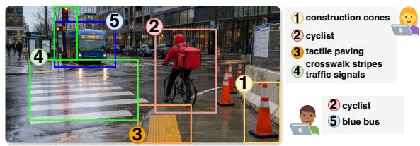

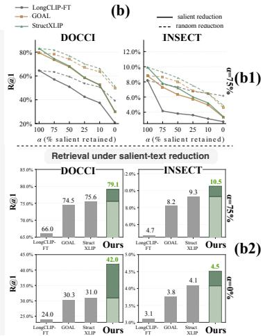  
In a rainy city intersection, a cyclist carrying a large red delivery bag waits near the curb, seemingly preparing to cross the wet street; in the distance, a blue bus is approaching from the opposite side of the road, with its headlights and the traffic signals reflected on the puddled pavement. The surrounding glass-fronted buildings, bus stop signs, and scattered pedestrians together create a cold, damp, and active urban street scene. User B  
Figure 1: Saliency collapse in long-text alignment. a) Different users may describe the same image with long queries that cover different subsets of salient objects; b1) Existing long-text alignment methods suffer from saliency collapse: they degrade sharply when salient text is progressively reduced, at a faster pace than when random content of the matched-length is removed. b2) Under both mild salient text reduction (α = 75%) and complete salient text removal (α = 0%), our method significantly improves over prior methods in terms of R@1. The relative gain of ours over the best competitor StructXLIP [Ruan et al., 2026] is highlighted in a darker tone.

A truly robust vision-language aligned model must go beyond simple token extension to represent both salient visual prominence and the complementary, non-salient context. To address saliency collapse in long-text alignment, we propose Robust Saliency-aware Alignment (ROSA), a novel finetuning framework that exploits auxiliary learning to explicitly reinforce both salient and contextual content alignment in long text. ROSA decomposes the original image-text pairs into two complementary views: a salient view of image-text pair featuring visually prominent regions, and a contextual view of image-text pair featuring the remaining non-salient context. These decomposed views then serve for auxiliary alignment objectives, together with the primary image-text alignment objective. Specifically, the auxiliary alignment objectives contain i) saliency-focused contrastive alignment that operates among the salient views, ii) context-preserving contrastive alignment that operates among the contextual views, and iii) visual anchoring that prevents severe visual representation drift. Importantly, the saliency-guided decomposition is a fine-tuning phase only, introducing no additional inference cost.

The efficacy of this paradigm hinges on how saliency is defined across modalities. While visual saliency arises from both low-level cues and high-level semantics, natural language primarily captures the latter and struggles to express perceptual saliency driven by non-semantic signals [Song et al., 2014, Liang et al., 2018]. We argue that object-level saliency sits at the intersection, providing a natural bridge between vision and language. Building on advances in object saliency estimation [Borji et al., 2019, Dhara and Kumar, 2025] and evidence that modern LLMs exhibit human-like semantic attention [Chen et al., 2025, Lee et al., 2025], we adopt a modality-independent decomposition strategy. Specifically, we use an off-the-shelf object saliency estimator [Yildirim and Süsstrunk, 2014] for images, while independently we exploit a Large Language Model (LLM) to decompose the captions. This modality-independent strategy is intuitive, as cross-modal approaches rely on modality-aligned models, and is further supported by our ablation studies. As shown in Fig. 1(b2), under both mild salient text reduction (α = 75%) and complete removal (α = 0%), ROSA is more robust to saliency collapse, achieving higher retrieval performance than existing methods. Extensive

experiments across various benchmarks show that ROSA significantly improves long-text retrieval.   
The auxiliary objectives are also plug-and-play, yielding consistent boosts to existing models.

To summarize, our main contributions are as follows:

• We identify and characterize saliency collapse, an overlooked vulnerability in long-text alignment, where models over-rely on the presence of salient text.

• We propose Robust Saliency-aware Alignment (ROSA), a novel finetuning framework that addresses saliency collapse through complementary supervision of salient and contextual image–text views.

• We propose a modality-independent strategy for saliency-guided view decomposition using object saliency as a proxy to bridge vision and language.

• We propose auxiliary saliency-aware alignment objectives that can operate effectively standalone and consistently boost existing fine-tuning methods in a plug-and-play manner.

• We demonstrate ROSA achieves best performance on standard long-text retrieval benchmarks, and superior robustness when salient text is progressively reduced.

## 2 Related Works

Long-Text Vision-Language Alignment. Vision-language models such as CLIP [Radford et al., 2021] and SigLIP [Zhai et al., 2023] have achieved strong image-text retrieval performance through contrastive or pairwise alignment. However, most existing methods rely on global image-text matching, treating the entire caption as a unified supervision signal. With the rise of densely captioned datasets such as DOCCI [Onoe et al., 2024] and ShareGPT4V [Chen et al., 2024], long-text alignment has attracted increasing attention. Recent methods, including Long-CLIP [Zhang et al., 2024], TULIP [Najdenkoska et al., 2025], GOAL [Choi et al., 2025], StructXLIP [Ruan et al., 2026], improve long-text modeling by extending text encoders, introducing global-local interactions, or enhancing structural cues. Nevertheless, existing methods rarely consider that long captions are not semantically uniform. A caption may describe the main object, the surrounding scene, and incidental details at the same time. When all words are treated as the same supervision, salient and contextual semantics can become entangled, causing the model to over-rely on prominent cues while underutilizing contextual information. ROSA therefore separates salient semantics from contextua descriptions to enable structured joint learning of both components.

Visual Saliency Estimation and Saliency-Guided Learning. Visual saliency aims to identify the most visually prominent regions in an image. Early methods relied on hand-crafted low-level cues, but with the development of deep learning, data-driven models like DeepGaze [Kümmerer et al., 2025] and SALICON [Jiang et al., 2015], as well as recent universal segmentation foundation models like SAM [Kirillov et al., 2023] and SEEM [Zou et al., 2023], have provided strong semantic region priors for obtaining object-level and region-level visual masks. Saliency has been widely used as weak guidance in vision-language learning, often through saliency maps, foreground masks, or visual prompts that steer models toward discriminative regions [Shtedritski et al., 2023, Li et al., 2023, Gordeev et al., 2026, Gong et al., 2026]. However, existing methods mainly exploit saliency to guide visual attention, grounding, or reasoning faithfulness on the visual side, while the textual supervision is usually kept as a global caption, answer, or class-level prompt. In contrast, ROSA uses saliency as a multimodal training prior: it builds saliency and contextual visual views, while splitting the long caption into corresponding salient and contextual text segments.

Fine-Grained and Decoupled Vision-Language Alignment. To overcome the limitations of global alignment, early image-text retrieval methods such as SCAN [Lee et al., 2018], IMRAM [Chen et al., 2020], and NAAF [Zhang et al., 2022] explored region–word interactions, iterative cross-modal matching, and matched/mismatched fragment modeling, respectively. More recent approaches extend fine-grained alignment to pretrained vision-language models. FineLIP [Asokan et al., 2025] models token-level interactions, while RegionCLIP [Zhong et al., 2022] and Alpha-CLIP [Sun et al., 2024] guide models toward local visual evidence using region annotations or visual prompts. Recent methods further incorporate auxiliary visual cues, such as edge maps, to learn more structured alignment signals [Ruan et al., 2026]. Our work is also related to decoupled alignment. DAPT [Zhang et al., 2025] proposes to decouple image-text alignment for short-text prompt tuning, mainly addressing background interference under category-level supervision. However, DAPT is difficult to extend to our setting because its decoupling is built upon category-level prompts, whereas long-text alignment involves class-agnostic descriptions with densely entangled salient objects, attributes, relations, and contextual details. In contrast, ROSA decomposes multimodal inputs from both image and the caption side, and enforces alignment on both salient and contextual parts.

Table 1: Salient-text-only analysis. For each caption we retain only the first-α $\%$ salient text and remove all contextual text. Cells report text-to-image R@1 (%); Full denotes retrieval with the full caption paired with the image. Superscripts indicate the performance ratio relative to $F u l l .$
<table><tr><td rowspan="2">Method</td><td colspan="5">DOCCI</td><td colspan="5">INSECT</td></tr><tr><td> $F u l l$ </td><td> $\alpha { = } 1 0 0$ </td><td> $\alpha { = } 5 0$ </td><td> $\alpha { = } 2 5$ </td><td> $\alpha { = } 1 0$ </td><td> $F u l l$ </td><td> $\alpha { = } 1 0 0$ </td><td> $\alpha { = } 5 0$ </td><td> $\alpha { = } 2 5$ </td><td> $\alpha { = } 1 0$ </td></tr><tr><td>Long-CLIP [ECCV’24]</td><td>64.49</td><td> $6 2 . 0 2 ^ { 9 6 \% }$ </td><td> $4 8 . 6 7 \AA ^ { 7 5 \% }$ </td><td> $3 5 . 4 9 ^ { 5 5 \% }$ </td><td> $2 8 . 2 4 ^ { 4 4 \% }$ </td><td>8.20</td><td> $7 . 4 1 ^ { 9 0 \% }$ </td><td> $5 . 3 5 ^ { 6 5 \% }$ </td><td> $4 . 2 6 ^ { 5 2 \% }$ </td><td> $3 . 8 1 ^ { 4 6 \% }$ </td></tr><tr><td>GOAL [CVPR&#x27;25]</td><td>79.47</td><td> $6 6 . 4 0 ^ { 8 4 \% }$ </td><td> $5 3 . 1 1 ^ { 6 7 \% }$ </td><td> $3 9 . 4 6 ^ { 5 0 \% }$ </td><td> $3 1 . 1 0 ^ { 3 9 \% }$ </td><td>8.81</td><td> $7 . 7 3 ^ { 8 8 \% }$ </td><td> $4 . 7 6 ^ { 5 4 \% }$ </td><td> $3 . 6 0 ^ { 4 1 \% }$ </td><td> $2 . 7 2 ^ { 3 1 \% }$ </td></tr><tr><td>StructXLIP [CVPR’26]</td><td>83.04</td><td> $6 6 . 9 8 ^ { 8 1 \% }$ </td><td> $5 3 . 2 0 ^ { 6 4 \% }$ </td><td> $3 8 . 7 5 ^ { 4 7 \% }$ </td><td> $3 0 . 4 0 ^ { 3 7 \% }$ </td><td>9.93</td><td> $8 . 0 0 ^ { 8 1 \% }$ </td><td> $5 . 9 3 ^ { 6 0 \% }$ </td><td> $3 . 9 0 ^ { 3 9 \% }$ </td><td> $3 . 2 8 ^ { 3 3 \% }$ </td></tr></table>

## 3 Preliminary Study

In long-text image retrieval, user queries can differ in what they describe from the semantically rich image. We define salient text as the part of textual descriptions referring to visually salient regions. Specifically, we study how existing long-text image-text alignment models behave when such salient information is incomplete or missing.

Experimental setup. We conduct the study on DOCCI [Onoe et al., 2024] and INSECT [Truong et al., 2025], covering general domain and specific domain, respectively. We evaluate LongCLIP-FT [Zhang et al., 2024], GOAL [Choi et al., 2025], and StructXLIP [Ruan et al., 2026], which respectively represent long-context encoding, local fine-grained alignment, and structured visual modeling. All models are fine-tuned on each dataset’s training split and evaluated on the corresponding test split. During analysis, we keep model parameters fixed and perturb only the text queries. We report text-to-image R@1 averaged over three independent runs. For each caption, we leverage a LLM to partition the original text into two disjoint sets: $T ^ { s }$ contains visually salient descriptions, and $T ^ { c }$ contains the remaining contextual information. Note that this process is the same as in Method for the text decomposition (Sec. 4). We can then perturb the text query by controlling the ratio of salient-text $\alpha ,$ defined as the percentage of tokens in $\mathbf { \dot { \mathbf { \xi } } } T ^ { s }$ kept in the perturbed query.

Analysis 1: Do existing models mainly rely on salient text? We first examine whether existing long-text alignment models rely primarily on $T ^ { s }$ for image-text matching. To this end, we focus on salient text only and discard all non-salient context. For each caption, we keep only the first-α% salient text tokens, where $\alpha \in \{ 1 0 0 , 5 0 , 2 5 , 1 0 \}$ . As shown in Tab. $\bar { 1 } , T ^ { s }$ alone $( \alpha { = } 1 0 0 )$ retains more than 80% of the corresponding full-caption R@1, even after all contextual text is removed. As α decreases, R@1 drops monotonically across all models on both datasets, as can be observed by the performance ratio (superscript in gray) relative to full-caption retrieval.

Finding 1. Existing models strongly rely on salient text: salient text alone retains a substantial portion of full-caption retrieval performance, while progressively reducing it leads to consistent degradation.

Analysis 2: Is the degradation caused by textual confounders? A natural concern is that the retrieval drop may result from shorter captions. To separate the effect of text length from the effect of removing salient content, we introduce a length-matched random control: for each salient-text ratio α, we remove from the original caption a matched-length text at a random position. Fig. 2 compares salient reduction and random reduction on DOCCI and INSECT. We map $\alpha$ the ratio of salient text to the ratio of tokens of full-caption. For example, when $\alpha = 7 5 \%$ , only 5.7% of the original caption is removed on DOCCI and 6.45% on INSECT. Across models, curves of salient reduction decline more steeply than that of matched-length random control, and the gap widens as $\alpha$ decreases. Beyond length, we compare salient and contextual deletions from the same caption, matched separately by entity count, TF–IDF density, caption position, and E5-based text-only discriminability, to investigate whether these textual factors explain the greater sensitivity to salient-content removal. Averaged over deletion ratios, salient deletion yields lower R@1 under every control (Supp. Sec. C.1).

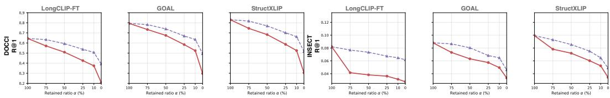  
DOCCl tokens removeda = 75% → 5.7%a = 25% → 33.7%a = 0 → 57.9%  
INSECT tokens removeda = 75% → 6.45%a = 25% → 34.3%a = 0 → 65.5%  
Figure 2: Length-controlled analysis under progressive salient reduction. We compare retrieval performance under salient reduction and random-span reduction on DOCCI and INSECT. For each retained salient-text ratio α, the random-span control removes the same number of tokens as salient deletion, isolating the effect of shortening from the effect of removing salient content. The annotations report the corresponding percentage of the original caption removed. Across all panels, salient deletion yields much larger degradation than matched random deletion, indicating that the drop is caused by the absence of salient text rather than by reduced query length alone.

Finding 2. The loss of salient information leads to a larger average performance drop under separate controls for query length and other textual confounders, indicating concentrated reliance on salient evidence.

Analysis 3: Is non-salient context informative for retrieval? To investigate this, we employ E5- large-v2 [Wang et al., 2022], a standalone text encoder independent of image–text alignment training, as a text-only oracle. Using only the non-salient context as the query, we attempt to retrieve the corresponding full caption from the caption database. Interestingly, this approach achieves 71.86% R@1 on DOCCI and 41.90% R@1 on INSECT. Separately, for text-to-image retrieval using the same non-salient queries, the strongest baseline, StructXLIP [Ruan et al., 2026], attains only 30.96% R@1 on DOCCI and 4.08% R@1 on INSECT. This substantial gap suggests that non-salient context is indeed informative, yet current multimodal alignment models fail to represent it effectively.

Finding 3. The non-salient context text is informative, however it is underutilized in existing long-text multi-modal aligned models.

Summary. These analyses reveal an interesting failure mode that we term as saliency collapse: existing long-text image-text aligned models rely on salient text, and their retrieval accuracy drops disproportionately once such salient cues are incomplete. Yet, long captions often contain heterogeneous visual semantics, featuring not only salient regions, but also rich contextual cues. The model should learn to encode both salient signals and the complementary context evidence.

## 4 Method

Motivated by Sec. 3, to address saliency collapse, we propose Robust Saliency-aware Alignment, ROSA, a saliency-guided auxiliary learning framework that jointly learns the visual-textual correspondences of both salient and complementary contextual information. As shown in Fig. 3, ROSA decomposes each image-caption pair $( I _ { i } , T _ { i } ) ^ { \dag }$ into a salient view $( I _ { i } ^ { s } , T _ { i } ^ { s } )$ and a contextual view $( I _ { i } ^ { c } , T _ { i } ^ { c } )$ . The former captures salient visual-textual cues, while the latter features contextual but informative visual-textual cues. After decomposition, ROSA fine-tunes the visual and textual encoders by augmenting the original image-text contrastive loss $\mathcal { L } o r i$ with three saliency-aware objectives. The saliency-focused contrastive loss $\mathcal { L } s a l ,$ , as motivated by Finding 1, explicitly aligns salient images with salient texts to strengthen grounding between salient regions and salient text. The context-preserving contrastive loss $\mathcal { L } c t x .$ , as motivated by Finding 2&3, aligns contextual images with contextual texts to exploit informative but under-utilized contextual evidence. Finally, the visual anchoring loss $\mathcal { L } _ { \mathrm { a n c } }$ mitigates saliency-induced representation drift. Auxiliary views are used only during fine-tuning, so inference follows the standard CLIP pipeline with no extra cost.

Problem formulation. Let $\{ ( I _ { i } , T _ { i } ) \} _ { i = 1 } ^ { N }$ denote a mini-batch of image-caption pairs, where $I _ { i } \in \mathcal { V }$ is an image and $T _ { i } \in { \mathcal { L } }$ is its corresponding long textual description. A vision-language model consists of an image encoder $f _ { \mathrm { i m g } }$ and a text encoder $f _ { \mathrm { t x t } }$ , which map the two modalities into a shared d-dimensional embedding space, i.e. $\mathbf { v } _ { i } = f _ { \mathrm { i m g } } ( I _ { i } )$ , and $\mathbf { u } _ { i } = f _ { \mathrm { t x t } } ( T _ { i } )$ . The standard image-text contrastive objective aligns the representation of $I _ { i }$ with that of $T _ { i }$ while separating it from other samples in the batch. Let $s _ { i , j }$ be the image-to-text similarity. The original image-text alignment loss

Stage 1 Saliency-guided view decomposition  
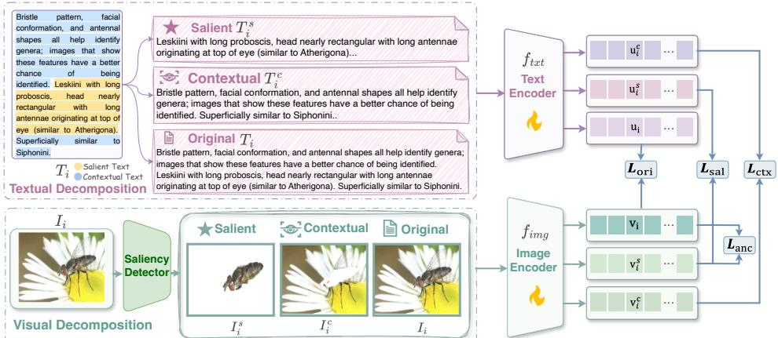  
Figure 3: Overview of ROSA. ROSA consists of two stages: Stage 1: Saliency-guided view decomposition of vision and text, where we independently decompose the text and image. On the text side, an LLM is used to split the original long caption into salient text and contextual text. On the visual side, an off-the-shelf saliency method is applied to derive salient/contextual visual regions. Stage 2: Saliency-aware alignment. During fine-tuning of the image and text encoders, ROSA augments the original image-text contrastive loss $\mathcal { L } o r i$ with three saliency-aware objectives: the saliency-focused contrastive loss $\triangle { } s a l ,$ which explicitly aligns salient images with salient texts; the context-preserving contrastive loss $\mathit { \Delta } _ { \mathit { L c t x } }$ , which aligns contextual images with contextual texts; and the visual anchoring loss Lanc, which enforces representation consistency between the original image and the salient image, thereby preserving stable salient semantics.

$\mathcal { L } _ { \mathrm { o r i } }$ is expressed as the symmetric InfoNCE loss:

$$
\mathcal { L } _ { \mathrm { o r i } } = \frac { 1 } { 2 N } \sum _ { i = 1 } ^ { N } \left[ - \log \frac { \exp ( s _ { i , i } / \tau ) } { \sum _ { j = 1 } ^ { N } \exp ( s _ { i , j } / \tau ) } - \log \frac { \exp ( s _ { i , i } / \tau ) } { \sum _ { j = 1 } ^ { N } \exp ( s _ { j , i } / \tau ) } \right] ,\tag{1}
$$

where τ is the temperature parameter.

Saliency-guided view decomposition. For each image-caption pair $( I _ { i } , T _ { i } )$ , we construct a salient pair $( \bar { I } _ { i } ^ { s } , \bar { T } _ { i } ^ { s } )$ and a contextual pair $( I _ { i } ^ { c } , T _ { i } ^ { c } )$ through modality-independent decomposition, where visual and textual views are obtained separately without cross-modal guidance, as detailed in Supp. Sec. B. A saliency detector produces $A _ { i } = { \mathcal { S } } ( I _ { i } )$ , which is converted into a mask $M _ { i }$ to form:

$$
\begin{array} { r } { I _ { i } ^ { s } = \mathcal { M } ( I _ { i } , M _ { i } ) , \quad I _ { i } ^ { c } = \mathcal { C } ( I _ { i } , M _ { i } ) , } \end{array}\tag{2}
$$

where $I _ { i } ^ { s }$ keeps visually prominent regions and $I _ { i } ^ { c }$ keeps the complementary context. Independently, an LLM partitions the caption with a fixed prompt P:

$$
( T _ { i } ^ { s } , T _ { i } ^ { c } ) = \Phi ( T _ { i } , { \sf P } ) ,\tag{3}
$$

where $T _ { i } ^ { s }$ refers to salient visual content and $T _ { i } ^ { c }$ to the remaining context. The LLM only partitions the input caption without rewriting or generating new content. Invalid, unsupported, or incomplete outputs are automatically detected and regenerated. We show the prompt P in Supp. Fig. 7. Human studies further validate the visual grounding of both salient and contextual text (Supp. Tab. 9).

Saliency-focused contrastive alignment. This objective aims to explicitly align salient visual regions with the salient text. For a mini-batch of salient view pairs $\{ ( I _ { i } ^ { s } , T _ { i } ^ { s } ) \} _ { i = 1 } ^ { N }$ , we compute their embeddings $\mathbf { v } _ { i } ^ { s } = f _ { \mathrm { i m g } } ( I _ { i } ^ { s } )$ and $\mathbf { u } _ { i } ^ { s } = f _ { \mathrm { t x t } } ( T _ { i } ^ { s } )$ to obtain their image-text similarity $s _ { i , j } ^ { s }$ . We then optimize the saliency-focused contrastive loss $\mathcal { L } _ { \mathrm { s a l } }$

$$
\mathcal { L } _ { \mathrm { s a l } } = \frac { 1 } { 2 N } \sum _ { i = 1 } ^ { N } \left[ - \log \frac { \exp ( s _ { i , i } ^ { s } / \tau ) } { \sum _ { j = 1 } ^ { N } \exp ( s _ { i , j } ^ { s } / \tau ) } - \log \frac { \exp ( s _ { i , i } ^ { s } / \tau ) } { \sum _ { j = 1 } ^ { N } \exp ( s _ { j , i } ^ { s } / \tau ) } \right] .\tag{4}
$$

$\mathcal { L } _ { \mathrm { s a l } }$ strengthens the correspondence between salient visual regions and salient textual descriptions.

Context-preserving contrastive alignment. We further align the contextual visual view $I _ { i } ^ { c }$ with the contextual text $\breve { T } _ { i } ^ { c }$ through a context-preserving contrastive objective. Similar to the salient

view pairs, for each contextual view pair $( I _ { i } ^ { c } , T _ { i } ^ { c } )$ , we compute their embeddings $\mathbf { v } _ { i } ^ { c } = f _ { \mathrm { i m g } } ( I _ { i } ^ { c } )$ and $\mathbf { u } _ { i } ^ { c } = \mathcal { f } _ { \mathrm { t x t } } ( T _ { i } ^ { c } )$ to then compute the contextual image-text similarity $s _ { i , j } ^ { c }$ . The context-preserving contrastive loss ${ \mathcal L } _ { \mathrm { c t x } }$ is then expressed as:

$$
\mathcal { L } _ { \mathrm { c t x } } = \frac { 1 } { 2 N } \sum _ { i = 1 } ^ { N } \left[ - \log \frac { \exp ( s _ { i , i } ^ { c } / \tau ) } { \sum _ { j = 1 } ^ { N } \exp ( s _ { i , j } ^ { c } / \tau ) } - \log \frac { \exp ( s _ { i , i } ^ { c } / \tau ) } { \sum _ { j = 1 } ^ { N } \exp ( s _ { j , i } ^ { c } / \tau ) } \right] .\tag{5}
$$

$\mathcal { L } _ { \mathrm { c t x } }$ encourages the learning of non-salient but informative cues to be more robust when salient information is incomplete.

Visual anchoring. Since inference is performed using the original image $I _ { i } ,$ , the saliency-guided fine-tuning should not cause the original image representation to drift away from the pre-trained vision-language embedding space. Following the intuition that the salient view $I ^ { s }$ contains the most prominent visual content of the image, its representation should also be close to the one of the original image. We thus define the visual anchoring loss $\mathcal { L } _ { \mathrm { a n c } }$ as:

$$
\mathcal { L } _ { \mathrm { a n c } } = \frac { 1 } { N } \sum _ { i = 1 } ^ { N } \left( 1 - \frac { f _ { \mathrm { i n g } } ( I _ { i } ) ^ { \top } f _ { \mathrm { i n g } } ( I _ { i } ^ { s } ) } { \| f _ { \mathrm { i n g } } ( I _ { i } ) \| _ { 2 } \| f _ { \mathrm { i n g } } ( I _ { i } ^ { s } ) \| _ { 2 } } \right) .\tag{6}
$$

$\mathcal { L } _ { \mathrm { a n c } }$ aims to prevent severe representation drift.

Full Training Objective. The final objective combines the standard full-image full-caption contrastive loss with the proposed auxiliary losses:

$$
\mathcal { L } _ { \mathrm { t o t a l } } = \mathcal { L } _ { \mathrm { o r i } } + \lambda _ { \mathrm { s a l } } \mathcal { L } _ { \mathrm { s a l } } + \lambda _ { \mathrm { c t x } } \mathcal { L } _ { \mathrm { c t x } } + \lambda _ { \mathrm { a n c } } \mathcal { L } _ { \mathrm { a n c } } ,\tag{7}
$$

where $\lambda _ { \mathrm { s a l } } , \lambda _ { \mathrm { c t x } }$ , and $\lambda _ { \mathrm { a n c } }$ control the contributions of the auxiliary objectives.

## 5 Experiments

Datasets and Metrics. Following prior evaluation protocols [Ruan et al., 2026], we evaluate our method on four fine-grained image-text retrieval benchmarks: DOCCI [Onoe et al., 2024] and DCI [Urbanek et al., 2024] for general-domain dense caption retrieval, Sketchy [Girella et al., 2025] for fashion-domain garment descriptions, and INSECT [Truong et al., 2025] for expert-verified biological descriptions. These datasets cover diverse long-text alignment scenarios. We report Recall@K (R@K, K=1/5/10) for both Text→Image(T→I) and Image→Text(I→T) retrieval. For more details on the datasets refer to Supp. Sec. A.

Compared methods. Following the baseline selection of StructXLIP [Ruan et al., 2026], we compare ROSA with representative state-of-the-art CLIP-based fine-tuning methods for long-text image-text alignment, including Long-CLIP [Zhang et al., 2024], FineLIP [Asokan et al., 2025], SmartCLIP [Xie et al., 2025], GOAL [Choi et al., 2025], and StructXLIP [Ruan et al., 2026]. These baselines cover major directions such as long-context modeling, fine-grained alignment, global-local correspondence, and multimodal structural cue learning.

Implementation details. We follow the experimental setting of [Ruan et al., 2026] for model configuration and training, using CLIP ViT-B/16 as the visual encoder and Knowledge Preserving Stretching(KPS) [Zhang et al., 2024] to extend the text encoder, while keeping all learning rates and optimizer configurations unchanged. For saliency-guided decomposition, we use [Yildirim and Süsstrunk, 2014] to extract salient visual regions, and obtain the contextual view by removing the salient region from the original image. On the textual side, we use Qwen2.5 [Qwen et al., 2025] to extract salient and contextual textual texts from each caption. Images are resized to 224 × 224, and all models are fine-tuned for 10 epochs on NVIDIA RTX 5090 GPUs with 32 GB memory and NVIDIA A100 GPU with 40 GB memory. Each run requires approximately 1-3 hours, depending on the dataset. We report the average results over three random seeds. For a direct training-cost comparison, StructXLIP requires 0.17,s per batch, while ROSA requires $0 . 3 4 , s$ per batch under the same training setting. The additional cost comes from encoding the salient and contextual views during fine-tuning; preprocessing is performed once offline and cached, and ROSA introduces no additional parameters or inference overhead.

Table 2: Comparison against recent CLIP-based finetuning methods on long-text cross-modal retrieval. We report Recall@K (%) on both T→I and I→T settings and highlight best and second best results; ∆ denotes the margin of ours over the best competitor.
<table><tr><td rowspan="2">Method</td><td colspan="6">SKETCHY</td><td colspan="6"></td><td colspan="6"></td><td colspan="4"></td></tr><tr><td>R@1</td><td>R@5</td><td>R@10</td><td>R@1</td><td>R@5</td><td>R@10</td><td>R@1</td><td>R@5</td><td>R@10</td><td>R@1</td><td>R@5</td><td>R@10</td><td></td><td>R@1</td><td>R@5 R@10</td><td>R@1</td><td>R@5</td><td>R@10|</td><td>R@1</td><td>R@5</td><td>R@10 R@1</td><td>R@5 R@10</td></tr><tr><td>Long-CLIP [ECCV*24]</td><td>54.32</td><td>80.14</td><td>88.43</td><td>52.76</td><td>80.31</td><td>88.08</td><td>8.20</td><td>23.83</td><td>34.97</td><td>9.41</td><td>24.78</td><td>37.31</td><td>64.49</td><td>87.67</td><td>93.43</td><td>63.08</td><td>87.45</td><td>93.14</td><td>59.23</td><td>80.89</td><td>87.04 60.13</td><td>81.44 87.54</td></tr><tr><td>FineLIP [CVPR·25]</td><td>40.59</td><td>71.16</td><td>81.78</td><td>40.33</td><td>72.11</td><td>82.38</td><td>8.46</td><td>23.32</td><td>33.59</td><td>6.86</td><td>23.75</td><td>34.46</td><td>67.80</td><td>90.22</td><td>94.84</td><td>66.39</td><td>89.12</td><td>94.47</td><td>66.13</td><td>85.34 89.79</td><td>64.58</td><td>84.59 89.54</td></tr><tr><td>SmartCLIP [CVPR*25]</td><td>50.73</td><td>81.09</td><td>94.56</td><td>51.30</td><td>80.83</td><td>94.04</td><td>4.84</td><td>16.84</td><td>34.63</td><td>4.66</td><td>15.46</td><td>34.02</td><td>74.92</td><td>94.08</td><td>97.31</td><td>74.91</td><td>94.04</td><td>97.29</td><td>69.88</td><td>86.64</td><td>94.05 70.94</td><td>87.04 92.77</td></tr><tr><td>GOAL [CVPR&#x27;25]</td><td>63.21</td><td>87.13</td><td>93.44</td><td>62.44</td><td>87.82</td><td>92.31</td><td>8.81</td><td>24.35</td><td>35.84</td><td>8.55</td><td>25.91</td><td>36.18</td><td>79.47</td><td>96.65</td><td>98.69</td><td>79.43</td><td>96.14</td><td>97.25</td><td>72.64</td><td>89.89 93.70</td><td>72.84</td><td>90.50 93.20</td></tr><tr><td>StructXLIP[CVPR&#x27;26]</td><td>69.86</td><td>90.85</td><td>95.42</td><td>68.22</td><td>90.67</td><td>95.68</td><td>9.93</td><td>26.60</td><td>38.34</td><td>9.50</td><td>26.60</td><td>39.64</td><td>83.04</td><td>97.06</td><td>98.96</td><td>81.59</td><td>96.94</td><td>98.78</td><td>75.90</td><td>90.00 95.15</td><td>74.39</td><td>89.90 94.30</td></tr><tr><td>RoSA (Ours)</td><td>71.5</td><td>92.31</td><td>95.85</td><td>71.5</td><td>91.62</td><td>95.85</td><td>10.36</td><td>28.32</td><td>40.67</td><td>9.84</td><td>29.36</td><td>40.41</td><td>|84.35</td><td>97.51</td><td>99.18</td><td>82.18</td><td>97.14</td><td>98.94</td><td>| 77.09</td><td>90.55 94.25</td><td>74.99</td><td>90.55 94.20</td></tr></table>

Table 3: Plug-and-play enhancement with our saliency-aware alignment objectives. Results on T→I and I→T retrieval for INSECT and DOCCI, with best highlighted and the margin in bracket.
<table><tr><td rowspan=2 colspan=6>INSECTMethodR@1</td><td rowspan=1 colspan=6>DOCCI</td></tr><tr><td rowspan=1 colspan=2>R@5R@10</td><td rowspan=1 colspan=3>R@1R@5R@10</td><td rowspan=1 colspan=2>R@1    R@5</td><td rowspan=1 colspan=1>R@10</td><td rowspan=1 colspan=3>R@1    R@5   R@10</td></tr><tr><td rowspan=1 colspan=1>Long-CLIP   8.20</td><td rowspan=1 colspan=1>23.83</td><td rowspan=1 colspan=1>34.97</td><td rowspan=1 colspan=1>9.41</td><td rowspan=1 colspan=1>24.78</td><td rowspan=1 colspan=1>37.31</td><td rowspan=1 colspan=1>64.49</td><td rowspan=1 colspan=1>87.67</td><td rowspan=1 colspan=1>93.43</td><td rowspan=1 colspan=1>63.08</td><td rowspan=1 colspan=1>87.45</td><td rowspan=1 colspan=1>93.14</td></tr><tr><td rowspan=1 colspan=1>+our LRoSA9.41(+1.21)</td><td rowspan=1 colspan=1>25.73(+1.90)</td><td rowspan=1 colspan=1>37.82(+2.85)</td><td rowspan=1 colspan=1>10.36(+0.95)</td><td rowspan=1 colspan=1>28.58(+3.80)</td><td rowspan=1 colspan=1>40.07(+2.76)</td><td rowspan=1 colspan=1>67.73(+3.24)</td><td rowspan=1 colspan=1>90.63(+2.96)</td><td rowspan=1 colspan=1>94.98(+1.55)</td><td rowspan=1 colspan=1>67.29(+4.21)</td><td rowspan=1 colspan=1>89.37(+1.92)</td><td rowspan=1 colspan=1>94.39(+1.25)</td></tr><tr><td rowspan=1 colspan=1>FineLIP     8.46</td><td rowspan=1 colspan=1>23.32</td><td rowspan=1 colspan=1>33.59</td><td rowspan=1 colspan=1>6.86</td><td rowspan=1 colspan=1>23.75</td><td rowspan=1 colspan=1>34.46</td><td rowspan=1 colspan=1>67.80</td><td rowspan=1 colspan=1>90.22</td><td rowspan=1 colspan=1>94.84</td><td rowspan=1 colspan=1>66.39</td><td rowspan=1 colspan=1>89.12</td><td rowspan=1 colspan=1>94.47</td></tr><tr><td rowspan=1 colspan=1>+our LRoSA8.89(+0.43)</td><td rowspan=1 colspan=1>24.18(+0.86)</td><td rowspan=1 colspan=1>34.97(+1.38)</td><td rowspan=1 colspan=1>8.12(+1.26)</td><td rowspan=1 colspan=1>24.96(+1.21)3</td><td rowspan=1 colspan=1>5.58(+1.12)</td><td rowspan=1 colspan=1>74.06(+6.26)</td><td rowspan=1 colspan=1>93.86(+3.64)</td><td rowspan=1 colspan=1>97.02(+2.18)</td><td rowspan=1 colspan=1>72.71(+6.32)</td><td rowspan=1 colspan=1>92.90(+3.78)</td><td rowspan=1 colspan=1>96.90(+2.43)</td></tr><tr><td rowspan=1 colspan=1>SmartCLIP   4.84</td><td rowspan=1 colspan=1>16.84</td><td rowspan=1 colspan=1>34.63</td><td rowspan=1 colspan=1>4.66</td><td rowspan=1 colspan=1>15.46</td><td rowspan=1 colspan=1>34.02</td><td rowspan=1 colspan=1>74.92</td><td rowspan=1 colspan=1>94.08</td><td rowspan=1 colspan=1>97.31</td><td rowspan=1 colspan=1>74.91</td><td rowspan=1 colspan=1>94.04</td><td rowspan=1 colspan=1>97.29</td></tr><tr><td rowspan=1 colspan=1>+our LRoSA8.46(+3.62)</td><td rowspan=1 colspan=1>24.78(+7.94)</td><td rowspan=1 colspan=1>35.06(+0.43)</td><td rowspan=1 colspan=1>7.69(+3.03)</td><td rowspan=1 colspan=1>24.61(+9.15)</td><td rowspan=1 colspan=1>35.84(+1.82)8</td><td rowspan=1 colspan=1>0.61(+5.69)</td><td rowspan=1 colspan=1>96.63(+2.55)</td><td rowspan=1 colspan=1>98.69(+1.38)</td><td rowspan=1 colspan=1>78.59(+3.68)</td><td rowspan=1 colspan=1>95.96(+1.92)</td><td rowspan=1 colspan=1>98.18(+0.89)</td></tr><tr><td rowspan=1 colspan=1>GOAL      8.81</td><td rowspan=1 colspan=1>24.35</td><td rowspan=1 colspan=1>35.84</td><td rowspan=1 colspan=1>8.55</td><td rowspan=1 colspan=1>25.91</td><td rowspan=1 colspan=1>36.18</td><td rowspan=1 colspan=1>79.47</td><td rowspan=1 colspan=1>96.65</td><td rowspan=1 colspan=1>98.69</td><td rowspan=1 colspan=1>79.43</td><td rowspan=1 colspan=1>96.14</td><td rowspan=1 colspan=1>98.51</td></tr><tr><td rowspan=1 colspan=1>+our LRoSA9.67(+0.86)</td><td rowspan=1 colspan=1>27.55(+3.20)</td><td rowspan=1 colspan=1>39.72(+3.88)</td><td rowspan=1 colspan=1>8.72(+0.17)</td><td rowspan=1 colspan=1>27.89(+1.98)</td><td rowspan=1 colspan=1>40.16(+3.98)</td><td rowspan=1 colspan=1>83.86(+4.39)</td><td rowspan=1 colspan=1>97.47(+0.82)</td><td rowspan=1 colspan=1>99.16(+0.47)</td><td rowspan=1 colspan=1>82.02(+2.59)</td><td rowspan=1 colspan=1>97.27(+1.13)</td><td rowspan=1 colspan=1>98.96(+0.45)</td></tr><tr><td rowspan=1 colspan=1>SigLIP2     6.37</td><td rowspan=1 colspan=1>21.07</td><td rowspan=1 colspan=1>31.87</td><td rowspan=1 colspan=1>6.56</td><td rowspan=1 colspan=1>21.85</td><td rowspan=1 colspan=1>31.95</td><td rowspan=1 colspan=1>71.80</td><td rowspan=1 colspan=1>92.53</td><td rowspan=1 colspan=1>95.88</td><td rowspan=1 colspan=1>71.51</td><td rowspan=1 colspan=1>92.41</td><td rowspan=1 colspan=1>96.06</td></tr><tr><td rowspan=1 colspan=1>+our LRoSA6.74(+0.37)</td><td rowspan=1 colspan=1>22.11(+1.04)</td><td rowspan=1 colspan=1>31.78(-0.09)</td><td rowspan=1 colspan=1>7.43(+0.87)</td><td rowspan=1 colspan=1>22.54(+0.69)</td><td rowspan=1 colspan=1>32.82(+0.87)</td><td rowspan=1 colspan=1>80.12(+8.32)</td><td rowspan=1 colspan=1>96.27(+3.74)</td><td rowspan=1 colspan=1>98.61(+2.73)</td><td rowspan=1 colspan=1>78.73(+7.22)</td><td rowspan=1 colspan=1>96.25(+3.84)</td><td rowspan=1 colspan=1>98.37(+2.31)</td></tr><tr><td rowspan=1 colspan=1>LoRA       5.79</td><td rowspan=1 colspan=1>16.84</td><td rowspan=1 colspan=1>25.82</td><td rowspan=1 colspan=1>4.84</td><td rowspan=1 colspan=1>16.49</td><td rowspan=1 colspan=1>24.96</td><td rowspan=1 colspan=1>77.80</td><td rowspan=1 colspan=1>96.45</td><td rowspan=1 colspan=1>98.55</td><td rowspan=1 colspan=1>77.00</td><td rowspan=1 colspan=1>96.02</td><td rowspan=1 colspan=1>98.05</td></tr><tr><td rowspan=1 colspan=1>+our LRoSA6.04(+0.25)</td><td rowspan=1 colspan=1>18.83(+1.99)</td><td rowspan=1 colspan=1>27.29(+1.47)</td><td rowspan=1 colspan=1>5.70(+0.86)</td><td rowspan=1 colspan=1>18.74(+2.25)</td><td rowspan=1 colspan=1>27.37(+2.41)</td><td rowspan=1 colspan=1>80.49(+2.69)</td><td rowspan=1 colspan=1>96.63(+0.18)</td><td rowspan=1 colspan=1>98.78(+0.23)</td><td rowspan=1 colspan=1>79.94(+2.94)</td><td rowspan=1 colspan=1>96.65(+0.63)</td><td rowspan=1 colspan=1>98.49(+0.44)</td></tr><tr><td rowspan=1 colspan=1>DoRA      7.17</td><td rowspan=1 colspan=1>20.21</td><td rowspan=1 colspan=1>29.88</td><td rowspan=1 colspan=1>6.04</td><td rowspan=1 colspan=1>20.81</td><td rowspan=1 colspan=1>31.52</td><td rowspan=1 colspan=1>66.27</td><td rowspan=1 colspan=1>90.50</td><td rowspan=1 colspan=1>95.18</td><td rowspan=1 colspan=1>65.65</td><td rowspan=1 colspan=1>89.55</td><td rowspan=1 colspan=1>94.78</td></tr><tr><td rowspan=1 colspan=1>+our LRoSA9.41(+2.24)</td><td rowspan=1 colspan=1>26.25(+6.04)</td><td rowspan=1 colspan=1>36.96(+7.08)</td><td rowspan=1 colspan=1>9.84(+3.80)</td><td rowspan=1 colspan=1>25.82(+5.01)3</td><td rowspan=1 colspan=1>7.13(+5.61)7</td><td rowspan=1 colspan=1>2.73(+6.46)</td><td rowspan=1 colspan=1>93.61(+3.11)</td><td rowspan=1 colspan=1>97.39(+2.21)</td><td rowspan=1 colspan=1>72.24(+6.59)</td><td rowspan=1 colspan=1>93.71(+4.16)</td><td rowspan=1 colspan=1>96.98(+2.20)</td></tr><tr><td rowspan=1 colspan=1>StructXLIP   9.93</td><td rowspan=1 colspan=1>26.60</td><td rowspan=1 colspan=1>38.34</td><td rowspan=1 colspan=1>9.50</td><td rowspan=1 colspan=1>26.60</td><td rowspan=1 colspan=1>39.64</td><td rowspan=1 colspan=1>83.04</td><td rowspan=1 colspan=1>97.06</td><td rowspan=1 colspan=1>98.96</td><td rowspan=1 colspan=1>81.59</td><td rowspan=1 colspan=1>96.94</td><td rowspan=1 colspan=1>98.78</td></tr><tr><td rowspan=1 colspan=1>+our LRoSA10.36(+0.43)</td><td rowspan=1 colspan=1>30.92(+4.32)</td><td rowspan=1 colspan=1>42.66(+4.32)</td><td rowspan=1 colspan=1>9.84(+0.34)</td><td rowspan=1 colspan=1>30.83(+4.23)</td><td rowspan=1 colspan=1>42.40(+2.76)</td><td rowspan=1 colspan=1>84.20(+1.16)</td><td rowspan=1 colspan=1>97.78(+0.72)</td><td rowspan=1 colspan=1>99.08(+0.12)</td><td rowspan=1 colspan=1>82.69(+1.10)</td><td rowspan=1 colspan=1>97.37(+0.43)</td><td rowspan=1 colspan=1>98.98(+0.20)</td></tr></table>

## 5.1 Comparison with existing CLIP-based methods

Quantitative Results. As shown in Tab. 2, under standard full-caption retrieval, ROSA achieves the best results on most metrics among all compared methods, on four cross-modal retrieval benchmarks, in both T→I and I→T directions. Especially on Sketchy dataset, ROSA improves R@1 by +1.64% for T→I retrieval and +3.28% for I→T retrieval over the best competitor. On the rare-domain dataset INSECT, all methods yield relatively low recall scores due to the limited coverage of such domains in VLM pre-training data. Nevertheless, our method still achieves consistent gains in both retrieval directions. On the general-domain DOCCI benchmark, our method also shows consistent improvements. This indicates that salient visual-textual components are effective for dense imagecaption pairs that contain multiple entities, attributes, and fine-grained local descriptions.

Plug-and-play enhancement. To further validate the tuning-agnostic effectiveness of our proposed saliency-aware alignment objectives, we integrate our proposed losses $\mathcal { L } _ { \mathrm { { R o S A } } }$ into diverse CLIP-based finetuning methods, including PEFT techniques such as LoRA [Hu et al., 2022] and DoRA [Liu et al., 2024], as well as state-of-the-art CLIP-based finetuning methods from the main comparison. As shown in Tab. 3, adding $\mathcal { L } _ { \mathrm { { R o S A } } }$ to these methods leads to consistent improvements, with the largest gains observed for DoRA with +7.08% on INSECT T→I R@10 and SigLIP2 with +8.32% on DOCCI T→I R@1. Saliency-aware alignment objectives provide complementary supervision by jointly optimizing salient and contextual evidence, thereby reducing their utilization imbalance while serving as an effective plug-and-play enhancement across CLIP-based retrieval models.

Robustness under reduced salient text. We evaluate retrieval robustness by constructing three Text→Image query settings: Salient-only that uses only salient text as query, Salient +Context uses 50% salient text mixed with context as query, and Context-only with only context text as query. Tab. 4 shows that ROSA achieves the best results in most settings across DOCCI, DCI, and INSECT. The gains are modest under Salient-only queries, where object-centric cues are already sufficient for all methods. In contrast, the advantage becomes larger as salient cues are weakened or absent. On DOCCI, ROSA improves R@1 by 5.13% under $S a l i e n t _ { 5 0 \% } + C o n t e x t ,$ and by 11.04% under Contextonly. Consistent gains on DCI and INSECT further show ROSA can effectively encode both salient and contextual semantics, being more robust to queries of different saliency levels. To further evaluate sensitivity to query construction, we evaluate fixed checkpoints using test queries reconstructed with

Table 4: Robustness under reduced salient text. We report T→I Recall@K (%) on DOCCI, DCI, and INSECT under reduced salient text: Salient-only , Salient50%+Context , and Context-only . We highlight best and second best results; ∆ is our margin over the best competitor.
<table><tr><td rowspan="3">Method</td><td colspan="10">DOCCI</td><td colspan="8">DCI</td><td colspan="10">INSECT</td></tr><tr><td></td><td>Salient-only</td><td></td><td>Salient50%+Context</td><td></td><td></td><td></td><td>Context-only</td><td></td><td></td><td>Salient-only</td><td></td><td></td><td>Salient50%+Context</td><td></td><td></td><td>Context-only</td><td></td><td></td><td></td><td>Salient-only</td><td></td><td></td><td></td><td>Salient50%+Context</td><td></td><td></td><td>Context-only</td><td></td></tr><tr><td>R@1</td><td>R@5</td><td>R@10</td><td>R@1</td><td></td><td>R@5</td><td>R@10</td><td>R@1</td><td>R@5</td><td>R@10</td><td>R@1</td><td>R@5</td><td>R@10</td><td>R@1</td><td>R@5</td><td>R@10</td><td>R@1</td><td>R@5</td><td>R@10</td><td>R@1</td><td>R@5</td><td>R@10</td><td></td><td>R@1</td><td>R@5</td><td>R@10</td><td>R@1</td><td>R@5</td><td></td><td>R@10</td></tr><tr><td>Long-CLIP [ECCV&#x27;24]</td><td>61.54</td><td>84.71</td><td>90.82</td><td>58.87</td><td>83.35</td><td>89.52</td><td>23.96</td><td>43.90</td><td>52.34</td><td></td><td></td><td>71.73 80.15</td><td>54.01</td><td>77.00</td><td>84.07</td><td></td><td>24.64</td><td>45.12</td><td>53.43</td><td>6.55</td><td>20.41</td><td>31.04</td><td></td><td>4.30</td><td>17.11</td><td>24.88</td><td>3.11</td><td></td><td>11.60</td><td>17.40</td></tr><tr><td>FineLIP [CVPR&#x27;25]</td><td>52.62</td><td>78.30</td><td>85.48</td><td>52.30</td><td>78.50</td><td>86.43</td><td>20.59</td><td></td><td>39.03</td><td>48.13</td><td>51.64 53.03</td><td>74.67 82.23</td><td></td><td>60.36</td><td>81.27</td><td>86.96</td><td>25.91</td><td>44.49</td><td>53.26</td><td>8.17</td><td>22.45</td><td></td><td>30.61</td><td>7.52</td><td>19.08</td><td>30.36</td><td></td><td>3.11</td><td>10.74</td><td>16.76</td></tr><tr><td>SmartCLIP [CVPR·25]</td><td>61.88</td><td>85.48</td><td>91.69</td><td>54.17</td><td>81.36</td><td>88.84</td><td>24.92</td><td></td><td>45.01</td><td>53.30</td><td>57.24</td><td>77.38</td><td>84.25</td><td>65.03</td><td>84.19</td><td>88.82</td><td>30.01</td><td>49.45</td><td>57.24</td><td>2.36</td><td>7.20</td><td></td><td>10.74</td><td>2.18</td><td>7.41</td><td>11.71</td><td></td><td>1.40</td><td>4.83</td><td>7.09</td></tr><tr><td>GOAL [CVPR&#x27;25]</td><td>66.84</td><td>88.32</td><td>93.21</td><td>68.60</td><td>90.85</td><td>95.00</td><td>30.28</td><td></td><td>51.63</td><td>60.09</td><td>60.88 61.97</td><td>80.44</td><td>85.92</td><td>67.55</td><td>86.56</td><td>91.50</td><td>32.08</td><td>52.28</td><td>59.67</td><td>7.09</td><td>21.59</td><td></td><td>32.22</td><td>7.09</td><td>22.45</td><td>32.72</td><td></td><td>3.76</td><td>11.92</td><td>17.51 18.26</td></tr><tr><td>StructXLIP [CVPR*26]</td><td>67.22</td><td>88.23</td><td>92.87</td><td>69.31</td><td>90.75</td><td>94.90</td><td>30.96</td><td></td><td>51.04</td><td>59.73</td><td></td><td>80.50</td><td>85.40</td><td>70.65</td><td>86.94</td><td>91.52</td><td>34.28</td><td>52.51</td><td>58.74</td><td>8.16</td><td>24.49</td><td></td><td>35.12</td><td>8.56</td><td>23.24</td><td>32.15</td><td></td><td>4.08</td><td>11.49</td><td></td></tr><tr><td>RoSA (Ours)</td><td>68.03</td><td>88.83</td><td>93.51</td><td>74.44</td><td>93.82</td><td>97.01</td><td></td><td>42.00</td><td>66.07</td><td>73.65</td><td>| 62.26</td><td>80.84</td><td>86.21</td><td>72.01</td><td>88.48</td><td>92.96</td><td>37.56</td><td>57.76</td><td>65.20 |</td><td>8.16</td><td>25.89</td><td></td><td>37.49</td><td>9.10</td><td>24.38</td><td>34.91</td><td>4.88</td><td></td><td>14.82</td><td>22.34</td></tr><tr><td>∆</td><td></td><td>↑ 0.81 ↑ 0.51</td><td></td><td>↑0.30↑5.13↑2.97↑2.01↑11.04↑14.44↑13.56|↑0.29↑0.34↑0.29↑1.36↑1.54↑1.44↑3.28↑5.25↑5.53|↓0.01</td><td></td><td></td><td></td><td></td><td></td><td></td><td></td><td></td><td></td><td></td><td></td><td></td><td></td><td></td><td></td><td></td><td></td><td></td><td></td><td></td><td></td><td></td><td></td><td></td><td>↑1.40↑2.37↑ 0.54↑1.14↑2.19↑ 0.80↑2.90↑4.08</td><td></td></tr></table>

Table 5: Ablation on auxiliary saliency-aware alignment objectives. We report full-caption retrieval on T→I and I→T , together in T→I robustness settings with reduced salient text including Salient-only , $S a l i e n t _ { 5 0 \% } .$ +Context , and Context-only . Rows ablate different combinations of $\mathcal { L } _ { \mathrm { s a l } }$ ${ \mathcal L } _ { \mathrm { c t x } }$ , and ${ \mathcal { L } } _ { \mathrm { a n c } } .$ . We report Recall@K (%) with best highlighted.

<table><tr><td rowspan="3" colspan="2"></td><td colspan="4"></td><td colspan="4">DOCCI</td></tr><tr><td>Laal Lctx Lanc |</td><td colspan="2">Full-caption retrieval</td><td colspan="2">Reduced-query T→I retrieval</td><td colspan="2">Full-caption retrieval</td><td colspan="2">Reduced-query T→I retrieval</td></tr><tr><td>T→I R@1 R@5 R@10</td><td>R@1 R@5 R@10</td><td>I→T Salient-only</td><td>Salient50%+Ctx</td><td>Context-only T→I</td><td>I→T</td><td>Salient-only</td><td>Salient50%+Ctx Context-only</td></tr><tr><td>x</td><td></td><td></td><td></td><td>R@1 R@5 R@10R@1 R@5 R@10</td><td>R@1 R@5 R@10</td><td>R@1 R@5 R@10</td><td>R@1 R@5 R@10</td><td>R@1 R@5 R@10</td><td>R@1 R@5 R@10 R@1 R@5 R@10</td></tr><tr><td>x</td><td></td><td>x 8.81</td><td>24.53 35.41 7.43 24.35</td><td>36.53 7.95 22.02 32.12</td><td>7.63 22.84 33.58</td><td>3.22 9.34 15.90 81.18</td><td>96.67 98.51 80.00 96.31</td><td>98.67 64.70 86.71</td><td>91.95 73.30 92.91 96.27 29.04 50.67</td></tr><tr><td>V</td><td>+</td><td>x 9.67</td><td>25.39 38.17 9.41 25.47</td><td>36.36 8.38 23.52 34.16</td><td>9.13 25.28 35.59 4.62</td><td>10.63 16.65 82.27 97.20</td><td>98.82 80.39 96.51</td><td>98.67 68.20 89.42</td><td>58.99 93.75 74.52 93.68 96.78 32.79 54.38 62.63</td></tr><tr><td>x</td><td></td><td>x 9.41 9.76</td><td>26.34 37.05 8.38 27.20</td><td>37.65 8.49 22.56 32.12</td><td>9.77 25.67 35.30</td><td>5.26 14.18 21.59 82.88 97.18</td><td>98.76 81.22 96.90</td><td>98.59 63.44 85.95</td><td>91.81 77.22 95.01 97.60 43.62 67.22 75.37</td></tr><tr><td></td><td></td><td>x 9.33</td><td>26.60 38.26 9.50</td><td>26.77 39.64 9.02 23.74 36.41</td><td>9.02 26.49 38.20</td><td>3.54 15.04 23.09 83.27</td><td>97.43 98.96 81.41 96.94</td><td>98.90 64.87 87.29 92.78</td><td>77.17 95.25 97.69 43.26 67.48 75.10</td></tr><tr><td></td><td></td><td>10.36 28.32</td><td>25.47 37.13 7.94 25.99 37.74 40.67 9.84 29.36 40.41</td><td>8.38 24.27 33.30 8.16 8.27 25.99 37.59 9.06 27.46</td><td>24.42 35.55 2.90 38.99 4.51</td><td>10.63 17.72 81.73 96.84 14.93 22.13 84.35 97.51</td><td>98.82 79.35 96.49 99.18 82.18 97.14 98.94</td><td>98.47 69.21 89.58 93.74 68.03 88.83 93.51</td><td>72.99 92.62 96.10 28.98 49.78 58.26 74.44 93.82 97.01 42.00 66.07 73.65</td></tr></table>

a rewritten prompt, Llama-3.1, or human annotations. ROSA improves Context-only R@1 over StructXLIP under all evaluated alternatives (Supp. Sec. D).

Qualitative analysis. We visualize the cross-modal attention maps of the competitor StructXLIP and ROSA on four datasets in Fig. 4. ROSA shows a cleaner concentration on caption-related visual entities compared with StructXLIP, indicating that ROSA effectively represent relevant visual evidence at object level. Please refer to Supp. Sec. F for more qualitative results, and Sec. E.1 for other exploratory evaluation on medical domain.

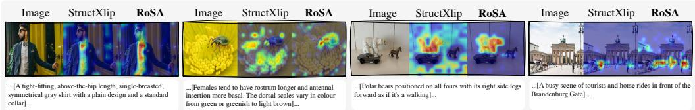  
Figure 4: Comparison of cross-modal Grad-CAM visualizations between StructXlip and ROSA. From left to right, the columns show examples from Sketchy, INSECT, DCI, and DOCCI.

## 5.2 Ablation studies

Saliency-aware alignment losses. We ablate the saliency-focused contrastive loss $\mathcal { L } _ { \mathrm { s a l } } ,$ contextpreserving contrastive loss ${ \mathcal { L } } _ { \mathrm { c t x } } ,$ and visual anchoring loss $\mathcal { L } _ { \mathrm { a n c } }$ . As shown in Tab. 5, each of the losses boosts retrieval performance. Combining $\mathcal { L } _ { \mathrm { s a l } }$ and ${ \mathcal L } _ { \mathrm { c t x } }$ further improves most metrics when compared to their individual use, showing the benefit of joint learning from decomposed image-text pairs into salient and non-salient components. Finally, adding $\mathcal { L } _ { \mathrm { a n c } }$ on top of $\mathcal { L } _ { \mathrm { s a l } } + \mathcal { L } _ { \mathrm { c t x } }$ achieves the best full-caption retrieval performance, especially on INSECT, where T→I R@10 improves by +3.54% and I→T R@5 improves by +3.37%. From the reduced-query results, we can further appreciate the losses that contribute more to the robustness against salient text reduction. Particularly, $\mathcal { L } _ { \mathrm { c t x } }$ is helpful when salient text is reduced or completely removed (i.e. Context-only) by modeling non-salient contextual semantics. Interestingly, simply by introducing $\mathcal { L } _ { \mathrm { s a l } }$ , we could already observe mild improvement in reduced-query settings. These results show that decomposed salient and context views are effective auxiliary supervision, than relying on a single global image-text pair, with ${ \mathcal { L } } _ { \mathrm { a n c } }$ further preserving coherence across decomposed views and original images.

Visual anchoring. We compare the default salient-only anchoring with two variants while keeping all other settings fixed: Context, which applies visual anchoring between the full image and the contextual view only, and Salient+Context, which anchors the full image to both salient and contextual views. Tab. 6 shows that salientonly anchoring in ROSA achieves the best results across both datasets and retrieval directions. This may be because the salient view reserves a coherent representation of the primary visual content and therefore provides a stable reference for the full image. In contrast, contextual views intentionally represent spatially distributed complementary evidence; forcing them to approximate the full-image representation may weaken that role, while anchoring both views introduces competing consistency constraints.

Table 6: Ablation on visual anchoring on T→I and I→T retrieval, with correct pairing fixed; highlighted best and second best.
<table><tr><td rowspan="2">Salient</td><td rowspan="2">Context</td><td colspan="4">INSECT</td><td colspan="4">DOCCI</td></tr><tr><td>R@1</td><td>R@10</td><td>R@1</td><td>R@10</td><td>R@1</td><td>R@10</td><td>R@1</td><td>R@10</td></tr><tr><td>√</td><td>x</td><td>10.36</td><td>40.67</td><td>9.84</td><td>40.41</td><td>84.35</td><td>99.18</td><td>82.18</td><td>98.94</td></tr><tr><td>x</td><td>V</td><td>9.59</td><td>39.12</td><td>8.55</td><td>38.60</td><td>83.14</td><td>98.90</td><td>80.24</td><td>98.75</td></tr><tr><td>V</td><td>√</td><td>9.33</td><td>37.82</td><td>9.07</td><td>38.43</td><td>84.18</td><td>99.04</td><td>81.73</td><td>98.86</td></tr></table>

Effectiveness of decomposition methods. All variants use the same backbone and training settings differing only in view construction. As shown in Tab. 7, we analyze different decomposition methods from both the visual and textual sides. When fixing salient image (top part of Tab. 7), substituting salient text with the original caption or a random text weakens overall performance. When fixing salient text (bottom part of Tab. 7), replacing salient visual regions with random crops or SAM3 segments [Carion et al., 2025]. Although SAM3 slightly improves IN-SECT T→I R@1 due to its object-like segmentation of compact insect bodies, the gain does not persist at larger recall levels T→I or in I→T retrieval. Moreover, we also

Table 7: Ablation on decomposition methods on T→I and I→T retrieval, with highlighted best and second best.
<table><tr><td rowspan="2">Method</td><td colspan="3">INSECT</td><td colspan="3">DOCCI</td></tr><tr><td>R@1 R@10R@1 R@10R@1 R@10R@1 R@10</td><td></td><td></td><td></td><td></td><td></td></tr><tr><td colspan="7">Text-side variants</td></tr><tr><td>Original text Random text</td><td>10.36 9.41</td><td>38.08 8.64 37.39 8.55</td><td>37.48</td><td>39.38 83.02 82.67</td><td></td><td>98.94 80.35 98.67 98.88 80.43 98.57</td></tr><tr><td></td><td></td><td></td><td></td><td></td><td></td><td></td></tr><tr><td colspan="7">Visual-side variants</td></tr><tr><td>Random crop 9.84</td><td></td><td>37.22 8.89</td><td>37.31</td><td>83.06</td><td></td><td>98.96 80.24 98.69</td></tr><tr><td>SAM3</td><td>10.45</td><td>38.00 8.20</td><td>38.26</td><td>82.49</td><td>99.08</td><td>81.35 98.86</td></tr><tr><td>ADMNet</td><td>8.38</td><td>39.90</td><td>8.20 39.38</td><td>81.88</td><td>99.00</td><td>81.14 98.82</td></tr><tr><td>Spec. Res.</td><td>9.84</td><td>39.81</td><td>9.15 39.46</td><td>82.61</td><td>99.08</td><td>81.22 98.82</td></tr><tr><td>DeepGaze</td><td>10.36</td><td>36.44 9.07</td><td>37.56</td><td>82.51</td><td>99.14</td><td>81.45 98.80</td></tr><tr><td>Ours</td><td>10.36</td><td>40.67</td><td>9.84 40.41</td><td>84.35</td><td>99.18 82.18 98.94</td><td></td></tr></table>

compare our object-level saliency method, with other saliency detection alternatives including ADM-Net [Zhou et al., 2024] for another object-level saliency, Spectral Residual [Hou and Zhang, 2007] for bottom-up frequency-domain saliency, and DeepGaze MSDB [Kümmerer et al., 2025] for human fixation prediction. Our adopted object-level saliency method (i.e. FASA [Yildirim and Süsstrunk, 2014]) yields best performance with consistent gains.

Impacts of saliency-guided decomposition strategies. Tab. 8 compares our modality-independent strategy with two cross-modal alternatives. Qwen2.5-VL [Bai et al., 2025] generates detailed text for salient im-

Table 8: Ablation on saliency-guided decomposition strategies on T→I and I→T retrieval, with highlighted best and second best.
<table><tr><td rowspan="2">Methods</td><td colspan="6">INSECT</td><td colspan="6">DOCCI</td></tr><tr><td>R@1</td><td>R@5</td><td>R@10</td><td>R@1</td><td>R@5</td><td>R@10</td><td>R@1</td><td>R@5</td><td>R@10</td><td>R@1</td><td>R@5</td><td>R@10</td></tr><tr><td>Baseline</td><td>8.81</td><td>24.53</td><td>35.41</td><td>7.43</td><td>24.35</td><td>36.53</td><td>81.18</td><td>96.67</td><td>98.51</td><td>80.00</td><td>96.31</td><td>98.67</td></tr><tr><td>Qwen2.5vl</td><td>10.62</td><td>27.72</td><td>37.48</td><td>9.07</td><td>27.89</td><td>38.17</td><td>83.29</td><td>97.53</td><td>98.92</td><td>81.65</td><td>97.10</td><td>98.73</td></tr><tr><td>Unipixel</td><td>10.36</td><td>26.17</td><td>37.65</td><td>8.55</td><td>27.55</td><td>38.77</td><td>81.59</td><td>97.16</td><td>98.82</td><td>79.08</td><td>96.47</td><td>98.35</td></tr><tr><td>Ours</td><td>10.36</td><td>28.32</td><td>40.67</td><td>9.84</td><td>29.36</td><td>40.41</td><td>84.35</td><td>97.51</td><td>99.18</td><td>82.18</td><td>97.14</td><td>98.94</td></tr></table>

age, while UniPixel [Liu et al., 2025] localizes visual regions from the given salient text. Our modality-independent strategy most often scores the best overall performance, with Qwen2.5-VL being the second best strategy. This result is as expected, as such cross-modal strategy introduces early coupling before training, which might lead to shortcut in learning. Instead, our modality-independent strategy avoids such shortcut in cross-modal alignment, whose decomposed multimodal content are also generally aligned semantically, as analyzed in Supp. Sec.B.4.2.

## 6 Conclusion

In this paper, we characterized saliency collapse, a critical vulnerability in current long-text alignment models as they over-rely on visually prominent descriptions, underutilizing the informative nonsalient context. To mitigate saliency collapse, we proposed ROSA to decompose image-text pairs into complementary views to form auxiliary objectives that jointly learn both salient and contextual evidence. Extensive evaluations demonstrated that ROSA consistently advances long-text retrieval in a plug-and-play manner and exhibits superior robustness under reduced salient information.

Limitations: While ROSA mitigates saliency collapse, it remains an initial exploration of humancentric vision-language alignment. RoSA relies on external saliency and LLM decomposers, whose generalization beyond the evaluated settings remains open, and our experiments mainly focus on CLIP-based alignment methods rather than classical non-CLIP fine-grained architectures. Our focus on saliency reduction may not yet encompass the full diversity of human attentional mechanisms. Furthermore, the offline LLM-based text decomposition introduces preprocessing overhead, posing potential scalability challenges for massive datasets.

## Acknowledgments

We acknowledge the CINECA award under the ISCRA initiative for the availability of highperformance computing resources and support. The authors declare no competing interests.

## References

Mothilal Asokan, Kebin Wu, and Fatima Albreiki. Finelip: Extending clip’s reach via fine-grained alignment with longer text inputs. In Proceedings ofthe Computer Vision and Pattern Recognition Conference, pages 14495–14504, 2025.

Shuai Bai, Keqin Chen, Xuejing Liu, Jialin Wang, Wenbin Ge, Sibo Song, Kai Dang, Peng Wang, Shijie Wang, Jun Tang, Humen Zhong, Yuanzhi Zhu, Mingkun Yang, Zhaohai Li, Jianqiang Wan, Pengfei Wang, Wei Ding, Zheren Fu, Yiheng Xu, Jiabo Ye, Xi Zhang, Tianbao Xie, Zesen Cheng, Hang Zhang, Zhibo Yang, Haiyang Xu, and Junyang Lin. Qwen2.5-vl technical report. ArXiv, abs/2502.13923, 2025. URL https://api.semanticscholar.org/CorpusID:276449796.

Ali Borji, Dicky N Sihite, and Laurent Itti. What stands out in a scene? a study of human explicit saliency judgment. Vision research, 91:62–77, 2013.

Ali Borji, Ming-Ming Cheng, Qibin Hou, Huaizu Jiang, and Jia Li. Salient object detection: A survey. Computational visual media, 5(2):117–150, 2019.

Nicolas Carion, Laura Gustafson, Yuan-Ting Hu, Shoubhik Debnath, Ronghang Hu, Didac Suris, Chaitanya Ryali, Kalyan Vasudev Alwala, Haitham Khedr, Andrew Huang, et al. Sam 3: Segment anything with concepts. arXiv preprint arXiv:2511.16719, 2025.

Hui Chen, Guiguang Ding, Xudong Liu, Zijia Lin, Ji Liu, and Jungong Han. Imram: Iterative matching with recurrent attention memory for cross-modal image-text retrieval. In Proceedings of the IEEE/CVF conference on computer vision and pattern recognition, pages 12655–12663, 2020.

Lin Chen, Jinsong Li, Xiaoyi Dong, Pan Zhang, Conghui He, Jiaqi Wang, Feng Zhao, and Dahua Lin. Sharegpt4v: Improving large multi-modal models with better captions. In European Conference on Computer Vision, pages 370–387. Springer, 2024.

Nuo Chen, Ming Jiang, and Qi Zhao. Explainable saliency: Articulating reasoning with contextual prioritization. In Proceedings of the Computer Vision and Pattern Recognition Conference, pages 9601–9610, 2025.

Hyungyu Choi, Young Kyun Jang, and Chanho Eom. Goal: Global-local object alignment learning. In Proceedings of the Computer Vision and Pattern Recognition Conference, pages 4070–4079, 2025.

Pritam Deka and Anna Jurek-Loughrey. Unsupervised keyword combination query generation from online health related content for evidence-based fact checking. In The 23rd International Conference on Information Integration and Web Intelligence, pages 267–277, 2021.

Gayathri Dhara and Ravi Kant Kumar. A survey on visual saliency detection approaches and attention models. Multimedia Tools and Applications, 84(35):44183–44225, 2025.

Federico Girella, Davide Talon, Ziyue Liu, Zanxi Ruan, Yiming Wang, and Marco Cristani. Lots of fashion! multi-conditioning for image generation via sketch-text pairing. In Proceedings of the IEEE/CVF International Conference on Computer Vision, pages 19711–19720, 2025.

Shizhan Gong, Minda Hu, Qiyuan Zhang, Chen Ma, and Qi Dou. Saliency-r1: Enforcing interpretable and faithful vision-language reasoning via saliency-map alignment reward. arXiv preprint arXiv:2604.04500, 2026.

Aleksandr Gordeev, Vladimir Dokholyan, Irina Tolstykh, and Maksim Kuprashevich. Saliencyguided detr for moment retrieval and highlight detection. In Proceedings ofthe IEEE/CVF Winter Conference on Applications of Computer Vision, pages 907–916, 2026.

Aaron Grattafiori, Abhimanyu Dubey, Abhinav Jauhri, Abhinav Pandey, Abhishek Kadian, Ahmad Al-Dahle, Aiesha Letman, Akhil Mathur, Alan Schelten, Alex Vaughan, et al. The llama 3 herd of models. 2025.

Junlin Han, Shengbang Tong, David Fan, Yufan Ren, Koustuv Sinha, Philip Torr, and Filippos Kokkinos. Learning to see before seeing: Demystifying llm visual priors from language pretraining. arXiv preprint arXiv:2509.26625, 2025.

Xiaodi Hou and Liqing Zhang. Saliency detection: A spectral residual approach. In 2007 IEEE Conference on computer vision and pattern recognition, pages 1–8. Ieee, 2007.

Edward J Hu, Yelong Shen, Phillip Wallis, Zeyuan Allen-Zhu, Yuanzhi Li, Shean Wang, Lu Wang, and Weizhu Chen. Lora: Low-rank adaptation of large language models. In International Conference on Learning Representations, 2022. URL https://openreview.net/forum?id=nZeVKeeFYf9.

Ming Jiang, Shengsheng Huang, Juanyong Duan, and Qi Zhao. Salicon: Saliency in context. In Proceedings of the IEEE Conference on Computer Vision and Pattern Recognition (CVPR), June 2015.

Alexander Kirillov, Eric Mintun, Nikhila Ravi, Hanzi Mao, Chloe Rolland, Laura Gustafson, Tete Xiao, Spencer Whitehead, Alexander C Berg, Wan-Yen Lo, et al. Segment anything. In Proceedings of the IEEE/CVF international conference on computer vision, pages 4015–4026, 2023.

Sandeep Chand Kumain, Maheep Singh, and Lalit Kumar Awasthi. Revisited visual saliency detection with deep learning: A review of recent advancements. ACM Computing Surveys, 58(6):1–33, 2025.

Matthias Kümmerer, Harneet Singh Khanuja, and Matthias Bethge. Modeling saliency dataset bias. In Proceedings of the IEEE/CVF International Conference on Computer Vision, pages 22077–22088, 2025.

Kuang-Huei Lee, Xi Chen, Gang Hua, Houdong Hu, and Xiaodong He. Stacked cross attention for image-text matching. In Proceedings of the European conference on computer vision (ECCV), pages 201–216, 2018.

Min Jung Lee, Dayoung Gong, and Minsu Cho. Video summarization with large language models. In Proceedings of the Computer Vision and Pattern Recognition Conference, pages 18981–18991, 2025.

Hao Li, Dingwen Zhang, Nian Liu, Lechao Cheng, Yalun Dai, Chao Zhang, Xinggang Wang, and Junwei Han. Boosting low-data instance segmentation by unsupervised pre-training with saliency prompt. In IEEE/CVF Conference on Computer Vision and Pattern Recognition, CVPR 2023, Vancouver, BC, Canada, June 17-24, 2023, pages 15485–15494. IEEE, 2023. doi: 10.1109/ CVPR52729.2023.01486. URL https://doi.org/10.1109/CVPR52729.2023.01486.

Haoran Liang, Ming Jiang, Ronghua Liang, and Qi Zhao. Capvis: Toward better understanding of visual-verbal saliency consistency. ACM Transactions on Intelligent Systems and Technology (TIST), 10(1):1–23, 2018.

Shih-Yang Liu, Chien-Yi Wang, Hongxu Yin, Pavlo Molchanov, Yu-Chiang Frank Wang, Kwang-Ting Cheng, and Min-Hung Chen. Dora: weight-decomposed low-rank adaptation. In Proceedings of the 41st International Conference on Machine Learning, ICML’24. JMLR.org, 2024.

Ye Liu, Zongyang Ma, Junfu Pu, Zhongang Qi, Yang Wu, Shan Ying, and Chang Wen Chen. Unipixel: Unified object referring and segmentation for pixel-level visual reasoning. In Advances in Neural Information Processing Systems (NeurIPS), 2025.

Junhua Mao, Jonathan Huang, Alexander Toshev, Oana Camburu, Alan L Yuille, and Kevin Murphy. Generation and comprehension of unambiguous object descriptions. In Proceedings ofthe IEEE conference on computer vision and pattern recognition, pages 11–20, 2016.

Ivona Najdenkoska, Mohammad Mahdi Derakhshani, Yuki M. Asano, Nanne van Noord, Marcel Worring, and Cees G. M. Snoek. TULIP: token-length upgraded CLIP. In The Thirteenth International Conference on Learning Representations, ICLR 2025, Singapore, April 24-28, 2025. OpenReview.net, 2025. URL https://openreview.net/forum?id=r9oqHOdoHf.

Yasumasa Onoe, Sunayana Rane, Zachary Berger, Yonatan Bitton, Jaemin Cho, Roopal Garg, Alexander Ku, Zarana Parekh, Jordi Pont-Tuset, Garrett Tanzer, Su Wang, and Jason Baldridge. Docci: Descriptions of connected and contrasting images. In European Conference on Computer Vision, 2024.

Qwen, :, An Yang, Baosong Yang, Beichen Zhang, Binyuan Hui, Bo Zheng, Bowen Yu, Chengyuan Li, Dayiheng Liu, Fei Huang, Haoran Wei, Huan Lin, Jian Yang, Jianhong Tu, Jianwei Zhang, Jianxin Yang, Jiaxi Yang, Jingren Zhou, Junyang Lin, Kai Dang, Keming Lu, Keqin Bao, Kexin Yang, Le Yu, Mei Li, Mingfeng Xue, Pei Zhang, Qin Zhu, Rui Men, Runji Lin, Tianhao Li, Tianyi Tang, Tingyu Xia, Xingzhang Ren, Xuancheng Ren, Yang Fan, Yang Su, Yichang Zhang, Yu Wan, Yuqiong Liu, Zeyu Cui, Zhenru Zhang, and Zihan Qiu. Qwen2.5 technical report, 2025. URL https://arxiv.org/abs/2412.15115.

Alec Radford, Jong Wook Kim, Chris Hallacy, Aditya Ramesh, Gabriel Goh, Sandhini Agarwal, Girish Sastry, Amanda Askell, Pamela Mishkin, Jack Clark, et al. Learning transferable visual models from natural language supervision. In International conference on machine learning, pages 8748–8763. PmLR, 2021.

Shafin Rahman and Neil Bruce. Visual saliency prediction and evaluation across different perceptual tasks. PloS one, 10(9):e0138053, 2015.

Zanxi Ruan, Songqun Gao, Qiuyu Kong, Yiming Wang, and Marco Cristani. Structxlip: Enhancing vision-language models with multimodal structural cues. In Proceedings of the IEEE/CVF Conference on Computer Vision and Pattern Recognition (CVPR), 2026.

Aleksandar Shtedritski, Christian Rupprecht, and Andrea Vedaldi. What does CLIP know about a red circle? visual prompt engineering for vlms. In IEEE/CVF International Conference on Computer Vision, ICCV 2023, Paris, France, October 1-6, 2023, pages 11953–11963. IEEE, 2023. doi: 10. 1109/ICCV51070.2023.01101. URL https://doi.org/10.1109/ICCV51070.2023.01101.

Mingli Song, Chun Chen, Senlin Wang, and Yezhou Yang. Low-level and high-level prior learning for visual saliency estimation. Information Sciences, 281:573–585, 2014.

Yuxuan Sun, Yunlong Zhang, Yixuan Si, Chenglu Zhu, Kai Zhang, Zhongyi Shui, Jingxiong Li, Xuan Gong, Xinheng Lyu, Tao Lin, et al. Pathgen-1.6 m: 1.6 million pathology image-text pairs generation through multi-agent collaboration. In International Conference on Learning Representations, volume 2025, pages 94611–94653, 2025.

Zeyi Sun, Ye Fang, Tong Wu, Pan Zhang, Yuhang Zang, Shu Kong, Yuanjun Xiong, Dahua Lin, and Jiaqi Wang. Alpha-clip: A clip model focusing on wherever you want. In Proceedings of the IEEE/CVF conference on computer vision and pattern recognition, pages 13019–13029, 2024.

Thanh-Dat Truong, Hoang-Quan Nguyen, Xuan-Bac Nguyen, Ashley Dowling, Xin Li, and Khoa Luu. Insect-foundation: A foundation model and large multimodal dataset for vision-language insect understanding. International Journal ofComputer Vision, pages 1–26, 2025.

Jack Urbanek, Florian Bordes, Pietro Astolfi, Mary Williamson, Vasu Sharma, and Adriana Romero-Soriano. A picture is worth more than 77 text tokens: Evaluating clip-style models on dense captions. In Proceedings of the IEEE/CVF Conference on Computer Vision and Pattern Recognition, pages 26700–26709, 2024.

Liang Wang, Nan Yang, Xiaolong Huang, Binxing Jiao, Linjun Yang, Daxin Jiang, Rangan Majumder, and Furu Wei. Text embeddings by weakly-supervised contrastive pre-training. arXiv preprint arXiv:2212.03533, 2022.

Shaoan Xie, Lingjing Lingjing, Yujia Zheng, Yu Yao, Zeyu Tang, Eric P Xing, Guangyi Chen, and Kun Zhang. Smartclip: Modular vision-language alignment with identification guarantees. In Proceedings of the Computer Vision and Pattern Recognition Conference, pages 29780–29790, 2025.

Gökhan Yildirim and Sabine Süsstrunk. Fasa: fast, accurate, and size-aware salient object detection. In Asian Conference on Computer Vision, pages 514–528. Springer, 2014.

Andrea Zangrossi, Giorgia Cona, Miriam Celli, Marco Zorzi, and Maurizio Corbetta. Visual exploration dynamics are low-dimensional and driven by intrinsic factors. Communications Biology, 4(1):1100, 2021.

Xiaohua Zhai, Basil Mustafa, Alexander Kolesnikov, and Lucas Beyer. Sigmoid loss for language image pre-training. 2023 IEEE/CVF International Conference on Computer Vision (ICCV), pages 11941–11952, 2023. URL https://api.semanticscholar.org/CorpusID:257767223.

Beichen Zhang, Pan Zhang, Xiaoyi Dong, Yuhang Zang, and Jiaqi Wang. Long-clip: Unlocking the long-text capability of clip. In European conference on computer vision, pages 310–325. Springer, 2024.

Fei Zhang, Tianfei Zhou, Jiangchao Yao, Ya Zhang, Ivor W Tsang, and Yanfeng Wang. Decouple before align: Visual disentanglement enhances prompt tuning. IEEE Transactions on Pattern Analysis and Machine Intelligence, 2025.

Kun Zhang, Zhendong Mao, Quan Wang, and Yongdong Zhang. Negative-aware attention framework for image-text matching. In Proceedings of the IEEE/CVF conference on computer vision and pattern recognition, pages 15661–15670, 2022.

Yiwu Zhong, Jianwei Yang, Pengchuan Zhang, Chunyuan Li, Noel Codella, Liunian Harold Li, Luowei Zhou, Xiyang Dai, Lu Yuan, Yin Li, et al. Regionclip: Region-based language-image pretraining. In Proceedings ofthe IEEE/CVF conference on computer vision and pattern recognition, pages 16793–16803, 2022.

Xiaofei Zhou, Kunye Shen, and Zhi Liu. Admnet: Attention-guided densely multi-scale network for lightweight salient object detection. IEEE Transactions on Multimedia, 26:10828–10841, 2024.

Xueyan Zou, Jianwei Yang, Hao Zhang, Feng Li, Linjie Li, Jianfeng Wang, Lijuan Wang, Jianfeng Gao, and Yong Jae Lee. Segment everything everywhere all at once. Advances in neural information processing systems, 36:19769–19782, 2023.

## Supplementary Material

This supplementary material provides additional details and analyses to support the main paper. It is organized as follows.

Sec. A provides detailed descriptions and statistics of the datasets used in our experiments.

Sec. B describes the generation and validation of salient/contextual image–text views, including textual and visual decomposition, output validation, human validation, textual stability, and crossmodal correspondence analyses.

Sec. C presents controlled analyses of saliency collapse, including single-factor controlled deletion and entity-controlled reconstruction.

Sec. D presents additional robustness analyses.

Sec. E presents Additional exploratory analyses.

Sec. F provides qualitative comparisons between ROSA and best competitor.

## A Dataset details

We conduct experiments on four fine-grained image-text retrieval benchmarks, covering general scenes, fashion and insects. We follow the data splits and preprocessing protocol used in StructXLIP [Ruan et al., 2026].

DOCCI [Onoe et al., 2024] is a general-domain image-text dataset containing 15K images. Each image typically contains complex visual attributes and is paired with a human-annotated long English description. The captions average 136 words and are designed to distinguish visually related or similar images. DCI [Urbanek et al., 2024] is another general-domain long-text image-text dataset, consisting of 7.8K natural images annotated with dense, mask-aligned descriptions averaging over 1,000 words per image. Sketchy [Girella et al., 2025] is a multimodal fashion dataset extended from Fashionpedia, containing 47K images and 79K garment-level annotations. Each annotation includes a localized sketch, hierarchical attributes, and a garment-level textual description, with an average length of 16 words. INSECT [Truong et al., 2025] is derived from Insect-1M, a large-scale multimodal insect dataset with over one million insect images covering 34,212 species, together with dense taxonomic labels and insect descriptions. In our experiments, we use a 6K fine-grained biology retrieval split, where each sample is paired with an expert-verified morphological description averaging 80.78 words.

We further provide qualitative examples from the four datasets in Fig. 5. For each sample, we show the original image, the salient image, the contextual image, and the corresponding salient and contextual textual components. These examples illustrate how the original image-caption pair is decomposed into salient and contextual visual-textual components. In Fig. 6, we report dataset statistics, including the number of images, average caption length, average number of clauses per caption, and average number of semantic entities per caption. These statistics provide a more detailed view of the textual density and fine-grained nature of each benchmark.

We define a semantic entity as a noun-phrase-level visual concept mentioned in the caption. For example, given the sentence: “A white engine cover and the right wing are visible in the right side of the frame. The wing is straight with a wingtip at the end. To the left is a giant cumulus cloud,” the extracted entities include “engine cover,” “right wing,” “wingtip,” and “cumulus cloud.” We use spaCy, a Python NLP library for automatic text structure analysis, to extract noun phrases with doc.noun\_chunks. We then remove overly generic or non-specific terms to obtain entity statistics that better reflect visually grounded semantic content. As shown in Fig. 6(d), all four datasets contain rich semantic entities, making them suitable for evaluating fine-grained image-text alignment.

## B Salient/Contextual View Generation and Validation

In this section, we first describe the textual and visual generation procedures, and then evaluate the resulting decomposition from three aspects: output validity, agreement with human judgments and

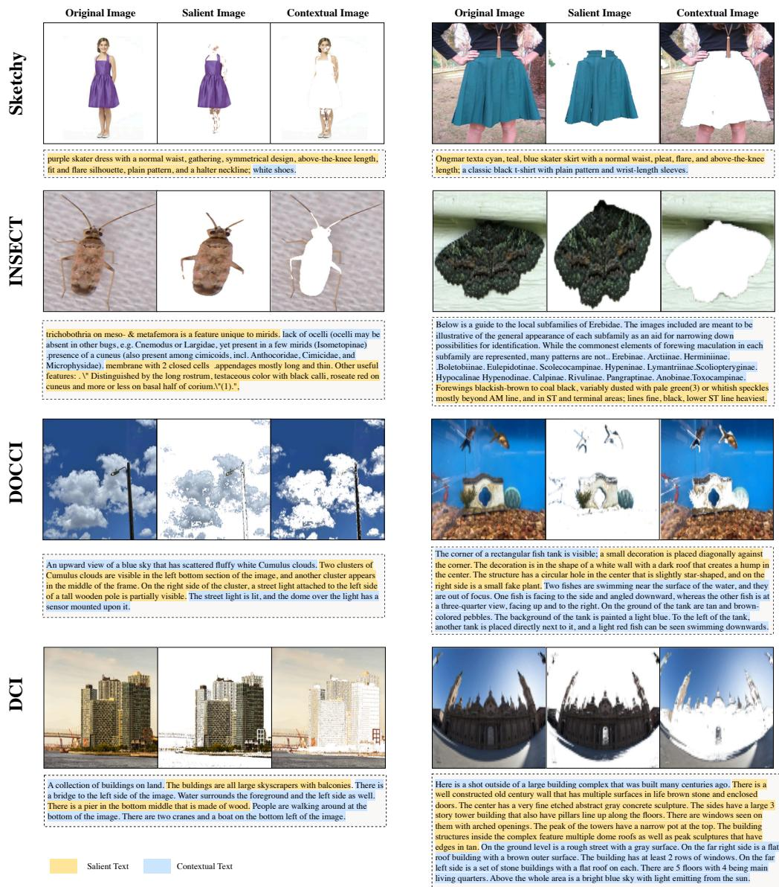  
Figure 5: Illustration of decomposed image–text pairs across four datasets. For each sample from Sketchy, INSECT, DOCCI, and DCI, we show the original image, the salient image, and the contextual image, together with the caption decomposition. Salient text is highlighted in yellow, while contextual text is highlighted in blue.

robustness across textual decomposers, and the semantic correspondence between independently generated visual and textual views.

## B.1 Salient/contextual pair generation

We independently construct salient and contextual components on the textual and visual sides. This process is performed offline before training and kept fixed across all experiments, so as to avoid introducing additional variation from repeatedly generating texts or regions under different settings.

Textual decomposition. On the textual side, we use Qwen2.5 [Qwen et al., 2025] to perform semantic-level decomposition of the original caption. Given a full caption, the LLM is prompted to divide the description into two parts: salient text and contextual text. Here, salient text refers to descriptions that are directly related to the main visual subject, key local structures, or discriminative attributes in the image. In contrast, contextual text mainly preserves background information, scene context, auxiliary objects, or descriptions with relatively weaker discriminative cues. It is worth noting that contextual text does not indicate useless or incorrect information; rather, it represents complementary semantics relative to the primary matching signal.

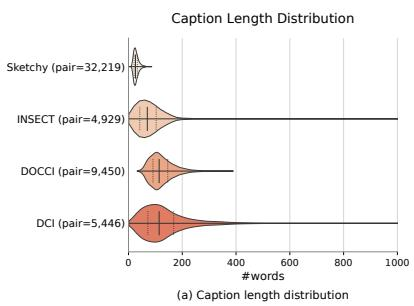

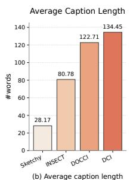

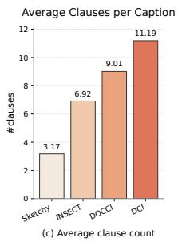

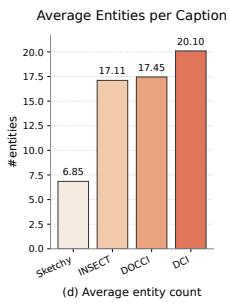  
Figure 6: Statistical analysis of the four datasets. We analyze the textual properties of DOCCI, INSECT, Sketchy, and DCI. (a) Caption length distribution, where the number in parentheses denotes the number of image-text pairs in each dataset. (b) Average caption length measured by the number of words. (c) Average number of clauses per caption. (d) Average number of semantic entities per caption.

Specifically, we feed the original caption into Qwen2.5 and use a fixed prompt to constrain the output format, asking the model to return salient and contextual textual components. All experiments use the same offline generated decomposed texts to ensure fair comparison across different settings. Fig. 7 shows the prompt used for textual decomposition and an example of the corresponding input and output. Besides, the time it takes for decomposition of captions into salient and contextual text depends on the dataset size and caption length. For example, for DOCCI with 9450 images, it is about 15 hrs, while for INSECT with 4929 images, it is 7 hrs.

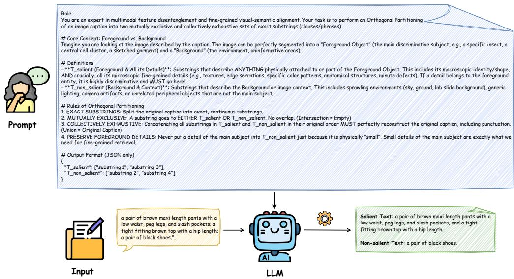  
Figure 7: Prompt and input-output examples. The salient and contextual texts are generated by an LLM during an offline preprocessing stage and kept fixed across all experiments to ensure fair comparisons.

Visual decomposition. On the visual side, we use an object saliency detection method FASA [Yildirim and Süsstrunk, 2014] to extract salient regions from the original image. For each image, we first generate a saliency map and convert it into a salient-region mask. Based on this mask, the salient image is constructed by preserving the salient regions in the original image, while the contextual image is obtained from the complementary regions after removing the salient part.

In this way, the original image is decomposed into two visual views: the salient image emphasizes the primary visual evidence, whereas the contextual image retains contextual visual information. Together with the textual decomposition, this provides a more structured image-text supervision signal for training. For visual decomposition, FASA processes each image in about 2 seconds on average. In comparison, SAM3-based [Carion et al., 2025] region generation is substantially more expensive, requiring about 6 seconds per image on average. Importantly, these costs occur only once before fine-tuning, and ROSA does not introduce any additional computational overhead during inference.

Output validation. The LLM is constrained to preserve the original caption content and return a fixed JSON decomposition, with free generation or rewriting disallowed. Each output is then validated before training for three failure modes: (i) invalid JSON format, (ii) content unsupported by the source caption, and (iii) incomplete reconstruction of the original caption. Across the four datasets, we observe no JSON-format failures. Before regeneration, the generated partitions achieve 98.04% mean per-sample caption coverage and 85.85% exact complete coverage. Failed cases are automatically detected and regenerated before training.

## B.2 Human Validation

Human visual-grounding validation. Three annotators evaluate 150 samples, with 50 images each from DOCCI, DCI, and Sketchy. For each textual component, they judge (i) visual verifiability: whether the description is observable in the corresponding image, and (ii) visual discriminability: whether the description identifies the ground-truth image against the highest-ranked incorrect retrieval. As shown in Tab. 9, human annotators judge 84.00% of salient descriptions and 84.67% of contextual descriptions as visually observable. In the two-image discrimination task, salient and contextual text identify the ground-truth image in 94.00% and 90.67% of cases, with 83.11% and 78.89% annotator agreement, respectively. These results independently verify that the LLM-generated salient text corresponds to visually grounded and discriminative content, while the contextual text not only retains sample-specific information, but also contains visually observable and discriminative evidence.

Table 9: Human validation of salient and contextual text. Results report visual verifiability, visual discriminability, and annotator agreement (%).
<table><tr><td>Metric</td><td>Salient</td><td>Contextual</td></tr><tr><td>Visual verifiability</td><td>84.00</td><td>84.67</td></tr><tr><td>Visual discriminability</td><td>94.00</td><td>90.67</td></tr><tr><td>Annotator agreement</td><td>83.11</td><td>78.89</td></tr></table>

Saliency-span agreement. Ten annotators label all 5100 DOCCI test samples, with 510 samples assigned to each annotator, by marking the caption span describing the most visually salient content at first glance. Mapping the human and LLM spans to the original token positions, the LLM split covers 92.74% of human-salient tokens and achieves 77.58% token F1 / 69.04% IoU, substantially outperforming an equal-length random-span baseline (47.88% / 36.96%). These results show substantial agreement between the LLM decomposition and independently perceived visual saliency.

## B.3 Prompt and LLM Stability

We evaluate the sensitivity of textual decomposition to the prompt and LLM. Using a substantially rewritten Qwen2.5 [Qwen et al., 2025] prompt and, separately, Llama-3.1 [Grattafiori et al., 2025] with the original prompt, the CLIP semantic similarity between corresponding outputs ranges from 0.808–0.912 across prompts and 0.841–0.909 across LLMs, indicating substantial semantic stability.

Table 10: Robustness to the textual decomposer. R@1 and R@10 (%) on T→I and I→T retrieval. ROSA is retrained using partitions generated by each LLM, with all other settings fixed. Best results are bold; second best underlined. ∆ denotes the margin of Qwen2.5 over Llama-3.1.
<table><tr><td rowspan="2">Text decomposer</td><td colspan="4">INSECT</td><td colspan="4">DOCCI</td></tr><tr><td>R@1</td><td>R@10</td><td>R@1</td><td>R@10</td><td>R@1</td><td>R@10</td><td>R@1</td><td>R@10</td></tr><tr><td>Llama-3.1</td><td>10.28</td><td>38.08</td><td>9.59</td><td>38.60</td><td>83.33</td><td>98.84</td><td>81.90</td><td>98.73</td></tr><tr><td>Qwen2.5 (default)</td><td>10.36</td><td>40.67</td><td>9.84</td><td>40.41</td><td>84.35</td><td>99.18</td><td>82.18</td><td>98.94</td></tr><tr><td>∆</td><td>↑0.08</td><td>↑2.59</td><td>↑0.25</td><td>↑1.81</td><td>↑1.02</td><td>↑0.34</td><td>↑0.28</td><td>↑0.21</td></tr></table>

Table 11: Ablation on salient–contextual swapping control. Results on T→I and I→T retrieval, with salient-only anchoring fixed. Best results are bold.
<table><tr><td rowspan="3">Pairing</td><td colspan="4">INSECT</td><td colspan="4">DOCCI</td></tr><tr><td>R@1</td><td>R@10</td><td>R@1</td><td>R@10</td><td>R@1</td><td>R@10</td><td>R@1</td><td>R@10</td></tr><tr><td>Swapped</td><td>9.76</td><td>38.43</td><td>9.67</td><td>39.46</td><td>82.04</td><td>98.96</td><td>79.37</td><td>98.69</td></tr><tr><td>Correctly matched ∆</td><td>10.36 ↑0.60</td><td>40.67 个 2.24</td><td>9.84 个 0.17</td><td>40.41 0.95</td><td>84.35 ↑2.31</td><td>99.18 0.22</td><td>82.18 个 2.81</td><td>98.94 0.25 7</td></tr></table>

We further regenerate the training partitions with Llama-3.1 and retrain ROSA with all other settings fixed. As shown in Tab. 10, retrieval performance remains comparable after replacing the default Qwen2.5 decomposer.

## B.4 Cross-modal Correspondence Analysis

## B.4.1 Salient–contextual swapping control

Salient–contextual pairing. To evaluate whether the gains depend on the correspondence between auxiliary views, we pair salient images with contextual text and contextual images with salient text, keeping the decomposed views, training settings, and computation remain fixed. As shown in Tab. 11, correct matching wins all eight metrics, including +2.31/+2.81 DOCCI T→I/I→T R@1. Because the variants differ only in correspondence, arbitrary partial-view alignment cannot explain the gains; preserving the intended salient–contextual roles is essential.

## B.4.2 Robustness to cross-modal mismatch

In our method, we generate the salient/contextual image and text independently. This raises a natural concern: the resulting salient/contextual image-text pairs may be semantically mismatched and may introduce noisy auxiliary supervision during fine-tuning. For example, if a salient text does not actually correspond to the salient image region, fine-tuning would incorrectly pull an unmatched image-text component pair closer, potentially harming the learning.

To examine this risk, we use a frozen CLIP [Radford et al., 2021] model to compute the initial agreement score for each salient/contextual image-text pair. We then independently filter the lowestscoring 5%, 10%, and 20% pairs in the salient and contextual branches. The original image-text pairs are always retained; filtering only affects the corresponding auxiliary losses.

As shown in Table 12, the full model without filtering achieves the best overall performance on DOCCI, INSECT. These results suggest that the independently generated salient/contextual pairs are not dominated by semantic mismatches. The fact that filtering often degrades performance, indicates that our modality-independent strategy can generally produce pairs that are useful for long-text alignment.

Recent work [Han et al., 2025] shows LLMs can acquire visual semantic priors from text-only pretraining and that such priors can be decomposed into perception and reasoning priors with different origins. In particular, perception-oriented ability depends more on the vision encoder and visual instruction tuning while visual reasoning is strongly shaped by reasoning priors acquired during language pre-training. It motivates why salient text extraction from captions can be viewed as a language-side visual-semantic reasoning process, rather than simple string splitting. Therefore, the independently generated salient/contextual images and texts show semantic consistency in terms of visual perception.

Table 12: Robustness to cross-modal mismatch. Results on Text→Image and Image→Text retrieval for INSECT, DOCCI. We discard different proportions of generated pairs according to their similarity scores. For example, 5% filtering ratio means removing the lowest-scored 5% pairs.
<table><tr><td rowspan="2">Filtering ratio</td><td colspan="6">INSECT</td><td colspan="6">DOCCI</td></tr><tr><td>R@1</td><td>R@5</td><td>R@10</td><td>R@1</td><td>R@5</td><td>R@10</td><td>R@1</td><td>R@5</td><td>R@10</td><td>R@1</td><td>R@5</td><td>R@10</td></tr><tr><td>20%</td><td>10.02</td><td>27.63</td><td>37.39</td><td>9.24</td><td>26.08</td><td>38.51</td><td>80.25</td><td>96.71</td><td>98.69</td><td>78.37</td><td>96.37</td><td>98.57</td></tr><tr><td>10%</td><td>10.02</td><td>26.34</td><td>37.74</td><td>9.50</td><td>26.42</td><td>36.96</td><td>79.63</td><td>96.65</td><td>98.47</td><td>78.35</td><td>96.22</td><td>98.37</td></tr><tr><td>5%</td><td>9.84</td><td>29.02</td><td>39.72</td><td>8.98</td><td>27.89</td><td>39.12</td><td>80.25</td><td>96.76</td><td>98.82</td><td>79.16</td><td>95.86</td><td>98.53</td></tr><tr><td>0% (Ours)</td><td>10.36</td><td>28.32</td><td>40.67</td><td>9.84</td><td>29.36</td><td>40.41</td><td>84.35</td><td>97.51</td><td>99.18</td><td>82.18</td><td>97.14</td><td>98.94</td></tr></table>

## C Controlled Analyses of Saliency Collapse

Beyond the length-matched analysis in Fig. 2, we further control for several textual factors that may differ between salient and contextual descriptions, including entity count, lexical statistics, caption position, and text-only discriminability. We study these factors through single-factor controlled deletion and entity-controlled reconstruction under a fixed query template.

## C.1 Single-factor controlled deletion

For each salient deletion, we enumerate combinations of complete contextual clauses from the same caption and select a contextual deletion matched separately by: (i) spaCy noun-phrase/entity count; (ii) TF–IDF density computed from training captions; (iii) normalized caption position; or (iv) E5-large-v2 text-only discriminability. These are four separate controls, rather than a joint match on all four properties. We evaluate LongCLIP-FT [Zhang et al., 2024], GOAL [Choi et al., 2025], and StructXLIP [Ruan et al., 2026] on DOCCI [Onoe et al., 2024] and INSECT [Truong et al., 2025] at salient-text deletion ratios of D = {25%, 50%, 75%, 90%, 100%}. We report the average difference between contextual-deletion and salient-deletion text-to-image R@1. Table 13 shows positive average gaps for all six model–dataset settings under every matching metric. Thus, matching any one of the tested factors does not eliminate the observed average asymmetry between salient and contextual deletion.

## C.2 Entity-controlled reconstruction

We further isolate saliency from query structure using entity-controlled reconstruction. We fix the syntax, entity positions, and entity count with the template

$$
\mathrm { A n ~ \ i m a g e ~ \ c o n t a i n i n g : ~ \ e n t i t y ~ \ 1 , ~ \ . ~ . ~ . ~ , ~ \ e n t i t y ~ \ K . }
$$

We then progressively replace salient entities with contextual entities from the same caption, matching replacement pairs by CLIP-token length and IDF computed from the training captions. We use K = 4 and replacement ratios of 0%, 25%, 50%, 75%, 100%, where 0% contains only salient entities and 100% replaces all four with contextual entities. The resulting query-length difference is only 0.73 tokens, while the entity-level IDF differs by 4.1% (standardized difference: 0.187). We evaluate LongCLIP-FT [Zhang et al., 2024], GOAL [Choi et al., 2025], StructXLIP [Ruan et al., 2026], and ROSA on T→I R@1 over three seeds. As shown in Tab. 14, retrieval performance consistently decreases as salient entities are replaced by matched contextual entities. ROSA achieves the highest mean R@1 at every replacement ratio and demonstrates a smaller endpoint drop than the baselines. For example, StructXLIP decreases from 20.14% to 9.42% (−10.72%), whereas ROSA decreases from 21.02% to 13.53% (−7.49%). These results support RoSA’s improved utilization of contextual evidence under controlled query reconstruction.

Discussion. Across all 39/39 baseline endpoint comparisons, we observe a consistent saliencyreliance gap, while ROSA consistently narrows this gap. Together with the deletion controls, these results substantially reduce the influence of textual confounders: the reconstruction fixes the query template, entity count, and entity positions while closely matching token length and IDF, supporting concentrated reliance on salient evidence and ROSA’s improved use of the remaining context.

Table 13: Single-factor controlled deletion. Each entry reports contextual-deletion R@1 - salientdeletion R@1, averaged over five salient-text deletion ratios. Columns represent separate matching metric. Positive values indicate greater degradation under salient deletion.
<table><tr><td>Dataset</td><td>Model</td><td>Entity</td><td>TF-IDF</td><td>Position</td><td>E5</td></tr><tr><td rowspan="3">DOCCI</td><td>GOAL</td><td>+13.95</td><td>+17.25</td><td>+16.33</td><td>+17.32</td></tr><tr><td>LongCLIP-FT</td><td>+14.15</td><td>+17.54</td><td>+16.68</td><td>+17.58</td></tr><tr><td>StructXLIP</td><td>+13.14</td><td>+17.26</td><td>+15.98</td><td>+17.39</td></tr><tr><td rowspan="3">INSECT</td><td>GOAL</td><td>+2.47</td><td>+2.02</td><td>+3.09</td><td>+2.57</td></tr><tr><td>LongCLIP-FT</td><td>+2.41</td><td>+2.51</td><td>+3.47</td><td>+2.59</td></tr><tr><td>StructXLIP</td><td>+3.15</td><td>+2.83</td><td>+3.58</td><td>+3.32</td></tr></table>

Table 14: Entity-controlled reconstruction with $K = 4 .$ . Columns indicate the percentage of salient entities replaced by matched contextual entities from the same caption. Entries report text-to-image R@1 (%) over three seeds. The best mean in each column is highlighted in bold.
<table><tr><td>Model</td><td>0%</td><td>25%</td><td>50%</td><td>75%</td><td>100%</td></tr><tr><td>LongCLIP-FT</td><td> $1 8 . 2 6 \pm 0 . 8 3$ </td><td> $1 5 . 4 8 \pm 0 . 2 0$ </td><td> $1 3 . 0 9 \pm 0 . 5 5$ </td><td> $1 0 . 6 6 \pm 0 . 1 2$ </td><td> $7 . 7 7 \pm 0 . 3 6$ </td></tr><tr><td>GOAL</td><td> $2 0 . 0 6 \pm 0 . 8 7$ </td><td> $1 7 . 8 5 \pm 0 . 5 5$ </td><td> $1 5 . 5 8 \pm 0 . 4 9$ </td><td> $1 3 . 1 3 \pm 0 . 1 3$ </td><td> $9 . 6 7 \pm 0 . 4 6$ </td></tr><tr><td>StructXLIP</td><td> $2 0 . 1 4 \pm 0 . 8 6$ </td><td> $1 7 . 6 2 \pm 0 . 2 1$ </td><td> $1 5 . 4 7 \pm 0 . 1 8$ </td><td> $1 2 . 8 8 \pm 0 . 3 4$ </td><td> $9 . 4 2 \pm 0 . 0 1$ </td></tr><tr><td>RoSA</td><td> ${ \bf 2 1 . 0 2 \pm 0 . 3 1 }$ </td><td> ${ \bf 1 9 . 6 5 \pm 0 . 1 0 }$ </td><td> ${ \bf 1 7 . 3 9 \pm 0 . 1 6 }$ </td><td> ${ \bf 1 5 . 9 8 \pm 0 . 2 7 }$ </td><td> ${ \bf 1 3 . 5 3 \pm 0 . 4 8 }$ </td></tr></table>

## D Robustness to alternative query construction

Training uses decomposed image–text views alongside the original pairs, whereas evaluation always retrieves the original full images without involving decomposed visual views. To test the remaining text-side overlap, we freeze all checkpoints and regenerate only the test queries using: (i) Qwen2.5 [Bai et al., 2025] with a substantially rewritten prompt, (ii) an unseen Llama-3.1 [Grattafiori et al., 2025] with the original prompt, and (iii) human construction without an LLM. For the latter, ten annotators partition the complete 5,100-sample DOCCI [Onoe et al., 2024] test set, with 510 samples assigned to each annotator. The rewritten-prompt and Llama-3.1 settings are evaluated on DOCCI and INSECT [Truong et al., 2025], while human queries are evaluated on DOCCI.

For each construction, we evaluate the same three query conditions as in the main robustness experiment: Salient-only, $S a l i e n t _ { 5 0 \% } + C o n t e x t ,$ and Context-only. Tab. 15 reports T→I R@1 and R@10 without retraining either model. Across the original construction in Tab. 4 and the three alternatives, ROSA wins 39/42 comparisons and all 14/14 Context-only comparisons. Its advantage remains largest when salient evidence is absent, including under human queries with no LLM in the pipeline. On DOCCI, the Context-only R@1 gains are 12.18%, 9.30%, and 8.84% for the rewritten prompt, Llama-3.1, and human queries, respectively; on INSECT, the corresponding gains are 0.10% and 1.98%. These results separate the robustness gains from adaptation to a particular prompt or decomposition rule.

## E Additional exploratory analyses

## E.1 Cross-domain Evaluation on PathGen

We further evaluate our method on PathGen-1.6M [Sun et al., 2025], a pathology image-text dataset constructed from approximately 7,800 whole-slide images (WSIs) and containing over 1.6 million patch–caption pairs. Despite its large scale, the dataset exhibits substantial redundancy: within the same WSI, many extracted patches are visually similar and their associated captions are often repetitive, focusing on a limited set of pathological patterns. Consequently, the increase in datase size does not necessarily translate into proportional semantic diversity.

Table 15: Robustness to alternative query construction. We report T→I Recall@K (%) on INSECT and DOCCI using test queries reconstructed with a rewritten prompt, Llama-3.1, or human annotations under Salient-only , Salient50%+Context , and Context-only . Model checkpoints and full-image retrieval galleries remain fixed. For each query construction, we highlight best and second best results; ∆ denotes the margin of ROSA over StructXLIP (%). Human queries are evaluated only on DOCCI; “–” indicates an unevaluated setting.
<table><tr><td rowspan="3" colspan="2">Query construction Method</td><td colspan="6">INSECT</td><td colspan="6">DOCCI</td></tr><tr><td colspan="2">Salient-only</td><td colspan="2">Salient50%+Context</td><td colspan="2">Context-only</td><td colspan="2">Salient-only</td><td colspan="2">Salient50%+Context</td><td colspan="2">Context-only</td></tr><tr><td>R@1</td><td>R@10</td><td>R@1</td><td>R@10</td><td>R@1</td><td>R@10</td><td>R@1</td><td>R@10</td><td>R@1</td><td>R@10</td><td>R@1</td><td>R@10</td></tr><tr><td rowspan="3">Rewritten prompt</td><td>StructXLIP [CVPR&#x27;26]</td><td>7.55</td><td>33.19</td><td>9.68</td><td>36.17</td><td>3.62</td><td>16.81</td><td>65.15</td><td>92.53</td><td>78.30</td><td>97.47</td><td>34.98</td><td>65.85</td></tr><tr><td>RoSA (Ours)</td><td>7.98</td><td>35.11</td><td>9.47</td><td>39.04</td><td>3.72</td><td>22.66</td><td>65.81</td><td>93.13</td><td>79.83</td><td>98.28</td><td>47.16</td><td>78.34</td></tr><tr><td>∆</td><td>↑0.43↑1.92</td><td></td><td>↓0.21</td><td>↑2.87</td><td>↑ 0.10 ↑ 5.85|</td><td></td><td>0.66</td><td>↑0.60</td><td>↑1.53</td><td>↑0.81</td><td>↑12.18</td><td>↑12.49</td></tr><tr><td rowspan="3">Llama-3.1</td><td>StructXLIP [CVPR&#x27;26]</td><td>7.19</td><td>34.69</td><td>9.17</td><td>35.83</td><td>3.12</td><td>18.02</td><td>66.92</td><td>93.23</td><td>76.04</td><td>96.82</td><td>35.29</td><td>64.47</td></tr><tr><td>RoSA (Ours)</td><td>6.67</td><td>35.94</td><td>9.90</td><td>38.54</td><td>5.10</td><td>21.04</td><td>67.86</td><td>93.58</td><td>78.25</td><td>97.43</td><td>44.59</td><td>76.02</td></tr><tr><td>∆</td><td>↓0.52</td><td></td><td>↑1.25 ↑0.73</td><td>↑2.71</td><td>↑1.98↑3.02|</td><td></td><td>|↑ 0.94 ↑ 0.35</td><td></td><td>↑2.21</td><td>↑0.61</td><td>↑9.30</td><td>↑11.55</td></tr><tr><td rowspan="3">Human</td><td>StructXLIP [CVPR’26]</td><td></td><td>一</td><td>一</td><td>1</td><td>一</td><td>一</td><td>56.44</td><td>86.58</td><td>81.20</td><td>98.32</td><td>50.01</td><td>78.94</td></tr><tr><td>RoSA (Ours)</td><td></td><td>一</td><td>一</td><td>一</td><td>一</td><td></td><td>58.55</td><td>88.19</td><td>82.05</td><td>98.87</td><td>58.85</td><td>86.71</td></tr><tr><td>∆</td><td></td><td>一</td><td>一</td><td>一</td><td>一</td><td></td><td>|↑ 2.11 ↑1.61</td><td></td><td>↑0.85</td><td>↑0.55</td><td>↑8.84</td><td>↑7.77</td></tr></table>

Table 16: Cross-modal retrieval on PathGen. We report R@K under T→I and I→T retrieval. Best and second-best results are marked in bold and underline.
<table><tr><td rowspan="3">Methods</td><td colspan="3">T→I</td><td colspan="3">I→T</td></tr><tr><td>R@1</td><td>R@5</td><td>R@10</td><td>R@1</td><td>R@5</td><td>R@10</td></tr><tr><td>Long-CLIP [ECCV’24]</td><td>3.20</td><td>11.99</td><td>19.30</td><td>3.49</td><td>11.15</td><td>18.08</td></tr><tr><td>FineLIP [CVPR’25]</td><td>3.72</td><td>13.05</td><td>20.51</td><td>3.69</td><td>12.31</td><td>19.99</td></tr><tr><td>SmartCLIP [CVPR’25]</td><td>2.13</td><td>8.65</td><td>14.39</td><td>2.08</td><td>7.93</td><td>13.45</td></tr><tr><td>GOAL [CVPR’25]</td><td>3.52</td><td>13.72</td><td>21.72</td><td>3.54</td><td>13.23</td><td>21.45</td></tr><tr><td>StructXLIP [CVPR’26]</td><td>3.81</td><td>12.48</td><td>20.71</td><td>3.27</td><td>12.43</td><td>20.36</td></tr><tr><td>RoSA (Ours)</td><td>4.33</td><td>14.14</td><td>22.90</td><td>4.11</td><td>14.05</td><td>22.19</td></tr><tr><td>∆</td><td>↑0.52</td><td>↑0.42</td><td>↑1.18</td><td>↑0.42</td><td>↑0.82</td><td>↑0.74</td></tr></table>

Moreover, in realistic clinical and research settings, obtaining million-scale image–text annotations is impractical. Pathology experts are more likely to provide a limited number of annotations covering diverse pathological themes rather than repeatedly describing the same lesion region. Therefore, for downstream fine-tuning tasks, constructing a compact yet semantically diverse dataset is both practically meaningful and computationally desirable.

Motivated by these observations, we perform semantic condensation on PathGen-1.6M through a two-stage pipeline. First, we conduct stratified splitting at the WSI level based on TCGA TSS code mappings. WSIs are divided into training and testing sets with an 80%/20% ratio while strictly ensuring that all patch–caption pairs from the same WSI remain within the same split, thereby preventing data leakage.

Second, semantic de-redundancy is performed within each WSI. Specifically, all captions are encoded using S-BioBERT [Deka and Jurek-Loughrey, 2021], followed by agglomerative hierarchical clustering with cosine distance to group semantically similar captions into thematic clusters. The clustering threshold is set to 0.4, approximately corresponding to a cosine similarity greater than 0.6. Within each cluster, only the patch–caption pair closest to the cluster centroid is retained as the representative sample, while the remaining samples are discarded as redundant. This process effectively removes repetitive descriptions while preserving the major pathological semantic themes within each WSI.

After semantic condensation, the final dataset contains 15,749 training pairs and 4,037 testing pairs. Based on these selected image–caption pairs, we construct a pathology retrieval benchmark in which captions primarily describe cellular structures, tissue morphology, and local pathological patterns, with an average caption length of 51 words.

Tab. 16 reports the cross-modal retrieval performance on PathGen. As a highly domain-specific benchmark with complex pathological patterns, PathGen remains challenging for all compared methods, resulting in relatively low absolute retrieval performance. Nevertheless, our method consistently achieves the strongest results among CLIP-based fine-tuning baselines, demonstrating the effectiveness of saliency-aware alignment in challenging pathology-specific scenarios.

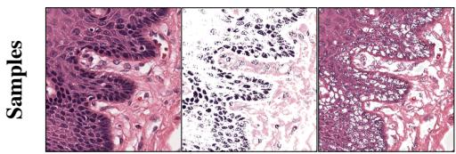

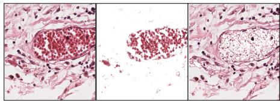  
Original text The tissue section likely from the esophagus shows a vein with densely packed cells of varied sizes and shapes, possibly indicating an embolic event. Surrounding connective tissue contains cells with prominent nuclei. Morphological diversity and vessel occupancy suggest pathological changes, potentially related to vascular obstruction or tissue damage due to the embolus.

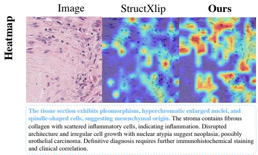

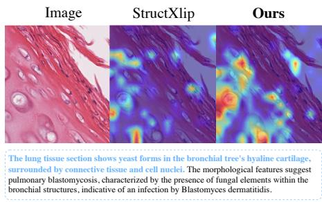  
Figure 8: Qualitative examples from the PathGen benchmark after semantic condensation. Top: representative pathology image-caption pairs and corresponding retrieval results. Bottom: attention map comparisons between StructXLIP and our ROSA. Our method ROSA exhibits better alignment with clinically relevant pathological regions described in the captions, including spindle-shaped tumor cells and yeast-like fungal structures associated with pulmonary blastomycosis.

Table 17: Plug-and-play enhancement with our saliency-guided module on PathGen. We report Recall@K (%) under both Text→Image and Image→Text retrieval settings. The values in parentheses denote the absolute change over the corresponding baseline.
<table><tr><td rowspan=2 colspan=6>Text→Image                                     Image→TextMethodsR@1</td></tr><tr><td rowspan=1 colspan=1></td><td rowspan=1 colspan=1>R@10</td><td rowspan=1 colspan=1></td><td rowspan=1 colspan=1></td><td rowspan=1 colspan=1>R@10</td></tr><tr><td rowspan=1 colspan=1>Long-CLIP          3.20+our LRoSA      3.67(+0.47)</td><td rowspan=1 colspan=1>11.9912.63(+0.64)</td><td rowspan=1 colspan=1>19.3020.44(+1.14)</td><td rowspan=1 colspan=1>3.493.49(+0.00)</td><td rowspan=1 colspan=1>11.1511.99(+0.84)</td><td rowspan=1 colspan=1>18.0819.74(+1.66)</td></tr><tr><td rowspan=1 colspan=1>FineLIP             3.72+our LRoSA      4.01(+0.29)</td><td rowspan=1 colspan=1>13.0513.15(+0.10)</td><td rowspan=1 colspan=1>20.5120.41(-0.10)</td><td rowspan=1 colspan=1>3.694.14(+0.45)</td><td rowspan=1 colspan=1>12.3113.10(+0.79)</td><td rowspan=1 colspan=1>19.9920.19(+0.20)</td></tr><tr><td rowspan=1 colspan=1>GOAL              3.52+our LRoSA      4.53(+1.01)</td><td rowspan=1 colspan=1>13.7215.61(+1.89)</td><td rowspan=1 colspan=1>21.7223.90(+2.18)</td><td rowspan=1 colspan=1>3.544.21(+0.67)</td><td rowspan=1 colspan=1>13.2314.76(+1.53)</td><td rowspan=1 colspan=1>21.4523.28(+1.83)</td></tr><tr><td rowspan=1 colspan=1>DoRA              3.86+our LRoSA      4.24(+0.38)</td><td rowspan=1 colspan=1>13.2314.42(+1.19)</td><td rowspan=1 colspan=1>20.8121.92(+1.11)</td><td rowspan=1 colspan=1>3.773.99(+0.22)</td><td rowspan=1 colspan=1>13.0014.37(+1.37)</td><td rowspan=1 colspan=1>20.9622.29(+1.33)</td></tr><tr><td rowspan=1 colspan=1>StructXLIP          3.81+our LRoSA      3.99(+0.18)</td><td rowspan=1 colspan=1>12.4813.95(+1.47)</td><td rowspan=1 colspan=1>20.7121.55(+0.84)</td><td rowspan=1 colspan=1>3.273.57(+0.30)</td><td rowspan=1 colspan=1>12.4312.73(+0.30)</td><td rowspan=1 colspan=1>20.3620.86(+0.50)</td></tr></table>

Fig. 8 further provides qualitative comparisons on representative pathology samples. Compared with StructXLIP, our method produces attention maps that better align with clinically relevant pathological regions described in the captions. In the bottom-left example, the caption describes pleomorphic spindle-shaped tumor cells, a characteristic morphological pattern commonly associated with mesenchymal-origin malignancies. While StructXLIP mainly attends to scattered local regions without clearly capturing the spindle-cell morphology, our method accurately highlights the elongated spindle-shaped cellular structures mentioned in the report. In the bottom-right example, the caption describes yeast forms consistent with pulmonary blastomycosis. Our method successfully localizes most of the yeast-like fungal cells distributed within the bronchial cartilage region, whereas StructXLIP only focuses on several isolated regions and fails to capture the overall fungal distribution pattern. Although minor background activations remain, our attention maps exhibit substantially better semantic correspondence with the pathological findings described in the caption.

Table 18: Zero-shot localization on Ref-COCOg. We report oIoU and mIoU (%). We highlight best and second best results; ∆ is our margin over StructXLIP.
<table><tr><td>Method</td><td>oIoU</td><td>mIoU</td></tr><tr><td>StructXLIP [CVPR’26]</td><td>36.71</td><td>47.15</td></tr><tr><td>RoSA (Ours)</td><td>37.62</td><td>48.23</td></tr><tr><td>∆</td><td>↑0.91</td><td>↑1.08</td></tr></table>

Table 19: Local-description retrieval on DOCCI-FG. We report T→I Recall@K (%). We highlight best and second best results; ∆ is our margin over the best competitor.
<table><tr><td>Method</td><td>R@1</td><td>R@5</td><td>R@10</td></tr><tr><td>GOAL [CVPR’25]</td><td>18.01</td><td>34.19</td><td>41.81</td></tr><tr><td>StructXLIP [CVPR’26]</td><td>16.61</td><td>31.47</td><td>38.81</td></tr><tr><td>RoSA (Ours)</td><td>19.86</td><td>37.46</td><td>45.74</td></tr><tr><td>∆</td><td>↑1.85</td><td>↑3.27</td><td>↑3.93</td></tr></table>

Tab. 17 further demonstrates the plug-and-play capability of our module on PathGen. Our method consistently improves both CLIP-based fine-tuning approaches and PEFT-based adaptation methods, indicating strong compatibility and general applicability across different adaptation strategies.

## E.2 Fine-grained grounding

We further evaluate fine-grained grounding through three additional experiments: zero-shot pixellevel localization, local-description retrieval, and local fine-grained discrimination. None of these evaluations relies on our saliency-deletion protocol.

Zero-shot pixel-level localization We evaluate referring image segmentation on RefCOCOg [Mao et al., 2016], where each sample consists of an image, a referring expression, and the ground-truth mask of the referred object. We use DCI-trained encoders and perform zero-shot evaluation without RefCOCOg or segmentation-specific training. Given a referring expression, we obtain the predicted mask using the same localization procedure for all compared models. We report overall Intersection over-Union (oIoU) and mean Intersection-over-Union (mIoU). oIoU computes the intersection and union over all evaluated samples globally, while mIoU averages the IoU of individual samples. As shown in Tab. 18, ROSA improves over StructXLIP by +0.91% oIoU and +1.08% mIoU, suggesting better zero-shot transfer to pixel-level localization on an unseen grounding benchmark.

Fine-grained local-description retrieval We evaluate on DOCCI-FG from DOCCI dataset [Onoe et al., 2024], which contains 5000 images and 35533 fine-grained local descriptions. Each local description is used to retrieve its corresponding full image from the complete gallery. Tab. 19 shows ROSA consistently outperforms strong local-(GOAL) and structural-alignment(StructXLIP) baselines, showing improved use of localized fine-grained descriptions for image retrieval.

Local fine-grained discrimination We evaluate on DCI’s official local subset of 1,274 mask-aligned subcrops. The models receive local subcrops without the full images and must distinguish the correct description from negatives differing in local attributes, parts, or relations. Adding ROSA to StructXLIP improves accuracy by 3.77%, 2.91%, and 3.61% under the standard, Pick5, and CLIP-hard-negative settings, respectively. These improvements support stronger discrimination of fine-grained semantic differences using local visual content.

## F Qualitative results

As shown in Fig. 9, we further present qualitative comparisons between ROSA and the competitive StructXLIP [Ruan et al., 2026] on four datasets: Sketchy [Girella et al., 2025], INSECT [Truong et al., 2025], DOCCI [Onoe et al., 2024] and DCI [Urbanek et al., 2024]. Specifically, we visualize the attention maps on the image corresponding to the blue bold text in long captions. Overall, compared with StructXLIP, ROSA produces more focused and semantically consistent attention responses across different datasets, demonstrating stronger alignment between textual description and image regions.

On Sketchy dataset, both StructXLIP and ROSA can pay attention to the clothing, retaining a basic image-text alignment capability. However, the attention responses of StructXLIP are relatively local ized and less stable. In contrast, ROSA provides more complete coverage of the target garments and better captures the overall clothing structures described in the text. On INSECT dataset, since insect images belong to a relatively underrepresented visual domain, their categories and morphological structures are typically less sufficiently covered by the pre-training data of general vision-language models. As a result, the attention maps of both StructXLIP and ROSA are generally less accurate. Nevertheless, ROSA still presents better text-image alignment. On the DOCCI dataset, in the first case, the blue bold text explicitly describes a white sticker on the cat’s nose with 6407’ written in´ black. Although StructXLIP roughly attends to the cat’s head, its attention is mainly concentrated around the ears and fails to precisely localize the nose sticker described by the text. By contrast, ROSA places strong attention on the cat’s nose region, providing a more accurate correspondence to the fine-grained text.

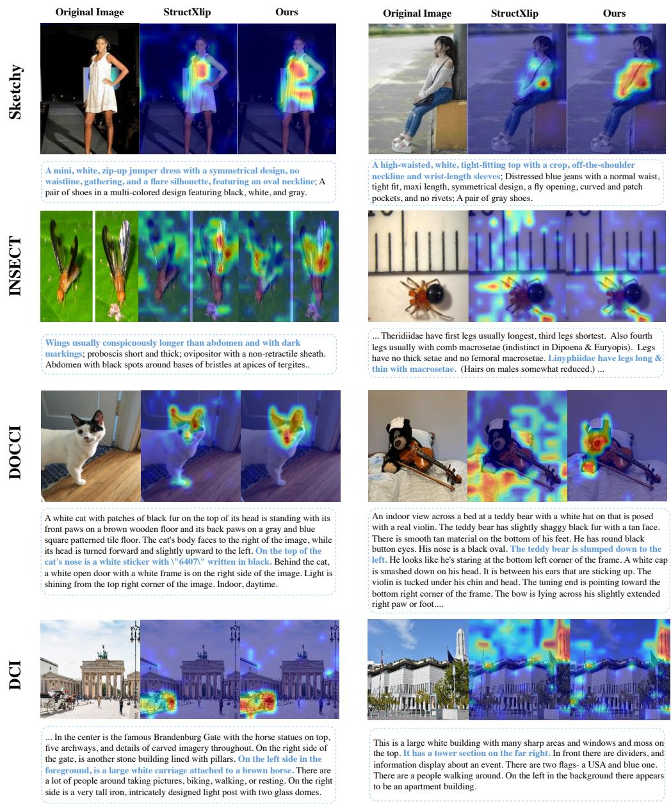  
Figure 9: Qualitative results of ROSA and the competitive method StructXLIP across four datasets. We visualize the attention maps corresponding to the blue bold text in each caption. Compared with StructXLIP, ROSA shows more focused activations on the corresponding visual objects described by the text.

## NeurIPS Paper Checklist

## 1. Claims

Question: Do the main claims made in the abstract and introduction accurately reflect the paper’s contributions and scope?

Answer: [Yes]

Justification: See section 1

Guidelines:

• The answer [N/A] means that the abstract and introduction do not include the claims made in the paper.

• The abstract and/or introduction should clearly state the claims made, including the contributions made in the paper and important assumptions and limitations. A [No] or [N/A] answer to this question will not be perceived well by the reviewers.

• The claims made should match theoretical and experimental results, and reflect how much the results can be expected to generalize to other settings.

• It is fine to include aspirational goals as motivation as long as it is clear that these goals are not attained by the paper.

## 2. Limitations

Question: Does the paper discuss the limitations of the work performed by the authors?

Answer: [Yes]

Justification: See Section 6

Guidelines:

• The answer [N/A] means that the paper has no limitation while the answer [No] means that the paper has limitations, but those are not discussed in the paper.

• The authors are encouraged to create a separate “Limitations” section in their paper.

• The paper should point out any strong assumptions and how robust the results are to violations of these assumptions (e.g., independence assumptions, noiseless settings, model well-specification, asymptotic approximations only holding locally). The authors should reflect on how these assumptions might be violated in practice and what the implications would be.

• The authors should reflect on the scope of the claims made, e.g., if the approach was only tested on a few datasets or with a few runs. In general, empirical results often depend on implicit assumptions, which should be articulated.

• The authors should reflect on the factors that influence the performance of the approach. For example, a facial recognition algorithm may perform poorly when image resolution is low or images are taken in low lighting. Or a speech-to-text system might not be used reliably to provide closed captions for online lectures because it fails to handle technical jargon.

• The authors should discuss the computational efficiency of the proposed algorithms and how they scale with dataset size.

• If applicable, the authors should discuss possible limitations of their approach to address problems of privacy and fairness.

• While the authors might fear that complete honesty about limitations might be used by reviewers as grounds for rejection, a worse outcome might be that reviewers discover limitations that aren’t acknowledged in the paper. The authors should use their best judgment and recognize that individual actions in favor of transparency play an important role in developing norms that preserve the integrity of the community. Reviewers will be specifically instructed to not penalize honesty concerning limitations.

## 3. Theory assumptions and proofs

Question: For each theoretical result, does the paper provide the full set of assumptions and a complete (and correct) proof?

Answer: [N/A]

Justification: The paper is empirical in nature and does not include theoretical results, assumptions, or formal proofs.

Guidelines:

• The answer [N/A] means that the paper does not include theoretical results.

• All the theorems, formulas, and proofs in the paper should be numbered and crossreferenced.

• All assumptions should be clearly stated or referenced in the statement of any theorems.

• The proofs can either appear in the main paper or the supplemental material, but if they appear in the supplemental material, the authors are encouraged to provide a short proof sketch to provide intuition.

• Inversely, any informal proof provided in the core of the paper should be complemented by formal proofs provided in appendix or supplemental material.

• Theorems and Lemmas that the proof relies upon should be properly referenced.

## 4. Experimental result reproducibility

Question: Does the paper fully disclose all the information needed to reproduce the main experimental results of the paper to the extent that it affects the main claims and/or conclusions of the paper (regardless of whether the code and data are provided or not)?

Answer: [Yes]

Justification: See Section 5

Guidelines:

• The answer [N/A] means that the paper does not include experiments.

• If the paper includes experiments, a [No] answer to this question will not be perceived well by the reviewers: Making the paper reproducible is important, regardless of whether the code and data are provided or not.

• If the contribution is a dataset and/or model, the authors should describe the steps taken to make their results reproducible or verifiable.

• Depending on the contribution, reproducibility can be accomplished in various ways. For example, if the contribution is a novel architecture, describing the architecture fully might suffice, or if the contribution is a specific model and empirical evaluation, it may be necessary to either make it possible for others to replicate the model with the same dataset, or provide access to the model. In general. releasing code and data is often one good way to accomplish this, but reproducibility can also be provided via detailed instructions for how to replicate the results, access to a hosted model (e.g., in the case of a large language model), releasing of a model checkpoint, or other means that are appropriate to the research performed.

• While NeurIPS does not require releasing code, the conference does require all submissions to provide some reasonable avenue for reproducibility, which may depend on the nature of the contribution. For example

(a) If the contribution is primarily a new algorithm, the paper should make it clear how to reproduce that algorithm.

(b) If the contribution is primarily a new model architecture, the paper should describe the architecture clearly and fully.

(c) If the contribution is a new model (e.g., a large language model), then there should either be a way to access this model for reproducing the results or a way to reproduce the model (e.g., with an open-source dataset or instructions for how to construct the dataset).

(d) We recognize that reproducibility may be tricky in some cases, in which case authors are welcome to describe the particular way they provide for reproducibility. In the case of closed-source models, it may be that access to the model is limited in some way (e.g., to registered users), but it should be possible for other researchers to have some path to reproducing or verifying the results.

## 5. Open access to data and code

Question: Does the paper provide open access to the data and code, with sufficient instructions to faithfully reproduce the main experimental results, as described in supplemental material?

## Answer: [Yes]

Justification: Code and models will be made publicly available upon acceptance.

## Guidelines:

• The answer [N/A] means that paper does not include experiments requiring code.

• Please see the NeurIPS code and data submission guidelines (https://neurips.cc/ public/guides/CodeSubmissionPolicy) for more details.

• While we encourage the release of code and data, we understand that this might not be possible, so [No] is an acceptable answer. Papers cannot be rejected simply for not including code, unless this is central to the contribution (e.g., for a new open-source benchmark).

• The instructions should contain the exact command and environment needed to run to reproduce the results. See the NeurIPS code and data submission guidelines (https: //neurips.cc/public/guides/CodeSubmissionPolicy) for more details.

• The authors should provide instructions on data access and preparation, including how to access the raw data, preprocessed data, intermediate data, and generated data, etc.

• The authors should provide scripts to reproduce all experimental results for the new proposed method and baselines. If only a subset of experiments are reproducible, they should state which ones are omitted from the script and why.

• At submission time, to preserve anonymity, the authors should release anonymized versions (if applicable).

• Providing as much information as possible in supplemental material (appended to the paper) is recommended, but including URLs to data and code is permitted.

## 6. Experimental setting/details

Question: Does the paper specify all the training and test details (e.g., data splits, hyperparameters, how they were chosen, type of optimizer) necessary to understand the results?

Answer: [Yes]

Justification: See Section 5

Guidelines:

• The answer [N/A] means that the paper does not include experiments.

• The experimental setting should be presented in the core of the paper to a level of detail that is necessary to appreciate the results and make sense of them.

• The full details can be provided either with the code, in appendix, or as supplemental material.

## 7. Experiment statistical significance

Question: Does the paper report error bars suitably and correctly defined or other appropriate information about the statistical significance of the experiments?

Answer: [N/A]

Justification: The paper does not include error bars or statistical significance tests. All methods are evaluated under the same fixed benchmark splits and identical retrieval metrics, and the improvements are consistently observed across multiple datasets, backbones, and retrieval directions.

Guidelines:

• The answer [N/A] means that the paper does not include experiments.

• The authors should answer [Yes] if the results are accompanied by error bars, confidence intervals, or statistical significance tests, at least for the experiments that support the main claims of the paper.

• The factors of variability that the error bars are capturing should be clearly stated (for example, train/test split, initialization, random drawing of some parameter, or overall run with given experimental conditions).

• The method for calculating the error bars should be explained (closed form formula, call to a library function, bootstrap, etc.)

• The assumptions made should be given (e.g., Normally distributed errors).

• It should be clear whether the error bar is the standard deviation or the standard error of the mean.

• It is OK to report 1-sigma error bars, but one should state it. The authors should preferably report a 2-sigma error bar than state that they have a 96% CI, if the hypothesis of Normality of errors is not verified.

• For asymmetric distributions, the authors should be careful not to show in tables or figures symmetric error bars that would yield results that are out of range (e.g., negative error rates).

• If error bars are reported in tables or plots, the authors should explain in the text how they were calculated and reference the corresponding figures or tables in the text.

## 8. Experiments compute resources

Question: For each experiment, does the paper provide sufficient information on the computer resources (type of compute workers, memory, time of execution) needed to reproduce the experiments?

Answer: [Yes]

Justification: See Section 5. We provide the compute worker types and memory used in our experiments, including a NVIDIA RTX 5090 GPU with 32GB memory and a NVIDIA A100 GPU with 40GB memory. We also report that each training run takes approximately 1–3 hours, depending on the dataset, and that results are averaged over three random seeds. The reported computation corresponds to the experiments included in the paper.

Guidelines:

• The answer [N/A] means that the paper does not include experiments.

• The paper should indicate the type of compute workers CPU or GPU, internal cluster, or cloud provider, including relevant memory and storage.

• The paper should provide the amount of compute required for each of the individual experimental runs as well as estimate the total compute.

• The paper should disclose whether the full research project required more compute than the experiments reported in the paper (e.g., preliminary or failed experiments that didn’t make it into the paper).

## 9. Code of ethics

Question: Does the research conducted in the paper conform, in every respect, with the NeurIPS Code of Ethics https://neurips.cc/public/EthicsGuidelines?

Answer: [Yes]

Justification: The research fully complies with the NeurIPS Code of Ethics. It uses only public datasets and doesn’t involve sensitive content.

Guidelines:

• The answer [N/A] means that the authors have not reviewed the NeurIPS Code of Ethics.

• If the authors answer [No], they should explain the special circumstances that require a deviation from the Code of Ethics.

• The authors should make sure to preserve anonymity (e.g., if there is a special consideration due to laws or regulations in their jurisdiction).

## 10. Broader impacts

Question: Does the paper discuss both potential positive societal impacts and negative societal impacts of the work performed?

Answer: [N/A]

Justification: The paper doesn’t have any foreseeable societal impact. It aims to improve vision-language methods without involving human subjects, sensitive data, or deployment. Guidelines:

• The answer [N/A] means that there is no societal impact of the work performed.

• If the authors answer [N/A] or [No], they should explain why their work has no societal impact or why the paper does not address societal impact.

• Examples of negative societal impacts include potential malicious or unintended uses (e.g., disinformation, generating fake profiles, surveillance), fairness considerations (e.g., deployment of technologies that could make decisions that unfairly impact specific groups), privacy considerations, and security considerations.

• The conference expects that many papers will be foundational research and not tied to particular applications, let alone deployments. However, if there is a direct path to any negative applications, the authors should point it out. For example, it is legitimate to point out that an improvement in the quality of generative models could be used to generate Deepfakes for disinformation. On the other hand, it is not needed to point out that a generic algorithm for optimizing neural networks could enable people to train models that generate Deepfakes faster.

• The authors should consider possible harms that could arise when the technology is being used as intended and functioning correctly, harms that could arise when the technology is being used as intended but gives incorrect results, and harms following from (intentional or unintentional) misuse of the technology.

• If there are negative societal impacts, the authors could also discuss possible mitigation strategies (e.g., gated release of models, providing defenses in addition to attacks, mechanisms for monitoring misuse, mechanisms to monitor how a system learns from feedback over time, improving the efficiency and accessibility of ML).

## 11. Safeguards

Question: Does the paper describe safeguards that have been put in place for responsible release of data or models that have a high risk for misuse (e.g., pre-trained language models, image generators, or scraped datasets)?

Answer: [N/A]

Justification: The paper doesn’t involve the release of data or models that have a high high risk for misuse. It is based on public available datasets.

Guidelines:

• The answer [N/A] means that the paper poses no such risks.

• Released models that have a high risk for misuse or dual-use should be released with necessary safeguards to allow for controlled use of the model, for example by requiring that users adhere to usage guidelines or restrictions to access the model or implementing safety filters.

• Datasets that have been scraped from the Internet could pose safety risks. The authors should describe how they avoided releasing unsafe images.

• We recognize that providing effective safeguards is challenging, and many papers do not require this, but we encourage authors to take this into account and make a best faith effort.

## 12. Licenses for existing assets

Question: Are the creators or original owners of assets (e.g., code, data, models), used in the paper, properly credited and are the license and terms of use explicitly mentioned and properly respected?

Answer: [Yes]

Justification: We use publicly available datasets and cite their original sources and licenses where applicable. We also rely on the official OpenCLIP codebase, which is released under the MIT License. All external resources are properly acknowledged and used in accordance with their respective licenses.

Guidelines:

• The answer [N/A] means that the paper does not use existing assets.

• The authors should cite the original paper that produced the code package or dataset.

• The authors should state which version of the asset is used and, if possible, include a URL.

• The name of the license (e.g., CC-BY 4.0) should be included for each asset.

• For scraped data from a particular source (e.g., website), the copyright and terms of service of that source should be provided.

• If assets are released, the license, copyright information, and terms of use in the package should be provided. For popular datasets, paperswithcode.com/datasets has curated licenses for some datasets. Their licensing guide can help determine the license of a dataset.

• For existing datasets that are re-packaged, both the original license and the license of the derived asset (if it has changed) should be provided.

• If this information is not available online, the authors are encouraged to reach out to the asset’s creators.

## 13. New assets

Question: Are new assets introduced in the paper well documented and is the documentation provided alongside the assets?

Answer: [Yes]

Justification: We will release the model weights and codes upon acceptance with detailed usage information.

Guidelines:

• The answer [N/A] means that the paper does not release new assets.

• Researchers should communicate the details of the dataset/code/model as part of their submissions via structured templates. This includes details about training, license, limitations, etc.

• The paper should discuss whether and how consent was obtained from people whose asset is used.

• At submission time, remember to anonymize your assets (if applicable). You can either create an anonymized URL or include an anonymized zip file.

## 14. Crowdsourcing and research with human subjects

Question: For crowdsourcing experiments and research with human subjects, does the paper include the full text of instructions given to participants and screenshots, if applicable, as well as details about compensation (if any)?

Answer: [N/A]

Justification: The paper does not involve crowdsourcing or research with human subjects. Guidelines:

• The answer [N/A] means that the paper does not involve crowdsourcing nor research with human subjects.

• Including this information in the supplemental material is fine, but if the main contribution of the paper involves human subjects, then as much detail as possible should be included in the main paper.

• According to the NeurIPS Code of Ethics, workers involved in data collection, curation, or other labor should be paid at least the minimum wage in the country of the data collector.

## 15. Institutional review board (IRB) approvals or equivalent for research with human subjects

Question: Does the paper describe potential risks incurred by study participants, whether such risks were disclosed to the subjects, and whether Institutional Review Board (IRB) approvals (or an equivalent approval/review based on the requirements of your country or institution) were obtained?

Answer: [N/A]

Justification: The paper does not involve crowdsourcing or research with human subjects, and thus IRB or equivalent approval is not applicable.

Guidelines:

• The answer [N/A] means that the paper does not involve crowdsourcing nor research with human subjects.

• Depending on the country in which research is conducted, IRB approval (or equivalent) may be required for any human subjects research. If you obtained IRB approval, you should clearly state this in the paper.

• We recognize that the procedures for this may vary significantly between institutions and locations, and we expect authors to adhere to the NeurIPS Code of Ethics and the guidelines for their institution.

• For initial submissions, do not include any information that would break anonymity (if applicable), such as the institution conducting the review.

## 16. Declaration of LLM usage

Question: Does the paper describe the usage of LLMs if it is an important, original, or non-standard component of the core methods in this research? Note that if the LLM is used only for writing, editing, or formatting purposes and does not impact the core methodology, scientific rigor, or originality of the research, declaration is not required.

Answer: [Yes]

Justification: See Supp. Section B

Guidelines:

• The answer [N/A] means that the core method development in this research does not involve LLMs as any important, original, or non-standard components.

• Please refer to our LLM policy in the NeurIPS handbook for what should or should not be described.