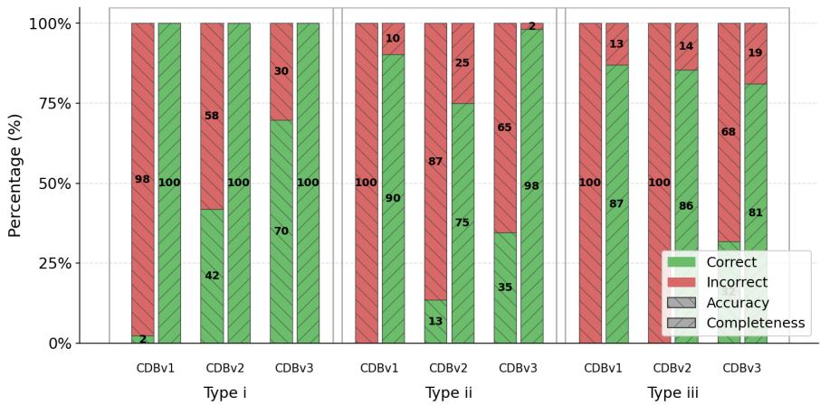
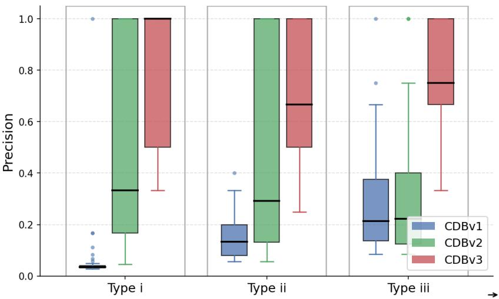
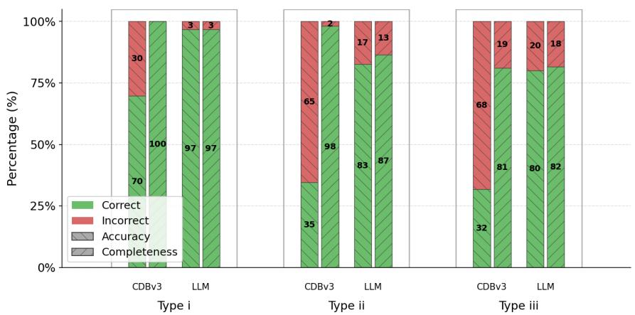
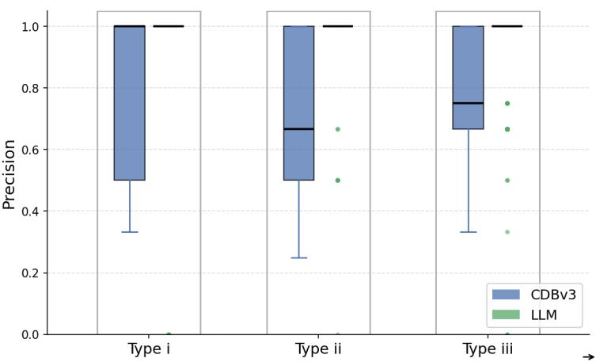
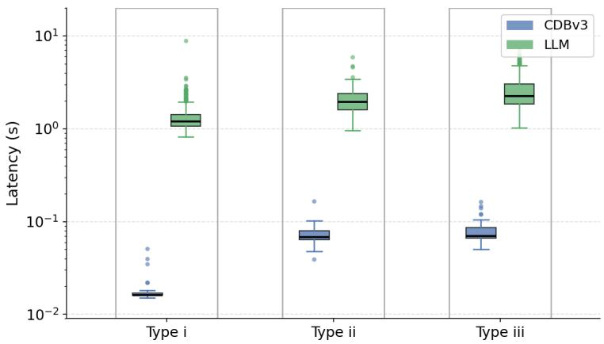

# Multi-Tool Selection for Robotic Systems: Comparing Semantic Retrieval and LLM

Miguel Sousa1, Luis Ramos Pinto1, and João P. Matos-Carvalho1

1 LASIGE, Faculdade de Ciências, Universidade de Lisboa, Portugal

Abstract. Natural-language interfaces allow users to command robotic systems without interacting directly with mission planners or robotics middleware. Their reliable use depends on robot tool routing, defined here as the selection of the smallest complete subset of predefined executable capabilities required to satisfy a request. This task is particularly dificult for compound instructions, where incomplete selection may omit necessary sensing or monitoring capabilities, while excessive selection may expose irrelevant tools. We compare four routing strategies: three progressively refined ChromaDB-based methods – fixed-threshold retrieval, relative-distance retrieval, and clause-aware aggregated retrieval – and a cloud-hosted 120-billion-parameter language-model baseline. The methods are evaluated on 164 manually annotated prompts organised into three complexity levels, from direct single-tool requests to compound requests requiring at least three tools. Using exact-match accuracy, completeness, precision, a completeness-weighted composite score, and routing latency, CDB-v3 achieves the best macro-average score among the retrieval-only methods, with 0.7822, compared with 0.8869 for the largemodel baseline. Although the LLM provides higher routing quality, CDBv3 exhibits substantially lower latency and can be deployed locally without requiring cloud connectivity. These results identify a quality–latency trade-of between direct large-model selection and clause-aware semantic retrieval for privacy-sensitive, connectivity-constrained, and resourceconstrained robotic systems.

Keywords: robotics · tool routing · semantic retrieval · ChromaDB · LLM

## 1 Introduction

Natural-language interfaces are becoming an attractive way to interact with robotic systems. Instead of invoking commands through mission planners, terminals, or custom graphical interfaces, users can express requests directly in natural language, such as “land the drone”, “start mapping the area”, or “report the current battery level”. Large language models (LLMs) make such interfaces increasingly practical, but a critical challenge remains: mapping a user request to the correct robot capability or set of capabilities.

In robotics, capability selection is not merely a usability problem. A routing error may activate an incorrect process, produce misleading information, or issue an unintended command to the robot. As the number of available robot functions grows, reliable intent-to-capability matching becomes a fundamental requirement for safe and efective natural-language control. Traditionally, this decision logic is encoded through behaviour trees, state machines, launch configurations, or manually designed if–then rules that determine which robot capability should be activated under each condition. These approaches remain efective for predefined and well-structured workflows, but they become increasingly dificult to design, extend, and maintain as the number of capabilities, mission types, operating conditions, and possible user requests grows. Conversational interfaces shift part of this burden from handcrafted decision logic to runtime capability selection, making the routing layer a critical component of the overall system.

This challenge is particularly relevant in ROS-based systems, where a single robot or fleet may expose dozens of processes for navigation, mapping, monitoring, mission execution, telemetry collection, payload operation, and system management. A request may require one capability or a coordinated set of capabilities. For example, the instruction “monitor the battery and land when it drops below 25%” requires both a telemetry capability and an actuation capability. The routing layer must therefore determine not only which capabilities are semantically relevant, but also whether several tools must be selected to satisfy all parts of the request.

Large LLMs can perform this selection directly by receiving the complete tool catalog and reasoning over the user request. However, dependence on a cloud-hosted model may be impractical in robotic deployments with intermittent connectivity, limited bandwidth, high communication latency, or strict confidentiality and data-sovereignty requirements. Robot telemetry, mission information, maps, and operational commands may be unsuitable for transmission to external infrastructure. Even when a large model can be deployed locally, its memory, computational, energy, and latency requirements may exceed the resources available at the robotic edge. These constraints motivate lighter routing mechanisms that can execute locally, while preserving as much selection quality as possible.

This paper studies tool routing as a bounded multi-label selection problem. The router cannot invent commands or generate arbitrary executable code. Instead, it must select a subset from a fixed allowlisted catalog of 42 robot tools. We compare four implementations of this routing function: CDBv1, which uses a fixed semantic-distance threshold; CDBv2, which uses a threshold relative to the nearest result; CDBv3, which decomposes compound prompts into intentlike clauses and aggregates their retrieval results; and a cloud-hosted 120-billionparameter LLM that performs direct selection from the complete catalog.

The evaluation uses 164 manually annotated requests divided into three complexity levels: 43 direct single-tool requests, 52 consequential requests requiring exactly two tools, and 69 compound requests requiring three or more tools. All routers are evaluated against the same ground-truth assignments using exact-match accuracy, completeness, precision, a completeness-weighted composite score, and routing latency.

The main contributions of this work are the formalisation of robotic tool routing as bounded multi-label capability selection, an empirical comparison of fixed-threshold, relative-distance, and clause-aware semantic retrieval under the same tool catalogue and prompt dataset, and a direct comparison between the strongest retrieval-only method and a large cloud-hosted LLM, exposing the resulting trade-of between routing quality and latency.

The results show that CDBv3 is the strongest retrieval-only strategy. Its macro-average composite score is 0.7822, compared with 0.5863 for CDBv2 and 0.3330 for CDBv1. The 120B LLM achieves a higher score of 0.8869, but CDBv3 provides substantially lower routing latency and does not require cloud connectivity. The results therefore do not establish retrieval as a universally more accurate replacement for large-model routing. Instead, they show that clause-aware semantic retrieval is a practical local alternative when latency, connectivity, computation, privacy, or data sovereignty are primary deployment constraints.

## 2 Related Work

Tool-using language-model agents combine natural-language interpretation with calls to external functions or services. ReAct alternates reasoning, action selection, and observation, allowing an agent to update its behaviour after receiving the result of a tool invocation [15]. Toolformer investigates whether language models can learn when to call external tools, which tool to use, which arguments to provide, and how to incorporate the returned result into subsequent generation [13]. ToolLLM extends this problem to large collections of real-world APIs and includes both single-tool and multi-tool instructions [11].

In embodied systems, Code as Policies translates natural-language instructions into programs composed from predefined perception and control APIs [9]. SPINE uses language models to interpret incomplete mission specifications and connect them to semantic planning for ground and aerial robots [12]. These systems show that language models can mediate between human requests and executable robotic functions. Their principal focus, however, is task planning, policy generation, or orchestration rather than a controlled comparison of routing mechanisms for selecting from an allowlisted set of independently executable robot tools.

The present work treats tool selection as a separate classification and retrieval problem. The router cannot invent arbitrary commands, modify tool names, or directly generate shell instructions. It must return one or more known capability definitions whose executable interfaces are specified in advance. This restriction bounds the action space and separates probabilistic language understanding from the robot’s execution boundary.

Dense retrieval represents queries and candidate records as vectors in a shared embedding space, allowing semantically related items to be matched even when they do not contain the same surface terms. Dense Passage Retrieval demonstrated the efectiveness of learned dense representations for selecting relevant passages from large collections [6]. Retrieval-augmented generation subsequently combined a neural retriever with a generative model, conditioning generation on retrieved external records [8]. Although the present study does not use retrieval to provide candidates to a smaller generative model, the underlying retrieval principle is relevant: a natural-language request is compared against textual descriptions of known capabilities, and the nearest capability records are used to determine the routing output.

ChromaDB (CDB) is used as the implementation substrate for dense capability retrieval [5]. Each allowlisted tool is stored with a textual summary, description, and associated metadata. At query time, the user request is embedded and compared with the stored capability embeddings. CDB supports approximate nearest-neighbour search through a Hierarchical Navigable Small World index [10]. CDB itself is not proposed as a new routing algorithm in this work; it provides vector storage, indexing, and similarity search. The evaluated contribution lies in the routing policies implemented above this infrastructure, including fixed-distance filtering, relative-distance filtering, and clause-aware aggregation.

Related retrieval-based systems have also been studied in software engineering. Chen et al. evaluate a retrieval-augmented framework in which relevant code is selected from a repository before being supplied to a language model [4]. Koziolek et al. retrieve validated industrial function blocks for inclusion in LLMgenerated control programs [7]. These works demonstrate how retrieval can connect generative models to existing domain-specific components. In contrast, the present work does not generate control code. It evaluates whether semantic retrieval alone can select the predefined processes required by a robotic request.

Agent-oriented software systems further illustrate the value of bounded tool sets. RepairAgent plans and invokes software-analysis and validation tools during program repair [3], while Batole et al. use an agent-oriented approach for locating software-design issues [1]. SALLMA proposes separate operational and knowledge layers for LLM-based multi-agent systems, including intent management, orchestration, and persistent agent configuration [2]. These architectures are related to the separation between capability descriptions, routing, and execution considered here, but their evaluation targets software repositories or broader agent architectures rather than real-time robotic capability selection.

The reliability of the routing boundary is important because retrieval and LLM components introduce integration failure modes beyond model accuracy alone. A study of open-source LLM applications with retrieval support identified recurring functionality, eficiency, and security defects [14]. These findings support treating routing, output validation, and process execution as explicit components rather than combining them into an unrestricted end-to-end agent.

Previous research has established that LLMs can invoke tools, generate policies, coordinate multi-step tasks, and use retrieved context. Less attention has been given to the narrower routing boundary between an unconstrained naturallanguage request and a fixed set of robot-facing processes. In particular, there is limited empirical evidence comparing diferent embedding-only retrieval policies with direct large-model selection under the same capability catalog, annotations, and evaluation metrics. This work addresses that gap by comparing three progressively refined retrieval methods with a 120B LLM baseline, considering both routing quality and latency.

## 3 Problem Formulation

Let

$$
\mathcal { T } = \{ t _ { 1 } , t _ { 2 } , \ldots , t _ { n } \}\tag{1}
$$

denote the finite catalog of n tools available to the robotic system. Each tool $t _ { i } \in \mathcal { T }$ is identified by a unique name and is associated with a natural-language summary, a detailed description, an executable interface, and usage metadata. The executable interface is defined in advance; the router is not allowed to create new tools or arbitrary commands.

An input request $x \in \mathcal { X }$ is a natural-language prompt submitted by a user and may express one or more intents related to the robot’s capabilities. A tool router performs multi-label selection: it may return no tool, one tool, or several tools. The routing function is therefore defined as

$$
f : \mathcal { X }  2 ^ { \mathcal { T } } ,\tag{2}
$$

where $2 ^ { \tau }$ denotes the power set of the tool catalog. For a request x, let $Y ( x ) \subseteq \tau$ denote the ground-truth set of required tools and let

$$
{ \widehat { Y } } ( x ) = f ( x )\tag{3}
$$

denote the set predicted by the router. For example, the request “Tell me the battery level.” requires only the battery-monitoring tool, yielding $Y ( x ) =$ $\{ \mathtt { b a t t e r y } \}$ . In contrast, the request “If the battery is below 20% or the wind exceeds 10 m/s, land.” requires two observation tools and one actuation tool:

$$
Y ( x ) = \{ { \mathrm { b a t t e r y } } , { \mathrm { w i n d } } _ { - } { \mathrm { s p e e d } } , { \mathrm { l a n d } } \} .\tag{4}
$$

Returning only ${ \widehat { Y } } ( x ) = \{ { \mathrm { 1 a n d } } \}$ is incomplete because the system cannot evaluate either triggering condition. Returning $\widehat { Y } ( x ) = \{ \mathtt { b a t t e r y } .$ , wind\_speed, land, whereami} is complete, but includes one unnecessary tool.

Router performance is evaluated using three request-level measures: exactmatch accuracy $A ( x )$ , completeness $C ( x )$ , and precision $P ( x )$ . Exact-match accuracy is one only when the predicted and reference sets are identical:

$$
A ( x ) = \mathbb { 1 } \left[ { \widehat { Y } } ( x ) = Y ( x ) \right] .\tag{5}
$$

Completeness is a binary request-level measure indicating whether all required tools are present, regardless of additional selections:

$$
C ( x ) = \mathbb { 1 } \left[ Y ( x ) \subseteq { \widehat { Y } } ( x ) \right] .\tag{6}
$$

This measure difers from conventional multilabel recall because partial coverage of the required set still gives $C ( x ) = 0$

Precision penalises unnecessary selections and is defined by

$$
P ( x ) = \left\{ \begin{array} { l l } { \displaystyle \frac { | \widehat { Y } ( x ) \cap Y ( x ) | } { | \widehat { Y } ( x ) | } , } & { | \widehat { Y } ( x ) | > 0 , } \\ { 1 , } & { \widehat { Y } ( x ) = Y ( x ) = \emptyset , } \\ { 0 , } & { \widehat { Y } ( x ) = \emptyset \ \land \ Y ( x ) \neq \emptyset . } \end{array} \right.\tag{7}
$$

Let

$$
{ \mathcal { D } } = \{ ( x _ { j } , Y _ { j } ) \} _ { j = 1 } ^ { m } , \qquad Y _ { j } = Y ( x _ { j } ) ,\tag{8}
$$

denote an annotated dataset containing m requests. Dataset-level exact-match accuracy, completeness, and precision are macro-averaged over requests:

$$
\mathcal { A } = \frac { 1 } { m } \sum _ { j = 1 } ^ { m } A ( x _ { j } ) ,\tag{9}
$$

$$
\mathcal { C } = \frac { 1 } { m } \sum _ { j = 1 } ^ { m } C ( x _ { j } ) ,\tag{10}
$$

$$
\mathcal { P } = \frac { 1 } { m } \sum _ { j = 1 } ^ { m } P ( x _ { j } ) .\tag{11}
$$

Because omitting a required sensing or action tool may prevent the request from being executed, completeness is given greater weight in the composite metric. For each router and request type, we define

$$
\mathcal { L } = 0 . 2 5 \mathcal { A } + 0 . 7 5 \frac { 5 \mathcal { C } \mathcal { P } } { 4 \mathcal { P } + \mathcal { C } } .\tag{12}
$$

The second term is an $F _ { 2 } \cdot$ -style harmonic combination of completeness and precision. Exact-match accuracy remains a separate component to reward predictions that are both complete and minimal. The composite score is treated as a summary measure; the individual values of A, C, and P are also reported because diferent deployments may assign diferent costs to false negatives and false positives.

The formulation evaluates selection only. It does not determine tool arguments, execution order, control flow, or whether logical and temporal dependencies are preserved after routing. Those concerns belong to downstream planning and orchestration and are outside the scope of this study.

## 4 Routing Strategies

We evaluate four implementations of the routing function in Eq. 2. All methods receive the same natural-language request and select from the same catalog T. CDBv1, CDBv2, and CDBv3 are retrieval-only methods implemented with CDB. The fourth method is a direct large-model baseline.

CDBv1: Fixed-Threshold Retrieval At startup, each tool representation is embedded and inserted into an in-memory ChromaDB collection. At runtime, the complete user request is embedded and queried against the collection. Let $d ( x , t _ { i } )$ denote the vector distance between request x and tool $t _ { i }$ . CDBv1 returns

$$
\widehat { Y } _ { \mathrm { v 1 } } ( x ) = \{ t _ { i } \in \mathcal { T } : d ( x , t _ { i } ) \leq \tau _ { \mathrm { a b s } } \} ,\tag{13}
$$

where $\tau _ { \mathrm { a b s } } = 0 . 8 5$ is a fixed global threshold.

This method is inexpensive and straightforward to inspect. However, a single threshold must account for requests with diferent ambiguity and semantic complexity. A strict value may omit required tools, particularly for compound requests, whereas a permissive value may return several semantically related but unnecessary tools.

CDBv2: Relative-Distance Retrieval CDBv2 replaces the absolute threshold with a rule relative to the nearest result. For request $x ,$ let

$$
d _ { \operatorname* { m i n } } ( x ) = \operatorname* { m i n } _ { t _ { i } \in \mathcal { T } } d ( x , t _ { i } ) .\tag{14}
$$

The nearest tool is always retained, and additional tools are selected when

$$
d ( x , t _ { i } ) \leq ( 1 + \rho ) d _ { \operatorname* { m i n } } ( x ) , \qquad \rho = 0 . 6 0 .\tag{15}
$$

The relative rule adapts the candidate-set size to the local distance structure of each query. When several tools are similarly close to the request, several may be returned. When the nearest result is clearly separated from the remaining catalog, the method returns a smaller set. CDBv2 therefore reduces dependence on one absolute distance scale, but it still embeds each request as a single undivided sequence.

CDBv3: Clause-Aware Aggregated Retrieval CDBv3 is designed to improve retrieval for requests containing several conditions or actions. It searches both the complete request and a set of intent-like fragments extracted from it. The query set includes: (i) the full prompt; (ii) fragments separated by commas, semicolons, and coordinating terms such as and and then; and (iii) condition or action fragments around terms such as if, when, before, and after. Duplicate or empty fragments are discarded.

For example, the request

## “if the battery is low, land and announce a warning”

can generate separate queries for “the battery is low”, “land”, and “announce a warning” , in addition to the complete prompt. Each fragment is queried independently. For every fragment, CDBv3 starts with the nearest match and retains at most three tools whose distance remains close to the best result.

The retrieved records are then aggregated by tool. A capability that is supported by several prompt fragments receives evidence from several searches, while lexical matches between the request and the tool name, summary, or description provide additional support. The aggregated candidates are ranked, and the list is truncated using a score-gap value of 0.28 and a maximum output size of 8. CDBv3 remains a retrieval-only router: no language model performs a second selection stage.

Direct 120B LLM Baseline The baseline provides a cloud-hosted 120-billionparameter language model with the complete tool catalog and the original user request. The model is instructed to return the smallest complete set of catalog tools required to satisfy the request, using a fixed JSON schema and without inventing or renaming tools.

Unlike embedding retrieval, the LLM can explicitly interpret logical operators, monitored conditions, dependencies, and compound instructions. For example, it may infer that conditional landing requires both the tool that observes the condition and the tool that performs the action. The baseline, however, requires the complete catalog to be included in every request and depends on cloud connectivity, structured-output reliability, and remote inference latency.

## 5 Routing Results

## 5.1 Experimental Setup

The 42-tool catalog (sensors and actuators) was designed by a robotics domain expert, who ensured that tool capabilities do not overlap. The prompt set was constructed to cover every sensor and actuator at each complexity level, maximizing diversity, and the same expert assigned the ground-truth tool set to each prompt.

CDB methods use mxbai-embed-large:v1 (Ollama) with ChromaDB 1.5.9 (distance metric l2, index configuration M=16, ef\_construction=100, ef\_search=100). The CDBv1–CDBv3 hyperparameters (Section 4) were selected through manual iteration directly against the same 164-prompt benchmark used for evaluation, rather than on an independent development set, so the scores reported below should be read as best-case, upper-bound estimates. The direct LLM baseline uses gpt-oss:120b-cloud (digest 569662207105; temperature 1.0; 120s timeout, no retry) and is run 10 times per prompt, in contrast to the deterministic CDB routers, which are run once. Malformed responses are parsed as JSON with a regex fallback; out-of-catalog names are kept as false positives; empty or unparseable responses yield no selected tools.

Latency measurements were performed on an Intel Core i5-9600K CPU (3.70GHz), 24GB DDR4 RAM, and an NVIDIA RTX 5060 Ti (16GB VRAM) used for local inference acceleration, running Ubuntu. The cloud baseline was accessed over a home broadband network via a wired Ethernet connection.

The analysis is organised in two stages. First, CDBv1, CDBv2, and CDBv3 are compared to determine how the successive retrieval refinements afect routing quality. Second, the strongest retrieval-only method, CDBv3, is compared with the direct 120B LLM baseline. Results are segmented by request type and reported using exact-match accuracy, completeness, precision, the composite score L, and end-to-end routing latency.

## 5.2 CDBv1, CDBv2 and CDBv3

Figure 1 shows that the retrieval refinements substantially improve performance over the fixed-threshold baseline. CDBv1 has very low exact-match accuracy: its fixed threshold keeps most required tools (completeness between 87% and 100%) but also admits many unrelated ones. CDBv2 improves direct singletool routing by adapting the cutof to the nearest result, but its performance remains limited for compound requests. CDBv3 provides the strongest overall retrieval-only result. Clause-level queries allow diferent conditions and actions to contribute separate evidence, which improves completeness for two-tool requests and accuracy for multi-tool requests. The improvement is not uniform across every metric and request. CDBv3 may retrieve additional semantically related tools, so gains in completeness can be accompanied by false positives. Precision must therefore be considered together with exact match and completeness rather than treating retrieval recall as the only objective.

  
Fig. 1. Exact-match accuracy and completeness of CDBv1, CDBv2, and CDBv3, segmented by request type.

Figure 2 confirms that CDBv1’s permissive behaviour does not translate into a useful overall router: although it rarely omits required tools, it returns many unnecessary ones, and its precision distribution remains poor. CDBv3 achieves the highest composite score among the retrieval-only methods because it maintains high completeness while substantially improving exact-match accuracy and precision, particularly on compound requests.

  
Fig. 2. Request-level precision of CDBv1, CDBv2, and CDBv3, segmented by request type.

## 5.3 CDBv3 versus the 120B LLM Baseline

  
Fig. 3. Exact-match accuracy and completeness of CDBv3 and the direct 120B LLM baseline, segmented by request type.

The direct LLM baseline outperforms CDBv3 in exact-match accuracy across the three request types, as shown in Fig. 3, whereas completeness is similar or higher for CDBv3. The LLM’s advantage therefore comes mainly from returning fewer unnecessary tools rather than from covering more required ones. The diference is smallest for direct single-tool requests and becomes more relevant when the prompt requires several conditions or actions to be interpreted jointly. This result is consistent with the LLM’s ability to reason explicitly over logical relations while viewing the complete tool catalog.

  
Fig. 4. Request-level precision of CDBv3 and the direct 120B LLM baseline, segmented by request type.

The precision distributions in Fig. 4 show that both methods can produce minimal outputs for many requests. Nevertheless, CDBv3 has a broader distribution for more complex prompts because clause-aware retrieval may retain several related candidates even when only a subset is required. The LLM more frequently removes these semantically plausible but unnecessary tools.

  
Fig. 5. End-to-end routing latency of CDBv3 and the cloud-hosted 120B LLM baseline, segmented by request type.

Latency is measured end-to-end, so it includes not only algorithmic execution but also confounding factors such as network conditions, cloud server availability, and inference queuing. We report it here in a comparative, order-of-magnitude sense rather than as an isolated measure of computation: even accounting for these factors, the local system consistently operates on the order of milliseconds, while the cloud-hosted baseline operates on the order of seconds.

The quality advantage of the LLM is accompanied by substantially higher and more variable latency. Figure 5 shows that CDBv3 remains close to the local retrieval time across all request types, whereas the cloud baseline exhibits secondscale latency and larger outliers. The comparison therefore reveals a deployment trade-of rather than a single dominant method: the LLM provides better routing quality, while CDBv3 provides faster and connectivity-independent selection.

## 5.4 Composite Score

Table 1 reports the composite score for each request type. The final column is the macro-average of the three type-level scores. CDBv3 is the strongest retrievalonly router for all three types and improves the macro-average score by approximately 0.196 over CDBv2. The direct LLM retains the highest routing score, exceeding CDBv3 by approximately 0.105. Accordingly, the principal result of the short study is not that retrieval surpasses the large model in routing quality, but that clause-aware retrieval closes part of the quality gap while preserving a markedly lighter and faster deployment profile.

Table 1. Composite score L for each router and request type.
<table><tr><td colspan="4">Router Type i Type ii Type iii Macro mean</td></tr><tr><td>CDBv1</td><td>0.2058 0.3385</td><td>0.4548</td><td>0.3330</td></tr><tr><td>CDBv2</td><td>0.7462 0.5380</td><td>0.4748</td><td>0.5863</td></tr><tr><td>CDBv3</td><td>0.8932 0.7723</td><td>0.6812</td><td>0.7822</td></tr><tr><td>LLM</td><td>0.9674 0.8636</td><td>0.8298</td><td>0.8869</td></tr></table>

## 6 Conclusion

This paper investigated the mapping of natural-language requests to the complete and minimal set of predefined robot tools required to satisfy them. The problem was formulated as bounded multi-label capability selection and evaluated using three embedding-based ChromaDB routers and a direct cloud-hosted 120-billion-parameter LLM baseline. The short benchmark contains 164 manually annotated requests divided into direct single-tool, two-tool consequential, and three-or-more-tool compound categories.

CDBv3 achieved the strongest performance among the retrieval-only methods. Its macro-average composite score was 0.7822, compared with 0.5863 for

CDBv2 and 0.3330 for CDBv1. Clause-aware prompt decomposition and aggregation therefore provide a substantial improvement over both fixed-threshold and single-query relative-distance retrieval. The direct LLM baseline nevertheless achieved the highest routing quality, with a macro-average score of 0.8869. This distinction is important: the results support CDBv3 as a practical local alternative, but they do not show that retrieval-only routing is more accurate than direct large-model selection.

The latency results expose a complementary advantage. CDBv3 executes locally and produces substantially lower and less variable end-to-end routing latency, whereas the baseline depends on cloud inference and network conditions. The preferred routing strategy therefore depends on deployment priorities. Direct large-model routing is preferable when selection quality is the dominant criterion and cloud access is acceptable. Clause-aware semantic retrieval is attractive when local execution, predictable response time, privacy, connectivity independence, or limited edge resources are more important.

The paper has a limitation regarding retrieval-only results: the CDBv1– CDBv3 hyperparameters (Section 5.1) were tuned through manual iteration on the same 164-prompt benchmark used for the final evaluation, rather than on a held-out development set. The reported CDBv1–CDBv3 scores should therefore be read as best-case estimates rather than as an evaluation on independent data. We also tested a small, locally deployable LLM (7-8B class) as a candidate edge baseline; the results were discouraging, with routing quality well below both CDBv3 and the 120B model, so it was excluded from the main comparison. Future work should evaluate larger and evolving catalogs, separate development and test sets for routing-parameter selection, robustness to paraphrases and prompt injection, and execution-aware metrics. The use of a smaller language model to refine a retrieval-generated candidate set is intentionally left for a separate study.

## Acknowledgments

This work was supported by FCT – Fundação para a Ciência e Tecnologia, I.P. under the project Agent-Based Cooperative Autonomy for Multi-UAV Systems, ref. LASIGE-SP-2026.06, under the LASIGE Research Unit, ref. UID/00408/2025, DOI https://doi.org/10.54499/UID/00408/2025 and 2023.15441.TENURE.051/CP00003/CT00029.

## References

1. Batole, F., O’Brien, D., Nguyen, T.N., Dyer, R., Rajan, H.: An LLM-based agent-oriented approach for automated code design issue localization. In: 2025 IEEE/ACM 47th International Conference on Software Engineering. pp. 1320– 1332. IEEE (2025)

2. Becattini, M., Verdecchia, R., Vicario, E.: SALLMA: A software architecture for LLM-based multi-agent systems. In: 2025 IEEE/ACM International Workshop on New Trends in Software Architecture. pp. 5–8. IEEE (2025)

3. Bouzenia, I., Devanbu, P.T., Pradel, M.: RepairAgent: An autonomous, LLM-based agent for program repair. In: 2025 IEEE/ACM 47th International Conference on Software Engineering. pp. 2188–2200. IEEE (2025)

4. Chen, J., Hu, X., Li, Z., Gao, C., Xia, X., Lo, D.: Code search is all you need? improving code suggestions with code search. In: Proceedings of the IEEE/ACM 46th International Conference on Software Engineering. Association for Computing Machinery (2024)

5. Chroma: ChromaDB documentation. Online documentation (2026), accessed: 2026-06-24

6. Karpukhin, V., Oğuz, B., Min, S., Lewis, P., Wu, L., Edunov, S., Chen, D., Yih, W.t.: Dense passage retrieval for open-domain question answering. In: Proceedings of the 2020 Conference on Empirical Methods in Natural Language Processing. pp. 6769–6781. Association for Computational Linguistics (2020)

7. Koziolek, H., Grüner, S., Hark, R., Ashiwal, V., Linsbauer, S., Eskandani, N.: LLM-based and retrieval-augmented control code generation. In: Proceedings of the 1st International Workshop on Large Language Models for Code. pp. 22–29. Association for Computing Machinery (2024)

8. Lewis, P., Perez, E., Piktus, A., Petroni, F., Karpukhin, V., Goyal, N., Küttler, H., Lewis, M., Yih, W.t., Rocktäschel, T., Riedel, S., Kiela, D.: Retrieval-augmented generation for knowledge-intensive NLP tasks. In: Advances in Neural Information Processing Systems. vol. 33, pp. 9459–9474. Curran Associates, Inc. (2020)

9. Liang, J., Huang, W., Xia, F., Xu, P., Hausman, K., Ichter, B., Florence, P., Zeng, A.: Code as policies: Language model programs for embodied control. In: 2023 IEEE International Conference on Robotics and Automation. pp. 9493–9500. IEEE (2023)

10. Malkov, Y.A., Yashunin, D.A.: Eficient and robust approximate nearest neighbor search using hierarchical navigable small world graphs. IEEE Transactions on Pattern Analysis and Machine Intelligence 42(4), 824–836 (2020)

11. Qin, Y., Liang, S., Ye, Y., Zhu, K., Yan, L., Lu, Y., Lin, Y., Cong, X., Tang, X., Qian, B., Zhao, S., Hong, L., Tian, R., Xie, R., Zhou, J., Gerstein, M., Li, D., Liu, Z., Sun, M.: ToolLLM: Facilitating large language models to master 16000+ real-world APIs. In: Proceedings of the 12th International Conference on Learning Representations (2024)

12. Ravichandran, Z., Murali, V., Tzes, M., Pappas, G.J., Kumar, V.: SPINE: Online semantic planning for missions with incomplete natural language specifications in unstructured environments. In: 2025 IEEE International Conference on Robotics and Automation. pp. 13714–13721. IEEE (2025)

13. Schick, T., Dwivedi-Yu, J., Dessì, R., Raileanu, R., Lomeli, M., Hambro, E., Zettlemoyer, L., Cancedda, N., Scialom, T.: Toolformer: Language models can teach themselves to use tools. In: Advances in Neural Information Processing Systems. vol. 36, pp. 68539–68551. Curran Associates, Inc. (2023)

14. Shao, Y., Huang, Y., Shen, J., Ma, L., Su, T., Wan, C.: Are LLMs correctly integrated into software systems? In: 2025 IEEE/ACM 47th International Conference on Software Engineering. pp. 1178–1190. IEEE (2025)

15. Yao, S., Zhao, J., Yu, D., Du, N., Shafran, I., Narasimhan, K.R., Cao, Y.: ReAct: Synergizing reasoning and acting in language models. In: Proceedings of the 11th International Conference on Learning Representations (2023)