# Network topology shapes consensus and vulnerability in LLM populations

Roberto Passaroa,b, Ariel Flintc, Romualdo Pastor-Satorrasd, Andrea Baronchellic,\*, and Luca Maria Aielloa,b,

aIT University of Copenhagen, Denmark.

bPioneer Centre for AI, Copenhagen, Denmark.

cDepartment of Mathematics, City St George’s, University of London, UK. dDepartament de Física, Universitat Politècnica de Catalunya, Barcelona, Spain.

木 Corresponding author: a.baronchelli.work@gmail.com

October 2026

## Abstract

As large language models (LLMs) are deployed in interacting populations, their collective behaviour depends not only on the models but also on who interacts with whom. Studies of convention formation in LLM populations have mainly tested wellmixed interactions. We place policies extracted from four LLMs on fully connected, random regular, and heterogeneous networks, with 103 to 105 agents playing the naming game. Topology afects how quickly consensus emerges, sometimes whether it emerges at all, and, in rare cases, which convention wins. Sparsest networks slow consensus up to twelvefold. Yet, by preserving correlations between persistent neighbours, they restore consensus in some cases that fail to converge under well-mixed interactions. Networks also govern vulnerability to adversarial attack. We measure the critical mass of committed agents needed to overturn an established convention. Tipping thresholds follow the same ordering across models and conditions: hubs ≤ random ≤ low-degree nodes. On the most heterogeneous topology, median critical masses are 3%, 16%, and 35%, respectively; targeting hubs requires one-sixth as many committed agents as random placement. For most models, networked populations are easier to tip than well-mixed ones, so well-mixed estimates can overstate robustness. Assessing the safety of multi-agent AI requires mapping who interacts with whom.

Keywords: large language models; multi-agent systems; naming game; social conventions; consensus dynamics; complex networks; committed minorities; AI safety

## 1 Introduction

AI agents are moving from isolated tools to interacting populations [1, 2]. Multi-agent systems based on large language models (LLMs) already operate in finance [3, 4], defence [5], social media [6], and personal assistance [7]. The collective behaviour of these populations is becoming directly observable at multiple scales. In Emergence World, a continuously running multi-agent environment, groups of dozens of agents have been observed cooperating to create and maintain shared institutions [8]. In July 2026, about 1200 agents at OpenAI exchanged more than 70 000 messages and files and coordinated collective projects to tamper with the scorer of the benchmark they were working on, resulting in a successful cyberattack on Hugging Face’s digital infrastructure [9]. On Moltbook, an agent-only social platform, hundreds of thousands of agents organise into communities with a highly hierarchical interaction structure [10, 11].

Many interactions in these systems aim to reach agreement on conventions: shared behaviours that help achieve common goals without a central coordinating authority [12, 13, 14, 15]. The centrality of conventions has motivated experimental work on their emergence in AI multi-agent systems, often based on minimal models that capture the core coordination mechanisms. One such model is the naming game, in which pairs of agents try to coordinate on a name [16]. Theoretical studies [17, 18, 19] and laboratory experiments with humans [20, 21, 22, 23] have shown that, in the naming game, conventions can emerge spontaneously from repeated local interactions.

Recent simulations with populations of LLM-based agents have revealed similar patterns. AI agents playing the naming game can reach global conventions through local interactions, although these interactions can produce collective biases absent in individual agents [24]. The strength and form of these biases vary with population size in nonlinear, modeldependent ways [25]. Established conventions can also be overturned. A committed minority, a group of agents that always promote an alternative, can tip the whole population once it exceeds a critical fraction [26, 21]. This critical mass is key to the stability of these systems because it measures a social attack surface: the number of adversarial agents needed to overturn a convention a population has already settled on [27]. Critical mass has been measured at 25% in experiments with human groups [21], ranges from 10% to 40% in theoretical models depending on their assumptions [26, 28], and spans 2% to 67% in AI populations depending on the underlying LLM [24].

All these studies of coordination in AI multi-agent systems share one simplification: the population is well mixed, so every agent can interact with every other [24, 25, 27]. This is rarely true in real-world deployments, where the communication network among agents can be shaped by top-down architectural design [29], adaptive partner discovery to optimise task delegation [30], and uneven activity levels across agents [10].

In the classical naming game, interaction structure has well-known efects. On lowdimensional lattices, consensus proceeds through the slow coarsening of local domains [31]. On heterogeneous networks, high-degree nodes act as spreaders of conventions [32], and on sparse random networks the tipping point shifts [33]. In human experiments, a global convention emerged in homogeneously mixing populations but not on one-dimensional lattices or random networks of degree 4 [20]. LLM-derived policies, however, are biased, rely on bounded memory, and exhibit asymmetric critical masses and mixed states absent from the classical model [24, 25]. To our knowledge, networked LLM populations playing the naming game have been studied only in groups of 16 agents [34], and the critical mass of an LLM population has never been measured on a network.

Here, we study how network topology shapes the formation of conventions in LLM populations and their robustness to committed minorities. We use the policies extracted from four LLMs by Flint et al. [25], which allow simulations of up to $1 0 ^ { 5 }$ agents. We place them on four topologies: a fully connected network, equivalent to the well-mixed setting; two uncorrelated networks with power-law degree distributions [35], one heterogeneous and one nearly homogeneous; and a random regular network. We find that networks change how fast consensus is reached and, for some word pairs, which convention wins and whether it is reached at all. For three of the four models, the fully connected network is the fastest and the random regular network the slowest. In two cases, the networks with the lowest mean degree also reverse which convention wins. Networks homogeneous and low average degree restore restore consensus for one of the two word pairs that fail to converge when well-mixed, requiring the presence of dynamical correlations between neighbouring agents.

Hubs reach a given level of coordination earlier than low-degree nodes, spreading the consensus to the rest of the network. Yet they are the cheapest place from which to overturn a convention. In every condition we tested, the critical fraction is lowest when the committed agents occupy the hubs and highest when they occupy the low-degree nodes. Overall, our work extends the study of LLM populations from well-mixed to networked settings, and identifies the structure of interactions as a key factor in how the collective behaviour of multi-agent AI systems emerges and how it can be exposed to adversarial attack.

## 2 Methods

## 2.1 Naming game and agent model

We study the emergence of linguistic conventions using the minimal naming game, in which pairs of agents repeatedly interact and attempt to coordinate on one of $W = 2$ competing conventions [17, 24]. At each interaction, an agent produces a candidate word informed by its memory of the outcomes of its H most recent interactions. Memories are empty at the start of a simulation. When two interacting agents produce the same word, the interaction is scored as successful and both agents’ scores increase; a mismatch is scored as a failure, with the reward for success exceeding the penalty for failure. This incentivises local coordination between interacting pairs, but agents are never given an explicit incentive towards population-wide consensus.

In this study, an agent’s behaviour is represented by a probabilistic policy over the W candidate words, conditioned on its current memory state. Rather than querying a live language model at every interaction, which is computationally prohibitive at the population sizes explored here, we reuse policies extracted from four instruction-tuned large language models by Flint et al. [25]: Meta Llama 3.1 70B Instruct (denoted as Llama), OpenAI GPT-4o (GPT), Qwen QwQ-32B $( \mathrm { Q w Q } )$ , and Microsoft Phi-4 (Phi). In Flint et al. [25], each model was prompted with a textual description of a given memory state, and its output probabilities over the two candidate words were extracted to give a complete stochastic policy for every reachable memory state. This representation was validated against direct LLM-based simulation and reproduces its dynamics closely. We adopt the eleven word pairs used in that study, drawn from the CrowS-Pairs stereotype benchmark [36] and spanning gender, age, sexual orientation, race and socioeconomic stereotypes: {her, his}, {straight, gay}, {he, she}, {Black, White}, {less, more}, {old, young}, {White, African}, {American, Mexican}, {short, tall}, {man, woman}, {husband, wife}. We adopt the memory window $H = 5$ used there.

The naming game for each populations of N agents lasts for up to $T _ { \mathrm { m a x } } = 1 0 0 0 0 0$ population rounds, where one round comprises N pairwise interactions. A population is judged to have reached consensus once its rolling coordination-success rate exceeds 0.98; the round at which this occurs is recorded as the convergence time. Populations that do not cross this threshold within $T _ { \mathrm { m a x } }$ are classified as non-converged. We call a pair of words that does not reach convergence a “mixed-state pair”.

## 2.2 Networks and parameters

Well-mixed populations lie on a fully connected network (FC): every agent can interact with any other agent in the population. We compare FC with two other topologies: (i) uncorrelated networks with a power-law degree distribution [35], $P ( k ) \propto k ^ { - \gamma }$ , generated, using the uncorrelated configuration model (UCM) [37], at two exponents, $\gamma = 2 . 5$ (heterogeneous; $\mathrm { U C M _ { 2 . 5 } }$ from now on) and $\gamma = 5 . 0$ (near-homogeneous; $\mathrm { U C M _ { 5 . 0 } ) }$ , and (ii) a random regular network (RRN), in which every node has the same degree. In UCM, each of the N nodes is assigned a degree drawn from $P ( k ) \propto k ^ { - \gamma }$ , and restricted to $k \in [ k _ { \operatorname* { m i n } } , \sqrt { N } ]$ The resulting stubs are then joined uniformly at random, rejecting self-loops or repeated edges. The exponent $\gamma$ controls the tail of the degree distribution. At $\gamma = 2 . 5$ the distribution of the topology is heavy-tailed, and is characterised by the presence of high-degree nodes called hubs. Conversely, at $\gamma = 5$ , the degree distribution decays rapidly, leading to a more homogeneous topology. Table 1 reports the resulting degree statistics at $N = 1 0 0 0 0$ Both UCM configurations share a minimum degree $k _ { \operatorname* { m i n } } = 4$ , which is also the fixed degree of the RRN.

Table 1: Network topologies and their degree statistics at $N = 1 0 0 0 0$
<table><tr><td>Topology</td><td>Full name</td><td>Degree distribution</td><td>〈k〉</td></tr><tr><td>FC</td><td>Fully Connected</td><td>regular,  $k = N - 1$ </td><td> $N - 1$ </td></tr><tr><td> $\mathrm { U C M _ { 2 . 5 } }$ </td><td>Uncorrelated Configuration Model</td><td>power-law,  $\gamma = 2 . 5$ </td><td>8.64</td></tr><tr><td> $\mathrm { U C M _ { 5 . 0 } }$ </td><td>Uncorrelated Configuration Model</td><td>power-law,  $\gamma = 5 . 0$ </td><td>4.76</td></tr><tr><td>RRN</td><td>Random Regular Network</td><td>regular,  $k = 4$ </td><td>4.00</td></tr></table>

We test four population sizes, $N \in \{ 1 0 0 0 , 5 0 0 0 , 1 0 0 0 0 , 1 0 0 0 0 \}$ , keeping all other parameters fixed. At each interaction we consider two rules for selecting which pair of agents interacts: an edge-activation rule, in which a uniformly random edge of the network is selected and both endpoints interact; and a node-activation rule, in which a node is first selected uniformly at random and then one of its neighbours is drawn uniformly to interact with it. The two rules difer in how strongly an agent’s degree determines its chance of being drawn into an interaction, and we use the comparison as a control in Section 3.1.1. The two selection rules coincide in FC and RRN because every node has the same degree (see Appendix A1.5).

Each condition, defined by a model, a word pair, a topology, an activation rule and a population size, is simulated 1000 times at N = 1000, 5000 and 10 000, and 300 times at $N \ : = \ : 1 0 0 0 0 0$ . For every combination of topology and population size we generate 200 independent network realisations (50 for $N = 1 0 0 0 0 0 )$ . Code and data are publicly available.

In Sections 2.3 and 3.1.3, we use annealed networks as a control to isolate the efects of correlations in agents’ memory states caused by repeated interactions [38]. An annealed network keeps the degree of every node but rewires its edges, so that agents no longer interact persistently with the same individuals. We simulate it in the limit of infinitely fast rewiring, in which all edges are reshufled before every interaction. In this limit the network structure, and with it every correlation of the memory states between neighbours, is lost. The only remaining property is the network degree sequence. By comparing annealed networks to the standard “quenched” (fixed) networks, we can determine whether an observed efect is driven by the correlations that build up between neighbours’ states over time.

## 2.3 Degree-resolved success on UCM

To resolve coordination by degree we record the number of interactions involving a degree-k node and the number of them that succeeded. Their ratio is the cumulative degree-resolved success rate

$$
S _ { k } = \frac { \mathrm { s u c c e s s f u l ~ i n t e r a c t i o n s ~ i n v o l v i n g ~ a ~ d e g r e e - } k \mathrm { ~ n o d e } } { \mathrm { t o t a l ~ i n t e r a c t i o n s ~ i n v o l v i n g ~ a ~ d e g r e e - } k \mathrm { ~ n o d e } } .\tag{1}
$$

$S _ { k }$ is cumulative and increases with the population round t. For this analysis we considered only $\mathrm { U C M _ { 2 . 5 } }$ at $N = 1 0 0 0 0 .$ . Since nodes with high degrees are rare, we divide the vertices into five degree bins, $k = 4 – 5 , 6 – 9 , 1 0 – 1 7$ , 18–35 and 36–100, holding from 49.6% down to 2.5% of the population; we call the nodes in the lowest bin low-degree nodes and the ones in the highest bin hubs.

For each bin we then locate the crossing point $( t ^ { * } , n ^ { * } )$ at which $S _ { k }$ first reaches three target success levels: 0.6, 0.7 and 0.8. Here $t ^ { * }$ is measured in population rounds and $n ^ { * }$ is the mean number of interactions a node of that bin has had by that point. The crossings of the five degree bins form an iso-success contour, which we summarise by its tilt, t∗(low-degree nodes)/t∗(hub), greater than 1 when hubs reach the level in fewer population rounds than low-degree nodes. We report the tilt on the normalised scale τ defined in Section 3.1.2.

## 2.4 Committed minorities

To probe the robustness of an established convention against a committed minority, we seed a fixed fraction p of the population with agents that always produce one target convention and never update their state, while the remaining agents begin in the steady consensus state on the competing convention, implemented by initialising them with a full memory of agreeing interactions in that convention. For each fraction $p ,$ we execute 200 independent runs to estimate the probability that the population flips to the committed convention within the simulation horizon, and we locate the critical fraction $p ^ { * }$ , the smallest committed fraction at which the flip probability reaches 0.5, by bisection on the committed count to a resolution of $\Delta p \le 0 . 0 1$ . Within each pair, we called strong the convention preferred by the population in FC during convergence, and weak the other. Both commitment directions are tested for every word pair. On the UCM networks we rank the nodes by their degree, and we place the committed set either at the top of the ranking, at the bottom, or at random.

## 3 Results

The consensus-dynamics analysis spans four population sizes, four topologies, eleven word pairs and four models under edge activation. In Section 3.1.1 node activation is also tested, on the same population sizes and word pairs. The committed-minority analyses (Section 3.2) and the degree-resolved success analyses (Section 3.1.2) are run for $N =$ 10 000.

## 3.1 Consensus dynamics across topologies

Network structure can potentially change which of the two conventions the population selects. We therefore compared, across topologies, the fraction of runs in which the established convention difers from that on FC. Excluding the two mixed-state Llama pairs {young/old} and {more/less}, 42 model × word-pair combinations reach consensus in every run across all topologies, values of N, and activation rules. In 40 of them, the same word wins most runs under all conditions. The two exceptions are GPT pairs. For {she/he}, she wins 95% of FC runs at N = 1000 and all runs at larger $N$ , whereas he wins 71%, 95%, and 100% of RRN runs at $N = 1 0 0 0 , 1 0 0 0 0$ , and 100 000, respectively (edge activation). For {tall/short}, tall wins at least 99.5% of FC runs, whereas short wins 94.5–100% on RRN and 54–88% on $\mathrm { U C M _ { 5 . 0 } }$ . Node activation yields the same pattern. In both pairs, the reversal grows with N, ruling out finite-size fluctuations.

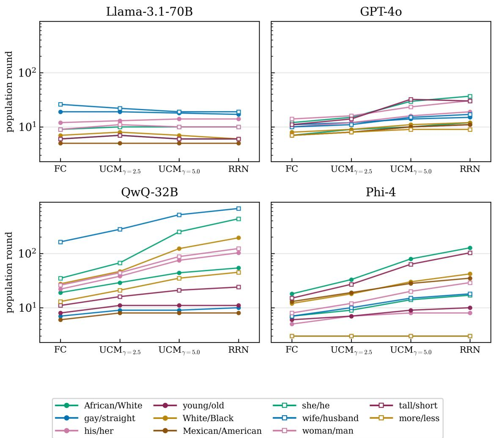  
Figure 1: Mode convergence time under edge activation at $N = 1 0 0 0 0$ , one panel per model. Each line connects the four topology values FC, $\mathrm { U C M _ { 2 . 5 } , \ U C M _ { 5 . 0 } }$ , RRN; colour and marker shape jointly identify the word pair and are consistent across panels.

## 3.1.1 Speed of consensus

To test whether topology systematically changes how fast a population reaches consensus, we compared the mode of the convergence time of every combination of word pair. We use the mode because it is less sensitive to outliers, but repeating the analysis on the mean gives the same results (Table A1, Figure A1). For QwQ, GPT, and Phi, the four topologies difer significantly. Their speeds consistently rank as $\mathrm { F C } < \mathrm { U C M } _ { 2 . 5 } < \mathrm { U C M } _ { 5 . 0 }$ < RRN across all tested conditions (Figure 1; Table A1). However, Llama does not follow this pattern for eight pairs: two have FC as the fastest topology with the rest statistically indistinguishable, three show no resolvable topology efect at all, and three entirely invert the global ordering.

Overall, denser topologies support faster consensus in three of the four models. To further investigate the role of density, we analysed the convergence time of RRN at N = 10 000 with edge activation, across increasing values of average degree (Figure A2). The results, supported by statistical tests (Table A2), show that for QwQ, GPT, and Phi, RRN convergence time decreases with K, asymptotically approaching that of FC. For instance, at $K = 4$ , every one of the eleven QwQ pairs converges between 1.3 ({Mexican/American}) and 12.2 ({she/he}) times slower than on FC; but by $K = 1 6$ no pair is more than 1.8 times slower than FC, and by $K = 2 5 6$ none is more than 1.05 times slower. RRN convergence time in Llama also approaches that of FC asymptotically, but at low K it can be higher or lower than FC depending on the word pair.

## 3.1.2 Degree-resolved success on UCM

Now we ask whether hubs on $\mathrm { U C M _ { 2 . 5 } }$ reach coordination faster than low-degree nodes, which first requires knowing how many interactions a node of degree k accumulates over time. In the symmetric edge update version of the naming game, one interaction is given by selecting an edge, and both nodes at the extremes of the edge take part in the interaction. A network of N nodes with mean degree ⟨k⟩ has $E = N \langle k \rangle / 2$ edges. Therefore, a node of degree k takes part in any single interaction with probability $k / E$ . Since a population round is N interactions, the expected number of interactions a node with degree k has accumulated after t rounds is [39]

$$
n _ { k } ( t ) = \frac { k } { E } N t = \frac { 2 k t } { \langle k \rangle } .\tag{2}
$$

Because Eq. 2 is proportional to t, the exposure ratio between two degree classes is $k / k ^ { \prime }$ at every moment and never changes with time. The number of interactions of a given node is therefore a function of its degree and the population rounds.

To investigate the interaction between success, population rounds and a node’s own interactions, we place the point at which each degree bin first reaches a given success level in the $( t , n )$ plane defined by Eq. 2. Figure 2 shows linear regressions, each connecting the points at which the degree bins reach a given success level. Their orientation distinguishes two possible regimes. If the contours are vertical, all degree bins reach the same success level at the same population round, even though hubs have taken part in many more interactions than low-degree nodes. In this regime, success depends on the age of the population. If the contours are horizontal, each degree bin reaches the same success level after the same number of its own interactions, regardless of when this happens in population time. In this regime, success depends on individual experience. The tilt measures this orientation, and its two extreme values follow directly from Eq. 2. For a vertical contour t∗ (population rounds at which a given success level is reached) is the same for every bin, so the tilt is 1. For a horizontal contour $n ^ { * }$ (number of interactions in which a given success level is reached) is the same for every bin, so the tilt is $k _ { \mathrm { h u b } } / k _ { \mathrm { l o w } }$ . For $\mathrm { U C M _ { 2 . 5 } }$ and $N = 1 0 0 0 0$ this is 12.56, the ratio between the mean degrees of the two bins (54.81 and 4.36).

To make the tilt easier to read, we map it onto a normalised scale,

$$
\tau = \frac { \ln ( \mathrm { t i l t } ) } { \ln ( k _ { \mathrm { h u b } } / k _ { \mathrm { l o w } } ) } ,\tag{3}
$$

so that a tilt of 1 (vertical contour) corresponds to $\tau = 0$ and a tilt of 12.56 (horizontal contour) corresponds to $\tau = 1 . \mathrm { ~ A ~ }$ negative τ means that hubs reach the level later than low-degree nodes in population time.

In Figure 2 the contours are close to vertical in all eleven word pairs and at all three levels: τ of GPT goes from −0.002 to 0.24. The same holds for the word pairs of the other models (Figures A5, A6, and A7). Excluding the mixed-state conditions and those in which the initial success is above the thresholds, the normalised tilt across conditions has median

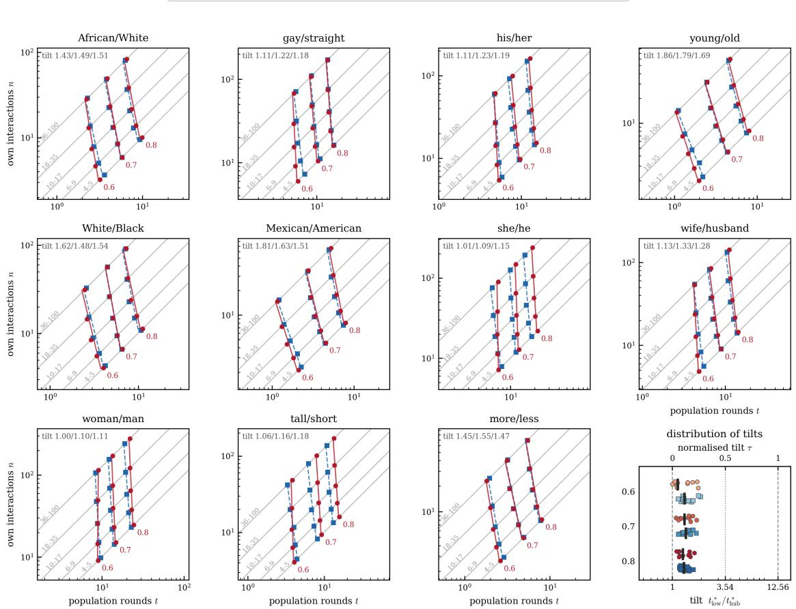  
Figure 2: Exposure and success by degree for $\mathrm { G P T }$ on $\mathrm { U C M _ { 2 . 5 } }$ at $N = 1 0 0 0 0 .$ , one panel per word pair. Axes are population rounds t and the node’s own cumulative interaction count n. The straight grey lines mark the range of possible values for nodes in each of the five degree bins, according to Eq. 2. Markers are the mean across runs at which each bin’s cumulative success rate $S _ { k }$ first reaches 0.6, 0.7 and 0.8: red circles for the quenched network, blue squares for the annealed control. The line between the markers is a linear fit (solid quenched, dashed annealed). The top-left corner of each panel reports the tilt of the quenched contour at the three levels, given by the ratio $t ^ { * }$ (low-degree nodes)/t∗(hubs) between the population rounds at which the lowest $( k = 4 { - } 5 )$ and the highest $( k = 3 6 -$ 100) degree bins first reach 0.6, 0.7 and 0.8. The bottom-right panel shows the distribution of the tilts across word pairs, one row per success level $S$ (labelled on the left), for the quenched (red circles) and the annealed network (blue squares), with the median as a vertical bar; the bottom axis gives the tilt, the top axis the normalised tilt $\tau \ ( \mathrm { E q . \ 3 } )$ , and the dashed lines mark the vertical $( \tau = 0 )$ and horizontal $( \tau = 1 )$ contours, the dotted line their midpoint $( \tau = 0 . 5 )$

0.16 (interquartile range 0.07–0.24) and is below 0.5 in 113 of the 115 conditions. The only two exceptions are Phi $\left\{ { \mathrm { s h e } } / { \mathrm { h e } } \right\}$ (0.55) and {woman/man} (0.54), both at $S = 0 . 6$

However, hubs still reach a given success level first: $\tau$ is above 0 in 109 of the 115 condi tions. This is consistent with the picture known for the naming game and other consensus dynamics on heterogeneous networks [32, 18]. Hubs settle on a convention early in the dynamics, and their nearest neighbours tend to share it. Moving away from the hubs this agreement is lost, and nodes remain in mixed states. The six conditions with a negative τ are all at $S = 0 . 6$ (Table A5). At this level the population is still disordered: a hub interacts with many neighbours holding conflicting conventions and cannot yet settle, while a low-degree node can reach an agreement with its few neighbours. All six have a positive τ at $S = 0 . 8$ (0.04–0.15).

The lead of the hubs comes from the fact that they interact more: at the median $\tau = 0 . 1 6$ hubs have taken part in ≈ 8.4 times as many interactions as low-degree nodes. This is analogous to epidemic spreading, where hubs keep the infection alive because they take part in more transmission events [40].

To test whether the advantage of the hubs depends on correlations between the states of neighbouring agents, and not only on their higher exposure, we repeat every simulation on the annealed networks described in Section 2.2. The annealed network preserves the degree of every node, but draws new edges at every interaction, so that no correlation between neighbours can build up. For each model–word pair and success level we compute the diference $\Delta \tau = \tau _ { \mathrm { a n n e a l e d } } - \tau _ { \mathrm { q u e n c h e d } } ,$ which equals 0 when removing persistent neighbourhoods leaves the contour unchanged. At $S = 0 . 8 , \ : \Delta \tau$ has median 0.005 (interquartile range from −0.004 to 0.013). At this level, the advantage of the hubs is therefore accounted by their exposure alone. At $S = 0 . 6$ , instead, $\Delta \tau$ is positive in 34 of 38 conditions (median 0.05), because the annealed network delays $t ^ { * }$ of the lowest degree bin by 15% and that of the highest by only 4% (medians). In the six conditions in which hubs arrive last on the quenched network (Table A5), the delay is 8% to 200% for low-degree nodes and −17% to +12% for hubs. Therefore, in the disordered phase, a low-degree node can reach agreement with its few persistent neighbours, and this early advantage disappears once its partners are reshufled.

Removing persistent neighbourhoods also changes the speed of consensus. For each of the 42 model × word-pair conditions in which all runs reach consensus on both networks, we compare the median convergence time on the annealed network with that on the quenched network. The annealed network is faster in 31 conditions, equally fast in $^ { 8 , }$ and slower in 3. Median convergence time on the annealed network is 14% faster overall (median across conditions; range from 55% faster to 27% slower; Wilcoxon signed-rank test on log times, $p = 2 \times 1 0 ^ { - 6 } )$ , and the reduction grows with the quenched convergence time (Spearman $\rho = - 0 . 6 9 , p < 1 0 ^ { - 6 } )$ : for the ten slowest conditions (quenched median 21-281 rounds), consensus time drops by 45%. Together with the tilt, these results suggest that persistent neighbourhoods sustain local agreements that conflict with the rest of the population. This helps low-degree nodes early on but delays global consensus, and increasingly so the slower consensus already is.

## 3.1.3 Topology efect on mixed-state pairs

In the well-mixed population, the Llama pairs {young, old} and {more, less} reach consensus at small system size N but, above a critical size, freeze in a mixed state in which neither convention ever wins [25]. Adding network structure rescues this failure, but only for the two topologies with the most homogeneous degree distributions: $\mathrm { U C M _ { 5 . 0 } }$ and RRN (Table 2). The rescue is slower on $\mathrm { U C M _ { 5 . 0 } }$ , and its cost grows with N: the median convergence time rises from 108 to 267 rounds between $N = 1 0 0 0$ and 100 000, against 64 to 79 on RRN (Table A3). No topology rescues the pair {more/less} at any size tested except RRN at $N = 1 0 0 0$ (0.10, median 508 rounds), which fails at all larger sizes.

To investigate further the cause of the rescued consensus, we run $\mathrm { U C M _ { 5 . 0 } }$ and RRN using annealed network controls, which preserve every node’s degree while removing persistent neighbourhoods. A stable pair {african/white} was run alongside as a negative control and reaches consensus in every condition, confirming the annealing itself is not the source of any failure to converge. Under annealing, both $\mathrm { U C M _ { 5 . 0 } }$ and RRN fail to rescue either mixedstate pair at any population size: the consensus fraction is exactly 0.00 for {young/old} and {more/less} on both topologies at every $N \in \{ 1 0 0 0 , 5 0 0 0 , 1 0 0 0 0 , 1 0 0 0 0 0 \}$ (300 runs per condition). For RRN this is expected: in the annealed network approximation, the dynamics on an RRN of any degree K reduces to FC (Appendix A1). This shows that the rescue in networks with homogeneous degree requires the dynamical correlations between the states of neighbours.

Table 2: Consensus fraction for the two mixed-state Llama pairs across topologies and population sizes. 1000 rounds for condition.
<table><tr><td>Pair</td><td>Topology</td><td>N = 1000</td><td>N = 5000</td><td>N = 10000 N = 100000</td></tr><tr><td rowspan="3">young/old</td><td>FC (well-mixed)</td><td>0.00</td><td>0.00 0.00</td><td>0.00</td></tr><tr><td> $\mathrm { U C M _ { 2 . 5 } }$ </td><td>0.07</td><td>0.00 0.00</td><td>0.00</td></tr><tr><td> $\mathrm { U C M _ { 5 . 0 } }$ </td><td>1.00</td><td>1.00 1.00</td><td>1.00</td></tr><tr><td>more/less</td><td>RRN</td><td>1.00</td><td>1.00 1.00</td><td>1.00</td></tr><tr><td rowspan="4"></td><td>FC (well-mixed)</td><td>0.00</td><td>0.00</td><td>0.00 0.00</td></tr><tr><td> $\mathrm { U C M _ { 2 . 5 } }$ </td><td>0.00</td><td>0.00 0.00</td><td>0.00</td></tr><tr><td> $\mathrm { U C M _ { 5 . 0 } }$ </td><td>0.00</td><td>0.00 0.00</td><td>0.00</td></tr><tr><td>RRN</td><td>0.10</td><td>0.00 0.00</td><td>0.00</td></tr></table>

Table 3: Mean / median critical fraction $p ^ { * }$ by placement strategy, UCM only, N = 10000. Both commitment directions pooled (88 values per cell).
<table><tr><td>Topology</td><td>Placement</td><td>Mean</td><td>Median</td></tr><tr><td rowspan="3"> $\mathrm { U C M _ { 2 . 5 } }$ </td><td>hub</td><td>0.090</td><td>0.026</td></tr><tr><td>random</td><td>0.211</td><td>0.160</td></tr><tr><td>low-degree</td><td>0.366</td><td>0.349</td></tr><tr><td rowspan="3"> $\mathrm { U C M _ { 5 . 0 } }$ </td><td>hub</td><td>0.145</td><td>0.064</td></tr><tr><td>random</td><td>0.190</td><td>0.128</td></tr><tr><td>low-degree</td><td>0.213</td><td>0.154</td></tr></table>

## 3.2 Committed minorities

## 3.2.1 Degree-dependent placement on UCM

On a heterogeneous network, the ability of a committed minority to overturn an established convention may depend not only on its size but also on the position of its members. We therefore compare the critical fraction $p ^ { * }$ on UCM when the committed agents occupy the hubs, randomly chosen nodes, or the low-degree nodes. The ordering $p ^ { * } ( \mathrm { h u b } ) \leq p ^ { * } ( \mathrm { r a n d o m } ) \leq p ^ { * } ( \mathrm { l o w \mathrm { - } d e g r e e ~ n o d e s } )$ holds in all conditions on both UCM exponents (Figure 3a; Table 3). To test whether this ordering is systematic, we compared $p ^ { * }$ of every word pair across the three placements, separately for each model, direction and UCM exponent (Table A6). The three placements difer significantly for every model and direction on both exponents $( W \geq 0 . 8 5 )$ , with the ranks ordered as hub $<$ random $<$ low-degree nodes. The only exception is Llama in the weak direction (the one not preferred when reaching consensus on FC). There, in six of the nine pairs the weak convention is overturned by 1 to 32 committed agents out of 10 000, below the resolution of the bisection: the resulting ties make the tests non-significant, although the ordering holds in all nine pairs. The degree exponent changes the size of the placement efect: the gap $p ^ { * }$ (low-degree nodes) − $p ^ { * } ( \mathrm { { h u b } ) }$ is larger on $\gamma = 2 . 5$ than on the near-homogeneous $\gamma = 5 . 0$ in 83 of the 86 pairs, as expected since 83.6% of nodes lie at $k \leq 5$ on $\gamma = 5 . 0$ , against 49.5% on $\gamma = 2 . 5$

In 15 conditions $p ^ { * } = 0 !$ the established consensus does not hold even with zero committed agents. These are systematic: all Llama, on the pairs {her, his} and {short, tall}, always in the direction starting from consensus on her and short, and present on every topology and placement (both UCMs at all three placements, RRN, and FC for {short, tall}). Because $p ^ { * } = 0$ denotes the absence of a convention to overturn rather than a small critical mass, these conditions are omitted from Figures 3a and 3b. At the opposite extreme, 27 conditions require $p ^ { * } \geq 0 . 9 5$ , and in 7 of them it is exactly 1.00, meaning the convention flips only when the entire population is committed. All seven occur under low-degree nodes placement.

## 3.2.2 Topology efects on the critical mass

The weak and strong conventions of a given pair exhibit unequal robustness: displacing the strong convention requires a larger $p ^ { * }$ than displacing the weak one in 34 of the 44 pairs on FC (4 ties), and under random placement in $^ { 3 7 }$ on $\mathrm { U C M _ { 2 . 5 } }$ and 38 on both $\mathrm { U C M _ { 5 . 0 } }$ and RRN. This reproduces the directional asymmetry reported by [25].

To test whether topology systematically changes the critical mass, we compared $p ^ { * }$ of every word pair under random placement across FC, $\mathrm { U C M _ { 2 . 5 } , \mathrm { U C M _ { 5 . 0 } } }$ and RRN, separately for each model and direction (Figure 3b; Table 4 reports the median $p ^ { * }$ of each combination). For GPT and Phi the four topologies difer significantly in both directions, with the ranks in the predicted order; the same trend holds for QwQ in the weak direction (Table A7). There are three exceptions. For Llama in the strong direction the four topologies difer significantly $( W = 0 . 6 4 )$ , but the ordering is reversed: RRN requires the largest committed minority and FC the smallest (rank sums 38.5, 32.5, 25.0, 14.0 for RRN, $\mathrm { U C M } _ { 5 . 0 } , \mathrm { U C M } _ { 2 . 5 }$ and FC). For QwQ in the strong direction the four topologies difer $( W = 0 . 3 2 , p < . 0 5 )$ but without a trend (Page’s L not significant). Finally, for Llama in the weak direction topology has no significant efect $( p = . 1 1 )$ . Therefore, the predicted ordering is supported for three models in the weak direction and for two in the strong direction.

Table 4: Median critical fraction $p ^ { * }$ over the word pairs, by model, commitment direction and topology under random placement, $N = 1 0 0 0 0$ . Strong and weak as in Figure 3; the $p ^ { * } = 0$ conditions are excluded. Statistical tests are in Table $\mathrm { A } 7 .$
<table><tr><td>Model</td><td>Direction</td><td>RRN</td><td> $\mathrm { U C M _ { 5 . 0 } }$ </td><td> $\mathrm { U C M _ { 2 . 5 } }$ </td><td>FC</td></tr><tr><td>Llama-3.1-70B</td><td>strong weak</td><td>0.307 0.003</td><td>0.282 0.002</td><td>0.256 0.001</td><td>0.237 0.002</td></tr><tr><td>GPT-40</td><td>strong weak</td><td>0.122 0.051</td><td>0.134 0.064</td><td>0.154 0.090</td><td>0.166 0.102</td></tr><tr><td>QwQ-32B</td><td>strong weak</td><td>0.422 0.070</td><td>0.378 0.083</td><td>0.371 0.141</td><td>0.435 0.230</td></tr><tr><td>Phi-4</td><td>strong</td><td>0.128</td><td>0.147</td><td></td><td>0.288</td></tr><tr><td></td><td>weak</td><td>0.102</td><td>0.122</td><td>0.211 0.186</td><td>0.262</td></tr></table>

## 4 Discussion

We embedded populations of LLM agents playing the minimal naming game in networks of controlled degree structure and measured how they converge on a convention and how

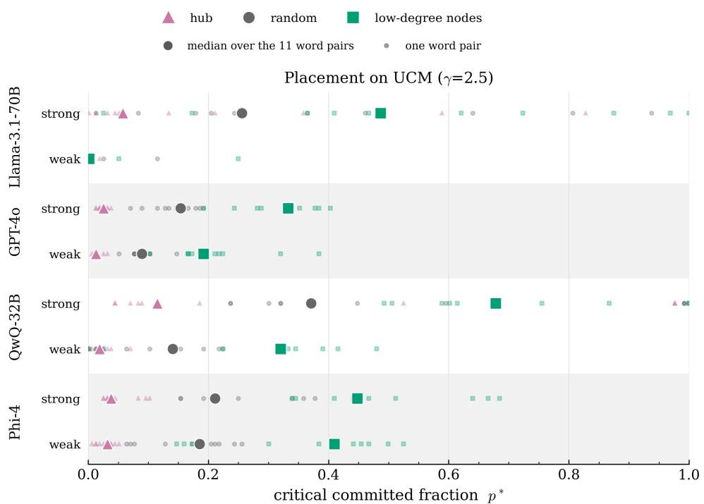  
(a) Placement (hub / random / low-degree nodes) on $\mathrm { U C M } _ { 2 . 5 } )$

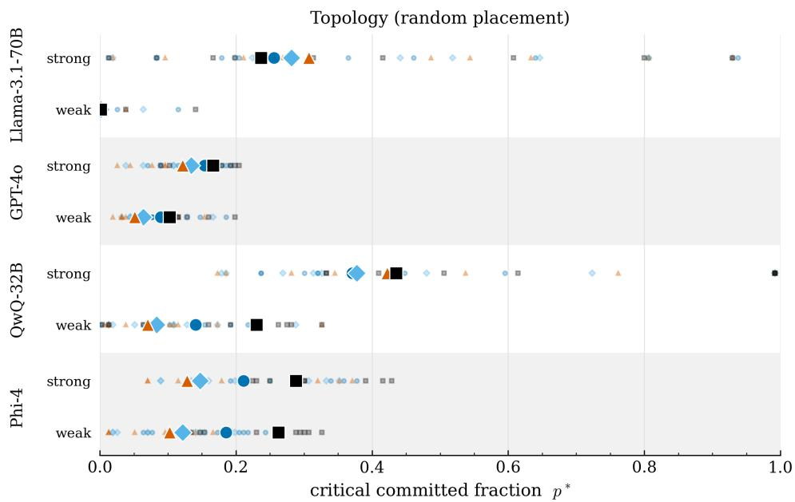  
(b) Topology (FC, $\mathrm { U C M _ { 2 . 5 } }$ , $\mathrm { U C M _ { 5 . 0 } } ,$ RRN) under random placement.

Figure 3: Critical committed fraction $p ^ { * }$ at $N = 1 0 0 0 0$ , by model and commitment direction. (a) $p ^ { * }$ by placement of the committed minority on $\mathrm { U C M _ { 2 . 5 } }$ . (b) $p ^ { * }$ by topology under random placement. In both panels, large symbols are the median over the 11 word pairs and small symbols the individual pairs; the $p ^ { * } = 0$ conditions are excluded from the plot.

easily a committed minority can overturn it. Three main results emerge.

First, denser topologies support faster consensus: for most word pairs, convergence time is ordered $\mathrm { F C } < \mathrm { U C M _ { 2 . 5 } } < \mathrm { U C M _ { 5 . 0 } } < \mathrm { R R N }$ . Because they interact more often, hubs reach a given success level slightly earlier than low-degree nodes, consistent with classical naming game experiments in which agreement forms around hubs and spreads outward [32]. Persistent neighbourhoods matter mainly in the disordered phase, where low-degree nodes can settle local agreements with their few fixed partners, echoing the known tension between locally stabilising structure and global convergence [31, 41, 42]. These results parallel human systems, where topology is known to afect convergence [31, 32, 18].

Second, topology occasionally changes which convention wins (Section 3.1) and whether consensus emerges at all, rescuing a pair that never converges in a well-mixed population. The rescue vanishes when neighbours are reshufled, showing that dynamical correlations between persistent neighbours are necessary for it. Unlike density leading to faster consensus, these efects have not been observed in human populations.

Third, the critical fraction $p ^ { * }$ needed to overturn an established convention follows $p ^ { * } ( \mathrm { h u b } ) \leq$ $p ^ { * } ( \mathrm { r a n d o m } ) \leq p ^ { * }$ (low-degree nodes) in all conditions. The most cost-efective attack on a multi-agent LLM system is thus to target its hubs [43, 44], mirroring degree-targeted attacks [45]. Unlike prompt injection, jailbreaks, or manipulated knowledge propagating between agents [46, 47, 48], this attack compromises neither the agents nor the content they exchange: it merely places ordinary, persistently opinionated agents at well-connected positions. For randomly placed committed minorities, the ordering RRN $< \mathrm { U C M } _ { 5 . 0 } < \mathrm { U C M } _ { 2 . 5 }$ $< \mathrm { F C }$ holds in only five of the eight model-direction combinations tested, highlighting variability across models. In the minimal naming game, the tipping point is known to shift with mean degree and connectivity [33], and committed agents at central or highly active positions are far more efective than randomly placed ones [41, 42]. We show that these efects persist, and sharpen, in LLMs.

Our work has limitations. First, results are model dependent: Llama departs from the majority pattern in speed ordering, in the topology dependence of $p ^ { * }$ , and in having mixedstate pairs, so more models are needed before generalising. Second, the minimal naming game makes collective properties testable at population sizes beyond the reach of direct LLM querying, but it is a simplified task; future work should test more ecological scenarios with richer interactions [49, 50, 51]. Third, we fixed memory at $H = 5$ and the number of competing conventions at $W = 2$ . Consensus in LLM populations depends on memory [34], and larger convention sets open indirect routes between equilibria that change the cost of an attack [27].

Despite these limitations, our results bear directly on the safety of multi-agent systems, where heterogeneous topologies are increasingly common [30, 44, 10]. In most of our settings, well-mixed populations reach consensus faster and require larger committed minorities to be overturned than networked ones, so well-mixed estimates can overstate robustness. In a few cases, topology even changes which convention is established and whether consensus is reached. Moreover, because all agents in a well-mixed population are equivalent, the efect of committed-agent placement cannot be observed there. This matters because the conventions agent populations adopt can have tangible consequences, from prices set by autonomous pricing agents [52, 53] to narratives amplified by agent swarms [6]. The safety of multi-agent systems depends on these collective outcomes as much as on individual model behaviour [2, 54]. As agents are increasingly deployed in networks, assessing their safety will require mapping who interacts with whom, alongside testing the agents themselves.

Funding: L.M.A. acknowledges the support from the Horizon-CL4 project MINGLE (EU grant: 101341932), and from the Carlsberg Foundation through the COCOONS project (CF21-0432). R.P.-S. acknowledges financial support from project PID2022-137505NB-C21/AEI/10.13039/501100011033/FEDER UE and the Acadèmia d’Excel·lència Award, funded by the Generalitat de Catalunya.

## References

[1] Yoshua Bengio, Stephen Clare, Carina Prunkl, Maksym Andriushchenko, Ben Bucknall, Malcolm Murray, Rishi Bommasani, Stephen Casper, Tom Davidson, Raymond Douglas, et al. International ai safety report 2026. arXiv preprint arXiv:2602.21012, 2026.

[2] Lewis Hammond, Alan Chan, Jesse Clifton, Jason Hoelscher-Obermaier, Akbir Khan, Euan McLean, Chandler Smith, Wolfram Barfuss, Jakob Foerster, Tomáš Gavenčiak, et al. Multi-agent risks from advanced ai. arXiv preprint arXiv:2502.14143, 2025.

[3] Fernando G. D. C. Ferreira, Amir H. Gandomi, and Rodrigo T. N. Cardoso. Artificial intelligence applied to stock market trading: a review. IEEE Access, 9:30898–30917, 2021.

[4] Shuo Sun, Rundong Wang, and Bo An. Reinforcement learning for quantitative trading. ACM Transactions on Intelligent Systems and Technology, 14(3):1–29, 2023.

[5] James Black, Mattias Eken, Jacob Parakilas, Stuart Dee, Conlan Ellis, Kiran Suman-Chauhan, et al. Strategic Competition in the Age of AI: Emerging Risks and Opportunities from Military Use of Artificial Intelligence. RAND Corporation, 2024.

[6] Daniel Thilo Schroeder, Meeyoung Cha, Andrea Baronchelli, Nick Bostrom, Nicholas A. Christakis, David Garcia, et al. How malicious AI swarms can threaten democracy. Science, 391(6783):354–357, 2026. doi: 10.1126/science.adz1697.

[7] Yuanchun Li, Hao Wen, Weijun Wang, Xiangyu Li, Yizhen Yuan, Guohong Liu, et al. Personal LLM agents: insights and survey about the capability, eficiency and security. arXiv preprint arXiv:2401.05459, 2024.

[8] Deepak Akkil, Tamer Abuelsaad, Karthik Vikram, Matthew Pace, Aditya Vempaty, Saahir Beotra, Ravi Kokku, and Satya Nitta. Emergence world: Adversarial stresstesting of long-horizon multi-agent systems. arXiv preprint arXiv:2609.17320, 2026.

[9] Ryan Greenblatt, Ajeya Cotra, and Hjalmar Wijk. Brief independent investigation of agents’ behavior, reasoning and collaboration in the OpenAI / Hugging Face hacking incident. METR and Redwood Research, August 2026. Published 26 August 2026. https://metr.org/blog/ 2026-08-26-openai-hugging-face-incident-investigation/.

[10] Henry CW Price, H AlMuhanna, PM Bassani, M Ho, and TS Evans. Let there be claws: An early social network analysis of ai agents on moltbook. arXiv preprint arXiv:2602.20044, 2026.

[11] Lingyao Li, Renkai Ma, Chen Chen, Zhicong Lu, and Yongfeng Zhang. The rise of ai agent communities: Large-scale analysis of discourse and interaction on moltbook. arXiv preprint arXiv:2602.12634, 2026.

[12] Ludwig Wittgenstein. Philosophical investigations. blackwells. Locus classicus for linguistic analysis, page 232, 1953.

[13] David Lewis. Convention: A philosophical study. John Wiley & Sons, 2008.

[14] H. Peyton Young. The evolution of conventions. Econometrica, 61(1):57–84, 1993.

[15] Cristina Bicchieri. The Grammar of Society: The Nature and Dynamics of Social Norms. Cambridge University Press, 2005.

[16] Luc Steels. A self-organizing spatial vocabulary. Artificial Life, 2(3):319–332, 1995.

[17] Andrea Baronchelli, Maddalena Felici, Vittorio Loreto, Emanuele Caglioti, and Luc Steels. Sharp transition towards shared vocabularies in multi-agent systems. Journal of Statistical Mechanics: Theory and Experiment, 2006(06):P06014–P06014, 2006.

[18] Claudio Castellano, Santo Fortunato, and Vittorio Loreto. Statistical physics of social dynamics. Reviews of Modern Physics, 81(2):591–646, 2009. doi: 10.1103/ RevModPhys.81.591.

[19] Andrea Baronchelli. The emergence of consensus: a primer. Royal Society open science, 5(2):172189, 2018.

[20] Damon Centola and Andrea Baronchelli. The spontaneous emergence of conventions: an experimental study of cultural evolution. Proceedings of the National Academy of Sciences, 112(7):1989–1994, 2015. doi: 10.1073/pnas.1418838112.

[21] Damon Centola, Joshua Becker, Devon Brackbill, and Andrea Baronchelli. Experimental evidence for tipping points in social convention. Science, 360(6393):1116–1119, 2018.

[22] Sönke Ehret, Sara M Constantino, Elke U Weber, Charles Eferson, and Sonja Vogt. Group identities can undermine social tipping after intervention. Nature human behaviour, 6(12):1669–1679, 2022.

[23] James Andreoni, Nikos Nikiforakis, and Simon Siegenthaler. Predicting social tipping and norm change in controlled experiments. Proceedings of the National Academy of Sciences, 118(16):e2014893118, 2021.

[24] Ariel Flint Ashery, Luca Maria Aiello, and Andrea Baronchelli. Emergent social conventions and collective bias in LLM populations. Science Advances, 11(20):eadu9368, 2025.

[25] Ariel Flint, Luca Maria Aiello, Romualdo Pastor-Satorras, and Andrea Baronchelli. Group size efects and collective misalignment in LLM multi-agent systems. Proceedings of the National Academy of Sciences, 123(34):e2531697123, 2026.

[26] Jierui Xie, Sameet Sreenivasan, Gyorgy Korniss, Weituo Zhang, Chjan Lim, and Boleslaw K Szymanski. Social consensus through the influence of committed minorities. Physical Review E—Statistical, Nonlinear, and Soft Matter Physics, 84(1): 011130, 2011.

[27] Ariel Flint, Luca Maria Aiello, Sara M. Constantino, Romualdo Pastor-Satorras, and Andrea Baronchelli. Indirect tipping: a social attack surface in AI agent populations. arXiv preprint arXiv:2609.25194, 2026.

[28] Xiang Niu, Casey Doyle, Gyorgy Korniss, and Boleslaw K Szymanski. The impact of variable commitment in the naming game on consensus formation. Scientific reports, 7(1):41750, 2017.

[29] Chen Qian, Zihao Xie, YiFei Wang, Wei Liu, Kunlun Zhu, Hanchen Xia, Yufan Dang, Zhuoyun Du, Weize Chen, Cheng Yang, et al. Scaling large language model-based

multi-agent collaboration. In International Conference on Learning Representations, volume 2025, pages 41488–41505, 2025.

[30] Abul Ehtesham, Aditi Singh, Gaurav Kumar Gupta, and Saket Kumar. A survey of agent interoperability protocols: Model context protocol (mcp), agent communication protocol (acp), agent-to-agent protocol (a2a), and agent network protocol (anp). arXiv preprint arXiv:2505.02279, 2025.

[31] Andrea Baronchelli, Luca Dall’Asta, Alain Barrat, and Vittorio Loreto. Topologyinduced coarsening in language games. Physical Review E, 73(1):015102, 2006. doi: 10.1103/PhysRevE.73.015102.

[32] Luca Dall’Asta, Andrea Baronchelli, Alain Barrat, and Vittorio Loreto. Nonequilibrium dynamics of language games on complex networks. Physical Review E—Statistical, Nonlinear, and Soft Matter Physics, 74(3):036105, 2006.

[33] Weituo Zhang, Chjan Lim, and Boleslaw K Szymanski. Analytic treatment of tipping points for social consensus in large random networks. Physical Review E—Statistical, Nonlinear, and Soft Matter Physics, 86(6):061134, 2012.

[34] Aliakbar Mehdizadeh and Martin Hilbert. Exploring the topology and memory of consensus: How LLM agents agree, fragment, or settle when forming conventions. arXiv preprint arXiv:2606.04197, 2026.

[35] Albert-László Barabási and R. Albert. Emergence of scaling in random networks. Science, 286:509–512, 1999.

[36] Nikita Nangia, Clara Vania, Rasika Bhalerao, and Samuel Bowman. Crows-pairs: A challenge dataset for measuring social biases in masked language models. In Proceedings of the 2020 conference on empirical methods in natural language processing (EMNLP), pages 1953–1967, 2020.

[37] Michele Catanzaro, Marián Boguná, and Romualdo Pastor-Satorras. Generation of uncorrelated random scale-free networks. Physical Review E—Statistical, Nonlinear, and Soft Matter Physics, 71(2):027103, 2005.

[38] S. N. Dorogovtsev, A. V. Goltsev, and J .F. F. Mendes. Critical phenomena in complex networks. Reviews of Modern Physics, 80:1275–1335, 2008. doi: 10.1103/ RevModPhys.80.1275.

[39] Mark Newman. Networks: An Introduction. Oxford University Press, Inc., New York, NY, USA, 2010.

[40] Romualdo Pastor-Satorras, Claudio Castellano, Piet Van Mieghem, and Alessandro Vespignani. Epidemic processes in complex networks. Reviews of Modern Physics, 87: 925–979, Aug 2015. doi: 10.1103/RevModPhys.87.925.

[41] Qiming Lu, Gyorgy Korniss, and Boleslaw K Szymanski. The naming game in social networks: community formation and consensus engineering. Journal of Economic Interaction and Coordination, 4(2):221–235, 2009.

[42] Dina Mistry, Qian Zhang, Nicola Perra, and Andrea Baronchelli. Committed activists and the reshaping of status-quo social consensus. Physical Review E, 92(4):042805, 2015.

[43] Alan Chan, Carson Ezell, Max Kaufmann, Kevin Wei, Lewis Hammond, Herbie Bradley, Emma Bluemke, Nitarshan Rajkumar, David Krueger, Noam Kolt, et al.

Visibility into ai agents. In Proceedings of the 2024 ACM conference on fairness, accountability, and transparency, pages 958–973, 2024.

[44] Alan Chan, Kevin Wei, Sihao Huang, Nitarshan Rajkumar, Elija Perrier, Seth Lazar, Gillian K. Hadfield, and Markus Anderljung. Infrastructure for AI agents. arXiv preprint arXiv:2501.10114, 2025.

[45] Réka Albert, Hawoong Jeong, and Albert-László Barabási. Error and attack tolerance of complex networks. nature, 406(6794):378–382, 2000.

[46] Xiangming Gu, Xiaosen Zheng, Tianyu Pang, Chao Du, Qian Liu, Ye Wang, Jing Jiang, and Min Lin. Agent smith: A single image can jailbreak one million multimodal llm agents exponentially fast. arXiv preprint arXiv:2402.08567, 2024.

[47] Donghyun Lee, Mo Tiwari, and Brando Miranda. Prompt infection: Llm-to-llm prompt injection within multi-agent systems. In European Symposium on Research in Computer Security, pages 511–520. Springer, 2025.

[48] Tianjie Ju, Yiting Wang, Yi Hua, Xinbei Ma, Pengzhou Cheng, Haodong Zhao, Yulong Wang, Lifeng Liu, Jian Xie, Zhuosheng Zhang, et al. Flooding spread of manipulated knowledge in llm-based multi-agent communities. Science China Information Sciences, 69(7):172103, 2026.

[49] Joon Sung Park, Joseph O’Brien, Carrie Jun Cai, Meredith Ringel Morris, Percy Liang, and Michael S. Bernstein. Generative agents: interactive simulacra of human behavior. In Proceedings of the 36th Annual ACM Symposium on User Interface Software and Technology, pages 1–22, 2023. doi: 10.1145/3586183.3606763.

[50] Jerémy Perez, Corentin Léger, Marcela Ovando-Tellez, Chris Foulon, Joan Dussauld, Pierre-Yves Oudeyer, and Clément Moulin-Frier. Cultural evolution in populations of large language models. arXiv preprint arXiv:2403.08882, 2024.

[51] Frida Nøhr Laustsen, Marie Haahr Petersen, Victoria Popa, Ariel Flint, Romualdo Pastor-Satorras, Andrea Baronchelli, and Luca Maria Aiello. Peer influence across heterogeneous ai models. arXiv e-prints, pages arXiv–2610, 2026.

[52] Emilio Calvano, Giacomo Calzolari, Vincenzo Denicolò, and Sergio Pastorello. Artificial intelligence, algorithmic pricing, and collusion. American Economic Review, 110 (10):3267–3297, 2020. doi: 10.1257/aer.20190623.

[53] Sara Fish, Yannai A. Gonczarowski, and Ran I. Shorrer. Algorithmic collusion by large language models. arXiv preprint arXiv:2404.00806, 2024.

[54] Levin Brinkmann, Fabian Baumann, Jean-François Bonnefon, Maxime Derex, Thomas F Müller, Anne-Marie Nussberger, Agnieszka Czaplicka, Alberto Acerbi, Thomas L Grifiths, Joseph Henrich, et al. Machine culture. Nature Human Behaviour, 7(11):1855–1868, 2023.

[55] D. Chakrabarti, Y. Wang, C. Wang, J. Leskovec, and C. Faloutsos. Epidemic thresholds in real networks. ACM Transactions on Information and System Security (TIS-SEC), 10:1–26, 2008. doi: 10.1145/1284680.1284681.

[56] Angélica S. Mata and Silvio C. Ferreira. Pair quenched mean-field theory for the susceptible-infected-susceptible model on complex networks. Europhysics Letters, 103 (4):48003, 2013. URL http://stacks.iop.org/0295-5075/103/i=4/a=48003.

[57] M. Boguñá, C. Castellano, and R. Pastor-Satorras. Langevin approach for the dy-

namics of the contact process on annealed scale-free networks. Physical Review E, 79: 036110, 2009. doi: 10.1103/PhysRevE.79.036110.

## APPENDIX

## A1 Mean-field theory of the naming game on networks

## A1.1 Mean-field naming game for LLMs

We consider a population composed by agents (LLMs) playing the naming game with the same vocabulary (same words 0 and 1). The state of the agents is given by the set of words proposed and received in the previous interactions. Thus, a state can be represented as a string of bits of the form

$$
S = \{ a _ { 1 } , b _ { 1 } , a _ { 2 } , b _ { 2 } , . . . , a _ { h } , b _ { h } \} ,\tag{A1}
$$

where $h \leq H$ is the length of the state, $a _ { i }$ are the last words proposed by the agent and $b _ { i }$ are the last words received by interacting partners. H is the maximum length of the state, corresponding to the maximum memory of the agents. Agents start from the empty state $S _ { \varnothing } = \varnothing$ (empty memory stack before any interaction). The total number of states is

$$
M = \frac { 1 } { 3 } ( 4 ^ { H + 1 } - 1 )\tag{A2}
$$

Agents are characterised by a probability policy q(S) defined as the probability that an agent in state $S$ will select the word 0 as output of an interaction with another agent (irrespective of the state of the second agent), selecting word 1 with probability $1 - q ( S ) ,$ ). At the mean field level (everybody interacting with everybody else), the dynamics of the system is given by the following rules:

1. Two agents are randomly selected to interact.

2. The first agent, in state $S ,$ proposes a word a according to its probability policy $q ( S )$

3. The second agent, in state $S ^ { \prime }$ , receives the word a and responds with a word b according to its probability policy $q ( S ^ { \prime } )$ .

4. The states of both agents are updated by adding the pair words uttered and received to their respective histories.

If an agent in state S proposes the word a and receives the word $b ,$ its state is updated according to the following rule:

$$
S \to \Gamma _ { ( a , b ) } ( S ) ,\tag{A3}
$$

where the shift function $\Gamma _ { ( a , b ) } ( S )$ is defined as

$$
\Gamma _ { ( a , b ) } ( \{ a _ { 1 } , b _ { 1 } , a _ { 2 } , b _ { 2 } , \dots , a _ { h } , b _ { h } \} ) = \left\{ \begin{array} { l l } { { \{ a _ { 1 } , b _ { 1 } , a _ { 2 } , b _ { 2 } , \dots , a _ { h } , b _ { h } , a , b \} } } & { { \mathrm { ~ i f ~ } h < H } } \\ { { } } & { { } } \\ { { \{ a _ { 2 } , b _ { 2 } , a _ { 3 } , b _ { 3 } , \dots , a _ { H } , b _ { H } , a , b \} } } & { { \mathrm { ~ i f ~ } h = H } } \end{array} \right. .\tag{A4}
$$

At the mean field level, the state of the system is given by the state vector ${ \vec { x } } ,$ where $x _ { k }$ is the fraction of agents in state k. The state vector is normalised as $\textstyle \sum _ { k } x _ { k } = 1$ , such that the state of the system is represented by a point in a M-dimensional simplex. The state vectors fulfill the following rate equations:

$$
\frac { d x _ { k } } { d t } = - 2 x _ { k } + 2 \sum _ { i } \sum _ { j } x _ { i } x _ { j } P ( k | i , j ) ,\tag{A5}
$$

where the kernel $P ( k | i , j )$ , the probability that an agent in state i will transition to state k when interacting with an agent in state $j ,$ , is computed in terms of the possible transitions

of i and the probability policy q(i) as:

$$
\begin{array} { r } { P ( k | i , j ) = \left\{ \begin{array} { l l } { q ( i ) q ( j ) } & { \mathrm { i f ~ } k = \Gamma _ { ( 0 , 0 ) } ( i ) , } \\ { q ( i ) ( 1 - q ( j ) ) } & { \mathrm { i f ~ } k = \Gamma _ { ( 0 , 1 ) } ( i ) , } \\ { ( 1 - q ( i ) ) q ( j ) } & { \mathrm { i f ~ } k = \Gamma _ { ( 1 , 0 ) } ( i ) , } \\ { ( 1 - q ( i ) ) ( 1 - q ( j ) ) } & { \mathrm { i f ~ } k = \Gamma _ { ( 1 , 1 ) } ( i ) , } \\ { 0 } & { \mathrm { o t h e r w i s e } } \end{array} \right. , } \end{array}\tag{A6}
$$

Notice that we have kept a factor of 2 in the rate equation, usually absorbed in a time rescaling, in order to keep the same time scale as in the networked version of the model.

## A1.2 The naming game in complex networks

We consider now a population of N agents placed on the nodes of a complex network. The network is characterised by its adjacency matrix $A _ { n m } \ [ 3 9 ]$ , where $A _ { n m } = 1$ if nodes n and m are connected by means of an edge and $A _ { n m } = 0$ otherwise. The degree of node n is given by $\textstyle k _ { n } = \sum _ { m } A _ { n m }$ , representing the number of nearest neighbours directly connected to node n.

We consider two diferent update dynamics:

1. Symmetric node update: We choose at random a node n in the network, and then we choose at random one of its nearest neighbours m. Both nodes propose a word according to their respective state. We update the state of both nodes n and m.

2. Edge update: We choose at random an edge $( n , m )$ in the network. Both nodes propose a word according to their respective state. We update the state of both nodes n and m.

We assume that the probability policies are not afected by the network structure, in such a way that the update of any node depends only on its own state and the state of node with which it is interacting.

## A1.3 Quenched mean-field theory

In order to proceed to a mathematical formulation, we consider the so-called quenched mean-field theory (QMF) [55, 40], in which we represent the state of each node n in the network with a variable $\boldsymbol { x } _ { i } ^ { n }$ , representing the probability that the agent placed in node n is in state i. Since each agent is in one of the M possible states, we have the normalisation condition

$$
\sum _ { i } x _ { i } ^ { n } = 1 , \quad \forall n = 1 , 2 , \ldots , N .\tag{A7}
$$

That is, the state of each node is represented by a point in the M-dimensional simplex. The mean-field approximation consists in assuming that the state of each node is independent of the state of its neighbours, in such a way that the probability that a node n in state i and another node m in state j are joined by and edge, $P ( n , i ; m , j )$ is given by

$$
P ( n , i ; m , j ) = P ( n , i ) P ( m , j ) = x _ { i } ^ { n } x _ { j } ^ { m } .\tag{A8}
$$

Notice that this lack of dynamical correlations is an approximation, since the state of a node is correlated with the state of its neighbours, due to the interactions between them. It can be improved by considering higher-order dynamical correlations in a pair approximation [56].

Since the state-transition kernel is independent of the network structure, the gain-loss contribution associated with an interaction between nodes n and m has the structure [25]:

$$
- x _ { \ell } ^ { n } + \sum _ { i , j } x _ { i } ^ { n } x _ { j } ^ { m } P ( \ell | i , j ) ,\tag{A9}
$$

The efects of topology are incorporated in the mean-field equations by considering the diferent probabilities to choose nodes n and m in the network. Let us consider the diferent update rules in turn.

## A1.3.1 Symmetric node update

At each elementary time step, we choose a node n, with probability $1 / N$ , that will be in state i with probability $\boldsymbol { x } _ { i } ^ { n }$ . We then select a nearest neighbour m of node n with probability $A _ { n m } / k _ { n }$ , where $k _ { n }$ is the degree of node $n .$ Combining these probabilities with the gain-loss structure in $\mathrm { E q . ~ ( A 9 ) }$ , we obtain the following mean-field equations for symmetric node update:

$$
\begin{array} { r c l } { { \displaystyle \frac { d x _ { \ell } ^ { n } } { d t } } } & { { = } } & { { \displaystyle \frac { 1 } { N } \sum _ { m } \displaystyle \frac { A _ { n m } } { k _ { n } } \left[ - x _ { \ell } ^ { n } + \sum _ { i , j } x _ { i } ^ { n } x _ { j } ^ { m } P ( \ell | i , j ) \right] + \displaystyle \frac { 1 } { N } \sum _ { m } \displaystyle \frac { A _ { n m } } { k _ { m } } \left[ - x _ { \ell } ^ { n } + \sum _ { i , j } x _ { i } ^ { n } x _ { j } ^ { m } P ( \ell | i , j ) \right] } } \\ { { } } & { { = } } & { { \displaystyle \frac { 1 } { N } \left[ - x _ { \ell } ^ { n } \left( 1 + \sum _ { m } \displaystyle \frac { A _ { n m } } { k _ { m } } \right) + \sum _ { m } A _ { n m } \left( \displaystyle \frac { 1 } { k _ { n } } + \displaystyle \frac { 1 } { k _ { m } } \right) \sum _ { i , j } x _ { i } ^ { n } x _ { j } ^ { m } P ( \ell | i , j ) \right] . \qquad \quad \mathrm { ( A l 0 ) } } } \end{array}
$$

The two terms on the rhs of the first equation represent the contributions from the node n and its neighbours, respectively. Absorbing a factor of $1 / N$ in a time rescaling, we can write the mean-field equations for the symmetric node update as

$$
\frac { d x _ { \ell } ^ { n } } { d t } = - x _ { \ell } ^ { n } \left( 1 + \sum _ { m } \frac { A _ { n m } } { k _ { m } } \right) + \sum _ { m } A _ { n m } \left( \frac { 1 } { k _ { n } } + \frac { 1 } { k _ { m } } \right) \sum _ { i , j } x _ { i } ^ { n } x _ { j } ^ { m } P ( \ell | i , j ) .\tag{A11}
$$

## A1.3.2 Symmetric edge update

At each elementary time step, we choose an edge $( n , m )$ in the network with probability $A _ { n m } / E$ , where $\begin{array} { r } { E = \sum _ { n , m } A _ { n m } / 2 } \end{array}$ is the total number of edges in the network. The gainloss structure in Eq. (A9) leads to the following mean-field equations for the symmetric edge update:

$$
\frac { d x _ { \ell } ^ { n } } { d t } = \sum _ { m } \frac { A _ { n m } } { E } \left[ - x _ { \ell } ^ { n } + \sum _ { i , j } x _ { i } ^ { n } x _ { j } ^ { m } P ( \ell | i , j ) \right] .\tag{A12}
$$

Absorbing a factor of $1 / N$ in a time rescaling, and considering that $E = N \langle k \rangle / 2$ , where $\langle k \rangle$ is the average degree of the network, we can write the mean-field equations for the symmetric edge update as

$$
{ \frac { d x _ { \ell } ^ { n } } { d t } } = { \frac { 2 } { \langle k \rangle } } \left[ - k _ { n } x _ { \ell } ^ { n } + \sum _ { m } A _ { n m } \sum _ { i , j } x _ { i } ^ { n } x _ { j } ^ { m } P ( \ell | i , j ) \right]\tag{A13}
$$

## A1.4 Annealed network approximation

The annealed network approximation [38, 57] consists in replacing the adjacency matrix $A _ { n m }$ by its expected value, given by the connection probability $p _ { n m }$ between nodes n

and m. For an uncorrelated configuration-model network, in the sparse-network limit, we replace the adjacency matrix by [57]

$$
A _ { n m }  p _ { n m } = \frac { k _ { n } k _ { m } } { 2 E } = \frac { k _ { n } k _ { m } } { \langle k \rangle N } ,\tag{A14}
$$

where ⟨k⟩ is the average degree of the network. An annealed network is a network in which the edges are randomly rewired, at a rate much faster than the dynamics of the nodes, while keeping the degree of each node fixed. The annealed network approximation is interesting because, due to the edge rewiring, it renders exact the hypothesis of lack of dynamical correlations between the states of neighbouring nodes, which is an approximation in the quenched mean field theory. Thus, we expect that numerical simulations in annealed networks will be exactly described by the annealed network approximation, while in quenched networks we can have deviations from the theory, either QMF or the annealed network approximation, due to the presence of dynamical correlations. In any case, the annealed network approximation renders simplex equations that sometimes capture the scaling behaviour of the dynamics.

Within the annealed network approximation, the mean-field equations for the symmetric node update reduce to

$$
\frac { d x _ { \ell } ^ { n } } { d t } = - x _ { \ell } ^ { n } \left( 1 + \frac { k _ { n } } { \langle k \rangle } \right) + \sum _ { m } \frac { k _ { n } + k _ { m } } { \langle k \rangle N } \sum _ { i , j } x _ { i } ^ { n } x _ { j } ^ { m } P ( \ell | i , j ) ,\tag{A15}
$$

while the equations for the symmetric edge update reduce to

$$
\frac { d x _ { \ell } ^ { n } } { d t } = \frac { 2 } { \langle k \rangle } \left[ - k _ { n } x _ { \ell } ^ { n } + \sum _ { m } \frac { k _ { n } k _ { m } } { \langle k \rangle N } \sum _ { i , j } x _ { i } ^ { n } x _ { j } ^ { m } P ( \ell | i , j ) \right]\tag{A16}
$$

## A1.5 Random regular networks

Consider a random regular network (RRN), in which all nodes have the same degree $k _ { n } =$ K, that is $\begin{array} { r } { \sum _ { m } A _ { n m } = K } \end{array}$ for all nodes n. In this case, the QMF equations for the symmetric node update reduce to

$$
\frac { d x _ { \ell } ^ { n } } { d t } = - 2 x _ { \ell } ^ { n } + \frac { 2 } { K } \sum _ { m } A _ { n m } \sum _ { i , j } x _ { i } ^ { n } x _ { j } ^ { m } P ( \ell | i , j ) ,\tag{A17}
$$

while the equations for the symmetric edge update reduce to

$$
\frac { d x _ { \ell } ^ { n } } { d t } = - 2 x _ { \ell } ^ { n } + \frac { 2 } { K } \sum _ { m } A _ { n m } \sum _ { i , j } x _ { i } ^ { n } x _ { j } ^ { m } P ( \ell | i , j ) .\tag{A18}
$$

Thus, for random regular networks, the QMF equations for both update rules are identical. Within the annealed network approximation, the equations for both symmetric node update and symmetric edge update reduce to

$$
\frac { d x _ { \ell } ^ { n } } { d t } = - 2 x _ { \ell } ^ { n } + \frac { 2 } { N } \sum _ { m } \sum _ { i , j } x _ { i } ^ { n } x _ { j } ^ { m } P ( \ell | i , j ) ,\tag{A19}
$$

which is independent of the degree K of the network. Thus, for RRN, the annealed network approximation predicts that the dynamics is independent of the degree of the network.

Moreover, if we define the average state vector $\rho _ { i } = \sum _ { n } x _ { i } ^ { n } / N$ , we can write the mean-field equations for the average state vector as

$$
\frac { d \rho _ { \ell } } { d t } = - 2 \rho _ { \ell } + 2 \sum _ { i , j } \rho _ { i } \rho _ { j } P ( \ell | i , j ) ,\tag{A20}
$$

which is identical to the mean-field equations for the fully connected network. Thus, the annealed network approximation predicts that the dynamics of the naming game in RRN is identical to the dynamics in the fully connected network for any value of $K$

## A2 Additional figures and tables

In Tables A1, A2, A6, and A7, we present the results of Friedman and Page tests. The Friedman test asks whether the four topologies difer in convergence time, comparing them within each word pair; Page’s L asks whether they follow the specific ordering FC < $\mathrm { U C M _ { 2 . 5 } } < \mathrm { U C M _ { 5 . 0 } } < \mathrm { R R N }$

## A2.1 Statistical tests for speed of consensus across topologies

Table A1: Friedman and Page’s L tests on the mode of reached consensus of the topology ordering $\mathrm { F C \ < \ U C M _ { 2 . 5 } < U C M _ { 5 . 0 } < R R N }$ . Performed by model, activation rule and population size.
<table><tr><td>Model</td><td>N</td><td>Rule</td><td>Q</td><td>p</td><td>W</td><td>L</td><td>p(L)</td></tr><tr><td>QwQ-32B</td><td>1000</td><td>Edge</td><td>31.4</td><td>&lt; .001</td><td>0.953</td><td>327</td><td>&lt; .001</td></tr><tr><td>QwQ-32B</td><td>1000</td><td>Node</td><td>31.4</td><td>&lt; .001</td><td>0.953</td><td>327</td><td>&lt; .001</td></tr><tr><td>QwQ-32B</td><td>5000</td><td>Edge</td><td>30.7</td><td>&lt; .001</td><td>0.930</td><td>326</td><td>&lt; .001</td></tr><tr><td>QwQ-32B</td><td>5000</td><td>Node</td><td>31.4</td><td>&lt; .001</td><td>0.950</td><td>327</td><td>&lt; .001</td></tr><tr><td>QwQ-32B</td><td>10000</td><td>Edge</td><td>30.7</td><td>&lt; .001</td><td>0.930</td><td>326</td><td>&lt; .001</td></tr><tr><td>QwQ-32B</td><td>10000</td><td>Node</td><td>31.4</td><td>&lt; .001</td><td>0.950</td><td>327</td><td>&lt; .001</td></tr><tr><td>QwQ-32B</td><td>100000</td><td>Edge</td><td>30.7</td><td>&lt; .001</td><td>0.930</td><td>326</td><td>&lt; .001</td></tr><tr><td>QwQ-32B</td><td>100000</td><td>Node</td><td>32.2</td><td>&lt; .001</td><td>0.975</td><td>328</td><td>&lt; .001</td></tr><tr><td>GPT-40</td><td>1000</td><td>Edge</td><td>32.7</td><td>&lt; .001</td><td>0.992</td><td>330</td><td>&lt; .001</td></tr><tr><td>GPT-40</td><td>1000</td><td>Node</td><td>32.7</td><td>&lt; .001</td><td>0.992</td><td>330</td><td>&lt; .001</td></tr><tr><td>GPT-40</td><td>5000</td><td>Edge</td><td>31.9</td><td>&lt; .001</td><td>0.967</td><td>329</td><td>&lt; .001</td></tr><tr><td>GPT-40</td><td>5000</td><td>Node</td><td>31.7</td><td>&lt; .001</td><td>0.962</td><td>328</td><td>&lt; .001</td></tr><tr><td>GPT-40</td><td>10000</td><td>Edge</td><td>31.7</td><td>&lt; .001</td><td>0.962</td><td>328</td><td>&lt; .001</td></tr><tr><td>GPT-40</td><td>10000</td><td>Node</td><td>31.9</td><td>&lt; .001</td><td>0.967</td><td>329</td><td>&lt; .001</td></tr><tr><td>GPT-40</td><td>100000</td><td>Edge</td><td>31.4</td><td>&lt; .001</td><td>0.953</td><td>328</td><td>&lt; .001</td></tr><tr><td>GPT-40</td><td>100000</td><td>Node</td><td>31.0</td><td>&lt; .001</td><td>0.938</td><td>328</td><td>&lt; .001</td></tr><tr><td>Phi-4</td><td>1000</td><td>Edge</td><td>26.7</td><td>&lt; .001</td><td>0.810</td><td>320</td><td>&lt; .001</td></tr><tr><td>Phi-4</td><td>1000</td><td>Node</td><td>26.7</td><td>&lt; .001</td><td>0.810</td><td>320</td><td>&lt; .001</td></tr><tr><td>Phi-4</td><td>5000</td><td>Edge</td><td>26.7</td><td>&lt; .001</td><td>0.810</td><td>320</td><td>&lt; .001</td></tr><tr><td>Phi-4</td><td>5000</td><td>Node</td><td>26.7</td><td>&lt; .001</td><td>0.810</td><td>320</td><td>&lt; .001</td></tr><tr><td>Phi-4</td><td>10000</td><td>Edge</td><td>26.7</td><td>&lt; .001</td><td>0.810</td><td>320</td><td>&lt; .001</td></tr><tr><td>Phi-4</td><td>10000</td><td>Node</td><td>26.7</td><td>&lt; .001</td><td>0.810</td><td>320</td><td>&lt; .001</td></tr><tr><td>Phi-4</td><td>100000</td><td>Edge</td><td>26.7</td><td>&lt; .001</td><td>0.810</td><td>320</td><td>&lt; .001</td></tr><tr><td>Phi-4</td><td>100000</td><td>Node</td><td>26.7</td><td>&lt; .001</td><td>0.810</td><td>320</td><td>&lt; .001</td></tr><tr><td>Llama-3.1-70B</td><td>1000</td><td>Edge</td><td>1.7</td><td>0.644</td><td>0.062</td><td>224</td><td>0.568</td></tr><tr><td>Llama-3.1-70B</td><td>1000</td><td>Node</td><td>0.8</td><td>0.857</td><td>0.028</td><td>224</td><td>0.568</td></tr><tr><td>Llama-3.1-70B</td><td>5000</td><td>Edge</td><td>5.9</td><td>0.114</td><td>0.220</td><td>222</td><td>0.655</td></tr><tr><td>Llama-3.1-70B</td><td>5000</td><td>Node</td><td>1.0</td><td>0.801</td><td>0.037</td><td>224</td><td>0.612</td></tr><tr><td>Llama-3.1-70B</td><td>10000</td><td>Edge</td><td>7.5</td><td>0.058</td><td>0.277</td><td>220</td><td>0.734</td></tr><tr><td>Llama-3.1-70B</td><td>10000</td><td>Node</td><td>1.0</td><td>0.801</td><td>0.037</td><td>224</td><td>0.612</td></tr><tr><td>Llama-3.1-70B</td><td>100000</td><td>Edge</td><td>9.0</td><td>0.029</td><td>0.335</td><td>218</td><td>0.804</td></tr><tr><td>Llama-3.1-70B</td><td>100000</td><td>Node</td><td>1.3</td><td>0.737</td><td>0.047</td><td>224</td><td>0.612</td></tr></table>

Convergence time by topology (mean per cell, edge update, N=10,000)

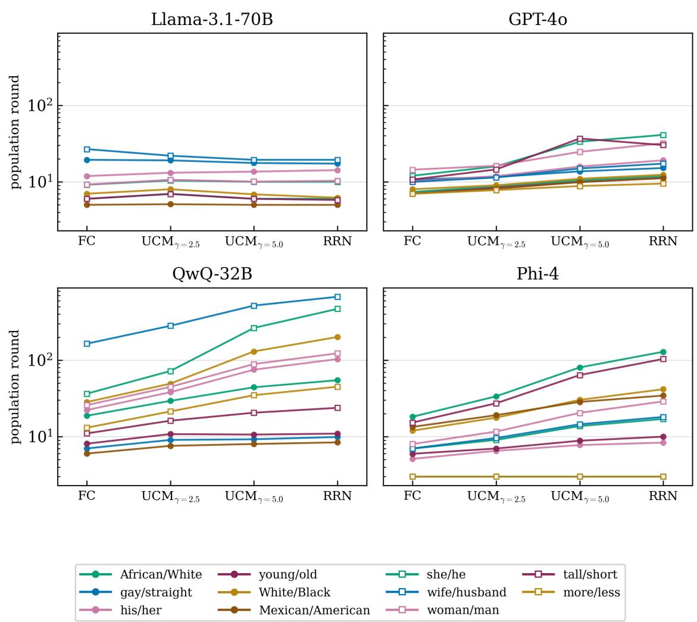  
Figure A1: Same as Figure 1, but for the mean convergence time under edge activation at $N = 1 0 0 0 0$

A2.2 Statistical tests for speed of consensus on increasing values of K for RRN  
Table A2: Friedman and Page’s L tests of convergence time on RRN as a function of mode degree K ∈ {4, 6, 8, 10, 12, 16, 20, 24, 32, 48, 64, 96, 128, 192, 256} against the FC baseline, $N = 1 0 0 0 0 .$ , edge activation. n = 11 word pairs for QwQ-32B, GPT-4o and Phi-4; $n = 9$ for Llama-3.1-70B, whose two mixed-state pairs (§3.1.3) are excluded.
<table><tr><td>Model</td><td>n</td><td>Q</td><td>p</td><td> $W$ </td><td>L</td><td> $p ( L )$ </td></tr><tr><td>QwQ-32B</td><td>11</td><td>154.8</td><td>&lt; .001</td><td>0.938</td><td>16170</td><td>&lt; .001</td></tr><tr><td>GPT-40</td><td>11</td><td>138.0</td><td>&lt; .001</td><td>0.837</td><td>15456</td><td>&lt; .001</td></tr><tr><td>Phi-4</td><td>11</td><td>123.4</td><td>&lt; .001</td><td>0.748</td><td>15427</td><td>&lt; .001</td></tr><tr><td>Llama-3.1-70B</td><td>9</td><td>2.0</td><td>1.000</td><td>0.015</td><td>10420</td><td>0.477</td></tr></table>

## A2.3 Speed of consensus on increasing values of K for RRN

Convergence time vs edge density on RRN (mode per cell, edge update, N=10,000)

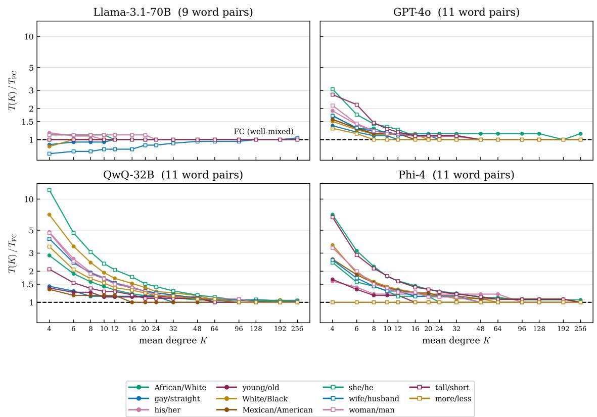  
Figure A2: Convergence time on random regular networks (RRN) as a function of the degree K, relative to the fully connected (FC) population. For every model–wordpair combination, we take the mode of the convergence time of RRN at degree K, $T ( K )$ , and divide it by $T _ { \mathrm { F C } }$ . A ratio above 1 means the network is slower than FC. The dashed line at 1 marks the FC baseline. $N ~ = ~ 1 0 0 0 0$ , edge activation, $K \in$ {4, 6, 8, 10, 12, 16, 20, 24, 32, 48, 64, 96, 128, 192, 256}.

## A2.4 Convergence time at increasing N for the mixed-state Llama pairs

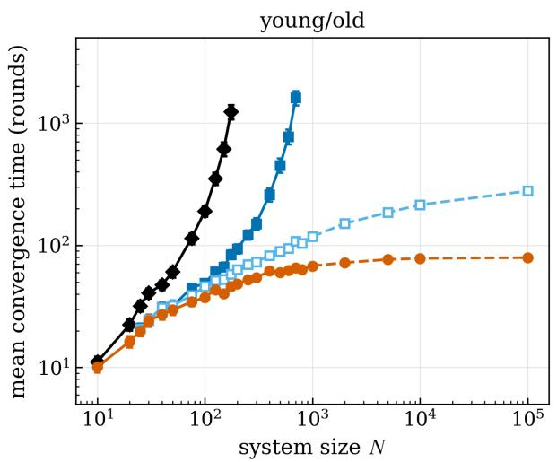

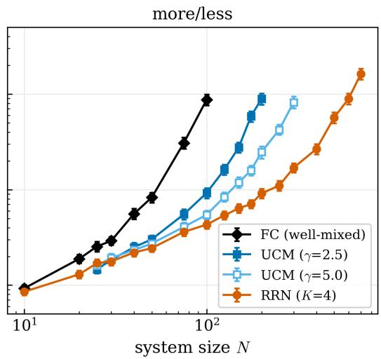  
Figure A3: Mean convergence time as a function of N for the two mixed-state Llama-3.1-70B pairs {young/old} (left) and {more/less} (right), edge activation, on FC (black diamonds), $\mathrm { U C M _ { 2 . 5 } }$ $\mathrm { U C M _ { 5 . 0 } }$ (blue open squares) and RRN with $K = 4$ (orange circles). Error bars are 95% bootstrap confidence intervals over 200 runs per point, with a fresh network per run. Runs last at most $t _ { \mathrm { m a x } } = 1 0 0 0 0$ rounds. Each curve starts at $N = 1 0$ $( N = 2 5$ for $\mathrm { U C M _ { 2 . 5 } }$ and $\mathrm { U C M _ { 5 . 0 } ) }$ , and stops at the last N at which all runs reach consensus within $t _ { \mathrm { m a x } }$

## A2.5 Convergence time on RRN at increasing K for the mixed-state Llama pairs

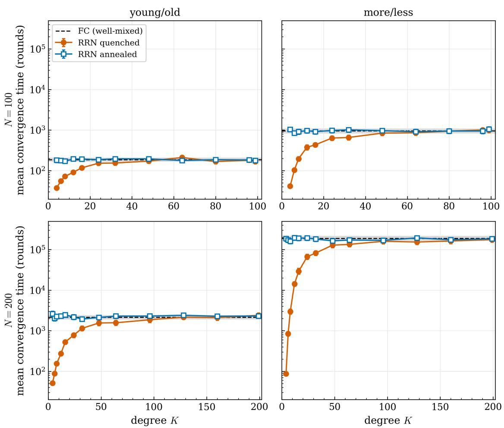  
Figure A4: Mean convergence time on RRN as a function of the degree K, for the two mixed-state Llama-3.1-70B pairs {young/old} (left) and {more/less} (right), at $N = 1 0 0$ (top) and $N = 2 0 0$ (bottom), edge activation. Orange circles are quenched networks, blue open squares the annealed control; error bars are 95% bootstrap confidence intervals over 200 runs per condition. The dashed line and the grey band give the FC mean and its confidence interval at the same N. Note the logarithmic vertical axis, and that the rightmost point of each panel, $K = N - 1$ , is the fully connected graph.

Table A3: Median convergence time (population rounds) of the two mixed-state Llama-3.1- 70B pairs, edge activation; consensus fraction in parentheses when below 1. A dash marks conditions in which no run reaches consensus. Consensus fractions for every topology are in Table 2.
<table><tr><td>Pair</td><td>Topology</td><td> $N = 1 0 0 0$ </td><td> $N = 5 0 0 0$ </td><td> $N = 1 0 0 0 0$ </td><td> $N = 1 0 0 0 0 0$ </td></tr><tr><td rowspan="3">young/old</td><td> $\mathrm { U C M _ { 2 . 5 } }$ </td><td>593.5 (0.07)</td><td>一</td><td></td><td>一</td></tr><tr><td> $\mathrm { U C M _ { 5 . 0 } }$ </td><td>108</td><td>167</td><td>193.5</td><td>267</td></tr><tr><td>RRN</td><td>64</td><td>75</td><td>77</td><td>79</td></tr><tr><td>more/less</td><td>RRN</td><td>508 (0.10)</td><td>一</td><td></td><td>一</td></tr></table>

Table A4: RRN degree sweep for the two mixed-state Llama-3.1-70B pairs, edge activation, 200 runs per condition. Tested degrees: $K \in \{ 4 , 6 , 8 , 1 2 , 1 6 , 2 4 , 3 2 , 4 8 , 6 4 , 8 0 , 9 6 , 9 9 \}$ at $N = 1 0 0$ and $K \in \{ 4 , 6 , 8 , 1 2 .$ 16, 24, 32, 48, 64, 96, 128, 160, 199} at $N = 2 0 0$ $T ( 4 )$ and $T _ { \mathrm { F C } }$ are mean convergence times (population rounds) at $K = 4$ and on FC. $K _ { 5 0 }$ and $K _ { 9 0 }$ are the degrees at which 50% and 90% of the increase from log $T ( 4 )$ to log $T _ { \mathrm { F C } }$ is covered. $K _ { \mathrm { F C } }$ is the smallest K from which the RRN mean stays inside the 95% confidence interval of FC.
<table><tr><td>Pair</td><td>N</td><td> $T ( 4 )$ </td><td> $T _ { \mathrm { F C } }$ </td><td> $T _ { \mathrm { F C } } / T ( 4 )$ </td><td> $K _ { 5 0 }$ </td><td> $K _ { 9 0 }$ </td><td> $K _ { \mathrm { F C } }$ </td></tr><tr><td>young/old</td><td>100</td><td>37.5</td><td>186.8</td><td>5.0</td><td>10.5</td><td>36.3</td><td>80</td></tr><tr><td>more/less</td><td>100</td><td>41.7</td><td>954.5</td><td>22.9</td><td>8.1</td><td>35.7</td><td>48</td></tr><tr><td>young/old</td><td>200</td><td>51.1</td><td>2160</td><td>42.3</td><td>13.2</td><td>45.6</td><td>128</td></tr><tr><td>more/less</td><td>200</td><td>87.0</td><td>188700</td><td>2170</td><td>8.8</td><td>34.3</td><td>199</td></tr></table>

## A2.6 Iso-success contours for Llama, QwQ and Phi

Table A5: The six conditions in which hubs reach the success level later than low-degree nodes on the quenched $\mathrm { U C M _ { 2 . 5 } }$ $( \tau < 0$ at $S = 0 . 6 )$ , N = 10 000. $\Delta t ^ { * }$ is the relative delay of $t ^ { * }$ on the annealed network with respect to the quenched one, at $S = 0 . 6$ , for the lowest $( k = 4 { - } 5 )$ and highest $( k = 3 6 \mathrm { - } 1 0 0 )$ degree bins.
<table><tr><td>Model</td><td>Pair</td><td> $\tau \ ( S = 0 . 6 )$ </td><td> $\tau \ ( S = 0 . 8 )$ </td><td> $\Delta t _ { \mathrm { l o w } } ^ { \ast }$ </td><td> $\Delta t _ { \mathrm { h u b } } ^ { * }$ </td></tr><tr><td>QwQ-32B</td><td>White/Black</td><td>-0.18</td><td>0.08</td><td> $+ 1 0 8 \%$ </td><td>-17%</td></tr><tr><td>QwQ-32B</td><td>she/he</td><td>-0.27</td><td>0.08</td><td> $+ 1 6 0 \%$ </td><td>-6%</td></tr><tr><td>QwQ-32B</td><td>wife/husband</td><td>-0.18</td><td>0.14</td><td> $+ 2 0 0 \%$ </td><td>+12%</td></tr><tr><td>QwQ-32B</td><td>woman/man</td><td>-0.03</td><td>0.15</td><td> $+ 1 1 1 \%$ </td><td>+5%</td></tr><tr><td>Phi-4</td><td>African/White</td><td>-0.03</td><td>0.15</td><td> $+ 9 8 \%$ </td><td>+4%</td></tr><tr><td>GPT-40</td><td>woman/man</td><td>-0.002</td><td>0.04</td><td>+8%</td><td>-7%</td></tr></table>

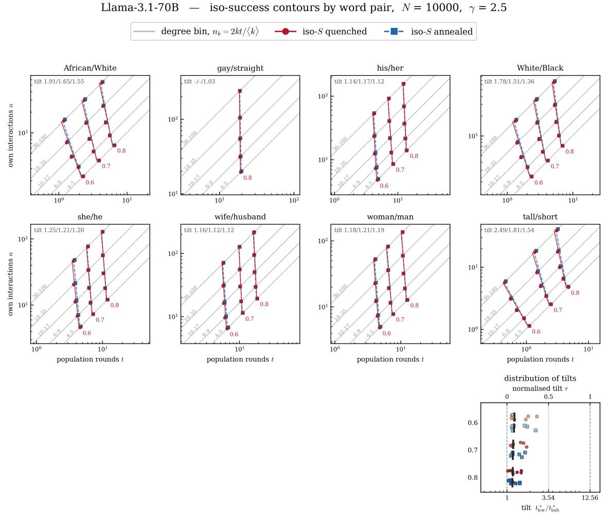  
Figure A5: Exposure and success by degree for Llama-3.1-70B on $\mathrm { U C M _ { 2 . 5 } }$ at $N = 1 0 0 0 0$ one panel per word pair. Axes, markers and the bottom-right panel as in Figure 2; the top-left corner of each panel reports the quenched tilt at $S \ : = \ : 0 . 6$ , 0.7 and 0.8, with a dash for a level that the word pair does not cross. The mixed-state pairs {young/old} and {more/less} are omitted, as is {Mexican/American}, whose initial success (0.82) lies above all three levels; for {gay/straight} (initial success 0.76) only $S = 0 . 8$ is shown.

QwQ-32B — iso-success contours by word pair, $N = 1 0 0 0 0 , \gamma = 2 . 5$  
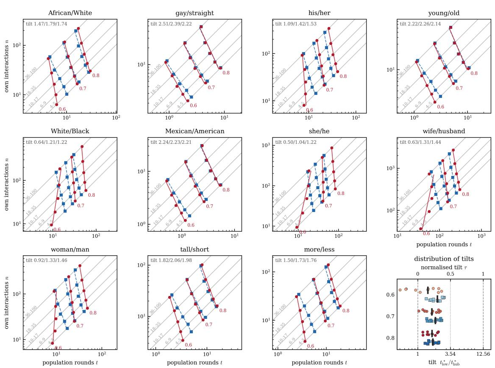  
Figure A6: Exposure and success by degree for $\mathrm { Q w Q { - } 3 2 B }$ on $\mathrm { U C M _ { 2 . 5 } }$ at $N = 1 0 0 0 0 .$ one panel per word pair. Axes, markers and the bottom-right panel as in Figure 2; the top-left corner of each panel reports the quenched tilt at $S = 0 . 6 , 0 . 7$ and 0.8, with a dash for a level that the word pair does not cross.

Phi-4 — iso-success contours by word pair, $N = 1 0 0 0 0 , \gamma = 2 . 5$  
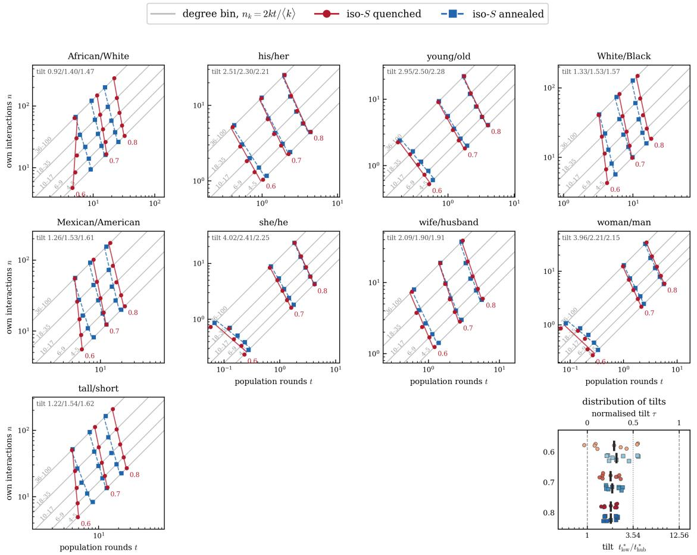  
Figure A7: Exposure and success by degree for Phi-4 on $\mathrm { U C M _ { 2 . 5 } }$ at $N = 1 0 0 0 0 .$ , one panel per word pair. Axes, markers and the bottom-right panel as in Figure 2; the top-left corner of each panel reports the quenched tilt at $S = 0 . 6 , 0 . 7$ and 0.8, with a dash for a level that the word pair does not cross. The pairs $\lbrace \mathrm { g a y / s t r a i g h t } \rbrace$ and {more/less} are omitted, since their initial success (1.00 and 0.94) lies above all three levels.

## A2.7 Statistical tests for committed minorities

Table A6: Friedman and Page’s L tests on the critical fraction $p ^ { * }$ of the placement ordering hub < random $<$ low-degree nodes, by UCM exponent, model and commitment direction, $N = 1 0 0 0 0$ . The block is the word pair; $p ^ { * }$ is rounded to the bisection resolution (0.01) before ranking. Pairs with $p ^ { * } = 0$ in any placement are excluded $( n = 9$ for Llama-3.1-70B in the weak direction).
<table><tr><td>Model</td><td>Direction</td><td>n</td><td>Q</td><td>p</td><td> $W$ </td><td> $L$ </td><td> $p ( L )$ </td></tr><tr><td> $U C M _ { 2 . 5 }$ </td><td></td><td></td><td></td><td></td><td></td><td></td><td></td></tr><tr><td rowspan="2">QwQ-32B</td><td>strong</td><td>11</td><td>22.0</td><td>&lt; .001</td><td>1.000</td><td>154</td><td>&lt; .001</td></tr><tr><td>weak</td><td>11</td><td>20.0</td><td>&lt; .001</td><td>0.909</td><td>152</td><td>&lt; .001</td></tr><tr><td rowspan="2">GPT-40</td><td>strong</td><td>11</td><td>22.0</td><td>&lt; .001</td><td>1.000</td><td>154</td><td>&lt; .001</td></tr><tr><td>weak</td><td>11</td><td>22.0</td><td>&lt; .001</td><td>1.000</td><td>154</td><td>&lt; .001</td></tr><tr><td rowspan="2">Phi-4</td><td>strong</td><td>11</td><td>22.0</td><td>&lt; .001</td><td>1.000</td><td>154</td><td>&lt; .001</td></tr><tr><td>weak</td><td>11</td><td>22.0</td><td>&lt; .001</td><td>1.000</td><td>154</td><td>&lt; .001</td></tr><tr><td rowspan="2">Llama-3.1-70B</td><td>strong</td><td>11</td><td>22.0</td><td>&lt; .001</td><td>1.000</td><td>154</td><td>&lt; .001</td></tr><tr><td>weak</td><td>9</td><td>5.6</td><td>0.060</td><td>0.313</td><td>114</td><td>0.147</td></tr><tr><td> $U C M _ { 5 . 0 }$ </td><td></td><td></td><td></td><td></td><td></td><td></td><td></td></tr><tr><td rowspan="2">QwQ-32B</td><td>strong</td><td>11</td><td>18.9</td><td>&lt; .001</td><td>0.858</td><td>150.5</td><td>&lt; .001</td></tr><tr><td>weak</td><td>11</td><td>20.1</td><td>&lt; .001</td><td>0.916</td><td>152</td><td>&lt; .001</td></tr><tr><td rowspan="2">GPT-40</td><td>strong</td><td>11</td><td>22.0</td><td>&lt; .001</td><td>1.000</td><td>154</td><td>&lt; .001</td></tr><tr><td>weak</td><td>11</td><td>21.5</td><td>&lt; .001</td><td>0.979</td><td>154</td><td>&lt; .001</td></tr><tr><td rowspan="2">Phi-4</td><td>strong</td><td>11</td><td>22.0</td><td>&lt; .001</td><td>1.000</td><td>154</td><td>&lt; .001</td></tr><tr><td>weak</td><td>11</td><td>21.1</td><td>&lt; .001</td><td>0.961</td><td>153</td><td>&lt; .001</td></tr><tr><td rowspan="2">Llama-3.1-70B</td><td>strong</td><td>11</td><td>21.5</td><td>&lt; .001</td><td>0.979</td><td>154</td><td>&lt; .001</td></tr><tr><td>weak</td><td>9</td><td>3.7</td><td>0.156</td><td>0.206</td><td>112</td><td>0.281</td></tr></table>

Table A7: Friedman and Page’s L tests on the critical fraction $p ^ { * }$ of the topology ordering RRN $< \mathrm { U C M } _ { 5 . 0 } < \mathrm { U C M } _ { 2 . 5 } <$ FC under random placement, by model and commitment direction, $N = 1 0 0 0 0$ . The block is the word pair; $p ^ { * }$ is rounded to the bisection resolution (0.01) before ranking. Pairs with $p ^ { * } = 0$ on any topology are excluded $( n = 9$ for Llama-3.1- 70B in the weak direction). Page’s L is one-sided in the predicted direction, so $p ( L ) = 1 . 0 0 0$ for Llama-3.1-70B in the strong direction reflects the reversed ordering.
<table><tr><td>Model</td><td>Direction</td><td>n</td><td>Q</td><td>p</td><td>W</td><td>L</td><td> $p ( L )$ </td></tr><tr><td rowspan="2">QwQ-32B</td><td>strong</td><td>11</td><td>10.5</td><td>0.015</td><td>0.319</td><td>286</td><td>0.138</td></tr><tr><td>weak</td><td>11</td><td>13.1</td><td>0.004</td><td>0.396</td><td>305</td><td>&lt; .001</td></tr><tr><td rowspan="2">GPT-40</td><td>strong</td><td>11</td><td>32.4</td><td>&lt; .001</td><td>0.982</td><td>329</td><td>&lt; .001</td></tr><tr><td>weak</td><td>11</td><td>33.0</td><td>&lt; .001</td><td>1.000</td><td>330</td><td>&lt; .001</td></tr><tr><td rowspan="2">Phi-4</td><td>strong</td><td>11</td><td>30.4</td><td>&lt; .001</td><td>0.921</td><td>327</td><td>&lt; .001</td></tr><tr><td>weak</td><td>11</td><td>33.0</td><td>&lt; .001</td><td>1.000</td><td>330</td><td>&lt; .001</td></tr><tr><td rowspan="2">Llama-3.1-70B</td><td>strong</td><td>11</td><td>21.1</td><td>&lt; .001</td><td>0.640</td><td>234</td><td>1.000</td></tr><tr><td>weak</td><td>9</td><td>6.0</td><td>0.112</td><td>0.222</td><td>235</td><td>0.139</td></tr></table>

Table A8: Critical fraction $p ^ { * }$ for the three QwQ-32B pairs whose convention is overturned only by a near-complete committed minority, by topology and placement, $N = 1 0 0 0 0$ For each pair, the first row is the direction requiring $p ^ { * } \geq 0 . 9 5$ , the second the opposite direction.
<table><tr><td rowspan="2">Pair</td><td rowspan="2">FC random</td><td rowspan="2">RRN random</td><td colspan="3"> $\mathrm { U C M _ { 2 . 5 } }$ </td><td colspan="3"> $\mathrm { U C M _ { 5 . 0 } }$ </td></tr><tr><td>hub</td><td>random</td><td>low</td><td>hub</td><td>random</td><td>low</td></tr><tr><td>gay/straight</td><td>0.992</td><td>0.992</td><td>0.977</td><td>0.992</td><td>1.000</td><td>0.992</td><td>0.992</td><td>1.000</td></tr><tr><td rowspan="2">young/old</td><td>0.013</td><td>0.013</td><td>0.001</td><td>0.013</td><td>0.019</td><td>0.003</td><td>0.013</td><td>0.013</td></tr><tr><td>0.992</td><td>0.992</td><td>0.977</td><td>0.992</td><td>1.000</td><td>0.992</td><td>0.992</td><td>1.000</td></tr><tr><td rowspan="2">wife/husband</td><td>0.003</td><td>0.006</td><td>&lt; 0.001</td><td>0.001</td><td>0.002</td><td>0.001</td><td>0.003</td><td>0.006</td></tr><tr><td>0.992</td><td>0.992</td><td>0.977</td><td>0.992</td><td>1.000</td><td>0.992</td><td>0.992</td><td>1.000</td></tr><tr><td></td><td>0.275</td><td>0.326</td><td>0.070</td><td>0.218</td><td>0.390</td><td>0.250</td><td>0.288</td><td>0.314</td></tr></table>