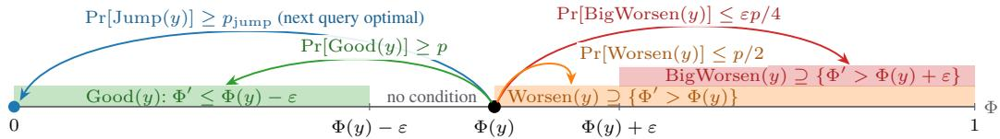
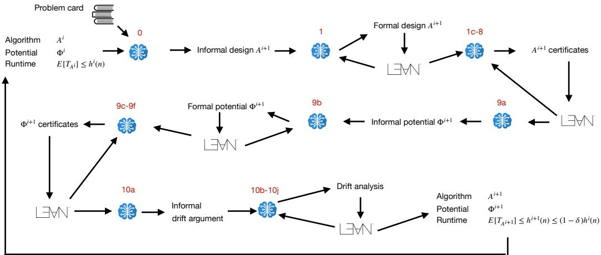
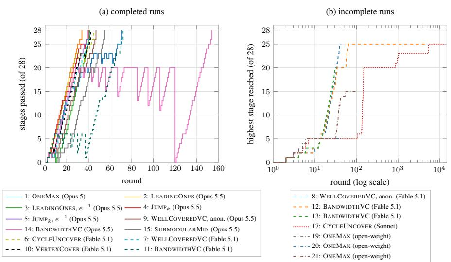
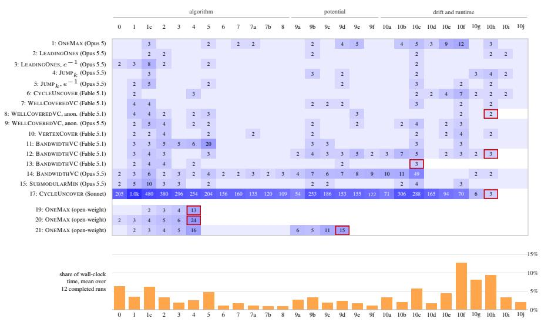

# AGENTIC ALGORITHM DESIGN: LLMS THAT PROPOSE, FORMALISE, AND PROVE RUNTIME BOUNDS FOR EVO-LUTIONARY ALGORITHMS IN LEAN

Per Kristian Lehre School of Computer Science University of Birmingham, UK p.k.lehre@bham.ac.uk

## ABSTRACT

LLMs now prove hard theorems in Lean. Can they also design algorithms and prove their correctness and efficiency? LLM-guided design of optimisation heuristics (such as AlphaEvolve) is purely empirical. Automated theorem provers with LLMs prove given statements. So far, there has been little evidence that LLMs can do both: design an algorithm and guarantee its efficiency by a mathematical proof. We present a staged pipeline modelled after research methodology in design and analysis of evolutionary algorithms. The agent proposes black-box optimisation algorithms, and Lean guards filter out flawed designs. The agent then defines a potential function and proves drift bounds that guarantee an expected runtime improvement over the baseline algorithm. At no point in the pipeline are the algorithms compared empirically. The agent generates a black-box optimisation algorithm with expected runtime O(n<sup>2</sup>) on a CYCLEUNCOVER problem, where the classical (1+1) EA needs runtime e<sup>Ω(n)</sup>. The pipeline also designs and analyses a black-box optimisation algorithm for integer-valued submodular minimisation with expected runtime O(n<sup>2+2c</sup>), and it matches the optimal order O(n<sup>2</sup>) on LEADINGONES. Across 8 problem classes, 12 of 15 runs with frontier models complete the pipeline with a machine-checked expected-runtime bound. In 9 of them the bound is polynomial without relying on offline computation, which the black-box model does not charge. An ablation study shows that removing the staging and asking the agent to zero-shot an algorithmic design with a runtime guarantee leads to a copy of the seeded baseline algorithm (random search) or to incomplete proofs. Open-weight models (Goedel-Prover-V2-32B and Gemma 4) did not complete the pipeline. Our study suggests that machine-checked specifications in Lean can replace empirical evaluation in open-ended algorithm discovery. To the best of our knowledge, this is the first example of an automated pipeline that designs efficient black-box optimisation algorithms with machine-checked runtime bounds in Lean.

## 1 INTRODUCTION

From the perspective of theoretical computer science, algorithm design must produce two artefacts: First, the algorithm itself, a finite sequence of instructions that when executed in a computational model transforms within a finite number of steps any problem instance (the input) into an output (the solution) (Knuth, 1997). Secondly, the analysis of the algorithm, a mathematical proof that the algorithm produces the correct output on every problem instance, and a guarantee for the amount of computational resources required by the algorithm to produce that output (its complexity). In the context of machine learning, analysis also involves guaranteeing additional algorithmic properties, such as convergence rates, and regret and/or generalisation bounds. Inventing new and better algorithms involves an iterative developmental process between the two artefacts: a new candidate design drives the analysis in a certain direction, and obstacles in completion of the analysis can lead to insights into problem structure which motivate alterations to the algorithm design. The high cost and deep expertise needed for traditional algorithmic design have motivated research into automated design of heuristics. Recent LLM-based heuristic design approaches evaluate a candidate pool of heuristics on benchmark functions, and well-performing heuristics are varied through LLM-prompts to produce better ones. While this has been successful in many domains, the methodology is highly empirical and does not lead to any guarantees on the correctness or performance of the heuristics produced.

It is a significant open problem whether AI agents can carry out algorithmic design as seen from theoretical computer science. It has been argued that automated theorem proving (ATP) is challenging for AI, because proofs are either correct or incorrect, not in-between. Furthermore, the space of proofs is infinitely large (Buzzard, 2024). Formal algorithmic design goes beyond ATP, because it requires both navigating a space of algorithmic designs and automatically proving properties about these. Yet, the improvement in mathematical capability of frontier AI models over the last years has been remarkable. Long-standing conjectures have been closed using publicly available reasoning models with Lean-checked proof certificates (Sothanaphan, 2026). The time and cost needed to rigorously prove non-trivial mathematical statements have fallen significantly.

We take inspiration from the field of runtime analysis of evolutionary algorithms which has a well-defined approach to design and analysis. The field requires that algorithms fit in a black-box optimisation framework (Droste et al., 2006) (more often called the query model in TCS) where optimisation is formulated as an interaction between an oracle which knows the function to be optimised, and an algorithm which queries the oracle for fitness values. The field has developed a small number of highly generic mathematical tools that aid in the analysis. In particular, we build on drift analysis (Hajek, 1982; He & Yao, 2001) which measures the progress of the algorithm with a potential function. The potential function, which is introduced for the purpose of the analysis and is not part of the algorithm itself, maps the state of the algorithm into a potential value. Bounds on the runtime can be obtained from properties of the distribution of the drift (change in potential per oracle query). The black-box model allows for an enormous variety of algorithms, most of which are useless. To constrain algorithm search, we use Lean guards to filter out provably flawed designs. We only allow algorithms that are able to visit all parts of the search space, that use randomness, and that take into account fitness responses from the oracle. The full staged pipeline is shown in Figure 2. The pipeline is seeded with a problem card that provides the definition of the problem, its problem instances, and basic properties. Additionally, the pipeline is seeded with an initial algorithmic design with a stated runtime bound. In all the experiments described here, we use uniform random search as the initial algorithm, with expected runtime $O ( 2 ^ { n } )$ ). The staged pipeline consists of some informal stages where an informal model produces one or more prose descriptions of designs. There are also formal stages where the agent needs to synthesise a definition or a proof that is then verified by Lean. In case Lean reports a failure, the formal stage is repeated, until it backtracks (determined by a Luby sequence (Luby et al., 1993)), or the formal stage passes. Some formal stages are gates to filter out flawed designs, others collect definitions that are used later, e.g., the definition of the algorithm or the potential. If a run reaches the end of the pipeline, it obtains an algorithm $A ^ { i + 1 }$ with a guaranteed improved runtime compared to algorithm $A ^ { i }$ . The pipeline can be looped, e.g., producing an algorithm $\mathring { A } ^ { i + 2 }$ which beats $A ^ { i + 1 }$ <sup>1</sup>, and so on. In most of the experiments described here, we make one iteration of the loop; two runs iterate it for three and five generations.

Contributions. To our knowledge, we propose the first automated system for formal design and analysis of black-box algorithms for pseudo-Boolean optimisation. The system does not involve any empirical evaluation or comparison of algorithms. The entire design process is driven by informal algorithm proposals followed by mathematical formalisation and analysis in Lean. Our contributions are:

• We formalise the human process of designing and analysing black-box optimisation algorithms through a staged pipeline which combines LLMs with Lean.

• We demonstrate that an agent using the staged pipeline is able to design efficient black-box algorithms with associated machine-checked runtime bounds in Lean for a range of problems. On CYCLEUNCOVER, the constructed algorithm has expected polynomial runtime, whereas the classical (1+1) EA has exponential runtime. The agent is able to exploit structure in anonymised problem classes.

• We show through ablation studies that without the staged pipeline, the agent fails to construct efficient algorithms.

Table 1: Overview of some related work in automating the design and formal analysis of algorithms. The first group machine-checks analyses of human-designed algorithms. The second group produces machine-checked proofs, but of a theorem or specification given to it. The third group discovers algorithms, but validates them only empirically. This work lies at the intersection: the algorithm is proposed by an LLM, its analysis is produced by an LLM, and the property machine-checked is the expected runtime of a stochastic process.
<table><tr><td>Work</td><td>Algorithmic artefact</td><td>Process</td><td>Designed by</td><td>by</td><td>Analysed Machine-checked property</td></tr><tr><td>Li et al. (2024)</td><td>first-order convex methods</td><td>deterministic</td><td>human</td><td>human</td><td>convergence rate</td></tr><tr><td>Vajjha et al. (2021)</td><td>value / policy iteration</td><td>stochastic (MDP)</td><td>human</td><td>human</td><td>convergence</td></tr><tr><td>Schäffeler &amp; Abdulaziz (2025)</td><td>approximate policy iteration</td><td>stochastic (MDP)</td><td>human</td><td>human</td><td>convergence</td></tr><tr><td>Ospanov et al. (2025); Varambally et al. (2025); Li et al. (2026)</td><td>(proof / code search) n/a</td><td></td><td>n/a</td><td>LLM</td><td>given theorem or code specification</td></tr><tr><td>Romera-Paredes et al. (2024); Novikov et al. (2025); Lange et al. (2025)</td><td>heuristics, constructions</td><td></td><td>LLM</td><td></td><td>none (empirical validation)</td></tr><tr><td>van Stein &amp; Bäck (2025)</td><td>black-box optimisation algorithms (metaheuristics)</td><td>stochastic</td><td>LLM</td><td></td><td>none (empirical benchmarking)</td></tr><tr><td>This work</td><td>black-box optimisation algorithms</td><td>stochastic</td><td>LLM</td><td>LLM</td><td>correctness &amp; expected runtime</td></tr></table>

## 2 RELATED WORK

Research on automating the design and analysis of algorithms can be classified according to the level of automation in the design and the level of automation and rigour in the analysis (see Table 1). Firstly, there are efforts to formalise existing (informal) mathematical analyses of algorithms manually in proof assistants such as Lean, Coq or Isabelle/HOL. These contributions have the same strong benefits as formalising any other type of informal mathematics in Lean, including enabling machine-checked proofs, curation of a digital library of mathematical results, and providing a foundation for machinegenerated mathematics (Buzzard, 2024). Recent efforts in this direction include Li et al. (2024) who focused on first-order convex optimisation methods, with Lean proofs of convergence rates for some function classes. They considered deterministic algorithms, and the proofs therefore avoid technical challenges arising from stochasticity. In contrast, there are also Isabelle/HOL formalisations of complexity analysis of randomised tree data structures (Eberl et al., 2020). Kaminski et al. (2017) introduced a calculus for formally deriving the expected runtime of probabilistic programs, such as the coupon collector process. Recent formalisations in machine learning also consider stochastic effects (Vajjha et al., 2021). Schaffeler & Abdulaziz (2025) analysed convergence of value and¨ policy iteration for finite-state Markov decision processes. Other work considers properties of neural networks, e.g., formalising a classic result about the expressive power of depth in neural networks (Cohen et al., 2016; Bentkamp et al., 2019). In contrast to our work, these works consider preexisting algorithms and proofs, and proofs are human-designed. Secondly, the area of LLM-assisted automated theorem proving in Lean has gained significant momentum recently, with breakthrough results announced during Summer/Autumn 2026. There are recent examples of semi-automatic algorithm design and proof generation where humans with assistance from frontier models design new algorithms with Lean proofs. Thirdly, there is a large body of research where algorithm design is automated via LLMs, but where evaluation of candidate algorithms lacks machine-checked proofs and is entirely empirical (Liu et al., 2026). Systems such as AlphaEvolve (Novikov et al., 2025), ShinkaEvolve (Lange et al., 2025), LLaMEA (van Stein & Back, 2025), and EoH (Liu et al., 2024)¨ formulate algorithm design as a search problem where candidate algorithms are evaluated empirically on a set of benchmark functions, and an LLM is used to generate algorithm variants. These systems do not provide any machine-checked guarantees. Related approaches in highly restricted problem domains where correctness can be checked without formal proofs include AlphaTensor, which optimises matrix multiplication algorithms via reinforcement learning (Fawzi et al., 2022).

Apart from automation of algorithmic design and analysis, there are other relevant works. An orthogonal task to algorithm design is problem formulation and modelling. Robbins et al. (2026) proposed FLARE to certify in Lean the correctness of mixed integer linear program (MILP) reformulations of combinatorial optimisation problems. Another related area is automated software verification. Here, the goal is to synthesise proofs (e.g., in Lean) that a piece of software satisfies a specification (pre-condition and post-condition) (Li et al., 2026). More ambitiously, vericoding studies AI systems that take formal specifications as inputs and produce software along with proofs that the software satisfies the specification (Bursuc et al., 2025).

## 3 RUNTIME ANALYSIS OF BLACK-BOX OPTIMISATION ALGORITHMS

## 3.1 BLACK-BOX OPTIMISATION ALGORITHMS

To formally define a design space of optimisation algorithms, we will adopt the so-called black-box scenario from theory of discrete evolutionary algorithms (Droste et al., 2006), also called query (or decision tree) complexity in theoretical computer science (Buhrman & de Wolf, 2002). This scenario describes a broad class of algorithms by defining the goal of the algorithm, what information is available to an algorithm, what actions the algorithm can take, and how its runtime is measured. The algorithm is given a class of real-valued fitness functions $F$ over a search space $\mathcal { X } .$ . An adversary picks a function $f \in F , f : \mathcal { X } \to \mathbb { R }$ , and the goal of the algorithm is to find an optimal search point $x ^ { * }$ such that $f ( x ) \leq f ( x ^ { * } )$ for all $x \operatorname { ( i . e }$ ., maximisation of $f )$ . In each iteration $t ,$ the algorithm queries a search point $x _ { t }$ based on its previous history, and obtains from the oracle the function value $f ( x _ { t } )$ The search point $x _ { t }$ along with its fitness $f ( \dot { x _ { t } } )$ is added to the history, and the process repeats until an optimum is found. The running time of the algorithm is defined as the number of times the algorithm queries the oracle until the algorithm queries an optimal search point for the first time. This definition is based on the assumption that the evaluation of the fitness function is the most time-consuming part of the algorithm. Following the literature on runtime analysis of evolutionary algorithms, the algorithm does not specify a termination criterion. A termination criterion could be specified, but it would not impact the runtime of the algorithm as defined below. The entire interaction between the oracle and the optimisation algorithm is given in Algorithm 1. Within the black-box scenario, the algorithm design is fully specified by a tuple $A = ( \mathcal { \vec { y } }$ , init, query, step), which will be described below. Executing an algorithm $A$ involves executing Algorithm 1 with the given tuple A.

Algorithm 1 Black-Box Optimisation Algorithm   
Require: Fitness function $f : \mathcal { X }  \mathbb { R } ;$ random sequence $z _ { 0 } , z _ { 1 } , \dotsc \in { \mathcal { Z } }$ with $z _ { t } ( i ) \sim \mathrm { U n i f } ( [ 0 , 1 ] )$   
i.i.d. for all $t , i \in \mathbb { N } ;$ algorithm $A = ( \bar { \mathcal { D } }$ , init, query, step) with init $: \mathcal { Z } \overset { } {  } \bar { \mathcal { Y } } .$   
step : $\mathcal { Z } \times \mathcal { Y } \times \mathbb { R }  \mathcal { Y }$ and query : $\mathcal { V }  \mathcal { X } .$   
1: Initialise algorithm state $y _ { 0 } : = \mathrm { i n i t } ( z _ { 0 } )$   
2: for t = 0 to $\infty$ do   
3: Select search point $x _ { t } : =$ query $\left( y _ { t } \right)$   
4: Query oracle to obtain fitness ${ \dot { f } } _ { t } : = f ( x _ { t } )$   
5: Compute the next state $y _ { t + 1 } : = \mathsf { s t e p } ( z _ { t + 1 } , y _ { t } , f _ { t } )$   
6: end for

To allow the algorithm to make random decisions, the algorithm is provided with a two-way infinite random source $( z _ { t } ) _ { t \in \mathbb { N } } .$ , where for each time step $t \in \mathbb N$ and index $i \in \mathbb { N } , z _ { t } ( i )$ is a uniformly distributed value in [0, 1]. We assume an underlying probability triple $( \Omega , \mathcal { G } , \operatorname* { P r } )$ and a filtration $( \mathcal { G } _ { t } ) _ { t \in \mathbb { N } }$ to which $( z _ { t } ) _ { t \in \mathbb { N } }$ is adapted. An algorithm A is associated with a state space $\mathcal { V }$ where $y _ { t } \in \mathcal { V }$ corresponds to the memory accessible to the algorithm at iteration t. The initial state is obtained directly using the random source init $: ( z _ { 0 } )$ . In every iteration t, the algorithm uses the current state $y _ { t }$ to decide which search point $x _ { t }$ to query next. The algorithm transitions to the next state $y _ { t + 1 }$ by taking into account the next random value $z _ { t + 1 }$ , the previous state $y _ { t }$ , and the objective value $f ( x _ { t } )$ of the query corresponding to the current state.

Following (Droste et al., 2006), the running time of algorithm A on f can then be defined by $T _ { A , f } = \bar { \operatorname* { m i n } } \{ t \in \mathbb { N } \mid \forall x \in \mathcal { X } , f ( x _ { t } ) \geq f ( x ) \}$ . By construction $( x _ { t } ) _ { t \in \mathbb { N } }$ and $( y _ { t } ) _ { t \in \mathbb { N } }$ are adapted to $( \mathcal { G } _ { t } ) _ { t \in \mathbb { N } }$ , and $T _ { A , f }$ is a stopping time. The worst-case expected running time of A over a class of functions F is then $T _ { A , F } = \operatorname* { m a x } _ { f \in F } \mathbb { E } \left[ T _ { A , f } \right]$ . All aspects of the above formalisation are indexed by an implicit problem instance size $n \in \mathbb { N } .$ . In particular, for each instance size $n ,$ we assume a corresponding search space ${ \mathcal { X } } _ { n } .$ a fitness function $f _ { n } : \mathcal { X } _ { n } \to \mathbb { R } .$ , an algorithm $A _ { n } .$ , and a worst-case expected running time $T _ { A _ { n } , F _ { n } }$ . We are primarily interested in the asymptotic growth of $T _ { A _ { n } , F _ { n } }$ as a function of n. Note that this formalisation guarantees that the algorithm is truly black box: it must be defined independently of the objective function $f .$ Yet, due to the free choice of Y and init, query, step, the framework is highly general and can express most commonly used black-box optimisation algorithms, such as simulated annealing, population-based evolutionary algorithms, and estimation of distribution algorithms.

## 3.2 DRIFT ANALYSIS

Drift analysis (Hajek, 1982; He & Yao, 2001) is the main technique used to derive bounds on the runtime $\dot { T _ { A } }$ , and it is incorporated into our pipeline. Most evolutionary algorithms are Markov processes over their state space $y { : }$ the state $y _ { t } ~ \in ~ \mathcal { V }$ of the algorithm at iteration t completely determines the distribution of the state $y _ { t + 1 }$ in the next iteration. In principle, Markov chain theory could be applied to estimate the hitting time of the process from its state transition matrix. However, the state spaces induced by the algorithms are often so large that this approach becomes impractical. Instead, one can introduce a potential function $\Phi : \mathcal { V } \bar {  }$ R which given the current state of the algorithm measures how far the algorithm is from reaching its goal, i.e. $Z _ { t } = \Phi ( y _ { t } )$ ). Note that the potential function is not part of the design of the algorithm, but is only used for the drift analysis. Designing a good potential function is often the most challenging part of the analysis of the algorithm. Given information about the distribution of the change in potential per time step, i.e., the $d r i f t$ $Z _ { t + 1 } - Z _ { t }$ of the process, drift theorems provide statements about the long term properties of the process. Informally, the additive drift theorem states that if the expected drift is at least ε, then the expected time to reach distance zero is $Z _ { 0 } / \varepsilon .$ The proof of the theorem (see Corus et al., 2018) uses standard arguments from martingale theory; the precise statement is Theorem B.1 in Appendix B. A Lean formalisation of the general additive drift theorem will be published in a separate manuscript. It is proved in the Lean library on which the pipeline builds, not assumed: for every run in which we printed the axioms (rows 2–5 and 15 of Table 2), the final runtime theorem depends only on Lean’s standard axioms propext, Classical.choice and Quot.sound.

Theorem B.1 requires evaluation of an expectation conditional on a σ-algebra. To shield the agent from proving theorems involving measure theory, we introduce the following simplified theorem which implies condition 1 in Theorem B.1. Proving drift condition 1 is now reduced to proving bounds on the probabilities of improving and worsening steps. To satisfy condition 2 in the additive drift theorem, we assume the potential is bounded in [0, 1]. Finally, to prove condition 3, i.e., integrability of the runtime, we require a lower bound ofjumping directly to the target from every iteration. The set of conditions exposed in the pipeline is illustrated in Figure 1. Together, they yield the runtime bound $4 / ( \varepsilon p )$ used in the final stage of the pipeline. The proof of Corollary 3.1 is given in Appendix B. Note that the corollary states probabilities in terms of expectations of indicator random variables, while the Lean formalisation uses probabilities directly.

Corollary 3.1. Assume thatfor all $t \in  { \mathbb { N } } , X _ { t } \in [ 0 , 1 ]$ and

$$
\begin{array} { r l } { ( I ) } & { { } \mathbb { 1 } _ { \{ t < T \} } p \leq \mathbb { E } \left[ \mathbb { 1 } _ { \{ t < T \} } \mathbb { 1 } _ { \{ X _ { t + 1 } \leq X _ { t } - \varepsilon \} } \mid \mathcal { G } _ { t } \right] , } \end{array}
$$

$$
\begin{array} { r l } { ( 2 ) } & { \mathbb { E } \left[ \mathbb { 1 } _ { \{ t < T \} } \mathbb { 1 } _ { \{ X _ { t } < X _ { t + 1 } \} } \mid \mathcal { G } _ { t } \right] \leq \mathbb { 1 } _ { \{ t < T \} } p / 2 , } \end{array}
$$

$$
\begin{array} { r l } { ( 3 ) } & { { } \mathbb { E } \left[ \mathbb { 1 } _ { \{ t < T \} } \mathbb { 1 } _ { \{ X _ { t } + \varepsilon < X _ { t + 1 } \} } \mid \mathcal { G } _ { t } \right] \leq \mathbb { 1 } _ { \{ t < T \} } \varepsilon p / 4 . } \end{array}
$$

Then $\begin{array} { r } { \mathbb { E } \left[ \mathbb { 1 } _ { \{ t < T \} } \big ( X _ { t + 1 } - X _ { t } + \varepsilon p / 4 \big ) \mid \mathcal { G } _ { t } \right] \leq 0 f o r { a l l } { t \in \mathbb { N } } _ { \mathrm { \Omega } } . } \end{array}$

  
Figure 1: Drift conditions checked by the pipeline (Corollary 3.1, Stages 10f–10i) at a reachable, non-optimal state $y .$ The sets of random draws Good(y), Worsen(y), BigWorsen(y) and Jump(y) are shown by where they send the next potential $\Phi ^ { \prime } ;$ the arrows give the required probability bounds, which together yield E $[ T _ { A } ] \leq 4 / ( \varepsilon p )$

  
Figure 2: A simplified overview of the staged pipeline. The pipeline is seeded with a problem card, an algorithm $A ^ { i }$ , and a proof of its running time. The pipeline produces a new algorithm $A ^ { i + 1 }$ with improved runtime bound relative to algorithm $A ^ { i } .$ . Table 3 provides detailed descriptions of the pipeline stages shown in red.

## 4 THE STAGED PIPELINE

We now describe the motivation and details of the staged pipeline shown in Figure 2. The task of zero-shotting an algorithmic design along with its runtime analysis is challenging. We therefore break down this task into multiple stages according to how a human researcher in theory of evolutionary algorithms would solve the problem. Starting from an initial algorithmic design we want to improve, we make some informal design proposals. We describe the best algorithm formally in pseudo-code, then design a potential function which measures its progress, and finally apply a drift theorem. The most challenging aspects of this process are to design the algorithm and choose the potential function. The space of algorithmic designs allowed by our framework is vast. We therefore propose a staged pipeline where candidate designs are filtered through formal proof obligations via proof guards. The formal guards are designed to filter out flawed designs. The implementation, with its two backends (CLI and vLLM) and the Kimina Lean server, and the structure of the stage prompts are described in Appendix C.

We now describe the stages in the pipeline informally. The pipeline has informal stages where the agent proposes in English an informal design (either of an algorithm or potential function), and formal stages that are either definitions or formal guards. Formal statements are stated fully in Table 3 in Appendix A.

## 4.1 ALGORITHM DESIGN (STAGES 0–8)

Stages 0–8 produce an algorithmic design along with proofs about its properties. Stage 0 (DesignLock): We ask the agent to provide an informal algorithm design along with justification why it would complete the full pipeline. When using frontier models (rows 1–15 in Table 2), the agent is asked to sketch at least one alternative design before committing to one design in a single response. With the open-weight models (rows 19–21 in Table 2), the informal model generates eight proposals sequentially. Each proposal is prompted with all previous ones and asked to differ from them. A winning proposal is then selected through a knockout tournament. The proposals were compared in pairs by the informal model, and the winners advance until one design remains. Stages 9a and 10a use the same procedure in these runs. Stage 1 (ConstructAlgorithmComponents): We ask the agent to formalise in Lean the algorithm as a tuple $A = ( \mathcal { V }$ , init, step, query). Stage 1c (StepMeasurability): We require that the step function is a measurable function. This condition will be required for the drift analysis later in the pipeline. Stage 2 (Completeness1): We require that the algorithm must be able to query any search point in every iteration. More precisely, for every search point $x \in \mathcal { X }$ , and for every reachable state $y \in \mathcal { V }$ , there exists a random input $z \in { \mathcal { Z } }$ and fitness value $f \in \mathbb { R }$ , such that if the algorithm receives fitness $f$ for the query associated with state $y ,$ it will transition on random input z to a state where x is queried. This condition is satisfied by almost all evolutionary algorithms, e.g., those that involve bit-wise mutation. Note that the completeness condition can be trivially satisfied for an arbitrary algorithm by querying a uniform search point with some non-zero (but perhaps very small probability) in every step. The completeness condition is not always necessary for an efficient algorithmic design. However, the condition makes it straightforward to prove that the algorithm eventually queries the optimal search point (i.e., the algorithm is correct), and that for finite search spaces, the algorithm has a finite expected hitting time which is required by our formulation of the drift theorem. The extra assumption that $y$ is a reachable state and not an arbitrary state was included to avoid imposing the condition on inconsistent states that the algorithm never visits. For example, the state of the UMDA algorithm is a probability vector $p \in [ 0 , 1 ] ^ { \frac { \ d } { n } }$ where $p _ { i } , i \in [ n ]$ , is the probability of sampling a 1-bit in position i. The algorithm maintains the invariant $p _ { i } \in [ \bar { 1 / n } , 1 - 1 / n ]$ in order not to get stuck in a particular bit-position. Stage 3 (NonAbsorbing): We require that the algorithm uses the random input. More precisely, for every reachable state $y \in \mathcal { V }$ and any oracle response $f \in \mathbb { R } ,$ , there exist two random inputs $z _ { 1 } , z _ { 2 } \in { \mathcal { Z } }$ such that the algorithm in the next iteration makes different queries on random input $z _ { 1 }$ and $z _ { 2 } .$ This condition is not necessary to have an efficient algorithm. However, the condition filters out many poor algorithms, such as those that only return a constant value. Stage 4 (NotRandomSearch): We require that the algorithm can reach a state where the query distribution is different from the uniform distribution (random search). Random search has expected running time $2 ^ { \Omega ( n ) }$ , and any efficient algorithm must have a different query distribution than random search. We observed that weaker models applied to the pipeline with random search seeded as algorithm tended to produce designs that were essentially random search. In an early version of the pipeline, we did not include the reachable state assumption in the condition. We discovered that this would allow the model to cheat by devising a state space with unreachable witness states $\mathcal { V }$ which could serve as witnesses for the NotRandomSearch and other properties. Stage $^ { 5 }$ (Adaptiveness): We require that the state update of the algorithm depends on the fitness responses from the oracle. Clearly, no algorithm which completely ignores the oracle can be an effective optimiser on even simple problem classes such as ONEMAX. Stage 6 (QueryNonInjectivity): We require that there exist two different states which lead to the same query, i.e., the function query is not injective. This condition ensures that the state carries information beyond the current query, such as the best search point or fitness seen so far, or a learned parameter, and filters out designs whose state is just the current search point. The remaining algorithm construction stages (Stages $7 { - } 8 )$ are designed to package all the definitions into a Lean structure. This will allow the later proof infrastructure to process the algorithmic design as one mathematica object. These stages also include measurability requirements, $\mathrm { e . g . }$ , that all the components of the algorithm are measurable functions. The next main part is the drift analysis. We would like the agent to prove that the three conditions of Corollary 3.1 are satisfied, where $X _ { t }$ corresponds to the potential of the algorithm at iteration t. The pipeline asks the agent to, for every state $y ,$ define three subsets of random inputs Good(y), Worsen(y), BigWorsen(y) corresponding to the three conditions respectively, drift parameters ε and $p ,$ and a jump probability lower bound p<sub>jump</sub>.

## 4.2 POTENTIAL FUNCTION (STAGES 9A–9F)

Stages 9a–9f produce a potential function used to measure the progress of the algorithm. Stages 9a– 9b (PotentialDesign and DefinePotential): In the informal Stage 9a, the agent produces several candidate potential functions together with the parameters above and an informal “drift story” explaining why the potential function applied to the algorithm has drift towards the optimum. For experiments with frontier models (Rows 1–15 in Table 2), the agent proposes three candidates one after another, each critiquing the earlier ones, and ends its response with a ranking. The top-ranked candidate is then formalised in Stage 9b. We require that the value of the potential is always in the interval [0, 1]. Although not required for drift analysis, this requirement which is not difficult to satisfy through normalisation simplifies the formal drift analysis machinery later in the pipeline. Stage 9c (PotentialOpt): We require that the potential of a state y is 0 if and only if the algorithm queries an optimal search point in state $y .$ This is a necessary condition for the drift theorem to give a meaningful statement about the runtime of the algorithm. Stage 9d (PotentialFineGrained): The seeded design uses a potential function with only the values 0 and 1, where 0 corresponds to optimal states and 1 all other states. This is sufficient to prove runtime bound for random search, however it will be insufficient to capture the gradual progress of an efficient algorithm. Experiments with weaker models often reproduced the two-valued potential function. We therefore added the formal guard that the potential function must contain a value between 0 and 1. Stage 9e (PotentialMeasurability): We require that the potential function is measurable. This property is needed for the later drift analysis. The remaining guards in this part of the pipeline involve proving measurability properties of the potential function, and packaging into a Lean structure for easy handling later (Stage 9f, ConstructPotentialStructure).

## 4.3 DRIFT CERTIFICATES AND RUNTIME BOUND (STAGES 10A–10J)

Stages 10a–10j prove drift conditions for the potential and obtain a final runtime bound by applying a drift theorem. Stage 10f $( \mathtt { P o s i t i v e D r i f t } )$ : We require that for any reachable, non-optimal state $y ,$ if the algorithm receives a random input $z \in \operatorname { G o o d } ( y )$ , then the potential decreases by at least ε in the next iteration. Stage 10g (NegativeDriftAndJump): We require that for any nonoptimal reachable state $y$ and any random input $z \in { \mathcal { Z } }$ , if the potential increases in the next iteration, then z belongs to $\mathrm { W o r s e n } ( y )$ , and if it increases by more than $\varepsilon ,$ then z belongs to BigWorsen(y). Furthermore, for any reachable state $y ,$ if the algorithm receives input $z \in \mathrm { J u m p } ( y )$ , then the potential in the next iteration is 0. In other words, the algorithm jumps directly to an optimal search point whenever it receives a random input in Jump(y). Stage 10h $\left( \mathtt { D } \mathtt { r i f t } \mathtt { S e t M a s s } \right)$ : We require that, for every reachable, non-optimal state $y ,$ the probabilities that the random input lies in ${ \mathrm { G o o d } } ( y )$ Worsen(y) and BigWorsen $( y )$ satisfy conditions (1)–(3) of Corollary 3.1 (Figure 1). Stage 10i (JumpMass): We require that from all states $y , p _ { \mathrm { j u m p } } \le \operatorname* { P r } \left( z \in \operatorname { J u m p } ( y ) \right)$ ). When satisfied, this condition implies that the runtime of the algorithm is stochastically dominated by a geometrically distributed random variable with success probability $p _ { \mathrm { j u m p } } .$ . The expected runtime is therefore finite, which implies one of the conditions of the additive drift theorem. The only requirement on $p _ { \mathrm { j u m p } }$ is that it is positive. Stage 10j (RuntimeBound): The final stage is an application of a runtime bound E $[ T _ { A } ] \stackrel { - } { \leq } 4 / ( \varepsilon p )$ that follows immediately from the previously collected proof certificates.

## 5 RESULTS

Table 2 summarises all runs; Figure 4 in Appendix G shows how each run progressed through the pipeline. Across the completed runs, the drift and runtime stages (10a–10j) take about half of the wall-clock time, and the incomplete frontier-model runs all stop at a drift stage, most often the mass bound of Stage 10h (Appendix G).

## 5.1 THEORETICAL BENCHMARK FUNCTIONS

Runtime analysis of new evolutionary algorithms is often initiated on simple theoretical benchmark functions which have a clear structure. Here, we consider the three most common functions, ONEMAX, LEADINGONES, and $\mathrm { J U M P } _ { k }$ , which are defined in Appendix D.

The ONEMAX value of a bitstring is the number of positions in which it differs from some hidden bitstring z. Standard evolutionary algorithms have expected runtime $O ( n \log n )$ , which can be seen via a multiplicative drift argument (Doerr et al., 2012): The probability that a random bit-flip in the current bitstring improves the fitness is proportional to the number of bits it has in common with z. The optimal algorithm runs in $\Theta ( n / \log n )$ queries by querying the fitness of $\Theta ( n / \log n )$ uniformly sampled bitstrings from which the hidden bitstring z, and the optimum, can be determined with high probability. One generation of the staged pipeline rediscovers a variant of the (1+1) EA with mutation rate $1 / ( n + 1 )$ rather than the standard $1 / n$ . The true expected runtime of this algorithm is $O ( n \log n )$

Table 2: All runs. Each row is one pipeline session driven by the named model. Rows 1–18 use the CLI backend, through which the model exchanges prompts and responses with the pipeline over stdin/stdout; rows 19–21 use the vLLM backend (Appendix C). “Staged” is the full pipeline of Table 3; “zero-shot” is the one-stage ablation of Section 5.5. Rows 16–21 are ablations: the zero-shot pipeline, or a weaker model; rows 19–21 use open-weight models run on HPC clusters (Appendix F.1). Complete means that every stage was machine-checked with no sorry; otherwise the last stage passed is given in parentheses (the run stopped at the following stage). Order is the order of the machine-checked bound on E $[ T _ { A } ]$ , which holds for all $n \geq 3$ and every instance (for staged runs it is $4 / ( \varepsilon _ { 1 } p _ { 1 } ) )$ . Tokens is the number of output tokens (including reasoning) generated by the model that drove the run, from launch to the last accepted stage; n/r means not recorded. Lean is the number of lines of Lean code the model contributed to the accepted proof, excluding blank lines, comments, the prompt, the API and the problem card. LO is the fitness of the elitist reference point; the LEADINGONES card marked $^ {  } e ^ { - \bf { i } }$ lemma” additionally supplies the inequality $e ^ { - m / ( r - 1 ) } \leq ( 1 - 1 / r ) ^ { m }$ . k is the bandwidth for BANDWIDTHVC and the gap width for JUMP<sub>k</sub>, and $n ^ { c }$ bounds the values of a SUBMODULARMIN instance. #gen is the number of generations of the pipeline used to obtain the result; for a run with several generations, the row reports the last generation only (Tokens and Lean are those of that generation). Pseudocode, potentials and constants of every run are given in Appendix F.
<table><tr><td></td><td># Problem</td><td>Model</td><td>Pipeline</td><td>#gen Algorithm</td><td></td><td>Complete</td><td>Order</td><td>Tokens</td><td>Lean</td><td> $\mathbf { A p p . }$ </td></tr><tr><td></td><td>1 ONEMAX</td><td>Opus 5</td><td>staged</td><td>1</td><td> $( 1 + 1 ) \mathrm { E A } , \mathrm { r a t e } \ \frac { 1 } { n + 1 }$ </td><td>yes</td><td> $O ( n ^ { 3 } )$ </td><td>n/r</td><td>2,036</td><td>F.2</td></tr><tr><td></td><td>2 LEADINGONES</td><td>Opus 5.5</td><td>staged</td><td>1</td><td>fitness-dependent rate LO+2 1</td><td>yes</td><td> $O ( n ^ { 3 } )$ </td><td>160k</td><td>1,262</td><td>F.3</td></tr><tr><td></td><td>3 LEADINGONES,  $e ^ { - 1 }$  lemma</td><td>Opus  $5 . 5 ^ { \ S }$ </td><td>staged</td><td>1</td><td>fitness-dependent rate</td><td>yes</td><td> $O ( n ^ { 2 } )$ </td><td>191k</td><td>1,553</td><td>F.4</td></tr><tr><td></td><td>4JUMPk</td><td>Opus 5.5</td><td>staged</td><td>1</td><td>LO+2 (1+1) EA, rate  $\textstyle { \frac { 1 } { n + 1 } }$ </td><td>yes</td><td> $O ( n ^ { k + 2 } )$ </td><td>144k</td><td>1,086</td><td>F.5</td></tr><tr><td>5</td><td> $\mathbf { J } _ { \mathbf { U M P } _ { k } , e } \mathbf { - 1 }$  lemma</td><td>Opus 5.5</td><td>staged</td><td>3</td><td>rate cycling with a learned yes phase bit</td><td></td><td> $O ( n ^ { k + 1 } )$ </td><td>396k</td><td>1,335</td><td>F.6</td></tr><tr><td></td><td>6 CYCLEUNCOVER</td><td>Fable 5.1</td><td>staged</td><td>1</td><td>cycle walk (learn-then-solve)</td><td>yes</td><td> $O ( n ^ { 2 } )$ </td><td>538k</td><td>2,373</td><td>F.7</td></tr><tr><td></td><td>7 WELLCOVEREDVC</td><td>Fable 5.1</td><td>staged</td><td>1</td><td>fitness-directed asym. mutation</td><td>yes</td><td> $O ( n ^ { 4 } )$ </td><td>366k</td><td>1,756</td><td>F.19</td></tr><tr><td></td><td>8 WELLCOVEREDVC, anonymised card</td><td>Fable 5.1</td><td>staged</td><td></td><td>polarity-adaptive asym. mutation</td><td>no (10g)</td><td></td><td>275k</td><td>1,282</td><td>F.17</td></tr><tr><td></td><td>9 WELLCOVEREDVC, anonymised card</td><td>Opus 5.5</td><td>staged</td><td>1</td><td>regime-switching asym. mutation</td><td>yes</td><td> $O ( n ^ { 4 } )$ </td><td>245k</td><td>1,530</td><td>F.18</td></tr><tr><td></td><td>10 VERTEXCOVER, flat fitness</td><td>Fable 5.1</td><td>staged</td><td></td><td>edge probing + exact solve</td><td>yes</td><td> $O ( n ^ { 3 } )$ </td><td>400k</td><td>1,889</td><td>F.10</td></tr><tr><td></td><td>11 BANDWIDTHVC, flat fitness</td><td>Fable 5.1</td><td>staged</td><td></td><td>window probing + exact solve</td><td>yes</td><td>O(kn)</td><td>460k</td><td>1,658</td><td>F.11</td></tr><tr><td></td><td>12 BANDWIDTHVC</td><td>Fable 5.1</td><td>staged</td><td></td><td>direction-adaptive asym. mutation</td><td>no (10g)</td><td></td><td>402k</td><td>1,202</td><td>F.12</td></tr><tr><td></td><td>13 BANDWIDTHVC</td><td>Fable 5.1</td><td>staged</td><td></td><td>fill-then-prune mutation</td><td>no (10b)</td><td></td><td>192k</td><td>510</td><td>F.14</td></tr><tr><td></td><td>14 BANDWIDTHVC</td><td>Opus 5.5</td><td>staged</td><td></td><td>window-repair random search</td><td>yes</td><td> $\Theta ( 2 ^ { n } )$ </td><td>283k</td><td>1,784</td><td>F.15</td></tr><tr><td></td><td>15 SUBMODULARMIN, integer-valued</td><td>Opus 5.5</td><td>staged</td><td></td><td>Lovász subgradient descent</td><td>yes</td><td> $O ( n ^ { 2 + 2 c } )$ </td><td>1.1M</td><td>2,901</td><td>F.16</td></tr><tr><td></td><td>16 CYCLEUNCOVER</td><td>Fable 5.1</td><td>zero-shot</td><td>1</td><td>random search</td><td>yes</td><td> $\Theta ( 2 ^ { n } )$ </td><td>41k</td><td>404</td><td>F.8</td></tr><tr><td></td><td>17 CYCLEUNCOVER</td><td>Sonnet†</td><td>staged</td><td>1</td><td>elitist bit-flip (5 designs)</td><td>no (10g)</td><td></td><td>n/r</td><td>1,146</td><td>F.9</td></tr><tr><td></td><td>18 BANDWIDTHVC</td><td>Fable 5.1</td><td>zero-shot</td><td>1</td><td> $( 1 + 1 ) \ { \mathrm { E A } } , { \mathrm { r a t e } } \ { \frac { 1 } { n } }$ </td><td>no</td><td></td><td>172k</td><td>112</td><td>F.13</td></tr><tr><td></td><td>19 ONEMAX</td><td>Goedel- Prover- V2-32B</td><td>staged</td><td>1</td><td>per-bit learned bias (PBIL-like)</td><td>no (3)</td><td></td><td>25.1M</td><td>375</td><td>F.1</td></tr><tr><td>20 ONEMAX</td><td></td><td>Gemma 4 Goedel- Prover-</td><td>staged</td><td>1</td><td>per-bit learned bias (PBIL-like)</td><td>no (3)</td><td></td><td>73.1M</td><td>316 F.1</td><td></td></tr><tr><td>21 ONEMAX</td><td></td><td>V2-32B Gemma 4 Goedel-</td><td>staged</td><td></td><td>random search (fixed</td><td>no (9c)∥</td><td></td><td></td><td></td><td></td></tr></table>

† Model version not recorded in the artefacts. ‡ Candidates for the last five stages were pre-checked directly against the Lean server. § Candidates for the last three stages were pre-checked in the same way. ¶ Goedel-Prover-V2-32B for the formal stages (pass@256), Gemma 4 26B-A4B for the prose stages; earlier versions of the staged pipeline with the same 28 stages; tokens are those of all logged samples of the formal model. ∥ Passed Stage 4 only through a loophole in that pipeline version (see Appendix F.1). In rows 1–18, all models are Claude models.

however the agent obtains the weaker (but still mathematically correct) upper bound $O ( n ^ { 3 } )$ . As potential function, the agent uses essentially the normalised Hamming-distance to the optimum. The weak runtime bound is partly due to the pipeline which forces the agent to use Corollary 3.1 which does not allow for multiplicative drift.

The LEADINGONES value of a bitstring is the number of consecutive bits it has in common with some hidden bitstring z, when the bit positions are ordered by a hidden permutation σ. Typical evolutionary algorithms have runtime $O ( n ^ { 2 } )$ which can be seen by an additive drift argument: a random bit-flip in a selected bitstring improves its fitness with probability $\Theta ( 1 / n )$ , and $\Theta ( n )$ improvements are needed to reach the optimum. One generation of the staged pipeline discovers a variant of $( 1 { + } 1 ) \operatorname { E A }$ , but where the mutation rate is chosen as $1 / ( f ( x ) + 2 )$ where $f ( x )$ is the fitness of x. This fitness-adaptive mutation rate is nearly identical to the optimal adaptive mutation rate of $1 / ( f ( x ) + 1 )$ (Bottcher et al.,¨ 2010). For this algorithm, the agent obtains a sub-optimal runtime of $4 ( { \tilde { n } } + { \tilde { 1 } } ) ( n + 2 ) ^ { 2 } = O ( n ^ { 3 } )$ while the true runtime for this algorithm is $( e / 4 ) n ^ { 2 } ( \bar { 1 + } o ( 1 ) )$ (Theorem 5 in (Bottcher et al., 2010)).¨ When inspecting the drift analysis of the agent, we observed that the missing factor n comes from the weak lower bound $1 / n \le ( 1 - 1 / r ) ^ { n - 1 }$ . We therefore created another problem card which provided the inequality $1 - \dot { 1 / r } \geq \dot { \exp ( - 1 / ( r - 1 ) ) }$ ). The agent now produced a (1+1) EA-type algorithm with the same fitness-dependent mutation rate and runtime $4 e { \bar { ( n + 1 ) } } ( n + 2 ) = O ( n ^ { 2 } )$

The JU $\mathrm { \nabla { \times } } \mathrm { P } _ { k }$ function takes the value $k + { \mathrm { O N E M A X } } .$ except for non-optimal search points at Hamming distance $d < k$ from the optimum which take the value $n - \mathrm { O N E M A X }$ . The problem therefore has a fitness gap (a local optimum) at distance k from the optimum. Typical evolutionary algorithms have runtime ${ \bar { O } } ( n ^ { k } )$ because they need to flip k bits simultaneously to jump from the local optimum to the global optimum. By using more sophisticated diversity and variation operators, it is possible to reduce the runtime further. One generation of the staged pipeline discovered a variant of (1+1) EA with fixed mutation rate $1 / ( n + \bar { 1 } )$ ). The agent proved a runtime bound of $O ( n ^ { k + 2 } )$ which is a factor of $n ^ { 2 }$ weaker than the true runtime for this algorithm which is $O ( n ^ { k } )$ . A factor n was lost due to using a weak lower bound $p ^ { k } ( 1 - p ) ^ { n } \geq p ^ { k + \widetilde { 1 } }$ for $p = 1 / ( n + 1 )$ . In a second set of experiments, we ran the pipeline for three generations and added the inequality $1 - 1 / r \geq \exp ( - 1 / ( r - 1 ) )$ to the problem card. This produced an algorithm with machine-checked runtime $O ( \bar { n } ^ { k + 1 } )$

## 5.2 CYCLEUNCOVER

The runtime analyses of evolutionary algorithms on ONEMAX, LEADINGONES, and $\mathrm { J U M P } _ { k }$ are widely known. It is likely that the LLMs used in this study have seen many of these during their pre-training (although their Lean formalisations are as far as we know not available at the time of writing). To rule out the possibility that the agent simply restates Lean formalisations of well-known algorithms and analyses, we would like to test the agent on a new problem not previously discussed in the literature. We therefore designed CYCLEUNCOVER (defined in Figure 3), which is a problem solvable in polynomial time, but not by a typical evolutionary algorithm. The problem is independent set on a cycle graph, where the length of the cycle is even by construction. The fitness function is defined such that infeasible solutions lead to a deceptive trap at large Hamming distance from the optimum. Given the hidden permutation σ, a solution is simply to choose every second vertex along the permutation cycle.

The following theorem states that the classical (1+1) EA has expected exponential runtime on this problem (see Appendix E for a proof).

Theorem 5.1. The expected runtime ofthe (1+1) EA on CYCLEUNCOVER is $e ^ { \Omega ( n ) }$

The agent produced an algorithm for CYCLEUNCOVER with a machine-checked expected runtime of $O ( n ^ { 2 } )$ (row 6 of Table 2). The algorithm works differently from an evolutionary algorithm: it builds up a two-colouring of the graph, and then queries the optimum. The two-colouring is obtained by keeping a current vertex u which is coloured, and then by repeatedly sampling uniformly at random a vertex v until v is both uncoloured and adjacent to u. This newly found vertex is coloured oppositely to u and becomes the new current vertex. To determine whether two vertices u and v are adjacent in the graph, the algorithm queries the fitness of the bitstring where only u and v are selected. As shown in Figure 3, the fitness is 2 if and only if u and v are connected. After the first step, u has at most one uncoloured neighbour, and the probability of sampling one is $\Omega ( 1 / n )$ . The algorithm therefore needs $O ( n )$ queries in expectation to obtain the next vertex v. Repeating this procedure $O ( n )$ times, the algorithm obtains a two-colouring after $O ( n ^ { 2 } )$ queries in expectation. From the

Given a permutation $\sigma : [ n ]  [ n ]$ , let $h : = \lfloor n / 2 \rfloor$ and define

$$
\begin{array} { r l }  \underset { \sigma ( \frac { n } { 2 } ) } { \overset { \circ } { \cap } } \bigg \{ \underset { \sigma ( \frac { 2 } { 2 } ) } { \overset { \circ } { \cap } } \bigg \} & { \underset { \theta } { \overset { \circ } { \prod } } \bigg \{ \underset { \mathbf { \hat { M } } } { \hat { \mathcal { M } } } \bigg \} \hat { \mathcal { M } } \bigg \hat { \mathcal { M } } \bigg \hat { \mathcal { M } } \bigg \{ \underset { \theta } { \overset { \circ } { \cap } } \bigg \} } & { \quad \mathrm { c o u n t } ( x ) : = \underset { j = 1 } { \overset { h } { \sum } } \big ( x _ { \sigma ( j ) } + x _ { \sigma ( h + j ) } \big ) } \\ { \underset { \sigma ( \frac { n } { 2 } ) } { \overset { \circ } { \cap } } \bigg \{ \underset { \sigma ( \frac { 2 } { 2 } ) } { \overset { \circ } { \operatorname } { \operatorname { \operatorname { \operatorname* { \operatorname* { \operatorname* { \operatorname* { \operatorname* { \operatorname* { \operatorname* { \operatorname \lfloor ~ \lfloor } } } } } } } } } } } \big \} } & { \quad \mathrm { g u r a } ( x ) : = \forall j \in [ h ] , x _ { \sigma ( j ) } + x _ { \sigma ( h + j ) } \leq 1 } \\ { \underset { \sigma ( \frac { n } { 2 } ) } { \overset { \operatorname { \operatorname { \operatorname* { \operatorname* { \operatorname* { \operatorname* { \operatorname { \operatorname* { \operatorname { m a r } } } } } } } } } } } } & { \quad x _ { \sigma ( j ) } + x _ { \sigma ( h + ( j \bmod h ) + 1 ) } \leq 1 } \\ { \quad } & { \quad \mathrm { e v a l } ( x ) : = \left\{ 2 h + \mathrm { c o u n t } ( x ) \quad \mathrm { i f ~ g u a r d } ( x ) \right. } \end{array}
$$

Figure 3: CYCLEUNCOVER. Right: problem definition in human-readable form. Left: visualisation of an instance for even n (not shown to the agent). The vertices $\sigma ( 1 ) , \ldots , \sigma ( 2 h )$ form a cycle of even length $2 h ;$ for odd $n ,$ bit $\sigma ( n )$ does not affect the fitness. The problem is to find a maximum independent set of the cycle; an optimal selection, of value $3 h ,$ , is shown in red.

complete two-colouring, the algorithm can queries the optimum by choosing only vertices with the same colour. Since the cycle has even length, vertices of either colour class is optimal. This result suggests that, even for a problem that to our knowledge has not been studied in this form, the pipeline can identify the problem structure and provide a tailored and efficient algorithm.

## 5.3 VERTEXCOVER

We now turn to instance classes of the NP-hard minimum VERTEXCOVER problem. Given an undirected graph $G = ( V , E )$ , the minimum vertex cover problem asks for the smallest subset $V ^ { \prime } \subseteq V$ of the vertices such that for each edge $\{ u , v \} \in \bar { E } .$ , at least one of the vertices u and v belong to $V ^ { \prime }$ . This problem is NP-hard, but a simple greedy algorithm returns a 2-approximate solution in polynomial time. We do not attempt to design approximation algorithms here, we focus on finding a globally optimal vertex cover. We adopt the conventional pseudo-Boolean representation of VERTEXCOVER instances. Given a graph with n vertices $V = \{ 1 , { \dot { 2 } } , \dots , n \}$ , we encode a subset of the vertices $V ^ { \prime }$ by a bitstring $x \in \{ 0 , 1 \} ^ { n }$ , where $x _ { i } = 1$ if and only if vertex $i \in V ^ { \prime }$ . We adapt the multi-objective formulation from (Kratsch & Neumann, 2013) into a single-objective fitness function which counts the number of chosen vertices (first term), and the number of uncovered edges (second term).

$$
f ( x ) = - \sum _ { i = 1 } ^ { n } x _ { i } - ( n + 1 ) \sum _ { \{ i , j \} \in E } ( 1 - x _ { i } ) ( 1 - x _ { j } ) .\tag{1}
$$

Classical EAs applied naively to VERTEXCOVER perform poorly. The (1+1) EA and variants thereof need at least exponential time to achieve an approximation factor better than $( 1 - \varepsilon ) / \varepsilon$ for $n ^ { \delta - 1 } \leq \varepsilon \leq 2 ,$ i.e., almost arbitrarily bad approximation ratio (Friedrich et al., 2010; Oliveto et al., 2008). In contrast, the trivial greedy algorithm obtains a 2-approximation in polynomial time. Using more sophisticated EAs and adding more problem-specific information can improve the performance. Kratsch & Neumann (2013) used the number of selected vertices as first objective, and the number of uncovered edges as second objective. With this formulation, a multi-objective EA obtains an optimal vertex cover in expected time $O ( O P T \cdot n ^ { 4 } + n \cdot 2 ^ { O P T ^ { 2 } + O P T } )$ , where $O P T$ refers to the size of the smallest vertex cover. Using the ILP-relaxation as second objective leads to a lower runtime bound. Assuming only problem instances where $O P T \le k$ for some fixed parameter k yields a polynomial runtime, i.e., the algorithm is a fixed-parameter algorithm. OPT cannot be bounded by a constant in general instances, and the runtime bound is therefore exponential on the entire problem class.

We would like to consider non-trivial combinatorial optimisation problems where the agent cannot rely on published results from the theoretical literature on black-box optimisation algorithms, or on formalisations in Mathlib. We also want to consider problems which we expect to be in P. We therefore chose the problem of computing a minimum vertex cover in well-covered graphs, which we call WELLCOVEREDVC. Recall that a vertex cover is minimum if the graph admits no vertex cover with fewer vertices. A vertex cover is called minimal (not to be confused with minimum) if no strict subset of $V ^ { \prime }$ is a vertex cover. By definition, a minimum vertex cover is always a minimal vertex cover, but the converse is not true for all graphs. Graphs where the minimum and minimal vertex covers coincide are called well-covered graphs.

The fitness function in $\operatorname { E q . }$ . (1) combined with the choice of graph class gives the problem several structural properties that are helpful for search heuristics, and which are provided to the agent in the problem card. Given two search points with different number of uncovered edges, the one with fewer uncovered edges always has higher fitness (exposed as lemma wc $\mathbb { E } _ { - } \mathrm { l t } _ { - } \mathrm { o f }$ uncovered lt in the problem card). Also, if $\{ i , j \} \in E$ is an uncovered edge in x, then flipping bit $x _ { i }$ reduces the number of uncovered edges (exposed as lemma wc uncovered $. \pm 1 \mathrm { i p . 1 t }$ in the problem card). It is also straightforward to see that $f$ contains no local optima. Consider any non-optimal search point x. If x is not a vertex cover, then there must exist an uncovered edge $\{ i , j \}$ , and a search point $x ^ { \prime }$ obtained by flipping bit i or bit $j$ in x has strictly higher fitness than x. Assume the other case, that x is a vertex cover but not a minimum vertex cover. Then since the graph is well-covered, x is also not a minimal vertex cover. Therefore, there exists a vertex i such that $x _ { i } = 1$ and flipping bit i in x produces a strictly fitter vertex cover $x ^ { \prime }$ . The fitness therefore increases.

In a first set of experiments, we provided a problem card containing all the structural information described above. In this case, the agent produced an optimisation algorithm similar to a (1+1) EA, but with regime-changing asymmetric mutation rates. As long as the current search point is not a vertex cover (revealed by the fitness being less than −n), the mutation-rates were chosen asymmetrically so that flipping 0-bits into 1-bits was twice as likely as the reverse. Once the current search point represented a vertex cover, the mutation-rate was chosen asymmetrically in the opposite direction, making bit-flips from 1 into 0 twice as likely as bit-flips from 0 into 1. The overall runtime obtained was $\bar { O ( n ^ { 4 } ) }$ . The problem card in the first set of experiments revealed all the structural information needed to design an efficient algorithm. In a second set of experiments, we created an anonymised problem card which does not mention the terms vertex cover or well-covered graphs, only providing raw fitness definitions. An experiment with Fable 5.1 failed to obtain an algorithm in this setting. However, Opus 5.5 successfully generated a (1+1) EA with regime-changing mutation rates. This time, the asymmetry between the rates was more pronounced, with the high mutation rate a factor Θ(n) larger than the small rate. Overall, the obtained runtime was $O ( n ^ { 4 } )$ .

The problem BANDWIDTHVC is VERTEXCOVER restricted to graphs with bandwidth at most k. A graph $G = ( V , E )$ with vertex set $V = \{ 0 , 1 , \ldots n - 1 \}$ is said to have bandwidth k if for all edges $\bar { \{ } u , v \} \in E$ , it holds $| u - v | \leq k .$ A low bandwidth k implies that edges are only allowed between $\mathrm { \tilde { \ v } _ { n e a r b y } \mathrm { \prime } }$ vertices with respect to their numbering. In particular, $k = 1$ allows only subgraphs of the path $0 , 1 , \ldots , n - 1$ , while $k = n - 1$ allows every graph.

Since VERTEXCOVER is NP-hard, we did not expect the agent to produce a good algorithm for general graphs. With a flat fitness function, which only reveals whether a search point is a cover and its number of 1-bits (Appendix F), the agent instead came up with an algorithm that probes all the $\Theta ( n ^ { 2 } )$ potential edges in the graph to learn the problem instance, then without making further queries, computes offline the optimum for that instance, and finally queries the optimum (row 10, Appendix F.10). The overall runtime bound was $O ( n ^ { 3 } )$ . This demonstrates that the agent is able $\mathrm { t o } ^ { \mathrm { - } } \mathrm { c h e a t } ^ { \mathrm { , } \mathrm { , } }$ this evaluation framework by exploiting a well-known weakness in how algorithms are evaluated in the black-box scenario: Algorithms are only charged for making fitness queries, and not for offline computation. As the agent shows, the black-box complexity of NP-hard problems is polynomial. On BANDWIDTHVC with the same flat fitness function (row 11, Appendix F.11), the agent used the same strategy but exploited the bandwidth: it probes only the vertex pairs within distance $k + 1$ , giving a runtime bound of $O ( k n )$ . In both runs, the minimum cover is defined non-constructively in Lean, so the computation between queries is not bounded.

With the graded fitness function (1), BANDWIDTHVC proved harder (rows 12–14). Two runs with Fable 5.1 designed asymmetric mutation operators but did not complete the pipeline: one stopped at the mass bound of Stage 10h, which is false for its design (Appendix F.12), and the other at Stage 10c (Appendix F.14). The run with Opus 5.5 completed with a window-repair random search (Appendix F.15), whose bound $\Theta ( 2 ^ { n } )$ improves on the random search baseline only by a constant factor.

## 5.4 SUB-MODULAR MINIMISATION

We now turn to the problem of minimising sub-modular functions (SFM), a problem with important applications in machine learning. We represent any subset $S \subseteq [ n ]$ as a bitstring $x \in \{ 0 , 1 \} ^ { n }$ in the natural way by setting $x _ { i } = 1$ if and only if $i \in S$ . We now call a pseudo-Boolean function $f : \{ 0 , 1 \} ^ { n } \ \stackrel { . } {  }$ R submodular if and only if for all subsets $S \subseteq T \subseteq [ n ]$ and v $\notin T$ , it holds $f ( S \cup \{ v \} ) - f ( S ) \geq f ( T \cup \{ v \} ) - f ( T )$ . We will assume that f is integer-valued with range in the interval $[ 0 , B ]$ where $B : = n ^ { c }$ for some unspecified constant c. There exist theoretical algorithms that minimise SFMs in $O ( n ^ { 3 } \log \log ( n ) / \log ( n ) )$ oracle queries (Jiang, 2023), i.e., independent of B. However, the more practically useful Fujishige-Wolfe algorithm has running time $O ( n ^ { \dot { 2 } } B ^ { 2 } )$ . We are not aware of runtime analyses of evolutionary algorithms for general SFM minimisation, but results for special cases such as the minimum spanning tree problem are available (Neumann & Wegener, 2007).

We expected this problem to be significantly more challenging than the previous problems. We therefore added to the problem card the advice that this is a challenging problem where a naive elitist hill-climber may not work, and where the agent needs to carefully design the potential function and exploit submodularity. Furthermore, we ran several generations of the pipeline. The algorithmic design and analysis produced in a first generation of the pipeline was seeded into the following generation, etc. Through all generations, the agent produced the same class of algorithm, which can be described as projected subgradient descent on the Lovasz extension. The first generation´ returned a runtime bound of $1 2 n B ^ { \tilde { 2 } } ( 2 n + 4 ) ( n + 1 ) = O ( n ^ { 3 + 2 c } )$ . The second generation improved the constant factor, reducing the runtime to $\ddot { 1 6 n ^ { 2 } B ^ { 2 } ( n + 2 ) } = O \big ( n ^ { 3 + 2 c } \big )$ . The third generation saw a factor-n speed-up, with a runtime of $3 2 n B ^ { 2 } ( n + \dot { 1 } ) = \dot { O } ( n ^ { 2 } B ^ { \dot { 2 } } )$ . Note that this is asymptotically the same as the Fujishige-Wolfe algorithm. Generation four and five only brought constant-factor improvements, leading to the approximate upper bound $8 . 1 3 \cdot B ^ { 2 } ( n + 1 ) ^ { \dot { 2 } }$

## 5.5 ABLATION EXPERIMENTS

To evaluate the impact of the staged pipeline, we developed an unstaged pipeline consisting of a single stage: Given a problem card, the agent is prompted to construct an algorithm for the problem which type-checks with the black-box framework, and which has better runtime than the seeded algorithm. The agent is not given the drift analysis API, the measurability toolkit, the proof cookbook, and most random stream properties. In order to be able to verify the algorithmic construction in Lean, we provided the agent with Lean-definitions of the black-box optimisation algorithm framework, and definitions of runtime. In order for the algorithm to be able to use the random source, we also provided basic clauses related to sampling from the random stream. Since the ablation only concerned the staged pipeline, we kept the problem cards unchanged. We also provided the agent with the definition of the seeded algorithm (random search).

For CYCLEUNCOVER, Fable 5.1 reproduced the trivial random search algorithm (i.e., it copies the provided algorithm0 with minor syntactic changes). Note that this failure mode would have been caught by the NotRandomSearch guard in the staged pipeline. Instead of relying on drift analysis, the agent applied the tail-sum formula $\begin{array} { r } { \mathbb { E } \left[ T \right] = \sum _ { k = 1 } ^ { \infty } \dot { \mathrm { P r } } \left( k \leq T \right) } \end{array}$ to the runtime variable T. The agent recognised that the problem involved a hidden permutation and two global optima, giving a runtime bound of $2 ^ { n } / 2$

For BANDWIDTHVC, Fable 5.1 constructed the (1+1) EA, and proved all formalisation properties. However, the model failed to produce a runtime bound. The model attempted to apply a fitness-level argument. This is one of the simplest-to-use techniques for analysing the runtime of the (1+1) EA introduced more than two decades ago (Wegener, 2002), but it has limited applicability to more complex algorithms and fitness landscapes.

We then investigated weaker models. Claude Sonnet (row 17) passed Stages 0–10g on CYCLEUNCOVER, but needed between 54 and about 1,000 attempts per stage, and it did not pass the mass bound of Stage 10h, because its Good set is empty at some reachable states (Appendix F.9). The open-weight models, Goedel-Prover-V2-32B for the formal stages and Gemma 4 26B-A4B for the prose stages (vLLM backend, 256 samples per attempt), did not complete the pipeline on ONEMAX in any of 14 recent runs (Appendix F.1). Rows 19–21 of Table 2 are representative. Two runs stop at NotRandomSearch (Stage 4) after 13 and 24 batches of 256 samples, although the statement is true for their PBIL-like designs. The third passes Stage 4 only through a loophole of an earlier pipeline version, since its algorithm is random search, and then stops at PotentialFineGrained (Stage 9d), again on a true statement. Frontier models stop, if at all, at a drift stage, whereas the open-weight models stop much earlier (Appendix G), and they generate 25–124M output tokens per run, about two orders of magnitude more than the frontier-model runs.

## 6 CONCLUSION

We have presented a staged pipeline in which an agent designs black-box optimisation algorithms and proves their expected runtime in Lean, with no empirical evaluation. Across 8 problem classes, 12 of 15 runs with frontier models completed the pipeline. Nine of these give a polynomial bound for an algorithm whose computation between queries is explicit; of the other three, two learn a VERTEXCOVER instance with polynomially many queries and then solve it offline, at no cost in the black-box model, and one improves on random search only by a constant factor. The agent designed an $O ( n ^ { 2 } )$ algorithm for CYCLEUNCOVER, on which the (1+1) EA needs $e ^ { \Omega ( n ) }$ , matched the optimal order ${ \dot { O } } ( n ^ { \mathbf { \bar { 2 } } } )$ on LEADINGONES, and rediscovered projected subgradient descent on the Lovasz extension for integer-valued submodular minimisation, improving its own bound to´ $O ( n ^ { 2 + 2 c } )$ over five generations. Without the staging, or with open-weight models, the pipeline did not produce efficient algorithms. The bounds are not yet state of the art; richer drift theorems, more iterations of the design loop, and continuous search spaces are natural next steps.

Limitations. Only frontier models completed the pipeline. A more complete experimental design allowing for a statistical analysis was not feasible due to the high cost of the runs. The agent was only provided with a simplified drift theorem (Corollary 3.1). With standard potential functions, this theorem makes more precise variable drift analyses difficult, leading to non-tight runtime bounds such as $O ( n ^ { 3 } )$ on ONEMAX for (1+1) EA variants. Furthermore, the search space is restricted to bitstrings.

## ACKNOWLEDGMENTS

This research was partly supported by a Turing AI Fellowship (EPSRC grant ref EP/V025562/1). Calculations were performed using the Sulis Tier 2 HPC platform hosted by the Scientific Computing Research Technology Platform at the University of Warwick. Sulis is funded by EPSRC Grant EP/T022108/1 and the HPC Midlands+ consortium. The author also acknowledges the use of resources provided by the Isambard-AI National AI Research Resource (AIRR). Isambard-AI is operated by the University of Bristol and is funded by the UK Government’s Department for Science, Innovation and Technology (DSIT) via UK Research and Innovation; and the Science and Technology Facilities Council [ST/AIRR/I-A-I/1023].

## AI USE STATEMENT

This paper addresses the scientific question of whether large language models can generate algorithms together with proofs of their efficiency, so LLMs were used extensively as the object of study. All synthesised algorithms, potential functions, drift certificates and their Lean proofs reported in Table 2 were generated by the models named there (Claude Opus 5, Opus 5.5, Fable 5.1 and Sonnet; Goedel Prover-V2-32B and Gemma 4), and every proof was checked by Lean. In addition, LLMs were used to help derive the combinatorial drift part of the Lean library used by the pipeline (Section 3), whose results are likewise checked by Lean; to translate the Lean definitions of the synthesised algorithms into the human-readable pseudo-code of Appendix F, and to collect the potentials and constants reported there, all of which we checked against the Lean artefacts; and to polish the writing. The author takes full responsibility for the content of the paper.

## REFERENCES

Shumeet Baluja. Population-Based Incremental Learning: A Method for Integrating Genetic Search Based Function Optimization and Competitive Learning. Technical Report CMU-CS-94-163, School of Computer Science, Carnegie Mellon University, Pittsburgh, PA, June 1994. URL https://apps.dtic.mil/sti/pdfs/ADA282654.pdf.

Alexander Bentkamp, Jasmin Christian Blanchette, and Dietrich Klakow. A Formal Proof of the Expressiveness of Deep Learning. Journal of Automated Reasoning, 63(2):347–368, August 2019. ISSN 0168-7433, 1573-0670. doi: 10.1007/s10817-018-9481-5. URL http://link. springer.com/10.1007/s10817-018-9481-5.

Harry Buhrman and Ronald de Wolf. Complexity measures and decision tree complexity: a survey. Theoretical Computer Science, 288(1):21–43, October 2002. ISSN 0304-3975. doi: 10.1016/S0304-3975(01)00144-X. URL https://www.sciencedirect.com/science/ article/pii/S030439750100144X.

Sergiu Bursuc, Theodore Ehrenborg, Shaowei Lin, Lacramioara Astefanoaei, Ionel Emilian Chiosa, Jure Kukovec, Alok Singh, Oliver Butterley, Adem Bizid, Quinn Dougherty, Miranda Zhao, Max Tan, and Max Tegmark. A benchmark for vericoding: formally verified program synthesis, September 2025. URL https://arxiv.org/abs/2509.22908v1.

Kevin Buzzard. Mathematical reasoning and the computer. Bulletin ofthe American Mathematical Society, 61(2):211–224, February 2024. ISSN 1088-9485, 0273-0979. doi: 10.1090/bull/1833. URL https://www.ams.org/bull/2024-61-02/S0273-0979-2024-01833-3/.

Suntje B¨ ottcher, Benjamin Doerr, and Frank Neumann. Optimal Fixed and Adaptive Mutation¨ Rates for the LeadingOnes Problem. In Robert Schaefer, Carlos Cotta, Joanna Kołodziej, and Gunter Rudolph (eds.), ¨ Parallel Problem Solving from Nature, PPSN XI, pp. 1–10. Springer Berlin Heidelberg, Berlin, Heidelberg, 2010. ISBN 978-3-642-15843-8 978-3-642-15844- 5. doi: 10.1007/978-3-642-15844-5 1. URL http://link.springer.com/10.1007/ 978-3-642-15844-5\_1.

Nadav Cohen, Or Sharir, and Amnon Shashua. On the Expressive Power of Deep Learning: A Tensor Analysis. Journal ofMachine Learning Research, 49:1–31, 2016.

Dogan Corus, Duc-Cuong Dang, Anton V. Eremeev, and Per Kristian Lehre. Level-Based Analysis of Genetic Algorithms and Other Search Processes. IEEE Transactions on Evolutionary Computation, 22(5):707–719, October 2018. ISSN 1089-778X, 1089-778X, 1941-0026. doi: 10.1109/TEVC. 2017.2753538. URL https://ieeexplore.ieee.org/document/8039236/.

Benjamin Doerr, Daniel Johannsen, and Carola Winzen. Multiplicative Drift Analysis. Algorithmica, 64(4):673–697, December 2012. ISSN 1432-0541. doi: 10.1007/s00453-012-9622-x. URL https://doi.org/10.1007/s00453-012-9622-x.

Marco Dos Santos, Hugues de Saxce, Haiming Wang, Ran Wang, Mantas Baksys, Mert Unsal,´ Junqi Liu, Zhengying Liu, and Jia Li. Kimina Lean Server: A high-performance Lean server for large-scale verification. arXiv:2504.21230, 2025.

Stefan Droste, Thomas Jansen, and Ingo Wegener. On the analysis of the (1+1) evolutionary algorithm. Theoretical Computer Science, 276(1–2):51–81, 2002.

Stefan Droste, Thomas Jansen, and Ingo Wegener. Upper and Lower Bounds for Randomized Search Heuristics in Black-Box Optimization. Theory of Computing Systems, 39(4):525–544, July 2006. ISSN 1433-0490. doi: 10.1007/s00224-004-1177-z. URL https://doi.org/10.1007/ s00224-004-1177-z.

Manuel Eberl, Max W. Haslbeck, and Tobias Nipkow. Verified Analysis of Random Binary Tree Structures. Journal ofAutomated Reasoning, 64(5):879–910, June 2020. ISSN 1573-0670. doi: 10. 1007/s10817-020-09545-0. URL https://doi.org/10.1007/s10817-020-09545-0.

Alhussein Fawzi, Matej Balog, Aja Huang, Thomas Hubert, Bernardino Romera-Paredes, Mohammadamin Barekatain, Alexander Novikov, Francisco J. R. Ruiz, Julian Schrittwieser, Grzegorz Swirszcz, David Silver, Demis Hassabis, and Pushmeet Kohli. Discovering faster matrix multiplication algorithms with reinforcement learning. Nature, 610(7930):47–53, October 2022. ISSN 1476-4687. doi: 10.1038/s41586-022-05172-4. URL https://www.nature.com/ articles/s41586-022-05172-4.

Tobias Friedrich, Jun He, Nils Hebbinghaus, Frank Neumann, and Carsten Witt. Approximating Covering Problems by Randomized Search Heuristics Using Multi-Objective Models. Evolutionary Computation, 18(4):617–633, December 2010. ISSN 1063-6560. doi: 10.1162/EVCO a 00003. URL https://doi.org/10.1162/EVCO\_a\_00003.

Gemma Team. Gemma 4 Technical Report, July 2026. URL http://arxiv.org/abs/2607. 02770. arXiv:2607.02770 [cs.CL].

Bruce Hajek. Hitting-Time and Occupation-Time Bounds Implied by Drift Analysis with Applications. Advances in Applied Probability, 14(3):502–525, 1982. ISSN 0001-8678. doi: 10.2307/1426671. URL https://www.jstor.org/stable/1426671. Publisher: Applied Probability Trust.

Jun He and Xin Yao. Drift analysis and average time complexity of evolutionary algorithms. Artificial Intelligence, 127(1):57–85, March 2001. ISSN 00043702. doi: 10.1016/ S0004-3702(01)00058-3. URL http://linkinghub.elsevier.com/retrieve/pii/ S0004370201000583.

Haotian Jiang. Minimizing Convex Functions with Rational Minimizers. Journal of the ACM, 70 (1):1–27, February 2023. ISSN 0004-5411, 1557-735X. doi: 10.1145/3566050. URL https: //dl.acm.org/doi/10.1145/3566050.

Benjamin Lucien Kaminski, Joost-Pieter Katoen, Christoph Matheja, and Federico Olmedo. Weakest Precondition Reasoning for Expected Run-Times of Probabilistic Programs, November 2017. URL http://arxiv.org/abs/1601.01001. arXiv:1601.01001 [cs.LO].

Donald E. Knuth. The art ofcomputer programming, volume 1 (3rd ed.): fundamental algorithms. Addison Wesley Longman Publishing Co., Inc., USA, 1997. ISBN 0201896834.

Stefan Kratsch and Frank Neumann. Fixed-Parameter Evolutionary Algorithms and the Vertex Cover Problem. Algorithmica, 65(4):754–771, April 2013. ISSN 1432-0541. doi: 10.1007/ s00453-012-9660-4. URL https://doi.org/10.1007/s00453-012-9660-4.

Woosuk Kwon, Zhuohan Li, Siyuan Zhuang, Ying Sheng, Lianmin Zheng, Cody Hao Yu, Joseph E. Gonzalez, Hao Zhang, and Ion Stoica. Efficient memory management for large language model serving with PagedAttention. In Proceedings of the 29th Symposium on Operating Systems Principles (SOSP), pp. 611–626, 2023.

Robert Tjarko Lange, Yuki Imajuku, and Edoardo Cetin. ShinkaEvolve: Towards Open-Ended And Sample-Efficient Program Evolution, September 2025. URL http://arxiv.org/abs/ 2509.19349. arXiv:2509.19349 [cs].

Chenyi Li, Ziyu Wang, Wanyi He, Yuxuan Wu, Shengyang Xu, and Zaiwen Wen. Formalization of Complexity Analysis of the First-order Algorithms for Convex Optimization, July 2024. URL http://arxiv.org/abs/2403.11437. arXiv:2403.11437 [math].

Zenan Li, Ziran Yang, Deyuan He, Haoyu Zhao, Andrew Zhao, Shange Tang, Kaiyu Yang, Aarti Gupta, Zhendong Su, and Chi Jin. Goedel-Code-Prover: Hierarchical Proof Search for Open Stateof-the-Art Code Verification, March 2026. URL http://arxiv.org/abs/2603.19329. arXiv:2603.19329 [cs.SE].

Yong Lin, Shange Tang, Bohan Lyu, Ziran Yang, Jui-Hui Chung, Haoyu Zhao, Lai Jiang, Yihan Geng, Jiawei Ge, Jingruo Sun, Jiayun Wu, Jiri Gesi, Ximing Lu, David Acuna, Kaiyu Yang, Hongzhou Lin, Yejin Choi, Danqi Chen, Sanjeev Arora, and Chi Jin. Goedel-Prover-V2: Scaling Formal Theorem Proving with Scaffolded Data Synthesis and Self-Correction, August 2025. URL http://arxiv.org/abs/2508.03613. arXiv:2508.03613 [cs.CL].

Fei Liu, Xialiang Tong, Mingxuan Yuan, Xi Lin, Fu Luo, Zhenkun Wang, Zhichao Lu, and Qingfu Zhang. Evolution of Heuristics: Towards Efficient Automatic Algorithm Design Using Large Language Model. In Proceedings of the 41st International Conference on Machine Learning, pp. 32201–32223. PMLR, July 2024. URL https://proceedings.mlr.press/v235/ liu24bs.html.

Fei Liu, Yiming Yao, Ping Guo, Zhiyuan Yang, Xi Lin, Zhe Zhao, Xialiang Tong, Kun Mao, Zhichao Lu, Zhenkun Wang, Mingxuan Yuan, and Qingfu Zhang. A Systematic Survey on Large Language Models for Algorithm Design. ACM Computing Surveys, 58(8):1–32, June 2026. ISSN 0360- 0300, 1557-7341. doi: 10.1145/3787585. URL https://dl.acm.org/doi/10.1145/ 3787585.

Michael Luby, Alistair Sinclair, and David Zuckerman. Optimal speedup of Las Vegas algorithms. Information Processing Letters, 47(4):173–180, 1993. ISSN 0020-0190. doi: https://doi.org/ 10.1016/0020-0190(93)90029-9. URL https://www.sciencedirect.com/science/ article/pii/0020019093900299.

Rajeev Motwani and Prabhakar Raghavan. Randomized Algorithms. Cambridge University Press, 1995.

Frank Neumann and Ingo Wegener. Randomized local search, evolutionary algorithms, and the minimum spanning tree problem. Theoretical Computer Science, 378(1):32–40, June 2007. ISSN 0304-3975. doi: 10.1016/j.tcs.2006.11.002. URL https://www.sciencedirect.com/ science/article/pii/S0304397506008589.

Alexander Novikov, Ngan V ˆ u, Marvin Eisenberger, Emilien Dupont, Po-Sen Huang, Adam Zsolt Wag-˜ ner, Sergey Shirobokov, Borislav Kozlovskii, Francisco J. R. Ruiz, Abbas Mehrabian, M. Pawan Kumar, Abigail See, Swarat Chaudhuri, George Holland, Alex Davies, Sebastian Nowozin, Push meet Kohli, and Matej Balog. AlphaEvolve: A coding agent for scientific and algorithmic discovery, June 2025. URL http://arxiv.org/abs/2506.13131. arXiv:2506.13131 [cs].

Pietro S. Oliveto, Jun He, and Xin Yao. Analysis of population-based evolutionary algorithms for the vertex cover problem. In 2008 IEEE Congress on Evolutionary Computation (IEEE World Congress on Computational Intelligence), pp. 1563–1570, June 2008. doi: 10.1109/CEC.2008.4631000. URL https://ieeexplore.ieee.org/abstract/document/4631000.

Azim Ospanov, Farzan Farnia, and Roozbeh Yousefzadeh. APOLLO: Automated LLM and Lean Collaboration for Advanced Formal Reasoning, May 2025. URL https://arxiv.org/abs/ 2505.05758v5.

Henry Robbins, Connor Lawless, Madeleine Udell, and Ellen Vitercik. FLARE: Verifying MILP Reformulations with LLM-Based Theorem Proving, August 2026. URL http://arxiv.org/ abs/2608.25220. arXiv:2608.25220 [cs.AI].

Bernardino Romera-Paredes, Mohammadamin Barekatain, Alexander Novikov, Matej Balog, M. Pawan Kumar, Emilien Dupont, Francisco J. R. Ruiz, Jordan S. Ellenberg, Pengming Wang, Omar Fawzi, Pushmeet Kohli, and Alhussein Fawzi. Mathematical discoveries from program search with large language models. Nature, 625(7995):468–475, January 2024. doi: 10.1038/s41586-023-06924-6.

Maximilian Schaffeler and Mohammad Abdulaziz. Formally Verified Approximate Policy Iteration.¨ Proceedings ofthe AAAI Conference on Artificial Intelligence, 39(25):26659–26667, April 2025. ISSN 2374-3468. doi: 10.1609/aaai.v39i25.34868. URL https://ojs.aaai.org/index. php/AAAI/article/view/34868. Number: 25.

Nat Sothanaphan. Resolution of Erdos Problem #728: a writeup of Aristotle’s Lean proof, January˝ 2026. URL http://arxiv.org/abs/2601.07421. arXiv:2601.07421 [math.NT].

Koundinya Vajjha, Avraham Shinnar, Barry Trager, Vasily Pestun, and Nathan Fulton. CertRL: formalizing convergence proofs for value and policy iteration in Coq. In Proceedings of the 10th ACM SIGPLAN International Conference on Certified Programs and Proofs, CPP 2021, pp. 18–31, New York, NY, USA, January 2021. Association for Computing Machinery. ISBN 978-1-4503-8299-1. doi: 10.1145/3437992.3439927. URL https://dl.acm.org/doi/10. 1145/3437992.3439927.

Niki van Stein and Thomas Back. LLaMEA: A Large Language Model Evolutionary Algorithm for¨ Automatically Generating Metaheuristics. IEEE Transactions on Evolutionary Computation, 29 (2):331–345, April 2025. ISSN 1941-0026. doi: 10.1109/TEVC.2024.3497793. URL https: //ieeexplore.ieee.org/abstract/document/10752628.

Sumanth Varambally, Thomas Voice, Yanchao Sun, Zhifeng Chen, Rose Yu, and Ke Ye. Hilbert: Recursively Building Formal Proofs with Informal Reasoning, September 2025. URL https: //arxiv.org/abs/2509.22819v2.

Ingo Wegener. Methods for the Analysis of Evolutionary Algorithms on Pseudo-Boolean Functions. In Ruhul Sarker, Masoud Mohammadian, and Xin Yao (eds.), Evolutionary Optimization, pp. 349– 369. Springer US, Boston, MA, 2002. ISBN 978-0-306-48041-6. doi: 10.1007/0-306-48041-7 14. URL https://doi.org/10.1007/0-306-48041-7\_14.

## A FORMAL STATEMENT OF THE PIPELINE STAGES

Table 3 states every stage of the pipeline formally; the stages are described informally in Section 4.

Table 3: The stages of the pipeline that generates one algorithm $A ^ { i + 1 } = ( \mathcal { V }$ , init, step, query) and proves it faster than its predecessor, restated in the $( \boldsymbol { \mathcal { X } } , \boldsymbol { \mathcal { Y } } , \boldsymbol { \mathcal { Z } } , \mathbb { R } )$ formalism of Algorithm 1. [I] is an informal stage producing prose (no Lean code) with candidate selection (see Section 4.1 and Section 4.2), [F<sub>\*</sub>] is a formal stage that introduces new Lean definitions used by later stages, and [F-] a formal stage that only proves properties of definitions introduced earlier; in both, the Lean declarations produced are checked by Lean and carried forward. $f \in { \mathcal { F } }$ denotes a fixed fitness function (an element of the problem class, e.g. ONEMAX composed with an unknown target bitstring), so that reachableWith $( f , y )$ (as opposed to reachable(y)) restricts to states reachable when the true fitness fed to step is always $f . ~ z , z _ { 1 } , z _ { 2 } \in \mathcal { Z }$ denote random draws; $\mathrm { u n i f } ( z ) \in \mathcal { X }$ is the bitstring obtained by sampling each coordinate of z against threshold $1 / 2 .$ n is the bitstring length, and a ‘prev’ subscript refers to the previous algorithm/potential pair in the outer self-improvement loop.
<table><tr><td>Stage</td><td>Name</td><td>Formalisation</td></tr><tr><td colspan="3">Algorithm construction (Stages 0–8)</td></tr><tr><td>0</td><td>DesignLock [I]</td><td>Commit to  ${ \mathcal { V } } ,$  init, step, query and a qualitative account of which component of  $\mathbf { \boldsymbol { y } } \in \mathcal { V }$  tracks  $\bar { f } ;$  no numeric constants yet.</td></tr><tr><td>1</td><td>Construct- AlgorithmCom-</td><td>Define , init  $: \mathcal { Z }  \mathcal { V } ,$  step :  $\mathcal { Z } \times \mathcal { Y } \times \mathbb { R }  \mathcal { Y } ,$  query  $: \mathcal { V }  \mathcal { X } .$ </td></tr><tr><td> $\exists \mathbf { C }$ </td><td>ponents [F*] StepMeasur-  $\mathsf { a b i l i t y } \quad [ \mathsf { F } - ]$ </td><td>step is measurable.</td></tr><tr><td>2</td><td>Completeness1  $\left[ \mathsf { F } - \right]$ </td><td> $\forall x \in \mathcal { X } , \forall y \in \mathcal { X } , \forall ,$  reachable  $\begin{array} { r } { \mathsf { s } ( y ) \quad \to \quad \exists z \quad \in \quad \mathcal { Z } , \exists f \quad \in } \end{array}$  R, query(step  $( z , y , f ) ) = x .$ </td></tr><tr><td>3</td><td>NonAbsorbing</td><td> $\forall y \in \mathbf { \partial } \mathcal { V } ,$  reachable  $\begin{array} { r l r l r l } { \mathfrak { s } ( y ) } & { { } \to } & { \forall f } & { { } \in } & { \mathbb { R } , } \end{array}$  ∃z1,z2 ∈  ${ \mathcal { Z } } ,$  query(step  $( z _ { 1 } , y , f ) ) \neq$  query(step  $( z _ { 2 } , y , f ) )$ </td></tr><tr><td>4</td><td> $\left[ \mathsf { F } - \right]$  NotRandom-</td><td> $\exists y \in { \mathcal { D } } .$  reachab]  $\cdot \mathsf { e } ( y ) \wedge \exists z \in \mathcal { Z } , \exists f \in \mathbb { R } , \mathsf { q u e r y } ( \mathsf { s t e p } ( z , y , f ) ) \neq$   $\operatorname { u n i f } ( z ) .$ </td></tr><tr><td>5</td><td>Search [F-] Adaptiveness [F-]</td><td> $\exists y \in { \dot { \mathcal { V } } } .$  reachab]  $\cdot \Theta ( y ) \wedge \exists z , z ^ { \prime } \in \mathcal { Z } , \exists f _ { 1 } , f _ { 2 } , f \in \mathbb { R }$   $\mathsf { q u e r y } ( \mathsf { s t e p } ( z _ { \cdot } ^ { \prime } , \mathsf { s t e p } ( z , y , f _ { 1 } ) , f ) )$  ≠  ${ \tt q u e r y } ( \tt s t e p ( \it z ^ { \prime } , s t e p ( \it z , y , f _ { 2 } ) , \it f ) )$  (a two-step strengthening of the usual one-step adaptiveness property:</td></tr><tr><td>6</td><td>QueryNon- Injectivity  $\left[ \mathsf { F } - \right]$ </td><td>the fitness fed at the first step must still move the query one step later).  $\exists y _ { 1 } , y _ { 2 } \in \mathcal { V } , y _ { 1 } \neq y _ { 2 } \land \mathtt { q u e r y } ( y _ { 1 } ) = \mathtt { q u e r y } ( y _ { 2 } ) .$ </td></tr><tr><td>7</td><td>AlgorithmInfra- structure [F*]</td><td>Equip  with the five instances (measurable space, topology, pseudo- metrizability, Borel σ-algebra, second-countability) the framework re- quires.</td></tr><tr><td>7a</td><td>InitMeasur- ability [F-]</td><td>init is measurable.</td></tr><tr><td>7b</td><td>QueryMeasur- ability [F-]</td><td>query is measurable.</td></tr><tr><td>8</td><td>Construct- AlgorithmStruc- ture [F*]</td><td>Package  $\begin{array} { r l r } { A } & { { } = } & { ( \mathcal { D } _ { : } } \end{array}$  init, step, query), together with the Stage 1c/7/7a/7b witnesses, into a single algorithm record.</td></tr><tr><td colspan="3">Potential design (Stages 9a-9f)</td></tr><tr><td>9a</td><td>Potential- Design [I]</td><td>Rank candidate potentials Φ:  $\mathcal { F } \times \mathcal { Y }  [ 0 , 1 ]$  by whether step can be shown, even informally, to decrease Φ faster than unif.</td></tr><tr><td>9b</td><td>Define- Potential [F*]</td><td>Define Φ  $: \mathcal { F } \times \mathcal { Y }  \mathrm { \bar { \mathbb { R } } }$  with  $\forall f \in { \mathcal { F } } , \forall y \in { \mathcal { Y } } , 0 \leq \Phi ( f , y ) \leq 1 .$ </td></tr><tr><td>9c</td><td>PotentialOpt [F-]</td><td> $\forall f \in { \mathcal { F } } , \forall y \in { \mathcal { V } } , \Phi ( f , y ) \leq 0 \iff \forall x \in { \mathcal { X } } , \ f ( x ) \leq f ( \mathbf { q u e r y } ( y ) )$   $- \Phi ( f , \cdot )$  vanishes exactly at states whose query is f-optimal.</td></tr><tr><td>9d</td><td>PotentialFine- Grained [F-]</td><td> $\exists f \in { \mathcal { F } } , \exists y \in \mathcal { V } , \ 0 < \Phi ( f , y ) < 1 \overline { { - } }$  rules out a  $\{ 0 , 1 \}$  -valued (indicator) potential.</td></tr><tr><td> ${ 9 } \mathrm { e }$ </td><td>PotentialMeas- urability [F-]</td><td> $\forall f \in { \mathcal { F } } , { \hat { \Phi ( f , \cdot ) } }$  is measurable.</td></tr></table>

(Table 3 continued) (Table 3 continued)  
Stage Name Formalisation   
9f ConstructPoten- Package Φ, together with the Stage 9b–9e witnesses, into a single poten  
tialStructure tial record.   
$[ \mathsf { F } \star ]$   
Drift design and runtime bound (Stages 10a–10j)   
10a DriftDesign Work out closed forms, against the now-fixed A and Φ,   
[I] for $\varepsilon , p , p _ { \mathrm { j u m p } } \quad : \quad \mathbb { N } \quad \to \quad \mathbb { R } _ { > 0 }$ and for the four draw sets   
Good, Worsen, BigWorsen, Jump : $\mathcal { F } \times \mathcal { Y }  2 ^ { \mathcal { Z } }$ below.   
10b DefineDrift- Define $\varepsilon ( n ) , p ( n ) , p _ { \mathrm { j u m p } } ( n )$ as closed-form expressions in n.   
Constants [F<sub>\*</sub>]   
10c DriftConstant- $\varepsilon ( n ) > 0 , p ( n ) > 0 , p _ { \mathrm { j u m p } } ( n ) \in ( 0 , 1 )$ , and (the speed-up certificate)   
Properties [F-] $\exists \dot { \delta } > 0 , \exists n _ { 0 } , \forall n > n _ { 0 }$   
$( 1 + \delta ) \varepsilon _ { \mathrm { p r e v } } ( n ) p _ { \mathrm { p r e v } } ( n ) < \varepsilon ( n ) p ( n ) .$   
10d DefineDrift- Define Good, Worsen, BigWorsen, Jump : $: \mathcal { F } \times \mathcal { y }  2 ^ { \mathcal { z } }$ as explicit   
Sets [F<sub>\*</sub>] sets of draws.   
10e DriftSetMeas- For each $S \in$ {Good, Worsen, BigWorsen, Jump}: $\{ ( y , z ) \in \mathcal { V } \times$   
urability [F-] $\mathcal { Z } : z \in S ( f , y ) \}$ is measurable.   
10f PositiveDrift $\forall y \in { \mathcal { D } } .$ , reachableWith $f , y ) \wedge \Phi ( f , y ) > 0 \to \forall z \in \operatorname { G o o d } ( f , y )$   
[F-] $\Phi { \big ( } f , \mathbf { s t e p } ( z , y , f ( \mathbf { q u e r y } ( y ) ) ) { \big ) } \leq \Phi { \big ( } f , y { \big ) } - \varepsilon ( n ) .$   
10g NegativeDrift- For y with reachableWith $\dot { f } , \dot { y } ) , \Phi ( \dot { f } , y ) > 0 ,$ and every $z \in { \mathcal { Z } } :$   
AndJump [F-] $\Phi ( f , \mathsf { s t e p } ( z , y , f ( \mathsf { q u e r y } ( y ) ) ) ) > \Phi ( f , y ) \to z \in$ Worsen $\scriptstyle ( f , y ) ,$   
$\Phi ( f , \mathsf { s t e p } ( z , y , f ( \mathsf { q u e r y } ( y ) ) ) ) \quad > \quad \Phi ( f , y ) \ + \ \varepsilon ( n ) \quad \to \quad z \quad \in$   
BigWorsen(f, y);   
and, for every with reachableWith(f, y): ∀z ∈   
Jump(f, y), $\Phi ( { \dot { f } } , { \mathbf { s t e p } } ( z , y , f ( { \mathbf { q u e r y } } ( y ) ) ) ) = 0 .$   
10h DriftSetMass For reachableWi $\operatorname { t h } ( f , y )$ with $\begin{array} { r } { \Phi ( f , y ) \quad > \quad 0 : \quad p ( n ) \quad \leq } \end{array}$   
[F-] $\operatorname* { P r } \left( z \in \operatorname { G o o d } ( f , y ) \right)$   
$\operatorname* { P r } \left( z \in \operatorname { W o r s e n } ( { \tilde { f } } , y ) \right) \leq p ( n ) / 2 ,$   
$\Pr { \big ( } z \in \operatorname { B i g W o r s e n } ( f , y ) { \big ) } \leq \varepsilon ( n ) p ( n ) / 4 .$   
10i JumpMass $\forall y \in \mathcal { V } , p _ { \mathrm { j u m p } } ( n ) \leq \operatorname* { P r } \left( z \in \operatorname { J u m p } ( f , \dot { y } ) \right)$ — holds at every y, unlike   
[F-] Stage 10h, since it underwrites integrability of the hitting time.   
10j RuntimeBound $\mathbb { E } \left[ T _ { A } \right] \ \leq \ { \frac { 4 } { \varepsilon ( n ) p ( n ) } } .$   
[F-]

## B PROOFS OF THE DRIFT CONDITION

The additive drift theorem used in Section 3 is the following; a proof is given by Corus et al. (2018). Theorem B.1 (Additive drift theorem). Let $( Z _ { t } ) _ { t \in \mathbb { N } }$ be a discrete-time stochastic process in $[ 0 , \infty )$ adapted to anyfiltration $( \mathcal { G } _ { t } ) _ { t \in \mathbb { N } } .$ . For any $a \geq 0 ,$ define $T _ { a } : = \operatorname* { m i n } \{ t \in \mathbb { N } \mid Z _ { t } \stackrel { . } { \leq } a \}$ . If for some $\varepsilon > 0$ and all $\begin{array} { r } { \dot { t } \in \mathbb { N } \colon ( I ) \operatorname { E } \left[ \dot { Z } _ { t + 1 } - Z _ { t } + \varepsilon \mathrm { ~ } ; t < T _ { a } \mathrm { ~ } \middle | \mathcal { G } _ { t } \right] \leq 0 , ( 2 ) \operatorname { E } \left[ \dot { Z } _ { t } \right] < \dot { \infty } , } \end{array}$ and $( 3 ) \mathbb { E } \left[ T _ { a } \right] < \infty$ then $\begin{array} { r } { \mathbb { E } \left[ T _ { a } \mid \mathcal { G } _ { 0 } \right] \leq Z _ { 0 } / \varepsilon . } \end{array}$

We present the proof of Corollary 3.1. The Lean formalisation of this proof, which was developed as part of the staged pipeline, follows almost exactly this proof.

## Proof of Corollary 3.1. Define

$$
\begin{array} { r l } & { E _ { 1 } : = X _ { t + 1 } \leq X _ { t } - \varepsilon } \\ & { E _ { 2 } : = X _ { t } - \varepsilon < X _ { t + 1 } \leq X _ { t } } \\ & { E _ { 3 } : = X _ { t } < X _ { t + 1 } \leq X _ { t } + \varepsilon } \\ & { E _ { 4 } : = X _ { t } + \varepsilon < X _ { t + 1 } } \end{array}
$$

Note that these definitions immediately imply

$$
\mathbb { 1 } _ { \{ t < T \} } \mathbb { 1 } _ { E _ { 1 } } ( X _ { t } - X _ { t + 1 } ) \geq \mathbb { 1 } _ { \{ t < T \} } \mathbb { 1 } _ { E _ { 1 } } \varepsilon\tag{2}
$$

$$
\mathbb { 1 } _ { \{ t < T \} } \mathbb { 1 } _ { E _ { 2 } } ( X _ { t } - X _ { t + 1 } ) \geq 0\tag{3}
$$

$$
\mathbb { 1 } _ { \{ t < T \} } \mathbb { 1 } _ { E _ { 3 } } ( X _ { t } - X _ { t + 1 } ) \geq - \mathbb { 1 } _ { \{ t < T \} } \mathbb { 1 } _ { E _ { 3 } } \varepsilon\tag{4}
$$

$$
\mathbb { 1 } _ { \{ t < T \} } \mathbb { 1 } _ { E _ { 4 } } ( X _ { t } - X _ { t + 1 } ) \geq - \mathbb { 1 } _ { \{ t < T \} } \mathbb { 1 } _ { E _ { 4 } }\tag{5}
$$

where the last inequality follows because $X _ { t } \in [ 0 , 1 ]$ for all t. We now have

$$
\mathbb { 1 } _ { \{ t < T \} } ( \varepsilon p / 4 ) = \mathbb { 1 } _ { \{ t < T \} } ( \varepsilon p - \varepsilon p / 2 - \varepsilon p / 4 )
$$

by assumptions 1-3

$$
\leq \mathbb { E } \left[ \mathbb { 1 } _ { \left\{ t < T \right\} } \mathbb { 1 } _ { E _ { 1 } \varepsilon } \mid \mathcal { G } _ { t } \right] - \mathbb { E } \left[ \mathbb { 1 } _ { \left\{ t < T \right\} } \mathbb { 1 } _ { E _ { 3 } \cup E _ { 4 } \varepsilon } \mid \mathcal { G } _ { t } \right] - \mathbb { E } \left[ \mathbb { 1 } _ { \left\{ t < T \right\} } \mathbb { 1 } _ { E _ { 4 } } \mid \mathcal { G } _ { t } \right]
$$

since $\mathbb { 1 } _ { E _ { 3 } \cup E _ { 4 } } \geq \mathbb { 1 } _ { E _ { 3 } }$

$$
\leq \mathbb { E } \left[ \mathbb { 1 } _ { \left\{ t < T \right\} } \mathbb { 1 } _ { E _ { 1 } } \varepsilon \ \middle \vert \ \mathcal { G } _ { t } \right] - \mathbb { E } \left[ \mathbb { 1 } _ { \left\{ t < T \right\} } \mathbb { 1 } _ { E _ { 3 } } \varepsilon \ \middle \vert \ \mathcal { G } _ { t } \right] - \mathbb { E } \left[ \mathbb { 1 } _ { \left\{ t < T \right\} } \mathbb { 1 } _ { E _ { 4 } } \ \middle \vert \mathcal { G } _ { t } \right]
$$

by Eqs. (2), (4), and (5)

$$
\leq \mathbb { E } \left[ \mathbb { 1 } _ { \{ t < T \} } ( \mathbb { 1 } _ { E _ { 1 } } + \mathbb { 1 } _ { E _ { 3 } } + \mathbb { 1 } _ { E _ { 4 } } ) ( X _ { t } - X _ { t + 1 } ) \mid \mathcal { G } _ { t } \right]
$$

by Eq. (3) and $\mathbb { 1 } _ { E _ { 1 } } + \mathbb { 1 } _ { E _ { 2 } } + \mathbb { 1 } _ { E _ { 3 } } + \mathbb { 1 } _ { E _ { 4 } } = 1$

$$
\leq \mathbb { E } \left[ \mathbb { 1 } _ { \{ t < T \} } ( X _ { t } - X _ { t + 1 } ) \mid \mathcal { G } _ { t } \right] .
$$

The result now follows by rearranging the inequality above.

## C IMPLEMENTATION AND PROMPT

Implementation. The pipeline Python code was initially based on the Goedel-Prover-V2 codebase (Lin et al., 2025). Every candidate declaration is checked by Lean 4 on a Kimina Lean server (Dos Santos et al., 2025), and the Lean errors are returned to the model in the next attempt. The number of attempts allowed before backtracking to a previous stage is determined by a Luby sequence (Luby et al., 1993) $L = ( 1 , 1 , 2 , 1 , 1 , 2 , 4 , . . . )$ . In particular, each stage has its own copy of the sequence with unit 3, so it is allowed $3 , 3 , 6 , 3 , 3 , 6 , 1 2 , . .$ . attempts on successive visits. When a stage exhausts its allowance, the pipeline backtracks by one stage on the first failure of that stage, and by more stages one each further failure. In addition, the whole pipelinen is restarted from Stage 0 when $2 0 0 , L _ { k }$ attempts have been used in the k-th run of the pipeline, or earlier when 100 consecutive attempts make no progress beyond the furthest stage reached. All runs in Table 2 use these parameters.

The responses to the prompts of each stage come from a backend. With the CLI backend, the pipeline writes each prompt to standard output and reads the response from standard input, so that the pipeline can be driven by an external agent; rows 1–18 of Table 2 use this backend with Claude models. With the vLLM backend, the pipeline serves open-weight models itself with vLLM (Kwon et al., 2023), sampling many candidates per attempt; rows 19–21 use this backend with Goedel-Prover-V2-32B (Lin et al., 2025) for the formal stages and Gemma 4 26B-A4B (Gemma Team, 2026) for the prose stages. The stages, their Lean statements, and the checks are the same for both backends.

The prompt. Every stage prompt starts with the same global block, followed by the accepted declarations so far and the task of the stage. The global block describes the framework: the black-box algorithm structure of Algorithm 1, the problem-class interface and the baseline algorithm, whose definitions the agent can use as a template. It then lists an API of library results, whose signatures are checked against the Lean build. These include samplers that turn the random source into bitstrings, with a fixed or a state-dependent per-bit bias, together with inverse lemmas that construct a random input producing any given bitstring. They also include lemmas about bitstrings, how to access elements of a bitstrings, etc. Furthermore, a measurability toolkit provides two tactics that decompose tuple-, if- and arithmetic-structured step and potential functions into leaves, and gives the idioms that close each kind of leaf. For the drift stages, the block describes the random source, the reachability predicates and an assembly theorem of Stage 10j, and it explains which properties of that theorem constrain the design, e.g. that a single ε and p must serve every reachable non-optimal state. The problem card (Appendices D and F) is spliced in as the only problem-specific part. Finally, a proof cookbook collects recurring Lean pitfalls and their fixes, such as if b then is preferred over $\dot { \mathbb { 1 } } \dot { \mathbb { 2 } } \neg \mathrm { b } .$ , never to call decide on goals involving a symbolic $n ,$ how to show that two state tuples differ, and to prove measurability with the toolkit rather than with aesop, whose fixed search budget times out on nested ifs. After a failed attempt the agent sees the failing declaration, the Lean error, its earlier attempts at the stage and a list of facts verified in earlier stages.

## D THEORETICAL BENCHMARK FUNCTIONS

For $x \in \{ 0 , 1 \} ^ { n }$ write $\textstyle | x | _ { 1 } = \sum _ { i = 1 } ^ { n } x _ { i }$ for the number of ones. The three benchmark functions are

$$
\begin{array} { r l r } { \displaystyle \mathrm { O N E M A X } ( x ) = | x | _ { 1 } = \sum _ { i = 1 } ^ { n } x _ { i } , } & { } & \\ { \displaystyle \mathrm { L E A D I N G O N E S } ( x ) = \sum _ { i = 1 } ^ { n } \prod _ { j = 1 } ^ { i } x _ { j } , } & \\ { \displaystyle \mathrm { J U M P } _ { k } ( x ) = \left\{ k + | x | _ { 1 } \quad \mathrm { i f } | x | _ { 1 } \leq n - k \mathrm { \ o r } | x | _ { 1 } = n , \right. } & { } \end{array}
$$

so ONEMAX counts the ones, LEADINGONES counts the ones before the first zero, and $\mathrm { J U M P } _ { k }$ behaves like ONEMAX except for a gap of width k below the optimum $1 ^ { n }$ , in which the fitness points away from the optimum. For the $( 1 + 1 )$ EA with mutation rate $1 / n$ the expected optimisation times are Θ(n log n) on ONEMAX, $\Theta ( \dot { n } ^ { 2 } )$ on LEADINGONES and $\Theta \dot { ( } n ^ { k } )$ on $\mathrm { J U M P } _ { k }$ for constant $k \geq 2$ (Droste et al., 2002).

A black-box algorithm must not depend on the instance, so each function is turned into a class of instances by hiding its optimum. Write ⊕ for the bitwise exclusive or and z¯ for the complement of $z .$ Each permutation σ of $[ { \bar { n } } ]$ induces a permutation of $\{ 0 , 1 \} ^ { n }$ , which we also denote by $\sigma ,$ defined by $\sigma ( x ) _ { i } : = x _ { \sigma ( i ) }$ for all $i \doteq [ n ]$ . The problem cards used in our experiments define

F<sub>z</sub>(x) = ONEMAX(x ⊕ z), z ∈ {0, 1}<sup>n</sup>,   
F<sub>z,σ</sub>(x) = LEADINGONESσ(x ⊕ z), z ∈ {0, 1}<sup>n</sup>, σ a permutation,   
F<sub>z</sub>(x) = JUMP<sub>k</sub>(x ⊕ z), z ∈ {0, 1}<sup>n</sup>.

Each instance has the unique optimum z¯. For $\mathrm { J U M P } _ { k }$ the gap width $k \geq 2$ is a constant of the class that the agent does not know, so every proof must be uniform in k. Algorithms whose mutation treats all bits alike, such as the (1+1) EA, have the same expected optimisation time on every instance of a class as on the underlying function.

## E CYCLEUNCOVER: DEFINITION AND RUNTIME OF THE (1+1) EA

Algorithm 2 (1+1) EA   
1: t := 0   
2: Choose an initial bit string $x _ { 0 } \in \{ 0 , 1 \} ^ { n }$ uniformly at random   
3: while forever do   
4: Create $x ^ { \prime }$ by flipping each bit in $x _ { t }$ independently with probability p (mutation)   
5: $x _ { t + 1 } : = x ^ { \prime } { \mathrm { ~ i f ~ } } { \bar { f ( x ^ { \prime } ) } } \geq f ( x )$ , and $x _ { t + 1 } : = x _ { t }$ otherwise (selection)   
6: $t : = t + 1$   
7: end while

This section proves Theorem 5.1. The objective eval, the count count and the feasibility condition guard are those of Figure 3: guard(x) holds exactly when the chosen vertices form an independent set of the hidden cycle, and eval $( { \dot { x } } ) { \dot { } } = 2 h + { \mathsf { c o u n t } } ( x )$ if guard(x) and eval $( x ) = \mathsf { c o u n t } ( x )$ otherwise.

Proof of Theorem 5.1. Without loss of generality, we assume that σ is the identity-permutation.

We condition on the event that both endpoints u and v of the first edge are 1-bits in the initial search point, and that it contains at least $9 n / 2 0 \ \mathrm { { \overset { . } { 1 } { - } } b i t s } .$ . By a union bound and a Chernoff bound (Motwani & Raghavan, 1995), the probability of this event is at least $1 / 4 + ( 1 - e ^ { - \Omega ( n ) } ) - 1 \geq 1 / 5$ . If this event does not happen, we lower bound the runtime by 0.

We consider two phases, the first phase consisting of the first t = 3en iterations, and the second phase consisting of the following $\bar { e ^ { n } }$ iterations. We consider phase 1 a failure (from the perspective of the analysis) if bit u or v is flipped during this phase. The probability of this failure event is upper bounded by $1 - ( 1 - 1 / n ) ^ { 2 t } \leq \bar { 1 } - e ^ { - 2 t / ( \bar { n } - 1 ) }$ . If phase 1 is not a failure, then $\mathtt { g u a r d } ( x )$ is never satisfied, and the fitness is count $( x )$ , i.e., the number of 1-bits is non-decreasing.

We call an iteration in the first phase successful if either the current search point has at least $5 n / 6$ 1-bits, or if mutation increases the number of 1-bits. The probability of a successful iteration is at least

$$
p \geq { \frac { n } { 6 } } \left( 1 - { \frac { 1 } { n } } \right) ^ { n - 1 } { \frac { 1 } { n } } \geq { \frac { 1 } { 6 e } } .
$$

The number of successful iterations in phase 1 dominates stochastically a binomially distributed random variable with parameters t and $p .$ By a Chernoff bound, the probability that there are less than

$$
t p ( 1 - 1 / 6 ) \geq ( n / 2 ) ( 1 - 1 / 6 ) = 5 n / 1 2
$$

successes is $e ^ { - \Omega ( n ) }$ , and otherwise we call phase 1 a failure.

Assuming no failure in phase 1, the current search point x at the start of phase 2 contains $| x | \geq$ min $\iota ( 5 n / 6 , 9 n / 2 0 + 5 n / 1 2 ) = 5 n / 6 ~ 1 \ – \mathrm { b i t s }$ . We now prove inductively that in each of the following $e ^ { n }$ iterations, the number of 1-bits in the current search point is at least $5 n / 6 .$ . If the current point is infeasible with at least $5 n / 6$ 1-bits, an offspring is accepted only if it is feasible or has at least as many 1-bits. In order to satisfy guard(x) i.e., the solution is feasible, it is necessary to have at most $h ^ { ' } + 1 \leq n / 2 + 1$ 1-bits (at most h on the cycle, plus bit $\sigma ( n )$ if n is odd). Therefore, to satisfy guard(x), at least $n / 3 - 1$ bits must be flipped simultaneously. By a union bound, this type of failure has probability at most $e ^ { n } n ^ { - \Omega ( n ) } = n ^ { - \Omega \bar { ( n ) } }$

Conditioned on the good starting event and no failures, the running time of the algorithm is at least $e ^ { n }$ By a union bound, the probability of a failure in phase 1 or 2 is at most $1 - e ^ { - \overline { { { 2 } } } t / ( n - 1 ) } + e ^ { - \Omega ( n ) } +$ $n ^ { - \Omega ( n ) } < c$ for some constant $c \in ( 0 , 1 )$ . The unconditional expected runtime is therefore at least $( 1 / 5 ) ( 1 - c ) e ^ { n } = e ^ { \Omega ( n ) }$ □

## F ALGORITHMS, POTENTIALS AND RUNTIME BOUNDS OF ALL RUNS

This appendix collects, for every run summarised in Table 2, the synthesised algorithm, the potential function and the runtime bound. The pseudocode is a human-readable transcription of the frozen Lean definitions of init and step; in every run query returns the first component of the state. We write bi ${ \mathrm { s } } _ { p } ( u ) \in \{ 0 , 1 \} ^ { n }$ for the per-bit sampler that sets bit i iff $u _ { i } \leq p _ { i }$ (so $\operatorname* { P r } [ \mathrm { b i t s } _ { p } ( u ) _ { i } = 1 ] = p _ { i } ;$ a scalar $p$ means $p _ { i } ~ = ~ p$ for all i), $u ^ { + i } : = ( u _ { i } , u _ { i + 1 } , . . . )$ for the coordinates of the same draw from index i on, ⊕ for bitwise XOR, $| x | _ { 1 }$ for the number of ones, $e _ { v }$ for the v-th unit vector, x¯ for the complement, $[ P ] \in \{ 0 , 1 \}$ for the indicator of $P ,$ and $\mathrm { c l a m p } _ { [ a , b ] } ( x ) : = \operatorname* { m i n } \{ b , \operatorname* { m a x } \{ a , x \} \}$ for clamping $x$ to $[ a , b ]$ (coordinatewise for vectors). Unless stated otherwise, $f$ is the fitness of the pending query q passed to step, and a potential $\Phi _ { z } ( s )$ is 0 if and only if the query of s is fitness-maximal. For staged runs the runtime theorem is $\mathbb { E } \left[ \dot { T } _ { A } \right] \leq 4 / ( \varepsilon _ { 1 } p _ { 1 } )$ for all $n \geq 3$ and every instance $z ,$ with the drift constants $\varepsilon _ { 1 }$ and $p _ { 1 }$ (the Good-set mass) given; “machine-checked” means the file compiles with no sorry.

Problem cards. ONEMAX: $F _ { z } ( x ) = { \mathrm { O N E M A X } } ( x \oplus z )$ , unique optimum z¯. LEADINGONES (card lo): an instance is a pair $( z , \sigma )$ of a string z and a permutation $\sigma$ of the positions, and F<sub>z,σ</sub>(x) = LEADINGONES $\left( \sigma ( x \oplus z ) \right)$ with $\sigma ( x )$ and LEADINGONES as in $\mathsf { A p - }$ pendix D; the unique optimum is z¯. The second version of the card also supplies the inequality $e ^ { - m / ( r - 1 ) } ~ \leq ~ ( 1 - 1 / r ) ^ { m }$ for $r ~ > ~ 1$ $\mathrm { J U M P } _ { k }$ (card jump k): $F _ { z } ( x ) \ = \ \mathbf { J } \mathbf { U } \mathbf { M } \mathbf { P } _ { k } ( x \oplus z )$ with $\mathrm { J U M P } _ { k }$ as in Appendix D; the unique optimum is ${ \bar { z } } .$ The gap width $k \_ \geq \ 2$ is an opaque constant, so every proof must be uniform in k. SUBMODULARMIN, integer-valued (card submodular minimisation integer valued additional advice): an instance is a submodular function $f ~ : ~ \{ 0 , 1 \} ^ { n } ~  ~ \{ 0 , 1 , . . . , B \}$ with $\begin{array} { l } { B } { \ = \ n ^ { c } } \end{array}$ for an opaque class constant $c \geq 1$ and min $\mathbf { \partial } _ { : } f ( x ) \ = \ 0 .$ , and $F _ { f } ( x ) \ = \ - f ( x )$ Besides the definitions, the card supplies only facts about the integer range (every non-optimal point has $F _ { f } ~ \le ~ - 1$ and distinct values differ by at least 1) and the advice quoted in Appendix F.16; it supplies no lemmas about submodular functions. CYCLEUNCOVER (card laminate): the objective eval of Figure 3, with $\begin{array} { r } { \begin{array} { l } { h } \end{array} = \begin{array} { l } { \lfloor n / 2 \rfloor } \end{array} } \end{array}$ , optimum value 3h. VERTEXCOVER, flat fitness (cards vertex cover, early bandwidth vertex cover): $F _ { z } ( x ) = - | x | _ { 1 }$ if x is a cover of $G _ { z }$ and $| x | _ { 1 } - 2 n$ otherwise. VERTEXCOVER, graded fitness (later bandwidth vertex cover, wcvc, well covered vertex cover): $F _ { z } ( x ) = - \big ( ( n + 1 ) \mathrm { u n c } _ { z } ( x ) + | x | _ { 1 } \big )$ , where $\mathrm { u n c } _ { z } ( x )$ is the number of edges with no chosen endpoint; covers are exactly the points with $F _ { z } \geq - n$ . For the bandwidth cards every edge uv satisfies $| u - v | \leq k$ , and k is known to the algorithm; the well-covered cards restrict to graphs whose minimal covers are all minimum. The wcvc card is an anonymised copy of the well-covered card with all names and derived facts removed.

Table 4: Open-weight runs on ONEMAX with the most recent pipeline versions. “Last passed” is the last stage that was machine-checked.
<table><tr><td>Run</td><td>Cluster</td><td>Started</td><td>Pipeline version</td><td>Hours</td><td>Last passed</td></tr><tr><td> $\mathtt { g e n e r o u s - d r a g o n - 7 7 9 }$ </td><td>Sulis</td><td>2026-09-21</td><td> $\mathtt { o p t i m i s a t i o n }$ </td><td>23.8</td><td>3</td></tr><tr><td> $\mathtt { d r i v e n - b l a z e - 7 7 3 }$ </td><td>Sulis</td><td>2026-09-18</td><td> $\mathtt { o p t i m i s a t i o n }$ </td><td>23.8</td><td>1</td></tr><tr><td> $\mathtt { d e n i m \mathrm { - p a p e r \mathrm { - } } 7 7 1 }$ </td><td>Sulis</td><td>2026-09-17</td><td> $\mathtt { s p l i t \mathrm { \_ v 9 } }$ </td><td>21.6</td><td>3</td></tr><tr><td> $s { \mathrm { u p e r - m o o n - } } 7 6 1$ </td><td>Sulis</td><td>2026-09-15</td><td> $\mathtt { s p l i t \mathrm { \_ v 9 } }$ </td><td>23.3</td><td>3</td></tr><tr><td> $\mathtt { b u m b l i n g - p l a n t - 7 4 2 }$ </td><td>Sulis</td><td>2026-09-13</td><td> $\mathsf { s p l i t \mathrm { \_ v 9 } }$ </td><td>23.2</td><td>3</td></tr><tr><td> $\mathtt { a v i d - w a t e r f a l 1 - 7 3 4 }$ </td><td>Isambard-AI</td><td>2026-09-12</td><td> $\mathsf { s p l i t \mathrm { \_ v 9 } }$ </td><td>23.6</td><td>3</td></tr><tr><td> $\mathtt { m i l d - d r e a m - 7 } 2 4$ </td><td>Sulis</td><td>2026-09-08</td><td> $\mathsf { s p l i t \mathrm { \_ v 9 } }$ </td><td>23.6</td><td>3</td></tr><tr><td> $\mathtt { a b s u r d - p u d d 1 e - 7 } 2 3$ </td><td>Isambard-AI</td><td>2026-09-08</td><td> $\mathtt { s p l i t \mathrm { \_ v 9 } }$ </td><td>23.6</td><td>3</td></tr><tr><td> $\mathtt { p e a c h - a r m a d i 1 1 0 - 7 1 8 }$ </td><td>Isambard-AI</td><td>2026-09-06</td><td> $\mathtt { s p l i t \mathrm { \_ v 9 } }$ </td><td>23.7</td><td>3</td></tr><tr><td> $\mathsf { \bar { s e r e n e - v o i c e - 7 1 5 } }$ </td><td>Sulis</td><td>2026-09-06</td><td> $\mathtt { s p l i t \mathrm { \_ v 9 } }$ </td><td>23.8</td><td>1c</td></tr><tr><td> $\mathtt { v i s i o n a r y - s n o w - 7 1 3 }$ </td><td>Sulis</td><td>2026-09-05</td><td> $\mathsf { s p l i t \mathrm { _ { - } v 8 } }$ </td><td>20.7</td><td>3</td></tr><tr><td> $\mathtt { p l e a s a n t - e l e v a t o r - 7 1 } 2$ </td><td>Isambard-AI</td><td>2026-09-04</td><td> $\mathsf { s p l i t \mathrm { _ - v 8 } }$ </td><td>23.7</td><td>1c</td></tr><tr><td> $\mathtt { g o l d e n - y o g u r t - 7 1 1 }$ </td><td>Isambard-AI</td><td>2026-09-02</td><td> $\mathsf { s p l i t \mathrm { _ { - } v 8 } }$ </td><td>36.8</td><td>9c</td></tr><tr><td> $\mathtt { r o y a l - s n o w f l a k e - 7 1 0 }$ </td><td>Sulis</td><td>2026-09-01</td><td> $\mathsf { s p l i t \mathrm { _ { - } v 8 } }$ </td><td>46.2</td><td>3</td></tr></table>

## F.1 ONEMAX, OPEN-WEIGHT MODELS (STAGED; INCOMPLETE)

These runs used the vLLM backend, which serves the models itself, instead of the CLI backend used for the other runs (Appendix C). The formal stages were generated by Goedel-Prover-V2-32B with 256 samples per attempt at temperature 1, and the informal stages (0, 9a, 10a) by Gemma 4 26B-A4B, both served with vLLM on 3 NVIDIA L40 GPUs (Sulis) or 4 NVIDIA GH200 GPUs (Isambard-AI). All runs are on ONEMAX with earlier versions of the staged pipeline that have the same 28 stages as Table 3. The token usage of the formal model is not logged by this backend, and the Lean code of these runs is not included.

Table 4 lists the 14 runs made with the three most recent of these pipeline versions (September 2026). No run completed: each ended after 21–46 hours of wall-clock time. Ten runs got stuck at Stage 4 (NotRandomSearch), three at Stage 1c or 2, and one reached Stage 9d (PotentialFineGrained). Rows 19–21 of Table 2 are, in order, the most recent run on each cluster with the most recent pipeline used there, and the run that got furthest.

All samples of the runs in rows 19–21 are logged, so the output tokens of Goedel-Prover-V2-32B can be counted with its own tokeniser over the logged responses; the informal stages add at most $7 \times 1 0 ^ { 4 }$ tokens per run. Lean lines are counted as in Table 2, at the last passed stage.

Row 19. The frozen design samples each bit with its own bias, initialised to $1 / 2 ;$ after an improvement, every bias moves by 0.1 towards the corresponding bit of the query, clamped to the interval [0.1, 0.9]. This is a PBIL-like estimation-of-distribution algorithm (Baluja, 1994), but with too large margins. Stages 0–3 passed. Stage 4 is true for this design (the biases leave $1 / 2$ after one improving step), but all ${ \bar { 1 } } 3 \times 2 5 { \bar { 6 } }$ samples for it failed: 38% contained no extractable Lean code, 35% left unsolved goals, 10% did not parse and 6% used unknown identifiers. The pipeline backtracked to Stages 3, 2 and 1c, but never to the design stages. 5,896 samples, 25.1M output tokens, 23.8 h.

Row 20. Both designs, the first and the one proposed after a backtrack to Stage 0, are PBIL-like: per-bit biases, learning rate $1 / n ,$ clamped to [0.05, 0.95] and then [0.1, 0.9]. The update moves the biases towards the newly drawn query rather than the evaluated one, so the fitness only decides whether they move. Stage 4 is again true, and all $2 4 \times 2 5 6$ samples for it failed: 53% left unsolved goals, 17% used unknown identifiers, 11% did not parse and 8% contained no extractable code. The run generated 10,776 samples and 73.1M output tokens, and lasted 23.6 hours.

Row 21. The algorithm is uniform random search with a stored current search point. Stage 4 passed (2 of 256 samples), because in this pipeline version the NotRandomSearch obligation did not require the witness state to be reachable: the accepted proof uses a state with all biases equal to 1, which the algorithm never reaches. The final version of the pipeline requires the state witness to be reachable. The run went on to define the potential $\Phi ( x ) = 1 - { \mathrm { O N E M A X } } ( x \oplus z ) / n$ and passed Stage 9c three times, but all $1 5 \times 2 5 6$ samples for Stage 9d failed, although the statement is true for this potential: 31% omitted the required lemma, 25% left unsolved goals, 11% did not parse, 10% used unknown identifiers, and 16% recorded no Lean error. The run generated 22,584 samples and 124.3M output tokens, and lasted 36.8 hours.

## F.2 ONEMAX, CLAUDE OPUS 5 (STAGED; COMPLETE)

Algorithm 3 (1+1)-style hill-climber with rate $1 / ( n + 1 )$ (ONEMAX, Claude Opus 5).   
1: procedure init(u)   
2: return $\mathrm { ( b i t s _ { 1 / 2 } } ( u )$ , FALSE, 0<sup>n</sup>, 0)   
3: end procedure   
4: procedure step(u, $( q , b , x ^ { * } , f ^ { * } )$ , f)   
5: if b and $f < f ^ { * }$ then   
6: $( c , c _ { f } ) \gets \overline { { ( x ^ { * } , f ^ { * } ) } }$   
7: else   
8: $| \mathrm { ~  ~ \omega ~ } ( c , c _ { f } ) \gets ( q , f )$ ▷ accept (always at the first step)   
9: end if   
10: $p _ { i } \gets n / ( n + 1 )$ if $c _ { i } = 1$ , else $1 / ( n + 1 )$ , for all i ▷flip each bit w.p. $\textstyle { \frac { 1 } { n + 1 } }$   
11: return $( \mathrm { b i t s } _ { p } ( u )$ , TRUE, $c , c _ { f } )$   
12: end procedure

Potential. With $M ( s ) = \operatorname* { m a x } \{ F _ { z } ( q ) , F _ { z } ( x ^ { * } ) \}$ if b, else $\begin{array} { r } { M ( s ) = F _ { z } ( q ) } \end{array}$

$$
\begin{array} { r } { \Phi _ { z } ( s ) = [ q \neq \bar { z } ] \cdot \Big ( \frac { 1 } { n + 1 } + \frac { n } { n + 1 } \big ( 1 - \frac { M ( s ) } { n } \big ) \Big ) . } \end{array}
$$

Runtime. $\begin{array} { r } { \varepsilon _ { 1 } = \frac { 1 } { n + 1 } , p _ { 1 } = \frac { 2 } { ( n + 1 ) ^ { 2 } } \colon \mathbb { E } \left[ T _ { A } \right] \leq 2 ( n + 1 ) ^ { 3 } = O ( n ^ { 3 } ) . } \end{array}$

## F.3 LEADINGONES, CLAUDE OPUS 5.5 (STAGED; COMPLETE)

Algorithm 4 Fitness-dependent mutation around an elitist reference point (LEADINGONES, Claude   
Opus 5.5).   
1: procedure init(u)   
2: return $\mathrm { ( b i t s _ { 1 / 2 } } ( u )$ , FALSE, $0 ^ { n } , \ 0 )$   
3: end procedure   
4: procedure step(u, $( q , b , x ^ { * } , f ^ { * } )$ , f)   
5: if b and $f \bar { < } f ^ { * }$ then   
6: $| \mathrm { ~  ~ \psi ~ } ( c , c _ { f } ) \gets | \boldsymbol { x } ^ { * } , f ^ { * } )$   
7: else   
8: $( c , c _ { f } ) \gets ( q , f )$ ▷ accept (always at thefirst step)   
9: end if   
10: $r \gets 1 / ( \operatorname* { m a x } \{ c _ { f } , 0 \} + 2 )$ ▷ rate readfrom the learnedfitness   
11: return (c ⊕ bits<sub>r</sub>(u), TRUE, $c , c _ { f } )$   
12: end procedure

Potential. With $M ( s ) = \operatorname* { m a x } \{ F ( q ) , F ( x ^ { * } ) \} { \mathrm { ~ i f ~ } } b , \operatorname { e l s e } M ( s ) = F ( q ) .$

$$
\Phi ( s ) = [ q \neq \bar { z } ] \cdot \frac { n + 1 - M ( s ) } { n + 1 } .
$$

Runtime. $\begin{array} { r } { \varepsilon _ { 1 } = \frac { 1 } { n + 1 } , p _ { 1 } = \frac { 1 } { ( n + 2 ) ^ { 2 } } \colon \mathbb { E } \left[ T _ { A } \right] \leq 4 ( n + 1 ) ( n + 2 ) ^ { 2 } = O ( n ^ { 3 } ) . } \end{array}$

## F.4 LEADINGONES WITH THE $e ^ { - 1 }$ LEMMA, CLAUDE OPUS 5.5 (STAGED; COMPLETE)

init, step and the potential are identical to Algorithm 4. The mask is drawn with the per-bit sampler, using the same fitness-dependent rate for every bit.

Runtime. $\begin{array} { r } { \varepsilon _ { 1 } = \frac { 1 } { n + 1 } , p _ { 1 } = \frac { e ^ { - 1 } } { n + 2 } \colon \mathbb { E } \left[ T _ { A } \right] \leq 4 e ( n + 1 ) ( n + 2 ) = O ( n ^ { 2 } ) . } \end{array}$

## F.5 JUMP<sub>k</sub>, CLAUDE OPUS 5.5 (STAGED; COMPLETE)

Algorithm 5 (1+1)-style hill-climber with rate $1 / ( n + 1 )$ (JUMP , Claude Opus 5.5).   
1: procedure init(u)   
2: return (bits $_ { 1 / 2 } ( u )$ , FALSE, 0<sup>n</sup>, 0)   
3: end procedure   
4: procedure step(u, (q, b, x∗, f ∗), f)   
5: if b and $f < f ^ { * }$ then   
6: $| \mathrm { ~  ~ \psi ~ } ( c , c _ { f } ) \gets | \boldsymbol { x } ^ { * } , f ^ { * } )$   
7: else   
8: $( c , c _ { f } ) \gets ( q , f )$ ▷ accept (always at thefirst step)   
9: end if   
10: return $\smash { \big ( c \oplus \mathrm { b i t s } _ { 1 / ( n + 1 ) } ( u ) }$ , TRUE, $c , c _ { f } )$   
11: end procedure

Potential. With $N = n + k$ and $M ( s ) = \operatorname* { m a x } \{ F _ { z } ( q ) , f ^ { * } \}$ if b, else M(s) = F<sub>z</sub>(q),

Runtime. $\begin{array} { r } { \varepsilon _ { 1 } = \frac { 1 } { n + k + 1 } , p _ { 1 } = ( n + 1 ) ^ { - ( k + 1 ) } \colon \operatorname { \mathbb { E } } \left[ T _ { A } \right] \leq 4 ( n + k + 1 ) ( n + 1 ) ^ { k + 1 } = O ( n ^ { k + 2 } ) . } \end{array}$

F.6 JU $\mathrm { M P } _ { k }$ WITH THE $e ^ { - 1 }$ LEMMA, CLAUDE OPUS 5.5 (STAGED, 3 GENERATIONS; COMPLETE)

We supplied the $e ^ { - 1 }$ lemma and ran the pipeline for three generations. The runtimes are $O ( n ^ { k + 1 } )$ in all generations, but they differ in the leading constant. The agent used the same potential as in Appendix F.5. All three generations of the algorithm keep a strictly elitist search point $x ^ { * }$ (a new query is accepted only i $\tilde { \cdot } \bar { f } > f ^ { * }$ , or at the first step) and differ only in the mask rate.

Generation 1. The mask rate is reset to $1 / ( n + 2 )$ on a strict improvement, multiplied by $1 + 1 / n$ otherwise, and clamped to the interval $[ 1 / ( n + 2 ) , 2 / ( n + 4 ) ]$

Algorithm 6 Self-adjusting mask rate (JUM $\mathrm { P } _ { k }$ with the $e ^ { - 1 }$ lemma, generation 1).   
1: procedure init(u)   
2: return (bits<sub>1/2</sub>(u), FALSE, 0<sup>n</sup>, 0, $\textstyle { \frac { 1 } { n + 2 } } \int$   
3: end procedure   
4: procedure step(u, $( q , b , x ^ { * } , f ^ { * } , r ) , f )$   
5: if b and $f \leq f ^ { * }$ then   
6: $\overline { { ( c , c _ { f } ) } }  \overline { { ( x ^ { * } , f ^ { * } ) } } ; r ^ { \prime }  \operatorname* { m i n } \{ \frac { 2 } { n + 4 } , r ( 1 + \frac { 1 } { n } ) \}$   
7: else   
8: $| \mathrm { ~  ~ \Gamma ~ } ( c , c _ { f } ) \gets ( q , f ) ; \ r ^ { \prime } \gets \frac { 1 } { n + 2 }$ ▷ strict improvement or first step   
9: end if   
10: $\rho \gets \mathrm { c l a m p } _ { [ \frac { 1 } { n + 2 } , \frac { 2 } { n + 4 } ] } ( r ^ { \prime } )$   
11: return (c ⊕ bits<sub>ρ</sub>(u), TRUE, $c , c _ { f } , r ^ { \prime } )$   
12: end procedure

Runtime. $\begin{array} { r } { \varepsilon _ { 1 } = \frac { 1 } { n + k + 1 } , p _ { 1 } = ( n + 2 ) ^ { - k } e ^ { - 2 } \colon \operatorname { \mathbb { E } } \left[ T _ { A } \right] \leq 4 e ^ { 2 } ( n + k + 1 ) ( n + 2 ) ^ { k } = O ( n ^ { k + 1 } ) . } \end{array}$

Generation 2. The mask rate is $1 / ( n + 2 )$ after a strict improvement and $2 / ( n + 2 )$ after a failure.

Algorithm 7 Failure-doubled mask rate (JUMP with the $e ^ { - 1 }$ lemma, generation 2).   
1: procedure $\mathrm { i n i t } ( u )$   
2: return $\mathrm { ( b i t s _ { 1 / 2 } } ( u )$ , FALSE, 0<sup>n</sup>, 0)   
3: end procedure   
4: procedure step(u, $( q , b , x ^ { * } , f ^ { * } )$ , f)   
5: if b and $f \leq f ^ { * }$ then   
6: $\begin{array} { r } { { \ ! } \left( c , c _ { f } \right) \gets ^ { - } ( x ^ { * } , f ^ { * } ) ; \rho \gets \frac { 2 } { n + 2 } } \end{array}$   
7: else   
8: $( c , c _ { f } ) \gets ( q , f ) ; ~ \rho \gets \frac { 1 } { n + 2 }$ ▷ strict improvement or first step   
9: end if   
10: return $( c \oplus \mathrm { b i t s } _ { \rho } ( u )$ , TRUE, $c , c _ { f } )$   
11: end procedure

Runtime. $\begin{array} { r } { \varepsilon _ { 2 } = \frac { 1 } { 2 ( n + k + 1 ) } , p _ { 2 } = \left( \frac { 2 } { n + 2 } \right) ^ { k } e ^ { - 2 } { : \mathbb { E } \left[ T _ { A } \right] } \leq 2 ^ { 3 - k } e ^ { 2 } ( n + k + 1 ) ( n + 2 ) ^ { k } . } \end{array}$

Generation 3. A phase bit is reset on a strict improvement and toggled on every failure; the mask rate is $3 / ( n + 2 )$ if the updated phase is set and $2 / \bar { ( } n + 2 )$ otherwise.

Algorithm 8 Rate cycling with a learned phase bit (JUMP with the $e ^ { - 1 }$ lemma, generation 3).   
1: procedure init(u)   
2: return $\mathrm { ( b i t s _ { 1 / 2 } } ( u )$ , FALSE, 0<sup>n</sup>, 0, FALSE)   
3: end procedure   
4: procedure step $( u , ( q , b , x ^ { * } , f ^ { * } , \phi ) , f )$   
5: if b and $f \leq f ^ { * }$ then   
6: $| \mathrm { ~  ~ \phi ~ } ( c , c _ { f } ) \gets ( x ^ { * } , f ^ { * } ) ; \mathrm { ~  ~ \phi ~ } ^ { \prime } \gets \neg \phi$   
7: else   
8: $( c , c _ { f } ) \gets ( q , f ) ; \ \phi ^ { \prime } \gets \mathrm { F A L S E }$ ▷ strict improvement or first step   
9: end if   
10: $\textstyle \rho \gets { \frac { 3 } { n + 2 } }$ if $\phi ^ { \prime } ,$ else $\textstyle \rho \gets { \frac { 2 } { n + 2 } }$   
11: return (c ⊕ bits<sub>ρ</sub>(u), TRUE, $c , c _ { f } , \phi ^ { \prime } )$   
12: end procedure

$$
\begin{array} { r } { \varepsilon _ { 3 } = \frac { 1 } { n + k + 1 } , p _ { 3 } = \operatorname* { m i n } \bigl \{ ( \frac { 2 } { n + 2 } ) ^ { k } e ^ { - 2 } , ( \frac { 3 } { n + 2 } ) ^ { k } e ^ { - n / ( ( n + 2 ) / 3 - 1 ) } \bigr \} : \mathbb { E } \left[ T _ { A } \right] \leq 4 ( n + k + 1 ) , } \end{array}
$$

$$
1 ) / p _ { 3 } = O ( n ^ { k + 1 } )
$$

## F.7 CYCLEUNCOVER, CLAUDE FABLE 5.1 (STAGED; COMPLETE)

Write $H = 2 \lfloor n / 2 \rfloor$ and $\rho = 1 / ( n + 1 )$ . The state $( q , A , B , r , a , k )$ holds the query, the indicator strings $A , B$ of the vertices labelled with the two colours so far, the frontier (last labelled vertex) r, its colour $^ { a , }$ and the number k of labelled vertices.

Algorithm 9 Cycle walk (CYCLEUNCOVER, Claude Fable 5.1).   
1: procedure init(u)   
2: return $( \mathrm { b i t s } _ { \rho } ( u ) , 0 ^ { n } , 0 ^ { n } , 0 ^ { n }$ , FALSE, 0)   
3: end procedure   
4: procedure step(u, $( q , A , B , r , a , k ) , f )$   
5: $\pi  A { \mathrm { ~ i f ~ } } k = H ,$ else $r ; \quad T \gets \pi \oplus q$ ▷ the maskjust used   
6: if $f = 2$ and $0 < k < H$ and $| T | _ { 1 } = \hat { 1 }$ and $T \wedge ( A \oplus B ) = 0 ^ { n }$ then   
7: if a then   
8: $B  B \oplus T$   
9: else   
10: $A  A \oplus T$   
11: end if   
12: $r  T ; \ a  \lnot a ; \ k  k + 1$ ▷ T is adjacent to thefrontier   
13: else if $f = H + 1$ and $k = 0$ and $| T | _ { 1 } = 1$ then   
14: $A  T ; \ r  T ; \ a  \mathrm { T R U E } ; \ k  1$ ▷ T is a read coordinate   
15: end if   
16: $\pi ^ { \prime }  A \mathrm { i f } k = H ,$ else r   
17: return $( \pi ^ { \prime } \oplus \mathrm { b i t s } _ { \rho } ( u ) , A , B , r , a , k )$   
18: end procedure

Potential. With $k ^ { + } ( s )$ the label count after one step from s with the true fitness and truncated subtraction −˙ : $\Phi _ { z } ( s ) = 0 \mathrm { i f } F _ { \sigma } ( q ) = 3 h ,$ , else $\Phi _ { z } ( s ) = \big ( 1 + ( H \dot { - } k ^ { + } ( s ) ) \big ) / ( H + 2 )$ . Runtime. $\begin{array} { r } { \varepsilon _ { 1 } = \frac { 1 } { H + 2 } , p _ { 1 } = \frac { 1 } { 3 ( n + 1 ) } \colon \mathbb { E } \left[ T _ { A } \right] \leq 1 2 ( n + 1 ) ( 2 \lfloor n / 2 \rfloor + 2 ) = O ( n ^ { 2 } ) } \end{array}$

## F.8 CYCLEUNCOVER, CLAUDE FABLE 5.1 (ZERO-SHOT ABLATION; COMPLETE)

This algorithm was obtained in an ablation run which did not include the staged pipeline. The algorithm samples a bitstring uniformly at random in each iteration, i.e., it is essentially identical to the baseline algorithm provided.

Algorithm 10 Random search with a recorded incumbent (CYCLEUNCOVER, zero-shot, Claude   
Fable 5.1).   
1: procedure init(z)   
2: return $\mathrm { ( b i t s _ { 1 / 2 } } ( z )$ , FALSE, $0 ^ { n } , \ 0 )$   
3: end procedure   
4: procedure step(z, $( x ^ { \prime } , b , x , f _ { x } ) , f )$   
5: if not b or ${ \hat { f } } \geq f _ { x } $ then   
6: $( x , f _ { x } ) \stackrel { \cdot } {  } ( \stackrel { \cdot } { x ^ { \prime } } , f )$   
7: end if   
8: return $\mathrm { ( b i t s _ { 1 / 2 } } ( z )$ , TRUE, $x , f _ { x } )$ ▷ the query ignores the state   
9: end procedure

Potential. No potential is constructed because the agent does not use the staged pipeline. Runtime. $\mathbb { E } \left[ T _ { A } \right] \leq 2 ^ { n } / 2$

## F.9 CYCLEUNCOVER, CLAUDE SONNET (STAGED; INCOMPLETE)

Claude Sonnet did not complete the pipeline with problem card CYCLEUNCOVER. The following is a description of the algorithm constructed in generation 4 of 5. The algorithm is (1+1) EA, except that the current search point is accepted only if the mutant is strictly better than the parent.

Algorithm 11 Design 4 (CYCLEUNCOVER, Claude Sonnet).   
1: procedure init(z)   
2: return $( \mathrm { b i t s } _ { 1 / 2 } ( z ) , 0 ^ { n } , 2 h )$ ▷ $0 ^ { n }$ hasfitness 2h   
3: end procedure   
4: procedure step(z, $( x ^ { \prime } , x , f _ { x } ) , f )$   
5: if $f > f _ { x }$ then   
6: $( x , \overrightharpoon { f _ { x } } )  ( x ^ { \prime } , f )$   
7: end if ▷ Design 5: also accept ties $i f f _ { x } > 2 h$   
8: $p _ { i } \gets ( n - 1 ) / n \mathrm { i f } x _ { i } = 1$ , else $1 / n ,$ for all i   
9: return $( \mathrm { b i t s } _ { p } ( z ) , \ x , \ f _ { x } )$   
10: end procedure

Potential. $\Phi _ { z } ( s ) = { \left( 3 h - F _ { \sigma } ( q ) \right) } / { \left( 3 h \right) }$ . Runtime. None proved (stopped at Stage 10h); $\varepsilon _ { 1 } = 1 / ( 3 h )$ and $p _ { 1 } = 1 / ( e n )$

## F.10 VERTEXCOVER, CLAUDE FABLE 5.1 (STAGED; COMPLETE)

Let $N = { n ^ { 2 } } , \rho = 1 / ( n + 1 ) , u _ { j } = \lfloor j / n \rfloor$ mod n, and $v _ { j } = j$ mod n. Let probe(j) be $1 ^ { n }$ with bits $u _ { j } , v _ { j }$ cleared. Let opt(A) be a minimum-size string covering every edge recorded in the table A, and $\dot { \mathrm { t a r g e t } } ( k , A ) = \hat { \mathrm { p r o b e } } ( k ) \mathrm { i f } k < N .$ , else $\mathrm { o p t } ( A )$

Algorithm 12 Edge probing, then solve (VERTEXCOVER, Claude Fable 5.1).   
1: procedure init(u)   
2: return (probe(0) ⊕ bits (u), 0, A ) ▷ empty edge table   
3: end procedure   
4: procedure step(u, (q, k, A), f)   
5: if $q = \mathrm { t a r g e t } ( k , \tilde { A } )$ then ▷ hit: the probe was queried exactly   
6: $A [ u _ { k } , \bar { v } _ { k } ]  [ \acute { f } < - n ]$ ▷ probe is a non-cover iff u<sub>k</sub>v<sub>k</sub> is an edge   
7: if $\dot { k } < N$ then   
8: $k \gets k + 1$   
9: end if   
10: end if   
11: return (target(k, A) ⊕ bits<sub>ρ</sub>(u), k, A)   
12: end procedure

Potential. For non-optimal states, the potential is $\begin{array} { r } { \Phi _ { z } ( s ) = \frac { 1 } { 2 } + U ( s ) / \big ( 2 ( 2 N + 1 ) \big ) } \end{array}$ where $U ( s ) =$ $2 { \big ( } N - \operatorname* { m i n } ( k , N ) { \big ) } + [ q \neq \operatorname { t a r g e t } ( k , A ) ]$ ]. Runtime. $\begin{array} { r } { \varepsilon _ { 1 } = \frac { 1 } { 2 ( 2 n ^ { 2 } + 1 ) } , p _ { 1 } = \frac { 1 } { n + 1 } \colon \mathbb { E } \left[ T _ { A } \right] \leq 8 ( 2 n ^ { 2 } + } \end{array}$ $1 ) ( n + 1 ) = O ( n ^ { 3 } )$ . The bound counts fitness evaluations only; $\mathrm { o p t } ( A )$ is defined non-constructively (as some minimum cover of the learned graph), so the computation between queries is not bounded.

## F.11 BANDWIDTHVC, CLAUDE FABLE 5.1 (STAGED, FLAT FITNESS; COMPLETE)

Let $K = k + 1 , L = 2 n K , a _ { p } = \lfloor p / K \rfloor , b _ { p } = a _ { p } + 1 + ( p$ mod K), let $\mathrm { p r o b e } ( p )$ be $1 ^ { n }$ with bits $a _ { p } , b _ { p }$ set to 0. Note that probe(p) is a vertex cover if and only if $a _ { p } b _ { p }$ is not an edge in the graph. Let $\dot { \operatorname { o p t } } ( A )$ be as in Appendix F.10, plan(t, A) = probe $( t / 2 )$ if t is even and $t < L ,$ , else $\mathrm { o p t } ( A )$ and $\beta ( y ) _ { i } = n / ( n + 1 ) { \mathrm { i f } } y _ { i } = 1$ , else $1 / ( n + 1 )$

Algorithm 13 Interleaved window probing and solving (BANDWIDTHVC, Claude Fable 5.1).   
1: procedure $\mathrm { i n i t } ( u )$   
2: return $( \mathrm { b i t s } _ { \beta ( \mathrm { p l a n } ( 0 , A _ { \emptyset } ) ) } ( u ) , 0 , A _ { \emptyset } )$   
3: end procedure   
4: procedure step( $u , \ ( q , t , A ) , \ f )$   
5: if $q = \mathrm { p l a n } ( t , A )$ and $t < L$ then   
6: if t even then   
7: $A [ a _ { t / 2 } , b _ { t / 2 } ] \gets [ f < - n ]$   
8: end if   
9: $t \gets t + 1$   
10: end if   
11: return $( \operatorname { b i t s } _ { \beta ( \operatorname { p l a n } ( t , A ) ) } ( u ) , t , A )$   
12: end procedure

Potential. Off the optimum, $\Phi _ { z } ( s ) = \big ( 2 ( L \dot { - } t ) + [ q \neq \mathrm { p l a n } ( t , A ) ] + 1 \big ) / ( 2 L + 2 )$ . Runtime. $\begin{array} { r } { \varepsilon _ { 1 } = \frac { 1 } { 2 L + 2 } , p _ { 1 } = \frac { 1 } { 4 } \colon \mathbb { E } \left[ T _ { A } \right] \leq 1 6 ( 2 L + 2 ) = 6 4 n ( k + 1 ) + 3 2 = O ( k n ) } \end{array}$ . The bound counts fitness evaluations only; $\mathrm { o p t } ( A )$ is defined non-constructively (as some minimum cover of the learned graph), so the computation between queries is not bounded.

## F.12 BANDWIDTHVC, CLAUDE FABLE 5.1 (STAGED, GRADED FITNESS; INCOMPLETE)

Let $\kappa = \mathrm { c l a m p } _ { [ \frac { 1 } { 2 ( n + 4 ) } , \frac { 2 } { n + 4 } ] } .$

Algorithm 14 Direction-adaptive asymmetric mutation (BANDWIDTHVC, Claude Fable 5.1).   
1: procedure init(u)   
2: return $( \mathrm { b i t s } _ { 1 / 2 } ( u ) , \mathrm { F A L S E , } 0 ^ { n } , 0 , \frac { 1 } { n + 4 } , \frac { 1 } { n + 4 } )$   
3: end procedure   
4: procedure step(u, (q, b, a, f<sub>a</sub>, ρ<sub>down</sub>, ρ<sub>up</sub>), f)   
5: if not b then   
6: $\begin{array} { r l } { | } & { { } ( a , f _ { a } ) \gets ( q , f ) } \end{array}$   
7: else if $f \geq f _ { a }$ then   
8: if $| q | _ { 1 } < | a | _ { 1 }$ then   
9: <sup>ρ</sup>down $\dot {  } \kappa ( 2 \rho _ { \mathrm { d o w n } } ) ; \ \rho _ { \mathrm { u p } }  \kappa ( \rho _ { \mathrm { u p } } / 2 )$   
10: else   
11: $\rho _ { \mathrm { d o w n } } \gets \kappa ( \rho _ { \mathrm { d o w n } } / 2 ) ; \rho _ { \mathrm { u p } } \gets \kappa ( 2 \rho _ { \mathrm { u p } } )$   
12: end if   
13: $( a , f _ { a } ) \gets ( q , f )$   
14: end if   
15: $p _ { i } \gets \kappa ( \rho _ { \mathrm { d o w n } } )$ if $a _ { i } = 1$ , else $\kappa ( \rho _ { \mathrm { u p } } )$ , for all i   
16: return (a ⊕ bit $\mathfrak { s } _ { p } ( u )$ , TRUE, a, f<sub>a</sub>, ρ<sub>down</sub>, $\rho _ { \mathrm { u p } } )$   
17: end procedure

Potential. With $e ( s ) = q { \mathrm { ~ i f ~ } } \lnot b$ or $F _ { z } ( q ) \geq F _ { z } ( a )$ , else a: off the optimum $\begin{array} { r } { \Phi _ { z } ( s ) = \frac { 1 } { 2 } + \frac { - F _ { z } ( e ( s ) ) } { 4 n } } \end{array}$ if $e ( s )$ is a cover and $\begin{array} { r } { \Phi _ { z } ( s ) = \frac { 3 } { 4 } + \frac { \mathrm { u n c } _ { z } ( e ( s ) ) } { 4 ( k n + 1 ) } } \end{array}$ otherwise. Runtime. None proved (stopped at Stage 10h); $\begin{array} { r } { \varepsilon _ { 1 } = \frac { 1 } { 4 ( ( k + 1 ) n + 1 ) } , p _ { 1 } = \frac { 1 } { 1 6 ( n + 4 ) } } \end{array}$

## F.13 BANDWIDTHVC, CLAUDE FABLE 5.1 (ZERO-SHOT ABLATION; INCOMPLETE)

Algorithm 15 (1+1) EA with rate 1/n (BANDWIDTHVC, zero-shot, Claude Fable 5.1).   
1: procedure init(u)   
2: return $\mathrm { ( b i t s _ { 1 / 2 } } ( u )$ , FALSE, 0<sup>n</sup>, 0)   
3: end procedure   
4: procedure step(u, $( q , b , x ^ { * } , f ^ { * } )$ , f)   
5: if b and $f < f ^ { * }$ then   
6: $( c , c _ { f } ) \gets \overline { { ( x ^ { * } , f ^ { * } ) } }$   
7: else   
8: $( c , c _ { f } ) \gets ( q , f )$   
9: end if   
10: return $( c \oplus \mathrm { b i t s } _ { 1 / n } ( u )$ , TRUE, $c , c _ { f } )$   
11: end procedure

Potential. None. Runtime. The bound E $[ T _ { A } ] \leq 2 ^ { n } / n$ was left as sorry.

## F.14 BANDWIDTHVC, CLAUDE FABLE 5.1, SECOND SESSION (STAGED; INCOMPLETE)

Algorithm 16 Fill-then-prune mutation (BANDWIDTHVC, Claude Fable 5.1).   
1: procedure init(u)   
2: return $\mathrm { ( b i t s _ { 1 / 2 } } ( u )$ , FALSE, 0<sup>n</sup>, 0)   
3: end procedure   
4: procedure step(u, $( q , b , x ^ { * } , f ^ { * } )$ , f)   
5: if b and $f \bar { < } f ^ { * }$ then   
6: $( c , c _ { f } ) \gets \overline { { ( x ^ { * } , f ^ { * } ) } }$   
7: else   
8: $( c , c _ { f } ) \gets ( q , f )$   
9: end if   
10: if $c _ { f } < - n$ then ▷ incumbent is not a cover: fill   
11: $\dot { p } _ { i } \gets 1 / ( n + 1 ) ^ { 2 }$ if $c _ { i } = 1 ,$ , else $1 / 2 ,$ for all i   
12: else ▷ incumbent is a cover: prune   
13: $p _ { i } \gets 1 / ( n + 1 )$ for all i   
14: end if   
15: return $( c \oplus \mathrm { b i t s } _ { p } ( u )$ , TRUE, $c , c _ { f } )$   
16: end procedure

Potential. Off the optimum, $\Phi _ { z } ( s ) = \bigl ( 1 + [ \neg b ] + ( - F _ { z } ( x ^ { * } ) ) / ( ( n + 1 ) ( k n + 1 ) ) \bigr ) / 3 .$ . Runtime. None proved (stopped at Stage 10c); $\varepsilon _ { 1 } = \frac { 1 } { 3 ( n + 1 ) ( k n + 1 ) } , p _ { 1 } = ( n + 1 ) ^ { - n }$

## F.15 BANDWIDTHVC, CLAUDE OPUS 5.5 (STAGED; COMPLETE)

Let $L = 2 k + 1$ and $\ell = \operatorname* { m i n } \{ L , n \}$

Algorithm 17 Window-repair random search (BANDWIDTHVC, Claude Opus 5.5, attempt 2).   
1: procedure $\mathrm { i n i t } ( u )$   
2: return $\mathrm { ( b i t s _ { 1 / 2 } } ( u )$ , FALSE, $0 ^ { n } , \ 0 )$   
3: end procedure   
4: procedure step(u, $( q , b , x ^ { * } , f ^ { * } )$ , f)   
5: if b and $f \bar { < } f ^ { * }$ then   
6: $( c , c _ { f } ) \gets \overline { { ( x ^ { * } , f ^ { * } ) } }$   
7: else   
8: $( c , c _ { f } ) \gets ( q , f )$   
9: end if   
10: $y $ bits $_ { 1 / 2 } ( u ) ;$ m $ \mathrm { b i t s _ { 1 / 3 } } ( u ^ { + n } )$   
11: if $y _ { i } = 1$ for all $i < \ell$ then ▷ an optimum never chooses all of $0 , \ldots , 2 k$   
12: $y _ { i } \gets c _ { i } \oplus m _ { i }$ for all $i < \ell$ ▷ redraw the window near the incumbent   
13: end if   
14: return $( y ,$ TRUE, $c , c _ { f } )$   
15: end procedure

Potential. With F<sup>opt</sup> = max<sub>y</sub> $F _ { z } ( y ) , e ( s ) = q { \mathrm { i f } } \lnot b$ or $F _ { z } ( q ) \geq F _ { z } ( x ^ { * } )$ , else $x ^ { * } , \eta = 1 / ( 4 \cdot 3 ^ { L } )$ and $R = ( n + 1 ) k n + n \colon$ off the optimum $\Phi _ { z } ( s ) = ( 1 - \eta ) + \eta \operatorname* { m i n } \bigr \{ 1 , ( F _ { z } ^ { \mathrm { o p t } } - F _ { z } ( e ( s ) ) ) / ( R + 1 ) \bigr \}$ Runtime. $\varepsilon _ { 1 } = 1 - \eta , p _ { 1 } = 2 ^ { - n } ( 1 + 3 ^ { - L } ) \colon \operatorname { E } \left[ T _ { A } \right] \leq 4 \cdot 2 ^ { n } / { \big ( } ( 1 - a / 4 ) ( 1 + a ) { \big ) } = \Theta ( 2 ^ { n } )$ with $a = 3 ^ { - ( 2 k + 1 ) }$

The algorithm is close to random search with expected runtime bound $O ( 2 ^ { n } )$ The algorithm maintains a currently best search point $x ^ { * }$ with corresponding fitness $f ^ { * }$ . In each iteration, the algorithm samples uniformly at random a new search point y. If all the first ℓ bits of y are 1-bits, then each of these bits is copied from the current search point $x ^ { * }$ , and then mutated with probability $1 / 3$

## F.16 SUBMODULARMIN, INTEGER-VALUED, CLAUDE OPUS 5.5 (STAGED; COMPLETE)

The problem card contains the following advice (verbatim apart from a corrected typo): “Note that this is a challenging problem domain where naive algorithmic designs, such as elitist hill-climbing with a single individual, are unlikely to succeed. Current efforts in designing efficient evolutionary algorithms for this problem are ongoing, so your design must be innovative and well-justified. You need to carefully consider the properties of submodular functions and how to exploit them in your algorithm design. Note that the minimisation [of] sub-modular functions is a well-studied problem in combinatorial optimisation which allows for polynomial time algorithms.”

The state $( q , b , \lambda , k , g , f _ { \mathrm { p r e v } } , t , \phi )$ holds the query $q ,$ the initialisation flag $b ,$ a point $\lambda \in [ 0 , 1 ] ^ { n }$ the position $k$ in the current chain, the accumulated subgradient $g \in \mathbb { R } ^ { n }$ , the previous chain value $f _ { \mathrm { p r e v } }$ , the intended query t and a flag $\phi$ recording that an optimum has been seen. $S _ { k } ( \lambda )$ is the set of the $k$ coordinates with the largest values of $\lambda$ (ties broken by index), $\eta = 1 / ( n B ^ { 2 } )$ and $m = \mathrm { b i t s } _ { 1 / ( n + 1 ) } ( u )$

Algorithm 18 Projected subgradient descent on the Lovasz extension (´ SUBMODULARMIN, Claude   
Opus 5.5).   
1: procedure $\mathrm { i n i t } ( u )$   
2: return (S<sub>0</sub> ⊕ m, FALSE, $( \textstyle { \frac { 1 } { 2 } } ) ^ { n } , 0 , 0 ^ { n } , 0 , S _ { 0 } ,$ FALSE)   
3: end procedure   
4: procedure step(u, $( q , b , \lambda , k , g , f _ { \mathrm { p r e v } } , t , \phi ) , f )$   
5: if not b then   
6: $\begin{array} { r l } { | } & { { } t \gets S _ { 0 } ( \lambda ) ; k \gets 0 } \end{array}$ ▷ start thefirst chain   
7: else if ϕ then   
8: no update ▷ t is the recorded optimum; the next query is again t ⊕ m   
9: else if $\bar { f } \geq 0$ then   
10: t ← q; ϕ ← TRUE ▷ an optimum was queried   
11: else if $q = t$ then ▷ the intended level set was queried exactly   
12: $g _ { i } \gets f _ { \mathrm { p r e v } } - f$ for the coordinate i added at position k ▷ marginal value   
13: if $\cdot _ { k < n }$ then   
14: $k  k + 1 ; f _ { \mathrm { p r e v } }  f ; t  S _ { k } ( \lambda )$   
15: else   
16: $\lambda  \mathrm { c l a m p } _ { [ 0 , 1 ] } ( \lambda - \eta g ) ; k  0 ; g  0 ^ { n } ; t  S _ { 0 } ( \lambda )$ ▷ subgradient step   
17: end if   
18: end if ▷ otherwise the query was perturbed: repeat t   
19: return (t ⊕ m, TRUE, λ, k, g, f<sub>prev</sub>, t, ϕ)   
20: end procedure

Potential. With $y ^ { * }$ a fixed minimiser of $f , D ( s ) = \| \lambda - \mathbf { 1 } _ { y ^ { * } } \| ^ { 2 }$ and $c = \eta / ( 2 n + 4 ) \colon \Phi ( s ) = 0$ if $F _ { f } ( q ) \geq 0 ;$ otherwise $\Phi ( s ) = c / ( n + 1 )$ if ϕ, and $\Phi ( s ) = ( \operatorname* { m i n } \{ D ( s ) , n \} + c ( 2 ( n + 1 - k ) - [ q =$ $t ] ) ) / ( n + 1 )$ if not $( c ( 2 n + 3 )$ replaces the second term before initialisation). Runtime. Generation 1: $\begin{array} { r } { \varepsilon _ { 1 } = 1 / \big ( n B ^ { 2 } ( 2 n + 4 ) ( n + 1 ) \big ) , p _ { 1 } = \frac { 1 } { 3 } \colon \mathbb { E } \left[ T _ { A } \right] \leq 1 2 n B ^ { 2 } ( 2 n + 4 ) ( n + 1 ) = O ( n ^ { 3 + 2 c } ) } \end{array}$ . Generations 2–5 give 16 $n ^ { 2 } B ^ { 2 } ( n + 2 )$ , 32 nB<sup>2</sup>(n + 1), 128 $\cdot B ^ { 2 } ( n + 1 ) ^ { 2 }$ and $\textstyle { \frac { 5 1 2 } { 6 3 } } B ^ { 2 } ( n + 1 ) ^ { 2 } = O ( n ^ { 2 + 2 c } )$

## F.17 WELLCOVEREDVC, ANONYMISED CARD, CLAUDE FABLE 5.1 (STAGED; INCOMPLETE)

Let $\kappa ( x ) = \mathrm { c l a m p } _ { [ \frac { 1 } { 4 n } , \frac { 1 } { 2 n } ] } ( x )$ (applied only when sampling).

Algorithm 19 Polarity-adaptive asymmetric mutation (wcvc, Claude Fable 5.1).   
1: procedure init(u)   
2: return $\small \mathrm { ( b i t s _ { 1 / 2 } } ( u ) , \mathrm { F A L S E } , \ 0 ^ { n } , \ 0 , \ \frac { 1 } { 2 n } , \ \frac { 1 } { 2 n } )$   
3: end procedure   
4: procedure step(u, (q, b, x∗, f ∗, r<sub>up</sub>, r<sub>down</sub>), f)   
5: if not b then   
6: $( c , c _ { f } ) \gets ( q , f )$   
7: else if $\dot { f } \geq f ^ { * }$ then   
8: if $| \boldsymbol { \dot { q } } | _ { 1 } > | \boldsymbol { x } ^ { * } | _ { 1 }$ then   
9: $( r _ { \mathrm { { u p } } } , r _ { \mathrm { { d o w n } } } ) \gets ( 2 r _ { \mathrm { { u p } } } , r _ { \mathrm { { d o w n } } } / 2 )$   
10: else if $| q | _ { 1 } < | x ^ { * } | _ { 1 }$ then   
11: $( r _ { \mathrm { u p } } , r _ { \mathrm { d o w n } } ) \gets ( r _ { \mathrm { u p } } / 2 , 2 r _ { \mathrm { d o w n } } )$   
12: end if   
13: $( c , c _ { f } ) \gets ( q , f )$   
14: else   
15: $| \mathrm { ~  ~ \psi ~ } ( c , c _ { f } ) \gets ( x ^ { * } , f ^ { * } )$   
16: end if   
17: $p _ { i } \gets \kappa ( r _ { \mathrm { d o w n } } ) \ \mathrm { i f } \ c _ { i } = 1$ , else $\kappa ( r _ { \mathrm { u p } } )$ , for all i   
18: return $( c \oplus \mathrm { b i t s } _ { p } ( u )$ , TRUE, c, c<sub>f</sub> , r<sub>up</sub>, r<sub>down</sub>)   
19: end procedure

Potential. With $F _ { z } ^ { \mathrm { e f f } } ( s ) = \operatorname* { m a x } \{ F _ { z } ( x ^ { * } ) , F _ { z } ( q ) \}$ if b, else $F _ { z } ( q )$ , and $R = ( n + 1 ) ( n ^ { 2 } + 1 ) + 1 \colon$ : off the optimum $\Phi _ { z } ( \acute { s } ) = \operatorname* { m i n } \{ 1 , \acute { ( } 1 - F _ { z } ^ { \mathrm { e f f } } ( s ) \acute { ) / R } \}$ . Runtime. None proved (stopped at Stage 10h); $\textstyle \varepsilon _ { 1 } = 1 / R , p _ { 1 } = { \frac { 1 } { 8 n } }$

## F.18 WELLCOVEREDVC, ANONYMISED CARD, CLAUDE OPUS 5.5 (STAGED; COMPLETE)

```latex
Algorithm 20 Regime-switching asymmetric mutation (wcvc, Claude Opus 5.5).
1: procedure $\mathrm { i n i t } ( u )$
2: return $\mathrm { ( b i t s _ { 1 / 2 } } ( u )$ , FALSE, $0 ^ { n } , \ 0 )$
3: end procedure
4: procedure step(u, $( q , b , x ^ { * } , f ^ { * } )$ , f)
5: if b and $f < f ^ { * }$ then
6: $| \mathrm { ~  ~ \psi ~ } ( c , c _ { f } ) \gets ( x ^ { * } , f ^ { * } )$
7: else
8: $| \mathrm { ~  ~ \omega ~ } ( c , c _ { f } ) \gets ( q , f )$
9: end if
10: if $c _ { f } \geq - n$ then ▷ incumbent is a cover: shrink
11: $\begin{array} { r } { p _ { i } \gets \frac { 1 } { n + 1 } \operatorname { i f } c _ { i } = 1 , } \end{array}$ , else $\frac { 1 } { ( n + 1 ) ^ { 2 } }$ , for all i
12: else ▷ uncovered edges remain: grow
13: $\begin{array} { r } { p _ { i }  \frac { 1 } { ( n + 1 ) ^ { 2 } } \mathrm { i f } \ c _ { i } = 1 } \end{array}$ , else $\textstyle { \frac { 1 } { n + 1 } }$ , for all i
14: end if
15: return $( c \oplus \mathrm { b i t s } _ { p } ( u )$ , TRUE, $c , c _ { f } )$
16: end procedure
```

Potential. With $c ( s ) = q { \mathrm { ~ i f ~ } } \lnot b$ or $F _ { z } ( q ) \geq f ^ { * }$ , else $x ^ { * }$ , and $N = ( n + 1 ) { \binom { n + 1 } { 2 } } + n + 2 \colon$ off the optimum $\Phi _ { z } ( s ) = ( 1 - F _ { z } ( c ( s ) ) ) / N$ . Runtime. $\begin{array} { r } { \varepsilon _ { 1 } = \frac { 1 } { N } , p _ { 1 } = \frac { 1 } { n + 1 } \big ( \frac { n } { n + 1 } \big ) ^ { n - 1 } \colon \mathbb { E } \left[ T _ { A } \right] \leq } \end{array}$ $4 N ( n + 1 ) { \textstyle \left( { \frac { n + 1 } { n } } \right) } ^ { n - 1 } = O ( n ^ { 4 } )$

## F.19 WELLCOVEREDVC, NAMED CARD, CLAUDE FABLE 5.1 (STAGED; COMPLETE)

```latex
Algorithm 21 Fitness-directed asymmetric mutation (WELLCOVEREDVC, Claude Fable 5.1).
1: procedure init(u)
2: $q  \mathrm { b i t s } _ { 1 / 2 } ( u )$ ; return $( q ,$ FALSE, q, 0, TRUE)
3: end procedure
4: procedure ste $\mathord { \left. \begin{array} { l } { \gamma ( u , ( q , b , x ^ { * } , f ^ { * } , \gamma ) , f ) } \end{array} \right. }$
5: if b and $f < f ^ { * }$ then
6: $( c , c _ { f } ) \gets \overline { { ( x ^ { * } , f ^ { * } ) } }$
7: else
8: $( c , c _ { f } ) \gets ( q , f )$
9: end if
10: $\gamma ^ { \prime }  [ c _ { f } < - n ]$ ▷ grow while the incumbent is not a cover
11: $\mathbf { i } \mathbf { \dot { f } } \mathbf { \Lambda } \gamma ^ { \prime }$ then
12: $\begin{array} { r } { p _ { i } \gets \frac { 1 } { 2 ( n + 1 ) } } \end{array}$ if $c _ { i } = 1$ , else $\textstyle { \frac { 1 } { n + 1 } }$ , for all i
13: else
14: $\textstyle p _ { i } \gets { \frac { 1 } { n + 1 } }$ if $c _ { i } = 1 .$ , else $\frac { 1 } { 2 ( n + 1 ) }$ , for all i
15: end if
16: return $( c \oplus \mathrm { b i t s } _ { p } ( u )$ , TRUE, $c , c _ { f } , \gamma ^ { \prime } )$
17: end procedure
```

Potential. Off the optimum, $\Phi _ { z } ( s ) = \bigl ( 1 + \operatorname* { m i n } \{ \ell _ { z } ( q ) , \ell _ { z } ( x ^ { * } ) \} \bigr ) / ( n ^ { 2 } + n + 2 )$ , where $\ell _ { z } ( x ) =$ $| x | _ { 1 } - m _ { z } ^ { * }$ for a cover x and $\ell _ { z } ( x ) = n + 1 + \mathrm { u n c } _ { z } ( x )$ otherwise, with $\boldsymbol { m } _ { z } ^ { * }$ the minimum cover size. Runtime. $\begin{array} { r } { \tilde { \varepsilon } _ { 1 } = \frac { 1 } { n ^ { 2 } + n + 2 } , p _ { 1 } = \frac { 1 } { ( n + 1 ) ^ { 2 } } \colon \mathbb { E } \left[ T _ { A } \right] \leq 4 ( \mathring { n } ^ { 2 } + n + 2 ) ( n + 1 ) ^ { 2 } \ \tilde { = } O ( n ^ { 4 } ) } \end{array}$

## G PIPELINE PROGRESS AND PER-STAGE STATISTICS

Figure 4 shows how each run of Table 2 progressed through the stages of the pipeline, and Figure 5 where the runs spend their effort.

  
Figure 4: Progress through the 28 pipeline stages for the runs of Table 2, numbered as in the table, one point per round. (a) Runs that completed the pipeline: the number of stages passed, including the drops caused by backtracking; the final point at 28 marks completion. Row 14 includes a first attempt that stalled at Stage 10c before the pipeline restarted.x1 (b) Runs that did not complete: the highest stage reached so far, on a logarithmic round axis (rows 12 and 17 continue for thousands of automatic rounds after their best level). The zero-shot runs (rows 16 and 18) have a single stage and are omitted.

  
Figure 5: Per-stage statistics of the runs of Table 2, numbered as in the table. Top: number of attempts per stage (colour on a logarithmic scale; the number is shown when a stage needed more than one attempt); a red frame marks the stage at which an incomplete run stopped. For rows 19–21 (vLLM backend) one attempt is a batch of 256 samples. Bottom: share of wall-clock time spent in each stage, averaged over the 12 completed frontier-model runs. Each run is counted up to its first completion or, if it did not complete, up to its last round at its highest stage. The zero-shot runs (rows 16 and 18) have a single stage and are omitted.

Figure 5 shows where the runs spend their effort. Over the 12 completed frontier-model runs, the drift and runtime stages (Stages 10a–10j) account for 53% of the wall-clock time, algorithm construction (Stages 0–8) for 34% and the potential (Stages 9a–9f) for 13%. The most expensive stages are the pointwise drift and mass proofs: PositiveDrift (10f, 13%), DriftSetMass (10h, 9%) and NegativeDriftAndJump (10g, 8%). Two stages fail at the first attempt in almost every run for technical rather than mathematical reasons: DriftConstantProperties (10c) failed first in all 12 completed runs (81 attempts and 13 backtracks in total), mostly on the normal form of the baseline constants, and StepMeasurability (1c) in 11 of them. The incomplete frontier-model runs stop at a drift stage: rows 8, 12 and 17 at the mass bound (10h), which is false for their designs, and row 13 at 10c. The open-weight models stop much earlier, at NotRandomSearch (Stage 4, rows 19 and 20) and PotentialFineGrained (Stage 9d, row 21), after 13–24 batches of 256 samples at that stage. The Sonnet run (row 17) needed between 54 and about 1,000 attempts at every stage it passed before Stage 10g.