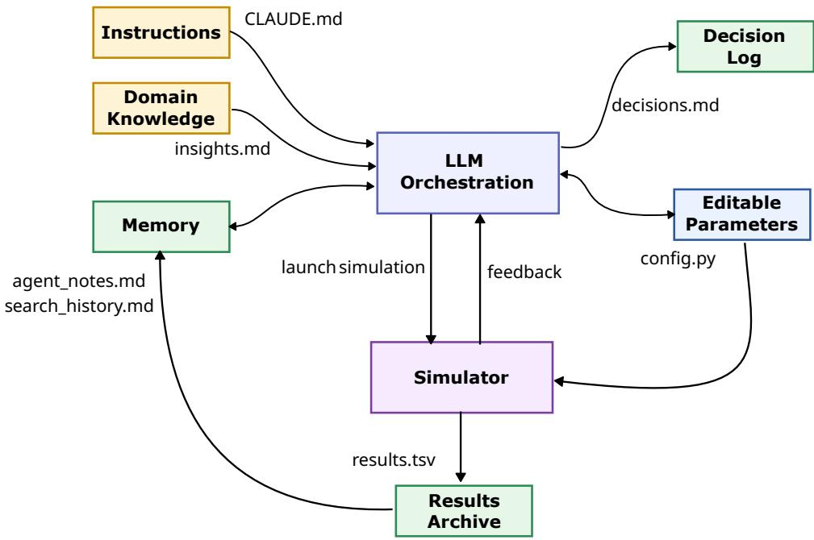
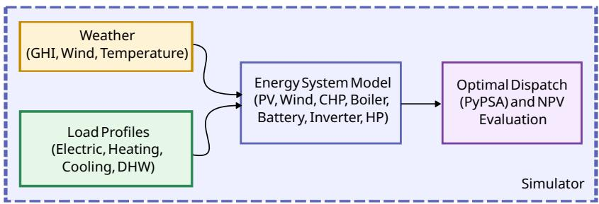
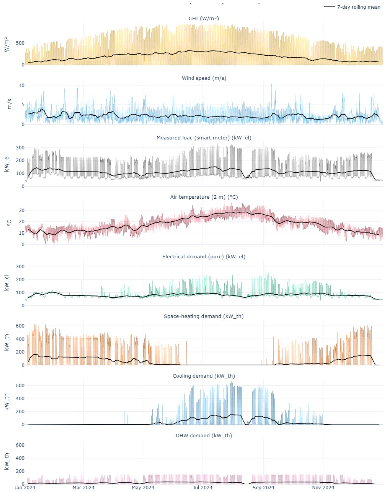
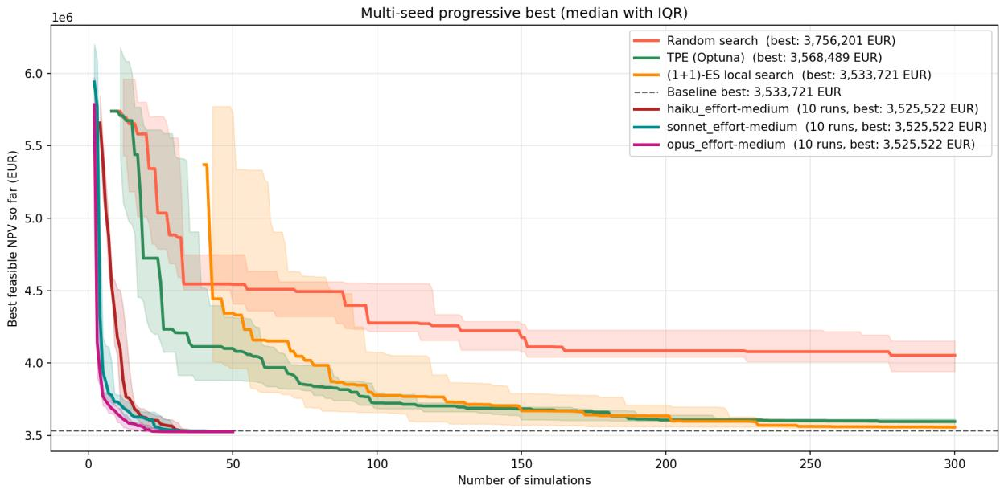
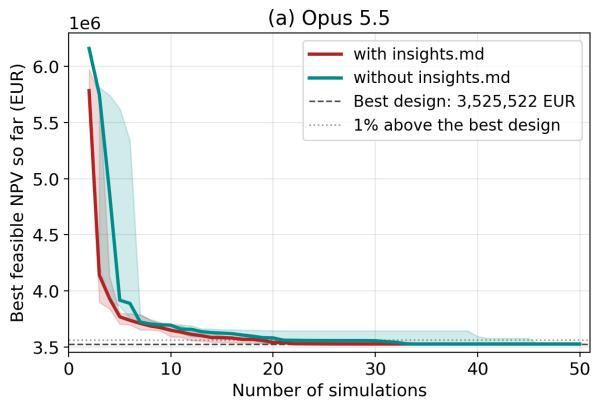
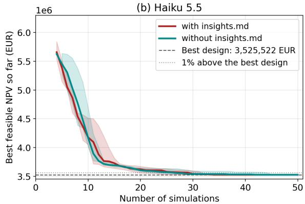

# AutoEnergyDesign: An LLM-Driven Agent for Automatic Energy System Design Optimization

Amedeo Buonanno

Salvatore Fabozzi

Maria Valenti

Department of Energy Technologies and Renewable Sources, ENEA - 80055 - Portici (NA), Italy

## Abstract

The design optimization of building energy systems represents a complex, highdimensional search problem involving discrete technology selections, continuous sizing parameters, and intricate economic trade-ofs. When each design must be evaluated by a year-long simulation, the mixed-integer nature of the problem and its non-convex cost surface make the search expensive for black-box optimizers, which typically require hundreds of evaluations. This paper presents AutoEnergyDesign, a framework that leverages Large Language Models (LLMs) as autonomous optimization agents for energy system configuration. The framework employs an iterative experimentation loop where an LLM agent reasons over previous simulation results, proposes configuration modifications and learns in context from the outcome of each simulation, while a git-based version control mechanism automatically reverts suboptimal changes. The agent couples a reasoning model with an explicit memory organisation (procedural instructions, semantic domain knowledge, episodic trial history with a per-experiment decision log, a reflective note, and the working context of the session), a constrained action interface, and an environment-grounded keep/revert feedback signal. We formulate the complete mathematical model encompassing eight distinct energy technologies (photovoltaic panels, micro-wind turbines, combined heat and power units, solar thermal collectors, gas boilers, battery storage, heat pumps, and inverters) with detailed Net Present Cost (NPC) calculations including capital expenditures, operational expenditures, and end-of-horizon salvage value over a 25-year horizon. The proposed methodology is evaluated on a case study based on measured building load profiles, against established baselines including random search, Tree-structured Parzen Estimator (TPE) Bayesian optimization, and a (1 + 1) evolution strategy that shares the agent’s acceptance rule. The agent is instantiated with three Claude models of increasing capability

(Haiku 5.5, Sonnet 5.5 and Opus 5.5), each run ten times with a budget of 50 simulations, and compared with random search, TPE and the (1 + 1) evolution strategy, run for 300 evaluations over ten seeds. With all three models the agent reaches a Net Present Cost of about 3.53 MEUR, 1.20% below the best value found by TPE and 0.23% below the best value of the evolution strategy. The agent comes within 1% of this design after a median of 18 (Opus) to 27.5 (Haiku) simulations, whereas among the baselines only the evolution strategy does so, in half of its seeds and after a median of 192 evaluations. Opus 5.5 reaches the best design in all ten runs, Sonnet 5.5 in six, with two runs that never come within $1 \%$ of it, and Haiku 5.5 comes within 1% of it in every run but reaches it exactly in only one. The framework also produces an auditable trace of every decision, establishing a foundation for accessible, transparent, and efective energy system optimization through natural language reasoning and automated experimentation.

Keywords: Agentic AI, LLM agents, Energy system optimization, Large Language Models, Building energy design, Automated experimentation

## 1 Nomenclature

Table 1 summarizes the variables and symbols used throughout the mathematical formulation.

Table 1: Variables and symbols used in the model
<table><tr><td>Symbol</td><td>Description</td><td>Unit</td></tr><tr><td>X</td><td>Design decision vector (technology activation and sizing)</td><td></td></tr><tr><td> $\mathbf { u } _ { 1 : T }$ </td><td>Sequence of operational decision vectors over the horizon</td><td></td></tr><tr><td> $t$ </td><td>Time index (hour)</td><td>h</td></tr><tr><td> $T$ </td><td>Total number of simulation time steps</td><td> $\mathrm { h }$ </td></tr><tr><td> $d _ { t } ^ { \mathrm { e l } }$ </td><td>Exogenous electricity demand at time t</td><td> $\mathrm { k W }$ </td></tr><tr><td> $d _ { t } ^ { \mathrm { h e a t } }$ </td><td>Exogenous heat demand (space heating + DHW) at time t</td><td> $\mathrm { k W _ { t h } }$ </td></tr><tr><td> $d _ { t } ^ { \mathrm { c o o l } }$ </td><td>Exogenous cooling demand at time t</td><td> $\mathrm { k W _ { t h } }$ </td></tr><tr><td> $p _ { t } ^ { \mathrm { s u p } }$ </td><td>Electricity supplied to demand at time t</td><td> $\mathrm { k W }$ </td></tr><tr><td> $q _ { t } ^ { \mathrm { h e a t } }$ </td><td>Heat supplied to demand at time t</td><td> $\mathrm { k W _ { t h } }$ </td></tr><tr><td> $q _ { t } ^ { \mathrm { c o o l } }$ </td><td>Cooling power supplied to demand at time t</td><td> $\mathrm { k W _ { t h } }$ </td></tr><tr><td> $s _ { t } ^ { \mathrm { e l } } , s _ { t } ^ { \mathrm { h e a t } } , s _ { t } ^ { \mathrm { c o o l } }$ </td><td>Unserved electricity, heat and cooling at time t (also written  $s ^ { \mathrm { e l } } ( t )$  , etc.)</td><td> $\mathrm { k W , k W _ { t h } }$ </td></tr><tr><td> $\tau$ </td><td>Set of available technologies</td><td></td></tr><tr><td> $\mathcal { X }$ </td><td>Feasible set of design decisions</td><td></td></tr><tr><td> $g ( \mathbf { x } , \mathbf { u } _ { 1 : T } )$ </td><td>Vector of technical and operational constraints</td><td></td></tr><tr><td> $z _ { \mathrm { p v } }$ </td><td>Binary activation variable for PV technology</td><td></td></tr><tr><td> ${ \mathcal { Z } } _ { \mathrm { w t } }$ </td><td>Binary activation variable for wind-turbine technology</td><td></td></tr><tr><td> $z _ { \mathrm { c h p } }$ </td><td>Binary activation variable for CHP technology</td><td></td></tr><tr><td> $z _ { \mathrm { s t } }$ </td><td>Binary activation variable for solar-thermal technology</td><td></td></tr><tr><td> $z _ { \mathrm { b o i } }$ </td><td>Binary activation variable for boiler</td><td></td></tr><tr><td> $z _ { \mathrm { b a t } }$ </td><td>technology Binary activation variable for battery technology</td><td></td></tr><tr><td> $z _ { \mathrm { h p } }$ </td><td>Binary activation variable for heat-pump technology</td><td></td></tr><tr><td> $A _ { \mathrm { p v } }$ </td><td>Installed photovoltaic collector area</td><td> $\mathrm { m ^ { 2 } }$ </td></tr><tr><td> $P _ { \mathrm { w t } } ^ { \mathrm { r a t e d } }$ </td><td>Rated wind-turbine electrical power</td><td>kW</td></tr><tr><td> $P _ { \mathrm { c h p } } ^ { \mathrm { e l } }$ </td><td>CHP nominal electrical power</td><td>kW</td></tr><tr><td> $\eta _ { \mathrm { c h p } } ^ { \mathrm { e l } }$ </td><td>CHP electrical efficiency</td><td></td></tr><tr><td> $\eta _ { \mathrm { c h p } } ^ { \mathrm { t h } }$ </td><td>CHP thermal efficiency</td><td></td></tr><tr><td> $A _ { \mathrm { s t } }$ </td><td>Installed solar-thermal collector area</td><td> $\mathrm { m ^ { 2 } }$ </td></tr><tr><td> $P _ { \mathrm { b o i } } ^ { \mathrm { m a x } }$ </td><td>Maximum boiler thermal power</td><td> $\mathrm { k W _ { t h } }$ </td></tr><tr><td> $\eta _ { \mathrm { b o i } }$ </td><td>Boiler thermal efficiency</td><td></td></tr><tr><td> $E _ { \mathrm { b a t } } ^ { \mathrm { m a x } }$ </td><td>Battery energy capacity</td><td>kWh</td></tr><tr><td> $P _ { \mathrm { b a t } } ^ { \mathrm { m a x } }$ </td><td>Battery maximum charge/discharge power</td><td>kW</td></tr><tr><td> $\eta _ { \mathrm { b a t } }$ </td><td>Battery round-trip efficiency</td><td></td></tr><tr><td> $P _ { \mathrm { i n v } , j } ^ { \mathrm { m a x } }$ </td><td>Nominal power of inverter  $j \in \{ \mathrm { p v } , \mathrm { b a t } , \mathrm { w t } \}$ </td><td>kW</td></tr><tr><td> $\eta _ { \mathrm { i n v } , j }$ </td><td>Conversion efficiency of inverter j</td><td></td></tr><tr><td> $P _ { \mathrm { h p } } ^ { \mathrm { m a x } }$ </td><td>Heat-pump maximum thermal power</td><td> $\mathrm { k W _ { t h } }$ </td></tr><tr><td>EER</td><td>Heat-pump cooling energy-efficiency ratio (reversible machine)</td><td></td></tr><tr><td>GHI(t)</td><td>Global horizontal irradiance at time t</td><td> $\mathrm { W / m ^ { 2 } }$ </td></tr><tr><td> $p _ { \mathrm { p v } } ( t )$ </td><td>PV electrical output at time t</td><td>kW</td></tr><tr><td> $\eta _ { \mathrm { p v } }$ </td><td>PV conversion efficiency</td><td></td></tr><tr><td> $v , \ v ( t )$ </td><td>Wind speed (generic; at time t)</td><td> $\mathrm { m } / \mathrm { s }$ </td></tr><tr><td> $v _ { \mathrm { i n } } , v _ { \mathrm { r a t e d } } , v _ { \mathrm { o u t } }$ </td><td>Wind turbine cut-in, rated, and cut-out speeds</td><td> $\mathrm { m } / \mathrm { s }$  kW</td></tr><tr><td> $P _ { \mathrm { w i n d } } ( v )$ </td><td>Wind-turbine electrical output as a function of v</td><td></td></tr><tr><td> $p _ { \mathrm { w i n d } } ( t )$ </td><td>Wind-turbine electrical output at time t</td><td>kW</td></tr><tr><td> $p _ { \mathrm { c h p } } ^ { \mathrm { e l } } ( t ) , \ p _ { \mathrm { c h p } } ^ { \mathrm { t h } } ( t )$ </td><td>CHP electrical and thermal output at time t CHP heat-to-power ratio,  $\sigma = \eta _ { \mathrm { c h p } } ^ { \mathrm { t h } } / \eta _ { \mathrm { c h p } } ^ { \mathrm { e l } }$ </td><td> $\mathrm { k W , \ k W _ { t h } }$ </td></tr><tr><td>σ  $\hat { p } _ { \mathrm { s t } } ( t )$ </td><td>Available solar-thermal heat output at time t</td><td> $\mathrm { k W _ { t h } }$ </td></tr><tr><td> $p _ { \mathrm { s t } } ( t )$ </td><td>Solar-thermal heat actually used at time t</td><td> $\mathrm { k W _ { t h } }$ </td></tr><tr><td></td><td>Solar-thermal collector efficiency</td><td></td></tr><tr><td> $\eta _ { \mathrm { s t } }$ </td><td></td><td></td></tr><tr><td> $p _ { \mathrm { b o i l e r } } ^ { \mathrm { g a s } } ( t )$ </td><td>Boiler gas consumption at time t</td><td> $\mathrm { k W _ { f u e l } }$ </td></tr><tr><td> $c _ { \mathrm { b o i l e r } }$ </td><td>Boiler heat marginal cost</td><td> $\mathrm { E U R / k W h _ { t h } }$ </td></tr><tr><td> $c _ { \mathrm { g a s } }$ </td><td>Natural gas price</td><td> $\mathrm { E U R / k W h }$ </td></tr><tr><td> $\eta _ { \mathrm { s t o r e } } , \eta _ { \mathrm { d i s p a t c h } }$ </td><td>Battery charging/discharging efficiencies</td><td></td></tr><tr><td> $p _ { \mathrm { b a t t } } ^ { \mathrm { c h a r g e } } ( t ) , p _ { \mathrm { b a t t } } ^ { \mathrm { d i s c h a r g e } } ( t )$ </td><td>Battery charging/discharging powers at time t</td><td>kW</td></tr><tr><td>COP</td><td>Heat-pump coefficient of performance (fixed, heating)</td><td></td></tr><tr><td> $p _ { \mathrm { h p } } ^ { \mathrm { t h } } ( t )$ </td><td>Heat-pump heat output at time t</td><td> $\mathrm { k W _ { t h } }$ </td></tr><tr><td> $p _ { \mathrm { h p , c } } ^ { \mathrm { e l } } ( t ) , ~ p _ { \mathrm { h p , c } } ^ { \mathrm { c o o l } } ( t )$ </td><td>Heat-pump electrical input and cooling output in cooling mode</td><td> $\mathrm { k W , k W _ { t h } }$ </td></tr><tr><td> $c _ { \mathrm { h p } }$ </td><td>Heat-pump heat marginal cost</td><td> $\mathrm { E U R / k W h _ { t h } }$ </td></tr><tr><td> $c _ { \mathrm { e l e c } }$ </td><td>Electricity purchase price</td><td> $\mathrm { E U R / k W h }$ </td></tr><tr><td> $p _ { \mathrm { i n v } , j } ^ { \mathrm { i n } } ( t ) , \ p _ { \mathrm { i n v } , j } ^ { \mathrm { o u t } } ( t )$ </td><td>Source-side input and delivered output power of inverter j</td><td>kW</td></tr><tr><td> $c _ { \mathrm { c h p } } ^ { \mathrm { v a r } }$ </td><td>CHP variable maintenance cost</td><td> $\mathrm { E U R / k W h _ { e l } }$ </td></tr><tr><td>y</td><td>Year index in the economic formulation</td><td>yr</td></tr><tr><td> $\mathrm { P V } ( C , y )$ </td><td>Present value of a cash flow C occurring at</td><td>EUR</td></tr><tr><td>r</td><td>year y Annual discount rate</td><td></td></tr><tr><td> $N$ </td><td>Project horizon in years</td><td>yr</td></tr><tr><td> $\mathrm { P V } _ { \mathrm { f a c t o r } }$ </td><td>Annuity present-value factor over the horizon</td><td></td></tr><tr><td> $\mathrm { C A P E X } _ { i }$ </td><td>Initial capital expenditure of technology i</td><td>EUR</td></tr><tr><td> $\mathcal { R } _ { i }$ </td><td>Set of replacement years for technology i</td><td>yr</td></tr><tr><td> $\mathrm { C A P E X _ { \mathrm { t o t a l } } }$ </td><td>Total discounted CAPEX including</td><td>EUR</td></tr><tr><td> $f _ { \mathrm { r e p l } } ( L , N , r )$ </td><td>replacements Replacement multiplier including discounting</td><td></td></tr><tr><td> $L , L _ { i }$  m</td><td>Lifetime (generic or of technology i) Replacement index in discounted replacement</td><td>yr</td></tr><tr><td> $\mathrm { C A P E X _ { e f f e c t i v e } } , i$ </td><td>sum Effective discounted CAPEX for technology i</td><td>EUR</td></tr><tr><td> $\mathrm { O P E X } _ { \mathrm { f i x e d } , i }$ </td><td>over the horizon Annual fixed OPEX for technology i</td><td> $\mathrm { E U R / y r }$ </td></tr><tr><td> $\mathrm { O P E X _ { f i x e d } ^ { P V } }$ </td><td>Present value of fixed OPEX over the horizon</td><td>EUR</td></tr><tr><td> $\mathrm { O P E X } _ { \mathrm { v a r i a b l e } }$ </td><td>Annual variable operating cost from dispatch</td><td> $\mathrm { E U R / y r }$ </td></tr><tr><td> $\mathrm { N P C }$ </td><td>Total discounted life-cycle cost (costs net of</td><td>EUR</td></tr><tr><td> $p _ { \mathrm { g r i d } } ^ { \mathrm { i m p o r t } } ( t )$ </td><td>revenue) Electricity imported from the grid at time t</td><td>kW</td></tr><tr><td> $p _ { \mathrm { g r i d } } ^ { \mathrm { e x p o r t } } ( t )$ </td><td>Electricity exported to the grid at time t</td><td>kW</td></tr><tr><td> $p _ { \mathrm { b o i l e r } } ( t )$ </td><td>Boiler thermal output at time t</td><td> $\mathrm { k W _ { t h } }$ </td></tr><tr><td> $p _ { \mathrm { c h p } } ^ { \mathrm { g a s } } ( t )$ </td><td>CHP gas consumption at time t</td><td> $\mathrm { k W _ { f u e l } }$ </td></tr><tr><td> $p _ { \mathrm { h p } } ^ { \mathrm { e l } } ( t )$ </td><td>Heat-pump electrical input in heating mode at kW</td><td></td></tr><tr><td> $\sec ( t )$ </td><td>time t Battery state of charge at time t</td><td>kWh</td></tr><tr><td> $p _ { \mathrm { l o a d } } ^ { \mathrm { e l } } ( t )$ </td><td>Electrical load in the dispatch</td><td>kW</td></tr><tr><td> $p _ { \mathrm { l o a d } } ^ { \mathrm { h e a t } } ( t ) , p _ { \mathrm { l o a d } } ^ { \mathrm { d h w } } ( t )$ </td><td>Space-heating and DHW loads in the dispatch</td><td> $\mathrm { k W _ { t h } }$ </td></tr><tr><td> $p _ { \mathrm { l o a d } } ^ { \mathrm { c o o l } } ( t )$ </td><td>Cooling load in the dispatch</td><td> $\mathrm { k W _ { t h } }$ </td></tr><tr><td>p(t), Prated</td><td>Generic dispatch variable of a technology and</td><td>kW</td></tr><tr><td></td><td>its rated limit</td><td></td></tr><tr><td>Cexport π</td><td>Electricity export tariff in dispatch objective Penalty cost for unserved energy</td><td> $\mathrm { E U R / k W h }$   $\mathrm { E U R / k W h }$ </td></tr><tr><td> $\varepsilon$ </td><td>Tolerance on annual unserved energy for feasibility</td><td>kWh</td></tr><tr><td> $E _ { \mathrm { g r i d } } ^ { \mathrm { i m p o r t } } , E _ { \mathrm { e l } } ^ { \mathrm { t o t } }$ </td><td>Annual grid import and total electrical consumption</td><td>kWh</td></tr><tr><td> $S _ { i }$ </td><td>Discounted salvage (residual) value of technology i at year N</td><td>EUR</td></tr><tr><td> $y _ { i } ^ { \mathrm { l a s t } }$ </td><td>Year of the last installation of technology i</td><td>yr</td></tr><tr><td> $B$ </td><td>Evaluation budget (number of simulator calls)</td><td></td></tr><tr><td> $N _ { a }$ </td><td>Number of experiments between two reflective synthesis turns</td><td></td></tr><tr><td> $K$ </td><td>Number of most recent discarded designs listed in the search history</td><td></td></tr><tr><td> $k$ </td><td>Experiment index</td><td></td></tr><tr><td> $\mathbf { x } _ { k } , \ \mathbf { x } _ { k } ^ { \star }$ </td><td>Design proposed at experiment k; best valid design after experiment k</td><td></td></tr><tr><td> $\sigma _ { \mathrm { E S } } , ~ \sigma _ { \mathrm { E S } , 0 }$ </td><td>Mutation step of the (1 + 1)-ES as a fraction of the grid levels; initial value</td><td></td></tr><tr><td>NPC*</td><td>Best NPC found in the study (by any method EUR and run)</td><td></td></tr><tr><td>8</td><td>Relative tolerance on NPC* used to count the evaluations to a near-optimal design</td><td></td></tr></table>

## 2 Introduction

The global energy transition is reshaping how electricity and heat are produced and consumed. At the residential level, distributed energy resources (DERs), including rooftop photovoltaic (PV), battery energy storage systems (BESS), and heat pumps, are expanding rapidly. The International Energy Agency projects continued growth in PV capacity through 2035 under stated policy scenarios [1].

Designing building energy systems is challenging because technology selection, capacity sizing, dispatch strategy, and lifecycle economics are tightly coupled. Capacity choices afect dispatch flexibility, while dispatch assumptions influence economically optimal sizes. The design is therefore optimized with respect to the Net Present Cost (NPC), which integrates capital expenditures (CAPEX), replacement costs, fixed and variable operating expenditures (OPEX), and energy purchase costs over the 25-year analysis horizon.

This problem is a high-dimensional mixed-integer nonlinear optimization task with complex feasibility boundaries. It combines discrete technology inclusion decisions with sizing and performance parameters, and objective evaluation requires a year-long simulation.

Conventional optimization methods (e.g., mixed-integer programming and evolutionary algorithms) remain valuable but face practical limits in simulation-driven settings with non-convex, multimodal landscapes and expensive black-box evaluations [2, 3].

Recent advances in Large Language Models (LLMs) suggest an alternative: optimization through iterative reasoning, experimentation, and feedback. Inspired by autonomous experimentation paradigms such as AutoResearch [4], LLM-driven optimization can incorporate domain knowledge, produce explicit, human-readable decision rationales, and adapt strategy over time. More generally, the object we build is an agent in the classical sense of an entity that perceives its environment through sensors and acts upon it through actuators [5]: in the LLM instantiation, a reasoning model is augmented with memory, an action interface, and a reflection mechanism, to obtain a goal-directed system [6, 7].

This paper presents AutoEnergyDesign, an LLM-driven framework for building energy system optimization. Our main contributions are: (1) an optimization architecture that couples LLM reasoning with structured experimental feedback, organized around an explicit set of memories, (2) a techno-economic formulation covering eight energy technologies with detailed NPC modeling, (3) a git-based state-management mechanism that preserves best-known configurations while reverting suboptimal updates, and (4) an empirical comparison against random search, a (1 + 1) evolution strategy with the same acceptance rule as the agent, and Bayesian optimization baselines, using three LLMs of diferent capability to show how the results depend on the model.

The remainder of this paper is organized as follows. Section 3 reviews related literature. Section 4 presents the simulator formulation and agent design. Section 5 describes the case study, the input data, and the techno-economic assumptions. Section 6 describes the experimental protocol and baselines. Section 7 presents results. Section 8 discusses implications and limitations. Section 9 concludes with future directions.

## 3 Related Works

The optimization of building energy systems sits at the intersection of diferent active research areas: (i) classical methods for energy system design, (ii) emerging applications of Large Language Models (LLMs) in building energy domains, and (iii) LLM-driven optimization paradigms recently developed in the machine learning community. This section reviews each area, identifies key gaps, and positions our contribution within this landscape.

## 3.1 Classical Approaches to Energy System Optimization

The design optimization of hybrid residential energy systems has evolved significantly over the past two decades. Early studies established that technology sizing and operational dispatch must be optimized jointly rather than sequentially, particularly for micro-combined heat and power (micro-CHP) and hybrid thermal-electric configurations [8–11].

From a methodological standpoint, three primary approaches dominate the literature:

Mixed-Integer Programming (MIP). Linear and mixed-integer linear programming formulations provide exact solutions for convex approximations of the design problem [2, 3]. However, the nonlinearities inherent in component performance curves, economies of scale in costing, and discrete technology choices often render MIP formulations computationally prohibitive for realistic problem instances with year-long simulation horizons.

Metaheuristics. Evolutionary algorithms, particularly NSGA-II and its variants, remain widely adopted for building and microgrid optimization because they handle nonlinearity, constraints, and multiple objectives without requiring gradients [12–23]. These methods maintain a population of candidate solutions and evolve them through selection, crossover, and mutation operators. While efective for multimodal landscapes, they typically require extensive hyperparameter tuning and large evaluation budgets.

Bayesian Optimization. For expensive black-box objectives, Bayesian optimization ofers superior sample eficiency by constructing a probabilistic surrogate model (typically a Gaussian Process) and optimizing an acquisition function to balance exploration and exploitation [24]. The Tree-structured Parzen Estimator (TPE) [25–27] extends this framework to mixed-variable spaces, while MOTPE enables multi-objective optimization [28]. TPE has become a standard baseline for hyperparameter optimization and engineering design tasks where evaluations are costly.

Despite their successes, these classical methods face persistent limitations in practice: they ofer limited traceability regarding why specific configurations are preferred; they struggle to incorporate qualitative domain knowledge without explicit mathematical formulation; and they typically handle infeasible designs through penalty functions or repair operators that must be tailored to each problem.

## 3.2 Large Language Models in Building Energy Applications

The application of LLMs to building energy systems has expanded rapidly in recent years [29–31]. Within this broader landscape, one recurring line of work uses LLMs to support the generation of building energy models from textual descriptions and other early-stage design inputs [32–34]. The main contribution of these studies is a reduction in modeling efort and setup time, rather than the solution of the design optimization problem itself.

For operational applications, recent studies have explored LLM-assisted decisionmaking for economic dispatch, home energy management, and related control tasks in energy systems [35–37]. An interesting insight is that the LLM performs best when it does not act as the optimizer itself, but drives an exact solver through a structured tool interface.

Multi-agent frameworks have emerged as a particularly active direction. Zhang et al. [38] proposed an LLM-powered multi-agent system for power grid control. Madani et al. [39] surveyed LLM integration in smart grids, highlighting applications in operational decision support. Xia et al. [40] presented a low-carbon scheduling approach combining multi-agent reinforcement learning with an embedded LLM.

Closer to planning tasks, Forootani et al. [41] integrate scenario-based energy system optimization with machine-learning surrogates and use an LLM to turn the resulting sensitivity analysis into stakeholder-readable narratives, an approach that shares our traceability motivation but leaves the search itself to a conventional optimizer. Jin et al. [42] take the complementary autoformalisation route, using the LLM to translate a natural-language energy-management request into a formal program that is then solved exactly.

These studies focus mainly on operational control or model generation, rather than on the design phase, as addressed in this work. The application of LLMs as optimization agents for technology selection and sizing remains largely unexplored in the building energy literature.

## 3.3 LLM-Driven Optimization Paradigms

A distinct but related research stream, originating in the machine learning community, has explored more general ways of using LLMs as optimizers. In these works, the model is not used merely to summarize or classify information, but to propose candidate solutions on the basis of a problem description and the history of previous evaluations. One influential example is OPRO, introduced by Yang et al. [43], where the optimization process is framed as iterative improvement through prompting: the model receives prior solutions and their scores, and then generates revised candidates. Although the approach was developed for general optimization and prompt-design tasks rather than for engineering systems with physical constraints, it helped establish the idea that language models can participate directly in search.

A second line of work has pushed this idea toward more autonomous experimentation. Karpathy’s AutoResearch [4] showed how an LLM agent can modify code, run experiments, interpret outcomes, and iterate while relying on rollback mechanisms to maintain stability. In a diferent but related direction, FunSearch [44] combined language models with evolutionary search to generate and evaluate program variants, showing that LLMs can contribute within a systematic propose-and-test loop. The same idea has been employed in LLM-driven algorithm design, in which the model evolves the heuristic rather than the solution. In EoH [45], natural-language “thoughts” are coupled with the corresponding code in an evolutionary loop. ReEvo [46] adds an explicit reflection step that verbalises why one heuristic outperformed another before generating the next variant. LLaMEA [47] generates and refines entire metaheuristics from benchmark feedback. These developments are surveyed comprehensively in [48]. Taken together, these contributions suggest that LLMs may be useful not only as interfaces to technical systems, but also as components of the optimization process itself. At the same time, most of this literature has developed around prompt optimization, program synthesis, or machine learning workflows, and only rarely around engineering design problems with explicit techno-economic constraints. It is precisely this gap that motivates the present work.

A recent survey of LLMs as optimizers [49] organises this space into three paradigms: direct optimization, in which the model itself generates and refines candidate solutions; tool-augmented optimization, in which the model formalises the problem and delegates it to an exact solver; and tool-creating optimization, in which the model synthesises reusable heuristics. AutoEnergyDesign can be considered as belonging to the first paradigm.

Beyond these foundational works, several recent contributions use LLMs as optimization engines in ways that are directly comparable to ours.

Liu et al. [50] proposed LLAMBO, which frames Bayesian optimization (BO) in natural language and uses an LLM to enhance individual BO components without any fine-tuning. LLAMBO is validated on hyperparameter tuning.

AhmadiTeshnizi et al. [51] introduced OptiMUS, an LLM agent that formulates and solves mixed-integer linear programs from natural-language descriptions by writing the mathematical model, generating and debugging solver code, and validating solutions. OptiMUS lowers the barrier to operations-research modeling but delegates the actual optimization to an exact solver. In contrast, AutoEnergyDesign keeps the techno-economic model fixed and uses the LLM as the search mechanism over a non-convex, simulationbased black box. The LLM proposes configurations, not problem formulations, and an exact solver is used only for the inner hourly dispatch, not for the design-space search.

AlphaEvolve [52] orchestrates an ensemble of LLMs in a population-based evolutionary loop that edits and evolves entire codebases, achieving state-of-the-art results on algorithm discovery and infrastructure optimization tasks under substantial compute. Our framework targets a diferent regime: a single agent operating under a tight evaluation budget, a sequential keep/revert trajectory rather than a large evolutionary population, and a fixed engineering artifact (a building energy system) rather than open-ended algorithm discovery. The emphasis here is on auditable reasoning traces and explicit injection of techno-economic domain knowledge, rather than on large-scale evolutionary search.

Eureka [53] uses a coding LLM to evolve reward functions for reinforcement learning, with environment code as context and a reward-reflection step, evaluating each candidate through full RL training runs. The LLM output is the code that defines the objective, which is then optimized downstream by RL. AutoEnergyDesign instead optimizes the decision variables directly against a fixed, externally defined economic objective evaluated by a deterministic physics-and-economics simulator; there is no RL stage and no reward-

code synthesis.

Taken together, these works show that LLMs can act as warm-starters or subcomponents of BO (LLAMBO), as formulators that hand the problem to an exact solver (OptiMUS), as large-scale evolutionary code optimizers (AlphaEvolve, EoH, ReEvo, LLaMEA), or as designers of objectives for downstream learning (Eureka). AutoEnergyDesign occupies a complementary point in this space: a single, budget-constrained, auditable agent that performs the search directly over a constrained techno-economic design space, with persistent memory and git-based rollback as its state-management mechanism.

## 3.4 Identified Gaps and Research Opportunities

From this literature review, we identify several key gaps that motivate our work:

Gap 1: Traceability of optimization decisions. Classical black-box optimizers (Bayesian, evolutionary) return solutions with minimal explanation. Practitioners cannot easily understand why a particular configuration is preferred. LLM-driven methods ofer natural language reasoning traces, but these have not been systematically exploited in engineering optimization.

Gap 2: Integration of qualitative domain knowledge. Engineering design relies heavily on heuristics, physical intuition, and economic insights that are dificult to encode mathematically. Existing optimizers require explicit formulation of such knowledge as constraints or penalty functions. LLMs can absorb qualitative knowledge through prompting, but frameworks for systematic integration with simulation-based optimization are lacking.

Gap 3: Accessibility for practitioners. Advanced optimization tools require expertise in mathematical programming, algorithm configuration, or machine learning. There is a need for optimization workflows that are accessible to energy engineers without requiring deep optimization expertise.

## 3.5 Positioning of This Work

AutoEnergyDesign addresses these gaps through the following features of the framework, which correspond to contributions (1) and (3) of Section 2:

1. Traceable and auditable optimization. Our framework generates persistent reasoning traces (agent notes, and a decision log in which every experiment is justified before it is run and checked against its outcome afterwards) that record the rationale for design decisions, enabling practitioners to audit, validate and understand optimization trajectories, and to check each rationale against the outcome logged by the environment. In this way, the natural language interface and automated reasoning reduce the barrier to applying advanced optimization to energy system design.

2. Structured domain knowledge integration. We separate operational instructions from domain knowledge (via the insights.md mechanism), allowing engineers to inject qualitative heuristics without modifying code or mathematical formulations. This is a deliberate separation of procedural memory (how to conduct the search) from semantic memory (what is true about the techno-economic context), which can be edited independently and audited by a domain expert [54].

3. Git-based safe exploration. Our commit/revert mechanism ensures that the system never loses a known-good configuration, enabling aggressive exploration without risk of catastrophic performance degradation. This extends the version control concept from AutoResearch to simulation-driven engineering optimization.

Relative to general LLM-driven optimizers like OPRO, we provide domain-specific structure (simulator integration, techno-economic constraints) and an explicit statemanagement layer, combining the git-based rollback of AutoResearch with episodic and reflective memories (Table 2), a layer that is enforced by the environment rather than left to the model.

To the best of our knowledge, and consistently with the most recent surveys of LLMs in building energy and power system applications [29–31], the LLM-as-optimizer paradigm has so far been applied in this domain to operation and dispatch [35–37] or to model formulation [32, 42], but not to design-phase technology selection and sizing against a full lifecycle cost model. The present work is, in this specific sense, the first to do so with a techno-economic model spanning eight technologies and a 25-year NPC horizon.

The purpose of this study is not to replace exact optimization methods when a suitable mathematical formulation is available. If both equipment sizing and operational dispatch can be represented by linear relationships and integer decisions, they can be optimized jointly using mixed-integer linear programming (MILP). In that setting, an exact solver can provide optimality guarantees that the proposed LLM agent does not ofer.

Our framework instead targets simulation-based design problems that are dificult to express in this form, for example because they involve nonlinear component models, tabulated performance data, economies of scale, or an existing simulator whose internal formulation cannot be modified. In these settings, the agent proposes designs and learns from their simulated performance without requiring an explicit mathematical formulation of the entire design problem. The present case study uses linear-programming dispatch to provide a transparent and well-defined evaluation environment. It therefore demonstrates the agent’s search behavior in a controlled setting, rather than establishing that exact optimization is infeasible for this instance or that the agent is superior to an exact solver.

The following sections detail our methodology, experimental validation against TPE, (1 + 1) evolution strategy and random search baselines, and discussion of implications for energy system design practice.

## 4 Methodology

This section presents the methodology underlying the AutoEnergyDesign framework. We begin by describing the LLM-driven agent architecture, including the instruction file, feedback mechanisms, and version control integration, and then we describe the mathematical formulation of the energy system simulator, including detailed models for each technology, the Net Present Cost calculation methodology, and the optimal dispatch formulation.

## 4.1 Agent Architecture

The agent implements an iterative experimentation loop inspired by Karpathy’s AutoResearch [4]: a language model repeatedly edits a configuration file, runs the simulator, and decides the next change on the basis of the results obtained so far. The model is not called through an API by a custom runner but operates inside a general-purpose coding agent, Claude Code, which gives it a file reader, a file editor and a shell. Everything else (the simulator, the validator, the acceptance rule and the logs) consists of ordinary scripts and files. The files and components involved are shown schematically in Figure 1.

## 4.1.1 Overview of the Loop

Each run is a single coding-agent session started in the project directory with the message “Run CLAUDE.md”.1 Before the session starts, the launch script simulates the default configuration and records it as experiment 1; the agent then performs experiments 2 to 51, i.e. a budget of B = 50. Each experiment follows the same procedure, prescribed by the instruction file:

1. read the state files (Table 2) and record the outcome of the previous experiment in the decision log;

2. stop if the experiment counter has reached 51;

3. every $N _ { a } = 4$ experiments, rewrite the reflective note agent\_notes.md;

4. record the next decision in decisions.md;

5. edit config.py;

6. run python simulate.py, then return to step 1.

Two hooks of the coding agent, triggered before and after every shell command, enforce the rules independently of the model. The pre-execution hook validates config.py whenever the command launches the simulator (admissible range, quantization step, at least one thermal source, inverter flags tied to their parent technology) and blocks invalid proposals before the simulation is launched, so that they do not consume an evaluation. The postexecution hook detects that a new simulation has been run, commits the configuration, applies the acceptance rule of Eq. (1), restores the previous configuration if the change is rejected, and updates the logs and the state files.

  
Figure 1: Conceptual scheme of the AutoEnergyDesign agent: instruction and domain files, editable configuration, simulator, hooks and logs.

The agent observes the result of each experiment in two ways. The simulator output, returned as the result of the shell command, reports the NPC and its breakdown (CAPEX by technology, salvage credit, fixed and variable OPEX, electricity and gas costs), the unserved electricity, heat and cooling, the $\mathrm { C O _ { 2 } }$ emissions and the self-suficiency. The status file written by the hook reports the verdict (kept, worse, infeasible, out of range or crashed).

## 4.1.2 Files and Memory

Table 2 lists the files involved in the loop, classified according to the memory types of the CoALA framework [54]. The main design choice is the separation between what the environment writes, which is reliable, and what the agent writes, which records its reasoning and may be wrong.

Table 2: Files of the agent loop. “Reads” indicates whether the agent is instructed to read the file at every experiment.
<table><tr><td>File</td><td>Memory</td><td>Written by</td><td>Reads</td><td>Content</td></tr><tr><td>CLAUDE.md</td><td>procedural</td><td>authors</td><td>yes</td><td>Procedure and rules (Section 4.1.3)</td></tr><tr><td>insights.md</td><td>semantic</td><td>authors</td><td>yes</td><td>Energy prices; per technology: efficiency, CAPEX, OPEX, lifetime;</td></tr><tr><td>config.py</td><td></td><td>agent</td><td>yes</td><td>replacement and salvage rules Current design, with admissible range and step of each variable in comments</td></tr><tr><td>.exp_counter, .last_status</td><td>episodic</td><td>hook</td><td>yes</td><td>Experiment counter; verdict of the last experiment</td></tr><tr><td>search_history.md</td><td>episodic</td><td>hook</td><td>yes</td><td>All kept designs ranked by NPC and the K = 10 most recent discarded ones,</td></tr><tr><td>decisions.md</td><td>episodic</td><td>agent</td><td>yes</td><td>with reason and difference from the best One entry per experiment: change, rationale, expected effect, alternatives</td></tr><tr><td>agent_notes.md</td><td>reflective</td><td>agent</td><td>yes</td><td>considered, observed outcome Note of at most ten lines, rewritten every  $N _ { a }$  = 4 experiments</td></tr><tr><td>results.tsv, git history</td><td></td><td>hook</td><td>no</td><td>Complete log of all trials with parameters and outcome</td></tr></table>

Working memory is the context of the session itself, which accumulates the files read, the simulation outputs and the agent’s own messages; the state files are re-read at every experiment so that the procedure does not depend on what survives a compaction of the context. The search history is a compact but lossy summary of the complete log: designs are described by the sizes of the enabled technologies only, without eficiencies, inverter ratings or battery power.

The reflective note follows a fixed template with four headings: Worked (changes that reduced the NPC, with direction and amount), Failed (changes that were worse, infeasible or out of range), Behavior (sensitive technologies, interactions, exhausted regions) and Next (two or three experiments to try). It condenses the trajectory into verbal lessons, in the spirit of Reflexion [55], and its Next section is the starting point for the following decisions. The decision log complements it at the level of single steps: since each expectation is written before the result is known, every prediction can be checked afterwards against the outcome, and the log is the main source for the qualitative analysis of Section 7.5.

## 4.1.3 Instructions and Domain Knowledge

The instruction file CLAUDE.md contains the per-experiment procedure above and the following rules:

• minimize the NPC reported by the simulator;

• edit only config.py, agent\_notes.md and decisions.md, and do not read or modify the simulator, the cost parameters or the hooks;

• respect the range and step of each variable, keep at least one thermal source (boiler, heat pump or CHP) enabled, and leave the inverter activation lines unchanged;

• change one to three logically related parameters per experiment, and in the first experiments switch technologies on and of before fine-tuning sizes;

• after a rejected experiment, do not retry the same values;

• never ask questions and never stop before the budget is exhausted.

The domain-knowledge file insights.md contains only input data, copied from the cost parameters of the simulator: energy prices (electricity purchase 0.30 EUR/kWh, export 0.08 EUR/kWh, natural gas 0.12 EUR/kWh); for each technology, its eficiency or performance data, specific CAPEX and OPEX and lifetime; the time-shared operation of the reversible heat pump, stated as a rule (heating share plus cooling share at most 100% of its size in each hour); the fact that inverter costs are included in those of PV, wind and battery; the absence of thermal storage; the replacement and salvage rules; and the absence of active self-suficiency or $\mathrm { C O _ { 2 } }$ constraints. It contains no rankings of technologies and no design guidance. Since the agent is told not to read the simulator or its parameters, this file is its only source of information on the scenario besides the simulator output.

The rules on files are a convention rather than a sandbox: with permission prompts disabled, the agent could in principle read or modify any file, and compliance is checked afterwards on the session transcripts and the git history of each run. The design space, by contrast, is enforced by the pre-execution hook regardless of the model’s behaviour.

## 4.1.4 Acceptance Rule and State Management

At experiment $k ,$ the proposed configuration $\mathbf { x } _ { k }$ is compared with $\mathbf { x } _ { k - 1 } ^ { \star }$ the best valid configuration found so far. The best configuration is updated only if the new design is valid (feasible, Section 4.2.5) and has a strictly lower cost:

$$
\begin{array} { r } { \mathbf { x } _ { k } ^ { \star } = \left\{ \begin{array} { l l } { \mathbf { x } _ { k } , } & { \mathrm { i f ~ } \mathbf { x } _ { k } \mathrm { ~ i s ~ v a l i d ~ a n d ~ N P C } ( \mathbf { x } _ { k } ) < \mathrm { N P C } ( \mathbf { x } _ { k - 1 } ^ { \star } ) , } \\ { \mathbf { x } _ { k - 1 } ^ { \star } , } & { \mathrm { o t h e r w i s e } , } \end{array} \right. } \end{array}\tag{1}
$$

with $\mathrm { N P C } ( \mathbf { x } _ { 0 } ^ { \star } ) = + \infty$ , so that the first feasible design is always kept; this matters because the default configuration is infeasible.

The rule is implemented with git. Each run works on a dedicated branch, exp/<timestamp>. After every simulation the post-execution hook commits config.py; if the design is kept, it records the new best NPC, and otherwise it restores the previous config.py and commits the revert. Every trial, kept or discarded, is appended to results.tsv with its full parameter vector, feasibility flag and outcome, and search\_history.md and .last\_status are regenerated from it. The branch therefore contains the complete, reproducible trajectory of the run, and the working copy always holds the best design found so far.

## 4.2 Simulator

The simulator forms the core of the optimization framework, evaluating candidate energy system configurations through year-long operational simulation and techno-economic assessment. The simulator is implemented using PyPSA (Python for Power System Analysis) [56], an open-source framework for power system modeling and optimization. PyPSA is used here as an operational solver. Figure 2 shows a schematic of the simulated system.

  
Figure 2: Conceptual Scheme of the Simulator

## 4.2.1 Problem Formulation

The energy system design optimization problem can be stated as follows. Given a set of available technologies T , hourly electricity, heat and cooling demands over a planning horizon $t = 1 , \dots , T$ , and economic parameters such as energy prices and discount rate, the objective is to identify the design vector x (technology activation and sizing) and the operational dispatch $\mathbf { u } _ { 1 : T }$ that minimize lifecycle Net Present Cost while meeting demand at each time step. Demand that the system cannot meet is represented explicitly as unserved energy, which is penalised in the NPC.

Mathematically, we write:

$$
\operatorname* { m i n } _ { \mathbf { x } , \mathbf { u } _ { 1 : T } } \quad \mathrm { N P C } ( \mathbf { x } , \mathbf { u } _ { 1 : T } )\tag{2}
$$

$$
\mathrm { s u b j e c t ~ t o ~ } \mathbf { x } \in \mathcal { X }
$$

$$
\mathrm { ( d e s i g n \ b o u n d s \ / \ d i s c r e t e \ c h o i c e s ) }\tag{3}
$$

$$
g ( \mathbf { x } , \mathbf { u } _ { 1 : T } ) \leq 0
$$

$$
( \mathrm { t e c h n i c a l \ \& \ o p e r a t i o n a l \ c o n s t r a i n t s } )\tag{4}
$$

$$
p _ { t } ^ { \operatorname * { s u p } } ( \mathbf { x } , \mathbf { u } _ { t } ) + s _ { t } ^ { \mathrm { e l } } = d _ { t } ^ { \mathrm { e l } } \quad \forall t \qquad \mathrm { ( e l e c t r i c i t y ~ b a l a n c e ) }\tag{5}
$$

$$
q _ { t } ^ { \mathrm { h e a t } } ( \mathbf { x } , \mathbf { u } _ { t } ) + s _ { t } ^ { \mathrm { h e a t } } = d _ { t } ^ { \mathrm { h e a t } } \quad \forall t \quad ( \mathrm { h e a t ~ b a l a n c e } )\tag{6}
$$

$$
q _ { t } ^ { \mathrm { c o o l } } ( \mathbf { x } , \mathbf { u } _ { t } ) + s _ { t } ^ { \mathrm { c o o l } } = d _ { t } ^ { \mathrm { c o o l } } \quad \forall t \quad ( \mathrm { c o o l i n g ~ b a l a n c e } )\tag{7}
$$

$$
s _ { t } ^ { \mathrm { e l } } , \ s _ { t } ^ { \mathrm { h e a t } } , \ s _ { t } ^ { \mathrm { c o o l } } \geq 0 \quad \forall t \qquad \quad ( \mathrm { u n s e r v e d \ e n e r g y } )\tag{8}
$$

where x is the vector of design parameters (technology enablement and sizing), and $\mathbf { u } _ { 1 : T } ~ = ~ \{ \mathbf { u } _ { t } \} _ { t = 1 } ^ { T }$ is the sequence of hourly operational decisions (dispatch, charging/discharging, imports/exports). Here, $d _ { t } ^ { \mathrm { e l } } , \ d _ { t } ^ { \mathrm { h e a t } }$ and $d _ { t } ^ { \mathrm { c o o l } }$ denote the exogenous electricity, heat and cooling demands at hour t, while $p _ { t } ^ { \mathrm { s u p } } , \ q _ { t } ^ { \mathrm { h e a t } }$ and $q _ { t } ^ { \mathrm { c o o l } }$ denote the electricity, heat and cooling supplied to demand by the system, and $s _ { t } ^ { \mathrm { e l } } , s _ { t } ^ { \mathrm { h e a t } }$ and $s _ { t } ^ { \mathrm { c o o l } }$ the electricity, heat and cooling demand that is not served (written $s ^ { \mathrm { e l } } ( t ) , s ^ { \mathrm { h e a t } } ( t ) , s ^ { \mathrm { c o o l } } ( t )$ in Section 4.2.4). The set X encodes admissible design choices, and $g ( \mathbf { x } , \mathbf { u } _ { 1 : T } ) \leq 0$ collects technical-operational constraints (component limits, storage dynamics, conversion eficiencies, and network balances).

Each kilowatt-hour of unserved energy is charged at a penalty $\pi = 1 0 0 0 \ \mathrm { E U R / k W h }$ which enters the NPC through the variable operating cost (Section 4.2.4). The dispatch linear program therefore always has a solution, even for an undersized design, with a high penalty visible in the NPC.

A design is considered feasible only if its unserved energy over the year is zero (below 10−3 kWh); otherwise it is rejected (Section 4.2.5).

The design parameter vector x comprises the variables reported in Table 3.

Table 3: Design variables in x grouped by technology
<table><tr><td>Technology</td><td>Variables</td></tr><tr><td>PV solar</td><td> $z _ { \mathrm { p v } } , \ A _ { \mathrm { p v } }$ </td></tr><tr><td>Wind turbine</td><td> $z _ { \mathrm { w t } } , \ P _ { \mathrm { w t } } ^ { \mathrm { r a t e d } }$ </td></tr><tr><td>CHP Solar thermal</td><td> $z _ { \mathrm { c h p } } , \ P _ { \mathrm { c h p } } ^ { \mathrm { e l } } , \ \eta _ { \mathrm { c h p } } ^ { \mathrm { e l } } , \ \eta _ { \mathrm { c h p } } ^ { \mathrm { t h } }$   $z _ { \mathrm { s t } } , \ A _ { \mathrm { s t } }$ </td></tr><tr><td>Boiler</td><td></td></tr><tr><td></td><td> $z _ { \mathrm { b o i } } , \ P _ { \mathrm { b o i } } ^ { \mathrm { m a x } } , \ \eta _ { \mathrm { b o i } }$ </td></tr><tr><td>Battery</td><td> $z _ { \mathrm { b a t } } , \ E _ { \mathrm { b a t } } ^ { \mathrm { m a x } } , \ P _ { \mathrm { b a t } } ^ { \mathrm { m a x } } , \ \eta _ { \mathrm { b a t } }$ </td></tr><tr><td>Inverter PV</td><td> $P _ { \mathrm { i n v , p v } } ^ { \mathrm { m a x } } , \ \eta _ { \mathrm { i n v , p v } }$ </td></tr><tr><td>Inverter battery</td><td> $P _ { \mathrm { i n v , b a t } } ^ { \mathrm { m a x } } , \ \eta _ { \mathrm { i n v , b a t } }$ </td></tr><tr><td>Inverter wind</td><td> $P _ { \mathrm { i n v , w t } } ^ { \mathrm { m a x } } , \ \eta _ { \mathrm { i n v , w t } }$ </td></tr><tr><td>Heat pump (reversible)</td><td> $z _ { \mathrm { h p } } , \ P _ { \mathrm { h p } } ^ { \mathrm { m a x } }$ </td></tr></table>

Each inverter is a dedicated technology: it has its own rated power and eficiency, but its activation is not an independent decision, it is tied to the activation of the technology it serves (PV, battery, or wind).

The heat pump is a single reversible machine that provides space heating and space cooling.

The decision variables are defined as follows and the admissible ranges for the continuous variables are described in Table 4:

$z _ { \mathrm { p v } } , z _ { \mathrm { w t } } , z _ { \mathrm { c h p } } , z _ { \mathrm { s t } } , z _ { \mathrm { b o i } } , z _ { \mathrm { b a t } } , z _ { \mathrm { h p } } \in \{ 0 , 1 \}$ : binary activation variables (1 if the technology is installed, 0 otherwise).

$A _ { \mathrm { p v } } ~ \mathrm { ( m ^ { 2 } ) }$ : installed PV area.

$P _ { \mathrm { w t } } ^ { \mathrm { r a t e d } } \ ( \mathrm { k W } )$ : rated electrical power of the wind turbine.

$P _ { \mathrm { c h p } } ^ { \mathrm { e l } } \ \mathrm { ( k W ) }$ : nominal electrical power of the CHP unit.

$\eta _ { \mathrm { c h p } } ^ { \mathrm { e l } } \left( - \right)$ : electrical eficiency of CHP.

$\eta _ { \mathrm { c h p } } ^ { \mathrm { t h } } \left( - \right)$ : thermal eficiency of CHP.

$A _ { \mathrm { s t } } ~ \mathrm { ( m ^ { 2 } ) }$ : installed solar-thermal collector area.

$P _ { \mathrm { b o i } } ^ { \mathrm { m a x } } \ \mathrm { ( k W _ { t h } ) }$ : maximum thermal power of the boiler.

$\eta _ { \mathrm { b o i } } \ ( - )$ : boiler thermal eficiency.

$E _ { \mathrm { { b a t } } } ^ { \mathrm { { m a x } } } ~ \mathrm { { ( k W h ) } }$ : maximum battery energy capacity.

$P _ { \mathrm { { b a t } } } ^ { \mathrm { { m a x } } } ~ \mathrm { { ( k W ) } }$ : maximum battery charge/discharge power.

$\eta _ { \mathrm { b a t } } \ \mathrm { ( - ) } ;$ : round-trip battery eficiency (or equivalent aggregate charge/discharge efficiency used in the model).

$P _ { \mathrm { i n v } , j } ^ { \mathrm { m a x } } ( \mathrm { k W } ) , \eta _ { \mathrm { i n v } , j } ( - )$ : nominal power and conversion eficiency of inverter $j \in$ {pv, bat, wt} (three independent inverters).

$P _ { \mathrm { h p } } ^ { \mathrm { m a x } } ( \mathrm { k W } _ { \mathrm { t h } } )$ : maximum thermal power of the reversible heat pump (shared by heating and cooling).

The search exposes seven freely settable binary activation variables: $z _ { \mathrm { p v } } , \ z _ { \mathrm { w t } } , \ z _ { \mathrm { c h p } } , \ z _ { \mathrm { s t } }$ zboi, $z _ { \mathrm { b a t } }$ , and $z _ { \mathrm { h p } }$ . The three inverter activations are constrained to the corresponding technologies, and the grid is always available.

## 4.2.2 Technology Models

The simulator includes eight energy technologies, whose models are briefly described in the following.

Photovoltaic Solar PV generation is modeled as:

$$
p _ { \mathrm { p v } } ( t ) = \mathrm { G H I } ( t ) \times A _ { \mathrm { p v } } \times \eta _ { \mathrm { p v } } \times \frac { 1 } { 1 0 0 0 }\tag{9}
$$

where $\mathrm { G H I } ( t )$ is solar irradiance, $A _ { \mathrm { p v } }$ is installed area, and $\eta _ { \mathrm { p v } }$ is module eficiency, fixed at 0.18. Investment cost scales linearly with area, at 121.3 $\mathrm { E U R } / \mathrm { m } ^ { 2 }$ (Table 5).

Table 4: Admissible ranges and quantization steps of the 18 continuous design variables, and values of the fixed technology parameters. Source: settings.PARAM\_RANGES and settings.py
<table><tr><td>Technology</td><td>Variable</td><td>Min</td><td>Max</td><td>Step</td><td>Levels</td></tr><tr><td>PV</td><td> $A _ { \mathrm { p v } } ~ ( \mathrm { m } ^ { 2 } )$ </td><td>5.0</td><td>2000.0</td><td>5.0</td><td>400</td></tr><tr><td>Wind</td><td> $P _ { \mathrm { w t } } ^ { \mathrm { { \dot { r a t e d } } } } ~ ( \mathrm { k W } )$ </td><td>1.5</td><td>25.5</td><td>1.5</td><td>17</td></tr><tr><td>CHP</td><td> $P _ { \mathrm { c h p } } ^ { \mathrm { e l } } \ \mathrm { ( k W ) }$ </td><td>5.0</td><td>100.0</td><td>5.0</td><td>20</td></tr><tr><td>CHP</td><td> $\eta _ { \mathrm { c h p } } ^ { \mathrm { e l } } ~ ( - )$ </td><td>0.24</td><td>0.32</td><td>0.01</td><td>9</td></tr><tr><td>CHP</td><td> $\eta _ { \mathrm { c h p } } ^ { \mathrm { t h } ^ { - } } \left( - \right)$ </td><td>0.50</td><td>0.58</td><td>0.01</td><td>9</td></tr><tr><td>Solar thermal</td><td> $A _ { \mathrm { s t } } ^ { \mathrm { ~ \tiny ~ { ~ \cdot ~ } ~ } } ( \mathrm { m } ^ { 2 } )$ </td><td>5.0</td><td>500.0</td><td>5.0</td><td>100</td></tr><tr><td>Boiler</td><td> $P _ { \mathrm { b o i } } ^ { \mathrm { m a x } } \ \mathrm { ( k W _ { t h } ) }$ </td><td>5.0</td><td>1200.0</td><td>5.0</td><td>240</td></tr><tr><td>Boiler</td><td> $\eta _ { \mathrm { b o i } } \ : ( - )$ </td><td>0.80</td><td>0.99</td><td>0.01</td><td>20</td></tr><tr><td>Battery</td><td> $E _ { \mathrm { { b a t } } } ^ { \mathrm { { m a x } } } ~ \mathrm { { ( k W h ) } }$ </td><td>5.0</td><td>100.0</td><td>5.0</td><td>20</td></tr><tr><td>Battery</td><td> $P _ { \mathrm { { b a t } } } ^ { \mathrm { { m a x } } } ~ \mathrm { { ( k W ) } }$ </td><td>2.5</td><td>50.0</td><td>2.5</td><td>20</td></tr><tr><td>Battery</td><td> $\eta _ { \mathrm { b a t } } \ ( - )$ </td><td>0.70</td><td>0.99</td><td>0.01</td><td>30</td></tr><tr><td>Inverter PV</td><td> $P _ { \mathrm { i n v , p v } } ^ { \mathrm { m a x } } ~ \mathrm { ( k W ) }$ </td><td>1.0</td><td>400.0</td><td>1.0</td><td>400</td></tr><tr><td>Inverter PV</td><td> $\eta _ { \mathrm { i n v , p v } } ~ ( - )$ </td><td>0.95</td><td>0.98</td><td>0.01</td><td>4</td></tr><tr><td>Inverter bat.</td><td> $P _ { \mathrm { i n v , b a t } } ^ { \mathrm { m a x } } ~ \mathrm { ( k W ) }$ </td><td>1.0</td><td>50.0</td><td>1.0</td><td>50</td></tr><tr><td>Inverter bat.</td><td> $\eta _ { \mathrm { { i n v , b a t } } } ~ ( - )$ </td><td>0.95</td><td>0.98</td><td>0.01</td><td>4</td></tr><tr><td>Inverter wind</td><td> $P _ { \mathrm { i n v , w t } } ^ { \mathrm { m a x } } ~ \mathrm { ( k W ) }$ </td><td>1.0</td><td>25.0</td><td>1.0</td><td>25</td></tr><tr><td>Inverter wind</td><td> $\eta _ { \mathrm { i n v , w t } } ~ ( - )$ </td><td>0.95</td><td>0.98</td><td>0.01</td><td>4</td></tr><tr><td>Heat pump</td><td> $P _ { \mathrm { h p } } ^ { \mathrm { m a x } } \ \mathrm { ( k W _ { t h } ) }$ </td><td>50.0</td><td>1100.0</td><td>50.0</td><td>22</td></tr></table>

Fixed technology parameters: $\eta _ { \mathrm { p v } } = 0 . 1 8 ; \ \eta _ { \mathrm { s t } } = 0 . 7 0 ; \ v _ { \mathrm { i n } } = 3 \ \mathrm { m } / { \mathrm { s } } , \ v _ { \mathrm { r a t e d } } = 1 2 \ \mathrm { m } / { \mathrm { s } } , \ v _ { \mathrm { o u t } } = 2 5 \ \mathrm { m } / { \mathrm { s } } ; $ COP = 3.5; EER = 3.0; π = 1000 EUR/kWh; r = 0.04; N = 25 yr.

Micro-Wind Turbine Wind generation follows a standard piecewise power curve:

$$
P _ { \mathrm { w i n d } } ( v ) = { \left\{ \begin{array} { l l } { 0 } & { v < v _ { \mathrm { i n } } } \\ { P _ { \mathrm { w t } } ^ { \mathrm { r a t e d } } \times \left( { \frac { v - v _ { \mathrm { i n } } } { v _ { \mathrm { r a t e d } } - v _ { \mathrm { i n } } } } \right) ^ { 3 } } & { v _ { \mathrm { i n } } \leq v < v _ { \mathrm { r a t e d } } } \\ { P _ { \mathrm { w t } } ^ { \mathrm { r a t e d } } } & { v _ { \mathrm { r a t e d } } \leq v \leq v _ { \mathrm { o u t } } } \\ { 0 } & { v > v _ { \mathrm { o u t } } } \end{array} \right. }\tag{10}
$$

where $v _ { \mathrm { i n } } , v _ { \mathrm { r a t e d } }$ , and $v _ { \mathrm { o u t } }$ denote cut-in, rated, and cut-out speed, respectively. The hourly output entering the dispatch is $p _ { \mathrm { w i n d } } ( t ) = P _ { \mathrm { w i n d } } ( v ( t ) )$ , with $v ( t )$ the wind speed at hour t. The available installation area constrains any prospective wind turbines to a fixed hub height of 10 m, which also corresponds to the reference height of the available wind-speed measurements. This does not represent a significant limitation, since standard vertical extrapolation laws can be applied to estimate wind speeds at diferent heights from data measured at 10 m.

Combined Heat and Power (CHP) CHP units co-generate electricity and heat from gas input:

$$
p _ { \mathrm { c h p } } ^ { \mathrm { e l } } ( t ) = \eta _ { \mathrm { c h p } } ^ { \mathrm { e l } } p _ { \mathrm { c h p } } ^ { \mathrm { g a s } } ( t )\tag{11}
$$

$$
p _ { \mathrm { c h p } } ^ { \mathrm { t h } } ( t ) = \eta _ { \mathrm { c h p } } ^ { \mathrm { t h } } p _ { \mathrm { c h p } } ^ { \mathrm { g a s } } ( t )\tag{12}
$$

where $p _ { \mathrm { c h p } } ^ { \mathrm { g a s } } ( t )$ is the gas input power and $\eta _ { \mathrm { c h p } } ^ { \mathrm { e l } }$ and $\eta _ { \mathrm { c h p } } ^ { \mathrm { t h } }$ are the electrical and thermal eficiencies. This directly couples electric and thermal outputs, with heat-to-power ratio $\sigma = \eta _ { \mathrm { c h p } } ^ { \mathrm { t h } } / \eta _ { \mathrm { c h p } } ^ { \mathrm { e l } }$

Although the two eficiencies are independent design variables, their admissible ranges (Table 4) bound the total CHP eficiency to at most 0.90, thereby excluding physically impossible configurations with $\eta _ { \mathrm { c h p } } ^ { \mathrm { e l } } + \eta _ { \mathrm { c h p } } ^ { \mathrm { t h } } > 1$

Solar Thermal Solar thermal output is modeled as:

$$
\hat { p } _ { \mathrm { s t } } ( t ) = \mathrm { G H I } ( t ) \times A _ { \mathrm { s t } } \times \eta _ { \mathrm { s t } } \times \frac { 1 } { 1 0 0 0 }\tag{13}
$$

where $A _ { \mathrm { s t } }$ and $\eta _ { \mathrm { s t } }$ are the collector area and its eficiency, respectively. The heat actually used, $p _ { \mathrm { s t } } ( t ) \leq \hat { p } _ { \mathrm { s t } } ( t )$ , is a dispatch variable (Section 4.2.4).

Gas Boiler The boiler converts gas to useful heat as:

$$
p _ { \mathrm { b o i l e r } } ( t ) = \eta _ { \mathrm { b o i } } p _ { \mathrm { b o i l e r } } ^ { \mathrm { g a s } } ( t )\tag{14}
$$

and its marginal heat cost is:

$$
c _ { \mathrm { b o i l e r } } = \frac { c _ { \mathrm { g a s } } } { \eta _ { \mathrm { b o i } } }\tag{15}
$$

where $p _ { \mathrm { b o i l e r } } ^ { \mathrm { g a s } } ( t )$ is the gas input power and $c _ { \mathrm { g a s } }$ is the gas price.

Battery Storage Battery storage is represented through charge, discharge, and stateof-charge dynamics. The round-trip eficiency $\eta _ { \mathrm { b a t } }$ is split symmetrically between charging and discharging:

$$
\eta _ { \mathrm { s t o r e } } = \sqrt { \eta _ { \mathrm { b a t } } }\tag{16}
$$

$$
\eta _ { \mathrm { d i s p a t c h } } = \sqrt { \eta _ { \mathrm { b a t } } }\tag{17}
$$

The state of charge evolves as:

$$
\sec ( t + 1 ) = \sec ( t ) + \eta _ { \mathrm { s t o r e } } p _ { \mathrm { b a t t } } ^ { \mathrm { c h a r g e } } ( t ) - { \frac { p _ { \mathrm { b a t t } } ^ { \mathrm { d i s c h a r g e } } ( t ) } { \eta _ { \mathrm { d i s p a t c h } } } }\tag{18}
$$

subject to power and energy capacity limits.

Heat Pump Heat-pump performance is expressed through the coeficient of performance (COP):

$$
\mathrm { C O P } = { \frac { p _ { \mathrm { h p } } ^ { \mathrm { t h } } ( t ) } { p _ { \mathrm { h p } } ^ { \mathrm { e l } } ( t ) } }\tag{19}
$$

The corresponding marginal heat cost is:

$$
c _ { \mathrm { h p } } = { \frac { c _ { \mathrm { e l e c } } } { \mathrm { C O P } } }\tag{20}
$$

where $c _ { \mathrm { e l e c } }$ is the electricity price. In the present implementation the COP is a fixed parameter $( \mathrm { C O P = 3 . 5 } )$ and does not vary with operating conditions. The same machine is reversible: when cooling is required, it delivers cooling instead of heat, modelled as a second electricity-to-cooling conversion with a fixed energy-eficiency ratio $( \mathrm { E E R } = 3 . 0 )$ The rated thermal power $P _ { \mathrm { h p } } ^ { \mathrm { m a x } }$ applies to both modes, and the cooling capability incurs no additional CAPEX or fixed OPEX. A single compressor, however, serves both modes: within each hour the machine can only share its time between heating and cooling, so that the heat and the cooling it delivers in the same hour cannot together exceed $P _ { \mathrm { h p } } ^ { \mathrm { m a x } }$ (Eq. (45)). In the case study, space heating and space cooling never occur in the same hour, but domestic hot water, which is part of the heat demand, can coincide with cooling. In those hours the heat pump must be sized for the combined demand, unless another heat source supplies part of the hot water; since the heat pump is the only technology that can provide cooling, this coupling links its size to the choice of the other thermal technologies.

Inverter PV, battery and wind turbine are each connected to the AC bus through a dedicated converter: a DC/AC inverter for PV, a bidirectional AC/DC inverter for the battery, and a frequency converter for the wind turbine. Each converter $j \in \{ \mathrm { p v } , \mathrm { b a t } , \mathrm { w t } \}$ is modelled as:

$$
\begin{array} { r } { p _ { \mathrm { i n v } , j } ^ { \mathrm { o u t } } ( t ) = \eta _ { \mathrm { i n v } , j } p _ { \mathrm { i n v } , j } ^ { \mathrm { i n } } ( t ) , \qquad 0 \le p _ { \mathrm { i n v } , j } ^ { \mathrm { i n } } ( t ) \le P _ { \mathrm { i n v } , j } ^ { \mathrm { m a x } } , } \end{array}\tag{21}
$$

where $p _ { \mathrm { i n v } , j } ^ { \mathrm { i n } }$ is the power drawn from the source side and $p _ { \mathrm { i n v } , j } ^ { \mathrm { o u t } }$ the power delivered to the other side. The rating $P _ { \mathrm { i n v } , j } ^ { \mathrm { m a x } }$ and the eficiency $\eta _ { \mathrm { i n v } , j }$ are design variables; the converter is installed whenever its technology is installed, and its rating, bounded below by 1 kW, can limit the power that the technology delivers. In the case study the converter cost is taken as already included in the specific costs of PV, wind turbine and battery, so the converters carry zero CAPEX and OPEX (Table 5); their rating and eficiency afect the NPC only through the variable operating cost, since conversion losses and clipping reduce the energy delivered and therefore increase grid purchases or reduce exports.

## 4.2.3 Net Present Cost Calculation

The objective function is the Net Present Cost (NPC) of lifecycle costs, computed as the sum of discounted costs over the 25-year analysis horizon.

Present Value Factor. The present value of a future cash flow is calculated using the discount rate $r = 4 \%$ :

$$
\operatorname { P V } ( C , y ) = { \frac { C } { ( 1 + r ) ^ { y } } }\tag{22}
$$

For a series of equal annual payments (annuity), the present value factor is:

$$
\mathrm { P V } _ { \mathrm { f a c t o r } } = \sum _ { y = 1 } ^ { N } { \frac { 1 } { ( 1 + r ) ^ { y } } } = { \frac { ( 1 + r ) ^ { N } - 1 } { r ( 1 + r ) ^ { N } } }\tag{23}
$$

where $\mathrm { P V } ( C , y )$ is the present value of a cash flow C (EUR) occurring at year y, r is the annual discount rate (-), N is the project horizon (years), and $\mathrm { P V } _ { \mathrm { f a c t o r } }$ is the annuity present-value factor (-). In this study, $N = 2 5$ and $r = 0 . 0 4$ , yielding $\mathrm { P V _ { f a c t o r } \approx 1 5 . 6 2 }$

CAPEX with Replacements. For technologies with lifetime shorter than the project horizon, replacement costs are included:

$$
\mathrm { C A P E X } _ { \mathrm { t o t a l } } = \sum _ { i } \left[ \mathrm { C A P E X } _ { i } + \sum _ { y \in \mathcal { R } _ { i } } \frac { \mathrm { C A P E X } _ { i } } { ( 1 + r ) ^ { y } } \right]\tag{24}
$$

where i indexes technologies, $\mathrm { C A P E X } _ { i }$ is initial capital cost for technology i (EUR), and $\mathcal { R } _ { i }$ is the set of replacement years for technology i. For example, a component with a 20-year lifetime is replaced once, at year 20, in a 25-year project, whereas a component whose lifetime equals or exceeds the horizon is never replaced.

The replacement cost multiplier over the project lifetime is:

$$
f _ { \mathrm { r e p l } } ( L , N , r ) = 1 + \sum _ { m = 1 } ^ { \lceil N / L \rceil - 1 } \frac { 1 } { ( 1 + r ) ^ { m L } }\tag{25}
$$

where L is component lifetime (years), m is the replacement index, and $f _ { \mathrm { r e p l } }$ is a dimensionless multiplier accounting for discounted replacements.

Two accounting conventions should also be made explicit, because they materially afect the ranking of technologies. First, equipment that is still usable at the end of the horizon is credited with its residual value. Without this credit, a component replaced shortly before year N would be charged its full discounted cost although most of its life remains, which systematically penalises short-lived technologies. Second, no decommissioning or end-of-life cost is included. The simulator credits a linear residual value

$$
S _ { i } \ = \ \mathrm { C A P E X } _ { i } \cdot \frac { L _ { i } - ( N - y _ { i } ^ { \mathrm { l a s t } } ) } { L _ { i } } \cdot \frac { 1 } { ( 1 + r ) ^ { N } } ,\tag{26}
$$

where $y _ { i } ^ { \mathrm { l a s t } }$ is the year of the last installation of technology i, and subtracts $S _ { i }$ from the NPC.

At the methodological level, the formulation remains generic: component costs, lifetimes, replacement schedules, and fixed operating costs are treated as input parameters that can be adapted to the application context. The specific numerical values adopted in this paper are introduced later in the case study through Tables 5 and 6. These assumptions instantiate one evaluation scenario, but they do not limit the generality of the proposed optimization framework.

The efective CAPEX including replacements is:

$$
\mathrm { C A P E X _ { e f f e c t i v e } } , i = \mathrm { C A P E X } _ { i } \times f _ { \mathrm { r e p l } } ( L _ { i } , N , r )\tag{27}
$$

where $L _ { i }$ is the lifetime of technology i (years) and $\mathrm { C A P E X _ { e f f e c t i v e , \it i } }$ is total discounted investment attributable to technology i over the full horizon (EUR), so that $\mathrm { C A P E X _ { t o t a l } = }$ $\Sigma _ { i } \mathrm { C A P E X _ { e f f e c t i v e , \it i } }$

Fixed OPEX. Annual fixed operational expenditures are converted to present value:

$$
\mathrm { O P E X } _ { \mathrm { f i x e d } } ^ { \mathrm { P V } } = \sum _ { i } { \mathrm { O P E X } } _ { \mathrm { f i x e d } , i } \times \mathrm { P V } _ { \mathrm { f a c t o r } }\tag{28}
$$

where $\mathrm { O P E X } _ { \mathrm { f i x e d } , i }$ is annual fixed operating cost for technology $i \ ( \mathrm { E U R / y r } )$ and $\mathrm { O P E X _ { f i x e d } ^ { P V } }$ is its discounted present value over the project horizon (EUR).

Variable OPEX. Variable operational costs depend on the dispatch solution of the linear program of Section 4.2.4:

$$
\begin{array} { r l } { \mathrm { O P E X } _ { \mathrm { v a r i a b l e } } = \displaystyle \sum _ { t } \bigg [ c _ { \mathrm { e l e c } } \cdot p _ { \mathrm { g r i d } } ^ { \mathrm { i m p o r t } } ( t ) - c _ { \mathrm { e x p o r t } } \cdot p _ { \mathrm { g r i d } } ^ { \mathrm { e x p o r t } } ( t ) } & { } \\ { + c _ { \mathrm { g a s } } \bigg ( \frac { p _ { \mathrm { b o i l e r } } ( t ) } { \eta _ { \mathrm { b o i } } } + p _ { \mathrm { c h p } } ^ { \mathrm { g a s } } ( t ) \bigg ) + c _ { \mathrm { c h p } } ^ { \mathrm { v a r } } \cdot \eta _ { \mathrm { c h p } } ^ { \mathrm { e l } } p _ { \mathrm { c h p } } ^ { \mathrm { g a s } } ( t ) } & { } \\ { + \pi \big ( s ^ { \mathrm { e l } } ( t ) + s ^ { \mathrm { h e a t } } ( t ) + s ^ { \mathrm { c o o l } } ( t ) \big ) \bigg ] } & { } \end{array}\tag{29}
$$

where t indexes time steps (hours), $p _ { \mathrm { g r i d } } ^ { \mathrm { i m p o r t } } ( t )$ and $p _ { \mathrm { g r i d } } ^ { \mathrm { e x p o r t } } ( t )$ are imported and exported grid electricity $( \mathrm { k W } ) , p _ { \mathrm { b o i l e r } } ( t )$ is boiler thermal output $( \mathrm { k W _ { t h } } ) , \eta _ { \mathrm { b o i } }$ is boiler eficiency (-), $p _ { \mathrm { c h p } } ^ { \mathrm { g a s } } ( t )$ is CHP gas input power $\left( \mathrm { k W } _ { \mathrm { f u e l } } \right)$ , so that $\eta _ { \mathrm { c h p } } ^ { \mathrm { e l } } p _ { \mathrm { c h p } } ^ { \mathrm { g a s } } ( t )$ is the CHP electrical output $( \mathrm { k W _ { e l } } ) , \ c _ { \mathrm { e l e c } }$ is electricity purchase price (EUR/kWh, default 0.30), $c _ { \mathrm { e x p o r t } }$ is the export tarif (EUR/kWh, default 0.08), $c _ { \mathrm { g a s } }$ is gas price (EUR/kWh, default 0.12), and $c _ { \mathrm { c h p } } ^ { \mathrm { v a r } }$ is the CHP variable maintenance cost $\mathrm { ( E U R / k W h _ { e l } }$ , default 0.03). Unserved electricity, heat, and cooling are additionally charged at a penalty of 1000 EUR/kWh, which forces feasibility and exposes under-sizing through the penalty term.

Total NPC. The complete NPC calculation is:

$$
\mathrm { N P C } = \mathrm { C A P E X } _ { \mathrm { t o t a l } } - \sum _ { i } S _ { i } + \mathrm { O P E X } _ { \mathrm { f i x e d } } ^ { \mathrm { P V } } + \mathrm { O P E X } _ { \mathrm { v a r i a b l e } } \times \mathrm { P V } _ { \mathrm { f a c t o r } }\tag{30}
$$

where NPC is total discounted lifecycle cost (EUR) and $S _ { i }$ is the salvage credit of Eq. (26).

The variable operating cost of the first simulated year is thus assumed to repeat, in real terms, for all 25 years; no load growth, no eficiency degradation and no tarif evolution are represented.

## 4.2.4 Optimal Dispatch Formulation

The operational dispatch is formulated as a linear program minimizing variable costs subject to demand satisfaction and equipment constraints. The LP is solved over all hours of the year, with the objective of minimizing total variable operational cost.

Decision Variables (defined for every t):

$$
p _ { \mathrm { g r i d } } ^ { \mathrm { i m p o r t } } ( t ) , \ p _ { \mathrm { g r i d } } ^ { \mathrm { e x p o r t } } ( t ) \quad \mathrm { g r i d \ i m p o r t / \ e x p o r t { \ ( k W ) } }\tag{31}
$$

$$
p _ { \mathrm { b a t t } } ^ { \mathrm { c h a r g e } } ( t ) , ~ p _ { \mathrm { b a t t } } ^ { \mathrm { d i s c h a r g e } } ( t ) \quad \mathrm { b a t t e r y ~ c h a r g e ~ / ~ d i s c h a r g e ~ p o w e r ~ ( k W ) }\tag{32}
$$

$$
p _ { \mathrm { b o i l e r } } ( t ) , ~ p _ { \mathrm { c h p } } ^ { \mathrm { g a s } } ( t ) ~ \mathrm { b o i l e r ~ t h e r m a l ~ o u t p u t ~ ( k W _ { t h } ) , C H P ~ g a s ~ i n p u t ~ ( k W _ { f u e l } ) }\tag{33}
$$

$$
p _ { \mathrm { h p } } ^ { \mathrm { e l } } ( t ) , ~ p _ { \mathrm { h p , c } } ^ { \mathrm { e l } } ( t ) \quad \mathrm { h e a t \mathrm { - } p u m p ~ e l e c t r i c a l ~ i n p u t , ~ h e a t i n g ~ / ~ c o o l i n g ~ ( k W ) }\tag{34}
$$

$$
\begin{array} { r l } { \mathrm { s o c } ( t ) } & { { } \mathrm { b a t t e r y ~ s t a t e ~ o f ~ c h a r g e ~ ( k W h ) } } \end{array}\tag{35}
$$

$$
s ^ { \mathrm { e l } } ( t ) , ~ s ^ { \mathrm { h e a t } } ( t ) , ~ s ^ { \mathrm { c o o l } } ( t ) \quad \mathrm { u n s e r v e d ~ e l e c t r i c i t y ~ / ~ h e a t ~ / ~ c o o l i n g ~ ( k W ) }\tag{36}
$$

$$
\begin{array} { r l } { p _ { \mathrm { s t } } ( t ) } & { { } \mathrm { s o l a r } \mathrm { - t h e r m a l ~ h e a t ~ a c t u a l l y ~ u s e d ~ ( k W _ { t h } ) } } \end{array}\tag{37}
$$

Objective Function:

$$
\begin{array} { c } { \displaystyle \operatorname* { m i n } \sum _ { t = 1 } ^ { T } \Big [ c _ { \mathrm { e l e c } } p _ { \mathrm { g r i d } } ^ { \mathrm { i m p o r t } } ( t ) - c _ { \mathrm { e x p o r t } } p _ { \mathrm { g r i d } } ^ { \mathrm { e x p o r t } } ( t ) + c _ { \mathrm { g a s } } \Big ( \frac { p _ { \mathrm { b o i l e r } } ( t ) } { \eta _ { \mathrm { b o i } } } + p _ { \mathrm { c h p } } ^ { \mathrm { g a s } } ( t ) \Big ) } \\ { + c _ { \mathrm { c h p } } ^ { \mathrm { v a r } } \eta _ { \mathrm { c h p } } ^ { \mathrm { e l } } p _ { \mathrm { c h p } } ^ { \mathrm { g a s } } ( t ) + \pi \big ( s ^ { \mathrm { e l } } ( t ) + s ^ { \mathrm { h e a t } } ( t ) + s ^ { \mathrm { c o l } } ( t ) \big ) \Big ] } \end{array}\tag{38}
$$

where $\pi = 1 0 0 0 \ \mathrm { E U R / k W h }$ is the penalty on unserved demand.

Constraints (for all t):

$$
\mathrm { E l e c t r i c ~ b a l a n c e } ; \quad p _ { \mathrm { p v } } ( t ) + p _ { \mathrm { w i n d } } ( t ) + p _ { \mathrm { c h p } } ^ { \mathrm { e l } } ( t ) + p _ { \mathrm { g r i d } } ^ { \mathrm { i m p o r t } } ( t ) + p _ { \mathrm { b a t t } } ^ { \mathrm { d i s c h a r g e } } ( t ) + s ^ { \mathrm { e l } } ( t )
$$

$$
= p _ { \mathrm { l o a d } } ^ { \mathrm { e l } } ( t ) + p _ { \mathrm { h p } } ^ { \mathrm { e l } } ( t ) + p _ { \mathrm { h p , c } } ^ { \mathrm { e l } } ( t ) + p _ { \mathrm { g r i d } } ^ { \mathrm { e x p o r t } } ( t ) + p _ { \mathrm { b a t t } } ^ { \mathrm { c h a r g e } } ( t )\tag{39}
$$

$$
\mathrm { H e a t \ b a l a n c e } ; \quad p _ { \mathrm { c h p } } ^ { \mathrm { t h } } ( t ) + p _ { \mathrm { b o i l e r } } ( t ) + p _ { \mathrm { h p } } ^ { \mathrm { t h } } ( t ) + p _ { \mathrm { s t } } ( t ) + s ^ { \mathrm { h e a t } } ( t )
$$

$$
= p _ { \mathrm { l o a d } } ^ { \mathrm { h e a t } } ( t ) + p _ { \mathrm { l o a d } } ^ { \mathrm { d h w } } ( t )\tag{40}
$$

$$
\mathrm { S o l a r \mathrm { - t h e r m a l ~ c u r t a i l m e n t : } \quad } 0 \leq p _ { \mathrm { s t } } ( t ) \leq \hat { p } _ { \mathrm { s t } } ( t ) = \mathrm { G H I } ( t ) A _ { \mathrm { s t } } \eta _ { \mathrm { s t } } / 1 0 0 0\tag{41}
$$

$$
\mathrm { C o o l ~ b a l a n c e : } \quad p _ { \mathrm { h p , c } } ^ { \mathrm { c o o l } } ( t ) + s ^ { \mathrm { c o o l } } ( t ) = p _ { \mathrm { l o a d } } ^ { \mathrm { c o o l } } ( t )\tag{42}
$$

$$
\mathrm { C H P \ c o u p l i n g } ; \quad p _ { \mathrm { c h p } } ^ { \mathrm { e l } } ( t ) = \eta _ { \mathrm { c h p } } ^ { \mathrm { e l } } p _ { \mathrm { c h p } } ^ { \mathrm { g a s } } ( t ) , \quad p _ { \mathrm { c h p } } ^ { \mathrm { t h } } ( t ) = \sigma p _ { \mathrm { c h p } } ^ { \mathrm { e l } } ( t ) , \sigma = \eta _ { \mathrm { c h p } } ^ { \mathrm { t h } } / \eta _ { \mathrm { c h p } } ^ { \mathrm { e l } }\tag{43}
$$

$$
{ \mathrm { H P ~ h e a t i n g ~ / ~ c o o l i n g : } } \quad p _ { \mathrm { h p } } ^ { \mathrm { t h } } ( t ) = { \mathrm { C O P } } \cdot p _ { \mathrm { h p } } ^ { \mathrm { e l } } ( t ) , \quad p _ { \mathrm { h p , c } } ^ { \mathrm { c o l } } ( t ) = { \mathrm { E E R } } \cdot p _ { \mathrm { h p , c } } ^ { \mathrm { e l } } ( t )\tag{44}
$$

HP shared compressor:

$$
\frac { p _ { \mathrm { h p } } ^ { \mathrm { e l } } ( t ) } { P _ { \mathrm { h p } } ^ { \mathrm { m a x } } / \mathrm { C O P } } + \frac { p _ { \mathrm { h p , c } } ^ { \mathrm { e l } } ( t ) } { P _ { \mathrm { h p } } ^ { \mathrm { m a x } } / \mathrm { E E R } } \leq 1\tag{45}
$$

$$
\mathrm { B a t t e r y ~ S O C : } \quad \mathrm { s o c } ( t + 1 ) = \mathrm { s o c } ( t ) + \eta _ { \mathrm { s t o r e } } p _ { \mathrm { b a t t } } ^ { \mathrm { c h a r g e } } ( t ) - \frac { p _ { \mathrm { b a t t } } ^ { \mathrm { d i s c h a r g e } } ( t ) } { \eta _ { \mathrm { d i s p a t c h } } }\tag{46}
$$

$$
\mathrm { C y c l i c ~ S O C } \colon \ \sec ( 0 ) = \sec ( T )\tag{47}
$$

$$
\mathrm { C a p a c i t y \ l i m i t s : \quad 0 \leq { \boldsymbol p } ( { \boldsymbol t } ) \leq P ^ { \mathrm { r a t e d } } \quad \forall \mathrm { t e c h n o l o g i e s , \quad 0 \leq \mathrm { s o c } } ( { \boldsymbol t } ) \leq E _ { \mathrm { b a t } } ^ { \mathrm { m a x } } }\tag{48}
$$

$$
\mathrm { I n v e r t e r ~ l i m i t s : \quad } 0 \leq p _ { \mathrm { i n v } , j } ^ { \mathrm { i n } } ( t ) \leq P _ { \mathrm { i n v } , j } ^ { \mathrm { m a x } } , \quad j \in \{ \mathrm { p v } , \mathrm { b a t } , \mathrm { w t } \}\tag{49}
$$

$$
\begin{array} { r l } { \mathrm { N o n - n e g a t i v i t y : ~ } } & { { } s ^ { \mathrm { e l } } ( t ) , \ s ^ { \mathrm { h e a t } } ( t ) , \ s ^ { \mathrm { c o o l } } ( t ) \ \geq 0 } \end{array}\tag{50}
$$

The unserved-energy variables $s ^ { \mathrm { e l } } , s ^ { \mathrm { h e a t } } , s ^ { \mathrm { c o o l } }$ , which correspond to those of the problem formulation in Section 4.2, make the balance equalities always satisfiable: any demand that the installed capacity cannot meet is recorded as unserved energy and penalised at $\pi$ in the objective. This guarantees a finite optimum for every design and reveals under-sizing through the penalty cost.

The heat-demand term $p _ { \mathrm { l o a d } } ^ { \mathrm { h e a t } }$ denotes space heating; domestic hot water $p _ { \mathrm { l o a d } } ^ { \mathrm { d h w } }$ is added to the same heat bus. The load terms coincide with the demands of the problem formulation: $p _ { \mathrm { l o a d } } ^ { \mathrm { e l } } ( t ) = d _ { t } ^ { \mathrm { e l } } , p _ { \mathrm { l o a d } } ^ { \mathrm { h e a t } } ( t ) + p _ { \mathrm { l o a d } } ^ { \mathrm { d h w } } ( t ) = d _ { t } ^ { \mathrm { h e a t } }$ and $p _ { \mathrm { l o a d } } ^ { \mathrm { c o o l } } ( t ) = d _ { t } ^ { \mathrm { c o o l } }$ . The $\mathrm { L P }$ is solved with HiGHS through PyPSA with a time limit of 600 s; a solve that does not terminate with an optimal status is treated as a crash.

## 4.2.5 Reported Metrics and Optional Constraints

Beyond the NPC objective, each simulation reports two secondary indicators that are logged but not optimized. The annual carbon footprint aggregates grid imports and fuel combustion using emission factors of 0.400 $\mathrm { k g C O _ { 2 } / k W h }$ for grid electricity and 0.202 $\mathrm { k g C O _ { 2 } / k W h }$ for natural gas (boiler and CHP). Electrical self-suficiency is reported as $1 - E _ { \mathrm { g r i d } } ^ { \mathrm { i m p o r t } } / E _ { \mathrm { e l } } ^ { \mathrm { t o t } }$ , where $E _ { \mathrm { e l } } ^ { \mathrm { t o t } }$ is the total electrical consumption including heat-pump operation in both heating and cooling modes.

Definition of feasibility. The unserved-energy variables make the dispatch linear program solvable for every design. A trial is discarded when at least one of the following holds:

1. a design variable falls outside its admissible range, or of its quantization grid, or no thermal source is enabled, etc. (label out\_of\_range, detected before the solve by the pre-execution hook, and checked again by the post-execution hook as a safeguard);

2. the simulation raises an exception or the solver returns a non-optimal status (label crash);

3. the optimal dispatch exhibits non-zero unserved energy, $\begin{array} { r } { \sum _ { t } ( s ^ { \mathrm { e l } } ( t ) + s ^ { \mathrm { h e a t } } ( t ) + } \end{array}$ $s ^ { \mathrm { c o o l } } ( t ) ) > \varepsilon$ with $\varepsilon = 1 0 ^ { - 3 }$ kWh (label infeasible);

4. the design is feasible but its NPC is not lower than that of the best current design (label worse).

The feasible rate of Table 8 counts only criterion 3: it is the fraction of evaluated configurations whose optimal dispatch serves the whole demand. Configurations failing criterion 1 are rejected by the pre-execution validator, never reach the simulator and are not counted as evaluations. For the agents the feasible rate excludes the automatic baseline evaluation (Section 6).

## 5 Case Study

The case study evaluates the AutoEnergyDesign framework using measured load profiles representative of an ofice building in Southern Italy (Naples ≈ 40.9◦N, 14.3◦E), operated on weekdays with space heating/cooling (HVAC) active 07:00–18:00, including early-morning pre-conditioning, and domestic hot water drawn over 08:00–17:00.

## 5.1 Scenario Assumptions

To instantiate the generic optimization problem, the present case study adopts a specific set of techno-economic assumptions concerning investment costs, component lifetimes, replacement timing, and fixed operating costs. These values are introduced solely to define the evaluation scenario considered in this paper; they do not afect the generality of the proposed framework, which can be transferred without structural modifications to diferent markets, technology portfolios, price regimes, or performance assumptions.

For the scenario examined here, the electricity purchase price is set to 0.30 EUR/kWh and the natural-gas price to 0.12 EUR/kWh. In addition, the export tarif is set to $c _ { \mathrm { e x p o r t } } = 0 . 0 8 ~ \mathrm { E U R / k W h }$ . Both energy prices are treated as flat, time-invariant tarifs. This is a simplification: a flat electricity price removes any arbitrage value from the battery, which can then only be justified by self-consumption of on-site generation, i.e. by the 0.22 EUR/kWh spread between purchase and export prices.

Table 5 summarizes the capital-cost, lifetime, and replacement assumptions adopted in the case study [57].

Table 5: CAPEX and Lifetime Parameters
<table><tr><td>Technology</td><td>Unit</td><td>CAPEX (EUR/unit)</td><td>Lifetime (yr)</td><td>Replacements</td></tr><tr><td>PV</td><td> $\mathrm { m ^ { 2 } }$ </td><td>121.3</td><td>40</td><td>0</td></tr><tr><td>Micro Wind</td><td> $\mathrm { k W }$ </td><td>4,040</td><td>20</td><td>1</td></tr><tr><td>CHP</td><td> $\mathrm { k W _ { e l } }$ </td><td>1,010.2</td><td>25</td><td>0</td></tr><tr><td>Solar Thermal</td><td> $\mathrm { m ^ { 2 } }$ </td><td>443</td><td>30</td><td>0</td></tr><tr><td>Boiler</td><td> $\mathrm { k W _ { t h } }$ </td><td>158.2</td><td>25</td><td>0</td></tr><tr><td>Battery</td><td> $\mathrm { k W h }$ </td><td>180</td><td>20</td><td>1</td></tr><tr><td>Inverters</td><td> $\mathrm { k W }$ </td><td>0 (incl.)</td><td>40</td><td>0</td></tr><tr><td>Heat Pump</td><td> $\mathrm { k W _ { t h } }$ </td><td>918.7</td><td>20</td><td>1</td></tr></table>

Table 6 reports the fixed OPEX assumptions used in the considered scenario [57].

Table 6: Fixed OPEX Parameters
<table><tr><td>Technology</td><td>Unit OPEX</td><td> $( \mathrm { E U R / u n i t / y r } )$ </td></tr><tr><td>PV</td><td> $\mathrm { m ^ { 2 } }$ </td><td>0.44</td></tr><tr><td>Micro Wind</td><td>kW</td><td>101</td></tr><tr><td>CHP</td><td> $\mathrm { k W _ { e l } }$ </td><td>10.37</td></tr><tr><td>Solar Thermal</td><td> $\mathrm { m ^ { 2 } }$ </td><td>2.36</td></tr><tr><td>Boiler</td><td>(flat)</td><td>692.7</td></tr><tr><td>Battery</td><td>kWh</td><td>3.60</td></tr><tr><td>Inverter</td><td>kWac</td><td></td></tr><tr><td>Heat Pump</td><td> $\mathrm { k W _ { t h } }$ </td><td>18.13</td></tr></table>

## 5.2 Consumption and Weather Data

The profiles used in the experiments are not synthetic but are constructed from measured hourly electricity consumption and hourly weather observations for the year 2024 (8,784 hourly samples, including 29 February).

• Global Horizontal Irradiance $\mathrm { ( W / m ^ { 2 } ) }$ , representing solar resource availability

• Wind speed at 10m height $\mathrm { ( m / s ) }$ , driving wind turbine output

• Electrical demand (kW), pure electrical residual of the measured load

• Space heating demand $\left( \mathrm { k W _ { t h } } \right)$ , temperature-dependent thermal load

• Space cooling demand $\left( \mathrm { k W _ { t h } } \right)$ , temperature-dependent summer load

• Domestic hot water demand $\left( \mathrm { k W _ { t h } } \right)$ , occupancy-driven baseload

• measured total electrical load (kW), kept for reference

The weather series (solar irradiance, wind speed, air temperature) are obtained from the Open-Meteo reanalysis for the coordinates of the site (40.88◦N, 14.34◦E; hourly shortwave radiation, 2 m air temperature and 10 m wind speed, year 2024).

Table 7 summarizes the key statistics of the load and resource profiles.

Table 7: Profile Statistics (Annual)
<table><tr><td>Variable</td><td>Mean</td><td>Peak</td><td>Minimum</td><td>Total (MWh)</td></tr><tr><td>GHI  $\mathrm { ( W / m ^ { 2 } ) }$ </td><td>189</td><td>937</td><td>0</td><td></td></tr><tr><td>Wind speed  $\mathrm { ( m / s ) }$ </td><td>2.2</td><td>10.4</td><td>0</td><td></td></tr><tr><td>Air temperature (°C)</td><td>17.6</td><td>36.9</td><td>0.6</td><td></td></tr><tr><td>Elec. demand  $( \mathrm { k W } )$ </td><td>80.0</td><td>255.4</td><td>34.8</td><td>703.1</td></tr><tr><td>Heat demand  $\left( \mathrm { k W _ { t h } } \right)$ </td><td>52.3</td><td>630.6</td><td>0</td><td>459.0</td></tr><tr><td>Cool demand  $\left( \mathrm { k W _ { t h } } \right)$ </td><td>31.5</td><td>663.6</td><td>0</td><td>276.8</td></tr><tr><td>DHW demand  $\left( \mathrm { k W _ { t h } } \right)$ </td><td>24.4</td><td>146.6</td><td>0</td><td>214.5</td></tr><tr><td>Measured total load (kW)</td><td>112.5</td><td>336.0</td><td>34.8</td><td>987.8</td></tr></table>

Figure 3 provides a visual overview of the resulting annual profiles, showing the temporal structure of electricity demand, thermal demand components, and weather-dependent renewable resources used by the simulator.

The measured series is an electrical load that includes the electricity used for space heating, space cooling and domestic hot water, in addition to the pure electrical uses. Since these end uses are not metered separately, the split is estimated. Each thermalrelated share is given an hourly shape (heating and cooling degree-hours, with base temperatures of 20 and $2 2 ~ ^ { \circ } \mathrm { C }$ , during weekday ofice hours; a flat profile over weekday occupancy for DHW) and scaled to an assumed fraction of the annual load. In every hour the three shares are then capped so as to leave at least a daily baseline of pure electrical use, estimated from the night-time load. Since the two base temperatures do not overlap, space heating and cooling never occur in the same hour, whereas DHW can coincide with cooling.

## 6 Experiments

This section describes the experimental protocol used to evaluate the proposed LLMdriven optimization framework and to compare it against established black-box baselines.

  
Figure 3: Annual demand and resource profiles used in the case study.

## 6.1 Experimental Setup

All methods are evaluated under a common protocol to ensure that diferences in performance reflect the search strategy rather than the surrounding infrastructure. In particular, all approaches share the same simulation environment, objective definition, and feasibility handling. The agent is run for a maximum of B = 50 experiments, with ten independent runs per model, whereas each baseline is run for 300 evaluations per seed over ten seeds. The agent is driven by the Claude Code coding agent (version 2.1.296) with three Claude models of increasing capability: Haiku 5.5, Sonnet 5.5 and Opus 5.5, all with the reasoning efort set to medium. All runs start from the same initial config.py, in which only a heat pump of 500 kW is installed, use the same instruction and domain-knowledge files, and difer only in the model and in the non-determinism of its sampling. Before the agent is started, the launch script simulates this default configuration and records it as experiment 1; the design is infeasible (it leaves part of the heating and cooling demand unserved, and its penalised NPC is about 977 MEUR), and the agent then chooses experiments 2 to 51. The baseline evaluation is not counted in the budget of 50 and is excluded from the statistics. To measure the contribution of the domain-knowledge file, ten further Opus 5.5 runs and ten further Haiku 5.5 runs are performed without access to insights.md: the file remains in the project directory, but is dropped from the list of files the agent reads at every experiment and added to the files the agent must not read, and the decision template no longer mentions it; everything else is unchanged (Section 7.4). Each run is stopped when the experiment counter reaches the budget or when the session ends. Twenty-nine of the thirty sessions used the whole budget; one Haiku 5.5 session ended after 36 experiments (35 chosen by the agent). All twenty ablation sessions used the whole budget. For every run we record the best feasible NPC found so far after each evaluation. Each method is then described by the best and the median of the final values over its runs, considering only the feasible solutions, and by the number of runs whose final design is the best one found in the study, whose NPC we denote by NPC⋆.

We also report the number of evaluations needed to come within a relative tolerance δ of the best design: for each run, this is the first evaluation at which the best feasible NPC found so far is at most (1 + δ) NPC⋆. Runs that never reach it within their budget are counted as not reaching it, and the median and the maximum number of evaluations are computed over the runs that reach it; both numbers are reported together with the fraction of such runs, which measures the reliability of the method. We use δ = 1%.

## 6.2 Baselines

To assess the quality of the proposed approach, we compare it against three baselines that represent complementary forms of black-box search: unguided random exploration, surrogate-guided Bayesian optimization, and a local search that uses the same acceptance

rule as the agent.

## 6.2.1 Random Search

Random search serves as the simplest reference method, drawing configurations uniformly from the admissible design space without using information from previous evaluations. In the present setting, boolean activation variables are sampled uniformly over their two possible states, while continuous parameters are sampled uniformly on the quantization grid of their admissible ranges (Optuna RandomSampler, with the same parametrisation used for TPE). Unlike the agent, random search and TPE are not filtered by the preexecution validator: designs without a thermal source are simulated, found infeasible, and counted as evaluations. Although conceptually simple, random search remains a meaningful benchmark in high-dimensional optimization because it can explore broad regions of the space without the structural biases introduced by more elaborate methods.

## 6.2.2 Bayesian Optimization with TPE

As a stronger baseline, we use Bayesian optimization through the Tree-structured Parzen Estimator (TPE), which is widely adopted for expensive black-box optimization. TPE models the objective distribution by separating past observations into relatively good and relatively bad regions and then selecting new candidates by maximizing expected improvement under this density-based representation. The implementation is based on Optuna [26] ver. 4.8.0, using its define-by-run framework and standard TPE sampler.

## 6.2.3 Local Search with a (1 + 1) Evolution Strategy

Because the proposed agent implements a strict hill-climbing acceptance rule (Eq. (1)), the natural question is how much of its performance comes from the acceptance rule and how much from the language model choosing the move. To answer it, the third baseline is a (1 + 1) evolution strategy on the quantized design vector that keeps the acceptance rule and replaces the language model with a random move. The genotype consists of the seven activation flags and of the grid index of each of the 18 continuous variables, so every candidate lies on the admissible grid by construction. The search starts from the same default configuration as the agent, whose evaluation is the first of the 300. Each ofspring perturbs between one and three active genes, chosen uniformly (mirroring the one-to-three-parameter rule given to the agent): a flag is flipped, and when a technology is switched on its parameters are resampled uniformly on their grids; an index is shifted by a Gaussian step whose standard deviation is a fraction $\sigma _ { \mathrm { E S } }$ of the number of grid levels $( \sigma _ { \mathrm { E S } , 0 } = 0 . 1 )$ , adapted with the $1 / 5$ success rule (multiplied by 1.5 after a success and by $1 . 5 ^ { - 1 / 4 }$ after a failure, within [0.01, 0.5]). Ofspring with no thermal source, or identical to the parent, are redrawn without being simulated. An ofspring replaces the parent under

Eq. (1); before the first feasible design is found, it is accepted whenever it lowers the penalised NPC, so that the search can walk towards feasibility from the infeasible start.

## 7 Results

This section presents the experimental comparison between the LLM-driven agent, random search, TPE Bayesian optimization and the (1 + 1) evolution strategy under the case-study assumptions introduced above. Figure 4 shows the convergence behavior of the methods as a function of the available evaluation budget, and Table 8 summarises the final values and the number of evaluations each method needs to come within 1% of the best design found in the study (3,525,522 EUR, i.e. at most 3,560,777 EUR) within their budget. Baseline statistics are computed over ten seeds of 300 evaluations, and agent statistics over ten runs of at most 50 simulations. The feasible rate is the fraction of evaluations whose dispatch satisfies the whole demand (for the agents, excluding the automatic baseline evaluation). The ablation without the domain-knowledge file is reported separately in Section 7.4.

  
Figure 4: Best feasible NPC found within the first x evaluations. At each x, the line is the median across runs (ten seeds per baseline, ten runs per agent) and the band is the interquartile range, both computed pointwise over the per-run best-so-far curves; runs with no feasible design yet count as +∞, so some curves start later. Agent curves stop at 50 simulations. The dashed line is the best final baseline value.

## 7.1 Baselines

Random search attains a median final NPC of 4.053 MEUR after 300 evaluations, and only 19.8% of them satisfy the whole demand (feasible results). TPE improves the median to 3.596 MEUR, with a best seed at 3.568 MEUR and 70.1% of its evaluations feasible. The (1 + 1) evolution strategy, which shares the agent’s acceptance rule, attains the best baseline results: a median of 3.557 MEUR, a best seed at 3.534 MEUR and 73.3% feasible evaluations, although one of its ten seeds remains trapped at 4.782 MEUR with a PV field of only 560 m2. No random-search or TPE seed reaches (1 + δ) NPC⋆ in 300 evaluations; only the (1 + 1)-ES enters this band, in five of its ten seeds, after a median of 192 evaluations and at most 246, while the other five seeds never reach it.

Table 8: Final Net Present Cost (EUR) reached by each method. The column “Runs” is the number of considered runs. The column “Best” and “Median” are the best NPC and median NPC for considered Method. The column “Feasible rate” is the fraction of evaluations whose dispatch satisfies the whole demand. The column “Evals to 1% of best” reports how many runs reach a best feasible NPC within 1% of the best design found in the study with the median and, in parentheses, the maximum number of evaluations needed. The “Runs at best”column reports the number of runs whose final design is the best one found in the study.
<table><tr><td>Method</td><td>Runs</td><td>Best</td><td>Median</td><td>Feasible rate</td><td>Evals to 1% of best</td><td>Runs at best</td></tr><tr><td>Random search</td><td>10</td><td>3,756,201</td><td>4,052,571</td><td>19.8%</td><td>0/10</td><td>0/10</td></tr><tr><td>TPE (Optuna)</td><td>10</td><td>3,568,489</td><td>3,596,245</td><td>70.1%</td><td>0/10</td><td>0/10</td></tr><tr><td>(1 + 1)-ES local search</td><td>10</td><td>3,533,721</td><td>3,557,264</td><td>73.3%</td><td>5/10 · 192 (246)</td><td>0/10</td></tr><tr><td>Agent (Claude Haiku 5.5)ª</td><td>10</td><td>3,525,522</td><td>3,525,947</td><td>87.6%</td><td>10/10 · 27.5 (45)</td><td>1/10</td></tr><tr><td>Agent (Claude Sonnet 5.5)</td><td>10</td><td>3,525,522</td><td>3,525,522</td><td>89.8%</td><td>8/10 · 20.5 (30)</td><td>6/10</td></tr><tr><td>Agent (Claude Opus 5.5)</td><td>10</td><td>3,525,522</td><td>3,525,522</td><td>89.0%</td><td>10/10 · 18 (31)</td><td>10/10</td></tr></table>

a One of the ten Haiku 5.5 sessions ended before the budget, after 35 experiments chosen by the agent.

## 7.2 Agent

All three models reach NPC⋆ = 3,525,522 EUR, the best value found by any method, in at least one run. This design is 1.20% below the best TPE seed and ∼2% below the TPE median; with respect to the (1 + 1)-ES, it is 0.23% below the best seed and 0.9% below the median. It is obtained with at most 50 simulator calls per run. The median final value is NPC⋆ for Opus 5.5 and Sonnet 5.5, and 3,525,947 EUR (425 EUR, or 0.012%, above it) for Haiku 5.5, which is still below the TPE median and below the (1 + 1)-ES median after 300 evaluations. The feasible rate is 89.8% for Sonnet, 89.0% for Opus and 87.6% for Haiku.

All ten Opus 5.5 runs end at the best design, six Sonnet 5.5 runs and only one Haiku 5.5 run. Moreover, all ten Haiku runs and all ten Opus runs reach the 1% band, whereas two Sonnet runs never do, because they remain trapped with a larger heat pump. In terms of near-optimal designs Haiku is therefore, in these runs, more reliable than Sonnet (ten against eight runs in the band), although it reaches the exact optimum less often. Regarding the speed to reach the 1% band, Opus, Sonnet and Haiku need, at most, 31, 30 and 45 evaluations, respectively. Compared with the only baseline that reaches the band, the (1 + 1)-ES, the agent reaches the band more often (28 of 30 runs against 5 of 10 seeds) and, among the runs that reach it, needs between seven and eleven times fewer evaluations (median of 18 to 27.5 against 192).

Table 9: Best design found by each optimisation method, i.e. the configuration with the lowest Net Present Cost (NPC) across 10 independent runs (seeds). For each technology the installed size and eficiencies are given: PV area and PV inverter rating; CHP electrical rating with electrical and thermal eficiencies; solar thermal collector area; battery energy capacity / power rating with eficiency and battery inverter rating; heat pump thermal rating.
<table><tr><td>Method</td><td>NPC [EUR]</td><td>PV</td><td>Wind</td><td>CHP</td><td>Solar thermal</td><td>Boiler</td><td>Battery</td><td>Heat pump</td></tr><tr><td>Baselines</td><td></td><td></td><td></td><td></td><td></td><td></td><td>100 kWh / 22.5 kW (η=0.99)</td><td></td></tr><tr><td>(1+1)-ES</td><td>3533720.84</td><td>2000 m2 Inv. 341 kW (η=0.98)</td><td></td><td></td><td>265 m2</td><td></td><td>Inv. 35 kW (η=0.96)</td><td>700 kWth</td></tr><tr><td>Random</td><td>3756 201.26</td><td> $1 6 9 0 \mathrm { m } ^ { 2 }$  Inv. 245 kW (η=0.98)</td><td></td><td></td><td>345 m²</td><td></td><td>90 kWh / 47.5 kW (η=0.84) Inv. 50 kW (η=0.98)</td><td>700 kWth</td></tr><tr><td>TPE</td><td>3568488.67</td><td> $2 0 0 0 \mathrm { m } ^ { 2 }$  Inv. 293 kW (η=0.98)</td><td></td><td></td><td>125m²</td><td></td><td>90 kWh / 30 kW (η=0.98) Inv. 11 kW (η=0.98)</td><td>700 kWth</td></tr><tr><td>Agents</td><td></td><td></td><td></td><td></td><td></td><td></td><td></td><td></td></tr><tr><td>Haiku</td><td>3525 522.24</td><td>2000 m2 Inv. 400 kW (η=0.98)</td><td></td><td>10 kWel  $\eta _ { \mathrm { e l } } { = } 0 . 3 2 , \eta _ { \mathrm { t h } } { = } 0 . 5 8$ </td><td>260 m²</td><td></td><td>100 kWh / 50 kW (η=0.99) Inv. 50 kW (η=0.98)</td><td>700 kWth</td></tr><tr><td>Sonnet</td><td>3525 522.24</td><td>2000 m2 Inv. 360 / 400 kW (η=0.98)</td><td></td><td>10 kWel  $\eta _ { \mathrm { e l } } { = } 0 . 3 2 , \eta _ { \mathrm { t h } } { = } 0 . 5 8$ </td><td>260 m²</td><td></td><td>100 kWh / 50 kW (η=0.99) Inv. 50 kW (η=0.98)</td><td>700 kWth</td></tr><tr><td>Opus</td><td>3525 522.24</td><td> $2 0 0 0 \mathrm { m } ^ { 2 }$  Inv. 360 / 400 kW (η=0.98)</td><td></td><td>10 kWel  $\eta _ { \mathrm { e l } } { = } 0 . 3 2 , \eta _ { \mathrm { t h } } { = } 0 . 5 8$ </td><td>260 m²</td><td></td><td>100 kWh / 50 kW (η=0.99) Inv. 50 kW (η=0.98)</td><td>700 kWth</td></tr></table>

The gap between the best agent design and the best TPE seed is about 43 kEUR over 25 years, and that to the best (1 + 1)-ES seed about 8 kEUR; the gaps to the medians are about 71 kEUR (TPE) and 32 kEUR ((1 + 1)-ES). These diferences are small compared with the uncertainty introduced by the modelling assumptions discussed in Section 5. The result is not that the agent finds a materially better plant than a well-run Bayesian optimizer or local search, but that it reaches the best region of the design space with a few tens of simulations, in 28 of the 30 runs, whereas the best baseline reaches it in half of its seeds and only after about two hundred evaluations (median 192), while producing a motivation for each decision.

## 7.3 Resulting designs

Table 9 presents the best design found by each optimisation method. The designs are qualitatively consistent across methods. The best design, found by all ten Opus 5.5 runs, six Sonnet 5.5 runs and one Haiku 5.5 run, consists of a reversible heat pump of $7 0 0 \mathrm { k W _ { t h } ; }$ a PV field of $2 { , } 0 0 0 ~ \mathrm { m } ^ { 2 }$ connected through an inverter of 360 or 400 kW (the two ratings give the same NPC) with eficiency 0.98; a battery of 100 kWh and 50 kW with eficiency 0.99 and a 50 kW inverter with eficiency 0.98; a solar-thermal field of $2 6 0 \mathrm { m } ^ { 2 } ;$ and a CHP unit of 10 $\mathrm { k W _ { e l } }$ with eficiencies 0.32 (electrical) and 0.58 (thermal). No boiler and no wind turbine are installed.

Two aspects of the best design deserve comment. First, the PV area is at the upper bound of its admissible range, and so are the battery capacity and power; these bounds are efectively active, and a larger admissible range, or an explicit roof-area constraint, would change the result. The PV inverter has no cost in this scenario, and every size above about 340 kW gives the same NPC, so the optimum is degenerate in this variable: what matters is that the inverter can handle the PV peak at the maximum irradiance, $2 , 0 0 0 \ \mathrm { m ^ { 2 } } \times 0 . 1 8 \times 9 3 7 \ \mathrm { W / m ^ { 2 } } \approx 3 3 7$ kW. Second, all conversion eficiencies are at their upper bounds, as expected from a cost model that does not link cost to eficiency directly. The battery is part of all the best designs, and it is valued only through self-consumption, since the tarif is flat and exported energy is paid 0.08 EUR/kWh against 0.30 EUR/kWh for purchased energy.

The other agent runs end on close variants of this design. Five Haiku runs omit the CHP and use $2 7 0 \mathrm { m } ^ { 2 }$ of solar thermal (+425 EUR); the remaining near-optimal runs difer only in the solar-thermal area (250–255 $\mathrm { m } ^ { 2 } )$ or in the CHP size (30 $\mathrm { k W _ { e l } }$ in one Sonnet run); the Haiku run that stopped early also keeps a 5 kW boiler (+11.7 kEUR), and the worst Haiku run has no CHP, 300 $\mathrm { m ^ { 2 } }$ of solar thermal and a smaller battery (70 kWh, 30 kW; +18.2 kEUR). The two Sonnet runs that do not reach the 1% band have a similar design except for the heat pump, which is 800 kW (+136 kEUR). Every agent run installs the 2,000 $\mathrm { m ^ { 2 } }$ PV field.

All ten TPE seeds and all ten (1+1)-ES seeds also select a 700 kW heat pump without boiler, together with solar thermal; the PV field is $1 , 9 5 0 { \mathrm { - } } 2 , 0 0 0 \ \mathrm { m } ^ { 2 }$ in all TPE seeds and in nine (1+1)-ES seeds (560 $\mathrm { m ^ { 2 } }$ in the remaining one). The battery is selected in seven TPE and nine (1 + 1)-ES seeds, the CHP in five TPE seeds and in none of the (1 + 1)-ES seeds, and a small wind turbine (1.5–4.5 kW) in three TPE seeds. Random search finds the 700 kW heat pump in only two seeds out of ten and otherwise settles on larger machines of 750–950 kW.

Overall, with all three models the LLM-driven agent matches, and in this case study marginally improves upon, the final solution quality of established baselines at a substantially smaller evaluation budget, while preserving a level of traceability that remains dificult to obtain from conventional black-box optimizers alone. The capability of the model afects mainly the reliability and the speed of the search: the smallest model is competitive at this budget but less precise in the final refinement, and a mid-sized model can occasionally lock itself into a suboptimal region.

## 7.4 Ablation: Removing the Domain-Knowledge File

The file insights.md is the only source of information on the scenario besides the simulator output (Section 4.1.3). To measure its contribution, ten Opus 5.5 runs and ten Haiku 5.5 runs were repeated without access to it, with the same initial configuration, budget, hooks and acceptance rule. None of the ablation sessions reads the file, as verified on the session transcripts. Figure 5 compares the convergence curves of the two configurations for each model, and Table 10 summarises the results.

  
(a)

  
(b)  
Figure 5: Best feasible NPC found within the first x evaluations by (a) Opus 5.5 and (b) Haiku 5.5 with and without the domain-knowledge file insights.md. Median and interquartile range over ten runs, computed as in Figure 4. The dashed line is NPC⋆ and the dotted line is 1.01 NPC⋆.

Table 10: Opus 5.5 and Haiku 5.5 with and without the domain-knowledge file insights.md: final NPC (EUR) over ten runs of 50 simulations, feasible rate, evaluations to come within 1% of $\mathrm { N P C } ^ { \star }$ (as in Table 8), and runs ending at the best design.
<table><tr><td>Configuration</td><td>Runs</td><td>Best</td><td>Median</td><td>Feasible rate</td><td>Evals to 1% of best Runs at best</td><td></td></tr><tr><td colspan="7">Opus 5.5</td></tr><tr><td>With insights.md</td><td>10</td><td>3,525,522</td><td>3,525,522</td><td>89.0%</td><td>10/10 · 18 (31)</td><td>10/10</td></tr><tr><td>Without insights.md</td><td>10</td><td>3,525,522</td><td>3,525,522</td><td>90.0%</td><td>8/10 · 19.5 (46)</td><td>8/10</td></tr><tr><td colspan="7">Haiku 5.5</td></tr><tr><td>With insights.md</td><td>10</td><td>3,525,522</td><td>3,525,947</td><td>87.6%</td><td>10/10 · 27.5 (45)</td><td>1/10</td></tr><tr><td>Without insights.md</td><td>10</td><td>3,525,522</td><td>3,525,947</td><td>89.0%</td><td>9/10 · 27 (50)</td><td>2/10</td></tr></table>

Without the file, Opus 5.5 still finds NPC⋆, and the median run ends on it; the feasible rate is essentially unchanged (90.0% against 89.0%). Eight runs end at the best design, the number of evaluations needed to enter the 1% band is similar to that of the complete configuration (median 19.5 against 18), and the maximum number of evaluations needed is 46 instead of 31 with the file (Figure 5a). Without the file the first experiments are also less efective: after five simulations the median best NPC is 3.92 MEUR, against 3.77 MEUR with the file, and the two curves become similar only after about seven simulations. Also for Haiku 5.5 the diferences are small (Figure 5b). The final values are the same as with the file (best NPC⋆, median 3,525,947 EUR), two runs end at the best design instead of one, nine of ten enter the 1% band after a median of 27 evaluations (27.5 with the file), and the two convergence curves are close from the first experiments.

The domain-knowledge file is therefore not needed to find the best design: both models reach NPC⋆ and the same median value without it, inferring from the simulator output, which prints the CAPEX and OPEX at every run, most of what the file states, including the absence of costs for eficiencies and inverters. The file appears, however, to reduce the variability between runs (Figure 5). For Opus 5.5, the interquartile range of the best NPC is narrower with the file in the first experiments and closes after about 30 simulations, whereas without the file it remains at about 120 kEUR until simulation 35. For Haiku 5.5 the efect is weaker and not uniform: the range is narrower with the file between the sixth and the tenth simulation and after the 35th, but wider between the 12th and the 20th. These results suggest a more predictable search, especially for Opus 5.5.

## 7.5 Qualitative Analysis of the Reasoning Traces

In the following we report how the sessions comply with the rules of Section 4.1.3, and the reasoning error that explains the two Sonnet 5.5 runs that never come within 1% of the best design.

No run reads or modifies the simulator, the cost parameters or the hooks, or writes the experiment counter or the state files; every simulation is launched through the hooks, and no run records an infeasible design as accepted. The rule of changing one to three logically related parameters per experiment is respected by all runs, if switching a technology on or of is counted as a single change: a technology that is switched on must also be given a size, and for PV and the battery an inverter, to be tested at all. Counted parameter by parameter, 32 of the 500 Opus experiments, 31 of the 500 Sonnet experiments and 16 of the 485 Haiku experiments change four or more parameters; all of them switch on a technology (CHP, battery, boiler, wind turbine or PV) together with its size, eficiency or inverter, in ten cases a boiler together with a change of the heat-pump size. Seven simulations (three by Opus, three by Sonnet and one by Haiku) are run on an unchanged configuration and are recognised and not recorded by the post-execution hook. One Opus run repeats a rejected configuration, against the rules, while one Opus run and two Haiku runs repeat four accepted configurations in total, which wastes budget but is not forbidden. In the ablation without insights.md (Section 7.4), no session reads the file, and a single experiment, in a Haiku 5.5 run, violates the rule, changing the battery capacity, power and inverter together with the heat-pump size.

In one of the two trapped Sonnet runs (reduced from 800 kW), a 750 kW heat pump tested at experiment 13 in a design without other heat sources leaves 2.3 kWh of cooling unserved, and the agent concludes that “800 kW is the minimum heat pump size”; in the other run the same shortfall appears at experiment 6, again with no other heat source, and the agent states that “the heat pump at 750 kW is right at the cooling peak limit”, moves to 800 kW and never tests 700 kW. Both attribute the shortfall to the cooling peak (664 $\mathrm { k W _ { t h } ) }$ , whereas it is caused by the coincidence of cooling and hot-water demand (Eq. (45)), and neither retests the heat pump after CHP and solar thermal have been added; both end by declaring the search “Fully converged” or “complete”. The Opus runs, in the same situation, explicitly retest the 700 kW heat pump once the other heat sources are in place. Haiku 5.5 shows errors of the same kind, such as discarding the CHP after testing it only at its default eficiencies, crediting the battery for making a 700 kW heat pump feasible, and frequent claims of convergence while a better design exists.

## 8 Discussion

In this case study the agent reaches designs of equal or better final quality than the baselines with far fewer simulations. With all three models the agent comes within 1% of the best design after a median of 18 to 27.5 simulations over the runs that reach it (all runs for Opus and Haiku, eight of ten for Sonnet), whereas the (1 + 1)-ES does so in only five of ten seeds, after a median of 192 evaluations, and TPE and random search never do within 300 evaluations (Table 8). The (1 + 1)-ES starts from the same configuration as the agent and uses the same acceptance rule and the same limit of one to three changes per move, where switching a technology on counts as one change and assigns all its parameters. It difers in how the move is chosen: the ES perturbs randomly chosen parameters independently, with random step sizes and random sizes for a technology switched on, whereas the agent chooses related parameters together, such as a PV field and its inverter, or a boiler and the heat-pump size. Since the acceptance rule is the same, the diference in the number of evaluations is due to the choice of moves. This is precisely where the agent difers from a black-box optimizer: it exploits information that the baselines cannot use, namely the cost breakdown returned by the simulator, the domain knowledge of insights.md and the general design knowledge of the model, and turns it into coordinated moves.

The model afects the reliability and the speed of the search. The median final value is the best design for Opus 5.5 and Sonnet 5.5 and 0.012% above it for Haiku 5.5. Opus reaches the best design in ten runs, Sonnet in six and Haiku in one; within the 1%-band they are ten, eight and ten. The two Sonnet runs that never enter this band are held by a conclusion drawn early, in a design without other heat sources, and never retested (Section 7.5): since the acceptance rule never returns to a worse design, such a conclusion is corrected only if the agent itself decides to test it.

Every configuration, outcome and decision of the agent is logged and can be reproduced. The explanations recorded in the notes, however, are not always correct (Section 7.5).

The approach reduces the number of simulator calls, not the total computation: every experiment also requires a call to the language model, which for cloud-served models has a cost. A run cost between 1.61 and 2.26 USD with Opus 5.5, between 0.99 and 1.75 USD with Sonnet 5.5 and between 0.63 and 1.28 USD with Haiku 5.5, and lasted between 11 and 17 minutes, except for two Sonnet sessions (37 minutes and 2.4 hours) in which the agent inserted unnecessary waits. In this case study one simulation takes about 7 s and a baseline seed of 300 evaluations about 35 minutes, so in monetary terms the agent is not cheaper than the baselines, although a run takes less wall-clock time (11–17 minutes) than a baseline seed (35 minutes) or than the about 22 minutes that the (1 + 1)-ES needs, in its median successful seed, to enter the 1% band; its smaller number of simulations reduces the total cost only when a single simulation is considerably more expensive than a call to the model.

The results have the following limitations. They refer to a single case study, with one climate, one tarif structure and a single-objective NPC formulation. They are obtained with one family of models and one coding agent, whose versions are reported in Section 6; other models and agents were not tested. The agent receives in insights.md the cost structure of the technologies, from which it can infer, for instance, that eficiencies and inverter ratings carry no cost, information that the black-box baselines do not use; since the cost model does not depend on the eficiencies, their optimum lies at the upper bound. The ablation of Section 7.4 shows that this information is not needed to find the best design: without the file, Opus 5.5 infers from the simulator output, in which inverters carry no CAPEX and a change of eficiency leaves the CAPEX unchanged, that eficiencies and inverters are free, and reaches NPC⋆ in eight of ten runs, and Haiku 5.5 behaves as with the file. The file seems to reduce the variability between runs, especially for Opus 5.5. Finally, part of the agent’s behaviour may reflect design rules learned during training rather than reasoning on the observed results, and the present experiments cannot separate the two.

Natural extensions are an acceptance rule that tolerates temporary worsening of NPC but that allow more exploration; multi-objective formulations; the evaluation of other models (e.g., local models with reasoning capabilities) and other harnessings.

## 9 Conclusions

This paper presented AutoEnergyDesign, a framework for automatic energy system design optimization driven by Large Language Models. The main contributions are an LLM-based optimization architecture organised around an explicit set of memories, a detailed techno-economic formulation of the design problem, a git-based state-management mechanism that never loses the best design found, and an empirical comparison against established baselines with three models of diferent capability.

Overall, the results indicate that LLM-driven optimization can reach competitive solution quality at a substantially reduced number of simulator evaluations while ofering a level of traceability of the decisions that is dificult to obtain from conventional blackbox methods alone. In the case study, the agents driven by Haiku 5.5, Sonnet 5.5 and

Opus 5.5 all found the best design of the study, with an NPC of about 3.526 MEUR. This value is 1.20% below the best of ten TPE seeds and 0.23% below the best of ten (1 + 1)-ES seeds of 300 evaluations, and was obtained with at most 50 simulations per run. The models difer in reliability and speed: Opus 5.5 reached the best design in all ten runs, coming within 1% of it after a median of 18 simulations; Sonnet 5.5 reached it in six runs, while two never came within 1% of it; Haiku 5.5 reached it exactly only once, but all its runs came within 1% of it, after a median of 27.5 simulations. Without the domain-knowledge file, Opus 5.5 still found the best design, in eight of ten runs: the file is not needed to reach it, but it seems to make the search more predictable, especially for Opus 5.5. For Haiku 5.5, whose limit is the final refinement of the design, removing the file makes practically no diference. Among the baselines, only the (1 + 1) evolution strategy, which shares the agent’s acceptance rule, comes within 1% of the best design, in five of ten seeds and after a median of 192 evaluations, which suggests that the advantage comes from the moves chosen by the model rather than from the acceptance rule: the agent exploits information on the problem that a black-box optimizer cannot use. The reasoning notes make every decision auditable and, in this sense, AutoEnergyDesign should be considered not as a replacement for existing optimizers, but as a complementary paradigm for engineering design problems in which reasoning traces, domain knowledge, and iterative experimentation all play a central role.

## References

[1] International Energy Agency, “World energy outlook 2025,” International Energy Agency, Paris, France, Tech. Rep., 2025. [Online]. Available: https: //www.iea.org/reports/world-energy-outlook-2025

[2] O. Hafez and K. Bhattacharya, “Optimal planning and design of a renewable energy based supply system for microgrids,” Renewable Energy, vol. 45, pp. 7–15, 2012.

[3] J. Jung and M. Villaran, “Optimal planning and design of hybrid renewable energy systems for microgrids,” Renewable and Sustainable Energy Reviews, vol. 75, pp. 180–191, 2017.

[4] A. Karpathy, “AutoResearch: AI agents running research on single-GPU nanochat training,” https://github.com/karpathy/autoresearch, 2026, accessed 2026-04-04.

[5] S. Russell and P. Norvig, Artificial Intelligence: A Modern Approach, 4th ed. Pearson, 2020.

[6] M. Grootendorst and J. Alammar, An Illustrated Guide to AI Agents: Building Autonomous Systems with LLMs, Tools, and Memory. Sebastopol, CA: O’Reilly Media, 2026.

[7] L. Wang, C. Ma, X. Feng, Z. Zhang, H. Yang, J. Zhang, Z. Chen, J. Tang, X. Chen, Y. Lin, W. X. Zhao, Z. Wei, and J. Wen, “A survey on large language model based autonomous agents,” Frontiers of Computer Science, vol. 18, no. 6, p. 186345, 2024.

[8] A. D. Hawkes and M. A. Leach, “Cost-efective operating strategy for residential micro-combined heat and power,” Energy, vol. 32, no. 5, pp. 711–723, 2007.

[9] H. Ren, W. Gao, and Y. Ruan, “Optimal sizing for residential CHP system,” Applied Thermal Engineering, vol. 28, no. 5-6, pp. 514–523, 2008.

[10] O. A. Shaneb, G. Coates, and P. C. Taylor, “Sizing of residential µCHP systems,” Energy and Buildings, vol. 43, no. 8, pp. 1991–2001, 2011.

[11] E. Merkel, R. McKenna, and W. Fichtner, “Optimisation of the capacity and the dispatch of decentralised micro-CHP systems: A case study for the UK,” Applied Energy, vol. 140, pp. 120–134, 2015.

[12] K. Deb, A. Pratap, S. Agarwal, and T. Meyarivan, “A fast and elitist multiobjective genetic algorithm: NSGA-II,” IEEE Transactions on Evolutionary Computation, vol. 6, no. 2, pp. 182–197, 2002.

[13] W. Yu, B. Li, H. Jia, M. Zhang, and D. Wang, “Application of multi-objective genetic algorithm to optimize energy eficiency and thermal comfort in building design,” Energy and Buildings, vol. 88, pp. 135–143, 2015.

[14] A. Vukadinović, J. Radosavljević, A. Ðorđević, M. Protić, and N. Petrović, “Multiobjective optimization of energy performance for a detached residential building with a sunspace using the NSGA-II genetic algorithm,” Solar Energy, vol. 224, pp. 1426– 1444, 2021.

[15] M. Ghaderian and F. Veysi, “Multi-objective optimization of energy eficiency and thermal comfort in an existing ofice building using NSGA-II with fitness approximation: A case study,” Journal of Building Engineering, vol. 41, p. 102440, 2021.

[16] S. Carlucci, G. Cattarin, F. Causone, and L. Pagliano, “Multi-objective optimization of a nearly zero-energy building based on thermal and visual discomfort minimization using a non-dominated sorting genetic algorithm (NSGA-II),” Energy and Buildings, vol. 104, pp. 378–394, 2015.

[17] S. Chaturvedi, E. Rajasekar, and S. Natarajan, “Multi-objective building design optimization under operational uncertainties using the NSGA-II algorithm,” Buildings, vol. 10, no. 5, p. 88, 2020.

[18] Z. Zhang, “Multi-objective optimization method for building energy-eficient design based on multi-agent-assisted NSGA-II,” Energy Informatics, vol. 7, no. 1, p. 90, 2024.

[19] A. E. I. Brownlee and J. A. Wright, “Constrained, mixed-integer and multi-objective optimisation of building designs by NSGA-II with fitness approximation,” Applied Soft Computing, vol. 33, pp. 114–126, 2015.

[20] K. Li, L. Pan, W. Xue, H. Jiang, and H. Mao, “Multi-objective optimization for energy performance improvement of residential buildings: A comparative study,” Energies, vol. 10, no. 2, p. 245, 2017.

[21] T. O. Araoye, E. C. Ashigwuike, M. J. Mbunwe, O. I. Bakinson, and T. I. Ozue, “Techno-economic modeling and optimal sizing of autonomous hybrid microgrid renewable energy system for rural electrification sustainability using HOMER and grasshopper optimization algorithm,” Renewable Energy, vol. 229, p. 120712, 2024.

[22] A. S. Biliyok and S. A. Tijani, “Improved smell agent optimization sizing technique algorithm for a grid-independent hybrid renewable energy system,” in Renewable Energy - Recent Advances. IntechOpen, 2022.

[23] W. Zhu, J. Guo, and G. Zhao, “Multi-objective sizing optimization of hybrid renewable energy microgrid in a stand-alone marine context,” Electronics, vol. 10, no. 2, p. 174, 2021.

[24] J. Snoek, H. Larochelle, and R. P. Adams, “Practical Bayesian optimization of machine learning algorithms,” in Advances in Neural Information Processing Systems 25, 2012, pp. 2951–2959.

[25] J. Bergstra, R. Bardenet, Y. Bengio, and B. Kégl, “Algorithms for hyper-parameter optimization,” in Advances in Neural Information Processing Systems 24, 2011, pp. 2546–2554.

[26] T. Akiba, S. Sano, T. Yanase, T. Ohta, and M. Koyama, “Optuna: A next-generation hyperparameter optimization framework,” in Proceedings of the 25th ACM SIGKDD International Conference on Knowledge Discovery & Data Mining, 2019, pp. 2623– 2631.

[27] S. Watanabe, “Tree-structured parzen estimator: Understanding its algorithm components and their roles for better empirical performance,” arXiv preprint, 2023.

[28] Y. Ozaki, Y. Tanigaki, S. Watanabe, M. Nomura, and M. Onishi, “Multiobjective tree-structured parzen estimator,” Journal of Artificial Intelligence Research, vol. 73, pp. 1209–1250, 2022.

[29] M. Liu, L. Zhang, J. Chen, W.-A. Chen, Z. Yang, L. J. Lo, J. Wen, and Z. O’Neill, “Large language models for building energy applications: Opportunities and challenges,” Building Simulation, vol. 18, pp. 225–234, 2025.

[30] L. Zhang and Z. Chen, “Opportunities of applying large language models in building energy sector,” Renewable and Sustainable Energy Reviews, vol. 214, p. 115558, 2025.

[31] M. Sarwar, M. Rizwan, M. Aziz, and A. R. Sudais, “Large language models for power system applications: A comprehensive literature survey,” arXiv preprint, 2025.

[32] G. Jiang, Z. Ma, L. Zhang, and J. Chen, “EPlus-LLM: A large language model-based computing platform for automated building energy modeling,” Applied Energy, vol. 367, p. 123431, 2024.

[33] L. Zhang, V. Ford, Z. Chen, and J. Chen, “Automatic building energy model development and debugging using large language models agentic workflow,” Energy and Buildings, vol. 327, p. 115116, 2025.

[34] J. Lu, Z. Zheng, M. Langtry, M. Jackson, Y. Zhao, C. Feng, R. Zhang, C. Zhang, J. Zhang, and R. Choudhary, “Automated building energy modeling for energy retrofits using a large language model-based multi-agent framework,” iScience, vol. 28, no. 11, p. 113867, 2025.

[35] S. Mohammadi, A. Hassan, R. Haghighi, V.-H. Bui, and W. Su, “Large language models for solving economic dispatch problem,” in 2025 IEEE Energy Conversion Congress and Exposition (ECCE), 2025.

[36] R. El Makroum, S. Zwickl-Bernhard, and L. Kranzl, “Agentic AI home energy management system: A large language model framework for residential load scheduling,” Results in Engineering, vol. 29, p. 109857, 2026.

[37] S. Jonah, Q. Moses, A. Babatunde, M. Ajao-Olarinoye, and D. Bammeke, “LLMs for agentic home energy management,” arXiv preprint, 2026.

[38] Y. Zhang, A. M. Saber, A. Youssef, and D. Kundur, “Grid-Agent: An LLM-powered multi-agent system for power grid control,” arXiv preprint, 2025.

[39] S. Madani, A. Tavasoli, Z. K. Astaneh, and P.-O. Pineau, “Large language models integration in smart grids,” Energy Reports, 2025.

[40] C. Xia, T. Gou, Y. Xu, Y. Guo, and H. Sun, “Low carbon scheduling of integrated energy system based on large language model-embedded multi-agent reinforcement learning,” IEEE Transactions on Smart Grid, vol. 17, no. 5, pp. 3924–3940, 2026.

[41] A. Forootani, M. Sadr, D. Esmaeili Aliabadi, and D. Thrän, “RE-LLM: Integrating large language models into renewable energy systems,” arXiv preprint, 2025.

[42] M. Jin, B. Sel, F. Hardeep, and W. Yin, “Democratizing energy management with LLM-assisted optimization autoformalism,” in 2024 IEEE International Conference on Communications, Control, and Computing Technologies for Smart Grids (Smart-GridComm), 2024.

[43] C. Yang, X. Wang, Y. Lu, H. Liu, Q. V. Le, D. Zhou, and X. Chen, “Large language models as optimizers,” in International Conference on Learning Representations (ICLR), 2024.

[44] B. Romera-Paredes, M. Barekatain, A. Novikov, M. Balog, M. P. Kumar, E. Dupont, F. J. R. Ruiz, J. S. Ellenberg, P. Wang, O. Fawzi, P. Kohli, and A. Fawzi, “Mathematical discoveries from program search with large language models,” Nature, vol. 625, no. 7995, pp. 468–475, 2024.

[45] F. Liu, X. Tong, M. Yuan, X. Lin, F. Luo, Z. Wang, Z. Lu, and Q. Zhang, “Evolution of heuristics: Towards eficient automatic algorithm design using large language model,” in Proceedings of the 41st International Conference on Machine Learning (ICML), 2024.

[46] H. Ye, J. Wang, Z. Cao, F. Berto, C. Hua, H. Kim, J. Park, and G. Song, “ReEvo: Large language models as hyper-heuristics with reflective evolution,” in Advances in Neural Information Processing Systems, vol. 37, 2024.

[47] N. van Stein and T. Bäck, “LLaMEA: A large language model evolutionary algorithm for automatically generating metaheuristics,” IEEE Transactions on Evolutionary Computation, vol. 29, no. 2, pp. 331–345, 2024.

[48] F. Liu, Y. Yao, P. Guo, Z. Yang, X. Lin, Z. Zhao, X. Tong, K. Mao, Z. Lu, Z. Wang, M. Yuan, and Q. Zhang, “A systematic survey on large language models for algorithm design,” ACM Computing Surveys, vol. 58, no. 8, pp. 1–32, 2026.

[49] R. Peran, L. Hobor, M. Kovač, and M. Brčić, “Large language models as optimizers: A survey of direct vs. tool-augmented approaches and their performance frontiers,” arXiv preprint, 2026.

[50] T. Liu, N. Astorga, N. Seedat, and M. van der Schaar, “Large language models to enhance Bayesian optimization,” in International Conference on Learning Representations (ICLR), 2024.

[51] A. AhmadiTeshnizi, W. Gao, and M. Udell, “OptiMUS: Scalable optimization modeling with (MI)LP solvers and large language models,” in Proceedings of the 41st International Conference on Machine Learning (ICML), 2024.

[52] A. Novikov, N. V˜u, M. Eisenberger, E. Dupont, P.-S. Huang, A. Z. Wagner, S. Shirobokov, B. Kozlovskii, F. J. R. Ruiz, A. Mehrabian, M. P. Kumar, A. See, S. Chaudhuri, G. Holland, A. Davies, S. Nowozin, P. Kohli, and M. Balog, “AlphaEvolve: A coding agent for scientific and algorithmic discovery,” Google DeepMind, Tech. Rep., 2025.

[53] Y. J. Ma, W. Liang, G. Wang, D.-A. Huang, O. Bastani, D. Jayaraman, Y. Zhu, L. Fan, and A. Anandkumar, “Eureka: Human-level reward design via coding large language models,” in International Conference on Learning Representations (ICLR), 2024.

[54] T. R. Sumers, S. Yao, K. Narasimhan, and T. L. Grifiths, “Cognitive architectures for language agents,” Transactions on Machine Learning Research, 2024.

[55] N. Shinn, F. Cassano, E. Berman, A. Gopinath, K. Narasimhan, and S. Yao, “Reflexion: Language agents with verbal reinforcement learning,” in Advances in Neural Information Processing Systems, vol. 36, 2023, pp. 8634–8652.

[56] T. Brown, J. Hörsch, and D. Schlachtberger, “PyPSA: Python for power system analysis,” Journal of Open Research Software, vol. 6, no. 1, p. 4, 2018.

[57] Danish Energy Agency, “Technology catalogues,” https://ens.dk/technologydata, 2026, accessed 2026-09-24.