# Beyond Behaviour: A Stimulus–Response Safety Evaluation of Vision–Language–Action Models

Vy Vo Dinh Phung

Monash University, Australia

v.vo@monash.edu

Abstract: Humans exhibit biological sensitivity to safety-critical stimuli that can trigger defensive action. Across three models and two video benchmarks, we investigate whether similar responses emerge in vision-language-action models by examining their internal representations and action tendencies in response to visible hazards and harmful consequences. Our findings suggest that task execution may remain the default response even when danger is internally registered.

Keywords: VLA, robot safety, stimulus-evoked response

## 1 Introduction

Recent advances in vision-language-action (VLA) models have enabled robots to execute a wider range of manipulation tasks across different embodiments and environments [1, 2]. However, successful task completion does not necessarily imply safe execution. Existing safety evaluations examine whether VLAs violate safety constraints during execution [3, 4], refuse unsafe instructions [5], or detect unsafe actions in videos [6]. We here approach this problem from a fundamental perspective: why are humans sensitive to danger, and how does this sensitivity shape perception and action?

One biological foundation is the need to maintain physiological conditions compatible with survival. Homeostasis describes how organisms maintain internal physiological conditions within ranges necessary for survival, motivating responses to threats that could disrupt these conditions. Allostasis extends this view by emphasising anticipation of future demands and preparation for potential threats [7, 8]. From an evolutionary standpoint, the smoke detector principle suggests that defensive systems may favour false alarms when failing to detect a threat is substantially more costly than an unnecessary response [9]. Complementing these theories, human experiments show that unexpected events can recruit action-stopping mechanisms and transiently suppress motor output [10]. Together, these accounts connect safety to the processes that register potentially consequential stimuli and prepare an organism to respond.

Inspired by these viewpoints, we investigate a limited functional analogy in VLA policies: (1) do VLA models show internal sensitivity to safety-critical visual stimuli? and (2) do their predicted actions exhibit avoidance behaviour in the presence of danger? To the first question, we measure the level of atypicality in internal representations and their changes relative to the baselines estimated from scenes in which harmful consequences are not yet visible. We examine these departures across the vision encoders, vision-language backbones, and action generation heads, comparing responses before and after the onset of harmful consequences. To the second question, we assess whether the initial predicted action moves the gripper of a robot arm towards or away from an estimated danger location. Our analysis therefore complements the existing safety evaluations by characterizing response signatures under safety-critical inputs, yet without assuming a biological equivalence or treating these signatures as evidence of danger recognition or safe behaviour.

## 2 Methodology

We address the two research questions through complementary analyses. The representational sensitivity study examines whether the internal representations of a VLA model depart from a calm baseline before and immediately after harmful consequences become visible. The avoidance behaviour study subsequently assesses whether the initial predicted action approaches or retreats from an estimated danger location.

Videos and temporal segments. The evaluation dataset consists of videos $\mathcal { D } = \{ v _ { e } \} _ { e = 1 } ^ { N }$ depicting household scenarios in which a robot causes harm, for example by dropping a mug, starting a kitchen fire, or stabbing a person. We distinguish a hazard, a potential source of harm, from danger, defined here as the visible occurrence of its physical consequence. Each video contains sampled frames $x _ { e , t }$ and has an associated harmful-consequence onset time $t _ { e } ^ { \star }$ , marking when the consequence first becomes visible. To compare responses around the danger onset, we define $\tau _ { e , t } = t _ { e } ^ { \star } - t _ { \star }$ , which is positive before onset and negative afterwards, and suppress the clip index when unambiguous. We select three temporal groups of scenes relative to where the danger is present

$$
\mathbf { c a l m } : ~ t _ { \mathrm { m i n } } \leq t < c _ { e } , \qquad \mathbf { n e a r } : ~ 0 < \tau \leq w _ { - } , \qquad \mathrm { j u s t ~ a f t e r } : ~ - w _ { + } < \tau \leq 0 .\tag{1}
$$

Here, $t _ { \mathrm { m i n } } = 0 . 5$ s is the earliest eligible timestamp, and the calm cutoff $c _ { e }$ is taken from the dataset’s manual annotations. Calm frames may contain hazards but should not show their consequences. The window widths w− and $w _ { + }$ define the near group before onset and the just-after group at and immediately after onset, respectively.

## 2.1 Representational Sensitivity Analysis

A frozen VLA policy π receives one frame $x _ { t }$ and a fixed instruction shared across all clips, without frame history or action feedback. At each selected layer $\ell ,$ we extract a hidden representation $H _ { t } ^ { \ell } \in \mathbb { R } ^ { d _ { \ell } }$ . We organise these extraction sites into three groups: vision, the encoder output before language projection; language, the fused vision–language backbone; and action generation, the action head at its final denoising step.

We quantify representational “surprise” with a transition surprise score $Q$ , which measures how atypical the change in a representation is between consecutive sampled frames, relative to the changes seen during calm frames. For a clip e and sampled frame time t (in seconds), let $H _ { t } ^ { \ell } \in \mathbb { R } ^ { d _ { \ell } }$ denote the representation at site $\ell ,$ i.e. a module output mapped to a vector. Each frame is processed independently, so $H _ { t } ^ { \ell }$ depends on frame t alone. For a frame with a preceding sampled frame at $t _ { - }$ in the same clip, we define the time-normalized change $\delta _ { t } ^ { \ell } = \big ( H _ { t } ^ { \ell } - \bar { H } _ { t _ { - } } ^ { \ell } \big ) / ( t - t _ { - } )$

Let $\mathcal { N }$ denote the calm frames $( e , t )$ across all clips, i.e. frames before any harm is visible. To ensure that no clip is scored by a baseline fitted on its own frames, we use K-fold cross-fitting, where clip are randomly partitioned into folds $\mathcal { K } _ { 1 } , \ldots , \mathcal { K } _ { K }$ . For fold $k ,$ the baseline is fitted on

$$
\mathcal { F } _ { k } = \{ ( e , t ) \in \mathcal { N } : ( e , t _ { - } ) \in \mathcal { N } , e \notin { \mathcal { K } _ { k } } \} ,\tag{2}
$$

the changes between consecutive calm frames of clips outside the fold, and is then used to score every frame of the clips in $\kappa _ { k }$ , including their calm frames. Let $n = | \mathcal { F } _ { k } |$ . For each fold and site, we estimate the mean and coordinate variances of the calm changes:

$$
\hat { \mu } _ { \delta } ^ { \ell } = \frac { 1 } { n } \sum _ { i \in \mathcal { F } _ { k } } \delta _ { i } ^ { \ell } , \qquad \hat { \sigma } _ { \delta , j } ^ { 2 } = \frac { 1 } { n - 1 } \sum _ { i \in \mathcal { F } _ { k } } \big ( \delta _ { i , j } ^ { \ell } - \hat { \mu } _ { \delta , j } ^ { \ell } \big ) ^ { 2 } ,\tag{3}
$$

and use the regularized diagonal covariance $\hat { \Sigma } _ { \delta , \mathrm { r e g } } ^ { \ell } = \mathrm { d i a g } _ { j } \left( \hat { \sigma } _ { \delta , j } ^ { 2 } + \varepsilon \overline { { \hat { \sigma } _ { \delta } ^ { 2 } } } \right)$ , where $\begin{array} { r } { \overline { { \hat { \sigma } _ { \delta } ^ { 2 } } } = d _ { \ell } ^ { - 1 } \sum _ { j } \hat { \sigma } _ { \delta , j } ^ { 2 } } \end{array}$ and ε is a relative ridge coefficient. The diagonal form remains well defined when $d _ { \ell }$ is comparable to or larger than n, where a full sample covariance would be rank-deficient. Finally, we define $Q$ as the regularized Mahalanobis distance of a frame’s change from the calm changes:

$$
Q _ { t } ^ { \ell } = \left\| \delta _ { t } ^ { \ell } - \hat { \mu } _ { \delta } ^ { \ell } \right\| _ { ( \hat { \Sigma } _ { \delta , \mathrm { r e g } } ^ { \ell } ) ^ { - 1 } } = \Bigg ( \sum _ { j = 1 } ^ { d _ { \ell } } \frac { \left( \delta _ { t , j } ^ { \ell } - \hat { \mu } _ { \delta , j } ^ { \ell } \right) ^ { 2 } } { \hat { \sigma } _ { \delta , j } ^ { 2 } + \varepsilon \overline { { \hat { \sigma } _ { \delta } ^ { 2 } } } } \Bigg ) ^ { 1 / 2 } ,\tag{4}
$$

where $\| v \| _ { A } = ( v ^ { \top } A v ) ^ { 1 / 2 }$ and $\hat { \mu } _ { \delta } ^ { \ell } , \hat { \Sigma } _ { \delta , \mathrm { r e g } } ^ { \ell }$ are those of the fold containing clip e.

## 2.2 Avoidance Behaviour Analysis

In response to the second question, we examine whether the initial predicted action is directed towards or away from an estimated danger location. We evaluate the onset and final frames of each video to assess responses when the harmful consequence first becomes visible and after it has occurred. The video datasets do not directly provide the 3D geometry needed to measure gripper-danger distance. We therefore construct a digital cousin: a simplified simulated scene that reproduces the gripperdanger geometry estimated from image annotations and metric depth. This reconstruction provides a common spatial frame for evaluating how the initial predicted action changes that distance.

Let $\mathbf { p } _ { 0 }$ be the initial gripper position, $\mathbf { p } _ { \mathrm { e n d } }$ the realized endpoint or predicted target, and q a fixed danger anchor at the location of the visible harmful consequence. For policies that predict delta actions, the relative changes in the gripper’s position or orientation, we execute the predicted command for a fixed interval of eight simulation steps $( \approx 0 . 4 \ : \mathrm { s } )$ and use the resulting gripper position as $\mathbf { p } _ { \mathrm { e n d } }$ . For policies that predict absolute positions, we use the predicted position target directly.

Let $\Delta d = \| \mathbf { p } _ { \mathrm { e n d } } - \mathbf { q } \| _ { 2 } - \| \mathbf { p } _ { 0 } - \mathbf { q } \| _ { 2 }$ . The metric of interest is the net reduction in gripper-danger distance $R ,$ normalized by the gripper’s displacement magnitude: $\begin{array} { r } { R = - \frac { \Delta d } { \| \mathbf { p } _ { \mathrm { e n d } } - \mathbf { p } _ { 0 } \| _ { 2 } } } \end{array}$ . For non-zero displacement, $R \in [ - 1 , 1 ]$ , in which positive values indicate approach and negative values indicate retreat. For zero displacement, we assign $R = 0 .$ . To summarize behavioural tendencies, we group the actions into three descriptive bins: away $( R < - 0 . 5 )$ , sideways $( | R | \leq 0 . 5 )$ , and straight at $( R > 0 . 5 )$ . Note that these labels summarise net point-to-point distance change rather than exact motion directions. Reconstruction and execution details are provided in Appendix A.2.

## 3 Results and Key Findings

Experimental setup. We use 1,200 RoboShackles videos [5] and 306 HomeSafe-Bench videos [6] in which a hazard develops into a visible harmful consequence. We sample every second frame at 24 fps (about 0.1 s apart). VLA-JEPA [11], GR00T N1.7 [12], and X-VLA [13] are evaluated with LIBERO [14] and SimplerEnv [15] fine-tuned checkpoints. Each frame is paired with the instruction “complete the household task.” Avoidance behaviour evaluation only involves LIBERO checkpoints and the selected onset and final frames with visible grippers.

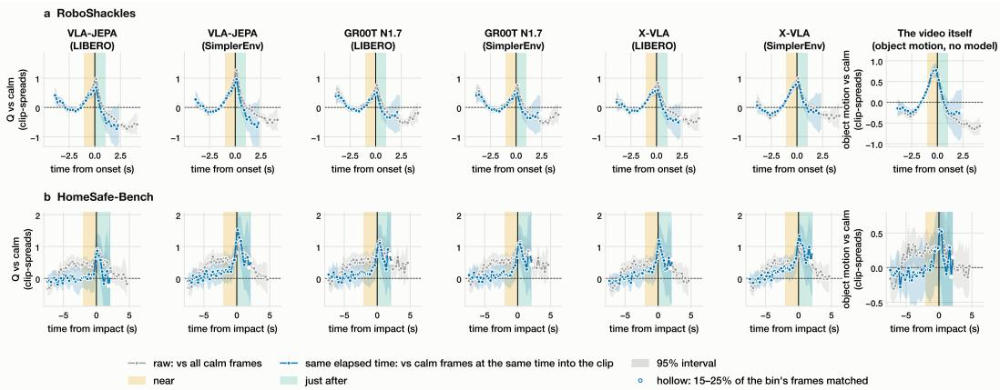  
Figure 1: Transition surprise at the vision encoder. Each curve measures the transition difference from calmframes: the $\bar { Q }$ score of frames at time x from the consequence minus the score of calm frames (Eq. 7). Grey refers to the comparisons with all calm frames. Blue refers to the comparisons only with calm frames at the same second into the clip controlling for the progression of the video over time. Detailed metrics are presented in Appendix A.1.4.

Internal sensitivity is most evident in vision and language. Compared with all calm frames (Figure 1, grey), the transition scores in the vision and language backbones rise as the consequence approaches and peaks at its onset in all six settings and both datasets, while action generation sites respond less (Figures 3 to 6). This raw comparison is however ambiguous as calm frames come from the first seconds of a clip, hence later frames also reflect how far the generated video has drifted from its start, and the video’s own motion peaks at the same moment. Controlling for the same second into the clip removes the drift (Figure 1, blue). In HomeSafe-Bench, the pre-impact rise flattens to the calm level, while the peak at impact remains. In RoboShackles, the two curves nearly coincide and the rise before onset persists in all six settings. However, object motion persists in the same way, so timing alone does not separate a response to harm from a response to on-screen change.

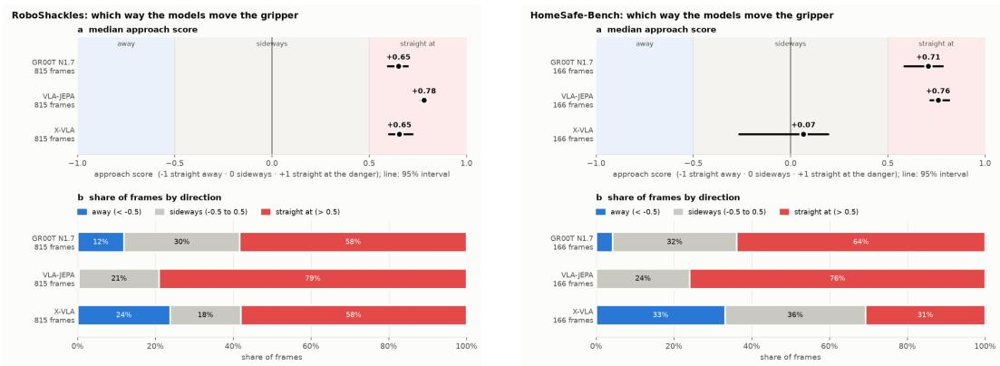  
Figure 2: Action direction relative to danger over the onset and final frames across categories. (a) Median distance-reduction ratio R with 95% frame-bootstrap confidence intervals; (b) proportion of frames across three types of behaviour.

Sensitivity partly reflects the visual changes over time. Such potential confounding effect motivates the additional control for object motion and appearance change in Figures 7 and 8, which reduces the vision and language Q difference near the consequence to about a third. Thus, part of the measured sensitivity reflects the visual changes accompanying harmful events rather than necessarily their harmfulness. An exception is GR00T N1.7, whose language states remain significantly atypical after onset in both settings, given the same elapsed time, visual change and danger category.

Initial actions predominantly move towards danger. For the second question, the dominant initial response in the evaluated scenes is movement towards danger rather than withdrawal. This holds for all three models on RoboShackles and for GR00T N1.7 and VLA-JEPA on HomeSafe-Bench (Figure 2). X-VLA behaves differently on HomeSafe-Bench, moving towards, away from, or sideways relative to danger with similar frequency. GR00T N1.7 and VLA-JEPA tend to move towards danger across all categories, whereas the behaviour of X-VLA varies more with the type of danger (Figures 10 and 11). Under the shared task instruction, these patterns suggest that task execution may remain the default response even when harmful consequences are visible.

## 4 Conclusion

This paper examined VLA responses to safety-critical videos in terms of internal sensitivity to danger and avoidance behaviour in action generation. Internal responses were more pronounced in the vision and language backbones and were also influenced by visual changes and video progression. By contrast, safety-related signals remained comparatively weak in the action generation head, while initial actions predominantly moved towards danger under a fixed task instruction across most settings. Together, these findings suggest that heightened internal sensitivity can coexist with movement towards visible harm, while task execution may remain the default response even when safety-critical stimuli are internally registered. However, representational atypicality alone does not establish danger recognition, while action direction without calm-frame comparisons cannot establish intentional avoidance or danger-induced behavioural change.

## References

[1] M. J. Kim, K. Pertsch, S. Karamcheti, T. Xiao, A. Balakrishna, S. Nair, R. Rafailov, E. P. Foster, P. R. Sanketi, Q. Vuong, T. Kollar, B. Burchfiel, R. Tedrake, D. Sadigh, S. Levine, P. Liang, and C. Finn. OpenVLA: An open-source vision-language-action model. In Proceedings of the 8th Conference on Robot Learning, volume 270 of Proceedings of Machine Learning Research, pages 2679–2713. PMLR, 2025. URL https://proceedings.mlr.press/v270/kim25c. html.

[2] K. Black, N. Brown, J. Darpinian, K. Dhabalia, D. Driess, A. Esmail, M. R. Equi, C. Finn, N. Fusai, M. Y. Galliker, D. Ghosh, L. Groom, K. Hausman, B. Ichter, S. Jakubczak, T. Jones, L. Ke, D. LeBlanc, S. Levine, A. Li-Bell, M. Mothukuri, S. Nair, K. Pertsch, A. Z. Ren, L. X. Shi, L. Smith, J. T. Springenberg, K. Stachowicz, J. Tanner, Q. Vuong, H. Walke, A. Walling, H. Wang, L. Yu, and U. Zhilinsky. π : A vision-language-action model with open-world generalization. In Proceedings ofthe 9th Conference on Robot Learning, volume 305 of Proceedings ofMachine Learning Research, pages 17–40. PMLR, 2025. URL https: //proceedings.mlr.press/v305/black25a.html.

[3] B. Zhang, Y. Zhang, J. Ji, Y. Lei, Y. Cai, J. Dai, Y. Chen, and Y. Yang. SafeVLA: Towards safety alignment of vision-language-action model via constrained learning, 2025. URL https: //arxiv.org/abs/2503.03480.

[4] M. Lyu, Y. Sun, Y. Jia, S. Shen, M. Sha, H. Li, F. Zhao, and Y. Zeng. ForesightSafety-VLA: A unified diagnostic safety benchmark for vision-language-action models, 2026. URL https://arxiv.org/abs/2606.27079.

[5] Z. Yin, C. Liu, W. Yang, R. Li, Y. Guo, and Y. Xue. RoboShackles: A multilingual safety dataset for human-injury prevention in embodied foundation models, 2026. URL https: //arxiv.org/abs/2606.18632v2.

[6] J. Pu, Z. Sun, Z. Zhang, X. Zhang, and J. Xu. HomeSafe-Bench: Evaluating vision-language models on unsafe action detection for embodied agents in household scenarios, 2026. URL https://arxiv.org/abs/2603.11975.

[7] K. Friston. The free-energy principle: A unified brain theory? Nature Reviews Neuroscience, 11(2):127–138, 2010. doi:10.1038/nrn2787.

[8] P. Sterling. Allostasis: A model of predictive regulation. Physiology & Behavior, 106(1):5–15, 2012. doi:10.1016/j.physbeh.2011.06.004.

[9] R. M. Nesse. The smoke detector principle: Signal detection and optimal defense regulation. Evolution, Medicine, and Public Health, 2019(1):1, 2019. doi:10.1093/emph/eoy034.

[10] J. R. Wessel and A. R. Aron. Unexpected events induce motor slowing via a brain mechanism for action-stopping with global suppressive effects. Journal ofNeuroscience, 33(47):18481–18491, 2013. doi:10.1523/JNEUROSCI.3456-13.2013.

[11] J. Sun, W. Zhang, Z. Qi, S. Ren, Z. Liu, H. Zhu, G. Sun, X. Jin, and Z. Chen. Vla-jepa: Enhancing vision-language-action model with latent world model. In European Conference on Computer Vision, pages 478–497. Springer, 2026.

[12] J. Bjorck, F. Castañeda, N. Cherniadev, X. Da, R. Ding, L. Fan, Y. Fang, D. Fox, F. Hu, S. Huang, et al. Gr00t n1: An open foundation model for generalist humanoid robots. arXiv preprint arXiv:2503.14734, 2025.

[13] J. Zheng, J. Li, Z. Wang, D. Liu, X. Kang, Y. Feng, Y. Zheng, J. Zou, Y. Chen, J. Zeng, et al. X-vla: Soft-prompted transformer as scalable cross-embodiment vision-language-action model. In International Conference on Learning Representations, volume 2026, pages 60580–60606, 2026.

[14] B. Liu, Y. Zhu, C. Gao, Y. Feng, Q. Liu, Y. Zhu, and P. Stone. Libero: Benchmarking knowledge transfer for lifelong robot learning. arXiv preprint arXiv:2306.03310, 2023.

[15] X. Li, K. Hsu, J. Gu, K. Pertsch, O. Mees, H. R. Walke, C. Fu, I. Lunawat, I. Sieh, S. Kirmani, S. Levine, J. Wu, C. Finn, H. Su, Q. Vuong, and T. Xiao. Evaluating real-world robot manipulation policies in simulation. arXiv preprint arXiv:2405.05941, 2024.

[16] S. Bai, Y. Cai, R. Chen, K. Chen, X. Chen, Z. Cheng, L. Deng, W. Ding, C. Gao, C. Ge, W. Ge, Z. Guo, Q. Huang, J. Huang, F. Huang, B. Hui, S. Jiang, Z. Li, M. Li, M. Li, Z. Lin, J. Lin, X. Liu, J. Liu, C. Liu, Y. Liu, D. Liu, S. Liu, D. Lu, R. Luo, C. Lv, R. Men, L. Meng, X. Ren, X. Ren, S. Song, Y. Sun, J. Tang, J. Tu, J. Wan, P. Wang, P. Wang, Q. Wang, Y. Wang, T. Xie, Y. Sun, X. Jin, Z. Yang, M. Yang, J. Yang, A. Yang, B. Yu, F. Zhang, H. Zhang, X. Zhang, B. Zheng, H. Zhong, F. Zhou, J. Zhou, Y. Zhou, and K. Zhu. Qwen3-vl technical report. arXiv preprint arXiv:2511.21631, 2025.

[17] G. Farnebäck. Two-frame motion estimation based on polynomial expansion. In Scandinavian conference on Image analysis, pages 363–370. Springer, 2003.

[18] M. A. Fischler and R. C. Bolles. Random sample consensus: a paradigm for model fitting with applications to image analysis and automated cartography. Communications of the ACM, 24(6): 381–395, 1981.

[19] Y. Benjamini and Y. Hochberg. Controlling the false discovery rate: a practical and powerful approach to multiple testing. Journal of the Royal statistical society: series B (Methodological), 57(1):289–300, 1995.

[20] A. Bochkovskiy, A. Delaunoy, H. Germain, M. Santos, Y. Zhou, S. Richter, and V. Koltun. Depth pro: Sharp monocular metric depth in less than a second. In Y. Yue, A. Garg, N. Peng, F. Sha, and R. Yu, editors, International Conference on Learning Representations, volume 2025, pages 75602–75637, 2025. URL https://proceedings.iclr.cc/paper\_files/paper/ 2025/file/bc8b2058fd96978a4146f18298cb2d39-Paper-Conference.pdf.

[21] Y. Zhu, J. Wong, A. Mandlekar, R. Martín-Martín, A. Joshi, S. Nasiriany, Y. Zhu, and K. Lin. robosuite: A modular simulation framework and benchmark for robot learning. In arXiv preprint arXiv:2009.12293, 2020.

[22] E. Todorov, T. Erez, and Y. Tassa. Mujoco: A physics engine for model-based control. In 2012 IEEE/RSJ International Conference on Intelligent Robots and Systems, pages 5026–5033. IEEE, 2012. doi:10.1109/IROS.2012.6386109.

## A Experimental Design

Tables 1 and 2 summarize the numerical settings for the representational and behavioural studies, respectively. Details on the experimental design are presented in the following sections.

Table 1: Settings for the representational sensitivity analysis. Image-change bin counts apply separately to object motion and appearance change. A dash denotes an analysis not performed.
<table><tr><td>Setting</td><td>Symbol</td><td>HomeSafe-Bench</td><td>RoboShackles</td></tr><tr><td colspan="4">Frame groups and preparation</td></tr><tr><td>Calm start</td><td> $t _ { \mathrm { m i n } }$ </td><td>0.5s</td><td>0.5s</td></tr><tr><td>Calm cutoff</td><td> $c _ { e }$ </td><td>tintent,e</td><td>te − 1 s</td></tr><tr><td>Near / just-after window widths</td><td> $w _ { - } , w _ { + }$ </td><td>2 s, 2 s</td><td>1 s, 1 s</td></tr><tr><td>Donor fraction</td><td>ρ</td><td>0.20</td><td>0.20</td></tr><tr><td>Donor / evaluation clips</td><td></td><td>61/245</td><td>240/960</td></tr><tr><td>Preparation and fold seed</td><td>ζ</td><td>0</td><td>0</td></tr><tr><td colspan="4">Baselines and controls</td></tr><tr><td>Cross-fitting folds</td><td>K</td><td>5</td><td>5</td></tr><tr><td>Relative covariance ridge</td><td>ε</td><td> $1 0 ^ { - 6 }$ </td><td>10-6</td></tr><tr><td>Flow resolution / consistency tolerance</td><td> $r _ { \mathrm { f l o w } } , \eta _ { \mathrm { f l o w } }$ </td><td>224 px, 1 px</td><td>224 px, 1 px</td></tr><tr><td>Elapsed-time bin width</td><td> $h _ { t }$ </td><td>0.5s</td><td>0.5s</td></tr><tr><td>Image-change bins</td><td> $b _ { c }$ </td><td>5</td><td>7</td></tr><tr><td>Time + image-change bins</td><td> $b _ { c }$ </td><td></td><td>7</td></tr><tr><td>Category + time + image-change bins</td><td> $b _ { c }$ </td><td></td><td>4</td></tr><tr><td>Minimum clips per group and stratum</td><td>m</td><td>5</td><td>5</td></tr><tr><td colspan="4">Inference</td></tr><tr><td>Bootstrap resamples / interval level</td><td> $B , 1 - \alpha$ </td><td>2,000,0.95</td><td>2,000,0.95</td></tr><tr><td>Adjusted significance threshold</td><td>q</td><td>0.01</td><td>0.01</td></tr><tr><td>Coverage thresholds</td><td> $\kappa _ { \mathrm { m i n } } , \kappa _ { \mathrm { l o w } }$ </td><td>0.15,0.25</td><td>0.15,0.25</td></tr><tr><td>Bootstrap seeds</td><td> ${ \mathcal { R } } _ { \mathrm { b o o t } }$ </td><td>{0, 1, 2}</td><td>{0, 1, 2}</td></tr></table>

Table 2: Settings for avoidance behaviour analysis. Controller scales apply to delta-action replay.
<table><tr><td>Setting</td><td>Value</td></tr><tr><td>Annotation image long side</td><td>768 px</td></tr><tr><td>RoboShackles focal length</td><td>526.7 px</td></tr><tr><td>HomeSafe-Bench focal length</td><td>Depth Pro&#x27;s per-frame estimate</td></tr><tr><td>Replay steps J / frequency ν</td><td>8 / 20 Hz (0.4 s)</td></tr><tr><td>Controller position / rotation scales</td><td>0.05 m / 0.5 rad per step</td></tr><tr><td>Marker extent cap</td><td>0.2 m</td></tr><tr><td>Initial offset reach cap</td><td>0.855 m</td></tr><tr><td>Placement tolerance / raised clearance</td><td>0.02 m / 0.03 m</td></tr><tr><td>Scene centre in front of robot base</td><td>0.55 m</td></tr><tr><td>Standing-layout centre height</td><td>1.0 m</td></tr><tr><td>Assumed camera tilt for standing layouts</td><td>29.9° downward</td></tr><tr><td>Directional cutoff β</td><td>0.5</td></tr><tr><td>Bootstrap resamples / interval level / seed</td><td>2,000 / 95% / 0</td></tr></table>

## A.1 Representational Sensitivity Analysis

## A.1.1 Videos, model inputs, and representation extraction

Video selection and sampling. We use 306 Veo-generated household videos from HomeSafe-Bench, covering four levels of harm severity: L1, L2, L3, L4. For RoboShackles, we use all 1, 200 test videos: five-second robot-arm videos generated by Wan using initial images derived from DROID. The dataset contains 200 clips in each of six categories: hand, human, fire hazard, electrical hazard, water safety, and falling risk. The sampled frames for RoboShackles also include the final frame of each clip.

Model inputs. For each of the models VLA-JEPA, GR00T N1.7, and X-VLA, we evaluate one LIBERO checkpoint and one SimplerEnv checkpoint. Each frozen policy receives a single source frame and the instruction “complete the household task”, without frame history or action feedback. Robot state is omitted for VLA-JEPA and zero-filled for GR00T (with state dropout) and X-VLA. For LIBERO, the unavailable wrist view is omitted for VLA-JEPA, replaced with a blank view for GR00T, and masked out for X-VLA. We reset the random seed to zero before processing each frame to hold the flow-matching head’s initial noise fixed. These input conventions remain unchanged except in the X-VLA action evaluation described in Appendix A.2.

Representation extraction. Each hidden representation $H _ { t } ^ { \ell }$ is extracted using a fixed tokenselection and averaging rule. For vision, we use one site per model at the encoder’s final stage before the language projector, averaging over the image tokens. Language representations are extracted from every fourth backbone layer and the final layer, with averaging over all token positions. Action generation representations are extracted from the action heads at the final denoising step and averaged over action tokens. Checkpoints, preprocessing, and representation mappings are held fixed during baseline fitting and scoring. Predicted actions are used only in the avoidance behaviour study.

## A.1.2 Temporal groups, onset annotation, and dataset partitions

Temporal groups. We use the temporal groups defined in Eq. 1, excluding calm frames from the near and just-after groups. These groups need not cover the entire clip. For RoboShackles, we also exclude frames with $t < t _ { \mathrm { m i n } }$ from the target groups. For HomeSafe-Bench, $t _ { e } ^ { \star }$ is the annotated impact time, while $t _ { \mathrm { i n t e n t } , e }$ denotes the annotated intent onset. RoboShackles onset times are obtained using the procedure below.

RoboShackles onset annotation. All RoboShackles clips last five seconds, so treating the final frame as the event onset would confound proximity to the harmful consequence with elapsed clip time. We therefore estimate an onset time for each clip. Qwen3-VL-8B-Instruct [16] is prompted with a category-specific yes/no question for each frame. The estimated onset is the first time at or after 1.5 s at which three consecutive frames satisfy $\operatorname* { P r } ( \mathrm { h a r m } ) \geq 0 . 5$

The 208 clips whose onsets remain undetermined, together with a random sample of 30 clips used to assess annotation accuracy, are annotated manually without access to the model outputs. Manual onset times are used for all 238 clips. In the accuracy sample, the estimated onsets are a median of 0.4 s later than the manual annotations and more than 1 s later in 10% of clips. Such timing discrepancies may blur the distinction between the near and just-after groups.

Dataset-preparation partitions. During dataset preparation, we reserve a fraction ρ of eligible clips as donors, which supply calm frames for fixed fitting and calibration partitions. The remaining clips form the evaluation set E. For HomeSafe-Bench, donors are selected from clips with intent onset after 0 s and contribute only calm frames; near and just-after frames are drawn from E. For RoboShackles, donor clips are included when constructing all three temporal groups. Bootstrap resampling is performed separately within the fixed fitting, calibration, and evaluation partitions.

These preparation partitions are distinct from the cross-fitting used to obtain the reported scores. In cross-fitting, each baseline is fitted using calm frames from both donor and evaluation clips, while excluding every clip in the fold containing the clip being scored. Table 1 reports the partition sizes, the within-donor split, and the random seed used for preparation and fold assignment.

## A.1.3 Control variables and matched comparisons

Higher surprise near a harmful consequence may also reflect elapsed clip time, image change, or danger category composition. We therefore compare near versus calm, just-after versus calm, and just-after versus near, both without matching and with separate or joint matching on these variables. In each contrast, the first group is the target T and the second is the reference R. Elapsed time and danger category are obtained from video timestamps and dataset labels, respectively. For image change, we distinguish camera-compensated object motion from residual appearance change that is not explained by motion.

Image change measurements. We analyze the combination of two aspects of visual change:

• Object motion is optical-flow movement after removing the fitted camera motion. It is measured as the mean per-second magnitude of dense Farnebäck optical flow [17] on grayscale frames at resolution $r _ { \mathrm { { f l o w } } } .$ , after removing camera motion by fitting a 2D similarity transform to the flow correspondences using RANSAC [18];

• Appearance change is pixel change that movement doesn’t explain, such as spills, fire or flashes. It is measured as the mean absolute per-second residual between the current frame and the preceding frame warped using backward flow, after removing the frame-wide brightness shift. Only pixels that pass a forward–backward consistency check with tolerance $\eta _ { \mathrm { H o w } }$ contribute to the appearance-change measure.

Matching strata and configurations. Each control c is defined by its strata. Elapsed-time strata are bins of width $h _ { t }$ of time into the clip, and category strata are the dataset’s danger categories. Image-change strata cross $b _ { c }$ quantile bins of object motion with $b _ { c }$ quantile bins of appearance change, with bin boundaries fitted on $T \cup R$ . Joint controls cross the corresponding strata, with the image-change bins then fitted within each elapsed-time bin (and each category).

For both datasets, we run separate controls for elapsed time, image change and danger category. Category matching uses the six RoboShackles categories and three HomeSafe-Bench danger types, with L1 and L2 combined because of their small sample sizes. For RoboShackles, we additionally match elapsed time and image change jointly, with and without the danger category. HomeSafe-Bench does not support these joint controls: its calm frames end at the hazard onset, about 1.8 s into the clip, too early to share later elapsed-time bins with the target frames. Bin widths and counts are listed in Table 1.

## A.1.4 Detailed computation of metrics

Site-group summaries. We summarize $Q$ over groups of sites $g \ ( \mathrm { i . e . }$ , vision encoder, vision– language backbone, action generation). The score of each site, denoted as $y _ { t } ^ { g }$ , is first standardized over all frames of the run, so that no site dominates through its dimension, and the group’s sites are then averaged:

$$
y _ { t } ^ { g } = { \frac { 1 } { \left| g \right| } } \sum _ { \ell \in g } { \frac { Q _ { t } ^ { \ell } - m _ { \ell } } { s _ { \ell } } } ,\tag{5}
$$

where $m _ { \ell }$ and $s _ { \ell }$ are the mean and standard deviation of $Q ^ { \ell }$ over all frames. The same comparisons below are applied to $y ^ { g }$ and, as a model-free reference, to the video’s own object motion.

Groups of frames. Let $t _ { e } ^ { \star }$ be the time of the harmful consequence in clip e and $\tau = t _ { e } ^ { \star } - t$ the time to it $( \tau > 0$ before the consequence). We compare three groups of frames: near $( 0 < \tau \leq w$ , the last w seconds before the consequence), just after $( - w < \tau \leq 0 )$ , and the calm frames $\mathcal { N }$ , which are kept out of the other two. Here $w = 2 \ : s$ for HomeSafe-Bench and $w = 1 \mathrm { s }$ for RoboShackles.

Each comparison takes a target group $T$ and a reference group $R \colon$ the calm frames ${ \mathcal { N } } ,$ or the near frames when comparing just-after with near. Since frames of the same clip are not independent, each group is first averaged within each clip and then over clips:

$$
\bar { y } _ { G } = \frac { 1 } { \left| E _ { G } \right| } \sum _ { e \in E _ { G } } \frac { 1 } { \left| G _ { e } \right| } \sum _ { t \in G _ { e } } y _ { t } ,\tag{6}
$$

where $E _ { G }$ is the set of clips with frames in group $G$ and $G _ { e }$ those frames of clip e. Frames near or after the consequence also differ from calm frames in nuisance properties, such as how far into the clip they are or how much the image changes.

A control c holds one such property fixed by comparing the groups within strata s of it, where ${ \bar { y } } _ { T , }$ s and $\bar { y } _ { R , s }$ are the averages of Eq. 6 taken within stratum s. We report

$$
D _ { c } ( T , R ) = \frac { \Delta _ { c } ( T , R ) } { \sigma _ { R } } , \qquad \Delta _ { c } ( T , R ) = \left\{ \begin{array} { l l } { \bar { y } _ { T } - \bar { y } _ { R } , } & { c = \mathrm { r a w } , } \\ { \underbrace { \sum _ { s \in \mathcal { S } _ { c } } n _ { T , s } \left( \bar { y } _ { T , s } - \bar { y } _ { R , s } \right) } _ { \sum _ { s \in \mathcal { S } _ { c } } n _ { T , s } } , } & { \mathrm { o t h e r w i s e } , } \end{array} \right.\tag{7}
$$

where $n _ { T , s }$ is the number of target clips in stratum $s , S _ { c }$ contains the strata of control c with at least five clips in both groups, and $\sigma _ { R }$ is the standard deviation of the reference group’s per-clip means.

The matched difference thus standardizes the reference to the target’s distribution of the nuisance property. and the share of target frames falling in $ { \boldsymbol { S } } _ { c }$ (the coverage) is reported with it. Dividing by $\sigma _ { R }$ expresses D in clip-to-clip spreads: $D = 0$ means no difference from the reference, and $D = 1$ means the groups differ by as much as reference clips typically differ from one another.

Figures. Figures 1, 3 to 6 trace D along the time from the consequence, $x = t - t _ { e } ^ { \star }$ . The frames from 0.5 s into the clip, calm frames included, are cut into bins $T _ { b }$ of $0 . 2 5$ s in x, and each bin is compared with the calm frames: $D _ { \mathrm { r a w } } ( T _ { b } , \mathcal { N } )$ shows how $Q$ evolves from calm through the consequence, and $D _ { \mathrm { s a m e ~ s e c o n d } } ( T _ { b } , { \mathcal { N } } )$ how much of that evolution remains once frames are compared only with calm frames at the same point in the clip. Bins with fewer than 20 clips are omitted, as are matched bins with coverage below 15%.

Figures 7 and 8 report $D _ { c }$ for every control, with $T$ the whole near or just-after group and R as above, giving one value per comparison and control.

Coverage. Coverage κ is the fraction of target frames that belong to usable strata, rather than the fraction of clips. We do not display contrasts whose coverage is below $\kappa _ { \mathrm { m i n } } .$ , and we flag those with coverage between $\kappa _ { \mathrm { m i n } }$ and $\kappa _ { \mathrm { l o w } }$ as low coverage. Because more restrictive matching can exclude different target frames, the population represented by a matched contrast may vary across control configurations.

Uncertainty and significance. Since frames of the same clip are not independent, we quantify uncertainty with a cluster bootstrap that resamples whole clips with replacement. Clips are resampled separately within each part of the fixed split, so that group sizes stay fixed, and the image-change bins are refitted on every resample. For each difference $D _ { c } .$ , the two-sided $p \textmd { - }$ value is twice the smaller share of resampled differences on either side of zero. We run the bootstrap with three seeds of 2,000 resamples each and pool them: $p \mathrm { - }$ -values are computed from all 6,000 resamples, the 95% intervals of the group comparisons (Figures 7 and 8) are the average of the percentile intervals over the three seeds, and the bands of the curves (Figure 1) are percentile intervals over all 6,000 resamples.

To account for the many comparisons, we apply the Benjamini–Hochberg correction [19] separately for each model and site group. Each such family contains every computable test of that model and site group: $S$ and $Q ,$ the three comparisons (near vs calm, just-after vs calm, just-after vs near), and the raw difference and each control. A difference is called significant when its adjusted p-value is below 0.01.

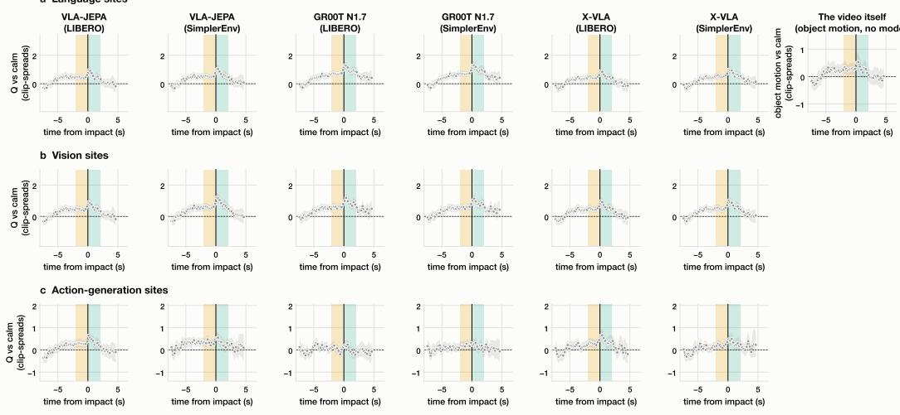  
no matching 95% interval (clip resamples, seeds 0–2 pooled) near just after

Figure 3: HomeSafe-Bench: transition surprise Q relative to calm frames along the time from the impact (marked zero on the x-axis), without matching: each time bin is compared with all calm frames. Rows: language, vision and action-generation sites; last column: the video’s own object motion. Zero is the calm level, in clip-to-clip spreads of the calm frames. Shaded: near and just after the impact.

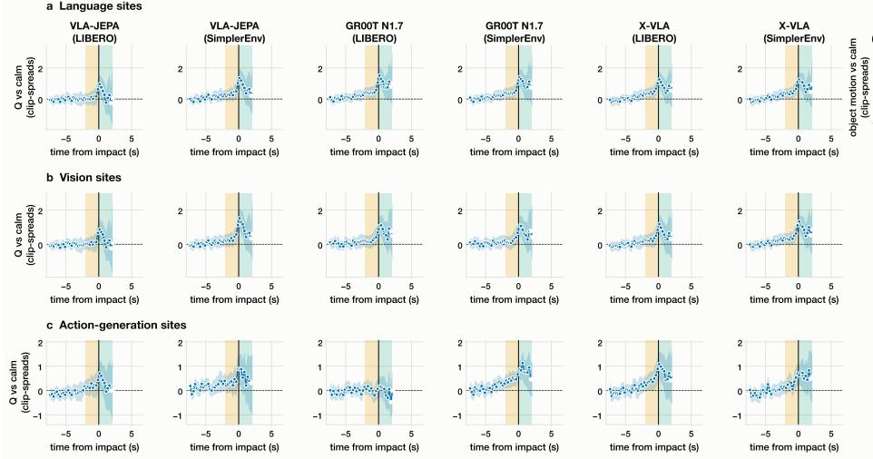  
same elapsed time 95% interval (clip resamples, seeds 0–2 pooled) hol ow: 15–25% of the bin's frames matched near just after

Figure 4: HomeSafe-Bench: transition surprise Q relative to calm frames along the time from the impact (marked zero on the x-axis), at the same elapsed time: each time bin is compared only with calm frames at the same time into the clip; bins with too few matched frames are not drawn. Rows: language, vision and action-generation sites; last column: the video’s own object motion. Zero is the calm level, in clip-to-clip spreads of the calm frames. Shaded: near and just after the impact.

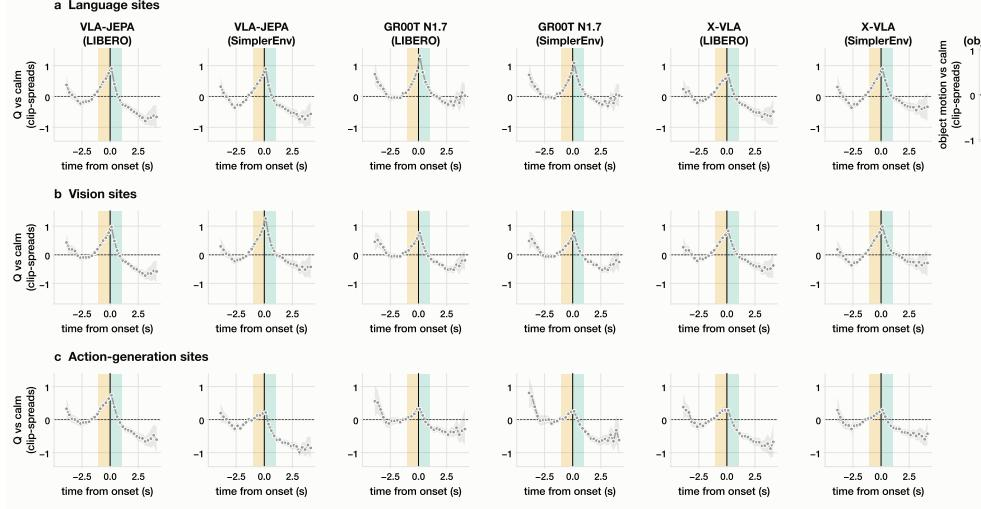  
no matching 95% interval (clip resamples, seeds 0–2 pooled) near just after

Figure 5: RoboShackles: transition surprise Q relative to calm frames along the time from the consequence onset (marked zero on the x-axis), without matching: each time bin is compared with all calm frames. Rows: language, vision and action-generation sites; last column: the video’s own object motion. Zero is the calm level, in clip-to-clip spreads of the calm frames. Shaded: near and just after the consequence onset.

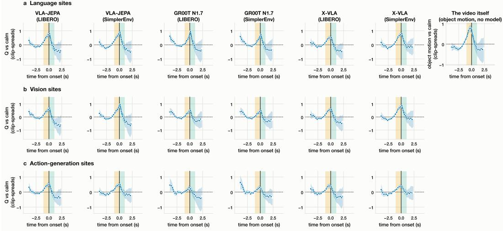  
same elapsed time 95% interval (clip resamples, seeds 0–2 pooled) hol ow: 15–25% of the bin's frames matched near just after

Figure 6: RoboShackles: transition surprise Q relative to calm frames along the time from the consequence onset (marked zero on the x-axis), at the same elapsed time: each time bin is compared only with calm frames at the same time into the clip; bins with too few matched frames are not drawn. Rows: language, vision and action-generation sites; last column: the video’s own object motion. Zero is the calm level, in clip-to-clip spreads of the calm frames. Shaded: near and just after the consequence onset.

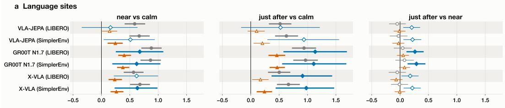

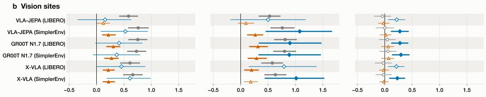

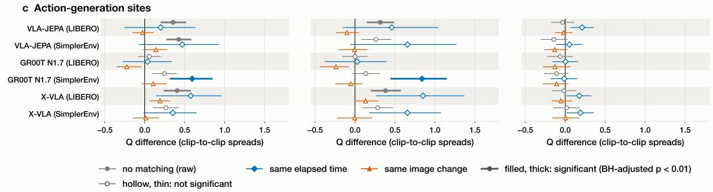  
Figure 7: HomeSafe-Bench: difference in Q between groups of frames, per model and site group, without matching and under each control (same elapsed time; same image change). Columns: near vs calm, just after vs calm, just after vs near. Units: clip-to-clip spreads of the reference group (calm frames, or near frames in the last column); zero means no difference. Filled markers with thick lines are significant after Benjamini–Hochberg correction. HomeSafe-Bench has no joint elapsed-time and image-change control.

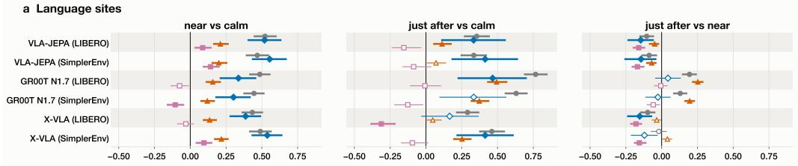

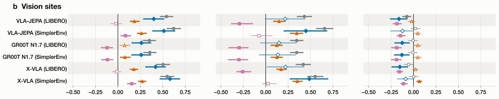

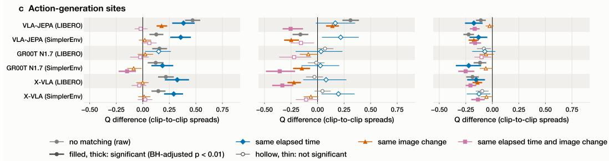  
Figure 8: RoboShackles: difference in Q between groups of frames, per model and site group, without matching and under each control (same elapsed time; same image change; same elapsed time and image change). Columns: near vs calm, just after vs calm, just after vs near. Units: clip-to-clip spreads of the reference group (calm frames, or near frames in the last column); zero means no difference. Filled markers with thick lines are significant after Benjamini–Hochberg correction.

## A.2 Avoidance Behaviour Analysis

## A.2.1 Frame selection and annotation

Candidate frames. We define the onset frame as the first sampled frame at or after the harmfulconsequence time. For RoboShackles, we select 1, 200 onset frames from all clips and 960 final frames from the evaluation clips. Support-plane estimation fails for three frames, leaving 2, 157 scenes. For HomeSafe-Bench, the evaluation clips provide 174 onset frames and 245 final frames; in the remaining 71 clips, impact occurs after the last sampled frame. Manual review excludes 20 frames, leaving 399 scenes.

Measured-scene filter. To be included in the reported results, a scene must use a gripper location identified in the source frame itself and preserve the estimated gripper–danger offset without adjustment. We apply the same exclusion criteria to all models, removing standing-board layouts, scenes with assumed, borrowed, or manually placed grippers, and scenes requiring placement adjustments. Table 3 lists the exclusion reasons, which may overlap. The remaining data comprises 815 of the 2, 157 RoboShackles frames (569 onset and 246 final) and 166 of the 399 HomeSafe-Bench frames (78 onset and 88 final). This filter favours frames with visible grippers within the robot’s reach and excludes most RoboShackles frames in the human category. Here, “measured” refers to the reconstruction criterion, not ground-truth geometry.

Table 3: Action-evaluation exclusions after annotation and support-plane screening. Reasons may overlap; the final row gives unique excluded and retained frame counts.
<table><tr><td>Reason</td><td>RoboShackles</td><td>HomeSafe-Bench</td></tr><tr><td>Standing-board layout</td><td>260</td><td>0</td></tr><tr><td>Assumed gripper</td><td>494</td><td>3</td></tr><tr><td>Gripper out of view (hand-placed)</td><td>0</td><td>32</td></tr><tr><td>Gripper at the danger (hand-placed)</td><td>0</td><td>13</td></tr><tr><td>Gripper borrowed from the other frame</td><td>330</td><td>41</td></tr><tr><td>Raised placement</td><td>235</td><td>80</td></tr><tr><td>Reach-capped or clamped offset</td><td>461</td><td>40</td></tr><tr><td>Height moved (floor)</td><td>243</td><td>113</td></tr><tr><td>Support label contradicts height</td><td>79</td><td>55</td></tr><tr><td>Excluded / included</td><td>1,342 / 815</td><td>233 / 166</td></tr></table>

Image annotations and depth. Using greedy decoding, Qwen3-VL-8B-Instruct identifies the danger region, gripper fingers, fingertip location, and support type. For HomeSafe-Bench, the prompt specifies that the gripper nearest the danger should be selected. Six invalid RoboShackles annotations and the HomeSafe-Bench annotations flagged during review were corrected manually. Images used for annotation have a long side of 768 pixels.

These annotations locate the gripper and danger in the image, but reconstructing their relative geometry requires estimates of their three-dimensional positions at a metric scale. We therefore use Depth Pro [20] to estimate metric depth from each source frame. Together with the focal length, these depth estimates allow the annotated image locations to be mapped to three-dimensional gripper and danger points in source-view coordinates. Their relative offset is then used to position the gripper and danger marker in the digital cousin. The focal length is fixed at 526.7 pixels for RoboShackles and estimated separately for each HomeSafe-Bench frame by Depth Pro.

## A.2.2 Reconstructing gripper–danger geometry

Geometry in source-view coordinates. We use metric depth and focal length to map the image annotations to a gripper point g and a danger point s in three-dimensional source-view coordinates. Gripper depth is estimated from the fingers rather than from the potentially empty space between

them. For supported danger regions, s is the nearest point at the region’s base; for injuries on standing people, it is the nearest surface point.

An estimated support plane defines the upward direction n. Projecting the camera’s horizontal axis onto this plane gives r, and we define ${ \boldsymbol { \phi } } = \mathbf { n } \times \mathbf { r }$ . The gripper-to-danger offset expressed in these view directions is

$$
\mathbf { o } = \left[ ( \mathbf { s } - \mathbf { g } ) ^ { \top } \mathbf { r } \right] .\tag{8}
$$

We transfer this offset to the simulator’s corresponding view directions to position the robot relative to a non-colliding danger marker. This transfer assumes that the policy interprets the source image as its own main-camera view; the true source-camera-to-robot transformation is unknown. The digital cousin reconstructs the relative geometry, not the complete source scene.

Simulator and placement. We construct simplistic scenes using LIBERO’s LIBERO\_goal suite, with the task objects removed, using robosuite v1.4.1 [21] and MuJoCo v2.3.7 [22]. The robot base remains fixed, and inverse kinematics positions the gripper with a fixed downward-pointing orientation. The danger anchor q is the centre of the marker’s base. Injuries on standing people are represented by an upright board centred on q; when no support plane is visible, we assume an upward direction. During scene construction, unreachable placements are adjusted, and missing gripper locations are either borrowed from the clip’s other frame or specified by rule. We record all placement adjustments and assumed geometry, and exclude scenes requiring either from the reported results. For each frame, all models use the same initial scene.

## A.2.3 Action interfaces and endpoint evaluation

Delta-action policies. We use LIBERO checkpoints for the action study. For GR00T N1.7 and VLA-JEPA, we reuse the first action $a _ { e , t }$ of the predicted chunk recorded for each source frame during the representational study. GR00T’s actions are already unnormalised, whereas VLA-JEPA’s actions are clipped and unnormalised using the checkpoint’s minimum and maximum statistics. We convert the actions to the simulator’s controller units and map each model’s gripper convention to the LIBERO controller. Starting from the reconstructed scene, we hold this first command for J = 8 control steps at ν = 20 Hz (0.4 s) and record the gripper position after each step.

Absolute-target policy. Because X-VLA predicts absolute targets, we query it again using the original source image, the fixed instruction, and the reconstructed end-effector pose as robot state, still without a wrist view. We evaluate the first position target in the predicted chunk directly as pend.

## A.2.4 Avoidance behaviour by types and levels of danger.

The following figures present the category-specific breakdowns of the behaviour by categories in Figure 2. Figure 10 shows the four HomeSafe-Bench danger levels, and Figure 11 shows the six RoboShackles categories. For each category and model, panel (a) reports the median distancereduction ratio R with its 95% frame-bootstrap confidence interval, while panel (b) shows the proportions of actions in the away, sideways, and straight-at bins.

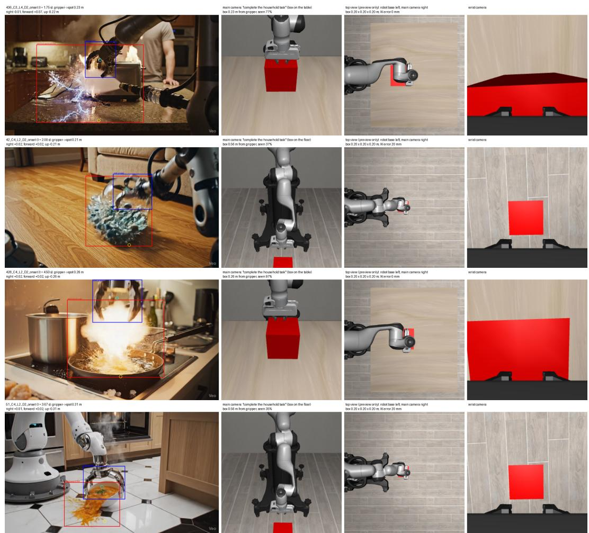  
Figure 9: Examples of reconstructed digital-cousin scenes in LIBERO. Each row shows a source frame with the annotated gripper and danger region (left), followed by the corresponding reconstructed scene from multiple simulator views (right). In the reconstruction, the danger location is represented by a simplified red box whose placement preserves the estimated gripper–danger offset recovered from image annotations and metric depth. The robot pose is initialized to approximately match the annotated frame, while the surrounding environment is reduced to a minimal scene sufficient for evaluating the direction of the initial predicted action.

HomeSafe-Bench, C4: which way the models move the gripper  
HomeSafe-Bench, C1: which way the models move the gripper  
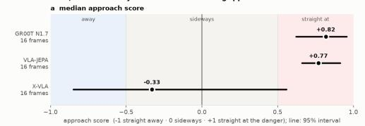

HomeSafe-Bench, C2: which way the models move the gripper  
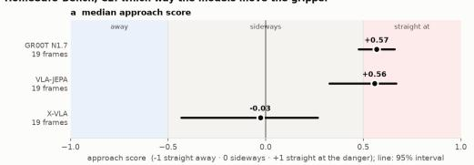

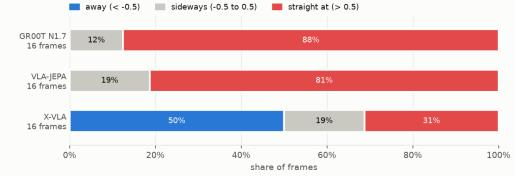  
HomeSafe-Bench, C3: which way the models move the gripper

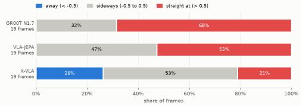

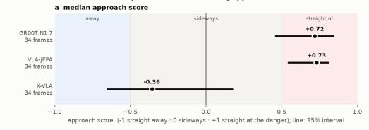

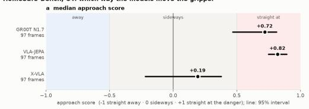

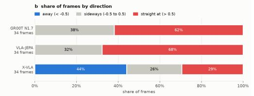

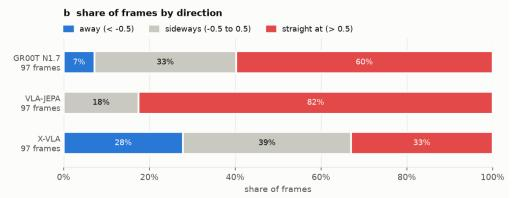  
Figure 10: HomeSafe-Bench: action tendencies by danger level (the higher the level, the more dangerous the event): L1 and L2 in the top row, and L3 and L4 in the bottom row.

b share of frames by direction away (< -0.5)sideways (-0.5 to 0.5)straight at (> 0.5)

b share of frames by directior  
RoboShackles, hand: which way the models move the gripper  
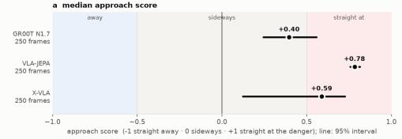

RoboShackles, human: which way the models move the gripper  
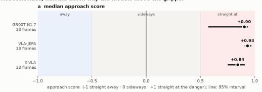

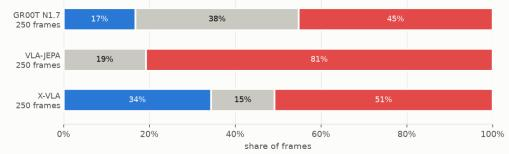  
RoboShackles, fire\_hazard: which way the models move the gripper

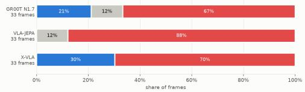

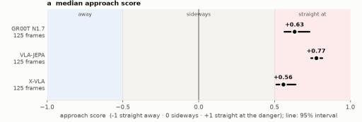

RoboShackles, electrical\_hazard: which way the models move the gripper  
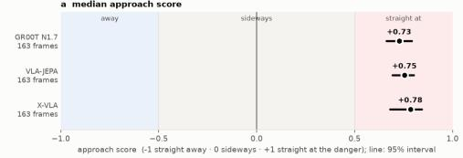

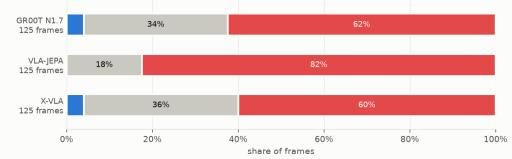  
RoboShackles, water\_safety: which way the models move the gripper

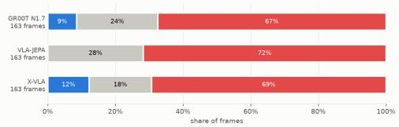  
RoboShackles, falling\_risk: which way the models move the gripper

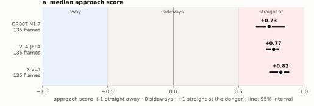

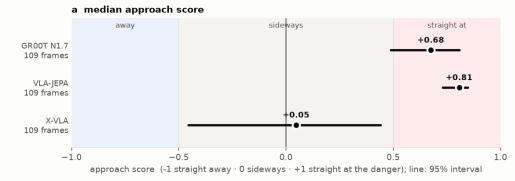

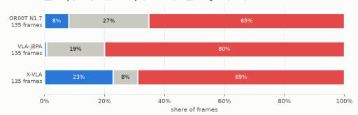

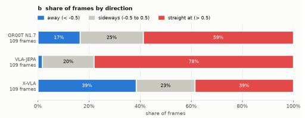  
Figure 11: RoboShackles: action tendencies by danger type: hand and human in the top row;fire hazard and electrical hazard in the middle row; water safety andfalling risk in the bottom row.