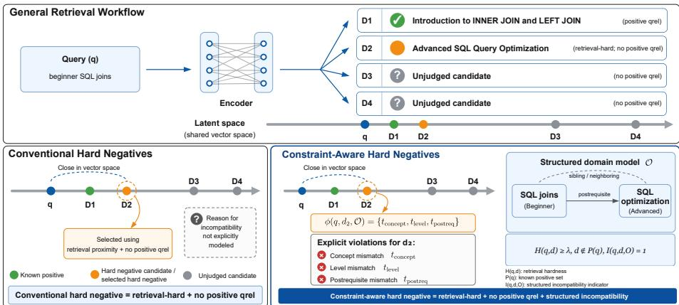
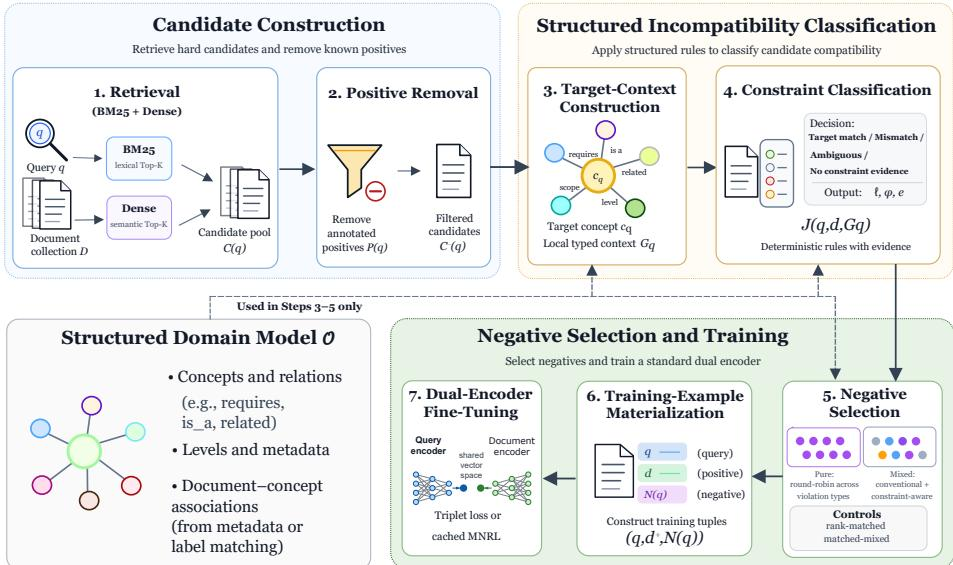
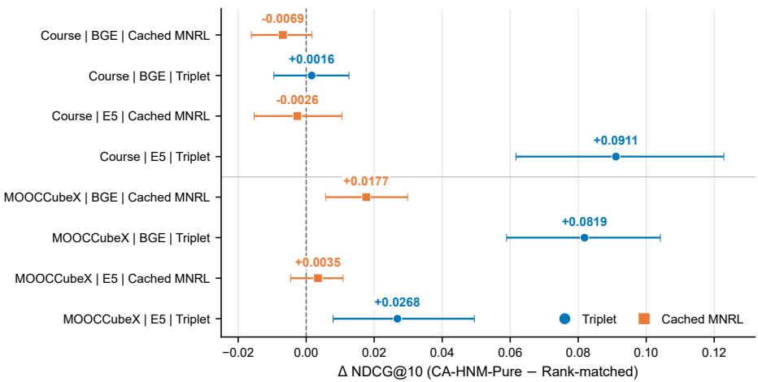

# CA-HNM: Constraint-Aware Hard Negative Mining for Dense Retrieval with Structured Domain Models

Ngo.c Luyê.n Lê1,2[0000-0002-2043-0679], Marie-Hélène Abel2[0000-0003-1812-6763], and Bertrand Laforge3[0000-0002-4209-4194]

1 Gamaizer, 93340 Le Raincy, France

2 Université de technologie de Compiègne, CNRS, Heudiasyc (Heuristics and Diagnosis of Complex Systems), CS 60319, 60203 Compiègne Cedex, France {ngoc-luyen.le,marie-helene.abel}@hds.utc.fr

3 Sorbonne Université, CNRS UMR 7585, LPNHE (Laboratoire de Physique Nucléaire et des Hautes Énergies), 75252 Paris Cedex 05, France laforge@lpnhe.in2p3.fr

Abstract. Dense retrievers are commonly trained with hard negatives selected from lexical or dense retrieval results. Retrieval proximity, however, does not indicate whether a candidate conflicts with explicit domain structure. We introduce CA-HNM, a constraint-aware hard-negative mining framework that combines retrieval-based candidate generation with deterministic incompatibility rules derived from a structured domain model. The framework removes known positives, constructs a local typed context around the query target, records relational, scope, target, and level mismatches, and uses the resulting candidates to fine-tune a standard dual encoder. Structured information is required only during ofline negative construction. We evaluate CA-HNM on MOOCCubeX and Course-Skill Atlas with two encoders, two training losses, and ten seeds. Relative to a retrieval-rank-matched control, CA-HNM-Pure has higher mean NDCG@10 in six of eight dataset–encoder–loss configurations. Four hierarchical 95% bootstrap intervals are entirely above zero, mostly under triplet loss. In a separate experiment, CA-HNM-Mixed shows slightly higher mean NDCG@10 than a matched-mixed control on both collections. Structural variants show that changes in available structure can also change candidate eligibility and negative-pool composition. The results indicate that the contribution of constraint-aware selection depends on the training objective and the composition of the negative pool.

Keywords: Dense retrieval · Hard-negative mining · Structured domain models · Educational retrieval · Contrastive learning

## 1 Introduction

Dense retrieval models are typically trained by contrasting a relevant document with one or more documents treated as negatives. The choice of negatives has a direct efect on the training signal: random negatives are often too easy, whereas lexical or dense retrieval can provide candidates that are close to the query and therefore more informative [9, 27, 16, 29]. Existing hard-negative strategies consequently define hardness mainly through lexical score, embedding similarity, or retrieval rank. These signals are useful for locating dificult candidates, but they do not determine whether an unjudged candidate is a valid negative. Incomplete relevance judgments can leave missing positives or ambiguous cases among highly ranked documents [2].

Structured domains provide another source of information. Concepts may be linked through prerequisite, hierarchical, related-concept, scope, or level relations. A document can therefore be retrieval-hard while still conflicting with the target represented by the query. For example, a resource about advanced SQL optimization may be close to a query for “beginner SQL joins” even though its target concept and level difer. Such structure can be used during training-data construction without changing the retriever architecture.

We introduce CA-HNM, a constraint-aware hard-negative mining framework. Starting from lexical and dense retrieval results, CA-HNM removes known positives, constructs a local typed context for the query target, evaluates the remaining candidates with deterministic compatibility rules, and records the rule evidence associated with each selected negative. The structured model is used only during ofline negative construction; training and inference use a standard dual encoder.

To evaluate the proposed selection mechanism, the empirical study addresses three research questions: RQ1 - How does constraint-aware negative selection compare with retrieval-rank-matched selection? RQ2 - What is the contribution of constraint-aware negatives within a mixed negative pool? RQ3 - How do changes in the structured information available to the classifier afect negative selection and retrieval performance? The evaluation covers MOOCCubeX and Course-Skill Atlas, BGE and E5 encoders [26, 25], triplet loss and cached multiple-negatives ranking loss (cached MNRL) [5], and ten training seeds.

The contributions are threefold. First, we formulate hard-negative mining by separating retrieval hardness, positive annotation, and operational incompatibility under a structured domain model. Second, we define a mining pipeline that associates selected negatives with explicit relation, scope, target, or level evidence while leaving the inference-time retriever unchanged. Third, we provide a multiseed evaluation aligned with these research questions through rank-matched, matched-mixed, and structural controls across multiple encoders, losses, and datasets.

The remainder of the paper is organized as follows. Section 2 reviews hardnegative mining, generated supervision, and structured knowledge in retrieval. Section 3 defines the problem, and Section 4 presents CA-HNM. Section 5 describes the experimental protocol. Section 6 reports the results, followed by the discussion in Section 7 and the conclusion in Section 8.

## 2 Related Work

Prior work relevant to this study spans three areas: hard-negative mining for dense retrieval, synthetic retrieval supervision, and the use of structured knowledge in information retrieval. We focus on how these approaches construct or select training signals for retrieval models.

Dense Passage Retrieval and Sentence-BERT use bi-encoder representations for eficient semantic retrieval [9, 18], while ColBERT and SPLADE use late interaction and learned sparse representations [10, 4]. BEIR highlights performance variation across domains and tasks [22].

For negative selection, ANCE mines approximate nearest neighbors [27], Rock etQA combines large candidate pools with denoising [16], ADORE selects highly ranked dense negatives [29], and BM25 supplies lexically similar candidates [20]. Negative efectiveness depends on dificulty and sampling strategy [6, 17]. However, unjudged high-ranking documents may be relevant when judgments are incomplete [2], motivating selection signals beyond retrieval proximity.

A complementary line of work creates additional supervision for retriever training. Promptagator generates task-specific queries from a small number of examples [3], InPars generates synthetic query–document pairs [1], and GPL combines query generation with pseudo-labeling for domain adaptation [24]. SyNeg more directly generates semantic hard negatives using large language models [14]. These approaches modify or generate training examples from text or model predictions. They demonstrate that retriever supervision can be improved by controlling the composition of the training data, but they do not generally exploit explicit domain relations to determine whether an already retrieved candidate is compatible with the query target.

Ontologies, taxonomies, and knowledge graphs have been used for semantic search, query expansion, entity-oriented retrieval, and explanation [23, 19]. Explicit constraints over RDF knowledge graphs have also been used to identify recommendations compatible with user preferences [11]. Structured knowledge is also used in knowledge-intensive retrieval and retrieval-augmented generation, where retrieved evidence supports downstream reasoning or generation [15, 13]. In these settings, structured information is typically incorporated during retrieval, reranking, reasoning, or generation. Educational retrieval provides a suitable setting for studying structured signals because learning resources are often associated with explicit concept relations. Competency graphs have also been used to guide learning-resource annotation with supporting textual evidence [12]. MOOCCubeX provides learning concepts and prerequisite relations [28], while Course-Skill Atlas provides hierarchical and related-skill structure over higher-education curricula [8].

Taken together, prior work has studied retrieval-based hardness, generated supervision, and structured knowledge mainly as separate mechanisms. The gap addressed in this paper is the use of structured-domain incompatibility specifically during ofline hard-negative selection. CA-HNM follows this direction while leaving the underlying dual-encoder architecture and inference procedure unchanged.

## 3 Problem Formulation

We distinguish three properties involved in hard-negative construction: retrieval hardness, absence of positive annotation, and incompatibility under an explicit structured domain model.

## 3.1 Dense Retrieval and Retrieval Hardness

Let Q be a set of queries and D a collection of documents. For each query $q \in \mathcal { Q }$ , let $P ( q ) \subseteq { \mathcal { D } }$ denote the set of documents annotated as relevant. Because relevance judgments may be incomplete, $d \not \in P ( q )$ means that d is not a known positive; it does not by itself establish non-relevance.

A dual encoder with parameters θ maps queries and documents into a shared vector space and computes

$$
s _ { \theta } ( q , d ) = \langle f _ { \theta } ( q ) , g _ { \theta } ( d ) \rangle .\tag{1}
$$

For a positive document $d ^ { + } \in { \cal P } ( q )$ and a sampled negative set $\mathcal { N } ( q )$ , the training objective depends on the construction of $\mathcal { N } ( q )$ . Conventional hard-negative mining selects unjudged candidates that satisfy a retrieval-hardness criterion:

$$
{ \mathcal { N } } _ { \mathrm { r e t } } ( q ) = \{ d \in { \mathcal { D } } \setminus P ( q ) : H ( q , d ) \geq \lambda \} .\tag{2}
$$

Here, $H ( q , d )$ is defined so that larger values correspond to greater hardness; it may be based on BM25 score, dense similarity, or an equivalent transformation of retrieval rank. Equation 2 identifies dificult candidates but does not provide a domain-based incompatibility criterion.

## 3.2 Structured Incompatibility

We represent the structured information used by the miner as

$$
\mathcal { O } = ( \mathcal { C } , \mathcal { R } , \mathcal { A } , \mathcal { M } ) ,\tag{3}
$$

where C is a set of concepts, R is a set of typed relations, A contains concept attributes such as labels, aliases, descriptions, or levels, and ${ \mathcal { M } } \subseteq { \mathcal { D } } \times { \mathcal { C } }$ contains document–concept associations. The structured component may correspond to an ontology, taxonomy, knowledge graph, controlled vocabulary, or typed concept graph. For each query q, let $c _ { q } \in \mathcal { C }$ denote its target concept.

The structured model is not assumed to provide complete relevance judgments. Instead, we define an operational incompatibility indicator $I ( q , d , \mathcal { O } )$ . It is one when a candidate satisfies at least one implemented incompatibility rule and zero otherwise. The associated violation set is

$$
\phi ( q , d , { \mathcal { O } } ) \subseteq { \mathcal { T } } ,\tag{4}
$$

where T contains relation, scope or granularity, target, and level mismatch types. The violation set records the rule evidence used during mining; it is not an independent relevance judgment.

Figure 1 illustrates the distinction. Retrieval can place a candidate close to the query without specifying why that candidate is inappropriate. The structured

  
Fig. 1. Conventional versus constraint-aware hard-negative selection. Retrieval identifies candidates close to the query, while constraint-aware mining additionally evaluates their compatibility with the target concept and its local structured context.

context provides an additional signal through concept relations, scope, target evidence, or level information.

A constraint-aware hard negative is therefore a retrieval-hard candidate that is not a known positive and satisfies at least one incompatibility rule:

$$
\mathcal { N } _ { \mathcal { O } } ( q ) = \{ d \in \mathcal { D } \setminus P ( q ) : H ( q , d ) \geq \lambda \land I ( q , d , \mathcal { O } ) = 1 \} .\tag{5}
$$

The empirical question is whether selecting such candidates changes retriever training relative to candidates drawn from comparable retrieval positions without consulting the structured model.

## 4 Constraint-Aware Hard Negative Mining

In this section, we present CA-HNM, short for Constraint-Aware Hard Negative Mining. The framework combines conventional retrieval hardness with structured-domain incompatibility during negative selection and operationalizes Equation 5. It proceeds in three main phases: candidate construction, structured incompatibility classification, and negative selection for retriever training. These phases are implemented through retrieval, positive removal, target-context construction, constraint classification, negative selection, training-example materialization, and dual-encoder fine-tuning. Figure 2 summarizes the complete pipeline.

## 4.1 Candidate Construction

For each query $q ,$ CA-HNM combines lexical and dense retrieval:

$$
C ( q ) = \mathrm { T o p K } _ { \mathrm { B M 2 5 } } ( q ) \cup \mathrm { T o p K } _ { \mathrm { D e n s e } } ( q ) .\tag{6}
$$

Membership in $C ( q )$ operationalizes retrieval hardness: a candidate is eligible for further analysis when it appears among the top-K results of at least one retriever.

  
Fig. 2. Overview of CA-HNM. Lexical and dense retrieval construct a candidate pool; structured domain information classifies candidate incompatibilities; and Pure or Mixed negatives are used to fine-tune a standard dual encoder.

Known positives are removed before constraint classification:

$$
C ^ { - } ( q ) = C ( q ) \backslash P ( q ) .\tag{7}
$$

Because incomplete judgments can leave relevant or ambiguous documents in $C ^ { - } \left( q \right)$ , the subsequent rules also remove candidates for which target evidence or conflicting evidence is detected.

Structured Model Instantiation : The model in Equation 3 is instantiated from the structure available in each collection. Depending on the dataset, this includes prerequisite, hierarchical, related-concept, scope, or level information. Explicit document–concept links are used when available. Otherwise, document–concept associations are approximated by normalized matching over concept labels and aliases. The structured model is used only during ofline negative construction. Graph nodes, relation types, concept identifiers, and violation categories are not supplied as input features to the dense encoder.

## 4.2 Target Context and Constraint Classification

For each query q, CA-HNM identifies a target concept $c _ { q } \in \mathcal { C }$ . An explicit concept identifier is used when available; otherwise the target is obtained by normalized matching against labels and aliases in A.

Around the target concept, the miner constructs a local typed context:

$$
{ \mathcal { G } } _ { q } = \{ c _ { q } \} \cup \bigcup _ { r \in { \mathcal { R } } _ { q } } { \mathrm { N b r } } _ { r } ( c _ { q } ) ,\tag{8}
$$

where $\mathcal { R } _ { q } \subseteq \mathcal { R }$ contains the relation types available around $c _ { q } .$ . The framework therefore does not require one fixed ontology schema.

Each candidate d ${ \mathrm { \Omega } } ^ { l } \in C ^ { - } ( q )$ is evaluated by a deterministic classifier:

$$
J ( { q } , d , \mathcal { G } _ { q } ) = \big ( \ell ( { q } , d ) , \widehat { \phi } ( { q } , d ) , e ( { q } , d ) \big ) ,\tag{9}
$$

where $\ell ( q , d )$ is the operational decision, $\widehat { \phi } ( q , d )$ is the detected violation set, and $e ( q , d )$ records the textual or structured evidence used by the rule. Table 1. Deterministic constraint-classification rules.

<table><tr><td>Classification</td><td>Detection condition</td></tr><tr><td>Target match</td><td>Target evidence occurs and no incompatibility is detected</td></tr><tr><td>Relational mismatch</td><td>A sibling, prerequisite, or postrequisite concept occurs without suffi- cient target evidence</td></tr><tr><td>Scope or level mismatch</td><td>A broader or narrower concept, or an incompatible level, occurs without sufficient target evidence</td></tr><tr><td>Target-context mismatch</td><td>A candidate associated with a related context lacks sufficient evidence for the target concept under the implemented matching rules</td></tr><tr><td>Ambiguous</td><td>Target evidence and incompatibility evidence occur together</td></tr><tr><td>No constraint evidence</td><td>Neither sufficient target evidence nor an explicit structured incom- patibility is detected</td></tr></table>

Relational, scope/level, and target-context mismatches define the constraintaware negative pool:

$$
d \in \widehat { \mathcal { N } } _ { \mathcal { O } } ( q ) \Longleftrightarrow \widehat { \phi } ( q , d ) \neq \emptyset \ \wedge \ \ell ( q , d ) = \mathrm { M r S M A T C H } .\tag{10}
$$

Candidates classified as target matches, ambiguous, or without explicit constraint evidence are not retained in this pool.

## 4.3 Negative Selection, Controls, and Training

We evaluate two uses of the constraint-aware pool. In Pure constraint-aware selection, CA-HNM-Pure groups eligible candidates by their primary violation type and selects them in round-robin order across non-empty groups, while preserving retrieval order within each group. At most four explicit negatives are retained per query, limiting the influence of any single frequent violation category. As a control, retrieval-rank-matched selection uses the same retrieved candidate pool but does not consult O. For each constraint-aware negative at retrieval position $r ,$ the control searches candidates in increasing absolute rank distance from r and selects the first eligible non-positive candidate, with ties resolved according to the original retrieval order. This provides a comparison at approximately matched retrieval positions without using structured incompatibility during selection.

Mixed negative pools: The mixed strategy combines conventional and constraintaware sources:

$$
\mathcal N _ { \mathrm { m i x } } ( q ) = \mathcal N _ { \mathrm { r a n d } } ( q ) \cup \mathcal N _ { \mathrm { B M 2 5 } } ( q ) \cup \mathcal N _ { \mathrm { d e n s e } } ( q ) \cup \widehat { \mathcal N } _ { \mathcal O } ( q ) .\tag{11}
$$

Duplicates are removed before applying the four-negative budget. The sourcespecific pools are processed with the same deterministic allocation procedure for CA-HNM-Mixed and matched-mixed; the latter difers only by replacing the constraint-aware source with rank-matched candidates. This comparison therefore evaluates the constraint-aware component within the same mixed-pool construction.

Training examples and fine-tuning: Selected examples are materialized as

$$
( q , d ^ { + } , \mathcal { N } ( q ) ) ,\tag{12}
$$

where $d ^ { + } \in { \cal P } ( q )$ is a positive document and $\mathcal { N } ( q )$ is the negative set produced by the selected strategy. The examples fine-tune a standard dual encoder using either triplet loss or cached multiple-negatives ranking loss. Structured information influences training only through negative-set composition; it is not used as an encoder input during training or inference.

## 5 Experimental Setup

The experiments follow the three research questions introduced in Section 1: RQ1 compares CA-HNM-Pure with rank-matched selection, RQ2 evaluates CA-HNM-Mixed against matched-mixed, and RQ3 examines structural variants. The following subsections describe the experimental setup.

## 5.1 Datasets

We convert MOOCCubeX and Course-Skill Atlas into query–document retrieval tasks, with concepts or skills as queries and learning resources or curriculum records as documents. Relevance is derived from source concept links.

Splits are query-level, with no query or target overlap across train, development, and test partitions. Because Course-Skill Atlas has more relevant documents per query than MOOCCubeX, results are interpreted separately by collection. In Course-Skill Atlas, each DWA query is linked to institution–field–year profiles whose source top-10 DWA list contains that activity. After deduplication, up to 100 profiles define the binary judged-positive set $P ( q )$ ; profiles beyond this cutof remain unjudged rather than known negatives.

## 5.2 Compared Methods

The principal experiment compares four negative strategies:

– DPR-Random: uniformly sampled non-positive documents [9];

– DenseNeg: the highest-ranked non-positive documents returned by the initial dense retriever [27, 29];

– Rank-matched: non-positive candidates selected from retrieval positions close to those of CA-HNM-Pure, without using structured constraints;

CA-HNM-Pure: constraint-aware negatives selected by the procedure in Section 4.

For RQ2, CA-HNM-Mixed is compared with the conventional negative sources and with matched-mixed, which replaces its constraint-aware component with rank-matched candidates. For RQ3, we compare CA-HNM-Pure with three structural variants. Label-only retains label/alias evidence while omitting typed relation context; shufled-graph replaces the original relation neighborhood with a shufled one; and no-structure disables relation-derived context and uses only the remaining non-structural evidence available to the classifier. Because these variants can also change candidate eligibility and negative-pool composition, they are analyzed as end-to-end sensitivity variants rather than relation-level interventions.

Table 2. Processed collection statistics. Query and qrel counts are reported as train/development/test.
<table><tr><td>Collection</td><td>Documents</td><td>Queries</td><td>Qrels</td><td>Relations</td></tr><tr><td>MOOCCubeX</td><td></td><td>3,7813,500/500/1,00010,241/1,453/3,025</td><td></td><td>requires</td></tr><tr><td>Course-Skill Atlas</td><td>281,153</td><td>227/32/65 22,700/3,200/6,500is_a, related</td><td></td><td></td></tr></table>

The principal experiment uses two datasets, two encoders, two losses, four negative strategies, and ten seeds. We fine-tune BGE [26] and E5 [25] with triplet loss [21] or cached MNRL using Sentence Transformers [18]. Training uses three epochs, batch size 32, learning rate $2 \times 1 0 ^ { - 5 }$ , 10% warmup, 128-token inputs, and four explicit negatives per query. Candidate mining uses $K = 1 0 0$ and seed 13; training uses ten fixed seeds. RQ2 and RQ3 use BGE with cached MNRL. Source code and reproduction scripts are available online.4

## 5.3 Evaluation and Statistical Analysis

We report NDCG@10, MRR@10, MAP@100, and Recall@100. Both collections use binary qrels. NDCG@10 summarizes top-ranked quality, MRR@10 emphasizes the first relevant result, MAP@100 summarizes precision over relevant documents, and Recall@100 measures coverage in the top 100 ranks [7].

For RQ1, the paired inferential analysis focuses on the CA-HNM-Pure versus rank-matched diference in NDCG@10. Diferences are paired by training seed, and hierarchical 95% bootstrap confidence intervals are obtained by resampling seeds and queries. The remaining metrics provide complementary descriptive evidence about ranking quality and retrieval coverage. For RQ2, we report the mean NDCG@10 diference between CA-HNM-Mixed and matched-mixed in the BGE/cached-MNRL setting. RQ3 is interpreted as an end-to-end sensitivity analysis because its structural variants can change candidate eligibility as well as the available structured information. Because Course-Skill Atlas contains 32 development queries, interval width is considered together with the mean diference.

## 6 Results and Analysis

The results are organized according to the three research questions introduced in Section 1. We first examine the rank-matched comparison, then the mixed negative pool, and finally the structural sensitivity analysis.

## 6.1 RQ1: Comparison with Rank-Matched Selection

Table 3 reports the full comparison across datasets, encoders, losses, and negative strategies. Absolute performance depends strongly on the training configuration. On Course-Skill Atlas, CA-HNM-Pure has the highest mean score on all four metrics for E5 with triplet loss. DPR-Random leads the BGE/triplet and E5/cached-MNRL settings on most or all metrics, while DenseNeg has the highest NDCG@10 and MRR@10 for BGE/cached MNRL. On MOOCCubeX, DPR-Random or DenseNeg has the highest absolute mean score in every encoder– loss block.

Table 3. Development retrieval performance averaged over ten training seeds. Bold marks the best strategy for each encoder–loss–metric setting.
<table><tr><td>Encoder</td><td>Loss</td><td>Strategy</td><td>NDCG@10</td><td>MRR@10</td><td>MAP@100</td><td>R@100</td></tr><tr><td colspan="7">Course-Skill Atlas</td></tr><tr><td>BGE</td><td>Cached MNRL</td><td>DPR-Random</td><td>0.0608</td><td>0.0853</td><td>0.0177</td><td>0.0775</td></tr><tr><td rowspan="9"></td><td rowspan="4"></td><td>DenseNeg</td><td>0.0901</td><td>0.1911</td><td>0.0153</td><td>0.0696</td></tr><tr><td>Rank-matched</td><td>0.0379</td><td>0.0598</td><td>0.0074</td><td>0.0425</td></tr><tr><td>CA-HNM-Pure</td><td>0.0311</td><td>0.0581</td><td>0.0066</td><td>0.0384</td></tr><tr><td>DPR-Random</td><td>0.2283</td><td>0.3203</td><td>0.0713</td><td>0.1550</td></tr><tr><td rowspan="4"></td><td>DenseNeg</td><td>0.0447</td><td>0.0900</td><td>0.0074</td><td>0.0382</td></tr><tr><td>Rank-matched</td><td>0.0569</td><td>0.1043</td><td>0.0109</td><td>0.0500</td></tr><tr><td>CA-HNM-Pure</td><td>0.0585</td><td>0.1052</td><td>0.0115</td><td>0.0485</td></tr><tr><td>DPR-Random</td><td>0.1777</td><td>0.2422</td><td>0.0477</td><td>0.1441</td></tr><tr><td rowspan="5"></td><td>DenseNeg Rank-matched</td><td>0.0797</td><td>0.1447</td><td>0.0137</td><td>0.0686</td></tr><tr><td></td><td>0.0764</td><td>0.1078</td><td>0.0180</td><td>0.0761</td></tr><tr><td>CA-HNM-Pure</td><td>0.0738</td><td>0.0935</td><td>0.0190</td><td>0.0765</td></tr><tr><td>DPR-Random</td><td>0.0705</td><td>0.0935</td><td>0.0146</td><td>0.0581</td></tr><tr><td>DenseNeg</td><td>0.0158</td><td>0.0423</td><td>0.0011</td><td>0.0082</td></tr><tr><td></td><td>Rank-matched</td><td>0.2036 0.2947</td><td>0.3513 0.4777</td><td>0.0364 0.0574</td><td>0.0981 0.1340</td></tr><tr><td colspan="7">CA-HNM-Pure</td></tr><tr><td>BGE</td><td>Cached MNRL</td><td>DPR-Random</td><td>0.3280</td><td>0.3031</td><td>0.2980</td><td>0.8808</td></tr><tr><td rowspan="9"></td><td rowspan="4"></td><td>DenseNeg</td><td>0.3020</td><td>0.2869</td><td>0.2700</td><td>0.7164</td></tr><tr><td>Rank-matched</td><td>0.1547</td><td>0.1405</td><td>0.1373</td><td>0.5219</td></tr><tr><td>CA-HNM-Pure</td><td>0.1724</td><td>0.1596</td><td>0.1530</td><td>0.5657</td></tr><tr><td>DPR-Random</td><td>0.3352</td><td>0.3339</td><td>0.2698</td><td>0.9264</td></tr><tr><td rowspan="4"></td><td></td><td>0.3511</td><td>0.3505</td><td>0.2710</td><td>0.9288</td></tr><tr><td>DenseNeg Rank-matched</td><td>0.1653</td><td>0.1755</td><td>0.1294</td><td></td></tr><tr><td>CA-HNM-Pure</td><td>0.2472</td><td>0.2592</td><td>0.1880</td><td>0.5684</td></tr><tr><td>DPR-Random</td><td>0.3662</td><td>0.3391</td><td>0.3314</td><td>0.5918 0.9099</td></tr><tr><td rowspan="5">Cached MNRL</td><td>DenseNeg</td><td></td><td>0.2516</td><td></td><td></td></tr><tr><td>Rank-matched</td><td>0.2649</td><td></td><td>0.2375</td><td>0.6317</td></tr><tr><td>CA-HNM-Pure</td><td>0.1750 0.1785</td><td>0.1632 0.1682</td><td>0.1583 0.1635</td><td>0.5625 0.5731</td></tr><tr><td>DPR-Random</td><td>0.3930</td><td>0.3963</td><td>0.2982</td><td>0.9158</td></tr><tr><td>DenseNeg</td><td>0.1755</td><td>0.1946</td><td>0.1307</td><td>0.5494</td></tr><tr><td rowspan="4"></td><td>Rank-matched</td><td>0.0694</td><td></td><td>0.0675</td><td>0.0536</td><td>0.3629</td></tr><tr><td>CA-HNM-Pure</td><td></td><td>0.1138</td><td></td><td>0.0727</td><td>0.3756</td></tr><tr><td></td><td>0.0962</td><td></td><td></td><td></td><td></td></tr><tr><td></td><td></td><td></td><td></td><td></td><td></td></tr></table>

The comparison with rank-matched selection addresses a diferent question: whether structured selection changes the training signal when retrieval position is approximately controlled. CA-HNM-Pure has higher mean NDCG@10 in six of the eight dataset–encoder–loss configurations. Under triplet loss, the mean diference is positive in all four configurations; under cached MNRL it is positive in two of four.

Four hierarchical 95% bootstrap intervals are entirely above zero: Course-Skill Atlas with E5/triplet $\left( \varDelta \ = \ + 0 . 0 9 1 1 , \ \left[ 0 . 0 6 1 7 , 0 . 1 2 2 8 \right] \right)$ , MOOCCubeX with BGE/cached MNRL (∆ = +0.0177, [0.0057, 0.0298]), MOOCCubeX with BGE/triplet $( \varDelta = + 0 . 0 8 1 9$ , [0.0589, 0.1042]), and MOOCCubeX with E5/triplet (∆ = +0.0268, [0.0079, 0.0495]). The other four intervals span zero.

  
Fig. 3. CA-HNM-Pure minus rank-matched development NDCG@10. Points show paired ten-seed mean diferences and bars show hierarchical 95% bootstrap confidence intervals obtained by resampling seeds and queries.

The pattern is therefore loss-dependent rather than uniform across settings. Triplet loss contains three of the four intervals that are entirely above zero, whereas the cached-MNRL diferences are smaller except for MOOCCubeX with BGE.

## 6.2 RQ2: Mixed Negative Pools

Table 4 evaluates CA-HNM-Mixed under BGE with cached MNRL. Matchedmixed replaces the constraint-aware component with rank-matched candidates while retaining the other negative sources.

Table 4. Main comparison and component ablation of CA-HNM-Mixed with BGE and cached MNRL, averaged over ten training seeds. Matched-mixed replaces its constraintaware component with rank-matched negatives. NDCG and MRR use cutof 10; MAP and recall use cutof 100.

<table><tr><td>Strategy</td><td colspan="4">Course-Skill Atlas</td><td colspan="4">MOOCCubeX</td></tr><tr><td></td><td>NDCG</td><td>MRR</td><td>MAP</td><td>R@100</td><td>NDCG</td><td>MRR</td><td>MAP</td><td>R@100</td></tr><tr><td>DPR-Random</td><td>0.0608</td><td>0.0853</td><td>0.0177</td><td>0.0775</td><td>0.3280</td><td>0.3031</td><td>0.2980</td><td>0.8808</td></tr><tr><td>DenseNeg</td><td>0.0901</td><td>0.1911</td><td>0.0153</td><td>0.0696</td><td>0.3020</td><td>0.2869</td><td>0.2700</td><td>0.7164</td></tr><tr><td>CA-HNM-Mixed</td><td>0.1120</td><td>0.1597</td><td>0.0238</td><td>0.0818</td><td>0.3031</td><td>0.2848</td><td>0.2747</td><td>0.8090</td></tr><tr><td>Matched-mixed</td><td>0.1082</td><td>0.1633</td><td>0.0214</td><td>0.0777</td><td>0.2955</td><td>0.2759</td><td>0.2676</td><td>0.8041</td></tr></table>

On Course-Skill Atlas, CA-HNM-Mixed has the highest mean NDCG@10, MAP@100, and Recall@100, while DenseNeg has the highest mean MRR@10. On MOOCCubeX, DPR-Random has the highest mean score on all four metrics; CA-HNM-Mixed is above DenseNeg on NDCG@10, MAP@100, and Recall@100.

Relative to matched-mixed, CA-HNM-Mixed changes mean NDCG@10 by +0.0038 on Course-Skill Atlas and +0.0076 on MOOCCubeX. The remaining mean diferences favor CA-HNM-Mixed on three of four Course-Skill Atlas metrics and all four MOOCCubeX metrics. The NDCG@10 diferences between the two mixed-pool variants are small in this BGE/cached-MNRL experiment.

## 6.3 RQ3: Structural Sensitivity

Table 5 compares CA-HNM-Pure with label-only, shufled-graph, and nostructure variants. The structural variants behave diferently across the two collections. On Course-Skill Atlas, the shufled-graph variant has the highest mean value on all four metrics, and no-structure is also above CA-HNM-Pure on most metrics. On MOOCCubeX, the four variants are much closer, with no-structure having the highest mean value on all four metrics.

Table 5. Structural ablation of CA-HNM-Pure with BGE and cached MNRL, averaged over ten training seeds.
<table><tr><td></td><td colspan="4">Course-Skill Atlas</td><td colspan="4">MOOCCubeX</td></tr><tr><td>Strategy</td><td>NDCG</td><td>MRR</td><td>MAP</td><td>R@100</td><td>NDCG</td><td>MRR</td><td>MAP</td><td>R@100</td></tr><tr><td>CA-HNM-Pure</td><td>0.0311</td><td>0.0581</td><td>0.0066</td><td>0.0384</td><td>0.1724</td><td>0.1596</td><td>0.1530</td><td>0.5657</td></tr><tr><td>Label-only</td><td>0.0263</td><td>0.0417</td><td>0.0067</td><td>0.0389</td><td>0.1733</td><td>0.1581</td><td>0.1528</td><td>0.5617</td></tr><tr><td>Shuffled graph</td><td>0.1174</td><td>0.1895</td><td>0.0220</td><td>0.0745</td><td>0.1744</td><td>0.1614</td><td>0.1540</td><td>0.5666</td></tr><tr><td>No structure</td><td>0.0950</td><td>0.1669</td><td>0.0166</td><td>0.0693</td><td>0.1835</td><td>0.1690</td><td>0.1629</td><td>0.5768</td></tr></table>

These variants modify the information available to the classifier and can also change candidate eligibility. Their scores therefore reflect both the structural change and the resulting negative-pool composition. A relation-level analysis would require candidate identities, retrieval positions, and pool sizes to remain fixed while relation semantics are modified. The present experiment therefore characterizes end-to-end sensitivity of the mining procedure.

## 7 Discussion

The rank-matched comparison distinguishes the efect of negative source from diferences in retrieval position. The results indicate that the diference between constraint-aware and rank-matched selection depends on the training configuration, with a more consistent positive pattern under triplet loss than under cached MNRL. This pattern may reflect how the two objectives use explicit negatives. Triplet loss contrasts each query–positive pair with the selected negative, whereas cached MNRL distributes competition across explicit, cached, and in-batch examples. The present experiments do not estimate the interaction between loss function and negative selection, so this interpretation remains to be tested directly.

The mixed-pool experiment separates the performance of the complete negative pool from the contribution of its constraint-aware component. The mean NDCG@10 diferences between CA-HNM-Mixed and matched-mixed are small on both collections under BGE with cached MNRL. These results indicate that the efect of replacing one negative source can depend on the composition of the remaining training pool.

The structural variants show that retrieval performance is sensitive to changes in the information available to the constraint classifier. On Course-Skill Atlas, the shufled-graph and no-structure variants obtain higher mean scores than the full structured version, whereas the diferences are smaller on MOOCCubeX. These comparisons cannot be attributed solely to relation semantics because modifying the structure can also change candidate eligibility and negative-pool composition.

A relation-level analysis would require the candidate identities, retrieval positions, and pool sizes to remain fixed while only the structural relations are modified.

The rule-based classifier also records the basis of each negative-selection decision. Selected candidates are associated with a violation category and the textual or structured evidence that triggered the corresponding rule. These records provide a means to inspect the composition of the mined negative pool and the relative frequency of diferent rule types. They should be interpreted as operational mining annotations rather than independently validated relevance judgments.

The scope of the study is limited in several respects. Both datasets are from educational domains and contain explicit structured metadata. All reported results use development partitions, and Course-Skill Atlas contains only 32 development queries. The constraint classifier relies on source labels, aliases, lexical evidence, and manually specified rules. Rank matching approximates retrieval position but does not control all candidate characteristics, and the mixed-pool and structural experiments are restricted to BGE with cached MNRL. Further evaluation should therefore include structured domains, and structural controls that preserve candidate identities and pool composition.

## 8 Conclusion

We presented CA-HNM, a hard-negative mining framework that combines retrieval-based candidate generation with structured incompatibility rules while retaining a standard dual encoder at inference time. Across two educational retrieval collections, two encoders, two losses, and ten seeds, CA-HNM-Pure has higher mean NDCG@10 than rank-matched selection in six of eight configurations, with four hierarchical 95% bootstrap intervals entirely above zero. The pattern is more consistent under triplet loss than under cached MNRL. In the BGE/cached-MNRL mixed experiment, CA-HNM-Mixed is close to matched-mixed in NDCG@10, while the structural variants show that changing the available structure can substantially alter the resulting negative pool. Future work will extend the analysis to other structured domains, and use fixed-candidate structural perturbations to separate relation semantics from candidate-composition efects.

## Acknowledgments

We thank the Ikigai consortium led by the association Games for Citizens, the company Gamaizer, and the FORTEIM project (winner of the AMI CMA France 2030 call for projects), for their support and collaboration. Their contributions have provided significant added value to the completion of this research.

## References

1. Bonifacio, L., Abonizio, H., Fadaee, M., Nogueira, R.: Inpars: Unsupervised dataset generation for information retrieval. In: Proceedings of the 45th International ACM SIGIR Conference on Research and Development in Information Retrieval. pp. 2387–2392 (2022)

2. Cai, Y., Guo, J., Fan, Y., Ai, Q., Zhang, R., Cheng, X.: Hard negatives or false negatives: Correcting pooling bias in training neural ranking models. In: Proceedings of

the 31st ACM International Conference on Information & Knowledge Management. pp. 118–127 (2022)

3. Dai, Z., Zhao, V.Y., Ma, J., Luan, Y., Ni, J., Lu, J., Bakalov, A., Guu, K., Hall, K.B., Chang, M.W.: Promptagator: Few-shot dense retrieval from 8 examples. arXiv preprint arXiv:2209.11755 (2022)

4. Formal, T., Piwowarski, B., Clinchant, S.: Splade: Sparse lexical and expansion model for first stage ranking. In: Proceedings of the 44th International ACM SIGIR Conference on Research and Development in Information Retrieval. pp. 2288–2292 (2021)

5. Gao, L., Zhang, Y., Han, J., Callan, J.: Scaling deep contrastive learning batch size under memory limited setup. In: Proceedings of the 6th Workshop on Representation Learning for NLP (RepL4NLP-2021). pp. 316–321 (2021)

6. Hofstätter, S., Lin, S.C., Yang, J.H., Lin, J., Hanbury, A.: Eficiently teaching an efective dense retriever with balanced topic aware sampling. In: Proceedings of the 44th international ACM SIGIR conference on research and development in information retrieval. pp. 113–122 (2021)

7. Järvelin, K., Kekäläinen, J.: Cumulated gain-based evaluation of ir techniques. ACM Transactions on Information Systems (TOIS) 20(4), 422–446 (2002)

8. Javadian Sabet, A., Bana, S.H., Yu, R., Frank, M.R.: Course-skill atlas: A national longitudinal dataset of skills taught in us higher education curricula. Scientific Data 11(1), 1086 (2024)

9. Karpukhin, V., Oguz, B., Min, S., Lewis, P., Wu, L., Edunov, S., Chen, D., Yih, W.t.: Dense passage retrieval for open-domain question answering. In: Proceedings of the 2020 conference on empirical methods in natural language processing (EMNLP). pp. 6769–6781 (2020)

10. Khattab, O., Zaharia, M.: Colbert: Eficient and efective passage search via contextualized late interaction over bert. In: Proceedings of the 43rd International ACM SIGIR conference on research and development in Information Retrieval. pp. 39–48 (2020)

11. Le, N.L., Abel, M.H., Gouspillou, P.: A constraint-based recommender system via rdf knowledge graphs. In: 2023 26th International conference on computer supported cooperative work in design (CSCWD). pp. 849–854. IEEE (2023)

12. Lê, N.L., Abel, M.H., Laforge, B.: From learning resources to competencies: Llmbased tagging with evidence and graph constraints. In: International Conference on Artificial Intelligence in Education. pp. 616–631. Springer (2026)

13. Lewis, P., Perez, E., Piktus, A., Petroni, F., Karpukhin, V., Goyal, N., Küttler, H., Lewis, M., Yih, W.t., Rocktäschel, T., et al.: Retrieval-augmented generation for knowledge-intensive nlp tasks. Advances in neural information processing systems 33, 9459–9474 (2020)

14. Li, X., Li, X., Zhang, H., Du, Z., Jia, P., Wang, Y., Zhao, X., Guo, H., Tang, R.: Syneg: Llm-driven synthetic hard-negatives for dense retrieval. arXiv preprint arXiv:2412.17250 (2024)

15. Petroni, F., Piktus, A., Fan, A., Lewis, P., Yazdani, M., De Cao, N., Thorne, J., Jernite, Y., Karpukhin, V., Maillard, J., et al.: Kilt: a benchmark for knowledge intensive language tasks. In: Proceedings of the 2021 Conference of the North American Chapter of the Association for Computational Linguistics: Human Language Technologies. pp. 2523–2544 (2021)

16. Qu, Y., Ding, Y., Liu, J., Liu, K., Ren, R., Zhao, W.X., Dong, D., Wu, H., Wang, H.: Rocketqa: An optimized training approach to dense passage retrieval for open domain question answering. In: Proceedings of the 2021 conference of the North

American chapter of the association for computational linguistics: human language technologies. pp. 5835–5847 (2021)

17. Rajapakse, T.C., Yates, A., de Rijke, M.: Negative sampling techniques for dense passage retrieval in a multilingual setting. In: Proceedings of the 47th International ACM SIGIR Conference on Research and Development in Information Retrieval. pp. 575–584. ACM (2024). https://doi.org/10.1145/3626772.3657854

18. Reimers, N., Gurevych, I.: Sentence-bert: Sentence embeddings using siamese bertnetworks. In: Proceedings of the 2019 conference on empirical methods in natural language processing and the 9th international joint conference on natural language processing (EMNLP-IJCNLP). pp. 3982–3992 (2019)

19. Reinanda, R., Meij, E., Rijke, M.d.: Knowledge graphs: An information retrieval perspective. Foundations and Trends® in Information Retrieval 14(4), 289–444 (2020)

20. Robertson, S., Zaragoza, H.: The probabilistic relevance framework: BM25 and beyond, vol. 4. Now Publishers Inc (2009)

21. Schrof, F., Kalenichenko, D., Philbin, J.: Facenet: A unified embedding for face recognition and clustering. In: Proceedings of the IEEE conference on computer vision and pattern recognition. pp. 815–823 (2015)

22. Thakur, N., Reimers, N., Rücklé, A., Srivastava, A., Gurevych, I.: Beir: A heterogenous benchmark for zero-shot evaluation of information retrieval models. arXiv preprint arXiv:2104.08663 (2021)

23. Vallet, D., Fernández, M., Castells, P.: An ontology-based information retrieval model. In: European Semantic Web Conference. pp. 455–470. Springer (2005)

24. Wang, K., Thakur, N., Reimers, N., Gurevych, I.: Gpl: Generative pseudo labeling for unsupervised domain adaptation of dense retrieval. In: Proceedings of the 2022 conference of the North American chapter of the association for computational linguistics: human language technologies. pp. 2345–2360 (2022)

25. Wang, L., Yang, N., Huang, X., Jiao, B., Yang, L., Jiang, D., Majumder, R., Wei, F.: Text embeddings by weakly-supervised contrastive pre-training. arXiv preprint arXiv:2212.03533 (2022)

26. Xiao, S., Liu, Z., Zhang, P., Muennighof, N., Lian, D., Nie, J.Y.: C-pack: Packed resources for general chinese embeddings. In: Proceedings of the 47th international ACM SIGIR conference on research and development in information retrieval. pp. 641–649 (2024)

27. Xiong, L., Xiong, C., Li, Y., Tang, K.F., Liu, J., Bennett, P., Ahmed, J., Overwijk, A.: Approximate nearest neighbor negative contrastive learning for dense text retrieval. arXiv preprint arXiv:2007.00808 (2020)

28. Yu, J., Wang, Y., Zhong, Q., Luo, G., Mao, Y., Sun, K., Feng, W., Xu, W., Cao, S., Zeng, K., et al.: Mooccubex: a large knowledge-centered repository for adaptive learning in moocs. In: Proceedings of the 30th ACM International Conference on Information & Knowledge Management. pp. 4643–4652 (2021)

29. Zhan, J., Mao, J., Liu, Y., Guo, J., Zhang, M., Ma, S.: Optimizing dense retrieval model training with hard negatives. In: Proceedings of the 44th international ACM SIGIR conference on research and development in information retrieval. pp. 1503–1512 (2021)