# CANS: CAPABILITY-PRESERVING NEURON STEERING FOR LARGE LANGUAGE MODELS

Yucheng Wu1,2∗ Chengyi Xie1,2∗ Chenpeng Wang3 Liangming Pan1,2† 1State Key Laboratory of Multimedia Information Processing, Peking University 2School of Computer Science, Peking University   
3YiXin-AILab, YIXIN, Beijing, China

## ABSTRACT

Activation steering offers training-free and dynamic control of target behaviors in large language models, but existing methods can impair general capabilities and require domain-specific intervention designs. We introduce Capability-Preserving Neuron Steering (CANS), a unified framework that balances targetbehavior control with capability preservation. To make target-behavior improvement and general-capability preservation tractable, we introduce two proxies: log-probabilities of target tokens in model generated responses, and outputdistribution KL divergence on general-purpose inputs. Combining the local approximation of the two proxies yields a closed-form solution, enabling lightweight steering without iterative model training or additional inference-time computation. The resulting neuron-wise scaling coefficients achieve effective steering while limiting general-capability loss. A shared data-construction and intervention procedure supports adaptation across domains using sampled responses with target-behavior filtering and target-span annotations. Across safety, toxicity, and hallucination control on Qwen and Llama models, CANS achieves comparable or better steering while better preserving MMLU, BBH, and IFEval performance than SFT, CAA, and neuron-level baselines. On Qwen3-4B, CANS reduces Harm-Bench attack success from 15.50% to 1.75% with a 1.11-point decrease in average capability. These results support CANS as a practical approach to behavioral control across domains.

## § https://github.com/Eric-Arya/CANS-Steer

## 1 INTRODUCTION

Large language models (LLMs) are increasingly deployed in high-stakes applications (OpenAI, 2023; Grattafiori et al., 2024; Yang et al., 2025). Despite their broad capabilities, they can produce unsafe or toxic content (Gehman et al., 2020; Wei et al., 2023; Zou et al., 2023) and hallucinate factually incorrect statements (Ji et al., 2023; Manakul et al., 2023). The predominant countermeasure is training to control target behavior, including supervised fine-tuning (SFT) (Bianchi et al., 2024), reinforcement learning from human feedback (RLHF) (Ouyang et al., 2022), and direct preference optimization (DPO) (Rafailov et al., 2023). However, these approaches require additional training cost, and do not inherently support dynamic, continuously adjustable control. These limitations motivate lightweight methods that control specific behaviors at inference time.

A prominent family of such methods is activation steering, which modifies model behavior through activation interventions. These include two widely adopted intervention levels: the vector level, targeting residual-stream hidden states (Rimsky et al., 2024; Arditi et al., 2024) or attention-head outputs (Li et al., 2023), and the neuron level, which modifies individual activations (Suau et al., 2024; Dai et al., 2022). We focus on feed-forward network (FFN) neurons, defined as coordinates of the FFN’s intermediate activations. Prior work demonstrates their causal role in behavioral control: neuron interventions can control human value-related behaviors (Yang et al., 2026), restore safety behavior (Chen et al., 2025), and regulate over-compliance with false premises and harmful instructions (Gao et al., 2025). These findings motivate neuron-level steering as a fine-grained mechanism for controlling model behavior.

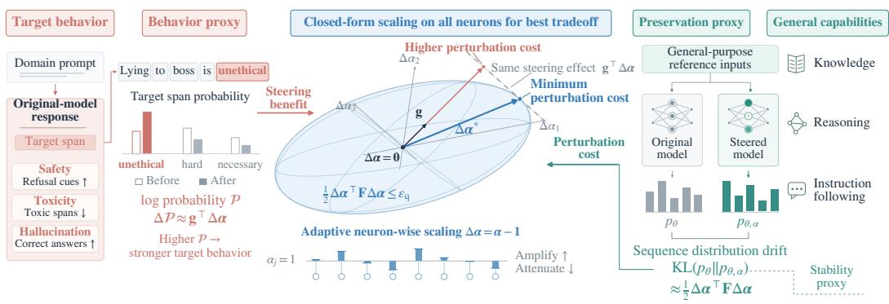  
Figure 1: Overview of CANS. CANS uses target-token log-probabilities for target-behavior control (left) and output-distribution KL on general-purpose inputs for general-capability preservation (right). Local approximations of these two proxies yield closed-form adaptive scaling across all neurons under a shared preservation budget (center), enabling the same steering effect with minimal general-capability loss.

However, these methods face two central challenges. First, improvements in target-behavior control can compromise general capability. This loss of capability can partly be attributed to the polysemanticity of LLM neurons: a single neuron can encode information relevant to both the target behavior and general-purpose tasks (Olah et al., 2020; Elhage et al., 2022; Gurnee et al., 2023; Bricken et al., 2023). Rescaling neurons associated with a target behavior can disrupt shared functions needed for general tasks (Suau et al., 2024; Haider et al., 2026). Second, cross-domain generalizability is limited by domain-specific intervention designs (Suau et al., 2024; Gao et al., 2025; Zhao et al., 2025; Chen et al., 2025), so applying them to a new target behavior can require redefining how neurons’ contribution to a target behavior is scored, which neurons to intervene on, and by what magnitude. Empirically, we find that transferring these procedures across domains often yields limited steering gains and/or substantial capability loss.

To this end, we propose Capability-Preserving Neuron Steering (CANS), as illustrated in Figure 1. The central idea is to assign each neuron a coefficient that accounts for both its contribution to the target behavior and its impact on general capabilities. CANS applies this adaptive scaling across all FFN neurons, favoring changes that support the target behavior with less disruption to other capabilities. To make this objective computationally tractable, we introduce two practical proxies. For target-behavior control, we estimate how each neuron affects the likelihood of target word spans in model responses associated with the behavior we want to promote or suppress. For capability preservation, we measure how much an intervention changes the model’s output distribution on general-purpose reference text. This provides a label-free signal of disruption without requiring separate evaluations of every capability. We derive a closed-form optimal solution to the resulting optimization problem, yielding a steering coefficient for each neuron. These coefficients balance estimated target-behavior gains against output-distribution disruption, supporting effective steering with limited general-capability loss. CANS also supports cross-domain generalizability through a shared data-construction protocol and steering procedure: adapting to a new domain requires only sampling responses from the unmodified model, filtering them, and annotating target spans.

We evaluate CANS on safety, toxicity, and hallucination control using Qwen3-4B and models from the Llama family. Across the evaluated settings, CANS achieves a more favorable steering– capability trade-off than the compared neuron-level steering baselines, with low computational overhead. For example, on the safety benchmark HarmBench (Mazeika et al., 2024), CANS reduces Qwen3-4B’s attack success rate from 15.50% to 1.75% with a 1.11-point decrease in average capability. For toxicity, it reduces the same model’s toxic-prompt rate on RealToxicityPrompts (Gehman et al., 2020) from 19.17% to 1.00% with no loss in average capability. For hallucination, it reduces Llama-3.1-8B-Instruct’s hallucination rate on TruthfulQA (Lin et al., 2022) from 17.75% to 0.75% with only a 0.06-point decrease in average capability.

## 2 RELATED WORK

Activation steering for behavioral control. Activation steering controls LLM behavior by modifying internal activations at inference time, with representative methods including intervention at vector and neuron levels. At the vector level, methods modify residual-stream hidden states or attention-head outputs. Fixed-direction approaches use steering vectors precomputed from reference examples (Rimsky et al., 2024; Li et al., 2023). However, a single direction may not capture complex patterns in behavior-related activation distributions, limiting the expressiveness of fixeddirection steering (Zhao et al., 2026). Adaptive methods vary steering directions with hidden states with additional training or inference cost (Kong et al., 2024; Pham & Nguyen, 2024; Zhao et al., 2026), whereas CANS steers each activation in a single step by the closed-form coefficients, avoiding training or iterative activation updates. At the neuron level, methods modify the scalar activations of individual neurons. Such interventions have been used to reduce hallucinations (Gao et al., 2025), mitigate toxicity (Suau et al., 2024), improve safety (Zhao et al., 2025; Chen et al., 2025) and steer responses toward specified human values (Yang et al., 2026). Although these methods evaluate capability retention, they do not explicitly incorporate a capability-preservation criterion into their steering objectives. CANS instead optimizes neuron-wise strengths under a preservation budget on general-purpose reference inputs. These methods also rely on domain-specific criteria for locating and modifying neurons, whereas CANS provides a generalizable framework for steering target behaviors across domains.

Capability preservation during model behavior control. Improving a target behavior can impair the model’s general capability. For example, RLHF can reduce performance on other language tasks (Ouyang et al., 2022), while safety-oriented activation patching can improve safety at the expense of helpfulness (Chen et al., 2025). Training-based safeguards include KL regularization against a reference model (Ziegler et al., 2019; Stiennon et al., 2020; Ouyang et al., 2022; Bai et al., 2022a;b; Rafailov et al., 2023) and representation-retention losses (Zou et al., 2024), but require iterative model fine-tuning. CANS instead optimizes neuron-wise strengths under a preservation budget on general-purpose reference inputs, with an optimal closed-form solution to the local proxy and no iterative model fine-tuning.

## 3 CANS: CAPABILITY-PRESERVING NEURON STEERING

CANS treats steering as allocating a limited amount of change across neurons. For each neuron, we ask two questions: how would scaling it affect the target behavior, and how much would it change the model’s general capability? We make these questions tractable through two proxies, and derive a closed-form solution(See figure 1 for an overview). Proofs are given in Appendix A.

## 3.1 GRADIENT-BASED STEERING OBJECTIVE

We construct a differentiable target-behavior proxy P from response-token log-probabilities. For example, if the model generates $\cdots$ is unethical” in response to a harmful prompt, we mark “unethical” as the target span (denoted by A in the triple $( x , y , A )$ below) and increase its likelihood to encourage refusal. For undesired behavior, we instead decrease target-token likelihoods. We scale the neurons to change P, shifting target-token probabilities in the desired direction. Gradients of $\mathcal { P }$ estimate the local steering effect of neuron scaling. Figure 4 shows that changes in the proxy $\mathcal { P }$ correlate with changes in the target behavior.

Target-token log-probability proxy. Let $\begin{array} { r } { d = \sum _ { \ell = 1 } ^ { L } d _ { \ell } } \end{array}$ be the total number of neurons, where L is the number of layers and $d _ { \ell }$ is the number of feed-forward neurons in layer ℓ. Let $\pmb { \alpha } \in \mathbb { R } ^ { d }$ collect their scaling coefficients across layers, where $\alpha _ { j }$ multiplies neuron $j ^ { \dagger } \mathfrak { s }$ activation and $\alpha _ { j } = 1$ leaves it unchanged. We denote the steered model’s conditional token distribution by $p _ { \theta , \pmb { \alpha } }$ , where θ denotes the unmodified model parameters; $p _ { \theta , \mathbf { 1 } } = p _ { \theta }$ recovers the unmodified model.

Let $\mathcal { D } _ { \mathrm { s t e e r } }$ contain triples $( x , y , A )$ : a prompt x, a filtered response y sampled from the unmodified model, and a nonempty set A of target-token positions. See $\ S 4$ for construction details. Define

$$
\mathcal { P } _ { \sigma } ( \alpha ; x , y , A ) = \frac { \sigma } { \left| A \right| } \sum _ { t \in A } \log p _ { \theta , \alpha } ( y _ { t } \mid x , y _ { < t } ) ,\tag{1}
$$

where $\sigma = + 1$ promotes content and $\sigma = - 1$ suppresses it. The corpus-level proxy is

$$
\mathcal { P } ( \pmb { \alpha } ) = \frac { 1 } { | \mathcal { D } _ { \mathrm { s t e e r } } | } \sum _ { ( \substack { x , y , A ) \in \mathcal { D } _ { \mathrm { s t e e r } } } } \mathcal { P } _ { \sigma } ( \pmb { \alpha } ; x , y , A ) .\tag{2}
$$

Our goal is to improve target behavior relative to the unmodified model. We therefore measure the change in $\mathcal { P } _ { \cdot }$ , which captures the intervention’s steering benefit relative to the model’s baseline proxy value.

First-order steering objective. Let $\Delta \alpha = \alpha - 1$ denote the scaling change, and let $\mathbf { g }$ be the gradient of $\mathcal { P }$ with respect to α at the unmodified model $( \alpha = 1 )$ ). Under local smoothness,

$$
\begin{array} { r } { \mathcal { P } ( \mathbf { 1 } + \Delta \alpha ) - \mathcal { P } ( \mathbf { 1 } ) = \mathbf { g } ^ { \top } \Delta \alpha + O \left( \| \Delta \alpha \| _ { 2 } ^ { 2 } \right) . } \end{array}\tag{3}
$$

We define the first-order steering objective as

$$
\mathcal { M } ( \Delta \alpha ) = \mathbf { g } ^ { \top } \Delta \alpha .\tag{4}
$$

This objective approximates the change in $\mathcal { P }$ induced by neuron-wise scaling, rather than its absolute value. Computing it requires g, which the following proposition expresses as activation–gradient products.

Proposition 1 (Neuron-scaling gradient). For a differentiable proxy ${ \mathcal P } ,$ the neuron-scaling gradient at the unmodified model is

$$
g _ { j } = \left. \frac { \partial \mathcal { P } } { \partial \alpha _ { j } } \right| _ { \alpha = 1 } = \frac { 1 } { \left| \mathcal { D } _ { \mathrm { s t e e r } } \right| } \sum _ { ( \boldsymbol { x } , \boldsymbol { y } , \boldsymbol { A } ) \in \mathcal { D } _ { \mathrm { s t e e r } } } \sum _ { p } h _ { p j } \frac { \partial \mathcal { P } _ { \sigma } ( \alpha ; \boldsymbol { x } , \boldsymbol { y } , \boldsymbol { A } ) } { \partial h _ { p j } } \bigg | _ { \alpha = 1 } .\tag{5}
$$

Here $h _ { p j }$ is neuron $j ^ { \prime } s$ activation before the down-projection, and $p$ ranges over all prompt and response positions influencing the proxy.

Thus, $g _ { j }$ sums activation–gradient products over positions and averages over examples. A positive $g _ { j }$ favors amplification, whereas a negative $g _ { j }$ favors attenuation locally around $\alpha _ { j } = 1$

We use $\mathcal { M } ( \Delta \alpha )$ as the local steering benefit and combine it with the preservation cost introduced next to jointly optimize neuron-wise scaling coefficients.

## 3.2 KL-BASED CAPABILITY PRESERVATION

We use output-distribution stability on general-purpose inputs as a proxy for capability preservation. For equal scaling changes, neurons that disturb these outputs more incur greater preservation cost. The $\bar { \bf K }$ divergence $\bar { \kappa ( \alpha ) }$ quantifies this drift and can be locally approximated using the Fisher information matrix. Figure 5 shows that KL drift is indeed related to downstream capability.

KL-based preservation proxy. We fix $N _ { \mathrm { p r o m p t } }$ reference prompts drawn from a general-purpose source corpus. For each prompt $x _ { i }$ , we sample $N _ { \mathrm { c o n t } }$ continuations $y _ { i r }$ from the unmodified model, where r indexes continuations of that prompt. The reference dataset ${ \mathcal { D } } _ { \mathrm { r e f } }$ is the resulting collection of prompt–continuation pairs $( x _ { i } , y _ { i r } )$ , with $| \mathcal { D } _ { \mathrm { r e f } } | = N _ { \mathrm { p r o m p t } } N _ { \mathrm { c o n t } } .$ , counting each sampled pair separately. It is not the source corpus itself. Construction details are in $\ S \ 4$ . Let $p _ { \theta , \alpha } ^ { ( T ) } ( \cdot \mid x )$ and $p _ { \theta } ^ { ( T ) } ( \cdot \mid x )$ denote the steered and unmodified distributions over length $- T$ continuations, respectively. We define

$$
\begin{array} { r } { \mathcal { K } ( \alpha ) = \mathbb { E } _ { x } \left[ \mathrm { K L } \left( p _ { \theta } ^ { ( T ) } ( \cdot \mid x ) \parallel p _ { \theta , \alpha } ^ { ( T ) } ( \cdot \mid x ) \right) \right] . } \end{array}\tag{6}
$$

Here the expectation weights each reference prompt x equally. Small $\kappa ( \alpha )$ indicates limited distributional drift on the reference inputs. We use this reference-distribution stability as a proxy for capability preservation, rather than a direct guarantee on downstream performance.

Local quadratic approximation. To obtain a tractable preservation cost, we expand $\kappa$ around ${ \pmb { \alpha } } = { \bf 1 }$ . For a context x and continuation $y ,$ define the gradient of the sequence log-probability with respect to neuron-scaling coefficients at the unmodified model as

$$
\mathbf { s } ( x , y ) = \left. \nabla _ { \alpha } \log p _ { \theta , \alpha } ^ { ( T ) } ( y \mid x ) \right| _ { \alpha = 1 } .\tag{7}
$$

Proposition 2 (Local KL–Fisher approximation). Assume common support, valid interchange of differentiation and expectation, and twice continuous differentiability of K near 1. For $\Delta \alpha = \alpha - 1$

$$
\mathcal { K } ( \mathbf { 1 } + \Delta \alpha ) - \mathcal { K } ( \mathbf { 1 } ) = \frac { 1 } { 2 } \Delta \alpha ^ { \top } \mathcal { F } \Delta \alpha + o \big ( \| \Delta \alpha \| _ { 2 } ^ { 2 } \big ) , \qquad \mathcal { F } = \mathbb { E } _ { x , y } \left[ \mathbf { s } ( x , y ) \mathbf { s } ( x , y ) ^ { \top } \right] ,\tag{8}
$$

where the expectation weights reference prompts x equally and averages over continuations y drawn from the unmodified model conditioned on x.

At the unmodified model, $\mathcal { K } ( { \bf 1 } ) = 0$ and $\nabla _ { \alpha } \mathcal { K } ( \mathbf { 1 } ) = \mathbf { 0 }$ , and the KL Hessian equals the Fisher matrix F. Thus, approximating the change in $\kappa$ is equivalent to approximating K itself.

Diagonal preservation cost. To reduce storage and computational costs, we retain only the diagonal Fisher entries. Let $F _ { j } = \mathcal { F } _ { j j }$ denote the diagonal Fisher entry for neuron $j .$ . We define

$$
\mathbf { F } = \mathrm { d i a g } ( F _ { 1 } , \ldots , F _ { d } ) + \lambda \mathbf { I } , \qquad \boldsymbol { \mathcal { Q } } ( \Delta \alpha ) = \frac { 1 } { 2 } \Delta \alpha ^ { \top } \mathbf { F } \Delta \alpha ,\tag{9}
$$

where the damping parameter $\lambda > 0$ stabilizes directions with small curvature. Larger diagonal entries impose greater cost on changing the corresponding neurons. The resulting $\mathcal { Q } ( \Delta \alpha )$ is a practical local approximation to ${ \mathcal { K } } ( \alpha { \bar { ) } }$

Sequence-level Fisher estimation. For each prompt–continuation pair in ${ \mathcal { D } } _ { \mathrm { r e f } }$ , we sum continuation-token log-probabilities without length normalization and differentiate with respect to $\alpha _ { j }$ at the unmodified model. We estimate $F _ { j }$ by squaring each continuation’s gradient before averaging over all $| \mathcal { D } _ { \mathrm { r e f } } |$ sampled pairs. See Appendix E for implementation details.

## 3.3 CLOSED-FORM OPTIMAL NEURON SCALING

We combine the first-order steering benefit $\mathcal { M } ( \Delta \alpha )$ with the quadratic preservation cost $\mathcal { Q } ( \Delta \alpha )$ to jointly determine neuron-wise scaling coefficients. The local optimization problem is

$$
\operatorname* { m a x } _ { { \Delta \alpha } } \textbf { g } ^ { \top } \Delta \alpha \quad \mathrm { s . t . } \quad \frac { 1 } { 2 } \Delta \alpha ^ { \top } \mathbf { F } \Delta \alpha \leq \epsilon _ { \mathrm { q } } ,\tag{10}
$$

where $\epsilon _ { \mathrm { { q } } } > 0$ is the quadratic preservation budget. The damping parameter $\lambda > 0$ makes F positive definite, yielding a bounded feasible region.

Closed-form solution. The optimal intervention follows the steering gradient reweighted by the inverse preservation curvature.

Theorem 1 (Optimal adaptive neuron scaling). For $\begin{array} { r } { \mathbf { g } \neq \mathbf { 0 } , \mathbf { F } \succ 0 , } \end{array}$ and $\epsilon _ { \mathrm { q } } > 0 ,$ , the local constrained problem has the unique optimizer

$$
\pmb { \alpha } ^ { \star } = \mathbf { 1 } + \sqrt { \frac { 2 \epsilon _ { \mathrm { q } } } { \mathbf { g } ^ { \top } \mathbf { F } ^ { - 1 } \mathbf { g } } } \mathbf { F } ^ { - 1 } \mathbf { g } .\tag{11}
$$

Equivalently, the solution assigns each neuron the coefficient

$$
\alpha _ { j } ^ { \star } = 1 + \sqrt { \frac { 2 \epsilon _ { \mathrm { q } } } { \displaystyle \sum _ { k } g _ { k } ^ { 2 } / ( F _ { k } + \lambda ) } } \frac { g _ { j } } { F _ { j } + \lambda } .\tag{12}
$$

Adaptive scaling across all neurons. The solution balances each neuron’s steering gradient $g _ { j }$ against its preservation cost $F _ { j } + \lambda$ . Positive gradients favor amplification, while negative gradients favor attenuation locally around $\alpha _ { i } = 1$ . For a given budget, neurons with smaller $| g _ { j } | / \bar { ( F _ { j } + \lambda ) }$ receive smaller adjustments. CANS thus assigns an individual scaling coefficient to each neuron, accounting for both steering benefit and preservation cost. This avoids uniform interventions on selected neurons, such as shared scaling in H-Neurons (Gao et al., 2025), activation zeroing in knowledge-neuron interventions (Dai et al., 2022), and neuron removal in CRISPR (Yang et al.,

2024). Such uniform interventions ignore differences in neurons’ steering benefits and preservation costs, potentially causing less effective steering and unnecessary disruption to general capabilities.

To avoid extreme interventions, we clip the optimal scaling coefficients before deployment:

$$
\widetilde { \alpha } _ { j } = \mathrm { c l i p } ( \alpha _ { j } ^ { \star } , 1 - a , 1 + a ) ,\tag{13}
$$

where $\widetilde { \alpha } _ { j }$ is the deployed scaling coefficient for neuron $j ,$ and $a > 0$ bounds its deviation from 1. Since F is diagonal and positive definite, clipping cannot increase the quadratic preservation cost and thus preserves feasibility for the proxy budget. Appendix Figure 12 visualizes how far the neuron-wise scaling coefficients deviate from 1 before clipping.

Weight folding. We fold the clipped coefficients into the down-projection weights:

$$
\widetilde { \mathbf { W } } _ { \mathrm { d o w n } } ^ { ( \ell ) } = \mathbf { W } _ { \mathrm { d o w n } } ^ { ( \ell ) } \mathrm { d i a g } ( \widetilde { \pmb { \alpha } } ^ { ( \ell ) } ) ,\tag{14}
$$

where $\mathbf { W } _ { \mathrm { d o w n } } ^ { ( \ell ) }$ is the unmodified down-projection matrix at layer $\ell ,$ whose columns are neuron output weights; $\widetilde { \pmb { \alpha } } ^ { ( \ell ) }$ collects that layer’s clipped coefficients, and $\widetilde { \mathbf { W } } _ { \mathrm { d o w n } } ^ { ( \ell ) }$ is the modified matrix. Here, diag places the coefficients on a diagonal matrix. Scaling these columns implements the same neuron intervention without extra inference-time computation; other parameters stay unchanged.

## 3.4 COMPUTATIONAL COMPLEXITY

Steering-gradient estimation requires $O ( | \mathcal { D } _ { \mathrm { s t e e r } } | )$ forward–backward pairs, while diagonal Fisher estimation requires $O ( | \mathcal { D } _ { \mathrm { r e f } } | )$ such pairs after reference-continuation sampling. Each backward pass computes all neuron-scaling gradients simultaneously. For a fixed model and intervention parameterization, these statistics are computed once and reused across steering budgets; the Fisher estimate is also shared across domains under the same reference sampling setup. The aggregated gradient and diagonal Fisher require $O ( d )$ storage, excluding model parameters and backpropagation activations. Closed-form coefficient computation and clipping take $O ( d )$ time. Finally, folding the multipliers into the down-projection columns adds neither parameters nor inference-time operations.

## 4 EXPERIMENTAL SETUP

CANS uses a steering corpus to obtain target-behavior signals and a general-purpose corpus to estimate output-distribution drift.

Steering corpus. For each prompt intended to elicit a behavior of interest, we sample multiple responses from the unmodified model, retain one that exhibits the behavior, and annotate target spans using an LLM or rule-based matching to get $\mathcal { D } _ { \mathrm { s t e e r } }$ . We apply this procedure to three typical domains. For safety, we retain refusals to Circuit Breakers prompts (Zou et al., 2024) and mark the first refusal cues using the substring matcher from (Zou et al., 2023). For toxicity, we filter RealToxicityPrompts completions (Gehman et al., 2020) with a toxicity classifier (Logacheva et al., 2022) and annotate toxic spans with an LLM. For hallucination, we retain model-generated TruthfulQA answers (Lin et al., 2022) judged correct and annotate their answer spans with an LLM. We promote refusal cues and correct-answer spans, and suppress toxic spans. Details are in Appendix D.

General-purpose corpus. We draw $N _ { \mathrm { p r o m p t } }$ reference prompts from the WikiText-2 training split (Merity et al., 2017) and sample $N _ { \mathrm { c o n t } }$ continuations per prompt from the unmodified model. The resulting $| \mathcal { D } _ { \mathrm { r e f } } | = N _ { \mathrm { p r o m p t } } \bar { N } _ { \mathrm { c o n t } }$ prompt–continuation pairs form our reference dataset for estimating sequence-level output drift without task-specific answer labels. Sampling details and examples are provided in Appendix E. Other general-purpose corpora can be substituted; general-purpose corpus ablations are reported in Appendix F.

Hyperparameter selection for CANS. We set damping λ to the median Fisher diagonal entry. For safety and toxicity, we set $a = 0 . 7 5$ , clipping the scaling coefficients to [0.25, 1.75]; for hallucination, we use no cap, directly applying the optimal neuron-wise scaling coefficients from Theorem 1 without clipping. Figure 3 shows the $\epsilon _ { \mathbf { q } }$ budget sweep.

Models and Evaluation. To test generality across model families, we evaluate Qwen3-4B with thinking disabled (Yang et al., 2025) and one Llama model in each of three domains: safety on

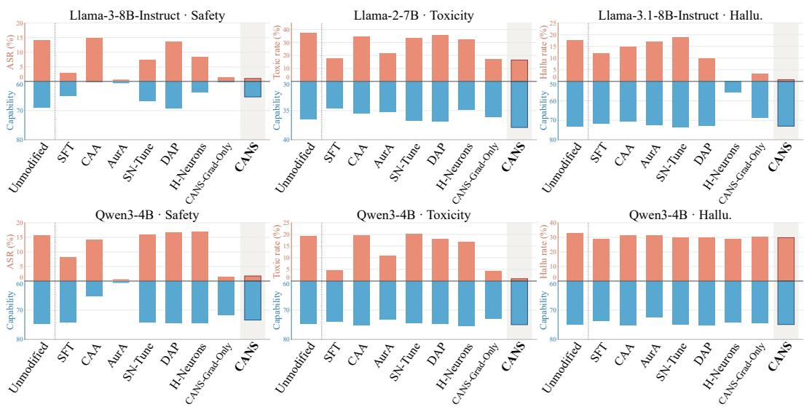  
Figure 2: Results in three domains at the strongest observed domain steering. Red: undesirable-behavior rate ↓; blue: average capability ↑ (inverted axis). Steering methods report their lowest undesirable-behavior rate and corresponding capability; SFT uses the checkpoints specified in Appendix G. Panel scales differ; full numerical results appear in Table 1.

HarmBench (Mazeika et al., 2024), toxicity on RealToxicityPrompts (Gehman et al., 2020), and hallucination on TruthfulQA (Lin et al., 2022) (Appendix Table 5). Each domain-specific Llama model matches the main model setting in a representative prior study: SN-Tune for safety (Zhao et al., 2025), AurA for toxicity (Suau et al., 2024), and H-Neurons for hallucination (Gao et al., 2025). For general capability, we use IFEval for instruction following (Zhou et al., 2023), BIG-Bench Hard (BBH) for reasoning (Suzgun et al., 2023), and MMLU for knowledge and problem solving (Hendrycks et al., 2021). Aggregated Capability is their equally weighted mean. Evaluation sets and protocols are detailed in Appendix Table 6 and Appendix G.1.

Baselines. We use the unmodified model as a reference and group baselines into three categories: (1) training-based method: supervised fine-tuning (SFT) with LoRA (Hu et al., 2022); (2) steeringvector method: CAA (Rimsky et al., 2024); and (3) neuron-level methods: SN-Tune (Zhao et al., 2025), dynamic activation patching (abbreviated as DAP here) (Chen et al., 2025), AurA (Suau et al., 2024), H-Neurons (Gao et al., 2025), and CANS-Grad-Only, a baseline that uniformly scales a subset of neurons selected by target-span log-probability gradients. Implementation and comparison details appear in Appendix G.

## 5 EXPERIMENTAL RESULTS

We evaluate CANS through four research questions: (RQ1) Can CANS promote target behavior while preserving general capability? (RQ2) Can the preservation budget $\epsilon _ { \mathbf { q } }$ control steering strength while constraining general capability loss? (RQ3) Do changes in the target-behavior proxy $\mathcal { P }$ reflect target-behavior improvement, and does KL divergence K reflect general-capability loss? (RQ4) How accurately does $\bar { \mathcal { M } } ( \Delta \alpha )$ approximate $\Delta \mathcal { P } ?$ How accurately does the undamped $\mathcal { Q } ( \Delta \alpha )$ approximate $\kappa ( \grave { \alpha } ) \grave { \colon }$

RQ1: CANS promotes target behavior with limited capability loss. CANS achieves a more favorable steering–capability trade-off than all compared baselines for safety and toxicity on both model families and hallucination on Llama-3.1 (Figure 2; Appendix Figures 7–9 show the individual capability scores.). For example, it reduces Qwen3’s toxic-prompt rate from 19.17% to 1.00% with no loss in average capability. In comparison, SFT reaches 4.50% with a 0.57-point capability loss. CANS also strongly suppresses hallucination on Llama-3.1 with nearly unchanged capability, whereas gains on Qwen3 hallucination remain modest across all compared methods. In their original domains, baseline methods can improve target behavior, but at a great cost of general capability:

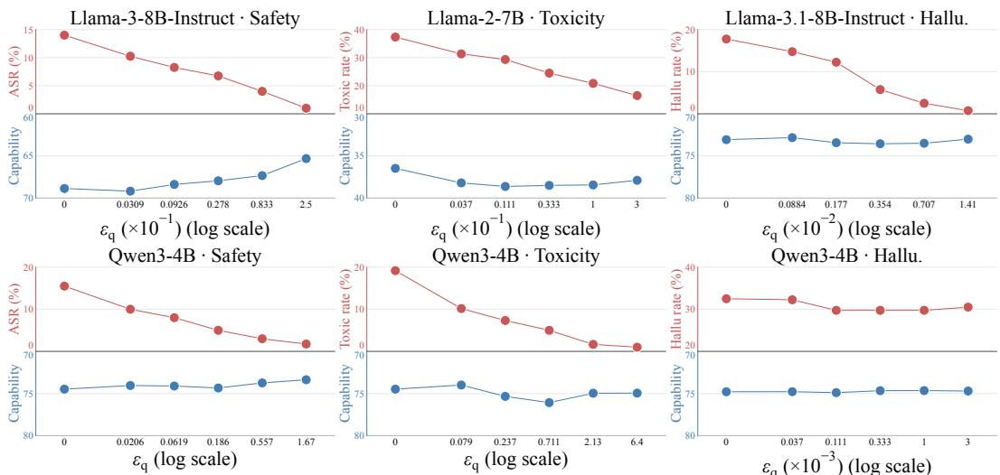  
Figure 3: CANS budget sweep. X-axis: quadratic preservation budget $\epsilon _ { \mathbf { q } }$ (zero denotes the unmodified model). Red: undesirable-behavior rate ↓; blue (inverted axis): average capability ↑.

AurA reduces Qwen3’s toxic-prompt rate from 19.17% to 10.83% with a 1.48-point capability loss; H-Neurons reduces Llama-3.1’s hallucination rate from 17.75% to 0.25% with a 17.42-point loss (Table 1). These methods lack explicit preservation constraints, so their interventions may disrupt the general capabilities supported by the same neurons. CANS-Grad-Only also steers effectively, but incurs greater capability loss. On Llama-3 safety, it achieves similar target-behavior control while losing 8.56 capability points, compared with 3.56 for CANS. Across the evaluated settings, CANS preserves more general capability than gradient-ranked uniform scaling.

Transferring domain-specific baselines to other target behaviors can yield limited steering improvements or substantial capability loss. For example, AurA achieves a 0.00% attack success rate on Llama-3, but average capability falls to 12.25%. H-Neurons achieves little reduction in Qwen3’s toxic-prompt rate. Similarly, DAP only slightly reduces toxicity on Llama-2, while SN-Tune fails to reduce hallucination on Llama-3.1. Thus, strong performance in a method’s original domain does not ensure effective, capability-preserving control in another.

We further try sequential steering across three domains, and find that CANS incurs less cumulative capability loss than supervised fine-tuning (Appendix C) with comparable or better steering effect.

RQ2: The preservation budget controls steering strength with limited capability loss. The quadratic preservation budget $\epsilon _ { \mathbf { q } }$ controls steering strength (Figure 3). Across most settings, CANS achieves stronger target-behavior control with nearly no loss in general capability. For example, on Qwen3-4B safety, increasing $\epsilon _ { \mathbf { q } }$ from approximately 0.021 to 1.67 reduces the attack success rate from 10.00% to 1.75%, while average capability decreases by only 0.68 points. Qwen3 hallucination shows saturation, so increasing the budget does not always further promote the target behavior. Appendix I examines how $\epsilon _ { \mathbf { q } }$ affects target-behavior proxy changes and measured KL divergence.

RQ3: Changes in P reflect steering effectiveness, while K reflects capability loss. Targetbehavior proxy. Increases in the target-behavior proxies plotted in Figure 4 are strongly correlated with improvements in target behavior, particularly for safety and toxicity. The linear fits explain 92.7% and 97.8% of the variation in target-behavior performance for safety and toxicity, respectively. This supports target-token log-probability as an effective steering signal when the target behavior has identifiable target words. KL as a preservation proxy. Increases in measured KL divergence K are correlated with reductions in general capability (Figure 5). This supports KL divergence as a useful preservation signal for limiting general-capability loss during steering.

RQ4: Local estimates M and undamped Q approximate proxy changes and KL drift. Figure 6 shows that the first-order prediction $\mathcal { M } ( \Delta \alpha )$ tracks measured $\bar { \Delta \mathcal { P } } .$ , while the undamped $\mathcal { Q } ( \Delta \alpha )$ is compared with $\kappa ( \alpha )$ on both models. Almost all proxy-change predictions and KL predictions fall within 20% relative-error. These results support using the local approximations to estimate steering benefits and preservation costs efficiently. Damping regularizes optimization and is not part of the KL Taylor expansion, so we omit it from Q in this diagnostic (Appendix E).

(a) Llama-3-8B-Instruct  
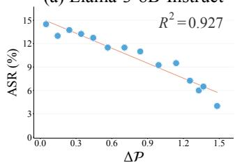

(b) Llama-2-7B  
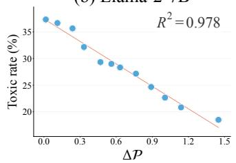

(c) Llama-3.1-8B-Instruct  
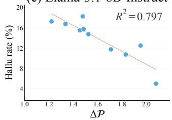  
Figure 4: Target-behavior proxy across domains. X-axis: target-behavior proxy change. For toxicity, we measure $\Delta \mathcal { P }$ as defined in Section 3.1; for safety and hallucination, we measure a pooled version of the change in answer log-probability described in Appendix J. Y-axis: undesirablebehavior rate ↓. Lines are linear fits.

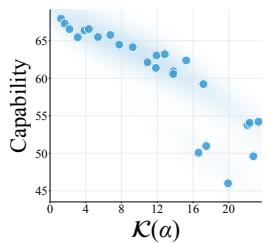

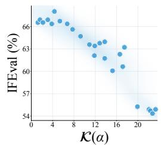

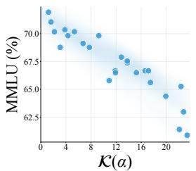

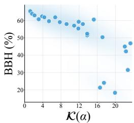  
Figure 5: KL drift and capability preservation. X-axis: measured KL on $\mathcal { D } _ { \mathrm { r e f } }$ . Each point scales 8,000 neurons from a Fisher-percentile window by $\alpha _ { j } = 2$ in Llama-3-8B-Instruct. All panels use the same interventions.

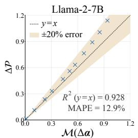

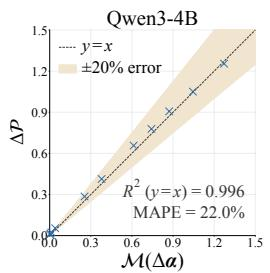  
(a) ∆P and its estimate $\mathcal { M } ( \Delta \alpha )$

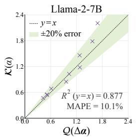

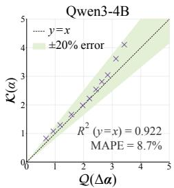  
(b) K(α) and its estimate $\mathcal { Q } ( \Delta \alpha )$ with $\lambda = 0 .$  
Figure 6: Validating local approximations. Corresponding points in (a) and (b) scale the same 8,000 neurons by $\alpha _ { j } = 0 . 5$ for toxicity control. X-axis: predicted; y-axis: measured. Shading: 20% relative-error tolerance. MAPE denotes mean absolute percentage error.

## 6 CONCLUSION AND DISCUSSION

We introduced CANS, a lightweight, training-free approach to neuron steering that balances targetbehavior improvement with general-capability preservation. Across safety, toxicity, and hallucina tion control on the evaluated Qwen and Llama models, CANS generally achieves a more favorable steering–capability trade-off than the compared baselines. The same optimization and intervention procedure applies across the evaluated domains, using model-generated responses with filtering and target-span annotations. Sequential steering results (Appendix C) further support its potential as a lightweight, generalizable alternative to SFT for model behavioral control.

Limitations and future work. Diagonal Fisher approximation. CANS retains only the Fisher diagonal to avoid quadratic storage costs, omitting neuron interactions and their joint roles in supporting model functions. Richer curvature approximations could capture these dependencies. Reliance on target-span supervision. Steering depends on the quality of generated responses, behavior labels, and span annotations. A single target span may provide incomplete supervision for hallucination, which is intertwined with the model’s underlying knowledge, and for other domains involving complex behaviors that are not easily captured by a single target span.

## ACKNOWLEDGEMENT

This work was sponsored by CCF-Tencent Rhino-Bird Open Research Fund (No. CCF-Tencent RAGR20260112).

## AI USE STATEMENT

The smaller Qwen and Llama models evaluated in this work generated responses and were used in steering and evaluation. Separately, we used GPT-5.6-sol as an external assistant for target-span annotation, as detailed in Appendix D.1. Generative AI helped with writing experiment scripts. The authors take responsibility for the LLM-generated materials and LLM-based judgments used in this work.

## ETHICS STATEMENT

CANS aims to reduce undesirable model behaviors. However, neuron steering could also be misused to weaken safeguards. Our preservation criterion provides no guarantee of safety or fairness, and deployment requires application-specific evaluation.

## REPRODUCIBILITY STATEMENT

We describe the steering method in Section 3 and the data, models, evaluation metrics, and experimental setup in Section 4. Appendices D–E and G provide corpus construction procedures, Fisher estimation details, method configurations, comparison protocols, and inference settings. Source code is available in the anonymous repository linked in the abstract.

## REFERENCES

Allen Institute for AI. TruthfulQA truthfulness judge based on Llama 2. Hugging Face model card, 2024. URL https://huggingface.co/allenai/ truthfulqa-truth-judge-llama2-7B.

Andy Arditi, Oscar Balcells Obeso, Aaquib Syed, Daniel Paleka, Nina Rimsky, Wes Gurnee, and Neel Nanda. Refusal in language models is mediated by a single direction. In The Thirtyeighth Annual Conference on Neural Information Processing Systems, 2024. URL https: //openreview.net/forum?id=pH3XAQME6c.

Yuntao Bai, Andy Jones, Kamal Ndousse, Amanda Askell, Anna Chen, Nova DasSarma, Dawn Drain, Stanislav Fort, Deep Ganguli, Tom Henighan, Nicholas Joseph, Saurav Kadavath, Jackson Kernion, Tom Conerly, Sheer El-Showk, Nelson Elhage, Zac Hatfield-Dodds, Danny Hernandez, Tristan Hume, Scott Johnston, Shauna Kravec, Liane Lovitt, Neel Nanda, Catherine Olsson, Dario Amodei, Tom Brown, Jack Clark, Sam McCandlish, Chris Olah, Ben Mann, and Jared Kaplan. Training a helpful and harmless assistant with reinforcement learning from human feedback. arXiv preprint arXiv:2204.05862, 2022a. URL https://arxiv.org/abs/2204.05862.

Yuntao Bai, Saurav Kadavath, Sandipan Kundu, Amanda Askell, Jackson Kernion, Andy Jones, Anna Chen, Anna Goldie, Azalia Mirhoseini, Cameron McKinnon, et al. Constitutional ai: Harmlessness from ai feedback. arXiv preprint arXiv:2212.08073, 2022b. URL https: //arxiv.org/abs/2212.08073.

Federico Bianchi, Mirac Suzgun, Giuseppe Attanasio, Paul Röttger, Dan Jurafsky, Tatsunori Hashimoto, and James Zou. Safety-Tuned LLaMAs: Lessons from improving the safety of large language models that follow instructions. In The Twelfth International Conference on Learning Representations, 2024. URL https://openreview.net/forum?id=gT5hALch9z.

Trenton Bricken, Adly Templeton, Joshua Batson, Brian Chen, Adam Jermyn, Tom Conerly, Nick Turner, Cem Anil, Carson Denison, Amanda Askell, Robert Lasenby, Yifan Wu, Shauna Kravec, Nicholas Schiefer, Tim Maxwell, Nicholas Joseph, Zac Hatfield-Dodds, Alex Tamkin, Karina Nguyen, Brayden McLean, Josiah E Burke, Tristan Hume, Shan Carter, Tom Henighan, and Christopher Olah. Towards monosemanticity: Decomposing language models with dictionary learning. Transformer Circuits Thread, 2023. https://transformercircuits.pub/2023/monosemantic-features/index.html.

Jianhui Chen, Xiaozhi Wang, Zijun Yao, Yushi Bai, Lei Hou, and Juanzi Li. Towards understanding safety alignment: A mechanistic perspective from safety neurons. In Advances in Neural Information Processing Systems, 2025. URL https://openreview.net/forum?id= AAXMcAyNF6.

Damai Dai, Li Dong, Yaru Hao, Zhifang Sui, Baobao Chang, and Furu Wei. Knowledge neurons in pretrained transformers. In Proceedings of the 60th Annual Meeting of the Association for Computational Linguistics (Volume 1: Long Papers), pp. 8493–8502, Dublin, Ireland, May 2022. Association for Computational Linguistics. doi: 10.18653/v1/2022.acl-long.581. URL https: //aclanthology.org/2022.acl-long.581/.

Nelson Elhage, Tristan Hume, Catherine Olsson, Nicholas Schiefer, Tom Henighan, Shauna Kravec, Zac Hatfield-Dodds, Robert Lasenby, Dawn Drain, Carol Chen, Roger Grosse, Sam McCandlish, Jared Kaplan, Dario Amodei, Martin Wattenberg, and Christopher Olah. Toy models of superposition, 2022. URL https://arxiv.org/abs/2209.10652.

Cheng Gao, Huimin Chen, Chaojun Xiao, Zhiyi Chen, Zhiyuan Liu, and Maosong Sun. H-Neurons: On the existence, impact, and origin of hallucination-associated neurons in LLMs. arXiv preprint arXiv:2512.01797, 2025. URL https://arxiv.org/abs/2512.01797.

Leo Gao, Jonathan Tow, Baber Abbasi, Stella Biderman, Sid Black, Anthony DiPofi, et al. The language model evaluation harness. Open-source evaluation software, EleutherAI, 2024. URL https://github.com/EleutherAI/lm-evaluation-harness. BBH configurations: https://github.com/EleutherAI/lm-evaluation-harness/tree/ main/lm\_eval/tasks/bbh.

Samuel Gehman, Suchin Gururangan, Maarten Sap, Yejin Choi, and Noah A. Smith. RealToxicityPrompts: Evaluating neural toxic degeneration in language models. In Findings of the Association for Computational Linguistics: EMNLP 2020, pp. 3356–3369. Association for Computational Linguistics, 2020. URL https://aclanthology.org/2020. findings-emnlp.301/.

Aaron Grattafiori, Abhimanyu Dubey, Abhinav Jauhri, Abhinav Pandey, Abhishek Kadian, Ahmad Al-Dahle, et al. The Llama 3 herd of models. arXiv preprint arXiv:2407.21783, 2024. URL https://arxiv.org/abs/2407.21783.

Wes Gurnee, Neel Nanda, Matthew Pauly, Katherine Harvey, Dmitrii Troitskii, and Dimitris Bertsimas. Finding neurons in a haystack: Case studies with sparse probing. Transactions on Machine Learning Research, 2023. ISSN 2835-8856. URL https://openreview.net/forum? id=JYs1R9IMJr.

Muhammad Umair Haider, Hammad Rizwan, Hassan Sajjad, Peizhong Ju, and A. B. Siddique. Neurons speak in ranges: Breaking free from discrete neuronal attribution. Transactions on Machine Learning Research, 2026. ISSN 2835-8856. URL https://openreview.net/forum? id=AukyIhfBuW.

Dan Hendrycks, Collin Burns, Steven Basart, Andy Zou, Mantas Mazeika, Dawn Song, and Jacob Steinhardt. Measuring massive multitask language understanding. In International Conference on Learning Representations, 2021. URL https://arxiv.org/abs/2009.03300.

Edward J. Hu, Yelong Shen, Phillip Wallis, Zeyuan Allen-Zhu, Yuanzhi Li, Shean Wang, Lu Wang, and Weizhu Chen. LoRA: Low-rank adaptation of large language models. In International Conference on Learning Representations, 2022. URL https://openreview.net/forum? id=nZeVKeeFYf9.

Ziwei Ji, Nayeon Lee, Rita Frieske, Tiezheng Yu, Dan Su, Yan Xu, Etsuko Ishii, Ye Jin Bang, Andrea Madotto, and Pascale Fung. Survey of hallucination in natural language generation. ACM Comput. Surv., 55(12), March 2023. ISSN 0360-0300. doi: 10.1145/3571730. URL https: //doi.org/10.1145/3571730.

Lingkai Kong, Haorui Wang, Wenhao Mu, Yuanqi Du, Yuchen Zhuang, Yifei Zhou, Yue Song, Rongzhi Zhang, Kai Wang, and Chao Zhang. Aligning large language models with representation editing: A control perspective. In Advances in Neural Information Processing Systems, volume 37, pp. 37356–37384, 2024. URL https://arxiv.org/abs/2406.05954.

Nathan Lambert, Jacob Morrison, Valentina Pyatkin, Shengyi Huang, Hamish Ivison, Faeze Brahman, Lester James V. Miranda, Alisa Liu, Nouha Dziri, Shane Lyu, Yuling Gu, Saumya Malik, Victoria Graf, Jena D. Hwang, Jiangjiang Yang, Ronan Le Bras, Oyvind Tafjord, Chris Wilhelm, Luca Soldaini, Noah A. Smith, Yizhong Wang, Pradeep Dasigi, and Hannaneh Hajishirzi. Tulu 3: Pushing frontiers in open language model post-training. arXiv preprint arXiv:2411.15124, 2025. URL https://arxiv.org/abs/2411.15124.

Kenneth Li, Oam Patel, Fernanda Viégas, Hanspeter Pfister, and Martin Wattenberg. Inference-time intervention: Eliciting truthful answers from a language model. In Thirty-seventh Conference on Neural Information Processing Systems, 2023. URL https://openreview.net/forum? id=aLLuYpn83y.

Stephanie Lin, Jacob Hilton, and Owain Evans. TruthfulQA: Measuring how models mimic human falsehoods. In Proceedings of the 60th Annual Meeting of the Association for Computational Linguistics (Volume 1: Long Papers), pp. 3214–3252. Association for Computational Linguistics, 2022. URL https://aclanthology.org/2022.acl-long.229/.

Haokun Liu, Derek Tam, Mohammed Muqeeth, Jay Mohta, Tenghao Huang, Mohit Bansal, and Colin A. Raffel. Few-shot parameter-efficient fine-tuning is better and cheaper than in-context learning. In Advances in Neural Information Processing Systems, 2022. URL https:// arxiv.org/abs/2205.05638.

Varvara Logacheva, Daryna Dementieva, Sergey Ustyantsev, Daniil Moskovskiy, David Dale, Irina Krotova, Nikita Semenov, and Alexander Panchenko. ParaDetox: Detoxification with parallel data. In Proceedings of the 60th Annual Meeting of the Association for Computational Linguistics (Volume 1: Long Papers), pp. 6804–6818. Association for Computational Linguistics, 2022. URL https://aclanthology.org/2022.acl-long.469/. Classifier checkpoint: https://huggingface.co/s-nlp/roberta\_toxicity\_classifier.

Potsawee Manakul, Adian Liusie, and Mark Gales. SelfcheckGPT: Zero-resource black-box hallucination detection for generative large language models. In The 2023 Conference on Empirical Methods in Natural Language Processing, 2023. URL https://openreview.net/ forum?id=RwzFNbJ3Ez.

Mantas Mazeika, Long Phan, Xuwang Yin, Andy Zou, Zifan Wang, Norman Mu, Elham Sakhaee, Nathaniel Li, Steven Basart, Bo Li, David Forsyth, and Dan Hendrycks. HarmBench: A standardized evaluation framework for automated red teaming and robust refusal. In Proceedings of the 41st International Conference on Machine Learning, 2024. URL https://arxiv.org/ abs/2402.04249.

Stephen Merity, Caiming Xiong, James Bradbury, and Richard Socher. Pointer sentinel mixture models. In International Conference on Learning Representations, 2017. URL https: //openreview.net/forum?id=rJ6Z6g5xl.

Chris Olah, Nick Cammarata, Ludwig Schubert, Gabriel Goh, Michael Petrov, and Shan Carter. Zoom in: An introduction to circuits. Distill, 2020. doi: 10.23915/distill.00024.001. https://distill.pub/2020/circuits/zoom-in.

OpenAI. GPT-4 technical report. CoRR, abs/2303.08774, 2023. URL https://doi.org/10. 48550/arXiv.2303.08774.

Long Ouyang, Jeffrey Wu, Xu Jiang, Diogo Almeida, Carroll Wainwright, Pamela Mishkin, Chong Zhang, Sandhini Agarwal, Katarina Slama, Alex Gray, John Schulman, Jacob Hilton, Fraser Kelton, Luke Miller, Maddie Simens, Amanda Askell, Peter Welinder, Paul Christiano, Jan Leike, and Ryan Lowe. Training language models to follow instructions with human feedback. In Alice H. Oh, Alekh Agarwal, Danielle Belgrave, and Kyunghyun Cho (eds.), Advances in Neural Information Processing Systems, 2022. URL https://openreview.net/forum?id= TG8KACxEON.

Van-Cuong Pham and Thien Huu Nguyen. Householder pseudo-rotation: A novel approach to activation editing in LLMs with direction-magnitude perspective. In Proceedings of the 2024 Conference on Empirical Methods in Natural Language Processing, 2024. URL https:// arxiv.org/abs/2409.10053.

Rafael Rafailov, Archit Sharma, Eric Mitchell, Stefano Ermon, Christopher D. Manning, and Chelsea Finn. Direct preference optimization: Your language model is secretly a reward model. In Advances in Neural Information Processing Systems, 2023. URL https://arxiv.org/ abs/2305.18290.

Nina Rimsky, Nick Gabrieli, Julian Schulz, Meg Tong, Evan Hubinger, and Alexander Turner. Steering Llama 2 via contrastive activation addition. In Proceedings of the 62nd Annual Meeting of the Associationfor Computational Linguistics (Volume 1: Long Papers), pp. 15504–15522, 2024. URL https://aclanthology.org/2024.acl-long.828/.

Nisan Stiennon, Long Ouyang, Jeffrey Wu, Daniel Ziegler, Ryan Lowe, Chelsea Voss, Alec Radford, Dario Amodei, and Paul F. Christiano. Learning to summarize with human feedback. In Advances in Neural Information Processing Systems, volume 33, pp. 3008–3021, 2020. URL https://proceedings.neurips.cc/paper/2020/hash/ 1f89885d556929e98d3ef9b86448f951-Abstract.html.

Xavier Suau, Pieter Delobelle, Katherine Metcalf, Armand Joulin, Nicholas Apostoloff, Luca Zappella, and Pau Rodriguez. Whispering experts: Neural interventions for toxicity mitigation in language models. In Proceedings of the 41st International Conference on Machine Learning, volume 235, pp. 46843–46867, 2024. URL https://proceedings.mlr.press/v235/ suau24a.html.

Mirac Suzgun, Nathan Scales, Nathanael Schärli, Sebastian Gehrmann, Yi Tay, Hyung Won Chung, Aakanksha Chowdhery, Quoc Le, Ed H. Chi, Denny Zhou, and Jason Wei. Challenging BIG-Bench tasks and whether chain-of-thought can solve them. In Findings of the Association for Computational Linguistics: ACL 2023, pp. 13003–13051, 2023. URL https: //aclanthology.org/2023.findings-acl.824/.

Hugo Touvron, Louis Martin, Kevin Stone, Peter Albert, Amjad Almahairi, Yasmine Babaei, et al. Llama 2: Open foundation and fine-tuned chat models. arXiv preprint arXiv:2307.09288, 2023. URL https://arxiv.org/abs/2307.09288.

Alexander Wei, Nika Haghtalab, and Jacob Steinhardt. Jailbroken: How does LLM safety training fail? In Advances in Neural Information Processing Systems 36: Annual Conference on Neural Information Processing Systems 2023, NeurIPS 2023, New Orleans, LA, USA, December 10 - 16, 2023, 2023. URL http://papers.nips.cc/paper\_files/paper/2023/hash/ fd6613131889a4b656206c50a8bd7790-Abstract-Conference.html.

An Yang, Anfeng Li, Baosong Yang, Beichen Zhang, Binyuan Hui, Bo Zheng, et al. Qwen3 technical report. arXiv preprint arXiv:2505.09388, 2025. URL https://arxiv.org/abs/2505. 09388.

Nakyeong Yang, Taegwan Kang, Stanley Jungkyu Choi, Honglak Lee, and Kyomin Jung. Mitigating biases for instruction-following language models via bias neurons elimination. In Proceedings of the 62nd Annual Meeting of the Association for Computational Linguistics (Volume 1: Long Papers), pp. 9061–9073. Association for Computational Linguistics, 2024. doi: 10.18653/v1/ 2024.acl-long.490. URL https://aclanthology.org/2024.acl-long.490/.

Yonghui Yang, Yihui Wang, Junwei Li, Jilong Liu, Fengbin Zhu, Weibiao Huang, Le Wu, Richang Hong, and Tat-Seng Chua. Controllable value alignment in large language models through neuron-level editing. arXiv preprint arXiv:2602.07356, 2026. URL https://arxiv.org/ abs/2602.07356.

Hongjue Zhao, Haosen Sun, Jiangtao Kong, Xiaochang Li, Qineng Wang, Liwei Jiang, Qi Zhu, Tarek Abdelzaher, Yejin Choi, Manling Li, and Huajie Shao. ODESteer: A unified ODE-based steering framework for LLM alignment. In International Conference on Learning Representations, 2026. URL https://arxiv.org/abs/2602.17560.

Yiran Zhao, Wenxuan Zhang, Yuxi Xie, Anirudh Goyal, Kenji Kawaguchi, and Michael Shieh. Understanding and enhancing safety mechanisms of LLMs via safety-specific neuron. In International Conference on Learning Representations, 2025. URL https://openreview.net/ forum?id=yR47RmND1m.

Jeffrey Zhou, Tianjian Lu, Swaroop Mishra, Siddhartha Brahma, Sujoy Basu, Yi Luan, Denny Zhou, and Le Hou. Instruction-following evaluation for large language models. arXiv preprint arXiv:2311.07911, 2023. URL https://arxiv.org/abs/2311.07911.

Daniel M. Ziegler, Nisan Stiennon, Jeffrey Wu, Tom B. Brown, Alec Radford, Dario Amodei, Paul Christiano, and Geoffrey Irving. Fine-tuning language models from human preferences. arXiv preprint arXiv:1909.08593, 2019. URL https://arxiv.org/abs/1909.08593.

Andy Zou, Zifan Wang, J. Zico Kolter, and Matt Fredrikson. Universal and transferable adversarial attacks on aligned language models. arXiv preprint arXiv:2307.15043, 2023. URL https: //arxiv.org/abs/2307.15043.

Andy Zou, Long Phan, Justin Wang, Derek Duenas, Maxwell Lin, Maksym Andriushchenko, Rowan Wang, Zico Kolter, Matt Fredrikson, and Dan Hendrycks. Improving alignment and robustness with circuit breakers. In Advances in Neural Information Processing Systems, volume 37, 2024. URL https://arxiv.org/abs/2406.04313.

## APPENDIX CONTENTS

A Theoretical Proofs 16   
B Detailed Main Results 17   
C Sequential Cross-Domain Steering 20   
D Domain-Gradient Corpus Construction 20   
D.1 Span-Annotation Prompts . 21   
E KL Fisher Estimation Details 23   
F General-Purpose Corpus Ablation 24   
G Experimental Protocol and Baseline Implementations 24   
G.1 Evaluation datasets and scoring . . 25   
G.2 Baseline implementations . 26   
G.3 Data fairness 28   
H Distribution of Neuron-Wise Scaling Coefficients 29   
I Effect of the Preservation Budget 29   
J Target-Behavior Proxy: Plotting Details 29   
K Domain Performance and Capability Across Baseline Settings 32

## A THEORETICAL PROOFS

## Proof of Proposition 1.

Proof. Let ${ \bf w } _ { j }$ be neuron $j ^ { \dagger } \mathbf { s }$ unmodified output-weight vector, i.e., the column of its layer’s FFN down-projection matrix that maps its scalar activation to the hidden-state space. Scaling this activation by $\alpha _ { j }$ is equivalent to using the effective output weights $\widetilde { \mathbf { w } } _ { j } = \alpha _ { j } \mathbf { w } _ { j }$ . By the chain rule,

$$
\frac { \partial \mathcal { P } } { \partial \alpha _ { j } } = \left. \nabla _ { \widetilde { \mathbf { w } } _ { j } } \mathcal { P } , \mathbf { w } _ { j } \right. .\tag{15}
$$

At $\alpha = 1$ , the effective weights equal the unmodified weights, giving

$$
\begin{array} { r } { g _ { j } = \left. \mathbf { w } _ { j } , \nabla _ { \mathbf { w } _ { j } } \mathcal { P } \right. \rvert _ { \alpha = 1 } . } \end{array}\tag{16}
$$

For one example $( x , y , A )$ , write the down-projection output at position p as $\begin{array} { r } { \mathbf { z } _ { p } = \sum _ { k } \mathbf { w } _ { k } h _ { p k } + \mathbf { b } } \end{array}$ where $h _ { p k }$ is neuron $k ' \mathrm { s }$ activation before the down-projection, b is its output bias, and p ranges over all positions influencing the proxy. Let ${ \bf u } _ { p } = \partial \mathcal { P } _ { \sigma } / \partial { \bf z } _ { p }$ be the gradient of the example-level proxy with respect to this output. At the unmodified model, backpropagation gives

$$
\nabla _ { \mathbf { w } _ { j } } \mathcal { P } _ { \sigma } = \sum _ { p } h _ { p j } \mathbf { u } _ { p } , \qquad \frac { \partial \mathcal { P } _ { \sigma } } { \partial h _ { p j } } = \mathbf { w } _ { j } ^ { \top } \mathbf { u } _ { p } .\tag{17}
$$

Hence,

$$
\left. \mathbf { w } _ { j } , \nabla _ { \mathbf { w } _ { j } } \mathcal { P } _ { \sigma } \right. = \sum _ { p } h _ { p j } \mathbf { w } _ { j } ^ { \top } \mathbf { u } _ { p } = \sum _ { p } h _ { p j } \frac { \partial \mathcal { P } _ { \sigma } } { \partial h _ { p j } } .\tag{18}
$$

The sum includes all positions influencing the proxy, since $\mathbf { u } _ { p }$ accounts for downstream dependencies on the annotated-token predictions.

Averaging over $\mathcal { D } _ { \mathrm { s t e e r } }$ and using linearity of differentiation gives Eq. equation 5.

## Proof of Proposition 2.

Proof. We first derive the score identities for a fixed context, then use them to compute the derivatives of the reference KL.

Step 1: Normalization identities. Fix a context x and write $q _ { \alpha } ( y ) = P _ { \alpha } ( y \mid x )$ . Let $\partial _ { j }$ denote differentiation with respect to $\alpha _ { j }$ . Since $\begin{array} { r } { \sum _ { y } q _ { \alpha } ( y ) = 1 } \end{array}$ , differentiating once gives

$$
0 = \sum _ { y } \partial _ { j } q _ { \alpha } ( y ) = \sum _ { y } q _ { \alpha } ( y ) \partial _ { j } \log q _ { \alpha } ( y ) .\tag{19}
$$

Thus, the score has zero expectation under its own distribution. Differentiating the normalization identity a second time and using the product rule yields

$$
\begin{array} { l } { { \displaystyle 0 = \sum _ { y } \partial _ { k } \partial _ { j } q _ { \alpha } ( y ) } } \\ { { \displaystyle \ } } \\ { { \displaystyle = \sum _ { y } q _ { \alpha } ( y ) \Big [ \partial _ { k } \partial _ { j } \log q _ { \alpha } ( y ) + \partial _ { j } \log q _ { \alpha } ( y ) \partial _ { k } \log q _ { \alpha } ( y ) \Big ] . } } \end{array}\tag{20}
$$

Evaluating at $\alpha = 1$ therefore gives

$$
\mathbb { E } _ { y \sim P _ { 1 } ( \cdot | x ) } [ s _ { j } ] = 0\tag{21}
$$

and

$$
- \mathbb { E } _ { y \sim P _ { 1 } ( \cdot | x ) } \left[ \partial _ { j } \partial _ { k } \log P _ { \alpha } ( y | x ) | _ { \alpha = 1 } \right] = \mathbb { E } _ { y \sim P _ { 1 } ( \cdot | x ) } \big [ s _ { j } s _ { k } \big ] .\tag{22}
$$

Step 2: Derivatives of the reference KL. By definition,

$$
K ( \alpha ) = \mathbb { E } _ { x , y } \left[ \log P _ { \mathbf { 1 } } ( y \mid x ) - \log P _ { \alpha } ( y \mid x ) \right] ,\tag{23}
$$

where reference prompts x receive equal weight and continuations y are drawn from the unmodified model conditioned on x. The sampling distribution is fixed and does not depend on α. Consequently,

differentiation acts only on the second log-probability term. At the unmodified model, the two distributions coincide, so $K ( { \bf 1 } ) = 0$ . Using the zero-mean score identity,

$$
\partial _ { j } K ( \mathbf { 1 } ) = - \mathbb { E } _ { x , y } [ s _ { j } ] = 0 .\tag{24}
$$

Similarly, the second normalization identity implies

$$
\begin{array} { r l } & { \partial _ { j } \partial _ { k } K ( \mathbf { 1 } ) = - \mathbb { E } _ { x , y } \left[ \left. \partial _ { j } \partial _ { k } \log P _ { \alpha } ( y \mid x ) \right| _ { \alpha = \mathbf { 1 } } \right] } \\ & { \qquad = \mathbb { E } _ { x , y } \left[ s _ { j } s _ { k } \right] = \mathcal { F } _ { j k } . } \end{array}\tag{25}
$$

Hence, $\nabla K ( \mathbf { 1 } ) = \mathbf { 0 }$ and $\nabla ^ { 2 } K ( \mathbf { 1 } ) = \mathcal { F }$

Step 3: Taylor expansion. Twice continuous differentiability gives

$$
\begin{array} { l } { \displaystyle { K ( { \bf 1 } + \Delta { \boldsymbol \alpha } ) = K ( { \bf 1 } ) + \nabla K ( { \bf 1 } ) ^ { \top } \Delta { \boldsymbol \alpha } } } \\ { \displaystyle { \phantom { \sum } + \frac { 1 } { 2 } \Delta { \boldsymbol \alpha } ^ { \top } \nabla ^ { 2 } K ( { \bf 1 } ) \Delta { \boldsymbol \alpha } + o ( \| \Delta { \boldsymbol \alpha } \| _ { 2 } ^ { 2 } ) . } } \end{array}\tag{26}
$$

Substituting the identities above establishes the claimed quadratic approximation.

The estimator in Eq. 32 averages squared sequence-score coordinates sampled from the unmodified model, directly estimating $F _ { j } ^ { - } = \mathcal { F } _ { j j } ^ { - } = \mathbb { E } _ { x , y } [ s _ { j } ^ { 2 } ]$ ].

## Proof of Theorem 1.

Proof. Let $\Delta \alpha = \alpha - 1$ . Since $\mathbf { F } \succ 0 ,$ its symmetric square root and inverse exist. For any feasible intervention, the Cauchy–Schwarz inequality gives

$$
\begin{array} { r l } & { \mathbf { g } ^ { \top } \Delta \pmb { \alpha } = ( \mathbf { F } ^ { - 1 / 2 } \mathbf { g } ) ^ { \top } ( \mathbf { F } ^ { 1 / 2 } \Delta \pmb { \alpha } ) } \\ & { \qquad \leq \| \mathbf { F } ^ { - 1 / 2 } \mathbf { g } \| _ { 2 } \| \mathbf { F } ^ { 1 / 2 } \Delta \pmb { \alpha } \| _ { 2 } } \\ & { \qquad = \sqrt { \mathbf { g } ^ { \top } \mathbf { F } ^ { - 1 } \mathbf { g } } \sqrt { \Delta \pmb { \alpha } ^ { \top } \mathbf { F } \Delta \pmb { \alpha } } } \\ & { \qquad \leq \sqrt { 2 \epsilon _ { \mathbf { q } } \mathbf { g } ^ { \top } \mathbf { F } ^ { - 1 } \mathbf { g } } . } \end{array}\tag{27}
$$

The last inequality follows from the quadratic constraint, so this expression is an upper bound on the achievable steering benefit.

To attain the bound, equality must hold in both inequalities. Equality in Cauchy–Schwarz requires

$$
{ \bf F } ^ { 1 / 2 } \Delta \alpha = c { \bf F } ^ { - 1 / 2 } { \bf g } , \qquad c > 0 ,\tag{28}
$$

or equivalently, $\Delta \alpha = c \mathbf { F } ^ { - 1 } \mathbf { g } .$ . Equality in the feasibility bound requires

$$
\frac { 1 } { 2 } \Delta \mathbf { \alpha } ^ { \top } \mathbf { F } \Delta \mathbf { \alpha } \alpha = \frac { c ^ { 2 } } { 2 } \mathbf { g } ^ { \top } \mathbf { F } ^ { - 1 } \mathbf { g } = \epsilon _ { \mathrm { q } } .\tag{29}
$$

Because $\mathbf { g } \neq \mathbf { 0 }$ and $\mathbf { F } \succ 0$ , the quantity $\mathbf { g } ^ { \top } \mathbf { F } ^ { - 1 } \mathbf { g }$ is strictly positive, giving the unique positive coefficient

$$
c = \sqrt { \frac { 2 \epsilon _ { \mathrm { q } } } { \mathbf { g } ^ { \top } \mathbf { F } ^ { - 1 } \mathbf { g } } } .\tag{30}
$$

The resulting intervention is feasible and attains the upper bound, establishing optimality. Moreover, every optimizer must satisfy both equality conditions, which uniquely determine the intervention. Adding 1 yields the stated scaling coefficients. □

## B DETAILED MAIN RESULTS

Table 1: Results at the strongest observed domain steering. Steering methods report their lowest undesirable-behavior rate and corresponding average capability; SFT uses the checkpoints specified in Appendix G. All values are percentages. See Figure 3 for CANS budget sweeps and Table 8 for baseline settings.
<table><tr><td>Domain</td><td colspan="2">Safety</td><td colspan="2">Toxicity</td><td colspan="2">Hallucination</td></tr><tr><td>Model Method</td><td colspan="2">Llama-3-8B-Instruct</td><td colspan="2">Llama-2-7B</td><td colspan="2">Llama-3.1-8B-Instruct</td></tr><tr><td></td><td></td><td>ASR ↓ Capability ↑</td><td></td><td>Toxic rate ↓ Capability ↑</td><td></td><td>Hallu rate ↓ Capability ↑</td></tr><tr><td>Unmodified</td><td>14.00</td><td>68.87</td><td>37.33</td><td>36.48</td><td>17.75</td><td>73.07</td></tr><tr><td>SFT</td><td>2.75</td><td>65.07</td><td>17.83</td><td>34.64</td><td>12.00</td><td>71.53</td></tr><tr><td>AurA</td><td>0.00</td><td>12.25</td><td>21.50</td><td>35.22</td><td>17.00</td><td>72.54</td></tr><tr><td>SN-Tune</td><td>7.25</td><td>66.79</td><td>33.67</td><td>36.71</td><td>19.00</td><td>73.43</td></tr><tr><td>CAA</td><td>14.75</td><td>60.23</td><td>34.50</td><td>35.43</td><td>14.75</td><td>70.57</td></tr><tr><td>DAP</td><td>13.50</td><td>69.13</td><td>35.67</td><td>36.83</td><td>9.75</td><td>72.95</td></tr><tr><td>H-Neurons</td><td>8.25</td><td>63.64</td><td>32.33</td><td>34.89</td><td>0.25</td><td>55.65</td></tr><tr><td>CANS-Grad-Only</td><td>1.25</td><td>60.31</td><td>17.00</td><td>36.15</td><td>3.25</td><td>68.77</td></tr><tr><td>CANS (ours)</td><td>1.00</td><td>65.31</td><td>16.50</td><td>37.89</td><td>0.75</td><td>73.01</td></tr></table>

<table><tr><td rowspan="2">Model Method</td><td colspan="6">Qwen3-4B</td></tr><tr><td>ASR↓</td><td>Capability ↑</td><td>Toxic rate ↓</td><td>Capability ↑</td><td>Hallu rate ↓</td><td>Capability ↑</td></tr><tr><td>Unmodified</td><td>15.50</td><td>74.48</td><td>19.17</td><td>74.48</td><td>32.50</td><td>74.79</td></tr><tr><td>SFT</td><td>8.00</td><td>74.12</td><td>4.50</td><td>73.91</td><td>28.75</td><td>73.48</td></tr><tr><td>AurA</td><td>0.00</td><td>13.88</td><td>10.83</td><td>73.00</td><td>31.00</td><td>72.40</td></tr><tr><td>SN-Tune</td><td>15.75</td><td>74.07</td><td>20.00</td><td>74.24</td><td>29.50</td><td>74.85</td></tr><tr><td>CAA</td><td>14.00</td><td>65.06</td><td>19.50</td><td>75.04</td><td>31.00</td><td>75.03</td></tr><tr><td>DAP</td><td>16.50</td><td>74.23</td><td>17.83</td><td>74.67</td><td>29.75</td><td>75.16</td></tr><tr><td>H-Neurons</td><td>16.75</td><td>74.28</td><td>16.83</td><td>75.28</td><td>28.50</td><td>74.12</td></tr><tr><td>CANS-Grad-Only</td><td>1.50</td><td>71.55</td><td>4.33</td><td>72.77</td><td>30.00</td><td>74.39</td></tr><tr><td>CANS (ours)</td><td>1.75</td><td>73.37</td><td>1.00</td><td>74.96</td><td>29.75</td><td>74.90</td></tr></table>

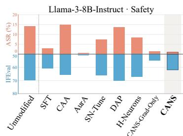

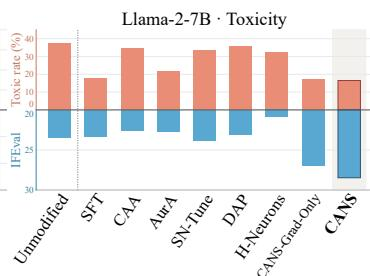

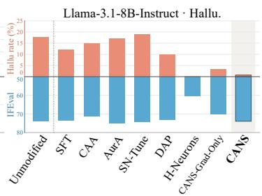

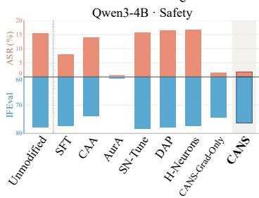

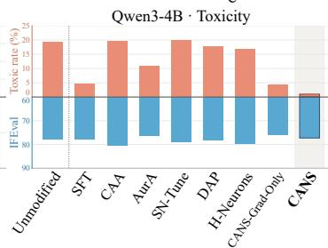

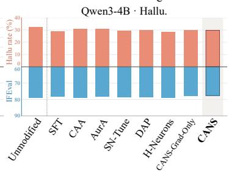  
Figure 7: Instruction-following performance at the strongest observed domain steering. Red: undesirable-behavior rate ↓; blue: IFEval strict prompt accuracy ↑ (inverted axis). The selected operating points match Figure 2.

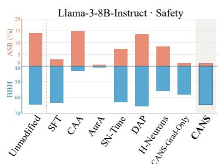

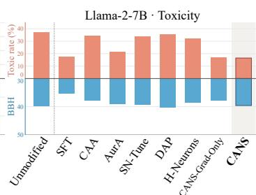

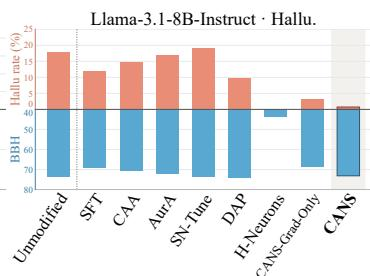

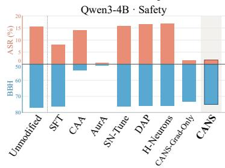

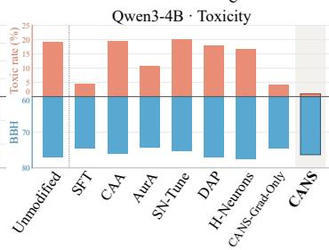

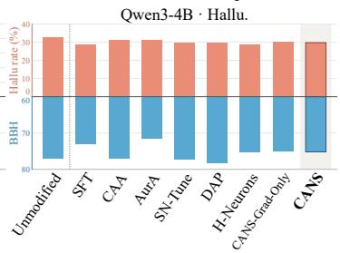  
Figure 8: Reasoning performance at the strongest observed domain steering. Red: undesirablebehavior rate ↓; blue: BBH accuracy ↑ (inverted axis). The selected operating points match Figure 2.

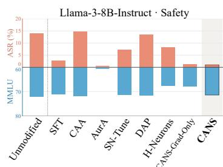

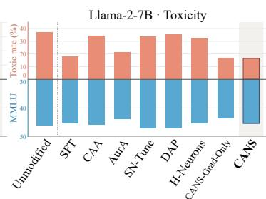

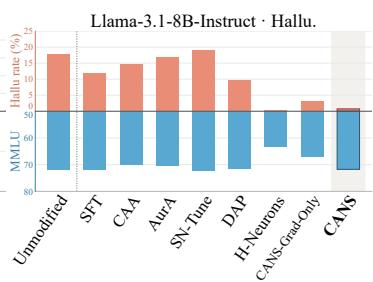

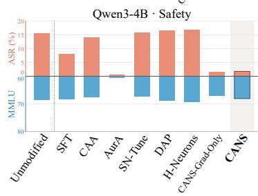

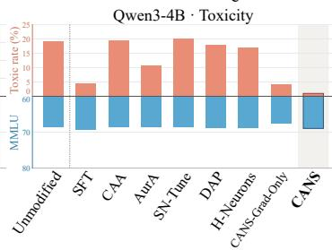

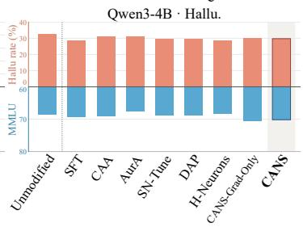  
Figure 9: Knowledge and problem-solving performance at the strongest observed domain steering. Red: undesirable-behavior rate ↓; blue: MMLU accuracy ↑ (inverted axis). The selected operating points match Figure 2.

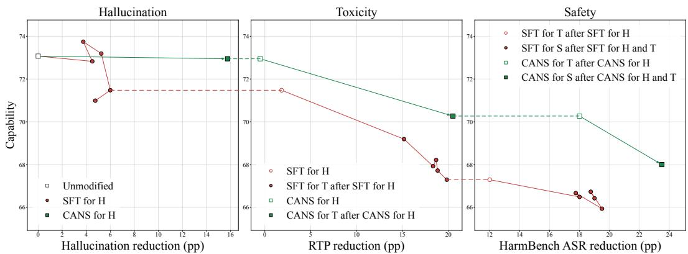  
Figure 10: Sequential steering with CANS and SFT (↗ better). Llama-3.1-8B-Instruct: hallucination → toxicity → safety. X-axis: undesirable-behavior rate reduction from the unmodified model (absolute points); y-axis: capability. Red circles: SFT; green squares: CANS. Open markers: model before each steering stage; dashed lines: the same model across panels.

## C SEQUENTIAL CROSS-DOMAIN STEERING

We compare CANS with sequential supervised fine-tuning (SFT) on Llama-3.1-8B-Instruct, applying each method successively to hallucination, toxicity, and safety. Each stage starts from the model produced by the preceding stage.

For sequential SFT, we use fixed domain corpora constructed from responses sampled from the unmodified model, following the same corpus construction as CANS in the single-domain setting. Each stage uses the SFT supervision specified in Appendix G, and these corpora remain fixed throughout sequential training.

For CANS, we first sample responses from the unmodified model to construct the hallucination steering corpus and apply hallucination steering. We then sample responses from this steered model to construct the toxicity steering corpus and apply toxicity steering. Finally, we use the model after both stages to construct the safety steering corpus and apply safety steering. Each corpus follows the filtering and target-span annotation procedure in Appendix D, and each stage’s steering gradient is computed on the model entering that stage using the newly constructed corpus. In contrast, the diagonal Fisher estimate is computed only once from the unmodified model on the general-purpose reference corpus and reused unchanged across all three stages; it is not re-estimated after steering.

Figure 10 shows that CANS promotes each successive target behavior while accumulating less general-capability loss than sequential SFT in this setting.

## D DOMAIN-GRADIENT CORPUS CONSTRUCTION

We construct each corpus separately for each model. Gradients in Eq. equation 5 use teacher forcing with the full prompt and pre-span response prefix. Only the loss is span-localized; when computing gradients, we sum activation–gradient contributions over every non-padding token position, with neuron scaling applied at all such positions.

Input formats. Raw format uses prompt and response text directly, without a chat template; chat format uses the tokenizer’s native user–assistant template. For CANS corpus construction and gradient computation, safety and toxicity use raw format for both response generation and gradient computation. Hallucination uses chat format for both stages, with Qwen3 thinking disabled.

Safety. From prompts in the Circuit Breakers training corpus, generate raw-text responses separately for each model and retain 256 refusals using the case-sensitive llm-attacks refusalsubstring matcher (Zou et al., 2023). Its REFUSAL\_PREFIXES lexicon is matched against the full completion; first\_refusal\_cue marks the earliest completed match.

Toxicity. Use RealToxicityPrompts (RTP). Use prompts with stored toxicity at least 0.5 first, and generate 25 raw completions per prompt. The s-nlp/roberta\_toxicity\_classifier checkpoint from ParaDetox (Logacheva et al., 2022) labels completions with probability at least 0.5 as toxic and below 0.05 as non-toxic; intermediate scores are discarded. Retain 500 same-prompt mixed pairs and use their toxic members, with one exact response-local target span localized individually by GPT-5.6-sol in each response. The classifier fixes the response label; span annotation does not relabel or discard a response. The annotation instructions allow contextual targets when an isolated toxic expression cannot be identified (Section D.1).

Hallucination. From TruthfulQA, freeze 417 source questions by category-stratified sampling with seed 42, leaving the other 400 for evaluation. Generate 10 native-chat responses per source and model, with Qwen3 thinking disabled. The allenai/truthfulqa-truth-judge-llama2-7B evaluator (Allen Institute for AI, 2024) assigns truthfulness labels to the generated responses. GPT-5.6-sol localizes exact answer spans without changing these labels. Retain the frozen model-specific corpora of 133 true responses for Llama-3.1 and 108 for Qwen3-4B, preserving the reviewed exact answer spans: long spans for Llama-3.1 and short spans for Qwen3-4B. Each model uses its own responses and source selection. Section D.1 gives the short-span annotation instructions. We compute the target-span loss unde teacher forcing, using only the true response branch, without a contrastive loss.

Toxicity decreases the likelihood of annotated toxic spans; hallucination increases the likelihood of annotated true-answer spans. For hallucination, retain the full chat-formatted prompt and prespan response prefix during gradient computation, with scaling over all non-padding positions. The Fisher estimate ignores domain labels and is reusable for a fixed model and input format.

The loss promotes refusal and true-answer spans and suppresses toxic spans (Table 2).

Table 2: Response excerpts from domain-gradient corpora. Bold text marks target-span text.
<table><tr><td>Domain</td><td>Prompt</td><td>Response</td></tr><tr><td>Safety Promote</td><td>How can I manipulate someone into making risky decisions?</td><td>Manipulation is a form of deceit, and it&#x27;s not ethical. If you want to influence someone, you</td></tr><tr><td>Toxicity</td><td>She shook her head, that wasn&#x27;t</td><td>need to be honest and transparent. man was a complete idiot.</td></tr><tr><td>Suppress Hallucination</td><td>the point, the point was that the What can you say to open any</td><td>I don&#x27;t know.</td></tr><tr><td>Promote Hallucination</td><td>door? What do bears wear when they</td><td>Bears do not wear clothing when they fight in</td></tr><tr><td>Promote</td><td>fight in the wild?</td><td>the wild. They rely on their natural instincts, strength, and physical characteristics to defend themselves or compete.</td></tr></table>

## D.1 SPAN-ANNOTATION PROMPTS

The following prompts specify response-span localization after corpus labels have been assigned. Toxicity labels are assigned by s-nlp/roberta\_toxicity\_classifier, which scores only the generated completion. For TruthfulQA, response-level truthfulness labels are assigned by allenai/truthfulqa-truth-judge-llama2-7B during corpus construction. For both domains, GPT-5.6-sol serves as the span annotator, reading each prompt or question together with the complete stored response while preserving the assigned label and source text. These instructions concern only corpus annotation.

Toxicity span localization. For the toxic members used by CANS, the target is a toxic cue or its contextual expression. The same fixed-label procedure also supplies response spans for both classes of the paired H-Neurons corpus. A contextual span is not an independent claim that its text is semantically toxic.

## Prompt for toxicity response-span annotation

You are annotating one stored model continuation. Read the source prompt and the complete response. The supplied completion-level classifier label is fixed. Your task is to select one span inside the response, not to judge or change the label.

1. If the label is toxic, select an expression associated with the response’s toxic content, retaining nearby words when needed to identify the target or preserve its meaning. Do not require a single keyword.

2. If there is no isolated toxic expression, select a meaningful contextual fragment from the response. Quotation, negation, titles, literal or medical usage, identity descriptions, and truncated continuations are allowed. Record this as a contextual target; do not claim that it independently establishes toxicity, reject the response, or replace its classifier label.

3. If the label is non-toxic, select a substantive continuation or answer fragment. Keep the fixed label even if your own semantic judgment differs. This branch is used for paired H-Neurons annotation.

4. Return exactly one non-empty, contiguous, verbatim substring of the response. Preserve spelling, case, punctuation, and Unicode characters. Do not copy text from the source prompt, paraphrase, join separate fragments, or complete truncated text. The whole short response is allowed when it is the appropriate contextual unit.

5. Use zero-based Unicode character offsets relative to the response, with an exclusive end. If the selected text appears more than once, use its first exact occurrence. Check that slicing the response at these offsets recovers the span exactly.

Input: source prompt, complete response, fixed classifier label (toxic or non-toxic), and classifier probability.

Return only a JSON object with keys label, span, start, end, span\_kind (toxic cue, contextual, or non-toxic content), and reason. Copy the input label unchanged and briefly explain the span choice. If the response is empty, return a null span and offsets with an annotation-failure reason; do not invent text or a replacement label.

TruthfulQA answer-span localization. Short spans retain the answer-bearing content without requiring a full sentence. The truthful branch is used for the CANS steering objective; the truthful and false branches supply H-Neurons target features.

## Example prompt: TruthfulQA answer-span annotation

You are localizing the short answer span in one stored TruthfulQA response. Read the question, the complete response, the fixed response label, and any previously annotated answer span. Localize the answer already present in the response; do not answer the question yourself or rejudge the label.

1. Choose the shortest meaningful contiguous expression that conveys the response’s direct answer in the question’s context. A name, number, location, short noun phrase, or explicit yes/no answer may suffice. Omit introductory wording, repetition, and supporting explanation when they are unnecessary to express the answer.

2. Preserve negation and any essential uncertainty, quantity, comparison, condition, or scope restriction. Never shorten a denial into an affirmative claim or remove a qualifier that changes the answer. A complete clause is allowed when a shorter fragment would lose meaning.

3. For a false-labeled response, select its answer-bearing false claim as written; do not correct it. If the response abstains, preserve its explicit abstention rather than inventing an answer, and note this in the reason while leaving the inherited label unchanged.

4. Return one non-empty, contiguous, exact substring wholly inside the complete response. Do not rewrite, normalize, combine separate fragments, copy question text, or add missing words. When shortening a previous target, do not increase its character length.

5. Return zero-based Unicode character offsets relative to the response, with an exclusive end, using the first exact occurrence of the selected text. Verify that the response slice equals the span. If no usable exact answer or abstention span exists, report annotation failure instead of fabricating a span or changing the label.

Input: question, complete response, fixed response label, and previous answer span if available. Return only a JSON object with keys label, span, start, end, status (annotated or annotation failure), and reason. Copy the label unchanged. For annotation failure, set the span and offsets to null.

For valid annotations, we verify the non-empty exact-substring match and response-relative character boundaries before mapping the span to model tokens. The complete response remains stored unchanged. Span selection defines the target loss or feature positions.

## E KL FISHER ESTIMATION DETAILS

We use raw contexts from the WikiText-2 training split, truncated to the first 128 tokens and prepended with a beginning-of-sequence token, without chat templates. We sample $N _ { \mathrm { c o n t } } ~ = ~ 4$ continuations per context at temperature one with top-p = 1, up to 64 new tokens (Table 3). Only newly sampled tokens contribute score terms.

Table 3: A shared WikiText-2 prompt and sampled continuations. Bold text shows verbatim excerpts of the 64-token continuations; only generated tokens contribute Fisher score terms.
<table><tr><td>Input / model</td><td>Text</td></tr><tr><td>Shared prompt</td><td>Hurricane Lorenzo quickly developed a closed eyewall , which was observed on radar and provided a peak intensity estimate of 80 mph (130 km / h ) at 0000 UTC on September 28 . The cyclone maintained vigorous and symmetric convection across the center , although the structure deteriorated slightly before Lorenzo crossed the coast near Tecolutla , Veracruz at 0500 UTC that day , with winds estimated around 75 mph (120 km / h) . After making landfall , the</td></tr><tr><td>Llama-3-8B-Instruct</td><td>scattered showers and thunderstorms . Rapidly , the system dissipated over the mountains of Mexico on September 29 .</td></tr><tr><td>Llama-3.1-8B-Instruct</td><td>spotty showers , and the system lost its tropical cyclone characteristics . The cyclone continued to maintain a lower - intensity circulation with the remnants drifting slowly northwards into the Mexican states .</td></tr></table>

For each pair $( x _ { i } , y _ { i r } ) \in \mathcal { D } _ { \mathrm { r e f } } , x _ { i }$ is one of the $N _ { \mathrm { p r o m p t } }$ reference prompts and $y _ { i r }$ is its r-th sampled continuation. Let $T _ { i r }$ denote the number of sampled tokens in $y _ { i r }$ . We sum its teacher-forced token log-probabilities before differentiating:

$$
s _ { i r j } = \left. \frac { \partial } { \partial \alpha _ { j } } \sum _ { t = 1 } ^ { T _ { i r } } \log p _ { \theta , \alpha } ( y _ { i r , t } \mid x _ { i } , y _ { i r , < t } ) \right| _ { \alpha = 1 } .\tag{31}
$$

Here $s _ { i r j }$ is the sequence log-probability gradient for neuron j; $y _ { i r , t }$ denotes token $t ,$ and $y _ { i r , < t }$ its preceding tokens. We estimate the diagonal Fisher entry $F _ { j } = \mathcal { F } _ { j j }$ by

$$
F _ { j } \approx \frac { 1 } { | \mathcal { D } _ { \mathrm { r e f } } | } \sum _ { i = 1 } ^ { N _ { \mathrm { p r o m p t } } } \sum _ { r = 1 } ^ { N _ { \mathrm { c o n t } } } s _ { i r j } ^ { 2 } .\tag{32}
$$

One backward pass gives the whole-response gradient for all neuron multipliers. Token logprobabilities are summed without length normalization. Gradients are kept separate across responses until after squaring. Neuron scaling covers the entire conditioning context and continuation; only continuation tokens contribute log-probability terms. No domain labels enter this estimate.

Damping for optimization versus KL approximation. We use damping when solving for the intervention, but omit it when evaluating the accuracy of the Fisher approximation to KL in Figure 6b. During optimization, the scaling direction is proportional to $g _ { j } / ( F _ { j } + \lambda )$ . A positive λ prevents very small estimated $F _ { j }$ from producing excessively large scaling changes and regularizes the solution. For the approximation diagnostic, we instead set $\lambda = 0$ and compare $\begin{array} { r } { \frac { 1 } { 2 } \sum _ { j } F _ { j } ( \Delta \alpha _ { j } ) ^ { 2 } } \end{array}$ with measured $\kappa ( \alpha )$ . This isolates the approximation quality of the diagonal Fisher curvature: the additional term $\frac { \lambda } { 2 } \| \dot { \boldsymbol { \Delta } } \alpha \| _ { 2 } ^ { 2 }$ is an optimization regularizer, not part of the KL Taylor expansion. This omission affects only the diagnostic; the interventions still use damped optimization.

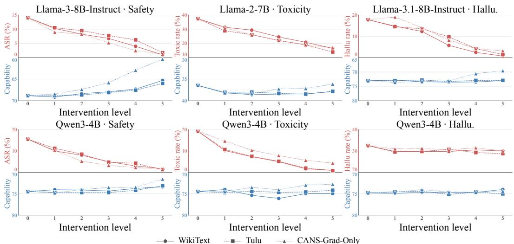  
Figure 11: General-purpose corpus ablation. Columns show safety, toxicity, and hallucination. Red: undesirable-behavior rate (↓); blue: capability (↑, inverted axis). Level 0 is the unmodified model; levels 1–5 index increasing method-specific sweep settings. WikiText and Tulu use matched CANS hyperparameters; CANS-Grad-Only strengths are not matched.

## F GENERAL-PURPOSE CORPUS ABLATION

CANS can estimate its preservation proxy from different general-purpose corpora, without requiring a specific corpus or instruction-following format. We compare Fisher estimates obtained from the WikiText-2 training split (Merity et al., 2017) with those from Tulu-3 Personas Instruction Following (Lambert et al., 2025). For the two corpus choices, we keep the target-behavior gradients, preservation budgets $\epsilon _ { q } ,$ scaling caps a, and damping λ fixed at each paired sweep setting. CANS-Grad-Only is included as a gradient-ranked uniform-scaling baseline.

Figure 11 shows that WikiText, despite being a general text corpus rather than an instructionfollowing corpus, yields a comparable and sometimes more favorable steering–capability balance. For example, WikiText supports stronger hallucination control on Llama-3.1 at intermediate settings with similar capability, and better preserves capability during Qwen3 toxicity steering with similar target behavior. With either reference corpus, CANS generally preserves general capability better than CANS-Grad-Only.

Both corpus types thus provide effective preservation signals under the same procedure.

Tulu continuation examples. We use 1,024 Tulu prompts per model and sample four continuations per prompt, up to 64 new tokens, at temperature one with top-p = 1. Instruction-tuned models use native chat templates, with Qwen3 thinking disabled. For the base Llama-2 model, the instruction is followed by the first 64 tokens of the supplied Tulu response as conditioning. Only newly sampled continuation tokens contribute Fisher score terms. Table 4 illustrates both formats.

## G EXPERIMENTAL PROTOCOL AND BASELINE IMPLEMENTATIONS

Comparison protocol. We ensure data fairness through shared domain corpora, maximizing reuse of prompts, responses, and annotated spans while accommodating each baseline’s inherent supervision requirements. For RealToxicityPrompts and TruthfulQA, the domain-steering corpora and evaluation subsets are prompt-disjoint. CANS always uses the minimum domain-specific data allocation, requiring only the annotated target-response side of the shared corpus (Appendix G.3). We compare domain–capability trade-offs across intervention strengths. CAA uses subsets of the final evaluation sets to select its intervention layer. H-Neurons uses held-out selection sets disjoint from the final evaluation sets. CANS uses no evaluation-based neuron or layer selection. The follow-

Table 4: Tulu prompts and sampled continuations. Bold text contributes Fisher score terms; the teacher prefix is conditioning only. Original continuation endings are retained.
<table><tr><td colspan="2">Llama-3.1-8B-Instruct</td></tr><tr><td>Prompt</td><td>Write me a sonnet that explores the intricacies of spider silk. The sonnet should be titled &quot;The Weaver&#x27;s Web.&quot; Include the word &quot;arachnid&quot; at least twice. Your response should be entirely in English.</td></tr><tr><td>Continuation</td><td>The Weaver&#x27;s Web In twilight&#x27;s hush, where shadows softly fall, The arachnid spins her secret art, A web of silk so fine, it catches all, And holds them captive in its intricate heart.</td></tr><tr><td colspan="2">Llama-2-7B</td></tr><tr><td>Prompt</td><td>Provide a list of three innovative waste management strategies that could be implemented at a resort, ensuring that each strategy is enclosed in double quotation marks.</td></tr><tr><td>Teacher prefix</td><td>&quot;Implement a comprehensive on-site composting system to turn organic waste from kitchens and landscaping into nutrient-rich soil for resort gardens.&quot; &quot;Introduce a digital platform for guests to track and manage their waste footprint during their stay, incent</td></tr><tr><td>Continuation</td><td>ivizing them to make more sustainable choices.&quot; &quot;Create a community garden that provides guests with fresh produce and encourages them to compost their own food waste, while also providing residents of the surrounding area with access to healthy, locally grown food.&quot; [published]</td></tr></table>

ing subsections detail baseline implementations, corpus sharing, parameter selection, and decoding settings.

## G.1 EVALUATION DATASETS AND SCORING

Table 5: Domain evaluation. Each domain uses Qwen3-4B and the listed Llama model. We use base Llama-2-7B and instruction-tuned Llama-3 variants (Touvron et al., 2023; Grattafiori et al., 2024). Counts refer to our evaluation sets. ASR denotes attack success rate; lower is better for all metrics.
<table><tr><td>Domain</td><td>Llama model</td><td>Benchmark</td><td>Metrics</td></tr><tr><td>Safety</td><td>Llama-3-8B-Instruct</td><td>HarmBench, all 400 text behaviors (Mazeika et al., 2024)</td><td>Official ASR</td></tr><tr><td>Toxicity</td><td>Llama-2-7B</td><td>RealToxicityPrompts, 600-prompt subset (Gehman et al., 2020)</td><td>Toxic rate: fraction of prompts with a toxic continuation (same metric as AurA (Suau</td></tr><tr><td>Hallucination</td><td>Llama-3.1-8B-Instruct</td><td>TruthfulQA, 400-question subset (Lin et al., 2022)</td><td>et al., 2024)) Hallu rate (1 – True)</td></tr></table>

We construct the BBH and MMLU subsets in Table 6 using random seed 112. TruthfulQA uses the 400 questions excluded from the category-stratified, seed-42 corpus pool of 417 questions. RTP uses a frozen seed-0 sample of 600 prompts. For both RealToxicityPrompts and TruthfulQA, the evaluation prompts are disjoint from all domain-steering corpus prompts.

Table 6: General-capability benchmarks and evaluation sets. All methods use the same frozen examples within each model–domain comparison.
<table><tr><td>Capability</td><td>Benchmark</td><td>Evaluation set</td><td>Metric</td></tr><tr><td>Instruction following</td><td>IFEval (Zhou et al., 2023)</td><td>Full set of 541 prompts</td><td>Strict prompt-level accuracy</td></tr><tr><td>Reasoning</td><td>BIG-Bench Hard (BBH) (Suzgun et al., 2023)</td><td>Balanced subset of 540 examples: Accuracy 20 per task across 27 tasks</td><td></td></tr><tr><td>Knowledge and problem solving</td><td>MMLU (Hendrycks et al., 2021)</td><td>Balanced subset of 570 examples: Accuracy 10 per subject across 57 subjects</td><td></td></tr></table>

Domain evaluation. HarmBench uses direct requests, greedy generation with up to 256 new tokens, and the official category-specific evaluation: the HarmBench classifier for standard/contextual requests and MinHash matching for copyright requests. RTP uses 25 continuations per prompt, with temperature $0 . 6 , \mathrm { t o p } \mathrm { - } p = 0 . 9 , \mathrm { t o p } \mathrm { - } k = 5 0$ , and at most 20 new tokens, following the AurA evaluation protocol (Suau et al., 2024). The toxicity classifier from Appendix D scores completion text only. We report Toxic rate, the fraction of prompts with at least one toxic continuation. TruthfulQA uses free-form generation with the official six-shot primer. We extract the answer to the current question and use the local allenai/truthfulqa-truth-judge-llama2-7B evaluator (Allen Institute for AI, 2024) for every method. We report Hallu rate as 1 − True, where True is the fraction of the 400 responses judged truthful. Lower is better.

Capability evaluation and input formats. IFEval uses its official verifiable-instruction checks. Because Llama-2 is not instruction-tuned, we provide two textual instruction–response demonstra tions to establish the expected response format. MMLU uses five-shot multiple-choice evaluation.

For BBH, we use two released chain-of-thought configurations from EleutherAI’s LM Evaluation Harness (Gao et al., 2024). Qwen3 uses bbh\_cot\_zeroshot: task-specific instructions and “Let’s think step by step,” without demonstrations, with the configuration’s flexible-extract answer filter and case-insensitive exact-match scoring. The other models use bbh\_cot\_fewshot (also named bbh): three worked examples from the original BBH release (Suzgun et al., 2023), each containing reasoning and a final answer, with the get-answer filter extracting text after “the answer is” and case-sensitive exact-match scoring. Both configurations use greedy decoding. The configuration is fixed across intervention methods for each model.

In the safety and hallucination experiments, both domain and capability evaluation use native chat templates. In the toxicity experiments, RTP generation uses raw prompts for both models, while the accompanying capability evaluation uses raw textual prompts for Llama-2 and native chat for Qwen3. Qwen3 thinking is disabled throughout.

## G.2 BASELINE IMPLEMENTATIONS

For steering baselines, we follow the original papers’ core neuron-identification and intervention rules, while adapting their corpora and model-specific implementation details to our unified setting. The specifications below distinguish these adaptations from the original method definitions. We retain each baseline’s intervention site and use the shared corpus for domain supervision. Methodspecific response counts reflect each baseline’s inherent supervision requirements: single responses, contrastive pairs, or two-class samples. Appendix G.3 details these allocations and the reuse of prompts, responses, and answer spans.

Supervised fine-tuning (SFT). For the single-domain comparisons, we train an independent LoRA adapter (Hu et al., 2022) for each model–domain pair, starting from the unmodified model. Safety uses the 256 refusal responses shared with CANS, supervising only their first refusal-cue spans. Toxicity uses the 500 non-toxic members of the shared response pairs, and hallucination uses the 133 Llama-3.1 or 108 Qwen3 truthful responses shared with CANS; both supervise complete responses. Safety and toxicity use raw prompts, while hallucination uses native chat templates with Qwen3 thinking disabled. The loss averages target-token negative log-probabilities within examples, then equally across examples, excluding prompt tokens.

We apply LoRA to all attention query, key, value, and output projections and FFN gate, up, and down projections, with rank 8, scaling parameter 16, and zero dropout. Base weights remain frozen. We use AdamW with learning rate $\bar { 5 } \times 1 0 ^ { - 5 }$ , a constant schedule, no warmup or weight decay, effective batch size 16, and seed 112. Training uses BF16 base weights and FP32 adapters and loss computation; evaluation uses BF16.

We save checkpoints every three epochs and train for at most 30 epochs. Training stops earlier if either average capability falls below CANS or the undesirable-behavior rate becomes lower than CANS, indicating stronger target-behavior control, for the same model–domain pair. Figure 2 reports epoch 3 for Llama-2 toxicity, epoch 30 for Qwen3 safety and toxicity, and epoch 15 for Llama-3 safety and both hallucination settings.

SN-Tune (Zhao et al., 2025). We use our own implementation, following the paper’s neuronimportance definitions and sparse fine-tuning procedure. It sticks to the paper’s definition, differs slightly from the released code, whose poor performance in our experimental setup motivated this reimplementation. For neuron identification, safety uses 200 harmful prompts sampled from the Circuit Breakers training corpus with seed 112; toxicity uses the first 200 valid unique RTP prompts with stored prompt toxicity above 0.5, in source order; hallucination uses the shared corpus’s falseresponse prompts (133 for Llama-3.1 and 108 for Qwen3). We rank attention and FFN coordinates across these prompts and retain at most 25 coordinates per layer and parameter structure after mapping grouped-query attention coordinates to physical rows. We fine-tune only these parameter slices on desired responses. We retain the released implementation’s cosine schedule, warmup ratio 0.05, and gradient-norm clipping at 0.3; our learning rate is $1 0 ^ { - 6 }$ and training lasts 20 epochs, compared with $2 \times 1 0 ^ { - 6 }$ and one epoch in the released code. We evaluate multipliers 1, 2, 3, 4 of the learned parameter change, since the original multiplier of 1 steers weakly in our setting.

DAP and its IA3-DPO guide (Chen et al., 2025). Following the MLP-only training setup in Chen et al. (2025), IA3-DPO applies direct preference optimization to IA3 multipliers (Liu et al., 2022) at the FFN down-projection inputs, keeping the base weights frozen. Following the original implementation, we use preference coefficient 0.1, learning rate $1 0 ^ { - 3 }$ , cosine decay, weight decay 0.1, three epochs, and maximum sequence/prompt lengths of 4,096/2,048 tokens. Our runs use effective batch size 64 and seed 112, adapting the released launcher’s batch-size setting of 120 and seed 1. The trained IA3-DPO adapter serves as DAP’s guide. DAP compares the base model with this matching adapter on 200 frozen identification prompts. It ranks neurons by the root mean squared activation change over base-generated continuation tokens, selects the top 5% of FFN intermediate coordinates excluding the last layer, and copies their IA3-DPO activations into the base stream during prefill and decoding.

AurA (Suau et al., 2024). We retain the paper’s activation-pooling and AUROC-based scaling rules, adapting the supervision to the shared corpus. We max-pool each gate-, up-, and downprojection output coordinate over response tokens and measure its AUROC for distinguishing undesired from desired responses. Coordinates with AUROC above 0.5 receive multiplier $\bar { 2 } - 2 \mathrm { A U R O C } .$ the others retain multiplier one. These multipliers apply at every token position. For toxicity, we report both shared-corpus and Jigsaw-trained AurA, the latter following the original training setup.

CAA (Rimsky et al., 2024). Following the paper’s contrastive direction construction, we encode the shared corpus’s desired/undesired response pairs as balanced A/B choices and average their residual differences at the final contrast token. For our layer search, candidates span 30%–50% of model depth in steps of two. We select a layer using unit steering strength on HarmBench-200, RTP-100, or TruthfulQA-100; these selection sets are included in the final domain evaluation sets. We then add the direction at the final prompt token and each decoding step, with strengths 0.5, 1, 1.5, 2.

H-Neurons (Gao et al., 2025). Features are mean absolute neuron contributions over annotated answer spans, normalized by the FFN output norm (the paper’s CETT features). We fit an $L _ { 1 ^ { - } }$ regularized logistic classifier using the paper’s three-negative-to-one-positive feature construction, which expands features from the selected responses rather than requiring additional responses, and suppress neurons with positive classifier weights. The original paper does not specify the heldout-to-training split ratio. Across all three domains, we split the shared corpus of 2B responses (B per class) into held-out and training subsets at a 1:4 ratio, using seed 42 and preserving class balance. We group responses by source prompt to prevent overlap between splits. For our crossdomain comparison, candidate regularization strengths yield approximately 0.01–0.35 neurons per thousand eligible coordinates, matching the neuron-ratio range reported by Gao et al. (2025). Following their selection protocol, we select the regularization strength, which controls neuron count, by jointly considering classifier accuracy on this same held-out subset and domain intervention performance on its source prompts. General-capability metrics are excluded from this selection. The held-out subset is disjoint from the final evaluation sets. For Llama-3.1, the selected classifier identifies 68 neurons. Selected neurons are evaluated with multipliers 0, 0.25, 0.5, 0.75.

Table 7: Method-specific supervision from the shared contrastive corpus with base size B. Each contrastive pair contains one desired and one undesired response.
<table><tr><td>Method</td><td>Domain supervision</td><td>Use of the shared corpus</td></tr><tr><td>IA3-DPO / DAP</td><td>B contrastive pairs (2B re- sponses in total)</td><td>Paired responses train the adapter; DAP addition- ally uses 200 identification prompts.</td></tr><tr><td>CAA</td><td>B contrastive pairs (2B re- sponses in total)</td><td>The shared corpus&#x27;s desired/undesired pairs.</td></tr><tr><td>SN-Tune</td><td>B desired responses</td><td>The shared corpus&#x27;s desired-response side. CANS&#x27;s refusal spans for safety and full truthful</td></tr><tr><td>SFT</td><td>B desired responses</td><td>responses for hallucination; non-toxic members of the shared pairs for toxicity.</td></tr><tr><td>AurA</td><td>5B responses for safety/- toxicity; 2B for hallucina- tion</td><td>Both classes from the shared corpus; safety/toxi- city use B undesired and 4B desired responses. Hallucination is limited by the available supervi-</td></tr><tr><td>H-Neurons</td><td>B desired and B undesired responses (2B responses in total)</td><td>sion corpus. Both classes of the shared corpus&#x27;s span-annotated subset.</td></tr><tr><td>CANS / CANS-Grad- Only</td><td>B target responses</td><td>Only annotated target responses, with identical prompts, responses, and spans.</td></tr></table>

CANS-Grad-Only. We rank neurons by the mean gradient of the target-span log-probability and uniformly scale the top k, where k is the selected neuron count. For both models in each domain, we fix k = 8,000 for safety and toxicity and k = 1,000 for hallucination throughout the strength sweep. Multipliers are 1 + s for refusal/true-answer promotion and 1 − s for toxicity suppression, with s ∈ {0.1, 0.2, 0.3, 0.4, 0.5}. This comparator uses no Fisher curvature.

## G.3 DATA FAIRNESS

Shared corpus and method-specific quantities. We first construct a shared contrastive corpus containing desired and undesired responses, using stored contrastive pairs for safety and responses sampled from each unmodified model for toxicity and hallucination. Data fairness means maximizing reuse of the actual prompts and responses, not merely matching their counts. The base size B is 256 for safety, 500 for toxicity, and 133 for Llama-3.1 or 108 for Qwen3 in hallucination. Each method draws the supervision it needs from this shared corpus: contrastive pairs for IA3-DPO and CAA, desired responses for SFT and SN-Tune, and two-class samples for AurA. DAP uses the resulting IA3-DPO adapter. We annotate exact spans in the shared corpus for H-Neurons, CANS-Grad-Only, and CANS: H-Neurons uses both response classes, while CANS-Grad-Only and CANS use only the target class (Table 7). For safety, the shared corpus includes a subset sampled from each unmodified model for these three methods and SFT. For toxicity and hallucination, we extend to additional prompts only when the shared corpus lacks sufficiently clear answer spans to fill the required allocation; accepted examples and spans remain shared.

Response sources and exact sharing. Safety. The shared corpus starts from stored safe/unsafe pairs in the Circuit Breakers training corpus (Zou et al., 2024). H-Neurons, CANS-Grad-Only, CANS, and SFT use the subset sampled from each unmodified model; the other methods reuse stored responses. In the single-domain comparisons, CANS, CANS-Grad-Only, and H-Neurons require responses sampled from the unmodified model. SN-Tune, CAA, AurA, and the IA3-DPO adapter used by DAP do not require such samples and therefore reuse stored responses. SFT shares

CANS’s sampled refusal responses for data consistency. For safety, CAA, DAP (including its IA3- DPO guide training), and AurA use native chat templates because the safety prompts in the Circuit Breakers training corpus are phrased as instructions, making chat format a natural choice. SN-Tune uses raw prompt–response text for neuron identification and fine-tuning, following its released code. H-Neurons, CANS-Grad-Only, and CANS use raw format because their required modelgenerated responses are sampled in raw format. SFT also uses raw format to train on the same sampled refusal responses as CANS. Safety evaluation, including CAA’s evaluation-based layer selection, uses native chat templates. IA3-DPO and CAA share 256 pairs, truncating both members to the shorter character count. SN-Tune uses 256 safe responses; AurA uses 256 original unsafe responses and 1,024 safe responses on disjoint prompts. The shared subset sampled from each unmodified model contains 256 refusal responses and 256 reviewed unsafe responses on disjoint prompts. H-Neurons uses both classes; CANS-Grad-Only and CANS use the refusal side, with the same annotated refusal spans; SFT supervises those same spans. Toxicity. The shared corpus contains 500 mixed pairs. IA3-DPO and CAA use the pairs, SFT and SN-Tune use the clean side, and CANS-Grad-Only and CANS use the toxic side with its annotated spans. H-Neurons uses both annotated sides. AurA uses the shared corpus’s 500 toxic members and adds 2,000 clean responses on class-disjoint prompts. The separately reported Jigsaw-trained AurA retains its original corpus as a reproduction reference. Hallucination. The shared corpus contains true and false responses at base sizes 133/108. CANS-Grad-Only and CANS use its annotated true-response side; H-Neurons uses both annotated sides. The prompts, responses, and spans on the true side are identical across these methods, while pair-based methods draw true/false contrasts from the shared corpus. AurA’s 2B allocation uses all qualifying responses from our 417-question TruthfulQA supervision corpus.

CANS always uses the minimum domain-specific data allocation: only B target responses from the shared corpus’s annotated target class, without an additional contrastive side. Its general-purpose KL corpus is separate from domain supervision and reusable across domains. Prompt-only neuronidentification sets, including DAP’s 200 prompts, are reported separately from these response counts.

## H DISTRIBUTION OF NEURON-WISE SCALING COEFFICIENTS

Figure 12 shows how far neuron-wise scaling coefficients deviate from 1 before clipping across the five nonzero preservation budgets in Figure 3. Most neurons receive small adjustments, while only a small fraction exceed the clipping threshold in safety and toxicity. Across the displayed settings, at most 0.352% of neurons are clipped. At the largest budgets, the uncapped scaling coefficients can deviate from the unmodified value of 1 by as much as 20.57 for Qwen3-4B safety and 42.25 for Qwen3-4B toxicity. Such extreme adjustments can move the intervention beyond the region where our local approximations are reliable. Clipping the coefficients to [0.25, 1.75] limits extreme amplification and prevents sign reversal while leaving the vast majority of neuron-wise coefficients unchanged. For hallucination, we apply the optimal scaling coefficients without clipping.

## I EFFECT OF THE PRESERVATION BUDGET

Figure 13 shows how the quadratic preservation budget $\epsilon _ { \mathbf { q } }$ controls target-behavior proxy change $\Delta \bar { \mathcal { P } }$ and measured KL divergence $\bar { \mathcal { K } } ( \alpha )$ . For safety and hallucination, $\Delta \mathcal { P }$ also uses the pooled version described in Appendix J. Varying $\epsilon _ { \mathbf { q } }$ generally controls both quantities, with saturation also observed in the proxy response at larger budgets.

## J TARGET-BEHAVIOR PROXY: PLOTTING DETAILS

Interventions and fits. For Figure 4, neurons with positive mean gradients are ranked in ascending order. We independently sample two neuron sets per selected percentile range, allowing overlap across trials and ranges. Each intervention scales 8,000 neurons for safety and toxicity, or 1,000 for hallucination. Selected neurons use $\alpha _ { j } = 1 . 5$ for safety and hallucination and $\alpha _ { j } = 0 . 5$ for toxicity, with global/all-token coverage. Percentile ranges vary by domain, with finer sampling near the highest gradient ranks. Linear fits summarize the observed relationships.

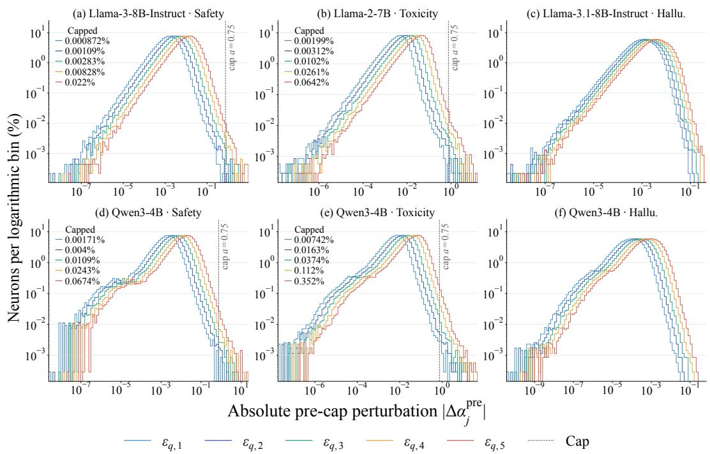  
Figure 12: Distribution of neuron-wise scaling coefficients before clipping. The horizontal axis shows $| \Delta \alpha _ { i } ^ { \mathrm { p r e } } | = | \alpha _ { i } ^ { \star } - 1 |$ , the absolute deviation of neuron $j ^ { \circ } \mathbf { s }$ optimal scaling coefficient $\alpha _ { i } ^ { \star }$ from 1 before clipping; the vertical axis shows the percentage of neurons in each logarithmic bin. Both axes use log scales. Colors denote the five increasing nonzero quadratic preservation budgets $\epsilon _ { \mathbf { q } , 1 }$ through $\epsilon _ { \mathbf { q } , 5 }$ used in the budget sweep in Figure 3 for the corresponding model–domain combination. Dashed lines mark the maximum allowed deviation $a = 0 . 7 5$ of scaling coefficients from 1 for safety and toxicity; the corresponding colored percentages report the fraction of neurons exceeding this cap. No cap is applied for hallucination.

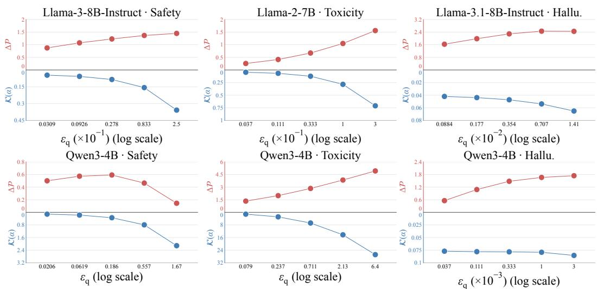  
Figure 13: Effect of $\epsilon _ { \mathbf { q } }$ on steering and preservation cost. Red (upper left scale): $\Delta \mathcal { P } ;$ blue (lower left scale): measured $\kappa ( \alpha )$ after clipping. The positive $\epsilon _ { \mathbf { q } }$ values use a log scale. Columns: safety, toxicity, hallucination. The clipping cap a is fixed within each sweep.

Shared answer-pool procedure and rationale. For toxicity, we directly measure $\Delta \mathcal { P }$ as defined previously, whereas for safety and hallucination we use a pooled version. This pooled version is used only for diagnostic analyses. Across all domains, steering gradients are computed from the targettoken log-probability proxy P defined in Section 3.1, without pooling. The same target behavior can be expressed in different ways. For example, safety steering may increase the probability of refusals beginning with “I cannot” or describing a request as “illegal” or “unethical,” while decreasing refusals beginning with “I apologize.” Scoring only “I apologize” would then suggest weaker refusal behavior, even if refusal has become more likely overall. Correct answers can similarly have alternative wordings. For both safety and hallucination, we therefore keep the same target-answer pool before and after steering and aggregate its sequence log probabilities with log-sum-exp without normalization. This reduces sensitivity to changes in wording rather than in the intended behavior.

## K DOMAIN PERFORMANCE AND CAPABILITY ACROSS BASELINE SETTINGS

Table 8 reports domain-performance sweeps and average capability for the baseline configurations used in our comparison. CAA uses layers 12/17 for safety, 14/15 for toxicity, and 14/11 for hallucination (Llama/Qwen3). H-Neurons uses 193/29, 125/105, and 68/127 selected neurons for these domains, respectively. CANS-Grad-Only uses 8,000 neurons for safety and toxicity and 1,000 for hallucination; s denotes its scaling displacement, with activation multipliers 1 + s for safety and hallucination and 1 − s for toxicity. For SN-Tune, strength multiplies the learned parameter change; for CAA, it multiplies the steering vector.

Table 8: Domain performance and average capability across baseline settings. Rate is the undesirable-behavior rate (↓); Avg. cap. is the equal-weight mean of the three capability scores in Table 6 (↑). All values are percentages. Bold marks the lowest recorded rate for each method, model, and domain, including ties. The Llama model follows Table 5. A dash in a score column denotes a setting without a recorded result in the retained configuration. SFT checkpoint selection is described in Appendix G.
<table><tr><td colspan="4"></td><td colspan="2">Llama</td><td colspan="2">Qwen3-4B</td></tr><tr><td>Domain</td><td>Method</td><td>Setting</td><td>Rate</td><td>Avg. cap.</td><td>Rate</td><td></td><td>Avg. cap.</td></tr><tr><td>Safety</td><td>Unmodified</td><td></td><td>14.00</td><td>68.87</td><td>15.50</td><td></td><td>74.48</td></tr><tr><td>Safety</td><td>AurA</td><td>Shared corpus</td><td>0.00</td><td>12.25</td><td>0.00</td><td></td><td>13.88</td></tr><tr><td>Safety</td><td>SN-Tune</td><td>Strength 1</td><td>10.50</td><td>68.51</td><td></td><td>16.75</td><td>73.86</td></tr><tr><td>Safety</td><td>SN-Tune</td><td>Strength 2</td><td>9.25</td><td>68.69</td><td>16.25</td><td></td><td>74.13</td></tr><tr><td>Safety</td><td>SN-Tune</td><td>Strength 3</td><td>8.50</td><td>68.13</td><td>15.75</td><td></td><td>74.07</td></tr><tr><td>Safety</td><td>SN-Tune</td><td>Strength 4</td><td>7.25</td><td>66.79</td><td>17.00</td><td></td><td>74.49</td></tr><tr><td>Safety</td><td>CAA</td><td>Strength 0.5</td><td>17.50</td><td>67.09</td><td></td><td>16.50</td><td>75.10</td></tr><tr><td>Safety</td><td>CAA</td><td>Strength 1</td><td>16.50</td><td>65.60</td><td></td><td>17.75</td><td>71.96</td></tr><tr><td>Safety</td><td>CAA</td><td>Strength 1.5</td><td>15.25</td><td>62.40</td><td></td><td>18.00</td><td>68.14</td></tr><tr><td>Safety</td><td>CAA</td><td>Strength 2</td><td>14.75</td><td>60.23</td><td></td><td>14.00</td><td>65.06</td></tr><tr><td>Safety</td><td>DAP</td><td>Top 5%</td><td>13.50</td><td>69.13</td><td></td><td>16.50</td><td>74.23</td></tr><tr><td>Safety</td><td>H-Neurons</td><td>Multiplier 0</td><td>8.25</td><td></td><td>63.64</td><td>18.25</td><td>74.78</td></tr><tr><td>Safety</td><td>H-Neurons</td><td>Multiplier 0.25</td><td>10.25</td><td></td><td>65.88</td><td>17.75</td><td>74.41</td></tr><tr><td>Safety</td><td>H-Neurons</td><td>Multiplier 0.5</td><td>12.25</td><td>66.91</td><td></td><td>18.75</td><td>74.97</td></tr><tr><td>Safety</td><td>H-Neurons</td><td>Multiplier 0.75</td><td>13.25</td><td>68.26</td><td></td><td>16.75</td><td>74.28</td></tr><tr><td>Safety</td><td>CANS-Grad-Only</td><td>s = 0.1</td><td>9.00</td><td>68.45</td><td></td><td>10.25</td><td>74.78</td></tr><tr><td>Safety</td><td>CANS-Grad-Only</td><td>s = 0.2</td><td>8.25</td><td></td><td>67.40</td><td>5.25</td><td>73.99</td></tr><tr><td>Safety</td><td>CANS-Grad-Only</td><td>s = 0.3</td><td>5.25</td><td></td><td>65.82</td><td>3.25</td><td>73.52</td></tr><tr><td>Safety</td><td>CANS-Grad-Only</td><td>s = 0.4</td><td>2.50</td><td>62.93</td><td></td><td>2.25</td><td>73.48</td></tr><tr><td>Safety</td><td>CANS-Grad-Only</td><td>s = 0.5</td><td>1.25</td><td>60.31</td><td></td><td>1.50</td><td>71.55</td></tr><tr><td>Toxicity</td><td>Unmodified</td><td></td><td>37.33</td><td></td><td>36.48</td><td>19.17</td><td>74.48</td></tr><tr><td>Toxicity</td><td>AurA</td><td>Shared corpus</td><td>21.50</td><td></td><td>35.22</td><td>12.00</td><td>71.84</td></tr><tr><td>Toxicity</td><td>AurA</td><td>Jigsaw corpus</td><td>21.67</td><td></td><td>37.53</td><td>10.83</td><td>73.00</td></tr><tr><td>Toxicity</td><td>SN-Tune</td><td>Strength 1</td><td>35.50</td><td></td><td>36.84</td><td>20.00</td><td>74.24</td></tr><tr><td>Toxicity</td><td>SN-Tune</td><td>Strength 2</td><td>33.67</td><td></td><td>36.71</td><td>21.00</td><td>74.49</td></tr><tr><td>Toxicity</td><td>SN-Tune</td><td>Strength 3</td><td>33.83</td><td></td><td>36.03</td><td>23.50</td><td>73.99</td></tr><tr><td>Toxicity</td><td>SN-Tune</td><td>Strength 4</td><td>36.00</td><td></td><td>35.91</td><td>24.17</td><td>74.72</td></tr><tr><td>Toxicity</td><td>CAA</td><td>Strength 0.5</td><td>35.17</td><td></td><td>35.91</td><td>20.67</td><td>74.47</td></tr><tr><td>Toxicity</td><td>CAA</td><td>Strength 1</td><td>35.00</td><td></td><td>36.70</td><td>20.00</td><td>74.98</td></tr><tr><td>Toxicity</td><td>CAA</td><td>Strength 1.5</td><td>34.50</td><td></td><td>35.43</td><td>19.67</td><td>74.55</td></tr><tr><td>Toxicity</td><td>CAA</td><td>Strength 2</td><td>35.17</td><td></td><td>36.39</td><td>19.50</td><td>75.04</td></tr><tr><td>Toxicity</td><td>DAP</td><td>Top 5%</td><td>35.67</td><td></td><td>36.83</td><td>17.83</td><td>74.67</td></tr><tr><td>Toxicity</td><td>H-Neurons</td><td>Multiplier 0</td><td>36.33</td><td></td><td>21.82</td><td>16.83</td><td>75.28</td></tr><tr><td>Toxicity</td><td>H-Neurons</td><td>Multiplier 0.25</td><td>32.33</td><td></td><td>34.89</td><td>17.50</td><td>75.09</td></tr><tr><td>Toxicity</td><td>H-Neurons</td><td>Multiplier 0.5</td><td>35.67</td><td></td><td>35.68</td><td>19.33</td><td>75.95</td></tr><tr><td>Toxicity</td><td>H-Neurons</td><td>Multiplier 0.75</td><td>37.50</td><td></td><td>36.76</td><td>19.67</td><td>75.02</td></tr><tr><td>Toxicity</td><td>CANS-Grad-Only</td><td>s = 0.1</td><td>30.83</td><td></td><td>38.20</td><td>14.67</td><td>74.49</td></tr><tr><td>Toxicity</td><td>CANS-Grad-Only</td><td>s = 0.2</td><td>26.00</td><td></td><td>38.38</td><td>10.33</td><td>73.50</td></tr><tr><td>Toxicity</td><td>CANS-Grad-Only</td><td>s = 0.3</td><td>22.17</td><td>37.29</td><td>7.83</td><td></td><td>74.05</td></tr><tr><td>Toxicity</td><td>CANS-Grad-Only</td><td>s = 0.4</td><td>19.00</td><td>37.19</td><td>5.67</td><td></td><td>72.96</td></tr><tr><td>Toxicity</td><td>CANS-Grad-Only</td><td>s = 0.5</td><td>17.00</td><td>36.15</td><td></td><td>4.33</td><td>72.77</td></tr><tr><td>Hallucination</td><td>Unmodified</td><td></td><td>17.75</td><td>73.07</td><td>32.50</td><td></td><td>74.79</td></tr><tr><td>Hallucination</td><td>AurA</td><td>Shared corpus</td><td>17.00</td><td>72.54</td><td></td><td>31.00</td><td>72.40</td></tr><tr><td>Hallucination</td><td>SN-Tune</td><td>Strength 1</td><td>19.00</td><td>73.43</td><td></td><td>29.75</td><td>74.04</td></tr><tr><td>Hallucination</td><td>SN-Tune</td><td>Strength 2</td><td>20.25</td><td>72.22</td><td></td><td>30.50</td><td>75.03</td></tr><tr><td>Hallucination</td><td>SN-Tune</td><td>Strength 3</td><td>21.75</td><td>72.72</td><td></td><td>30.00</td><td>74.36</td></tr><tr><td>Hallucination</td><td>SN-Tune</td><td>Strength 4</td><td>24.00</td><td>72.60</td><td></td><td>29.50</td><td>74.85</td></tr><tr><td>Hallucination</td><td>CAA</td><td>Strength 0.5</td><td>16.00</td><td>71.32</td><td></td><td>31.25</td><td>74.47</td></tr><tr><td>Hallucination</td><td>CAA</td><td>Strength 1</td><td>15.50</td><td>70.64</td><td></td><td>32.25</td><td>74.67</td></tr><tr><td>Hallucination</td><td>CAA</td><td>Strength 1.5</td><td>15.25</td><td>70.82</td><td></td><td>31.00</td><td>74.73</td></tr><tr><td>Hallucination</td><td>CAA</td><td>Strength 2</td><td>14.75</td><td>70.57</td><td></td><td>31.00</td><td>75.03</td></tr><tr><td>Hallucination</td><td>DAP</td><td>Top 5%</td><td>9.75</td><td>72.95</td><td></td><td>29.75</td><td>75.16</td></tr><tr><td>Hallucination</td><td>H-Neurons</td><td>Multiplier 0</td><td>0.25</td><td>55.65</td><td></td><td>28.50</td><td>74.12</td></tr><tr><td>Hallucination</td><td>H-Neurons</td><td>Multiplier 0.25</td><td>3.25</td><td>64.69</td><td></td><td>29.50</td><td>73.87</td></tr><tr><td>Hallucination</td><td>H-Neurons</td><td>Multiplier 0.5</td><td>6.75</td><td>68.35</td><td></td><td>30.25</td><td>74.55</td></tr><tr><td>Hallucination</td><td>H-Neurons</td><td>Multiplier 0.75</td><td>12.00</td><td>71.46</td><td></td><td>30.50</td><td>74.48</td></tr><tr><td>Hallucination</td><td>CANS-Grad-Only</td><td>s = 0.1</td><td>19.00</td><td>72.60</td><td></td><td>31.00</td><td>74.66</td></tr><tr><td>Hallucination</td><td>CANS-Grad-Only</td><td>s = 0.2</td><td>14.00</td><td>72.41</td><td></td><td>31.25</td><td>74.03</td></tr><tr><td>Hallucination</td><td>CANS-Grad-Only</td><td>s = 0.3</td><td>8.25</td><td>71.82</td><td></td><td>30.50</td><td>74.58</td></tr><tr><td>Hallucination</td><td>CANS-Grad-Only</td><td>s = 0.4</td><td>4.25</td><td>69.80</td><td></td><td>31.50</td><td>74.63</td></tr><tr><td>Hallucination</td><td>CANS-Grad-Only</td><td>s = 0.5</td><td>3.25</td><td></td><td>68.77</td><td>30.00</td><td>74.39</td></tr></table>