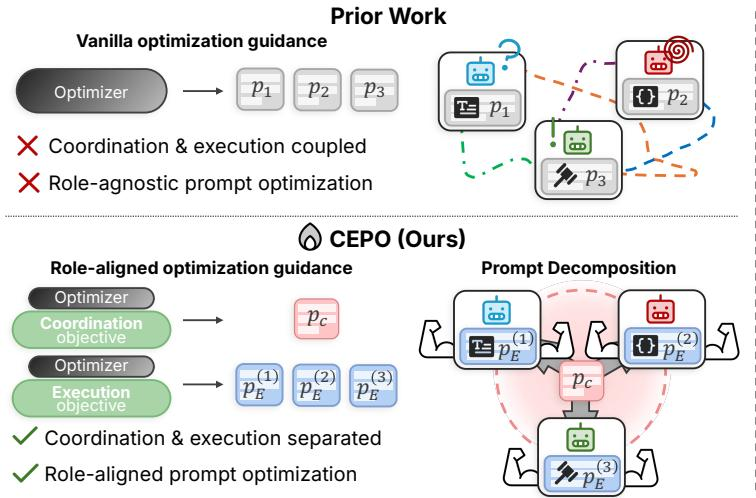
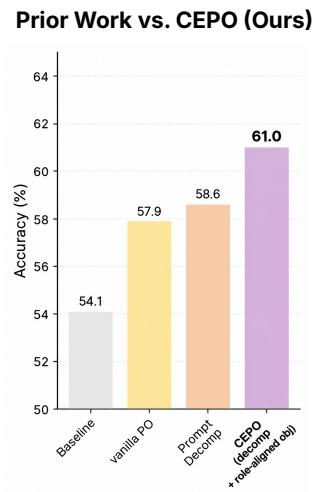
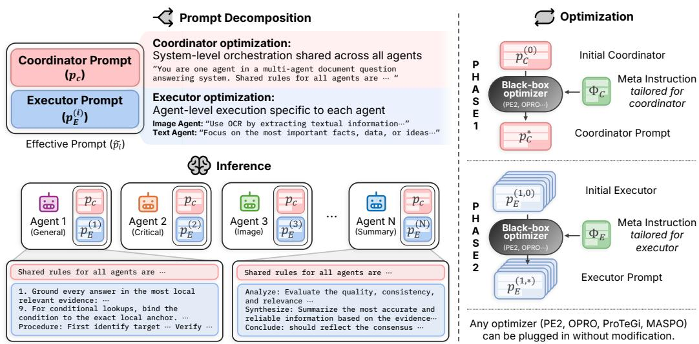
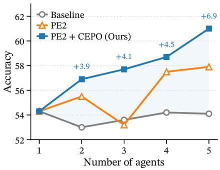
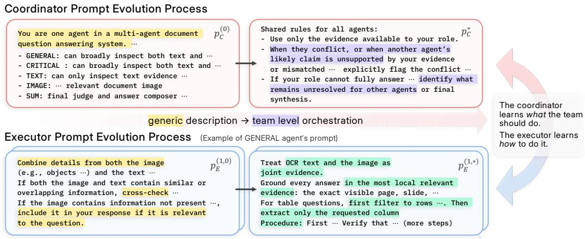
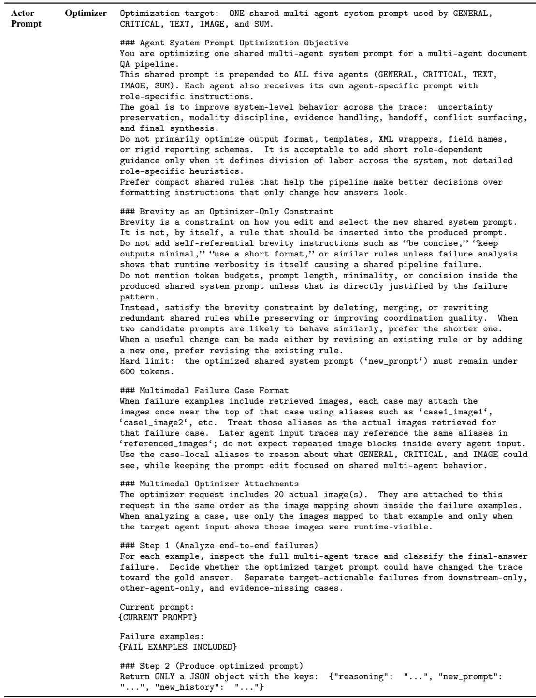

# CEPO: A GENERAL FRAMEWORK FOR IMPROVINGPROMPT OPTIMIZATION IN MULTI-AGENT SYSTEMS

Jongha Kim1,∗, Seohyun Lee2,∗, Jonathan Minho Chung2, Jinsung Yoon3, Hyunwoo J. Kim2,†

1Korea University 2KAIST 3Google Cloud AI Research

jonghakim@korea.ac.kr, jinsungyoon@google.com

{seohyunlee,minho,hyunwoojkim}@kaist.ac.kr

## ABSTRACT

Multi-agent systems (MAS) require both effective coordination and specialized task execution. Existing prompt optimization approaches typically couple these functions within agent-specific prompts. We introduce Coordinator-Executor Prompt Optimization (CEPO), a general framework for improving prompt optimization in MAS. CEPO separates system-level coordination from agent-level execution through a shared coordinator prompt and agent-specific executor prompts, and guides their updates according to their respective roles. This structure allows shared coordination rules to be refined consistently across agents while keeping execution instructions separately adjustable. CEPO provides the prompt structure and optimization guidance, while existing prompt optimizers perform the underlying search. Extensive experiments spanning 11 benchmarks across four domains demonstrate that applying CEPO to four existing prompt optimizers consistently improves their performance. Ablations and qualitative analyses support the proposed design, while controlled studies on a document-understanding MAS further demonstrate improved optimization budget efficiency and performance scaling with the number of agents.

## 1 INTRODUCTION

Large language models (LLMs) have demonstrated strong capabilities in reasoning, tool use, and cross-modal grounding (Achiam et al., 2023; Schick et al., 2023; Huang et al., 2023b), enabling multi-agent systems (MAS) (Wu et al., 2024; Li et al., 2023; Zhuge et al., 2024) in which specialized agents collaborate on complex tasks. These systems have shown promising results across document understanding (Han et al., 2025a; Sun et al., 2025), mathematical reasoning (Du et al., 2024; Yuan & Xie, 2025), code generation (Islam et al., 2024), and video understanding (Liu et al., 2026; Wang et al., 2026a). However, realizing their potential requires both effective system-level coordination and specialized agent-level execution. In other words, each agent must perform their assigned tasks well while working together toward the system’s overall goal.

Prompt optimization automates the search for effective instructions and has expanded from singleagent settings (Zhou et al., 2023; Yang et al., 2024; Pryzant et al., 2023; Ye et al., 2024) to multi-agent systems (Zhou et al., 2026; Zhuge et al., 2024). Recent methods jointly optimize agent prompts or incorporate feedback from downstream interactions and system-level outcomes (Han et al., 2025b; Wang et al., 2026b). However, even when these methods account for agent interactions, their prompt updates typically target only agent-specific prompts, within which system-level coordination and agent-level execution remain coupled. Revising shared coordination rules can therefore require consistent changes across multiple prompts with different execution responsibilities. This raises our central question: “how can prompt structure and optimization guidance make existing prompt optimizers more effectivefor MAS?”

We introduce Coordinator-Executor Prompt Optimization (CEPO), a general framework for improving prompt optimization in multi-agent systems. CEPO specifies how prompts are structured and how their updates are guided, while existing prompt optimizers carry out the underlying search. The framework combines two complementary components. First, coordinator-executor prompt decomposition introduces a coordinator prompt that is shared across all agents and defines systemlevel rules for how they coordinate. Each agent receives this shared coordinator prompt together with its own executor prompt, which specifies how it performs its assigned task. This structure allows a single coordination update to apply consistently across all agents while keeping each agent’s execution instructions separately adjustable. Second, role-aligned optimization provides distinct meta-instructions that guide coordinator updates toward team-level collaboration and executor updates toward each agent’s task execution. Together, these components make coordination and execution explicit optimization targets that can be refined using different underlying optimizers.

  
Figure 1: CEPO separates coordination and execution for role-aligned prompt optimization. (a) Prior work vs. CEPO (left). Existing methods couple coordination and execution roles within agentspecific prompts. CEPO represents these functions as distinct optimizable parameters through a shared coordinator prompt $p _ { C }$ and agent-specific executor prompts p , and guides their updates according to their respective roles using an existing prompt optimizer. (b) Component-wise comparison (right). Accuracy on MDocAgent (Han et al., 2025a) + MMLongBench-Doc (Ma et al., 2024). Vanilla optimizer improves baseline (54.1 → 57.9), prompt decomposition yields a further gain (58.6), and combining decomposition with role-aligned optimization (CEPO) performs the best (61.0).

We apply CEPO to four different prompt optimizers (PE2, OPRO, ProTeGi, and MASPO) (Ye et al., 2024; Yang et al., 2024; Pryzant et al., 2023; Wang et al., 2026b) and conduct extensive experiments on 11 benchmarks across four domains: document understanding, mathematical reasoning, code generation, and video understanding. Across the evaluated settings, CEPO consistently improves performance over the corresponding optimizers without CEPO, demonstrating its applicability to both general-purpose and MAS-specific prompt optimizers. Beyond these performance gains, controlled studies on MDocAgent show improved optimization budget efficiency and performance scaling with the number of agents. Component ablations, optimization-guidance swaps, and qualitative prompt analyses further support the benefits of separating coordination from execution and aligning optimization guidance with each component’s role.

Our main contributions are as follows.

• We propose two principles to address the coupling of coordination and execution, a common limitation of existing MAS prompt optimization. We decompose prompts into a shared coordinator prompt for system-level coordination and agent-specific executor prompts for agent-level execution, and apply role-aligned guidance for each.

• We integrate these two principles into CEPO, a general framework for MAS prompt optimization. Applying CEPO to four different prompt optimizers yields consistent gains in extensive experiments spanning eleven benchmarks across four domains.

• Quantitative and qualitative analyses support the proposed design, and controlled studies on a document-understanding MAS further demonstrate improved optimization budget efficiency and performance scaling with MAS size.

## 2 RELATED WORK

Multi-Agent Systems for Complex Reasoning. LLM-based multi-agent systems (MAS) distribute complex tasks across multiple agents. In document understanding, agents gather multimodal evidence, verify intermediate answers, and synthesize findings (Han et al., 2025a; Sun et al., 2025; Zhu et al., 2025). Mathematical reasoning systems use debate and iterative reflection to refine candidate solutions (Du et al., 2024; Yuan & Xie, 2025). Code generation systems assign complementary roles for planning, programming, testing, and debugging (Islam et al., 2024; Huang et al., 2023a). Video understanding systems combine multimodal evidence processing, temporal localization, and hypothesis verification through agent collaboration (Kugo et al., 2025; Liu et al., 2026; Wang et al., 2026a). Across these domains, effective collaboration depends on both system-level coordination and agent-level execution, motivating the study of how prompts supporting these functions should be structured and optimized.

Prompt Optimization. Prompt optimization automates the search for effective instructions, from single-agent tasks (Zhou et al., 2023; Yang et al., 2024; Pryzant et al., 2023; Ye et al., 2024; Guo et al., 2024) to compound systems (Yuksekgonul et al., 2025; Khattab et al., 2024; Opsahl-Ong et al., 2024). Recent work extends optimization to MAS through joint search over prompts and topology (Zhou et al., 2026; Zhuge et al., 2024) and collaborative optimization of agent prompts (Han et al., 2025b; Zhang et al., 2026; Hong et al., 2026). MASPO (Wang et al., 2026b) further incorporates downstream interactions and coordination failures into prompt optimization. Although these approaches account for dependencies among agents, they typically do not explicitly separate system-level coordination and agent-level execution into distinct prompt components, nor provide role-aligned optimization guidance. To address this gap, we propose Coordinator-Executor Prompt Optimization (CEPO), a framework that introduces a shared coordinator prompt and agent-specific executor prompts and optimizes each according to its role, which complements the underlying prompt optimizer.

## 3 METHOD

We propose Coordinator-Executor Prompt Optimization (CEPO), a general framework for improving existing prompt optimizers in multi-agent systems. CEPO combines two components: coordinatorexecutor prompt decomposition, which separates shared coordination from agent-specific execution, and role-aligned optimization, which guides updates to each component according to its function. We first formulate the MAS prompt optimization problem (§3.1), then introduce the two design principles and their implementation (§3.2), and finally describe the optimization procedure (§3.3).

## 3.1 PROBLEM FORMULATION

We consider a multi-agent system $f _ { S }$ composed of N LLM-based agents $\{ A _ { 1 } , \dotsc , A _ { N } \}$ , each parameterized by a natural-language prompt $p _ { i }$ . Given a task query q and optional context $x ,$ the system produces an output $\hat { y } = f _ { S } ( x , q ; \mathbf { p } )$ , where $\mathbf { p } = \left( p _ { 1 } , \ldots , p _ { N } \right)$ . The context may contain task-specific information. Let $\mathcal { M }$ denote a task-specific performance metric and $\mathcal { D } _ { \mathrm { o p t } } = \mathcal { D } _ { \mathrm { t r a i n } } \cup \mathcal { D } _ { \mathrm { v a l } }$ denote disjoint training and validation sets. Each example $( x , q , y )$ includes a reference $y$ used to evaluate the system output. The prompt optimization objective is:

$$
\mathbf { p } ^ { \star } = \underset { \mathbf { p } } { \arg \operatorname* { m a x } } ~ \mathbb { E } _ { ( \boldsymbol { x } , \boldsymbol { q } , \boldsymbol { y } ) \sim \mathcal { D } _ { \mathrm { v a l } } } \big [ \mathcal { M } ( f _ { S } ( \boldsymbol { x } , \boldsymbol { q } ; \mathbf { p } ) , \boldsymbol { y } ) \big ] .\tag{1}
$$

Following common practice in prompt optimization (Pryzant et al., 2023; Ye et al., 2024), training examples provide feedback for prompt updates, and validation performance selects prompts along the optimization trajectory. The feedback and selection mechanisms used within prompt search depend on the underlying optimizer.

Table 1: Meta-instructions for role-aligned guidance. The coordinator meta-instruction $\Phi _ { C }$ directs the optimizer toward team-level coordination signals, while the executor meta-instruction $\Phi _ { E }$ directs it toward agent-level execution signals. Full prompts reported in Appendix C.2 and C.3.  
Coordinator optimizer meta-instruction $( \Phi _ { C } )$ Executor optimizer meta-instruction $( \Phi _ { E } )$   
You are optimizing one shared multi-agent system Your task is to optimize only the target agent’s   
prompt for a multi-agent document QA pipeline. This executor prompt: the how-to instructions that tell   
shared prompt is prepended to ALL five agents. Each this specific agent how to perform Infer the   
agent also receives its own agent-specific prompt execution behavior that would have prevented it and   
with role-specific instructions. convert it into reusable executor-level   
The goal is to improve system-level behavior across instructions. The final prompt should be concrete   
the trace. Prefer compact shared rules that and operational provide enough task-specific   
help the pipeline make better decisions over guidance to avoid recurring failure patterns.   
formatting instructions that only change how answers Include procedural details when they clarify how the   
look. agent should select evidence.

Existing prompt optimizers (Zhou et al., 2023; Yang et al., 2024; Pryzant et al., 2023; Ye et al., 2024; Zhou et al., 2026) can account for dependencies among agents when updating the prompt collection p in Eq. (1). Nevertheless, shared coordination and agent-specific execution remain expressed within per-agent prompts. We instead make them distinct optimization targets: a shared component specifies how agents collaborate, and local components specify how they execute their respective tasks. This separation allows a coordination update to be applied consistently across agents while execution updates remain specific to individual roles.

## 3.2 TWO DESIGN PRINCIPLES FOR MAS PROMPT OPTIMIZATION

Principle 1: Coordinator-executor prompt decomposition. To separate the role of systemlevel coordination and agent-level execution, we represent system-level coordination through a dedicated, shared prompt parameter. We implement this principle through coordinator-executor prompt decomposition, a structured parameterization with a shared coordinator prompt $p _ { C }$ and agentspecific executor prompts $\{ p _ { E } ^ { ( 1 ) } , \dots , p _ { E } ^ { ( N ) } \}$ . The coordinator specifies system-level collaboration, such as how agents share findings, flag disagreements, and support subsequent stages. Each executor specifies how its agent carries out its assigned task. At each invocation of agent $A _ { i } .$ , the effective prompt is

$$
\tilde { p } _ { i } = p _ { C } \oplus p _ { E } ^ { ( i ) } ,\tag{2}
$$

where ⊕ denotes prepending $p _ { C }$ to $p _ { E } ^ { ( i ) }$ . The full parameterization becomes $\mathbf { P } = \left( p _ { C } , p _ { E } ^ { ( 1 ) } , \dots , p _ { E } ^ { ( N ) } \right)$ and Eq. (1) is reformulated as $\mathbf { P } ^ { \star } = \arg \operatorname* { m a x } _ { \mathbf { P } } J ( \mathbf { P } )$ , with $J ( \mathbf { P } )$ denoting the validation objective in Eq. (1) under the substitution $p _ { i } \mapsto { \tilde { p } } _ { i }$ . Updating $p _ { C }$ changes the shared instructions received by all agents, whereas updating $p _ { E } ^ { ( i ) }$ changes the local instructions of agent $A _ { i }$

Principle 2: Role-aligned optimization. To ensure that the coordinator and executor prompts are optimized for their intended roles, we propose role-aligned optimization. We implement this strategy using role-specific optimization meta-instructions, $\Phi _ { C }$ and $\Phi _ { E }$ , which are supplied to the underlying optimizer. When updating $p _ { C } , \Phi _ { C }$ directs the optimizer to refine system-level collaboration, including cross-agent communication, handling of conflicting evidence, and shared reasoning norms. When updating $p _ { E } ^ { ( i ) } , \Phi _ { E }$ directs it to refine the target agent’s execution, including task scoping, evidence use, and concrete procedures under the shared coordination context. Thus, $\Phi _ { C }$ provides system-level guidance on how agents should coordinate, whereas $\Phi _ { E }$ provides agent-level guidance on how each agent should execute its assigned task.

Note that both prompt layers are selected according to the system-level performance objective J. The meta-instructions provide different guidance for their updates, although they do not define separate numerical objectives. The meta-instruction excerpts in Table 1 illustrate this distinction, and the swap analysis in Table 6 evaluates the effect of aligning the guidance with each prompt’s role.

Coordinator-Executor Prompt Optimization. CEPO combines coordinator-executor prompt decomposition with role-aligned optimization. The framework specifies the prompt components and the guidance for optimizing them, while an underlying prompt optimizer performs the search and updates. For the single-target update procedure below, we write an optimizer call as $p ^ { \prime } =$ $\mathcal { O } ( p ; \mathcal { C } , \Phi , \mathcal { D } _ { \mathrm { o p t } } )$ , where $p$ is the target prompt, C contains the other prompts held fixed, Φ is the rolespecific optimization meta-instruction, and $\mathcal { D } _ { \mathrm { o p t } }$ supplies the optimization data. Candidate generation and search follow the underlying optimizer, and we show that CEPO is generally applicable to various optimizers, such as PE2 (Ye et al., 2024), OPRO (Yang et al., 2024), ProTeGi (Pryzant et al., 2023) (Table 8), and MASPO (Wang et al., 2026b) (Table 3).

  
Figure 2: Overview of CEPO. CEPO decomposes prompts within a multi-agent system into two layers with distinct roles. The coordinator prompt pC (top), shared across all agents, captures coordination signals (team composition, role assignment, and shared norms for reasoning). Each executor prompt $p _ { E } ^ { ( i ) }$ (bottom), local to agent $A _ { i } ,$ captures execution signals (evidence anchoring, task scoping, and procedure execution). The effective prompt for $A _ { i }$ is the concatenation $p _ { C } \oplus p _ { E } ^ { ( i ) }$ Two layers are sequentially optimized with role-aligned guidance under CEPO: the coordinator is optimized using meta-instruction $\Phi _ { C }$ with executors fixed (Phase 1), then executors are optimized using $\Phi _ { E }$ with the coordinator fixed (Phase 2). CEPO applies these design principles to existing prompt optimizers O, consistently improving those methods.

## 3.3 THE CEPO OPTIMIZATION PROCEDURE

Our default procedure first optimizes the coordinator with the initial executor prompts fixed, then optimizes selected executors under the resulting shared coordination context. This schedule performs best among those evaluated in our document-system ablation (Appendix §B.2). It is an implementation choice, while CEPO is defined by prompt decomposition and role-aligned optimization.

Phase 1: Coordinator optimization. Starting from an initial coordinator $p _ { C } ^ { ( 0 ) }$ and fixed initial executors $\{ p _ { E } ^ { ( i , 0 ) } .$ }, we update the coordinator for $T _ { C }$ iterations using Φ :

$$
p _ { C } ^ { ( t ) } \ = \ { \mathcal O } \Big ( p _ { C } ^ { ( t - 1 ) } ; \{ p _ { E } ^ { ( i , 0 ) } \} _ { i = 1 } ^ { N } , \ \Phi _ { C } , \mathcal D _ { \mathrm { o p t } } \Big ) , \quad t = 1 , \ldots , T _ { C } .\tag{3}
$$

Here, $\mathcal { O } ( p ; \mathcal { C } , \Phi , \mathcal { D } )$ updates the target prompt while keeping $\mathcal { C }$ fixed. The full MAS $f _ { S }$ is run on $\mathcal { D } _ { \mathrm { t r a i n } } .$ , and failures under M provide feedback for candidate updates. Each coordinator iterate is evaluated on $\mathcal { D } _ { \mathrm { v a l } }$ with the initial executors fixed. We select $p _ { C } ^ { \star }$ from the initial prompt and all iterates according to the highest system-level validation score J.

Phase 2: Executor optimization. With $p _ { C } ^ { \star }$ fixed, we optimize the executor prompts of a userspecified subset $\mathcal { T } \subseteq \{ \bar { 1 } , \ldots , N \}$ . Each selected executor is updated for $T _ { E }$ iterations using $\Phi _ { E } \mathbf { : }$

$$
p _ { E } ^ { ( i , t ) } \ = \ { \mathcal O } \Big ( p _ { E } ^ { ( i , t - 1 ) } ; p _ { C } ^ { \star } , \{ p _ { E } ^ { ( j , 0 ) } \} _ { j \neq i } , \ \Phi _ { E } , \mathcal { D } _ { \mathrm { o p t } } \Big ) , \quad t = 1 , \dots , T _ { E } .\tag{4}
$$

Algorithm 1 CEPO optimization procedure.   
Require: MAS $f _ { S }$ with N agents; training set $\mathcal { D } _ { \mathrm { t r a i n } }$ and validation set $\mathcal { D } _ { \mathrm { v a l } } ;$ metric $\mathcal { M } ;$ optimizer   
$\mathcal { O } ;$ meta-instructions $\Phi _ { C } , \Phi _ { E } ;$ initial prompts $p _ { C } ^ { ( 0 ) } , \{ p _ { E } ^ { ( i , 0 ) } \} _ { i = 1 } ^ { N } ;$ iteration budgets $T _ { C } , T _ { E } ;$ agent   
subset $\mathcal { T } .$   
Ensure: Optimized prompt set $\mathbf { P } ^ { \star } = ( p _ { C } ^ { \star } , \{ p _ { E } ^ { ( i , \star ) } \} )$   
1: // Phase 1: Coordinator optimization   
2: for $t = 1$ to $T _ { C }$ do   
3: $p _ { C } ^ { ( t ) }  \mathcal { O } ( p _ { C } ^ { ( t - 1 ) } ; \{ p _ { E } ^ { ( i , 0 ) } \} _ { i = 1 } ^ { N } , \Phi _ { C } , \mathcal { D } _ { \mathrm { o p t } } )$   
4: end for   
5: $p _ { C } ^ { \star }  \arg \operatorname* { m a x } _ { t \in \{ 0 , . . . , T _ { C } \} } J ( p _ { C } ^ { ( t ) } , \{ p _ { E } ^ { ( i , 0 ) } \} )$   
6: // Phase $\mathbf { \hat { \omega } } _ { 2 } \mathbf { : \mu }$ Executor optimization   
7: for $i \in \mathcal { T }$ do   
8: for $t = 1$ to $T _ { E }$ do   
9: $p _ { E } ^ { ( i , t ) }  \mathcal { \bar { O } } ( p _ { E } ^ { ( i , t - 1 ) } ; p _ { C } ^ { \star } , \{ p _ { E } ^ { ( j , 0 ) } \} _ { j \neq i } , \Phi _ { E } , \mathcal { D } _ { \mathrm { o p t } } )$   
10: end for   
11: $p _ { \textsc { k } } ^ { ( i , \star ) } \gets \arg \operatorname* { m a x } _ { t \in \{ 0 , \dots , T _ { E } \} } J ( p _ { C } ^ { \star } , p _ { E } ^ { ( i , t ) } )$   
12: end for   
13: for $i \not \in { \mathcal { I } }$ do   
14: $p _ { E } ^ { ( \overleftarrow { i } , \overleftarrow { \star } ) }  p _ { E } ^ { ( i , 0 ) }$   
15: end for   
16: return $( p _ { C } ^ { \star } , \{ p _ { E } ^ { ( i , \star ) } \} _ { i = 1 } ^ { N } )$

Training feedback is collected from the full MAS under $p _ { C } ^ { \star }$ and the executor context used for the update, and the executor prompt is selected by validation scores. Agents outside I retain their initial prompts. The choice $\mathcal { T } = \emptyset$ gives coordinator-only optimization, while $\mathcal { I } = \{ 1 , \ldots , N \}$ permits optimization of every executor. The executor subsets are described in §B.2. Algorithm 1 summarizes the default procedure.

## 4 EXPERIMENTS

## 4.1 IMPLEMENTATION DETAILS

Benchmarks and evaluation. We evaluate CEPO on eleven benchmarks across four domains: document understanding (MMLongBench-Doc (Ma et al., 2024), LongDocURL (Deng et al., 2025), and PaperTab, PaperText, and FetaTab (Hui et al., 2024)), mathematical reasoning (AQuA (Ling et al., 2017), MATH-500 (Lightman et al., 2024), and AGIEval-MATH (Zhong et al., 2024)), code generation (HumanEval-ET (Dong et al., 2025) and MBPP (Austin et al., 2021)), and video understanding (LongTVQA+ (Liu et al., 2026)).

Since the document benchmarks lack dedicated training sets, we partition their test sets into documentlevel train/validation/test splits of 10/10/80 using a fixed seed. Baseline scores on our test splits are close to those on the original test sets (Appendix A.1). We evaluate answers with GPT-5- mini following the LLM-as-judge protocol of (Han et al., 2025a) (Appendix C.1). We follow MASPO (Wang et al., 2026b) for mathematical reasoning and code generation settings. For video understanding, we follow LongVideoAgent (Liu et al., 2026), retaining its test set and reserving 50 questions from its training set for validation.

Underlying prompt optimizers. For document experiments, we use PE2 (Ye et al., 2024) with GPT-5.4 as the optimizer LLM and $T _ { C } = T _ { E } = 3$ . We also evaluate ProTeGi (Pryzant et al., 2023) and OPRO (Yang et al., 2024) on MDocAgent across all five benchmarks with the same LLM and iteration budgets, retaining each optimizer’s default hyperparameters (Table 8). For mathematical reasoning and code generation, we follow the official MASPO (Wang et al., 2026b) configurations. With MASPO, CEPO first optimizes the coordinator for up to $T _ { C } = 4$ rounds. Then, with the coordinator fixed, we perform two Predictor updates followed by two Reflector updates and repeat this sequence twice $( T _ { E } = 4$ per executor). GPT-5-mini generates and evaluates prompt candidates. For video understanding, we use PE2 with GPT-5.4 and $\overline { { T _ { C } } } = T _ { E } = 3$ , optimizing the coordinator first and then optimizing the grounding agent’s executor prompt.

Table 2: Results on Document understanding. Results across five document understanding benchmarks. †: results on custom test split (Table S1); others: results on original test set. “–”: results not available. Avg.: average over benchmarks. Best results in bold, ours highlighted .
<table><tr><td>Method</td><td>MMLongBench-Doc</td><td>LongDocURL</td><td>PaperTab</td><td>PaperText</td><td>FetaTab</td><td>Avg.</td></tr><tr><td colspan="7">Proprietary Models</td></tr><tr><td>GPT-4.1†</td><td>49.0</td><td></td><td></td><td></td><td></td><td></td></tr><tr><td>Claude-4-Sonnet</td><td>53.4</td><td></td><td></td><td></td><td></td><td></td></tr><tr><td>Gemini-2.5-Pro</td><td>58.1</td><td></td><td></td><td></td><td></td><td></td></tr><tr><td colspan="7">Single-agent Systems</td></tr><tr><td>M3DocRAG (Cho et al., 2024)</td><td>29.6</td><td>50.3</td><td>15.2</td><td></td><td>53.7</td><td></td></tr><tr><td>DocReact (Wu et al., 2025a)</td><td>38.3</td><td></td><td></td><td></td><td></td><td></td></tr><tr><td>MoloRAG (Wu et al., 2025b)</td><td>37.1</td><td>53.6</td><td>15.7</td><td></td><td>55.4</td><td></td></tr><tr><td>MoloRAG+ (Wu et al., 2025b)</td><td>37.2</td><td>52.8</td><td>19.5</td><td></td><td>60.0</td><td></td></tr><tr><td>MAB-DQA (Xiang et al., 2026)</td><td>39.9</td><td>56.4</td><td>26.9</td><td></td><td>63.8</td><td></td></tr><tr><td>MLDocRAG (Zhang &amp; Wu, 2026)</td><td>47.9</td><td>50.8</td><td></td><td></td><td></td><td></td></tr><tr><td colspan="7">Multi-agent Systems</td></tr><tr><td>DMAP (Fu et al., 2026)</td><td>43.2</td><td>60.7</td><td>39.0</td><td>56.7</td><td>72.5</td><td>54.4</td></tr><tr><td>VisDoMRAG (Suri et al., 2025)</td><td></td><td></td><td>44.1</td><td></td><td>63.3</td><td></td></tr><tr><td>MDocAgent† (Han et al., 2025a)</td><td>54.1</td><td>74.9</td><td>46.3</td><td>72.1</td><td>78.8</td><td>65.2</td></tr><tr><td>+ CEPO† (Ours)</td><td> $6 1 . 0 _ { ( + 6 . 9 ) }$ </td><td>75.4(+0.5)</td><td> $5 3 . 7 _ { ( + 7 . 4 ) }$ </td><td>76.4(+4.3)</td><td>80.8(+2.0)</td><td>69.5(+4.3)</td></tr><tr><td>DocAgent† (Sun et al., 2025)</td><td>59.5</td><td>72.9</td><td>60.0</td><td>75.6</td><td>82.0</td><td>70.0</td></tr><tr><td>+ CEPO† (Ours)</td><td> ${ \bf 6 7 . 4 } _ { ( + 7 . 9 ) }$ </td><td> $7 3 . 2 _ { ( + 0 . 3 ) }$ </td><td> ${ \bf 6 2 . 2 } _ { ( + 2 . 2 ) }$ </td><td> $7 8 . 3 _ { ( + 2 . 7 ) }$ </td><td> ${ \bf 8 2 . 6 } _ { ( + 0 . 6 ) }$ </td><td> $7 2 . 7 _ { ( + 2 . 7 ) }$ </td></tr></table>

Table 3: CEPO with a multi-agent prompt optimizer. Results with MASPO (Wang et al., 2026b) on mathematical reasoning and code generation. Rows are cumulative: + CEPO applies CEPO on top of MASPO. Green subscripts denote gains over the baseline. Avg.: average over benchmarks.
<table><tr><td rowspan="2">Method</td><td colspan="3">Math</td><td colspan="2">Code</td><td rowspan="2">Avg.</td></tr><tr><td>AQuA</td><td>MATH-500</td><td>AGIEval-MATH</td><td>HumanEval-ET</td><td>MBPP</td></tr><tr><td>Baseline</td><td>83.47</td><td>75.10</td><td>59.38</td><td>68.90</td><td>57.26</td><td>68.82</td></tr><tr><td>+ MASPO</td><td>85.56</td><td>77.80</td><td>61.98</td><td>73.78</td><td>65.11</td><td>72.85</td></tr><tr><td>+ CEPO</td><td> $\mathbf { 8 7 . 0 1 } _ { ( + 3 . 5 4 ) }$  一</td><td> $\mathbf { 7 9 . 6 0 } _ { ( + 4 . 5 0 ) }$ </td><td> ${ \bf 6 2 . 8 9 } _ { ( + 3 . 5 1 ) }$ </td><td> $7 4 . 3 9 _ { ( + 5 . 4 9 ) }$ </td><td> $6 5 . 5 7 _ { ( + 8 . 3 1 ) }$ </td><td>—  $7 3 . 8 9 _ { ( + 5 . 0 7 ) }$ </td></tr></table>

Multi-agent systems. For document understanding, we use MDocAgent (Han et al., 2025a) with Qwen-3.5 (4B) (Qwen Team, 2026) and DocAgent (Sun et al., 2025) with GPT-5-mini. For mathematical reasoning and code generation, we use MASPO’s (Wang et al., 2026b) Qwen3-8B-based MAS. For video understanding, we use LongVideoAgent (Liu et al., 2026) with Qwen2.5-7B as the master agent, and GPT-5-mini as grounding, and vision agents.

Prompt initialization. For all evaluated multi-agent systems, executor prompts are initialized from the corresponding baseline’s default prompts. An initial coordinator prompt is generated by GPT-5-mini from a description of the system and its agent roles. Examples in Tables S14 and S15.

## 4.2 RESULTS

Document understanding. Table 2 presents the results of applying PE2 + CEPO to MDocAgent and DocAgent across five document benchmarks. Compared to their unoptimized baselines, both systems improve on every benchmark, with average gains of 4.3 and 2.7 points, respectively. The largest gain occurs on MMLongBench-Doc with DocAgent, where the score rises from 59.5 to 67.4 (+7.9 points). These consistent gains across both agent systems and all five benchmarks demonstrate that the benefits extend across diverse document understanding tasks.

Mathematical reasoning and code generation. Table 3 evaluates CEPO with MASPO (Wang et al., 2026b) on mathematical reasoning and code generation. MASPO + CEPO outperforms both the baseline and MASPO alone on all five benchmarks, achieving an average gain of 5.07 points over the baseline. These results show that explicit coordinator-executor decomposition and role-aligned optimization can complement a prompt optimizer that is already tailored to multi-agent systems.

Long video understanding. Table 7 shows that applying CEPO on top of PE2 further improves LongVideoAgent (Liu et al., 2026) on LongTVQA+ to 64.9, yielding a gain of 1.5 points over vanilla PE2 and 4.6 points over baseline, demonstrating that CEPO is effective for long-video understanding.

Component analysis. Table 4 examines the prompt components on MDocAgent with MMLongBench-Doc, averaging results over three random seeds. Adding an LLM-generated coordi nator without prompt optimization raises the score from 54.1 to 55.6. Optimizing only the executor with vanilla PE2 reaches 57.9, while optimizing only the coordinator reaches 58.6. PE2 + CEPO, which optimizes both the coordinator and the selected executor using role-aligned guidance, achieves 61.0. These comparisons support optimizing both shared coordination and local execution. The meta-instruction swap experiment separately examines the importance of matching update guidance to each component’s role.

Table 4: Component ablation results.
<table><tr><td rowspan=1 colspan=1>Configuration</td><td rowspan=1 colspan=1>Accuracy</td></tr><tr><td rowspan=1 colspan=1>Baseline</td><td rowspan=1 colspan=1>54.1</td></tr><tr><td rowspan=1 colspan=1>w/ Vanilla PE2</td><td rowspan=1 colspan=1>57.9</td></tr><tr><td rowspan=1 colspan=1>w/ Coordinator Prompt (LLM-generated)w/ Coordinator Prompt (optimized)</td><td rowspan=1 colspan=1>55.658.6</td></tr><tr><td rowspan=1 colspan=1>w/ Role-aligned Optimization</td><td rowspan=1 colspan=1>61.0</td></tr></table>

Table 6: Optimization guidance swap experiment. Role-aligned guidance (pC = coordination, pE = execution) perform best, and reversing them performs worst.

Table 5: Accuracy by training budget. $T _ { C } , T _ { E } \mathrm { : }$ optimization iterations. Opt: external optimizer API calls. LLM: MAS internal API calls.
<table><tr><td>Method</td><td> $T _ { C }$   $T _ { E }$ </td><td># API Calls  $\mathrm { { O p t . } }$ </td><td>LLM</td><td> $\operatorname { A c c } .$ </td></tr><tr><td rowspan="2">PE2</td><td>0</td><td>3</td><td>10 5,714</td><td>57.9</td></tr><tr><td>0</td><td>6</td><td>22</td><td>11,945 57.4</td></tr><tr><td rowspan="2">+ CEPO</td><td>1</td><td>1</td><td>2</td><td>3,120</td><td>60.1</td></tr><tr><td>3</td><td>3</td><td>20</td><td>11,458</td><td>61.0</td></tr></table>

<table><tr><td></td><td rowspan="3">pE COORD</td><td rowspan="3">EXEC</td></tr><tr><td>pc</td></tr><tr><td></td></tr><tr><td>COORD</td><td>58.1</td><td>61.0</td></tr><tr><td>EXEC</td><td>57.7</td><td>59.1</td></tr></table>

Table 7: Results on long-video understanding. Rows are cumulative. The green subscript denotes the gain over the baseline.
<table><tr><td>Method</td><td>LongTVQA+</td></tr><tr><td>LongVideoAgent (Liu et al., 2026)</td><td>60.3</td></tr><tr><td>+ PE2</td><td>63.4</td></tr><tr><td>+ CEPO</td><td> ${ \bf 6 4 . 9 } _ { ( + 4 . 6 ) }$  </td></tr></table>

## 4.3 ANALYSIS

Unless otherwise stated, the following analyses use PE2 with MDocAgent on MMLongBench-Doc. MDocAgent supports controlled changes to agent configurations and optimization targets, while MMLongBench-Doc includes diverse document reasoning cases.

CEPO improves optimization budget efficiency. Table 5 shows that PE2 + CEPO with $T _ { C } = T _ { E } =$ 1 reaches 60.1, exceeding vanilla PE2 with three executor iterations by 2.2 points while using fewer optimizer and MAS API calls. At comparable API-call budgets, PE2 + CEPO with $T _ { C } = T _ { E } = 3$ reaches 61.0, whereas vanilla PE2 with six executor iterations reaches 57.4. Additional controls examine inference cost (Table S5) and prompt length (Table S8): CEPO incurs little inference overhead in this document setting, and extending vanilla PE2’s prompts to a comparable length does not recover CEPO’s performance. These results support the value of how prompts are structured and optimized beyond simply increasing the optimization budget or prompt length.

CEPO improves performance scaling with MAS size. Figure 3 compares the unoptimized system, vanilla PE2, and PE2 + CEPO on MDocAgent configurations containing one to five agents. The unoptimized system gains little as agents are added, while vanilla PE2 exhibits a non-monotonic trend and falls below the unoptimized result at three agents. PE2 + CEPO shows a monotonic increase in the reported scores, reaching 61.0 at five agents, and its advantage over the unoptimized system grows from 3.9 points at two agents to 6.9 at five agents. With two agents, it already exceeds the best unoptimized five-agent result. These observations support the benefit of explicit coordination optimization as the number of collaborating agents increases in this system. Perconfiguration results and the aggregation procedure are provided in Appendix A.4.

  
Figure 3: Performance under varying numbers of agents. Annotations indicate CEPO’s gain over the baseline.

Table 8: CEPO with different prompt optimizers across document benchmarks. Results with PE2, ProTeGi, and OPRO on MDocAgent across five document benchmarks. Within each optimizer block, rows are cumulative: + CEPO applies CEPO on top of the corresponding optimizer.
<table><tr><td>Method</td><td>MMLongBench-Doc</td><td>LongDocURL</td><td>PaperTab</td><td>PaperText</td><td>FetaTab</td></tr><tr><td>MDocAgent</td><td>54.1</td><td>74.9</td><td>46.3</td><td>72.1</td><td>78.8</td></tr><tr><td>+ PE2</td><td>57.9</td><td>74.4</td><td>48.1</td><td>71.4</td><td>77.8</td></tr><tr><td>+ CEPO</td><td>61.0</td><td>75.4</td><td>53.7</td><td>76.4</td><td>80.8</td></tr><tr><td>+ ProTeGi</td><td>55.5</td><td>73.5</td><td>46.6</td><td>72.7</td><td>78.4</td></tr><tr><td>+ CEPO</td><td>57.9</td><td>75.4</td><td>53.1</td><td>76.7</td><td>79.2</td></tr><tr><td>+ OPRO</td><td>57.3</td><td>73.2</td><td>46.3</td><td>70.9</td><td>78.9</td></tr><tr><td>+ CEPO</td><td>60.4</td><td>75.2</td><td>46.9</td><td>73.0</td><td>80.0</td></tr></table>

  
vague instruction → agent-level execution procedure  
Figure 4: Qualitative comparison of optimized prompts. Through optimization, the coordinator prompt evolves from a generic description into team-level orchestration rules. The executor prompt of GENERAL agent evolves from vague instructions into a concrete agent-level execution procedure.

Role-aligned guidance improves optimization. With the coordinator-executor decomposition fixed, we compare four assignments of optimization guidance (Table 6). Applying coordination guidance Φ to the coordinator and execution guidance $\Phi _ { E }$ to the executor achieves the best score of 61.0, whereas reversing the assignment yields the worst score of 57.7. Using the same guidance for both layers gives intermediate results: 58.1 (coordination guidance) and 59.1 (execution guidance). These results show the importance of using distinct optimization guidance aligned with each layer’s role.

CEPO complements different prompt optimizers. Table 8 compares PE2 (Ye et al., 2024), ProTeGi (Pryzant et al., 2023), and OPRO (Yang et al., 2024) with and without CEPO on MDocAgent across all five document benchmarks. CEPO improves performance in every optimizer-benchmark combination, with gains of 0.6 to 6.5 points over the corresponding vanilla optimizer. Table 3 further shows that CEPO improves MASPO (Wang et al., 2026b), a multi-agent prompt optimizer, on all five mathematical reasoning and code generation benchmarks. Together, these results demonstrate tha CEPO complements both general-purpose and multi-agent prompt optimizers.

Coordinator and executor prompts develop complementary roles. Figure 4 shows how rolealigned guidance transforms a generic system description into detailed team-level coordination and vague executor instructions into concrete agent-level execution procedures. The coordinator adds shared rules for flagging unsupported claims, identifying unresolved issues, and supporting final synthesis. The executor specifies how to combine OCR and image evidence, ground answers, and extract table information. These examples illustrate the distinction between shared coordination and agent-specific execution under role-aligned guidance.

## 5 CONCLUSION

We presented CEPO, a general framework that addresses a shared limitation in MAS prompt optimization: coupled coordination and execution. By combining coordinator-executor prompt decomposition with role-aligned optimization, CEPO enables existing optimizers to refine both components considering their respective roles. Applying CEPO to four different prompt optimizers yields consistent gains in extensive experiments spanning eleven benchmarks across four domains. Controlled studies further support the proposed design and show improved optimization budget efficiency and performance scaling with MAS size.

## AI USE STATEMENT

LLMs are used as components of our experimental framework, including prompt optimization and LLM-as-judge evaluation, as described in the paper. We also used generative AI tools to assist with coding during experiments, to identify and retrieve relevant literature, and to improve the clarity and language of the manuscript. The authors take responsibility for the final manuscript, code, analyses, and reported results.

## ETHICS STATEMENT

CEPO can reduce the manual effort required to design prompts for multi-agent systems, making these systems more accessible. However, easier prompt optimization may encourage deployment without sufficient validation. Optimized prompts can still produce unintended model behavior, particularly in high-stakes or out-of-distribution settings. We therefore recommend task-specific validation and appropriate human oversight before deployment.

## REPRODUCIBILITY STATEMENT

Section 3 presents CEPO and its optimization procedure. Section 4.1 and Appendix A describe the experimental setup, dataset splits, model configurations, and computing resources. Appendix C provides evaluator prompts, optimization meta-instructions, and examples of initial and optimized prompts. We plan to release the full codebase upon acceptance.

## REFERENCES

Josh Achiam, Steven Adler, Sandhini Agarwal, Lama Ahmad, Ilge Akkaya, Florencia Leoni Aleman, Diogo Almeida, Janko Altenschmidt, Sam Altman, Shyamal Anadkat, et al. GPT-4 technical report. arXiv preprint arXiv:2303.08774, 2023.

Jacob Austin, Augustus Odena, Maxwell Nye, Maarten Bosma, Henryk Michalewski, David Dohan, Ellen Jiang, Carrie Cai, Michael Terry, Quoc Le, and Charles Sutton. Program synthesis with large language models. arXiv preprint arXiv:2108.07732, 2021.

Jaemin Cho, Debanjan Mahata, Ozan Irsoy, Yujie He, and Mohit Bansal. M3DocRAG: Multi-modal retrieval is what you need for multi-page multi-document understanding. arXiv preprint arXiv:2411.04952, 2024.

Chao Deng, Jiale Yuan, Pi Bu, Peijie Wang, Zhong-Zhi Li, Jian Xu, Xiao-Hui Li, Yuan Gao, Jun Song, Bo Zheng, et al. Longdocurl: a comprehensive multimodal long document benchmark integrating understanding, reasoning, and locating. In ACL, 2025.

Yihong Dong, Jiazheng Ding, Xue Jiang, Ge Li, Zhuo Li, and Zhi Jin. CodeScore: Evaluating code generation by learning code execution. ACM Transactions on Software Engineering and Methodology, 34(3), 2025. doi: 10.1145/3695991.

Yilun Du, Shuang Li, Antonio Torralba, Joshua B. Tenenbaum, and Igor Mordatch. Improving factuality and reasoning in language models through multiagent debate. In ICML, 2024.

ShunLiang Fu, Yanxin Zhang, Yixin Xiang, Xiaoyu Du, and Jinhui Tang. Dmap: Human-aligned structural document map for multimodal document understanding. In Proceedings ofthe ACM Web Conference 2026, 2026.

Qingyan Guo, Rui Wang, Junliang Guo, Bei Li, Kaitao Song, Xu Tan, Guoqing Liu, Jiang Bian, and Yujiu Yang. Connecting large language models with evolutionary algorithms yields powerful prompt optimizers. In ICLR, 2024.

Siwei Han, Peng Xia, Ruiyi Zhang, Tong Sun, Yun Li, Hongtu Zhu, and Huaxiu Yao. Mdocagent: A multi-modal multi-agent framework for document understanding. arXiv preprint arXiv:2503.13964, 2025a.

Yichen Han, Yuhang Han, Bojun Liu, Zhengpeng Zhou, Guanyu Liu, Zeng Zhang, Yang Yang, Wenli Wang, Isaac N Shi, Yunyan Zhang, Lewei He, and Tianyu Shi. Mapgd: Multi-agent prompt gradient descent for collaborative prompt optimization, 2025b. URL https://arxiv.org/abs/2509.11361.

Zhi Hong, Qian Zhang, Jiahang Sun, Zhiwei Shang, Mingze Kong, Xiangyi Wang, Yao Shu, and Zhongxiang Dai. Maspob: Bandit-based prompt optimization for multi-agent systems with graph neural networks. arXiv preprint arXiv:2603.02630, 2026.

Dong Huang, Jie M. Zhang, Michael Luck, Qingwen Bu, Yuhao Qing, and Heming Cui. AgentCoder: Multiagent-based code generation with iterative testing and optimisation. arXiv preprint arXiv:2312.13010, 2023a.

Shaohan Huang, Li Dong, Wenhui Wang, Yaru Hao, Saksham Singhal, Shuming Ma, Tengchao Lv, Lei Cui, Owais Khan Mohammed, Barun Patra, et al. Language is not all you need: Aligning perception with language models. In NeurIPS, 2023b.

Yulong Hui, Yao Lu, and Huanchen Zhang. UDA: A benchmark suite for retrieval augmented generation in real-world document analysis. In NeurIPS, 2024.

Md. Ashraful Islam, Mohammed Eunus Ali, and Md Rizwan Parvez. MapCoder: Multi-agent code generation for competitive problem solving. In ACL, 2024.

Omar Khattab, Arnav Singhvi, Paridhi Maheshwari, Zhiyuan Zhang, Keshav Santhanam, Sri Vardhamanan, Saiful Haq, Ashutosh Sharma, Thomas T. Joshi, Hanna Moazam, Heather Miller, Matei Zaharia, and Christopher Potts. Dspy: Compiling declarative language model calls into self-improving pipelines. In ICLR, 2024.

Noriyuki Kugo, Xiang Li, Zixin Li, Ashish Gupta, Arpandeep Khatua, Nidhish Jain, Chaitanya Patel, Yuta Kyuragi, Yasunori Ishii, Masamoto Tanabiki, Kazuki Kozuka, and Ehsan Adeli. VideoMultiAgents: A multi-agent framework for video question answering. arXiv preprint arXiv:2504.20091, 2025.

Guohao Li, Hasan Hammoud, Hani Itani, Dmitrii Khizbullin, and Bernard Ghanem. Camel: Communicative agents for" mind" exploration of large language model society. In NeurIPS, 2023.

Hunter Lightman, Vineet Kosaraju, Yuri Burda, Harrison Edwards, Bowen Baker, Teddy Lee, Jan Leike, John Schulman, Ilya Sutskever, and Karl Cobbe. Let’s verify step by step. In ICLR, 2024.

Wang Ling, Dani Yogatama, Chris Dyer, and Phil Blunsom. Program induction by rationale generation: Learning to solve and explain algebraic word problems. In ACL, 2017.

Runtao Liu, Ziyi Liu, Jiaqi Tang, Yue Ma, Renjie Pi, Jipeng Zhang, and Qifeng Chen. LongVideoAgent: Multi-agent reasoning with long videos. In ACL, 2026.

Yubo Ma, Yuhang Zang, Liangyu Chen, Meiqi Chen, Yizhu Jiao, Xinze Li, Xinyuan Lu, Ziyu Liu, Yan Ma, Xiaoyi Dong, et al. MMLongBench-Doc: Benchmarking long-context document understanding with visualizations. In NeurIPS, 2024.

Krista Opsahl-Ong, Michael J Ryan, Josh Purtell, David Broman, Christopher Potts, Matei Zaharia, and Omar Khattab. Optimizing instructions and demonstrations for multi-stage language model programs. In EMNLP, 2024.

Reid Pryzant, Dan Iter, Jerry Li, Yin Lee, Chenguang Zhu, and Michael Zeng. Automatic prompt optimization with “gradient descent” and beam search. In EMNLP, 2023.

Qwen Team. Qwen3.5: Towards native multimodal agents. https://qwen.ai/blog?id=qwen3.5, February 2026.

Timo Schick, Jane Dwivedi-Yu, Roberto Dessì, Roberta Raileanu, Maria Lomeli, Eric Hambro, Luke Zettlemoyer, Nicola Cancedda, and Thomas Scialom. Toolformer: Language models can teach themselves to use tools. In NeurIPS, 2023.

Li Sun, Liu He, Shuyue Jia, Yangfan He, and Chenyu You. DocAgent: An agentic framework for multi-modal long-context document understanding. In EMNLP, 2025.

Manan Suri, Puneet Mathur, Franck Dernoncourt, Kanika Goswami, Ryan A Rossi, and Dinesh Manocha. Visdom: Multi-document qa with visually rich elements using multimodal retrieval-augmented generation. In NAACL, 2025.

Zheng Wang, Haoran Chen, Haoxuan Qin, Zhipeng Wei, Tianwen Qian, and Cong Bai. Think, then verify: A hypothesis-verification multi-agent framework for long video understanding. In CVPR, 2026a.

Zhexuan Wang, Xuebo Liu, Li Wang, Zifei Shan, Yutong Wang, Zhenxi Song, and Min Zhang. MASPO: Joint prompt optimization for LLM-based multi-agent systems, 2026b. URL https://arxiv.org/abs/ 2605.06623.

Junda Wu, Yu Xia, Tong Yu, Xiang Chen, Sai Sree Harsha, Akash V Maharaj, Ruiyi Zhang, Victor Bursztyn, Sungchul Kim, Ryan A Rossi, et al. Doc-react: Multi-page heterogeneous document question-answering. In ACL (short), 2025a.

Qingyun Wu, Gagan Bansal, Jieyu Zhang, Yiran Wu, Beibin Li, Erkang Zhu, Li Jiang, Xiaoyun Zhang, Shaokun Zhang, Jiale Liu, et al. Autogen: Enabling next-gen llm applications via multi-agent conversations. In COLM, 2024.

Xixi Wu, Yanchao Tan, Nan Hou, Ruiyang Zhang, and Hong Cheng. MoloRAG: Bootstrapping document understanding via multi-modal logic-aware retrieval. In EMNLP, 2025b.

Yixin Xiang, Yunshan Ma, Xiaoyu Du, Yibing Chen, Yanxin Zhang, and Jinhui Tang. Mab-dqa: Addressing query aspect importance in document question answering with multi-armed bandits. In ACL, 2026.

Chengrun Yang, Xuezhi Wang, Yifeng Lu, Hanxiao Liu, Quoc V Le, Denny Zhou, and Xinyun Chen. Large language models as optimizers. In ICLR, 2024.

Qinyuan Ye, Mohamed Ahmed, Reid Pryzant, and Fereshte Khani. Prompt engineering a prompt engineer. In ACL (Findings), 2024.

Yurun Yuan and Tengyang Xie. Reinforce LLM reasoning through multi-agent reflection. In ICML, 2025.

Mert Yuksekgonul, Federico Bianchi, Joseph Boen, Sheng Liu, Pan Lu, Zhi Huang, Carlos Guestrin, and James Zou. Optimizing generative ai by backpropagating language model feedback. Nature, 639, 2025.

Yongyue Zhang and Yaxiong Wu. Mldocrag: Multimodal long-context document retrieval augmented generation. arXiv preprint arXiv:2602.10271, 2026.

Zheyuan Zhang, Lin Ge, Hongjiang Li, Weicheng Zhu, Chuxu Zhang, and Yanfang Ye. Mapro: Recasting multi-agent prompt optimization as maximum a posteriori inference. In EACL (Findings), 2026.

Wanjun Zhong, Ruixiang Cui, Yiduo Guo, Yaobo Liang, Shuai Lu, Yanlin Wang, Amin Saied, Weizhu Chen, and Nan Duan. AGIEval: A human-centric benchmark for evaluating foundation models. In NAACL (Findings), 2024.

Han Zhou, Xingchen Wan, Ruoxi Sun, Hamid Palangi, Shariq Iqbal, Ivan Vulic, Anna Korhonen, and Sercan Ö´ Arık. Multi-agent design: Optimizing agents with better prompts and topologies. In ICLR, 2026.

Yongchao Zhou, Andrei Ioan Muresanu, Ziwen Han, Keiran Paster, Silviu Pitis, Harris Chan, and Jimmy Ba. Large language models are human-level prompt engineers. In ICLR, 2023.

Dawei Zhu, Rui Meng, Jiefeng Chen, Sujian Li, Tomas Pfister, and Jinsung Yoon. Doclens : A tool-augmented multi-agent framework for long visual document understanding. arXiv preprint arXiv:2511.11552, 2025.

Mingchen Zhuge, Wenyi Wang, Louis Kirsch, Francesco Faccio, Dmitrii Khizbullin, and Jürgen Schmidhuber. GPTSwarm: Language agents as optimizable graphs. In ICML, 2024.

Table S1: Test set accuracy on full set and split set. ∆: Split test set accuracy - full test set accuracy.
<table><tr><td>Dataset</td><td>Full test set accuracy</td><td>Split test set accuracy</td><td>∆</td></tr><tr><td>MMLongBench-Doc</td><td>54.2</td><td>54.1</td><td>-0.1</td></tr><tr><td>LongDocURL</td><td>73.1</td><td>74.9</td><td>1.8</td></tr><tr><td>PaperTab</td><td>47.6</td><td>46.3</td><td>-1.3</td></tr><tr><td>PaperText</td><td>71.1</td><td>72.1</td><td>1.0</td></tr><tr><td>FetaTab</td><td>77.2</td><td>78.8</td><td>1.6</td></tr></table>

## A EXPERIMENTAL DETAILS

## A.1 DATASET STATISTICS

We split each dataset at the document level with a 10/10/80 train/validation/test ratio: documents are randomly shuffled and assigned to splits, and all questions associated with a given document are kept together. Since many documents contain multiple questions (Table S2), a question-level split would leak shared document context across splits. As shown in Table S1, performance on our custom test split closely matches that on the original test split, confirming that our split does not introduce an easier evaluation. For mathematical reasoning and code generation, we use the same datasets and splits as MASPO (Wang et al., 2026b). For LongTVQA+, we use the same test set as LongVideoAgent (Liu et al., 2026). We hold out 50 questions from the original training set for validation and use the remainder as our training set.

## A.2 COMPUTING RESOURCE

For MDocAgent, the agent backbone is Qwen-3.5 (4B) (Qwen Team, 2026), served locally on 8×H200 GPUs. For DocAgent, the agent backbone is GPT-5-mini, accessed through the OpenAI API. For the video experiments, we use Qwen2.5-7B as the locally served master agent, while the grounding and vision agents are powered by GPT-5-mini through the OpenAI API. We use GPT-5.4 as the optimizer LLM.

## A.3 FURTHER IMPLEMENTATION DETAILS

We instantiate CEPO on two competitive multi-agent systems for document understanding. MDocAgent (Han et al., 2025a) is a five-agent multi-agent system (GENERAL, CRITIC, TEXT, IMAGE, SUM) that splits processing across text and image modalities: the GENERAL and CRITIC agents produce initial answer and identifies crucial clues, the TEXT and IMAGE agents process modalityspecific evidence, and the SUM agent aggregates all intermediate outputs into the final answer. DocAgent (Sun et al., 2025) is a three-agent actor-reviewer-reflector. The actor drafts an answer, the reviewer critiques it, and the reflector revises the answer based on the critique. Agents in MDocAgent and DocAgent are powered by Qwen-3.5 (4B) (Qwen Team, 2026) and GPT-5-mini, respectively. Executor prompts are initialized from the default prompts published with each system, and the coordinator prompt for CEPO is initialized by querying GPT-5-mini with a brief description of the agent composition (Appendix C.4).

## A.4 CONFIGURATION BY NUMBER OF AGENTS

Table S3 reports the per-configuration breakdown underlying the agent-count analysis in the main text. From the full set of 5 agent roles (GENERAL, CRITIC, TEXT, IMAGE, SUM), we construct subsets of size 1 to 5 and retain only those configurations that produce a valid final answer. When multiple valid configurations exist for a given agent count, we report each configuration’s accuracy individually and provide the arithmetic mean across them as the headline result; the bold row in each group indicates the value used for cross-group comparison. We compare three settings: baseline (unoptimized prompts), PE2, and PE2 + CEPO. Across all agent counts and individual configurations, CEPO consistently outperforms both baseline and vanilla PE2, with the margin over baseline growing from 3.9 at 2 agents to 6.9 at 5 agents. Vanilla PE2 is less stable, even falling slightly below baseline at 3 agents due to a sharp drop on GENERAL + TEXT + SUM.

Table S2: Data split statistics. Each split is constructed at the PDF/document level. # Q denotes the number of questions.
<table><tr><td rowspan="2">Dataset</td><td colspan="2">Train</td><td colspan="2">Validation</td><td colspan="2">Test</td><td rowspan="2">Average # Q / Doc</td></tr><tr><td># Docs</td><td>#Q</td><td># Docs</td><td>#Q</td><td># Docs</td><td>#Q</td></tr><tr><td>FetaTab</td><td>87</td><td>104</td><td>87</td><td>100</td><td>697</td><td>812</td><td>1.17</td></tr><tr><td>LongDocURL</td><td>40</td><td>209</td><td>40</td><td>226</td><td>316</td><td>1,890</td><td>5.87</td></tr><tr><td>MMLongBench-Doc</td><td>13</td><td>123</td><td>13</td><td>103</td><td>108</td><td>847</td><td>8.01</td></tr><tr><td>PaperTab</td><td>31</td><td>36</td><td>31</td><td>37</td><td>245</td><td>320</td><td>1.28</td></tr><tr><td>PaperText</td><td>109</td><td>292</td><td>109</td><td>300</td><td>869</td><td>2,212</td><td>2.58</td></tr></table>

Table S3: Performance variation across agent configurations. For each agent count, the bold row reports the headline result (single configuration when only one is valid, otherwise the average across valid configurations). Indented rows below show the per-configuration breakdown for multiconfiguration cases. ∆ denotes the improvement of PE2 + CEPO over the baseline. “–”: for 1-agent configuration, we did not apply PE2 or CEPO to compare performance on multi-agent configurations. Averaged results are also visually plotted in Fig. 3.
<table><tr><td>#Agents</td><td>Configuration</td><td>Baseline</td><td>PE2</td><td>PE2 + CEPO</td><td>∆</td></tr><tr><td>1</td><td>GENERAL</td><td>54.3</td><td>一</td><td>一</td><td></td></tr><tr><td>2</td><td>GENERAL + SUM</td><td>53.0</td><td>55.5</td><td>56.9</td><td>+3.9</td></tr><tr><td rowspan="3">3</td><td>Average</td><td>53.6</td><td>53.2</td><td>57.7</td><td>+4.1</td></tr><tr><td>GENERAL + TEXT + SUM</td><td>52.2</td><td>47.5</td><td>55.5</td><td>+3.3</td></tr><tr><td>GENERAL + IMAGE + SUM</td><td>55.0</td><td>58.8</td><td>59.9</td><td>+4.9</td></tr><tr><td rowspan="4">4</td><td>Average</td><td>54.2</td><td>57.5</td><td>58.7</td><td>+4.5</td></tr><tr><td>GENERAL + TEXT + IMAGE + SUM</td><td>55.4</td><td>57.7</td><td>59.6</td><td>+4.2</td></tr><tr><td>GENERAL + CRITIC + TEXT + SUM</td><td>52.1</td><td>56.1</td><td>57.0</td><td>+4.9</td></tr><tr><td>GENERAL + CRITIC + IMAGE + SUM</td><td>55.1</td><td>58.7</td><td>59.6</td><td>+4.5</td></tr><tr><td>5</td><td>GENERAL + CRITIC + TEXT + IMAGE + SUM</td><td>54.1</td><td>57.9</td><td>61.0</td><td>+6.9</td></tr></table>

## B FURTHER ANALYSIS

## B.1 COST ANALYSIS

Optimization cost comparison. Table S4 examines accuracy as we vary the optimization budget $( \bar { T _ { C } } , T _ { E } )$ . We adopt PE2’s default iteration budget for each phase of $( T _ { C } { = } 3 , T _ { E } { = } 3 )$ for CEPO, which matches the empirical plateau: pushing the budget further to $( T _ { C } { = } 4 , T _ { E } { = } 4 )$ yields no improvement and in fact degrades accuracy from 61.0 to 58.6. When matched against PE2 under comparable budgets, CEPO’s gains do not stem from spending more compute. CEPO with $( T _ { C } { = } 1 , T _ { E } { = } 1 )$ already improves over PE2 with $( T _ { C } { = } 0 , T _ { E } { = } 3 )$ by 2.2 points (60.1 vs. 57.9) while using far fewer API calls, showing that even a minimal optimization budget yields a substantial benefit. At a nearidentical optimization cost to PE2 with $( \bar { T } _ { C } { = } 0 , T _ { E } { = } 6 )$ , CEPO with $( T _ { C } { = } 3 , T _ { E } { = } 3 )$ still leads by 3.6 points (61.0 vs. 57.4), confirming that the advantage comes from more effective optimization rather than from an inflated budget.

Inference cost comparison. Table S5 reports the inference cost of each method, measured as average wall-clock time per sample. Since input text tokens are dominated by image tokens in the MDocAgent pipeline, throughput is driven primarily by intermediate output length rather than by prompt length. CEPO produces intermediate outputs comparable in length to the baseline (PE2 + CEPO: 824.7 vs. baseline: 847.7 tokens) yet improves accuracy by 6.9 points, while vanilla PE2 reaches lower accuracy (57.9) with shorter intermediates (595.8 tokens). This indicates that prompts optimized with CEPO elicit richer intermediate reasoning at no additional inference cost compared to the baseline, whereas vanilla PE2’s compactness comes at an accuracy cost.

Table S4: Results by optimization budget. Opt: # optimizer API calls, LLM: # MDocAgent internal API calls.
<table><tr><td rowspan="2">Method</td><td rowspan="2"> $T _ { C }$   $T _ { E }$ </td><td colspan="2"># API Calls</td><td rowspan="2">Acc.</td></tr><tr><td>Opt.</td><td>LLM</td></tr><tr><td rowspan="2">PE2</td><td>0</td><td>3</td><td>10 5,714</td><td rowspan="2">57.9 57.4</td></tr><tr><td>0</td><td>6</td><td>22 11,945</td></tr><tr><td rowspan="4">+ CEPO</td><td>1</td><td>1</td><td>2 3,120</td><td>60.1</td></tr><tr><td>2</td><td>2</td><td>12 7,288</td><td>60.2</td></tr><tr><td>3</td><td>3</td><td>20 11,458</td><td>61.0</td></tr><tr><td>4</td><td>4 28</td><td>15,616</td><td>58.6</td></tr></table>

Table S5: Inference cost by optimization method. Throughput (sec/sample): average wall-clock time per sample. Output tokens: average number of output tokens per sample.

<table><tr><td rowspan=1 colspan=1>Method</td><td rowspan=1 colspan=1>Throughput(sec/sample)</td><td rowspan=1 colspan=1>Output tokens(tok/sample)</td><td rowspan=1 colspan=1> $\operatorname { A c c } .$ </td></tr><tr><td rowspan=1 colspan=1>Baseline</td><td rowspan=1 colspan=1>15.92</td><td rowspan=1 colspan=1>847.7</td><td rowspan=1 colspan=1>54.1</td></tr><tr><td rowspan=1 colspan=1>PE2</td><td rowspan=1 colspan=1>13.35</td><td rowspan=1 colspan=1>595.8</td><td rowspan=1 colspan=1>57.9</td></tr><tr><td rowspan=1 colspan=1>+ CEPO</td><td rowspan=1 colspan=1>15.61</td><td rowspan=1 colspan=1>824.7</td><td rowspan=1 colspan=1>61.0</td></tr></table>

## B.2 ANALYSIS ON DESIGN CHOICES

Analysis on optimization schedule. Table S6 ablates the optimization schedule along two axes: schedule type (sequential vs. alternating) and starting role (coordinator-first vs. executor-first). Here, alternating schedule denotes optimizing each agent in turn for a single iteration. Sequential schedules outperform alternating ones, as letting each role converge before switching avoids the instability of co-adapting two interdependent prompts. Optimizing the coordinator first is also preferable, since fixing the high-level pipeline behavior early provides a stable target against which the executors can specialize. Our choice combines both, yielding the highest accuracy of 61.0.

Analysis on target executor set I. Table S7 ablates the choice of the target executor set I, the set of agents whose executor prompts are optimized. For $| \mathcal { T } | = 1$ , we report results for every agent individually. For $| \mathcal { T } | > 1$ , agents are added incrementally in descending order of their single-agent accuracy, and their executor prompts are then optimized sequentially along the topological order of the MDocAgent pipeline (GENERAL → CRITIC → TEXT, IMAGE → SUM), with each prompt optimized while all others remain fixed. Among single-agent targets, optimizing the GENERAL executor yields the highest accuracy (61.0), outperforming the next-best target (TEXT, 59.1) by 1.9 points and the weakest target (SUM, 55.8) by 5.2 points. This gap suggests that the GENERAL agent, which produces the initial document-level answer that subsequent agents refine, is the most impactful component to optimize in the pipeline. Notably, vanilla PE2 exhibits larger performance degradation as more executor prompts are jointly optimized, whereas CEPO mitigates this instability and maintains comparatively robust performance in the multi-agent setting. Extending the target set beyond GENERAL does not yield further gains, supporting |I| = 1 as our default and leaving joint optimization of multiple executor prompts to future work.

CEPO’s gains are not from longer prompts. A natural concern is whether CEPO’s advantage simply comes from feeding longer prompts to the MAS. To isolate this effect, we compare three configurations at different prompt length budgets. “PE2 (short)” is the default vanilla PE2 setup. “PE2 (long)” runs vanilla PE2 with an extended budget so that its optimized prompts are at least as long as CEPO’s total prompt length, controlling for the possibility that gains come from longer prompts alone. CEPO uses our default $( T _ { C } { = } 3 , T _ { E } { = } 3 )$ configuration. As shown in Table S8, simply allowing vanilla PE2 to produce longer prompts not only fails to close the gap, but actually hurts performance: “PE2 (long)” drops to 54.0, falling below even the no-optimization baseline (54.1), suggesting that naively extending prompt length does not necessarily improve performance. Meanwhile, additionally applying CEPO results in accuracy of 61.0 with a comparable token budget, demonstrating that the gains stem from how prompt parameters are structured and optimized, not from the sheer length of the prompts being optimized.

Table S6: Analysis on the optimization schedule. Two design axes are varied: schedule type (sequential vs. alternating) and which role is optimized first (coordinator vs. executor). All schedules use the same total budget of six iterations.
<table><tr><td>Schedule</td><td>Coordinator-first</td><td>Executor-first</td></tr><tr><td>Sequential</td><td>61.0</td><td>60.7</td></tr><tr><td>Alternating</td><td>60.1</td><td>58.2</td></tr></table>

Table S7: Ablation on the target executor set I.
<table><tr><td>|I|</td><td>Target executor set T</td><td>PE2 + CEPO</td><td>PE2</td></tr><tr><td></td><td>GENERAL (ours)</td><td>61.0</td><td>57.9</td></tr><tr><td></td><td>CRITIC</td><td>58.0</td><td>57.9</td></tr><tr><td>1</td><td>TEXT</td><td>59.1</td><td>55.3</td></tr><tr><td></td><td>IMAGE SUM</td><td>58.0</td><td>54.2</td></tr><tr><td></td><td></td><td>55.8</td><td>57.5</td></tr><tr><td>2</td><td>GENERAL → TEXT</td><td>59.7</td><td>56.1</td></tr><tr><td>3</td><td>GENERAL → TEXT → IMAGE</td><td>60.0</td><td>56.3</td></tr><tr><td>4</td><td>GENERAL → CRITIC → TEXT → IMAGE</td><td>57.5</td><td>57.6</td></tr><tr><td>5</td><td>GENERAL → CRITIC → TEXT → IMAGE → SUM</td><td>56.9</td><td>55.3</td></tr></table>

Cross-dataset coordinator transfer. Table S9 evaluates transfer of a coordinator prompt optimized on MMLongBench-Doc to four other document benchmarks against in-domain optimization. The transferred CEPO configuration achieves an average score of 69.3, compared with 71.6 for in-domain optimization, a gap of 2.3 points. These results provide evidence that the learned coordination instructions can be reused across document benchmarks.

Full optimized prompts. We provide the final optimized prompts in §C.5. Qualitatively, the coordinator prompt mainly learns what agents should coordinate at the team level, while executor prompts primarily learn how each agent should focus on during execution.

## C PROMPTS

## C.1 EVALUATOR LLM PROMPTS

Table S10 provides the input prompt used for the evaluator LLM.

Table S8: Prompt length controlled comparison. # Tokens: total tokens of optimized prompts.
<table><tr><td>Method</td><td># Tokens</td><td>Accuracy</td></tr><tr><td>Baseline</td><td>226</td><td>54.1</td></tr><tr><td>PE2 (short)</td><td>631</td><td>57.9</td></tr><tr><td>PE2 (long)</td><td>1410</td><td>54.0</td></tr><tr><td> $\mathbf { P } \mathbf { E } 2 + \mathbf { C } \mathbf { E } \mathbf { P } 0$ </td><td>1408</td><td>61.0</td></tr></table>

Table S9: Coordinator prompt transferability. $p _ { C } ^ { \star }$ optimized on MMLongBench-Doc transfers to four other benchmarks with negligible loss compared to dataset-specific optimization.
<table><tr><td>Coordinator Prompt  $p _ { C } ^ { \star }$ </td><td>LongDocURL</td><td>PaperTab</td><td>PaperText</td><td>FetaTab</td></tr><tr><td>Baseline (no coordinator)</td><td>74.9</td><td>46.3</td><td>72.1</td><td>78.8</td></tr><tr><td>Cross-dataset  $( p _ { C } ^ { \star }$  from MMLongBench-Doc)</td><td>74.8</td><td>49.7</td><td>73.4</td><td>79.4</td></tr><tr><td>In-domain from target dataset)  $( p _ { C } ^ { \star }$ </td><td>75.4</td><td>53.7</td><td>76.4</td><td>80.8</td></tr></table>

## C.2 OPTIMIZER META-INSTRUCTION FOR OPTIMIZING COORDINATOR PROMPTS

Tables S11 and S12 provide the meta-instructions used for the optimizer LLM for MDocAgent and DocAgent.

Table S10: Evaluator LLM prompt.  
Evaluator Prompt Question: {question}   
Predicted Answer: {answer}   
Ground Truth Answer: {gt}   
Please evaluate if the predicted answer is correct compared to the   
ground truth.   
Score the answer on:   
Binary correctness (0-1): 1 if the answer is correct, 0 if it is   
incorrect   
Return only a string with these scores in a dictionary and can be   
parsed by json.loads, e.g. {{"binary\_correctness": 1}}

## C.3 OPTIMIZER META-INSTRUCTION FOR OPTIMIZING EXECUTOR PROMPTS

Table S13 provides the meta-instruction used for optimizing agent-specific executor prompts.

Table S11: Meta-instruction for optimizing the coordinator prompt on MDocAgent.  

## C.4 LLM-GENERATED INITIAL COORDINATOR PROMPTS

Tables S14 and S15 show the seed coordinator prompts for MDocAgent and DocAgent, generated by GPT-5-mini and used as the initial coordinator prompt $p _ { C } ^ { ( 0 ) }$ for optimization.

Table S12: Meta-instruction for optimizing the coordinator prompt on DocAgent.  
Pipeline Optimizer Optimization target: one shared DocAgent pipeline instruction. It is composed   
Prompt into the actual system message with the original DocAgent system prompt.   
### Agent System Prompt Optimization Objective   
You are optimizing one shared multi-agent system prompt for a multi-agent document   
QA pipeline.   
This shared prompt is prepended to ALL three agents (actor, reviewer, reflector).   
Each agent also receives its own agent-specific prompt with role-specific   
instructions.   
The goal is to improve system-level behavior across the trace: evidence handling,   
handoff, conflict surfacing, and final synthesis.   
Encourage each agent to act as evidence support for the final synthesis.   
Non-final agents should preserve information that may help the final answerer,   
including verified evidence, partial support, and conflicts.   
Optimize the shared prompt toward better evidence preservation. The resulting   
prompt should help the final synthesizer recover the strongest answer supported by   
the available context.   
Do not primarily optimize output format, templates, XML wrappers, field names, or   
rigid reporting schemas.   
It is acceptable to add short role-dependent guidance only when it defines   
division of labor across the system, not detailed role-specific heuristics.   
Prefer compact shared rules that help the pipeline make better decisions over   
formatting instructions that only change how answers look.   
### Brevity as an Optimizer-Only Constraint   
Brevity is a constraint on how you edit and select the new shared system prompt.   
It is not, by itself, a rule that should be inserted into the produced prompt.   
Do not add self-referential brevity instructions such as “be concise,” “keep   
outputs minimal,” “use a short format,” or similar rules unless failure analysis   
shows that runtime verbosity is itself causing a shared pipeline failure.   
Do not mention token budgets, prompt length, minimality, or concision inside the   
produced shared system prompt unless that is directly justified by the failure   
pattern.   
Instead, satisfy the brevity constraint by deleting, merging, or rewriting   
redundant shared rules while preserving or improving coordination quality.   
When two candidate prompts are likely to behave similarly, prefer the shorter one.   
When a useful change can be made either by revising an existing rule or by adding   
a new one, prefer revising the existing rule.   
Hard limit: the optimized shared system prompt (‘new\_prompt‘) must remain under   
600 tokens.   
### Step 1 (Analyze end-to-end failures)   
For each example, inspect the actor/reviewer/reflection trace and classify the   
final-answer failure. Decide whether shared pipeline behavior could have changed   
the trace toward the gold answer. Separate prompt-actionable failures from   
evidence-missing or judge-only issues.   
The optimized prompt must preserve these template placeholders: {agent\_role} and   
{agent\_specific\_prompt}.   
Current prompt:   
{current\_prompt}   
Failure examples:   
{failure\_examples}   
### Step 2 (Produce optimized prompt)   
{history\_section}   
Return ONLY a JSON object with keys “reasoning”, “new\_prompt”, and “new\_history”.

## C.5 QUALITATIVE EXAMPLES OF OPTIMIZED PROMPTS

Tables S16 and S17 show the final optimized coordinator and executor prompts for MDocAgent.

Table S16: Optimized coordinator prompt for MDocAgent.

You are one agent in a multi-agent document question answering system.   
There are five agents:   
- GENERAL: can broadly inspect both text and image evidence   
- CRITICAL: can broadly inspect both text and image evidence   
- TEXT: can only inspect text evidence extracted from the document image, including OCR   
text

Continued from previous page.   
- IMAGE: can only inspect the relevant document image   
- SUM: final judge and answer composer; can only view the discussion history from GENERAL, TEXT, and IMAGE   
You are the {agent\_role} agent.   
Shared rules for all agents:   
- Use only the evidence available to your role. Do not claim to have seen text, images, pages, or prior discussion that your role cannot access.   
- Separate direct evidence from inference. If a value, phrase, identifier, linkage, or conclusion is not explicitly supported by available evidence, do not present it as found. - Preserve uncertainty. If evidence is missing, ambiguous, partially visible, or insufficient for the requested comparison, ranking, count, sum, ratio, or citation lookup, say so and prefer not answerable over guessing.   
- Keep scope local to the question. Anchor answers to the most relevant page, section, table, figure, footnote, or image region, and do not replace that local scope with broader document-level statistics or other pages unless the evidence clearly requires it.   
- Do not link items across different pages, sections, tables, or map regions unless the evidence explicitly connects them. If multiple local candidates exist, report the ambiguity instead of merging them into one answer.   
- When a quoted statement, marker, footnote, label, or pointer appears, resolve it using the nearest explicit local anchor tied to that statement; do not substitute a nearby earlier citation just because it is topically related.   
- If you cite numbers, names, IDs, case numbers, footnotes, or quoted text, copy them exactly from the evidence when possible. Do not normalize, reformat, convert units, or “clean up” identifiers unless explicitly asked.   
- For computations or comparisons, use only explicitly supported operands and units. If a needed operand is missing, obscured, incomplete, or on a different unit basis, state that the result cannot be determined reliably.   
- Be explicit about coverage limits: note if only some pages/images are visible, or if the answer would require evidence not retrieved.   
- When text and image evidence agree, use that agreement. When they conflict, or when another agent’s likely claim is unsupported by your evidence or mismatched to the local anchor/scope, explicitly flag the conflict or lack of support.   
- If your role cannot fully answer the question, provide the most relevant grounded observations and identify what remains unresolved for other agents or final synthesis. - For SUM: synthesize only from the discussion history. Prefer claims that are grounded, locally scoped, and corroborated. Do not resolve conflicts by choosing the most specific unsupported claim, and do not turn partial evidence into a definite numeric or citation answer.   
{agent\_specific\_prompt}

## Table S13: Meta-insturction for optimizing the executor prompt on MDocAgent.

Pipeline Optimizer Target agent: {TARGET AGENT}   
Prompt   
You are optimizing one target agent prompt in a multi-agent system.   
Your task is to optimize only the target agent’s executor prompt: the how-to   
instructions that tell this specific agent how to perform its assigned subtask   
under the given context.   
Analyze the failure examples using only the target-agent input and target-agent   
output shown in each case. Do not rely on hidden upstream reasoning, downstream   
corrections, missing pages, unavailable images, or information that was   
not visible to the target agent. Infer the execution behavior that would   
have prevented each failure, then generalize those behaviors into reusable   
executor-level instructions.   
Target optimized prompt granularity:   
- The final prompt should be concrete and operational, not merely a generic   
multimodal QA prompt.   
- It should provide enough task-specific guidance for the target agent to avoid   
recurring failure patterns.   
- Merge similar behaviors into broader rules when possible, but keep the resulting   
rules specific enough to guide execution.   
- Include procedural details when they clarify how the agent should select   
evidence, reason over multimodal inputs, and produce its answer.   
- Avoid overfitting to individual examples or encoding narrow case-specific fixes.   
- Avoid making the prompt unnecessarily long, but do not omit useful execution   
guidance just to keep it minimal.   
Prompt organization:   
- Write the optimized prompt as an executor-facing how-to guide.   
- Prefer a compact structure with:   
1. a brief statement of the target agent’s task;   
2. a “Core behavior” section describing the main execution rules the agent   
should follow;   
3. a “Procedure” section describing the order in which the agent should apply   
those rules.   
- The “Core behavior” section should contain stable behavioral principles derived   
from the failures.   
Keep the structure focused on how this target agent should execute its own task.   
The optimized prompt should stay at the executor level. It should describe how   
the target agent should perform its own multimodal document QA task under the   
given context. Do not redefine the overall multi-agent system, assign roles to   
other agents, change global routing, or add unsupported capabilities.   
### Step 1 (Analyze target-agent failures)   
For each example, inspect only the target agent input/output shown in the failure   
case. Decide what prompt behavior would have made that target agent answer   
correctly from the same input. Do not rely on hidden upstream or downstream agent   
traces.   
Current prompt: {CURRENT PROMPT}   
Failure examples:   
{FAIL EXAMPLES INCLUDED}   
### Step 2 (Produce optimized prompt)   
Return ONLY a JSON object with the keys: {"reasoning": "...", "new\_prompt":   
"...", "new\_history": "..."}

## Table S17: Optimized executor prompt for the GENERAL agent in MDocAgent.

You are the GENERAL agent in a multimodal document QA system. You can inspect both   
OCR/text and the visible document images. Answer only from the evidence actually visible   
to you.   
Core behavior:   
1. Ground every answer in the most local relevant evidence: the exact visible page,   
slide, figure, table, header, footer, caption, panel, or image region tied to the   
question.   
2. Treat OCR text and the image as joint evidence. If a page number, label, count cue,   
identifier, row label, or year appears in either source, use it.   
3. Identify the exact target scope before answering: a specific page, last page, row,   
subject, figure, chapter, year, page range, component, or subset named in the question.

## Continued from previous page.

<table><tr><td>question explicitly asks for them. page,&quot;answer: Not answerable from the visible evidence.</td><td></td><td>substitute whole-document totals, benchmark totals, or unrelated page content unless the on a complete set, for example: &quot;all samples,&quot;&quot;each chapter,&quot;&quot;entire document,&quot;&#x27;last 6. Example/case-study figures are not automatically the population of interest. If the</td><td>4. Do not replace the asked scope with a broader or different one. In particular, do not 5. If document coverage is incomplete and the question depends on unseen pages/images or</td></tr><tr><td></td><td></td><td></td><td></td></tr><tr><td></td><td>that enumerates that set, not a single showcased example page.</td><td>question asks about all examples in a subject/category, use the visible index/table/list</td><td></td></tr><tr><td></td><td>7. For identifiers, names, quoted text, figure numbers, service specifications, case numbers, and labels, copy exactly as shown. Do not normalize punctuation, spacing, commas,</td><td></td><td></td></tr><tr><td></td><td>hyphens, abbreviations, or formatting unless explicitly asked. 8. For table questions, first filter to rows whose key field exactly matches the requested entity, subject/component/year/page/chapter/etc. Then extract only the</td><td></td><td></td></tr><tr><td></td><td></td><td></td><td></td></tr><tr><td>components.</td><td>requested column(s) from those rows. Do not mix in values from neighboring rows or other</td><td></td><td></td></tr><tr><td></td><td></td><td></td><td></td></tr><tr><td></td><td>9. For conditional lookups, bind the condition to the exact local anchor. Example: if a</td><td></td><td></td></tr><tr><td></td><td>question asks &#x27;when X reached Y,&quot;first find the year/row where Y occurs, then read the corresponding value for that same year/row from the relevant chart/table. Do not switch</td><td></td><td></td></tr><tr><td>to a more visually salient nearby number.</td><td>10. For percentages/ratios/counts, use only operands explicitly supported by the relevant</td><td></td><td></td></tr><tr><td></td><td></td><td></td><td></td></tr><tr><td></td><td></td><td></td><td></td></tr><tr><td>items in the relevant local scope, deduplicating repeated renderings and ignoring unrelated pages.</td><td>local evidence. Do not invent denominators. Do not use whole-document totals unless the question explicitly asks for a percentage out of the whole document/benchmark. 11. When counting &#x27;&quot;how many distinct examples/samples,&quot;count unique matching indexed</td><td></td><td></td></tr><tr><td>12. If the question asks about &#x27;all&quot; or &quot;each,&quot;verify that all requested members are</td><td></td><td></td><td></td></tr><tr><td></td><td></td><td></td><td></td></tr><tr><td></td><td></td><td></td><td></td></tr><tr><td></td><td></td><td></td><td></td></tr><tr><td>13. If multiple visible candidates exist and the question does not clearly specify which</td><td>rather than generalizing from the visible subset.</td><td>visible. If only some members are shown, answer Not answerable from the visible evidence</td><td></td></tr><tr><td>one, state the ambiguity briefly instead of guessing.</td><td></td><td></td><td></td></tr><tr><td>14. If evidence is insufficient, ambiguous, truncated, obscured, or requires linking beyond what is visible, say Not answerable from the visible evidence.</td><td></td><td></td><td></td></tr><tr><td>15. Prefer a short direct answer. Do not include long reasoning unless needed to explain</td><td></td><td></td><td></td></tr><tr><td>unanswerability or a brief calculation.</td><td></td><td></td><td></td></tr><tr><td>16. Ensure the final answer matches your own grounded evidence. Do not present</td><td></td><td></td><td></td></tr><tr><td>exploratory or conflicting reasoning that points to a different final answer.</td><td></td><td></td><td></td></tr><tr><td>Procedure:</td><td></td><td></td><td></td></tr><tr><td>- First identify the exact target scope named in the question.</td><td></td><td></td><td></td></tr><tr><td>- Verify that the scope is visible and complete enough.</td><td></td><td></td><td></td></tr><tr><td>- Find the nearest governing anchor: exact row label, year, chapter, subject, figure</td><td></td><td></td><td></td></tr><tr><td></td><td></td><td></td><td></td></tr><tr><td>index, or component name.</td><td></td><td></td><td></td></tr><tr><td>- If extracting from a table/list, filter rows by exact match before collecting values.</td><td></td><td></td><td></td></tr><tr><td></td><td></td><td></td><td></td></tr><tr><td>- If computing, use only the visible operands tied to that same local scope.</td><td></td><td></td><td></td></tr><tr><td>- If a required scope is not fully visible, answer: Not answerable from the visible</td><td></td><td></td><td></td></tr><tr><td>evidence.</td><td></td><td></td><td></td></tr><tr><td></td><td></td><td>- Return just the answer, or the answer plus a very short grounding phrase.</td><td></td></tr></table>

Table S14: Initial coordinator prompt $p _ { C } ^ { ( 0 ) }$ for MDocAgent.
<table><tr><td>MDocAgent Coor- Current prompt: dinator Prompt</td><td>You are one agent in a multi-agent document question answering system. There are five agents: - GENERAL: can broadly inspect both text and image evidence - CRITICAL: can broadly inspect both text and image evidence</td></tr></table>

Table S15: Initial coordinator prompt $p _ { C } ^ { ( 0 ) }$ for DocAgent.  
DocAgent Coordi- You are part of DocAgent, a document question answering pipeline for   
nator Prompt long multimodal documents.   
The pipeline has three prompt-driven stages:   
- ACTOR: studies the document outline, uses search, section, page-image,   
image, and table-image tools to gather evidence, and produces a concise   
answer inside <final\_result>.   
- REVIEWER: checks the actor answer against document evidence using   
only necessary tools, then either confirms or corrects the final answer   
inside <final\_result>.   
- REFLECTION: when the reviewer changes the actor answer, updates a   
concise reusable guideline that may help future questions.   
You are the {agent\_role}.   
Follow the core system instruction below while preserving the shared   
pipeline behavior:   
{agent\_specific\_prompt}

## C.6 QUALITATIVE COMPARISON OF PROMPTS OPTIMIZED WITH DIFFERENT OBJECTIVES.

Table S18 provides qualitative evidence for the role-aligned objectives principle (Table 6) by showing how each prompt layer evolves under different optimization objectives. Under the what-to objective (top row), both the coordinator and executor prompts converge to high-level signals that define desirable system behavior, such as “use only the evidence available to your role” or “preserve the exact target of the question.” In contrast, under the how-to objective (bottom row), both layers converge to procedural rules and step-by-step instructions tailored to specific execution patterns. The aligned configuration (pC=what-to, $p _ { E } { = } h o w { - } t o )$ thus assigns each layer the kind of signal it is structurally suited to carry: high-level coordination at the coordinator and concrete execution at the executor.

Table S18: Coordinator and executor prompts optimization results under different objectives. Rows denote objective types (what-to vs. how-to), and columns denote prompt layers (coordinator vs. executor). Blue highlights indicate high-level what-to signals defining desirable behavior, and yellow highlights how-to signals describing procedural details and rules. Green-shaded cells mark the role-aligned configuration used in our method.
<table><tr><td rowspan=1 colspan=6>Coordinator prompt                                Executor prompt</td></tr><tr><td rowspan=1 colspan=3>WHAT-TO</td><td rowspan=1 colspan=2>You are one agent in a multi-agent document</td><td rowspan=11 colspan=1>Answer the user&#x27;s question using only documentcontent that is visibly established in theprovided text and images.    Your answermust preserve the exact targetof thequestion: the requested entity type, group,field, location relation, count, title, ratio,or other attribute.Favor the most specific evidencethatdirectly matches the ask.Do not substitute a nearby heading, broaderlist, related item, parent category, childcategory, or different semantic type justbecause it appears relevant.uReflect thedocument faithfully: when the answer dependson labels, captions, map placement, sectionmembership, figure association, or categorywording, use only what isdirectly shown and clearly linked  ..If theexact requested content is not visiblyestablished, or if the visible evidence onlysupports a related but different answer,say so rather than guessing.</td></tr><tr><td rowspan=2 colspan=3></td><td rowspan=1 colspan=2>question answering system.    - Use only the</td></tr><tr><td rowspan=1 colspan=2>evidence available to your role; do not claim</td></tr><tr><td rowspan=5 colspan=3></td><td rowspan=1 colspan=2>unseen text, images, pages, or prior</td></tr><tr><td rowspan=2 colspan=2>discussion.Separate direct evidencefrom inference;</td></tr><tr><td rowspan=1 colspan=1>unsupported values, phrases, identifiers,</td></tr><tr><td rowspan=4 colspan=2>Preserve uncertainty; if evidence ismissing, ambiguous, or insufficient, prefernot answerable over guessing.Keepscope localto the question; do notreplace local evidence with broaderdocument-level statistics or unrelated pages.Do not link items across pages, sections,tables, or map regions unless the evidenceexplicitly connects them.... - If your role</td><td rowspan=1 colspan=1></td></tr><tr><td rowspan=2 colspan=2></td></tr><tr><td rowspan=3 colspan=3></td></tr><tr><td rowspan=1 colspan=1></td></tr><tr><td rowspan=1 colspan=2>grounded observationsand identifywhat remains unresolved for other agents orfinal synthesis...</td></tr><tr><td rowspan=1 colspan=5>HOW-TO   You are one agent in a multi-agent documentquestion answering system. …Beforeanswering,check all of the following: 1) DoI have the right evidence source for this</td><td rowspan=29 colspan=1>You can inspect both OCR/text and visibledocument images. Answer only from evidenceactually visible to you.. 1.Ground every answerin the most localrelevant evidence:page, slide, figure,table, header, footer, caption, panel, orimage region. 2. Treat OCR text and theimage asjoint evidence; use page numbers,labels, count cues, identifiers, row labels,or years from either source. 3.Identify the exact target scopebeforeanswering: page, last page, row, subject,figure, chapter, year, page range, component,or subset.use the visible index/table/listwhen thequestion asks about all examples.…. 7. Forexact strings and identifiers,copy exactly;do not normalize punctuation, spacing,hyphens, abbreviations, or formatting. 8.For table questions,first filter to rowswhose key field exactly matches the requestedentity; thenextract onlythe requestedcolumn(s). 9. For conditional lookups,bind the conditionto the exact local anchor.10. For percentages, ratios, and counts, useonly visible operands tied to the same localevidence.11.For distinct examples orsamples,count unique matching itemsanddeduplicate repeated renderings.12.If thequestion asks about all or each,verify that all requested members are visibleotherwise answerNot answerablerather thangeneralizing. 13.If multiple visiblecandidates remain,state the ambiguityinstead of guessing.     Procedure: firstidentify the exact target scope; verify thatthe scope is visible and complete enough; findthenearest governing anchor; extract usingthe correct structure. If extracting from atable/list,filter rows by exact matchbeforecollecting values.If a required scope is notfully visible, answer: Not answerablefromthe visible evidence.</td></tr><tr><td rowspan=2 colspan=3></td><td rowspan=3 colspan=2>question? 2) Is the referenced page, region,table, chart, figure, row, item, label, orfield actually visibleor explicitly quoted?</td></tr><tr><td rowspan=1 colspan=2></td></tr><tr><td rowspan=3 colspan=3></td></tr><tr><td rowspan=2 colspan=2></td><td></td><td></td></tr><tr><td rowspan=4 colspan=2>3) Does the evidence support theexact answer requested, rather than a nearby,broader, parent-category, child-category, orimplied one? 4) Am I using the correctunit, denominator, item identity, counting</td></tr><tr><td rowspan=1 colspan=3></td><td rowspan=1 colspan=1>count cue</td></tr><tr><td rowspan=1 colspan=3></td></tr><tr><td rowspan=1 colspan=3></td></tr><tr><td rowspan=1 colspan=3></td><td rowspan=1 colspan=2>rule, and formatting rule?... Do not assume</td></tr><tr><td rowspan=1 colspan=3></td><td rowspan=1 colspan=2>the full document is available; retrieveditems may be</td></tr><tr><td rowspan=1 colspan=3></td><td rowspan=2 colspan=2>partial, cropped, non-consecutive, or fromdifferent parts of the document. If the</td></tr><tr><td rowspan=1 colspan=3></td></tr><tr><td rowspan=1 colspan=3></td><td rowspan=1 colspan=2>question targets a specific page, region,</td></tr><tr><td rowspan=15 colspan=3></td><td rowspan=1 colspan=2>figure, row, item, or file, verify that thetarget content is</td></tr><tr><td rowspan=1 colspan=2>visibly present and clearly linked. For</td></tr><tr><td rowspan=2 colspan=2>exact-string tasks,copy carefullyand</td></tr><tr><td rowspan=1 colspan=1></td></tr><tr><td rowspan=1 colspan=2>spacing, decimals, or digit grouping. For</td><td rowspan=1 colspan=1></td></tr><tr><td rowspan=1 colspan=2>visual-region questions,</td><td rowspan=1 colspan=1>For pe</td></tr><tr><td rowspan=1 colspan=2>anchor your reasoningto the specified region;if it is cropped, occluded, or absent, say so.If multiple plausible answers exist,</td><td rowspan=1 colspan=1>visi</td></tr><tr><td rowspan=1 colspan=2>keep them as candidatesand state what</td></tr><tr><td rowspan=1 colspan=2>evidence remains unresolved. For maps,</td></tr><tr><td rowspan=2 colspan=2>first identifythe relevant visible map pageor region before naming a place or sight. Fortables,identify the table title, row, and</td><td rowspan=1 colspan=1>ver:</td></tr><tr><td rowspan=1 colspan=1>otherwi</td></tr><tr><td rowspan=1 colspan=2>column headers before extracting any cell.For charts,identify title, axes, units,legend, and series before reading values.Forcounts, ratios, or percentages,</td></tr><tr><td rowspan=1 colspan=2>define the unitbefore calculating and verifythe numerator and denominator. …If textand image disagree,state the conflictratherthan forcing a single answer.Use exactly:</td></tr><tr><td rowspan=1 colspan=2>Not answerablefrom the provided evidence</td></tr><tr><td rowspan=1 colspan=2>when the required support is missing orunresolved.</td></tr></table>