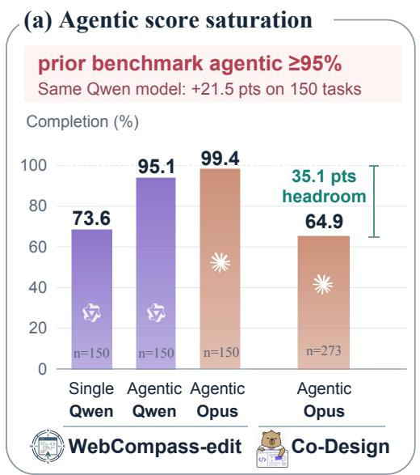
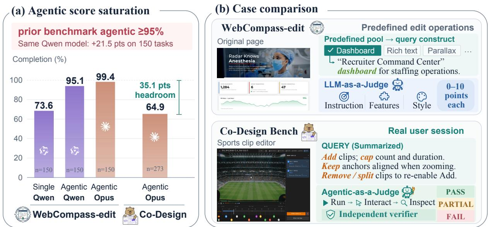
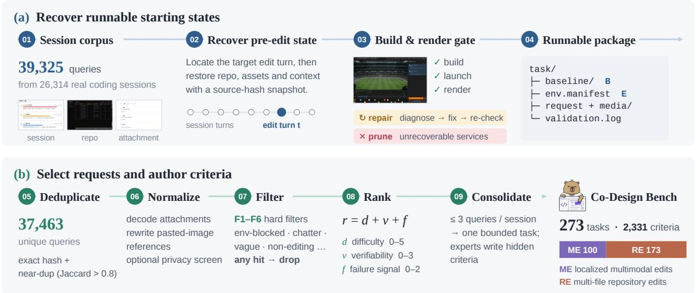
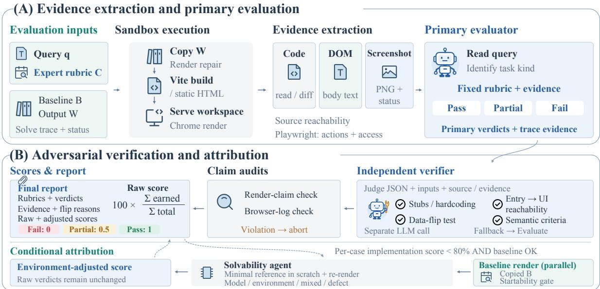
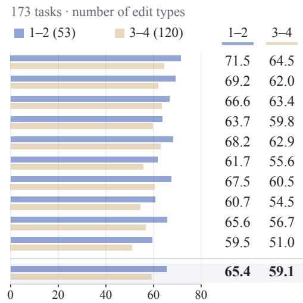
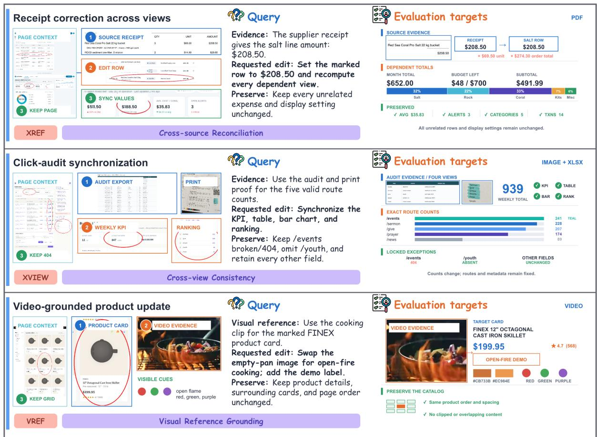
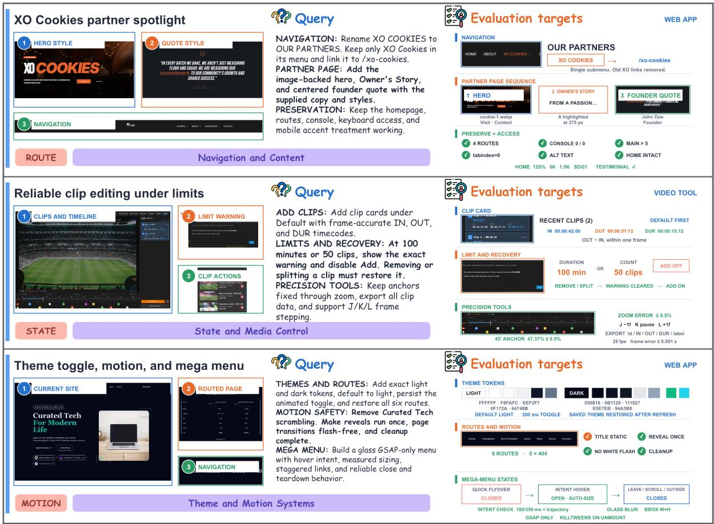
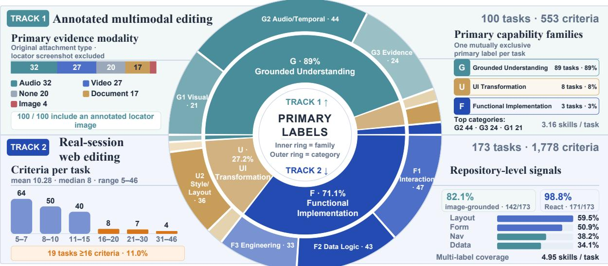
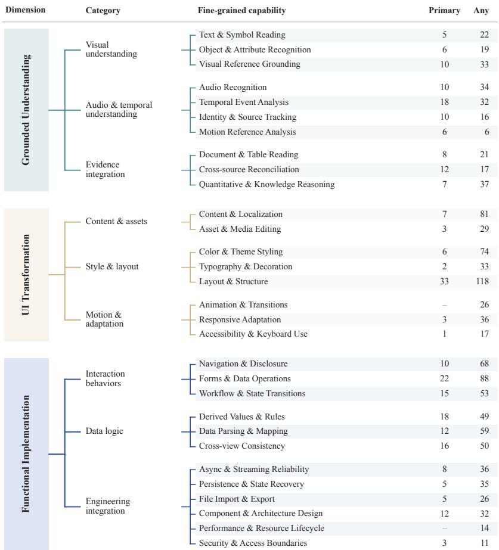

# Co-Design Bench: Multimodal Collaborative Coding Evaluation for Agentic Models

Xilin Wei1,2,∗ Shengyuan Ding1,∗ Xinyu Fang2,3,∗ Tiancheng Gu2 Yuchi Wang2,4 Zhixun Li2,4 Ziyu Liu5 Yuhang Zang6 Weixiang Yu2 Cheng Lu2 Chonggao Sun2 Tong Zhou2 Dahua Lin4,† Hang Zhang2,† Shuai Bai2,† Dayiheng Liu2

1Fudan University 2Alibaba Token Hub, Alibaba Group 3Zhejiang University 4The Chinese University of Hong Kong 5Shanghai Jiao Tong University 6Nanyang Technological University ∗Equal contribution †Corresponding authors

https://codesignbench.github.io/

## Abstract

Evaluating human–AI co-design requires testing whether coding agents can translate real users’ multimodal requests into working application revisions. We introduce Co-Design Bench, a reference-free benchmark of 273 tasks curated from 37,463 deduplicated queries across 26,314 real user coding sessions. Its two tracks, Multimodal Editing (ME) and Repository Editing (RE), cover localized edits with optional image, audio, video, or document inputs and coordinated repository revisions. Tasks span three capability dimensions: Grounded Understanding, UI Transformation, and Functional Implementation. The tasks pair normalized requests and runnable pre-edit applications with 2,331 hidden expert-authored acceptance criteria. Our judge-then-refute protocol grades criteria using source and browser evidence, challenges positive verdicts with a separate LLM verifier, and audits visual and interaction claims without gold code or target screenshots. Under a shared agentic harness, the strongest of ten model endpoints passes an average of 69.9% of criteria per task but fully satisfies only 26.4% of tasks. All ten endpoints achieve lower criterion completion on repository edits spanning three or four change types than on those spanning one or two. Co-Design Bench provides a testbed for studying the gap between partial requirement satisfaction and complete task success under agentic execution for real-user application revisions.

## 1 Introduction

Web application co-design follows an iterative cycle of inspecting an existing artifact, requesting changes, and assessing the result (Schön, 1983). Coding agents can participate in this cycle by inspecting visual context, modifying source files, and executing applications (Yang et al., 2024a; Anthropic, 2025; OpenAI, 2026a; Qwen Team, 2026b). Success requires translating user intent into working revisions of the current application. A request may combine image, audio, video, or document inputs with changes to layout, interaction, and application state, requiring the agent to connect multimodal evidence to dependent revisions across the application’s interface and behavior.

Existing benchmarks capture important parts of this problem: reference reconstruction (Si et al., 2024; Lai et al., 2025; Chen et al., 2025), synthetic or predefined edits and repairs (Li et al., 2026; Lei et al., 2026), edits extracted from version histories (Xiao et al., 2025), and implementation of repository issues or freelance requests (Jimenez et al., 2023; Yang et al., 2024b; Miserendino et al., 2025). Coverage remains limited for compound revisions drawn from coding sessions across both localized multimodal edits and coordinated repository changes (Table 1). For example, the sports clip editor request in Figure 1(b) couples clip-count and duration limits, timeline alignment under zoom, and state updates that re-enable insertion after clip removal or splitting. Such a request ties success to the behavior of the edited application across several interacting requirements at once.

Agentic execution also changes how benchmark scores should be interpreted. On the same 150 WebCompass-edit tasks (Lei et al., 2026), switching qwen3.7-plus (Qwen Team, 2026a) from single-shot to agentic execution raises mean graded feature completion from 73.6% to 95.1%, with the feature rubric, judge, and render pipeline held fixed (Figure 1(a); Appendix A). On these 150 tasks, opus-4-8 (Anthropic, 2026a) reaches 99.4% mean graded feature completion with agentic execution. The 21.5-point gain shows that execution conditions materially affect measured completion in this setting. We therefore evaluate real-user revisions with iterative tool access and report both criterion satisfaction and complete task success.

  
Figure 1: Execution regimes and task provenance. (a) Mean graded feature completion on 150 WebCompass-edit tasks (Lei et al., 2026): qwen3.7-plus rises from 73.6% (single-shot) to 95.1% (agentic), with the feature rubric, judge, and render pipeline held fixed; opus-4-8 reaches 99.4% with agentic execution (Appendix A). The cross-benchmark bars use different task pools and evaluation protocols. (b) A WebCompass request drawn from predefined edit operations and a Co-Design Bench request recovered from a real coding session, with their evaluation workflows.

We introduce Co-Design Bench, comprising 273 tasks and 2,331 expert-authored acceptance criteria, curated from 37,463 deduplicated queries across 26,314 real user coding sessions. We recover and validate runnable pre-edit applications, retain available session context and attachments, and consolidate user requests into bounded editing tasks. The benchmark covers two complementary settings: Multimodal Editing (ME) evaluates localized visual, structural, and content edits with optional image, audio, video, or document inputs; Repository Editing (RE) evaluates coordinated UI and feature changes across components, routes, state, and data flow. Both tracks pair the starting application with a normalized request and hidden acceptance criteria that specify the requested changes while allowing multiple valid implementations. A document-grounded edit can require consistent updates to a displayed value and its dependent summaries, while a repository request can couple visible controls with state transitions across components. The shared task formulation captures these dependencies as auditable requirements, connecting the interpretation of user evidence to observable visual changes and state transitions in the edited application.

Evaluating these tasks requires checking whether requested features are reachable and behave correctly in the edited application. Our judge-then-refute protocol first grades hidden criteria using source code and browser execution evidence. A separate LLM verifier challenges PASS and PARTIAL verdicts against the collected evidence, checking for stubs, hardcoding, unreachable functionality, and requirement mismatches. Audits require successful renders and screenshots for visual claims and recorded browser actions for interaction claims; missing evidence aborts evaluation before score aggregation. The pre-edit application grounds the requested changes, enabling reference-free acceptance without gold code or target screenshots, while retained verdicts and traces link each criterion judgment to its supporting evidence for inspection.

We evaluate ten model endpoints under a shared agentic harness. The strongest endpoint passes an average of 69.9% of criteria per task but fully satisfies only 26.4% of tasks. Model rankings vary between tracks, and all ten endpoints achieve lower criterion completion on repository edits spanning three or four change types than on those spanning one or two. These results show that substantial coverage of individual requirements can coexist with limited complete-task success, motivating evaluation of both criterion satisfaction and complete delivery.

Contributions. (1) We construct a benchmark of real-user application revisions spanning localized multimodal edits and coordinated repository changes, with runnable starting states and expert-authored criteria. (2) We develop a reference-free evaluation protocol that combines code and browser evidence, a separate refutation pass, and mandatory evidence audits to assess requested changes. (3) We characterize the gap between criterion satisfaction and complete task success across ten model endpoints, with analyses of input modality and edit breadth.

Table 1: Comparison of web-coding benchmarks. Task origins and core evaluation capabilities of the reported settings.
<table><tr><td>Benchmark / subset</td><td colspan="2">Task</td><td colspan="3">Evaluation</td></tr><tr><td></td><td>Real-user sessions</td><td>Input modalities</td><td>Reference-free acceptance</td><td>Agentic evaluation</td><td>Adversarial verification</td></tr><tr><td colspan="6">REFERENCE RECONSTRUCTION</td></tr><tr><td>Design2Code (Si et al., 2024)</td><td>×</td><td>I</td><td>X</td><td>×</td><td>×</td></tr><tr><td>WebSight-Test (Liang et al., 2024)</td><td>X</td><td>I</td><td>X</td><td>X</td><td>X</td></tr><tr><td>WebRenderBench (Lai et al., 2025)</td><td>X</td><td>I</td><td>X</td><td>X</td><td>X</td></tr><tr><td>IWR-Bench (Chen et al., 2025)</td><td>X</td><td>I,V</td><td>X</td><td>X</td><td>×</td></tr><tr><td colspan="6">PAGE-LEVEL CODING</td></tr><tr><td>MT-Web2Code (Li et al., 2026)</td><td></td><td>T,I</td><td>X</td><td>X</td><td></td></tr><tr><td>DesignBench (Xiao et al., 2025)</td><td>×△</td><td>TI</td><td>△</td><td>X</td><td>×××</td></tr><tr><td>WebCompass (edit) (Lei et al., 2026)</td><td>X</td><td>T,I</td><td>V</td><td>×</td><td></td></tr><tr><td colspan="6">REPOSITORY SOFTWARE ENGINEERING</td></tr><tr><td>SWE-bench M (Yang et al., 2024b)</td><td>×</td><td>T,I,V</td><td>△</td><td>×</td><td>×</td></tr><tr><td>SWE-Lancer (IC) (Miserendino et al., 2025)</td><td>X</td><td>T</td><td>√</td><td>X</td><td>X</td></tr><tr><td>Co-Design Bench (ours)</td><td>V</td><td>T,I, V, A, D</td><td>V</td><td>V</td><td>V</td></tr></table>

✓ =reported; × =not reported; △ =subset/metric-dependent. Sessions denote requests from real-user coding histories, excluding standalone issue reports. DesignBench’s session requests belong to its editing subset. T/I/V/A/D =text/image/video/audio/document. Reference-free acceptance needs no gold code or target screenshot; a pre-edit baseline is allowed. Agentic evaluation actively chooses tools/actions, beyond fixed test replay. Adversarial verification separately challenges initial positive verdicts.

## 2 Related Work

Multimodal web generation and editing. Design2Code, WebSight-Test (from WAFFLE), and WebRenderBench evaluate screenshot-to-code reconstruction against reference pages (Si et al., 2024; Liang et al., 2024; Lai et al., 2025). IWR-Bench extends reconstruction to interaction videos, using annotated action replay and reference screenshots (Chen et al., 2025). WebGen-Bench and FrontendBench add browseror sandbox-based functional tests for websites generated from scratch (Lu et al., 2025; Zhu et al., 2025). Editing benchmarks instead revise an existing artifact. DesignBench extracts adjacent-version pairs from V0/Vue0 histories for before/after screenshot assessment (Xiao et al., 2025). MT-Web2Code synthesizes repair trajectories by corrupting reference pages (Li et al., 2026), while WebCompass constructs tasks around predefined edit operations (Lei et al., 2026). FronTalk studies conversational front-end generation with multimodal feedback (Wu et al., 2026). Co-Design Bench instead fixes a bounded revision recovered from a production coding session, retaining its runnable starting application, context, and attachments; hidden criteria specify requested changes without gold code or a target screenshot as supervision.

Repository-level coding. SWE-bench evaluates changes for real GitHub issues through executable tests (Jimenez et al., 2023). SWE-bench Multimodal covers frontend JavaScript software with visual tests (Yang et al., 2024b), and SWE-Lancer evaluates real freelance implementation requests through browser-based end-to-end tests (Miserendino et al., 2025). Co-Design Bench focuses on compound design and feature revisions within coding sessions. Its repository track covers coordinated changes to components, routes, state, and data flow. A shared task interface and acceptance protocol connect this setting to localized multimodal edits, allowing both requirement coverage and complete delivery to be measured on a common scale across the two tracks.

Agentic artifact evaluation and verification. Agent-as-a-Judge assesses generated artifacts against user requirements using agent capabilities (Zhuge et al., 2024). WebCompass uses browser interaction and adaptive tests for generation; its editing and repair settings use checklist-guided judgments from code, logs, and screenshots (Lei et al., 2026). Structured LLM evaluation can improve agreement with human judgments, yet evaluators can exhibit self-preference and benchmark-dependent reliability (Liu et al., 2023; Panickssery et al., 2024; Lù et al., 2025). For application revisions, source presence alone does not establish reachability or correct behavior. Our judge-then-refute protocol therefore combines source and browser evidence with a separate verifier; mandatory audits require screenshots for visual claims and recorded actions for interaction claims. Retained evidence makes positive credit traceable, though it cannot eliminate judgment error.

## 3 Co-Design Bench

Co-Design Bench evaluates the transition from a runnable application to an edited application in response to a real user’s revision request. Its 273 tasks span Multimodal Editing (ME) and Repository Editing (RE),

  
Figure 2: Data construction and filtering. (a) Recover and validate runnable pre-edit applications, repairing eligible environments and excluding unrecoverable cases. (b) Deduplicate and filter requests, rank candidates by difficulty, verifiability, and historical failure signals, then select bounded session intervals for consolidation and expert rubric authorship.

with 2,331 expert-authored acceptance criteria. The tracks share an evaluation contract while covering two editing scales: localized changes grounded in multimodal evidence and coordinated repository changes spanning structure, behavior, and content.

## 3.1 Task Formulation

Each task is $t = ( S , I , C )$ , where $S = \left( B , E \right)$ contains a runnable pre-edit baseline B and its containerized environment E. The input $\boldsymbol { I } = ( q , X , \dot { K } )$ comprises a normalized request q, optional multimodal attachments X, and retained session history K. The hidden expert-authored rubric ${ \bf { \bar { C } } } = C _ { t } = \left\{ c _ { i } \right\} _ { i = 1 } ^ { n _ { t } }$ specifies the requested outcomes and any explicit architectural constraints while permitting any implementation consistent with those task-specific requirements.

Under a solver harness H, an agent $\mathcal { A } _ { \theta } ^ { H }$ edits the application through an execution trajectory τ:

$$
\boldsymbol { \mathcal { A } } _ { \boldsymbol { \theta } } ^ { H } : ( \boldsymbol { S } , \boldsymbol { I } ) \longmapsto ( \widehat { \boldsymbol { S } } , \boldsymbol { \tau } ) , \qquad \widehat { \boldsymbol { S } } = \mathrm { E d i t } _ { \boldsymbol { \tau } } ( \boldsymbol { S } ) .\tag{1}
$$

The solver can inspect, edit, build, and execute the application through H; criteria and evaluation artifacts remain hidden. Acceptance concerns the final application state. The baseline grounds what must change and any requested preservation constraints, so reference-free acceptance remains compatible with inspecting the pre-edit artifact. Section 4 defines the completion metrics.

## 3.2 Data Source and Curation

The source corpus contains 39,325 production queries across 26,314 coding sessions; deduplication retains 37,463 candidates. Each candidate is anchored to a target edit turn with its repository, available context, and attachments. Figure 2 summarizes the construction pipeline.

Recovering executable starting states. We reconstruct applications from session logs, repository archives, or HTML bundles. Candidates must pass dependency, build, container launch, and Playwright rendering checks (Microsoft, 2026). Tasks requiring unrecoverable services are excluded, and repaired applications pass the same validation gate. This gate establishes a working starting point, allowing evaluation to assess the changes made during solver execution.

Selecting requests and authoring acceptance criteria. Normalization packages attachments and clarifies request wording. Hard filters remove environment-blocked, non-actionable, and non-editing requests. Remaining candidates are ranked by structural difficulty, verifiability, and historical failure signals such as reformulations and rollbacks, then consolidated into bounded session intervals. Experts refine the requests and author hidden criterion-level rubrics. The resulting tasks preserve session-derived revision goals but evaluate a fixed request; they do not simulate further user feedback during execution. Appendix I gives filtering thresholds, ranking rules, and selection parameters.

## 3.3 Multimodal Editing (ME)

The 100 ME tasks cover localized visual, structural, and content edits. The solver receives a runnable page, an annotated target region, a normalized request, and optional image, audio, video, or document attachments, available for direct inspection or tool-based processing. These assets can specify a visual treatment, a spoken instruction, or a value to reconcile across views. Validation checks the initial Playwright render, attachment decodability, target-region annotations, and criterion verifiability. Rubrics specify requested visual treatments, content placement, and spatial relationships, including preservation of unrelated content when requested. Different CSS and DOM implementations can satisfy these outcomes. For example, the receipt-grounded case requires reconciling a value across a source document, an editable row, and dependent summaries: the local edit must preserve consistency across the requested views (Appendix E).

The modality split comprises 20 tasks without attachments, 4 with images, 27 with video, 32 with audio, and 17 with documents. These tasks contain 553 criteria, with a mean of 5.5, a median of 6, and a maximum of 11 per task. See Table 8 for more detail.

## 3.4 Repository Editing (RE)

The 173 RE tasks start from runnable multi-file frontend repositories and require coordinated changes across components, routes, state, data flow, or content. Each task pairs a consolidated request with repository context and relevant local assets. Experts decompose compound requests into separately auditable criteria, retaining explicit wiring or artifact constraints while leaving other implementation choices open. Validation checks dependency resolution, builds, runtime launch, route reachability, and browser rendering; tasks requiring unrecoverable services are excluded. In the clip-editor case, controls must respect duration and count limits and recover after removing or splitting clips, coupling visible interface changes to application state (Appendix E). Both tracks use the same (S, I, C) interface and PASS/PARTIAL/FAIL verdicts. They differ in the requested editing scope: a localized edit may also start from a bundled application. Appendix F.1 details dataset composition, and Table 1 compares existing web-coding settings.

This track contains 1,778 criteria, averaging 10.3 per task, with a median of 8 and a maximum of 46. Structural, stylistic, interactive, and content edits occur in 151, 133, 131, and 112 tasks, respectively. These counts overlap: 166 of the 173 tasks require multiple edit types, making coordinated changes a common property of the selected requests (Table 8).

## 4 Evaluation Protocol

Evaluation assesses the final application W against the request and hidden criteria, using baseline B to ground the changes. Figure 3 shows the judge-then-refute pipeline.

## 4.1 Evidence and Adversarial Verification

Evidence and primary grading. The candidate is built and rendered in an isolated environment. A fixed agentic evaluator (Zhuge et al., 2024) assigns PASS, PARTIAL, or FAIL to each criterion using source diffs, rendered pages, and Playwright traces. Evidence must match the claim: source inspection can establish a static property, a screenshot can support a visual requirement, and recorded actions can establish an interaction and its resulting state. Failed builds or missing DOM nodes invalidate render-dependent criteria; a handler in source code alone cannot establish that users can reach and operate the requested functionality through the rendered interface.

Refutation and evidence audits. A separate LLM verifier receives the initial judgments and collected evidence, then challenges PASS and PARTIAL verdicts. It checks for stubs, hardcoded outputs, unreachable entry points, failures under varied inputs, and request mismatches. This pass targets unsupported completion credit; it does not by itself establish the correctness of every verdict. Subsequent audits require successful renders and screenshots for visual claims and browser-action logs for interaction claims. Violations abort evaluation before aggregation. Verdicts, evidence, and refutation logs are retained for inspection, linking each reported outcome to its supporting observations. Two frontend experts additionally checked rubric scores for 200 task–model outputs. They examined the task requirements, evaluation rubric, and generated interface, including browser interactions when required, to assess whether each PASS/PARTIAL/FAIL verdict reflected the output’s satisfaction of the corresponding criterion. Appendix J specifies execution, evidence extraction, and artifact retention.

  
Figure 3: Evaluation from artifact to verdict. (a) Build and render the candidate, collect source and browser evidence, and grade hidden criteria. (b) Challenge positive verdicts, audit required evidence, and aggregate scores. Parallel baseline and solvability checks diagnose failures for supplementary attribution analysis.

## 4.2 Scoring and Failure Attribution

For task t with $n _ { t }$ implementation criteria, let $v _ { t i }$ denote the verdict after refutation and auditing. Strict and Graded Completion are

$$
R _ { t } = \frac { 1 } { n _ { t } } \sum _ { i = 1 } ^ { n _ { t } } \mathbf { 1 } [ v _ { t i } = \mathrm { P A S S } ] , \qquad G _ { t } = \frac { 1 } { n _ { t } } \sum _ { i = 1 } ^ { n _ { t } } g ( v _ { t i } ) ,\tag{2}
$$

where $\mathbf { 1 } [ \cdot ]$ is the indicator function and $\begin{array} { r } { g ( \mathrm { P A S S } ) = 1 , g ( \mathrm { P A R T I A L } ) = 0 . 5 , } \end{array}$ and $g ( \mathrm { F A I L } ) = 0$ . Over a fixed task set T shared by all endpoints, we report equal-weight task means and Full-Pass Rate:

$$
\bar { R } = \frac { \sum _ { t \in \mathcal { T } } R _ { t } } { | \mathcal { T } | } , \quad \bar { G } = \frac { \sum _ { t \in \mathcal { T } } G _ { t } } { | \mathcal { T } | } , \quad \mathrm { F } = \frac { \sum _ { t \in \mathcal { T } } \mathbf { 1 } [ R _ { t } = 1 ] } { | \mathcal { T } | } .\tag{3}
$$

Task normalization prevents longer rubrics from dominating the mean. Strict Completion measures fully satisfied requirements, Graded Completion credits partial progress, and Full-Pass Rate measures delivery of every criterion in a task. On the normalized [0, 1] scale, $\begin{array} { r } { \mathrm { F } \leq \bar { R } \leq \bar { G } ; } \end{array}$ the gap R¯ − F is criterion credit from tasks with unfinished requirements. A high R¯ can therefore coexist with a low F when unresolved requirements are spread across many tasks. Each endpoint contributes 100 ME and 173 RE tasks; combined scores weight all 273 tasks equally.

Failure attribution. For low-scoring cases $( G _ { t } ~ < ~ 0 . 8 ) ,$ attribution proceeds when an independently rendered baseline passes the startability gate. A parallel solvability probe attempts a minimal patch in an isolated sandbox, stubbing inaccessible network endpoints while preserving core business logic. The checks distinguish model limitations, environmental blockage, mixed causes, and defects in the starting artifact. Raw scores and denominators remain unchanged. Supplementary adjusted scores grant attribution credit only when infrastructure failures are established (Appendix J.1).

## 5 Experiments

## 5.1 Experimental Setup

Shared solver harness. The main comparison holds the Claude Code harness (Anthropic, 2025), container manifests, system prompts, tool interfaces, and repository staging procedures fixed across endpoints. Each solver receives the normalized request, attachments, and a clean working copy; acceptance criteria remain hidden. After termination, the final application is built, rendered, and evaluated under Section 4. Runs are capped at three hours and 120 turns. Reaching the turn cap triggers evaluation of the final state; wall-clock timeouts are recorded as infrastructure failures, while raw scores and denominators remain unchanged (Appendices D and J.1).

Table 2: Main benchmark performance across ME and RE. Ranked by mean strict completion R¯ . Metrics report Strict (R¯ ), Graded (G¯ ), and Full-Pass Rate (F, in %). Rollout statistics summarize median turns, mean turn output tokens, and total token traffic per case. Tool distributions are grouped into execution (Bash), inspection (Read/Grep/Glob), modification (Edit/Write), and auxiliary. Bold indicates peak track performance.
<table><tr><td rowspan="2">Model</td><td colspan="3">Completion</td><td colspan="3">Rollout statistics</td><td colspan="4">Tool calls (%)</td></tr><tr><td>Strict↑</td><td>Graded↑</td><td>F↑</td><td>Turns</td><td></td><td>Len. Tokens</td><td></td><td>Exec Insp. Mod. Overall</td><td></td><td></td></tr><tr><td colspan="11">ME n=100</td></tr><tr><td>S gpt-6-astra</td><td>0.754</td><td></td><td>0.798 41.0</td><td>32</td><td>146</td><td>1.24M</td><td>36.8</td><td>34.7</td><td>13.7</td><td></td></tr><tr><td>米 opus-5</td><td>0.695</td><td></td><td>0.749 30.0</td><td>34</td><td>363</td><td>2.92M</td><td>55.8</td><td>35.8</td><td>7.8</td><td></td></tr><tr><td>六 qwen3.8-max-0902</td><td>0.667</td><td></td><td>0.71931.0</td><td>42</td><td>620</td><td>2.94M</td><td>46.9</td><td>33.0</td><td>7.8</td><td></td></tr><tr><td>K kimi-k3</td><td>0.662</td><td>0.718</td><td>26.0</td><td>27</td><td>329</td><td>1.47M</td><td>47.9</td><td>40.0</td><td>7.9</td><td></td></tr><tr><td>六 qwen3.8-27b</td><td>0.642</td><td>0.705</td><td>23.0</td><td>56</td><td>845</td><td>5.90M</td><td>45.8</td><td>35.7</td><td>6.6</td><td></td></tr><tr><td>米 opus-4-8</td><td>0.593</td><td>0.657</td><td>16.0</td><td>24</td><td>560</td><td>1.65M</td><td>49.8</td><td>37.8</td><td>9.9</td><td></td></tr><tr><td>S gpt-5.6-sol</td><td>0.583</td><td></td><td>0.639 20.0</td><td>32</td><td>208</td><td>1.54M</td><td>34.1</td><td>35.7</td><td>9.5</td><td></td></tr><tr><td>Z glm-5.2</td><td>0.572</td><td>0.629</td><td>16.0</td><td>69</td><td>659</td><td>7.29M</td><td>74.6</td><td>13.1</td><td>4.9</td><td></td></tr><tr><td>Z glm-5.3-flash</td><td>0.538</td><td>0.599</td><td>18.0</td><td>49</td><td>357</td><td>3.65M</td><td>53.6</td><td>40.7</td><td>3.7</td><td></td></tr><tr><td>Ω grok-4.6</td><td>0.467</td><td>0.536</td><td>6.0</td><td>14</td><td>491</td><td>0.89M</td><td>26.8</td><td>62.6</td><td>10.7</td><td></td></tr><tr><td colspan="11">RE n=173</td></tr><tr><td>S gpt-6-astra</td><td>0.667</td><td></td><td>0.728 17.9</td><td>48 </td><td>272</td><td>2.33M</td><td>20.3</td><td>31.1</td><td>37.6</td><td></td></tr><tr><td>六 qwen3.8-27b</td><td>0.645</td><td>0.711</td><td>10.4</td><td>57</td><td>1185</td><td>6.72M</td><td>32.8</td><td>28.0</td><td>22.3</td><td></td></tr><tr><td>女 qwen3.8-max-0902</td><td>0.644</td><td>0.715</td><td>8.1</td><td>45</td><td>893</td><td>4.01M</td><td>32.7</td><td>22.5</td><td>28.3</td><td></td></tr><tr><td>米 opus-5</td><td>0.642</td><td>0.702</td><td>11.6</td><td>35</td><td>697</td><td>3.31M</td><td>44.4</td><td>19.2</td><td>34.5</td><td></td></tr><tr><td>S gpt-5.6-sol</td><td>0.627</td><td>0.702</td><td>11.0</td><td>40</td><td>262</td><td>1.80M</td><td>20.8</td><td>36.8</td><td>19.6</td><td></td></tr><tr><td>K kimi-k3</td><td>0.610</td><td>0.681</td><td>9.8</td><td>24</td><td>534</td><td>1.36M</td><td>34.3</td><td>27.4</td><td>30.7</td><td></td></tr><tr><td>Z glm-5.3-flash</td><td>0.594</td><td>0.662</td><td>6.4</td><td>31</td><td>481</td><td>1.86M</td><td>43.0</td><td>21.6</td><td>29.6</td><td></td></tr><tr><td>米 opus-4-8</td><td>0.575</td><td>0.645</td><td>6.9</td><td>23</td><td>815</td><td>1.77M</td><td>27.6</td><td>25.3</td><td>32.5</td><td></td></tr><tr><td>Z glm-5.2</td><td>0.564</td><td>0.641</td><td>5.8</td><td>53</td><td>603</td><td>3.28M</td><td>38.7</td><td>24.2</td><td>18.2</td><td></td></tr><tr><td>ø grok-4.6</td><td>0.536</td><td>0.605</td><td>6.9</td><td></td><td>91157</td><td>0.45M</td><td>1.8</td><td>61.9</td><td>36.2</td><td></td></tr></table>

Models, coverage, and metrics. We evaluate ten model endpoints on the fixed 273 tasks. The complete grid contains 2,730 model–task pairs: 1,000 in ME and 1,730 in RE. Table 2 reports per-track results, and Appendix B gives model references and the combined leaderboard. We report Strict Completion (R¯ ), Graded Completion (G¯), and Full-Pass Rate (F), as defined in Section 4.2. Completion scores use the [0, 1] scale unless noted, while full-pass rates are percentages. Task-group analyses pool final-state scores within each group across all ten model endpoints.

## 5.2 Main Results

Table 2 reports completion, execution effort, and tool use across endpoints. The strongest model, gpt-6-astra, leads both tracks in mean strict completion. The remaining endpoints vary in their relative strengths, while complete task success remains limited even for the highest-scoring model.

Criterion coverage exceeds complete delivery. The leading endpoint achieves R¯ = 0.754 on ME and 0.667 on RE, but fully passes only 41.0% and 17.9% of tasks, respectively. Across all 273 tasks, its mean strict completion is 0.699 and full-pass rate is 26.4%. Thus, 73.6% of tasks retain at least one criterion that is not fully satisfied. Reporting both metrics exposes incomplete delivery because average requirement coverage does not directly measure full-task success.

Rankings differ across editing settings. Strict-completion rankings correlate across tracks (Spearman ρ = 0.818), yet kimi-k3 moves from fourth on ME to sixth on RE, while Qwen3.8-27B moves from fifth to second. The latter achieves R¯ = 0.645 on repository edits, compared with 0.642 for opus-5, making it the second-ranked endpoint in this setting. It ranks fourth overall at 0.644, following gpt-6-astra (0.699), opus-5 (0.661), and qwen3.8-max-0902 (0.653; Table 5). The small repository-track gap does not establish a general model advantage. Endpoint mean strict scores span 28.7 percentage points on ME and 13.0 on RE; a combined ranking can conceal strengths specific to an editing setting within this benchmark.

Execution profiles differ across tracks. ME video tasks have a median of 44 turns, compared with 27 for text-only tasks. Media interactions account for 82.8% of activity in the upper-quartile longest rollouts. Image-inspection calls average 14.47 per run on ME and 2.78 on RE, while the share of Edit/Write calls rises from 7.3% to 27.6%. These profiles describe how agents allocate execution effort under the shared harness; they do not isolate the causal effects of perception or editing tools on task completion because task content differs across these comparisons (Appendix G).

(a) Track 1 · Attachment modality
<table><tr><td rowspan=1 colspan=8>100 tasksNo attach. Image Video Audio Document(20)   (4)   (27)   (32)   (17)</td></tr><tr><td rowspan=1 colspan=3>Sgpt-6-astra</td><td rowspan=1 colspan=1>76.9</td><td rowspan=1 colspan=1>57.1</td><td rowspan=1 colspan=1>79.3</td><td rowspan=1 colspan=1>70.7</td><td rowspan=1 colspan=1>80.9</td></tr><tr><td rowspan=1 colspan=3>米opus-5</td><td rowspan=1 colspan=1>65.3</td><td rowspan=1 colspan=1>89.1</td><td rowspan=1 colspan=1>71.7</td><td rowspan=1 colspan=1>63.8</td><td rowspan=1 colspan=1>76.7</td></tr><tr><td rowspan=1 colspan=3>女qwen3.8-max-0902</td><td rowspan=1 colspan=1>75.8</td><td rowspan=1 colspan=1>77.1</td><td rowspan=1 colspan=1>67.7</td><td rowspan=1 colspan=1>56.0</td><td rowspan=1 colspan=1>72.3</td></tr><tr><td rowspan=2 colspan=3>Kkimi-k3女qwen3.8-27b</td><td rowspan=1 colspan=1>74.8</td><td rowspan=1 colspan=1>55.4</td><td rowspan=1 colspan=1>64.8</td><td rowspan=1 colspan=1>63.9</td><td rowspan=1 colspan=1>65.2</td></tr><tr><td rowspan=1 colspan=1>77.9</td><td rowspan=1 colspan=1>61.6</td><td rowspan=1 colspan=1>64.4</td><td rowspan=1 colspan=1>50.8</td><td rowspan=1 colspan=1>73.7</td></tr><tr><td rowspan=1 colspan=3>米opus-4-8</td><td rowspan=1 colspan=1>66.2</td><td rowspan=1 colspan=1>61.6</td><td rowspan=1 colspan=1>68.6</td><td rowspan=1 colspan=1>48.3</td><td rowspan=1 colspan=1>56.7</td></tr><tr><td rowspan=1 colspan=3>Sgpt-5.6-sol</td><td rowspan=1 colspan=1>51.9</td><td rowspan=1 colspan=1>46.8</td><td rowspan=1 colspan=1>60.3</td><td rowspan=1 colspan=1>66.1</td><td rowspan=1 colspan=1>50.9</td></tr><tr><td rowspan=2 colspan=3>Zglm-5.2glm-5.3-flash</td><td rowspan=1 colspan=1>62.8</td><td rowspan=1 colspan=1>56.6</td><td rowspan=1 colspan=1>51.9</td><td rowspan=1 colspan=1>58.8</td><td rowspan=1 colspan=1>56.0</td></tr><tr><td rowspan=1 colspan=2>Z glm-5</td><td rowspan=1 colspan=1>n-5.3-flash</td><td rowspan=1 colspan=1>54.0</td><td rowspan=1 colspan=1>53.5</td><td rowspan=1 colspan=1>41.0</td><td rowspan=1 colspan=1>62.7</td><td rowspan=1 colspan=1>57.1</td></tr><tr><td rowspan=2 colspan=3>Ωgrok-4.6Pooled mean</td><td rowspan=1 colspan=1>31.5</td><td rowspan=1 colspan=1>31.2</td><td rowspan=1 colspan=1>55.0</td><td rowspan=1 colspan=1>43.0</td><td rowspan=1 colspan=1>62.1</td></tr><tr><td rowspan=1 colspan=1>63.7</td><td rowspan=1 colspan=1>59.0</td><td rowspan=1 colspan=2>62.5  58.4</td><td rowspan=1 colspan=1>65.2</td></tr></table>

(b) Track 2 · Edit breadth  
  
Strict completion (%)

Figure 4: Mean strict completion $( { \bar { R } } ,$ in %) across task strata $( N = 2 7 3 )$ . Ten endpoints are ordered by ME mean strict completion. (a) Five input attachment modalities; bold outlines mark column maxima. (b) Tasks with 1–2 edit types (blue) versus 3–4 (gold). Parentheses give task counts. Pooled rows average all task scores across ten endpoints (Appendix B.2).
<table><tr><td colspan="2"></td><td colspan="3">Ten endpoints</td></tr><tr><td>Primary capability</td><td>Tasks</td><td>Pairs</td><td>Strict</td><td>Full (%)</td></tr><tr><td>Grounded Understanding</td><td>92</td><td>920</td><td>0.604</td><td>20.2</td></tr><tr><td>UI Transformation</td><td>55</td><td>550</td><td>0.615</td><td>13.6</td></tr><tr><td>Functional Implementation</td><td>126</td><td>1260</td><td>0.619</td><td>10.3</td></tr></table>

Table 3: Primary capability breakdown. Ten endpoints on 273 tasks give 2,730 evaluation pairs. Strict averages task pass fractions; Full is the all-pass rate. Figure 9 gives scores for each model and capability group.

Execution effort and completion. On ME, gpt-6-astra reaches $\bar { R } \ = \ 0 . 7 5 4$ with 32 median turns and 1.24M tokens per case, whereas GLM-5.2 uses 69 turns and 7.29M tokens for $\bar { R } = 0 . 5 7 2$ . On RE, Qwen3.8-27B uses ${ \dot { 5 } } 7$ turns and 6.72M tokens for $\bar { R } = 0 . 6 4 5$ compared with 48 turns and 2.33M tokens for gpt-6-astra at $\bar { R } = 0 . 6 6 7$ . Higher completion therefore does not require uniformly greater execution effort across the tested endpoints. Token traffic follows the API accounting conventions in Appendix D, including retries and reported cache usage; it is an execution measure rather than a common monetary cost.

## 5.3 Task-Level Analysis

We examine three complementary task groupings: attachment modality on ME, edit breadth on RE, and primary capability across both tracks. These descriptive comparisons reflect the selected requirements and composition of each task group rather than isolated causal effects.

Attachment modality. Qwen3.8-27B leads text-only tasks $( \bar { R } = 0 . 7 7 9 )$ , opus-5 leads image tasks (0.891), and gpt-6-astra leads video, audio, and document tasks (Figure 4a). Pooled mean strict completion ranges from 0.584 to 0.652 across modalities. Documents have the highest pooled strict score (0.652), yet only 18.2% of their model–task pairs fully pass, compared with 37.0% for text-only tasks (Table 6a). Criterion coverage and all-pass success thus give different views of task difficulty. Tool traces document diverse processing strategies: OpenCV (Bradski, 2000) appears in 68.5% of video trajectories, ffmpeg (FFmpeg Developers, 2026) in 31.5% of video and 25.0% of audio runs, and faster-whisper (Klein, 2023) in 4.4% of audio runs. Some agents also execute pretrained perception models to obtain descriptions, transcripts, class scores, or detection boxes from media inputs to ground subsequent edits (Appendix G).

Edit breadth. On RE, overlapping groups of structural, stylistic, interactive, and content edits have similar pooled strict scores (0.599–0.607). Grouping by the number of edit types reveals a larger difference: tasks with one or two types score 0.654, versus 0.591 for three or four types, a 6.3-point gap. Every endpoint scores lower on the broader group (Figure 4b). Full-pass rates remain similar (9.1% versus $9 . 7 \% )$ , while zero-pass rates rise from 0.9% to 5.8% (Table 6b). Broader edits have lower criterion coverage while maintaining similar pooled full-pass rates.

Primary capability. Table 3 groups all $2 { , } 7 3 0$ evaluation pairs by the task’s main delivery objective. Functional Implementation is the largest group (126 tasks, 46.2%). It has the highest pooled strict completion (0.619) but the lowest full-pass rate (10.3%), compared with Grounded Understanding (0.604; 20.2%) and UI Transformation (0.615; 13.6%). The distinction between requirement coverage and complete delivery persists across these groups. gpt-6-astra leads all three dimensions, scoring 0.738, 0.692, and 0.673 on Grounded Understanding, UI Transformation, and Functional Implementation, respectively; Qwen3.8-27B reaches 0.661 on the latter. These groups overlap strongly with track membership, so the breakdown describes performance rather than isolating independent abilities. The accompanying multilabel annotation records 1,172 task–capability associations: 265 tasks (97.1%) have multiple capability labels, and 174 (63.7%) span more than one high-level dimension. Appendix F details category results and coverage.

## 5.4 Ablation and Robustness Studies

We conduct systematic ablations across three critical experimental axes. Execution Regimes: Comparing single-shot against agentic execution on 150 WebCompass-edit tasks demonstrates the necessity of iterative agentic loops (Appendix A). Evaluator Sensitivity: Swapping the underlying judge model confirms that relative model rankings and score distributions remain highly robust across different evalu ators (Appendix C). Scaffold Robustness: Evaluating identical solvers across three distinct harnesses reveals strong model×harness interactions and highlights the decisive role of closed-loop verification (Appendix H).

## 6 Conclusion

Co-Design Bench evaluates 273 real-user application revisions with runnable starting states and 2,331 hidden acceptance criteria. Its two tracks span localized multimodal edits and coordinated repository changes under a shared protocol of source evidence, browser execution, and adversarial review. Across ten endpoints, the strongest model reaches 69.9% mean strict completion but fully satisfies only 26.4% of tasks. Track-specific rankings, edit-breadth differences, and harness sensitivity show where reliable delivery remains difficult. Runnable baselines and criterion-level evidence support analysis of failures in request grounding, change propagation, and final-state verification. The benchmark provides a common setting for measuring progress toward complete delivery by coding agents, while retaining the task context and execution evidence needed to analyze unmet requirements and compare future solvers.

## References

Anomaly. OpenCode. https://github.com/anomalyco/opencode/releases/tag/v1.18.13, 2026. Software version 1.18.13; accessed 2026-09-23.

Anthropic. Claude Code. https://code.claude.com, 2025. Agentic coding tool. Accessed 2026-08-28.

Anthropic. Introducing Claude Opus 4.8. https://www.anthropic.com/news/claude-opus-4-8, May 2026a. Published May 28, 2026; accessed 2026-09-23.

Anthropic. Introducing Claude Opus 5. https://www.anthropic.com/news/claude-opus-5, July 2026b. Published July 24, 2026; accessed 2026-09-23.

Gary Bradski. The OpenCV library. Dr. Dobb’s Journal of Software Tools, 2000.

Yang Chen, Minghao Liu, Yufan Shen, Yunwen Li, Tianyuan Huang, Xinyu Fang, Tianyu Zheng, Wenxuan Huang, Cheng Yang, Daocheng Fu, Jianbiao Mei, Rong Wu, Yunfei Zhao, Licheng Wen, Xuemeng Yang, Song Mao, Qunshu Lin, Zhi Yu, Yongliang Shen, Yu Qiao, and Botian Shi. IWR-Bench: Can LVLMs reconstruct interactive webpage from a user interaction video?, 2025. arXiv:2509.24709.

FFmpeg Developers. FFmpeg. https://ffmpeg.org/, 2026. Software; accessed 2026-09-23.

Carlos E. Jimenez, John Yang, Alexander Wettig, Shunyu Yao, Kexin Pei, Ofir Press, and Karthik Narasimhan. SWE-bench: Can language models resolve real-world GitHub issues?, 2023. arXiv:2310.06770; ICLR 2024.

Kimi Team. Kimi K3: Open frontier intelligence. https://arxiv.org/abs/2607.24653, 2026. arXiv:2607.24653.

Guillaume Klein. faster-whisper: Faster whisper transcription with CTranslate2. https://github.com/ SYSTRAN/faster-whisper, 2023. Software; accessed 2026-09-23.

Peichao Lai, Jinhui Zhuang, Kexuan Zhang, Ningchang Xiong, Shengjie Wang, Yanwei Xu, Chong Chen, Yilei Wang, and Bin Cui. WebRenderBench: Enhancing web interface generation through layout-style consistency and reinforcement learning, 2025. arXiv:2510.04097.

Xinping Lei, Xinyu Che, Junqi Xiong, Chenchen Zhang, Yukai Huang, Chenyu Zhou, Haoyang Huang, Minghao Liu, Letian Zhu, Hongyi Ye, Jinhua Hao, Ken Deng, Zizheng Zhan, Han Li, Dailin Li, Yifan Yao, Ming Sun, Zhaoxiang Zhang, and Jiaheng Liu. WebCompass: Towards multimodal web coding evaluation for code language models, 2026. arXiv:2604.18224.

Qiming Li, Shujie Hu, Haohan Liu, Xiaocheng Feng, Songxiang Liu, and Guanglu Wan. MT-Web2Code: Benchmarking coding agents on multi-turn regional reconstruction and localized modification, 2026. arXiv:2608.03474.

Shanchao Liang, Nan Jiang, Shangshu Qian, and Lin Tan. WAFFLE: Finetuning multi-modal models for automated front-end development, 2024. arXiv:2410.18362.

Yang Liu, Dan Iter, Yichong Xu, Shuohang Wang, Ruochen Xu, and Chenguang Zhu. G-Eval: NLG evaluation using GPT-4 with better human alignment. In Proceedings ofthe 2023 Conference on Empirical Methods in Natural Language Processing, pp. 2511–2522. Association for Computational Linguistics, 2023. doi: 10.18653/v1/2023.emnlp-main.153. URL https://aclanthology.org/2023.emnlp-main.153/.

Xing Han Lù, Amirhossein Kazemnejad, Nicholas Meade, Arkil Patel, Dongchan Shin, Alejandra Zambrano, Karolina Sta´nczak, Peter Shaw, Christopher J. Pal, and Siva Reddy. AgentRewardBench: Evaluating automatic evaluations of web agent trajectories, 2025. arXiv:2504.08942.

Zimu Lu, Yunqiao Yang, Houxing Ren, Haotian Hou, Han Xiao, Ke Wang, Weikang Shi, Aojun Zhou, Mingjie Zhan, and Hongsheng Li. WebGen-Bench: Evaluating LLMs on generating interactive and functional websites from scratch, 2025. arXiv:2505.03733.

Microsoft. Playwright. https://playwright.dev/, 2026. Documentation; accessed 2026-09-23.

Samuel Miserendino, Michele Wang, Tejal Patwardhan, and Johannes Heidecke. SWE-Lancer: Can frontier LLMs earn \$1 million from real-world freelance software engineering?, 2025. arXiv:2502.12115.

OpenAI. Codex CLI. https://github.com/openai/codex/releases/tag/rust-v0.142.0, 2026a. Software version 0.142.0; accessed 2026-09-23.

OpenAI. Previewing GPT-5.6 Sol: A next-generation model. https://openai.com/index/ previewing-gpt-5-6-sol/, June 2026b. Official model announcement.

OpenAI. GPT-6 Astra: A new generation of intelligence. https://openai.com/index/gpt-6-astra/, September 2026c. Official model announcement.

Arjun Panickssery, Samuel R. Bowman, and Shi Feng. LLM evaluators recognize and favor their own generations, 2024. arXiv:2404.13076.

Qwen. Qwen Code. https://github.com/QwenLM/qwen-code/releases/tag/v0.21.11, 2026. Software version 0.21.11; accessed 2026-09-23.

Qwen Team. Qwen3.7-Plus: Multimodal agent intelligence. https://qwen.ai/blog?id=qwen3.7-plus, 2026a. Official model release blog.

Qwen Team. Qwen3.8-27B. https://modelscope.cn/models/Qwen/Qwen3.8-27B, 2026b. Official model card; accessed 2026-09-23.

QwenCloud. Qwen3.8-Max-0902. https://www.qwencloud.com/models/qwen3.8-max-0902, n.d. Official model card; accessed 2026-09-23.

Donald A. Schön. The Reflective Practitioner: How Professionals Think in Action. Basic Books, New York, 1983.

Chenglei Si, Yanzhe Zhang, Ryan Li, Zhengyuan Yang, Ruibo Liu, and Diyi Yang. Design2Code: Benchmarking multimodal code generation for automated front-end engineering, 2024. arXiv:2403.03163; NAACL 2025.

Xueqing Wu, Zihan Xue, Da Yin, Shuyan Zhou, Kai-Wei Chang, Nanyun Peng, and Yeming Wen. FronTalk: Benchmarking front-end development as conversational code generation with multi-modal feedback, 2026. arXiv:2601.04203; CoLM 2026.

xAI. Grok 4.6. https://x.ai/news/grok-4-6, August 2026. Published August 12, 2026.

Jingyu Xiao, Ming Wang, Man Ho Lam, Yuxuan Wan, Junliang Liu, Yintong Huo, and Michael R. Lyu. DesignBench: A comprehensive benchmark for MLLM-based front-end code generation, 2025. arXiv:2506.06251.

John Yang, Carlos Jimenez, Alexander Wettig, Kilian Lieret, Shunyu Yao, Karthik Narasimhan, and Ofir Press. SWE-agent: Agent-computer interfaces enable automated software engineering. In Advances in Neural Information Processing Systems, volume 37, pp. 50528–50652, 2024a. doi: 10.52202/079017-1601.

John Yang, Carlos E. Jimenez, Alex L. Zhang, Kilian Lieret, Joyce Yang, Xindi Wu, Ori Press, Niklas Muennighoff, Gabriel Synnaeve, Karthik R. Narasimhan, Diyi Yang, Sida I. Wang, and Ofir Press. SWEbench multimodal: Do AI systems generalize to visual software domains?, 2024b. arXiv:2410.03859; ICLR 2025.

Z.ai. GLM-5.2: Built for long-horizon tasks. https://z.ai/blog/glm-5.2, June 2026a. Official model release blog.

Z.ai. GLM-5.3-Flash: Frontier intelligence, flash cost. https://z.ai/blog/glm-5.3-flash, August 2026b. Official model release blog.

Hongda Zhu, Yiwen Zhang, Bing Zhao, Jingzhe Ding, Siyao Liu, Tong Liu, Dandan Wang, Yanan Liu, and Zhaojian Li. FrontendBench: A benchmark for evaluating LLMs on front-end development via automatic evaluation, 2025. arXiv:2506.13832.

Mingchen Zhuge, Changsheng Zhao, Dylan Ashley, Wenyi Wang, Dmitrii Khizbullin, Yunyang Xiong, Zechun Liu, Ernie Chang, Raghuraman Krishnamoorthi, Yuandong Tian, Yangyang Shi, Vikas Chandra, and Jürgen Schmidhuber. Agent-as-a-Judge: Evaluate agents with agents, 2024. arXiv:2410.10934.

## Appendix

A Effect of Solver Execution on WebCompass-edit . . 13   
B Additional Results . . 13   
B.1 Combined Completion . . 13   
B.2 Modality and Edit Scope . . . . 14   
C Evaluator Sensitivity Check . . . 14   
D Implementation and Resource Accounting . . . . 14   
Representative Benchmark Cases. . . . . 15   
F Dataset Composition and Capability Taxonomy . . 16   
F.1 Dataset Composition . . 16   
F.2 Capability Taxonomy and Multi-Label Coverage . . . . 17   
F.3 Category-Level Completion Breakdown . . 18   
G Tool Use and External Perception Models . . . . . 18   
G.1 External Pretrained Models . . . 19   
H Cross-Harness Sensitivity . . . 20   
I Data Curation Details . . 20   
J Evaluation Implementation Details . . . . 21   
J.1 Conditional Failure Attribution . 22   
Unless stated otherwise, the analyses below use the task sets and evaluation grid in Section 5.1.

## A Effect of Solver Execution on WebCompass-edit

Paired design and execution regimes. We use WebCompass-edit to examine how the solver’s execution regime affects measured completion. The comparison evaluates qwen3.7-plus on the same 150 tasks from the editing/sp split (Lei et al., 2026), holding the feature rubric, Opus-class vision judge, and rendering pipeline fixed. The single-shot solver receives the source code, rendered page, and edit request, and returns search/replace blocks in one response. The agentic solver can inspect the application, modify files, and execute code iteratively. We convert its final files to the same search/replace format and verify that reapplying the edits reproduces the final artifact for rendering and grading.

Feature-level scoring. Each requested feature receives a PASS, PARTIAL, or FAIL verdict, scored as 1, 0.5, or 0. We average feature scores within each task and then average the 150 task scores with equal weight. We also report the number and fraction of all-pass tasks, for which every feature receives PASS. This re-evaluation uses graded feature completion in place of WebCompass-edit’s original 0–10 dimensional ratings (Lei et al., 2026).

Table 4: Paired execution-regime comparison on 150 WebCompass-edit tasks. Both regimes use qwen3.7-plus and the same feature rubric, vision judge, and rendering pipeline. Mean completion averages task-level graded scores; an all-pass task satisfies every feature.
<table><tr><td>Regime</td><td>Mean graded completion (%)</td><td>All-pass tasks</td><td>Full-pass rate (%)</td></tr><tr><td>Single-shot</td><td>73.6</td><td>49</td><td>32.7</td></tr><tr><td>Agentic</td><td>95.1</td><td>104</td><td>69.3</td></tr></table>

Results and scope. Agentic execution raises mean graded completion from 73.6% to 95.1%, a gain of 21.5 percentage points (Table 4). All-pass tasks increase from 49 to 104, corresponding to full-pass rates of 32.7% and 69.3%. The remaining 46 tasks retain at least one feature below PASS, despite the high mean graded score. The paired result describes the change between the tested execution regimes for this endpoint and task split. It motivates evaluating revision requests with iterative tool access and reporting both criterion completion and complete task success. Co-Design Bench applies this evaluation focus to multimodal requests recovered from real coding sessions. Figure 1(a) additionally reports 99.4% mean graded feature completion for opus-4-8 under agentic execution on the same 150 WebCompass-edit tasks. The cross-benchmark scores in Figure 1 involve different task pools and evaluation protocols; the paired WebCompass comparison concerns execution within a fixed task set.

## B Additional Results

## B.1 Combined Completion

Table 5 reports Strict Completion, Graded Completion, and Full-Pass Rate across all 273 tasks for each endpoint. Each task receives equal weight, so the combined result reflects the 100 ME and 173 RE tasks in proportion to their counts. Table 2 reports the two tracks separately.

Table 5: Combined performance across both tracks. Strict (R¯ ) and Graded (G¯ ) weight each task equally over the full benchmark; Full (F) is the all-pass task rate. Rows are ranked by R¯ . Per-track results are in Table 2.
<table><tr><td>Model</td><td>Strict↑</td><td>Graded↑</td><td>Full (%) ↑</td></tr><tr><td>gpt-6-astra (OpenAI, 2026c)</td><td>0.699</td><td>0.753</td><td>26.4</td></tr><tr><td>opus-5 (Anthropic, 2026b)</td><td>0.661</td><td>0.719</td><td>18.3</td></tr><tr><td>qwen3.8-max-0902 (QwenCloud, n.d.)</td><td>0.653</td><td>0.716</td><td>16.5</td></tr><tr><td>qwen3.8-27b (Qwen Team, 2026b)</td><td>0.644</td><td>0.709</td><td>15.0</td></tr><tr><td>Kkimi-k3 (Kimi Team, 2026)</td><td>0.629</td><td>0.695</td><td>15.8</td></tr><tr><td>gpt-5.6-so1 (OpenAI, 2026b)</td><td>0.611</td><td>0.679</td><td>14.3</td></tr><tr><td>opus-4-8 (Anthropic, 2026a)</td><td>0.581</td><td>0.649</td><td>10.3</td></tr><tr><td>Z  $\mathbf { g 1 m - 5 . 3 - f 1 a s h } \left( Z . \mathrm { a i } , 2 0 2 6 \mathrm { b } \right)$ </td><td>0.573</td><td>0.639</td><td>10.6</td></tr><tr><td> $\mathtt { g l m - 5 . 2 } \left( Z . \mathrm { a i } , 2 0 2 6 \mathrm { a } \right)$ </td><td>0.567</td><td>0.637</td><td>9.5</td></tr><tr><td>ø grok-4.6 (xAI, 2026)</td><td>0.511</td><td>0.580</td><td>6.6</td></tr></table>

gpt-6-astra leads all three combined metrics. Qwen3.8-27B ranks fourth overall and second on RE. Reading the combined and per-track results together distinguishes overall completion from strengths specific to an editing setting.

## B.2 Modality and Edit Scope

Table 6 pools results across the ten endpoints by ME attachment modality and RE edit breadth. The final two rows of panel (b) correspond to Figure 4b. Table 9 cross-tabulates attachment modality and starting-artifact structure to clarify how these task attributes overlap.

Table 6: Completion by input modality and edit breadth across ten endpoints. Strict (R¯ ) and Graded (G¯) average task scores; verdict shares pool criterion judgments. Full and Zero are task rates (%) with $R _ { t } = 1$ and $R _ { t } = 0 .$  
(a) ME  
(b) RE
<table><tr><td rowspan="2">Modality</td><td colspan="2">Completion</td><td colspan="3">Verdicts (%)</td><td colspan="2">Outcomes</td><td>Edit types</td><td>Strict</td><td>Full</td><td>Zero</td></tr><tr><td>Strict</td><td>Graded</td><td>Pass</td><td>Partial</td><td>Fail</td><td>Full Zero</td><td></td><td>1</td><td>0.612</td><td>11.4</td><td>0.0</td></tr><tr><td>None</td><td>0.637</td><td>0.672</td><td>64.8</td><td>6.7</td><td>28.4</td><td></td><td>37.0 14.5</td><td>2</td><td>0.661</td><td>8.7</td><td>1.1</td></tr><tr><td>Image</td><td>0.590</td><td>0.731</td><td>61.5</td><td>25.4</td><td>13.1</td><td>10.0</td><td>2.5</td><td>3</td><td>0.594</td><td>8.7</td><td>2.9</td></tr><tr><td>Video</td><td>0.625</td><td>0.691</td><td>62.9</td><td>13.1</td><td>24.0</td><td>19.6</td><td>1.5</td><td>4</td><td>0.589</td><td>10.4</td><td>8.1</td></tr><tr><td>Audio</td><td>0.584</td><td>0.652</td><td>58.9</td><td>13.2</td><td>27.9</td><td>20.3</td><td>0.3</td><td>1-2</td><td>0.654</td><td>9.1</td><td>0.9</td></tr><tr><td>Document</td><td>0.652</td><td>0.682</td><td>66.5</td><td>6.2</td><td>27.3</td><td>18.2</td><td>7.1</td><td>3-4</td><td>0.591</td><td>9.7</td><td>5.8</td></tr></table>

Document tasks have the highest pooled Graded Completion, while tasks without attachments have the highest Full-Pass Rate. In RE, tasks spanning three or four edit types have lower Strict Completion and more zero-pass outcomes than those spanning one or two types, with similar full-pass rates. These groups differ in their requests and contexts as well as their labels; the comparisons describe the benchmark rather than estimate controlled effects of modality or edit breadth.

## C Evaluator Sensitivity Check

Setup. We rescore stored outputs from kimi-k3 and Qwen3.8-27B using three alternative judges: GLM-5.2, kimi-k3, and Qwen3.8-27B. Both solvers are evaluated on the full benchmark under each configuration. They are selected because their ordering reverses between tracks in the main results, providing a concrete comparison whose sensitivity can be checked.

Table 7: Graded completion under four evaluator configurations. All evaluators score the same released tasks in each track. Parentheses give changes from production.
<table><tr><td>Endpoint</td><td>Track</td><td>Production</td><td>glm-5.2</td><td>kimi-k3</td><td>Qwen3.8-27B</td></tr><tr><td>kimi-k3</td><td>1</td><td>0.718</td><td>0.699 (−0.019)</td><td>0.737 (+0.018)</td><td>0.732 (+0.013)</td></tr><tr><td rowspan="3">qwen3.8-27b</td><td>2</td><td>0.681</td><td>0.641 (−0.040)</td><td>0.676 (-0.005)</td><td>0.662 (−0.019)</td></tr><tr><td>1</td><td>0.705</td><td>0.666 (-0.039)</td><td>0.706 (+0.001)</td><td>0.722 (+0.017)</td></tr><tr><td>2</td><td>0.711</td><td>0.658 (-0.053)</td><td>0.702 (−0.009)</td><td>0.686 (-0.025)</td></tr></table>

Results. As summarized in Table 7, absolute graded scores shift by at most 0.053. Under all four evaluator configurations, kimi-k3 remains ahead of Qwen3.8-27B on ME and behind it on RE. This is a descriptive sensitivity check rather than a controlled estimate of evaluator effects: the alternative runs use judge-only re-scoring and may also differ from production in sampling and endpoint serving. The stable ordering therefore supports the reported cross-track comparison without establishing evaluator invariance.

## D Implementation and Resource Accounting

Execution constraints. Each trajectory has a three-hour wall-clock limit and a 120-turn cap. A wall-clock timeout terminates execution and is recorded as an infrastructure failure. Reaching the turn cap instead triggers a build, render, and evaluation of the final workspace state.

Telemetry and token accounting. Resource totals come from request-level API logs and include retries. For Anthropic routes, token totals sum prompt, completion, cache-creation, and cache-read entries. For OpenAI routes, reported prompt usage already includes cached input. The evaluated trajectories contain 135,370 tool calls. These accounting conventions distinguish actual requests from a count of unique attempted actions.

Trace integrity and final-state evaluation. Tool invocations and returns are paired sequentially within the same assistant scope. This prevents identifiers reused by nested agents from merging unrelated events. Intermediate renders and edits remain available for inspection. Scores use the final candidate: earlier behavior earns credit only if it remains present in the final workspace.

## E Representative Benchmark Cases

Figures 5 and 6 connect solver inputs to evaluator checks. Each row shows the runnable page and relevant detail on the left, a summarized request in the center, and three selected acceptance criteria on the right. Full-page views establish the surrounding application; detail views locate the edit or its supporting evidence. The checks cover requested changes, dependent updates, and explicit preservation constraints, illustrating why a plausible local modification may leave part of a task unresolved. These panels illustrate the task interface; quantitative results use the full task pool and complete rubrics, which remain hidden from the solver.

  
Figure 5: Representative ME cases: grounded local edits. The examples cover cross-source reconciliation, cross-view consistency, and visual-reference grounding. Numbered markers organize the visible evidence; the right column visualizes three selected evaluator targets as value flows, compact charts, and state transitions. The complete rubric may contain additional criteria.

What the ME examples test. The receipt case requires a value to be reconciled across a source document, an editable row, and multiple dependent summaries. The click-audit case tests whether externally supplied counts propagate consistently without disturbing unrelated link metadata. The video-grounded case combines visual-reference transfer with localized preservation: one product card must adopt evidence from the clip while neighboring cards, ordering, price, and rating retain their specified values and positions. Across the three rows, the selected checks follow a common pattern: establish the authoritative evidence, verify every requested dependent update, and test that unrelated content remains stable. The checks assess whether a local patch also satisfies the requested relationships among totals, linked views, and neighboring components.

What the RE examples test. These repository-level tasks require behavior to remain coherent beyond a single screenshot. The partner-page case combines navigation restructuring, new content sections, responsive styling, and accessibility requirements. The clip editor couples duration and count limits with recovery, timeline accuracy, export, and keyboard control. The theme case adds persistent color modes, working routes, and a GSAP-driven mega menu while preserving the site’s layout and existing motion behavior. Across the three rows, the checks distinguish visible content, executable interaction, and baseline behavior that must remain intact. The checks cover the requested interface together with the state transitions that make its controls and routes usable.

  
Figure 6: Representative RE cases: coordinated repository edits. The examples span navigation and page construction, clip editing under resource limits, and theme-aware motion with a morphing mega menu. The selected targets use route flows, thresholds, token palettes, and interaction states to make the behavior and preservation constraints explicit.

## F Dataset Composition and Capability Taxonomy

## F.1 Dataset Composition

Table 8 reports task counts, criterion density, reference materials, and starting-artifact metadata. Among RE tasks with capture artifacts, the mean is 5.1 captures per task. Table 9 shows that ME contains 79 single-page HTML applications (79%) and 21 bundled multi-file application trees. In RE, 171 tasks (98.8%) use single-page React applications. A single-page application can still require coordinated edits across several repository files.

  
Figure 7: Two complementary tracks in Co-Design Bench. Both originate in real user coding sessions. ME groups tasks by primary attachment modality (“None”: no additional attachment); RE change types overlap. Bars show shares within each track; criteria per task is the mean. Detailed statistics appear in Table 8.

Table 8: Composition of the 273-task benchmark. Percentages use each track's task count; RE edit types overlap. Mean captures are computed over tasks with captures.
<table><tr><td></td><td>ME design edit</td><td>RE whole-app reflow</td></tr><tr><td>Tasks</td><td>100</td><td>173</td></tr><tr><td>Evaluation criteria</td><td>553</td><td>1,778</td></tr><tr><td>per task, mean / median / max</td><td>5.5 / 6 / 11</td><td>10.3 / 8 / 46</td></tr><tr><td>Tasks with attachments / captures</td><td>80 (80%)</td><td>142 (82%)</td></tr><tr><td>Mean reference materials per task</td><td>1.35 attachments</td><td>5.1 captures</td></tr><tr><td>ME: input modality</td><td></td><td></td></tr><tr><td>None</td><td>20 (20%)</td><td></td></tr><tr><td>Image</td><td>4 (4%)</td><td></td></tr><tr><td>Video</td><td>27 (27%)</td><td></td></tr><tr><td>Audio</td><td>32 (32%)</td><td></td></tr><tr><td>Document</td><td>17 (17%)</td><td></td></tr><tr><td>RE: edit types</td><td></td><td></td></tr><tr><td>Structure</td><td></td><td>151 (87%)</td></tr><tr><td>Style</td><td></td><td>133 (77%)</td></tr><tr><td>Interactive</td><td></td><td>131 (76%)</td></tr><tr><td>Content</td><td></td><td>112 (65%)</td></tr><tr><td>Multiple edit types</td><td></td><td>166 (96%)</td></tr><tr><td>Interaction depth L3-L4</td><td></td><td>101 (58%)</td></tr><tr><td>Starting artifact</td><td>single page 79, bundled app 21</td><td>React 171 (99%)</td></tr></table>

Table 9: Starting artifact and attachment modality on ME. Shading shows task counts; dashes denote zero. Strict (R¯ ) averages task scores across ten endpoints; grey scores represent single-task groups. The bundled subtotal includes both source-tree rows.
<table><tr><td></td><td colspan="5">Attachment modality</td><td></td><td></td></tr><tr><td>Starting artifact</td><td>None</td><td>Image</td><td>Video</td><td>Audio</td><td>Document</td><td>Total</td><td>Strict↑</td></tr><tr><td>single-file HTML page</td><td>2</td><td>4</td><td>25</td><td>32</td><td>16</td><td>79</td><td>0.619</td></tr><tr><td>bundled application</td><td>18</td><td></td><td></td><td></td><td>1</td><td>19</td><td>0.628</td></tr><tr><td>REACT source tree</td><td></td><td></td><td>1</td><td></td><td></td><td>1</td><td>0.440</td></tr><tr><td>VUE source tree</td><td></td><td></td><td>1</td><td></td><td></td><td>1</td><td>0.500</td></tr><tr><td>bundled, all three</td><td>18</td><td></td><td>2</td><td></td><td>1</td><td>21</td><td>0.613</td></tr><tr><td>All tasks</td><td>20</td><td>4</td><td>27</td><td>32</td><td>17</td><td>100</td><td>0.617</td></tr></table>

## F.2 Capability Taxonomy and Multi-Label Coverage

The taxonomy contains three high-level dimensions, nine categories, and thirty fine-grained capabilities (Figure 8). A primary label assigns each task to its main delivery objective. Additional labels record other required capabilities, producing 1,172 task–capability associations. Under this annotation scheme,

265 of 273 tasks (97.1%) have multiple capability labels, and 174 (63.7%) span more than one high-level dimension. Primary-label results partition the task pool; multi-label coverage describes overlapping requirements.  
  
Figure 8: Capability hierarchy and benchmark coverage (N = 273). Primary assignments partition tasks by main delivery goal; Any-label coverage includes auxiliary requirements, allowing overlap across categories. All thirty fine-grained capabilities are represented across the task suite.

## F.3 Category-Level Completion Breakdown

Figure 9 reports mean strict completion for each endpoint and primary category across the full evaluation grid, together with dimension-level means and full-pass rates. The Motion and Adaptation category contains only four tasks, so its scores summarize a particularly small group. Capability labels also align with the two tracks: 89 of 92 Grounded Understanding tasks belong to ME, while 123 of 126 Functional Implementation tasks belong to RE. Category differences therefore combine capability requirements with the editing contexts in which those requirements occur.

## G Tool Use and External Perception Models

Cross-track tool activity. The image-inspection counts in Section 5.2 include reads of attachments, extracted video frames, and browser screenshots. Workspace modification counts include Edit/Write calls. For the long-trajectory analysis, scored rollouts are sorted within each endpoint by turn count, with ties broken by task ID. We select the upper quartile and average its tool shares with equal weight across endpoints. These summaries describe tool activity, without attributing success to a particular tool family.

Media processing. Table 10 reports named media-processing tools found in ME traces. The categories include direct ffmpeg calls with specified input streams, OpenCV image or video routines, and faster-whisper transcription. Generated helper scripts count when the trace records their subsequent execution in the shell.

<table><tr><td rowspan=1 colspan=15>qn--002  q-7b                     Bli-.-ashBpt--a-aaBpt--0lkim-k38--sndoS-sndo  8lm-52  rok-4.6           FullPrimary capability groupTasksPooledpass</td></tr><tr><td rowspan=1 colspan=1>Grounded Understanding</td><td rowspan=1 colspan=1>92</td><td rowspan=1 colspan=1>73.8</td><td rowspan=1 colspan=1>68.6</td><td rowspan=1 colspan=1>64.1</td><td rowspan=1 colspan=1>62.2</td><td rowspan=1 colspan=1>64.4</td><td rowspan=1 colspan=1>58.4</td><td rowspan=1 colspan=1>57.5</td><td rowspan=1 colspan=1>53.7</td><td rowspan=1 colspan=1>54.2</td><td rowspan=1 colspan=1>47.1</td><td rowspan=1 colspan=1></td><td rowspan=1 colspan=1>60.4</td><td rowspan=1 colspan=1>20.2</td></tr><tr><td rowspan=1 colspan=1>Visual understanding</td><td rowspan=1 colspan=1>21</td><td rowspan=1 colspan=1>67.9</td><td rowspan=1 colspan=1>72.4</td><td rowspan=1 colspan=1>66.7</td><td rowspan=1 colspan=1>67.0</td><td rowspan=1 colspan=1>68.7</td><td rowspan=1 colspan=1>54.9</td><td rowspan=1 colspan=1>63.3</td><td rowspan=1 colspan=1>45.7</td><td rowspan=1 colspan=1>50.0</td><td rowspan=1 colspan=1>40.3</td><td rowspan=1 colspan=1></td><td rowspan=1 colspan=1>59.7</td><td rowspan=1 colspan=1>21.0</td></tr><tr><td rowspan=1 colspan=1>Audio &amp; temporal underst.</td><td rowspan=1 colspan=1>44</td><td rowspan=1 colspan=1>74.0</td><td rowspan=1 colspan=1>65.3</td><td rowspan=1 colspan=1>60.1</td><td rowspan=1 colspan=1>55.2</td><td rowspan=1 colspan=1>64.4</td><td rowspan=1 colspan=1>61.8</td><td rowspan=1 colspan=1>55.5</td><td rowspan=1 colspan=1>53.2</td><td rowspan=1 colspan=1>53.0</td><td rowspan=1 colspan=1>47.1</td><td rowspan=1 colspan=1></td><td rowspan=1 colspan=1>58.9</td><td rowspan=1 colspan=1>20.2</td></tr><tr><td rowspan=1 colspan=1>Evidence integration</td><td rowspan=1 colspan=1>27</td><td rowspan=1 colspan=1>78.0</td><td rowspan=1 colspan=1>70.9</td><td rowspan=1 colspan=1>68.7</td><td rowspan=1 colspan=1>69.8</td><td rowspan=1 colspan=1>61.0</td><td rowspan=1 colspan=1>55.8</td><td rowspan=1 colspan=1>56.3</td><td rowspan=1 colspan=1>60.9</td><td rowspan=1 colspan=1>59.4</td><td rowspan=1 colspan=1>52.3</td><td rowspan=1 colspan=1></td><td rowspan=1 colspan=1>63.3</td><td rowspan=1 colspan=1>19.6</td></tr><tr><td rowspan=1 colspan=1>UI Transformation</td><td rowspan=1 colspan=1>55</td><td rowspan=1 colspan=1>69.2</td><td rowspan=1 colspan=1>65.2</td><td rowspan=1 colspan=1>66.8</td><td rowspan=1 colspan=1>64.2</td><td rowspan=1 colspan=1>64.0</td><td rowspan=1 colspan=1>59.6</td><td rowspan=1 colspan=1>58.0</td><td rowspan=1 colspan=1>55.9</td><td rowspan=1 colspan=1>59.3</td><td rowspan=1 colspan=1>52.3</td><td rowspan=1 colspan=1></td><td rowspan=1 colspan=1>61.5</td><td rowspan=1 colspan=1>13.6</td></tr><tr><td rowspan=1 colspan=1>Content &amp; assets</td><td rowspan=1 colspan=1>10</td><td rowspan=1 colspan=1>87.7</td><td rowspan=1 colspan=1>82.9</td><td rowspan=1 colspan=1>81.2</td><td rowspan=1 colspan=1>78.1</td><td rowspan=1 colspan=1>78.0</td><td rowspan=1 colspan=1>84.1</td><td rowspan=1 colspan=1>71.2</td><td rowspan=1 colspan=1>67.6</td><td rowspan=1 colspan=1>76.1</td><td rowspan=1 colspan=1>64.7</td><td rowspan=1 colspan=1></td><td rowspan=1 colspan=1>77.2</td><td rowspan=1 colspan=1>28.0</td></tr><tr><td rowspan=1 colspan=1>Style &amp; layout</td><td rowspan=1 colspan=1>41</td><td rowspan=1 colspan=1>66.7</td><td rowspan=1 colspan=1>62.7</td><td rowspan=1 colspan=1>64.4</td><td rowspan=1 colspan=1>61.8</td><td rowspan=1 colspan=1>61.3</td><td rowspan=1 colspan=1>55.0</td><td rowspan=1 colspan=1>56.2</td><td rowspan=1 colspan=1>51.4</td><td rowspan=1 colspan=1>56.3</td><td rowspan=1 colspan=1>50.3</td><td rowspan=1 colspan=1></td><td rowspan=1 colspan=1>58.6</td><td rowspan=1 colspan=1>11.5</td></tr><tr><td rowspan=1 colspan=1>Motion &amp; adaptation†</td><td rowspan=1 colspan=1>4</td><td rowspan=1 colspan=1>48.3</td><td rowspan=1 colspan=1>46.6</td><td rowspan=1 colspan=1>55.7</td><td rowspan=1 colspan=1>54.3</td><td rowspan=1 colspan=1>56.9</td><td rowspan=1 colspan=1>46.0</td><td rowspan=1 colspan=1>43.8</td><td rowspan=1 colspan=1>72.7</td><td rowspan=1 colspan=1>47.7</td><td rowspan=1 colspan=1>42.4</td><td rowspan=1 colspan=1></td><td rowspan=1 colspan=1>51.4</td><td rowspan=1 colspan=1>0.0</td></tr><tr><td rowspan=1 colspan=1>Functional Implementation</td><td rowspan=1 colspan=1>126</td><td rowspan=1 colspan=1>67.3</td><td rowspan=1 colspan=1>64.7</td><td rowspan=1 colspan=1>65.4</td><td rowspan=1 colspan=1>66.1</td><td rowspan=1 colspan=1>61.2</td><td rowspan=1 colspan=1>63.7</td><td rowspan=1 colspan=1>58.6</td><td rowspan=1 colspan=1>60.6</td><td rowspan=1 colspan=1>57.4</td><td rowspan=1 colspan=1>53.5</td><td rowspan=1 colspan=1></td><td rowspan=1 colspan=1>61.9</td><td rowspan=1 colspan=1>10.3</td></tr><tr><td rowspan=1 colspan=1>Interaction behaviors</td><td rowspan=1 colspan=1>47</td><td rowspan=1 colspan=1>67.8</td><td rowspan=1 colspan=1>62.8</td><td rowspan=1 colspan=1>64.3</td><td rowspan=1 colspan=1>61.2</td><td rowspan=1 colspan=1>60.9</td><td rowspan=1 colspan=1>61.6</td><td rowspan=1 colspan=1>54.3</td><td rowspan=1 colspan=1>56.4</td><td rowspan=1 colspan=1>57.4</td><td rowspan=1 colspan=1>51.0</td><td rowspan=1 colspan=1></td><td rowspan=1 colspan=1>59.8</td><td rowspan=1 colspan=1>9.1</td></tr><tr><td rowspan=1 colspan=1>Data logic</td><td rowspan=1 colspan=1>46</td><td rowspan=1 colspan=1>66.5</td><td rowspan=1 colspan=1>67.3</td><td rowspan=1 colspan=1>66.0</td><td rowspan=1 colspan=1>68.7</td><td rowspan=1 colspan=1>61.9</td><td rowspan=1 colspan=1>64.1</td><td rowspan=1 colspan=1>61.7</td><td rowspan=1 colspan=1>62.9</td><td rowspan=1 colspan=1>57.3</td><td rowspan=1 colspan=1>61.3</td><td rowspan=1 colspan=1></td><td rowspan=1 colspan=1>63.8</td><td rowspan=1 colspan=1>13.9</td></tr><tr><td rowspan=1 colspan=1>Engineering integration</td><td rowspan=1 colspan=1>33</td><td rowspan=1 colspan=1>67.7</td><td rowspan=1 colspan=1>64.0</td><td rowspan=1 colspan=1>66.2</td><td rowspan=1 colspan=1>69.5</td><td rowspan=1 colspan=1>60.9</td><td rowspan=1 colspan=1>66.0</td><td rowspan=1 colspan=1>60.5</td><td rowspan=1 colspan=1>63.3</td><td rowspan=1 colspan=1>57.3</td><td rowspan=1 colspan=1>46.1</td><td rowspan=1 colspan=1></td><td rowspan=1 colspan=1>62.2</td><td rowspan=1 colspan=1>7.0</td></tr><tr><td rowspan=1 colspan=1>All 273 tasks</td><td rowspan=1 colspan=1>273</td><td rowspan=1 colspan=1>69.9</td><td rowspan=1 colspan=1>66.1</td><td rowspan=1 colspan=1>65.3</td><td rowspan=1 colspan=1>64.4</td><td rowspan=1 colspan=1>62.9</td><td rowspan=1 colspan=1>61.1</td><td rowspan=1 colspan=1>58.1</td><td rowspan=1 colspan=1>57.3</td><td rowspan=1 colspan=1>56.7</td><td rowspan=1 colspan=1>51.1</td><td rowspan=1 colspan=1></td><td rowspan=1 colspan=1>61.3</td><td rowspan=1 colspan=1>14.3</td></tr><tr><td rowspan=1 colspan=15>Strict completion (%)                                                    †fewer than five tasks; values greyed30    45     60     75     90</td></tr></table>

Figure 9: Mean strict completion (R¯ ) across primary capability categories and model endpoints (%). Bold rows denote top-level dimensions; sub-rows report constituent categories. Pooled columns report overall average scores across all evaluated pairs, while Full Pass (F) denotes the share of completely resolved tasks. The low-sample Motion and Adaptation category (†, n = 4) is displayed in grey.

Table 10: Identifiable media-processing Bash requests by modality. All final runs of the ten endpoints on the released ME tasks are included. Each cell gives the number of Bash requests and, in parentheses, the percentage of runs with at least one such request. A request counts once per named tool; columns can overlap. Installation, import/version checks, and script preparation alone are excluded; failed processing requests are included.
<table><tr><td>Modality (tasks)</td><td>Runs</td><td>ffmpeg</td><td>OpenCV</td><td>faster-whisper</td></tr><tr><td>No attachment (20)</td><td>200</td><td>1 (0.5%)</td><td>0 (0.0%)</td><td>0 (0.0%)</td></tr><tr><td>Image (4)</td><td>40</td><td>0 (0.0%)</td><td>0 (0.0%)</td><td>0 (0.0%)</td></tr><tr><td>Video (27)</td><td>270</td><td>257 (31.5%)</td><td>2,438 (68.5%)</td><td>20 (3.3%)</td></tr><tr><td>Audio (32)</td><td>320</td><td>160 (25.0%)</td><td>3 (0.3%)</td><td>65 (4.4%)</td></tr><tr><td>Document (17)</td><td>170</td><td>0 (0.0%)</td><td>96 (3.5%)</td><td>0 (0.0%)</td></tr><tr><td>All ME (100)</td><td>1000</td><td>418 (16.6%)</td><td>2,537 (19.2%)</td><td>85 (2.3%)</td></tr></table>

## G.1 External Pretrained Models

Table 11 gives examples from five solver endpoints that download or execute pretrained perception models from Hugging Face. The audit covers all ten endpoints, including gpt-6-astra. Observed outputs include AST audio-class scores, CLAP audio–text similarity scores, Whisper transcripts, and Qwen2-Audio descriptions. The selected rows illustrate available processing strategies; their counts are not prevalence estimates.

Returned inference payloads distinguish successful model use from attempted execution. In one OWLv2 example, a post-processing exception occurs despite a zero shell exit code; a corrected call subsequently returns detection boxes. The traces thus document concrete uses of external perception models through local runtimes, including PyTorch, ONNX Runtime, and faster-whisper, without establishing how much these calls improve task completion.

Table 11: Hugging Face models in selected final trajectories. Rows group external models and observed outputs by solver. AST is the Audio Spectrogram Transformer fine-tuned on AudioSet; Whisper variants are invoked through faster-whisper.
<table><tr><td>Solver</td><td>External models</td><td>Observed evidence</td></tr><tr><td>gpt-6-astra</td><td>AST (AudioSet), CLAP (HTSAT-unfused), Whisper small, Qwen2-Audio-7B-Instruct</td><td>AudioSet class scores, audio-text similarity scores, timestamped transcripts, and generated audio descriptions.</td></tr><tr><td>opus-5</td><td>AST (AudioSet), Whisper small</td><td>Audio class scores (e.g., Frog 0.91 and Church bell 0.84) and timestamped Chinese transcripts.</td></tr><tr><td>kimi-k3</td><td>AST and YAMNet (ONNX weights)</td><td>AST weights downloaded; YAMNet inference returns animal-class scores over time.</td></tr><tr><td>glm-5.3-flash</td><td>CLIP ViT-B/32, DINOv2-small, OWLv2-base (ensemble)</td><td>Video-frame scene scores, crop embedding similarities, and object detection boxes.</td></tr><tr><td>glm-5.2</td><td>Qwen2-Audio-7B-Instruct, AST (AudioSet), Whisper base, large-v3</td><td>Generated audio descriptions and timestamps, AudioSet class scores, and timestamped transcripts.</td></tr></table>

## H Cross-Harness Sensitivity

The comparison covers two solvers, kimi-k3 and Qwen3.8-27B, on all 273 tasks (100 ME; 173 RE). We test three harnesses: codex 0.142.0, opencode 1.18.13, and qwen-code 0.21.11 (OpenAI, 2026a; Anomaly, 2026; Qwen, 2026). Prompt templates, acceptance criteria, and judge protocols are shared. This comparison measures how the observed performance of a fixed solver changes with its execution harness.

Table 12: Completion under three execution harnesses. Evaluated across all 273 benchmark tasks (ME: 100; RE: 173) with the solver model held fixed while the harness is swapped across codex, opencode, and qwen-code. Cells report average completion rates. The best harness per column is bold. Harness rankings invert across solvers on ME (Spearman ρ = −1.00), and the performance gap between kimi-k3 and Qwen3.8-27B varies by 10.0 percentage points on ME and 16.2 on RE.
<table><tr><td rowspan="2">Harness</td><td colspan="2">ME (n = 100)</td><td colspan="2">RE (n = 173)</td></tr><tr><td>kimi-k3</td><td>Qwen3.8-27B</td><td>kimi-k3</td><td>Qwen3.8-27B</td></tr><tr><td>codex</td><td>0.842</td><td>0.773</td><td>0.649</td><td>0.638</td></tr><tr><td>opencode</td><td>0.828</td><td>0.801</td><td>0.709</td><td>0.749</td></tr><tr><td>qwen-code</td><td>0.849</td><td>0.722</td><td>0.682</td><td>0.560</td></tr><tr><td>Spread (max-min)</td><td>0.021</td><td>0.079</td><td>0.060</td><td>0.189</td></tr><tr><td>kimi-27B range</td><td></td><td>+0.027 → +0.127 (10.0pp)</td><td></td><td>−0.040 → +0.122 (16.2pp)</td></tr></table>

Harness rankings depend on the solver. On ME, the harness ordering reverses between the two solvers (Spearman ρ = −1.00). kimi-k3 scores highest under qwen-code and lowest under opencode; Qwen3.8-27B has the opposite ordering. On RE, the correlation is +0.50. Across the three tested harnesses, an ordering obtained for one solver therefore does not reliably predict the ordering for the other.

Relative model scores depend on the harness. The kimi-k3 minus Qwen3.8-27B gap ranges from +0.027 to +0.127 on ME and from −0.040 to +0.122 on RE, spanning 10.0 and 16.2 percentage points. kimi-k3 remains ahead on ME, while the ordering changes with the harness on RE. These results motivate reporting the model and harness together and holding the harness fixed for a direct model comparison. The comparison changes entire harnesses, so it cannot attribute score differences to individual tool practices.

## I Data Curation Details

This appendix specifies the recovery, filtering, and selection procedures summarized in Section 3.2.

Source corpus and notation. The corpus contains 39,325 query records from 26,314 coding sessions, including 25,373 frontend application sessions. Deduplication leaves 37,463 candidates, each anchored to an edit turn, repository, available history, and attachments. In Figure 2, Q · I · B · C is shorthand: Q = q, the figure’s $\boldsymbol { I } = \left( \boldsymbol { X } , \boldsymbol { K } \right)$ combines attachments and context, and the manifest bundled with B specifies environment E.

Environment recovery and validation. Starting applications are recovered from telemetry logs, repository archives, standard scaffolds, or static HTML bundles. Recovery restores code, assets, and available history while recording the original source hash. Validation checks code integrity, dependencies, builds, container launch, and headless Playwright rendering. Candidates requiring inaccessible private $\mathrm { A P I s } ,$ authenticated backends, or proprietary SDKs are excluded. Other faulty repositories undergo P0 scriptable batch repair, P1 agentic repair, or P2 structural pruning, followed by the same validation gate. A validated package contains the baseline, request context, attachments, container manifest, and validation logs.

Deduplication and filtering. Content hashes identify exact duplicates; near-duplicates with tokenized Jaccard similarity above 0.80 are removed. Normalization decodes attachments and replaces local image paths with packaged asset references. An optional OCR and content-inspection module screens confidential references while retaining task specifications. Before ranking, deterministic filters F1–F6 reject environment-blocked turns, non-actionable chatter, unbounded requests, system trajectory artifacts, and non-editing interactions. Candidates must pass every applicable filter.

Candidate ranking. Surviving queries receive a heuristic score combining structural difficulty, verifiability, and historical failure signals:

$$
r ( q ) = d ( q ) + v ( q ) + f ( q ) , \qquad d \in [ 0 , 5 ] , \ v \in [ 0 , 3 ] , \ f \in [ 0 , 2 ] .\tag{4}
$$

The structural difficulty score prioritizes coordination requirements: $d = 1$ denotes localized cosmetic edits such as changing one ${ \mathrm { C S S } }$ property; $d = 2 - 3$ denotes dynamic client-side state changes or intracomponent reflow; and $d = 4 { - } 5$ denotes multi-component refactoring, cross-file data propagation, or complex edge cases. Verifiability depends on the required inspection: static source diffs $( \stackrel { \bullet } { v } = \stackrel { \bullet } { 1 } )$ , rendered visual DOM properties $( v = 2 )$ , or dynamic post-interaction state transitions $( v = 3 ) ;$ ambiguous or nonauditable targets receive $v = 0$ . Historical failure signals are scored after removing environment-blocked turns: a single-turn resolution receives $f = 0 ;$ two or three query reformulations receive $f = 1 ;$ and four or more repetitive follow-up attempts or an explicit rollback receive $f = 2$

Session consolidation and rubric authorship. The selector keeps at most three eligible queries $( r ( q ) > 1 )$ per session. Their bounding message indices define a closed interval that retains intervening user turns in chronological order. Sessions with question\_total\_score ≥ 10 proceed to consolidation. For RE, experts refine the request, assign metadata, and author hidden criteria based on the selected user intent. Solver packages contain the task description and working copy; evaluator packages additionally retain the rubrics.

## J Evaluation Implementation Details

The evaluator receives the request q, hidden rubric C, baseline B, candidate application W, and execution logs. The procedures below implement the evidence requirements in Section 4.

Sandbox execution and rendering. The candidate is mirrored into an isolated workspace. Fixed renderrecovery heuristics address non-blocking environment issues before the evaluator runs the appropriate vite build or static HTML pipeline, starts the application server, and launches headless Chrome. Build, server, and browser outcomes become part of the retained execution evidence.

Evidence extraction and primary grading. Evidence includes source diffs, DOM trees, body text, viewport screenshots, and source-to-entry reachability logs. When interaction checks are active, Playwright records action sequences and network telemetry. The primary evaluator applies the hidden rubric to this evidence with the baseline available for comparison. All primary passes share an evaluator configuration and Playwright automation; a fixed configuration does not make LLM generations deterministic. Output normalization preserves the original criterion count $| C _ { t } | = n _ { t }$

Evidence requirements by criterion type. Reachable source and DOM state can support static criteria. Visual claims require a successful render and screenshot evidence; interaction claims also require recorded user actions and the resulting state transition. Internal state or a handler in source code cannot substitute for an executed interaction. Failed builds or missing DOM nodes invalidate render-dependent claims, and missing required evidence cannot be replaced with a weaker proxy.

Scoring conventions. Strict Completion counts only PASS; Graded Completion also gives half credit to PARTIAL, ensuring $0 \leq R _ { t } \leq \dot { G } _ { t } \leq 1$ . A zero strict score can therefore coexist with partial credit. Pooled task scores average the model–task grid, while criterion-verdict shares pool individual judgments. Non-editing conversational and diagnostic auxiliary records are excluded from implementation-scoring denominators. Raw and environment-adjusted scores are retained separately so that attribution does not overwrite the original judgments.

Human review of rubric scoring. Two frontend experts checked the judge model’s rubric scores for a total of 200 task–model outputs. They examined the task requirements, evaluation rubric, and generated interface, including browser interactions when required, to check whether the criterion-level PASS/PARTIAL/FAIL verdicts reflected the output’s satisfaction of the corresponding requirements.

Audit trail and reproducibility. Each record links the request and rubric to the baseline, final workspace, build outcome, evidence, primary verdicts, and refutation trace. This chain supports criterion-level inspection and score re-aggregation without revealing hidden rubrics to the solver. Stored outputs document the sampled solver and evaluator generations; an endpoint name alone is insufficient to reproduce those generations exactly.

## J.1 Conditional Failure Attribution

Attribution is triggered for low-scoring cases $( G _ { t } ~ < ~ 0 . 8 )$ when an independently rendered baseline passes the startability gate. A parallel solvability probe attempts a minimal patch in an isolated sandbox, stubbing inaccessible network endpoints while preserving core business logic. Unfulfilled criteria are attributed to model limitations, environmental blockage, mixed causes, or initial-artifact defects. These diagnoses leave raw scores and denominators unchanged. Supplementary environment-adjusted scores grant attribution credit only when infrastructure failures are established.