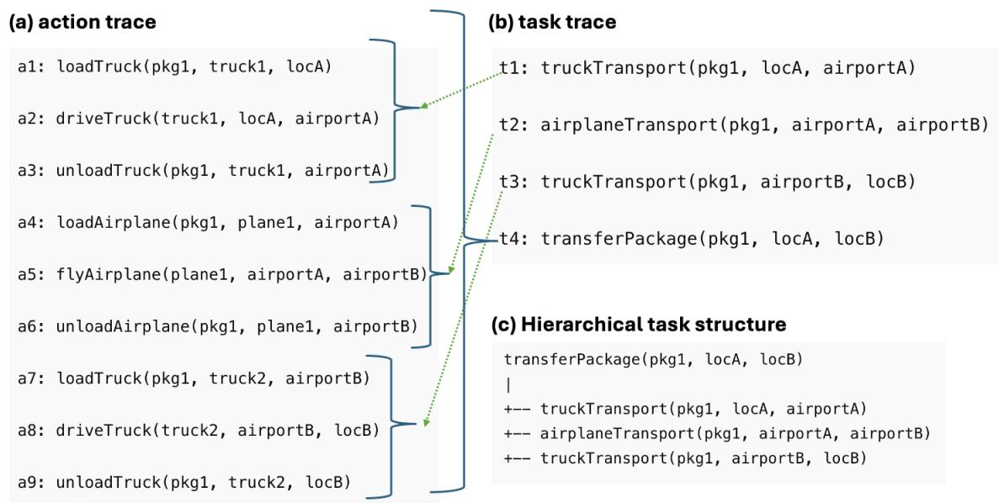
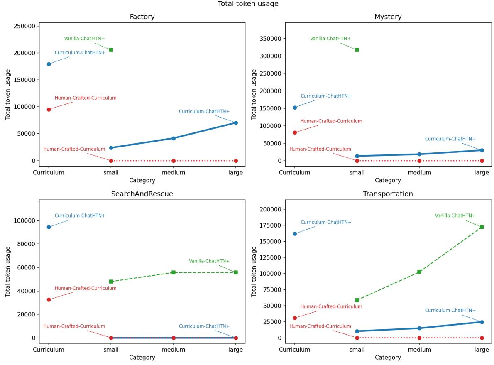

# Curriculum-Guided Acquisition of Hierarchical Task Knowledge from LLM-Generated Experience

Yuesheng Xu

Héctor Muñoz-Avila

YUX220@LEHIGH.EDU

HEM4@LEHIGH.EDU

Computer Science & Engineering, Lehigh University; Bethlehem, PA 18015-3084 USA

## Abstract

Hierarchical task knowledge enables efficient problem solving by allowing previously acquired skills to be reused across tasks and problem instances. In this paper, we investigate curriculumguided acquisition of hierarchical task knowledge in an HTN learning framework. We compare three approaches: online learning during problem solving, human-designed curricula, and an automated curriculum generation procedure that derives learning experiences from verified LLMgenerated solution traces. The proposed procedure solves small training problems with an LLM, extracts task accomplishment information, and transforms it into ordered sequences of state-task learning problems for HTN method acquisition. We evaluate the three approaches across multiple planning domains. The results demonstrate that automatically generated curricula recover much of the benefit of expert-designed curricula while substantially reducing the token cost of online hierarchical knowledge acquisition.

## 1. Introduction

Hierarchical knowledge plays a central role in intelligent behavior. Complex tasks are often solved by decomposing them into simpler subtasks, allowing previously acquired skills to be reused in new situations. This idea has long been studied in cognitive architectures Laird (2019); Langley & Choi (2006), hierarchical reinforcement learning Barto & Mahadevan (2003), and Hierarchical Task Network (HTN) planning Erol et al. (1994). By organizing knowledge at multiple levels of abstraction, hierarchical representations support scalability, transfer, and the acquisition of increasingly complex skills through composition Langley et al. (2006).

The acquisition of such hierarchical structures is a longstanding problem in cognitive systems. An intelligent agent should not only solve individual problems, but also acquire reusable procedural knowledge that supports increasingly complex behavior. In this view, learning a hierarchy involves constructing higher-level skills from simpler problem-solving experiences and reusing previously acquired knowledge in new situations. Thus, hierarchical knowledge acquisition provides a mechanism for the cumulative development of increasingly sophisticated problem-solving capabilities.

An important question concerns how hierarchical knowledge should be acquired. Human learners rarely encounter experiences in arbitrary order. Instead, instruction is often organized around prerequisite skills, with simpler concepts introduced before more complex ones. This observation has motivated research on curriculum learning, which studies how the ordering of learning experiences affects learning efficiency and performance Bengio et al. (2009). While curriculum learning has been studied extensively in machine learning, considerably less attention has been devoted to how LLM-generated experience can be organized to support the acquisition of reusable hierarchical procedural knowledge.

Recent advances in large language models (LLMs) create new opportunities for studying this question. LLMs can generate solutions to planning problems, decompose tasks into subtasks, and provide explanations of intermediate reasoning steps. These capabilities suggest that LLMgenerated experience can be used to automatically construct curricula, reducing the need for manually designed instructional sequences. Because the procedure relies only on task semantics and LLM-generated solution traces, it can be applied across planning domains without manually designing domain-specific curricula.

In this paper, we propose an automated curriculum generation procedure for acquiring hierarchical task knowledge in an HTN learning framework. The procedure derives ordered learning experiences that support the incremental acquisition of reusable hierarchical task knowledge from verified LLM-generated solution traces. It does so by identifying where tasks are accomplished within successful solution traces and transforming them into ordered sequences of state–task learning problems. We compare this approach against two alternatives: online learning during problem solving and human-designed curricula that sequence learning experiences according to expert knowledge of the domain.

We evaluate these approaches across multiple planning domains using two complementary measures: the amount of hierarchical knowledge acquired, measured by the number of learned methods, and the cost of acquiring that knowledge, measured through LLM token consumption. The results show that automatically generated curricula recover much of the benefit of expert-designed curricula while substantially reducing the cost of online hierarchical knowledge acquisition.

## 2. Illustrative Example

To illustrate the proposed curriculum generation procedure, consider a problem in the logistics transportation domain in which a package must be moved from a location in one city to a destination in another city. The domain contains three hierarchical tasks. The task truckTransport moves a package within a city, airplaneTransport moves a package between airports in different cities, and the top-level task transferPackage combines these capabilities to deliver a package to its final destination.

Suppose the system generates a small training problem consisting of an initial state $s _ { 0 }$ and the top-level task

$$
\mathtt { t r a n s f e r P a c k a g e ( p k g 1 , l o c k , l o c B ) . }
$$

Given the primitive operators and task descriptions, the LLM generates a solution trace. Figure 1 shows an example. Panel (a) presents the generated action trace, a plan solving the problem. Panel (b) shows the corresponding task trace, together with mappings indicating the action at which each task is accomplished. For example, the first task,

  
Figure 1. Illustration of the automated curriculum generation procedure. (a) Action trace generated by the LLM for a small transportation problem. (b) Corresponding task trace and (task, action-subsequence) mappings indicating the contiguous subsequence of actions over which each task is executed. (c) Hierarchical task structure of the top-level task.

$$
t _ { 1 } = \mathrm { t r u c k T r a n s p o r t } \ ( \mathrm { p k g 1 } , \mathrm { l o c k } , \mathrm { a i r p o r t } \mathrm { \textmu _ { A } } ) ,
$$

is completed by action $a _ { 3 } .$ , while the second task,

$$
t _ { 2 } = \mathrm { a i r p l a n e T r a n s p o r t } \left( \mathrm { p k g 1 } , \mathrm { a i r p o r t a } , \mathrm { a i r p o r t B } \right) ,
$$

is completed by action $a _ { 6 }$ . Panel (c) depicts the hierarchical task structure for the problem.

The task-to-action mappings are used to construct a curriculum consisting of state-task pairs. Let $s _ { i }$ denote the state obtained after executing actions $a _ { 1 } , \ldots , a _ { i }$ . The first curriculum problem is

$$
\big ( s _ { 0 } , \mathtt { t r u c k T r a n s p o r t ( p k g 1 , l o c a l , a i r p o r t a ) } \big ) .
$$

Since this task is completed by action $a _ { 3 } .$ , the resulting state is $s _ { 3 }$ . The second curriculum problem is therefore

$$
\scriptstyle ( s _ { 3 } , \mathtt { a i r p l a n e T r a n s p o r t } ( { \mathtt { p k g l } } , \mathtt { a i r p o r t a } , \mathtt { a i r p o r t B } ) ) .
$$

Similarly, because the second task is completed by action $a _ { 6 } .$ , the next curriculum problem is

$$
\big ( s _ { 6 } , \mathtt { t r u c k T r a n s p o r t ( p k g 1 , a i r p o r t B , l o c B ) } \big ) .
$$

The final curriculum problem is

```prolog
(s<sub>0</sub>, transferPackage(pkg1,locA,locB)).
```

The resulting curriculum introduces tasks in the order in which they are required by a successful solution. The HTN learning algorithm is trained on these generated problems sequentially, allowing prerequisite methods to be acquired before attempting more complex tasks.

## 3. Hierarchical Task Network Planning

Hierarchical Task Network (HTN) planning represents problem-solving knowledge using tasks, operators, and methods Erol et al. (1994). Tasks correspond to activities that the system seeks to accomplish. Primitive tasks are implemented directly by operators, whereas compound tasks must be decomposed into simpler subtasks through methods.

An operator specifies how a primitive task changes the state of the world. For example, in the Transportation domain, the operator

```javascript
loadTruck(pkg1, truck1, locA)
```

loads a package into a truck at a location. Operators are associated with preconditions that must hold before execution and effects that describe how the state changes after execution.

Methods specify how compound tasks can be achieved. For example, the task

transferPackage(pkg1, locA, locB)

may be decomposed into the sequence

truckTransport(pkg1, locA, airportA)   
airplaneTransport(pkg1, airportA, airportB)   
truckTransport(pkg1, airportB, locB)

which first transports the package to an airport, then flies it between cities, and finally delivers it to its destination.

Planning proceeds by repeatedly selecting tasks. Primitive tasks are executed through operators, while compound tasks are decomposed through applicable methods. This process continues until all remaining tasks are primitive and a complete executable plan is produced. The resulting hierarchy captures reusable procedural knowledge that can be applied across multiple problem instances.

Tasks are also associated with semantic descriptions. Following HTN-MAKER Hogg et al. (2008), each task is annotated with preconditions and effects that characterize when the task can be achieved and the state changes it is intended to produce. These annotations enable symbolic reasoning over compound tasks, including verification of task accomplishment, state projection, and method learning.

## 4. Learning Hierarchical Knowledge with ChatHTN+

The curriculum learning experiments in this paper use CHATHTN<sup>+</sup> Xu & Munoz-Avila (2025), an HTN learning framework that combines symbolic planning with large language models. The system initially contains the primitive operators of a domain but no methods. Consequently, compound tasks cannot be decomposed using domain-specific hierarchical knowledge.

When the planner encounters a compound task for which no applicable method exists, it queries an LLM to generate a candidate decomposition. Unlike earlier versions of the framework that restricted decompositions to primitive actions, the version used in this paper allows generated decompositions to contain both primitive and compound tasks. This enables the acquisition of hierarchical abstractions at multiple levels of granularity.

Generated decompositions are validated using the semantic descriptions of tasks and operators. If a decomposition can be successfully incorporated into a solution, the system learns a new HTN method that captures the decomposition and adds it to its knowledge base. Learned methods are subsequently reused when solving future problems.

As planning and learning proceed, the method set grows incrementally, allowing the system to acquire increasingly complex hierarchical knowledge. The central question considered in this paper is how different curriculum-generation strategies influence the efficiency with which this knowledge is acquired.

## 5. Automated Curriculum Generation

## 5.1 Overview

The automated curriculum generation procedure takes as input a set of tasks $T ,$ , a set of operators O, and the desired number of training problems n (line 1 of Algorithm 1). Its output is a curriculum C consisting of state-task pairs that can be used to train an HTN learning algorithm (line 2).

The procedure repeatedly generates small random training problems and queries an LLM for solution traces. The generated traces are then validated using the semantic descriptions of tasks and operators. From each verified trace, the procedure extracts task accomplishment information and constructs a sequence of state-task pairs. These pairs are added to the curriculum and subsequently used to train the HTN learning algorithm. Figure 1 illustrates this process for a transportation problem.

## 5.2 From Solution Traces to Learning Experiences

Algorithm 1 generates a curriculum C from a collection of randomly generated training problems. The curriculum is initialized to the empty sequence at line 3. For each iteration (line 4), a random small problem $( s _ { 0 } , t )$ is generated (line 5), where t is a top-level task in T and $s _ { 0 }$ is a randomly generated initial state. The LLM is then queried to produce an explicitly indexed trace of primitive actions $\tilde { \boldsymbol { a } } = [ ( 1 , a _ { 1 } ) , \ldots , ( k , a _ { k } ) ]$ , an explicitly indexed trace of compound tasks in depth-first order $\tilde { t } = [ ( 1 , t _ { 1 } ) , \dots , ( l , t _ { l } ) ]$ , and an interval mapping $\mu$ (line $6 )$ . This mapping assigns each task index to the contiguous interval of action indices that realize it. Specifically, for a task index $i , \mu ( i ) =$ $( j _ { \mathrm { s t a r t } } , j _ { \mathrm { e n d } } )$ indicates that task $t _ { i }$ begins at action index $j _ { \mathrm { s t a r t } }$ and is accomplished immediately after executing action $a _ { j _ { \mathrm { e n d } } }$

Algorithm 1 GenerateCurriculum   
1: Input: Tasks $^ { \overline { { \mathbf { \alpha } } } } { } _ { \overline { { \mathbf { \alpha } } } } \mathbf { \alpha } _ { T } ^ { } ,$ operators $O ,$ number of training problems n   
2: Output: Curriculum $C$   
3: $C \gets ( )$   
4: for $i = 1$ to $n$ do   
5: Generate random small problem $( s _ { 0 } , t )$ with $t \in T$   
6: $( \widetilde a , \widetilde t , \mu ) \gets \mathrm { L L M } ( s _ { 0 } , t , T , O )$   
7: if VERIFY $( \tilde { a } , O , s _ { 0 } , t )$ then   
8: s˜ ← PROJECT $\cdot ( s _ { 0 } , \tilde { a } , O )$   
9: for all $( t ^ { \prime } , a ) \in \mu$ do   
10: let $s \in \tilde { s }$ be the state immediately after a   
11: Add $( s , t ^ { \prime } )$ to $C$   
12: end for   
13: Add $( s _ { 0 } , t )$ to $C$   
14: end if   
15: end for   
16: return $C$

Before a curriculum is generated, the returned action trace is validated using the operators (line 7). Verification symbolically executes a˜ from $s _ { 0 }$ and checks that all operator applications satisfy their preconditions and effects. The resulting state is then checked against the semantic description of the top-level task t to ensure that the generated solution indeed accomplishes the requested task. Only traces that satisfy these checks are retained for curriculum generation.

From a single validated plan we then derive one problem/task pair $( s , t ^ { \prime } )$ for every compound task $t ^ { \prime }$ in the task trace. Each pair is obtained by replaying the plan once from the original initial state $s _ { 0 }$ and reading off, from the task-to-action mapping, the state s that holds immediately before the actions realizing $t ^ { \prime }$ begin. A single top-level problem thus fans out into a set of problem/task pairs, each posing one compound task to be solved from the state the top-level plan reached it in. The pairs are ordered by the level of their task in the decomposition, from the lowest-level compound tasks (those that decompose directly into primitive sub-tasks) up to the original top-level task. This sequence defines a curriculum built on cumulative difficulty, ensuring that complex tasks are only attempted once their constituent parts are no longer a barrier. Thus, when a higher-level task is learned, the methods for the subtasks it depends on have already been acquired and stored in memory.

After generating curriculum problems for all mappings, the original training problem $( s _ { 0 } , t )$ is added as the final curriculum problem (line 13). This allows the learner to attempt the top-level task after acquiring experience for the constituent tasks that appear in its solution. The complete curriculum is returned at line 16.

The generated curriculum is presented sequentially to the HTN learning algorithm. Because curriculum problems are generated from task accomplishments along a successful solution trace, tasks are introduced in the order in which they are required by that solution. Consequently, the resulting curriculum captures prerequisite relationships implicit in the solution trace without requiring manual curriculum design.

## 6. Empirical Evaluation

## 6.1 Domains

We conduct an empirical evaluation across four planning domains. These include the IPC Factory domain Behnke et al. (2021), two classic planning environments: Transportation and SearchAndRescue, and Mystery. Mystery is a semantically obfuscated domain that mirrors the underlying logic of Transportation but substitutes standard vocabulary with random lexical equivalents. Mystery evaluates whether the proposed approach can acquire and exploit hierarchical task knowledge when semantic cues from domain and predicate names are unavailable, forcing the LLM to rely on the provided task and operator descriptions rather than familiar planning terminology.

## 6.2 Setup

We evaluate three configurations that share the same HTN planner (ChatHTN+), the same underlying domains, and the same test problems, differing only in whether and how the domain knowledge is acquired before testing.

The first configuration is our curriculum approach, which learns a set of reusable, HTN methods from tiny scale problems. The resulting domain knowledge is evaluated on small, medium, and large testing problems.

The second configuration is a human-crafted baseline: rather than generating problems and querying LLM to solve them automatically, a human expert supplies a compact set of problem/task pairs that is already sufficient to induce the complete domain knowledge. The system learns from this curated set and is then tested on the identical small, medium, and large problems.

The third configuration is standard CHATHTN<sup>+</sup> with empty-memory that begins with no methods at all. CHATHTN<sup>+</sup> is run directly on the small, medium, and large test problems and is forced to learn methods on demand, decomposing each problem from the top-level task downward whenever no applicable method exists in memory. Consequently, knowledge acquisition and problem solving occur simultaneously throughout testing.

We report the comparison of these three configurations across all four domains.

The system parameter for the prompt limit was configured to a maximum of 30. Table 1 reports the average number of state axioms per problem instance for each domain and problem-size category (curriculum, small, medium, large).

## 6.3 Empirical Results

Figure 2 reports the total token consumption for the three learning configurations across the four planning domains. The first category ("Curriculum") corresponds to the cost of acquiring hierarchical task knowledge before testing. The remaining categories report the token consumption incurred while solving the test problems.

Table 1. Average number of state axioms per problem, by domain and problem size.
<table><tr><td>Domain</td><td>Curriculum</td><td>Small</td><td>Medium</td><td>Large</td></tr><tr><td>Factory</td><td>54</td><td>442</td><td>1042</td><td>2082</td></tr><tr><td>Mystery</td><td>54</td><td>406</td><td>806</td><td>1606</td></tr><tr><td>SearchAndRescue</td><td>32</td><td>308</td><td>408</td><td>608</td></tr><tr><td>Transportation</td><td>54</td><td>406</td><td>806</td><td>1606</td></tr></table>

Curriculum-ChatHTN+ incurs an upfront cost because it acquires reusable HTN methods before testing. Once these methods have been learned, they can be reused across subsequent problem instances, substantially reducing the need for additional LLM queries

Our experimental results indicate that without curriculum learning, the baseline Vanilla-ChatHTN+ is only capable of solving relatively simple domains, such as Transportation and SearchAndRescue. The primary limitation of this system lies in its heavy reliance on the LLM at every task decomposition occurring during planning. Specifically, at any given state for a specific task, the queried LLM must generate a decomposition that is accurate not only locally, but also globally. Although the LLM typically generates locally appropriate decompositions to resolve these localized task decompositions when queried with small-scale subproblems. However, this localized querying strategy introduces a critical vulnerability: the LLM will occasionally propose decompositions that are locally valid but globally flawed.

If the planner traverses an incorrect path and reaches a dead-end state, the system is forced to backtrack. Because the exact point of failure is unknown, the system must exhaustively backtrack step-by-step, necessitating repeated LLM queries until the initial mistake is identified. As the problem scale increases, these missteps lead the planner deeper into extended erroneous paths, making recovery increasingly difficult and resource-intensive. Because these incorrect paths can be arbitrarily long, Vanilla-ChatHTN+ failed on medium and large problem sizes in the Factory and Mystery domains after exceeding the maximum allowable prompt threshold. Consequently, for complex domains, Vanilla-ChatHTN+ struggles to solve the entire domain starting strictly from a top-level task.

In contrast, our proposed method, Curriculum-ChatHTN+, successfully learns the vast majority of necessary HTN methods during its training phase. Any remaining unrepresented edge cases can be effectively handled by the online learning mechanism of ChatHTN+ when specific problems are encountered during testing. Expectedly, Curriculum-ChatHTN+ incurs a substantial initial overhead during the curriculum learning stage, which is inevitable when aiming to acquire a relatively complete domain model from scratch in a general domain.

In the two simpler domains, Curriculum-ChatHTN+ consumes a higher total number of tokens because the system must pay this initial overhead—specifically, utilizing the LLM as a planner to solve minimal-scale problems, which dominates a significant portion of the overall cost. However, in the two complex domains, Curriculum-ChatHTN+ utilizes a comparable or even lower number of tokens on small-scale test problems. This improved efficiency arises because the token cost required to learn a method during the curriculum learning stage is significantly lower than the cumulative cost incurred by online learning and backtracking during the testing phase.

Finally, The human-designed curriculum provides a reference point that approximates the best achievable curriculum for these domains. It empirically verifies the existence of a specific set of problem/task pairs from which complete domain knowledge can be seamlessly acquired. By leveraging these hand-crafted problem/task pairs, the system extracts all necessary methods prior to testing. As a result, across all domains and problem scales, this approach entirely eliminates the need for further LLM queries during execution. However, achieving this optimal performance comes at the steep cost of requiring extensive domain expertise and significant human effort to manually author the optimal curriculum.

  
Figure 2. Total token usage across the Factory, Mystery, SearchAndRescue, and Transportation domains. Curriculum-ChatHTN+ incurs an initial overhead during the curriculum learning stage, but this structured approach is essential for acquiring complete domain knowledge. Without it, Vanilla-ChatHTN+ fails on medium and large problems in complex situations. The human-crafted baseline serves as the theoretical upper bound for curriculum learning.

The experimental results demonstrate that automatically generated curricula recover much of the benefit of expert-designed curricula while dramatically reducing the cost of online hierarchical knowledge acquisition.

Beyond the number and acquisition cost of the learned methods, the results also provide evidence of their utility as reusable procedural knowledge. Curriculum-ChatHTN+ acquires its methods from tiny training problems and subsequently reuses them to solve independently generated test problems at small, medium, and large scales. Thus, the acquired knowledge is not specific to the training instances from which it was learned. In particular, successful reuse on larger test problems demonstrates that the learned methods generalize across problem instances and problem scales. Moreover, the reduced need for additional LLM queries during testing shows that this knowledge can be applied directly to new problems rather than requiring substantial relearning.

## 7. Related Work

## 7.1 HTN Learning

Research on the acquisition of hierarchical planning knowledge has a long history in AI and cognitive systems. Early cognitive architectures such as ICARUS Langley et al. (2005) emphasized the learning and use of hierarchically organized procedural knowledge, motivated by the observation that complex tasks can often be solved more efficiently through recursive decomposition into reusable skills. More generally, researchers have argued that hierarchical knowledge plays a central role in intelligent behavior because it reduces search, supports transfer across tasks, and provides interpretable representations of problem-solving expertise Langley (2025). These ideas strongly influenced subsequent research on hierarchical planning, including HTN planning, where procedural knowledge is represented explicitly as methods.

Within the HTN framework, research has investigated the automatic acquisition of hierarchical planning knowledge from demonstrations, execution traces, problem-solving experience, and domain descriptions. HTN-MAKER Hogg et al. (2008, 2016) learns methods by analyzing solution traces together with semantically annotated tasks. Subsequent work extended HTN learning to partially observed traces Zhuo et al. (2009, 2014), case-based learning Ilghami et al. (2002), probabilistic HTNs Li et al. (2010). Collectively, these approaches seek to reduce the knowledgeengineering burden associated with manually constructing HTN methods by learning them from different forms of experience.

Beyond learning individual HTN methods, several researchers have investigated the automatic discovery of hierarchical task structures themselves. Word2HTN Gopalakrishnan et al. (2016) combines distributional semantic representations and goal reasoning to infer task hierarchies from solution traces, while landmark-based approaches use planning structure to guide method acquisition Fine-Morris et al. (2020). More recently, CURRICULAMA Li et al. (2024) introduced a curriculum-based approach to HTN learning. CURRICULAMA extracts planning landmarks from classical planning problems and uses them to generate curricula that progressively introduce increasingly complex learning problems. The resulting curricula are then used to guide HTN-MAKER’s method-learning process.

In most of these systems, the focus is on the learning algorithm itself, whereas the organization of learning experiences is either predetermined or treated as secondary.

Our work is complementary to these approaches. Rather than proposing a new HTN-learning algorithm, we investigate how the acquisition process itself can be organized more efficiently. In particular, we focus on automatically constructing learning curricula from verified LLM-generated solution traces. Whereas CURRICULAMA derives curricula from symbolic analyses of planning problems, our approach derives them from successful LLM-generated execution traces, transforming task accomplishment information into ordered state–task learning problems that support the acquisition of reusable HTN methods. Thus, the curriculum is induced directly from problem-solving experience rather than from symbolic analyses such as landmark extraction.

Although previous work has explored a variety of mechanisms for acquiring hierarchical planning knowledge, comparatively little attention has been devoted to the cost of knowledge acquisition itself. Existing evaluations have typically emphasized planning performance, convergence, or the number of learned methods. In contrast, our work explicitly investigates the efficiency of hierarchical knowledge acquisition by measuring the LLM token expenditure required to construct reusable hierarchical knowledge under different curriculum-generation strategies.

## 7.2 LLMs for Planning and Knowledge Acquisition

Recent advances in large language models have renewed interest in their use for planning, reasoning, and knowledge acquisition. Some approaches employ LLMs directly as planners, using prompting strategies to generate plans, reason about action sequences, or decompose problems into intermediate steps. Representative examples include Chain-of-Thought prompting Wei et al. (2022), ReAct Yao et al. (2022), Plan-and-Solve Wang et al. (2023), Tree-of-Thoughts Yao et al. (2023), and Reasoning via Planning (RAP) Hao et al. (2023). These systems demonstrate that LLMs can perform impressive forms of planning and reasoning, particularly in domains that require substantial commonsense or semantic knowledge.

Other research has combined LLMs with symbolic planning systems. Such approaches use symbolic representations to constrain, verify, or refine LLM-generated solutions. Examples include systems that integrate LLMs with classical planners, task planners, robotic controllers, and agent architectures. These hybrid approaches seek to combine the flexibility of LLMs with the reliability and interpretability of symbolic reasoning. More generally, these systems illustrate the complementary strengths of LLMs and symbolic reasoning: LLMs provide flexible knowledge acquisition and generation, whereas symbolic systems provide verification, search, and execution guarantees.

A particularly relevant line of research uses LLMs not merely as planners but as sources of reusable planning knowledge. Recent work has investigated the automatic generation of action models, planning operators, task decompositions, procedural knowledge, and HTN methods from natural language descriptions and problem-solving traces Tantakoun et al. (2025). These efforts suggest that LLMs can serve as knowledge-acquisition mechanisms capable of producing symbolic structures that can subsequently be validated and reused.

ChatHTN+ Xu & Munoz-Avila (2025) combines HTN planning with LLM-generated task decompositions and online method learning. By validating generated decompositions against symbolic task semantics, the framework transforms verified LLM-generated decompositions into reusable

HTN methods that accumulate over successive planning episodes. However, the system acquires methods opportunistically, learning them only when they are first required during search. The present work builds directly on this capability by investigating how automatically generated curricula can organize these learning experiences before testing begins.

Existing work has focused primarily on using LLMs either to solve planning problems or to generate reusable planning knowledge. In contrast, we treat verified LLM-generated solution traces as a source of experience from which learning curricula can be constructed automatically. Rather than learning directly from isolated decompositions or demonstrations, we transform LLM-generated solution traces into ordered sequences of state–task learning problems that support the efficient acquisition of reusable hierarchical task knowledge.

## 7.3 Curriculum Learning

Curriculum learning studies how the ordering of learning experiences influences learning efficiency and performance. Inspired by the observation that humans often acquire skills through structured instruction, Bengio et al. Bengio et al. (2009) proposed presenting training examples in a meaningful order, typically progressing from simpler concepts to more complex ones. Since then, curriculum learning has been investigated extensively in machine learning, where it has been shown to accelerate convergence, improve generalization, and facilitate the acquisition of difficult concepts. This observation is particularly relevant for hierarchical learning settings, where higher-level skills often depend on the prior acquisition of simpler procedural knowledge.

A central theme in this literature is the automatic generation of curricula. Rather than relying on manually designed training sequences, researchers have proposed methods that derive curricula from measures of task difficulty, estimates of learner competence, learning progress, or other properties of the learning process Wang et al. (2021). Closely related work on self-paced learning allows a learner to determine the order in which experiences are acquired, typically favoring examples that are neither too easy nor too difficult Kumar et al. (2010).

Curriculum learning has also been studied in reinforcement learning, skill acquisition, and developmental robotics. In these settings, curricula are often used to organize the acquisition of increasingly complex behaviors by introducing prerequisite skills before more complex skills Narvekar et al. (2020). Such approaches are motivated by the observation that complex behavior frequently depends on the successful acquisition of simpler skills, making the ordering of experiences an important factor in learning efficiency.

Our work differs from traditional curriculum-learning approaches in several respects. First, unlike most curriculum-learning approaches, which aim to improve the optimization of statistical models, our objective is to improve the efficiency of acquiring reusable symbolic procedural knowledge. Second, the curriculum is derived from verified LLM-generated experience. Third, the curriculum is constructed from task accomplishment information embedded within solution traces, allowing prerequisite relationships among tasks to be extracted automatically from successful problem-solving episodes. Finally, rather than evaluating curricula solely in terms of learning performance, we explicitly study their effect on the efficiency of hierarchical knowledge acquisition through LLM token consumption. Consequently, the proposed approach combines ideas from curriculum learning, hierarchical knowledge acquisition, and LLM-based planning.

# FORMATTING INSTRUCTIONS

## 8. Conclusion

Hierarchical task knowledge enables intelligent systems to accumulate procedural knowledge that can be reused across increasingly complex problems. In this paper, we investigated how such knowledge can be acquired efficiently through curriculum-guided learning. We introduced an automated curriculum generation procedure that transforms verified LLM-generated solution traces into ordered sequences of state–task learning problems. These learning experiences are subsequently used by an HTN learning algorithm to acquire reusable methods before encountering more challenging problems.

Our empirical evaluation compared automated curricula with both human-designed curricula and purely online learning. Across four planning domains, the results showed that automatically generated curricula recover much of the benefit of expert-designed curricula while substantially reducing the token cost of online hierarchical knowledge acquisition. In the more complex domains, curriculum-guided learning also enabled the acquisition of hierarchical knowledge that could not be obtained reliably through online learning alone because of the prohibitive cost of repeated LLM queries and backtracking.

More broadly, the results suggest that LLMs can play a role beyond serving as problem solvers or decomposition generators. Their generated solutions can be treated as a source of experience from which reusable symbolic knowledge is systematically acquired. This perspective opens new opportunities for combining generative AI with symbolic learning systems, allowing LLM-generated experience to support the cumulative acquisition of hierarchical procedural knowledge.

Several directions remain for future research. The current work assumes that curricula are generated from collections of randomly generated small training problems. An interesting direction is to generate these problems adaptively, selecting new training problems based on the learner’s current knowledge and remaining deficiencies. Another direction is to investigate alternative criteria for constructing curricula from solution traces, including measures of task dependency, method utility, or expected learning benefit. Finally, although our experiments focused on HTN learning, the general idea of deriving curricula from verified LLM-generated experience may also apply to other forms of symbolic knowledge acquisition.

## Acknowledgements

This material is related to work supported by the National Science Foundation under Grant No. 2628497. Any opinions, findings, and conclusions or recommendations expressed in this material are those of the author(s) and do not necessarily reflect the views of the National Science Foundation.

## References

Barto, A. G., & Mahadevan, S. (2003). Recent advances in hierarchical reinforcement learning. Discrete event dynamic systems, 13, 341–379.

Behnke, G., Höller, D., & Bercher, P. (Eds.). (2021). Proceedings of the 10th international planning competition: Planner and domain abstracts – hierarchical task network (htn) planning track

(ipc 2020). From https://ipc2020.hierarchical-task.net/publications/ IPC2020Booklet.pdf. Published online.

Bengio, Y., Louradour, J., Collobert, R., & Weston, J. (2009). Curriculum learning. Proceedings of the 26th annual international conference on machine learning (pp. 41–48).

Erol, K., Hendler, J., & Nau, D. S. (1994). Htn planning: Complexity and expressivity. AAAI (pp. 1123–1128).

Fine-Morris, M., Auslander, B., Floyd, M. W., Pennisi, G., Muñoz-Avila, H., & Gupta, E. K. M. (2020). Learning hierarchical task networks with landmarks and numeric fluents by combining symbolic and numeric regression. Proceedings of the 8th Annual Conference on Advances in Cognitive Systems.

Gopalakrishnan, S., Munoz-Avila, H., & Kuter, U. (2016). Word2htn: Learning task hierarchies using statistical semantics and goal reasoning. Proceedings of 4th Workshop on Goal Reasoning (IJCAI’16) (p. 70).

Hao, S., Gu, Y., Ma, H., Hong, J., Wang, Z., Wang, D., & Hu, Z. (2023). Reasoning with language model is planning with world model. Proceedings of the 2023 Conference on Empirical Methods in Natural Language Processing (pp. 8154–8173).

Hogg, C., Munoz-Avila, H., & Kuter, U. (2008). Htn-maker: Learning htns with minimal additional knowledge engineering required. AAAI (pp. 950–956).

Hogg, C., Muñoz-Avila, H., & Kuter, U. (2016). Learning hierarchical task models from input traces. Computational Intelligence, 32, 3–48.

Ilghami, O., Nau, D. S., Munoz-Avila, H., & Aha, D. W. (2002). Camel: Learning method preconditions for htn planning. AIPS (pp. 131–142).

Kumar, M., Packer, B., & Koller, D. (2010). Self-paced learning for latent variable models. Advances in neural information processing systems, 23.

Laird, J. E. (2019). The soar cognitive architecture. MIT press.

Langley, P. (2025). Learning hierarchical task knowledge for planning. Proceedings of the AAAI Conference on Artificial Intelligence (pp. 28652–28656).

Langley, P., & Choi, D. (2006). A unified cognitive architecture for physical agents. Proceedings of the National Conference on Artificial Intelligence (p. 1469). Menlo Park, CA; Cambridge, MA; London; AAAI Press; MIT Press; 1999.

Langley, P., Choi, D., Olsson, R., & Schmid, U. (2006). Learning recursive control programs from problem solving. Journal ofMachine Learning Research, 7.

Langley, P., Choi, D., & Rogers, S. (2005). Interleaving learning, problem-solving, and execution in the icarus architecture. Computational Learning Laboratory, CSLI, Stanford U., Tech. Rep.

Li, N., Cushing, W., Kambhampati, S., & Yoon, S. (2010). Learning probabilistic hierarchical task networks to capture user preferences. arXiv preprint arXiv:1006.0274.

Li, R., Nau, D., Roberts, M., & Fine-Morris, M. (2024). Automatically learning htn methods from landmarks. arXiv preprint arXiv:2404.06325.

Narvekar, S., Peng, B., Leonetti, M., Sinapov, J., Taylor, M. E., & Stone, P. (2020). Curriculum learning for reinforcement learning domains: A framework and survey. Journal of Machine Learning Research, 21, 1–50.

Tantakoun, M., Muise, C., & Zhu, X. (2025). Llms as planning formalizers: A survey for leveraging large language models to construct automated planning models. Findings of the Association for Computational Linguistics: ACL 2025 (pp. 25167–25188).

Wang, L., Xu, W., Lan, Y., Hu, Z., Lan, Y., Lee, R. K.-W., & Lim, E.-P. (2023). Plan-and-solve prompting: Improving zero-shot chain-of-thought reasoning by large language models. Proceedings ofthe 61st annual meeting of the association for computational linguistics (volume 1: long papers) (pp. 2609–2634).

Wang, X., Chen, Y., & Zhu, W. (2021). A survey on curriculum learning. IEEE transactions on pattern analysis and machine intelligence, 44, 4555–4576.

Wei, J., Wang, X., Schuurmans, D., Bosma, M., Ichter, B., Xia, F., Chi, E., Le, Q., & Zhou, D. (2022). Chain-of-thought prompting elicits reasoning in large language models. Advances in Neural Information Processing Systems (NeurIPS) (pp. 24824–24837).

Xu, Y., & Munoz-Avila, H. (2025). Online learning of htn methods for integrated llm-htn planning. arXiv preprint arXiv:2511.12901.

Yao, S., Yu, D., Zhao, J., Shafran, I., Griffiths, T., Cao, Y., & Narasimhan, K. (2023). Tree of thoughts: Deliberate problem solving with large language models. Advances in neural information processing systems, 36, 11809–11822.

Yao, S., Zhao, J., Yu, D., Du, N., Shafran, I., Narasimhan, K., & Cao, Y. (2022). React: Synergizing reasoning and acting in language models. arXiv preprint arXiv:2210.03629.

Zhuo, H. H., Hu, D. H., Hogg, C., Yang, Q., & Munoz-Avila, H. (2009). Learning htn method preconditions and action models from partial observations. IJCAI (pp. 1804–1810).

Zhuo, H. H., Muñoz-Avila, H., & Yang, Q. (2014). Learning hierarchical task network domains from partially observed plan traces. Artificial intelligence, 212, 134–157.