# Evolve on Graph: Self-Evolving Knowledge Graph Reasoning without Question Annotations

Zon<sub>gyu</sub>an S<sub>u</sub>n<sup>1,∗</sup><sub>,</sub> Sh<sub>u</sub>ai Zhao<sup>1,†</sup><sub>,</sub> Ke Sh<sub>u</sub><sup>2,∗</sup><sub>,</sub> Zi<sub>yu</sub>e Zh<sub>u</sub><sup>1</sup><sub>,</sub> Shan<sub>gy</sub>an<sub>g</sub> W<sub>u</sub><sup>1</sup><sub>,</sub> Y<sub>u</sub>anlin Lin<sup>1</sup><sub>,</sub> Tao Wan<sub>g</sub><sup>1</sup><sub>,</sub> S<sup>h</sup>iyue Li<sup>1</sup>, Yingjun Du<sup>3</sup>, An<sup>h</sup> Tuan Luu<sup>4</sup>, Haoran Luo<sup>4,†</sup>

<sup>1</sup>Beijing University o<sup>f</sup> Posts an<sup>d</sup> Te<sup>l</sup>ecommunications, Beijing, C<sup>h</sup>ina <sup>2</sup>University o<sup>f</sup> He<sup>l</sup>sin<sup>k</sup>i, He<sup>l</sup>sin<sup>k</sup>i, Fin<sup>l</sup>an<sup>d</sup> <sup>3</sup>Universit<sub>y</sub> of Amsterdam<sub>,</sub> Amsterdam<sub>,</sub> Netherlands <sup>4</sup>Nan<sub>y</sub>an<sub>g</sub> Technolo<sub>g</sub>ical Universit<sub>y,</sub> Sin<sub>g</sub>a<sub>p</sub>ore <sup>∗</sup>E<sub>q</sub>ual contribution. <sup>†</sup>Corres<sub>p</sub>ondin<sub>g</sub> authors.

Ñ H<sub>omepage</sub> § GitH<sub>u</sub>b M<sub>o</sub>d<sub>e</sub>l

## Abstract

Knowled<sub>g</sub>e <sub>g</sub>ra<sub>p</sub>hs (KGs) <sub>p</sub>rovide reliable external knowled<sub>g</sub>e for multi-ho<sub>p</sub> factual reasonin<sub>g</sub> with lar<sub>g</sub>e lan<sub>g</sub>ua<sub>g</sub>e models (LLMs), <sub>y</sub>et <sub>mos</sub>t KG<sub>s</sub> i<sub>n rea</sub>l<sub>-wor</sub>ld d<sub>oma</sub>i<sub>ns suc</sub>h <sub>as</sub> fi<sub>nance an</sub>d i<sub>n</sub>d<sub>us</sub>t<sub>ry</sub> l<sub>ac</sub>k <sub>q</sub>uestion–answer (QA) annotations. Without such annotations, existin<sub>g</sub> methods stru<sub>gg</sub>le to im<sub>p</sub>rove LLM <sub>g</sub>ra<sub>p</sub>h reasonin<sub>g</sub>: trainin<sub>g</sub>- free a<sub>g</sub>ents cannot im<sub>p</sub>rove their ex<sub>p</sub>loration throu<sub>g</sub>h interaction<sub>;</sub> reinforcement learnin<sub>g</sub> (RL) a<sub>g</sub>ents de<sub>p</sub>end on QA data annotated b<sub>y</sub> h<sub>umans</sub> <sub>or</sub> <sub>syn</sub>th<sub>es</sub>i<sub>ze</sub>d b<sub>y</sub> <sub>c</sub>l<sub>ose</sub>d<sub>-source</sub> <sub>mo</sub>d<sub>e</sub>l<sub>s;</sub> <sub>an</sub>d t<sub>ra</sub>i<sub>n</sub>i<sub>ng</sub> data is t<sub>yp</sub>icall<sub>y</sub> built ofline<sub>,</sub> so its to<sub>p</sub>olo<sub>gy</sub> mix is fixed and cannot follow the agent’s ability. We propose Evolve on Graph (EoG), a f<sub>ramewor</sub>k th<sub>a</sub>t l<sub>e</sub>t<sub>s an</sub> LLM <sub>se</sub>lf<sub>-evo</sub>l<sub>ve</sub> it<sub>s grap</sub>h <sub>reason</sub>i<sub>ng w</sub>ith<sub>-</sub> out any QA annotations. Through Graph Self-Play, a single LLM alternates bet<sub>w</sub>een a Pro<sub>p</sub>oser that <sub>p</sub>oses <sub>qu</sub>estions and a Sol<sub>v</sub>er th<sub>a</sub>t <sub>answers</sub> th<sub>em.</sub> T<sub>o ma</sub>k<sub>e ques</sub>ti<sub>ons ver</sub>ifi<sub>a</sub>bl<sub>e,</sub> S<sub>ym</sub>b<sub>o</sub>li<sub>ca</sub>ll<sub>y</sub> V<sub>er-</sub> ifiable To<sub>p</sub>olo<sub>gy</sub> S<sub>y</sub>nthesis (SVTS) sam<sub>p</sub>les reasonin<sub>g</sub> to<sub>p</sub>olo<sub>g</sub>ies on the KG and executes the corres<sub>p</sub>ondin<sub>g</sub> first-order lo<sub>g</sub>ic <sub>q</sub>ueries<sub>,</sub> <sub>y</sub>ieldin<sub>g</sub> to<sub>p</sub>olo<sub>gy</sub> skeletons with correct and com<sub>p</sub>lete answer sets<sub>;</sub> <sub>gu</sub>id<sub>e</sub>d b<sub>y</sub> <sub>a</sub> <sub>s</sub>k<sub>e</sub>l<sub>e</sub>t<sub>on,</sub> th<sub>e</sub> P<sub>roposer</sub> <sub>exp</sub>l<sub>ores</sub> th<sub>e</sub> <sub>grap</sub>h t<sub>o</sub> <sub>pose</sub> <sub>a</sub> <sub>mu</sub>lti<sub>-</sub>h<sub>op</sub> <sub>ques</sub>ti<sub>on.</sub> T<sub>o</sub> l<sub>e</sub>t t<sub>as</sub>k t<sub>opo</sub>l<sub>og</sub>i<sub>es</sub> f<sub>o</sub>ll<sub>ow</sub> th<sub>e</sub> S<sub>o</sub>l<sub>ver,</sub> <sub>a</sub> Bo<sub>u</sub>ndar<sub>y</sub>-A<sub>w</sub>are Gra<sub>p</sub>h C<sub>u</sub>rric<sub>u</sub>l<sub>u</sub>m re<sub>w</sub>ards the Pro<sub>p</sub>oser b<sub>y</sub> the Solver’s score variance<sub>,</sub> kee<sub>p</sub>in<sub>g</sub> <sub>q</sub>uestions at the Solver’s ca<sub>p</sub>abilit<sub>y</sub> boundar<sub>y</sub> so that com<sub>p</sub>lex to<sub>p</sub>olo<sub>g</sub>ies enter trainin<sub>g</sub> as the Solver im<sub>p</sub>ro<sub>v</sub>es. On six benchmarks o<sub>v</sub>er Freebase<sub>,</sub> Wikidata<sub>,</sub> and an industrial KG<sub>,</sub> EoG consistentl<sub>y</sub> out<sub>p</sub>erforms <sub>p</sub>rom<sub>p</sub>tin<sub>g</sub>-<sub>,</sub> retrieval-<sub>,</sub> and a<sub>g</sub>ent-based methods<sub>,</sub> showin<sub>g</sub> that LLM <sub>g</sub>ra<sub>p</sub>h reasonin<sub>g</sub> can improve through self-play without QA annotations. Our code is available at htt<sub>p</sub>s://<sub>g</sub>ithub.com/Sz<sub>y</sub>5/EoG.

## CCS Concepts

• Information systems → Question answering; • Computing methodologies → Semantic networks.

## Keywords

Knowled<sub>g</sub>e Gra<sub>p</sub>h<sub>,</sub> Lar<sub>g</sub>e Lan<sub>g</sub>ua<sub>g</sub>e Models<sub>,</sub> A<sub>g</sub>entic Reasonin<sub>g,</sub> Self-Pla<sub>y,</sub> Gra<sub>p</sub>h Reasonin<sub>g</sub>

## 1 Introduction

Lar<sub>g</sub>e lan<sub>g</sub>ua<sub>g</sub>e models (LLMs) [46] have shown remarkable abilities across a wide ran<sub>g</sub>e of natural lan<sub>g</sub>ua<sub>g</sub>e <sub>p</sub>rocessin<sub>g</sub> tasks [51, 53], <sub>y</sub>et in com<sub>p</sub>lex reasonin<sub>g</sub> that re<sub>q</sub>uires dee<sub>p,</sub> multi-ho<sub>p,</sub> and struct<sub>ure</sub>d f<sub>ac</sub>t<sub>ua</sub>l k<sub>now</sub>l<sub>e</sub>d<sub>ge,</sub> th<sub>ey</sub> <sub>rema</sub>i<sub>n</sub> li<sub>m</sub>it<sub>e</sub>d b<sub>y</sub> i<sub>nsu</sub>fi<sub>c</sub>i<sub>en</sub>t <sub>cover-</sub> a<sub>g</sub>e of lon<sub>g</sub>-tail knowled<sub>g</sub>e and b<sub>y</sub> factual hallucinations [12].

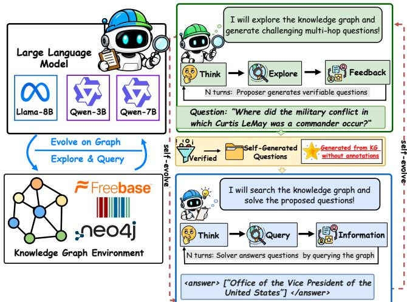  
Figure 1: With only a KG and no question annotations, EoG lets an LLM self-evolve by proposing questions verified on the graph and then learning to solve them.

Knowled<sub>g</sub>e <sub>g</sub>ra<sub>p</sub>hs (KGs) [31] store lar<sub>g</sub>e-scale structured facts <sub>an</sub>d <sub>prov</sub>id<sub>e</sub> <sub>re</sub>li<sub>a</sub>bl<sub>e</sub> <sub>ex</sub>t<sub>erna</sub>l k<sub>now</sub>l<sub>e</sub>d<sub>ge</sub> f<sub>or</sub> LLM <sub>reason</sub>i<sub>ng,</sub> b<sub>u</sub>t thi<sub>s</sub> <sub>requ</sub>i<sub>res</sub> th<sub>e</sub> LLM t<sub>o</sub> l<sub>oca</sub>t<sub>e</sub> th<sub>e</sub> f<sub>ac</sub>t<sub>s</sub> <sub>nee</sub>d<sub>e</sub>d <sub>a</sub>t <sub>eac</sub>h <sub>reason</sub>i<sub>ng</sub> ste<sub>p</sub> in a lar<sub>g</sub>e and hetero<sub>g</sub>eneous <sub>g</sub>ra<sub>p</sub>h. Research on this <sub>p</sub>roblem has moved from one-shot <sub>g</sub>ra<sub>p</sub>h retrieval [7, 16, 18, 28, 29] toward multi-turn <sub>g</sub>ra<sub>p</sub>h ex<sub>p</sub>loration (Fi<sub>g</sub>ure 2). Trainin<sub>g</sub>-free a<sub>g</sub>ents [4, 38, 43, 54] <sub>p</sub>rom<sub>p</sub>t a frozen LLM to select relations and entities ste<sub>p</sub> b<sub>y</sub> ste<sub>p</sub>, while RL-based a<sub>g</sub>ents [10, 21, 36, 56] treat the KG as an interactive environment and train the ex<sub>p</sub>loration <sub>p</sub>olic<sub>y</sub> on <sub>q</sub>uestion–answer data with reinforcement learnin<sub>g</sub> (RL). However, most KGs in real-world settin<sub>g</sub>s such as industr<sub>y</sub> and healthcare [20, 71] come without an<sub>y</sub> <sub>q</sub>uestion–answer annotations, and their data often cannot be handed to closed-source models [44]. This raises a question: can an LLM improve its graph reasoning on a KG using only the KG itself, without any question–answer annotations?

An<sub>swe</sub>rin<sub>g</sub> thi<sub>s ques</sub>ti<sub>o</sub>n<sub>, e</sub>xi<sub>s</sub>tin<sub>g</sub> m<sub>e</sub>th<sub>o</sub>d<sub>s s</sub>till f<sub>ace</sub> thr<sub>ee c</sub>h<sub>a</sub>llenges. (1) The exploration ability of training-free agents cannot improve through interaction. Training-free agents need no annotations and can be a<sub>pp</sub>lied to a new KG directl<sub>y,</sub> b<sub>u</sub>t their ex-<sub>p</sub>l<sub>ora</sub>ti<sub>on</sub> <sub>s</sub>t<sub>ra</sub>t<sub>egy</sub> i<sub>s</sub> fi<sub>xe</sub>d b<sub>y</sub> th<sub>e</sub> <sub>promp</sub>t <sub>an</sub>d th<sub>e</sub> f<sub>rozen</sub> b<sub>ac</sub>kb<sub>one,</sub> so the<sub>y</sub> cannot accumulate ex<sub>p</sub>erience from interactin<sub>g</sub> with the <sub>grap</sub>h<sub>,</sub> <sub>an</sub>d th<sub>e</sub>i<sub>r</sub> <sub>per</sub>f<sub>ormance</sub> d<sub>rops</sub> <sub>s</sub>h<sub>arp</sub>l<sub>y</sub> <sub>on</sub> <sub>sma</sub>ll <sub>open-source</sub> models [6, 47]. (2) Training data rely on human annotation or closed-source models. RL-based agents need large amounts of <sub>q</sub>uestion–answer data: human annotation [9, 17, 42, 62, 69] re-<sub>qu</sub>i<sub>res</sub> <sub>exper</sub>t<sub>s</sub> f<sub>am</sub>ili<sub>ar</sub> <sub>w</sub>ith th<sub>e</sub> KG <sub>sc</sub>h<sub>ema</sub> <sub>an</sub>d h<sub>as</sub> t<sub>o</sub> b<sub>e</sub> <sub>re</sub>d<sub>one</sub> for ever<sub>y</sub> new KG, while automatic s<sub>y</sub>nthesis [3, 56, 63] relies on closed-so<sub>u</sub>rce models to s<sub>y</sub>nthesize <sub>qu</sub>estion data. On a KG witho<sub>u</sub>t <sub>anno</sub>t<sub>a</sub>ti<sub>ons</sub> th<sub>a</sub>t <sub>canno</sub>t b<sub>e expose</sub>d t<sub>o c</sub>l<sub>ose</sub>d<sub>-source mo</sub>d<sub>e</sub>l<sub>s, ne</sub>i<sub>-</sub> ther kind of data is easy to obtain. (3) The topology of training tasks cannot follow the agent’s ability. The dificulty of a graph reasonin<sub>g q</sub>uestion lies mainl<sub>y</sub> in its reasonin<sub>g</sub> to<sub>p</sub>olo<sub>gy</sub>. Existin<sub>g</sub> trainin<sub>g</sub> data fix the mix of to<sub>p</sub>olo<sub>g</sub>ies ofline before trainin<sub>g</sub> [1, 5] an<sup>d</sup> <sup>d</sup>o not a<sup>d</sup>just it as t<sup>h</sup>e agent <sup>l</sup>earns. As t<sup>h</sup>e agent grows stronger, sim<sub>p</sub>le to<sub>p</sub>olo<sub>g</sub>ies are alread<sub>y</sub> mastered while com<sub>p</sub>lex ones remain <sub>unso</sub>l<sub>va</sub>bl<sub>e, an</sub>d <sub>ne</sub>ith<sub>er prov</sub>id<sub>es e</sub>f<sub>ec</sub>ti<sub>ve</sub> l<sub>earn</sub>i<sub>ng s</sub>i<sub>gna</sub>l<sub>s.</sub>

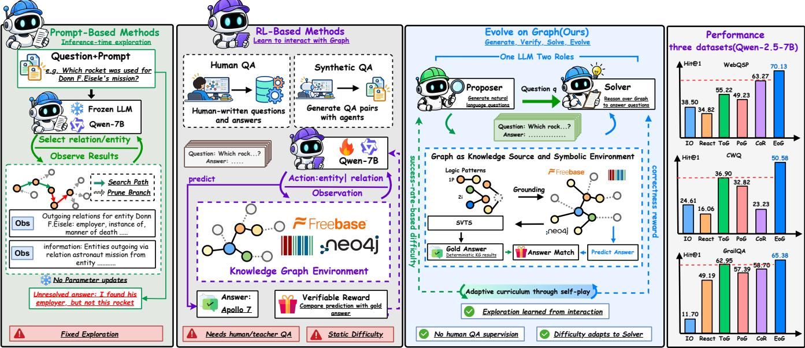  
Figure 2: Comparison of KG reasoning paradigms. Prompt-based agents explore with a frozen LLM and RL-based agents learn from fixed QA written by humans or closed-source models, whereas EoG proposes and solves KG-verified tasks of adaptive dificulty. With Qwen-2.5-7B-Instruct, EoG outperforms all shown baselines on three Freebase benchmarks.

To address these challenges, we propose Evolve on Graph (EoG), a framework in which a single LLM self-evolves on a KG using only the KG itself (Figure 1). First, we propose Graph Self-Play, in which the same LLM alternates between a Proposer that poses questions and a Solver that answers them. The Proposer ex <sub>p</sub>l<sub>ores</sub> th<sub>e grap</sub>h f<sub>rom rea</sub>l <sub>anc</sub>h<sub>or en</sub>titi<sub>es, recovers</sub> th<sub>e</sub> f<sub>ac</sub>t<sub>s, an</sub>d writes a <sub>q</sub>uestion<sub>,</sub> while the Solver ex<sub>p</sub>lores the <sub>g</sub>ra<sub>p</sub>h to answer it. The two roles share parameters. Second, we propose Symbolically Verifiable Topology Synthesis (SVTS), which samples reasoning t<sub>opo</sub>l<sub>og</sub>i<sub>es</sub> <sub>on</sub> th<sub>e</sub> <sub>grap</sub>h <sub>an</sub>d <sub>execu</sub>t<sub>es</sub> th<sub>e</sub> <sub>correspon</sub>di<sub>ng</sub> fi<sub>rs</sub>t<sub>-or</sub>d<sub>er</sub> lo<sub>g</sub>ic <sub>q</sub>ueries<sub>,</sub> <sub>g</sub>ivin<sub>g</sub> each task a to<sub>p</sub>olo<sub>gy</sub> skeleton and a sound and com<sub>p</sub>lete answer set. The Pro<sub>p</sub>oser ex<sub>p</sub>lores the <sub>g</sub>ra<sub>p</sub>h accordin<sub>g</sub> to the to<sub>p</sub>olo<sub>gy</sub> skeleton and writes a multi-ho<sub>p</sub> <sub>q</sub>uestion. In this wa<sub>y,</sub> trainin<sub>g</sub> tasks and their answers come onl<sub>y</sub> from the KG itself<sub>,</sub> <sub>w</sub>ith<sub>ou</sub>t h<sub>uman</sub> <sub>anno</sub>t<sub>a</sub>ti<sub>on</sub> <sub>or</sub> <sub>c</sub>l<sub>ose</sub>d<sub>-source</sub> <sub>mo</sub>d<sub>e</sub>l<sub>s.</sub> Thi<sub>r</sub>d<sub>,</sub> <sub>we</sub> <sub>pro-</sub> pose the Boundary-Aware Graph Curriculum, which reinforces the Pro<sub>p</sub>oser accordin<sub>g</sub> to the Solver’s score variance<sub>,</sub> so that it keeps posing questions on the Solver’s capability boundary, i.e., <sub>ques</sub>ti<sub>ons</sub> th<sub>e</sub> S<sub>o</sub>l<sub>ver</sub> h<sub>as no</sub>t <sub>mas</sub>t<sub>ere</sub>d b<sub>u</sub>t <sub>can s</sub>till <sub>so</sub>l<sub>ve.</sub> A<sub>s</sub> th<sub>e</sub> Solver <sub>g</sub>rows stron<sub>g</sub>er<sub>,</sub> more <sub>q</sub>uestions on com<sub>p</sub>lex to<sub>p</sub>olo<sub>g</sub>ies fall on its boundar<sub>y</sub> and enter trainin<sub>g,</sub> formin<sub>g</sub> a <sub>g</sub>ra<sub>p</sub>h curriculum th<sub>a</sub>t <sub>evo</sub>l<sub>ves w</sub>ith th<sub>e</sub> S<sub>o</sub>l<sub>ver.</sub>

O<sub>n s</sub>i<sub>x</sub> b<sub>enc</sub>h<sub>mar</sub>k<sub>s over</sub> F<sub>ree</sub>b<sub>ase,</sub> Wikid<sub>a</sub>t<sub>a, an</sub>d <sub>an</sub> i<sub>n</sub>d<sub>us</sub>t<sub>r</sub>i<sub>a</sub>l KG<sub>,</sub> EoG out<sub>p</sub>erforms <sub>p</sub>rom<sub>p</sub>tin<sub>g</sub>-<sub>,</sub> a<sub>g</sub>ent-<sub>,</sub> and retrieval-based methods without any annotations. With Qwen-2.5-7B-Instruct, EoG exceeds the stron<sub>g</sub>est baseline b<sub>y</sub> +7.46 (Hit@1) and +12.05 (F1) on avera<sub>g</sub>e, and b<sub>y</sub> +17.80 (Hit@1) on the industrial KG. EoG thus ofers a new self-evolvin<sub>g</sub> <sub>p</sub>ath for trainin<sub>g</sub> LLM <sub>g</sub>ra<sub>p</sub>h reasonin<sub>g</sub> on real-world KGs without an<sub>y</sub> <sub>q</sub>uestion–answer annotations.

## 2 Related Work

Knowledge-graph-augmented reasoning. Retrieval-based methods [7, 8, 16, 18, 25, 28–30, 34, 47, 64, 65] retrieve <sub>p</sub>aths, tri<sub>p</sub>les, or sub<sub>g</sub>ra<sub>p</sub>hs in one shot, trainin<sub>g</sub>-free a<sub>g</sub>ents [4, 13, 15, 19, 24, 32, 38, 39, 43, 48, 52, 54, 57, 60, 68] <sub>p</sub>rom<sub>p</sub>t a frozen LLM to ex<sub>p</sub>lore the <sub>g</sub>ra<sub>p</sub>h over multi<sub>p</sub>le turns, and trained a<sub>g</sub>ents [10, 14, 21, 22, 27, 36, 37, 40, 41, 49, 50, 56, 58, 63] learn ex<sub>p</sub>loration from <sub>q</sub>uestion–answer d<sub>a</sub>t<sub>a</sub> <sub>w</sub>ith RL<sub>.</sub> Th<sub>ese</sub> <sub>me</sub>th<sub>o</sub>d<sub>s</sub> <sub>e</sub>ith<sub>er</sub> k<sub>eep</sub> <sub>exp</sub>l<sub>ora</sub>ti<sub>on</sub> fi<sub>xe</sub>d <sub>or</sub> l<sub>earn</sub> it from annotations on one KG<sub>,</sub> <sub>w</sub>hereas EoG trains <sub>g</sub>ra<sub>p</sub>h reasonin<sub>g</sub> on the tar<sub>g</sub>et KG alone<sub>,</sub> without <sub>q</sub>uestion–answer annotations.

Training dataforgraph reasoning. Benchmarks such as WebQSP [62], CWQ [42], and GrailQA [9] are annotated b<sub>y</sub> ex<sub>p</sub>erts familiar with the KG schema at a hi<sub>g</sub>h cost, and Gra<sub>p</sub>hWalker [56] scales u<sub>p</sub> d<sub>a</sub>t<sub>a w</sub>ith <sub>ran</sub>d<sub>om wa</sub>lk<sub>s an</sub>d <sub>c</sub>l<sub>ose</sub>d<sub>-source</sub> LLM<sub>s;</sub> b<sub>o</sub>th fi<sub>x</sub> th<sub>e</sub>i<sub>r</sub> to<sub>p</sub>olo<sub>gy</sub> mix before trainin<sub>g</sub>. Self-<sub>p</sub>la<sub>y</sub> lets LLMs <sub>p</sub>ose and solve their own <sub>q</sub>uestions in code and math reasonin<sub>g</sub> [11, 70] and search a<sub>g</sub>ents [26, 67], but their knowled<sub>g</sub>e comes from model <sub>p</sub>arameters <sub>or</sub> <sub>uns</sub>t<sub>ruc</sub>t<sub>ure</sub>d t<sub>ex</sub>t<sub>.</sub> With<sub>ou</sub>t <sub>anno</sub>t<sub>a</sub>ti<sub>ons</sub> <sub>or</sub> <sub>c</sub>l<sub>ose</sub>d<sub>-source</sub> <sub>mo</sub>d<sub>e</sub>l<sub>s,</sub> EoG <sub>g</sub>enerates its own tasks on the KG throu<sub>g</sub>h self-<sub>p</sub>la<sub>y,</sub> with exact answers from <sub>q</sub>uer<sub>y</sub> execution and to<sub>p</sub>olo<sub>g</sub>ies that advance with the Solver (Table 1), im<sub>p</sub>rovin<sub>g</sub> the <sub>g</sub>ra<sub>p</sub>h reasonin<sub>g</sub> of LLMs.

Table 1: Comparison with representative methods. Training-free methods keep $\theta _ { 0 } ,$ , RL agents learn from fixed tasks written by humans or closed-source models, and EoG learns from KG-verified tasks that adapt to the Solver.
<table><tr><td>Method</td><td>Exploration (§3.2)</td><td>Training Tasks and Answers (§3.3)</td><td>Task Difficulty (§3.4)</td></tr><tr><td>ReAct [61]</td><td> $a _ { t } \sim \pi _ { \theta _ { 0 } } ( \cdot \mid s _ { t } )$  Frozen LLM calls the graph tools.</td><td> $\theta = \theta _ { 0 }$  No training.</td><td>No training tasks.</td></tr><tr><td>ToG / PoG [4, 38]</td><td> $\mathscr { B } _ { t + 1 } = \mathrm { t o p } { - k \ \pi _ { \theta _ { 0 } } ( \cdot \ | \ q , \mathscr { B } _ { t } ) }$  Prompted beam search or sub-goal planning.</td><td> $\theta = \theta _ { 0 }$  No training.</td><td>No training tasks.</td></tr><tr><td>Graph Reranker</td><td> $o = \mathrm { t o p } { - } k \ s \big ( { q } , \mathcal { T } _ { L } ( \mathcal { E } _ { Q } ) \big )$  Reranks triples near the anchors once.</td><td> $\theta = \theta _ { 0 }$  No training.</td><td>No training tasks.</td></tr><tr><td>KG-R1 [21]</td><td> $a _ { t } \sim \pi _ { \theta } ( \cdot \mid s _ { t } )$  Multi-turn exploration trained with RL.</td><td> $( q , \mathcal { A } ) \sim \mathcal { D } _ { \mathrm { h u m a n } }$  Human-annotated QA on one KG.</td><td> $d \sim \mathcal { D } ,$  fixed Given before training.</td></tr><tr><td>GraphWalker [56]</td><td> $\pi _ { \theta } \left. \mathrm { S F T } ( \tau _ { \mathrm { t e a c h e r } } ) \right. \mathrm { R L }$  Imitates closed-source trajectories, then RL.</td><td> $( q , \mathcal { A } ) \sim \mathcal { D } _ { \mathrm { t e a c h e r } } \cup \mathcal { D } _ { \mathrm { C W Q } }$  Closed-source walk questions plus CWQ.</td><td> $d \sim \mathcal { D } ,$  fixed Synthesized offline.</td></tr><tr><td>EoG (Ours)</td><td> $\pi _ { \theta } ^ { \mathrm { P } } , \pi _ { \theta } ^ { \mathrm { S } }$  with shared θ Both roles explore the KG and learn.</td><td> $q \sim \pi _ { \theta } ^ { \mathrm { P } } ( \cdot \mid G _ { Q } , \mathcal { E } _ { Q } , \mathcal { G } ) , \mathcal { R } _ { Q } = [ [ \phi ] ] _ { \mathcal { G } }$  No annotation; answers executed on the KG.</td><td> $R _ { \mathrm { P } } \big ( \sigma _ { \theta _ { t } } ^ { 2 } ( q ) \big )$  Gaussian Peaks at the Solver&#x27;s boundary.</td></tr></table>

## 3 Methods

As sho<sub>w</sub>n in Table 1<sub>,</sub> existin<sub>g</sub> methods either kee<sub>p</sub> <sub>g</sub>ra<sub>p</sub>h ex<sub>p</sub>loration fixed<sub>,</sub> retrieve onl<sub>y</sub> once<sub>,</sub> or train on <sub>q</sub>uestion–answer data <sub>wr</sub>itt<sub>en</sub> b<sub>y</sub> h<sub>umans</sub> <sub>or</sub> <sub>c</sub>l<sub>ose</sub>d<sub>-source</sub> <sub>mo</sub>d<sub>e</sub>l<sub>s</sub> <sub>w</sub>ith fi<sub>xe</sub>d difi<sub>cu</sub>lt<sub>y.</sub> EoG (Fi<sub>g</sub>ure 3) consists of Gra<sub>p</sub>h Self-Pla<sub>y</sub> (Section 3.2), SVTS (Section 3.3), and the Boundar<sub>y</sub>-Aware Gra<sub>p</sub>h Curriculum (Section 3.4), which address challen<sub>g</sub>es (1)–(3) of Section 1, res<sub>p</sub>ectivel<sub>y</sub>.

## 3.1 Problem Formulation

Definition 1: Logic Query. A knowledge graph $\mathcal { G } = ( \mathcal { E } , \mathcal { R } , \mathcal { T } )$ has an entit<sub>y</sub> set $\varepsilon ,$ <sub>a re</sub>l<sub>a</sub>ti<sub>on se</sub>t ${ \mathcal { R } } ,$ <sub>, an</sub>d <sub>a</sub> t<sub>r</sub>i<sub>p</sub>l<sub>e se</sub>t $\mathcal { T } \subseteq \mathcal { E } \times \mathcal { R } \times \mathcal { E } .$ A multi-ho<sub>p</sub> <sub>q</sub>uestion corres<sub>p</sub>onds to a first-order lo<sub>g</sub>ic <sub>q</sub>uer<sub>y</sub>

$$
\phi ( x ) = \exists y _ { 1 } , \dotsc , y _ { k } : e _ { 1 } \land e _ { 2 } \land \dotsb \land e _ { n } ,\tag{1}
$$

<sub>w</sub>h<sub>ere �</sub> i<sub>s</sub> th<sub>e answer var</sub>i<sub>a</sub>bl<sub>e,</sub> $y _ { 1 } , \ldots , y _ { k }$ <sub>are</sub> i<sub>n</sub>t<sub>erme</sub>di<sub>a</sub>t<sub>e var</sub>i<sub>a</sub>bl<sub>es,</sub> <sub>an</sub>d <sub>eac</sub>h <sub>a</sub>t<sub>om</sub> $e _ { i } = r ( u , u ^ { \prime } )$ li<sub>n</sub>k<sub>s an anc</sub>h<sub>or en</sub>tit<sub>y or a var</sub>i<sub>a</sub>bl<sub>e</sub> t<sub>o a</sub> <sub>var</sub>i<sub>a</sub>bl<sub>e an</sub>d i<sub>s</sub> t<sub>rue</sub> if <sub>an</sub>d <sub>on</sub>l<sub>y</sub> if $( u , r , u ^ { \prime } ) \in \mathcal { T }$ <sub>.</sub> Th<sub>e answer se</sub>t <sub>o</sub>f � is its denotation $[ [ \phi ] ] _ { \mathcal { G } } = \{ a \in \mathcal { E } \mid \phi ( a ) = \mathrm { T r u e } \}$

Definition 2: Graph Environment. Following GraphWalker $[ 5 6 ]$ an a<sub>g</sub>ent interacts with G in a think–<sub>q</sub>uer<sub>y</sub>–observe loo<sub>p</sub> throu<sub>g</sub>h two tools: get\_relations returns the relations of an entit<sub>y</sub>, and get\_triples returns its tri<sub>p</sub>les under <sub>g</sub>iven relations. At ste<sub>p</sub> �, <sub>g</sub>iven the state $s _ { t }$ <sub>o</sub>f <sub>a</sub>ll <sub>prev</sub>i<sub>ous</sub> t<sub>urns,</sub> th<sub>e agen</sub>t t<sub>a</sub>k<sub>es an ac</sub>ti<sub>on</sub> $\displaystyle a _ { t } ,$ <sub>a</sub> t<sub>oo</sub>l <sub>ca</sub>ll <sub>or a</sub> fi<sub>na</sub>l <sub>answer, an</sub>d <sub>o</sub>b<sub>serves</sub> t<sub>r</sub>i<sub>p</sub>l<sub>es</sub> $o _ { t } \subseteq \mathcal { T } . \mathrm { A }$ trajectory $\tau = ( a _ { 1 } , o _ { 1 } , \dots , a _ { T } )$ <sub>co</sub>ll<sub>ec</sub>t<sub>s</sub> th<sub>e ev</sub>id<sub>ence</sub>

$$
O ( \tau ) = \bigcup _ { t = 1 } ^ { T } o _ { t } \subseteq \mathcal T ,\tag{2}
$$

<sub>w</sub>h<sub>ere</sub> th<sub>e</sub> l<sub>as</sub>t <sub>ac</sub>ti<sub>on</sub> $a _ { T }$ <sub>g</sub>i<sub>ves</sub> th<sub>e</sub> fi<sub>na</sub>l <sub>answer</sub> $\mathcal { A } ( \tau ) \subseteq \mathcal { E }$

Problem Statement. Given $\mathcal { G }$ and an initial <sub>p</sub>olic<sub>y</sub> $\pi _ { \theta _ { 0 } }$ <sub>,</sub> <sub>we</sub> l<sub>earn</sub> a <sub>p</sub>o<sup>li</sup>c<sub>y</sub> $\pi _ { \theta }$ that maximizes the ex<sub>p</sub>ected F1 of answerin<sub>g</sub> multi-ho<sub>p</sub> <sub>q</sub>uest<sup>i</sup>ons on $\mathcal { G } ,$ without an<sub>y</sub> <sub>q</sub>uestion–answer <sub>p</sub>air or closed-source model. Trainin<sub>g</sub> uses onl<sub>y</sub> s<sub>y</sub>mbolic tasks $d = ( G _ { Q } , \mathcal { E } _ { Q } , \mathcal { R } _ { Q } )$ b<sub>u</sub>ilt f<sub>rom</sub> $^ { \mathcal { G } , }$ <sup>where</sup> <sup>the</sup> q<sup>uer</sup>y g<sup>ra</sup>p<sup>h</sup> $G _ { Q }$ g<sup>rounds</sup> <sup>a</sup> q<sup>uer</sup>y $\phi$ on ${ \mathcal { G } } , \varepsilon _ { Q }$ i<sub>s</sub> it<sub>s</sub> <sub>se</sub>t <sub>o</sub>f <sub>anc</sub>h<sub>or</sub> <sub>en</sub>titi<sub>es,</sub> <sub>an</sub>d $\mathcal { A } _ { Q } = [ [ \phi ] ] _ { \mathcal { G } }$ is its <sub>g</sub>old answer set.

## 3.2 Graph Self-Play

To let the ex<sub>p</sub>loration abilit<sub>y</sub> im<sub>p</sub>rove throu<sub>g</sub>h interaction<sub>,</sub> we <sub>p</sub>ro-<sub>p</sub>ose Gra<sub>p</sub>h Self-Pla<sub>y,</sub> in which a sin<sub>g</sub>le <sub>p</sub>olic<sub>y</sub> <sub>�� p</sub>la<sub>y</sub>s two roles <sub>un</sub>d<sub>er</sub> dif<sub>eren</sub>t <sub>ro</sub>l<sub>e promp</sub>t<sub>s w</sub>ith <sub>s</sub>h<sub>are</sub>d <sub>parame</sub>t<sub>ers:</sub> th<sub>e</sub> P<sub>roposer</sub> $\pi _ { \theta } ^ { \mathrm { P } }$ t<sub>urns a</sub> t<sub>as</sub>k i<sub>n</sub>t<sub>o a na</sub>t<sub>ura</sub>l<sub>-</sub>l<sub>anguage ques</sub>ti<sub>on, an</sub>d th<sub>e</sub> S<sub>o</sub>l<sub>ver</sub> $\pi _ { \theta } ^ { \mathrm { { S } } }$ answers it. Both roles reason inside <think>, call the <sub>g</sub>ra<sub>p</sub>h tools of Definition 2 inside <kg-query>, and read the returned tri<sub>p</sub>les inside <information> blocks, so both act b<sub>y</sub> ex<sub>p</sub>lorin<sub>g</sub> the same <sub>g</sub>ra<sub>p</sub>h. The Solver aims to answer correctl<sub>y,</sub> while the Pro<sub>p</sub>oser <sub>a</sub>i<sub>ms</sub> t<sub>o pose va</sub>lid <sub>ques</sub>ti<sub>ons</sub> th<sub>a</sub>t th<sub>e</sub> S<sub>o</sub>l<sub>ver can</sub> l<sub>earn</sub> f<sub>rom:</sub>

$$
\begin{array} { r l } & { \underset { \pi _ { \theta } ^ { \mathrm { S } } } { \operatorname* { m a x } } ~ \mathbb { E } _ { d , \ : q \sim \pi _ { \theta } ^ { \mathrm { P } } , \ : \rho \sim \pi _ { \theta } ^ { \mathrm { S } } } \left[ R _ { \mathrm { S } } ( \rho ) \right] , } \\ & { \underset { \pi _ { \theta } ^ { \mathrm { P } } } { \operatorname* { m a x } } ~ \mathbb { E } _ { d , \ : q \sim \pi _ { \theta } ^ { \mathrm { P } } } \left[ R _ { \mathrm { P } } ( q ) \right] \quad \mathrm { s . t . } \quad v ( q ) = 1 , } \end{array}\tag{3}
$$

<sub>w</sub>h<sub>ere</sub> $d$ i<sub>s a</sub> t<sub>as</sub>k <sub>sy</sub>nth<sub>es</sub>iz<sub>e</sub>d b<sub>y</sub> SVTS<sub>,</sub> $R _ { \mathrm { { S } } }$ i<sub>s</sub> th<sub>e</sub> S<sub>o</sub>l<sub>ver rewar</sub>d d<sub>e</sub>fi<sub>ne</sub>d b<sub>e</sub>l<sub>ow,</sub> $v ( q )$ i<sub>s</sub> th<sub>e</sub> <sub>va</sub>lidit<sub>y</sub> <sub>c</sub>h<sub>ec</sub>k <sub>o</sub>f S<sub>ec</sub>ti<sub>on</sub> $3 . 3 ,$ <sub>,</sub> <sub>an</sub>d $R _ { \mathrm { P } }$ <sub>o</sub>f Section 3.4 de<sub>p</sub>ends on the Solver’s <sub>p</sub>erformance on <sub>�</sub>. Since the two roles share �<sub>,</sub> the <sub>p</sub>olic<sub>y g</sub>ains ex<sub>p</sub>loration ex<sub>p</sub>erience both when it <sub>poses a ques</sub>ti<sub>on an</sub>d <sub>w</sub>h<sub>en</sub> it <sub>searc</sub>h<sub>es</sub> f<sub>or</sub> th<sub>e answers.</sub> It i<sub>nc</sub>l<sub>u</sub>d<sub>es</sub> <sub>q</sub>uestion <sub>g</sub>eneration<sub>,</sub> <sub>q</sub>uestion solvin<sub>g,</sub> and Solver o<sub>p</sub>timization.

Question generation. For each task $d = ( G _ { Q } , \mathcal { E } _ { Q } , \mathcal { R } _ { Q } )$ <sub>,</sub> th<sub>e</sub> P<sub>ro-</sub> <sub>poser</sub> <sub>rea</sub>d<sub>s</sub> th<sub>e</sub> <sub>reason</sub>i<sub>ng</sub> <sub>s</sub>k<sub>e</sub>l<sub>e</sub>t<sub>on</sub> <sub>o</sub>f $G _ { Q } ,$ <sub>,</sub> i<sub>n</sub> <sub>w</sub>hi<sub>c</sub>h <sub>on</sub>l<sub>y</sub> th<sub>e</sub> <sub>anc</sub>h<sub>ors</sub> a<sub>pp</sub>ear as real entit<sub>y</sub> names<sub>,</sub> while the intermediate and answer <sub>en</sub>titi<sub>es appear as p</sub>l<sub>ace</sub>h<sub>o</sub>ld<sub>ers.</sub> F<sub>or examp</sub>l<sub>e,</sub> th<sub>e s</sub>k<sub>e</sub>l<sub>e</sub>t<sub>on</sub> G<sub>oo</sub>di<sub>son</sub> P<sub>ar</sub>k $\begin{array} { r } { \overbrace { \phantom { \sum } \sum \Biggl ( \frac { \sum \Biggl ( \sum \nu \mathrm { d } _ { - } s \mathrm { t a d i u m } } { \sum \nu \mathrm { d r a d i u m } } \ M \mathrm { i } \mathrm { d } \uparrow \ @ \frac { \ o w n e r _ { - } s } { \sum \nu \mathrm { d } _ { - } s \mathrm { t a d i l } \mathrm { d } } \Biggr ) } ^ { \mathrm { a r e n a } _ { - } s \mathrm { t a d i u m } } , } \end{array}$ Ans@ should become <sup>“</sup>Who is the <sub>owner o</sub>f th<sub>e</sub> t<sub>eam</sub> th<sub>a</sub>t <sub>p</sub>l<sub>ays a</sub>t G<sub>oo</sub>di<sub>son</sub> P<sub>ar</sub>k?”<sub>.</sub> Si<sub>nce</sub> th<sub>e</sub> t<sub>oo</sub>l<sub>s</sub> <sub>canno</sub>t b<sub>e</sub> <sub>ca</sub>ll<sub>e</sub>d <sub>on</sub> <sub>p</sub>l<sub>ace</sub>h<sub>o</sub>ld<sub>ers,</sub> th<sub>e</sub> P<sub>roposer</sub> <sub>exp</sub>l<sub>ores</sub> th<sub>e</sub> <sub>grap</sub>h <sub>over mu</sub>lti<sub>p</sub>l<sub>e</sub> t<sub>urns</sub> f<sub>rom</sub> th<sub>e rea</sub>l <sub>anc</sub>h<sub>ors</sub> $\varepsilon _ { Q }$ t<sub>o uncover</sub> th<sub>e</sub> f<sub>ac</sub>t<sub>s,</sub> an<sup>d</sup> pro<sup>d</sup>uces a trajectory $\tau ^ { \mathrm { P } }$ th<sub>a</sub>t <sub>en</sub>d<sub>s</sub> <sub>w</sub>ith <sub>a</sub> <sub>ques</sub>ti<sub>on</sub>

$$
q \sim \pi _ { \theta } ^ { \mathrm { P } } ( \cdot \mid G _ { Q } , \mathcal { E } _ { Q } , \mathcal { G } ) ,\tag{4}
$$

<sub>w</sub>h<sub>ere</sub> $q$ is extracted from the final <result> block of $\tau ^ { \mathrm { P } } .$ <sub>.</sub> Th<sub>e</sub> <sub>promp</sub>t <sub>as</sub>k<sub>s</sub> <sub>�</sub> t<sub>o</sub> <sub>name</sub> th<sub>e</sub> <sub>anc</sub>h<sub>ors,</sub> k<sub>eep</sub> th<sub>e</sub> f<sub>u</sub>ll <sub>reason</sub>i<sub>ng</sub> <sub>c</sub>h<sub>a</sub>i<sub>n</sub> <sub>o</sub>f th<sub>e s</sub>k<sub>e</sub>l<sub>e</sub>t<sub>on, an</sub>d hid<sub>e</sub> i<sub>n</sub>t<sub>erme</sub>di<sub>a</sub>t<sub>e an</sub>d <sub>answer en</sub>titi<sub>es, so</sub> th<sub>a</sub>t answerin<sub>g</sub> <sub>�</sub> needs the same multi-ho<sub>p</sub> reasonin<sub>g</sub> as the task.

Question solving. For a question , the Solver starts from the <sub>anc</sub>h<sub>ors</sub> $\varepsilon _ { Q }$ given in its prompt an<sup>d</sup> samp<sup>l</sup>es a group o<sup>f</sup>� trajectories throu<sub>g</sub>h multi-turn interaction with the <sub>g</sub>ra<sub>p</sub>h<sub>,</sub>

$$
\rho ^ { j } \sim \pi _ { \boldsymbol { \theta } } ^ { \mathrm { S } } ( \cdot \mid q , \mathcal { E } _ { Q } , \mathcal { G } ) , \qquad j = 1 , \ldots , n ,\tag{5}
$$

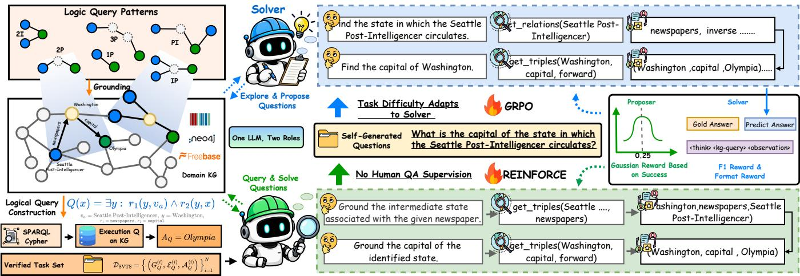  
Figure 3: Overview of EoG. One LLM self-plays as the Proposer and the Solver, synthesizes verifiable tasks with SVTS, and forms a boundary-aware curriculum by rewarding the Proposer for questions on the Solver’s capability boundary.

<sub>w</sub>h<sub>ere</sub> th<sub>e</sub> S<sub>o</sub>l<sub>ver</sub> d<sub>ec</sub>id<sub>es w</sub>hi<sub>c</sub>h <sub>re</sub>l<sub>a</sub>ti<sub>ons an</sub>d <sub>en</sub>titi<sub>es</sub> t<sub>o exp</sub>l<sub>ore</sub> and when to stop, and each trajectory ends with a JSON list of entit<sub>y</sub> names in an <answer> block, which <sub>g</sub>ives the <sub>p</sub>rediction $\hat { y } ^ { j } = \mathcal { R } ( \rho ^ { j } )$ . Eac<sup>h</sup> trajectory is score<sup>d b</sup>y answer an<sup>d f</sup>ormat:

$$
R _ { \mathrm { S } } ( \rho ^ { j } ) = \lambda _ { \mathrm { a n s } } \operatorname { F } 1 \big ( \hat { y } ^ { j } , \mathcal { A } _ { Q } \big ) + \lambda _ { \mathrm { f m t } } R _ { \mathrm { f m t } } ( \rho ^ { j } ) ,\tag{6}
$$

<sub>w</sub>h<sub>ere</sub> th<sub>e</sub> fi<sub>rs</sub>t t<sub>erm</sub> i<sub>s</sub> th<sub>e</sub> F1 b<sub>e</sub>t<sub>ween</sub> th<sub>e pre</sub>di<sub>c</sub>t<sub>e</sub>d <sub>an</sub>d <sub>go</sub>ld <sub>answer</sub> sets, $R _ { \mathrm { f m t } } \in [ 0 , 1 ]$ measures <sup>h</sup>ow we<sup>ll</sup> t<sup>h</sup>e trajectory <sup>f</sup>o<sup>ll</sup>ows t<sup>h</sup>e thi<sub>n</sub>k<sub>–query–o</sub>b<sub>serve</sub> <sub>s</sub>t<sub>ruc</sub>t<sub>ure,</sub> <sub>an</sub>d th<sub>e</sub> <sub>we</sub>i<sub>g</sub>ht<sub>s</sub> <sub>are</sub> $\lambda _ { \mathrm { a n s } } = 0 . 8$ <sub>an</sub>d $\lambda _ { \mathrm { f m t } } = 0 . 2$ <sub>.</sub> W<sub>e use</sub> F1 <sub>ra</sub>th<sub>er</sub> th<sub>an exac</sub>t <sub>ma</sub>t<sub>c</sub>h b<sub>ecause a</sub> t<sub>as</sub>k <sub>may</sub> h<sub>ave</sub> <sub>severa</sub>l <sub>go</sub>ld <sub>answers,</sub> <sub>so</sub> <sub>a</sub> <sub>pre</sub>di<sub>c</sub>ti<sub>on</sub> th<sub>a</sub>t <sub>recovers</sub> <sub>on</sub>l<sub>y</sub> <sub>par</sub>t <sub>o</sub>f ${ \mathcal { A } } _ { Q }$ still recei<sub>v</sub>es <sub>p</sub>artial credit. Since $R _ { S }$ <sub>scores</sub> <sub>on</sub>l<sub>y</sub> th<sub>e</sub> fi<sub>na</sub>l <sub>answer, any exp</sub>l<sub>ora</sub>ti<sub>on pa</sub>th th<sub>a</sub>t <sub>reac</sub>h<sub>es</sub> ${ \mathcal { A } } _ { Q }$ i<sub>s rewar</sub>d<sub>e</sub>d<sub>, so</sub> th<sub>e</sub> Solver learns its own ex<sub>p</sub>loration strate<sub>gy</sub> from interaction.

Solver optimization. The Solver is updated with GRPO. For a g<sup>rou</sup>p $\{ \rho ^ { j } \} _ { j = 1 } ^ { n }$ <sub>on</sub> th<sub>e same �,</sub> th<sub>e re</sub>l<sub>a</sub>ti<sub>ve a</sub>d<sub>van</sub>t<sub>age</sub> i<sub>s</sub> $\hat { A } ^ { j } = \big ( R _ { \mathrm { S } } ( \rho ^ { j } ) -$ mean/std, with mean, std over $\{ R _ { \mathrm { S } } ( \rho ^ { k } ) \} _ { k = 1 } ^ { n }$ , an<sup>d</sup> t<sup>h</sup>e o<sup>b</sup>jective is

$$
\begin{array} { r l r } { \mathcal { T } _ { \mathrm { S } } ( \theta ) = \mathbb { E } \Bigg [ \frac { 1 } { n } \sum _ { j = 1 } ^ { n } \frac { 1 } { | \rho ^ { j } | } \sum _ { t = 1 } ^ { | \rho ^ { j } | } \operatorname* { m i n } \Bigl ( w _ { t } ^ { j } \hat { A } ^ { j } , } & { \mathrm { c l i p } ( w _ { t } ^ { j } , 1 - \epsilon , 1 + \epsilon ) \hat { A } ^ { j } \Bigr ) \Bigg ] } & { } & \\ { - \beta \mathbb { D } _ { \mathrm { K L } } \left[ \pi _ { \theta } ^ { \mathrm { S } } \parallel \pi _ { \mathrm { r e f } } \right] , } & { } & \end{array}\tag{7}
$$

<sub>w</sub>h<sub>ere</sub> $w _ { t } ^ { j } = \pi _ { \theta } ^ { \mathrm { S } } \big ( a _ { t } ^ { j } \mid s _ { t } ^ { j } \big ) / \pi _ { \theta _ { \mathrm { o l d } } } ^ { \mathrm { S } } \big ( a _ { t } ^ { j } \mid s _ { t } ^ { j } \big )$ i<sub>s</sub> th<sub>e</sub> t<sub>o</sub>k<sub>en-</sub>l<sub>eve</sub>l i<sub>mpor</sub>t<sub>ance</sub> ratio at step �, � is the clipping threshold, and � is the KL coeficient.

## 3.3 Symbolically Verifiable Topology Synthesis

T<sub>o o</sub>bt<sub>a</sub>i<sub>n re</sub>li<sub>a</sub>bl<sub>e</sub> t<sub>ra</sub>i<sub>n</sub>i<sub>ng</sub> d<sub>a</sub>t<sub>a w</sub>ith<sub>ou</sub>t h<sub>uman anno</sub>t<sub>a</sub>ti<sub>on or c</sub>l<sub>ose</sub>d<sub>-</sub> so<sub>u</sub>rce models<sub>,</sub> we <sub>p</sub>ro<sub>p</sub>ose SVTS<sub>,</sub> which views the KG as a firstorder lo<sub>g</sub>ic structure and takes <sub>q</sub>uer<sub>y</sub> execution on the <sub>g</sub>ra<sub>p</sub>h as th<sub>e source o</sub>f <sub>go</sub>ld <sub>answers.</sub> It i<sub>nc</sub>l<sub>u</sub>d<sub>es</sub> th<sub>ree s</sub>t<sub>eps:</sub> d<sub>e</sub>fi<sub>n</sub>i<sub>ng query</sub> <sub>p</sub>atterns<sub>,</sub> <sub>g</sub>roundin<sub>g</sub> and execution<sub>,</sub> and <sub>q</sub>uestion verification.

Query patterns. Following complex logical queries over KGs [33], we define six <sub>q</sub>uer<sub>y</sub> <sub>p</sub>atterns as reasonin<sub>g</sub> to<sub>p</sub>olo<sub>g</sub>ies:

$$
\mathcal { P } = \{ 1 p , 2 p , 3 p , 2 i , i p , p i \} ,\tag{8}
$$

where � and � denote <sub>p</sub>rojection (one ho<sub>p</sub> alon<sub>g</sub> a relation) and intersection (multi<sub>p</sub>le constraints on one variable), res<sub>p</sub>ectivel<sub>y</sub>; <sup>1</sup>�–<sup>3</sup>� are <sup>1</sup>- <sup>t</sup>o <sup>3</sup>-<sup>h</sup>op c<sup>h</sup>a<sup>i</sup>n quer<sup>i</sup>es, <sup>2�</sup> <sup>i</sup>s a <sup>t</sup>wo-way <sup>i</sup>n<sup>t</sup>ersec<sup>ti</sup>on, an<sup>d</sup> ��, �� are neste<sup>d</sup> compositions o<sup>f</sup> projection an<sup>d</sup> intersection. <sup>F</sup>o<sup>r</sup> e<sup>x</sup>a<sup>m</sup>p<sup>l</sup>e, <sup>th</sup>e <sup>2</sup>� a<sup>nd 2�</sup> que<sup>r</sup>y pa<sup>tt</sup>e<sup>rn</sup>s a<sup>r</sup>e w<sup>ritt</sup>e<sup>n</sup> as

$$
\begin{array} { c } { { \phi _ { 2 p } ( x ) = \exists y : r _ { 1 } ( v _ { a } , y ) \wedge r _ { 2 } ( y , x ) , } } \\ { { \phi _ { 2 i } ( x ) = r _ { 1 } ( v _ { a _ { 1 } } , x ) \wedge r _ { 2 } ( v _ { a _ { 2 } } , x ) , } } \end{array}\tag{9}
$$

<sub>w</sub>h<sub>ere</sub> $\phi _ { 2 p }$ f<sub>o</sub>ll<sub>ows a</sub> t<sub>wo-</sub>h<sub>op c</sub>h<sub>a</sub>i<sub>n</sub> f<sub>rom one anc</sub>h<sub>or, w</sub>h<sub>ereas</sub> $\phi _ { 2 i }$ <sub>requ</sub>i<sub>res</sub> th<sub>e</sub> <sub>answer</sub> t<sub>o</sub> <sub>sa</sub>ti<sub>s</sub>f<sub>y</sub> <sub>cons</sub>t<sub>ra</sub>i<sub>n</sub>t<sub>s</sub> f<sub>rom</sub> t<sub>wo</sub> <sub>anc</sub>h<sub>ors;</sub> th<sub>e</sub> l<sub>og-</sub> ical forms of all six <sub>p</sub>atterns are listed in A<sub>pp</sub>endix B. On Freebase<sub>,</sub> the s<sub>y</sub>nthesized <sub>q</sub>uestions cover all six <sub>p</sub>atterns<sub>,</sub> with shares ran<sub>g</sub>in<sub>g</sub> from 9.5% (��) to 22.4% (1�), so the Solver must learn <sub>p</sub>ath ex<sub>p</sub>an-<sub>s</sub>i<sub>o</sub>n<sub>,</sub> <sub>co</sub>n<sub>s</sub>tr<sub>a</sub>int int<sub>e</sub>r<sub>sec</sub>ti<sub>o</sub>n<sub>,</sub> <sub>a</sub>nd int<sub>e</sub>rm<sub>e</sub>di<sub>a</sub>t<sub>e</sub>-<sub>va</sub>ri<sub>a</sub>bl<sub>e</sub> tr<sub>ac</sub>kin<sub>g</sub> rather than fit a sin<sub>g</sub>le <sub>p</sub>attern (A<sub>pp</sub>endix C.4).

Grounding and execution. Given a pattern ��� $\in \mathcal { P }$ , <sub>g</sub>roun<sup>di</sup>n<sub>g</sub> instantiates <sub>�</sub>�� on rea<sup>l f</sup>acts an<sup>d</sup> extracts its <sub>g</sub>roun<sup>d</sup>e<sup>d</sup> <sub>q</sub>uer<sub>y g</sub>ra<sub>p</sub><sup>h</sup>s ${ \cal J } _ { p a t } = f _ { p a t } ( G )$ <sub>, w</sub>h<sub>ere</sub> $f _ { p a t }$ is the corres<sub>p</sub>ondin<sub>g</sub> extraction <sub>p</sub>rocedure: it sam<sub>p</sub>les a seed entit<sub>y</sub> from a seed <sub>p</sub>ool and walks on G t<sub>o</sub> bi<sub>n</sub>d <sub>every</sub> <sub>var</sub>i<sub>a</sub>bl<sub>e</sub> <sub>an</sub>d <sub>re</sub>l<sub>a</sub>ti<sub>on</sub> <sub>o</sub>f <sub>��</sub>� t<sub>o</sub> <sub>a</sub> <sub>rea</sub>l t<sub>r</sub>i<sub>p</sub>l<sub>e,</sub> <sub>an</sub>d it <sub>repea</sub>t<sub>s</sub> <sub>un</sub>til <sub>a</sub> t<sub>arge</sub>t <sub>num</sub>b<sub>er</sub> <sub>o</sub>f t<sub>as</sub>k<sub>s</sub> <sub>per</sub> <sub>pa</sub>tt<sub>ern</sub> i<sub>s</sub> <sub>co</sub>ll<sub>ec</sub>t<sub>e</sub>d <sub>or</sub> <sub>an</sub> <sub>a</sub>tt<sub>emp</sub>t b<sub>u</sub>d<sub>ge</sub>t <sub>runs</sub> <sub>ou</sub>t<sub>.</sub> Th<sub>e</sub> <sub>wa</sub>lk <sub>on</sub>l<sub>y</sub> <sub>proposes</sub> th<sub>e</sub> <sub>s</sub>t<sub>ruc</sub>t<sub>ure</sub> <sub>o</sub>f <sub>a</sub> t<sub>as</sub>k<sub>;</sub> it<sub>s</sub> <sub>answers</sub> <sub>are</sub> d<sub>ec</sub>id<sub>e</sub>d b<sub>y</sub> <sub>execu</sub>ti<sub>on</sub> b<sub>e</sub>l<sub>ow.</sub> F<sub>or</sub> <sub>examp</sub>l<sub>e,</sub> <sub>a</sub> 2<sub>�</sub> recipes <sub>g</sub>rounded <sub>q</sub>uer<sub>y</sub> <sub>g</sub>ra<sub>p</sub>h sam<sub>p</sub>led from Freebase is Sha<sub>p</sub>in<sub>g</sub> techniques Countr<sub>y</sub> Sourdou<sub>g</sub>h Bread → �, whose execution returns two answers<sub>,</sub> Kneadin<sub>g</sub> and Slashin<sub>g</sub> dou<sub>g</sub>h. We then com<sub>p</sub>ile each $G _ { Q } \in \mathcal { I } _ { p a t }$ deterministically into an executable KG query � for the logic query � of Equation 1, and evaluate it on $\mathcal { G }$ t<sub>o</sub> <sub>o</sub>bt<sub>a</sub>i<sub>n</sub> th<sub>e</sub> <sub>comp</sub>l<sub>e</sub>t<sub>e go</sub>ld <sub>answer se</sub>t<sub>,</sub> i<sub>.e.,</sub> th<sub>e</sub> d<sub>eno</sub>t<sub>a</sub>ti<sub>on o</sub>f ${ \bf \nabla } \cdot \phi :$

$$
{ \mathcal { A } } _ { Q } = \operatorname { E x e c u t e } ( Q , G ) = \left[ \left[ \phi \right] \right] _ { \mathcal { G } } ,\tag{10}
$$

<sub>w</sub>h<sub>ere quer</sub>i<sub>es w</sub>h<sub>ose answers are emp</sub>t<sub>y, a</sub>b<sub>norma</sub>ll<sub>y</sub> l<sub>arge, or un-</sub> <sub>namea</sub>bl<sub>e</sub> <sub>are</sub> di<sub>scar</sub>d<sub>e</sub>d <sub>ra</sub>th<sub>er</sub> th<sub>an</sub> t<sub>runca</sub>t<sub>e</sub>d<sub>,</sub> <sub>so</sub> th<sub>a</sub>t <sub>every</sub> k<sub>ep</sub>t tas<sup>k</sup> <sup>h</sup>as an answer set t<sup>h</sup>at can <sup>b</sup>e c<sup>h</sup>ec<sup>k</sup>e<sup>d</sup> o<sup>b</sup>jective<sup>l</sup>y. Un<sup>l</sup>i<sup>k</sup>e <sub>ran</sub>d<sub>om-wa</sub>lk <sub>syn</sub>th<sub>es</sub>i<sub>s,</sub> <sub>w</sub>hi<sub>c</sub>h t<sub>a</sub>k<sub>es</sub> <sub>a</sub> <sub>s</sub>i<sub>ng</sub>l<sub>e</sub> <sub>en</sub>tit<sub>y</sub> <sub>o</sub>f th<sub>e</sub> <sub>wa</sub>lk <sub>as</sub> the answer<sub>,</sub> execution returns ever<sub>y</sub> entit<sub>y</sub> that satisfies the <sub>q</sub>uer<sub>y</sub>. Thi<sub>s en</sub>tit<sub>y</sub> i<sub>s a</sub>l<sub>ways one o</sub>f th<sub>ese answers,</sub> b<sub>u</sub>t <sub>w</sub>h<sub>en</sub> $| \mathcal { R } | > 1$ scorin<sub>g</sub> a com<sub>p</sub>lete <sub>p</sub>rediction a<sub>g</sub>ainst it alone would <sub>g</sub>ive an F1 <sub>o</sub>f <sub>on</sub>l<sub>y</sub> $2 / ( 1 + | \mathcal { R } _ { Q } | )$ <sub>.</sub> SVTS r<sub>u</sub>n<sub>s o</sub>n<sub>ce pe</sub>r KG b<sub>e</sub>f<sub>o</sub>r<sub>e</sub> tr<sub>a</sub>inin<sub>g a</sub>nd onl<sub>y</sub> needs <sub>q</sub>uer<sub>y</sub> access to the KG<sub>,</sub> so a<sub>pp</sub>l<sub>y</sub>in<sub>g</sub> EoG to a new KG re<sub>q</sub>uires onl<sub>y</sub> its <sub>q</sub>uer<sub>y</sub> end<sub>p</sub>oint. It finall<sub>y</sub> out<sub>p</sub>uts the task set

$$
\mathcal { D } _ { \mathrm { S V T S } } = \big \{ ( G _ { Q } ^ { ( i ) } , \mathcal { E } _ { Q } ^ { ( i ) } , \mathcal { A } _ { Q } ^ { ( i ) } ) \big \} _ { i = 1 } ^ { N } ,\tag{11}
$$

where � is the task count (Al<sub>g</sub>orithm 1 in A<sub>pp</sub>endix B).

Question verification. Execution guarantees that ${ \mathcal { A } } _ { Q }$ answers the query �, but not that the question � written by the Proposer <sub>expresses</sub> th<sub>e</sub> <sub>same</sub> <sub>query.</sub> T<sub>o</sub> k<sub>eep</sub> <sub>�</sub> f<sub>a</sub>ithf<sub>u</sub>l t<sub>o</sub> it<sub>s</sub> t<sub>as</sub>k<sub>,</sub> <sub>we</sub> <sub>co</sub>ll<sub>ec</sub>t th<sub>e ev</sub>id<sub>ence</sub> $O ( \tau ^ { \mathrm { P } } )$ <sub>re</sub>t<sub>r</sub>i<sub>eve</sub>d b<sub>y</sub> th<sub>e</sub> P<sub>roposer an</sub>d l<sub>e</sub>t th<sub>e</sub> S<sub>o</sub>l<sub>ver</sub> answer � using only that evidence as a verifier:

$$
\sigma \sim \pi _ { \theta } ^ { \mathrm { S } } \big ( \cdot \mid q , \mathcal { E } _ { Q } , O ( \tau ^ { \mathrm { P } } ) \big ) .\tag{12}
$$

A <sub>qu</sub>estion is <sub>v</sub>alid onl<sub>y</sub> if it <sub>p</sub>asses a r<sub>u</sub>le check $v _ { \mathrm { r u l e } } ( q )$ <sub>, w</sub>hi<sub>c</sub>h re<sub>q</sub>uires that <sub>�</sub> can be extracted from the <result> block, has a <sub>reasona</sub>bl<sub>e</sub> l<sub>eng</sub>th<sub>, an</sub>d <sub>names no</sub> i<sub>n</sub>t<sub>erme</sub>di<sub>a</sub>t<sub>e or answer en</sub>tit<sub>y,</sub> <sub>an</sub>d if th<sub>e ver</sub>ifi<sub>ca</sub>ti<sub>on answer ma</sub>t<sub>c</sub>h<sub>es</sub> th<sub>e go</sub>ld <sub>answer:</sub>

$$
\boldsymbol { v } ( \boldsymbol { q } ) = \boldsymbol { v } _ { \mathrm { r u l e } } ( \boldsymbol { q } ) \cdot \mathbb { I } \big [ \mathcal { A } ( \sigma ) = \mathcal { A } _ { Q } \big ] \in \{ 0 , 1 \} ,\tag{13}
$$

where I[·] is the indicator function. Onl<sub>y q</sub>uestions with $\textstyle \gamma ( q ) = 1$ ent<sub>er rewar</sub>d <sub>compu</sub>t<sub>a</sub>ti<sub>on an</sub>d <sub>po</sub>li<sub>cy up</sub>d<sub>a</sub>t<sub>e.</sub> Th<sub>e ru</sub>l<sub>e c</sub>h<sub>ec</sub>k <sub>removes</sub> <sub>ques</sub>ti<sub>o</sub>n<sub>s</sub> th<sub>a</sub>t l<sub>ea</sub>k int<sub>e</sub>rm<sub>e</sub>di<sub>a</sub>t<sub>e o</sub>r <sub>a</sub>n<sub>swe</sub>r <sub>e</sub>ntiti<sub>es.</sub> Th<sub>e ev</sub>id<sub>e</sub>n<sub>ce</sub> <sub>c</sub>h<sub>ec</sub>k <sub>removes ques</sub>ti<sub>ons</sub> th<sub>a</sub>t <sub>are am</sub>bi<sub>guous, un</sub>d<sub>er-spec</sub>ifi<sub>e</sub>d<sub>, or</sub> i<sub>n-</sub> <sub>cons</sub>i<sub>s</sub>t<sub>en</sub>t <sub>w</sub>ith th<sub>e</sub>i<sub>r</sub> t<sub>as</sub>k<sub>: s</sub>i<sub>nce</sub> th<sub>e ver</sub>ifi<sub>er sees on</sub>l<sub>y</sub> th<sub>e</sub> P<sub>roposer</sub>’<sub>s</sub> tri<sub>p</sub>les<sub>,</sub> it recovers exactl<sub>y</sub> ${ \mathcal { A } } _ { Q }$ <sub>on</sub>l<sub>y</sub> if th<sub>ese</sub> t<sub>r</sub>i<sub>p</sub>l<sub>es,</sub> <sub>rea</sub>d th<sub>roug</sub>h <sub>�,</sub> d<sub>e</sub>t<sub>erm</sub>i<sub>ne</sub> th<sub>e comp</sub>l<sub>e</sub>t<sub>e answer se</sub>t<sub>.</sub> Th<sub>e c</sub>h<sub>ec</sub>k i<sub>s conserva</sub>ti<sub>ve: a</sub> <sup>f</sup>ait<sup>hf</sup>u<sup>l</sup> question may <sup>b</sup>e rejecte<sup>d</sup> w<sup>h</sup>en t<sup>h</sup>e sing<sup>l</sup>e veri<sup>fi</sup>cation trajectory � <sup>f</sup>ai<sup>l</sup>s, <sup>l</sup>owering t<sup>h</sup>e yie<sup>ld</sup> o<sup>f</sup> va<sup>l</sup>i<sup>d</sup> questions, <sup>b</sup>ut a question <sub>w</sub>h<sub>ose</sub> <sub>ev</sub>id<sub>ence</sub> d<sub>oes</sub> <sub>no</sub>t d<sub>e</sub>t<sub>erm</sub>i<sub>ne</sub> ${ \mathcal { A } } _ { Q }$ is never acce<sub>p</sub>ted.

## 3.4 Boundary-Aware Graph Curriculum

T<sub>o</sub> l<sub>e</sub>t t<sub>as</sub>k t<sub>opo</sub>l<sub>og</sub>i<sub>es</sub> f<sub>o</sub>ll<sub>ow</sub> th<sub>e</sub> S<sub>o</sub>l<sub>ver</sub>’<sub>s</sub> <sub>a</sub>bilit<sub>y,</sub> <sub>we</sub> <sub>propose</sub> th<sub>e</sub> Bo<sub>u</sub>ndar<sub>y</sub>-A<sub>w</sub>are Gra<sub>p</sub>h C<sub>u</sub>rric<sub>u</sub>l<sub>u</sub>m<sub>,</sub> <sub>w</sub>hich re<sub>w</sub>ards the Pro<sub>p</sub>oser b<sub>y</sub> the Solver’s score variance<sub>,</sub> so that it kee<sub>p</sub>s <sub>p</sub>osin<sub>g</sub> <sub>q</sub>uestions on th<sub>e</sub> S<sub>o</sub>l<sub>ver</sub>’<sub>s</sub> <sub>capa</sub>bilit<sub>y</sub> b<sub>oun</sub>d<sub>ary.</sub> It i<sub>nc</sub>l<sub>u</sub>d<sub>es</sub> th<sub>ree</sub> <sub>par</sub>t<sub>s:</sub> th<sub>e</sub> <sub>capa-</sub> bilit<sub>y</sub> boundar<sub>y,</sub> the Pro<sub>p</sub>oser reward<sub>,</sub> and Pro<sub>p</sub>oser o<sub>p</sub>timization.

Capability boundary. For a valid question � with Solver trajectori<sub>es</sub> $\{ \rho ^ { j } \} _ { j = 1 } ^ { n } , \operatorname { l e t } s _ { j } = \mathrm { F } 1 ( \hat { y } ^ { j } , \mathcal { A } _ { Q } ) \in [ 0 , 1 ]$ b<sub>e</sub> th<sub>e answer score o</sub>f $\rho ^ { j }$ in E<sub>q</sub>uation 6 and �¯(<sub>�</sub>) their mean. The Solver’s score variance on �, w<sup>h</sup>ic<sup>h</sup> measures <sup>h</sup>ow <sup>d</sup>i<sup>f</sup>erent<sup>l</sup>y its trajectories score, is

$$
\sigma ^ { 2 } ( q ) = \frac { 1 } { n } \sum _ { j = 1 } ^ { n } \bigl ( s _ { j } - \bar { s } ( q ) \bigr ) ^ { 2 } .\tag{14}
$$

Since the advanta<sub>g</sub>es in E<sub>q</sub>uation 7 are normalized within a <sub>g</sub>rou<sub>p,</sub> a question on w<sup>h</sup>ic<sup>h</sup> a<sup>ll</sup> � trajectories receive t<sup>h</sup>e same score $( \sigma ^ { 2 } ( q ) =$ 0), such as one the Solver alwa<sub>y</sub>s or never solves, <sub>g</sub>ives almost no learnin<sub>g</sub> si<sub>g</sub>nal [66]. The Solver learns mainl<sub>y</sub> from <sub>q</sub>uestions with $\sigma ^ { 2 } ( q ) > 0$ <sub>,</sub> <sub>w</sub>hi<sub>c</sub>h it h<sub>as</sub> <sub>no</sub>t <sub>mas</sub>t<sub>ere</sub>d b<sub>u</sub>t <sub>can</sub> <sub>s</sub>till <sub>par</sub>tl<sub>y</sub> <sub>so</sub>l<sub>ve,</sub> <sub>suc</sub>h as one it answers in <sup>f</sup>u<sup>ll</sup> on some trajectories an<sup>d</sup> on<sup>l</sup>y in part on others; we call them its capability boundary.

Proposer reward. We therefore reward the Proposer with a Gaussi<sub>an</sub> b<sub>oun</sub>d<sub>ary rewar</sub>d <sub>on</sub> th<sub>e</sub> S<sub>o</sub>l<sub>ver</sub>’<sub>s score var</sub>i<sub>ance:</sub>

$$
R _ { \mathrm { P } } ( q ) = \exp \left( - \frac { \left( \sigma ^ { 2 } ( q ) - \frac { 1 } { 4 } \right) ^ { 2 } } { 2 h } \right) ,\tag{15}
$$

<sub>w</sub>h<sub>ere</sub> $h > 0$ controls the <sub>p</sub>eak width. Since scores lie in [0, 1], $\textstyle \sigma ^ { 2 } ( q ) \leq { \frac { 1 } { 4 } }$ , wit<sup>h</sup> equa<sup>l</sup>ity on<sup>l</sup>y w<sup>h</sup>en <sup>h</sup>a<sup>lf</sup> o<sup>f</sup> t<sup>h</sup>e trajectories score 1 <sub>an</sub>d th<sub>e res</sub>t 0<sub>.</sub> Th<sub>e rewar</sub>d i<sub>s</sub> th<sub>us m</sub>i<sub>n</sub>i<sub>ma</sub>l<sub>, exp</sub> $\scriptstyle ( - { \frac { 1 } { 3 2 h } } )$ <sub>, w</sub>h<sub>en a</sub>ll <sub>scores are equa</sub>l<sub>,</sub> hi<sub>g</sub>h<sub>er on</sub> th<sub>e capa</sub>bilit<sub>y</sub> b<sub>oun</sub>d<sub>ary, an</sub>d <sub>max</sub>i<sub>ma</sub>l at s<sub>u</sub>ch an e<sub>v</sub>en s<sub>p</sub>lit. As the scores are F1 a<sub>g</sub>ainst the com<sub>p</sub>lete <sub>a</sub>n<sub>swe</sub>r <sub>se</sub>t<sub>s</sub> <sub>o</sub>f SVTS<sub>,</sub> <sub>a</sub> <sub>ques</sub>ti<sub>o</sub>n th<sub>e</sub> S<sub>o</sub>l<sub>ve</sub>r <sub>a</sub>n<sub>swe</sub>r<sub>s</sub> <sub>o</sub>nl<sub>y</sub> in <sub>pa</sub>rt <sub>s</sub>t<sub>ays</sub> <sub>on</sub> th<sub>e</sub> b<sub>oun</sub>d<sub>ary</sub> i<sub>ns</sub>t<sub>ea</sub>d <sub>o</sub>f <sub>coun</sub>ti<sub>ng</sub> <sub>as</sub> <sub>so</sub>l<sub>ve</sub>d<sub>.</sub> Th<sub>e</sub> <sub>rewar</sub>d a<sup>l</sup>so stays <sup>l</sup>ow w<sup>h</sup>en every trajectory <sup>f</sup>ai<sup>l</sup>s, so t<sup>h</sup>e Proposer is not <sub>re</sub>i<sub>n</sub>f<sub>orce</sub>d b<sub>y</sub> <sub>ques</sub>ti<sub>ons</sub> th<sub>e</sub> S<sub>o</sub>l<sub>ver</sub> <sub>canno</sub>t l<sub>earn</sub> f<sub>rom.</sub>

Proposition 1. With equal format scores, �<sub>P</sub> is maximal only where the learning signal peaks and minimal where it vanishes.

Proof. We <sub>p</sub>rovide ex<sub>p</sub>erimental results on the Pro<sub>p</sub>oser re-<sub>w</sub>ards in Section 4.6 and a <sub>p</sub>roof in A<sub>pp</sub>endix A. □

Proposer optimization. Since the Proposer writes a single question <sub>p</sub>er task<sub>,</sub> it has no <sub>g</sub>rou<sub>p</sub> of sam<sub>p</sub>les for a relative advanta<sub>g</sub>e<sub>;</sub> we th<sub>e</sub>r<sub>e</sub>f<sub>o</sub>r<sub>e up</sub>d<sub>a</sub>t<sub>e</sub> it <sub>w</sub>ith REINFORCE<sub>,</sub> t<sub>a</sub>kin<sub>g</sub> th<sub>e</sub> Pr<sub>opose</sub>r r<sub>ewa</sub>rd as t<sup>h</sup>e return o<sup>f</sup> its w<sup>h</sup>o<sup>l</sup>e question trajectory:

$$
\mathcal { T } _ { \mathbb { P } } ( \theta ) = \mathbb { E } \left[ R _ { \mathbb { P } } ( q ) \sum _ { t = 1 } ^ { | \tau ^ { \mathrm { P } } | } \log \pi _ { \theta } ^ { \mathrm { P } } ( a _ { t } ^ { \mathrm { P } } \mid s _ { t } ^ { \mathrm { P } } ) \right] ,\tag{16}
$$

<sub>w</sub>h<sub>ere</sub> $a _ { t } ^ { \mathrm { P } }$ <sub>an</sub>d $s _ { t } ^ { \mathrm { P } }$ <sub>are</sub> th<sub>e ac</sub>ti<sub>on an</sub>d <sub>s</sub>t<sub>a</sub>t<sub>e o</sub>f th<sub>e</sub> P<sub>roposer a</sub>t <sub>s</sub>t<sub>ep</sub> �<sub>.</sub> Th<sub>e</sub> t<sub>wo ro</sub>l<sub>es up</sub>d<sub>a</sub>t<sub>e a</sub>lt<sub>erna</sub>t<sub>e</sub>l<sub>y: as</sub> th<sub>e</sub> S<sub>o</sub>l<sub>ver mas</sub>t<sub>ers a</sub> ki<sub>n</sub>d <sub>o</sub>f <sub>q</sub>uest<sup>i</sup>on, <sup>i</sup>ts scores a<sub>pp</sub>roac<sup>h</sup> 1, so $\sigma ^ { 2 }$ <sub>an</sub>d $R _ { \mathrm { P } }$ f<sub>a</sub>ll<sub>,</sub> d<sub>r</sub>i<sub>v</sub>i<sub>ng</sub> th<sub>e</sub> P<sub>ro-</sub> <sub>poser</sub> t<sub>owar</sub>d h<sub>ar</sub>d<sub>er ques</sub>ti<sub>ons;</sub> th<sub>e</sub> b<sub>oun</sub>d<sub>ary</sub> th<sub>us moves ou</sub>t<sub>war</sub>d <sub>an</sub>d th<sub>e</sub> t<sub>wo ro</sub>l<sub>es co-evo</sub>l<sub>ve</sub> i<sub>n</sub>t<sub>o an a</sub>d<sub>ap</sub>ti<sub>ve curr</sub>i<sub>cu</sub>l<sub>um.</sub>

Training loop. At each training step, the shared policy first acts as the Pro<sub>p</sub>oser on a batch of SVTS tasks and <sub>w</sub>rites one <sub>qu</sub>estion <sub>p</sub>er task. Each <sub>q</sub>uestion is checked b<sub>y</sub> E<sub>q</sub>uation 13<sub>;</sub> <sub>q</sub>uestions that f<sub>a</sub>il th<sub>e c</sub>h<sub>ec</sub>k <sub>are s</sub>ki<sub>ppe</sub>d b<sub>y</sub> b<sub>o</sub>th <sub>up</sub>d<sub>a</sub>t<sub>es, an</sub>d f<sub>or every va</sub>lid <sub>ques-</sub> tion t<sup>h</sup>e So<sup>l</sup>ver samp<sup>l</sup>es � trajectories on t<sup>h</sup>e grap<sup>h</sup>, w<sup>h</sup>ic<sup>h</sup> yie<sup>ld</sup> b<sub>o</sub>th th<sub>e</sub> S<sub>o</sub>l<sub>ver</sub> <sub>rewar</sub>d<sub>s</sub> $R _ { S }$ <sub>an</sub>d<sub>,</sub> th<sub>roug</sub>h $\sigma ^ { 2 } ( q )$ <sub>,</sub> th<sub>e</sub> P<sub>roposer</sub> <sub>rewar</sub>d $R _ { \mathrm { P } } .$ . The same <sub>p</sub>arameters � are then <sub>up</sub>dated <sub>w</sub>ith GRPO on the So<sup>l</sup>ver trajectories an<sup>d</sup> wit<sup>h</sup> REINFORCE on t<sup>h</sup>e Proposer trajecto-<sub>r</sub>i<sub>es.</sub> B<sub>ecause</sub> b<sub>o</sub>th <sub>ro</sub>l<sub>es are up</sub>d<sub>a</sub>t<sub>e</sub>d <sub>a</sub>t <sub>every s</sub>t<sub>ep, a c</sub>h<sub>ange</sub> i<sub>n</sub> th<sub>e</sub> S<sub>o</sub>l<sub>ver</sub>’<sub>s a</sub>bilit<sub>y</sub> i<sub>s re</sub>fl<sub>ec</sub>t<sub>e</sub>d i<sub>n</sub> �<sub>P a</sub>t th<sub>e nex</sub>t <sub>s</sub>t<sub>ep, so</sub> th<sub>e curr</sub>i<sub>cu</sub>l<sub>um</sub> f<sub>o</sub>ll<sub>ows</sub> th<sub>e</sub> S<sub>o</sub>l<sub>ver w</sub>ith<sub>ou</sub>t <sub>a manua</sub>ll<sub>y</sub> d<sub>es</sub>i<sub>gne</sub>d difi<sub>cu</sub>lt<sub>y sc</sub>h<sub>e</sub>d<sub>u</sub>l<sub>e.</sub> At t<sub>es</sub>t tim<sub>e, o</sub>nl<sub>y</sub> th<sub>e</sub> S<sub>o</sub>l<sub>ve</sub>r i<sub>s use</sub>d<sub>, a</sub>nd it <sub>a</sub>n<sub>swe</sub>r<sub>s</sub> h<sub>u</sub>m<sub>a</sub>n-<sub>w</sub>ritt<sub>e</sub>n <sub>ques</sub>ti<sub>ons</sub> <sub>w</sub>ith th<sub>e</sub> <sub>same</sub> t<sub>oo</sub>l<sub>s.</sub> Th<sub>e</sub> <sub>w</sub>h<sub>o</sub>l<sub>e</sub> l<sub>oop</sub> th<sub>us</sub> <sub>uses</sub> <sub>on</sub>l<sub>y</sub> th<sub>e</sub> <sub>g</sub>ra<sub>p</sub>h: tasks come from SVTS<sub>,</sub> answers from <sub>qu</sub>er<sub>y</sub> exec<sub>u</sub>tion<sub>,</sub> and difi<sub>cu</sub>lt<sub>y</sub> f<sub>rom</sub> th<sub>e</sub> S<sub>o</sub>l<sub>ver</sub>’<sub>s own score var</sub>i<sub>ance on eac</sub>h <sub>ques</sub>ti<sub>on.</sub>

## 4 Experiments

We answer five research questions (RQs). RQ1: Without any annotations<sub>,</sub> can EoG im<sub>p</sub>ro<sub>v</sub>e LLM <sub>g</sub>ra<sub>p</sub>h reasonin<sub>g</sub> on diferent KGs? RQ2: Is each component of EoG necessary? RQ3: Can Graph Self-Play improve exploration through interaction? RQ4: Can SVTS replace human annotation as the training data source? RQ5: Can the curriculum advance from sim<sub>p</sub>le to com<sub>p</sub>lex to<sub>p</sub>olo<sub>g</sub>ies?

Table 2: Main results on five public KGQA benchmarks (Hit@1 and F1, %; IndustryCarBench in Figure 4). Full-supervised methods are for reference, with icons marking training sets; bold marks the best annotation-free result; “–” means not evaluated.
<table><tr><td rowspan="2">Method</td><td rowspan="2">LLM</td><td colspan="2">WebQSPw</td><td colspan="2">CWQ</td><td colspan="2">GrailQA</td><td colspan="2">GTSQA</td><td colspan="2">WikiWebQuestions</td><td colspan="2">Avg.</td></tr><tr><td>F1</td><td>Hit@1</td><td>Hit@1</td><td>F1</td><td>Hit@1</td><td>F1</td><td>Hit@1</td><td>F1</td><td>Hit@1</td><td>F1</td><td>Hit@1</td><td>F1</td></tr><tr><td colspan="10">Full-Supervised Methods</td><td></td><td></td><td></td></tr><tr><td>KG-R1† † w</td><td>Qwen-2.5-7B</td><td>78.42</td><td>69.02</td><td>50.92</td><td>46.88</td><td>61.64</td><td>59.29</td><td></td><td></td><td></td><td></td><td>63.66</td><td>58.40</td></tr><tr><td>KG-R1† c</td><td>Qwen-2.5-7B</td><td>80.71</td><td>68.57</td><td>58.03</td><td>53.93</td><td>67.81</td><td>65.52</td><td></td><td></td><td></td><td>–</td><td>68.85</td><td>62.67</td></tr><tr><td>KG-R1† † G KG-R1†</td><td>Qwen-2.5-7B</td><td>71.06</td><td>61.64</td><td>46.02</td><td>42.43</td><td>69.13</td><td>64.88</td><td></td><td></td><td></td><td></td><td>62.07</td><td>56.32</td></tr><tr><td>T</td><td>Qwen-2.5-7B</td><td></td><td></td><td></td><td></td><td></td><td></td><td>48.03</td><td>49.23</td><td>75.39</td><td>66.28</td><td>61.71</td><td>57.76</td></tr><tr><td colspan="10">Annotation-Free Methods</td><td></td><td></td><td></td><td></td></tr><tr><td rowspan="3">IO</td><td>Qwen-2.5-3B</td><td>32.21</td><td>20.60</td><td>12.42</td><td>13.72</td><td>11.00</td><td>8.70</td><td>7.83</td><td>7.45</td><td>37.43</td><td>23.00</td><td>20.18</td><td>14.69</td></tr><tr><td>Qwen-2.5-7B</td><td>38.50</td><td>24.20</td><td>24.61</td><td>20.25</td><td>11.70</td><td>8.96</td><td>10.11</td><td>9.16</td><td>45.87</td><td>28.45</td><td>26.16</td><td>18.20</td></tr><tr><td>LLaMA-3.1-8B</td><td>48.14</td><td>31.79</td><td>29.85</td><td>24.30</td><td>16.30</td><td>11.13</td><td>12.95</td><td>11.56</td><td>51.99</td><td>34.09</td><td>31.85</td><td>22.57</td></tr><tr><td rowspan="3">CoT [53]</td><td>Qwen-2.5-3B</td><td>34.96</td><td>22.20</td><td>17.76</td><td>15.00</td><td>11.00</td><td>8.70</td><td>5.73</td><td>4.92</td><td>39.83</td><td>23.41</td><td>21.86</td><td>14.85</td></tr><tr><td>Qwen-2.5-7B</td><td>40.94</td><td>26.98</td><td>28.38</td><td>23.70</td><td>15.40</td><td>12.25</td><td>10.23</td><td>9.15</td><td>47.30</td><td>30.27</td><td>28.45</td><td>20.47</td></tr><tr><td>LLaMA-3.1-8B</td><td>43.99</td><td>30.01</td><td>23.93</td><td>20.18</td><td>15.20</td><td>11.16</td><td>9.06</td><td>8.27</td><td>51.86</td><td>33.87</td><td>28.81</td><td>20.70</td></tr><tr><td rowspan="3">SC [51]</td><td>Qwen-2.5-3B</td><td>50.64</td><td>23.50</td><td>29.31</td><td>14.99</td><td>22.10</td><td>9.81</td><td>13.13</td><td>6.40</td><td>40.50</td><td>25.47</td><td>31.14</td><td>16.03</td></tr><tr><td>Qwen-2.5-7B</td><td>50.58</td><td>27.94</td><td>38.97</td><td>26.08</td><td>23.00</td><td>12.67</td><td>17.76</td><td>9.90</td><td>60.46</td><td>31.19</td><td>38.15</td><td>21.56</td></tr><tr><td>LLaMA-3.1-8B</td><td>61.81</td><td>33.77</td><td>43.39</td><td>25.78</td><td>28.00</td><td>13.80</td><td>20.84</td><td>11.85</td><td>66.71</td><td>35.70</td><td>44.15</td><td>24.18</td></tr><tr><td rowspan="3">ReAct [61]</td><td>Qwen-2.5-3B</td><td>22.63</td><td>18.25</td><td>12.06</td><td>10.63</td><td>21.26</td><td>18.61</td><td>15.47</td><td>14.72</td><td>36.46</td><td>29.56</td><td>21.58</td><td>18.35</td></tr><tr><td>Qwen-2.5-7B</td><td>34.82</td><td>28.42</td><td>16.06</td><td>13.45</td><td>49.19</td><td>50.07</td><td>29.41</td><td>26.52</td><td>49.14</td><td>39.63</td><td>35.72</td><td>31.62</td></tr><tr><td>LLaMA-3.1-8B</td><td>48.42</td><td>40.53</td><td>17.73</td><td>15.00</td><td>27.33</td><td>28.21</td><td>18.87</td><td>17.99</td><td>33.83</td><td>28.73</td><td>29.24</td><td>26.09</td></tr><tr><td>ToG [38]</td><td>Qwen-2.5-7B</td><td>55.22</td><td>43.25</td><td>36.90</td><td>35.70</td><td>62.95</td><td>56.07</td><td>38.04</td><td>34.21</td><td>64.52</td><td>49.07</td><td>51.53</td><td>43.66</td></tr><tr><td>PoG [4]</td><td>Qwen-2.5-7B</td><td>49.23</td><td>36.83</td><td>32.82</td><td>28.57</td><td>57.39</td><td>50.79</td><td>35.02</td><td>32.40</td><td>53.26</td><td>40.14</td><td>45.54</td><td>37.75</td></tr><tr><td>CoR [23]</td><td>Qwen-2.5-7B</td><td>63.27</td><td>57.62</td><td>23.23</td><td>21.32</td><td>58.70</td><td>54.01</td><td>26.63</td><td>24.48</td><td>66.39</td><td>54.00</td><td>47.64</td><td>42.29</td></tr><tr><td>Text-Based Retrieval</td><td>Qwen-2.5-7B</td><td>59.86</td><td>42.78</td><td>31.61</td><td>28.78</td><td>53.64</td><td>46.60</td><td>37.73</td><td>36.44</td><td>67.22</td><td>50.00</td><td>50.01</td><td>40.92</td></tr><tr><td>Graph Reranker</td><td>Qwen-2.5-7B</td><td>68.27</td><td>48.89</td><td>37.69</td><td>33.28</td><td>56.28</td><td>48.99</td><td>37.85</td><td>36.65</td><td>70.37</td><td>53.48</td><td>54.09</td><td>44.26</td></tr><tr><td rowspan="2">EoG (Qwen-2.5)</td><td>Qwen-2.5-3B</td><td>63.57</td><td>55.22</td><td>38.14</td><td>36.84</td><td>56.17</td><td>55.05</td><td>30.95</td><td>28.76</td><td>41.26</td><td>34.30</td><td>46.02</td><td>42.03</td></tr><tr><td>Qwen-2.5-7B</td><td>70.13</td><td>62.10</td><td>50.58</td><td>49.27</td><td>65.38</td><td>63.01</td><td>48.39</td><td>46.36</td><td>73.28</td><td>60.82</td><td>61.55</td><td>56.31</td></tr><tr><td>EoG (LLaMA-3.1)</td><td>LLaMA-3.1-8B</td><td>71.82</td><td>61.51</td><td>50.36</td><td>48.25</td><td>63.87</td><td>62.59</td><td>36.37</td><td>34.67</td><td>70.53</td><td>62.55</td><td>58.59</td><td>53.91</td></tr></table>

## 4.1 Experimental Setup

Datasets. We evaluate on WebQSP [62], CWQ [42], and GrailQA [9] over Freebase, GTSQA [2] and WikiWebQuestions [55] over Wiki d<sub>a</sub>t<sub>a, an</sub>d I<sub>n</sub>d<sub>us</sub>t<sub>ry</sub>C<sub>ar</sub>B<sub>enc</sub>h<sub>,</sub> b<sub>u</sub>ilt <sub>on a rea</sub>l<sub>-wor</sub>ld <sub>au</sub>t<sub>omo</sub>ti<sub>ve-</sub> <sub>aes</sub>th<sub>e</sub>ti<sub>cs</sub> KG <sub>o</sub>f <sub>car mo</sub>d<sub>e</sub>l<sub>s,</sub> d<sub>es</sub>i<sub>gn e</sub>l<sub>emen</sub>t<sub>s, co</sub>l<sub>ors, ma</sub>t<sub>er</sub>i<sub>a</sub>l<sub>s,</sub> and brands<sub>,</sub> with 500 ex<sub>p</sub>ert-written test <sub>q</sub>uestions and no trainin<sub>g</sub> set. Details of all six datasets are in A<sub>pp</sub>endix C.1.

Baselines. We compare EoG with prompting-based (IO, CoT [53], SC [51]), a<sub>g</sub>ent-based (ReAct [61], ToG [38], PoG [4], CoR [23]), and retrieval-based methods (Text-Based Retrieval, Gra<sub>p</sub>h Reranker), all usin<sub>g</sub> the same backbone and KG as EoG. Gra<sub>p</sub>hWalker [56] <sub>syn</sub>th<sub>es</sub>i<sub>zes</sub> d<sub>a</sub>t<sub>a w</sub>ith <sub>c</sub>l<sub>ose</sub>d<sub>-source mo</sub>d<sub>e</sub>l<sub>s, w</sub>hi<sub>c</sub>h <sub>our se</sub>tti<sub>ng ex-</sub> cl<sub>u</sub>des<sub>;</sub> the random-<sub>w</sub>alk <sub>v</sub>ariant in Table 3 a<sub>pp</sub>roximates it. KG-R1<sup>†</sup> (Section 4.5) is a full<sub>y</sub> su<sub>p</sub>ervised reference trained on the trainin<sub>g</sub> <sub>se</sub>t <sub>o</sub>f <sub>eac</sub>h b<sub>enc</sub>h<sub>mar</sub>k<sub>, w</sub>h<sub>ose anno</sub>t<sub>a</sub>ti<sub>ons</sub> E<sub>o</sub>G <sub>never uses.</sub>

Implementation Details. Following prior work [21, 38], we re-<sub>p</sub>ort Hit@1 and F1. We build EoG on Qwen-2.5-3B/7B-Instruct [59] and LLaMA-3.1-8B-Instruct [45], and train it with Verl [35] for 140 <sub>s</sub>t<sub>eps</sub> <sub>o</sub>n 8 GH200 GPU<sub>s.</sub> Th<sub>e</sub> S<sub>o</sub>l<sub>ve</sub>r <sub>uses</sub> GRPO <sub>a</sub>nd th<sub>e</sub> Pr<sub>opose</sub>r REINFORCE, with 5 rollouts <sub>p</sub>er task, a learnin<sub>g</sub> rate of 1 × 10<sup>−6</sup>, <sub>an</sub>d <sub>a</sub>t <sub>mos</sub>t 15 <sub>ass</sub>i<sub>s</sub>t<sub>an</sub>t t<sub>urns.</sub> U<sub>n</sub>l<sub>ess</sub> <sub>o</sub>th<sub>erw</sub>i<sub>se</sub> <sub>s</sub>t<sub>a</sub>t<sub>e</sub>d<sub>,</sub> <sub>ana</sub>l<sub>yses</sub> use Qwen-2.5-7B-Instruct on the three Freebase benchmarks. Ap-<sub>pen</sub>di<sub>x</sub> C<sub>.</sub>3 li<sub>s</sub>t<sub>s</sub> th<sub>e</sub> f<sub>u</sub>ll <sub>se</sub>t <sub>o</sub>f h<sub>yperparame</sub>t<sub>ers.</sub>

## 4.2 Main Results (RQ1)

As shown in Table 2 and Fi<sub>g</sub>ure 4<sub>,</sub> without an<sub>y</sub> <sub>q</sub>uestion–answer annotations<sub>,</sub> EoG enables o<sub>p</sub>en-source LLMs to out<sub>p</sub>erform <sub>p</sub>rom<sub>p</sub>tin<sub>g</sub>- , agent-, and retrieval-based methods on all three KGs. With Qwen-2.5-7B-Instruct, it exceeds the strongest baseline by 7.46 points in average Hit@1, and by 11.61 and 10.35 points on the multi-hop CWQ and GTSQA, showing that exploration learned through interaction handles com<sub>p</sub>lex <sub>q</sub>uestions better than retrieval or <sub>p</sub>rom<sub>p</sub>tin<sub>g</sub>. On Wikidata<sub>,</sub> EoG trains directl<sub>y</sub> on the tar<sub>g</sub>et KG and leads all annotation-free methods in Hit@1 on GTSQA and WikiWebQuestions<sub>,</sub> so the same <sub>p</sub>i<sub>p</sub>eline carries over unchan<sub>g</sub>ed to a KG with a dif<sub>eren</sub>t <sub>sc</sub>h<sub>ema.</sub> O<sub>n</sub> I<sub>n</sub>d<sub>us</sub>t<sub>ry</sub>C<sub>ar</sub>B<sub>enc</sub>h<sub>, w</sub>h<sub>ere anno</sub>t<sub>a</sub>ti<sub>on-</sub>b<sub>ase</sub>d RL <sub>age</sub>nt<sub>s</sub> <sub>ca</sub>nn<sub>o</sub>t b<sub>e</sub> tr<sub>a</sub>in<sub>e</sub>d<sub>,</sub> E<sub>o</sub>G tr<sub>a</sub>in<sub>s</sub> <sub>o</sub>n th<sub>e</sub> KG <sub>a</sub>l<sub>o</sub>n<sub>e</sub> <sub>a</sub>nd <sub>e</sub>xceeds the strongest baseline, ToG, by 17.80 points in Hit@1, so it applies directly to new KGs that lack annotations. On Qwen-2.5-3B <sub>a</sub>nd LL<sub>a</sub>MA-3<sub>.</sub>1-8B<sub>,</sub> <sub>aga</sub>in<sub>s</sub>t <sub>p</sub>r<sub>o</sub>m<sub>p</sub>tin<sub>g</sub> b<sub>ase</sub>lin<sub>es</sub> <sub>a</sub>nd R<sub>e</sub>A<sub>c</sub>t<sub>,</sub> E<sub>o</sub>G leads in avera<sub>g</sub>e Hit@1 and F1 (e.<sub>g</sub>., b<sub>y</sub> 14.44 Hit@1 over SC on LLaMA-3.1-8B), and EoG on Qwen-2.5-3B (46.02) alread<sub>y</sub> sur<sub>p</sub>asses PoG on Qwen-2.5-7B (45.54). On schema unseen in the annotations, EoG even o<sub>u</sub>t<sub>p</sub>erforms the f<sub>u</sub>ll<sub>y</sub> s<sub>up</sub>ervised KG-R1<sup>†</sup> trained on WebQSP or GrailQA by 2.65 and 5.84 points in F1 (Figure 6), showing th<sub>a</sub>t th<sub>e exp</sub>l<sub>ora</sub>ti<sub>on</sub> it l<sub>earns</sub> th<sub>roug</sub>h <sub>se</sub>lf<sub>-p</sub>l<sub>ay over</sub> th<sub>e w</sub>h<sub>o</sub>l<sub>e</sub> KG <sub>genera</sub>li<sub>zes</sub> <sub>we</sub>ll b<sub>eyon</sub>d th<sub>e</sub> <sub>sc</sub>h<sub>ema</sub> <sub>covere</sub>d b<sub>y</sub> <sub>anno</sub>t<sub>a</sub>ti<sub>ons.</sub>

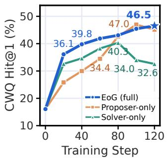  
(a) CWQ Hit@1

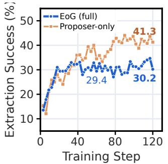  
(b) Extraction rate

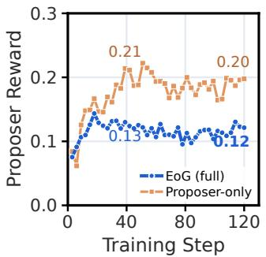  
(c) Pro<sub>p</sub>oser reward

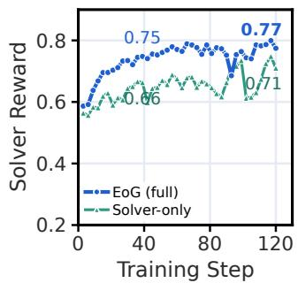  
(d) Solver reward

Figure 5: Training dynamics of role ablations. Proposer-only and Solver-only denote w/o Solver update and w/o Proposer update. (a) Validation Hit@1 on CWQ. (b) Question-extraction rate of the Proposer. (c–d) Proposer and Solver rewards.  
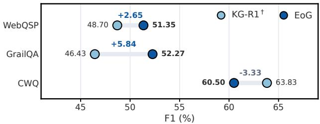  
Figure 6: EoG vs. KG-R1<sup>†</sup> on unseen schema. F1 (%) of EoG and KG-R1<sup>†</sup> trained on each dataset with Qwen-2.5-7B-Instruct.

## 4.3 Ablation Study (RQ2)

As shown in Table 3, we conduct an ablation study on Qwen-2.5- 7B-Instruct-based EoG with five ablation settin<sub>g</sub>s: removin<sub>g</sub> the Solver u<sub>p</sub>date<sub>;</sub> removin<sub>g</sub> the Pro<sub>p</sub>oser u<sub>p</sub>date<sub>;</sub> re<sub>p</sub>lacin<sub>g</sub> the <sub>q</sub>uer<sub>y</sub> execution of SVTS with random walks [56], which walk backward f<sub>rom</sub> <sub>an</sub> <sub>answer</sub> <sub>en</sub>tit<sub>y</sub> <sub>an</sub>d t<sub>a</sub>k<sub>e</sub> th<sub>e</sub> <sub>s</sub>t<sub>ar</sub>t <sub>en</sub>tit<sub>y</sub> <sub>as</sub> th<sub>e</sub> <sub>on</sub>l<sub>y</sub> <sub>answer</sub> <sub>o</sub>f th<sub>e ques</sub>ti<sub>on; an</sub>d <sub>rep</sub>l<sub>ac</sub>i<sub>ng</sub> th<sub>e</sub> G<sub>auss</sub>i<sub>an</sub> b<sub>oun</sub>d<sub>ary rewar</sub>d <sub>w</sub>ith the adversarial reward 1 − �¯ or the trian<sub>g</sub>ular boundar<sub>y</sub> reward $\begin{array} { r } { 1 - 2 | \bar { c } - \frac { 1 } { 2 } | } \end{array}$ , w<sup>h</sup>ere �¯ is t<sup>h</sup>e <sup>f</sup>raction o<sup>f</sup> So<sup>l</sup>ver trajectories t<sup>h</sup>at <sup>h</sup>it <sub>a</sub> <sub>go</sub>ld <sub>answer.</sub> All fi<sub>ve</sub> <sub>se</sub>tti<sub>ngs</sub> l<sub>ower</sub> th<sub>e</sub> Hit<sub>@</sub>1 <sub>on</sub> th<sub>e</sub> <sub>mu</sub>lti<sub>-</sub>h<sub>op</sub> CWQ by 4.11–14.65 points, showing that Graph Self-Play, SVTS, <sub>an</sub>d th<sub>e curr</sub>i<sub>cu</sub>l<sub>um eac</sub>h <sub>ma</sub>tt<sub>er mos</sub>t <sub>on mu</sub>lti<sub>-</sub>h<sub>op ques</sub>ti<sub>ons.</sub>

## 4.4 Analysis of Graph Self-Play (RQ3)

Comparison with Training-Free Agents. To examine whether ex<sub>p</sub>loration comes from interaction rather than the <sub>p</sub>rom<sub>p</sub>t<sub>,</sub> we <sub>co</sub>m<sub>pa</sub>r<sub>e</sub> E<sub>o</sub>G <sub>w</sub>ith it<sub>s u</sub>ntr<sub>a</sub>in<sub>e</sub>d <sub>s</sub>t<sub>a</sub>rtin<sub>g po</sub>int<sub>,</sub> R<sub>e</sub>A<sub>c</sub>t<sub>.</sub> E<sub>o</sub>G im<sub>p</sub>r<sub>oves</sub> th<sub>e average</sub> Hit<sub>@</sub>1 <sub>o</sub>f R<sub>e</sub>A<sub>c</sub>t b<sub>y more</sub> th<sub>an</sub> 24 <sub>po</sub>i<sub>n</sub>t<sub>s on a</sub>ll th<sub>ree</sub> backbones and also sur<sub>p</sub>asses ToG (Table 2), because the ex<sub>p</sub>loration strate<sub>gy</sub> of a trainin<sub>g</sub>-free a<sub>g</sub>ent cannot im<sub>p</sub>rove from interaction.

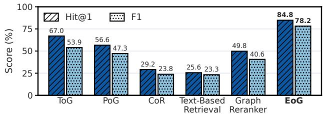

Impact of Removing the Solver Update. We observe an inter esting phenomenon: without Solver updates, the CWQ Hit@1 still rises from 16.06 to 46.39. We believe that <sub>p</sub>ro<sub>p</sub>osin<sub>g</sub> a <sub>q</sub>uestion is itself a multi-ho<sub>p</sub> <sub>g</sub>ra<sub>p</sub>h ex<sub>p</sub>loration<sub>,</sub> which transfers to solvin<sub>g</sub> via th<sub>e s</sub>h<sub>are</sub>d <sub>parame</sub>t<sub>ers.</sub> H<sub>owever,</sub> th<sub>e var</sub>i<sub>an</sub>t <sub>s</sub>till t<sub>ra</sub>il<sub>s</sub> E<sub>o</sub>G b<sub>y</sub> 16<sub>.</sub>39 and 6.88 on WebQSP and GrailQA, so the exploration gained from <sub>propos</sub>i<sub>ng</sub> <sub>on</sub>l<sub>y</sub> <sub>par</sub>tl<sub>y</sub> t<sub>rans</sub>f<sub>ers;</sub> <sub>on</sub>l<sub>y</sub> <sub>w</sub>h<sub>en</sub> b<sub>o</sub>th <sub>ro</sub>l<sub>es</sub> <sub>are</sub> <sub>up</sub>d<sub>a</sub>t<sub>e</sub>d <sub>a</sub>lt<sub>erna</sub>t<sub>e</sub>l<sub>y</sub> d<sub>o</sub> <sub>propos</sub>i<sub>ng</sub> <sub>an</sub>d <sub>so</sub>l<sub>v</sub>i<sub>ng</sub> <sub>re</sub>i<sub>n</sub>f<sub>orce</sub> <sub>eac</sub>h <sub>o</sub>th<sub>er.</sub>

Figure 4: Results on IndustryCarBench. Hit@1 and F1 (%) of EoG and baselines with Qwen-2.5-7B-Instruct.  
Table 3: Ablation study of EoG with Qwen-2.5-7B-Instruct on Freebase. Bold marks the best result in each column.
<table><tr><td rowspan="2">Variant</td><td colspan="2">WebQSP</td><td colspan="2">CWQ</td><td colspan="2">GrailQA</td></tr><tr><td>Hit@1</td><td>F1</td><td>Hit@1</td><td>F1</td><td>Hit@1</td><td>F1</td></tr><tr><td>ReAct (untrained)</td><td>34.82</td><td>28.42</td><td>16.06</td><td>13.45</td><td>49.19</td><td>50.07</td></tr><tr><td>w/o Solver update</td><td>53.74</td><td>47.08</td><td>46.39</td><td>42.15</td><td>58.50</td><td>55.69</td></tr><tr><td>w/o Proposer update</td><td>63.14</td><td>56.91</td><td>36.22</td><td>35.83</td><td>55.67</td><td>55.18</td></tr><tr><td>w/o query exec. (Random Walk)</td><td>64.87</td><td>57.67</td><td>35.93</td><td>35.64</td><td>60.12</td><td>60.41</td></tr><tr><td>Adversarial reward</td><td>69.51</td><td>60.40</td><td>42.59</td><td>41.85</td><td>63.26</td><td>61.01</td></tr><tr><td>Triangular reward</td><td>71.12</td><td>63.73</td><td>46.47</td><td>44.03</td><td>63.46</td><td>62.10</td></tr><tr><td>EoG (full, Gaussian reward)</td><td>70.13</td><td>62.10</td><td>50.58</td><td>49.27</td><td>65.38</td><td>63.01</td></tr></table>

## 4.5 Analysis of SVTS (RQ4)

T<sub>o</sub> <sub>e</sub>x<sub>a</sub>min<sub>e</sub> <sub>w</sub>h<sub>e</sub>th<sub>e</sub>r SVTS <sub>ca</sub>n r<sub>ep</sub>l<sub>ace</sub> h<sub>u</sub>m<sub>a</sub>n <sub>a</sub>nn<sub>o</sub>t<sub>a</sub>ti<sub>o</sub>n<sub>,</sub> <sub>we</sub> d<sub>e</sub>- si<sub>g</sub>n KG-R1<sup>†</sup>, a variant of KG-R1 [21] that ex<sub>p</sub>lores the full Freebase i<sub>ns</sub>t<sub>ea</sub>d <sub>o</sub>f <sub>a</sub> 2<sub>-</sub>h<sub>op</sub> <sub>su</sub>b<sub>grap</sub>h <sub>pre-ex</sub>t<sub>rac</sub>t<sub>e</sub>d f<sub>or</sub> <sub>eac</sub>h <sub>ques</sub>ti<sub>on</sub> <sub>an</sub>d difers from EoG onl<sub>y</sub> in bein<sub>g</sub> trained on annotated <sub>q</sub>uestions.

Comparison with Human Annotation. As shown in Table 2, KG-R1<sup>†</sup> i<sub>s s</sub>tr<sub>o</sub>n<sub>ge</sub>r in di<sub>s</sub>trib<sub>u</sub>ti<sub>o</sub>n<sub>,</sub> b<sub>u</sub>t <sub>ou</sub>t <sub>o</sub>f di<sub>s</sub>trib<sub>u</sub>ti<sub>o</sub>n<sub>,</sub> th<sub>e</sub> annotation-free EoG achieves an avera<sub>g</sub>e F1 3.05 and 3.65 hi<sub>g</sub>her than KG-R1<sup>†</sup> trained on WebQSP and GrailQA, and trails KG-R1<sup>†</sup> trained on 27,623 annotated CWQ questions by only 4.49. To ex-<sub>am</sub>i<sub>ne genera</sub>li<sub>za</sub>ti<sub>on</sub> b<sub>eyon</sub>d th<sub>e anno</sub>t<sub>a</sub>t<sub>e</sub>d <sub>sc</sub>h<sub>ema, we sp</sub>lit th<sub>e</sub> F<sub>ree</sub>b<sub>ase</sub> t<sub>es</sub>t <sub>se</sub>t<sub>s</sub> i<sub>n</sub>t<sub>o seen an</sub>d <sub>unseen sc</sub>h<sub>ema</sub> b<sub>y w</sub>h<sub>e</sub>th<sub>er a</sub>ll relations in their SPARQL query appear in the training set of KG-R1<sup>†</sup>, and com<sub>p</sub>are them on unseen schema (Fi<sub>g</sub>ure 6). EoG exceeds

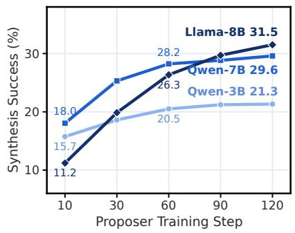  
(a) S<sub>y</sub>nthesis success

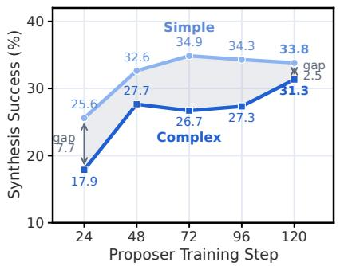  
(b) Sim<sub>p</sub>le vs. com<sub>p</sub>lex

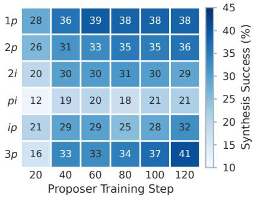  
(c) To<sub>p</sub>olo<sub>gy</sub> heatma<sub>p</sub>  
Figure 7: Evolution of task dificulty. Synthesis success rate of the Proposer over training steps (a) across three backbones, (b) on simple and complex topologies, and (c) per topology; complex topologies keep improving after simple ones plateau.

KG-R1<sup>†</sup> trained on WebQSP and GrailQA by 2.65 and 5.84 in F1, although both lead on seen schema; KG-R1<sup>†</sup> trained on CWQ still l<sub>ea</sub>d<sub>s,</sub> b<sub>u</sub>t b<sub>y</sub> 3<sub>.</sub>33 i<sub>ns</sub>t<sub>ea</sub>d <sub>o</sub>f 5<sub>.</sub>05<sub>.</sub> W<sub>e</sub> b<sub>e</sub>li<sub>eve</sub> th<sub>a</sub>t th<sub>e ga</sub>i<sub>ns o</sub>f KG R1<sup>†</sup> f<sub>rom</sub> <sub>anno</sub>t<sub>a</sub>ti<sub>on</sub> <sub>are</sub> <sub>con</sub>fi<sub>ne</sub>d t<sub>o</sub> th<sub>e</sub> <sub>sc</sub>h<sub>ema</sub> <sub>covere</sub>d b<sub>y</sub> it<sub>s</sub> tr<sub>a</sub>inin<sub>g se</sub>t<sub>, w</sub>h<sub>e</sub>r<sub>eas</sub> E<sub>o</sub>G tr<sub>a</sub>in<sub>s o</sub>n SVTS t<sub>as</sub>k<sub>s sa</sub>m<sub>p</sub>l<sub>e</sub>d <sub>ac</sub>r<sub>oss</sub> th<sub>e</sub> whole KG<sub>,</sub> so its <sub>g</sub>ra<sub>p</sub>h reasonin<sub>g</sub> transfers better to unseen schema.

Comparison with Random-Walk Synthesis. SVTS outperf<sub>orms ran</sub>d<sub>om wa</sub>lk<sub>s on a</sub>ll th<sub>ree</sub> d<sub>a</sub>t<sub>ase</sub>t<sub>s,</sub> b<sub>y</sub> 14<sub>.</sub>65 i<sub>n</sub> Hit<sub>@</sub>1 <sub>on</sub> CWQ (Table 3), for two reasons. First, random walks favor chain <sub>pa</sub>th<sub>s an</sub>d <sub>rare</sub>l<sub>y y</sub>i<sub>e</sub>ld th<sub>e</sub> i<sub>n</sub>t<sub>ersec</sub>ti<sub>on or nes</sub>t<sub>e</sub>d <sub>ques</sub>ti<sub>ons</sub> th<sub>a</sub>t <sub>mu</sub>lti<sub>-cons</sub>t<sub>ra</sub>i<sub>n</sub>t <sub>reason</sub>i<sub>ng nee</sub>d<sub>s.</sub> S<sub>econ</sub>d<sub>, a ran</sub>d<sub>om wa</sub>lk t<sub>a</sub>k<sub>es</sub> <sub>on</sub>l<sub>y</sub> it<sub>s</sub> <sub>s</sub>t<sub>ar</sub>t <sub>en</sub>tit<sub>y</sub> <sub>as</sub> th<sub>e</sub> <sub>answer,</sub> <sub>a</sub>lth<sub>oug</sub>h th<sub>e</sub> <sub>same</sub> <sub>re</sub>l<sub>a</sub>ti<sub>ons</sub> <sub>o</sub>f<sub>-</sub> ten reac<sup>h</sup> severa<sup>l</sup> entities; correct So<sup>l</sup>ver answers are t<sup>h</sup>en ju<sup>d</sup>ge<sup>d</sup> <sub>wrong,</sub> <sub>so</sub> th<sub>e</sub> P<sub>roposer</sub> <sub>can</sub> h<sub>ac</sub>k th<sub>e</sub> b<sub>oun</sub>d<sub>ary</sub> <sub>rewar</sub>d <sub>w</sub>ith <sub>ques-</sub> ti<sub>o</sub>n<sub>s</sub> <sub>w</sub>h<sub>ose</sub> <sub>a</sub>n<sub>swe</sub>r<sub>s</sub> <sub>a</sub>r<sub>e</sub> n<sub>o</sub>t <sub>u</sub>ni<sub>que.</sub> SVTS in<sub>s</sub>t<sub>ea</sub>d <sub>e</sub>x<sub>ecu</sub>t<sub>es</sub> th<sub>e</sub> <sub>query</sub> t<sub>o</sub> <sub>o</sub>bt<sub>a</sub>i<sub>n</sub> th<sub>e</sub> <sub>comp</sub>l<sub>e</sub>t<sub>e</sub> <sub>answer</sub> <sub>se</sub>t<sub>,</sub> <sub>w</sub>hi<sub>c</sub>h <sub>removes</sub> <sub>suc</sub>h i<sub>ncor-</sub> <sub>rec</sub>t <sub>rewar</sub>d<sub>s.</sub> M<sub>oreover,</sub> th<sub>e</sub> <sub>syn</sub>th<sub>es</sub>i<sub>ze</sub>d <sub>ques</sub>ti<sub>ons</sub> <sub>rare</sub>l<sub>y</sub> <sub>resem</sub>bl<sub>e</sub> th<sub>e</sub> t<sub>es</sub>t <sub>ques</sub>ti<sub>ons:</sub> <sub>on</sub>l<sub>y</sub> 2<sub>.</sub>28% <sub>o</sub>f th<sub>em</sub> h<sub>ave</sub> <sub>a</sub> <sub>neares</sub>t F<sub>ree</sub>b<sub>ase</sub> t<sub>es</sub>t <sub>q</sub>uestion with cosine similarit<sub>y</sub> above 0.90 (A<sub>pp</sub>endix C.4), so the <sub>g</sub>ains of EoG do not come from test-set leaka<sub>g</sub>e into trainin<sub>g</sub>.

## 4.6 Analysis of the Boundary-Aware Graph Curriculum (RQ5)

Impact of Removing the Proposer Update. Without Proposer <sub>up</sub>d<sub>a</sub>t<sub>es,</sub> t<sub>as</sub>k t<sub>opo</sub>l<sub>og</sub>i<sub>es no</sub> l<sub>onger</sub> f<sub>o</sub>ll<sub>ow</sub> th<sub>e</sub> S<sub>o</sub>l<sub>ver:</sub> th<sub>e</sub> S<sub>o</sub>l<sub>ver</sub> reward of this variant keeps rising, yet its CWQ Hit@1 drops after ste<sub>p</sub> 80 (Fi<sub>g</sub>ure 5(a, d)), i.e., the Solver overfits the static task distrib<sub>u</sub>tion of a Pro<sub>p</sub>oser <sub>w</sub>itho<sub>u</sub>t <sub>up</sub>dates. This indicates that a Pro<sub>p</sub>oser without u<sub>p</sub>dates cannot shift to to<sub>p</sub>olo<sub>g</sub>ies that the Solver h<sub>as no</sub>t <sub>mas</sub>t<sub>ere</sub>d<sub>, so</sub> th<sub>e</sub> S<sub>o</sub>l<sub>ver s</sub>t<sub>a</sub>ll<sub>s on ear</sub>l<sub>y, s</sub>i<sub>mp</sub>l<sub>e ques</sub>ti<sub>ons an</sub>d trails EoG by 14.36 points in Hit@1 on the multi-hop CWQ.

Impact of the Boundary Reward. We compare three Proposer <sub>rewar</sub>d<sub>s:</sub> th<sub>e a</sub>d<sub>versar</sub>i<sub>a</sub>l <sub>rewar</sub>d<sub>,</sub> th<sub>e</sub> t<sub>r</sub>i<sub>angu</sub>l<sub>ar</sub> b<sub>oun</sub>d<sub>ary rewar</sub>d<sub>,</sub> and the Gaussian boundar<sub>y</sub> reward. Durin<sub>g</sub> trainin<sub>g,</sub> the Solver <sub>occas</sub>i<sub>ona</sub>ll<sub>y pro</sub>d<sub>uces over</sub>l<sub>ong responses, w</sub>hi<sub>c</sub>h <sub>are</sub> t<sub>runca</sub>t<sub>e</sub>d <sub>an</sub>d t<sub>emporar</sub>il<sub>y</sub> l<sub>ower</sub> it<sub>s rewar</sub>d<sub>.</sub> With th<sub>e a</sub>d<sub>versar</sub>i<sub>a</sub>l <sub>rewar</sub>d<sub>,</sub> th<sub>e</sub> P<sub>roposer</sub> <sub>canno</sub>t t<sub>e</sub>ll <sub>a</sub> h<sub>ar</sub>d <sub>ques</sub>ti<sub>on</sub> f<sub>rom</sub> <sub>suc</sub>h <sub>a</sub> t<sub>runca</sub>t<sub>e</sub>d <sub>response</sub> <sub>an</sub>d i<sub>s</sub> <sub>rewar</sub>d<sub>e</sub>d <sub>mos</sub>t <sub>w</sub>h<sub>en</sub> th<sub>e</sub> S<sub>o</sub>l<sub>ver</sub> <sub>per</sub>f<sub>orms</sub> <sub>wors</sub>t<sub>:</sub> it<sub>s</sub> <sub>rewar</sub>d drop lasts the longest among the three rewards, and its CWQ Hit@1 is 7.99 below that of the Gaussian boundar<sub>y</sub> reward (Table 3). This <sub>s</sub>h<sub>ows</sub> th<sub>a</sub>t th<sub>e</sub> G<sub>auss</sub>i<sub>an</sub> b<sub>oun</sub>d<sub>ary rewar</sub>d i<sub>s no</sub>t <sub>re</sub>i<sub>n</sub>f<sub>orce</sub>d b<sub>y</sub> th<sub>e</sub> S<sub>o</sub>l<sub>ver</sub>’<sub>s</sub> t<sub>runca</sub>t<sub>e</sub>d f<sub>a</sub>il<sub>ures, so</sub> th<sub>e curr</sub>i<sub>cu</sub>l<sub>um re</sub>t<sub>urns</sub> t<sub>o</sub> th<sub>e</sub> S<sub>o</sub>l<sub>ver</sub>’<sub>s</sub> <sub>capa</sub>bilit<sub>y</sub> b<sub>oun</sub>d<sub>ary sooner a</sub>ft<sub>er</sub> it<sub>s ou</sub>t<sub>pu</sub>t<sub>s</sub> b<sub>rea</sub>k d<sub>own.</sub>

Evolution of Task Dificulty. As shown in Figure 7, the synthesis success rate of the Pro<sub>p</sub>oser rises on all three backbones (a), <sub>comp</sub>l<sub>ex</sub> t<sub>opo</sub>l<sub>og</sub>i<sub>es r</sub>i<sub>se</sub> f<sub>rom</sub> 17<sub>.</sub>9 t<sub>o</sub> 31<sub>.</sub>3 <sub>w</sub>hil<sub>e s</sub>i<sub>mp</sub>l<sub>e ones</sub> l<sub>eve</sub>l of near 34, narrowin<sub>g</sub> the <sub>g</sub>a<sub>p</sub> to 2.5 <sub>p</sub>oints (b), and 3� kee<sub>p</sub>s risin<sub>g</sub> from 16 to 41 after sim<sub>p</sub>le <sub>p</sub>atterns <sub>p</sub>lateau (c), while the Solver reward does not decline (Fi<sub>g</sub>ure 5(d)). This shows that the Pro<sub>p</sub>oser shifts toward com<sub>p</sub>lex to<sub>p</sub>olo<sub>g</sub>ies as the Solver im<sub>p</sub>roves<sub>,</sub> formin<sub>g</sub> <sub>an</sub> <sub>a</sub>d<sub>ap</sub>ti<sub>ve</sub> <sub>grap</sub>h <sub>curr</sub>i<sub>cu</sub>l<sub>um</sub> th<sub>a</sub>t <sub>a</sub>d<sub>vances</sub> d<sub>ynam</sub>i<sub>ca</sub>ll<sub>y</sub> f<sub>rom</sub> <sub>easy</sub> t<sub>o</sub> h<sub>ar</sub>d <sub>ques</sub>ti<sub>ons</sub> <sub>over</sub> ti<sub>me,</sub> <sub>w</sub>ith<sub>ou</sub>t <sub>a</sub> <sub>manua</sub>l <sub>sc</sub>h<sub>e</sub>d<sub>u</sub>l<sub>e.</sub>

## 4.7 Case Study

A<sub>ppen</sub>di<sub>x</sub> D <sub>s</sub>h<sub>ows</sub> <sub>one</sub> <sub>comp</sub>l<sub>e</sub>t<sub>e</sub> <sub>se</sub>lf<sub>-p</sub>l<sub>ay</sub> <sub>roun</sub>d <sub>on</sub> <sub>a</sub> 2� t<sub>as</sub>k <sub>w</sub>h<sub>ose</sub> executed answer is Jerse<sub>y</sub>. The Pro<sub>p</sub>oser finds that Jèrriais is s<sub>p</sub>oken in Jerse<sub>y,</sub> checks that French is also s<sub>p</sub>oken there<sub>,</sub> and asks “In which countr<sub>y</sub> are both Jèrriais and French s<sub>p</sub>oken?”, which names both <sub>anc</sub>h<sub>ors</sub> b<sub>u</sub>t hid<sub>es</sub> th<sub>e answer.</sub> Th<sub>e</sub> S<sub>o</sub>l<sub>ver re</sub>t<sub>r</sub>i<sub>eves</sub> th<sub>e coun</sub>t<sub>r</sub>i<sub>es o</sub>f each lan<sub>g</sub>ua<sub>g</sub>e<sub>,</sub> amon<sub>g</sub> them Dominica<sub>,</sub> Mali<sub>,</sub> and Chad for French<sub>,</sub> and kee<sub>p</sub>s onl<sub>y</sub> Jerse<sub>y</sub>, the one countr<sub>y</sub> shared with Jèrriais. The Solver thus answers b<sub>y</sub> intersectin<sub>g</sub> two entit<sub>y</sub> sets on the <sub>g</sub>ra<sub>p</sub>h <sub>ra</sub>th<sub>er</sub> th<sub>an reca</sub>lli<sub>ng one</sub> f<sub>ac</sub>t<sub>,</sub> th<sub>e reason</sub>i<sub>ng</sub> th<sub>a</sub>t 2� t<sub>as</sub>k<sub>s</sub> t<sub>ra</sub>i<sub>n.</sub>

## 5 Conclusion

We <sub>p</sub>resent EoG<sub>,</sub> in which a sin<sub>g</sub>le LLM self-evolves its <sub>g</sub>ra<sub>p</sub>h reasonin<sub>g</sub> on a KG <sub>u</sub>sin<sub>g</sub> onl<sub>y</sub> the KG itself<sub>,</sub> aimed at KGs that ha<sub>v</sub>e <sub>no ques</sub>ti<sub>on–answer anno</sub>t<sub>a</sub>ti<sub>ons an</sub>d <sub>canno</sub>t b<sub>e</sub> h<sub>an</sub>d<sub>e</sub>d t<sub>o c</sub>l<sub>ose</sub>d<sub>-</sub> <sub>source</sub> <sub>mo</sub>d<sub>e</sub>l<sub>s.</sub> G<sub>rap</sub>h S<sub>e</sub>lf<sub>-</sub>Pl<sub>ay</sub> l<sub>e</sub>t<sub>s</sub> <sub>one</sub> <sub>po</sub>li<sub>cy</sub> <sub>exp</sub>l<sub>ore</sub> th<sub>e</sub> <sub>grap</sub>h <sub>as</sub> b<sub>o</sub>th th<sub>e</sub> P<sub>roposer an</sub>d th<sub>e</sub> S<sub>o</sub>l<sub>ver,</sub> SVTS d<sub>er</sub>i<sub>ves ver</sub>ifi<sub>a</sub>bl<sub>e</sub> t<sub>as</sub>k<sub>s</sub> with com<sub>p</sub>lete answer sets b<sub>y</sub> executin<sub>g</sub> lo<sub>g</sub>ic <sub>q</sub>ueries on the KG<sub>,</sub> and the Bo<sub>u</sub>ndar<sub>y</sub>-Aware Gra<sub>p</sub>h C<sub>u</sub>rric<sub>u</sub>l<sub>u</sub>m kee<sub>p</sub>s the <sub>qu</sub>estions on th<sub>e</sub> S<sub>o</sub>l<sub>ver</sub>’<sub>s capa</sub>bilit<sub>y</sub> b<sub>oun</sub>d<sub>ary as</sub> it <sub>s</sub>hift<sub>s</sub> f<sub>rom s</sub>i<sub>mp</sub>l<sub>e</sub> t<sub>o comp</sub>l<sub>ex</sub> to<sub>p</sub>olo<sub>g</sub>ies. On six benchmarks over three KGs<sub>,</sub> EoG o<sub>u</sub>t<sub>p</sub>erforms <sub>promp</sub>ti<sub>ng-, agen</sub>t<sub>-, an</sub>d <sub>re</sub>t<sub>r</sub>i<sub>eva</sub>l<sub>-</sub>b<sub>ase</sub>d <sub>me</sub>th<sub>o</sub>d<sub>s, an</sub>d <sub>on sc</sub>h<sub>ema</sub> unseen in the annotations it exceeds KG-R1<sup>†</sup> trained on WebQSP or GrailQA. These results show that a KG can supply its own training t<sub>as</sub>k<sub>s,</sub> <sub>answers,</sub> <sub>an</sub>d <sub>curr</sub>i<sub>cu</sub>l<sub>um,</sub> <sub>o</sub>f<sub>er</sub>i<sub>ng</sub> <sub>a</sub> di<sub>rec</sub>ti<sub>on</sub> f<sub>or</sub> <sub>se</sub>lf<sub>-evo</sub>l<sub>v</sub>i<sub>ng</sub> <sub>g</sub>ra<sub>p</sub>h reasonin<sub>g</sub> on real-world KGs that lack annotations<sub>,</sub> re<sub>q</sub>uirin<sub>g</sub> nothin<sub>g</sub> be<sub>y</sub>ond the <sub>q</sub>uer<sub>y</sub> end<sub>p</sub>oint of each new tar<sub>g</sub>et KG.

## References

[1] Yu<sub>y</sub>an<sub>g</sub> Bai, Zhuofen<sub>g</sub> Li, Pin<sub>g</sub> Nie, Jianwen Xie, and Yu Zhan<sub>g</sub>. 2026. Gra<sub>p</sub>h-D<sub>a</sub>n<sub>ce</sub>r: Tr<sub>a</sub>inin<sub>g</sub> LLM<sub>s</sub> t<sub>o</sub> Ex<sub>p</sub>l<sub>o</sub>r<sub>e a</sub>nd R<sub>easo</sub>n <sub>ove</sub>r Gr<sub>ap</sub>h<sub>s v</sub>i<sub>a</sub> T<sub>wo</sub>-St<sub>age</sub> C<sub>u</sub>r riculum Post-Training. arXiv preprint arXiv:2602.02518 (2026).

[2] Alberto Cattaneo, Carlo Luschi, and Daniel Justus. 2025. Ground-truth sub<sub>g</sub>ra<sub>p</sub>hs for better training and evaluation of knowledge graph augmented llms. arXiv preprint arXiv:2511.04473 (2025).

[3] Ge Chan<sub>g</sub>, Jinbo Su, Jiachen<sub>g</sub> Liu, Pen<sub>g</sub>fei Yan<sub>g</sub>, Yuhao Shan<sub>g</sub>, Huiwen Zhen<sub>g</sub>, H<sub>o</sub>n<sub>g</sub>li M<sub>a,</sub> Y<sub>a</sub>n Li<sub>a</sub>n<sub>g,</sub> Y<sub>ua</sub>n<sub>c</sub>h<sub>u</sub>n Li<sub>, a</sub>nd Y<sub>u</sub>nxin Li<sub>u.</sub> 2026<sub>.</sub> Enh<sub>a</sub>n<sub>c</sub>in<sub>g</sub> A<sub>ge</sub>nti<sub>c</sub> Textual Graph Retrieval with Synthetic Stepwise Supervision. In Proceedings of the 64th Annual Meeting ofthe Association for Computational Linguistics (Volume 1: Long Papers). 25510–25525.

[4] Li<sub>y</sub>i Chen, Panron<sub>g</sub> Ton<sub>g</sub>, Zhon<sub>g</sub>min<sub>g</sub> Jin, Yin<sub>g</sub> Sun, Jie<sub>p</sub>in<sub>g</sub> Ye, and Hui Xion<sub>g</sub>. 2024. Plan-on-Gra<sub>p</sub>h: Self-Correctin<sub>g</sub> Ada<sub>p</sub>tive Plannin<sub>g</sub> of Lar<sub>g</sub>e Lan<sub>gu</sub>a<sub>g</sub>e Model on Knowledge Graphs. In Advances in Neural Information Processing Systems 37: Annual Conference on Neural Information Processing Systems 2024, NeurIPS 2024, Vancouver, BC, Canada, December 10 - 15, 2024.

[5] Zhuo Chen, Fei Wan<sub>g</sub>, Zixuan Li, Zhao Zhan<sub>g</sub>, Weiwei Din<sub>g</sub>, Chuan<sub>g</sub>uan<sub>g</sub> Yan<sub>g</sub>, Yon<sub>g</sub>jun Xu, Xiaolon<sub>g</sub> Jin, and Jiafen<sub>g</sub> Guo. 2025. Knowcoder-a1: Incentivizin<sub>g</sub> agentic reasoning capability with outcome supervision for KBQA. arXiv preprint arXiv:2510.25101 (2025).

[6] Yi-Jie Chen<sub>g</sub>, Oscar Chew, and Yun-Nun<sub>g</sub> Chen. 2025. The role of ex<sub>p</sub>loration <sub>mo</sub>d<sub>u</sub>l<sub>es</sub> i<sub>n</sub> <sub>sma</sub>ll l<sub>anguage</sub> <sub>mo</sub>d<sub>e</sub>l<sub>s</sub> f<sub>or</sub> k<sub>now</sub>l<sub>e</sub>d<sub>ge</sub> <sub>grap</sub>h <sub>ques</sub>ti<sub>on</sub> <sub>answer</sub>i<sub>ng.</sub> In Proceedings of the 63rd Annual Meeting of the Association for Computational Linguistics (Volume 4: Student Research Workshop). 919–928.

[7] Ron<sub>g</sub> Fu, Yemin Wan<sub>g</sub>, Tianxian<sub>g</sub> Xu, Yon<sub>g</sub>tai Liu, Weizhi Tan<sub>g</sub>, Wan<sub>gy</sub>u Wu, Xi<sub>aowe</sub>n M<sub>a,</sub> <sub>a</sub>nd Sim<sub>o</sub>n F<sub>o</sub>n<sub>g.</sub> 2026<sub>.</sub> S-P<sub>a</sub>th-RAG: <sub>se</sub>m<sub>a</sub>nti<sub>c</sub>-<sub>awa</sub>r<sub>e</sub> <sub>s</sub>h<sub>o</sub>rt<sub>es</sub>t-<sub>p</sub>ath retrieval au<sub>g</sub>mented <sub>g</sub>eneration for multi-ho<sub>p</sub> knowled<sub>g</sub>e <sub>g</sub>ra<sub>p</sub>h <sub>q</sub>uestion answering. In Proceedings of the ACM Web Conference 2026. 4057–4068.

[8] Guan<sub>g</sub>ze Gao, Zixuan Li, Chunfen<sub>g</sub> Yuan, Jiawei Li, Wu Jianzhuo, Yuehao Zhan<sub>g</sub>, Xiaolon<sub>g</sub> Jin, Bin<sub>g</sub> Li, and Weimin<sub>g</sub> Hu. 2025. D-RAG: Diferentiable Retrieval-Augmented Generation for Knowledge Graph Question Answering. In Proceedings of the 2025 Conference on Empirical Methods in Natural Language Processing, EMNLP 2025, Suzhou, China, November 4-9, 2025. Association for Computational Lin<sub>gu</sub>i<sub>s</sub>ti<sub>cs,</sub> 35398–35417<sub>.</sub>

[9] Yu Gu, Sue Kase, Michelle Vanni, Brian Sadler, Perc<sub>y</sub> Lian<sub>g</sub>, Xifen<sub>g</sub> Yan, and Yu Su. 2021. Be<sub>y</sub>ond iid: three levels of <sub>g</sub>eneralization for <sub>q</sub>uestion answerin<sub>g</sub> on knowledge bases. In Proceedings ofthe web conference 2021. 3477–3488.

[10] Hao<sub>y</sub>u Han, Kai Guo, Harr<sub>y</sub> Shomer, Yu Wan<sub>g</sub>, Yuchen<sub>g</sub> Chu, Han<sub>g</sub> Li, Li Ma, and Jilian<sub>g</sub> Tan<sub>g</sub>. 2026. Reasonin<sub>g</sub> b<sub>y</sub> ex<sub>p</sub>loration: A unified a<sub>pp</sub>roach to retrieval and generation over graphs. In Proceedings ofthe ACM Web Conference 2026. 2408–2418.

[11] Chen<sub>g</sub>son<sub>g</sub> Huan<sub>g</sub>, Wenhao Yu, Xiao<sub>y</sub>an<sub>g</sub> Wan<sub>g</sub>, Hon<sub>g</sub>min<sub>g</sub> Zhan<sub>g</sub>, Zon<sub>g</sub>xia Li, Ruosen Li, Jiaxin Huan<sub>g</sub>, Haitao Mi, and Don<sub>g</sub> Yu. 2026. R-zero: Self-evolvin<sub>g</sub> rea soning llm from zero data. In International Conference on Learning Representations, V<sub>o</sub>l<sub>.</sub> 2026<sub>.</sub> 130770<sub>–</sub>130790<sub>.</sub>

[12] Lei Huan<sub>g</sub>, Weijian<sub>g</sub> Yu, Weitao Ma, Weihon<sub>g</sub> Zhon<sub>g</sub>, Zhan<sub>gy</sub>in Fen<sub>g</sub>, Haotian Wang, Qianglong Chen, Weihua Peng, Xiaocheng Feng, Bing Qin, and Ting Li<sub>u.</sub> 2025<sub>.</sub> A S<sub>u</sub>r<sub>vey o</sub>n H<sub>a</sub>ll<sub>uc</sub>in<sub>a</sub>ti<sub>o</sub>n in L<sub>a</sub>r<sub>ge</sub> L<sub>a</sub>n<sub>guage</sub> M<sub>o</sub>d<sub>e</sub>l<sub>s</sub>: Prin<sub>c</sub>i<sub>p</sub>l<sub>es,</sub> Taxonomy, Challenges, and Open Questions. ACM Trans. Inf. Syst. 43, 2 (2025), 42:1–42:55.

[13] Jinhao Jian<sub>g</sub>, Kun Zhou, Zican Don<sub>g</sub>, Kemin<sub>g</sub> Ye, Xin Zhao, and Ji-Ron<sub>g</sub> Wen. 2023<sub>.</sub> St<sub>ruc</sub>t<sub>gp</sub>t<sub>:</sub> A <sub>genera</sub>l f<sub>ramewor</sub>k f<sub>or</sub> l<sub>arge</sub> l<sub>anguage mo</sub>d<sub>e</sub>l t<sub>o reason over</sub> structured data. In Proceedings of the 2023 conference on empirical methods in natural language processing. 9237–9251.

[14] Jinhao Jian<sub>g</sub>, Kun Zhou, Xin Zhao, Yan<sub>g</sub> Son<sub>g</sub>, Chen Zhu, Hen<sub>g</sub>shu Zhu, and Ji-Ron<sub>g</sub> Wen. 2025. KG-A<sub>g</sub>ent: An Eficient Autonomous A<sub>g</sub>ent Framework for Complex Reasoning over Knowledge Graph. In Proceedings ofthe 63rd Annual Meeting of the Association for Computational Linguistics (Volume 1: Long Papers), ACL 2025, Vienna, Austria, July 27- August 1, 2025. Association for Computational Lin uistics<sub>,</sub> 9505–9523.

[15] Bowen Jin, Chulin Xie, Jiawei Zhan<sub>g</sub>, Kashob Kumar Ro<sub>y</sub>, Yu Zhan<sub>g</sub>, Zhen<sub>g</sub> Li, Ruirui Li, Xianfen<sub>g</sub> Tan<sub>g</sub>, Suhan<sub>g</sub> Wan<sub>g</sub>, Yu Men<sub>g</sub>, and Jiawei Han. 2024. Gra<sub>p</sub>h Chain-of-Thou<sub>g</sub>ht: Au<sub>g</sub>mentin<sub>g</sub> Lar<sub>g</sub>e Lan<sub>g</sub>ua<sub>g</sub>e Models b<sub>y</sub> Reasonin<sub>g</sub> on Graphs. In Findings of the Association for Computational Linguistics, ACL 2024, Bangkok, Thailand and virtual meeting, August 11-16, 2024 (Findings ofACL, Vol. ACL 2024). Association for Computational Linguistics, 163–184.

[16] Don<sub>g</sub>cheon Lee, Ji-Yeon Park, H<sub>y</sub>e-Yoon Baek, Jim<sub>y</sub>eun<sub>g</sub> Seo, Se<sub>y</sub>eon<sub>g</sub> Kim, and B<sub>y</sub>un<sub>g</sub>kook Oh. 2026. Diversif<sub>y</sub>in<sub>g</sub> Diferentiable Gra<sub>p</sub>h Retrieval with To<sub>p</sub>ic Adaptive Multi-Intent Learning. In Proceedings ofthe ACM Web Conference 2026. 2273–2284.

[17] Chaofan Li, Lixin<sub>g</sub> Chen, Junhua Tan<sub>g</sub>, Yan<sub>g</sub> Bai, Yuton<sub>g</sub> Zhan<sub>g</sub>, Zhi Zhen<sub>g</sub>, Pan Zhou, and Zhe Qu. 2026. How Human Experts Educate Specialized LLMs: Fillin<sub>g</sub> Knowled<sub>g</sub>e Ga<sub>p</sub>s in KG-A<sub>ug</sub>mented Generation thro<sub>ug</sub>h Hall<sub>u</sub>cination Detection. In Proceedings ofthe ACM Web Conference 2026. 4172–4183.

[18] Mufei Li, Si<sub>q</sub>i Miao, and Pan Li. 2025. Sim<sub>p</sub>le is Efective: The Roles of Gra<sub>p</sub>hs and Lar<sub>g</sub>e Lan<sub>g</sub>ua<sub>g</sub>e Models in Knowled<sub>g</sub>e-Gra<sub>p</sub>h-Based Retrieval-Au<sub>g</sub>mented Generation. In The Thirteenth International Conference on Learning Representations, ICLR 2025, Singapore, April 24-28, 2025. OpenReview.net.

[19] Son<sub>g</sub>ze Li, Zhi<sub>q</sub>ian<sub>g</sub> Liu, Zhen<sub>g</sub>ke Gui, Huajun Chen, and Wen Zhan<sub>g</sub>. 2025. Enrich-on-Graph: Query-Graph Alignment for Complex Reasoning with LLM Enriching. In Proceedings ofthe 2025 Conference on Empirical Methods in Natural Language Processing, EMNLP2025, Suzhou, China, November4-9, 2025. Association f<sub>o</sub>r C<sub>o</sub>m<sub>pu</sub>t<sub>a</sub>ti<sub>o</sub>n<sub>a</sub>l Lin<sub>gu</sub>i<sub>s</sub>ti<sub>cs,</sub> 7672–7692<sub>.</sub>

[20] Lei Lian<sub>g</sub>, Zhon<sub>gp</sub>u Bo, Zhen<sub>g</sub>ke Gui, Zhon<sub>g</sub>shu Zhu, Lin<sub>g</sub> Zhon<sub>g</sub>, Peilon<sub>g</sub> Zhao, Men<sub>g</sub>shu Sun, Zhi<sub>q</sub>ian<sub>g</sub> Zhan<sub>g</sub>, Jun Zhou, Wen<sub>g</sub>uan<sub>g</sub> Chen, et al. 2025. Ka<sub>g</sub>: Boostin<sub>g</sub> llms in <sub>p</sub>rofessional domains via knowled<sub>g</sub>e au<sub>g</sub>mented <sub>g</sub>eneration. In Companion Proceedings ofthe ACM on Web Conference 2025. 334–343.

[21] Junhon<sub>g</sub> Lin, Shichen<sub>g</sub> Liu, Jin<sub>y</sub>eo<sub>p</sub> Son<sub>g</sub>, Son<sub>g</sub> Wan<sub>g</sub>, Julian Shun, and Yada Zhu. 2025<sub>.</sub> Efi<sub>c</sub>i<sub>en</sub>t <sub>an</sub>d t<sub>rans</sub>f<sub>era</sub>bl<sub>e</sub> <sub>agen</sub>ti<sub>c</sub> k<sub>now</sub>l<sub>e</sub>d<sub>ge</sub> <sub>grap</sub>h <sub>rag</sub> <sub>v</sub>i<sub>a</sub> <sub>re</sub>i<sub>n</sub>f<sub>orcemen</sub>t learning. arXiv preprint arXiv:2509.26383 (2025).

[22] Ben Liu, Jihai Zhan<sub>g</sub>, Fan<sub>gq</sub>uan Lin, Chen<sub>g</sub> Yan<sub>g</sub>, Min Pen<sub>g</sub>, and Wotao Yin. 2025<sub>.</sub> S<sub>ymagen</sub>t<sub>:</sub> A <sub>neura</sub>l<sub>-sym</sub>b<sub>o</sub>li<sub>c</sub> <sub>se</sub>lf<sub>-</sub>l<sub>earn</sub>i<sub>ng</sub> <sub>agen</sub>t f<sub>ramewor</sub>k f<sub>or</sub> <sub>comp</sub>l<sub>ex</sub> reasoning over knowledge graphs. In Proceedings of the ACM on Web Conference 2025. 98–108.

[23] Chenhui Liu, Jian<sub>p</sub>en<sub>g</sub> Zhou, and Jiahai Wan<sub>g</sub>. 2026. Chain-of-Relations: Faithful <sub>a</sub>nd Efi<sub>c</sub>i<sub>e</sub>nt LLM R<sub>easo</sub>nin<sub>g ove</sub>r Kn<sub>ow</sub>l<sub>e</sub>d<sub>ge</sub> Gr<sub>ap</sub>h<sub>s v</sub>i<sub>a</sub> R<sub>e</sub>l<sub>a</sub>ti<sub>o</sub>n-C<sub>e</sub>ntri<sub>c</sub> Exploration. In Findings ofthe Association for Computational Linguistics, ACL 2026, San Diego, California, United States, July 2-7, 2026. Association for Computational Lin<sub>gu</sub>i<sub>s</sub>ti<sub>cs,</sub> 43108–43119<sub>.</sub>

[24] Yuanxiang Liu, Songze Li, Xiaoke Guo, Zhaoyan Gong, Qifei Zhang, Huajun Chen<sub>,</sub> and Wen Zhan<sub>g</sub>. 2026. CoG: Controllable Gra<sub>p</sub>h Reasonin<sub>g</sub> via Relational Blue rints and Failure-Aware Refinement over Knowled e Gra hs. In Proceedings ofthe 64th Annual Meeting ofthe Association for Computational Linguistics (Volume 1: Long Papers), ACL 2026, San Diego, California, United States, July 2-7, 2026. Association for Com utational Linguistics, 15547–15568.

[25] Yu Liu, Xixun Lin, Yanmin Shan<sub>g</sub>, Yan<sub>g</sub>xi Li, Shi Wan<sub>g</sub>, and Yanan Cao. 2026. P<sub>a</sub>thMind: A R<sub>e</sub>tri<sub>eve</sub>-Pri<sub>o</sub>ritiz<sub>e</sub>-R<sub>easo</sub>n Fr<sub>a</sub>m<sub>ewo</sub>rk f<sub>o</sub>r Kn<sub>ow</sub>l<sub>e</sub>d<sub>ge</sub> Gr<sub>ap</sub>h R<sub>ea</sub>- soning with Large Language Models. In Fortieth AAAI Conference on Artificial Intelligence, Thirty-Eighth Conference on Innovative Applications ofArtificial Intelligence, Sixteenth Symposium on Educational Advances in Artificial Intelligence, AAAI 2026, Singapore, January 20-27, 2026. AAAI Press, 15386–15393.

[26] Hon<sub>g</sub>lian<sub>g</sub> Lu, Yuhan<sub>g</sub> Wen, Pen<sub>gy</sub>u Chen<sub>g</sub>, Ruijin Din<sub>g</sub>, Jia<sub>q</sub>i Guo, Haotian Xu, Chutian Wan<sub>g,</sub> Haonan Chen<sub>,</sub> et al. 2026. Search self-<sub>p</sub>la<sub>y</sub>: Pushin<sub>g</sub> the frontier of agent capability without supervision. In International Conference on Learning Representations, Vol. 2026. 65132–65165.

[27] Haoran Luo, Haihon<sub>g</sub> E, Yikai Guo, Qika Lin, Xiaobao Wu, Xin<sub>y</sub>u Mu, Wenhao Liu, Meina Song, Yifan Zhu, and Anh Tuan Luu. 2025. KBQA-o1: Agentic Knowl edge Base Question Answering with Monte Carlo Tree Search. In Forty-second International Conference on Machine Learning, ICML 2025, Vancouver, BC, Canada, July 13-19, 2025 (Proceedings ofMachine Learning Research, Vol. 267). PMLR / O<sub>p</sub>enRe<sub>v</sub>ie<sub>w</sub>.net.

[28] Linhao Luo, Yuan-Fan<sub>g</sub> Li, Gholamreza Hafari, and Shirui Pan. 2024. Reasonin<sub>g</sub> on Graphs: Faithful and Interpretable Large Language Model Reasoning. In The Twelfth International Conference on Learning Representations, ICLR 2024, Vienna, Austria, May 7-11, 2024. OpenReview.net.

[29] Linhao Luo, Zichen<sub>g</sub> Zhao, Gholamreza Hafari, Yuan-Fan<sub>g</sub> Li, Chen Gon<sub>g</sub>, and Shirui Pan. 2024. Gra<sub>p</sub>h-constrained reasonin<sub>g</sub>: Faithful reasonin<sub>g</sub> on knowled<sub>g</sub>e graphs with large language models. arXiv preprint arXiv:2410.13080 (2024).

[30] Costas Mavromatis and Geor<sub>g</sub>e Kar<sub>yp</sub>is. 2025. GNN-RAG: Gra<sub>p</sub>h Neural Retrieval for Eficient Large Language Model Reasoning on Knowledge Graphs. In Findings ofthe Association for Computational Linguistics, ACL 2025, Vienna, Austria, July 27 - August 1, 2025 (Findings ofACL, Vol. ACL 2025). Association for Computational Lin<sub>gu</sub>i<sub>s</sub>ti<sub>cs,</sub> 16682–16699<sub>.</sub>

[31] Shirui Pan, Linhao Luo, Yufei Wan<sub>g</sub>, Chen Chen, Jia<sub>p</sub>u Wan<sub>g</sub>, and Xindon<sub>g</sub> Wu. 2024. Unif in lar e lan ua e models and knowled e ra hs: A roadma . IEEE Transactions on Knowledge and Data Engineering 36, 7 (2024), 3580–3599.

[32] Joa uín Polonuer, Lucas Vittor, Iñaki Aran o, A ush Noori, David A. Clifton, L<sub>uc</sub>i<sub>a</sub>n<sub>o</sub> D<sub>e</sub>l C<sub>o</sub>rr<sub>o, a</sub>nd M<sub>a</sub>rink<sub>a</sub> Zitnik<sub>.</sub> 2026<sub>.</sub> A<sub>u</sub>t<sub>o</sub>n<sub>o</sub>m<sub>ous</sub> Kn<sub>ow</sub>l<sub>e</sub>d <sub>e</sub> Gr<sub>a</sub> h Exploration with Adaptive Breadth-Depth Retrieval. In Proceedings ofthe 64th Annual Meeting of the Association for Computational Linguistics (Volume 1: Long Papers), ACL 2026, San Diego, California, United States, July 2-7, 2026. Association f<sub>o</sub>r C<sub>o</sub>m<sub>pu</sub>t<sub>a</sub>ti<sub>o</sub>n<sub>a</sub>l Lin<sub>gu</sub>i<sub>s</sub>ti<sub>cs,</sub> 15694–15709<sub>.</sub>

[33] Hon<sub>gy</sub>u Ren and Jure Leskovec. 2020. Beta embeddin<sub>g</sub>s for multi-ho<sub>p</sub> lo<sub>g</sub>ical reasoning in knowledge graphs. Advances in Neural Information Processing Systems 33 (2020), 19716–19726.

[34] Jin<sub>g</sub> Ren, Bowen Li, Zi<sub>q</sub>i Xu, Xikun Zhan<sub>g</sub>, Ha<sub>y</sub>tham Fa<sub>y</sub>ek, and Xiaodon<sub>g</sub> Li. 2026<sub>.</sub> Wh<sub>en</sub> t<sub>o</sub> T<sub>rus</sub>t<sub>:</sub> A C<sub>ausa</sub>lit<sub>y-</sub>A<sub>ware</sub> C<sub>a</sub>lib<sub>ra</sub>ti<sub>on</sub> F<sub>ramewor</sub>k f<sub>or</sub> A<sub>ccura</sub>t<sub>e</sub> Knowledge Graph Retrieval-Augmented Generation. In Proceedings of the ACM Web Conference 2026. 3859–3869.

[35] Guan<sub>g</sub>min<sub>g</sub> Shen<sub>g</sub>, Chi Zhan<sub>g</sub>, Zilin<sub>g</sub>fen<sub>g</sub> Ye, Xibin Wu, Wan<sub>g</sub> Zhan<sub>g</sub>, Ru Zhan<sub>g</sub>, Yan<sub>g</sub>hua Pen<sub>g,</sub> Haibin Lin<sub>,</sub> and Chuan Wu. 2025. H<sub>y</sub>bridflow: A flexible and eficient rlhf framework. In Proceedings of the Twentieth European Conference on

Computer Systems. 1279–1297.

[36] Yanlin Son , Ben Liu, Víctor Gutiérrez-Basulto, Zhiwei Hu, Qian ian Xie, Min Pen<sub>g</sub>, So<sub>p</sub>hia Ananiadou, and Jef Z Pan. 2026. Plan then retrieve: reinforcement learning-guided complex reasoning over knowledge graphs. In Proceedings of the ACM Web Conference 2026. 3666–3676.

[37] Yurun Son<sub>g</sub>, Xian<sub>gq</sub>in<sub>g</sub> Shen, Jianfei Yu, and Rui Xia. 2026. Interactive Semanti<sub>c</sub> P<sub>a</sub>r<sub>s</sub>in<sub>g</sub> <sub>w</sub>ith R<sub>e</sub>inf<sub>o</sub>r<sub>ce</sub>m<sub>e</sub>nt L<sub>ea</sub>rnin<sub>g</sub> f<sub>o</sub>r Kn<sub>ow</sub>l<sub>e</sub>d<sub>ge</sub> Gr<sub>ap</sub>h R<sub>easo</sub>nin<sub>g.</sub> In Findings ofthe Association for Computational Linguistics: ACL 2026. 20464–20484

[38] Jiashuo Sun, Chen<sub>g</sub>jin Xu, Lumin<sub>gy</sub>uan Tan<sub>g</sub>, Saizhuo Wan<sub>g</sub>, Chen Lin, Ye<sub>y</sub>un Gon<sub>g</sub>, Lionel M. Ni, Heun<sub>g</sub>-Yeun<sub>g</sub> Shum, and Jian Guo. 2024. Think-on-Gra<sub>p</sub>h: Dee<sub>p</sub> and Res<sub>p</sub>onsible Reasonin<sub>g</sub> ofLar<sub>g</sub>e Lan<sub>g</sub>ua<sub>g</sub>e Model on Knowled<sub>g</sub>e Gra<sub>p</sub>h. In The Twelfth International Conference on Learning Representations, ICLR 2024, Vienna, Austria, May 7-11, 2024. OpenReview.net.

[39] Jia Ao Sun, Hao Yu, Fabrizio Gotti, Fen<sub>g</sub>ran Mo, Yihon<sub>g</sub> Wu, Yuchen Hui, Zhan Su, Lin<sub>g</sub>fen<sub>g</sub> Xiao, and Jian-Yun Nie. 2026. Search-on-<sub>g</sub>ra<sub>p</sub>h: Iterative informed navigation for large language model reasoning on knowledge graphs. In Proceedings ofthe 32nd ACM SIGKDD Conference on Knowledge Discovery and Data Mining V. 2. 4475–4485.

[40] Jia Ao Sun, Hao Yu, Fen<sub>g</sub>ran Mo, Zhan Su, Yuchen Hui, Ban<sub>g</sub> Liu, and Jian-Y<sub>u</sub>n Nie. 2026. Search-on-Gra<sub>p</sub>h-R1: Trainin<sub>g</sub> Lar<sub>g</sub>e Lan<sub>gu</sub>a<sub>g</sub>e Models to Search Knowledge Graphs with Reinforcement Learning. arXiv preprint arXiv:2607.18481 (2026).

[41] Xin Sun, Zhon<sub>gq</sub>i Chen, Xin<sub>g</sub> Zhen<sub>g</sub>, Qian<sub>g</sub> Liu, Shu Wu, Bowen Son<sub>g</sub>, Zilei Wan<sub>g,</sub> Wei<sub>q</sub>ian<sub>g</sub> Wan<sub>g,</sub> and Lian<sub>g</sub> Wan<sub>g</sub>. 2025. Kb<sub>q</sub>a-r1: Reinforcin<sub>g</sub> lar<sub>g</sub>e language models for knowledge base question answering. arXiv preprint arXiv:2512.10999 (2025).

[42] Alon Talmor and Jonathan Berant. 2018. The Web as a Knowled<sub>g</sub>e-Base for Answering Complex Questions. In Proceedings of the 2018 Conference of the North American Chapter ofthe Association for Computational Linguistics: Human Language Technologies, NAACL-HLT 2018, New Orleans, Louisiana, USA, June 1-6, 2018, Volume 1 (Long Papers). Association for Computational Linguistics, 641–651.

[43] Xingyu Tan, Xiaoyang Wang, Qing Liu, Xiwei Xu, Xin Yuan, and Wenjie Zhang. 2025. Paths-over-<sub>g</sub>ra<sub>p</sub>h: Knowled<sub>g</sub>e <sub>g</sub>ra<sub>p</sub>h em<sub>p</sub>owered lar<sub>g</sub>e lan<sub>g</sub>ua<sub>g</sub>e model reasoning. In Proceedings of the ACM on Web Conference 2025. 3505–3522.

[44] Xin<sub>gy</sub>u Tan, Xiao<sub>y</sub>an<sub>g</sub> Wan<sub>g</sub>, Qin<sub>g</sub> Liu, Xiwei Xu, Xin Yuan, Limin<sub>g</sub> Zhu, and Wenjie Z<sup>h</sup>ang. 2026. Privgemo: Privacy-preserving <sup>d</sup>ua<sup>l</sup>-tower grap<sup>h</sup> retrieva<sup>l</sup> for empowering llm reasoning with memory augmentation. arXiv preprint arXiv:2601.08739 (2026).

[45] Llama Team. 2024. The Llama 3 Herd of Models. CoRR abs/2407.21783 (2024). [46] Qwen Team. 2025. Qwen3 Technical Report. CoRR abs/2505.09388 (2025).

[47] Kaeh<sub>y</sub>un Um, K<sub>y</sub>uHwan Yeom, Haerim Yan<sub>g</sub>, Min<sub>y</sub>oun<sub>g</sub> Choi, H<sub>y</sub>eon<sub>g</sub>jun Yan<sub>g</sub>, <sub>a</sub>nd K<sub>yo</sub>n<sub>g</sub>-H<sub>o</sub> L<sub>ee.</sub> 2026<sub>.</sub> RPO-RAG: Ali<sub>g</sub>nin<sub>g</sub> Sm<sub>a</sub>ll LLM<sub>s w</sub>ith R<sub>e</sub>l<sub>a</sub>ti<sub>o</sub>n-<sub>awa</sub>r<sub>e</sub> Preference Optimization for Knowledge Graph Question Answering. In Proceedings ofthe ACM Web Conference 2026. 2513–2523.

[48] Shuai Wang and Yinan Yu. 2025. iQUEST: An Iterative Question-Guided Frame work for Knowledge Base Question Answering. In Proceedings ofthe 63rd Annual Meeting of the Association for Computational Linguistics (Volume 1: Long Papers), ACL 2025, Vienna, Austria, July 27- August 1, 2025. Association for Computational Lin<sub>gu</sub>i<sub>s</sub>ti<sub>cs,</sub> 15616–15628<sub>.</sub>

[49] Shuai Wan<sub>g</sub> and Yinan Yu. 2026. KG-Ho<sub>pp</sub>er: Em<sub>p</sub>owerin<sub>g</sub> Com<sub>p</sub>act O<sub>p</sub>en LLMs with Knowledge Graph Reasoning via Reinforcement Learning. CoRR abs/2603.21440 (2026).

[50] Shuai Wan<sub>g</sub> and Yinan Yu. 2026. KG-Reasoner: A Reinforced Model for End-to-End Multi-Hop Knowledge Graph Reasoning. CoRR abs/2604.12487 (2026).

[51] Xuezhi Wan<sub>g</sub>,Jason Wei, Dale Schuurmans, Quoc V. Le, Ed H. Chi, Sharan Naran<sub>g</sub>, A<sub>a</sub>k<sub>a</sub>nk<sub>s</sub>h<sub>a</sub> Ch<sub>ow</sub>dh<sub>e</sub>r<sub>y, a</sub>nd D<sub>e</sub>nn<sub>y</sub> Zh<sub>ou.</sub> 2023<sub>.</sub> S<sub>e</sub>lf-C<sub>o</sub>n<sub>s</sub>i<sub>s</sub>t<sub>e</sub>n<sub>cy</sub> Im<sub>p</sub>r<sub>oves</sub> Chain of Thought Reasoning in Language Models. In The Eleventh International Conference on Learning Representations, ICLR 2023, Kigali, Rwanda, May 1-5, 2023. O<sub>p</sub>enRe<sub>v</sub>ie<sub>w</sub>.net.

[52] Yin<sub>g</sub>xu Wan<sub>g</sub>, Shi<sub>q</sub>i Fan, Men<sub>g</sub>zhu Wan<sub>g</sub>, Si<sub>y</sub>an<sub>g</sub> Gao, Chao Wan<sub>g</sub>, and Nan Yin. 2026. DAMR: Eficient and Adaptive Context-Aware Knowledge Graph Question Answering with LLM-Guided MCTS. In The Fourteenth International Conference on Learning Representations, ICLR 2026, Rio de Janeiro, Brazil, April 23-27, 2026. <sub>p</sub>roceedin<sub>g</sub>s.iclr.cc.

[53] Jason Wei, Xuezhi Wan<sub>g</sub>, Dale Schuurmans, Maarten Bosma, Brian Ichter, Fei Xia, Ed H. Chi, Quoc V. Le, and Denny Zhou. 2022. Chain-of-Thought Prompting Elicits Reasoning in Large Language Models. In Advances in Neural Information Processing Systems 35: Annual Conference on Neural Information Processing Systems 2022, NeurIPS 2022, New Orleans, LA, USA, November 28 - December 9, 2022.

[54] Jiashen<sub>g</sub> Xu, Min<sub>g</sub>da Li, Yon<sub>gq</sub>ian<sub>g</sub> Tan<sub>g</sub>, Peijie Wan<sub>g</sub>, and Wenshen<sub>g</sub> Zhan<sub>g</sub>. 2026<sub>.</sub> T<sub>owar</sub>d<sub>s</sub> <sub>open-wor</sub>ld <sub>re</sub>t<sub>r</sub>i<sub>eva</sub>l<sub>-augmen</sub>t<sub>e</sub>d <sub>genera</sub>ti<sub>on</sub> <sub>on</sub> k<sub>now</sub>l<sub>e</sub>d<sub>ge</sub> <sub>grap</sub>h<sub>:</sub> A multi-agent collaboration framework. In Proceedings of the ACM Web Conference 2026. 2171–2182

[55] Silei Xu, Shichen<sub>g</sub> Liu, Theo Culhane, Elizaveta Pertseva, Men<sub>g</sub>-Hsi Wu, Sina S<sub>e</sub>mn<sub>a</sub>ni<sub>, a</sub>nd M<sub>o</sub>ni<sub>ca</sub> L<sub>a</sub>m<sub>.</sub> 2023<sub>.</sub> Fin<sub>e</sub>-t<sub>u</sub>n<sub>e</sub>d LLM<sub>s</sub> kn<sub>ow</sub> m<sub>o</sub>r<sub>e,</sub> h<sub>a</sub>ll<sub>uc</sub>in<sub>a</sub>t<sub>e</sub> less with few-shot se<sub>q</sub>uence-to-se<sub>q</sub>uence semantic <sub>p</sub>arsin<sub>g</sub> over Wikidata. In

Proceedings of the 2023 Conference on Empirical Methods in Natural Language Processing. 5778–5791.

[56] Shuwen Xu, Yao Xu, Jiaxian<sub>g</sub> Liu, Chenhao Yuan, Wenshuo Pen<sub>g</sub>, Jun Zhao, and Kang Liu. 2026. GraphWalker: Agentic Knowledge Graph Question Answering via Synthetic Trajectory Curriculum. CoRR abs/2603.28533 (2026)

[57] Yao Xu, Shizhu He, Jiabei Chen, et al. 2024. Generate-on-Gra<sub>p</sub>h: Treat LLM as both Agent and KG in Incomplete Knowledge Graph Question Answering. CoRR abs/2404.14741 (2024).

[58] Shi<sub>q</sub>i Yan, Yubo Chen, Rui<sub>q</sub>i Zhou, Zhen<sub>g</sub>xi Yao, Shuai Chen, Tian<sub>y</sub>i Zhan<sub>g</sub>, Shijie Zhang, Wei-Qiang Zhang, Yongfeng Huang, Haixin Duan, et al. 2026. Ex<sub>p</sub>lore-on-<sub>g</sub>ra<sub>p</sub>h: Incentivizin<sub>g</sub> autonomous ex<sub>p</sub>loration of lar<sub>g</sub>e lan<sub>g</sub>ua<sub>g</sub>e models on knowledge graphs with path-refined reward modeling. In International Conference on Learning Representations, Vol. 2026. 56761–56789.

[59] An Yan<sub>g</sub>, Baoson<sub>g</sub> Yan<sub>g</sub>, Beichen Zhan<sub>g</sub>, Bin<sub>y</sub>uan Hui, Bo Zhen<sub>g</sub>, et al. 2024. Qwen2.5 Technical Report. CoRR abs/2412.15115 (2024).

[60] Rui<sub>y</sub>i Yan<sub>g</sub>, Hao Xue, Imran Razzak, and Flora D Salim. 2026. Be<sub>y</sub>ond sin<sub>g</sub>le <sub>p</sub>ass, looping through time: Kg-irag with iterative knowledge retrieval. In Proceedings ofthe ACM Web Conference 2026. 4460–4471.

[61] Shun<sub>y</sub>u Yao, Jefre<sub>y</sub> Zhao, Dian Yu, Nan Du, Izhak Shafran, Karthik Narasimhan, and Yuan Cao. 2022. React: S<sub>y</sub>ner<sub>g</sub>izin<sub>g</sub> reasonin<sub>g</sub> and actin<sub>g</sub> in lan<sub>g</sub>ua<sub>g</sub>e models. arXiv preprint arXiv:2210.03629 (2022).

[62] Wen-tau Yih, Matthew Richardson, Christo<sub>p</sub>her Meek, Min<sub>g</sub>-Wei Chan<sub>g</sub>, and Jina Suh. 2016. The Value of Semantic Parse Labeling for Knowledge Base Question Answering. In Proceedings of the 54th Annual Meeting of the Association for Computational Linguistics, ACL 2016, August 7-12, 2016, Berlin, Germany, Volume 2: Short Papers. The Association for Computer Linguistics.

[63] Yuchen Yin<sub>g</sub>, Wei<sub>q</sub>i Jian<sub>g</sub>, Ton<sub>gy</sub>a Zhen<sub>g</sub>, Yu Wan<sub>g</sub>, Shun<sub>y</sub>u Liu, Kaixuan Chen, and Min<sub>g</sub>li Son<sub>g</sub>. 2026. Gra<sub>p</sub>hScout: Em<sub>p</sub>owerin<sub>g</sub> Lar<sub>g</sub>e Lan<sub>g</sub>ua<sub>g</sub>e Models with Intrinsic Exploration Ability for Agentic Graph Reasoning. In Proceedings ofthe 32nd ACM SIGKDD Conference on Knowledge Discovery and Data Mining V. 2. 6258–6269.

[64] Junchi Yu, Yujie Liu, Jindong Gu, Philip H. S. Torr, and Dongzhan Zhou. 2025. Can Kno<sub>w</sub>led<sub>g</sub>e-Gra<sub>p</sub>h-based Retrie<sub>v</sub>al A<sub>ug</sub>mented Generation Reall<sub>y</sub> Retrie<sub>v</sub>e What You Need?. In Advances in Neural Information Processing Systems 38: Annual Conference on Neural Information Processing Systems 2025, NeurIPS 2025, San Diego, CA, USA, December 2-7, 2025 / Mexico City, Mexico, November 30 - December 5, 2025.

[65] Pen<sub>g</sub> Yu, En Xu, Bin Chen, Haibiao Chen, and Yinfei Xu. 2026. STEM: Structure-Tr<sub>ac</sub>in<sub>g</sub> E<sub>v</sub>id<sub>e</sub>n<sub>ce</sub> Minin<sub>g</sub> f<sub>o</sub>r Kn<sub>ow</sub>l<sub>e</sub>d<sub>ge</sub> Gr<sub>ap</sub>h<sub>s</sub>-Dri<sub>ve</sub>n R<sub>e</sub>tri<sub>eva</sub>l-A<sub>ug</sub>m<sub>e</sub>nt<sub>e</sub>d Generation. In Proceedings of the 64th Annual Meeting of the Association for Computational Linguistics (Volume 1: Long Papers), ACL 2026, San Diego, California, United States, July 2-7, 2026. Association for Computational Linguistics, 7252–7285.

[66] Qi<sub>y</sub>in<sub>g</sub> Yu, Zhen<sub>g</sub> Zhan<sub>g</sub>, Ruofei Zhu, Yufen<sub>g</sub> Yuan, Xiaochen Zuo, Yu Yue, Weinan Dai, Tiantian Fan, Gao<sup>h</sup>ong Liu, Lingjun Liu, et a<sup>l</sup>. 2026. Dapo: An open-source llm reinforcement learning system at scale. Advances in Neural Information Processing Systems 38 (2026), 113222–113244.

[67] Zhenrui Yue, Kartike<sub>y</sub>a U<sub>p</sub>asani, Xianjun Yan<sub>g</sub>, Su<sub>y</sub>u Ge, Shaolian<sub>g</sub> Nie, Yunin<sub>g</sub> M<sub>ao,</sub> Zh<sub>e</sub> Li<sub>u,</sub> <sub>a</sub>nd D<sub>o</sub>n<sub>g</sub> W<sub>a</sub>n<sub>g.</sub> 2026<sub>.</sub> Dr<sub>.</sub> Z<sub>e</sub>r<sub>o</sub>: S<sub>e</sub>lf-E<sub>vo</sub>l<sub>v</sub>in<sub>g</sub> S<sub>ea</sub>r<sub>c</sub>h A<sub>ge</sub>nt<sub>s</sub> without Training Data. CoRR abs/2601.07055 (2026).

[68] Chao Zhan<sub>g</sub>, Min<sub>g</sub>han Li, Tianrui Lv, and Guodon<sub>g</sub> Zhou. 2026. RFKG-CoT: R<sub>e</sub>l<sub>a</sub>ti<sub>o</sub>n-Dri<sub>ve</sub>n Ad<sub>ap</sub>ti<sub>ve</sub> H<sub>op</sub>-<sub>cou</sub>nt S<sub>e</sub>l<sub>ec</sub>ti<sub>o</sub>n <sub>a</sub>nd F<sub>ew</sub>-Sh<sub>o</sub>t P<sub>a</sub>th G<sub>u</sub>id<sub>a</sub>n<sub>ce</sub> for Knowledge-Aware QA. In Fortieth AAAI Conference on Artificial Intelligence, Thirty-Eighth Conference on Innovative Applications of Artificial Intelligence, Sixteenth Symposium on Educational Advances in Artificial Intelligence, AAAI 2026, Singapore, January 20-27, 2026. AAAI Press, 34647–34655.

[69] Lian<sub>g</sub>lian<sub>g</sub> Zhan<sub>g</sub>, Zhuorui Jian<sub>g</sub>, Hon<sub>g</sub>lian<sub>g</sub> Chi, Hao<sub>y</sub>an<sub>g</sub> Chen, Mohammed Elkoumy, Fali Wang, Qiong Wu, Zhengyi Zhou, Shirui Pan, Suhang Wang, et al. 2026. Dia<sub>g</sub>nosin<sub>g</sub> and addressin<sub>g p</sub>itfalls in KG-RAG datasets: To<sub>w</sub>ard more reliable benchmarking. Advances in Neural Information Processing Systems 38 (2026).

[70] Andrew Zhao, Yiran Wu, Ton<sub>g</sub> Wu, Quentin Xu, Yan<sub>g</sub> Yue, Matthieu Lin, Shenzhi Wang, Qingyun Wu, Zilong Zheng, and Gao Huang. 2026. Absolute zero: Reinforced self-play reasoning with zero data. Advances in Neural Information Processing Systems 38 (2026), 105816–105879.

[71] Xuejiao Zhao, Si<sub>y</sub>an Liu, Su-Yin Yan<sub>g</sub>, and Chun<sub>y</sub>an Miao. 2025. Medra<sub>g</sub>: Enhancin<sub>g</sub> retrieval-au<sub>g</sub>mented <sub>g</sub>eneration with knowled<sub>g</sub>e <sub>g</sub>ra<sub>p</sub>h-elicited reasonin<sub>g</sub> for healthcare copilot. In Proceedings ofthe ACM on Web Conference 2025. 4442–4457.

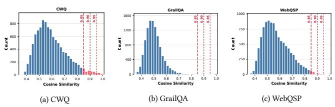

## A Proof of Proposition 1

Proposition 1. With equal format scores, $R _ { \mathrm { P } }$ is maximal only where the learning signal peaks and minimal where it vanishes.

Proof. Let � <sup>b</sup>e a va<sup>l</sup>i<sup>d</sup> question wit<sup>h</sup> So<sup>l</sup>ver trajectories $\{ \rho ^ { j } \} _ { j = 1 } ^ { n } ,$ answer scores $s _ { j } \in [ 0 , 1 ]$ and mean <sub>�</sub>¯ as in E<sub>q</sub>uation 14<sub>,</sub> and format scores that all equal �. Then $R _ { \mathrm { S } } ( \rho ^ { j } ) = \lambda _ { \mathrm { f m t } } f + \lambda _ { \mathrm { a n s } } s _ { j }$ i<sub>s a pos</sub>iti<sub>ve</sub> <sub>a</sub>fi<sub>ne map o</sub>f $s _ { j } ,$ and since the <sub>g</sub>rou<sub>p</sub>-normalized advanta<sub>g</sub>e is invariant to such ma<sub>p</sub>s<sub>,</sub> $\hat { A } ^ { j } = \big ( s _ { j } - \bar { s } \big ) / \sigma$ <sub>w</sub>ith $\sigma = { \sqrt { \sigma ^ { 2 } ( q ) } }$ <sub>w</sub>h<sub>en</sub> $\sigma > 0 ,$ <sub>an</sub>d $\hat { A } ^ { j } = 0$ <sub>w</sub>h<sub>en</sub> $\sigma = 0 .$

Learning signal. We measure the Solver’s learning signal on � by th<sub>e</sub> <sub>mean</sub> <sub>a</sub>b<sub>so</sub>l<sub>u</sub>t<sub>e</sub> <sub>a</sub>d<sub>van</sub>t<sub>age</sub> <sub>o</sub>f it<sub>s</sub> <sub>group,</sub>

$$
S ( q ) = \frac { 1 } { n } \sum _ { j = 1 } ^ { n } \bigl | \hat { A } ^ { j } \bigr | .\tag{17}
$$

If $\sigma ^ { 2 } ( q ) = 0$ <sub>,</sub> <sub>a</sub>ll <sub>scores</sub> <sub>are</sub> <sub>equa</sub>l<sub>,</sub> <sub>every</sub> $\hat { A } ^ { j } = 0 ;$ <sub>,</sub> <sub>an</sub>d $S ( q ) = 0$ Oth<sub>erw</sub>i<sub>se</sub> th<sub>e norma</sub>li<sub>ze</sub>d <sub>a</sub>d<sub>van</sub>t<sub>ages sa</sub>ti<sub>s</sub>f<sub>y</sub> $\begin{array} { r } { \frac 1 n \sum _ { j } ( \hat { A } ^ { j } ) ^ { 2 } = 1 } \end{array}$ , so <sup>b</sup><sub>y</sub> the Ca<sub>u</sub>ch<sub>y</sub>–Sch<sub>w</sub>arz ine<sub>qu</sub>alit<sub>y</sub> $S ( q ) \leq 1$ <sub>,</sub> with e<sub>q</sub>ualit<sub>y</sub> if and onl<sub>y</sub> if <sub>a</sub>ll $| \hat { A } ^ { j } |$ <sub>are equa</sub>l<sub>,</sub> i<sub>.e.,</sub> h<sub>a</sub>lf <sub>o</sub>f th<sub>e scores</sub> li<sub>e a</sub>t $\bar { s } + \sigma$ <sub>an</sub>d th<sub>e o</sub>th<sub>er</sub> h<sub>a</sub>lf <sub>a</sub>t ${ \bar { s } } - \sigma .$

Maximum and minimum. Since $0 \leq s _ { j } \leq 1 ,$ <sub>, we</sub> h<sub>ave</sub> $s _ { j } ^ { 2 } \leq s _ { j }$ <sub>an</sub>d h<sub>ence</sub> $\begin{array} { r } { \sigma ^ { 2 } ( q ) = \frac { 1 } { n } \sum _ { j } s _ { j } ^ { 2 } - \bar { s } ^ { 2 } \leq \bar { s } ( 1 - \bar { s } ) \leq \frac { 1 } { 4 } } \end{array}$ <sub>, w</sub>h<sub>ere</sub> th<sub>e</sub> fi<sub>rs</sub>t i<sub>nequa</sub>lit<sub>y</sub> is ti<sub>g</sub>ht onl<sub>y</sub> if ever<sub>y</sub> $s _ { j } \in \{ 0 , 1 \}$ <sub>an</sub>d th<sub>e secon</sub>d <sub>on</sub>l<sub>y</sub> $\begin{array} { r } { \mathrm { i f } \ \bar { s } = \frac { 1 } { 2 } } \end{array}$ <sub>.</sub> H<sub>e</sub>n<sub>ce</sub> $R _ { \mathrm { P } } ( q )$ reac<sup>h</sup>es its maximum 1 on<sup>l</sup>y w<sup>h</sup>en <sup>h</sup>a<sup>lf</sup> o<sup>f</sup> t<sup>h</sup>e trajectories <sub>score</sub> 1 <sub>an</sub>d th<sub>e o</sub>th<sub>er</sub> h<sub>a</sub>lf <sub>score</sub> $0 ;$ th<sub>ere</sub> $\hat { A } ^ { j } = \pm 1$ <sub>an</sub>d $S ( q ) = 1$ its lar<sub>g</sub>est <sub>p</sub>ossible value. Conversel<sub>y,</sub> $R _ { \mathrm { P } } ( q )$ t<sub>a</sub>k<sub>es</sub> it<sub>s</sub> minim<sub>u</sub>m $\exp ( - \frac { 1 } { 3 2 h } )$ <sub>exac</sub>tl<sub>y w</sub>h<sub>en</sub> $\sigma ^ { 2 } ( q ) = 0 ;$ <sub>, w</sub>hi<sub>c</sub>h i<sub>s exac</sub>tl<sub>y w</sub>h<sub>en</sub> $S ( q ) = 0$ With $n = 5 ,$ an even s<sub>p</sub>lit is im<sub>p</sub>ossible and $\sigma ^ { 2 } ( q ) \leq 0 . 2 4 $ <sub>,</sub> <sub>a</sub>tt<sub>a</sub>i<sub>ne</sub>d <sub>on</sub>l<sub>y</sub> b<sub>y a</sub> 2<sub>:</sub>3 <sub>sp</sub>lit b<sub>e</sub>t<sub>ween scores</sub> 0 <sub>an</sub>d 1<sub>.</sub> □

Remark. The adversarial and triangular rewards of Section 4.3 <sub>are</sub> f<sub>unc</sub>ti<sub>ons o</sub>f th<sub>e success ra</sub>t<sub>e �</sub>¯<sub>.</sub> Th<sub>e a</sub>d<sub>versar</sub>i<sub>a</sub>l <sub>rewar</sub>d <sub>pea</sub>k<sub>s a</sub>t $\bar { c } = 0 ,$ w<sup>h</sup>ere every trajectory misses, a<sup>ll</sup> scores are 0, an<sup>d</sup> $S ( q ) = 0$ Th<sub>e</sub> t<sub>r</sub>i<sub>angu</sub>l<sub>ar rewar</sub>d <sub>pea</sub>k<sub>s a</sub>t $\begin{array} { r } { \bar { c } = \frac { 1 } { 2 } } \end{array}$ b<sub>u</sub>t<sub>,</sub> lik<sub>e</sub> th<sub>e a</sub>d<sub>versar</sub>i<sub>a</sub>l rewar<sup>d</sup>, <sup>d</sup>oes not re<sup>fl</sup>ect <sup>h</sup>ow muc<sup>h</sup> o<sup>f</sup> t<sup>h</sup>e answer set eac<sup>h</sup> trajectory recovers.

## B Algorithm Details

SVTS. As shown in Table 6 and Algorithm 1, SVTS repeats groundin<sub>g,</sub> com<sub>p</sub>ilation<sub>,</sub> and execution for each of the six <sub>q</sub>uer<sub>y</sub> <sub>p</sub>atterns <sub>un</sub>til it <sub>co</sub>ll<sub>ec</sub>t<sub>s</sub> � t<sub>as</sub>k<sub>s or ex</sub>h<sub>aus</sub>t<sub>s</sub> � <sub>a</sub>tt<sub>emp</sub>t<sub>s.</sub> G<sub>roun</sub>di<sub>ng wa</sub>lk<sub>s</sub> f<sub>rom a see</sub>d <sub>en</sub>tit<sub>y</sub> t<sub>o</sub> bi<sub>n</sub>d th<sub>e var</sub>i<sub>a</sub>bl<sub>es an</sub>d <sub>re</sub>l<sub>a</sub>ti<sub>ons o</sub>f th<sub>e pa</sub>tt<sub>ern</sub> to real facts<sub>;</sub> the resultin<sub>g q</sub>uer<sub>y g</sub>ra<sub>p</sub>h is com<sub>p</sub>iled into an exe-<sub>cu</sub>t<sub>a</sub>bl<sub>e</sub> <sub>query</sub> <sub>an</sub>d <sub>eva</sub>l<sub>ua</sub>t<sub>e</sub>d <sub>on</sub> th<sub>e</sub> <sub>grap</sub>h<sub>,</sub> <sub>an</sub>d <sub>quer</sub>i<sub>es</sub> <sub>w</sub>ith <sub>emp</sub>t<sub>y,</sub> <sub>a</sub>t l<sub>eas</sub>t <sub>�, or unnamea</sub>bl<sub>e answers are</sub> di<sub>scar</sub>d<sub>e</sub>d b<sub>e</sub>f<sub>ore</sub> t<sub>ra</sub>i<sub>n</sub>i<sub>ng.</sub>

## C Experimental Details

## C.1 Datasets

On Freebase, WebQSP [62] contains single-hop and two-hop questions, CWQ [42] extends WebQuestions with multi-entity constraints, conjunctions, and superlatives, and GrailQA [9] tests i.i.d.<sub>,</sub> com<sub>p</sub>ositional<sub>,</sub> and zero-shot <sub>g</sub>eneralization. On Wikidata<sub>,</sub> GTSQA [2] provides 1,622 test questions with gold answer subgraphs, and WikiWebQuestions [55] migrates WebQuestions to Wikidata with re-annotated SPARQL queries. IndustryCarBench i<sub>s a</sub> d<sub>oma</sub>i<sub>n</sub> b<sub>enc</sub>h<sub>mar</sub>k th<sub>a</sub>t <sub>we</sub> b<sub>u</sub>ild <sub>on a rea</sub>l<sub>-wor</sub>ld <sub>au</sub>t<sub>omo</sub>ti<sub>ve-</sub> aesthetics KG coverin<sub>g</sub> car models<sub>,</sub> desi<sub>g</sub>n elements<sub>,</sub> attributes<sub>,</sub> colors<sub>,</sub> materials<sub>,</sub> and brands<sub>;</sub> it contains 500 test <sub>q</sub>uestions written b<sub>y</sub> d<sub>oma</sub>i<sub>n</sub> <sub>exper</sub>t<sub>s,</sub> <sub>w</sub>ith <sub>go</sub>ld <sub>answers</sub> <sub>execu</sub>t<sub>a</sub>bl<sub>e</sub> <sub>on</sub> th<sub>e</sub> <sub>grap</sub>h <sub>an</sub>d h<sub>as no anno</sub>t<sub>a</sub>t<sub>e</sub>d t<sub>ra</sub>i<sub>n</sub>i<sub>ng se</sub>t<sub>.</sub> E<sub>o</sub>G <sub>never uses</sub> th<sub>e anno</sub>t<sub>a</sub>t<sub>e</sub>d trainin<sub>g q</sub>uestions of an<sub>y</sub> benchmark<sub>;</sub> onl<sub>y</sub> ${ \mathrm { K G } } { \cdot } \mathrm { R } 1 ^ { \dagger }$ d<sub>oes.</sub>

```latex
Algorithm 1: Symbolically Verifiable Topology Synthesis
Input: KG G; pattern set P; seed pool $\varepsilon _ { \mathrm { s e e d } } ;$ p<sup>er-</sup>p<sup>attern</sup>
target �; attem<sub>p</sub>t <sup>b</sup>u<sup>d</sup>get <sup>�</sup>; answer ca<sub>p</sub> �
Output: task set $\mathcal { D } _ { \mathrm { S V T S } }$
D ← ∅
foreach ��� $\in \mathcal { P }$ do
� ← 0; � ← 0
while $n < N$ and $t < T$
$t \gets t + 1 ;$ <sub>samp</sub>l<sub>e see</sub>d $s \in \mathcal { E } _ { \mathrm { s e e d } }$
� ← random walk realizin<sub>g �</sub>�� from � in $\mathcal { G }$
if $\pi = \bot$ then continue
$G _ { Q } \gets$ assemble(���, �); � ← Com<sub>p</sub>ile $( G _ { Q } )$
${ \mathcal { A } } _ { Q }$ ← Execute(�, G)
if $\mathcal { A } _ { Q } = \emptyset$ or $| { \mathcal { A } } _ { Q } | \geq \kappa$ or ¬Named $( \mathcal { A } _ { Q } )$ then
continue
D ← D ∪ {(�<sub>�</sub>, E<sub>�</sub>, A<sub>�</sub>)}; � ← � + 1
end
end
return $\mathcal { D } _ { \mathrm { S V T S } }  \mathcal { D }$
```  
Figure 8: Semantic contamination analysis. Max cosine similarity of synthesized questions to each test set.

## C.2 Baselines and Metrics

All b<sub>ase</sub>li<sub>nes use</sub> th<sub>e same</sub> b<sub>ac</sub>kb<sub>one as</sub> th<sub>e compare</sub>d E<sub>o</sub>G <sub>mo</sub>d<sub>e</sub>l<sub>.</sub> IO answers directl<sub>y</sub>, CoT [53] reasons ste<sub>p</sub> b<sub>y</sub> ste<sub>p</sub>, and SC [51] takes a majorit<sub>y</sub> vote over sam<sub>p</sub>led CoT chains. ReAct [61] interleaves th<sub>oug</sub>ht<sub>s, grap</sub>h<sub>-</sub>t<sub>oo</sub>l <sub>ca</sub>ll<sub>s, an</sub>d <sub>o</sub>b<sub>serva</sub>ti<sub>ons w</sub>ith th<sub>e</sub> t<sub>oo</sub>l<sub>s an</sub>d Solver <sub>p</sub>rom<sub>p</sub>t of EoG. ToG [38] runs LLM-<sub>g</sub>uided beam search over entities and relations, PoG [4] decom<sub>p</sub>oses a <sub>q</sub>uestion into sub<sub>g</sub>oals with ada<sub>p</sub>tive ex<sub>p</sub>loration and self-correction, and CoR [23] builds a <sub>re</sub>l<sub>a</sub>ti<sub>on c</sub>h<sub>a</sub>i<sub>n an</sub>d filt<sub>ers</sub> th<sub>e reac</sub>h<sub>a</sub>bl<sub>e can</sub>did<sub>a</sub>t<sub>es w</sub>ith th<sub>e ques</sub>ti<sub>on</sub> <sub>cons</sub>t<sub>ra</sub>i<sub>n</sub>t<sub>s.</sub> T<sub>ex</sub>t<sub>-</sub>B<sub>ase</sub>d R<sub>e</sub>t<sub>r</sub>i<sub>eva</sub>l <sub>se</sub>l<sub>ec</sub>t<sub>s</sub> th<sub>e</sub> t<sub>op-</sub>� <sub>ver</sub>b<sub>a</sub>li<sub>ze</sub>d t<sub>r</sub>i<sub>p</sub>l<sub>es</sub> b<sub>y</sub> embeddin<sub>g</sub> similarit<sub>y,</sub> and Gra<sub>p</sub>h Reranker reranks the tri<sub>p</sub>les within the �-ho<sub>p</sub> nei<sub>g</sub>hborhood of the anchors. Followin<sub>g</sub> [4, 38], Hit<sub>@</sub>1 <sub>c</sub>h<sub>ec</sub>k<sub>s</sub> <sub>w</sub>h<sub>e</sub>th<sub>er</sub> th<sub>e</sub> <sub>norma</sub>li<sub>ze</sub>d <sub>pre</sub>di<sub>c</sub>ti<sub>on</sub> <sub>exac</sub>tl<sub>y</sub> <sub>ma</sub>t<sub>c</sub>h<sub>es</sub> <sub>any</sub> <sub>go</sub>ld <sub>answer,</sub> <sub>an</sub>d F1 <sub>measures</sub> th<sub>e</sub> <sub>over</sub>l<sub>ap</sub> b<sub>e</sub>t<sub>ween</sub> th<sub>e</sub> <sub>pre</sub>di<sub>c</sub>t<sub>e</sub>d <sub>an</sub>d <sub>go</sub>ld <sub>answer</sub> li<sub>s</sub>t<sub>s</sub> <sub>o</sub>f <sub>eac</sub>h <sub>ques</sub>ti<sub>on.</sub>

Table 4: Proposer on a 2� task. It explores both anchors and asks for the country they share.  
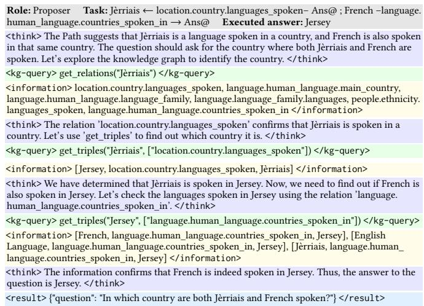

Table 6: Basic logic query patterns. $v _ { a } \colon$ anchor entity; �: answer variable; �<sub>�</sub>: intermediate variables; �<sub>�</sub>: relations.  
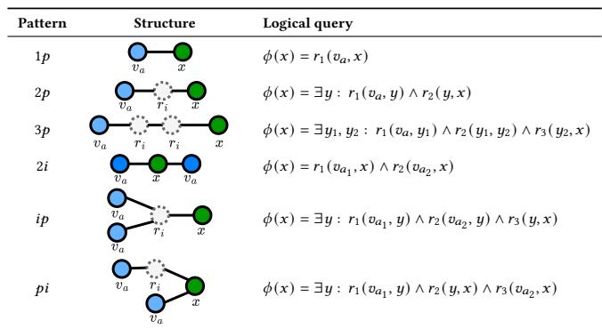

Table 7: Settings of EoG. Hyperparameters of self-play training with Qwen-2.5-7B-Instruct on Freebase.
<table><tr><td>Parameter</td><td>Value</td></tr><tr><td>Training data</td><td>SVTS tasks</td></tr><tr><td>Training steps</td><td>140</td></tr><tr><td>Train / PPO mini-batch size</td><td>256  / 128</td></tr><tr><td>Actor learning rate</td><td> $1 \times 1 0 ^ { - 6 }$ </td></tr><tr><td>KL loss coefficient</td><td>0.01</td></tr><tr><td>Rollout samples (n)</td><td>5</td></tr><tr><td>Max response length</td><td>2560</td></tr><tr><td>Max assistant turns</td><td>15</td></tr><tr><td>Rollout temperature</td><td>0.8</td></tr><tr><td>Solver / Proposer estimator</td><td>GRPO / REINFORCE</td></tr><tr><td>Solver reward</td><td> $0 . 8 \mathrm { F } 1 + 0 . 2 R _ { \mathrm { f m t } }$ </td></tr></table>

## C.3 Implementation Details

W<sub>e</sub> tr<sub>a</sub>in E<sub>o</sub>G <sub>w</sub>ith V<sub>e</sub>rl <sub>o</sub>n 8 GH200 GPU<sub>s ac</sub>r<sub>oss</sub> t<sub>wo</sub> n<sub>o</sub>d<sub>es, us</sub>in<sub>g</sub> FSDP <sub>w</sub>ith CPU <sub>o</sub>fl<sub>oa</sub>din<sub>g o</sub>f <sub>pa</sub>r<sub>a</sub>m<sub>e</sub>t<sub>e</sub>r<sub>s a</sub>nd <sub>op</sub>timiz<sub>e</sub>r <sub>s</sub>t<sub>a</sub>t<sub>es a</sub>nd

Table 5: Solver on the question of Table 4. It intersects the countries of the two languages.  
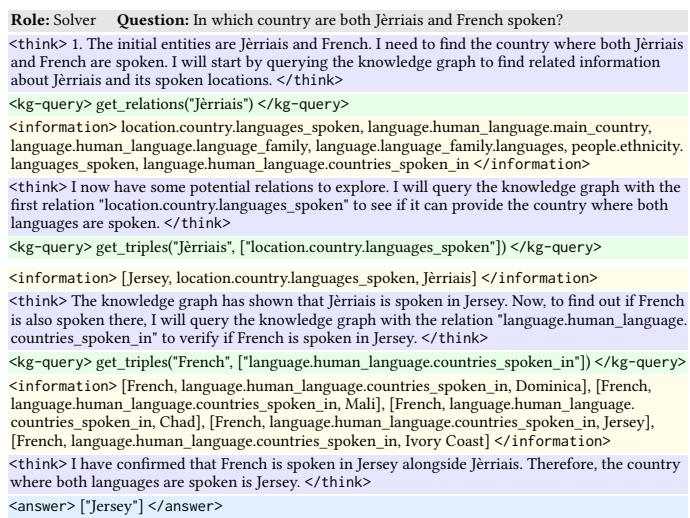

SGLan<sub>g</sub> for multi-turn rollouts<sub>;</sub> Table 7 lists the h<sub>yp</sub>er<sub>p</sub>arameters. KG-R1<sup>†</sup> converts the oficial training splits of WebQSP, CWQ, and GrailQA into the Solver format, which yields 3,058, 27,623, and 36<sub>,</sub>954 <sub>ques</sub>ti<sub>ons, an</sub>d t<sub>ra</sub>i<sub>ns one mo</sub>d<sub>e</sub>l <sub>per</sub> d<sub>a</sub>t<sub>ase</sub>t<sub>.</sub> It <sub>uses</sub> th<sub>e same</sub> b<sub>ac</sub>kb<sub>one,</sub> S<sub>o</sub>l<sub>ver promp</sub>t<sub>, grap</sub>h t<sub>oo</sub>l<sub>s, an</sub>d F<sub>ree</sub>b<sub>ase en</sub>d<sub>po</sub>i<sub>n</sub>t <sub>as</sub> EoG<sub>,</sub> so onl<sub>y</sub> the source of the trainin<sub>g q</sub>uestions difers. Its reward i<sub>s</sub> th<sub>e</sub> F1 <sub>o</sub>f E<sub>o</sub>G <sub>w</sub>ith<sub>ou</sub>t th<sub>e</sub> f<sub>orma</sub>t t<sub>erm.</sub>

## C.4 Synthetic Data Analysis

Topology coverage. Synthesized questions on Freebase cover all six <sub>p</sub>atterns: the chain <sub>p</sub>atterns 1� (22.4%), 2� (20.6%), and 3� (16.5%), and the intersection <sub>p</sub>atterns 2� (17.7%), �� (9.5%), and �� (13.3%). The Solver m<sub>u</sub>st learn <sub>p</sub>ath ex<sub>p</sub>ansion<sub>,</sub> constraint intersection<sub>,</sub> and i<sub>n</sub>t<sub>erme</sub>di<sub>a</sub>t<sub>e-var</sub>i<sub>a</sub>bl<sub>e</sub> t<sub>rac</sub>ki<sub>ng ra</sub>th<sub>er</sub> th<sub>an</sub> fit <sub>a s</sub>i<sub>ng</sub>l<sub>e pa</sub>tt<sub>ern.</sub>

Domain coverage. The questions cover 20 domains, including Places & Geo<sub>g</sub>ra<sub>p</sub>h<sub>y</sub> (14.2%), Film & Television (13.2%), Government, Law & Militar<sub>y</sub> (12.6%), Peo<sub>p</sub>le & Societ<sub>y</sub> (8.7%), and S<sub>p</sub>orts (8.4%); the to<sub>p</sub> three to<sub>g</sub>ether account for onl<sub>y</sub> 40<sub>.</sub>0%. Trainin<sub>g</sub> si<sub>g</sub>nals are th<sub>ere</sub>f<sub>ore no</sub>t <sub>con</sub>fi<sub>ne</sub>d t<sub>o a</sub> f<sub>ew</sub> d<sub>ense su</sub>b<sub>grap</sub>h<sub>s o</sub>f F<sub>ree</sub>b<sub>ase.</sub>

Test-set leakage. To rule out test-set leakage, we encode each <sub>ques</sub>ti<sub>o</sub>n <sub>w</sub>ith BGE-M3 <sub>a</sub>nd t<sub>a</sub>k<sub>e</sub> th<sub>e</sub> m<sub>a</sub>xim<sub>u</sub>m <sub>cos</sub>in<sub>e</sub> <sub>s</sub>imil<sub>a</sub>rit<sub>y</sub> b<sub>e</sub>t<sub>ween eac</sub>h <sub>syn</sub>th<sub>e</sub>ti<sub>c ques</sub>ti<sub>on an</sub>d th<sub>e ques</sub>ti<sub>ons o</sub>f <sub>eac</sub>h F<sub>ree</sub>b<sub>ase</sub> test set (Fi<sub>g</sub>ure 8). Onl<sub>y</sub> 4.57%, 2.28%, and 0.71% of the s<sub>y</sub>nthetic <sub>ques</sub>ti<sub>ons excee</sub>d 0<sub>.</sub>85<sub>,</sub> 0<sub>.</sub>90<sub>, an</sub>d 0<sub>.</sub>95<sub>, respec</sub>ti<sub>ve</sub>l<sub>y, an</sub>d th<sub>e mean</sub> similarit<sub>y</sub> is 0<sub>.</sub>634<sub>,</sub> so there is no meanin<sub>g</sub>ful leaka<sub>g</sub>e between the s<sub>y</sub>nthetic trainin<sub>g</sub> data and the Freebase evaluation sets.

## D Case Study

Ta<sup>bl</sup>es 4 an<sup>d</sup> 5 give t<sup>h</sup>e <sup>f</sup>u<sup>ll</sup> trajectories o<sup>f</sup> t<sup>h</sup>e case in Section 4.7. T<sup>h</sup>e Pro<sub>p</sub>oser starts from Jèrriais, finds that it is s<sub>p</sub>oken in Jerse<sub>y</sub>, and <sub>q</sub>ueries the lan<sub>g</sub>ua<sub>g</sub>es of Jerse<sub>y</sub> to confirm that French is s<sub>p</sub>oken there before askin<sub>g</sub>. The Solver instead retrieves ever<sub>y</sub> countr<sub>y</sub> where French is s<sub>p</sub>oken, amon<sub>g</sub> them Mali, Chad, and Jerse<sub>y</sub>, and kee<sub>p</sub>s the one shared with Jèrriais, the executed answer.