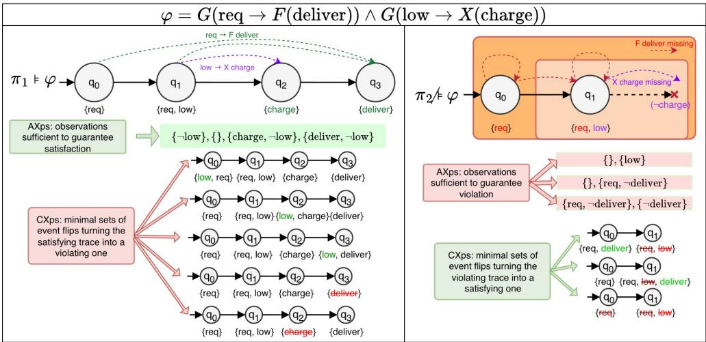
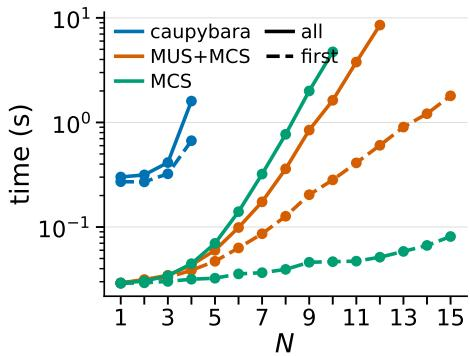

# Formal Explanations for Linear Temporal Logic over Finite Traces

Valeria Fionda, Antonio Ielo, Francesco Ricca

U<sub>n</sub>i<sub>vers</sub>it<sub>y</sub> <sub>o</sub>f C<sub>a</sub>l<sub>a</sub>b<sub>r</sub>i<sub>a,</sub> It<sub>a</sub>l<sub>y</sub>

<sub>va</sub>l<sub>er</sub>i<sub>a.</sub>fi<sub>on</sub>d<sub>a</sub>@<sub>un</sub>i<sub>ca</sub>l<sub>.</sub>it<sub>, an</sub>t<sub>on</sub>i<sub>o.</sub>i<sub>e</sub>l<sub>o</sub>@<sub>un</sub>i<sub>ca</sub>l<sub>.</sub>it<sub>,</sub> f<sub>rancesco.r</sub>i<sub>cca</sub>@<sub>un</sub>i<sub>ca</sub>l<sub>.</sub>it

## Abstract

Linear Temporal Logic over Finite Traces (LTL ) is widely <sub>use</sub>d i<sub>n</sub> A<sub>r</sub>tifi<sub>c</sub>i<sub>a</sub>l I<sub>n</sub>t<sub>e</sub>lli<sub>gence</sub> t<sub>o spec</sub>if<sub>y</sub> d<sub>es</sub>i<sub>re</sub>d t<sub>empora</sub>l b<sub>e-</sub> h<sub>av</sub>i<sub>or an</sub>d d<sub>e</sub>t<sub>erm</sub>i<sub>ne w</sub>h<sub>e</sub>th<sub>er</sub> fi<sub>n</sub>it<sub>e</sub> t<sub>races sa</sub>ti<sub>s</sub>f<sub>y or v</sub>i<sub>o</sub>l<sub>a</sub>t<sub>e</sub> it<sub>.</sub> E<sub>xp</sub>l<sub>a</sub>i<sub>n</sub>i<sub>ng</sub> th<sub>ese ou</sub>t<sub>comes</sub> i<sub>s essen</sub>ti<sub>a</sub>l f<sub>or</sub> d<sub>e</sub>b<sub>ugg</sub>i<sub>ng an</sub>d t<sub>rus</sub>t<sub>.</sub> H<sub>owever, ex</sub>i<sub>s</sub>ti<sub>ng approac</sub>h<sub>es</sub> t<sub>yp</sub>i<sub>ca</sub>ll<sub>y cap</sub>t<sub>ure e</sub>ith<sub>er</sub> <sub>su</sub>fi<sub>c</sub>i<sub>en</sub>t <sub>reasons or coun</sub>t<sub>er</sub>f<sub>ac</sub>t<sub>ua</sub>l <sub>causes, w</sub>ith<sub>ou</sub>t <sub>c</sub>l<sub>ar</sub>if<sub>y-</sub> i<sub>ng</sub> th<sub>e</sub>i<sub>r re</sub>l<sub>a</sub>ti<sub>ons</sub>hi<sub>p.</sub> W<sub>e</sub> i<sub>n</sub>t<sub>ro</sub>d<sub>uce a na</sub>ti<sub>ve c</sub>h<sub>arac</sub>t<sub>er</sub>i<sub>za</sub>ti<sub>on</sub> of abductive (AX<sub>p</sub>s) and contrastive (CX<sub>p</sub>s) ex<sub>p</sub>lanations directly over finite traces, based on locking and unlocking timei<sub>n</sub>d<sub>exe</sub>d <sub>even</sub>t<sub>s.</sub> W<sub>e prove</sub> it<sub>s equ</sub>i<sub>va</sub>l<sub>ence</sub> t<sub>o</sub> th<sub>e c</sub>l<sub>ass</sub>ifi<sub>er-</sub> b<sub>ase</sub>d f<sub>ormu</sub>l<sub>a</sub>ti<sub>on, an</sub>d <sub>s</sub>h<sub>ow</sub> th<sub>a</sub>t CX<sub>ps co</sub>i<sub>nc</sub>id<sub>e w</sub>ith <sub>a re-</sub> cently proposed temporal causality semantics for LTL<sub>f</sub>. This <sub>c</sub>h<sub>arac</sub>t<sub>er</sub>i<sub>za</sub>ti<sub>on ena</sub>bl<sub>es an e</sub>fi<sub>c</sub>i<sub>en</sub>t i<sub>mp</sub>l<sub>emen</sub>t<sub>a</sub>ti<sub>on</sub> b<sub>ase</sub>d <sub>on</sub> th<sub>e enumera</sub>ti<sub>on o</sub>f <sub>m</sub>i<sub>n</sub>i<sub>ma</sub>l <sub>unsa</sub>ti<sub>s</sub>fi<sub>a</sub>bl<sub>e cores an</sub>d <sub>m</sub>i<sub>n</sub>i<sub>ma</sub>l <sub>correc</sub>ti<sub>on se</sub>t<sub>s o</sub>f ASP <sub>programs.</sub> E<sub>xper</sub>i<sub>men</sub>t<sub>s on rea</sub>l<sub>-wor</sub>ld <sub>even</sub>t l<sub>ogs</sub> d<sub>emons</sub>t<sub>ra</sub>t<sub>e</sub> th<sub>e</sub> <sub>e</sub>f<sub>ec</sub>ti<sub>veness</sub> <sub>o</sub>f th<sub>e</sub> <sub>approac</sub>h<sub>.</sub>

## Introduction

Linear Tem<sub>p</sub>oral Lo<sub>g</sub>ic over Finite Traces (De Giacomo and Vardi 2013) $( \mathsf { L T L } _ { f } )$ i<sub>s</sub> <sub>a</sub> <sub>popu</sub>l<sub>ar</sub> f<sub>orma</sub>li<sub>sm</sub> f<sub>or</sub> t<sub>empora</sub>l <sub>rea-</sub> <sub>son</sub>i<sub>ng</sub> i<sub>n</sub> AI<sub>.</sub> It h<sub>as</sub> b<sub>een</sub> <sub>success</sub>f<sub>u</sub>ll<sub>y</sub> <sub>app</sub>li<sub>e</sub>d t<sub>o</sub> <sub>severa</sub>l domains, such as reinforcement learnin<sub>g</sub> (De Giacomo et al. 2019), <sub>p</sub>lannin<sub>g</sub> (Bacchus and Kabanza 1998; De Giacomo and Rubin 2018), robotics (Kress-Gazit, Fainekos, and Pa<sub>p</sub>- <sub>p</sub>as 2009) and business <sub>p</sub>rocess mana<sub>g</sub>ement (van der Aalst, Pesic, and Schonenber<sub>g</sub> 2009; De Giacomo et al. 2014).

In applications, LTL formulas are used to describe desired behavior. A formula may describe the dynamics of a s<sub>y</sub>stem, or the <sub>g</sub>oals drivin<sub>g</sub> an a<sub>g</sub>ent’s behavior. Traces (inter<sub>p</sub>retations) re<sub>p</sub>resents states of a s<sub>y</sub>stem over time, or a sequence of actions performed by an agent. When a trace π satisfies a formula φ, we say that π complies with the specification; otherwise, it violates it. In either case, being able to explain why is important.

Fi<sub>gure</sub> 1 ill<sub>us</sub>t<sub>ra</sub>t<sub>es</sub> th<sub>e exp</sub>l<sub>ana</sub>ti<sub>on pro</sub>bl<sub>em v</sub>i<sub>a an au-</sub> tonomous delivery agent subject to $\varphi ~ = ~ { \mathsf { G } } ~ ( r e q ~ \to ~$ F deliver) ∧ G (low → X charge), which requires every <sub>reques</sub>t t<sub>o</sub> b<sub>e</sub> <sub>even</sub>t<sub>ua</sub>ll<sub>y</sub> <sub>serve</sub>d <sub>an</sub>d <sub>every</sub> l<sub>ow-</sub>b<sub>a</sub>tt<sub>ery</sub> t<sub>o</sub> b<sub>e</sub> immediatel<sub>y</sub> followed b<sub>y</sub> char<sub>g</sub>in<sub>g</sub>. The trace π<sub>1</sub> (of Fi<sub>g</sub>ure 1) <sub>sa</sub>ti<sub>s</sub>fi<sub>es</sub> $\varphi ,$ but this alone does not explain why. We focus on two complementary kinds of explanation. A suficient reason i<sub>s</sub> <sub>a</sub> <sub>se</sub>t <sub>o</sub>f ti<sub>me-</sub>i<sub>n</sub>d<sub>exe</sub>d <sub>even</sub>t<sub>s</sub> <sub>an</sub>d <sub>non-even</sub>t<sub>s</sub> th<sub>a</sub>t <sub>guaran-</sub> t<sub>ees sa</sub>ti<sub>s</sub>f<sub>ac</sub>ti<sub>on:</sub> f<sub>or</sub> $\pi _ { 1 }$ , the absence of low throughout the t<sub>race a</sub>l<sub>rea</sub>d<sub>y guaran</sub>t<sub>ees sa</sub>ti<sub>s</sub>f<sub>ac</sub>ti<sub>on o</sub>f th<sub>e c</sub>h<sub>arg</sub>i<sub>ng o</sub>bli<sub>ga-</sub> ti<sub>on, no ma</sub>tt<sub>er</sub> h<sub>ow</sub> th<sub>e rema</sub>i<sub>n</sub>i<sub>n o</sub>b<sub>serva</sub>ti<sub>ons are a</sub>lt<sub>ere</sub>d<sub>.</sub> A minimal intervention is a minimal set of observations whose change flips the outcome: adding low to the first time instant of π not followed by charge turns it into a violating trace. Conversely, π violates φ: here a suficient reason guarantees the violation (e.g., knowing only that low holds at the second time instant and charge is absent at the third time instant makes every trace agreeing with these two observations violate φ), while minimal interventions restore satisfaction. Th<sub>us</sub> th<sub>e exp</sub>l<sub>ana</sub>ti<sub>on pro</sub>bl<sub>em answers</sub> t<sub>wo comp</sub>l<sub>emen</sub>t<sub>ary</sub> questions: why does the trace satisfy or violate the specification? and what must change to obtain the opposite outcome?

Th<sub>ese</sub> t<sub>wo</sub> ki<sub>n</sub>d<sub>s</sub> <sub>o</sub>f <sub>exp</sub>l<sub>ana</sub>ti<sub>on</sub> <sub>are</sub> <sub>prec</sub>i<sub>se</sub>l<sub>y</sub> th<sub>e</sub> <sub>cen</sub>t<sub>ra</sub>l notions of formal ex<sub>p</sub>lainable AI (FXAI) (I<sub>g</sub>natiev, Narod<sub>y</sub>t<sub>s</sub>k<sub>a, an</sub>d M<sub>arques-</sub>Sil<sub>va</sub> 2019<sub>;</sub> Shih<sub>,</sub> Ch<sub>o</sub>i<sub>, an</sub>d D<sub>arw</sub>i<sub>c</sub>h<sub>e</sub> 2018): abductive (AXps) and contrastive (CXps) explanati<sub>ons.</sub> Gi<sub>ven</sub> <sub>a</sub> <sub>c</sub>l<sub>ass</sub>ifi<sub>er</sub> <sub>an</sub>d <sub>an</sub> i<sub>npu</sub>t i<sub>ns</sub>t<sub>ance,</sub> <sub>an</sub> <sub>a</sub>bd<sub>uc</sub>ti<sub>ve</sub> <sub>exp</sub>l<sub>ana</sub>ti<sub>on</sub> i<sub>s a su</sub>b<sub>se</sub>t <sub>o</sub>f f<sub>ea</sub>t<sub>ure va</sub>l<sub>ues su</sub>fi<sub>c</sub>i<sub>en</sub>t t<sub>o guar-</sub> <sub>an</sub>t<sub>ee</sub> th<sub>e pre</sub>di<sub>c</sub>t<sub>e</sub>d <sub>c</sub>l<sub>ass, w</sub>h<sub>ereas a con</sub>t<sub>ras</sub>ti<sub>ve exp</sub>l<sub>ana</sub>ti<sub>on</sub> i<sub>s a su</sub>b<sub>se</sub>t <sub>o</sub>f f<sub>ea</sub>t<sub>ures w</sub>h<sub>ose c</sub>h<sub>ange y</sub>i<sub>e</sub>ld<sub>s a</sub> dif<sub>eren</sub>t <sub>c</sub>l<sub>ass.</sub> I<sub>mpor</sub>t<sub>an</sub>tl<sub>y, su</sub>b<sub>se</sub>t<sub>-m</sub>i<sub>n</sub>i<sub>ma</sub>l <sub>a</sub>bd<sub>uc</sub>ti<sub>ve an</sub>d <sub>con</sub>t<sub>ras</sub>ti<sub>ve exp</sub>l<sub>a-</sub> nations are related b<sub>y</sub> hittin<sub>g</sub>-set dualit<sub>y</sub> (I<sub>g</sub>natiev et al. 2020; Reiter 1987), which also su<sub>pp</sub>orts efective enumeration algorithms (Lifiton et al. 2016). In principle, an LTL formula <sub>can</sub> b<sub>e cas</sub>t <sub>as a</sub> bi<sub>nary c</sub>l<sub>ass</sub>ifi<sub>er over</sub> ti<sub>me-</sub>i<sub>n</sub>d<sub>exe</sub>d <sub>propo-</sub> <sub>s</sub>iti<sub>ons, ma</sub>ki<sub>n</sub> th<sub>ese no</sub>ti<sub>ons</sub> f<sub>orma</sub>ll <sub>a</sub> li<sub>ca</sub>bl<sub>e.</sub> H<sub>owever,</sub> thi<sub>s enco</sub>di<sub>ng</sub> i<sub>s no</sub>t th<sub>e usua</sub>l <sub>way</sub> t<sub>empora</sub>l f<sub>ormu</sub>l<sub>as are</sub> <sub>un</sub>d<sub>ers</sub>t<sub>oo</sub>d <sub>an</sub>d <sub>ma</sub>k<sub>es</sub> it h<sub>ar</sub>d<sub>er</sub> t<sub>o see exp</sub>l<sub>ana</sub>ti<sub>ons as o</sub>b<sub>-</sub> <sub>serva</sub>ti<sub>ons</sub> th<sub>a</sub>t <sub>are</sub> k<sub>ep</sub>t fi<sub>xe</sub>d <sub>or a</sub>ll<sub>owe</sub>d t<sub>o c</sub>h<sub>ange.</sub> Th<sub>us,</sub> a native characterization of AXps and CXps for LTL is <sub>m</sub>i<sub>ss</sub>i<sub>ng.</sub> E<sub>x</sub>i<sub>s</sub>ti<sub>ng approac</sub>h<sub>es cap</sub>t<sub>ure e</sub>ith<sub>er su</sub>fi<sub>c</sub>i<sub>en</sub>t <sub>rea-</sub> sons for satisfaction (Ferrère, Maler, and Ničković 2015) or counterfactual causes of violation (Men<sub>g</sub> and Alrajeh 2025), b<sub>u</sub>t <sub>none</sub> <sub>connec</sub>t<sub>s</sub> th<sub>e</sub> t<sub>wo</sub> <sub>perspec</sub>ti<sub>ves</sub> <sub>or</sub> <sub>groun</sub>d<sub>s</sub> th<sub>em</sub> i<sub>n</sub> hitti<sub>ng-se</sub>t d<sub>ua</sub>lit<sub>y.</sub> W<sub>e</sub> fill thi<sub>s gap</sub> th<sub>roug</sub>h th<sub>e s</sub>i<sub>mp</sub>l<sub>e opera-</sub> tions of locking and unlocking temporal observations: locked <sub>o</sub>b<sub>serva</sub>ti<sub>ons p</sub>l<sub>ay</sub> th<sub>e ro</sub>l<sub>e o</sub>f th<sub>e</sub> f<sub>ea</sub>t<sub>ure va</sub>l<sub>ues an</sub> AX<sub>p</sub> k<sub>eeps</sub> fi<sub>xe</sub>d<sub>, w</sub>h<sub>ereas un</sub>l<sub>oc</sub>k<sub>e</sub>d <sub>ones are</sub> th<sub>ose a</sub> CX<sub>p</sub> i<sub>s a</sub>ll<sub>owe</sub>d t<sub>o</sub> <sub>a</sub>lt<sub>er.</sub> AX<sub>ps an</sub>d CX<sub>ps are</sub> th<sub>us</sub> d<sub>e</sub>fi<sub>ne</sub>d di<sub>rec</sub>tl<sub>y over</sub> fi<sub>n</sub>it<sub>e</sub> t<sub>races,</sub> <sub>w</sub>ith <sub>no</sub> <sub>c</sub>l<sub>ass</sub>ifi<sub>er-</sub>b<sub>ase</sub>d <sub>re</sub>f<sub>ormu</sub>l<sub>a</sub>ti<sub>on.</sub> O<sub>ur</sub> <sub>con</sub>t<sub>r</sub>ib<sub>u-</sub> tions are threefold: (i) we characterize AXps and CXps for th<sub>e sa</sub>ti<sub>s</sub>f<sub>ac</sub>ti<sub>on an</sub>d <sub>v</sub>i<sub>o</sub>l<sub>a</sub>ti<sub>on o</sub>f ${ \mathsf { L } } { \mathsf { T } } { \mathsf { L } } _ { f }$ <sub>spec</sub>ifi<sub>ca</sub>ti<sub>ons,</sub> di<sub>rec</sub>tl<sub>y</sub> over finite traces; (ii) we prove that this characterization is <sub>equ</sub>i<sub>va</sub>l<sub>en</sub>t t<sub>o</sub> th<sub>e c</sub>l<sub>ass</sub>ifi<sub>er-</sub>b<sub>ase</sub>d <sub>one, es</sub>t<sub>a</sub>bli<sub>s</sub>h th<sub>e</sub> hitti<sub>ng-</sub> set duality between AXps and CXps for LTL , and show that CX<sub>p</sub>s coincide with the tem<sub>p</sub>oral causes of (Men<sub>g</sub> and Alrajeh 2025) under fixed-length interventions; (iii) we reduce th<sub>e</sub>i<sub>r compu</sub>t<sub>a</sub>ti<sub>on</sub> t<sub>o</sub> th<sub>e enumera</sub>ti<sub>on o</sub>f <sub>m</sub>i<sub>n</sub>i<sub>ma</sub>l <sub>unsa</sub>ti<sub>s-</sub> fi<sub>a</sub>bl<sub>e su</sub>b<sub>se</sub>t<sub>s an</sub>d <sub>m</sub>i<sub>n</sub>i<sub>ma</sub>l <sub>correc</sub>ti<sub>on se</sub>t<sub>s,</sub> i<sub>mp</sub>l<sub>emen</sub>t th<sub>e</sub> a<sub>pp</sub>roach in Answer Set Pro<sub>g</sub>rammin<sub>g</sub> (ASP) (Gelfond and Lifschitz 1991; Brewka, Eiter, and Truszcz<sub>y</sub>nski 2011), and <sub>eva</sub>l<sub>ua</sub>t<sub>e</sub> it <sub>on</sub> <sub>rea</sub>l<sub>-wor</sub>ld <sub>even</sub>t l<sub>ogs.</sub>

  
Fi<sub>g</sub>ure 1: AX<sub>p</sub>s (suficient reasons) and CX<sub>p</sub>s (minimal outcome-fli<sub>pp</sub>in<sub>g</sub> interventions) for $\varphi$ <sub>on</sub> <sub>a</sub> <sub>comp</sub>li<sub>an</sub>t t<sub>race</sub> $\pi _ { 1 }$ <sub>an</sub>d <sub>a</sub> <sub>v</sub>i<sub>o</sub>l<sub>a</sub>ti<sub>ng</sub> t<sub>race</sub> $\pi _ { 2 }$ . Sets are listed state by state; e.g. {}, {low} denotes {low<sub>1</sub>}.

## Related Work

Formal Explanations. Our work instantiates the gen-<sub>era</sub>l f<sub>ramewor</sub>k <sub>o</sub>f <sub>a</sub>bd<sub>uc</sub>ti<sub>ve an</sub>d <sub>con</sub>t<sub>ras</sub>ti<sub>ve exp</sub>l<sub>ana-</sub> tions (Shih, Choi, and Darwiche 2018; I<sub>g</sub>natiev, Narod<sub>y</sub>tska, <sub>an</sub>d M<sub>arques-</sub>Sil<sub>va</sub> 2019<sub>;</sub> I<sub>gna</sub>ti<sub>ev e</sub>t <sub>a</sub>l<sub>.</sub> 2020<sub>;</sub> D<sub>arw</sub>i<sub>c</sub>h<sub>e an</sub>d Hirth 2023) in the settin<sub>g</sub> of ${ \mathsf { L } } { \mathsf { T } } { \mathsf { L } } _ { f }$ <sub>.</sub> H<sub>owever,</sub> th<sub>e s</sub>t<sub>an</sub>d<sub>ar</sub>d formulation treats the object being explained as a classifier <sub>over</sub> f<sub>ea</sub>t<sub>ures.</sub> Whil<sub>e</sub> thi<sub>s v</sub>i<sub>ewpo</sub>i<sub>n</sub>t i<sub>s</sub> f<sub>orma</sub>ll<sub>y app</sub>li<sub>ca</sub>bl<sub>e</sub> to $\mathsf { L } \mathsf { T } \mathsf { L } _ { f } ,$ it i<sub>s</sub> <sub>no</sub>t <sub>na</sub>t<sub>ura</sub>l f<sub>or</sub> t<sub>empora</sub>l<sub>-</sub>l<sub>og</sub>i<sub>c</sub> <sub>prac</sub>titi<sub>oners.</sub> W<sub>e</sub> th<sub>ere</sub>f<sub>ore prov</sub>id<sub>e an equ</sub>i<sub>va</sub>l<sub>en</sub>t <sub>c</sub>h<sub>arac</sub>t<sub>er</sub>i<sub>za</sub>ti<sub>on s</sub>t<sub>a</sub>t<sub>e</sub>d di<sub>rec</sub>tl<sub>y</sub> i<sub>n</sub> t<sub>erms o</sub>f ${ \mathsf { L T L } } _ { f }$ f<sub>ormu</sub>l<sub>as an</sub>d fi<sub>n</sub>it<sub>e</sub> t<sub>races.</sub> Si<sub>m</sub>i<sub>-</sub> l<sub>ar spec</sub>i<sub>a</sub>li<sub>za</sub>ti<sub>ons</sub> h<sub>ave</sub> b<sub>een</sub> d<sub>eve</sub>l<sub>ope</sub>d f<sub>or se</sub>tti<sub>ngs</sub> i<sub>n w</sub>hi<sub>c</sub>h the object being explained is not naturally represented as a classifier, such as rankin<sub>g</sub> functions (Chiariello and Marques-Silva 2025) and finite-state machines (Granada, I<sub>g</sub>natiev, and Stucke<sub>y</sub> 2026). Our work follows the same direction b<sub>y</sub> <sub>p</sub>ro-<sub>v</sub>idi<sub>ng a spec</sub>i<sub>a</sub>li<sub>za</sub>ti<sub>on</sub> f<sub>or</sub> ${ \mathsf { L } } { \mathsf { T } } { \mathsf { L } } _ { f }$ f<sub>ormu</sub>l<sub>as.</sub>

Temporal Implicants & Temporal Causality. Implicants <sub>are</sub> <sub>par</sub>ti<sub>a</sub>l i<sub>n</sub>t<sub>erpre</sub>t<sub>a</sub>ti<sub>ons</sub> <sub>guaran</sub>t<sub>ee</sub>i<sub>ng</sub> <sub>a</sub> <sub>propos</sub>iti<sub>ona</sub>l f<sub>or-</sub> <sub>mu</sub>l<sub>a</sub>’<sub>s</sub> t<sub>ru</sub>th <sub>or</sub> f<sub>a</sub>l<sub>s</sub>it<sub>y</sub> <sub>an</sub>d<sub>,</sub> f<sub>or</sub> <sub>propos</sub>iti<sub>ona</sub>l bi<sub>nary</sub> <sub>c</sub>l<sub>ass</sub>i<sub>-</sub> fiers, coincide with abductive ex<sub>p</sub>lanations (I<sub>g</sub>natiev et al. 2020). In LTL, tem<sub>p</sub>oral im<sub>p</sub>licants have onl<sub>y</sub> been studied under infinite-trace semantics (Ferrère, Maler, and Ničković 2015), and im<sub>p</sub>lemented with a <sub>g</sub>reed<sub>y</sub> al<sub>g</sub>orithm com<sub>p</sub>utin<sub>g</sub> <sub>a</sub> <sub>s</sub>i<sub>ng</sub>l<sub>e,</sub> <sub>poss</sub>ibl<sub>y</sub> <sub>non-m</sub>i<sub>n</sub>i<sub>ma</sub>l i<sub>mp</sub>li<sub>can</sub>t<sub>.</sub> Th<sub>e</sub> <sub>connec</sub>ti<sub>on</sub> t<sub>o</sub> <sub>unsa</sub>ti<sub>s</sub>fi<sub>a</sub>bl<sub>e cores</sub> i<sub>s men</sub>ti<sub>one</sub>d <sub>as a re</sub>l<sub>a</sub>t<sub>e</sub>d <sub>pro</sub>bl<sub>em</sub> b<sub>u</sub>t <sub>no</sub>t f<sub>ur</sub>th<sub>er</sub> d<sub>eve</sub>l<sub>ope</sub>d<sub>.</sub> W<sub>e</sub> i<sub>ns</sub>t<sub>ea</sub>d <sub>a</sub>dd<sub>ress</sub> fi<sub>n</sub>it<sub>e</sub> t<sub>races, recas</sub>t th<sub>e pro</sub>bl<sub>em</sub> i<sub>n</sub> th<sub>e</sub> FXAI f<sub>ramewor</sub>k<sub>, an</sub>d <sub>prov</sub>id<sub>e an e</sub>fi<sub>c</sub>i<sub>en</sub>t i<sub>mp</sub>l<sub>emen</sub>t<sub>a</sub>ti<sub>on</sub> b<sub>ase</sub>d <sub>on unsa</sub>ti<sub>s</sub>fi<sub>a</sub>bl<sub>e cores an</sub>d <sub>correc</sub>ti<sub>on</sub> sets.

A recent work b<sub>y</sub> (Men<sub>g</sub> and Alrajeh 2025) <sub>p</sub>ro<sub>p</sub>oses a revised version of cause for $\mathsf { L } \mathsf { T } \mathsf { L } _ { f } ,$ <sub>,</sub> <sub>spec</sub>i<sub>a</sub>li<sub>z</sub>i<sub>ng</sub> th<sub>e</sub> Hal<sub>p</sub>ern’s (Hal<sub>p</sub>ern 2016). It extends earlier works (Beer et al. 2009) that considers onl<sub>y</sub> sin<sub>g</sub>leton causes, to conjunctive causes. Neither line addresses the dual notion of <sub>su</sub>fi<sub>c</sub>i<sub>en</sub>t <sub>reasons</sub> f<sub>or sa</sub>ti<sub>s</sub>f<sub>ac</sub>ti<sub>on or v</sub>i<sub>o</sub>l<sub>a</sub>ti<sub>on.</sub> W<sub>e w</sub>ill <sub>prove</sub> th<sub>a</sub>t thi<sub>s</sub> <sub>no</sub>ti<sub>on</sub> i<sub>s</sub> <sub>c</sub>l<sub>ose</sub>l<sub>y</sub> <sub>re</sub>l<sub>a</sub>t<sub>e</sub>d t<sub>o</sub> CX<sub>ps.</sub>

Unsatisfiable Cores in Temporal Reasoning. Minimal unsatisfiable cores and correction sets (Lifiton and Sakallah 2008; Marques-Silva, Janota, and Mencía 2017) are at the base of our implementation. LTL admits notions of unsatisfiable cores (Roveri et al. 2024), whose com<sub>p</sub>utation has been the focus of recent works (Roveri et al. 2024; Niu et al. 2024; Fionda, Ielo, and Ricca 2026; Ielo et al. 2026). Unsatisfiable cores explain why a formula is unsatisfiable, whereas abductive explanations answer why a trace violates/satisfies a formula. The first is a form of global explanation, the latter is a form of local explanation (Guidotti et al. 2019; Marques-Silva and I<sub>g</sub>natiev 2022). Our im<sub>p</sub>lementation is based on b<sub>oun</sub>d<sub>e</sub>d $\mathsf { L } \bar { \mathsf { T } } \mathsf { L } _ { f }$ satisfiabilit<sub>y</sub> (Fionda, Ielo, and Ricca 2024), <sub>o</sub>bt<sub>a</sub>i<sub>n</sub>i<sub>ng</sub> AX<sub>ps an</sub>d CX<sub>ps as unsa</sub>ti<sub>s</sub>fi<sub>a</sub>bl<sub>e cores an</sub>d <sub>cor-</sub> rection sets of a lo<sub>g</sub>ic <sub>p</sub>ro<sub>g</sub>ram (Alviano et al. 2023). The underl<sub>y</sub>in<sub>g</sub> solver is based on SAT techniques (Lifiton et al. 2016).

## Answer Set Programming

An atom is an expression of the form $p ( t _ { 1 } , \ldots , t _ { n } )$ <sub>w</sub>h<sub>ere</sub> p is a predicate, $t _ { 1 } , \ldots , t _ { n }$ are terms (i.e., constants, inte<sub>g</sub>er numbers, strings or variables), and n is known as arity of the predicate. A literal is either an atom a or its negation not a, where not denotes the negation as failure. A rule r is an <sub>express</sub>i<sub>on o</sub>f th<sub>e</sub> f<sub>orm</sub> $h  b _ { 1 } , \ldots , b _ { n }$ where h is an atom referred to as head, denoted by $H _ { r } ,$ <sub>,</sub> th<sub>a</sub>t <sub>can a</sub>l<sub>so</sub> b<sub>e om</sub>itt<sub>e</sub>d<sub>,</sub> $n \geq 0$ <sub>, an</sub>d $b _ { 1 } , \ldots , b _ { n }$ is a conjunction of literals referred to as body, denoted by $B _ { r }$ <sub>.</sub> I<sub>n par</sub>ti<sub>cu</sub>l<sub>ar, a ru</sub>l<sub>e</sub> i<sub>s sa</sub>id t<sub>o</sub> b<sub>e a</sub> constraint if its head is omitted, while it is said to be $_ { \textrm a f a c t }$ if $n = 0 . \mathrm { A }$ rule r is safe if each variable appears at least in one positive literal in the body of r. A program in ASP is a finite <sub>se</sub>t <sub>o</sub>f <sub>sa</sub>f<sub>e ru</sub>l<sub>es.</sub> Gi<sub>ven a program</sub> $P ,$ <sub>an</sub>d $r \in P$ , ground(r) is the set of ground instantiations of r obtained by replacing <sub>var</sub>i<sub>a</sub>bl<sub>es</sub> i<sub>n</sub> $r$ <sub>w</sub>ith <sub>cons</sub>t<sub>an</sub>t<sub>s</sub> i<sub>n</sub> $P ;$ <sub>w</sub>h<sub>ereas</sub> $g r o u n d ( P )$ i<sub>s</sub> th<sub>e un</sub>i<sub>on o</sub>f <sub>groun</sub>d i<sub>ns</sub>t<sub>an</sub>ti<sub>a</sub>ti<sub>ons o</sub>f <sub>ru</sub>l<sub>es</sub> i<sub>n</sub> $P .$ Gi<sub>ven a</sub> p<sup>ro</sup>g<sup>ram</sup> $P ,$ th<sub>e</sub> H<sub>er</sub>b<sub>ran</sub>d’<sub>s</sub> b<sub>ase o</sub>f $P ,$ d<sub>eno</sub>t<sub>e</sub>d b<sub>y</sub> $B _ { P } .$ <sub>,</sub> i<sub>s</sub> th<sub>e se</sub>t <sub>o</sub>f <sub>a</sub>t<sub>oms cons</sub>t<sub>ruc</sub>tibl<sub>e</sub> f<sub>rom cons</sub>t<sub>an</sub>t<sub>s an</sub>d <sub>pre</sub>di<sub>ca</sub>t<sub>e</sub> names occurring in P. An interpretation I for $P$ i<sub>s a su</sub>b<sub>se</sub>t <sub>o</sub>f $B _ { P } ,$ <sub>, w</sub>hi<sub>c</sub>h i<sub>s an answer se</sub>t <sub>o</sub>f $P \operatorname { i f } \left( \operatorname { i } \right)$ I is a model, i.e., for <sub>eac</sub>h <sub>ru</sub>l<sub>e</sub> $r \in g r o u n d ( P )$ either the head of r is true wrt I or the body of r is false wrt $I ;$ and (ii) I is a minimal model of its GL-reduct (Gelfond and Lifschitz 1991).

Minimal Unsatisfiable Subprograms. Consider a program P and a set of objective atoms $O \subseteq B _ { P }$ <sub>.</sub> F<sub>or</sub> $S \subseteq O _ { : }$ <sub>en</sub>f<sub>orce</sub> $( P , O , S )$ is the program obtained from P by adding <sub>a c</sub>h<sub>o</sub>i<sub>ce over a</sub>t<sub>oms</sub> i<sub>n</sub> $O ~ ( { \mathrm { i . e . , ~ } } o _ { i } : - ~ n o _ { i } ~ n o _ { i } : - ~ o _ { i } .$ <sub>,</sub> f<sub>or</sub> $i \in [ 1 , n ] )$ and a set of constraints of the form :- not $^ { O , }$ <sup>f</sup>or ever<sub>y</sub> $o \in S$ <sub>.</sub> I<sub>n</sub>t<sub>u</sub>iti<sub>ve</sub>l<sub>y, en</sub>f<sub>orce</sub> $( P , O , S )$ au<sub>g</sub>ments t<sup>h</sup>e p<sup>ro</sup>g<sup>ram</sup> $P$ in such a way that the objective atoms can be arbitraril<sub>y</sub> chosen (i.e. either as true or false) but the atoms in $S$ are enforced to be true. An unsatisfiable subset for $P$ wrt the set of objective atoms O is a set of atoms $U \subseteq O$ <sub>suc</sub>h th<sub>a</sub>t <sub>en</sub>f<sub>orce</sub> $( P , O , U )$ is incoherent (Alviano et al. 2023). $U S ( P , O )$ denotes the set of unsatisfiable subsets of P wrt O. An unsatisfiable subset $U \in U S ( P , O )$ is a minimal unsatisfiable subset (MUS) of $P$ wrt O if for ever<sub>y</sub> $U ^ { \prime } \subset U$ $U ^ { \prime } \not \in U S ( P , O )$ . An answer set M of P is minimal wrt $O \subset B _ { \mathcal { P } }$ if th<sub>ere ex</sub>i<sub>s</sub>t <sub>no o</sub>th<sub>er answer se</sub>t $M ^ { \prime }$ <sub>o</sub>f $P$ <sub>suc</sub>h th<sub>a</sub>t $( M \cap O ) \subset ( M ^ { \prime } \cap O )$ (Alviano et al. 2023).

More details on ASP are available in (Gelfond and Lifs-<sub>c</sub>hit<sub>z</sub> 1991<sub>;</sub> B<sub>rew</sub>k<sub>a,</sub> Eit<sub>er, an</sub>d T<sub>ruszczyns</sub>ki 2011<sub>;</sub> G<sub>e</sub>b<sub>ser</sub> et al. 2012; Lifschitz 2019).

## Linear Temporal Logic on Finite Traces

Lin<sub>ea</sub>r T<sub>e</sub>m<sub>po</sub>r<sub>a</sub>l L<sub>og</sub>i<sub>c o</sub>n Finit<sub>e</sub> Tr<sub>aces</sub> $( \mathsf { L T L } _ { f } )$ (De Giacomo and Vardi 2013) is a variant of Linear Tem<sub>p</sub>oral Lo<sub>g</sub>ic (LTL) (Pnueli 1977) where the models, called traces, are assumed t<sub>o</sub> b<sub>e</sub> fi<sub>n</sub>it<sub>e.</sub> $\dot { \mathrm { A n } } \mathsf { L T L } _ { f }$ formula over the al<sub>p</sub>habet A is defined <sub>accor</sub>di<sub>ng</sub> t<sub>o</sub> th<sub>e</sub> f<sub>o</sub>ll<sub>ow</sub>i<sub>ng grammar:</sub>

$$
\varphi : : = a \in A \mid \neg \varphi \mid \varphi \land \varphi \mid \mathsf { X } \varphi \mid \varphi \mathsf { U } \varphi
$$

where X (“Next”) and U (“Until”) are tem<sub>p</sub>oral o<sub>p</sub>erat<sub>ors.</sub> St<sub>an</sub>d<sub>ar</sub>d <sub>propos</sub>iti<sub>ona</sub>l b<sub>oo</sub>l<sub>ean</sub> $( \lor , \right. , \left. , \top , \bot )$ <sub>, an</sub>d temporal (e.g., Eventually F, Always G, Weak Next $\mathsf { X } _ { w }$ <sub>an</sub>d Release R) shorthands are defined as usual. An interpretation i<sub>s a</sub> fi<sub>n</sub>it<sub>e</sub> t<sub>race</sub> $\pi = \pi _ { 0 } \pi _ { 1 } \cdot \cdot \cdot \pi _ { n - 1 }$ <sub>, w</sub>ith $\pi _ { i } \subseteq { \mathcal { A } } . | \pi | = n$ i<sub>s</sub> th<sub>e</sub> t<sub>race</sub> l<sub>eng</sub>th<sub>, an</sub>d $\pi ( i ) = \pi _ { i }$ is the i-th state of π. Th<sub>e sa</sub>ti<sub>s</sub>f<sub>ac</sub>ti<sub>on re</sub>l<sub>a</sub>ti<sub>on</sub> $\pi , i \models \varphi$ i<sub>s</sub> d<sub>e</sub>fi<sub>ne</sub>d i<sub>n</sub>d<sub>uc</sub>ti<sub>ve</sub>l<sub>y as</sub> f<sub>o</sub>ll<sub>ows:</sub>

$$
\pi , i \in a \operatorname { i f f } a \in \pi ( i )
$$

$$
\pi , i \Vdash \lnot \varphi \ i f \pi , i \nVdash \varphi
$$

$$
{ \boldsymbol { \pi } } , i | = \varphi \wedge \psi \operatorname { i f f } \pi , i | = \varphi \operatorname { a n d } \pi , i | = \psi 
$$

$\pi , i | = \mathsf { X } \varphi \mathrm { i f f } i + 1 < | \pi |$ <sub>an</sub>d $\pi , i + 1 \vdash \varphi$

$\pi , i \models \varphi \mathsf { U }$ ψ if there exists k with $i \leq k < | \pi |$ <sub>suc</sub>h th<sub>a</sub>t $\pi , k \vdash \psi$ and for all j with $i \leq j < k , \pi , j \mid = \varphi$

π is a model of $\varphi { \mathrm { ~ i f ~ } } \pi , 0 { \mathrm { ~ } } \models \varphi$ <sub>,</sub> d<sub>eno</sub>t<sub>e</sub>d <sub>as</sub> $\pi \ \models \ \varphi .$ We denote by Mod $\mathsf { I } ( \varphi )$ th<sub>e se</sub>t <sub>o</sub>f <sub>mo</sub>d<sub>e</sub>l<sub>s o</sub>f $\varphi ,$ th<sub>a</sub>t i<sub>s</sub> Mod $( \varphi ) = \{ \dot { \pi } \in ( 2 ^ { \mathcal { A } } ) ^ { * } : \pi \models \varphi \}$ <sub>.</sub> Th<sub>e sa</sub>ti<sub>s</sub>fi<sub>a</sub>bilit<sub>y pro</sub>b<sub>-</sub> l<sub>em</sub> f<sub>or</sub> $\mathsf { L T L } _ { f } ,$ i.e., deciding whether there exists a trace π <sub>suc</sub>h th<sub>a</sub>t $\pi \ \models \varphi ,$ is PSPACE-com<sub>p</sub>lete (De Giacomo and Vardi 2013). Com<sub>p</sub>lexit<sub>y</sub> dro<sub>p</sub>s to NP-com<sub>p</sub>lete restrictin<sub>g</sub> the <sub>p</sub>roblem to traces of bounded len<sub>g</sub>th (Fionda and Greco 2018).

## Formal Explanations

L<sub>e</sub>t $\mathcal { F }$ be a finite set of features. Each feature $i \in \mathcal { F }$ i<sub>s</sub> associated to a finite domain $D _ { i }$ . The correspondingfeature space $\mathbb { F }$ i<sub>s</sub> th<sub>e</sub> C<sub>ar</sub>t<sub>es</sub>i<sub>an pro</sub>d<sub>uc</sub>t <sub>o</sub>f th<sub>e</sub> f<sub>ea</sub>t<sub>ure</sub> d<sub>oma</sub>i<sub>ns,</sub> $\begin{array} { r } { \mathbb { F } = \prod _ { i \in \mathcal { F } } D _ { i } } \end{array}$ <sub>.</sub> E<sub>ac</sub>h <sub>e</sub>l<sub>emen</sub>t $\alpha \in \mathbb { F }$ i<sub>s a</sub> t<sub>o</sub>t<sub>a</sub>l <sub>ass</sub>i<sub>gnmen</sub>t <sub>o</sub>f <sub>va</sub>l<sub>ues</sub> t<sub>o</sub> th<sub>e</sub> f<sub>ea</sub>t<sub>ures, w</sub>ith $\alpha ( i ) \in D _ { i }$ <sup>f</sup>or ever<sub>y</sub> $i \in \mathcal { F }$ <sub>.</sub> We refer to such an assignment as an instance. A classifier is a t<sub>o</sub>t<sub>a</sub>l f<sub>unc</sub>ti<sub>on</sub> $f : \mathbb { F } \mapsto \kappa$ <sub>, w</sub>h<sub>ere</sub> $\kappa$ i<sub>s a</sub> fi<sub>n</sub>it<sub>e se</sub>t <sub>o</sub>f <sub>c</sub>l<sub>ass</sub> l<sub>a</sub>b<sub>e</sub>l<sub>s.</sub> Gi<sub>ven</sub> ${ \mathcal { S } } \subseteq { \mathcal { F } }$ <sub>an</sub>d t<sub>wo</sub> i<sub>ns</sub>t<sub>ances</sub> $\alpha , \beta \in \mathbb { F }$ , we say α and β are compatible in S and write $\alpha \equiv _ { S } \beta$ if<sub>,</sub> <sub>an</sub>d <sub>on</sub>l<sub>y</sub> if<sub>,</sub> $\alpha ( i ) = \beta ( i )$ <sup>f</sup>or ever<sub>y</sub> $i \in S$

An explanation problem is a tuple $( f , \alpha , c )$ <sub>, w</sub>h<sub>ere</sub> $f :$ $\mathbb { F } \mapsto \mathcal { K }$ i<sub>s a c</sub>l<sub>ass</sub>ifi<sub>er,</sub> $\alpha \in \mathbb { F }$ i<sub>s an</sub> i<sub>ns</sub>t<sub>ance, an</sub>d $c \in \kappa$ i<sub>s a c</sub>l<sub>ass</sub> l<sub>a</sub>b<sub>e</sub>l <sub>suc</sub>h th<sub>a</sub>t $\begin{array} { l } { { f ( \alpha ) = c } } \end{array}$ T<sub>wo</sub> m<sub>a</sub>in t<sub>ypes</sub> <sub>o</sub>f formal explanations are in the literature: abductive (AXp) and contrastive (CXp) explanations. An abductive explanation for $( f , \alpha , c )$ answers the question Why was class c assigned to $\alpha ? ,$ <sub>w</sub>hil<sub>e a con</sub>t<sub>ras</sub>ti<sub>ve exp</sub>l<sub>ana</sub>ti<sub>on a</sub>dd<sub>resses</sub> th<sub>e ques</sub>ti<sub>on</sub> Why was α not assigned a class diferentfrom $c ? .$

Weak Abductive Explanations (WAXp). We say that $\mathcal { X } \subseteq \mathcal { F }$ i<sub>s a</sub> WAX<sub>p</sub> f<sub>or</sub> $( f , \alpha , c )$ if th<sub>e</sub> f<sub>o</sub>ll<sub>ow</sub>i<sub>ng</sub> h<sub>o</sub>ld<sub>s:</sub>

$$
\forall \beta \in \mathbb { F } . \beta \equiv _ { \mathcal { X } } \alpha \implies f ( \beta ) = c
$$

Weak Contrastive Explanations (WCXp). We say that $\mathcal { V } \subseteq \mathcal { F }$ i<sub>s</sub> <sub>a</sub> WCX<sub>p</sub> f<sub>o</sub>r $( f , \alpha , c )$ if th<sub>e</sub> f<sub>o</sub>ll<sub>ow</sub>i<sub>ng</sub> h<sub>o</sub>ld<sub>s:</sub>

$$
\exists \beta \in \mathbb { F } . \beta \equiv _ { \mathcal { F } \backslash \mathcal { y } } \alpha \land f ( \beta ) \neq c
$$

I<sub>n</sub>t<sub>u</sub>iti<sub>ve</sub>l<sub>y, an a</sub>bd<sub>uc</sub>ti<sub>ve exp</sub>l<sub>ana</sub>ti<sub>on</sub> id<sub>en</sub>tifi<sub>es a se</sub>t <sub>o</sub>f f<sub>ea-</sub> t<sub>ure va</sub>l<sub>ues</sub> th<sub>a</sub>t i<sub>s su</sub>fi<sub>c</sub>i<sub>en</sub>t t<sub>o guaran</sub>t<sub>ee</sub> th<sub>e pre</sub>di<sub>c</sub>ti<sub>on</sub> $c ,$ th<sub>a</sub>t i<sub>s once</sub> th<sub>e</sub> f<sub>ea</sub>t<sub>ure</sub> i<sub>n</sub> $\mathcal { X }$ <sub>are</sub> fi<sub>xe</sub>d t<sub>o</sub> th<sub>e va</sub>l<sub>ues</sub> th<sub>ey assume</sub> i<sub>n</sub> $\alpha ,$ every compatible instance is still classified as c. Instead, a <sub>con</sub>t<sub>ras</sub>ti<sub>ve exp</sub>l<sub>ana</sub>ti<sub>on</sub> id<sub>en</sub>tifi<sub>es a se</sub>t <sub>o</sub>f f<sub>ea</sub>t<sub>ures w</sub>h<sub>ose va</sub>l<sub>-</sub> <sub>ues can</sub> b<sub>e c</sub>h<sub>ange</sub>d t<sub>o a</sub>lt<sub>er</sub> th<sub>e pre</sub>di<sub>c</sub>ti<sub>on,</sub> th<sub>a</sub>t i<sub>s,</sub> k<sub>eep</sub>i<sub>ng a</sub>ll f<sub>ea</sub>t<sub>ures ou</sub>t<sub>s</sub>id<sub>e</sub> $\overset { \cdot } { \boldsymbol { y } }$ fi<sub>xe</sub>d t<sub>o</sub> th<sub>e va</sub>l<sub>ues</sub> i<sub>n</sub> $\alpha ,$ th<sub>ere ex</sub>i<sub>s</sub>t<sub>s an as-</sub> <sub>s</sub>i<sub>gnmen</sub>t t<sub>o</sub> th<sub>e</sub> f<sub>ea</sub>t<sub>ures</sub> i<sub>n</sub> $\mathcal { V }$ f<sub>or w</sub>hi<sub>c</sub>h th<sub>e c</sub>l<sub>ass</sub>ifi<sub>er ou</sub>t<sub>pu</sub>t<sub>s</sub> a class diferent from c. Subset-minimal WAXp and WCXp are called abductive ex<sub>p</sub>lanations (AX<sub>p</sub>) and contrastive ex-<sub>p</sub>lanations (CX<sub>p</sub>), res<sub>p</sub>ectivel<sub>y</sub>. AX<sub>p</sub>s and CX<sub>p</sub>s are related by hitting-set duality: every AXp is a minimal hitting set of the set of all CX<sub>p</sub>s, and vice versa (I<sub>g</sub>natiev et al. 2020).

## AXp and CXp for LTL<sub>f</sub>

I<sub>n</sub> thi<sub>s sec</sub>ti<sub>on, we re</sub>f<sub>ormu</sub>l<sub>a</sub>t<sub>e a</sub>bd<sub>uc</sub>ti<sub>ve an</sub>d <sub>con</sub>t<sub>ras</sub>ti<sub>ve ex-</sub> <sub>p</sub>l<sub>ana</sub>ti<sub>ons</sub> f<sub>or</sub> ${ \mathsf { L } } { \mathsf { T } } { \mathsf { L } } _ { f }$ <sub>.</sub> I<sub>n</sub> th<sub>e</sub> <sub>res</sub>t <sub>o</sub>f th<sub>e</sub> <sub>paper,</sub> <sub>we</sub> fi<sub>x</sub> <sub>a</sub> fi<sub>n</sub>it<sub>e</sub> al<sub>p</sub>habet A and a trace len<sub>g</sub>th $n \in \mathbb N$ <sub>.</sub> W<sub>e assume a</sub>ll t<sub>races</sub> are se<sub>q</sub>uences <sup>i</sup>n $( 2 ^ { A } ) ^ { n }$

Notation. We adopt a set-based representation of traces based on temporal literals. Let ${ \mathsf { V a r s } } = \{ a _ { i } : a \in { \mathcal { A } } , 0 \leq$ $i < n \}$ d<sub>eno</sub>t<sub>e</sub> th<sub>e</sub> <sub>se</sub>t <sub>o</sub>f ti<sub>me-</sub>i<sub>n</sub>d<sub>exe</sub>d <sub>a</sub>t<sub>oms,</sub> <sub>w</sub>h<sub>ere</sub> $a _ { i }$ i<sub>n-</sub> dicates that a holds at time instant i. The set of temporal literals is defined as Lits $\begin{array} { r } { \mathbf { \Psi } = \bigcup _ { a _ { i } \in \mathsf { V a r s } } \{ a _ { i } , \neg a _ { i } \} } \end{array}$ . For every t<sub>empora</sub>l lit<sub>era</sub>l $\ell \in \mathsf { L i t s }$ <sub>, we</sub> d<sub>eno</sub>t<sub>e</sub> b<sub>y</sub> ${ \mathsf { v a r } } ( \ell )$ it<sub>s</sub> <sub>un</sub>d<sub>er</sub>l<sub>y</sub>i<sub>ng</sub> ti<sub>me-</sub>i<sub>n</sub>d<sub>exe</sub>d <sub>a</sub>t<sub>om,</sub> $\mathrm { i . e . , v a r } ( a _ { i } ) = a _ { i }$ and var $\left( \neg a _ { i } \right) = a _ { i } .$ Similarl<sub>y</sub>, ℓ denotes the opposite literal, that is, $\overline { { a _ { i } } } = \neg a _ { i }$ <sub>an</sub>d $\overline { { \neg a _ { i } } } = a _ { i } . \mathrm { ~ A ~ }$ <sub>se</sub>t <sub>o</sub>f t<sub>empora</sub>l lit<sub>era</sub>l<sub>s</sub> $E \subseteq$ Lits is said to be invalid if it contains both a literal and its complement, valid otherwise, and complete if, for every $a _ { i } \in \mathsf { V a r s }$ , exact<sup>l</sup><sub>y</sub> one <sub>o</sub>f $a _ { i } \ \mathrm { o r } \ \lnot a _ { i }$ belongs to E. A trace π is represented by the <sub>va</sub>lid<sub>, comp</sub>l<sub>e</sub>t<sub>e se</sub>t <sub>o</sub>f t<sub>empora</sub>l lit<sub>era</sub>l<sub>s:</sub>

$$
\mathsf { L } ( \pi ) = \bigcup _ { i } \left( \{ a _ { i } : a \in \pi ( i ) \} \cup \{ \neg a _ { i } : a \notin \pi ( i ) \} \right) .
$$

F<sub>or</sub> i<sub>ns</sub>t<sub>ance,</sub> th<sub>e v</sub>i<sub>o</sub>l<sub>a</sub>ti<sub>ng</sub> t<sub>race</sub> $\pi _ { 2 }$ <sub>o</sub>f Fi<sub>gure</sub> 1<sub>, o</sub>f l<sub>eng</sub>th $n \ = \ 2$ <sub>,</sub> i<sub>s represen</sub>t<sub>e</sub>d b<sub>y</sub> $\mathsf { \bar { L } } ( \pi _ { 2 } ) \ = \ \{ r e q _ { 0 } , r e q _ { 1 } , l o w _ { 1 } \} \ \cup$ $\{ \neg d e l i v e r _ { 0 } , \neg l o w _ { 0 } , \neg c h a r g e _ { 0 } , \neg d e l i v e r _ { 1 } , \neg c h a r g e _ { 1 } \}$ Gi<sub>ven</sub> <sub>a</sub> <sub>se</sub>t <sub>o</sub>f t<sub>empora</sub>l lit<sub>era</sub>l<sub>s</sub> $E ,$ two traces π and τ are compatible on E if they agree on every literal in $E ,$ th<sub>a</sub>t i<sub>s,</sub> $\bar { E } \subseteq \mathsf { L } ( \pi ) \cap \mathsf { L } ( \tau )$ <sub>.</sub> A<sub>ccor</sub>di<sub>ng</sub>l<sub>y,</sub> <sub>we</sub> d<sub>e</sub>fi<sub>ne</sub> th<sub>e</sub> <sub>se</sub>t <sub>o</sub>f <sub>a</sub>ll traces compatible with π on E as:

$$
{ \mathsf { C o m p } } _ { \pi } ( E ) = \{ \tau \in ( 2 ^ { \cal A } ) ^ { | \pi | } : E \subseteq \mathsf { L } ( \pi ) \cap \mathsf { L } ( \tau ) \} .
$$

I<sub>n</sub>t<sub>u</sub>iti<sub>ve</sub>l<sub>y,</sub> ${ \mathsf { C o m p } } _ { \pi } ( E )$ <sub>cons</sub>i<sub>s</sub>t<sub>s o</sub>f <sub>a</sub>ll t<sub>races</sub> h<sub>av</sub>i<sub>ng</sub> th<sub>e</sub> <sub>same</sub> l<sub>eng</sub>th <sub>o</sub>f $\pi$ that preserve the behavior of π specified <sup>b</sup><sub>y</sub> $E$ in terms of events ha<sub>pp</sub>enin<sub>g</sub> (<sub>p</sub>ositive literals) and not ha<sub>pp</sub>enin<sub>g</sub> (ne<sub>g</sub>ative literals). Since $\dot { \boldsymbol { { \mathbf { \mathit { E } } } } }$ i<sub>s no</sub>t <sub>requ</sub>i<sub>re</sub>d t<sub>o</sub> b<sub>e</sub> <sub>comp</sub>l<sub>e</sub>t<sub>e, on</sub>l<sub>y</sub> th<sub>e even</sub>t<sub>s exp</sub>li<sub>c</sub>itl<sub>y</sub> d<sub>escr</sub>ib<sub>e</sub>d b<sub>y</sub> it<sub>s</sub> lit<sub>era</sub>l<sub>s</sub> <sub>are</sub> fi<sub>xe</sub>d<sub>, w</sub>hil<sub>e a</sub>ll <sub>rema</sub>i<sub>n</sub>i<sub>ng propos</sub>iti<sub>ons a</sub>t <sub>a</sub>ll ti<sub>me</sub> i<sub>ns</sub>t<sub>an</sub>t<sub>s</sub> <sub>are</sub> l<sub>e</sub>ft <sub>uncons</sub>t<sub>ra</sub>i<sub>ne</sub>d<sub>.</sub>

Explanation problem. An explanation problem is a tuple $( \pi , \varphi )$ <sub>, w</sub>h<sub>ere</sub> $\bar { \boldsymbol { \pi } } \in ( 2 ^ { \mathcal { A } } ) ^ { n }$ i<sub>s a</sub> t<sub>race an</sub>d $\varphi$ i<sub>s an</sub> ${ \mathsf { L } } { \mathsf { T } } { \mathsf { L } } _ { f }$ f<sub>or-</sub> <sub>mu</sub>l<sub>a.</sub> W<sub>e now re</sub>f<sub>ormu</sub>l<sub>a</sub>t<sub>e wea</sub>k <sub>a</sub>bd<sub>uc</sub>ti<sub>ve an</sub>d <sub>wea</sub>k <sub>con-</sub> t<sub>ras</sub>ti<sub>ve exp</sub>l<sub>ana</sub>ti<sub>ons us</sub>i<sub>ng</sub> th<sub>e no</sub>t<sub>a</sub>ti<sub>on</sub> i<sub>n</sub>t<sub>ro</sub>d<sub>uce</sub>d <sub>a</sub>b<sub>ove.</sub> Si<sub>nce</sub> $\pi \not \vdash \varphi \Leftrightarrow \pi \not = \neg \varphi$ <sub>, we</sub> f<sub>ocus on exp</sub>l<sub>ana</sub>ti<sub>on se</sub>t<sub>-</sub> t<sup>i</sup>n<sub>g</sub>s $( \pi , \varphi )$ <sub>suc</sub>h th<sub>a</sub>t ${ \boldsymbol { \tau } } \nvDash \varphi$ <sub>w</sub>ith<sub>ou</sub>t l<sub>oss o</sub>f <sub>genera</sub>lit<sub>y.</sub> Th<sub>e</sub> complementary case is handled by replacing φ with $\neg \varphi$ <sub>.</sub> I<sub>n-</sub> t<sub>u</sub>iti<sub>ve</sub>l<sub>y, a se</sub>t $\mathsf { \bar { E } } \subseteq \mathsf { L } ( \pi )$ id<sub>en</sub>tifi<sub>es</sub> th<sub>e</sub> t<sub>empora</sub>l lit<sub>era</sub>l<sub>s</sub> th<sub>a</sub>t are locked, i.e., forced to retain the truth value they have in π, while all literals outside E are unlocked and free to change: ${ \mathsf { C o m p } } _ { \pi } ( E )$ i<sub>s prec</sub>i<sub>se</sub>l<sub>y</sub> th<sub>e se</sub>t <sub>o</sub>f t<sub>races o</sub>bt<sub>a</sub>i<sub>ne</sub>d b<sub>y</sub> l<sub>oc</sub>k<sub>-</sub> <sup>i</sup>n<sub>g</sub> $E .$ <sub>.</sub> A<sub>n</sub> <sub>a</sub>bd<sub>uc</sub>ti<sub>ve</sub> <sub>exp</sub>l<sub>ana</sub>ti<sub>on</sub> l<sub>oc</sub>k<sub>s</sub> <sub>enoug</sub>h <sub>o</sub>b<sub>serva</sub>ti<sub>ons</sub> t<sub>o ma</sub>k<sub>e</sub> th<sub>e v</sub>i<sub>o</sub>l<sub>a</sub>ti<sub>on unavo</sub>id<sub>a</sub>bl<sub>e; a con</sub>t<sub>ras</sub>ti<sub>ve exp</sub>l<sub>ana</sub>ti<sub>on</sub> <sub>un</sub>l<sub>oc</sub>k<sub>s enoug</sub>h <sub>o</sub>b<sub>serva</sub>ti<sub>ons</sub> t<sub>o ma</sub>k<sub>e sa</sub>ti<sub>s</sub>f<sub>ac</sub>ti<sub>on poss</sub>ibl<sub>e.</sub>

Definition 1 (WAXp). Let $( \pi , \varphi )$ b<sub>e an exp</sub>l<sub>ana</sub>ti<sub>on pro</sub>bl<sub>em.</sub> We <sub>s</sub>a<sub>y</sub> that $E \subseteq \mathsf { L } ( \pi )$ i<sub>s</sub> <sub>a</sub> WAX<sub>p</sub> f<sub>or</sub> $( \bar { \pi , } \varphi ) \ \mathrm { i f } \colon \pi \ \bar { \nvDash } \ \varphi$ <sub>an</sub>d $\mathsf { C o m p } _ { \pi } ( E ) \cap \mathsf { M o d } ( \varphi ) = \emptyset$ ■

Definition 2 (WCXp). Let $( \pi , \varphi )$ b<sub>e</sub> <sub>an</sub> <sub>exp</sub>l<sub>ana</sub>ti<sub>on</sub> <sub>pro</sub>bl<sub>em.</sub> We <sub>s</sub>a<sub>y</sub> that $E \subseteq \mathsf { L } ( \pi )$ i<sub>s a</sub> WCX<sub>p</sub> f<sub>o</sub>r $( \bar { \pi } , \varphi )$ if<sub>:</sub> $\pi \not \vdash \varphi$ <sub>an</sub>d ${ \mathsf { C o m p } } _ { \pi } ( \mathsf { L } ( \pi ) \setminus E ) \cap \mathsf { M o d } ( \varphi ) \neq \bar { \varnothing }$ ■

Definition ${ \bf 3 } \left( { \mathrm { A X p , C X p } } \right)$ . Let $( \pi , \varphi )$ b<sub>e</sub> <sub>an</sub> <sub>exp</sub>l<sub>ana</sub>ti<sub>on</sub> <sub>pro</sub>b<sub>-</sub> l<sub>em.</sub> A <sub>se</sub>t $E \subseteq { \bar { \mathsf { L } } } ( \pi )$ is an AXp (resp. CXp) for $( \pi , \varphi )$ if it is a WAX<sub>p</sub> (res<sub>p</sub>. WCX<sub>p</sub>) and no $E ^ { \prime } \subset E$ is a WAX<sub>p</sub> (res<sub>p</sub>. WCX<sub>p</sub>). ■

Example 1. Consider $\pi _ { 2 }$ <sub>an</sub>d $\varphi$ f<sub>rom</sub> Fi<sub>gure</sub> 1<sub>.</sub> Th<sub>e se</sub>t $E = \{ l o w _ { 1 } \}$ i<sub>s an</sub> $\mathrm { A X p }$ f<sub>or</sub> $( \pi _ { 2 } , \varphi )$ <sub>:</sub> l<sub>oc</sub>ki<sub>ng</sub> $l o w _ { 1 }$ i<sub>s</sub> <sub>enoug</sub>h<sub>,</sub> since every trace of length 2 in which low holds at the last i<sub>ns</sub>t<sub>an</sub>t <sub>v</sub>i<sub>o</sub>l<sub>a</sub>t<sub>es</sub> $\mathsf { G } ( l o w \xrightarrow { } \mathsf { X } c h a r g e )$ <sub>, regar</sub>dl<sub>ess o</sub>f <sub>a</sub>ll <sub>o</sub>th<sub>er</sub> <sub>o</sub>b<sub>serva</sub>ti<sub>ons; an</sub>d $\dot { \boldsymbol { E } }$ i<sub>s m</sub>i<sub>n</sub>i<sub>ma</sub>l<sub>, as</sub> th<sub>e emp</sub>t<sub>y se</sub>t i<sub>s no</sub>t <sub>a</sub> $\mathsf { W A X p }$ <sub>.</sub> D<sub>ua</sub>ll<sub>y,</sub> $\{ \neg d e l i v e r _ { 0 } , r e q _ { 1 } , l o w _ { 1 } \}$ i<sub>s</sub> $\mathbf { a } { \mathrm { ~ C X p } } \mathbf { : }$ <sub>un</sub>l<sub>oc</sub>k<sub>-</sub> i<sub>ng</sub> th<sub>ese</sub> th<sub>ree</sub> lit<sub>era</sub>l<sub>s a</sub>d<sub>m</sub>it<sub>s a mo</sub>d<sub>e</sub>l <sub>o</sub>f $\varphi ,$ , where deliver is added at instant 0 and req, low are removed at instant 1, and no <sub>p</sub>ro<sub>p</sub>er su<sup>b</sup>set <sup>i</sup>s a $\mathrm { W C X p }$ ◁

## Equivalence to Classifier Explanations

I<sub>n</sub> thi<sub>s sec</sub>ti<sub>on, we</sub> f<sub>orma</sub>li<sub>ze</sub> th<sub>e</sub> $\mathsf { L } \mathsf { T } \mathsf { L } _ { f } .$ <sub>-as-</sub>bi<sub>nary-c</sub>l<sub>ass</sub>ifi<sub>er</sub> <sub>se</sub>tti<sub>ng, es</sub>t<sub>a</sub>bli<sub>s</sub>h <sub>a correspon</sub>d<sub>ence</sub> b<sub>e</sub>t<sub>ween c</sub>l<sub>ass</sub>ifi<sub>er-</sub>b<sub>ase</sub>d <sub>exp</sub>l<sub>ana</sub>ti<sub>ons an</sub>d <sub>our re</sub>f<sub>ormu</sub>l<sub>a</sub>ti<sub>on, an</sub>d <sub>prove</sub> th<sub>a</sub>t th<sub>e</sub> t<sub>wo</sub> f<sub>ormu</sub>l<sub>a</sub>ti<sub>ons are equ</sub>i<sub>va</sub>l<sub>en</sub>t<sub>.</sub>

## Encoding $\mathbf { L } \mathbf { T } \mathbf { L } _ { f }$ Formulas as Binary Classifiers

L<sub>e</sub>t $\mathcal { F } = \mathsf { V a r s }$ b<sub>e</sub> bi<sub>nary</sub> f<sub>ea</sub>t<sub>ures, eac</sub>h <sub>w</sub>ith d<sub>oma</sub>i<sub>n</sub> $\{ \bot , \top \} -$ th<sub>a</sub>t i<sub>s, we assoc</sub>i<sub>a</sub>t<sub>e one</sub> B<sub>oo</sub>l<sub>ean</sub> f<sub>ea</sub>t<sub>ure w</sub>ith <sub>eac</sub>h ti<sub>me-</sub> i<sub>n</sub>d<sub>exe</sub>d <sub>a</sub>t<sub>om</sub> $a _ { i } { \mathrm { - a n d } }$ l<sub>e</sub>t $\mathcal { K } = \{ 0 , 1 \}$ <sub>.</sub> A t<sub>race</sub> $\pi \in ( 2 ^ { \mathcal { A } } ) ^ { n }$ i<sub>s represen</sub>t<sub>e</sub>d b<sub>y</sub> th<sub>e ass</sub>i<sub>gnmen</sub>t $\alpha _ { \pi }$ d<sub>e</sub>fi<sub>ne</sub>d b<sub>y</sub> $\alpha _ { \pi } ( a _ { i } ) =$ $\top \Leftrightarrow a \in \pi ( i )$ <sub>.</sub> W<sub>e</sub> d<sub>eno</sub>t<sub>e</sub> b<sub>y</sub> F th<sub>e se</sub>t <sub>o</sub>f <sub>suc</sub>h <sub>ass</sub>i<sub>gnmen</sub>t<sub>s.</sub> <sup>C</sup>onverse<sup>l</sup><sub>y</sub>, ever<sub>y</sub> ass<sup>i</sup><sub>g</sub>nment $\alpha \in \mathbb { F }$ i<sub>n</sub>t<sub>ro</sub>d<sub>uces a</sub> t<sub>race</sub> $\pi _ { \alpha } .$ th<sub>a</sub>t i<sub>s</sub> $\pi _ { \alpha } ( i ) = \{ a \in \bar { \mathcal { A } } : \alpha ( a _ { i } ) = \top \}$

<sup>E</sup>ver<sub>y</sub> ${ \mathsf { L } } { \mathsf { T } } { \mathsf { L } } _ { f }$ f<sub>ormu</sub>l<sub>a</sub> $\varphi$ i<sub>n</sub>d<sub>uces</sub> <sub>a</sub> bi<sub>nary</sub> <sub>c</sub>l<sub>ass</sub>ifi<sub>er</sub> $f _ { \varphi }$ $\mathbb { F } \mapsto \{ \bar { 0 } , 1 \}$ <sub>,</sub> d<sub>e</sub>fi<sub>ne</sub>d b<sub>y</sub>

$$
f _ { \varphi } ( \alpha ) = { \{ \begin{array} { l l } { 1 } & { { \mathrm { i f ~ } } \pi _ { \alpha } | = \varphi , } \\ { 0 } & { { \mathrm { o t h e r w i s e } } . } \end{array}  }
$$

A<sub>s</sub> i<sub>n</sub> th<sub>e prev</sub>i<sub>ous sec</sub>ti<sub>on, we res</sub>t<sub>r</sub>i<sub>c</sub>t <sub>our a</sub>tt<sub>en</sub>ti<sub>on</sub> t<sub>o</sub> i<sub>ns</sub>t<sub>ances sa</sub>ti<sub>s</sub>f<sub>y</sub>i<sub>ng</sub> $f _ { \varphi } ( \alpha _ { \pi } ) = 0$ <sub>,</sub> <sub>s</sub>i<sub>nce</sub> $\pi \Vdash \varphi \mathrm { i f f } \pi \Vdash \lnot \varphi$

A <sub>se</sub>t $\mathcal { X } \subseteq \mathcal { F }$ i<sub>s</sub> <sub>a</sub> WAX<sub>p</sub> f<sub>or</sub> $f _ { \varphi } ( \alpha _ { \pi } ) = \mathrm { 0 }$ if<sub>:</sub>

$$
\forall ( \alpha \in \mathbb { F } ) . \alpha \equiv _ { \mathcal { X } } \alpha _ { \pi } \implies f _ { \varphi } ( \alpha ) = 0 .
$$

A <sub>se</sub>t $\mathcal { V } \subseteq \mathcal { F }$ i<sub>s</sub> <sub>a</sub> WCX<sub>p</sub> f<sub>o</sub>r $f _ { \varphi } ( \alpha _ { \pi } ) = 0 \mathrm { i f }$

$$
\exists ( \alpha \in \mathbb { F } ) . \alpha \equiv _ { \mathcal { F } \backslash \mathcal { V } } \alpha _ { \pi } \wedge f _ { \varphi } ( \alpha ) = 1 .
$$

B<sub>o</sub>th f<sub>ormu</sub>l<sub>a</sub>ti<sub>ons use</sub> th<sub>e same names;</sub> th<sub>ey are</sub> di<sub>s-</sub> tin<sub>g</sub>uished b<sub>y</sub> their ar<sub>g</sub>uments, as a WAX<sub>p</sub> (WCX<sub>p</sub>) for $f _ { \varphi } ( \alpha _ { \pi } ) = 0$ is a set offeatures, whereas a WAXp (WCXp) f<sub>or</sub> $( \pi , \varphi )$ , as per Definitions 1 and 2, is a set of temporal literals. When needed, we call the former classifier-based and the latter trace-based.

T<sub>o re</sub>l<sub>a</sub>t<sub>e</sub> th<sub>e</sub> t<sub>wo</sub> f<sub>ormu</sub>l<sub>a</sub>ti<sub>ons, we</sub> i<sub>n</sub>t<sub>ro</sub>d<sub>uce</sub> t<sub>wo mapp</sub>i<sub>ngs</sub> b<sub>e</sub>t<sub>ween</sub> <sub>se</sub>t<sub>s</sub> <sub>o</sub>f f<sub>ea</sub>t<sub>ures</sub> <sub>an</sub>d <sub>se</sub>t<sub>s</sub> <sub>o</sub>f t<sub>empora</sub>l lit<sub>era</sub>l<sub>s.</sub> Gi<sub>ven</sub> a trace $\pi$ <sub>an</sub>d <sub>a se</sub>t <sub>o</sub>f f<sub>ea</sub>t<sub>ure</sub> ${ \mathcal { S } } \subseteq { \mathcal { F } }$ <sub>, we</sub> d<sub>eno</sub>t<sub>e</sub> b<sub>y</sub> $\mathfrak { i t } _ { \pi } ( S )$ the set of literals of π over the features in S, that is,

$$
{ \mathsf { I i t } } _ { \pi } ( S ) = \{ \ell \in \mathsf { L } ( \pi ) : \mathsf { v a r } ( \ell ) \in S \} .
$$

C<sub>onverse</sub>l<sub>y,</sub> f<sub>or a se</sub>t <sub>o</sub>f t<sub>empora</sub>l lit<sub>era</sub>l<sub>s</sub> $E \subseteq \mathsf { L } ( \pi )$ , we denote by feat $: ( E )$ th<sub>e correspon</sub>di<sub>ng se</sub>t <sub>o</sub>f f<sub>ea</sub>t<sub>ures:</sub>

$$
{ \mathsf { f e a t } } ( E ) = { \mathsf { \{ v a r } }  ( \ell ) : \ell \in E \} .
$$

Observe that, by construction, for every trace π and every ${ \mathcal { S } } \subseteq { \mathcal { F } }$ <sub>,</sub> th<sub>e</sub> f<sub>o</sub>ll<sub>ow</sub>i<sub>ng</sub> <sub>proper</sub>ti<sub>es</sub> h<sub>o</sub>ld<sub>:</sub>

1<sub>.</sub> $\mathsf { f e a t } ( \mathsf { l i t } _ { \pi } ( S ) ) = S ;$

2<sub>.</sub> $\mathsf { l i t } _ { \pi } ( \mathsf { f e a t } ( E ) ) = E .$ <sub>,</sub> <sub>an</sub>d

3. L(π) \ lit<sub>π</sub>(S) = lit<sub>π</sub>(F \ S).

Th<sub>e equ</sub>i<sub>va</sub>l<sub>ence proo</sub>f<sub>s re</sub>l<sub>y on</sub> th<sub>e</sub> f<sub>o</sub>ll<sub>ow</sub>i<sub>ng o</sub>b<sub>serva</sub>ti<sub>on:</sub> <sub>agreemen</sub>t b<sub>e</sub>t<sub>ween ass</sub>i<sub>gnmen</sub>t<sub>s correspon</sub>d<sub>s</sub> t<sub>o compa</sub>tibil<sub>-</sub> it<sub>y</sub> b<sub>e</sub>t<sub>ween</sub> th<sub>e correspon</sub>di<sub>ng</sub> t<sub>races.</sub> M<sub>ore prec</sub>i<sub>se</sub>l<sub>y,</sub> if t<sub>wo</sub> <sub>ass</sub>i<sub>gnmen</sub>t<sub>s agree on a se</sub>t <sub>o</sub>f f<sub>ea</sub>t<sub>ures</sub> $s ,$ th<sub>en</sub> th<sub>e corre-</sub> <sub>spon</sub>di<sub>ng</sub> t<sub>races</sub> <sub>s</sub>h<sub>are</sub> th<sub>e</sub> t<sub>empora</sub>l lit<sub>era</sub>l<sub>s</sub> i<sub>n</sub> $\vert \mathfrak { i } \mathfrak { r } \bigl ( S \bigr )$

Proposition 1. Let $\pi , \tau$ be traces and let $E \subseteq \mathsf { L } ( \pi )$ . Then

$$
\tau \in \mathsf { C o m p } _ { \pi } ( E ) \quad i f a n d o n l y i f \quad \alpha _ { \tau } \equiv _ { \mathsf { f e a t } ( E ) } \alpha _ { \pi } .
$$

Proof. (→) Assume that $\tau \in \mathsf { C o m p } _ { \pi } ( E )$ <sub>.</sub> B<sub>y</sub> d<sub>e</sub>fi<sub>n</sub>iti<sub>on,</sub> $E \subseteq \mathsf { L } ( \pi ) \cap \mathsf { L } ( \tau )$ . Hence, every temporal literal in E belongs t<sub>o</sub> b<sub>o</sub>th $\mathsf { L } ( \pi )$ <sub>an</sub>d $\mathsf { L } ( \tau )$ <sub>.</sub> Si<sub>nce</sub> $E \subseteq \mathsf { L } ( \pi )$ <sub>,</sub> <sub>every</sub> f<sub>ea</sub>t<sub>ure</sub> i<sub>n</sub> $\mathsf { f e a t } ( E )$ i<sub>s</sub> <sub>ass</sub>i<sub>gne</sub>d th<sub>e</sub> <sub>same</sub> t<sub>ru</sub>th <sub>va</sub>l<sub>ue</sub> b<sub>y</sub> $\alpha _ { \pi }$ <sub>an</sub>d $\alpha _ { \tau }$ Th<sub>ere</sub>f<sub>ore,</sub> $\alpha _ { \tau } \equiv _ { \mathsf { f e a t } ( E ) } \alpha _ { \pi } . (  )$ A<sub>ssume</sub> th<sub>a</sub>t $\alpha _ { \tau } \equiv _ { \mathsf { f e a t } ( E ) }$ $\alpha _ { \pi }$ <sub>.</sub> Th<sub>en,</sub> f<sub>or every</sub> f<sub>ea</sub>t<sub>ure</sub> $a _ { i } \in \mathsf { f e a t } ( E )$ <sub>,</sub> th<sub>e ass</sub>i<sub>gnmen</sub>t<sub>s</sub> $\alpha _ { \pi }$ <sub>an</sub>d $\alpha _ { \tau }$ <sub>are</sub> th<sub>e</sub> <sub>same.</sub> Si<sub>nce</sub> $E \subseteq \mathsf { L } ( \pi )$ , each literal in E <sub>a</sub>l<sub>so</sub> b<sub>e</sub>l<sub>ongs</sub> $\tan { \mathsf { L } } ( \tau )$ <sub>.</sub> Th<sub>us,</sub> $E \subseteq \mathsf { L } ( \pi ) \cap \mathsf { L } ( \tau )$ <sub>, w</sub>hi<sub>c</sub>h i<sub>mp</sub>li<sub>es</sub> th<sub>a</sub>t $\tau \in \mathsf { C o m p } _ { \pi } ( E )$ □

U<sub>s</sub>i<sub>ng</sub> P<sub>ropos</sub>iti<sub>on</sub> 1<sub>,</sub> <sub>we</sub> <sub>can</sub> <sub>now</sub> <sub>prove</sub> th<sub>e</sub> <sub>equ</sub>i<sub>va</sub>l<sub>ence</sub> <sub>o</sub>f th<sub>e</sub> t<sub>wo no</sub>ti<sub>ons o</sub>f <sub>exp</sub>l<sub>ana</sub>ti<sub>on.</sub> W<sub>e s</sub>t<sub>ar</sub>t <sub>w</sub>ith WAX<sub>ps.</sub>

Proposition 2. Let $( \pi , \varphi )$ be an explanation problem such that π $\nvDash \varphi ,$ , and let $\dot { \mathcal { X } } \subseteq \dot { \mathcal { F } }$ . Then X is a $W A X p \bar { f } o r f _ { \varphi } ( \alpha _ { \pi } ) =$ 0 if and only $i f | \mathfrak { i } \mathfrak { t } _ { \pi }$ (X ) is a WAXp for (π, φ).

Proof. (→) Assume that X is a WAXp for $f _ { \varphi } ( \alpha _ { \pi } ) = 0$ <sub>, an</sub>d l<sub>e</sub>t $\tau ^ { \cdot } \in \dot { \mathsf { C o m p } } _ { \pi } ( \mathsf { I i t } _ { \pi } ( \mathcal { X } ) )$ <sub>.</sub> B<sub>y</sub> P<sub>ropos</sub>iti<sub>on</sub> $1 , \alpha _ { \tau } \equiv _ { \mathrm { f e a t } ( \vert \mathrm { i t } _ { \pi } ( \mathcal { X } ) ) }$ $\alpha _ { \pi } .$ . Since fea $\mathsf { t } ( \mathsf { I i t } _ { \pi } ( \mathcal { X } ) ) = \mathcal { X }$ <sub>, we o</sub>bt<sub>a</sub>i<sub>n</sub> $\alpha _ { \tau } \equiv _ { \mathcal { X } } \alpha _ { \pi }$ <sub>.</sub> B<sub>e-</sub> cause X is a WAX<sub>p</sub>, $\dot { f } _ { \varphi } ( \alpha _ { \tau } ) = 0$ <sub>, w</sub>hi<sub>c</sub>h i<sub>mp</sub>li<sub>es</sub> $\tau \not \vdash \varphi .$ Therefore, Comp<sub>π</sub> $. ( \mathfrak { h t } _ { \pi } ( \mathcal { X } ) ) \cap$ Mod $( \varphi ) ~ = ~ { \bar { \varnothing } } .$ <sub>, an</sub>d h<sub>ence</sub> $\mathfrak { i } \mathfrak { t } _ { \pi } ( \mathcal { X } )$ i<sub>s a</sub> WAX<sub>p</sub> f<sub>or</sub> $( \pi , \varphi ) . ~ (  )$ A<sub>ssume</sub> th<sub>a</sub>t $\mathfrak { i } \mathfrak { t } _ { \pi } ( \mathcal { X } )$ i<sub>s</sub> <sub>a</sub> WAX<sub>p</sub> f<sub>or</sub> $( \pi , \varphi )$ <sub>.</sub> L<sub>e</sub>t $\alpha \in \mathbb { F }$ b<sub>e suc</sub>h th<sub>a</sub>t $\alpha \equiv _ { \mathcal { X } } \alpha _ { \pi }$ L<sub>e</sub>t $\tau = \pi _ { \alpha }$ . Since fea $\mathsf { t } ( \mathsf { I i t } _ { \pi } ( \mathcal { X } ) ) = \mathcal { X }$ <sub>,</sub> P<sub>ropos</sub>iti<sub>on</sub> 1 i<sub>mp</sub>li<sub>es</sub> th<sub>a</sub>t $\tau \in \mathsf { C }$ omp $_ \pi ( \mathfrak { h t } _ { \pi } ( \dot { \mathcal { X } } ) )$ <sub>.</sub> B<sub>ecause</sub> $\mathfrak { i } \mathfrak { t } _ { \pi } ( \bar { \mathcal { X } } )$ i<sub>s a</sub> WAX<sub>p</sub> f<sub>or</sub> $( \pi , \varphi ) , \tau \not \in \varphi .$ <sub>.</sub> H<sub>ence</sub> $f _ { \varphi } ( \alpha ) = 0$ , which <sub>p</sub>roves that X is a WAX<sub>p</sub> f<sub>o</sub>r $f _ { \varphi } ( \alpha _ { \pi } ) = 0$ □

A<sub>n</sub> <sub>ana</sub>l<sub>ogous</sub> <sub>correspon</sub>d<sub>ence</sub> h<sub>o</sub>ld<sub>s</sub> f<sub>or</sub> WCX<sub>p.</sub>

Proposition 3. Let $( \pi , \varphi )$ be an explanation problem such that π $\nvDash \varphi$ and let $\mathcal { V } \subseteq \mathcal { F }$ . Then Y is a $\begin{array} { r } { W C X p \bar { f } o r f _ { \varphi } ( \alpha _ { \pi } ) = } \end{array}$ 0 if and only $i f | \mathfrak { i t } _ { \pi } ( \mathcal { V } )$ is a WCXp for (π, φ).

Proof. (→) Assume that Y is a WCXp for $f _ { \varphi } ( \alpha _ { \pi } ) = 0$ <sub>.</sub> Th<sub>en</sub> there exists α $\in \mathbb { F }$ <sub>suc</sub>h th<sub>a</sub>t $\alpha \equiv _ { \mathcal { F } \backslash \mathcal { D } } \alpha _ { \pi }$ <sub>an</sub>d $f _ { \varphi } ( \alpha ) = 1$ <sub>.</sub> L<sub>e</sub>t $\tau = \pi _ { \alpha }$ <sub>.</sub> B<sub>y</sub> P<sub>ropos</sub>iti<sub>on</sub> $1 , \tau \in \mathsf { C o m p } _ { \pi } ( \mathsf { I i t } _ { \pi } ( \mathcal { F } \setminus \mathcal { Y } ) )$ th<sub>a</sub>t i<sub>s</sub> <sub>equ</sub>i<sub>va</sub>l<sub>en</sub>t t $\rangle \tau \in \mathsf { C o m p } _ { \pi } ( \mathsf { L } ( \pi ) \backslash \mathsf { l i t } _ { \pi } ( \mathcal { V } ) )$ ) (property 3 above). M<sub>oreover,</sub> $f _ { \varphi } ( \alpha ) = 1$ i<sub>mp</sub>li<sub>es</sub> $\tau \models \varphi .$ <sub>.</sub> H<sub>ence</sub> $\mathsf { \bar { C } o m p } _ { \pi } ( \mathsf { L } ( \pi ) \mid$ $\vert \mathfrak { i } \mathfrak { t } _ { \pi } ( \mathcal { V } ) ) \cap \mathfrak { M }$ od $1 ( \varphi ) \neq \varnothing$ <sub>,</sub> <sub>w</sub>hi<sub>c</sub>h <sub>proves</sub> th<sub>a</sub>t $\operatorname { l i t } _ { \pi } ( \mathcal { V } )$ i<sub>s a</sub> WCX<sub>p</sub> f<sub>or</sub> $( \pi , \varphi ) . (  )$ A<sub>ssume</sub> $\mathfrak { i } \mathfrak { t } _ { \pi } ( \bar { \mathcal { V } } )$ b<sub>e</sub>in<sub>g</sub> <sub>a</sub> WCX<sub>p</sub> f<sub>o</sub>r $( \pi , \varphi )$ Th<sub>en</sub> th<sub>ere</sub> <sub>ex</sub>i<sub>s</sub>t<sub>s</sub> $\tau \in \mathsf { C o m p } _ { \pi } ( \mathsf { L } ( \pi ) \backslash \mathsf { I i t } _ { \pi } ( \mathcal { V } ) )$ ) ∩ Mod(φ). By p<sup>ro</sup>p<sup>ert</sup>y <sup>3</sup> <sup>abo</sup>v<sup>e</sup>, $\tau \in \mathsf { C o m p } _ { \pi } ( \mathsf { I i t } _ { \pi } ( \mathcal F \backslash \mathcal { Y } ) )$ ). By Proposition 1, $\alpha _ { \tau } \equiv _ { { \sf f e a t } ( \sf I i t _ { \pi } ( \mathcal { F } \backslash \mathcal { V } ) ) } \ \alpha _ { \pi }$ . Since feat $( \mapsto \overleftrightarrow { \boldsymbol { \mathscr { x } } } ( \mathscr { F } \setminus \overline { { \boldsymbol { \mathscr { y } } } } ) ) \ \stackrel { - } { = } \mathscr { F } \setminus \mathscr { y }$ (<sub>p</sub>ro<sub>p</sub>ert<sub>y</sub> 1), we have $\alpha _ { \tau } \equiv _ { \mathcal { F } \backslash \mathcal { V } } \alpha _ { \pi }$ <sub>.</sub> Fi<sub>na</sub>ll<sub>y,</sub> $\tau \models \varphi$ i<sub>mp</sub>li<sub>es</sub> $f _ { \varphi } ( \alpha _ { \tau } ) = 1$ <sub>,</sub> <sub>an</sub>d th<sub>us</sub> $\mathcal { V }$ i<sub>s</sub> <sub>a</sub> WCX<sub>p</sub> f<sub>o</sub>r $f _ { \varphi } ( \alpha _ { \pi } ) = 0$ □

The previous propositions establish a bijective correspond<sub>ence</sub> b<sub>e</sub>t<sub>ween</sub> th<sub>e</sub> t<sub>wo</sub> f<sub>ormu</sub>l<sub>a</sub>ti<sub>ons,</sub> i<sub>.e. eac</sub>h <sub>se</sub>t $E \subseteq { \bar { \mathsf { L } } } ( \pi )$ that is a WAX<sub>p</sub> (WCX<sub>p</sub>, res<sub>p</sub>ectivel<sub>y</sub>) for $( \pi , \varphi )$ <sub>can</sub> b<sub>e</sub> d<sub>e-</sub> coded into the set feat $( E ) \subseteq { \mathcal { F } }$ th<sub>a</sub>t i<sub>s</sub> <sub>a</sub> WAX<sub>p</sub> $( \mathrm { W C X p } ,$ res<sub>p</sub>ectivel<sub>y</sub>) for $f _ { \varphi } ( \tilde { \alpha _ { \pi } } ) = 0$ <sub>.</sub> Th<sub>e resu</sub>lt h<sub>o</sub>ld<sub>s s</sub>i<sub>nce</sub> $\mathsf { f e a t } ( \mathsf { l i t } _ { \pi } ( S ) ) = S$ <sub>an</sub>d $\mathsf { l i t } _ { \pi } ( \mathsf { f e a t } ( E ) ) = E$ <sub>.</sub> M<sub>oreover,</sub> f<sub>rom</sub> th<sub>e</sub> f<sub>ac</sub>t th<sub>a</sub>t b<sub>o</sub>th <sub>preserve su</sub>b<sub>se</sub>t<sub>s, we</sub> h<sub>ave</sub> th<sub>a</sub>t th<sub>e s</sub>t<sub>a</sub>t<sub>e-</sub> <sub>men</sub>t<sub>s a</sub>l<sub>so</sub> h<sub>o</sub>ld f<sub>or</sub> AX<sub>p an</sub>d CX<sub>p.</sub>

Corollary 1. Let $( \pi , \varphi )$ be an explanation problem with $\pi \nvDash \varphi .$ . Then X is an AXp (resp. CXp)for $f _ { \varphi } ( \alpha _ { \pi } ) = 0$ if and only $i f | \mathfrak { i } \mathfrak { t } _ { \pi } ( \mathcal { X } )$ is an AXp (resp. $C X p ) f o r \left( \bar { \pi } , \varphi \right)$

B<sub>y</sub> AX<sub>p</sub>/CX<sub>p</sub> dualit<sub>y</sub> (I<sub>g</sub>natiev et al. 2020) and since $\mathsf { I i t } _ { \pi } ( \cdot )$ is an intersection- and inclusion-preserving bijection b<sub>e</sub>t<sub>ween</sub> $\mathcal { F }$ <sub>an</sub>d $\mathsf { L } ( \pi )$ <sub>,</sub> th<sub>e</sub> f<sub>o</sub>ll<sub>ow</sub>i<sub>ng resu</sub>lt h<sub>o</sub>ld<sub>s.</sub>

Corollary 2 (Duality). Let $( \pi , \varphi )$ be an explanationproblem with $\pi \nvDash \varphi .$ . Then every AXp for $( \pi , \varphi )$ is a minimal hitting set of the set of all $C X p s f o r \left( \pi , \varphi \right)$ , and viceversa.

## Relationship with Temporal Causality

Men<sub>g</sub> et al. (Men<sub>g</sub> and Alrajeh 2025) recentl<sub>y p</sub>ro<sub>p</sub>osed a <sub>causa</sub>lit<sub>y-</sub>b<sub>ase</sub>d f<sub>ramewor</sub>k f<sub>or exp</sub>l<sub>a</sub>i<sub>n</sub>i<sub>ng</sub> fi<sub>n</sub>it<sub>e coun</sub>t<sub>erex-</sub> am<sub>p</sub><sup>l</sup>es to ${ \mathsf { L } } { \mathsf { T } } { \mathsf { L } } _ { f }$ <sub>spec</sub>ifi<sub>ca</sub>ti<sub>ons.</sub> Th<sub>e</sub>i<sub>r no</sub>ti<sub>on o</sub>f <sub>exp</sub>l<sub>ana</sub>ti<sub>on</sub> i<sub>s</sub> b<sub>ase</sub>d <sub>on</sub> H<sub>a</sub>l<sub>pern</sub>’<sub>s causa</sub>lit<sub>y,</sub> th<sub>a</sub>t i<sub>s a cause</sub> i<sub>s a m</sub>i<sub>n</sub>i<sub>ma</sub>l <sub>se</sub>t <sub>o</sub>f i<sub>n</sub>t<sub>erven</sub>ti<sub>ons</sub> th<sub>a</sub>t t<sub>rans</sub>f<sub>orm a coun</sub>t<sub>erexamp</sub>l<sub>e</sub> t<sub>race</sub> i<sub>n</sub>t<sub>o</sub> <sub>a</sub> <sub>mo</sub>d<sub>e</sub>l <sub>o</sub>f th<sub>e</sub> <sub>spec</sub>ifi<sub>ca</sub>ti<sub>on.</sub> I<sub>n</sub> thi<sub>s</sub> <sub>sec</sub>ti<sub>on</sub> <sub>we</sub> <sub>re</sub>f<sub>ormu-</sub> l<sub>a</sub>t<sub>e</sub> th<sub>e</sub>i<sub>r</sub> f<sub>ramewor</sub>k <sub>us</sub>i<sub>ng our no</sub>t<sub>a</sub>ti<sub>on an</sub>d <sub>prove</sub> it<sub>s</sub> f<sub>orma</sub>l <sub>re</sub>l<sub>a</sub>ti<sub>ons</sub>hi<sub>p w</sub>ith <sub>our c</sub>h<sub>arac</sub>t<sub>er</sub>i<sub>za</sub>ti<sub>on o</sub>f AX<sub>ps an</sub>d CX<sub>ps.</sub>

Let π be a trace, and let φ be a formula. A candidate causal set is a set $C \subseteq \mathsf { L } ( \pi )$ <sub>.</sub> Gi<sub>ven</sub> $C \subseteq \mathsf { L } ( \pi )$ , the alteration trace $\pi ^ { C }$ is a trace obtained by replacing every literal of π that occurs in C with their opposite. More formall<sub>y</sub>, if $C \subseteq \mathsf { L } ( \pi )$ th<sub>en</sub> $\mathsf { \Pi } _ { - } ( \pi ^ { C } ) = ( \mathsf { L } ( \pi ) \backslash C ) \cup \overline { { C } }$ . A minimal causefor violation i<sub>s</sub> d<sub>e</sub>fi<sub>ne</sub>d <sub>as</sub> f<sub>o</sub>ll<sub>ows:</sub>

Definition 4 (Minimal cause for violation). Let π be a trace <sub>an</sub>d $\varphi \mathrm { ~ a ~ }$ formula with π $\neq \varphi . \mathbf { A }$ set $C \subseteq \mathsf { L } ( \pi )$ i<sub>s a m</sub>i<sub>n</sub>i<sub>ma</sub>l cause for violation of φ in counterexample π if $\pi ^ { C } \models \varphi$ <sub>an</sub>d <sup>no</sup> p<sup>ro</sup>p<sup>er</sup> <sup>s</sup>u<sup>bset</sup> $C ^ { \prime } \subset C$ i<sub>s suc</sub>h th<sub>a</sub>t $\pi ^ { C ^ { \prime } } \models \varphi$ ■

L<sub>e</sub>t $A l t _ { \pi } ( C ) = \{ \pi ^ { X } : X \subseteq C \}$ d<sub>eno</sub>t<sub>e</sub> th<sub>e se</sub>t <sub>o</sub>f <sub>a</sub>l<sub>-</sub> teration traces obtained by intervening on π over subsets of C. The following lemma establishes the correspondence b<sub>e</sub>t<sub>ween a</sub>lt<sub>era</sub>ti<sub>on an</sub>d <sub>compa</sub>tibl<sub>e</sub> t<sub>races.</sub>

Lemma 1. Let π be a trace and let ${ \cal { E } } \subseteq { \mathsf { L } } ( \pi )$ . Then $A l t _ { \pi } ( \mathsf { L } ( \pi ) \setminus E ) = \mathsf { C o m p } _ { \pi } ( E )$

Proof. (→) Let $\tau \in A l t _ { \pi } ( \mathsf { L } ( \pi ) \setminus E )$ <sub>.</sub> Th<sub>en</sub> th<sub>ere ex</sub>i<sub>s</sub>t<sub>s</sub> $X \subseteq$ $\mathsf { L } ( \pi ) \setminus \dot { E }$ <sub>suc</sub>h th<sub>a</sub>t $\tau = \pi ^ { X }$ <sub>.</sub> B<sub>y</sub> d<sub>e</sub>fi<sub>n</sub>iti<sub>on,</sub> $\mathsf { L } ( \tau ) = \mathsf { L } ( \pi ^ { X } ) \stackrel { - } { = }$ $( \mathsf { L } ( \pi ) \setminus X ) \cup \overline { { X } }$ <sub>.</sub> Si<sub>nce</sub> $X \cap E \ : = \ : \varnothing .$ , every literal in E i<sub>s</sub> l<sub>e</sub>ft <sub>unc</sub>h<sub>ange</sub>d<sub>.</sub> H<sub>ence,</sub> $E \subseteq \mathsf { L } ( \pi ) \cap \mathsf { L } ( \tau )$ th<sub>a</sub>t i<sub>mp</sub>li<sub>es</sub> $\tau \in \mathsf { C o m p } _ { \pi } ( \bar { E } ) . ( \gets )$ L<sub>e</sub>t $\tau \in \mathsf { C o m p } _ { \pi } ( E )$ <sub>.</sub> C<sub>ons</sub>id<sub>er</sub> th<sub>e se</sub>t $X = \mathsf { L } ( \pi ) \overset { \cdot \cdot } { \setminus } \mathsf { L } ( \tau )$ <sub>.</sub> Si<sub>nce</sub> $E \subseteq \mathsf { L } ( \pi ) \cap \mathsf { L } ( \tau )$ <sub>we</sub> h<sub>ave</sub> th<sub>a</sub>t $X \cap E = { \dot { \varnothing } }$ <sub>.</sub> Th<sub>ere</sub>f<sub>ore,</sub> $X \subseteq \mathsf { L } ( \pi ) \dot { | } $ E. Moreover, $\tau = \pi ^ { X }$ because the intervention flips exactly the literals on which π and τ difer. Hence, $\tau \in A \dot { l } t _ { \pi } ( \mathsf { L } ( \pi ) \mathbf { \dot { \Omega } } | E )$ . □

N<sub>ow</sub> <sub>we</sub> <sub>are</sub> <sub>rea</sub>d<sub>y</sub> t<sub>o</sub> <sub>es</sub>t<sub>a</sub>bli<sub>s</sub>h th<sub>e</sub> <sub>re</sub>l<sub>a</sub>ti<sub>ons</sub>hi<sub>ps.</sub>

Proposition 4. A set $C \subseteq \mathsf { L } ( \pi )$ is a minimal cause for the violation of φ if and only $i f C$ is a $C X p f o r \left( \pi , \varphi \right)$

Proof. (→) Let C be a minimal cause for violation of the formula φ in the counterexample trace π. By definition, $\pi ^ { C } \vdash \varphi$ <sub>.</sub> B<sub>y</sub> L<sub>emma</sub> $1 , A l t _ { \pi } ( C ) ^ { \bullet } = \mathsf { C o m p } _ { \pi } ( \mathsf { L } ( \bar { \pi } ) \backslash C )$ <sub>.</sub> Si<sub>nce</sub> $\pi ^ { C } \dot { \in { \cal A l t } _ { \pi } ( C ) }$ <sub>an</sub>d $\pi ^ { C } \models \varphi .$ , we have that Comp (L(π) \ $C ) \cap { \mathsf { M o d } } ( \varphi ) \neq \emptyset .$ . Hence, C is a WCXp. Suppose that C is <sub>no</sub>t <sub>a</sub> CX<sub>p,</sub> th<sub>en</sub> th<sub>ere ex</sub>i<sub>s</sub>t<sub>s a</sub> $C ^ { \prime } \subset C$ th<sub>a</sub>t i<sub>s a</sub>l<sub>so a</sub> WCX<sub>p.</sub> B<sub>y</sub> L<sub>emma</sub> $\begin{array} { r } { \dot { 1 } A l t _ { \pi } ( C ^ { \prime } ) = \mathsf { C o m p } _ { \pi } ( \mathsf { L } ( \pi ) \backslash C ^ { \prime } ) } \end{array}$ <sub>,</sub> h<sub>ence</sub> th<sub>ere ex</sub>i<sub>s</sub>t<sub>s</sub> $X \subseteq C ^ { \prime }$ <sub>suc</sub>h th<sub>a</sub>t $\pi ^ { X } \vdash \varphi .$ Si<sub>nce</sub> ${ \acute { X } } \subseteq { \acute { C } } ^ { \prime } \subset C ,$ <sub>,</sub> thi<sub>s con</sub>t<sub>ra-</sub> di<sub>c</sub>t<sub>s</sub> th<sub>e m</sub>i<sub>n</sub>i<sub>ma</sub>lit<sub>y o</sub>f $C . (  )$ Let C be a CXp (hence also a $\operatorname { W C X p } )$ , so Comp $\mathbf { \Sigma } _ { \mathsf { r } } ( \mathsf { L } ( \pi ) \setminus C )$ ∩Mod $( \varphi ) \neq \emptyset$ <sub>.</sub> B<sub>y</sub> L<sub>emma</sub> 1<sub>,</sub> Com $\mathsf { \bar { p } } _ { \pi } \{ \mathsf { L } ( \pi ) \setminus C \} = \dot { A } l \dot { t _ { \pi } } ( C )$ <sub>,</sub> h<sub>ence</sub> th<sub>ere</sub> <sub>ex</sub>i<sub>s</sub>t<sub>s</sub> $X \subseteq C$ <sub>w</sub>ith $\pi ^ { X } \vdash \varphi .$ Take such an X that is subset-minimal (it exi<sub>s</sub>t<sub>s, as</sub> $_ - ( \pi )$ is finite). Ever<sub>y</sub> $X ^ { \prime } \subset X$ <sub>a</sub>l<sub>so sa</sub>ti<sub>s</sub>fi<sub>es</sub> $X ^ { \prime } \subseteq C .$ h<sub>ence</sub> $\pi ^ { X ^ { \prime } } \nvDash \varphi$ by minimality of X; therefore X is a minimal cause for violation. By direction (→), X is a CXp; since $X \subseteq C$ and C is a CXp, subset-minimalit<sub>y</sub> gives $X = C .$ Therefore, C is a minimal cause. □

Unlike Meng and Alrajeh, our approach makes $\mathrm { A X p / C X p }$ d<sub>ua</sub>lit<sub>y exp</sub>li<sub>c</sub>it <sub>an</sub>d <sub>ena</sub>bl<sub>es e</sub>fi<sub>c</sub>i<sub>en</sub>t <sub>cause compu</sub>t<sub>a</sub>ti<sub>on.</sub>

## Complexity

W<sub>e</sub> <sub>ana</sub>l<sub>yze</sub> th<sub>e</sub> <sub>comp</sub>l<sub>ex</sub>it<sub>y</sub> <sub>o</sub>f d<sub>ec</sub>idi<sub>ng</sub> <sub>w</sub>h<sub>e</sub>th<sub>er</sub> <sub>a</sub> <sub>g</sub>i<sub>ven</sub> <sub>se</sub>t <sub>o</sub>f t<sub>empora</sub>l lit<sub>era</sub>l<sub>s</sub> i<sub>s</sub> <sub>a</sub> WAX<sub>p</sub> <sub>or</sub> $\mathrm { \bf W \bar { C } X p . }$ <sub>.</sub> T<sub>race</sub> l<sub>eng</sub>th i<sub>s</sub> fi<sub>xe</sub>d <sub>as</sub> <sub>par</sub>t <sub>o</sub>f th<sub>e</sub> <sub>exp</sub>l<sub>ana</sub>ti<sub>on</sub> <sub>se</sub>tti<sub>ng</sub> <sub>an</sub>d th<sub>e</sub> d<sub>ec</sub>i<sub>s</sub>i<sub>on</sub> <sub>pro</sub>b<sub>-</sub> l<sub>ems amoun</sub>t t<sub>o searc</sub>hi<sub>ng</sub> f<sub>or mo</sub>d<sub>e</sub>l<sub>s o</sub>f ${ \mathsf { L } } { \mathsf { T } } { \mathsf { L } } _ { f }$ f<sub>ormu</sub>l<sub>as over</sub> t<sub>races</sub> <sub>o</sub>f b<sub>oun</sub>d<sub>e</sub>d l<sub>eng</sub>th<sub>.</sub> Thi<sub>s</sub> <sub>re</sub>d<sub>uces</sub> th<sub>e</sub> <sub>comp</sub>l<sub>ex</sub>it<sub>y</sub> <sub>o</sub>f <sub>sa</sub>ti<sub>s</sub>fi<sub>a</sub>bilit<sub>y</sub> f<sub>rom</sub> PSPACE<sub>-comp</sub>l<sub>e</sub>t<sub>e</sub> t<sub>o</sub> NP<sub>-comp</sub>l<sub>e</sub>t<sub>e.</sub>

Proposition 5. Checking whether $E \subseteq \mathsf { L } ( \pi )$ is a WCXp for an explanation problem $( \pi , \varphi )$ is NP-complete.

Proof(Sketch). [Membership.] A certificate is a trace $\tau \in$ $( 2 ^ { \boldsymbol { A } } ) ^ { \intercal | \pi | }$ <sub>.</sub> O<sub>ne can c</sub>h<sub>ec</sub>k i<sub>n po</sub>l<sub>ynom</sub>i<sub>a</sub>l ti<sub>me</sub> th<sub>a</sub>t b<sub>o</sub>th $\tau \in$ Comp $_ \pi ( \mathsf { L } ( \pi ) \setminus E )$ <sub>an</sub>d ${ \tau } \Vdash \varphi .$ <sub>.</sub> If b<sub>o</sub>th <sub>con</sub>diti<sub>ons</sub> h<sub>o</sub>ld<sub>,</sub> th<sub>en</sub> $\mathsf { C o m p } _ { \pi } ( \mathsf { L } ( \pi ) \setminus E ) \cap \mathsf { M o d } ( \varphi ) \neq \emptyset$ and E is a WCXp.

[Hardness.] Hardness is shown b<sub>y</sub> a reduction from the Boolean satisfiabilit<sub>y p</sub>roblem (Gare<sub>y</sub> and Johnson 1979). Let ϕ be a CNF formula over the variables $X =$ $\{ x _ { 1 } , . . . , x _ { n } \}$ <sub>,an</sub>d l<sub>e</sub>t $q \not \in X$ b<sub>e a</sub> f<sub>res</sub>h <sub>var</sub>i<sub>a</sub>bl<sub>e.</sub> S<sub>e</sub>t ${ \mathcal { A } } =$ ${ \dot { X } } \cup \{ q \}$ <sub>an</sub>d $| \pi | = 1$ . <sup>W</sup>e ma<sub>p</sub> $\phi$ t<sub>o</sub> th<sub>e</sub> i<sub>ns</sub>t<sub>ance</sub> $( \pi , \varphi , E )$ <sub>w</sub>h<sub>ere:</sub>

$$
\varphi = q \wedge \phi , \qquad \pi ( 0 ) = \emptyset , \qquad E = \mathsf { L } ( \pi ) .
$$

N<sub>o</sub>t<sub>e</sub> th<sub>a</sub>t $\mathsf { L } ( \pi ) \setminus E = \emptyset , \mathsf { s o }$ Comp (∅) contains every trace of length 1 over A; hence E is a WCXp if some length-1 t<sub>race sa</sub>ti<sub>s</sub>fi<sub>es</sub> $\varphi .$ . The conjunct q ensures π $\nvDash \varphi ,$ so $( \pi , \varphi )$ i<sub>s</sub> <sub>a we</sub>ll<sub>-</sub>f<sub>orme</sub>d <sub>exp</sub>l<sub>ana</sub>ti<sub>on pro</sub>bl<sub>em.</sub>

(→) Let M satisf<sub>y</sub> $\phi ,$ <sub>an</sub>d <sub>se</sub>t $\tau ( 0 ) = \{ x _ { i } \ | \ M ( x _ { i } ) =$ $\operatorname { t r u e } \cup \{ q \}$ <sub>.</sub> Th<sub>en</sub> $\tau \mid = q \land \phi ,$ , so $\mathsf { C o m p } _ { \pi } ( \mathsf { L } ( \pi ) \setminus E ) \cap$ ${ \mathsf { M o d } } ( \varphi ) \not = \emptyset$ and E is a WCXp. (←) Let E be a WCXp, wit-<sub>nesse</sub>d b<sub>y</sub> $\tau \in \mathsf { C o m p } _ { \pi } ( \mathsf { L } ( \pi ) \backslash \bar { E } ) \cap \mathsf { M o d } ( \varphi )$ <sub>.</sub> Si<sub>nce</sub> $\varphi = q \wedge \phi ,$ <sub>we</sub> h<sub>ave</sub> $\tau \models \phi ;$ th<sub>e ass</sub>i<sub>gnmen</sub>t $M ( x _ { i } ) =$ t<sub>rue</sub> if $x _ { i } \in \tau ( 0 )$ satisfies ϕ. □

Th<sub>e</sub> <sub>comp</sub>l<sub>ex</sub>it<sub>y</sub> <sub>o</sub>f WAX<sub>p</sub> <sub>c</sub>h<sub>ec</sub>ki<sub>ng</sub> f<sub>o</sub>ll<sub>ows</sub> b<sub>y</sub> d<sub>ua</sub>lit<sub>y.</sub> $E \subseteq \mathsf { L } ( \pi )$ i<sub>s</sub> <sub>a</sub> WAX<sub>p</sub> f<sub>or</sub> $( \pi , \varphi )$ if <sub>an</sub>d <sub>on</sub>l<sub>y</sub> if <sub>no</sub> t<sub>race</sub> i<sub>n</sub>

Comp (E) satisfies $\varphi ,$ th<sub>a</sub>t i<sub>s,</sub> $\mathsf { L } ( \pi ) \setminus E$ is not a WCXp for $( \pi , \varphi )$ <sub>.</sub> WAX<sub>p</sub> <sub>c</sub>h<sub>ec</sub>ki<sub>ng</sub> i<sub>s</sub> th<sub>us</sub> th<sub>e</sub> <sub>comp</sub>l<sub>emen</sub>t <sub>o</sub>f WCX<sub>p</sub> <sub>c</sub>h<sub>ec</sub>ki<sub>ng,</sub> <sub>an</sub>d P<sub>ropos</sub>iti<sub>on</sub> 5 <sub>y</sub>i<sub>e</sub>ld<sub>s</sub> th<sub>e</sub> f<sub>o</sub>ll<sub>ow</sub>i<sub>ng.</sub>

Corollary 3. Checking whether $E \subseteq \mathsf { L } ( \pi )$ is a WAXpfor an explanation problem $( \pi , \varphi )$ is coNP-complete.

Given the coNP (res<sub>p</sub>. NP) com<sub>p</sub>lexit<sub>y</sub> of checkin<sub>g</sub> whether a set is a WAX<sub>p</sub> (res<sub>p</sub>. WCX<sub>p</sub>), a deletion-based <sub>proce</sub>d<sub>ure</sub> th<sub>a</sub>t <sub>removes</sub> lit<sub>era</sub>l<sub>s one</sub> b<sub>y one compu</sub>t<sub>es an</sub> AX<sub>p</sub> (res<sub>p</sub>. CX<sub>p</sub>) with a <sub>p</sub>ol<sub>y</sub>nomial (linear) number oforacle calls, which matches <sub>g</sub>eneral results for AX<sub>p</sub>s/CX<sub>p</sub>s (Marques-Silva and I<sub>g</sub>natiev 2022).

Next, we show that checking whether a set E is an AXp (CX<sub>p</sub>) is DP-com<sub>p</sub>lete (coNP-com<sub>p</sub>lete) b<sub>y</sub> reduction from MUS-checkin<sub>g</sub> (UNSAT) of a <sub>p</sub>ro<sub>p</sub>ositional formula. Let $\phi$ b<sub>e an unsa</sub>ti<sub>s</sub>fi<sub>a</sub>bl<sub>e propos</sub>iti<sub>ona</sub>l f<sub>ormu</sub>l<sub>a</sub> i<sub>n</sub> 3<sub>-</sub>CNF <sub>w</sub>ith <sub>c</sub>l<sub>auses</sub> $c _ { 1 } , \ldots , c _ { m }$ <sub>, an</sub>d l<sub>e</sub>t $\textit { R } = \ \{ r _ { 1 } , \ldots , r _ { m } \}$ b<sub>e</sub> f<sub>res</sub>h <sub>propos</sub>iti<sub>ona</sub>l <sub>sym</sub>b<sub>o</sub>l<sub>s, one per c</sub>l<sub>ause.</sub> S<sub>e</sub>t $c _ { i } ^ { \prime } = \bar { r } _ { i } \vee c _ { i }$ <sub>an</sub>d ${ \bf { \bar { \phi } } } ^ { \prime } \stackrel { \cdot } { = } { \bf \Lambda } \Lambda _ { i = 1 } ^ { m } c _ { i } ^ { \prime } .$ O<sub>ver</sub> th<sub>e a</sub>l<sub>p</sub>h<sub>a</sub>b<sub>e</sub>t $\mathcal { A } = \mathrm { v a r s } ( \phi ) \cup R$ <sub>,</sub> th<sub>e</sub> f<sub>ormu</sub>l<sub>a</sub> $\phi ^ { \prime }$ i<sub>s an</sub> ${ \mathsf { L } } { \mathsf { T } } { \mathsf { L } } _ { f }$ formula and π, with $\pi ( 0 ) = \varnothing .$ <sub>,</sub> i<sub>s a</sub> trace of length one; since ϕ is unsatisfiable, $\pi \nvDash \phi ^ { \prime }$ . <sup>K</sup>ee<sub>p</sub><sup>i</sup>n<sub>g</sub> $r _ { i }$ f<sub>a</sub>l<sub>se</sub> f<sub>orces</sub> $c _ { i } ^ { \prime }$ t<sub>o</sub> b<sub>e</sub> <sub>sa</sub>ti<sub>s</sub>fi<sub>e</sub>d th<sub>roug</sub>h $c _ { i } ;$ <sub>accor</sub>di<sub>ng</sub>l<sub>y,</sub> <sub>we</sub> id<sub>en</sub>tif<sub>y</sub> <sub>a</sub> <sub>se</sub>t <sub>o</sub>f <sub>c</sub>l<sub>auses</sub> $S \subseteq \{ c _ { 1 } , \ldots , { \bar { c } } _ { m } \}$ <sub>w</sub>ith th<sub>e</sub> t<sub>empora</sub>l lit<sub>era</sub>l<sub>s</sub> $\lambda ( S ) = \{ \lnot r _ { i } : c _ { i } \in \tilde { S } \} \subseteq \mathsf { L } ( \pi )$ <sub>.</sub> Thi<sub>s</sub> <sub>y</sub>i<sub>e</sub>ld<sub>s</sub> th<sub>e</sub> k<sub>ey</sub> corres<sub>p</sub>on<sup>d</sup>ence: <sup>f</sup>or ever<sub>y</sub> $S \subseteq \{ c _ { 1 } , \ldots , c _ { m } \}$

${ \mathsf { C o m p } } _ { \pi } ( \lambda ( S ) ) \cap \mathsf { M o d } ( \phi ^ { \prime } ) \neq \emptyset \iff \bigwedge _ { c _ { i } \in S } c _ { i }$ is satisfiable.(∗)

R<sub>eca</sub>ll th<sub>a</sub>t $S \subseteq \phi$ is an MUS if S is unsatisfiable and ever<sub>y</sub> proper subset is satisfiable; S is a maximal satisfiable subset (MSS) if S is satisfiable and $S \cup \{ c \}$ i<sub>s unsa</sub>ti<sub>s</sub>fi<sub>a</sub>bl<sub>e</sub> f<sub>or every</sub> $c \in \phi \backslash S$ ; and S is an MCS if $\phi \backslash { \dot { S } }$ i<sub>s an</sub> MSS<sub>,</sub> i<sub>.e., a m</sub>i<sub>n</sub>i<sub>ma</sub>l <sub>se</sub>t <sub>o</sub>f <sub>c</sub>l<sub>auses</sub> <sub>w</sub>h<sub>ose</sub> <sub>remova</sub>l <sub>res</sub>t<sub>ores</sub> <sub>sa</sub>ti<sub>s</sub>fi<sub>a</sub>bilit<sub>y.</sub>

Proposition 6. S is an MUS of ϕ if and only $i f \lambda ( S )$ is an $A X \bar { p } f o r \left( \pi , \phi ^ { \prime } \right)$

Proof. (→) Let S be an MUS. ${ \mathrm { B y ~ } } ( * ) , S$ <sub>unsa</sub>ti<sub>s</sub>fi<sub>a</sub>bl<sub>e</sub> <sub>g</sub>i<sub>ves</sub> $\mathsf { C o m p } _ { \pi } ( \lambda ( S ) ) \cap \mathsf { M o d } ( \phi ^ { \prime } ) = \emptyset , \bar { \operatorname { s o } } \lambda ( S )$ i<sub>s</sub> <sub>a</sub> WAX<sub>p;</sub> <sub>an</sub>d f<sub>or</sub> <sup>ever</sup>y $\ddot { S } ^ { \prime } \subset \dot { S } , S ^ { \prime }$ satisfiable gives, again by (∗), that $\lambda ( S ^ { \prime } )$ i<sub>s</sub> <sub>no</sub>t <sub>a</sub> WAX<sub>p.</sub> Th<sub>ese</sub> $\lambda ( S ^ { \prime } )$ <sub>are</sub> <sub>exac</sub>tl<sub>y</sub> th<sub>e</sub> <sub>proper</sub> <sub>su</sub>b<sub>se</sub>t<sub>s</sub> <sub>o</sub>f $\lambda ( S ) ;$ ; hence λ(S) is an $\mathrm { A X p . } (  )$ S<sub>ymme</sub>t<sub>r</sub>i<sub>c,</sub> <sub>rea</sub>di<sub>ng</sub> <sub>eac</sub>h implication of (∗) in the opposite direction. □

Proposition 7. Checking whether $E \subseteq \mathsf { L } ( \pi )$ is an AXp for $( \pi , \varphi )$ is DP-complete.

Proof. Membership. E is an AXp if(a) E is a WAXp and (b) no $\check { E } \backslash \{ e \}$ is a WAX<sub>p</sub>. Condition (a) is in coNP (Corollar<sub>y</sub> 3); (b) is in NP, as a certificate is, for some $e \in E$ <sub>,</sub> <sub>a</sub> t<sub>race</sub> i<sub>n</sub> $\mathsf { C o m p } _ { \pi } ( E \setminus \{ e \} ) \cap \mathsf { M o d } ( \varphi )$ <sub>.</sub> H<sub>ence</sub> th<sub>e pro</sub>bl<sub>em</sub> i<sub>s</sub> i<sub>n</sub> DP<sub>.</sub> Hardness. By Proposition 6, since MUS-checking is DPhard (MINIMAL UNSATISFIABILITY; (Pa<sub>p</sub>adimitriou and Wolfe 1988; Marques-Silva, Janota, and Mencía 2017)).

Ch<sub>ec</sub>ki<sub>ng a</sub> CX<sub>p, on</sub> th<sub>e o</sub>th<sub>er</sub> h<sub>an</sub>d<sub>,</sub> i<sub>s co</sub>NP<sub>-comp</sub>l<sub>e</sub>t<sub>e:</sub>

Proposition 8. Checking whether $C \subseteq \mathsf { L } ( \pi )$ is a CXp for $( \pi , \varphi )$ is coNP-complete.

Proof. [Membership.] By Proposition $4 , C$ i<sub>s a</sub> CX<sub>p</sub> if <sub>an</sub>d <sub>on</sub>l<sub>y</sub> if $( \mathbf { a } ) ~ \pi ^ { C } ~ \models ~ \varphi$ <sub>an</sub>d $( { \bf b } ) \ \bar { \pi } ^ { C ^ { \prime } } \ \models \varphi$ <sup>f</sup>or ever<sub>y</sub> $C ^ { \prime } \subset C .$ Condition (a) is a sin<sub>g</sub>le model check on a fixed trace, feasible in <sub>p</sub>ol<sub>y</sub>nomial time (Fionda and Greco 2018). Condition (b) i<sub>s</sub> i<sub>n</sub> <sub>co</sub>NP <sub>s</sub>i<sub>nce</sub> <sub>a</sub> <sub>coun</sub>t<sub>erexamp</sub>l<sub>e</sub> i<sub>s</sub> <sub>a</sub> <sub>se</sub>t $C ^ { \prime } \subset C$ <sub>w</sub>ith $\pi ^ { C ^ { \prime } } \models \varphi ,$ th<sub>a</sub>t <sub>can</sub> b<sub>e c</sub>h<sub>ec</sub>k<sub>e</sub>d i<sub>n po</sub>l<sub>ynom</sub>i<sub>a</sub>l ti<sub>me.</sub>

Table 1: Per-instance AX<sub>p</sub>/CX<sub>p</sub> counts (to<sub>p</sub>) and AX<sub>p</sub>/CX<sub>p</sub> ex<sub>p</sub>lanation sizes in literals (bottom), b<sub>y</sub> lo<sub>g</sub>. N: instances (C=com<sub>p</sub>lete, T=timeout). Column $P x$ refers to the x-th quantile of the distributions, with P50 being the median. Max., <sub>m</sub>i<sub>n. re</sub>f<sub>ers</sub> t<sub>o</sub> th<sub>e max</sub>i<sub>mum an</sub>d <sub>m</sub>i<sub>n</sub>i<sub>mum o</sub>b<sub>serve</sub>d <sub>s</sub>t<sub>a</sub>ti<sub>s</sub>ti<sub>cs.</sub>
<table><tr><td rowspan="3"></td><td colspan="2">N</td><td colspan="10"></td><td colspan="9"> $\mathrm { C X p }$ </td><td rowspan="3"></td></tr><tr><td></td><td>T</td><td colspan="5"></td><td colspan="5">Timeout</td><td colspan="5">Complete</td><td colspan="5">Timeout</td></tr><tr><td>Log</td><td>C</td><td>Min</td><td>P25</td><td>P50</td><td>P75</td><td>Max</td><td>Min</td><td>P25</td><td>P50</td><td>P75</td><td>Max</td><td>Min</td><td>P25</td><td>P50</td><td>P75</td><td></td><td>Max</td><td>Min</td><td>P25 P50</td><td>P75</td><td></td><td>Max</td></tr><tr><td>Per-instance counts</td><td></td><td></td><td></td><td></td><td></td><td></td><td></td><td></td><td></td><td></td><td></td><td></td><td></td><td></td><td></td><td></td><td></td><td></td><td></td><td></td><td></td><td></td><td></td></tr><tr><td>bpi2020-domdecl</td><td>81</td><td>8</td><td>1</td><td>10</td><td>21</td><td></td><td>441</td><td>567</td><td>578</td><td>588</td><td>647</td><td>834</td><td>1</td><td>1</td><td>3</td><td>5</td><td></td><td>19</td><td>18</td><td>23</td><td>28</td><td>35</td><td>70</td></tr><tr><td>bpi2020-intdecl</td><td>181</td><td>552</td><td>6</td><td>54</td><td>83</td><td>82 193</td><td>621</td><td>81</td><td>186</td><td>249</td><td>344</td><td>784</td><td></td><td>19</td><td>38</td><td>62</td><td></td><td>220</td><td>0</td><td>9</td><td>38</td><td>91</td><td>908</td></tr><tr><td>bpi2020-permlog</td><td>312</td><td>1166</td><td>4</td><td>40</td><td>177</td><td>443</td><td>1087</td><td>80</td><td>294</td><td>426</td><td>597</td><td>1253</td><td></td><td>15</td><td>51</td><td>143</td><td></td><td>366</td><td>0</td><td>9</td><td>70</td><td>223</td><td>885</td></tr><tr><td>bpi2020-prepcost</td><td>180</td><td>18</td><td>1</td><td>16</td><td>43</td><td>155</td><td>797</td><td>323</td><td>432</td><td>508</td><td>591</td><td>754</td><td></td><td>2</td><td>4</td><td>7</td><td></td><td>26</td><td>6</td><td>14</td><td>17</td><td>21</td><td>36</td></tr><tr><td>bpi2020-reqpay</td><td>79</td><td>1</td><td>1</td><td>6</td><td>12</td><td>62</td><td>937</td><td>829</td><td>829</td><td>829</td><td>829</td><td>829</td><td></td><td>1</td><td>2</td><td>4</td><td></td><td>26</td><td>88</td><td>88</td><td>88</td><td>88</td><td>88</td></tr><tr><td>sepsis</td><td>220</td><td>624</td><td>1</td><td>13</td><td>24</td><td>110</td><td>618</td><td>43</td><td>216</td><td>326</td><td>435</td><td>931</td><td>2</td><td>18</td><td>50</td><td>121</td><td></td><td>415</td><td>0</td><td>26</td><td>96</td><td>192</td><td>725</td></tr><tr><td>Explanation sizes</td><td></td><td></td><td></td><td></td><td></td><td></td><td></td><td></td><td></td><td></td><td></td><td></td><td></td><td></td><td></td><td></td><td></td><td></td><td></td><td></td><td></td><td></td><td></td></tr><tr><td>bpi2020-domdecl</td><td>81</td><td>8</td><td>1</td><td>3</td><td>4</td><td>4</td><td>5</td><td>1</td><td>4</td><td>4</td><td>5</td><td></td><td></td><td>10</td><td>14</td><td></td><td></td><td>24</td><td>18</td><td>22</td><td>24</td><td>30</td><td>38</td></tr><tr><td>bpi2020-intdecl</td><td>181</td><td>552</td><td>1</td><td>4</td><td>6</td><td>7</td><td>10</td><td>1</td><td>7</td><td>8</td><td>10</td><td>6 29</td><td>1 22</td><td>10</td><td>14</td><td>16 16</td><td>22</td><td></td><td></td><td></td><td>18</td><td>20</td><td>40</td></tr><tr><td>bpi2020-permlog</td><td>312</td><td>1166</td><td>1</td><td>5</td><td>6</td><td>7</td><td>11</td><td>1</td><td>5</td><td>6</td><td>8</td><td>55</td><td></td><td>18</td><td>20</td><td>20</td><td>24</td><td></td><td>16</td><td></td><td>26</td><td>30</td><td>144</td></tr><tr><td>bpi2020-prepcost</td><td>180</td><td>18</td><td>1</td><td></td><td>4</td><td>4</td><td>6</td><td>1</td><td>4</td><td>4</td><td>4</td><td>6</td><td>1</td><td>14</td><td>18</td><td>20</td><td></td><td></td><td>20</td><td></td><td>24</td><td>26</td><td>36</td></tr><tr><td>bpi2020-reqpay</td><td>79</td><td>1</td><td>1</td><td></td><td>4</td><td>4</td><td>6</td><td>1</td><td>4</td><td>4</td><td>4</td><td>7</td><td>1</td><td>10</td><td>16</td><td>20</td><td></td><td></td><td>24</td><td>26 14</td><td>26</td><td>28</td><td>30</td></tr><tr><td>sepsis</td><td>220</td><td>624</td><td>1</td><td>335</td><td>6</td><td>7</td><td>11</td><td>1</td><td>7</td><td>9</td><td>10</td><td>54</td><td>1</td><td>10</td><td>12</td><td>14</td><td></td><td></td><td>4</td><td></td><td>16</td><td>18</td><td>50</td></tr></table>

[Hardness.] We reduce from UNSAT. Let ϕ be a CNF f<sub>ormu</sub>l<sub>a over</sub> $X = \{ x _ { 1 } , \ldots , x _ { k } \}$ <sub>.</sub> W<sub>e assume w.</sub>l<sub>.o.g.</sub> th<sub>a</sub>t th<sub>e</sub> <sub>a</sub>ll<sub>-</sub>t<sub>rue ass</sub>i<sub>gnmen</sub>t d<sub>oes no</sub>t <sub>sa</sub>ti<sub>s</sub>f<sub>y</sub> $\phi ,$ thi<sub>s can</sub> b<sub>e c</sub>h<sub>ec</sub>k<sub>e</sub>d i<sub>n</sub> <sub>po</sub>l<sub>ynom</sub>i<sub>a</sub>l ti<sub>me, an</sub>d if it d<sub>oes, we ou</sub>t<sub>pu</sub>t <sub>a</sub> fi<sub>xe</sub>d i<sub>ns</sub>t<sub>ance</sub> th<sub>a</sub>t is not a CX<sub>p</sub> (e.<sub>g</sub>. an<sub>y</sub> $( \pi , \varphi )$ <sub>w</sub>ith $\pi \vdash \varphi )$ <sub>.</sub> S<sub>e</sub>t $\mathcal A = X \cup \{ q \}$ <sub>w</sub>ith $q$ f<sub>res</sub>h<sub>,</sub> $| \pi | = 1 , \pi ( 0 ) = \emptyset .$ <sub>, an</sub>d $\psi = q \wedge ( \neg ( x _ { 1 } \wedge$ $\cdot \cdot \cdot \wedge x _ { k } ) \to \phi \big )$ <sub>.</sub> Si<sub>nce</sub> $q$ i<sub>s</sub> f<sub>a</sub>l<sub>se</sub> i<sub>n</sub> $\pi , \pi \not \in \psi ,$ so $( \pi , \psi )$ i<sub>s a we</sub>ll<sub>-</sub>f<sub>orme</sub>d <sub>exp</sub>l<sub>ana</sub>ti<sub>on pro</sub>bl<sub>em.</sub> L<sub>e</sub>t $C = \mathsf { L } ( \pi )$ , we claim C is a CXp for $( \pi , \psi )$ if ϕ is unsatisfiable. Since $\pi ^ { C }$ <sup>sets</sup> <sup>ever</sup>y <sup>atom</sup> <sup>to</sup> <sup>true</sup>, $\pi ^ { C } \models \psi : \varsigma$ h<sub>o</sub>ld<sub>s an</sub>d th<sub>e an</sub>t<sub>ece</sub>d<sub>en</sub>t $\neg ( \land _ { i } x _ { i } )$ is false. B<sub>y</sub> Proposition 4, C is a CXp if no proper <sub>su</sub>b<sub>se</sub>t $X ^ { \prime } \subset C$ <sub>sa</sub>ti<sub>s</sub>fi<sub>es</sub> $\pi ^ { X ^ { \prime } } \vdash \psi ;$ <sub>we s</sub>h<sub>ow</sub> thi<sub>s</sub> h<sub>o</sub>ld<sub>s</sub> if $\phi$ i<sub>s unsa</sub>ti<sub>s</sub>fi<sub>a</sub>bl<sub>e.</sub>

(→) Suppose $\phi$ i<sub>s</sub> <sub>unsa</sub>ti<sub>s</sub>fi<sub>a</sub>bl<sub>e.</sub> T<sub>a</sub>k<sub>e</sub> <sub>any</sub> $X ^ { \prime } ~ \subset ~ C .$ <sub>.</sub> If ${ \textit { q } } \notin X ^ { \prime } ,$ th<sub>en</sub> $q$ <sub>s</sub>t<sub>ays</sub> f<sub>a</sub>l<sub>se an</sub>d $\pi ^ { X ^ { \prime } } \neq \psi .$ <sub>.</sub> If $q \in X ^ { \prime }$ <sub>,</sub> th<sub>en</sub> <sub>s</sub>i<sub>nce</sub> $X ^ { \prime }$ <sup>is</sup> p<sup>ro</sup>p<sup>er</sup> <sup>some</sup> $x _ { i }$ <sub>s</sub>t<sub>ays</sub> f<sub>a</sub>l<sub>se,</sub> <sub>so</sub> th<sub>e</sub> <sub>an</sub>t<sub>ece</sub>d<sub>en</sub>t $\neg ( \land _ { i } x _ { i } )$ h<sub>o</sub>ld<sub>s an</sub>d $\pi ^ { X ^ { \prime } } \vdash \psi$ <sub>wou</sub>ld <sub>requ</sub>i<sub>re</sub> $\pi ^ { X ^ { \prime } } \vdash \phi ;$ b<sub>u</sub>t $\phi$ i<sub>s unsa</sub>ti<sub>s</sub>fi<sub>a</sub>bl<sub>e, so no suc</sub>h $X ^ { \prime }$ <sub>ex</sub>i<sub>s</sub>t<sub>s.</sub> H<sub>e</sub>n<sub>ce</sub> n<sub>o p</sub>r<sub>ope</sub>r <sub>su</sub>b<sub>se</sub>t satisfies ψ, and C is a CXp.

(←) Suppose ϕ is satisfiable. By the w.l $. 0 . \mathbf { g } .$ <sub>. assump</sub>ti<sub>on,</sub> it has a model M diferent from all-true. Let ${ \check { X } } ^ { \prime } = \{ q \} \dot { \cup } \{ x _ { i } : $ $M ( x _ { i } ) = t r u e \}$ <sub>.</sub> Th<sub>en</sub> $X ^ { \prime } ~ \subset ~ C .$ <sub>,</sub> <sub>an</sub>d $\pi ^ { X ^ { \prime } } \vdash \psi$ <sub>.</sub> Th<sub>us a</sub> proper subset satisfies ψ, and C is not a CXp. □

## Computing AXps and CXps in ASP

We build u<sub>p</sub>on the a<sub>pp</sub>roach of (Fionda, Ielo, and Ricca 2026), that describes an Answer Set Pro<sub>g</sub>rammin<sub>g</sub> (ASP) <sup>lo</sup>g<sup>ic</sup> p<sup>ro</sup>g<sup>ram</sup> $\Pi ^ { k } ( \varphi )$ <sub>, suc</sub>h th<sub>a</sub>t it<sub>s s</sub>t<sub>a</sub>bl<sub>e mo</sub>d<sub>e</sub>l<sub>s correspon</sub>d one-to-one to traces π such that $| \pi | \leq k$ <sub>an</sub>d $\pi \models \varphi . \Pi ^ { \bar { k } } ( \varphi )$ i<sub>s a</sub> t<sub>yp</sub>i<sub>ca</sub>l <sub>guess-an</sub>d<sub>-c</sub>h<sub>ec</sub>k $\mathbf { A } \dot { \mathbf { S } } \mathbf { P }$ encoding, with a guess p<sup>ro</sup>g<sup>ram</sup> $\Pi _ { G } ^ { k } \bar { ( \varphi ) }$ that generates candidate traces, and a check p<sup>ro</sup>g<sup>ram</sup> $\Pi _ { C } ^ { k } ( \varphi )$ th<sub>a</sub>t di<sub>scar</sub>d<sub>s</sub> t<sub>races</sub> th<sub>a</sub>t <sub>are no</sub>t <sub>mo</sub>d<sub>e</sub>l<sub>s o</sub>f $\varphi .$ M<sub>ore</sub> i<sub>n</sub> d<sub>e</sub>t<sub>a</sub>il<sub>,</sub> $\Pi _ { C } ^ { k } ( \varphi )$ i<sub>s</sub> <sub>a</sub> <sub>s</sub>t<sub>ra</sub>tifi<sub>e</sub>d l<sub>og</sub>i<sub>c</sub> <sub>program</sub> th<sub>a</sub>t evaluates the syntactic tree of φ in a bottom-up fashion over a <sub>guesse</sub>d t<sub>race</sub> i<sub>n</sub> $\Pi _ { G } ^ { k } ( { \cal { A } } )$ <sub>,</sub> di<sub>scar</sub>di<sub>ng answer se</sub>t<sub>s</sub> th<sub>a</sub>t <sub>enco</sub>d<sub>e</sub> t<sub>races</sub> th<sub>a</sub>t <sub>are no</sub>t <sub>mo</sub>d<sub>e</sub>l<sub>s o</sub>f $\varphi .$

W<sub>e</sub> b<sub>r</sub>i<sub>e</sub>fl<sub>y</sub> d<sub>escr</sub>ib<sub>e</sub> th<sub>e</sub> <sub>or</sub>i<sub>g</sub>i<sub>na</sub>l <sub>enco</sub>di<sub>ng</sub> f<sub>or</sub> b<sub>oun</sub>d<sub>e</sub>d ${ \mathsf { L T L } } _ { f }$ <sub>sa</sub>ti<sub>s</sub>fi<sub>a</sub>bilit<sub>y.</sub>

Formulae & traces Consider a formula $\varphi ,$ <sup>and s</sup>upp<sup>ose</sup> <sub>eac</sub>h <sub>no</sub>d<sub>e</sub> i<sub>n</sub> it<sub>s</sub> <sub>syn</sub>t<sub>ax</sub> t<sub>ree</sub> i<sub>s</sub> <sub>ass</sub>i<sub>gne</sub>d <sub>a</sub> <sub>un</sub>i<sub>que</sub> i<sub>n</sub>t<sub>eger.</sub> W<sub>e can re</sub>if<sub>y</sub> $\varphi$ i<sub>n</sub>t<sub>o</sub> ASP f<sub>ac</sub>t<sub>s</sub> b<sub>y means o</sub>f <sub>pre</sub>di<sub>ca</sub>t<sub>es</sub> until/3, negate/2, conjunction/2, atomic/2, next/2, true/1, where the first term always refers to the unique id<sub>en</sub>tifi<sub>er o</sub>f th<sub>e su</sub>bf<sub>ormu</sub>l<sub>a an</sub>d th<sub>e o</sub>th<sub>er</sub> t<sub>erms re</sub>f<sub>er</sub> t<sub>o</sub> identifiers of the most immediate subformulae (children). P<sub>re</sub>di<sub>ca</sub>t<sub>e</sub> <sub>names</sub> <sub>are</sub> <sub>se</sub>lf<sub>-exp</sub>l<sub>ana</sub>t<sub>ory,</sub> <sub>an</sub>d <sub>correspon</sub>d t<sub>o</sub> th<sub>e</sub> <sub>g</sub>i<sub>ve</sub>n t<sub>e</sub>m<sub>po</sub>r<sub>a</sub>l/<sub>p</sub>r<sub>opos</sub>iti<sub>o</sub>n<sub>a</sub>l <sub>ope</sub>r<sub>a</sub>t<sub>o</sub>r<sub>.</sub>

Wl<sub>og,</sub> th<sub>e roo</sub>t <sub>o</sub>f $\varphi$ i<sub>s</sub> id<sub>en</sub>tifi<sub>e</sub>d b<sub>y</sub> 0<sub>.</sub> W<sub>e</sub> d<sub>eno</sub>t<sub>e</sub> thi<sub>s se</sub>t <sub>o</sub>f f<sub>ac</sub>t<sub>s as</sub> $[ \varphi ]$ . For example, the formula ¬aU(Xb) would be encoded as: until(0,1,2). negate(1,3). atomic(3,a). next(2,4). atomic(4,b). root(0).

A trace π can be encoded by means of facts trace $( t , a )$ if $a \in \sigma _ { t } .$ , and time(t) if $\dot { \tau } < | \pi | ,$ , where trace $( t , a )$ holds if a $, \in$ $\pi ( t )$ , and time(i) if $| \pi | = k$ <sub>an</sub>d $0 \leq i \leq \dot { k } - \mathrm { \tilde { 1 } }$ <sub>.</sub> F<sub>or exam-</sub> <sub>p</sub>l<sub>e,</sub> th<sub>e</sub> t<sub>race</sub> $\{ a , \dot { b } \} \cdot \dot { \{ \} } \cdot \{ c \}$ is encoded as: time $( 0 \ldots 2 )$ trace $( 0 , \mathsf { a } )$ . trace $( 0 , \mathrm { b } )$ . trace $( 2 , \subset )$ . We denote this set of facts as [π].

Semantics of temporal operators The ASP encoding of t<sub>empora</sub>l <sub>opera</sub>t<sub>ors</sub> <sub>ma</sub>k<sub>es</sub> <sub>use</sub> <sub>o</sub>f <sub>pre</sub>di<sub>ca</sub>t<sub>es</sub> <sub>w</sub>ith <sub>s</sub>i<sub>gna</sub>t<sub>ure</sub> holds/2, trace/2, and time/1. An atom holds(t, x) models that the subformula rooted in x is true at time t. The atom time(i) states that the trace has an i-th state, i.e. it has len th at least i. The following logic program $\Pi _ { L T L f }$ <sub>mo</sub>d<sub>e</sub>l<sub>s</sub> th<sub>e</sub> <sub>seman</sub>ti<sub>cs</sub> <sub>o</sub>f t<sub>empora</sub>l <sub>opera</sub>t<sub>ors:</sub>

```prolog
holds(T,X) :- atomic(X,A), trace(T,A).
holds(T,X) :- next(X,F), holds(T+1,F).
holds(T,X) :- conjunction(X,_), time(T),
holds(T,F): conjunction(X,F).
holds(T,X) :- negate(X,F), time(T), not holds(T,F).
holds(T,X) :- until(X,F,G), holds(T,G).
holds(T,X) :- until(X,F,G), holds(T,F), holds(T+1,X).
```

```prolog
sat :- holds $( 0 , \mathrm { { X } ) }$ , root(X).
```

Each rule closely mirrors the definition of the next normal form t<sub>rans</sub>f<sub>orma</sub>ti<sub>on</sub> <sub>o</sub>f <sub>eac</sub>h t<sub>empora</sub>l <sub>opera</sub>t<sub>or,</sub> <sub>so</sub> <sub>correc</sub>t<sub>ness</sub> f<sub>o</sub>ll<sub>ows</sub> from <sub>p</sub>revious results (Fionda and Greco 2018); since this is a locall<sub>y</sub> stratified lo<sub>g</sub>ic <sub>p</sub>ro<sub>g</sub>ram (Gebser et al. 2012), it admits a unique answer set containing sat if ${ \mathrm { : ~ } } \pi \models \varphi .$

Search for a model The above encoding evaluates the formula φ over a trace π, so it is suficient to replace the set of facts $[ \pi ]$ b<sub>y some c</sub>h<sub>o</sub>i<sub>ce ru</sub>l<sub>es</sub> th<sub>a</sub>t <sub>genera</sub>t<sub>es a</sub>ll <sub>poss</sub>ibl<sub>e</sub> t<sub>races</sub> t<sub>o</sub> lift it f<sub>or c</sub>h<sub>ec</sub>ki<sub>ng</sub> b<sub>oun</sub>d<sub>e</sub>d <sub>sa</sub>ti<sub>s</sub>fi<sub>a</sub>bilit<sub>y.</sub> C<sub>ons</sub>id<sub>er</sub> th<sub>e</sub> f<sub>o</sub>ll<sub>ow</sub>i<sub>ng</sub> l<sub>og</sub>i<sub>c</sub> p<sup>ro</sup>g<sup>ram</sup> $\Pi _ { S e a r c h } ^ { \bar { k } } \colon$

```prolog
symbol(X) :- atomic $( \_ , \mathrm { { X } } )$
{ last_instant(T): T=0..k-1 } = 1.
time(0..T) :- last_instant(T).
{ trace(T,A): symbol(A) } :- time(T).
:- not sat.
```

Above, k is a runtime clingo constant which denotes the search b<sub>oun</sub>d<sub>s.</sub> Th<sub>e</sub> fi<sub>rs</sub>t <sub>c</sub>h<sub>o</sub>i<sub>ce</sub> <sub>ru</sub>l<sub>e</sub> <sub>y</sub>i<sub>e</sub>ld<sub>s</sub> th<sub>e</sub> l<sub>eng</sub>th <sub>o</sub>f th<sub>e</sub> <sub>guesse</sub>d t<sub>race,</sub> $l a s t \_ i n s t a n t / 1$ <sub>, w</sub>h<sub>ereas</sub> th<sub>e secon</sub>d <sub>one genera</sub>t<sub>es a</sub>ll <sub>poss</sub>ibl<sub>e</sub> states (<sub>g</sub>iven s<sub>y</sub>mbols that a<sub>pp</sub>ear in $\varphi ) ,$ f<sub>or</sub> <sub>eac</sub>h ti<sub>me</sub> <sub>po</sub>i<sub>n</sub>t<sub>,</sub> th<sub>us</sub> all possible traces of length up to k. The constraint discards traces <sub>w</sub>hi<sub>c</sub>h <sub>are no</sub>t <sub>mo</sub>d<sub>e</sub>l<sub>s o</sub>f $\varphi .$ <sub>.</sub> If th<sub>e a</sub>b<sub>ove</sub> l<sub>og</sub>i<sub>c program</sub> i<sub>s sa</sub>ti<sub>s</sub>fi<sub>a</sub>bl<sub>e,</sub> projecting answer sets on predicates trace/2, time/1 allows one t<sub>o o</sub>bt<sub>a</sub>i<sub>n sa</sub>ti<sub>s</sub>f<sub>y</sub>i<sub>ng</sub> t<sub>races.</sub>

Th<sub>us,</sub> f<sub>or</sub> th<sub>e purposes o</sub>f <sub>our paper, we</sub> h<sub>ave</sub> th<sub>a</sub>t $\Pi _ { G } ^ { k } ( \varphi ) =$ $\Pi _ { S e a r c h } ^ { k } , \mathrm { a n d } \Pi _ { C } ^ { k } ( \varphi ) = [ \varphi ] \cup \Pi _ { L T L f } .$

<sup>T</sup>o a<sub>pp</sub><sup>l</sup><sub>y</sub> our a<sub>pp</sub>roac<sup>h</sup>, we re<sub>q</sub>u<sup>i</sup>re to e<sup>di</sup>t on $\Pi _ { G } ^ { k } ( \varphi )$ , so that we fix the input trace π as the unique model of the guess <sub>program.</sub> Thi<sub>s</sub> i<sub>s</sub> d<sub>one as</sub> f<sub>o</sub>ll<sub>ows.</sub>

L<sub>e</sub>t $\pi \in ( 2 ^ { \mathcal { A } } ) ^ { t }$ . <sup>Th</sup>e <sub>p</sub>ro<sub>g</sub>ram $G ( \pi )$ <sub>con</sub>t<sub>a</sub>i<sub>n</sub>i<sub>ng</sub> <sub>a</sub> <sub>pa</sub>i<sub>r</sub> <sub>o</sub>f <sub>ru</sub>l<sub>es o</sub>f th<sub>e</sub> f<sub>orm:</sub>

$$
\begin{array} { l } { { \mathrm { t r a c e ( t , a ) ~  : - n o t n t r a c e ( t , a ) . } } } \\ { { \mathrm { n t r a c e ( t , a ) ~  : - n o t ~ t r a c e ( t , a ) ~ . } } } \end{array}
$$

f<sub>or eac</sub>h $( a , t ) \in \mathcal { A } \times \{ 0 , \ldots , | \pi | - 1 \}$ <sub>, guesses</sub> th<sub>e poss</sub>ibl<sub>e</sub> interventions on an input trace π, that is an arbitrary trace of length k by Lemma 1 with $E = \emptyset$

L<sub>e</sub>t’<sub>s</sub> i<sub>n</sub>t<sub>ro</sub>d<sub>uce</sub> th<sub>e se</sub>t <sub>o</sub>f <sub>cons</sub>t<sub>ra</sub>i<sub>n</sub>t<sub>s</sub> $C ( S ) \quad \quad = \quad \mathrm { ~ \{ ~ : ~ - ~ \ n o t ~ \ t r a c e \left( \ t , \boldsymbol { a } \right) ~ \quad ~ : ~ \quad ~ } ~  \ a _ { t } \quad \quad \in$ $S \} \cup \ \{ : - \ \mathrm { n o t } \quad \mathrm { n t } \mathrm { r a c e } \left( \mathrm { t } , a \right) \quad : \quad \neg a _ { t } \in S \}$ <sub>.</sub> I<sub>n</sub>t<sub>u-</sub> itively, these constraints lock certain events in the models of $G ( \pi )$ <sub>,</sub> <sub>p</sub>l<sub>ay</sub>i<sub>ng</sub> th<sub>e</sub> <sub>same</sub> <sub>ro</sub>l<sub>e</sub> <sub>as</sub> ${ \mathsf { C o m p } } _ { \pi } ( \cdot )$

Proposition 9. Let π be a trace over $\mathcal { A } , S \subseteq \mathsf { L } ( \pi )$ . Models ${ \bar { o f } } G ( \pi ) \cup C ( S )$ are in one-to-one correspondence with ${ \mathsf { C o m p } } _ { \pi } ( S )$

Proof(Sketch). By construction observing that $G ( \pi )$ g<sup>ener-</sup> ates $( 2 ^ { J } ) ^ { t }$ <sub>an</sub>d <sub>cons</sub>t<sub>ra</sub>i<sub>n</sub>t<sub>s</sub> i<sub>n</sub> $C ( S )$ f<sub>orce</sub> th<sub>e occurrence</sub>/<sub>a</sub>b<sub>-</sub> <sub>sence o</sub>f th<sub>e</sub> t<sub>empora</sub>l lit<sub>era</sub>l<sub>s</sub> $ { \ell _ { t } } \in S$ □

Th<sub>e</sub> l<sub>og</sub>i<sub>c</sub> <sub>p</sub>r<sub>og</sub>r<sub>a</sub>m $\Pi _ { C } ^ { k } ( \varphi )$ <sub>o</sub>f th<sub>e</sub> <sub>or</sub>i<sub>g</sub>i<sub>na</sub>l <sub>enco</sub>di<sub>ng</sub> of (Fionda, Ielo, and Ricca 2024) models the satisfaction <sub>o</sub>f $\varphi ,$ th<sub>us:</sub>

Proposition 10. Answer sets of $G ( \pi ) \cup C ( S ) \cup \Pi _ { C } ^ { k } ( \varphi )$ are in one-to-one correspondence with traces in $\mathsf { C o m p } _ { \pi } ( S ) \cap$ Mod(φ).

N<sub>o</sub>t<sub>e a</sub>l<sub>so</sub> th<sub>a</sub>t <sub>w</sub>h<sub>enever</sub> $S = \mathsf { L } ( \pi )$ , <sup>the</sup> p<sup>ro</sup>g<sup>ram</sup> $G ( \pi ) \cup$ $C ( S )$ admits an unique model, that is the trace π. Thus, if $\pi \nvDash \varphi ,$ <sub>, we</sub> h<sub>ave</sub> th<sub>a</sub>t $\dot { G } ( \pi ) \cup C ( \mathsf { L } ( \pi ) ) \cup \Pi _ { C } ^ { k } ( \varphi )$ i<sub>s</sub> i<sub>nco</sub>h<sub>eren</sub>t<sub>.</sub>

C<sub>onsequen</sub>tl<sub>y,</sub> it <sub>a</sub>d<sub>m</sub>it<sub>s unsa</sub>ti<sub>s</sub>fi<sub>a</sub>bl<sub>e cores an</sub>d <sub>correc</sub>ti<sub>on</sub> sets (Alviano et al. 2023). In <sub>p</sub>articular, we are interested in MUSes and MCSes in terms of the constraints in C(S).

L<sub>e</sub>t $\textit { O } = \{ o ( t , a ) \ : : \ : a \ : \in \ : \mathcal { A } , 0 \ : \ : \leq \ : t \ : \ < \ : | \pi | \}$ be a set of fresh objective atoms. Let $C ^ { * } ( S ) \stackrel { \cdot } { = }$ $\left\{ : - \phantom { } \ O \left( \ t { } , \bar { \alpha } \right) \right.$ , not trace $\begin{array} { r l r } { ( \ t , a ) } & { { } : } & { a _ { t } } \end{array} \in \mathrm { ~  ~ \dot { ~ \cal ~ S } ~ } \} \cup$ $\left\{ : - \phantom { } \ O \left( \ t { } , \bar { \alpha } \right) \right.$ , not ntrace $( \ t , a ) \ : \neg a _ { t } \in S \}$ <sub>.</sub> I<sub>n</sub>t<sub>u-</sub> iti<sub>ve</sub>l<sub>y, eac</sub>h $o ( t , a ) \in O$ acts as a selector to include/exclude <sub>a cons</sub>t<sub>ra</sub>i<sub>n</sub>t i<sub>n</sub> $C ( S )$ , efectively locking certain temporal literals to assume the same value as in π.

Proposition 11. Let $U \subseteq O . L e t \Pi = G ( \pi ) \cup \Pi _ { C } ^ { k } ( \varphi ) \cup$ $C ^ { * } ( \bar { \mathsf { L } } ( \pi ) )$ . We have that e $\iota f o r c e ( \Pi , O , U )$ is incoherent $i f$ and only $i f S = \{ a _ { t } : o ( \dot { t } , a ) \in U , a \in \pi ( t ) \} \cup \{ \neg a _ { t } :$ $o ( t , a ) \in U , a \not \in \pi ( \not t ) \}$ is a WAXp.

Proof (Sketch). Follows from observing that including or excluding objective atoms in U respectively forces or forbids the corresponding temporal literals to match π. □

N<sub>o</sub>ti<sub>ce</sub> thi<sub>s</sub> <sub>a</sub>l<sub>so</sub> i<sub>mp</sub>li<sub>es</sub> th<sub>e</sub> <sub>resu</sub>lt<sub>s</sub> h<sub>o</sub>ld<sub>s</sub> f<sub>or</sub> MUS<sub>es</sub> <sub>an</sub>d $\displaystyle \mathrm { A X p s } ,$ <sub>s</sub>i<sub>nce</sub> th<sub>ose are m</sub>i<sub>n</sub>i<sub>ma</sub>l <sub>unsa</sub>ti<sub>s</sub>fi<sub>a</sub>bl<sub>e cores an</sub>d <sub>m</sub>i<sub>n</sub>i<sub>-</sub> <sub>ma</sub>l $\mathrm { W A X p s }$ <sub>.</sub> Th<sub>e ana</sub>l<sub>ogous</sub> f<sub>or</sub> MCS<sub>es</sub> f<sub>o</sub>ll<sub>ows</sub> t<sub>r</sub>i<sub>v</sub>i<sub>a</sub>ll<sub>y</sub> f<sub>rom</sub> <sub>m</sub>i<sub>n</sub>i<sub>ma</sub>l hitti<sub>ng se</sub>t d<sub>ua</sub>liti<sub>es</sub> b<sub>e</sub>t<sub>ween</sub> MUS<sub>es</sub>/MCS<sub>es</sub> i<sub>n</sub> ASP <sub>p</sub>ro<sub>g</sub>rams (Alviano et al. 2023), and AX<sub>p</sub>s/CX<sub>p</sub>s (I<sub>g</sub>natiev et al. 2020):

Proposition 12. Let $U \subseteq O .$ Let $\Pi = G ( \pi ) \cup \Pi _ { C } ^ { k } ( \varphi ) \cup$ $C ^ { * } ( \bar { \mathsf { L } } ( \pi ) )$ . We have that enforce(Π, $O , O \backslash { \dot { U } } )$ is coherent $i f$ and only $i f S = \{ a _ { t } : o ( t , a ) \in U , a \in \overline { { \pi ( t ) } } \} \cup \{ \neg a _ { t }$ $o ( t , a ) \in U , a \not \in \pi ( t ) \}$ is a WCXp.

## Experiments

W<sub>e eva</sub>l<sub>ua</sub>t<sub>e</sub> th<sub>e e</sub>f<sub>ec</sub>ti<sub>ve</sub>n<sub>ess o</sub>fMUS<sub>es</sub>/MCS<sub>es e</sub>n<sub>u</sub>m<sub>e</sub>r<sub>a</sub>ti<sub>o</sub>n f<sub>o</sub>r <sub>co</sub>m<sub>pu</sub>tin<sub>g</sub> AX<sub>ps</sub> <sub>a</sub>nd CX<sub>ps</sub> <sub>o</sub>f ${ \mathsf { L } } { \mathsf { T } } { \mathsf { L } } _ { f }$ <sub>spec</sub>ifi<sub>ca</sub>ti<sub>ons.</sub>

Implementation. Our implementation is a Python script th<sub>a</sub>t <sub>parses exp</sub>l<sub>ana</sub>ti<sub>on pro</sub>bl<sub>ems o</sub>f th<sub>e</sub> f<sub>orm</sub> $( \pi , \varphi )$ i<sub>n</sub>t<sub>o a</sub> lo<sub>g</sub>ic <sub>p</sub>ro<sub>g</sub>ram, and then a<sub>pp</sub>lies the MARCO (Lifiton et al. 2016) al<sub>g</sub>orithm for ASP (Alviano et al. 2023), to jointl<sub>y</sub> enumerate MUSes (AX<sub>p</sub>s) and MCSes (CX<sub>p</sub>s). We use the clingo (Gebser et al. 2019) ASP solver.

Execution Environment. Experiments were run on a machine equi<sub>pp</sub>ed with a 13th Gen Intel(R) Core(TM) i7-13700 CPU <sub>an</sub>d 32 GB <sub>o</sub>f RAM<sub>, w</sub>ith 16 <sub>p</sub>h<sub>ys</sub>i<sub>ca</sub>l <sub>cores an</sub>d 24 l<sub>og-</sub> i<sub>ca</sub>l CPU<sub>s,</sub> <sub>runn</sub>i<sub>ng</sub> Ub<sub>un</sub>t<sub>u</sub> 22<sub>.</sub>04<sub>.</sub> I<sub>n</sub> th<sub>e</sub> <sub>exper</sub>i<sub>men</sub>t<sub>s,</sub> <sub>we</sub> <sub>se</sub>t <sub>a</sub> CPU<sub>-</sub>ti<sub>me</sub> li<sub>m</sub>it <sub>o</sub>f 10 <sub>secon</sub>d<sub>s, a wa</sub>ll<sub>-c</sub>l<sub>oc</sub>k ti<sub>meou</sub>t <sub>o</sub>f 20 <sub>secon</sub>d<sub>s, an</sub>d <sub>a memory</sub> li<sub>m</sub>it <sub>o</sub>f 2 GB <sub>o</sub>f RAM<sub>.</sub>

Data. Our benchmark is built from Declare (van der Aalst, Pesic, and Schonenber<sub>g</sub> 2009), a declarative <sub>p</sub>rocess modeli<sub>ng</sub> l<sub>anguage</sub> b<sub>ase</sub>d <sub>on</sub> <sub>a</sub> <sub>se</sub>t <sub>o</sub>f t<sub>emp</sub>l<sub>a</sub>t<sub>es</sub> <sub>w</sub>h<sub>ose</sub> <sub>seman</sub>ti<sub>cs</sub> i<sub>s g</sub>i<sub>ven</sub> i<sub>n</sub> $\mathsf { L } \mathsf { T } \mathsf { L } _ { f } .$ I<sub>n</sub> thi<sub>s se</sub>tti<sub>ng, process</sub> di<sub>scovery a</sub>l<sub>go-</sub> <sub>r</sub>ith<sub>ms</sub> l<sub>earn</sub> D<sub>ec</sub>l<sub>are</sub> <sub>mo</sub>d<sub>e</sub>l<sub>s—</sub>th<sub>a</sub>t <sub>one</sub> <sub>can</sub> t<sub>rans</sub>l<sub>a</sub>t<sub>e</sub> i<sub>n</sub> ${ \mathsf { L } } { \mathsf { T } } { \mathsf { L } } _ { f }$ f<sub>ormu</sub>l<sub>as—</sub>f<sub>rom even</sub>t l<sub>ogs,</sub> i<sub>.e., mu</sub>lti<sub>-se</sub>t<sub>s o</sub>f t<sub>races recor</sub>d<sub>-</sub> i<sub>ng</sub> <sub>rea</sub>l <sub>process</sub> <sub>execu</sub>ti<sub>ons.</sub> W<sub>e</sub> <sub>c</sub>h<sub>oose</sub> D<sub>ec</sub>l<sub>are</sub> b<sub>ecause</sub> it i<sub>s</sub> <sub>a</sub> major application of ${ \mathsf { L T L } } _ { f }$ <sub>an</sub>d<sub>,</sub> t<sub>o</sub> th<sub>e</sub> b<sub>es</sub>t <sub>o</sub>f <sub>our</sub> k<sub>now</sub>l<sub>e</sub>d<sub>ge,</sub> th<sub>e</sub> <sub>on</sub>l<sub>y</sub> d<sub>oma</sub>i<sub>n</sub> <sub>prov</sub>idi<sub>ng</sub> b<sub>o</sub>th <sub>rea</sub>l<sub>-wor</sub>ld t<sub>races</sub> <sub>an</sub>d ${ \mathsf { L } } { \mathsf { T } } { \mathsf { L } } _ { f }$ f<sub>ormu</sub>l<sub>as</sub> th<sub>a</sub>t <sub>are</sub> l<sub>earne</sub>d f<sub>rom</sub> d<sub>a</sub>t<sub>a ra</sub>th<sub>er</sub> th<sub>an</sub> h<sub>an</sub>d<sub>-cra</sub>ft<sub>e</sub>d<sub>.</sub> We consider a collection of 6 real-world event lo<sub>g</sub>s (from the BPI Challen<sub>g</sub>e 2020 (van Don<sub>g</sub>en 2020), and the Se<sub>p</sub>sis event lo<sub>g</sub> (Mannhardt and Blinde 2017)). For each event lo<sub>g</sub>, we learn a Declare model usin<sub>g</sub> the Declare4P<sub>y</sub> librar<sub>y</sub> (Donadello et al. 2022), which we translate into an ${ \mathsf { L } } { \mathsf { T } } { \mathsf { L } } _ { f }$ f<sub>ormu</sub>l<sub>a</sub> $\varphi .$ For each variant π (i.e., unique trace) in the event log, we <sub>genera</sub>t<sub>e one exp</sub>l<sub>ana</sub>ti<sub>on pro</sub>bl<sub>em:</sub> $( \pi , \varphi )$ <sub>w</sub>h<sub>en</sub> $\pi \nvDash \varphi$ <sub>,</sub> <sub>an</sub>d $( \pi , \lnot \varphi )$ when π $\models \varphi$ . We obtain a total of 3467 explanation problems, and we discard 45 where the corresponding LTL<sub>f</sub> formula is incoherent–which would admit a sin<sub>g</sub>le (em<sub>p</sub>t<sub>y</sub>) AX<sub>p an</sub>d <sub>no</sub> CX<sub>ps.</sub> Thi<sub>s y</sub>i<sub>e</sub>ld<sub>s a</sub> t<sub>o</sub>t<sub>a</sub>l <sub>o</sub>f 3422 i<sub>ns</sub>t<sub>ances.</sub>

Results. Table 1 reports statistics on the number, size of AX<sub>ps an</sub>d CX<sub>ps</sub> f<sub>oun</sub>d b<sub>y our approac</sub>h<sub>, par</sub>titi<sub>one</sub>d b<sub>y cor-</sub> <sub>respon</sub>di<sub>ng even</sub>t l<sub>og.</sub> T<sub>op-</sub>h<sub>a</sub>lf <sub>repor</sub>t<sub>s</sub> th<sub>e num</sub>b<sub>er o</sub>f AX<sub>-</sub> <sub>ps</sub>/CX<sub>ps</sub> f<sub>oun</sub>d<sub>;</sub> b<sub>o</sub>tt<sub>om-</sub>h<sub>a</sub>lf th<sub>e</sub>i<sub>r</sub> <sub>s</sub>i<sub>ze.</sub> W<sub>e</sub> di<sub>s</sub>ti<sub>ngu</sub>i<sub>s</sub>h b<sub>e-</sub> tween complete instances, where enumeration terminates and incomplete instances where it does not terminate<sup>1</sup>. The ap-<sub>proac</sub>h i<sub>s</sub> <sub>e</sub>f<sub>ec</sub>ti<sub>ve,</sub> <sub>as</sub> i<sub>n</sub> <sub>a</sub> <sub>s</sub>h<sub>or</sub>t ti<sub>meou</sub>t <sub>we</sub> <sub>are</sub> <sub>a</sub>bl<sub>e</sub> t<sub>o</sub> <sub>com-</sub> <sub>p</sub>l<sub>e</sub>t<sub>e</sub> <sub>a</sub>b<sub>ou</sub>t 30% <sub>o</sub>f th<sub>e</sub> i<sub>ns</sub>t<sub>ances,</sub> <sub>w</sub>hil<sub>e</sub> <sub>on</sub> th<sub>e</sub> <sub>rema</sub>i<sub>n</sub>i<sub>ng</sub> incomplete instances we are still able to output several CXps and AX<sub>p</sub>s, with a few exce<sub>p</sub>tions (155) where we find zero CX<sub>ps.</sub> H<sub>owever,</sub> thi<sub>s</sub> i<sub>s</sub> d<sub>ue</sub> t<sub>o</sub> th<sub>e</sub> f<sub>ac</sub>t th<sub>a</sub>t th<sub>e enumera</sub>ti<sub>on</sub> algorithm jointly enumerates CXps and AXps, and those in-<sub>s</sub>t<sub>ances con</sub>t<sub>a</sub>i<sub>n a</sub> l<sub>arge amoun</sub>t <sub>o</sub>f AX<sub>ps.</sub> Additi<sub>ona</sub>ll<sub>y, we</sub> re<sub>p</sub>ort no memor<sub>y</sub> out errors, and an avera<sub>g</sub>e (median) timet<sub>o-</sub>fi<sub>rs</sub>t AX<sub>p o</sub>f $0 . 0 9 1 \pm 0 . 0 3 2 \mathrm { s } \ : ( 0 . 0 9 \mathrm { s } )$ <sub>an</sub>d <sub>an average</sub> ti<sub>me-</sub> to-first CXp of 1.05 ± 1.58s (0.41s).

Comparison with Meng and Alrajeh (2025). The <sub>on</sub>l<sub>y ex</sub>i<sub>s</sub>ti<sub>ng</sub> t<sub>oo</sub>l th<sub>a</sub>t <sub>can compu</sub>t<sub>e our</sub> CX<sub>ps</sub> i<sub>s</sub> caupybara (Men<sub>g</sub> and Alrajeh 2025), which com<sub>p</sub>utes causes (equivalent to CX<sub>p</sub>s) b<sub>y</sub> brute-force. Candidate sets of increasin<sub>g</sub> size (u<sub>p</sub> to a user-<sub>p</sub>rovided u<sub>pp</sub>er bound on size) are enumerated, and checked for bein<sub>g</sub> a cause. As one <sub>may no</sub>ti<sub>ce</sub> i<sub>n</sub> T<sub>a</sub>bl<sub>e</sub> 1<sub>,</sub> CX<sub>ps o</sub>f l<sub>arge s</sub>i<sub>ze are no</sub>t <sub>un</sub>lik<sub>e</sub>l<sub>y</sub> i<sub>n</sub> <sub>rea</sub>l<sub>-wor</sub>ld <sub>even</sub>t l<sub>ogs.</sub> Th<sub>us,</sub> it i<sub>s</sub> <sub>expec</sub>t<sub>e</sub>d th<sub>e</sub> <sub>approac</sub>h <sub>sca</sub>l<sub>es</sub> <sub>poor</sub>l<sub>y,</sub> <sub>as</sub> th<sub>e</sub> <sub>s</sub>i<sub>ze</sub> <sub>o</sub>f <sub>causes</sub> i<sub>ncreases.</sub> W<sub>e</sub> hi<sub>g</sub>hli<sub>g</sub>ht thi<sub>s</sub> li<sub>m</sub>i<sub>-</sub> t<sub>a</sub>ti<sub>on w</sub>ith <sub>a syn</sub>th<sub>e</sub>ti<sub>c</sub> f<sub>ormu</sub>l<sub>a.</sub> L<sub>e</sub>t $p ( i ) = \bar { \mathsf { G } } \left( a _ { i } \xrightarrow [ ] { } \mathsf { X } _ { w } \ b _ { i } \right)$ $\begin{array} { r } { P ( N ) = \bigwedge _ { i = 1 } ^ { N } p ( i ) } \end{array}$ <sub>, an</sub>d $\tau _ { N } = \{ a _ { 1 } \} \{ a _ { 2 } \} \cdot \cdot \cdot \{ a _ { N } \} \{ \}$ <sub>, w</sub>h<sub>ere</sub> th<sub>e</sub> fi<sub>na</sub>l <sub>emp</sub>t<sub>y s</sub>t<sub>a</sub>t<sub>e ensures</sub> th<sub>e</sub> l<sub>as</sub>t <sub>wea</sub>k <sub>nex</sub>t i<sub>s no</sub>t t<sub>r</sub>i<sub>v</sub>i<sub>a</sub>ll<sub>y</sub> satisfied. Every conjunct $p ( i )$ i<sub>s v</sub>i<sub>o</sub>l<sub>a</sub>t<sub>e</sub>d<sub>, so</sub> $\tau _ { N } \neq P ( N )$ and the instance has exactl<sub>y</sub> N AXps of size 2 (each pairing th<sub>e presence o</sub>f $a _ { i }$ <sub>w</sub>ith th<sub>e a</sub>b<sub>sence o</sub>f $b _ { i } )$ <sub>an</sub>d<sub>,</sub> b<sub>y</sub> hitti<sub>ng-se</sub>t d<sub>ua</sub>lit<sub>y,</sub> $2 ^ { N }$ CXps of size N. Altering the trace to satisfy $P ( N )$ <sub>mus</sub>t <sub>sa</sub>ti<sub>s</sub>f<sub>y eac</sub>h $p ( i )$ , choosing for each i whether to remove $a _ { i }$ <sub>or a</sub>dd $b _ { i } .$ <sub>.</sub> Th<sub>us, one nee</sub>d<sub>s</sub> t<sub>o enumera</sub>t<sub>e up</sub> t<sub>o</sub> $N .$ Note that the conjunct $p ( i )$ i<sub>s</sub> <sub>no</sub>t <sub>a</sub> “<sub>pa</sub>th<sub>o</sub>l<sub>og</sub>i<sub>ca</sub>l” f<sub>ormu</sub>l<sub>a,</sub> b<sub>u</sub>t <sub>a ra</sub>th<sub>er common spec</sub>ifi<sub>ca</sub>ti<sub>on pa</sub>tt<sub>ern</sub> i<sub>n</sub> ${ \mathsf { L T L } } _ { f }$ <sub>spec</sub>ifi<sub>-</sub> cations (“ever<sub>y</sub> time $a _ { i }$ h<sub>appens, e</sub>ith<sub>er</sub> th<sub>e</sub> t<sub>race conc</sub>l<sub>u</sub>d<sub>es</sub> or $b _ { i }$ happens next”). In particular, this is known as Chain Response in Declare (with a strong next replacing the weak).

Fi<sub>gure</sub> 2 <sub>repor</sub>t<sub>s</sub> th<sub>e</sub> ti<sub>me</sub> t<sub>o</sub> <sub>compu</sub>t<sub>e</sub> <sub>one</sub> <sub>an</sub>d <sub>a</sub>ll CX<sub>ps</sub> <sub>as</sub> N grows, under the same 10-second budget as before, with caupybara run at bound = N. caupybara exceeds the b<sub>u</sub>d<sub>ge</sub>t b<sub>eyon</sub>d $N { = } 4 ,$ , even for a single CXp. Our approach, instead, manages to enumerate all CXps up to N=12, while <sub>a</sub>l<sub>so</sub> <sub>co</sub>m<sub>pu</sub>tin<sub>g</sub> AX<sub>ps.</sub> A CX<sub>p-o</sub>nl<sub>y</sub> <sub>va</sub>ri<sub>a</sub>nt <sub>o</sub>f <sub>ou</sub>r <sub>app</sub>r<sub>oac</sub>h (enumerating minimal stable models (Alviano et al. 2023)

  
Fi<sub>gure</sub> 2<sub>:</sub> Ti<sub>me</sub> t<sub>o</sub> th<sub>e</sub> fi<sub>rs</sub>t <sub>an</sub>d t<sub>o a</sub>ll CX<sub>ps on</sub> $P ( N )$ , τ<sub>N</sub> , for caupybara, our full a<sub>pp</sub>roach, and a CX<sub>p</sub>-onl<sub>y</sub> variant. D<sub>as</sub>h<sub>e</sub>d<sub>:</sub> fi<sub>rs</sub>t CX<sub>p;</sub> <sub>so</sub>lid<sub>:</sub> <sub>a</sub>ll CX<sub>ps.</sub> 10 <sub>secon</sub>d<sub>s</sub> ti<sub>meou</sub>t<sub>.</sub>

t<sub>o</sub> <sub>o</sub>bt<sub>a</sub>in MCS<sub>es</sub>/CX<sub>ps,</sub> r<sub>a</sub>th<sub>e</sub>r th<sub>a</sub>n <sub>app</sub>l<sub>y</sub>in<sub>g</sub> MARCO<sub>-s</sub>t<sub>y</sub>l<sub>e</sub> joint MUS/MCS enumeration) matches caupybara’s task exactly, and finds a first CXp in under 0.1s, but performs <sub>worse</sub> i<sub>n enumera</sub>ti<sub>on, comp</sub>l<sub>e</sub>ti<sub>ng on</sub>l<sub>y up</sub> t<sub>o</sub> $N { = } 1 0$ <sub>, overa</sub>ll <sub>s</sub>l<sub>ow</sub>i<sub>ng</sub> d<sub>own</sub> i<sub>n</sub> th<sub>e</sub> CX<sub>p enumera</sub>ti<sub>on</sub> t<sub>as</sub>k<sub>.</sub>

## Conclusion

I<sub>n</sub> thi<sub>s paper, we spec</sub>i<sub>a</sub>li<sub>ze a</sub>bd<sub>uc</sub>ti<sub>ve an</sub>d <sub>con</sub>t<sub>ras</sub>ti<sub>ve ex-</sub> planations to LTL<sub>f</sub>. We provide an idiomatic definition that <sub>s</sub>id<sub>e-s</sub>t<sub>eps</sub> th<sub>e</sub> <sub>c</sub>l<sub>ass</sub>ifi<sub>er</sub> <sub>v</sub>i<sub>ew</sub> th<sub>e</sub> <sub>or</sub>i<sub>g</sub>i<sub>na</sub>l d<sub>e</sub>fi<sub>n</sub>iti<sub>ons</sub> <sub>requ</sub>i<sub>re,</sub> <sub>prove</sub> th<sub>e</sub> t<sub>wo</sub> <sub>equ</sub>i<sub>va</sub>l<sub>en</sub>t<sub>,</sub> <sub>an</sub>d <sub>prove</sub> <sub>con</sub>t<sub>ras</sub>ti<sub>ve</sub> <sub>exp</sub>l<sub>ana</sub>ti<sub>ons</sub> <sub>equ</sub>i<sub>va</sub>l<sub>en</sub>t t<sub>o</sub> <sub>a</sub> <sub>recen</sub>tl<sub>y-propose</sub>d <sub>no</sub>ti<sub>on</sub> <sub>o</sub>f t<sub>empora</sub>l <sub>causa</sub>l<sub>-</sub> it<sub>y.</sub> Thi<sub>s</sub> <sub>c</sub>h<sub>arac</sub>t<sub>er</sub>i<sub>za</sub>ti<sub>on</sub> l<sub>e</sub>t<sub>s</sub> <sub>us</sub> <sub>enumera</sub>t<sub>e</sub> <sub>exp</sub>l<sub>ana</sub>ti<sub>ons</sub> <sub>e</sub>f<sub>-</sub> fi<sub>c</sub>i<sub>en</sub>tl<sub>y</sub> b<sub>y</sub> <sub>exp</sub>l<sub>o</sub>iti<sub>ng</sub> MUS<sub>-</sub>MCS d<sub>ua</sub>lit<sub>y,</sub> <sub>w</sub>hi<sub>c</sub>h <sub>we</sub> i<sub>ns</sub>t<sub>an-</sub> ti<sub>a</sub>t<sub>e</sub> i<sub>n</sub> A<sub>nswer</sub> S<sub>e</sub>t P<sub>rogramm</sub>i<sub>ng.</sub> E<sub>xper</sub>i<sub>men</sub>t<sub>s s</sub>h<sub>ow</sub> th<sub>e</sub> <sub>approac</sub>h i<sub>s</sub> <sub>e</sub>f<sub>ec</sub>ti<sub>ve</sub> <sub>on</sub> <sub>rea</sub>l<sub>-wor</sub>ld <sub>even</sub>t l<sub>ogs.</sub>

## References

Al<sub>v</sub>i<sub>ano,</sub> M<sub>.;</sub> D<sub>o</sub>d<sub>aro,</sub> C<sub>.;</sub> Fi<sub>oren</sub>ti<sub>no,</sub> S<sub>.;</sub> P<sub>rev</sub>iti<sub>,</sub> A<sub>.; an</sub>d Ri<sub>cca,</sub> F<sub>.</sub> 2023<sub>.</sub> ASP <sub>an</sub>d <sub>su</sub>b<sub>se</sub>t <sub>m</sub>i<sub>n</sub>i<sub>ma</sub>lit<sub>y:</sub> E<sub>numera</sub>ti<sub>on,</sub> cautious reasoning and MUSes. Artif. Intell., 320: 103931.

B<sub>acc</sub>h<sub>us,</sub> F<sub>.; a</sub>nd K<sub>a</sub>b<sub>a</sub>n<sub>za,</sub> F<sub>.</sub> 1998<sub>.</sub> Pl<sub>a</sub>nnin<sub>g</sub> f<sub>o</sub>r t<sub>e</sub>m<sub>po-</sub> rally extended goals. Annals of Mathematics and Artificial Intelligence, 22: 5–27.

B<sub>eer,</sub> I<sub>.;</sub> B<sub>en-</sub>D<sub>av</sub>id<sub>,</sub> S<sub>.;</sub> Ch<sub>oc</sub>kl<sub>er,</sub> H<sub>.;</sub> O<sub>rn</sub>i<sub>,</sub> A<sub>.; an</sub>d T<sub>re</sub>fl<sub>er,</sub> R<sub>.</sub> J<sub>.</sub> 2009<sub>.</sub> E<sub>xp</sub>l<sub>a</sub>inin<sub>g</sub> C<sub>ou</sub>nt<sub>e</sub>r<sub>exa</sub>m<sub>p</sub>l<sub>es</sub> U<sub>s</sub>in<sub>g</sub> C<sub>ausa</sub>lit<sub>y.</sub> In CAV, volume 5643 of Lecture Notes in Computer Science, 94<sub>–</sub>108<sub>.</sub> S<sub>p</sub>rin<sub>ge</sub>r<sub>.</sub>

B<sub>rew</sub>k<sub>a,</sub> $\mathrm { G . ; }$ Eit<sub>er,</sub> T<sub>.; an</sub>d T<sub>ruszczyns</sub>ki<sub>,</sub> M<sub>.</sub> 2011<sub>.</sub> A<sub>nswer se</sub>t programming at a glance. Commun. ACM, 54(12): 92–103.

Chi<sub>ar</sub>i<sub>e</sub>ll<sub>o,</sub> F<sub>.; an</sub>d M<sub>arques-</sub>Sil<sub>va,</sub> J<sub>.</sub> 2025<sub>.</sub> F<sub>orma</sub>l E<sub>xp</sub>l<sub>ana-</sub> tions of Black-Box Ranking Functions. In JELIA (1), volume 16093 of Lecture Notes in Computer Science, 28–44. <sup>S</sup><sub>p</sub>r<sup>i</sup>n<sub>g</sub>er.

Darwiche, A.; and Hirth, A. 2023. On the (Com<sub>p</sub>lete) Reasons Behind Decisions. J. Log. Lang. Inf., 32(1): 63–88.

D<sub>e</sub> Gi<sub>aco</sub>m<sub>o,</sub> G<sub>.;</sub> D<sub>e</sub> M<sub>ase</sub>lli<sub>s,</sub> R<sub>.;</sub> Gr<sub>asso,</sub> M<sub>.;</sub> M<sub>agg</sub>i<sub>,</sub> F<sub>.</sub> M<sub>.;</sub> <sub>an</sub>d M<sub>on</sub>t<sub>a</sub>li<sub>,</sub> M<sub>.</sub> 2014<sub>.</sub> M<sub>on</sub>it<sub>or</sub>i<sub>ng</sub> b<sub>us</sub>i<sub>ness</sub> <sub>me</sub>t<sub>acons</sub>t<sub>ra</sub>i<sub>n</sub>t<sub>s</sub> based on LTL and LDL for finite traces. In Business

Process Management: 12th International Conference, 1–17. <sup>S</sup><sub>p</sub>r<sup>i</sup>n<sub>g</sub>er.

D<sub>e</sub> Gi<sub>aco</sub>m<sub>o,</sub> G<sub>.;</sub> I<sub>occ</sub>hi<sub>,</sub> L<sub>.;</sub> F<sub>avo</sub>rit<sub>o,</sub> M<sub>.; a</sub>nd P<sub>a</sub>tri<sub>z</sub>i<sub>,</sub> F<sub>.</sub> 2019<sub>.</sub> F<sub>oun</sub>d<sub>a</sub>ti<sub>ons</sub> f<sub>or res</sub>t<sub>ra</sub>i<sub>n</sub>i<sub>ng</sub> b<sub>o</sub>lt<sub>s:</sub> R<sub>e</sub>i<sub>n</sub>f<sub>orcemen</sub>t learning with LTLf/LDLf restraining specifications. In Proceedings ofthe international conference on automated planning and scheduling, volume 29, 128–136.

D<sub>e</sub> Gi<sub>acomo,</sub> G<sub>.; an</sub>d R<sub>u</sub>bi<sub>n,</sub> S<sub>.</sub> 2018<sub>.</sub> A<sub>u</sub>t<sub>oma</sub>t<sub>a-</sub>Th<sub>eore</sub>ti<sub>c</sub> F<sub>ou</sub>nd<sub>a</sub>ti<sub>o</sub>n<sub>s o</sub>f FOND Pl<sub>a</sub>nnin<sub>g</sub> f<sub>o</sub>r LTLf <sub>a</sub>nd LDLf G<sub>oa</sub>l<sub>s.</sub> In Proc. ofIJCAI, 4729–4735.

D<sub>e</sub> Gi<sub>aco</sub>m<sub>o,</sub> G<sub>.;</sub> <sub>a</sub>nd V<sub>a</sub>rdi<sub>,</sub> M<sub>.</sub> Y<sub>.</sub> 2013<sub>.</sub> Lin<sub>ea</sub>r T<sub>e</sub>m<sub>po</sub>r<sub>a</sub>l Logic and Linear Dynamic Logic on Finite Traces. In IJCAI, 854<sub>–</sub>860<sub>.</sub>

D<sub>ona</sub>d<sub>e</sub>ll<sub>o,</sub> I<sub>.;</sub> Ri<sub>va,</sub> F<sub>.;</sub> M<sub>agg</sub>i<sub>,</sub> F<sub>.</sub> M<sub>.; an</sub>d Shikhi<sub>za</sub>d<sub>a,</sub> A<sub>.</sub> 2022<sub>.</sub> D<sub>ec</sub>l<sub>are</sub>4P<sub>y:</sub> A P<sub>y</sub>th<sub>on</sub> Lib<sub>rary</sub> f<sub>or</sub> D<sub>ec</sub>l<sub>ara</sub>ti<sub>ve</sub> P<sub>rocess</sub> Mining. BPM (PhD/Demos), 3216: 117–121.

F<sub>err</sub>è<sub>re,</sub> T<sub>.;</sub> M<sub>a</sub>l<sub>er,</sub> O<sub>.; an</sub>d Ničk<sub>ov</sub>ić<sub>,</sub> D<sub>.</sub> 2015<sub>.</sub> T<sub>race</sub> di<sub>agnos-</sub> tics using temporal implicants. In International Symposium on Automated Technology for Verification and Analysis, 241– 258<sub>.</sub> S<sub>p</sub>rin<sub>ge</sub>r<sub>.</sub>

Fi<sub>o</sub>nd<sub>a,</sub> V<sub>.; a</sub>nd Gr<sub>eco,</sub> G<sub>.</sub> 2018<sub>.</sub> LTL <sub>o</sub>n Finit<sub>e a</sub>nd Pr<sub>ocess</sub> Traces: Complexity Results and a Practical Reasoner. J. Artif. Intell. Res., 63: 557–623.

Fi<sub>on</sub>d<sub>a,</sub> V<sub>.;</sub> I<sub>e</sub>l<sub>o,</sub> A<sub>.; an</sub>d Ri<sub>cca,</sub> F<sub>.</sub> 2024<sub>.</sub> LTLf2ASP<sub>:</sub> LTLf Bounded Satisfiability in ASP. In LPNMR, volume 15245 of Lecture Notes in Computer Science, 373–386. Springer.

Fi<sub>o</sub>nd<sub>a,</sub> V<sub>.;</sub> I<sub>e</sub>l<sub>o,</sub> A<sub>.; a</sub>nd Ri<sub>cca,</sub> F<sub>.</sub> 2026<sub>.</sub> C<sub>o</sub>m<sub>pu</sub>tin<sub>g</sub> S<sub>y</sub>nt<sub>ax</sub> T<sub>ree-</sub>b<sub>ase</sub>d Mi<sub>n</sub>i<sub>ma</sub>l U<sub>nsa</sub>ti<sub>s</sub>fi<sub>a</sub>bl<sub>e</sub> C<sub>ores o</sub>f LTLf F<sub>ormu</sub>l<sub>as.</sub> In AAAI, 19073–19081. AAAI Press.

Garey, M. R.; and Johnson, D. S. 1979. Computers and Intractability: A Guide to the Theory of NP-Completeness (Series ofBooks in the Mathematical Sciences). W. H. Freeman.

G<sub>e</sub>b<sub>ser,</sub> M<sub>.;</sub> K<sub>am</sub>i<sub>ns</sub>ki<sub>,</sub> R<sub>.;</sub> K<sub>au</sub>f<sub>mann,</sub> B<sub>.; an</sub>d S<sub>c</sub>h<sub>au</sub>b<sub>,</sub> T<sub>.</sub> 2012. Answer Set Solving in Practice. Synthesis Lectures <sub>on</sub> A<sub>r</sub>tifi<sub>c</sub>i<sub>a</sub>l I<sub>n</sub>t<sub>e</sub>lli<sub>gence an</sub>d M<sub>ac</sub>hi<sub>ne</sub> L<sub>earn</sub>i<sub>ng.</sub> M<sub>organ</sub> & Cl<sub>aypoo</sub>l P<sub>u</sub>bli<sub>s</sub>h<sub>ers.</sub>

G<sub>e</sub>b<sub>ser,</sub> M<sub>.;</sub> K<sub>am</sub>i<sub>ns</sub>ki<sub>,</sub> R<sub>.;</sub> K<sub>au</sub>f<sub>mann,</sub> B<sub>.; an</sub>d S<sub>c</sub>h<sub>au</sub>b<sub>,</sub> T<sub>.</sub> 2019. Multi-shot ASP solving with clingo. Theory Pract. Log. Program., 19(1): 27–82.

G<sub>e</sub>lf<sub>on</sub>d<sub>,</sub> M<sub>.; an</sub>d Lif<sub>sc</sub>hit<sub>z,</sub> V<sub>.</sub> 1991<sub>.</sub> Cl<sub>ass</sub>i<sub>ca</sub>l N<sub>ega</sub>ti<sub>on</sub> i<sub>n</sub> Logic Programs and Disjunctive Databases. New Gener. Comput., 9(3/4): 365–386.

Gr<sub>a</sub>n<sub>a</sub>d<sub>a,</sub> J<sub>.</sub> C<sub>.;</sub> I<sub>g</sub>n<sub>a</sub>ti<sub>ev,</sub> A<sub>.; a</sub>nd St<sub>uc</sub>k<sub>ey,</sub> P<sub>.</sub> J<sub>.</sub> 2026<sub>.</sub> A F<sub>orma</sub>l F<sub>ramewor</sub>k f<sub>or</sub> th<sub>e</sub> E<sub>xp</sub>l<sub>ana</sub>ti<sub>on o</sub>f Fi<sub>n</sub>it<sub>e</sub> A<sub>u</sub>t<sub>oma</sub>t<sub>a</sub> Decisions. CoRR, abs/2602.13351.

G<sub>u</sub>id<sub>o</sub>tti<sub>,</sub> R<sub>.;</sub> M<sub>onrea</sub>l<sub>e,</sub> A<sub>.;</sub> R<sub>ugg</sub>i<sub>er</sub>i<sub>,</sub> S<sub>.;</sub> T<sub>ur</sub>i<sub>n</sub>i<sub>,</sub> F<sub>.;</sub> Gi<sub>an-</sub> <sub>no</sub>tti<sub>,</sub> F<sub>.;</sub> <sub>an</sub>d P<sub>e</sub>d<sub>resc</sub>hi<sub>,</sub> D<sub>.</sub> 2019<sub>.</sub> A S<sub>urvey</sub> <sub>o</sub>f M<sub>e</sub>th<sub>o</sub>d<sub>s</sub> f<sub>or</sub> Explaining Black Box Models. ACM Comput. Surv., 51(5): 93<sub>:</sub>1<sub>–</sub>93<sub>:</sub>42<sub>.</sub>

Halpern, J. Y. 2016. Actual Causality. MIT Press.

I<sub>e</sub>l<sub>o,</sub> A<sub>.;</sub> M<sub>azzo</sub>tt<sub>a,</sub> G<sub>.;</sub> P<sub>e</sub>ñ<sub>a</sub>l<sub>oza,</sub> R<sub>.; an</sub>d Ri<sub>cca,</sub> F<sub>.</sub> 2026<sub>.</sub> E<sub>nu-</sub> <sub>mera</sub>ti<sub>n</sub> Mi<sub>n</sub>i<sub>ma</sub>l U<sub>nsa</sub>ti<sub>s</sub>fi<sub>a</sub>bl<sub>e</sub> C<sub>ores o</sub>f LTLf F<sub>ormu</sub>l<sub>ae.</sub> I<sub>n</sub> AAAI, 19160–19168. AAAI Press.

I<sub>gna</sub>ti<sub>ev,</sub> A<sub>.;</sub> N<sub>aro</sub>d<sub>y</sub>t<sub>s</sub>k<sub>a,</sub> N<sub>.;</sub> A<sub>s</sub>h<sub>er,</sub> N<sub>.;</sub> <sub>an</sub>d M<sub>arques-</sub>Sil<sub>va,</sub> J<sub>.</sub> 2020<sub>.</sub> F<sub>rom</sub> C<sub>on</sub>t<sub>ras</sub>ti<sub>ve</sub> t<sub>o</sub> Abd<sub>uc</sub>ti<sub>ve</sub> E<sub>x</sub> l<sub>ana</sub>ti<sub>ons an</sub>d Back Again. In AI\*IA, volume 12414 of Lecture Notes in Computer Science, 335–355. Springer.

I<sub>g</sub>n<sub>a</sub>ti<sub>ev,</sub> A<sub>.;</sub> N<sub>a</sub>r<sub>o</sub>d<sub>y</sub>t<sub>s</sub>k<sub>a,</sub> N<sub>.; a</sub>nd M<sub>a</sub>r<sub>ques-</sub>Sil<sub>va,</sub> J<sub>.</sub> 2019<sub>.</sub> Abd<sub>uc</sub>ti<sub>on-</sub>B<sub>ase</sub>d E<sub>xp</sub>l<sub>ana</sub>ti<sub>ons</sub> f<sub>or</sub> M<sub>ac</sub>hi<sub>ne</sub> L<sub>earn</sub>i<sub>ng</sub> M<sub>o</sub>d<sub>-</sub> els. In AAAI, 1511–1519. AAAI Press.

Kr<sub>ess-</sub>G<sub>az</sub>it<sub>,</sub> H<sub>.;</sub> F<sub>a</sub>in<sub>e</sub>k<sub>os,</sub> G<sub>.</sub> E<sub>.; a</sub>nd P<sub>appas,</sub> G<sub>.</sub> J<sub>.</sub> 2009<sub>.</sub> T<sub>empora</sub>l<sub>-</sub>l<sub>og</sub>i<sub>c-</sub>b<sub>ase</sub>d <sub>reac</sub>ti<sub>ve m</sub>i<sub>ss</sub>i<sub>on an</sub>d <sub>mo</sub>ti<sub>on p</sub>l<sub>ann</sub>i<sub>ng.</sub> IEEE transactions on robotics, 25(6): 1370–1381.

Lifit<sub>on,</sub> M<sub>.</sub> H<sub>.;</sub> P<sub>rev</sub>iti<sub>,</sub> A<sub>.;</sub> M<sub>a</sub>lik<sub>,</sub> A<sub>.;</sub> <sub>an</sub>d M<sub>arques-</sub>Sil<sub>va,</sub> J<sub>.</sub> 2016. Fast, flexible MUS enumeration. Constraints An Int. J., 21(2): 223–250.

Lifit<sub>on,</sub> M<sub>.</sub> H<sub>.; an</sub>d S<sub>a</sub>k<sub>a</sub>ll<sub>a</sub>h<sub>,</sub> K<sub>.</sub> A<sub>.</sub> 2008<sub>.</sub> Al<sub>gor</sub>ith<sub>ms</sub> f<sub>or</sub> Computing Minimal Unsatisfiable Subsets of Constraints. J. Autom. Reason., 40(1): 1–33.

Lifschitz, V. 2019. Answer Set Programming. Springer.

M<sub>ann</sub>h<sub>ar</sub>dt<sub>,</sub> F<sub>.;</sub> <sub>an</sub>d Bli<sub>n</sub>d<sub>e,</sub> D<sub>.</sub> 2017<sub>.</sub> A<sub>na</sub>l<sub>yz</sub>i<sub>ng</sub> th<sub>e</sub> T<sub>ra-</sub> jectories of Patients with Sepsis using Process Mining. In RADAR+EMISA@CAiSE, volume 1859 of CEUR Workshop Proceedings, 72–80. CEUR-WS.org.

M<sub>arques-</sub>Sil<sub>va,</sub> J<sub>.; an</sub>d I<sub>gna</sub>ti<sub>ev,</sub> A<sub>.</sub> 2022<sub>.</sub> D<sub>e</sub>li<sub>ver</sub>i<sub>ng</sub> T<sub>rus</sub>t<sub>-</sub> worthy AI through Formal XAI. In AAAI, 12342–12350. AAAI P<sub>ress.</sub>

M<sub>arques-</sub>Sil<sub>va,</sub> J<sub>.;</sub> J<sub>ano</sub>t<sub>a,</sub> M<sub>.;</sub> <sub>an</sub>d M<sub>enc</sub>í<sub>a,</sub> C<sub>.</sub> 2017<sub>.</sub> Mi<sub>n</sub>i<sub>ma</sub>l <sub>se</sub>t<sub>s on propos</sub>iti<sub>ona</sub>l f<sub>ormu</sub>l<sub>ae.</sub> P<sub>ro</sub>bl<sub>ems an</sub>d <sub>re</sub>d<sub>uc</sub>ti<sub>ons.</sub> Artif. Intell., 252: 22–50.

Meng, H.; and Alrajeh, D. 2025. Causal Detection in Linear Temporal Counterexamples. In Proceedings of the 33rd ACM International Conference on the Foundations of Software Engineering, 1418–1423.

Ni<sub>u,</sub> T<sub>.;</sub> Xi<sub>ao,</sub> S<sub>.;</sub> Zh<sub>a</sub>n<sub>g,</sub> X<sub>.;</sub> Li<sub>,</sub> J<sub>.;</sub> H<sub>ua</sub>n<sub>g,</sub> Y<sub>.; a</sub>nd Shi<sub>,</sub> J<sub>.</sub> 2024<sub>.</sub> C<sub>ompu</sub>ti<sub>ng m</sub>i<sub>n</sub>i<sub>ma</sub>l <sub>unsa</sub>ti<sub>s</sub>fi<sub>a</sub>bl<sub>e core</sub> f<sub>or</sub> LTL <sub>over</sub> finite traces. J. Log. Comput., 34(7): 1274–1294.

P<sub>apa</sub>dimitri<sub>ou,</sub> C<sub>.</sub> H<sub>.;</sub> <sub>a</sub>nd W<sub>o</sub>lf<sub>e,</sub> D<sub>.</sub> 1988<sub>.</sub> Th<sub>e</sub> C<sub>o</sub>m<sub>p</sub>l<sub>ex</sub>it<sub>y</sub> of Facets Resolved. J. Comput. Syst. Sci., 37(1): 2–13.

Pnueli, A. 1977. The Temporal Logic of Programs. In 18th Annual Symposium on Foundations of Computer Science, Providence, Rhode Island, USA, 31 October - 1 November 1977, 46–57. IEEE Computer Society.

R<sub>e</sub>it<sub>er,</sub> R<sub>.</sub> 1987<sub>.</sub> A th<sub>eory</sub> <sub>o</sub>f di<sub>agnos</sub>i<sub>s</sub> f<sub>rom</sub> fi<sub>rs</sub>t <sub>pr</sub>i<sub>nc</sub>i<sub>p</sub>l<sub>es.</sub> Artificial intelligence, 32(1): 57–95.

R<sub>ove</sub>ri<sub>,</sub> M<sub>.;</sub> Ci<sub>cc</sub>i<sub>o,</sub> C<sub>.</sub> D<sub>.;</sub> Fr<sub>a</sub>n<sub>cesco</sub>m<sub>a</sub>rin<sub>o,</sub> C<sub>.</sub> D<sub>.;</sub> <sub>a</sub>nd Ghi<sub>-</sub> di<sub>n</sub>i<sub>,</sub> C<sub>.</sub> 2024<sub>.</sub> C<sub>ompu</sub>ti<sub>ng</sub> U<sub>nsa</sub>ti<sub>s</sub>fi<sub>a</sub>bl<sub>e</sub> C<sub>ores</sub> f<sub>or</sub> LTLf S<sub>pec-</sub> ifications. J. Artif. Intell. Res., 80: 517–558.

Shih<sub>,</sub> A<sub>.;</sub> Ch<sub>o</sub>i<sub>,</sub> A<sub>.; an</sub>d D<sub>arw</sub>i<sub>c</sub>h<sub>e,</sub> A<sub>.</sub> 2018<sub>.</sub> A S<sub>ym</sub>b<sub>o</sub>li<sub>c</sub> A<sub>pproac</sub>h t<sub>o</sub> E<sub>xp</sub>l<sub>a</sub>i<sub>n</sub>i<sub>ng</sub> B<sub>ayes</sub>i<sub>an</sub> N<sub>e</sub>t<sub>wor</sub>k Cl<sub>ass</sub>ifi<sub>ers.</sub> I<sub>n</sub> IJCAI, 5103–5111. ijcai.org.

<sub>va</sub>n d<sub>e</sub>r A<sub>a</sub>l<sub>s</sub>t<sub>,</sub> W<sub>.</sub> M<sub>.</sub> P<sub>.;</sub> P<sub>es</sub>i<sub>c,</sub> M<sub>.; a</sub>nd S<sub>c</sub>h<sub>o</sub>n<sub>e</sub>nb<sub>e</sub>r<sub>g,</sub> H<sub>.</sub> 2009<sub>.</sub> D<sub>ec</sub>l<sub>ara</sub>ti<sub>ve wor</sub>kfl<sub>ows:</sub> B<sub>a</sub>l<sub>anc</sub>i<sub>ng</sub> b<sub>e</sub>t<sub>ween</sub> fl<sub>ex</sub>ibilit<sub>y</sub> and support. Comput. Sci. Res. Dev., 23(2): 99–113.

<sub>van</sub> D<sub>ongen,</sub> B<sub>.</sub> F<sub>.</sub> 2020<sub>.</sub> BPI Ch<sub>a</sub>ll<sub>enge</sub> 2020<sub>.</sub> D<sub>a</sub>t<sub>ase</sub>t<sub>.</sub>