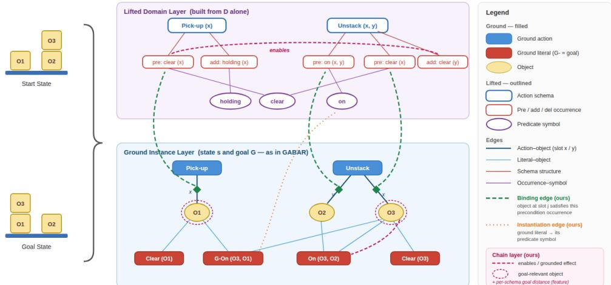
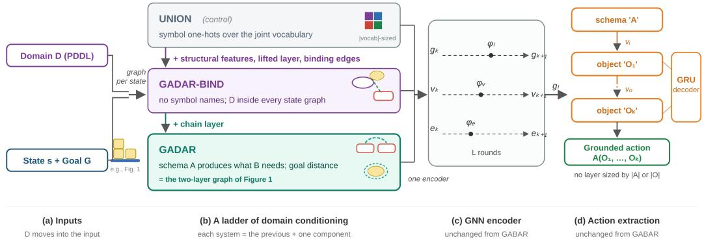

# GADAR: GENERALIZING ACROSS DOMAINS VIA AC-TION RANKING FOR CLASSICAL PLANNING

Rajesh Mangannavar, Pranay Dugar & Prasad Tadepalli

Oregon State University

Corvallis, OR 97330, USA

{mangannr,dugarp,prasad.tadepalli}@oregonstate.edu

## ABSTRACT

Learned policies for classical planning act without search, but each is tied to the domain it was trained on: network modules per action schema, parameters per predicate, or vocabulary-sized encodings mean a trained policy cannot even be executed on a new domain’s predicates and action schemas. We present GADAR (Generalizing Across Domains via Action Ranking), a policy that takes the domain description as input, π(s, G, D), and constructs grounded actions in domains never seen in training, without search. Symbols are described by the roles they play in the domain rather than by their names, in three layers that each extend the previous one: (i) a lifted domain layer embeds D in every state graph through structural signatures; (ii) a binding layer ties each ground action’s applicability to the lifted preconditions it instantiates; and (iii) a chain layer states which schema produces what another needs and how far each schema stands from the goal. The same network therefore runs on every domain, seen or unseen. We evaluate zeroshot generalization leave-one-domain-out over eight benchmark domains. A single GADAR policy trained on seven domains solves 58.3% of their test instances, one point below the 59.3% of dedicated single-domain GADAR models, so one policy serves many domains at no cost in coverage; a multi-task control that keeps symbol identity in its weights, while strong on some of the domains it trains on, transfers to none of the held-out ones. Zero-shot, GADAR executes on every held-out domain and exceeds random choice under the same executor on the large test instances of all eight: it solves 22.6% of them on average, against 3.3% for random choice and 0.6% for the same representation without the chain layer, and reaches 68% on held-out Visitall. Zero-shot coverage nonetheless remains well below in-domain coverage on most domains, and we analyze where it is weakest, including domains whose action schemas are structurally alike but play different roles.

## 1 INTRODUCTION

Classical planning finds action sequences achieving goals in deterministic environments. Traditional planners solve small problems optimally by search and heuristics but scale poorly (Erol et al., 1995; Helmert, 2006), which motivates learning-based planning: a model trained on solved problems captures regularities that carry over to new ones. Two families of learned guidance have developed largely in parallel. Learned heuristics estimate cost-to-go and guide a search algorithm (Shen et al., 2020; Karia & Srivastava, 2021; Chen et al., 2024a); learned policies select actions directly, executing plans greedily without search (Toyer et al., 2020; Stahlberg et al., 2022a; Mangannavar et al.,˚ 2025b).

Learned policies generalize well within a domain. ASNets learn per-schema network modules that transfer across problem sizes (Toyer et al., 2020); relational GNN policies learn value functions whose greedy execution solves instances far larger than those seen in training (Stahlberg et al.,˚ 2022a; 2024); GABAR encodes states as action-centric graphs and constructs grounded actions by ranking them (Mangannavar et al., 2025b). All share a design choice: the domain’s schemas and predicates are reflected in the network itself, as modules, parameters, or feature dimensions. Shaping the network to its domain aids within-domain generalization, but it is also what binds each policy to that domain, which cannot even be executed where its schemas and predicates have no slots.

For learned heuristics, a different treatment of the domain has emerged. STRIPS-HGN computes structural features that make no reference to symbol identity (Shen et al., 2020), and GOOSE’s lifted learning graph encodes the full domain description as part of the heuristic’s input, training one heuristic across many domains and evaluating on held-out ones (Chen et al., 2024a). The input side of learning for planning can therefore be made domain-agnostic. Heuristics, however, delegate action construction to search; the corresponding step for policies, which must construct grounded actions themselves, remains open, and Chen et al. (2024a) name it as future work. It is not a trivial step: the same authors prove that message passing over the lifted graph cannot compute even $h ^ { \mathrm { a d d } }$ and their domain-independent setting is empirically their hardest.

In this work we take that step, and our key idea is to change what the network is told about symbols: not which symbol something is, but what role the symbol plays in the domain. A predicate is described by where it appears (which schemas require it, which produce or destroy it, at which argument positions), and under that description gripper’s pick-then-drop and miconic’s board-thendepart are one structure, which a policy can learn in one domain and reuse in another. Two things are then needed to make the description usable: every ground action’s applicability must be tied to that structure, so that “why is this action available” is said in the domain’s own vocabulary; and the relation planning turns on, that one schema produces what another needs, must be stated explicitly rather than left for message passing to recover. The result is a policy $\pi ( s , G , D )$ that is at once domain-general and search-free, where classical planners buy generality with search and learned policies buy reactivity with specialization. The question we study is what such a policy can transfer, not whether it outraces search.

We build this capability as a ladder of three systems, each adding one group of representational commitments to the previous one, so that every adjacent comparison isolates that group. UNION is the control: symbol-identity features widened to the union of the training vocabularies, which is multi-task learning with the domain in the weights. GADAR-BIND replaces symbol identity with structural features and puts D into every state graph, as a lifted domain layer plus the binding layer. Structure alone is not yet transfer: “schema A produces what schema B consumes” is only a twohop path through a shared predicate hub, and the hub loses the pairing. Full GADAR therefore adds the chain layer, stating that relation directly and marking how far each schema stands from the goal. All three share one encoder, one ranking decoder, and the same search-free execution, so every comparison varies the representation and not the architecture.

We evaluate zero-shot generalization leave-one-domain-out over all eight benchmark domains. One GADAR policy serves every domain it is trained on: trained on seven domains, it matches the in domain coverage of dedicated single-domain models (58.3% against 59.3%). Zero-shot, on the large test instances of held-out domains, it exceeds random choice under the same executor on all eight (22.6% against 3.3% on average), reaching 68% on Visitall at plan quality 0.97, against 4% without the chain layer and 0% for the union-vocabulary control. Elsewhere it solves 4–29%, and the per domain results suggest where transfer breaks: when a held-out domain’s schemas are structurally alike but play different roles, as Logistics’ truck and airplane actions do, features that ignore symbol names may not tell them apart. GADAR is invariant by construction to renaming of predicates, schemas, and objects, a robustness current large reasoning models lack (Valmeekam et al., 2025); the same invariance means that what distinguishes such schemas has to come from data in the new domain.

## Contributions.

• To our knowledge, the first domain-agnostic policy for classical planning: $\pi ( s , G , D )$ constructs grounded actions zero-shot in unseen domains, without search.

• One policy for many domains: a single GADAR model trained on seven domains matches dedicated single-domain models in-domain on average, with positive transfer between some domains.

• A graph representation with two novel relations, both computable in any domain: binding edges, which link each applicable ground action’s objects to the lifted precondition occurrences they satisfy and so express why the action is applicable in the vocabulary of D, and

chain edges, which express which schema produces or destroys what another needs and how far each schema is from the goal.

## 2 RELATED WORK

Learning heuristics across domains. Domain-independent heuristics have a long history; we focus on the neural line. STRIPS-HGN trains hypergraph networks on structural features of the delete relaxation and evaluates on unseen domains (Shen et al., 2020). GOOSE introduces graph representations of planning tasks for grounded and lifted inputs; its lifted learning graph encodes the domain description itself (schemas, preconditions, effects, argument bindings via index features), and its domain-independent setting trains one heuristic across many domains and evaluates on heldout ones (Chen et al., 2023; 2024a). WL-GOOSE obtains stronger per-domain heuristics from Weisfeiler–Lehman features, at the cost of per-domain feature dictionaries (Chen et al., 2024b). Karia & Srivastava (2021) learn generalized heuristics over canonical abstractions; LLM-evolved heuristic ensembles transfer to a held-out IPC learning track (Gestrin & Seipp, 2026). These works establish domain-agnostic inputs, and we adopt their lesson of structural features and lifted domain graphs. They differ in output: a heuristic delegates action construction to search, which stays in the execution loop. Chen et al. (2024a) further prove an expressiveness limitation of message passing on their lifted graph and name lifted policy learning as open; our binding layer adds exactly the information a policy needs and their graph provably lacks (their Theorem 4.3; Appendix A.3).

Learned policies for planning. Generalized policy learning aims at policies that transfer across instances of a domain (Fern et al., 2003; Dzeroski et al., 2001). ASNets construct a network fromˇ the domain’s action schemas and ground atoms, with weight sharing across instantiations of the same schema (Toyer et al., 2020). Stahlberg, Bonet, and Geffner learn value functions with GNNs˚ whose greedy policies generalize across instance sizes, characterize their expressive power in terms of two-variable logics, and extend the approach with policy gradients and unsupervised objectives (Stahlberg et al., 2022a;b; 2023; 2024). Relational deep RL approaches similarly learn policies˚ over relational state representations (Zambaldi et al., 2018; Janisch et al., 2020; Garg et al., 2020; 2019; Rivlin et al., 2020). GABAR represents ground actions explicitly in the state graph and constructs actions autoregressively by ranking (Mangannavar et al., 2025b). The action-centric idea also extends to partial observability (Mangannavar & Tadepalli, 2026; Mangannavar et al., 2025a), varying what the policy observes while holding the domain fixed. The most recent work remains per-domain: self-improving search-and-learn loops train a relational value heuristic per domain (Aichmuller et al., 2026a), lookahead-based general policies are learned over instances of a single¨ domain (Aichmuller et al., 2026b), and Q-value policy learning is framed per-domain explicitly¨ (Muller et al., 2026). In all of these the vocabulary lives in the network as per-schema modules,¨ per-predicate parameters, or vocabulary-sized encodings, binding the policy to its training domain. GADAR removes that binding by moving the domain description from the network’s parameters into its input.

Ranking in planning. Learning to rank has ordered states and heuristic values for search (Xu et al., 2009; Garrett et al., 2016; Chrestien et al., 2024; Hao et al., 2024); GABAR instead ranks actions locally within a state (Mangannavar et al., 2025b), Mangannavar (2026). Cross-domain, this choice becomes load-bearing: a shared value function presupposes a common scale of goal distances that does not exist across domains, whereas local rankings are scale-free. Muller et al. (2026) report¨ convergent evidence: Q-value regression fails for lack of action discrimination and a ranking-style margin repairs it.

Large language models. Large reasoning models degrade under symbol renaming (Valmeekam et al., 2025), an invariance GADAR has by construction; LLM pipelines that write or repair PDDL (Mangannavar et al., 2026) leave planning to search.

## 3 BACKGROUND AND PROBLEM SETUP

A classical planning problem $P = \langle D , I \rangle$ pairs a first-order domain D (predicate symbols P with arities, and action schemas A, each with parameters, preconditions $p r e ( a )$ , and add/delete effects $a d d ( a ) , d e l ( a ) )$ with instance information $I = \langle O , { \bar { s } } _ { 0 } , G \rangle$ : objects, an initial state, and a goal condition, the last two as sets of ground atoms. A ground action substitutes objects for a schema’s parameters, is applicable in $s { \mathrm { ~ i f ~ } } p r e ( a ) \subseteq$ s under the substitution, and yields $s ^ { \prime } = ( s \setminus d e l ( a ) )$ ∪ add(a); a plan is an applicable sequence from $s _ { 0 }$ to a state satisfying G.

  
Figure 1: The GADAR representation for a Blocksworld task. The ground instance layer (bottom) is the action-centric graph of the grounded policy we build on (Mangannavar et al., 2025b): objects, ground literals of the state and goal (G- prefix), and ground action nodes with action–object edges carrying parameter slots. The lifted domain layer (top) is built from D alone: schemas, their precondition and effect occurrences, and predicate symbols. Binding edges (green, dashed) link an object’s slot on an applicable ground action to the precondition occurrences it satisfies; instantiation edges (orange, dotted) link each ground literal to its predicate symbol. Filled nodes are ground, outlined nodes lifted. The chain layer (magenta) is shown by one enables edge, one grounded deletes-true edge, and goal-relevance rings.

GABAR learns, per domain, a policy $\pi _ { D } ( s , G )$ that generalizes to larger instances of the same domain (Mangannavar et al., 2025b). We address the cross-domain version: from solved small instances of training domains $D _ { 1 } , \ldots , D _ { n }$ , learn a single policy $\pi ( s , G , D )$ , with the domain description itself an input, that solves instances of a test domain $\mathsf { \tilde { D } } _ { t e s t } \notin \{ \vec { D _ { 1 } } , \dots , D _ { n } \}$ , zero-shot. Execution is search-free: the highest-ranked applicable action is executed, a monitor optionally avoids revisiting states, and execution ends at the goal, a dead end, or a length bound.

## 4 GADAR

Given a planning instance in PDDL format together with its domain description D, GADAR converts the pair into a graph, processes the graph with a GNN encoder, and constructs a grounded action with a GRU-based decoder that first selects an action schema and then each of its arguments (Figure 2). Encoder and decoder are those of the per-domain policy of Mangannavar et al. (2025b); what changes is the graph they operate on. We present the representation as it is evaluated: a ladder of systems in which each addition is measured against its predecessor.

Encoder. Features are embedded into d=64 dimensions, then L=9 rounds update edges, nodes (attention over incoming edges), and a global node, with skip connections to the input encodings (Appendix A.2). The output is one embedding per node, which the decoder ranks.

## 4.1 A DOMAIN-AGNOSTIC GRAPH REPRESENTATION

Ground instance layer. The base of the representation is that action-centric graph: nodes for objects, for ground literals of the current state and the goal (goal literals marked by a flag), and for action schemas, together with a global node; edges connect literals to their argument objects and schemas to the objects of their applicable groundings, with parameter positions on the edges (Figure 1, bottom). This graph is what makes search-free action construction possible: the decoder selects among schema nodes and object nodes that are present in the input.

  
Figure 2: GADAR overview. (a) D, state, and goal become one graph. (b) The ladder: UNION (symbol one-hots), GADAR-BIND (structural features, lifted and binding layers), GADAR (chain layer). (c) GNN encoder. (d) GRU decoder: schema, then arguments, scored against node embeddings; nothing is sized by the number of schemas or objects.

The graph. A task $( s , G , D )$ is encoded as $\mathcal { G } = ( V , E , X , R )$ . The node set is

$$
V \ = \ O \cup \ L \cup \ A \cup \Sigma \cup Q \cup \{ g \} ,
$$

where O are the objects, L the ground literals of the state and goal, A the action schemas (one node per schema), Σ the predicate symbols of D, including one synthetic unary static predicate per declared type so that typed and predicate-typed domains present the same structure, $\bar { Q }$ the occurrence nodes $q _ { a , k }$ , one per literal occurrence k in the preconditions and effects of schema a, and g a global node. The edge set is a union of typed relations,

$$
E \ = \ E _ { \mathrm { l i t } } \cup E _ { \mathrm { a c t } } \cup E _ { \mathrm { i n s t } } \cup E _ { \mathrm { o c c } } \cup E _ { \mathrm { b i n d } } \cup E _ { \mathrm { c h a i n } } \cup E _ { \mathrm { e f f } } ,
$$

$E _ { \mathrm { l i t } } \subseteq L \times O , E _ { \mathrm { a c t } } \subseteq A \times O \colon$ literals to their arguments and schemas to the objects of their applicable groundings (the ground layer), with argument and slot positions as edge features;

$E _ { \mathrm { i n s t } } \subseteq ( L \cup O ) \times \Sigma \colon$ instantiation, each literal to its predicate’s symbol and each object to its declared type’s symbol;

$E _ { \mathrm { o c c } } \subseteq Q \times ( \Sigma \cup A ) .$ : each occurrence to its predicate symbol and to its schema, carrying the role $r ( q ) \in \{ \mathrm { p r e } , \mathrm { a d d } , \mathrm { d e l } \}$ and the argument-to-slot pairs $( i , j )$ of that occurrence;

$E _ { \mathrm { b i n d } } \subseteq O \times Q$ , the binding layer: $\left( o , q _ { a , k } \right)$ whenever some applicable grounding of a places o at a slot that occurrence k constrains;

$E _ { \mathrm { c h a i n } } \subseteq Q \times Q$ , the chain layer: enables $ \ = \ \{ ( q , q ^ { \prime } ) \ : \ r ( q ) \ = \ \mathrm { a d d } , \ r ( q ^ { \prime } ) \ =$ pre, pred(q) = pred(q′)} and threatens likewise with $r ( q ) = \mathrm { d e l } ;$

$E _ { \mathrm { e f f } } \subseteq O \times L$ , the grounded effect edges: for each applicable grounding, an instantiated add effect equal to an unsatisfied goal atom ℓ (achieves-goal), or a delete effect equal to a true atom ℓ (deletes-true), links the grounding’s objects to ℓ.

Node features $X : V \to \{ 0 , 1 \} ^ { d }$ concatenate indicator segments: the node’s kind; the arity (clamped at global caps $k _ { p } , k _ { a } )$ and a static-predicate flag; a goal flag on literals; on schema nodes the goaldistance one-hot gdis $\mathrm { \Delta } ( a ) \in \{ 0 , 1 , \bar { 2 } , 3 + \}$ , the BFS depth over enables from the schemas that add a goal predicate; and on objects a goal-relevance bit (the object occurs in an open goal atom). Edge features $R : E \to \{ 0 , 1 \} ^ { k }$ concatenate the relation type with position, slot, and role indicators up to the caps. The widths d and k are functions of $( k _ { p } , \dot { k _ { a } } )$ alone; no dimension is $| A | , | P | , | T |$ , or |O|.

A single network therefore serves every domain, instances from different domains batch together, and permuting symbol names leaves $( X , R )$ unchanged: renaming invariance holds by construction. Every feature is a flag or a one-hot; nothing is a magnitude. The goal distance in particular is bucketed rather than numeric, deliberately: a number must be read on a scale, and no scale is shared across domains. The same argument makes local action ranking, rather than value regression, the right objective in this setting.

Cost. $\Sigma , Q , E _ { \mathrm { o c c } } ,$ and $E _ { \mathrm { c h a i n } }$ are domain-sized constants computed once per domain; gdist depends only on which predicates occur in the goal and is computed once per (domain, goal signature). Only $E _ { \mathrm { b i n d } } , E _ { \mathrm { e f f } }$ , and the goal marks are per-state, each linear in the applicable groundings and open goal atoms.

Why these relations. $E _ { \mathrm { b i n d } }$ connects what the two prior lines capture only separately: LLG has lifted preconditions but no ground actions, and GABAR has ground applicability but indexed by per-domain strings that do not transfer. Binding expresses why each action is applicable in $D ' s$ own vocabulary.1 In Figure 1, the edge placing O3 in Unstack’s first slot binds to the occurrences on(x,y) and clear(x), and this information survives unchanged if every symbol is renamed. $E _ { \mathrm { c h a i n } }$ states directly that schema A produces what schema B needs. Without it, this relation exists only as a twohop path through a shared predicate hub, and the hub’s aggregation destroys the producer–consumer pairing. Because the chain edges connect occurrences, the pairing survives message passing, delete effects acquire a consequence, and the relation transfers across domains: gripper’s pick → drop and miconic’s board → depart are the same structure, an enables edge between an add- and a pre-occurrence of a shared predicate. $E _ { \mathrm { e f f } }$ grounds the layer: the decoder scores object nodes, and these edges place “this object closes an open goal” and “this object undoes something true” one hop from the quantity being ranked.

## 4.2 A LADDER OF DOMAIN CONDITIONING

The three systems stand in a strict subset relation. UNION (control) keeps the symbol-identity onehots, widened to the union of the training vocabularies: the domain stays in the weights, which is multi-task learning, not domain conditioning. GADAR-BIND replaces those one-hots with the structural features $\dot { X }$ , making the policy executable in any domain, and adds $\Sigma , Q , E _ { \mathrm { i n s t } } , E _ { \mathrm { o c c } }$ , and $E _ { \mathrm { b i n d } } . \mathrm { G A D A R }$ adds $E _ { \mathrm { c h a i n } } , E _ { \mathrm { e f f } } ,$ and the goal-distance and goal-relevance features. Because adjacent systems differ in one group of components, the experimental comparison and the ablation study are the same object: the UNION-to-GADAR-BIND step measures what removing symbol identity costs and what the domain description buys, and the GADAR-BIND-to-GADAR step measures the chain layer together with the grounded effect edges and goal features it adds. We do not separate those three here, and attribute the second step to them jointly.

## 4.3 ACTION CONSTRUCTION AND TRAINING

The decoder changes only where per-domain constants would otherwise appear (Figure 2d). A GRU selects a schema by scoring schema-node embeddings against its hidden state, then each argument in turn by scoring object-node embeddings, feeding every selection back as the next input. The argument loop runs to the selected schema’s arity, read from D under a global arity cap rather than a per-domain constant. No component is sized by the number of schemas, objects, or predicates; selection is always a dot product between the decoder state and the embedding of a node present in the graph, which is what lets one network construct actions in a domain whose schemas it has never seen. Training is supervised: cross-entropy against the expert’s schema and argument choices at every state along planner-generated plans. Because feature widths are domain-independent, domains mix freely within a batch.

## 5 EXPERIMENTAL SETUP

Domains. We evaluate on the eight benchmark domains used by GABAR: Blocks, Miconic, Spanner, Gripper, Visitall, Grid, Logistics, and Rovers (Mangannavar et al., 2025b; Seipp et al., 2022). Training data consists of plans computed by Fast Downward with the LAMA-first satisficing configuration (Helmert, 2006) on the small instances of each training domain (between 125 and 312 instances per domain); states along each plan are converted to graphs and the policy is trained to reproduce the expert action as described above. Each domain in turn is held out and evaluated on two splits.

Protocol. Two experiment families, run for every rung of the ladder. (i) Zero-shot generalization (leave-one-domain-out, the main experiment): for each of the eight domains, a policy is trained on the remaining seven and evaluated on the held-out domain zero-shot, having never seen its predicates, schemas, or objects. (ii) In-domain, multi-domain: the same seven-domain policies are evalu ated on the domains they trained on, and for each domain we report the mean over the seven policies whose training set includes it; a single-domain variant, GADAR (single-domain), trains the same representation on that domain alone. The test split is the domain’s test set, with instances up to an order of magnitude larger than training-scale problems; the training-scale split is the held-out domain’s own training-scale instances, unseen because the domain was held out, which separates failing on the unseen domain from failing to scale within it. Training domains are evaluated on the test split only.

Baselines and references. Our primary comparison is the UNION control described above: identical data, architecture, and training procedure, with only the representation different. Any zero-shot capability GADAR has beyond this control comes from moving the domain into the input. Two floors bound the zero-shot numbers from below. The randomfloor is the same executor and monitor choosing uniformly among applicable ground actions, averaged over three rollouts per problem; it measures how far legal moves alone get on each split. The untrained control is the identical system, with the same graph, decoder, executor, and step bound, but a network that has seen a single epoch of training. As a reference for dedicated training we report published per-domain GABAR (Mangannavar et al., 2025b), trained directly on each held-out domain and evaluated on its own test instances, averaged over its three published size bands. Those instances are not identical to ours, so GABAR (published) indicates what per-domain training achieves at this scale rather than serving as a matched comparison.

Ablations and oracle. The ladder is the ablation study (Figure 2b), and each group of components is measured by adjacent columns of Table 1. We additionally report one diagnostic that is not a rung of the ladder: an achievement oracle that, at every state, prefers any applicable ground action whose add effects directly satisfy an unsatisfied goal atom, and otherwise defers to the policy. It bounds what a hand-coded terminal trigger can achieve on each domain.

Metrics and implementation. We report coverage (C), the percentage of test problems solved within a 500-step bound, and plan quality (P), the ratio of the reference planner’s plan length to the policy’s on jointly solved problems, so values above 1 mean plans shorter than the reference; coverage is the primary metric (Appendix A.7). Hyperparameters are carried over from Mangannavar et al. (2025b) unchanged (Appendix A.6), and renaming invariance is verified by a unit test (Appendix A.8). In-domain results use the checkpoint with the lowest combined training and validation loss; zero-shot results use the training epoch that maximizes mean zero-shot coverage on the other held-out domains.

## 6 RESULTS AND DISCUSSION

Table 1 presents the zero-shot results for all eight held-out domains and Table 2 the in-domain results. We organize the discussion so that each question is answered by one comparison: a rung of the ladder, a control, or a diagnostic.

Is the representation costly on its own? (GADAR (single-domain) vs. GABAR (published).) Trained on a single domain, GADAR (single-domain) is within five points on Blocks and Gripper and within ten on Spanner and Grid, but far behind on Miconic and Visitall, and it reaches only 3.1% and 7.4% on Logistics and Rovers. Describing symbols by role rather than name thus costs little in four domains and much in the others; on Logistics, UNION, which keeps the names, reaches 18.6% (see the aliasing discussed below).

Table 1: Zero-shot generalization, leave-one-domain-out: coverage (%) on each held-out domain, which is never seen in training. Training-scale: its small instances; Test: its test instances. Rand: uniform choice among applicable actions under the same executor. Mean: over the eight held-out domains.
<table><tr><td></td><td>Held out</td><td>Blocks</td><td>Gripper</td><td>Miconic</td><td>Visitall</td><td>Grid</td><td>Logistics</td><td>Spanner</td><td>Rovers</td><td>Mean</td></tr><tr><td rowspan="4">Training- scale</td><td>Rand</td><td>1.7</td><td>0.0</td><td>88.3</td><td>99.7</td><td>3.0</td><td>0.0</td><td>23.4</td><td>15.2</td><td>28.9</td></tr><tr><td>UNION</td><td>0.0</td><td>0.0</td><td>0.0</td><td>0.8</td><td>1.0</td><td>0.0</td><td>0.0</td><td>0.0</td><td>0.2</td></tr><tr><td>GADAR-BIND</td><td>2.5</td><td>0.0</td><td>0.0</td><td>16.0</td><td>3.1</td><td>0.0</td><td>0.0</td><td>0.0</td><td>2.7</td></tr><tr><td>GADAR</td><td>37.5</td><td>13.3</td><td>36.3</td><td>100.0</td><td>33.4</td><td>9.9</td><td>43.4</td><td>16.1</td><td>36.2</td></tr><tr><td rowspan="4">Test</td><td>Rand</td><td>0.2</td><td>0.0</td><td>1.1</td><td>6.0</td><td>0.0</td><td>0.0</td><td>13.8</td><td>5.2</td><td>3.3</td></tr><tr><td>UNION</td><td>0.0</td><td>0.0</td><td>0.0</td><td>0.0</td><td>0.0</td><td>0.0</td><td>0.0</td><td>0.0</td><td>0.0</td></tr><tr><td>GADAR-BIND</td><td>1.0</td><td>0.0</td><td>0.0</td><td>4.0</td><td>0.0</td><td>0.0</td><td>0.0</td><td>0.0</td><td>0.6</td></tr><tr><td>GADAR</td><td>23.0</td><td>6.0</td><td>19.0</td><td>68.0</td><td>12.1</td><td>4.0</td><td>29.2</td><td>19.6</td><td>22.6</td></tr></table>

Table 2: In-domain coverage (%) on the test instances. Ladder rows average the seven leave-one-out policies whose training set includes the domain; GADAR (single-domain) is trained on that domain alone. GABAR (published): per-domain GABAR as published, on its own test instances.
<table><tr><td></td><td>Blocks</td><td>Gripper</td><td>Miconic</td><td>Visitall</td><td>Grid</td><td>Logistics</td><td>Spanner</td><td>Rovers</td><td>Mean</td></tr><tr><td>GABAR (published)</td><td>100.0</td><td>100.0</td><td>100.0</td><td>90.7</td><td>96.3</td><td>79.0</td><td>92.0</td><td>82.0</td><td>92.5</td></tr><tr><td>UNION</td><td>57.2</td><td>84.1</td><td>86.1</td><td>77.3</td><td>89.6</td><td>18.6</td><td>48.6</td><td>9.6</td><td>58.9</td></tr><tr><td>GADAR-BIND</td><td>43.4</td><td>95.4</td><td>67.0</td><td>78.6</td><td>64.9</td><td>0.3</td><td>40.0</td><td>8.2</td><td>49.7</td></tr><tr><td>GADAR</td><td>74.6</td><td>94.5</td><td>61.9</td><td>81.1</td><td>94.6</td><td>2.7</td><td>47.9</td><td>9.0</td><td>58.3</td></tr><tr><td>GADAR (single-domain)</td><td>95.5</td><td>100.0</td><td>41.2</td><td>54.0</td><td>87.5</td><td>3.1</td><td>85.4</td><td>7.4</td><td>59.3</td></tr></table>

Does one model serve several domains? (GADAR vs. GADAR (single-domain).) Every ladder column is a policy that serves seven domains at once. Averaged over the seven such policies that train on each domain, GADAR solves 58.3% of the test instances, against 59.3% for the eight GADAR (single-domain) models: sharing one model across seven domains costs one point on average. The average hides transfer in both directions. Training alongside other domains helps Visitall (81.1% against 54.0%), Miconic (61.9% against 41.2%), and Grid (94.6% against 87.5%), and hurts Spanner (47.9% against 85.4%) and Blocks (74.6% against 95.5%). Logistics and Rovers are equally low either way, so their gap to GABAR (published) is a cost of the representation, not of sharing.

Does the domain need to be in the input? (UNION vs. GADAR.) UNION, trained on the identical data with the identical architecture, is the stronger model on some training domains (86.1% on in domain Miconic and 18.6% on Logistics, against GADAR’s 61.9% and 2.7%) and fails completely off them: it solves 0% of every held-out test split, and its top-ranked proposal is applicable in fewer than 1% of states there. On the same domains GADAR solves 4.0–68.0%. A symbol-identity representation cannot act on a vocabulary it has not seen; moving the domain description into the input is what makes zero-shot execution possible at all. Averaged in-domain, UNION reaches 58.9% against GADAR’s 58.3%: giving up symbol names costs under a point on average, but it costs Miconic and Logistics.

Is the description enough? (GADAR-BIND vs. GADAR.) GADAR-BIND already contains the full domain description and the binding edges, yet it solves 0.6% of held-out test instances on average and none on six of the eight domains. The chain layer, together with the grounded effect edges and goal features added in the same step, raises test coverage on every held-out domain: to 22.6% on average, and from 4.0% to 68.0% on Visitall. That step introduces no new supervision and no domain-sized parameters: its relations are restated from D, and it widens only the domainindependent edge-feature input. The description alone does not transfer; it must be restated in a form message passing can use.

Is it the policy or the executor? (Floors vs. GADAR.) The executor resamples an applicable action when the rollout re-enters a visited state, so part of any coverage may come from the executor rather than the policy. Two floors separate them. On small instances the executor alone often suffices: random choice among applicable actions under the same executor solves 99.7% of training-scale Visitall and 88.3% of training-scale Miconic, so the training-scale split can credit the policy with little there. The test split can: random choice solves 3.3% of it on average and at most 13.8% (Spanner), and GADAR exceeds it on every held-out domain, by 4.0 (Logistics) to 62.0 points (Visitall). The two floors also differ from each other, and the difference matters: an untrained network is not a neutral policy but a consistently biased one, and it falls below random wherever random exploration is enough (2.6% against 88.3% on training-scale Miconic, 0.0% against 6.0% on test Visitall). A policy should therefore be credited against the higher of the two floors, which wherever we measured both is random choice. The same effect explains the one split where GADAR falls below random choice, training-scale Miconic (36.3% against 88.3%); on test Miconic, where exploration no longer suffices (1.1%), it solves 19.0%.

Are the plans goal-directed? (Plan quality.) Where random choice also succeeds, plan length separates a goal-directed policy from legal exploration. On training-scale Visitall, GADAR’s plans average 36.3 steps against 29.2 for the planner, a plan quality of 0.81; random choice solves nearly the same instances with plans averaging 107.1 steps, a plan quality of 0.27. On the test split, where random choice rarely succeeds, GADAR’s plan quality is 0.97: its plans are within 3% of the planner’s, which searches while GADAR does not.

Is it a terminal trigger? (Achievement oracle vs. GADAR.) A policy might only learn to fire when a goal atom is one action away. The achievement oracle hard-codes exactly that behavior and defers to the policy otherwise. On test Visitall it solves –% against GADAR’s 68.0%, so the policy is also choosing actions several steps from achieving anything, which is what the bucketed goal distance over the enables relation was designed to support.

How much of in-domain coverage does zero-shot recover? (Table 1 vs. Table 2.) Averaged over the eight domains, zero-shot GADAR solves 22.6% of the test instances against 58.3% for GADAR policies that train on the domain, about two fifths. The fraction ranges from 84% on Visitall to under a seventh on Grid and Gripper. On Logistics and Rovers zero-shot matches or exceeds in-domain coverage: training on these domains does not help either, which points to a representational limit rather than a failure of transfer.

Where is zero-shot generalization weakest? (Logistics and Gripper.) Logistics and Gripper are the weakest held-out domains, at 4.0% and 6.0% of their test instances. Logistics illustrates one cause. Its two transport modes use schemas, load-truck and load-airplane and their unload counterparts, whose lifted structure is identical up to the vehicle type they bind, so a representation that ignores symbol names gives them the same features even though only one advances the goal in a given state. Renaming invariance equates whole domains with identical structure; schemas that are structurally alike within a domain can still play different roles in it. The in-domain results point the same way: with Logistics among its training domains, GADAR still reaches only 2.7% on it, and 3.1% when trained on Logistics alone, against 94.6% on Grid. Gripper shows that shared structure is not sufficient either: it shares Miconic’s producer–consumer pattern yet transfers less (6.0% against 19.0%). Whether structural similarity, between schemas within a domain or between domains, predicts zero-shot coverage across all eight domains we leave to a systematic analysis.

## 7 CONCLUSION

We introduced GADAR, a policy for classical planning that takes the domain description as input and constructs grounded actions in domains never seen in training, without search. The capability rests on the binding layer, which connects ground applicability to lifted structure, and the chain layer, which makes the domain’s producer–consumer structure and its distance to the goal explicit; neither adds supervision or domain-sized parameters. One GADAR policy serves seven domains at once at the in-domain coverage of dedicated single-domain models (58.3% against 59.3%). Zero-shot, the chain layer raises held-out test coverage from 0.6% to 22.6% on average, above random choice on all eight domains and to 68% on Visitall, though it remains well below in-domain coverage on most. Schemas that are structurally alike but play different roles, as in Logistics, may mark a limit that renaming-invariant features cannot cross without data from the new domain. Few-shot adaptation, lifted successor generation, richer PDDL fragments, and probabilistic settings remain future work.

## REFERENCES

Michael Aichmuller, Yannik Hesse, and Hector Geffner. Learning to search and searching to learn¨ for generalization in planning, 2026a. URL https://arxiv.org/abs/2605.25720.

Michael Aichmuller, Simon St¨ ahlberg, Martin Funkquist, and Hector Geffner. Efficient lookahead˚ encoding and abstracted width for learning general policies in classical planning, 2026b. URL https://arxiv.org/abs/2605.18674.

Dillon Z Chen, Sylvie Thiebaux, and Felipe Trevizan. Learning domain-independent heuristics for ´ grounded and lifted planning. In Proceedings of the AAAI Conference on Artificial Intelligence, volume 38, pp. 20078–20086, 2024a.

Dillon Z Chen, Felipe Trevizan, and Sylvie Thiebaux. Return to tradition: Learning reliable heuris-´ tics with classical machine learning. In Proceedings ofthe International Conference on Automated Planning and Scheduling, volume 34, pp. 68–76, 2024b.

Dillon Ze Chen, Sylvie Thiebaux, and Felipe Trevizan. Goose: Learning domain-independent´ heuristics. In NeurIPS 2023 Workshop on Generalization in Planning, 2023.

Leah Chrestien, Stefan Edelkamp, Antonin Komenda, and Tomas Pevny. Optimize planning heuristics to rank, not to estimate cost-to-goal. Advances in Neural Information Processing Systems, 36, 2024.

Saso Dˇ zeroski, Luc De Raedt, and Kurt Driessens. Relational reinforcement learning.ˇ Machine learning, 43:7–52, 2001.

Kutluhan Erol, Dana S. Nau, and V.S. Subrahmanian. Complexity, decidability and undecidability results for domain-independent planning. Artificial Intelligence, 76(1):75–88, 1995. ISSN 0004-3702. doi: https://doi.org/10.1016/0004-3702(94)00080-K. URL https://www. sciencedirect.com/science/article/pii/000437029400080K. Planning and Scheduling.

Alan Fern, Sungwook Yoon, and Robert Givan. Approximate policy iteration with a policy language bias. Advances in neural information processing systems, 16, 2003.

Sankalp Garg, Aniket Bajpai, et al. Size independent neural transfer for rddl planning. In Proceedings of the International Conference on Automated Planning and Scheduling, volume 29, pp. 631–636, 2019.

Sankalp Garg, Aniket Bajpai, et al. Symbolic network: generalized neural policies for relational mdps. In International Conference on Machine Learning, pp. 3397–3407. PMLR, 2020.

Caelan Reed Garrett, Leslie Pack Kaelbling, and Tomas Lozano-P´ erez. Learning to rank for synthe-´ sizing planning heuristics. arXiv preprint arXiv:1608.01302, 2016.

Elliot Gestrin and Jendrik Seipp. Llm-evolved domain-independent heuristics for symbolic ai planning, 2026. URL https://arxiv.org/abs/2605.29649.

Mingyu Hao, Felipe Trevizan, Sylvie Thiebaux, Patrick Ferber, and J ´ org Hoffmann. Guiding gbfs¨ through learned pairwise rankings. In Thirty-Third International Joint Conference on Artificial In telligence {IJCAI-24}, pp. 6724–6732. International Joint Conferences on Artificial Intelligence Organization, 2024.

Malte Helmert. The fast downward planning system. Journal of Artificial Intelligence Research, 26: 191–246, 2006.

Jarom´ır Janisch, Toma´s Pevn ˇ y, and Viliam Lis \` y. Symbolic relational deep reinforcement learn- \` ing based on graph neural networks and autoregressive policy decomposition. arXiv preprint arXiv:2009.12462, 2020.

Rushang Karia and Siddharth Srivastava. Learning generalized relational heuristic networks for model-agnostic planning. In Proceedings of the AAAI Conference on Artificial Intelligence, volume 35, pp. 8064–8073, 2021.

Rajesh Mangannavar and Prasad Tadepalli. Gammazero: Learning to guide belief-space search for long-horizon pomdps with generalizable graph representations. In Proceedings of the International Conference on Automated Planning and Scheduling, volume 36, pp. 658–666, 2026.

Rajesh Mangannavar, Alan Fern, and Prasad Tadepalli. Hierarchical object-oriented pomdp planning for object rearrangement, 2025a. URL https://arxiv.org/abs/2412.01348.

Rajesh Mangannavar, Stefan Lee, Alan Fern, and Prasad Tadepalli. Graph neural network based action ranking for planning. Advances in Neural Information Processing Systems, 38:172375– 172398, 2025b.

Rajesh Mangannavar, Zachary Coalson, Pranay Dugar, and Prasad Tadepalli. Training the orchestrator: A supervised approach to end-to-end pddl planning with llm agents, 2026. URL https://arxiv.org/abs/2606.21740.

Rajesh D Mangannavar. Scalable planning through abstraction and learning in fully and partially observable domains. 2026.

Nicola J. Muller, Moritz Oster, Isabel Valera, J¨ org Hoffmann, and Timo P. Gros. Per-domain general-¨ izing policies: On learning efficient and robust q-value functions (extended version with technical appendix), 2026. URL https://arxiv.org/abs/2603.17544.

Or Rivlin, Tamir Hazan, and Erez Karpas. Generalized planning with deep reinforcement learning. arXiv preprint arXiv:2005.02305, 2020.

Jendrik Seipp, Alvaro Torralba, and J´ org Hoffmann. PDDL generators.¨ https://doi.org/ 10.5281/zenodo.6382173, 2022.

William Shen, Felipe Trevizan, and Sylvie Thiebaux. Learning domain-independent planning´ heuristics with hypergraph networks. In Proceedings of the International Conference on Automated Planning and Scheduling, volume 30, pp. 574–584, 2020.

Simon Stahlberg, Blai Bonet, and Hector Geffner. Learning general optimal policies with graph˚ neural networks: Expressive power, transparency, and limits. In Proceedings ofthe International Conference on Automated Planning and Scheduling, volume 32, pp. 629–637, 2022a.

Simon Stahlberg, Blai Bonet, and Hector Geffner. Learning generalized policies without supervision˚ using gnns. arXiv preprint arXiv:2205.06002, 2022b.

Simon Stahlberg, Blai Bonet, and Hector Geffner. Learning general policies with policy gradient˚ methods. In Proceedings of the International Conference on Principles of Knowledge Representation and Reasoning, volume 19, pp. 647–657, 2023.

Simon Stahlberg, Blai Bonet, and Hector Geffner. Learning general policies for classical planning ˚ domains: Getting beyond c 2. arXiv preprint arXiv:2403.11734, 2024.

Sam Toyer, Sylvie Thiebaux, Felipe Trevizan, and Lexing Xie. Asnets: Deep learning for gener-´ alised planning. Journal ofArtificial Intelligence Research, 68:1–68, 2020.

Karthik Valmeekam, Kaya Stechly, Atharva Gundawar, and Subbarao Kambhampati. A systematic evaluation of the planning and scheduling abilities of the reasoning model o1. Transactions on Machine Learning Research, 2025.

Yuehua Xu, Alan Fern, and Sungwook Yoon. Learning linear ranking functions for beam search with application to planning. Journal ofMachine Learning Research, 10(7), 2009.

Vinicius Zambaldi, David Raposo, Adam Santoro, Victor Bapst, Yujia Li, Igor Babuschkin, Karl Tuyls, David Reichert, Timothy Lillicrap, Edward Lockhart, et al. Relational deep reinforcement learning. arXiv preprint arXiv:1806.01830, 2018.

Algorithm 1 Construction of the GADAR graph for $( s , G , D )$   
1: $V  O \cup L \cup A \cup \{ g \}$ where L holds the ground literals of s and of G, the latter flagged as   
goal atoms   
2: add $E _ { \mathrm { l i t } } \colon$ each literal to its argument objects, argument position on the edge   
3: add $E _ { \mathrm { a c t } } \mathrm { : }$ each schema to the objects of its applicable groundings, parameter slot on the edge   
4: † compile each declared PDDL type of D into a unary static predicate, so typed and predicate  
typed domains present one structure   
5: † ${ \bar { V } }  V \cup \Sigma { \bar { \cup } } Q \colon$ a node per predicate symbol of D, and an occurrence node $q _ { a , k }$ per literal   
occurrence in the preconditions and effects of each schema a   
6: † add $E _ { \mathrm { o c c } } .$ each occurrence to its predicate symbol and its schema, carrying role $r ( q )$ and   
argument-to-slot pairs   
7: add $E _ { \mathrm { i n s t } }$ and $E _ { \mathrm { b i n d } } \colon$ each literal to its predicate symbol, each object to its type symbol, and   
$\left( o , q _ { a , k } \right)$ whenever an applicable grounding of a puts o at a slot that occurrence k constrains   
8: † add $E _ { \mathrm { c h a i n } } \colon$ enables between an add and a pre occurrence of a shared predicate, threatens   
likewise for del   
9: add $E _ { \mathrm { e f f } } \colon$ from each applicable grounding, link its objects to any unsatisfied goal atom it adds   
and any true atom it deletes   
10: compute gdist(a) by breadth-first search over enables from the schemas adding a goal predicate;   
mark objects occurring in an open goal atom   
11: emit X and R as indicator vectors; widths depend only on the global arity caps $\left( k _ { p } , k _ { a } \right)$ , never   
on $| A | , | P | , | T | \mathrm { o r } | O |$

## A APPENDIX

This appendix gives the detail a reader needs to implement the representation, reproduce the experi ments, or reuse either in another setting. It adds no results: everything reported in the paper is in the paper.

## A.1 BUILDING THE GRAPH

Algorithm 1 constructs $\mathcal { G } = ( V , E , X , R )$ for one task, in the notation of the representation section. Lines marked † depend on the domain description alone, so they are computed once per domain and reused for every state of it; the rest are per state and are linear in the applicable groundings and the open goal atoms. The three systems are prefixes of the same procedure: UNION runs lines 1 to 3 with symbol-identity features in place of X, GADAR-BIND runs lines 1 to 7, and GADAR runs all of it.

Two implementation points matter for anyone rebuilding this. First, the type compilation on line 4 is what lets one model span domains that declare PDDL types and domains that spell types as ordinary unary predicates; without it the two families present different structure for the same constraint, and a policy trained on one produces type-invalid groundings on the other. Second, $E _ { \mathrm { b i n d } }$ on line 7 is the only relation that crosses between the two layers, joining an object of the current problem to a precondition occurrence of a schema in D. Everything else lives wholly inside one layer.

The reference implementation accumulates edge features sparsely, as a map from node pair to the set of features that hold. A dense $( k _ { a } , | V | , | V |$ |, dim R) array is the obvious alternative and is what we wrote first, but it costs $O ( k _ { a } | V | ^ { 2 }$ dim R) to allocate and scan for every state, which dominates the cost of re-featurizing states during evaluation on large instances.

## A.2 ENCODER

Node, edge, and global features are first embedded by separate MLPs into d=64 dimensions. Each of L=9 rounds then (1) updates every edge from its two endpoints, its own embedding, and the global node, (2) updates every node from its incoming edges, aggregated by attention (a softmax over the node’s incoming edges), and (3) updates the global node from all nodes and edges. At every round the current embeddings are concatenated with their round-0 encodings before the update, a skip connection that keeps the input features visible at depth. The output is one embedding per node, which the decoder ranks.

Table 3: Training data per domain: the small instances collected, and the labelled states taken from their plans.
<table><tr><td>Domain</td><td>Problems</td><td>States</td></tr><tr><td>Blocks</td><td>200</td><td>4,216</td></tr><tr><td>Gripper</td><td>147</td><td>7,287</td></tr><tr><td>Miconic</td><td>228</td><td>5,453</td></tr><tr><td>Visitall</td><td>125</td><td>3,654</td></tr><tr><td>Grid</td><td>192</td><td>6,880</td></tr><tr><td>Logistics</td><td>156</td><td>6,732</td></tr><tr><td>Spanner</td><td>234</td><td>3,801</td></tr><tr><td>Rovers</td><td>312</td><td>3,001</td></tr><tr><td>Total</td><td>1,594</td><td>41,024</td></tr></table>

## A.3 RELATION TO GOOSE’S LIFTED LEARNING GRAPH

LLG and our lifted layer share the essential idea of the domain description as input, and differ in encoding: argument positions as edge features rather than chains of index nodes, and occurrence nodes carrying exact argument-to-slot pairs. The fundamental difference is purpose. A heuristic graph must support one number read from a global embedding, so LLG contains no ground actions and no applicability information, and Chen et al. (2024a) prove message passing on it cannot compute $h ^ { \mathrm { a d \hat { d } } }$ . A policy graph must contain the decoder’s targets, the schema and object nodes to score, and the evidence for scoring them: which groundings are applicable and why. The binding layer supplies that evidence in $D _ { \mathrm { ~ s ~ } } ^ { \ J }$ own vocabulary.

## A.4 DECODING AND TRAINING

A GRU scores the schema nodes against its hidden state and takes the best, then scores the object nodes once per argument of the selected schema, feeding each choice back as the next input. The number of arguments is read from D for the selected schema, under a global arity cap rather than a per-domain constant, which is what allows the loop to run in a domain whose schemas were never seen. Selection is a dot product between the decoder state and the embedding of a node present in the graph, so no layer is sized by the number of schemas, objects, or predicates. Search over these choices is a beam of width 2 over schemas and 3 over objects per slot.

Training is supervised on plans from a satisficing planner: cross-entropy against the planner’s schema choice and each of its argument choices, at every state along every plan. Because feature widths do not depend on the domain, states from different domains mix freely within a batch.

## A.5 DOMAINS AND DATA

We use the eight benchmark domains of Mangannavar et al. (2025b), generated with Seipp et al. (2022). Table 3 gives the sizes. Instances the planner fails to solve within its limit are skipped, so the collected count can fall below the number of instances the generator produced; the counts in the table are what was actually collected.

Ten percent of each domain’s states are held out for validation, stratified by domain so every training domain is represented, and the split is deterministic given the seed. In the leave-one-domain-out experiments the held-out domain contributes nothing to either split: its plans are never collected for that run, so no state, predicate, or schema of it is seen. Testing is done on 300 problems each for all domains (combined from easy, medium and hard problems from the GABAR experiments).

## A.6 HYPERPARAMETERS

Table 4 lists every setting. Encoder and decoder hyperparameters are inherited from Mangannavar et al. (2025b) without modification. This is deliberate rather than incidental: the comparisons in the paper are between representations, and re-tuning the network for each one would confound them. We therefore ran no architecture search, and a practitioner adapting this to a new benchmark should expect to gain from tuning we did not do. The two settings we did choose are the global arity caps $\left( k _ { p } , k _ { a } \right)$ , set to the maxima over the training domains so a held-out domain with wider symbols still featurizes at full width, and the number of training epochs.

Table 4: Final hyperparameters, identical across all three systems except where noted.
<table><tr><td>Setting Value</td></tr><tr><td>Encoder</td></tr><tr><td>Message-passing rounds L 9 64</td></tr><tr><td>Representation size</td></tr><tr><td>Attention heads 1 2</td></tr><tr><td>MLP layers per update block</td></tr><tr><td>Global node enabled</td></tr><tr><td>Decoder</td></tr><tr><td>GRU layers</td></tr><tr><td>Beam width, schemas</td></tr><tr><td>Beam width, objects per slot</td></tr><tr><td>Optimization</td></tr><tr><td>Optimizer Adam</td></tr><tr><td>Learning rate  $5 \times 1 0 ^ { - 4 }$ </td></tr><tr><td>Batch size</td></tr><tr><td>Dropout</td></tr><tr><td>0.0 Attention dropout 0.0</td></tr><tr><td>Weight decay 0.0</td></tr><tr><td>Epochs, structural systems 500</td></tr><tr><td>Epochs, UNION 100</td></tr><tr><td>Evaluation</td></tr><tr><td>Execution bound (steps) 500</td></tr><tr><td>Search at test time none (greedy)</td></tr><tr><td></td></tr><tr><td>Revisit monitor enabled</td></tr><tr><td>Training plan generator  $\mathtt { f d - l a m a - f i r s t }$ </td></tr><tr><td>Plan-quality reference  $\mathtt { f d - l a m a - f i r s t }$ </td></tr></table>

A run is seeded once, and that seed governs the network initialization, the training shuffle, and the train and validation split; the revisit monitor’s fallback sampling is seeded per problem, so that it is identical across execution harnesses. Each configuration is a single run.

## A.7 EVALUATION PROTOCOL

Let T be a test set and solved $( \pi ) \subseteq \mathcal T$ the instances on which policy π reaches a goal state within the execution bound. Coverage is

$$
C ( \pi ) = \frac { | \mathrm { s o l v e d } ( \pi ) | } { | T | } \times 1 0 0 .
$$

Execution is greedy and search-free. At each state the highest-ranked applicable action the decoder constructs is executed; a rollout that proposes an inapplicable action falls back to the next candidate in the beam, and if none is applicable the rollout fails. Rollouts also end at the goal, at a dead end, or at the step bound.

Plan quality compares plan lengths on the instances that both the policy and the reference planner solve. With $| \pi ( t ) |$ the policy’s plan length on instance t and $| \rho ( t ) |$ the reference planner’s,

$$
P ( \pi ) = \frac { \sum _ { t \in \mathrm { s o l v e d } ( \pi ) \cap \mathrm { s o l v e d } ( \rho ) } | \rho ( t ) | } { \sum _ { t \in \mathrm { s o l v e d } ( \pi ) \cap \mathrm { s o l v e d } ( \rho ) } | \pi ( t ) | } .
$$

Higher is better, and $P > 1$ means plans shorter than the reference. Because P conditions on what a system solves, a system with higher coverage is scored on harder instances, so $P$ should be read within a column rather than across columns, and coverage is the primary metric.

Coverage is measured with a revisit monitor, which resamples among the decoder’s applicable proposals when a greedy rollout re-enters a state it has already visited. The monitor belongs to the execution harness and applies identically to every system, including the untrained control. That is what makes the control informative: it measures what the harness alone achieves when the learned component contributes nothing, and it is the number the policy’s coverage should be read against.

In-domain results. Each in-domain cell of the ladder columns averages the seven leave-one-out policies whose training set contains the domain, each evaluated at its lowest-combined-loss checkpoint. GADAR (single-domain) uses the suite’s settings (batch size 64, all training instances of the domain, 500 epochs).

## A.8 RENAMING INVARIANCE

Invariance to renaming is a property of the construction rather than something learned, and it is checked by a test that runs on every change to the representation. Given a domain and a bijective renaming of its predicates, action schemas, types, and objects, the test builds the graph for the original and the renamed task and asserts that the node feature matrix, the edge feature matrix, and the edge lists are identical. It covers both typing conventions in the benchmark suite and asserts that a domain declaring PDDL types and an equivalent domain spelling types as unary predicates produce the same structure after type compilation.

## A.9 COMPUTE AND RUNTIME

Each training and evaluation run uses a single GPU. Training one model on seven domains takes several hours; a single-domain model takes between half an hour and two hours, so covering eight domains with dedicated models costs a comparable total and yields eight separate models rather than one.

## A.10 CODE

The implementation is a single Python package built on PyTorch and PyTorch Geometric, using PDDLGym to parse domains and problems and Fast Downward (Helmert, 2006) to generate training plans. Each experiment is one YAML configuration file naming the training domains, the representation, and the evaluation domains, and a run is a single invocation of the entry point with one such file, so the configuration files are a complete record of what was run. The source, those configura tion files, and the analysis scripts will be released publicly under a permissive license on publication, with a pinned dependency specification.