# Harness–Model Collaboration for Long-Horizon Continual Learning

Zhen Bi1,\*, Zhizhi Peng1,\*, Yan Wang2, Xueshu Chen1, Haofei Zhang3,

Yaobo Zhang4, Zeyu Yang1, Qing Shen1, Jungang Lou1,†

1Huzhou Normal University 2Alibaba Group 3Zhejiang University 4Ningxia University

\*These authors contributed equally to this research. †Corresponding author. China

## Abstract

Long-horizon agents continuously encounter reusable procedural knowledge, yet existing systems typically rely either on model adaptation or external memory, trading persistent learning for rapid reuse. This limitation is especially important for Web agents that repeatedly execute related multi-step workflows. We propose HaMo, a Harness–Model collaborative framework that combines fast non-parametric experience accumulation with slow parametric adaptation. HaMo distills trajectories into strategy-level experience cards for immediate retrieval, while an experience-conditioned continual learning objective trains the model to interpret, ground, and execute retrieved strategies across changing contexts. A retrieval-coverage-based selection mechanism further identifies compact and complementary trajectories for parameter updates. Experiments show that HaMo outperforms harness-only and model-only adaptation under withindomain and cross-domain shifts, improving both retention and adaptation. These results highlight the importance of jointly preserving procedural experience and internalizing the competence to transfer and execute it across tasks.

## 1 Introduction

An agent that completes a long-horizon task today should become better at solving related tasks tomorrow. Long-horizon interactions naturally produce reusable procedural knowledge [13, 36], yet agents without explicit cross-task learning mechanisms treat each task as an isolated episode and cannot systematically accumulate such experience over time. This limitation is particularly important for Web agents, which repeatedly perform multi-step workflows such as information seeking, product search, and transactional tasks [3, 5, 8], where knowledge acquired from previous interactions could directly benefit future ones.

A natural solution is model-level adaptation, where trajectories from previous tasks are used to update model parameters [2, 16, 29]. Such updates can turn past interactions into persistent behavioral competence, but frequent adaptation is costly and may interfere with previously acquired capabilities, especially under sequential distribution shifts [12, 26]. An alternative is harness-level adaptation, where useful experience is stored externally and retrieved for future tasks [15, 37]. This enables newly acquired knowledge to afect behavior immediately without retraining, but the model itself does not necessarily become better at interpreting and executing the retrieved experience. Neither mechanism alone fully addresses continual learning in longhorizon agents (shown in Figure 1).

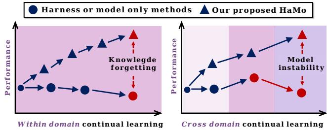  
Figure 1. Motivation for our method in continual learning for long-horizon agents. Harness- and model-only methods either enable fast experience reuse but tend to plateau, or sufer from instability and forgetting. HaMo combines both mechanisms to achieve steady improvement within domains and better retention across domain shifts.

We argue that these two forms of adaptation are naturally complementary because they operate at diferent timescales. A strategy discovered from a single trajectory may already be useful for future tasks, while still being too specific to justify an immediate parameter update. Such knowledge can first be stored externally and reused when similar situations arise. As related strategies recur across tasks, they provide stronger supervision for improving the model itself. For longhorizon agents, this process is not simply about memorizing past solutions: the key challenge is to internalize procedural competence, i.e., the ability to interpret high-level strategies, ground them in changing environments, and translate them into appropriate actions.

Motivated by this observation, we propose HaMo, a Harness-Model collaborative framework for continual learning in long-horizon agents. Our method separates adaptation into two tightly coupled processes. At the harness level, each trajectory is distilled into a compact experience card containing the task context, initial conditions, and a strategy-level solution outline. These cards are stored in a persistent non-parametric memory, making newly acquired procedural knowledge immediately available to future tasks. At the model level, HaMo continually updates a single parameter-eficient adapter using selected trajectories together with historical replay, improving the model’s ability to exploit accumulated experience while preserving previously acquired capabilities.

A key design of HaMo is experience-conditioned adaptation. Instead of learning only a direct mapping from interaction context to action, the model is additionally conditioned on strategy-level experience retrieved from the harness. It therefore learns how to interpret and instantiate a retrieved strategy under diferent observations, objects, states, and interaction histories. The same interface is used during inference: the harness retrieves relevant experience, while the adapted model determines how that experience should be executed in the current environment. In this way, the harness preserves reusable procedural knowledge, whereas model adaptation progressively internalizes the competence required to transfer and execute that knowledge across tasks.

HaMo further addresses the redundancy of continual supervision. Although storing experience externally is inexpensive, repeatedly training on every observed trajectory is unnecessary because many trajectories encode similar strategies. We therefore introduce a retrieval-coverage-based selection mechanism that identifies a compact set of representative and complementary trajectories for parameter adaptation. An experience is preferred when it can support many other tasks through retrieval, while the selected set is encouraged to cover distinct strategy contexts. This concentrates parameter updates on broadly reusable procedural knowledge without requiring all stored trajectories to participate in training.

We evaluate HaMo on continual streams of long-horizon tasks across ScienceWorld, ALFWorld, and WebShop, covering both within-domain and cross-domain settings. WebShop provides an interactive Web-agent environment, while the other benchmarks test whether the proposed learning mechanism generalizes beyond a single domain. The results show a clear complementarity between harness- and model-level adaptation: harness-only learning enables rapid reuse of experience but reaches a performance ceiling, whereas modelonly adaptation can acquire strong task-specific capabilities but sufers substantial forgetting under distribution shifts. HaMo combines the strengths of both, achieving stronger continual adaptation while better retaining previously acquired capabilities.

## 2 Related Work

## 2.1 LLMs for Long-Horizon Tasks

Long-horizon agents must sustain goal-directed behavior over extended, failure-prone trajectories [4]. Prior work improves reasoning, planning, and web interaction through reasoning-action interleaving [31], stateful benchmarks [40], system-level analyses [14], search and reflection [39], action knowledge [41], global planning [20], and curriculum-based reinforcement learning [9, 10]. Complementary work improves experience reuse via trajectory compression [32], rollout aggregation [11], global memory [17], reusable workflows [28], and conditional memory [1]. We focus instead on retaining and consolidating reusable experience across continual long-horizon task streams.

## 2.2 Continual Learning for LLM Agents

External-memory methods retain verbal feedback, skills, workflows, or structured memories without frequent weight updates [7, 18, 24, 28, 34, 38]. Parameter-based continual learning instead mitigates forgetting through parameter protection, replay [22], continual policy adaptation [25], or multiple retention anchors [35]. However, neither line directly decides which experience should remain externally retrievable and which should drive parameter updates.

EvolvingAgent [6] combines evolving experience with continual world-model learning, while Dong et al. [4] highlight the broader connection between external experience and internalized competence. HaMo coordinates these two timescales: rapidly updated strategy-level memory supports immediate reuse, while selected trajectories and replay enable less frequent parameter adaptation.

## 3 Method

HaMo coordinates continual learning through two complementary mechanisms operating at diferent levels: a persistent external memory at the harness level and continual parameter adaptation at the model level. The harness retains reusable strategy-level experience and makes newly acquired knowledge immediately accessible without requiring parameter updates. The model, in turn, is continually adapted to interpret retrieved experience, ground it in the current interaction context, and translate it into appropriate actions. Training and inference share the same initial dialogue format: the user request, the initial observation, and injected matched experience.

## 3.1 Harness-Level Memory

Long-horizon trajectories contain more than isolated state– action pairs. They often encode reusable plans, intermediate subgoals, and strategies for handling recurring situations. We therefore convert each expert trajectory into a compact strategy-level representation before using it for continual learning. For each trajectory $\tau _ { i } \in D _ { t }$ observed at stage �, we use a large language model to extract a solution outline $z _ { i }$ The outline is combined with the corresponding task description $g _ { i }$ and initial observable conditions $o _ { i } ^ { 0 }$ to construct an experience card

$$
c _ { i } = \left( g _ { i } , o _ { i } ^ { 0 } , z _ { i } \right)\tag{1}
$$

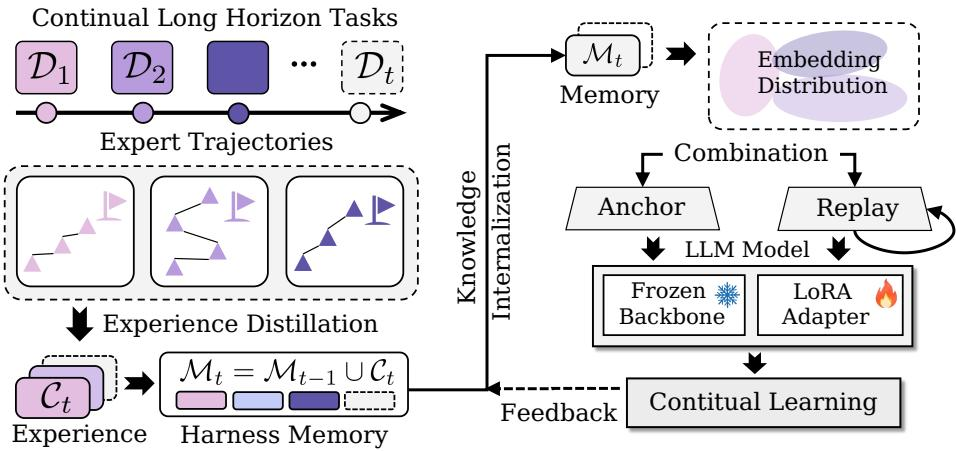  
Figure 2. Overview of the HaMo framework. HaMo continuously distills expert trajectories into a persistent harness memory, selects representative anchor trajectories based on retrieval coverage, and combines them with historical replay to update a LoRA adapter through experience-conditioned behavioral cloning. An optional feedback step releases memory entries associated with trained high-quality trajectories after adaptation. This collaboration enables fast experience reuse at the harness level and gradual knowledge internalization at the model level.

The cards extracted from trajectories in $D _ { t }$ form the stage-� collection $C _ { t }$ . Each card maintains a one-to-one correspondence with its source trajectory, allowing a selected experience to be mapped back to the trajectory from which it was extracted.

All experience cards observed at the current stage are first added to the external harness:

$$
M _ { t } = M _ { t - 1 } \cup C _ { t }\tag{2}
$$

where $M _ { t }$ denotes the stage-� memory after adding new cards, and $M _ { t - 1 }$ is the memory retained from the previous stage. This equation describes accumulation; optional post training release is applied afterward. Persistent storage and trajectory selection serve diferent purposes in HaMo. The former determines which historical strategies remain externally accessible, whereas the latter determines which trajectories provide supervision for the current parameter update. Consequently, an experience that is not selected for training is not removed from memory and can still be retrieved at later stages.

Although retaining experience in the harness is inexpensive relative to repeated model training, using every newly observed trajectory for parameter adaptation is unnecessary and may introduce substantial redundancy. Multiple trajec tories may encode similar strategies and therefore expose the model to nearly identical training contexts. We instead seek a compact subset whose experiences provide broad and complementary coverage over the strategies observed at the current stage.

To estimate the reuse scope of an experience, we embed the textual content of the experience cards and perform leaveone-out retrieval within the candidate collection. For each query card �, we retrieve its three nearest neighbors after excluding the card itself, and denote their indices by $N _ { 3 } ( i )$ We then reverse this retrieval relation. For each candidate card $j ,$ let

$$
R _ { j } = \{ i \mid j \in N _ { 3 } ( i ) \}\tag{3}
$$

where $R _ { j }$ contains the query cards for which � is retrieved as a relevant neighbor. Its cardinality,

$$
n _ { \mathrm { h i t s } } ( j ) = | R _ { j } |\tag{4}
$$

measures how frequently the strategy represented by card � can potentially support other trajectories.

A high retrieval count alone, however, is insuficient for identifying a useful training subset. Two frequently retrieved cards may support almost the same set of queries, in which case selecting both introduces little additional supervision. We therefore select experiences according to their complementary retrieval coverage. Let � denote the indices of the selected cards. The set of queries covered by � is

$$
F ( S ) = \bigcup _ { j \in S } R _ { j }\tag{5}
$$

For a new candidate $j ,$ its additional coverage relative to the current selection is

$$
\Delta ( j \mid S ) = R _ { j } \setminus \bigcup _ { s \in S } R _ { s }\tag{6}
$$

Starting from an empty set, we greedily select the candidate with the largest $\vert \Delta ( \boldsymbol { j } \mid S ) \vert$ , using lazy priority-queue updates to avoid recomputing the marginal coverage of every candidate at each step. This criterion favors experiences that are broadly reusable while still retaining less frequent experiences when they cover strategy contexts not represented by the current selection.

We continue the selection process until the maximum marginal coverage reaches zero and record the resulting coverage-saturation curve as a function of the number of selected cards. A knee point on this curve determines the stage-specific training budget $N _ { t } ^ { * }$ . The first $N _ { t } ^ { * }$ selected cards are then mapped back to their corresponding source trajectories, yielding the stage-� anchor set $A _ { t } .$ . Importantly, this procedure is used only to curate supervision for model adaptation. All experience cards remain available during adaptation, including those whose trajectories are not included in $A _ { t } .$ After training, an optional feedback step can release entries associated with trained trajectories, as described in Section 3.2.

## 3.2 Model-Level Adaptation

The external harness provides persistent access to previously observed strategies, but memory alone does not guarantee that the agent can successfully apply a retrieved strategy to a new interaction. A stored solution outline may have been extracted from a trajectory with diferent objects, observations, or intermediate states. The model must therefore learn a conditional execution capability: given strategy-level experience, it should ground that experience in the current environment and translate it into actions appropriate for the evolving interaction.

HaMo explicitly learns this capability by conditioning parameter updates on retrieved experience. Let $B _ { t } ^ { \mathrm { o l d } }$ denote trajectories sampled from previously encountered tasks for replay. Together with the newly selected anchor trajectories, we construct the stage-� training collection as

$$
B _ { t } = A _ { t } \cup B _ { t } ^ { \mathrm { o l d } }\tag{7}
$$

New anchor trajectories provide supervision for adapting to incoming tasks, while historical trajectories continue to expose the model to behaviors acquired at previous stages.

For every trajectory $\tau _ { i } \in B _ { t }$ , let $E _ { i }$ denote the experience retrieved or matched by the harness for that trajectory. The initial dialogue combines the user request $g _ { i } ,$ , initial observation $o _ { i } ^ { 0 } ,$ and injected experience $E _ { i } ,$ using the same input format as at test time. Subsequent decisions additionally condition on the evolving interaction history. Let $h _ { i , k }$ denote the interaction history preceding the �-th action of trajectory $\tau _ { i } ,$ and let $a _ { i , k }$ denote the corresponding expert action. We optimize the experience-conditioned behavioral cloning objective

$$
\mathcal { L } _ { t } ( \theta ) = - \frac { 1 } { \left| B _ { t } \right| } \sum _ { \tau _ { i } \in B _ { t } } \sum _ { k } \log \pi _ { \theta } \left( a _ { i , k } \mid g _ { i } , o _ { i } ^ { 0 } , h _ { i , k } , E _ { i } \right)\tag{8}
$$

For textual actions, the conditional action likelihood is factorized over the corresponding action tokens.

The role of $E _ { i }$ is central to the model-level adaptation. Conventional trajectory supervision primarily learns a direct mapping from the current task context to an action. In contrast, the objective above explicitly trains the model to act under an additional strategy context supplied by the harness. The model is therefore not required to reproduce each stored strategy directly in its parameters. Instead, parameter learning focuses on acquiring a reusable ability to interpret strategy-level guidance and instantiate it under changing objects, observations, states, and interaction histories.

Replay preserves both earlier task behaviors and the ability to execute historical strategies under experience conditioning. The harness retains access to strategies, while replay rehearses their context-dependent use as model parameters evolve.

We implement continual parameter adaptation using a single LoRA adapter while keeping the backbone parameters $W _ { 0 }$ frozen. At stage �, the adapter is initialized from the previous learning stage rather than trained independently:

$$
\boldsymbol { \theta } _ { t } ^ { \mathrm { i n i t } } = \boldsymbol { \theta } _ { t - 1 }\tag{9}
$$

Optimizing the experience-conditioned objective on $B _ { t }$ produces

$$
W _ { t } = W _ { 0 } + \Delta W ( \theta _ { t } )\tag{10}
$$

where $\Delta W ( \theta _ { t } )$ denotes the low-rank update induced by the current adapter. We do not merge the adapter into the backbone or maintain a growing collection of task-specific adapters, so the trainable parameter budget remains fixed throughout the continual learning stream. The harness and the model consequently evolve in diferent ways: the harness maintains externally accessible experience, whereas the adapter is continually updated to improve and preserve the model’s ability to act on that experience.

Optional feedback to the harness. After high-quality trajectories have been used for model adaptation, HaMo can optionally release their corresponding memory entries to reclaim storage, implementing the model-to-harness feedback in Figure 2. This option is disabled in all reported experiments: all experience cards remain available across stages.

At test time, the initial dialogue likewise combines the user request, initial observation, and injected matched experience. Given $g$ and $o ^ { 0 }$ , the harness retrieves experience from the current memory:

$$
E = { \mathrm { R e t r i e v e } } \left( ( g , o ^ { 0 } ) , M _ { t } \right)\tag{11}
$$

Unlike the complete-card queries used to estimate retrieval coverage during anchor selection, the inference-time query contains only information available when the new task begins. It therefore does not require an expert trajectory, a ground-truth solution outline, or observations from the future interaction.

The retrieved experience provides strategy-level guidance rather than a fixed action sequence. At interaction step $k ,$ the policy generates an action according to

$$
a _ { k } \sim \pi _ { \theta _ { t } } \left( \cdot \mid g , o ^ { 0 } , h _ { k } , E \right)\tag{12}
$$

where $h _ { k }$ contains the observations and actions accumulated before the current decision. As the environment evolves, newly observed states are incorporated into $h _ { k }$ , allowing the model to adapt the retrieved strategy to the actual execution trajectory. The harness therefore preserves a high-level strategy that was useful in previous experience, while the model determines how that strategy should be instantiated under the current objects, conditions, and available actions.

The shared conditioning interface couples learning and inference: the harness preserves reusable strategies, while the model learns to execute them in context. A strategy retained in memory can provide an explicit cue even when later updates weaken the corresponding behavior.

## 4 Experimental Setting

## 4.1 Datasets and Continual Learning Protocol

We evaluate HaMo on three interactive benchmarks using their purely text-based environments. ScienceWorld [27] evaluates scientific reasoning through tasks that require agents to navigate an environment, manipulate objects, and carry out experiments. ALFWorld [19] provides household tasks in a text environment aligned with embodied tasks, requiring agents to locate objects and perform operations such as moving, cleaning, heating, and cooling. WebShop [30] evaluates instruction-conditioned online shopping: agents search for products, inspect their descriptions, select options, and make purchases that satisfy user requirements. Together, these benchmarks cover scientific experimentation, household manipulation, and web-based decision making, with diferent action spaces and task semantics.

We consider two continual learning settings. In withindomain continual learning, we divide the ScienceWorld training set into four equally sized subsets that are disjoint at the sample level. Every subset covers all task types, so the task-type coverage remains unchanged across stages even though the training samples are diferent. We introduce one subset at each successive stage, simulating within-domain data-incremental continual learning over a fixed set of task types rather than the sequential introduction of new task types. After every stage, we evaluate the agent on the entire ScienceWorld test set, using the same evaluation set through out the stream. In cross-domain continual learning, the agent learns sequentially on ScienceWorld (S), ALFWorld (A), and WebShop (W). After each stage, we evaluate all domains encountered so far, allowing us to examine both adaptation to the current domain and retention of earlier capabilities. The main cross-domain experiment uses the order S → A → W; the order ablation additionally considers A → W → S and $\mathrm { W }  \mathsf { S }  \mathrm { A }$

## 4.2 Baselines

We use Qwen3 [23] as the common backbone, evaluating Qwen3-8B and Qwen3-14B in the within-domain setting. Cross-domain experiments and component and trainingorder ablations use Qwen3-8B, while the model-scale ablation additionally evaluates Qwen3-1.7B and Qwen3-4B.

Thinking mode is disabled for all Qwen3 agents. Base denotes the backbone without the additional agent training or external harness considered here. Base+Harness augments the backbone with external experience while keeping its parameters fixed, isolating adaptation through the harness. We also compare two agent-training approaches instantiated on the Qwen3 backbone. AgentTuning [33] develops agent capabilities through instruction tuning on interaction trajectories; its original formulation mixes agent trajectories with general instruction data. ETO [21], or Exploration-Based Trajectory Optimization, uses exploration to collect failed trajectories and constructs trajectory preference pairs for policy optimization. These comparisons evaluate how agenttraining approaches behave under our continual learning settings.

HaMo combines a persistent strategy memory, model adaptation conditioned on experience, and historical replay, as described in Section 3. Its model updates use a single continually updated LoRA adapter with a frozen backbone. In the component ablation, Harness only corresponds to Base+Harness, while Model only performs sequential parameter adaptation without either the external harness or historical replay. This comparison examines the contribution of coordinating external experience with model adaptation. Implementation settings and framework pseudocode are provided in Appendices A and B, respectively.

## 4.3 Metrics

We use the native scoring mechanism of each text environment as the performance metric. For ScienceWorld, we report the environment’s task-progress score, which credits intermediate progress toward completing the scientific task. For ALFWorld, we report the task-completion score, averaged across episodes as a success rate. For WebShop, we report the environment reward measuring how well the purchased product satisfies the requested specifications, retaining partial credit rather than reducing the outcome to binary success. Scores are presented on a 0–100 scale, with higher values indicating better performance. Each evaluation episode is limited to 50 agent–environment interaction turns and ends earlier if the environment terminates the task.

For the within-domain experiment, Average summarizes the four reported stage scores; the Base score gives the fixed backbone reference. In the cross-domain performance plots, each panel corresponds to a completed training stage and shows scores on the evaluated domains. We assess retention by comparing a domain’s score immediately after learning it with its scores after subsequent stages. The training-order ablation also reports the sum ofthe three final-domain scores as a descriptive aggregate. Since the benchmarks use diferent scoring semantics, this sum complements the per-domain results rather than representing a pooled task-success rate.

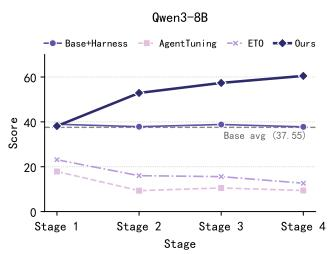  
(a) Performance(Qwen3-8b)

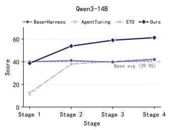  
(b) Performance(Qwen3-14b)

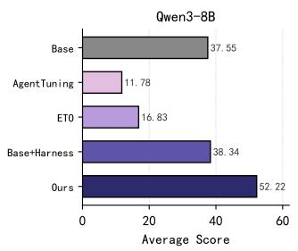  
(c) Performance(Qwen3-8b)

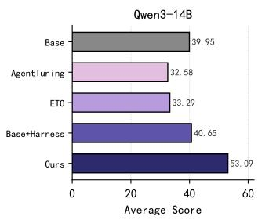  
(d) Performance(Qwen3-14b)

Figure 3. Within-domain data-incremental continual learning performance (stage-wise and average performance) on Science-World. The training set is divided into four equally sized, sample-disjoint subsets, each covering all task types. Each stage introduces one subset and evaluates the entire test set. Average reports the mean stage score for adapting methods and the fixed reference score for Base. Higher is better.  
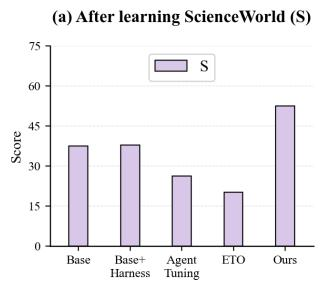

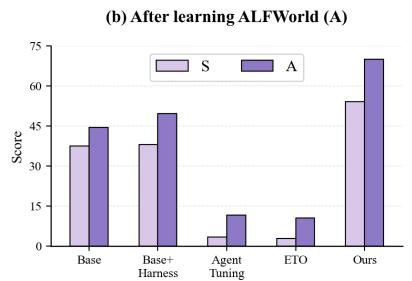

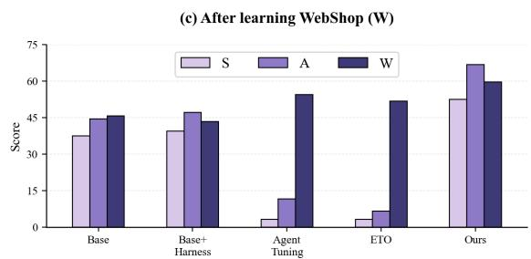  
Figure 4. Cross-domain continual learning with Qwen3-8B in the order ScienceWorld (S), ALFWorld (A), and WebShop (W). Panels (a)–(c) show performance after each training stage. Bar groups compare methods, and colors indicate evaluation domains. Higher scores are better.

## 5 Results

## 5.1 Main Results

5.1.1 Within-Domain Continual Learning. Figure 3 shows that HaMo improves on the full ScienceWorld test set as additional training subsets arrive, for both model sizes. With Qwen3-8B, its score increases from 38.13 to 60.49, yielding a four-stage average of 52.22. With Qwen3-14B, it increases from 38.61 to 61.15, with an average of 53.09. These averages exceed Base+Harness by 13.88 and 12.44 points, respectively, using the reported values. The final-stage gains over the unadapted backbones are 22.94 points for 8B and 21.20 points for 14B.

The advantage emerges over successive stages rather than from uniformly stronger initial performance. At Stage 1, HaMo scores slightly below Base+Harness for both backbones, but it leads all listed methods from Stage 2 onward. Base+Harness remains close to the backbone reference through out the stream, suggesting that external experience alone provides limited improvement in this setting. AgentTuning and ETO exhibit diferent trajectories across model sizes: their 8B scores decline overall, whereas their 14B scores re cover after a low first stage. Nevertheless, their four-stage averages remain below those of HaMo. These results support the value of jointly adapting the model and its experience context for sustained improvement within ScienceWorld; the

stage averages alone do not isolate retention of individual task types.

5.1.2 Cross-Domain Continual Learning. Figure 4 evaluates the S → A → W stream. After the final stage, HaMo obtains 52.43 on ScienceWorld, 66.79 on ALFWorld, and 59.64 on WebShop, outperforming every listed baseline on each domain. Relative to Base, these are gains of 14.88, 22.26, and 13.96 points. Relative to the strongest non-HaMo baseline for each final-domain score, the gains are 13.02 points on ScienceWorld, 19.71 on ALFWorld, and 5.16 on WebShop.

The intermediate evaluations reveal how these gains arise. HaMo scores 52.43 on ScienceWorld after the first stage, improves to 54.19 after learning ALFWorld, and returns to 52.43 after learning WebShop. Thus, its final ScienceWorld score matches its score immediately after ScienceWorld training, although it is 1.76 points below the intermediate peak. Its ALFWorld score decreases moderately from 70.08 to 66.79 after WebShop training. In contrast, AgentTuning’s Science-World score falls from 26.24 to 3.13, and ETO’s falls from 20.16 to 3.20. Both methods improve over Base on the final WebShop task but finish below Base on the two earlier domains. Under this protocol, successful adaptation to the latest domain therefore does not ensure retention of earlier capabilities.

(b) After learning ALFWorld (A)  
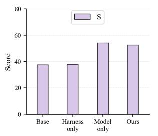

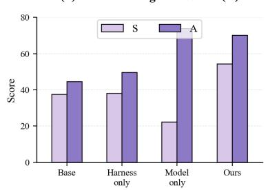

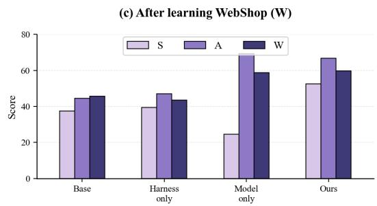

Figure 5. Component ablation on Qwen3-8B with the training order ScienceWorld (S), ALFWorld (A), and WebShop (W). Each group reports performance after training on the indicated dataset.  
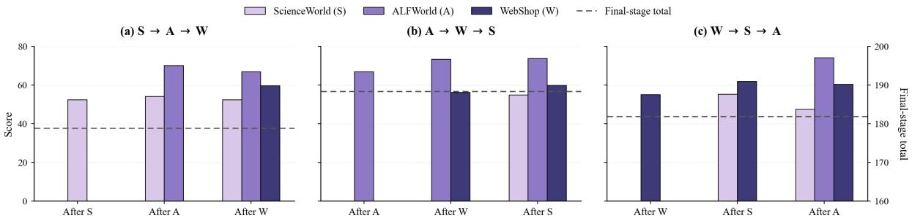  
Figure 6. Training-order ablation on Qwen3-8B. S, A, and W denote ScienceWorld, ALFWorld, and WebShop, respectively. Final-stage total (S+A+W) sums the three dataset scores measured after the final training stage for each training order.

Base+Harness largely preserves the backbone’s earlierdomain performance, but its final WebShop score of 43.42 is below the Base score of 45.68. HaMo combines stronger acquisition of new-domain capabilities with substantially better earlier-domain performance than the trajectory-training baselines. This pattern is consistent with the intended complementarity of persistent strategy access and continual learning of how to execute those strategies.

## 5.2 Ablation Results

5.2.1 Harness–Model Collaboration. Figure 5 compares HaMo with harness-only and model-only adaptation. Harness only provides relatively small changes from Base, whereas Model only substantially improves newly learned tasks: it obtains 53.98 on ScienceWorld after the first stage and 73.72 on ALFWorld after the second. However, its ScienceWorld score drops to 22.18 after ALFWorld training and finishes at 24.57, a decline of 29.41 points from its first-stage score. HaMo instead finishes at 52.43 on ScienceWorld, exceeding Model only by 27.86 points and matching its own first-stage score.

This retention benefit comes with a measurable tradeof. Model only achieves a higher final ALFWorld score than HaMo (69.34 versus 66.79), while HaMo is slightly better on WebShop (59.64 versus 58.74). HaMo therefore does not dominate parameter-only adaptation on every domain. Its principal advantage in this ablation is a more favorable balance between acquisition and retention, particularly on the earliest domain. Because Model only omits both the external harness and historical replay, this comparison supports the complete HaMo design rather than isolating the efect of external memory. It does not separately identify the contributions of anchor selection, replay, and experience conditioning.

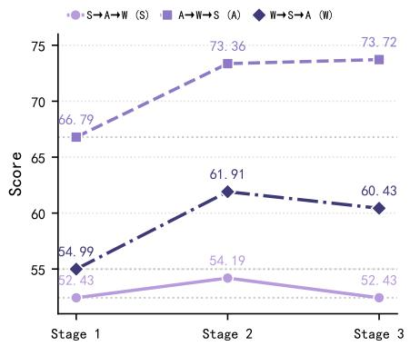  
Figure 7. Performance on the first-trained domain throughout continual learning under three training orders. The curves track ScienceWorld in $S \to \mathrm { A } \to \mathrm { W } ,$ ALFWorld in $\mathrm { A } \longrightarrow \mathrm { W } \longrightarrow \mathrm { S } ,$ and WebShop in $\mathrm { W }  \mathsf { S }  \mathrm { A }$

5.2.2 Sensitivity to Training Order. Figure 6 examines three cyclic training orders. HaMo achieves final-stage totals of 178.86 for ${ \mathrm {  ~ S \to \ A \to \ W } } ,$ 188.41 for $\mathrm { A } \to \mathrm { W } \to \mathrm { S } ,$ , and 181.94 for $\mathrm { W }  { \cal S }  \mathrm { A } .$ All final-domain scores exceed the corresponding Base references in the main cross-domain experiment, although their distribution depends on training order. Among the tested orders, A → W → S produces the highest total, while $\mathrm { W }  \mathsf { S }  \mathrm { A }$ achieves the highest final ALFWorld and WebShop scores (74.09 and 60.43).

Table 1. WebShop case study. Trajectories are summarized from the recorded interactions. Purple text backgrounds mark HaMo’s key constraint-grounding behaviors. Scores are reported on the same 0–100 scale as the main experiments.
<table><tr><td>Stage</td><td>HaMo</td><td>Base</td></tr><tr><td>User Goal</td><td>Chocolate-coated wafers; caramel flavor; 4.41 ounce; price below $60.</td><td>Chocolate-coated wafers; caramel flavor; 4.41 ounce; price below $60.</td></tr><tr><td>Search</td><td>Searches for “chocolate coated wafers 4.41 ounce&quot;.</td><td>Searches for “caramel chocolate coated wafers 4.41 ounce&quot;.</td></tr><tr><td>Candidate</td><td>Opens Loacker Tortina Chocolate Coated Wafer ($41.99). Notices “Triple Dark&quot; in the title and checks the available flavor options</td><td>Opens Loacker Quadratini Hazelnut Wafer Cookies ($14.99), incorrectly treating the hazelnut product as a caramel match.</td></tr><tr><td>Verification</td><td>Attempts to select the requested options: click[caramel] followed by click[4.41 ounce]; neither changes the visible observation.</td><td>The product page offers no caramel option. Makes no flavor or size selection before buying.</td></tr><tr><td>Purchase</td><td>Checks $41.99 &lt; $60 ter attempting both option selections.</td><td>and executes click[buy now] af- Executes click[buy now] immediately after opening the mismatched product.</td></tr><tr><td>Interactions</td><td>5 actions; completes the purchase.</td><td>3 actions; completes the purchase.</td></tr><tr><td>Score</td><td>100</td><td>25</td></tr></table>

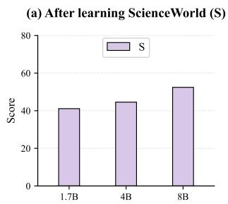

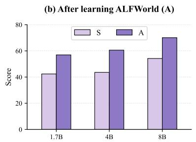

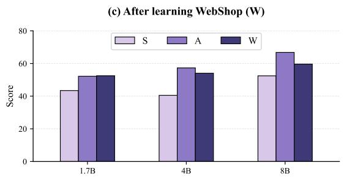  
Figure 8. Performance of HaMo across model scales (1.7B, 4B, and 8B) with the training order ScienceWorld (S), ALFWorld (A), and WebShop (W). The largest LLM backbone achieves the strongest overall results, supporting HaMo’s applicability across model capacities.

Figure 7 tracks retention on the first-trained domain. Final ScienceWorld performance matches its initial 52.43 in S → A → W; ALFWorld improves from 66.79 to 73.72 in A → W → S, and WebShop from 54.99 to 60.43 in W → S → A. Retention remains order-dependent: in the last sequence, ScienceWorld falls from 55.19 to 47.42 after subsequent adaptation, showing that forgetting is mitigated but not eliminated.

5.2.3 Robustness to Model Scale. Figure 8 evaluates HaMo with Qwen3 models of diferent scales, including 1.7B, 4B, and 8B parameters. HaMo remains efective across all three model sizes throughout the S → A → W continual learning stream, indicating that its benefit is not restricted to a particular model capacity. Larger LLMs generally show stronger acquisition of newly introduced tasks, especially after adapting to later domains, suggesting that increased model capacity provides greater flexibility for incorporating new procedural knowledge.

5.2.4 Case Study: Experience-Guided Constraint Verification. Table 1 illustrates experience-guided constraint verification. The task requires caramel-flavored, chocolatecoated wafers in a 4.41-ounce size below \$60. Base purchases a hazelnut product without resolving the flavor mismatch, scoring 25. HaMo recognizes that the candidate’s “Triple Dark” title does not establish a caramel match and checks the available options, scoring 100. This follows the retrieved card’s instruction to recheck requirements against the current task; HaMo also checks the current \$60 budget rather than the reference’s \$70 limit. The actions click[caramel] and click[4.41 ounce] produce neither a visible observation change nor an immediate reward. They indicate attempted grounding of the requested attributes, but do not establish state changes or causally explain the reward gain.

The case illustrates attention to option availability and current constraints before purchase, without isolating the contributions of retrieved guidance and parameter adaptation.

## 6 Conclusion

We presented HaMo, a harness–model collaborative framework for continual learning in long-horizon agents. HaMo combines persistent strategy-level memory with experienceconditioned parameter adaptation, enabling newly acquired procedural knowledge to be reused immediately while gradually improving the model’s ability to interpret and execute retrieved strategies. Experiments on ScienceWorld, ALF-World, and WebShop show that HaMo achieves a better balance between adaptation and retention than harness-only or model-only approaches, with stronger robustness under both within-domain and cross-domain continual learning. These results highlight the value of coordinating external experience accumulation with internal model adaptation, and suggest a promising direction for building long-horizon agents that can continually learn from interaction while preserving previously acquired capabilities.

## Limitations

HaMo can ofset part of the forgetting induced by crossdomain training, but it does not fully prevent catastrophic forgetting. Subsequent adaptation may still reduce performance on previously learned domains, and the degree of retention depends on the domain sequence. The current results therefore support partial mitigation of forgetting rather than complete immunity to it.

## Future Work

Adaptive experience use. A useful extension is to learn when to retrieve a strategy, when to reject an unsuitable card, and when to refresh guidance during execution. Such decisions could combine retrieval confidence with observed task progress and explicit checks of strategy preconditions. This would allow the agent to respond to misleading experience rather than treating retrieval similarity as suficient evidence of applicability.

Stronger evaluation and broader environments. Controlled ablations of replay, anchor selection, experience conditioning, and decoding temperature would clarify their individual contributions and interactions. Repeated runs and longer task streams could assess variability and persistent forgetting, while end-to-end cost measurements would expose the tradeof between performance and memory maintenance. Extending the framework to multimodal agents and changing web environments would further test whether experience-conditioned execution transfers beyond the present text-based benchmarks.

## References

[1] Zhen Bi, Xueshu Chen, Yan Wang, Zhizhi Peng, Haosen Hong, Zhen Wang, Zhixuan Chu, Bingyu Zhu, and Jungang Lou. 2026. Memory Is Not Always Needed: Characterizing Conditional Memory in Scientific Reasoning. arXiv:2608.23982 [cs.AI] htps://arxiv.org/abs/2608.23982

[2] Baian Chen, Chang Shu, Ehsan Shareghi, Nigel Collier, Karthik Narasimhan, and Shunyu Yao. 2023. Fireact: Toward language agent fine-tuning. arXiv preprint arXiv:2310.05915 (2023).

[3] Xiang Deng, Yu Gu, Boyuan Zheng, Shijie Chen, Sam Stevens, Boshi Wang, Huan Sun, and Yu Su. 2023. Mind2web: Towards a generalist agent for the web. Advances in Neural Information Processing Systems 36 (2023), 28091–28114.

[4] Guanting Dong, Xiaoshuai Song, Yuyang Hu, Jiajie Jin, Chenghao Zhang, Yifei Chen, Xiaoxi Li, Huaying Yuan, Xinyu Yang, Tongyu Wen, et al. 2026. Towards Long-Horizon Agents: A Survey. (2026).

[5] Alexandre Drouin, Maxime Gasse, Massimo Caccia, Issam H Laradji, Manuel Del Verme, Tom Marty, Léo Boisvert, Megh Thakkar, Quentin Cappart, David Vazquez, et al. 2024. WorkArena: How capable are web agents at solving common knowledge work tasks? arXiv preprint arXiv:2403.07718 (2024).

[6] Tongtong Feng, Xin Wang, Zekai Zhou, Ren Wang, Yuwei Zhan, Guangyao Li, Qing Li, and Wenwu Zhu. 2025. EvolvingAgent: Curriculum Self-evolving Agent with Continual World Model for Long-Horizon Tasks. arXiv preprint arXiv:2502.05907 (2025).

[7] Bernal Jiménez Gutiérrez, Yiheng Shu, Weijian Qi, Sizhe Zhou, and Yu Su. 2025. From RAG to Memory: Non-Parametric Continual Learning for Large Language Models. In Forty-second International Conference on Machine Learning. htps://openreview.net/forum?id=LWH8yn4HS2

[8] Hongliang He, Wenlin Yao, Kaixin Ma, Wenhao Yu, Yong Dai, Hongming Zhang, Zhenzhong Lan, and Dong Yu. 2024. Webvoyager: Building an end-to-end web agent with large multimodal models. In Proceedings of the 62nd Annual Meeting of the Association for Computational Linguistics (Volume 1: Long Papers). 6864–6890.

[9] Sunghwan Kim, Junhee Cho, Beong-Woo Kwak, Taeyoon Kwon, Liang Wang, Nan Yang, Xingxing Zhang, Furu Wei, and Jinyoung Yeo. 2026. On Training Large Language Models for Long-Horizon Tasks: An Empirical Study of Horizon Length. In Proceedings of the 43rd International Conference on Machine Learning (Proceedings of Machine Learning Research, Vol. 306), Tong Zhang, Miroslav Dudik, Martin Jaggi, Alekh Agarwal, Sharon Li, Dale Schuurmans, Jerry Zhu, Felix Berkenkamp, Hanze Dong, and Alberto Bietti (Eds.). PMLR, 57309– 57337. htps://proceedings.mlr.press/v306/kim26h.html

[10] Hanyu Lai, Xiao Liu, Iat Long Iong, Shuntian Yao, Yuxuan Chen, Pengbo Shen, Hao Yu, Hanchen Zhang, Xiaohan Zhang, Yuxiao Dong, et al. 2024. Autowebglm: A large language model-based web navigating agent. In Proceedings ofthe 30th ACM SIGKDD Conference on Knowledge Discovery and Data Mining. 5295–5306.

[11] Yoonsang Lee, Howard Yen, Xi Ye, and Danqi Chen. 2026. Agentic aggregation for parallel scaling of long-horizon agentic tasks. arXiv preprint arXiv:2604.11753 (2026).

[12] Yun Luo, Zhen Yang, Fandong Meng, Yafu Li, Jie Zhou, and Yue Zhang. 2025. An empirical study of catastrophic forgetting in large language models during continual fine-tuning. IEEE Transactions on Audio, Speech and Language Processing (2025).

[13] Bodhisattwa Prasad Majumder, Bhavana Dalvi Mishra, Peter Jansen, Oyvind Tafjord, Niket Tandon, Li Zhang, Chris Callison-Burch, and Peter Clark. 2023. Clin: A continually learning language agent for rapid task adaptation and generalization. arXiv preprint arXiv:2310.10134 (2023).

[14] Liangbo Ning, Ziran Liang, Zhuohang Jiang, Haohao Qu, Yujuan Ding, Wenqi Fan, Xiao-yong Wei, Shanru Lin, Hui Liu, Philip S Yu, et al. 2025. A survey of webagents: Towards next-generation ai agents for web automation with large foundation models. In Proceedings of the 31st ACM SIGKDD Conference on Knowledge Discovery and Data Mining V.

2. 6140–6150.

[15] Joon Sung Park, Joseph O’Brien, Carrie Jun Cai, Meredith Ringel Morris, Percy Liang, and Michael S Bernstein. 2023. Generative agents: Interactive simulacra of human behavior. In Proceedings ofthe 36th annual acm symposium on user interface software and technology. 1–22.

[16] Pranav Putta, Edmund Mills, Naman Garg, Sumeet Motwani, Chelsea Finn, Divyansh Garg, and Rafael Rafailov. 2024. Agent q: Advanced reasoning and learning for autonomous ai agents. arXiv preprint arXiv:2408.07199 (2024).

[17] Hongjin Qian, Zheng Liu, Peitian Zhang, Kelong Mao, Defu Lian, Zhicheng Dou, and Tiejun Huang. 2025. Memorag: Boosting long context processing with global memory-enhanced retrieval augmentation. In Proceedings of the ACM on Web Conference 2025. 2366–2377.

[18] Noah Shinn, Federico Cassano, Ashwin Gopinath, Karthik Narasimhan, and Shunyu Yao. 2023. Reflexion: Language agents with verbal reinforcement learning. Advances in neural information processing systems 36 (2023), 8634–8652.

[19] Mohit Shridhar, Xingdi Yuan, Marc-Alexandre Côté, Yonatan Bisk, Adam Trischler, and Matthew Hausknecht. 2021. ALFWorld: Aligning Text and Embodied Environments for Interactive Learning. In Proceedings ofthe International Conference on Learning Representations (ICLR). htps://arxiv.org/abs/2010.03768

[20] Shuzheng Si, Haozhe Zhao, Kangyang Luo, Gang Chen, Fanchao Qi, Minjia Zhang, Baobao Chang, and Maosong Sun. 2026. A Goal Without a Plan is Just a Wish: Eficient and Efective Global Planner Training for Long-Horizon Agent Tasks. ACL 2026 (2026), 13086–13113.

[21] Yifan Song, Da Yin, Xiang Yue, Jie Huang, Sujian Li, and Bill Yuchen Lin. 2024. Trial and error: Exploration-based trajectory optimization of LLM agents. In Proceedings of the 62nd Annual Meeting of the Association for Computational Linguistics (Volume 1: Long Papers). 7584–7600.

[22] Fan-Keng Sun, Cheng-Hao Ho, and Hung-Yi Lee. 2020. LAMOL: LAnguage MOdeling for Lifelong Language Learning. In International Conference on Learning Representations. htps://openreview.net/forum? id=Skgxcn4YDS

[23] Qwen Team. 2025. Qwen3 Technical Report. arXiv:2505.09388 [cs.CL] htps://arxiv.org/abs/2505.09388

[24] Guanzhi Wang, Yuqi Xie, Yunfan Jiang, Ajay Mandlekar, Chaowei Xiao, Yuke Zhu, Linxi Fan, and Anima Anandkumar. 2023. Voyager: An Open-Ended Embodied Agent with Large Language Models. In Intrinsically-Motivated and Open-Ended Learning Workshop @NeurIPS2023. htps://openreview.net/forum?id=nfx5IutEed

[25] Huimin Wang, Yunyan Zhang, Yifan Yang, Yefeng Zheng, and Kam-Fai Wong. 2023. Acquiring new knowledge without losing old ones for efective continual dialogue policy learning. IEEE Transactions on Knowledge and Data Engineering 36, 12 (2023), 7569–7584.

[26] Liyuan Wang, Xingxing Zhang, Hang Su, and Jun Zhu. 2024. A comprehensive survey of continual learning: Theory, method and application. IEEE transactions on pattern analysis and machine intelligence 46, 8 (2024), 5362–5383.

[27] Ruoyao Wang, Peter Jansen, Marc-Alexandre Côté, and Prithviraj Ammanabrolu. 2022. Scienceworld: Is your agent smarter than a 5th grader?. In Proceedings ofthe 2022 Conference on Empirical Methods in Natural Language Processing. 11279–11298.

[28] Zora Zhiruo Wang, Jiayuan Mao, Daniel Fried, and Graham Neubig. 2025. Agent Workflow Memory. In Forty-second International Conference on Machine Learning. htps://openreview.net/forum?id= NTAhi2JEEE

[29] Zhiheng Xi, Yiwen Ding, Wenxiang Chen, Boyang Hong, Honglin Guo, Junzhe Wang, Dingwen Yang, Chenyang Liao, Xin Guo, Wei He, Songyang Gao, Lu Chen, Rui Zheng, Yicheng Zou, Tao Gui, Qi Zhang, Xipeng Qiu, Xuanjing Huang, Zuxuan Wu, and Yu-Gang Jiang. 2024. AgentGym: Evolving Large Language Model-based Agents across Diverse Environments. arXiv:2406.04151 [cs.AI]

[30] Shunyu Yao, Howard Chen, John Yang, and Karthik Narasimhan. 2022. Webshop: Towards scalable real-world web interaction with grounded language agents. Advances in Neural Information Processing Systems 35 (2022), 20744–20757.

[31] Shunyu Yao, Jefrey Zhao, Dian Yu, Nan Du, Izhak Shafran, Karthik Narasimhan, and Yuan Cao. 2023. ReAct: Synergizing Reasoning and Acting in Language Models. In International Conference on Learning Representations.

[32] Howard Yen, Yoonsang Lee, Ashwin Paranjape, Mengzhou Xia, Thejas Venkatesh, Jack Hessel, Danqi Chen, and Yuhao Zhang. 2025. Lost in the maze: Overcoming context limitations in long-horizon agentic search. arXiv preprint arXiv:2510.18939 (2025).

[33] Aohan Zeng, Mingdao Liu, Rui Lu, Bowen Wang, Xiao Liu, Yuxiao Dong, and Jie Tang. 2024. Agenttuning: Enabling generalized agent abilities for llms. In Findings of the Association for Computational Linguistics: ACL 2024. 3053–3077.

[34] Zeyu Zhang, Quanyu Dai, Xu Chen, Rui Li, Zhongyang Li, and Zhenhua Dong. 2025. Memengine: A unified and modular library for developing advanced memory of llm-based agents. In Companion Proceedings of the ACM on Web Conference 2025. 821–824.

[35] Zheyuan Zhang, Alvin Zhang, Daniel Khashabi, and Tianmin Shu. 2026. Continual Learning Mechanisms Compose for Long-Horizon Memorization. arXiv preprint arXiv:2609.06986 (2026).

[36] Andrew Zhao, Daniel Huang, Quentin Xu, Matthieu Lin, Yong-Jin Liu, and Gao Huang. 2024. Expel: Llm agents are experiential learners. In Proceedings of the AAAI Conference on Artificial Intelligence, Vol. 38. 19632–19642.

[37] Longtao Zheng, Rundong Wang, Xinrun Wang, and Bo An. 2024. Synapse: Trajectory-as-exemplar prompting with memory for computer control. In International Conference on Learning Representations, Vol. 2024. 19036–19066.

[38] Wanjun Zhong, Lianghong Guo, Qiqi Gao, He Ye, and Yanlin Wang. 2024. Memorybank: Enhancing large language models with long-term memory. In Proceedings of the AAAI conference on artificial intelligence, Vol. 38. 19724–19731.

[39] Andy Zhou, Kai Yan, Michal Shlapentokh-Rothman, Haohan Wang, and Yu-Xiong Wang. 2023. Language agent tree search unifies reasoning acting and planning in language models. arXiv preprint arXiv:2310.04406 (2023).

[40] Shuyan Zhou, Frank F Xu, Hao Zhu, Xuhui Zhou, Robert Lo, Abishek Sridhar, Xianyi Cheng, Tianyue Ou, Yonatan Bisk, Daniel Fried, et al. 2024. Webarena: A realistic web environment for building autonomous agents. In International Conference on Learning Representations, Vol. 2024. 15585–15606.

[41] Yuqi Zhu, Shuofei Qiao, Yixin Ou, Shumin Deng, Shiwei Lyu, Yue Shen, Lei Liang, Jinjie Gu, Huajun Chen, and Ningyu Zhang. 2025. Knowagent: Knowledge-augmented planning for llm-based agents. In Findings ofthe Association for Computational Linguistics: NAACL 2025. 3709–3732.

## A Continual Adaptation and Inference Procedures

Algorithms 1 and 2 summarize the continual adaptation and task execution procedures used in our experiments. The notation follows Section 3. Coverage is computed within the incoming card collection. Selecting an anchor changes the training collection, while all experience cards are retained. Optional memory release is disabled and therefore omitted from the pseudocode. The replay sampler and knee-point detector are represented as subroutines.

Algorithm 1 HaMo: Continual Adaptation   
Require: Stage datasets $D _ { 1 } , . . . , D _ { T } ;$ frozen backbone $W _ { 0 } ;$ initial   
adapter $\theta _ { 0 }$   
Ensure: Persistent memory $M _ { T }$ and adapter $\theta _ { T }$   
1: $M _ { 0 } \gets \emptyset ; H _ { 0 } \gets \emptyset$ ⊲ Historical trajectories   
2: for $t = 1 , \ldots , T$ do   
3: $C _ { t } \gets \{ ( g _ { i } , o _ { i } ^ { 0 } , \mathrm { D i s t i l l } ( \tau _ { i } ) ) : \tau _ { i } \in D _ { t } \}$   
4: $M _ { t } \gets M _ { t - 1 } \cup C _ { t }$   
5: for each card $i \in C _ { t }$ do   
6: $N _ { 3 } ( i )  \mathrm { T o p 3 } ( i , C _ { t } \setminus \{ i \} )$   
7: end for   
8: $R _ { j } \gets \{ i : j \in N _ { 3 } ( i ) \}$ for each $j \in C _ { t }$   
9: $\dot { S } \gets [ ] ; U \gets \emptyset ; q \gets [ 0 ]$   
10: while an unselected candidate remains do   
11: $j ^ { * } \gets \mathrm { a r g }$ max�∉� $| R _ { j } \ \backslash \ U |$   
12: if $\vert R _ { j ^ { \ast } } \ : \backslash U \vert = \mathrm { \dot { 0 } }$ then   
13: break   
14: end if   
15: Append $j ^ { * } \mathrm { ~ t o ~ } S ; U \gets U \cup R _ { j ^ { * } }$   
16: Append |� | to � ⊲ Coverage curve   
17: end while   
18: �∗ ← KneePoint(�)   
19: $A _ { t } \gets \{ \mathrm { S o u r c e T r a j e c t o r y } ( S [ m ] ) : 1 \leq m \leq N _ { t } ^ { * } \}$   
20: $B _ { t } ^ { \mathrm { o l d } } \gets$ SampleReplay(��−1)   
21: $\dot { B _ { t } }  A _ { t } \cup B _ { t } ^ { \mathrm { o l d } }$   
22: for each $\tau _ { i } \in B _ { t }$ do   
23: $E _ { i } \gets$ RetrieveOrMatch $( \tau _ { i } , M _ { t } )$   
24: Pair expert actions with $( g _ { i } , o _ { i } ^ { 0 } , h _ { i , k } , E _ { i } )$   
25: end for   
26: $\theta _ { t } \gets \theta _ { t - 1 }$   
27: Train $\theta _ { t }$ on $\mathcal { L } _ { t }$ for 3 epochs, learning rate $2 \times 1 0 ^ { - 4 }$   
28: Keep � frozen; retain the same LoRA adapter   
29: $H _ { t } \gets H _ { t - 1 } \cup D _ { t }$   
30: end for

The greedy selection in Algorithm 1 is written explicitly for clarity; the implementation uses lazy priority-queue updates to obtain the same marginal-coverage selection. The historical collection $H _ { t }$ denotes the pool available for replay, rather than an additional trainable model. At the first stage, the replay collection is empty. The training loss is the experience-conditioned behavioral cloning objective in Section 3.2.

Algorithm 2 HaMo: Experience-Conditioned Inference   
Require: Task ${ \mathit { g } } ,$ initial observation $o ^ { 0 } ,$ memory $M _ { t } ,$ , adapter $\theta _ { t } ,$   
frozen backbone �   
1: $E \gets \mathrm { R e t r i e v e } ( ( g , o ^ { 0 } ) , M _ { t } )$   
2: Construct initial dialogue from $( g , o ^ { 0 } , E ) ;$ set $h _ { 0 }  [ o ^ { 0 } ]$   
3: for $k = 0 , \ldots , 4 9$ do   
4: Sample $a _ { k } \sim \pi _ { \theta _ { t } } ( \cdot \mid g , o ^ { 0 } , h _ { k } , E )$   
using decoding temperature 0.7   
5: $( o ^ { k + 1 } , r _ { k } , d _ { k } ) \gets$ EnvironmentStep $\left( { { a } _ { k } } \right)$   
6: $h _ { k + 1 }  h _ { k } \parallel ( a _ { k } , o ^ { k + 1 } )$   
7: $\mathbf { i f } \ d _ { k }$ indicates termination then   
8: break   
9: end if   
10: end for   
11: return Recorded trajectory and environment score

Inference queries use only the task and initial observation. Retrieved experience remains guidance: subsequent actions also depend on the evolving interaction history. No expert solution or future observation is required to construct the inference query.

## B Implementation and Experimental Settings

Experiments use NVIDIA A800 GPUs with 80 GB device memory. At each adaptation stage, we train the selected anchor trajectories together with historical replay for three epochs at a learning rate of $2 \times 1 0 ^ { - 4 }$ . Only the LoRA adapter is updated, with rank $r = 1 6$ and scaling parameter $\alpha = 3 2 ;$ the backbone remains frozen. The same adapter is carried forward across stages rather than reinitialized or replaced by a task-specific adapter. Table 2 summarizes the settings.

Table 2. HaMo implementation and evaluation settings.
<table><tr><td>Setting</td><td>Value</td></tr><tr><td>GPU hardware</td><td>NVIDIA A800, 80 GB</td></tr><tr><td>Training epochs per stage</td><td>3</td></tr><tr><td>Learning rate</td><td> $2 \times 1 0 ^ { - 4 }$ </td></tr><tr><td>LoRA rank r</td><td>16</td></tr><tr><td>LoRA scaling parameter α</td><td>32</td></tr><tr><td>Backbone parameters Adapter management</td><td>Frozen One adapter, updated sequen-</td></tr><tr><td>Inference temperature</td><td>tially 0.7</td></tr><tr><td>Maximum interaction turns Coverage-selection neighbors</td><td>50 per episode 3, excluding the query card</td></tr><tr><td>Anchor budget</td><td>Stage-specific coverage-curve</td></tr><tr><td>Memory release</td><td>knee Disabled; all cards retained</td></tr></table>

Stochastic agent inference. We set the inference temperature to 0.7 to retain diversity in action generation after trajectory-based training. Interactive tasks may require the agent to adjust its decisions when the current state difers from a retrieved example; sampling is intended to reduce overly deterministic execution patterns and allow alternative actions. This is a decoding choice, not a training regularizer or a guarantee against overfitting. We do not attribute the reported gains specifically to temperature, since a temperature ablation is not included.

Evaluation protocol. Each episode ends when the environment terminates or after 50 interaction turns. We use the native task scores and report them on a 0–100 scale, retaining partial credit for ScienceWorld and WebShop. The within-domain protocol uses four sample-disjoint Science-World training stages and evaluates the full test set after each stage. Cross-domain evaluation follows the task orders described in Section 4 and measures performance on domains encountered so far.