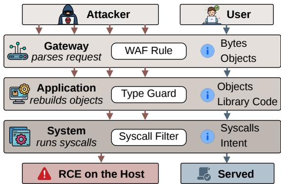
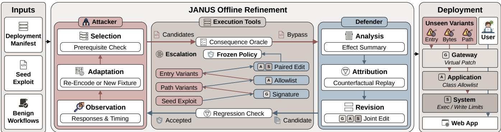
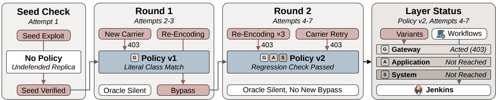
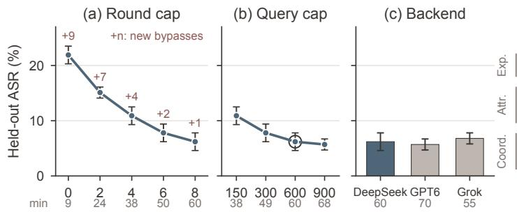
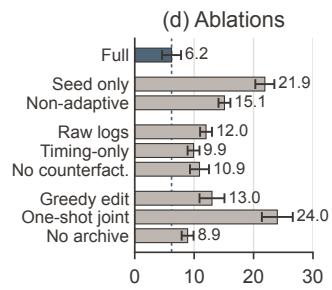
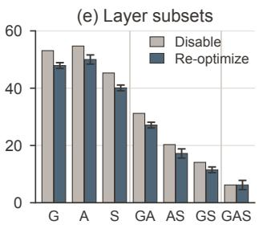
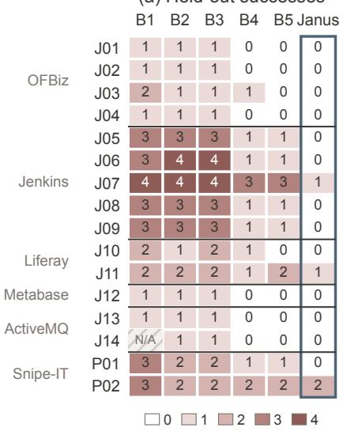
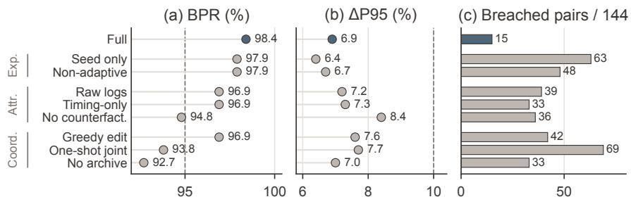
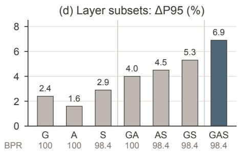

# JANUS: Synthesizing Cross-Layer Defenses Against Web Deserialization Atacks

Ruozhao Yang   
rz.yang.2024@phdcs.smu.edu.sg   
Singapore Management University Singapore

Minglang Li 2024060909004@std.uestc.edu.cn UESTC China

Xinfeng Li   
xinfeng.li@polyu.edu.hk   
The Hong Kong Polytechnic   
University   
China

Jiongchi Yu jiongchiyu@acm.org Nanyang Technological University Singapore

Xiaofei Xie xfxie@smu.edu.sg Singapore Management University Singapore

## Abstract

Unsafe deserialization turns untrusted data into attacker-controlled execution, and a single vulnerability can admit diverse exploit variants that evade defenses tailored to a known exploit. Existing defenses typically operate at a single enforcement point with limited visibility into the full attack. Combining controls across layers offers complementary protection, but coordinating them to preserve legitimate functionality and adapting them to new variants requires substantial expert efort.

We propose Janus, a red-blue adversarial framework for automated cross-layer defense synthesis. Starting from a known exploit, Janus iteratively refines deployment-specific policies in an isolated ofline environment. A black-box attacker probes the current policy for exploit variants using only externally observable feedback. The defender summarizes each verified variant into its security-relevant efects, uses counterfactual replay to separate complementary coverage from redundant enforcement, and jointly selects and scopes controls across layers. Each candidate policy is validated against accumulated exploits and benign workflows.

We evaluate Janus on sixteen vulnerability deployments across six Java and PHP applications against gateway, application, system, and cross-layer defenses. Janus reduces held-out attack success to 6.2%, compared with 18.8-55.0% for the baselines, fully mitigates 13 of 16 deployments, and preserves 98.4% of benign functionality tests at a 6.9% targeted P95 latency increase.

## CCS Concepts

• Security and privacy → Web application security; Software security engineering.

Keywords Deserialization Vulnerabilities, Web Application Defense, Adversarial Self-Evolution, Runtime Enforcement

ACM Reference Format:   
Ruozhao Yang, Minglang Li, Jiongchi Yu, Xinfeng Li, and Xiaofei Xie. 2027. JANUS: Synthesizing Cross-Layer Defenses Against Web Deserialization Attacks. In Proceedings of Proceedings of the ACM Web Conference 2027 (WWW’27). ACM, New York, NY, USA, 13 pages. https://doi.org/XXXXXXX. XXXXXXX

## 1 Introduction

Unsafe deserialization poses a persistent and critical threat to Web security [33, 40]. When applications reconstruct objects from untrusted data, attacker-controlled types and field values can trigger chains of existing methods that lead to remote code execution (RCE) [37, 40]. Existing defenses constrain specific steps of this process, for example by restricting the classes permitted during deserialization [14, 46]. However, a single vulnerability may admit multiple gadget chains drawn from application dependencies, so filters targeting known gadgets can be bypassed by alternative chains [5, 9, 36, 40]. Mitigation is also deployment-specific: the deployed libraries and runtime determine which chains are viable [24], whereas legitimate features determine which deserialization behaviors must remain available [21].

Motivation. As shown in Figure 1, defenders can intervene at three layers with distinct visibility and established enforcement mechanisms. At the gateway, a Web application firewall (WAF) inspects and filters incoming request representations [35]. Application-level deserialization filters constrain the types and object structures accepted during reconstruction [14, 32, 46]. System-level policies restrict the resulting operations through system-call filtering or container isolation [4, 25, 37]. Each layer nevertheless observes only part of the attack: narrow restrictions may miss exploit variants, while broader restrictions risk disrupting legitimate features [15, 40].

Combining these layers ofers complementary protection [39], but requires coordinating their policies. We define a multi-layer composition as a joint selection of controls with deployment-specific parameters and enforcement scopes. Constructing an efective composition is challenging because upstream blocking can obscure downstream coverage, overlapping controls may introduce redundant overhead, and policy interactions can disrupt legitimate work flows in ways that isolated checks do not reveal. Moreover, a composition that blocks known exploits may still admit variants using diferent gadget chains or payload representations. Existing auto mated mitigations support the generation of security workarounds, deserialization restrictions, or runtime policies [21, 37, 46], but these capabilities alone do not establish how controls should be jointly configured and revised to cover adaptive exploit variants while preserving legitimate functionality.

  
Figure 1: Motivating example. Each layer’s defense stops some exploit variants, but one variant passes all three layers and reaches RCE, while the legitimate request is served.

Our Approach. We present Janus, a red-blue adversarial framework for synthesizing deployment-specific multi-layer defenses against unsafe deserialization. The framework pairs an attacker agent with a defender agent on an isolated replica of the deployment. Starting from a known exploit, the attacker adapts its gadget-chain selection and payload representation to achieve a specified consequence, such as command execution within the application container. The defender uses execution evidence and benign-workflow feedback to jointly revise controls across layers. Through this offline interaction, the agents expose and address weaknesses beyond those revealed by the initial exploit. The attacker observes only what an external attacker could observe and serves as a source of counterexamples. The technical contributions of Janus lie on the defense side, in how the defender interprets these counterexamples and coordinates controls to cover them.

Realizing this process raises three technical challenges. ❶ Exposing Variants Under Black-Box Observation. A defense is only as robust as the variants it is checked against, yet an external attacker cannot distinguish a gateway rejection from an incompatible gad get chain. Janus’s attacker parameterizes reviewed fixtures whose prerequisites match the deployment, treats ambiguous feedback as hypotheses, and submits candidates to an independent oracle that it cannot observe. ❷ Interpreting Exploit Efects and Defensive Coverage. Raw system-call traces are too low-level for policy reasoning, and upstream blocking hides the protection of downstream controls. Janus condenses execution evidence into attack-efect summaries expressed as security-relevant capabilities, each tied to the control that can intercept it, if any, and uses counterfactual replay with upstream rules disabled to separate complementary coverage from redundant enforcement. ❸ Coordinating Controls Under Functional Constraints. Controls that are individually acceptable may break legitimate workflows when combined, and some improvements require coordinated changes across layers. Janus jointly selects and scopes controls from a bounded catalog of deployable mechanisms and accepts a candidate only if it blocks all verified exploits and meets the functionality and latency thresholds on the benign-workflow regression suite.

Evaluation. We compare Janus on 16 deployments across six applications against ModSecurity with OWASP CRS [35], Datadog RASP and OpenRASP [3, 13], Kintsugi [37], and Tetragon [10]. Janus lowers held-out attack success to 6.2%, versus 18.8-55.0% for the baselines, fully mitigates 13 of 16 deployments, and is breached on 5 of 48 unseen-attacker/deployment pairs, while passing 98.4% of functionality tests. A recorded run on CVE-2026-84645, a recent Jenkins RCE, illustrates the refinement loop.

Contributions. This paper makes three contributions:

• We formulate unsafe-deserialization mitigation as deploymentspecific cross-layer defense synthesis that coordinates complementary controls under functional constraints.

• We propose Janus, a red-blue adversarial framework in which a black-box attacker supplies verified exploit variants and a defender combines attack-efect summaries with counterfactual coverage attribution to jointly select and scope cross-layer controls under functional constraints.

• We define an evaluation protocol with held-out paths, unseen attackers, multi-consequence oracles, and benign-workflow checks. We evaluate Janus under this protocol and will release its implementation and evaluation materials upon publication1.

## 2 Background and Problem Statement

## 2.1 Deserialization Attacks and Defenses

Unsafe deserialization allows attacker-controlled data to trigger unintended method invocations during object reconstruction. A sequence of existing methods leading to a sensitive operation constitutes a gadget chain [12, 40]. A vulnerable entry point may admit multiple chains [5, 9, 36], whose viability depends on the deployed libraries and runtime [6, 24]. Exploit variants can difer in where serialized data enters, how it is encoded and framed, or which execution path leads to the consequence.

Each of the three defensive layers has a characteristic blind spot. Gateway controls (G) such as reverse proxies and WAFs [35] inspect request representations rather than reconstructed objects, so representation changes can bypass them [15, 45]. Application controls (A) restrict accepted classes or object-graph properties where the parser exposes them [31, 32], yet may still permit malicious uses of allowed classes. System controls (S) restrict process creation, file access, or network communication [4, 17], limiting consequences without preventing deserialization, often for a whole process or container. These controls also difer in availability across deployments, so an efective composition must account for both the controls a deployment supports and the legitimate behavior within their scopes.

## 2.2 Threat Model

We consider a Web deployment � with a known, unpatched deserialization vulnerability and a validated seed exploit that achieves a specified security consequence. The defender operates on isolated, resettable replicas with representative benign workflows.

Attacker. The attacker controls HTTP requests and holds the privileges required to reach the vulnerable entry point. It may adapt payload representations and gadget chains using responses, timing, and attacker-controlled out-of-band observations within fixed query and time budgets, but cannot alter deployment configurations, defensive policies, or validation infrastructure. The ofline attacker agent operates under the same restrictions and receives no internal execution-stage feedback.

Defender. The defender analyzes application logs, network traffic, and system logs to configure supported controls across the three layers. It may change only configuration, not application source code or business logic.

Trust Assumptions. The host kernel, enforcement backends, and validation oracles are trusted. An independent oracle verifies exploit success through controlled state or efects rather than responses or logs alone.

Security Objective. A defense must prevent the specified consequence, and intervention after it occurs does not count. We distinguish blocking before or during deserialization from impact limitation that denies a subsequent operation. We assess protection only for the specified consequences, attackers, and budgets.

## 2.3 Cross-Layer Defense Synthesis

Given a deployment � and a validated seed exploit, our goal is a multi-layer defense against the original attack and its variants that exploit the same vulnerability through alternative representations or execution paths. Let $\Pi _ { D }$ denote the configurations supported by the deployment’s controls and scopes, and B the benign workflows that pass without the defense. Refinement alternates between defense configuration and bypass exploration, and verified attacks accumulate in an archive $\mathcal { A } _ { t }$ initialized with the seed. At iteration �, the defender seeks a configuration

$$
\begin{array} { r } { \pi \in \Pi _ { D } \mathrm { s . t . } \mathrm { A S R } ( \pi , \mathcal { A } _ { t } ) = 0 \mathrm { , } \mathrm { B P R } ( \pi , \mathcal { B } ) \geq \tau _ { b } , \Delta L _ { 9 5 } ( \pi ) \leq \epsilon _ { l } , } \end{array}\tag{1}
$$

where ASR is the fraction of attacks achieving their specified consequences, BPR the fraction of workflows passing all functional assertions, and $\Delta L _ { 9 5 }$ the P95 latency increase of the targeted endpoint under benign trafic, with thresholds $\tau _ { b }$ and $\epsilon _ { l }$ fixed before refinement begins.

Because every archived attack is a verified exploit, the archive must be covered completely rather than traded of against functionality, so Eq. (1) is a feasibility problem. New bypasses expand the archive and trigger further revision, and failure to meet the conditions within budget is recorded as unsuccessful. The final configuration is frozen before independent evaluation against attacks excluded from refinement.

## 3 Design of Janus

Janus searches for a configuration satisfying Eq. (1) by alternating two roles on isolated replicas of � (Figure 2). Starting from the archive $\mathcal { A } _ { 0 } = \{ { x } _ { 0 } \}$ , the defender turns attack evidence and benignworkflow feedback into a configuration $\pi \in \Pi _ { D }$ , which is accepted only if it blocks every archived attack and meets both thresholds. The attacker then probes the accepted configuration with externally observable feedback, and each verified bypass enlarges the archive and triggers another revision. The last accepted configuration is frozen and deployed without language-model decisions.

## 3.1 Black-Box Attack Exploration

The attacker supplies counterexamples and observes only what an external attacker could. This is hard because exploits depend on deployment-specific classes and runtime behavior $[ 6 , 2 4 ]$ , and a rejected request, an incompatible gadget, and a denied downstream operation can look identical from outside.

Fixture Catalog. The attacker draws from a bounded catalog of reviewed fixtures, each specifying its prerequisites, entry point, payload construction, and permitted variations of entry point, representation, or execution path. A fixture is eligible unless known target information contradicts its prerequisites. Held-out fixtures are disjoint from the catalog by path key (Appendix D) and stay hidden during refinement, and a permitted variation that reaches a held-out path counts as rediscovery.

Observation-Guided Exploration. In each round the configuration � is fixed, and the attacker returns candidates � generated from eligible fixtures. It sees only the response, timing, and attackercontrolled out-of-band signals of its own requests, never logs or policy text, and treats them as hypotheses rather than execution-stage labels [38]. Apparent filtering suggests a representation change, an exposed compatibility error suggests another fixture, and an ambiguous failure leaves both open.

Counterexample Verification. An independent oracle $\omega ( x , \pi ) \in \{ 1 , 0 , \bot \}$ reports whether attack � reaches its specified consequence under $\pi ,$ fails to reach it, or cannot be decided. A candidate becomes a counterexample only if it succeeds both without and with the defense:

$$
V ( X , \pi ) = \{ x \in X : \ \omega ( x , \emptyset ) = 1 \ \land \ \omega ( x , \pi ) = 1 \} .\tag{2}
$$

Failure on the undefended replica is thus never credited to the defense, ⊥ never counts as prevention, and � is never returned to the attacker.

## 3.2 Evidence-Guided Defense Refinement

The defender maps execution evidence onto deployable controls and reconciles protection with legitimate use.

Attack-Efect Summary. For each archived attack, Janus links the request to application and system events through request identifiers and process lineage. The summary records the oracle-confirmed consequence, the exercised capabilities with their decisive parameters (Table 5), and the enforcement events under the current configuration, while unlinked or missing observations remain unknown. It ties behavior to intervention points without requiring the defender to reconstruct the gadget chain.

Rules. A rule $r = ( c , \sigma , \theta )$ instantiates a catalog control � (Table 1) with scope � and parameters �, and carries its supporting evidence and expected efect. A configuration � is a set of rules, and $\Pi _ { D }$ admits only controls and scopes that � supports.

  
Figure 2: Overview ofJanus, which alternates black-box attack exploration and evidence-guided defense refinement under regression checks.

Counterfactual Coverage Attribution. Once an upstream rule rejects �, downstream protection is unobserved but may exist. Janus replays � from the same snapshot, masks the rule that blocked it, and repeats until � reaches its consequence or no further rule blocks it (Appendix D). The result is a coverage matrix

$$
C o v [ r ] \left[ x \right] \in \{ \mathrm { o b s , l a t , n o n e , u n k } \} , \qquad r \in \pi , \ x \in \mathcal { A } ,\tag{3}
$$

where obs marks the first rule that blocks �, lat a rule that blocks it only once upstream rules are masked, none a rule still enabled when the consequence occurs, and unk an inconclusive replay. Let �(�) be the rules with obs or lat for �. On rows without unk, � has a single point of failure when |�(�)| = 1, and a rule is a redundancy candidate when every attack it covers has $| C ( x ) | \geq 2$ . Because this test is pairwise, a removal is confirmed only by the acceptance check on the complete configuration. Replaying the training workflows in the same way records which workflows each rule breaks.

Joint Revision. From the summaries, the coverage matrix, and failed workflow assertions, the defender proposes a revision that may add, remove, narrow, or retune rules at several layers at once. Single points of failure are preserved, redundancy candidates may be removed or narrowed, and a rule that breaks a workflow is narrowed or replaced by a control at another layer covering the same consequence. Individual edits need not be acceptable alone, since only the complete revised configuration is checked.

## 3.3 Regression-Guarded Evolution

Acceptance. With training workflows ${ \mathcal { B } } _ { \mathrm { t r } } \subseteq { \mathcal { B } }$ and the thresholds of Eq. (1), a candidate � is accepted if and only if

$$
\begin{array} { r l } { \operatorname { A c c } ( \pi , { \mathcal { A } } ) \ \equiv \ \bigwedge _ { x \in { \mathcal { R } } } \omega ( x , \pi ) = 0 } \\ & { \wedge \ \mathrm { B P R } ( \pi , { \mathcal { B } } _ { \mathrm { t r } } ) \geq \tau _ { b } \ \wedge \ \Delta L _ { 9 5 } ( \pi ) \leq \epsilon _ { l } } \end{array}\tag{4}
$$

on a replica where the native configuration has loaded, and any ⊥ falsifies the predicate. Rejected candidates return to the defender with their failure evidence but never replace the incumbent.

Rounds. A round is one attack phase against the fixed incumbent $\pi _ { t } .$ It ends when the attacker returns $X _ { t }$ or exhausts its per-round query allowance. The archive then grows to $\mathcal { A } _ { t + 1 } = \mathcal { A } _ { t } \cup V ( X _ { t } , \pi _ { t } )$ and only a new bypass triggers a revision, so the attacker never interacts with a partially updated candidate (Algorithm 1). Exploration, revision, and checking all consume the budget �.

Algorithm 1 Workflow of Janus   
Require: Deployment �, seed $x _ { 0 } ,$ workflows ${ \mathcal { B } } _ { \mathrm { t r } } ,$ budget �, threshold �   
Ensure: Frozen configuration $\pi ^ { \star }$ or RefinementFailure   
1: � ← ∅, A ← {�0 }, � ← Evidence(�0 )   
2: � ← true, � ← 0   
3: while BudgetRemains(�) and � < � do   
4: if � then   
5: (�,�) ← Analyze(�, A, B ) ⊲ summaries and coverage   
6: �′ ← JointRevise(�, �, �, �, Btr )   
7: (�, � ) ← Check(�′, A, Btr )   
8: � ← � ∪ �   
9: if not � then continue   
10: � ← �′, � ← false   
11: if not BudgetRemains(�) then break   
12: (�, � ) ← AttackRound(� [� ] ) ⊲ �: catalog exhausted   
13: � ← �(�, �), � ← � + 1   
14: if � ≠ ∅ then   
15: A ← A ∪ �, � ← � ∪ Evidence(�)   
16: � ← true, � ← 0   
17: else if � then   
18: break   
19: return Finalize(�, A, Btr )

Stopping and Freezing. Refinement stops at budget exhaustion, at stagnation after � consecutive rounds without a new verified bypass, or at catalog exhaustion, when every eligible fixture and permitted variation has been tried against the incumbent. None of them proves that no bypass exists. Finalize re-checks the last incumbent on a fresh replica and returns it as $\pi ^ { \star }$ if it is still accepted, or RefinementFailure otherwise. Held-out attacks and test workflows are used only to evaluate $\pi ^ { \star }$

Run-to-Run Variation. Both agents sample from an LLM, so runs from the same seed may return diferent configurations, whereas verification, replay, and regression checks are deterministic given the snapshot. Every returned configuration blocks its own archive and passes the training workflows, but its coverage beyond that archive varies, so we report the spread over repeated runs.

Table 1: Defensive controls supported by Janus at each layer. B: attack blocking. L: limitation of a specified efect.
<table><tr><td>ID</td><td>Control</td><td>Configurable Policy</td><td>Effect</td></tr><tr><td>G1</td><td>Ingress Limits</td><td>Allowed routes and methods, body-size cap</td><td>B</td></tr><tr><td>G2</td><td>Virtual Patch</td><td>Request-match rules and action</td><td>B</td></tr><tr><td>A1</td><td>Class Filtering</td><td>Class allowlist, others rejected</td><td>B</td></tr><tr><td>A2</td><td>Graph Limits</td><td>Depth, references, bytes, array length</td><td>B</td></tr><tr><td>A3</td><td>Parser Filter</td><td>Class blocklist in the parser&#x27;s own filter</td><td>B</td></tr><tr><td>S1</td><td>Execution Limits</td><td>Deny process-execution system calls</td><td>L</td></tr><tr><td>S2</td><td>Write Confinement</td><td>Read-only root, explicit writable mounts</td><td>L</td></tr><tr><td>S3</td><td>Egress Isolation</td><td>Internal network, no external egress</td><td>L</td></tr></table>

## 4 Implementation

We implement Janus in about 9,800 lines of Python. A control plane runs Algorithm 1, both agents share one LLM backend with schemavalidated outputs (Appendix E), and verification, counterfactual replay, and regression checks are deterministic tools (Appendix D). Each deployment runs as a Docker Compose project behind an NGINX reverse proxy and is restored from a snapshot before every replay. Oracles and workflow assertions run outside the application container, and failed replays are retried rather than counted as blocks. No application code is modified.

Per-layer adapters compile each rule of Table 1 into native config uration, reject unsupported controls or scopes, and confirm that the configuration has loaded. A loaded rule counts as acting only when its enforcement event appears during replay. G1 and G2 become NGINX limits and ModSecurity rules [35], the latter enabled only if they match no training request. A1 and A2 become jdk.serialFilter settings [31, 32] and apply only where the vulnerable path uses ObjectInputStream. A3 extends the class blocklist of the Jenkins remoting ClassFilter, which Jenkins applies to XStream alongside its JEP-200 allowlist. S1-S3 become a seccomp profile denying execve [17], a read-only root filesystem with explicit writable volumes, and an internal Compose network. Allowlists, limits, and writable volumes are derived from training workflows only.

## 4.1 Running Example

Figure 3 traces the J06 run on CVE-2026-84645, a recent XStream deserialization RCE in Jenkins 2.567 [23]. The exploit posts jobconfiguration XML from which Jenkins rebuilds a build-trigger object graph, and the oracle checks a marker file at the sink.

Red-Blue Escalation. The seed succeeds on the undefended replica, so the defender installs v1, a gateway rule matching the literal build-trigger class name. The attacker sees its new carrier rejected and re-encodes the class name as XML character references. XStream decodes this request to the same object, and the oracle fires. The defender then revises from the exposed efect rather than from the bytes of the request. Its v2 adds the class to the Jenkins class filter (A3), which acts after decoding and so covers every representation of the class, keeps a decoded-name gateway rule as a cheap pre-filter, and confines writes outside the Jenkins home as a backstop. v2 is accepted only after it blocks both archived attacks and passes the benign workflows. The attacker’s four further variants all end in HTTP 403, and the run stops by catalog exhaustion. Each attack thus sharpens the next defense, and each defense narrows what the next attack can use.

Why Baselines Fall Short. The frozen v2 blocks all four held-out attacks of J06 and passes all four functionality tests. CRS stops only one re-encoded variant through literal matching and flags a legitimate configuration post. Both RASPs preserve functionality but block no attacks, as their generic hooks do not capture XStream’s object reconstruction. Kintsugi and Tetragon block three attacks at the sink but miss the write inside Jenkins home, while their process-execution restrictions break a build workflow. These baselines either miss variants or restrict required behavior. Janus scopes v2 to the build-trigger payload while preserving legitimate job-management workflows.

Layer Attribution. Masked replay of the two archived attacks shows that each is covered by at least two rules, the gateway and application rules for both and the system rule for the seed, so v2 has no single point of failure. Replaying the held-out attacks after freezing confirms that the lower layers are not redundant. With the gateway masked, the application rule alone stops all four and the system rule two, whereas the gateway alone stops one. The system rule misses the attack that writes inside the Jenkins home, which builds need, and one variant outside its narrow workflowpreserving scope.

## 5 Evaluation

We organize the evaluation around four questions:

• RQ1: How do frozen defenses compare on held-out attacks and unseen attackers?

• RQ2: What functionality and online/ofline costs accompany their protection?

• RQ3: How does refinement progress, and what protection remains on paths never rediscovered?

• RQ4: How do the components, enforcement layers, and budgets afect the outcome?

## 5.1 Experimental Setup

Deployments. We study sixteen (application, CVE) deployments across six applications, five on the JVM and one in PHP: Apache OFBiz (4 CVEs), Jenkins (5), Liferay Portal (2), Metabase (1), Apache ActiveMQ (2), and Snipe-IT (2). Each reproduces from a fresh snapshot, has a non-destructive consequence oracle and assertable benign workflows, and has at least one supported control on its exploit path (Appendix A). One ActiveMQ deployment is reached through native OpenWire rather than HTTP, so gateway controls do not apply to it.

Attacks and Workflows. For each deployment an expert constructs five attack objectives from the same vulnerability, spanning remote code execution, file read, write, or deletion, request forgery, access-control bypass, privilege escalation, and application-state abuse [29, 34]. One is the training seed, and the other four are heldout test attacks that difer from it in impact and, where possible, in gadget family, giving 64 held-out attacks. Each deployment also has 12 training workflows for the acceptance gate, 4 validation workflows for baseline tuning, and 4 disjoint functionality tests that assert response and persistent state. The oracle monitors every consequence reachable on the path, and only preventive blocks count (Appendix B).

  
Figure 3: Recorded run on Jenkins CVE-2026-84645. A re-encoded payload bypasses the literal gateway rule of v1. The defender revises from the exploited efect into the three-layer v2, which stops every later variant at the gateway while benign workflows still pass.

Baselines. B1 is ModSecurity with OWASP CRS [35], B2 and B3 are Datadog RASP [13] and OpenRASP [3], B4 is Kintsugi [37], the closest multi-layer system (A+S), and B5 is Tetragon [10] with a service-wide policy that denies process execution, writes outside data directories, and external connections. Tunable baselines receive the same archive, validation workflows, and tuning allowance (Appendix F). B1 does not apply to the OpenWire deployment.

Attackers and Budgets. Three unseen automated attackers, PentestGPT and CAI on GPT6 Luna and the CVE-Bench refer ence agent on Grok 4.7, attempt every deployment, giving 48 attacker/deployment pairs, and a policy-aware setting reveals the frozen policy to them. A team-member human expert is reported separately. Synthesis is capped at 700,000 tokens, 800 replays, 600 attacker queries, 90 minutes, 20 rules, and 8 rounds, with � = 2, �� = 100% on the training workflows, and �� = 10%. The default backend is DeepSeek V4 Flash.

Metrics. ASR is the fraction of held-out attacks that still succeed, averaged over deployments. Mitigation counts deployments with no held-out success and no synthesis failure, and breach counts attacker/deployment pairs with at least one success. A failed syn thesis is scored with its last accepted configuration, and blocking and impact limitation are reported separately. BPR is the fraction of functionality tests passed, FPR the fraction of benign requests rejected, and ΔP95 the P95 latency increase of the targeted endpoint. No regression counts deployments where all four tests pass within the latency gate. Experiments that re-run synthesis are repeated three times and report means with the largest single-run deviation, and single-run results use the median run.

## 5.2 RQ1: Efectiveness

As Table 2 shows, Janus has 6.2% held-out ASR, versus 18.8-55.0% for the baselines, mitigates 13/16 deployments, and is breached on 5/48 attacker/deployment pairs. On the 15 deployments that B1 covers, Janus’s ASR is 6.7%, but baselines fail in diferent ways. Specifically, request signatures miss semantic variants, generic RASP hooks miss deserialization paths outside their sinks, and runtime containment misses consequences inside permitted resources. Tetragon reaches a slightly lower ASR than Kintsugi (18.8% versus 20.3%) but preserves far fewer workflows (81.2% versus 95.3% BPR), so the baselines do not share a single weakness.

Changed attack settings widen these gaps. Switching to an unused monitored consequence raises Janus’s ASR only from 6.2% to 9.7%, whereas Kintsugi rises from 14.6% to 31.9% and Tetragon from 12.5% to 36.8%, because alternative efects inside their allowed resources remain reachable. With the frozen policy revealed, the attackers breach 10/48 pairs for Janus and 23-38 for the baselines. The human expert, reported separately from the automated attackers, breaches 4/16 deployments for Janus and 9-13 for the baselines.

The residual attacks come from two synthesis failures and one held-out failure. J11 ends with an archived bypass that no candidate covers within budget, and P02 with a bypass whose file write overlaps a write that required functionality performs. Both had accepted a configuration that blocks the seed, and these last accepted policies remain in every aggregate. J07 passes synthesis but retains one held-out success. Of the 60 prevented Janus attacks, 44 are stopped before or during deserialization and 16 by consequence limitation, 11 of them by denied execve, 3 by the read-only root, and 2 by denied egress. Because G and A act before S and every rule only denies, the first 44 are exactly the attacks that the G and A rules alone block. No file-read consequence is credited to limitation. The baselines difer in where they stop an attack. B1 stops all its blocked attacks before deserialization, while the RASPs, Kintsugi, and Tetragon stop most of theirs at the sensitive operation. Neither stopping point establishes that an unmonitored efect is safe.

Finding 1. Coordinated cross-layer controls cut held-out ASR to 6.2%, about a third of the best baseline (18.8%), and leave only 5/48 attacker/deployment pairs breached. The advantage persists under consequence switching (9.7% versus at least 31.9%) and policy visibility (10/48 versus at least 23/48 breached pairs), and all residual attacks trace to two synthesis failures and one held-out failure.

## 5.3 RQ2: Functionality and Overhead

Janus passes 98.4% of functionality tests at a 6.9% targeted P95 increase and has no regression on 15/16 deployments (Table 2). Kintsugi and Datadog RASP also meet the aggregate reference but regress on 4 and 8 deployments, and OpenRASP exceeds the latency gate on average. High functionality does not imply security, since both RASPs keep 96.9% BPR at about 50% ASR. Tetragon reaches only 81.2% BPR because some features need subprocesses, writes, or network access. It rejects only 1.2% of benign requests, so a low FPR does not establish functionality preservation, because a request may be admitted while a later operation or persistent-state assertion fails. Janus adds 1.2% non-targeted latency and lowers throughput by 3.0%. Its 60-minute median ofline cost is paid once per deployment and workflow version, not online. A typical synthesis uses 420,000 tokens and 680 environment replays, 110 of them counterfactual.

Table 2: Frozen defenses on the 16 deployments. Rates are in percent and Ofline in minutes. Main and Switch are ASRs on the 12 deployments with an unused monitored consequence, Aware counts breached attacker pairs with the frozen policy revealed, and Human counts deployments breached by the expert. Other P95 is the non-targeted latency increase.
<table><tr><td></td><td colspan="3">Held-out security</td><td colspan="4">Changed attack settings</td><td colspan="4">Functionality and latency</td><td colspan="3">Overhead</td></tr><tr><td>Method</td><td>ASR</td><td>Mitigated</td><td>Breached</td><td>Main</td><td>Switch</td><td>Aware</td><td>Human</td><td>FPR</td><td>BPR</td><td>ΔP95</td><td>No regr.</td><td>Other P95</td><td>RPS</td><td>Offline</td></tr><tr><td>ModSecurity + CRS</td><td>55.0</td><td>0/15</td><td>32/45</td><td>45.5</td><td>59.1 ±2.3</td><td>38/45</td><td>13/15</td><td>4.5</td><td>88.3</td><td>3.2</td><td>8/15</td><td></td><td>2.0 -1.5</td><td>15</td></tr><tr><td>Datadog RASP</td><td>48.4</td><td>0/16</td><td>29/48</td><td>39.6</td><td>55.6 ±1.4</td><td>34/48</td><td>12/16</td><td>0.6</td><td>96.9</td><td>9.9</td><td>8/16</td><td></td><td>5.5 -4.8</td><td>18</td></tr><tr><td>OpenRASP</td><td>50.0</td><td>0/16</td><td>32/48</td><td>41.7</td><td>59.7 ±1.4</td><td>37/48</td><td>13/16</td><td>0.8</td><td>96.9</td><td>10.9</td><td>7/16</td><td></td><td>6.0 -5.5</td><td>18</td></tr><tr><td>Kintsugi</td><td>20.3</td><td>6/16</td><td>17/48</td><td>14.6</td><td>31.9 ±2.8</td><td>23/48</td><td>9/16</td><td>0.5</td><td>95.3</td><td>9.3</td><td>12/16</td><td>1.8</td><td>-2.5</td><td>12</td></tr><tr><td>Tetragon</td><td>18.8</td><td>8/16</td><td>18/48</td><td>12.5</td><td>36.8 ±1.4</td><td>24/48</td><td>10/16</td><td>1.2</td><td>81.2</td><td>4.6</td><td>4/16</td><td></td><td>3.5 -2.0</td><td>5</td></tr><tr><td>Janus</td><td>6.2</td><td>13/16</td><td>5/48</td><td>6.2</td><td>9.7 ±1.4</td><td>10/48</td><td>4/16</td><td>0.3</td><td>98.4</td><td>6.9</td><td>15/16</td><td></td><td>1.2 -3.0</td><td>60</td></tr></table>

Finding 2. Janus combines the lowest ASR with the highest BPR (98.4%) at a 6.9% targeted latency increase and regresses on only 1/16 deployments. High BPR alone does not imply protection, as both RASPs keep 96.9% BPR yet leave about half of the held-out attacks successful.

## 5.4 RQ3: Refinement Dynamics

Figure 4(a) shows diminishing returns. Held-out ASR falls from 21.9% after seed-only construction to 6.2% at the default cap, while new verified bypasses decline from 9 to 1. In total 14/16 runs stop without a new bypass, 9 by stagnation and 5 by catalog exhaustion. The other 2/16 exhaust their budget with unresolved archive attacks, which are the two synthesis failures. Snapshots are scored after freezing, so held-out outcomes never guide stopping.

To test generalization beyond rediscovery, we split the 64 held out attacks by whether the attacker eventually reached their paths, defined on the path keys of the registered fixtures (Appendix D). The 19 rediscovered attacks have 1 success (5.3%) and the 45 neverrediscovered ones 3 (6.7%), all on the synthesis failures J11 and P02. On the 14 accepted syntheses, no never-rediscovered attack succeeds. J07’s success is a held-out payload on a rediscovered path whose archived attack is blocked, consistent with acceptance.

Finding 3. Refinement shows diminishing returns, as eight rounds cut ASR from 21.9% to 6.2% while new bypasses fall from 9 to 1. Protection carries over to paths the attacker never rediscovered (6.7% ASR), and none of these attacks succeeds on the 14 accepted syntheses.

## 5.5 RQ4: Ablation and Sensitivity

Components. Figure 4(d) isolates exposure, attribution, and coordination, which address challenges ❶-❸. Seed-only construction (21.9%) and a non-adaptive variant pool (15.1%) show that adaptive exposure matters beyond supplying more variants. Without counterfactual replay, ASR rises to 10.9% and BPR drops to 94.8%, reflecting redundant or poorly scoped controls. Of the masked replays, 71% end blocked, 18% at the consequence, 8% not reached, and 3% in error, and 6% of coverage entries remain unknown, so redundancy is judged only on conclusive rows. One-shot joint synthesis reaches 24.0% and greedy single edits 13.0%. The gaps among the attribution, greedy, and no-archive variants are comparable to run-to-run variation and indicate a consistent direction rather than a strict ranking. Seed-only synthesis has no synthesis failures, since every seed can be blocked within the gates, so its higher ASR comes from variants it never saw. The BPR and latency of all variants appear in Appendix Figure 6.

Layers. Figure 4(e) shows that every layer matters. Disabling A, S, or G in the frozen policy raises ASR from 6.2% to 14.1%, 31.2%, and 20.3%. Dropping A matters only on Jenkins, where the class filter (A3) carries the type constraint that the gateway and system rules each cover only in part. Single layers are much weaker, partly because six deployments have no A control, so A-only ASR is at least 37.5%. S-only re-optimization (40.1%) trails Tetragon because Janus scopes system rules narrowly to preserve workflows, and on J07-J09 the seeds’ state changes lie inside the writable Jenkins home, where S cannot limit them. Janus’s gateway rules alone (47.9- 53.1%) are close to tuned CRS, leaving 50.0% open on the 15 HTTP deployments versus 55.0% for CRS.

Budgets and Backends. Figure 4(b-c) shows that ASR stays within 5.7-6.8% across the three backends, within run-to-run variation. GPT6 Luna also drives two of the evaluation attackers, so its row is not an independent-attacker test. The query cap is split evenly over the rounds, so it changes how many variations each attack phase may try rather than the number of rounds. Lowering the query cap to 150 raises ASR to 10.9%, while raising it to 900 lowers ASR only to 5.7% at 13% more ofline time. Most runs stop by stagnation or catalog exhaustion before the overall cap binds, so a larger allowance mainly helps rounds that previously ran out of queries. Rotating the training seed on six deployments leaves 4.2-8.3% ASR on their held-out attacks, versus none under the default seed.

Finding 4. Every component and every layer contributes. The seed-only, non-adaptive, and one-shot variants cost the most (15.1-24.0% ASR), and dropping any single layer raises ASR to 14.1-31.2%. Results stay within 5.7-6.8% across backends, and raising the default 600-query cap to 900 lowers ASR by only 0.5 points.

## 6 Discussion

## 6.1 Implications

The evaluation also shows why single-point and generic defenses fall short, which yields three lessons beyond Janus.

  
Figure 4: Refinement, sensitivity, and ablations (held-out ASR, %). (a) Round cap, with new verified bypasses found after each snapshot. (b) Attacker-query cap and (c) backend, default circled or dark, with median ofline minutes below. (d) Component ablations. (e) Layer subsets, disabled in the frozen policy or re-optimized. Error bars show the largest single-run deviation over three runs.

Place the Decisive Constraint Where the Attack Becomes Visible. A literal gateway rule misses an equivalent representation, while a type-level constraint after decoding covers every encod ing of the same class, and disabling the application layer raises ASR from 6.2% to 14.1%. A gateway signature is better treated as a cheap pre-filter that lets downstream controls be scoped narrowly, a principle defenders can adopt without Janus.

Judge Mitigations on Coverage and Functionality Together. Frozen system hardening denies operations that legitimate features need (81.2% BPR for Tetragon), whereas RASP keeps 96.9% of work flows but misses about half of the held-out attacks. Mitigations should thus be measured on held-out paths, unseen attackers, and functionality together, since evaluating them on their own seed overstates protection.

Counterfactual Attribution Is Useful on Its Own. Rule count is a poor proxy for protection, because an upstream rule hides whether downstream rules hold. Counterfactual replay needs only replicas and oracles, 94% of its entries were conclusive in our runs, and operators can apply it to hand-written policies to expose redundant rules and single points of failure. These lessons rest on a bounded benchmark and empirical attackers, whose limits we discuss next.

## 6.2 Limitations and Future Work

Janus preserves only the behavior its benign workflows express, so we use expert-written workflows with state assertions and unseen tests. Its protection is empirical rather than proven, and public exploits may appear in model training data, which independent held-out paths and unseen attackers partly address. Impact limitation leaves the vulnerable path reachable, so frozen configurations are temporary measures until a root-cause fix. The benchmark covers six applications, only one in PHP, so we report per-deployment results rather than statistical tests. The loop needs only a consequence oracle, a control catalog, and benign workflows, which makes template injection and request forgery natural next targets.

## 7 Related Work

## 7.1 Deserialization Defenses

Gadget-chain discovery tools target PHP [12, 36] and Java [5, 8, 9, 43], and empirical studies show that chains are diverse and that their applicability hinges on classpath and version prerequisites [6, 24, 40]. On the defense side, look-ahead agents restrict the classes a stream may instantiate [7], runtimes provide class and graph filters [31], and recent systems synthesize them automatically: DeseriGuard derives Java allowlists from application semantics [46], QUACK infers allowed PHP classes by static duck typing [14], and Gauthier and Bae block chains at run time [19]. These filters act only at the call sites and parsers they hook, whereas Janus uses them as one of three layers.

## 7.2 Runtime Mitigation

Earlier work blocks known exploit inputs with network and host filters [11, 44], disables a vulnerable path until a patch ships [21, 22], or rewrites code with language models [30]. System-call specialization shrinks the attack surface of applications and containers [4, 20, 25], while RASP [3, 13] and eBPF enforcement [10] apply generic policies that ignore the specific vulnerability and deployment. Kintsugi, the closest system, places kernel-enforced policies at application code locations [37]. These systems fix enforcement points in ad vance, whereas Janus selects and scopes controls across layers and revises them against an adaptive attacker.

## 7.3 Cross-Layer Synthesis

Policy generation for defense in depth [39], firewall anomaly analysis [1], and coordinated front-end filtering [28] share our premise that layers must be configured together, but they reason over static rule models and cannot tell whether a seemingly redundant rule is the only one that stops a variant, which Janus learns from counterfactual replay. Adversarial testing evades WAFs [2, 15], and language-model agents exploit real vulnerabilities [16, 18, 26, 47], but these works measure or break defenses rather than feed variants back into synthesis. Our loop follows counterexample-guided synthesis [42], adversarial training [27], and self-refining agents [41], but it produces a deployable configuration, verifies every counterexample with an independent oracle, and gates every revision on benign workflows.

## Ethical Considerations

Our study builds an ofensive component to evaluate defenses, so we constrained both what it can reach and what we release. All experiments target publicly disclosed vulnerabilities in applications we deployed in isolated, resettable environments without Internet access, oracles use canaries we control, and no real user data is involved. The attacker draws only from reviewed fixtures of known gadget families and runs only against these replicas, and any sign of an undisclosed issue will be reported to the maintainers before publication. For the same reason, the defense side is released openly, whereas attack sequences are released only in their already-public form and new variants only to vetted researchers. The human-expert attacker is a team member whose results are reported separately, so IRB review does not apply.

## 8 Conclusion

We presented Janus, a red-blue adversarial framework that synthesizes deployment-specific cross-layer defenses against unsafe deserialization. A black-box attacker supplies verified exploit variants, and a defender turns them into joint gateway, application, and system controls through attack-efect summaries, counterfactual coverage attribution, and regression-gated revision. On sixteen deployments across six Java and PHP applications, Janus lowers held-out attack success to 6.2%, about a third of the best baseline, mitigates 13 of 16 deployments, and is breached on only 5 of 48 unseen-attacker pairs, while passing 98.4% of functionality tests at a 6.9% targeted latency increase. Its advantage holds under consequence switching and policy visibility and carries over to exploitation paths the attacker never rediscovered.

## References

[1] Ehab S Al-Shaer and Hazem H Hamed. 2004. Discovery of policy anomalies in distributed firewalls. In Ieee Infocom 2004, Vol. 4. IEEE, 2605–2616.

[2] Dennis Appelt, Cu D Nguyen, Annibale Panichella, and Lionel C Briand. 2018. A machine-learning-driven evolutionary approach for testing web application firewalls. IEEE Transactions on Reliability 67, 3 (2018), 733–757.

[3] Baidu Security. 2024. OpenRASP: Runtime Application Self-Protection. https: //github.com/baidu/openrasp.

[4] Alexander Bulekov, Rasoul Jahanshahi, and Manuel Egele. 2021. Saphire: Sandboxing {PHP} applications with tailored system call allowlists. In 30th USENIX Security Symposium (USENIX Security 21). 2881–2898.

[5] Sicong Cao, Biao He, Xiaobing Sun, Yu Ouyang, Chao Zhang, Xiaoxue Wu, Ting Su, Lili Bo, Bin Li, Chuanlei Ma, et al. 2023. Oddfuzz: Discovering java deserialization vulnerabilities via structure-aware directed greybox fuzzing. In 2023 IEEE Symposium on Security and Privacy (SP). IEEE, 2726–2743.

[6] Sicong Cao, Xiaobing Sun, Xiaoxue Wu, Lili Bo, Bin Li, Rongxin Wu, Wei Liu, Biao He, Yu Ouyang, and Jiajia Li. 2023. Improving java deserialization gadget chain mining via overriding-guided object generation. In 2023 IEEE/ACM 45th International Conference on Software Engineering (ICSE). IEEE, 397–409.

[7] Luca Carettoni. 2016. SerialKiller: Look-Ahead Java Deserialization Library. https://github.com/ikkisoft/SerialKiller.

[8] Bofei Chen, Lei Zhang, Xinyou Huang, Yinzhi Cao, Keke Lian, Yuan Zhang, and Min Yang. 2024. Eficient detection of java deserialization gadget chains via bottom-up gadget search and dataflow-aided payload construction. In 2024 IEEE Symposium on Security and Privacy (SP). IEEE, 3961–3978.

[9] Xingchen Chen, Baizhu Wang, Ze Jin, Yun Feng, Xianglong Li, Xincheng Feng, and Qixu Liu. 2023. Tabby: Automated gadget chain detection for java deserial ization vulnerabilities. In 2023 53rd Annual IEEE/IFIP International Conference on Dependable Systems and Networks (DSN). IEEE, 179–192.

[10] Cilium Authors. 2025. Tetragon: eBPF-Based Security Observability and Runtime Enforcement. https://github.com/cilium/tetragon.

[11] Manuel Costa, Miguel Castro, Lidong Zhou, Lintao Zhang, and Marcus Peinado. 2007. Bouncer: Securing software by blocking bad input. In Proceedings of twentyfirst ACM SIGOPS symposium on Operating systems principles. 117–130.

[12] Johannes Dahse, Nikolai Krein, and Thorsten Holz. 2014. Code reuse attacks in php: Automated pop chain generation. In Proceedings ofthe 2014 ACM SIGSAC Conference on Computer and Communications Security. 42–53.

[13] Datadog. 2025. Application Security Management: Runtime Application Self-Protection (RASP). https://www.datadoghq.com/product/application-securitymanagement/.

[14] Yaniv David, Neophytos Christou, Andreas D Kellas, Vasileios P Kemerlis, and Junfeng Yang. 2024. QUACK: Hindering Deserialization Attacks via Static Duck Typing.. In NDSS.

[15] Luca Demetrio, Andrea Valenza, Gabriele Costa, and Giovanni Lagorio. 2020. Wafa-mole: evading web application firewalls through adversarial machine learning. In Proceedings of the 35th Annual ACM Symposium on Applied Computing. 1745– 1752.

[16] Gelei Deng, Yi Liu, Víctor Mayoral-Vilches, Peng Liu, Yuekang Li, Yuan Xu, Tianwei Zhang, Yang Liu, Martin Pinzger, and Stefan Rass. 2024. {PentestGPT}: Evaluating and harnessing large language models for automated penetration testing. In 33rd USENIX Security Symposium (USENIX Security 24). 847–864.

[17] Docker. 2024. Seccomp security profiles for Docker. Docker documentation.

[18] Richard Fang, Rohan Bindu, Akul Gupta, and Daniel Kang. 2024. Llm agents can autonomously exploit one-day vulnerabilities. arXiv preprint arXiv:2404.08144 (2024).

[19] François Gauthier and Sora Bae. 2022. Runtime prevention of deserialization attacks. In Proceedings ofthe ACM/IEEE 44th International Conference on Software Engineering: New Ideas and Emerging Results. 71–75.

[20] Seyedhamed Ghavamnia, Tapti Palit, Azzedine Benameur, and Michalis Polychronakis. 2020. Confine: Automated system call policy generation for container attack surface reduction. In 23rd International Symposium on Research in Attacks, Intrusions and Defenses (RAID 2020). 443–458.

[21] Zhen Huang, Mariana DAngelo, Dhaval Miyani, and David Lie. 2016. Talos: Neutralizing vulnerabilities with security workarounds for rapid response. In 2016 IEEE Symposium on Security and Privacy (SP). IEEE, 618–635.

[22] Zhen Huang, David Lie, Gang Tan, and Trent Jaeger. 2019. Using Safety Properties to Generate Vulnerability Patches.. In IEEE Symposium on Security and Privacy. 539–554.

[23] Jenkins Project. 2026. Jenkins Security Advisory 2026-09-02. https://www.jenkins. io/security/advisory/2026-09-02/.

[24] Bruno Kreyssig and Alexandre Bartel. 2024. Analyzing prerequistes of known deserializtion vulnerabilities on java applications. In Proceedings of the 28th International Conference on Evaluation and Assessment in Software Engineering. 28–37.

[25] Yunsen Lei and Craig A Shue. 2025. Making (Only) the Right Calls: Preventing Remote Code Execution Attacks in PHP Applications with Contextual, State-Sensitive System Call Filtering. In International Conference on Detection ofIntrusions and Malware, and Vulnerability Assessment. Springer, 46–65.

[26] Zicheng Liu, Lige Huang, Jie Zhang, Dongrui Liu, Yuan Tian, and Jing Shao. 2026. Pacebench: A framework for evaluating practical ai cyber-exploitation capabilities. In International Conference on Learning Representations, Vol. 2026. 17137–17163.

[27] Aleksander Madry, Aleksandar Makelov, Ludwig Schmidt, Dimitris Tsipras, and Adrian Vladu. 2017. Towards deep learning models resistant to adversarial attacks. arXiv preprint arXiv:1706.06083 (2017).

[28] Wei Meng, Chenxiong Qian, Shuang Hao, Kevin Borgolte, Giovanni Vigna, Christopher Kruegel, and Wenke Lee. 2018. Rampart: Protecting web appli cations from {CPU-Exhaustion} {Denial-of-Service} attacks. In 27th USENIX Security Symposium (USENIX Security 18). 393–410.

[29] MITRE. 2024. CWE-502: Deserialization of Untrusted Data. https://cwe.mitre. org/data/definitions/502.html.

[30] Yu Nong, Haoran Yang, Long Cheng, Hongxin Hu, and Haipeng Cai. 2025. {APPATCH}: Automated adaptive prompting large language models for {Real-World} software vulnerability patching. In 34th USENIX Security Symposium (USENIX Security 25). 4481–4500.

[31] OpenJDK. 2016. JEP 290: Filter Incoming Serialization Data. https://openjdk.org jeps/290.

[32] Oracle. 2024. Serialization Filtering. Oracle Java Platform documentation. ObjectInputFilter; jdk.serialFilter.

[33] OWASP Foundation. 2021. OWASP Top 10: A08 Software and Data Integrity Failures. https://owasp.org/Top10/.

[34] OWASP Foundation. 2024. Testing for Insecure Deserialization. OWASP Web Security Testing Guide (WSTG).

[35] OWASP Foundation. 2026. OWASP ModSecurity Core Rule Set. https:// coreruleset.org/. Accessed 2026.

[36] Sunnyeo Park, Daejun Kim, Suman Jana, and Sooel Son. 2022. {FUGIO}: Automatic exploit generation for {PHP} object injection vulnerabilities. In 31st USENIX Security Symposium (USENIX Security 22). 197–214.

[37] Yihao Peng, Zizhen Zhu, Jiatian Hu, Jiaxu Wang, Hai Wan, and Xibin Zhao. 2026. Kintsugi: Empowering {LLMs} to Mitigate Web Vulnerabilities via Runtime Policy Injection. In 35th USENIX Security Symposium (USENIX Security 26). 731– 750.

[38] Van-Thuan Pham, Marcel Böhme, and Abhik Roychoudhury. 2020. Aflnet: A greybox fuzzer for network protocols. In 2020 IEEE 13th international conference on software testing, validation and verification (ICST). IEEE, 460–465.

[39] Paul Rubel, Michael Ihde, Steven Harp, and Charles Payne. 2005. Generating policies for defense in depth. In 21st Annual Computer Security Applications Conference (ACSAC’05). IEEE, 10–pp.

Table 3: Enforcement reach per application. A covers Javanative paths (A1/A2) and the Jenkins XStream path (A3); G needs an HTTP entry. ActiveMQ’s Jolokia CVE admits GS, its native OpenWire CVE only S.
<table><tr><td>Application</td><td>Format</td><td>A</td><td>Layers</td><td>Gadget families</td></tr><tr><td>OFBiz</td><td>Java-native</td><td>√</td><td>GAS</td><td>CommonsBeanutils, ROME, MozillaRhino</td></tr><tr><td>Jenkins</td><td>XStream</td><td>√</td><td>GAS</td><td>nested PersistenceRoot, OfflineCause, ListView, Agent identity, lazy render</td></tr><tr><td>Liferay</td><td>JSON</td><td>x</td><td>GS</td><td>C3P0/ReferenceSerialized, JdbcRowSetImpl</td></tr><tr><td>Metabase</td><td>Java-native</td><td>√</td><td>GAS</td><td>Java URLDNS, Clojure comparator</td></tr><tr><td>ActiveMQ</td><td>JMX / OpenWire</td><td>x</td><td>GS/S</td><td>Jolokia MBean, ClassPathXmlApplicationContext</td></tr><tr><td>Snipe-IT</td><td>PHP object</td><td>x</td><td>GS</td><td>Laravel, Monolog, Guzzle chains</td></tr></table>

[40] Imen Sayar, Alexandre Bartel, Eric Bodden, and Yves Le Traon. 2023. An in-depth study of java deserialization remote-code execution exploits and vulnerabilities. ACM Transactions on Software Engineering and Methodology 32, 1 (2023), 1–45.

[41] Noah Shinn, Federico Cassano, Ashwin Gopinath, Karthik Narasimhan, and Shunyu Yao. 2023. Reflexion: Language agents with verbal reinforcement learning. Advances in neural information processing systems 36 (2023), 8634–8652.

[42] Armando Solar-Lezama, Liviu Tancau, Rastislav Bodik, Sanjit Seshia, and Vijay Saraswat. 2006. Combinatorial sketching for finite programs. In Proceedings ofthe 12th international conference on Architectural support for programming languages and operating systems. 404–415.

[43] Prashast Srivastava, Flavio Tofalini, Kostyantyn Vorobyov, François Gauthier, Antonio Bianchi, and Mathias Payer. 2023. Crystallizer: A hybrid path analysis framework to aid in uncovering deserialization vulnerabilities. In Proceedings of the 31st ACM Joint European Software Engineering Conference and Symposium on the Foundations ofSoftware Engineering. 1586–1597.

[44] Helen J Wang, Chuanxiong Guo, Daniel R Simon, and Alf Zugenmaier. 2004. Shield: Vulnerability-driven network filters for preventing known vulnerabil ity exploits. In Proceedings ofthe 2004 conference on Applications, technologies, architectures, and protocols for computer communications. 193–204.

[45] Cong Wu, Jing Chen, Simeng Zhu, Wenqi Feng, Kun He, Ruiying Du, and Yang Xiang. 2024. Wafbooster: Automatic boosting of waf security against mutated malicious payloads. IEEE Transactions on Dependable and Secure Computing 22, 2 (2024), 1118–1131.

[46] Quan Zhang, Yiwen Xu, Zijing Yin, Chijin Zhou, and Yu Jiang. 2024. Automatic Policy Synthesis and Enforcement for Protecting Untrusted Deserialization.. In NDSS.

[47] Yuxuan Zhu, Antony Kellermann, Dylan Bowman, Philip Li, Akul Gupta, Adarsh Danda, Richard Fang, Conner Jensen, Eric Ihli, Jason Benn, et al. 2025. CVE bench: A benchmark for AI agents’ ability to exploit real-world web application vulnerabilities. arXiv preprint arXiv:2503.17332 (2025).

## A Benchmark Details

Candidates come from the Kintsugi artifact [37], PACEbench [26], CVE-Bench [47], and public advisories. A candidate is kept only if its seed reproduces three times in a row from a fresh snapshot and it meets the criteria of the evaluation setup. Table 4 lists the manifest, and Table 3 the enforcement reach and gadget families per application.

## B Evaluation Details

Attack Objectives. Objectives follow the deserialization-impact taxonomy consolidated from MITRE CWE-502 [29] and the OWASP Web Security Testing Guide [34]. Denial of service is excluded because its consequence cannot be confirmed by a non-destructive oracle. Where an application exposes more than one gadget family (Table 3), held-out objectives also difer from the seed in family. Each ActiveMQ CVE exposes a single family, so its held-out objectives vary the impact and the execution variant instead. Every held-out attack first reaches its consequence on the undefended replica, and none is added to the archive.

Oracles. The oracle monitors process execution, protected-file access, controlled egress, and an application-state canary where applicable, and an attack succeeds if any monitored consequence occurs. Access-control bypass, privilege escalation, and state abuse are confirmed through the canary. No system-layer control can limit a file read (Table 5), so only G or A rules can prevent such a consequence. Alerts, HTTP error codes, replay failures, and process termination after the consequence do not count as prevention.

Attackers and Budgets. The automated attackers are pinned to the September 2026 model snapshots, and each receives 200 queries, 60 minutes, and 500,000 tokens per deployment, separate from the synthesis caps. The human expert uses the same external observation channel, has no access to the archive or held-out suite, and spends eight hours per deployment. The synthesis query cap is split evenly over the rounds (75 per round by default), and every query, verification, regression check, and counterfactual replay consumes environment replays. The consequence-switch suite covers the 12 deployments that leave a monitored consequence unused, since the objectives of J07-J09 and P01 already use every monitored consequence on the path. All runs use one 32-core AMD EPYC server with 128 GB of memory, and latency is measured while replaying the training workflows at 50 requests per second.

Metrics and Aggregation. FPR is per benign request and BPR per functionality test, so they are not complements, because a request may be admitted while a later operation fails. Every applicable deployment contributes four attacks, so pooled and macro ASR coincide. We treat applications as clusters and report per-deployment counts instead of�-values. Repeated experiments pool the 192 held out attacks of three runs. Their single-run deviation stays within 2.8 percentage points, and the full policy leaves 3, 4, and 5 of 64 attacks successful across runs (4.7-7.8% ASR).

## C Attack-Efect Summary

The defender reasons over a reduced view of each attack’s trace rather than the raw system-call stream. Janus keeps only operations linked to the attack request and projects them onto the capability vocabulary of Table 5. The vocabulary describes what was observed and is broader than what the system layer can enforce: the table separately lists which catalog control, if any, can intercept each capability, so an observed capability does not imply an available limitation. The decisive operation, the one the oracle observes, is recorded with its parameters and lineage; all other operations are collapsed to a count. The oracle, not the summary, decides whether an attack succeeded.

## D Validation Procedures

Counterfactual Replay. Janus replays each archived attack from the same snapshot, masking each rule that blocked it, until the attack reaches its consequence or no rule blocks it. A replay counts as blocked by � only if an enforcement event of rule � precedes the point where the consequence would occur and no consequence is observed; replica or oracle failures are retried a bounded number of times and never counted as blocks. A replay has four outcomes, and only two of them determine the remaining entries. If it is blocked by �, the entry of � is obs (first replay) or lat (later replays). If it reaches the consequence, every still-enabled rule has demonstrably failed to stop � and receives none. If it ends with neither the consequence nor an enforcement event (not reached), or still fails after retries (error), nothing is learned about the enabled rules, and their entries stay unknown. A none entry thus means that � does not stop � once the rules that stopped � earlier are disabled. This reading assumes that disabling a deny-only rule does not reroute � onto a path that � would block.

(b) Failed function tests  
(a) Held-out successes  
Table 4: Benchmark manifest. Auth indicates whether the attack requires authentication, and Points lists the catalog enforce ment points on the seed’s exploit path. S is listed only where the consequence involves process execution, a write outside writable volumes, or egress, so it cannot limit the file read of P01 or the state changes ofJ07-J09 inside the writable Jenkins home. P01 assumes the default APP\_KEY, and J12 a user permitted to run native H2 queries.
<table><tr><td>ID</td><td>CVE</td><td>Application (version)</td><td>Format</td><td>Consequence</td><td>Auth</td><td>Points</td></tr><tr><td colspan="7">Java</td></tr><tr><td>J01</td><td>CVE-2020-9496</td><td>Apache OFBiz 17.12.01</td><td>Java-native</td><td>RCE</td><td>No</td><td>G,A,S</td></tr><tr><td>J02</td><td>CVE-2021-26295</td><td>Apache OFBiz 17.12.01</td><td>Java-native</td><td>RCE</td><td>No</td><td>G,A,S</td></tr><tr><td>J03</td><td>CVE-2021-29200</td><td>Apache OFBiz 17.12.01</td><td>Java-native</td><td>RCE</td><td>No</td><td>G,A,S</td></tr><tr><td>J04</td><td>CVE-2021-30128</td><td>Apache OFBiz 17.12.01</td><td>Java-native</td><td>RCE</td><td>No</td><td>G,A,S</td></tr><tr><td>J05</td><td>CVE-2026-53435</td><td>Jenkins 2.567</td><td>XStream</td><td>RCE</td><td>Yes</td><td>G,A,S</td></tr><tr><td>J06</td><td>CVE-2026-84645</td><td>Jenkins 2.567</td><td>XStream</td><td>RCE</td><td>Yes</td><td>G,A,S</td></tr><tr><td>J07</td><td>CVE-2026-84646</td><td>Jenkins 2.567</td><td>XStream</td><td>State change</td><td>Yes</td><td>G,A</td></tr><tr><td>J08</td><td>CVE-2026-84650</td><td>Jenkins 2.567</td><td>XStream</td><td>Config change</td><td>Yes</td><td>G,A</td></tr><tr><td>J09</td><td>CVE-2026-84651</td><td>Jenkins 2.567</td><td>XStream</td><td>Config change</td><td>Yes</td><td>G,A</td></tr><tr><td>J10</td><td>CVE-2020-7961</td><td>Liferay Portal CE 7.2.0 GA1</td><td>JSON</td><td>RCE</td><td>No</td><td>G,S</td></tr><tr><td>J11</td><td>CVE-2020-15842</td><td>Liferay Portal CE 7.2.0 GA1</td><td>JSON</td><td>RCE</td><td>Yes</td><td>G,S</td></tr><tr><td>J12</td><td>CVE-2026-59827</td><td>Metabase OSS 0.61.1.3</td><td>Java-native</td><td>RCE</td><td>Yes</td><td>G,A,S</td></tr><tr><td>J13</td><td>CVE-2022-41678</td><td>ActiveMQ Classic 5.17.3</td><td>Jolokia JMX</td><td>RCE</td><td>Yes</td><td>G,S</td></tr><tr><td>J14</td><td>CVE-2023-46604</td><td>ActiveMQ Classic 5.17.3</td><td>OpenWire</td><td>RCE</td><td>No</td><td>S</td></tr><tr><td colspan="7">PHP</td></tr><tr><td>P01</td><td>CVE-2024-48987</td><td>Snipe-IT 7.0.9</td><td>PHP object</td><td>File read/write</td><td>No</td><td>G,S</td></tr><tr><td>P02</td><td>CVE-2025-59713</td><td>Snipe-IT 7.0.9</td><td>PHP object</td><td>RCE</td><td>Yes</td><td>G,S</td></tr></table>

(c) Targeted ΔP95 (%)  
(d) Breached attackers

<table><tr><td>(b) Falled function tests B1</td><td>B2</td><td>B3</td><td>B4</td><td>B5 Janus</td><td></td></tr><tr><td>0</td><td>0</td><td>0</td><td>0</td><td>1</td><td>0 0</td></tr><tr><td>0</td><td>0</td><td>0</td><td>0</td><td>1</td><td></td></tr><tr><td>1</td><td>0</td><td>0</td><td>0</td><td>0</td><td>0</td></tr><tr><td>0</td><td>0</td><td>0</td><td>0</td><td>1</td><td>0 0</td></tr><tr><td>1</td><td>0</td><td>0</td><td>1</td><td>1</td><td></td></tr><tr><td>1</td><td>0</td><td>0</td><td>1</td><td>1</td><td></td></tr><tr><td>0</td><td>0</td><td>0</td><td>0</td><td>0</td><td>0</td></tr><tr><td>1</td><td>0</td><td>0</td><td>0</td><td>1</td><td>0</td></tr><tr><td>0</td><td>0</td><td>0</td><td>0</td><td>1</td><td>0</td></tr><tr><td>1</td><td>0</td><td>1</td><td>0</td><td>1</td><td>0</td></tr><tr><td>0</td><td>0</td><td>0</td><td>0</td><td>1</td><td>0</td></tr><tr><td>1</td><td>0</td><td>0</td><td>0</td><td>0</td><td>0</td></tr><tr><td>0</td><td>0</td><td>0</td><td>0</td><td>0</td><td>0</td></tr><tr><td>N/A</td><td>0</td><td>0</td><td>0</td><td>1</td><td>0</td></tr><tr><td>1</td><td>1</td><td>0</td><td>0</td><td>1</td><td>0</td></tr><tr><td>0</td><td>1</td><td>1</td><td>1</td><td>1</td><td>1</td></tr><tr><td></td><td>0</td><td></td><td>1</td><td>12</td><td></td></tr></table>

Figure 5: Per-deployment results. (a) Held-out successes out of 4 test attacks, all of which succeed undefended; (b) failed functionality tests out of 4; (c) targeted P95 increase (%), with >10% exceeding the latency gate; (d) breached attackers out of 3. N/A marks B1 on the native OpenWire deployment J14.

  
Figure 6: Utility and breach counts of the ablations (a-c) and the disabled-layer subsets (d), complementing the held-out ASR in Figure 4(d-e). Dashed lines mark the 95% BPR and 10% latency references. Means over three runs; breaches are summed over 48 attacker/deployment pairs per run.

Table 5: Capability vocabulary of the attack-efect summary. The last column lists the catalog control that can intercept each capability.
<table><tr><td>Capability</td><td>Raw operations</td><td>Interceptable by</td></tr><tr><td>proc_exec</td><td>execve, execveat (also via S1 posix_spawn)</td><td></td></tr><tr><td>file_write</td><td>openat (write/create), rename, S2, outside writable unlink, chmod</td><td>volumes only</td></tr><tr><td>file_read</td><td>openat (read-only)</td><td>none</td></tr><tr><td>net_egress</td><td>connect, sendto</td><td>(non- S3</td></tr><tr><td>other</td><td>loopback) (collapsed to a count)</td><td>none</td></tr></table>

Attribution Quality. Each run reports the fraction of masked replays per outcome, the retries, and the fraction of unknown entries. On 12 reference configurations with known coverage, such as duplicated rules or rules on disjoint paths, 141 of 144 entries agree with the reference and the other 3 are unknown. Unknown entries do not afect the measured ASR, but a rule is declared redundant only from rows without unknown entries.

Path Key. A verified attack is labeled with its entry point (route and parameter), the outermost framing of its stream, and a hash of the application frames between the deserialization call site and the sink. Two attacks with the same key follow the same exploitation path. Disjointness is checked on the keys of the catalog fixtures as registered; a permitted variation may produce a diferent key. An archived attack whose key equals that of a held-out attack rediscovers that path. The two attacks may difer in payload, and the held-out attack is never added to the archive.

## E Agent Inputs

Table 6 lists what each agent sees, never sees, and returns. Prompt templates will be released with the artifact.

## F Baselines

The tunable baselines B1-B3 receive the same 12-trial allowance on the evolved archive and are selected on validation workflows.

Table 6: Information available to the two agents.
<table><tr><td></td><td>Attacker</td><td>Defender</td></tr><tr><td>Sees</td><td>Vulnerability description, reviewed fixtures and prerequisites, own requests and external feedback</td><td>Attack-effect summaries, coverage matrix, failed workflow assertions, incumbent rules, catalog</td></tr><tr><td>Never sees</td><td>Oracles, defense logs, coverage results, policy text</td><td>Held-out attacks, test workflows</td></tr><tr><td>Returns</td><td>Fixture choice and parameters in a request schema</td><td>Typed edits with evidence and expected effect</td></tr></table>

Table 7: Baseline applicability and configuration.
<table><tr><td>ID</td><td>Method</td><td>Layer</td><td>Coverage</td><td>Configuration</td></tr><tr><td>B1</td><td>ModSecurity + CRS [35]</td><td>G</td><td>15/16</td><td>Tuned paranoia, exclusions</td></tr><tr><td>B2</td><td>Datadog RASP [13]</td><td>A</td><td>16/16</td><td>Tuned detection rules, thresholds</td></tr><tr><td>B3</td><td>OpenRASP [3]</td><td>A</td><td>16/16</td><td>Tuned detection rules, thresholds</td></tr><tr><td>B4</td><td>Kintsugi [37]</td><td>A+S</td><td>16/16</td><td>Reproduced per target</td></tr><tr><td>B5</td><td>Tetragon [10]</td><td>S</td><td>16/16</td><td>One fixed service-wide policy</td></tr></table>

Kintsugi inserts trigger markers into application code, a deployment assumption that configuration-only controls avoid. The greedy and one-shot ablations share Janus’s candidates, model, evidence, and budget, and greedy search accepts an edit only if it keeps archive ASR and all thresholds.

## G Additional Results

All figures and tables are generated from one result file by scripts that also check denominators, failure inclusion, and the A-only lower bound.

Per-Deployment Results. Figure 5 gives the integer counts behind every aggregate. Janus’s residual failures are confined to J07, J11, and P02, which account for all four held-out successes and all five breached pairs. B1-B3 are breached on every deployment they cover and fail most on Jenkins, with 3-4 of 4 held-out attacks succeeding on each ofJ05-J09. B5 fails a functionality test on 12 of 16 deployments, B2 and B3 exceed the latency gate on 6 and 9, and Janus fails a test only on P02 and stays within 8% latency.

Utility of Ablations and Layer Subsets. Figure 6 reports what Figure 4 omits. Every ablation keeps BPR between 92.7% and 97.9%, below the full policy’s 98.4%, and breached pairs follow the heldout ASR ranking, from 15 of 144 for the full policy to 69 for oneshot synthesis. For the layer subsets, targeted latency grows nearly additively, and BPR is 100% whenever S is disabled because the full policy’s only failing test comes from an S rule.